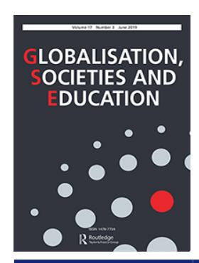
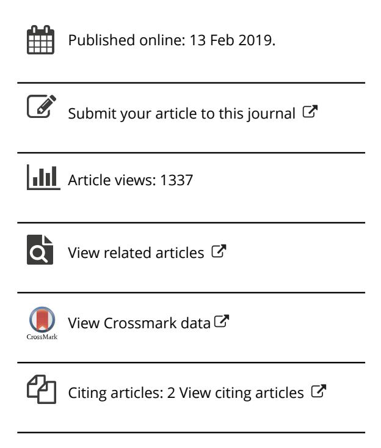

<!-- A2.R02 | source: papers_json/A2.R02/ -->

## **Globalisation, Societies and Education**

**ISSN: 1476-7724 (Print) 1476-7732 (Online) Journal homepage:****[ www.tandfonline.com/journals/cgse20](https://www.tandfonline.com/journals/cgse20?src=pdf)**

## **Common European framework of reference** **for languages (CEFR): insights into global policy** **borrowing in Malaysian higher education**

**Liyana Ahmad Afip, M. Obaidul Hamid & Peter Renshaw**

**To cite this article:** Liyana Ahmad Afip, M. Obaidul Hamid & Peter Renshaw (2019) Common European framework of reference for languages (CEFR): insights into global policy borrowing in Malaysian higher education, Globalisation, Societies and Education, 17:3, 378-393, DOI: [10.1080/14767724.2019.1578195](https://www.tandfonline.com/action/showCitFormats?doi=10.1080/14767724.2019.1578195)

**To link to this article: **[https://doi.org/10.1080/14767724.2019.1578195](https://doi.org/10.1080/14767724.2019.1578195)

<!-- page 2 -->

## Common European framework of reference for languages (CEFR): insights into global policy borrowing in Malaysian higher education

Liyana Ahmad Afip , M. Obaidul Hamid and Peter Renshaw

School of Education, The University of Queensland, St Lucia, Australia

## ABSTRACT

برز الإطار المرجعي الأوروبي المشترك للغات (CEFR) بوصفه سياسة عالمية في تعليم اللغة، وقد "استعارته" دول حول العالم. تقدم هذه الورقة تحليلاً نقدياً لاستعارة ماليزيا لإطار CEFR كجزء من إصلاح منهج اللغة الإنجليزية، مع إشارة خاصة إلى دوافع السياسة وعمليات التنفيذ كما وردت في خارطة الطريق لتعليم اللغة الإنجليزية في ماليزيا (2015-2025). يعتمد التحليل على إطار Phillips and Ochs's (2003, "Processes of Policy Borrowing in Education: Some Explanatory and Analytical Devices." Comparative Education 39 (4): 451–461.) في دراسة استعارة السياسة التعليمية، لإبراز التحديات والفرص المتاحة لتنفيذ هذه السياسة العالمية في التعليم العالي في ماليزيا.

## ARTICLE HISTORY

Received 7 August 2018 Accepted 31 January 2019

## KEYWORDS

Policy borrowing; CEFR; English language education; curriculum reform; higher education; Malaysia

## 1. Introduction

تقدم هذه المقالة رؤى حول سياق ودوافع وعمليات استعارة السياسات العالمية في التعليم العالي. نعتمد على الإطار المرجعي الأوروبي المشترك للغات (CEFR) كمثال على سياسة عالمية، وعلى تعليم اللغة الإنجليزية كمجال استُعير فيه إطار CEFR في سياق التعليم العالي الماليزي.

عادةً ما تهدف سياسات التعليم الوطنية المعاصرة إلى إنتاج رأس مال بشري، بحيث تتمكن الدول من المنافسة في اقتصاد معولم. وكما أكد Rizvi and Lingard ([2010)](#page-16-0)، فإن "الأغراض التعليمية أُعيد تعريفها في إطار مجموعة أضيق من الاهتمامات المتعلقة بتنمية رأس المال البشري، والدور الذي يجب أن يؤديه التعليم لتلبية احتياجات الاقتصاد العالمي وضمان تنافسية الاقتصاد الوطني" (3). كان تعليم اللغة الإنجليزية في طليعة تنمية رأس المال البشري، نظراً للدور البارز الذي تلعبه الإنجليزية كلغة للعولمة (Hamid [2016;](#page-16-0) Majhanovich [2014;](#page-16-0) Spring [2014](#page-16-0)). وبشكل متزايد، تتجه سياسة وممارسة اللغة الإنجليزية نحو تعزيز مهارات الطلاب في سوق العمل في دول عديدة حول العالم.

توفر ماليزيا حالة نموذجية. لم يمض وقت طويل منذ أن كان منهج اللغة الإنجليزية في الجامعات الماليزية مصمماً بشكل أساسي لتحقيق أهداف أكاديمية. غير أن المنهج الموجه أكاديمياً لا يُعد كافياً في عالم يتجه نحو العولمة، حيث يُعتقد على نطاق واسع أن الإنجليزية كلغة عالمية تتوسط الوصول إلى المعلومات والمعرفة والتوظيف، محلياً وعالمياً. لذلك، أصبح لتدريس اللغة الإنجليزية في قطاع الجامعات الآن غرض إضافي - وربما هو الغرض المحوري - يتمثل في تخريج طلاب قادرين على التواصل بالإنجليزية لضمان قابليتهم للتوظيف في سوق العمل الحالي. في عام 2012، أفاد تقرير Graduate Employability Blueprint

<!-- page 3 -->

2012-2017 بأن أكثر من نصف الخريجين (55.8%) من الجامعات الماليزية كان لديهم إتقان ضعيف للإنجليزية، مما قد يجعلهم عاطلين عن العمل (Ministry of Education 2012). وبشكل غير مباشر، زادت هذه الوثيقة من الضغط على الجامعات لتخريج طلاب قادرين على تلبية متطلبات سوق العمل المحلي والعالمي في اللغة الإنجليزية.

لتحقيق مكانة الدولة المتقدمة بحلول عام 2020، شدد صناع السياسة في ماليزيا على تنمية رأس المال البشري في قطاع التعليم العالي. يعتبر Rosli et al. (2010) التعليم العالي بمثابة "الموزع والمبتكر للمعرفة، المساهم في نمو الأمة وتنميتها" (1). تُعد المعرفة والمهارات والكفاءة في لغة عالمية من بين السمات الرئيسية للخريجين التي يمكن أن تحولهم إلى رأس مال بشري لمستقبل الأمة في بيئة اقتصادية معولمة. لذلك، تُعد مهمة حيوية للجامعات أن تطور منهجاً فعالاً للغة الإنجليزية يُقاس بمعايير دولية. يرى Steiner-Khamsi (2016) أن المعايير الدولية تُعد حافزاً فعالاً للإصلاح التعليمي واستعارة السياسات، إذ تولد خوفاً على المستوى الوطني من التخلف عن الآخرين في المنافسات العالمية.

استعارت أو تبنت العديد من دول العالم إطار CEFR كأساس لوضع معايير تعليم وتعلم اللغة الإنجليزية (Read 2014). أُطلق إطار CEFR من قِبل مجلس أوروبا في عام 2001 لتوفير "أساس مشترك لصياغة مناهج اللغة، وإرشادات المناهج الدراسية، والامتحانات، والكتب الدراسية، وغيرها في أنحاء أوروبا" (Council of Europe 2001, 1). ويهدف إلى "تعزيز وتسهيل التعاون بين المؤسسات التعليمية في مختلف الدول، وتوفير أساس سليم للاعتراف المتبادل بمؤهلات اللغة، ومساعدة المتعلمين والمعلمين ومصممي المناهج وهيئات الامتحانات ومسؤولي التعليم على تحديد جهودهم وتنسيقها" (Council of Europe 2017, 25). وبما أن إطار CEFR غير مرتبط بلغة أو سياق محدد، فقد تُرجم إلى 40 لغة مختلفة للاستخدام داخل أوروبا وخارجها. من بين الأسباب الرئيسية لاستعارة أو تبني إطار CEFR كأداة لتطوير سياسة تعليم اللغة هو وصفه لمستويات الكفاءة اللغوية. استُخدمت هذه المستويات من قِبل هيئات اختبار اللغة مثل Cambridge English Language Assessment وBritish Council وEducational Testing Service في اختبارات اللغة الإنجليزية العالمية، بما فيها International English Language Testing System (IELTS)، وCambridge Exams، وTeaching of English as a Foreign Language (TOEFL). ويمنحه التوافق المتنامي لاختبارات اللغة حول العالم مع مستويات CEFR قيمة عالمية.

في إطار اتباع هذا التوجه العالمي في استعارة السياسات، قررت وزارة التعليم في ماليزيا (يُشار إليها فيما بعد بـ MOE) استعارة إطار CEFR في أعقاب مراجعة شاملة للغة الإنجليزية في ماليزيا أجرتها Cambridge English بناءً على توصيات من English Language Quality Standards and Council (ELQSC1). استخدمت Cambridge Baseline Study 2013 إطار CEFR لتقييم الوضع الحالي لتعليم وتعلم اللغة الإنجليزية في ماليزيا، وقيّمت كفاءة اللغة الإنجليزية لعينات من الطلاب من مرحلة ما قبل المدرسة حتى التعليم بعد الثانوي، بالإضافة إلى معلمي اللغة الإنجليزية (Don et al. 2015). ونتيجة لاستعارة إطار CEFR، وقّعت Cambridge English اتفاقية مع MOE ماليزيا لتقديم برنامج استشاري مدته خمس سنوات، يشمل دمج CEFR في خلق الوعي، والإعداد الهيكلي، والتنفيذ، ومراقبة التغيير، بما في ذلك تقييم أثره (Greene n.d.).

تُرجمت أجندة الإصلاح لاحقاً إلى خارطة الطريق لتعليم اللغة الإنجليزية في ماليزيا 2015-2025. تُعد خارطة الطريق هذه دليلاً لمطوري المناهج والمعلمين لضمان قدرة الطلاب على بلوغ مستويات الكفاءة المستهدفة في اللغة الإنجليزية بما يتوافق مع مقاييس CEFR، بدءاً من مرحلة ما قبل المدرسة وحتى المرحلة الجامعية، فضلاً عن إعداد المعلمين. تُعنى هذه الوثيقة بالمنهج، والتدريس والتعلم، وتقييم برامج اللغة الإنجليزية. يحتوي القسم A من خارطة الطريق على مواد تحضيرية وخلفية، ويتناول اعتبارات عامة تشمل قضايا أكثر تحديداً في القسمين B وC. يقدم القسم B تقييماً نقدياً لبرامج اللغة الإنجليزية الحالية من مرحلة ما قبل المدرسة حتى التعليم الجامعي، بما في ذلك إعداد المعلمين، ويقدم توصيات للإصلاح والتحسين المستدام. واستناداً إلى النتائج والتوصيات الواردة في القسمين A وB، يقدم القسم C توصيات في مجموعة من الجداول لصياغة السياسة.

بما أن الإصلاح لم يُدخل إلا مؤخراً في النظام التعليمي الماليزي، فإن البحث في المنهج والتربية وممارسات التقييم المرتبطة بـ CEFR لا يزال في مراحله المبكرة جداً.

<!-- page 4 -->

يقع الفحص المُقدَّم في هذه المقالة ضمن هذا السياق. فهو يسعى إلى فهم لماذا وكيف وفي ظل أي ظروف حدثت استعارة السياسة في ماليزيا، وما الأثر الذي قد يترتب عليها في مؤسسات التعليم العالي في البلاد. ومن المأمول أن توفر هذه الرؤى الثقة لصناع السياسة المحليين في تنفيذ السياسة وتجنب التأخير أو الرفض أو المقاومة.

تبحث المقالة إصلاح منهج اللغة الإنجليزية في التعليم العالي الوطني في ماليزيا بالاستناد إلى إطار Phillips and Ochs's (2003) الخاص باستعارة السياسات التعليمية. ينقسم هذا الإطار، الذي سيُناقش بالتفصيل لاحقاً، إلى أربع مراحل تُبيّن العمليات والدوافع والنتائج المترتبة على استعارة السياسة. يوفر هذا الإطار عدسة مناسبة للفحص الحالي من حيث أهدافه. علاوة على ذلك، قد يساعد تركيز الإطار على الحساسية السياقية في الكشف عن أوجه عدم التوافق بين السياسة المستعارة والدولة المستعيرة. وعلاوة على ذلك، فإن الطابع الهرمي من أعلى إلى أسفل في استعارة CEFR في ماليزيا، إلى جانب الصياغة الواضحة لأهدافها وغاياتها، يتناسب مع عمليات هذا الإطار.

## 2. CEFR for the English language

يتألف إطار CEFR من وصف للعمليات اللازمة لتطوير المعرفة والمهارات اللغوية من أجل التواصل الفعال، مع مراعاة السياق الثقافي. تُصنَّف المستويات الست للكفاءات اللغوية التي تحدد قدرات المتعلمين ضمن ثلاث مجموعات رئيسية: المستخدمون الأساسيون (المستويان A1 وA2)، والمستخدمون المستقلون (المستويان B1 وB2)، والمستخدمون المتمكنون (المستويان C1 وC2). يصف الإطار أربعة أنماط لاستخدام اللغة، شفوياً أو كتابياً أو كليهما: الاستقبال، والإنتاج، والتفاعل، والوساطة. في سبتمبر 2017، نشر مجلس أوروبا وثيقة أخرى باسم Common European Framework of Reference for Languages: Learning, Teaching, Assessment Companion Volume with New Descriptors، والتي أدخلت مستوى ما قبل A1. علاوة على ذلك، توفر هذه الوثيقة نسخة موسعة من الأوصاف التوضيحية التي أصبحت مفيدة بشكل متزايد على مر السنين. كما تشير هذه الوثيقة الجديدة إلى أن إطار CEFR سيستمر في التحديث والتطوير (Council of Europe 2017).

إن إطار CEFR "لا يحاول سرد سمات لغوية محددة (قواعد نحوية، مفردات، إلخ) ولا يمكن استخدامه كمنهج دراسي أو قائمة تحقق لنقاط التعلم" (Cambridge English 2011, 4). يشجع مجلس أوروبا على إنتاج مواد داعمة تكمل CEFR تُعرف بـ Reference Level Descriptors (يُشار إليها فيما بعد بـ RLDs). تُعد RLDs مهمة لضمان استخدام إطار CEFR بشكل مناسب وتكييفه مع السياقات والأغراض المحلية. تهدف RLDs إلى نقل أوصاف إطار CEFR التي تحدد كفاءات المتعلمين عند مستوى معين إلى مادة لغوية محددة بلغة بعينها، وهو أمر يُعد مهماً لتطبيق تلك الكفاءات. لذلك، تمثل RLDs جيلاً جديداً من الأوصاف التي تحدد الأشكال اللغوية المحددة في كل من المستويات المرجعية الستة، والتي يمكن تحديدها كأهداف للتعلم أو استخدامها لتحديد إنجاز الطلاب (UCLES/Cambridge University Press 2011).

نشرت جامعة كامبردج، بدعم من مجلس أوروبا، برنامج *The English *Profile Programme. وقد تأسس هذا البرنامج رسمياً واعتُمد كمشروع RLDs رسمي معترف به للغة الإنجليزية في عام 2006، وتم تمويله من قِبل المفوضية الأوروبية (UCLES/Cambridge University Press 2011). يصف إطار CEFR نموذجاً لاستخدام اللغة يُعرف بالنهج الموجه نحو الفعل، حيث يطور مستخدم اللغة الكفاءة من خلال أنواع مختلفة من العمليات المعرفية والاستراتيجيات والمعرفة. يحتاج المتعلمون إلى استخدام اللغة والعمليات المعرفية المناسبة للسياق عند مشاركتهم في الأنشطة اللغوية لإنجاز المهام. النشاط اللغوي هو الأداء الملحوظ في مهمة التحدث أو الكتابة أو القراءة أو الاستماع (Cambridge English 2011). ومن المهم ملاحظة أن الأنشطة اللغوية كما تفسرها Cambridge English تشير إلى هذه المهارات الأربع، وليس إلى الأنماط الأربعة للاستقبال والإنتاج والتفاعل والوساطة كما وردت في وثيقة CEFR.

## 3. English language education reforms in Malaysia

تبنت ماليزيا نظاماً تعليمياً ثنائي اللغة (المالاي والإنجليزية) لخلق توازن بين الاحتياجات والتحديات الوطنية والدولية المتجسدة في سياسات تعليم اللغة

<!-- page 5 -->

(Darmi and Albion 2013; Gill and Kirkpatrick 2013). إلى جانب اللغة المالاوية، تُعد الإنجليزية رسمياً اللغة الثانية في ماليزيا. أرست المادة 152 من الدستور الماليزي اللغة المالاوية كلغة وطنية للأغراض الرسمية. غير أن تدريس وتعلم واستخدام لغات أخرى مسموح به أيضاً (Government of Malaysia 1957). تُعد اللغتان الصينية والهندية من لغات ماليزيا، وليستا لغتين أجنبيتين. ورغم أن الإنجليزية كانت في السابق لغة رسمية في ماليزيا، فإنها لم تُشر إليها قط باعتبارها إحدى اللغات الماليزية (Thirusanku and Yunus 2014).

جاء وجود جماعات متعددة الأعراق في ماليزيا نتيجة الهجرة الواسعة للصينيين والهنود خلال الحكم الاستعماري البريطاني. أدت السياسات النمطية القائمة على "فرّق تسد" التي مارسها البريطانيون إلى تطور غير متكافئ للبنية التحتية في ماليزيا. تركزت جهود التنمية بشكل أساسي على المنطقتين الوسطى والجنوبية، مما ترك الساحل الشرقي الأقل تطوراً، والمنطقة الشمالية، وصباح وساراواك، متأخرة. شكلت الاحتياجات المتنوعة لمجتمع متعدد الأعراق يعاني من تفاوتات بين الحضر والريف مشهد السياسة التعليمية الوطنية في ماليزيا. يخضع النظام التعليمي الوطني، الذي يشمل مراحل ما قبل المدرسة والابتدائي والثانوي وما بعد الثانوي والجامعي، لمركزية وتنظيم من قِبل MOE. تُقدَّم اللغة الإنجليزية منذ مرحلة ما قبل المدرسة، وهي مادة إلزامية في المنهج الوطني في المرحلة الابتدائية لكل من المدارس الوطنية (المالاوية كلغة تدريس) والمدارس من النوع الوطني (الصينية أو التاميلية كلغة تدريس)، وكذلك في المرحلة الثانوية وما بعد الثانوية والجامعية. ومع ذلك، لا تُعد الإنجليزية مادة إلزامية للنجاح في مرحلة التعليم الابتدائي أو الثانوي. أمضى الماليزيون الذين أكملوا التعليم الرسمي من مرحلة ما قبل المدرسة حتى التعليم الجامعي 15-16 عاماً من تعليم اللغة الإنجليزية. ومع ذلك، حدث تراجع كبير في مستوى الكفاءة في اللغة الإنجليزية، إذ تقلص دور الإنجليزية من كونها لغة تدريس إلى مجرد مادة تُدرَّس في المدرسة بعد تطبيق قانون التعليم لعام 1961.

هناك ثلاث قضايا مترابطة تتعلق بسياسات تعليم اللغة الإنجليزية في ماليزيا: التهديد المتصوَّر للإنجليزية تجاه اللغة المالاوية؛ ونقص الكفاءة في الإنجليزية المؤدي إلى البطالة؛ والفجوة بين الحضر والريف في بلوغ الكفاءة (Don 2014). قد لا تشكل الإنجليزية تهديداً للغة المالاوية لأن اللغتين تعملان في مجالين مختلفين. غير أنه إذا اعتبر المجتمع الإنجليزية تهديداً، فقد تنشأ آثار سلبية تعوق وضع أهداف واقعية للطلاب. وقد لا يكون الطلاب متحمسين لتعلم الإنجليزية إذا اعتُبرت تهديداً للغتهم الأم. بالنسبة للطلاب في المناطق الحضرية، قد يكون الاستخدام المتكرر للإنجليزية في محيطهم الاجتماعي أكثر تحفيزاً مقارنة بالطلاب في المناطق الريفية، حيث لا يدعم المحيط الاجتماعي استخدام الإنجليزية. لذلك، يحتاج المعلمون وأولياء الأمور في المجتمعات الريفية إلى مساعدة الطلاب على تصور دور الإنجليزية في دراستهم المستقبلية وتوظيفهم في عالم معولم.

استجابةً للمخاوف الوطنية المتعلقة بمستويات الكفاءة في اللغة الإنجليزية، أطلقت MOE إصلاحين تعليميين وطنيين رئيسيين. أولاً، أُطلقت New Malaysia Education Blueprint 2013-2025 (يُشار إليها فيما بعد بـ MEB) في عام 2012، والتي أدخلت منهجاً قائماً على المعايير (اختصاراً KSSR). يركز KSSR على برنامج Literacy and Numeracy Screening (LINUS) لضمان أن يكون 100% من أطفال المدارس الابتدائية ملمين بالقراءة والكتابة في اللغة المالاوية، و90% في اللغة الإنجليزية بنهاية السنة الثالثة (Azman 2016). ويتماشى هذا مع خطط الحكومة للحفاظ على المالاوية كلغة للوحدة الوطنية ولغة للمعرفة، وتعزيز الكفاءة في الإنجليزية بين المتعلمين متعددي اللغات، والحفاظ على اللغات المحلية للطلاب مثل الماندرين والتاميلية.

جاء تطبيق KSSR بعد فشل Integrated English Language Syllabus for Primary School (KBSR) في إحياء وتعزيز تدريس اللغة القائم على التواصل. سابقاً، واجه المعلمون مشكلات في تكييف معرفتهم بالتعلم التفاعلي المتمحور حول المتعلم في فصول ذات أعداد كبيرة. علاوة على ذلك، أدى عجزهم عن التفكر في تدريبهم إلى تمسكهم بممارساتهم الصفية القديمة ورفض الابتكارات (Hardman and Rahman 2014). في عام 2003، اتخذت الحكومة الماليزية قراراً جريئاً بتغيير لغة التدريس في مادتَي العلوم والرياضيات من المالاوية إلى الإنجليزية. اعتُبر هذا القرار الإصلاح التعليمي الأكثر إثارة للجدل في ماليزيا (Rashid, Rahman, and Yunus 2017). لم يكن الهدف من تغيير هذه السياسة

<!-- page 6 -->

تحسين كفاءة الطلاب في الإنجليزية، بل تمكينهم من تعلم الرياضيات والعلوم باللغة العالمية وتحسين مستوى رأس المال البشري في ماليزيا. لم تُثقل هذه السياسة كاهل معلمي المواد المحتوى الذين لم يكونوا متمكنين من الإنجليزية فحسب؛ بل أضافت أيضاً ضغطاً على معلمي اللغة الإنجليزية الذين توجب عليهم ضمان قدرة الطلاب على فهم الدروس في حصص الرياضيات والعلوم. في عام 2012، ألغت الحكومة الماليزية هذه السياسة لصالح المالاوية نتيجة الخوف الجماعي من تعرض اللغات الأخرى للخطر، خصوصاً من قِبل الأعراق المالاوية والصينية متعددة اللغات (Azman 2016). كما فشلت هذه السياسة لأن طلاباً من المناطق الريفية وُجدوا يرسبون في الرياضيات والعلوم (Gill 2012).

تُبيّن خارطة الطريق لتعليم اللغة الإنجليزية أحدث الإصلاحات التعليمية من خلال توسيع الجهود المبذولة في MEB. يرى Azman (2016) أن هذه الإصلاحات لديها القدرة على إحداث تحولات حاسمة في طريقة تدريس وتعلم الإنجليزية كلغة ثانية في ماليزيا. وتقترح أيضاً أن خارطة الطريق ستمتص أي تحول محتمل في المشاعر الاجتماعية والسياسية المعادية للإنجليزية التي أثّرت سابقاً على القرارات المتذبذبة بشأن دور الإنجليزية في سياسة وممارسة تعليم اللغة. تتكون خارطة الطريق من ثلاث مراحل. ركزت المرحلة الأولى (2013-2015) على رفع كفاءة معلمي المدارس في الإنجليزية. وخلال هذه الفترة، حضر المعلمون أنشطة تطوير مهني متنوعة. استُخدمت نتائج دراسة كامبردج الأساسية من قِبل ELSQC لوضع أوصاف CEFR، وتحديد الهدف لكل مستوى، والتخطيط لبناء القدرات. بدأت المرحلة الثانية في عام 2016 بعد أن خُصص عام لـ ELSQC لتحديد مستويات CEFR المناسبة لكل مرحلة، بدءاً من ما قبل المدرسة وحتى إعداد المعلمين. في الجزء الأول من المرحلة الثانية، جرت أيضاً مواءمة المناهج الدراسية مع أوصاف CEFR، وقررت ELSQC اختيار كتب دراسية ومواد داعمة متوافقة مع CEFR على المستوى الدولي. بدأ الجزء الثاني بعد التحقق من صحة أهداف وأوصاف CEFR لكل مستوى، وبدأ تطبيق المناهج الدراسية الجديدة المتوافقة مع CEFR اعتباراً من عام 2017، وسيستمر حتى عام 2020. وفي الوقت نفسه، سيحضر المعلمون سلسلة من التدريبات المتعلقة بـ CEFR ستجعلهم على دراية بالإطار والمناهج الجديدة. في المرحلة الثالثة، ستُقيّم ELSQC وتراجع وتنقح الأهداف وتنفيذ CEFR. سيُعاد تنقيح الأوصاف وتقييمها، وستُراجع الكتب الدراسية والمواد التعليمية المختارة. وأخيراً، ستكون نقطة التحول المحورية لهذه المرحلة النهائية هي تطوير CEFR-Malaysia (CEFR-M) استناداً إلى نتائج المراجعة وإعادة التقييم والعمليات المنقحة (راجع Don et al. 2015 للاطلاع على خارطة طريق مفصلة لكل مرحلة تعليمية).

## 4. Analysis of CEFR policy borrowing in national higher education institutions

يعتمد هذا القسم على إطار Phillips and Ochs's (2003) الخاص باستعارة السياسات التعليمية لدراسة استعارة CEFR في ماليزيا. تتمثل المراحل الأربع لاستعارة السياسة التي يناقشها المؤلفان في: (i) الجاذبية عبر الوطنية: الدوافع والإمكانات الخارجية، (ii) صنع القرار، (iii) التنفيذ، و(iv) الاستيعاب الداخلي/التوطين.

تحدد المرحلة الأولى الدوافع التي تُحفّز الحاجة إلى تغيير السياسات القائمة، والتي يمكن أن تنشأ عن ظواهر متنوعة مثل: الاستياء الداخلي، لا سيما بين المشاركين المباشرين في النظام أو المؤسسات؛ الانهيار النظمي، الذي قد ينتج عن قصور في التوفير التعليمي والحاجة لإعادة بناء التعليم بعد حرب أو كارثة طبيعية (Phillips 2015)؛ التقييم الخارجي السلبي، خصوصاً من قِبل منظمات دولية مؤثرة بشأن إنجاز الطلاب المحليين؛ التغير الاقتصادي أو المنافسة، الذي قد يرتبط بالتغير الاقتصادي السريع في الدول النامية التي تتطلب تدريباً إضافياً للمشاركة الفاعلة في المنافسة الاقتصادية؛ الضرورات السياسية وغيرها، مثل استياء الناخبين المؤدي إلى سياسة "الانقلاب"؛ التشكيلات الجديدة مثل التدريب والسياسة التعليمية العالمية الناتجة عن تحالفات دولية نتيجة نزعات العولمة؛ ابتكار المعرفة/المهارات الناشئ عن القصور في استخدام التقنيات الجديدة؛ أو التغير السياسي مثل تغير الحكومات.

تُقر المرحلة الثانية بفئات متنوعة من عمليات صنع القرار من جانب الحكومات. يعكس صنع القرار النظري الاختيار والتنوع (Phillips 2015, 144)، حيث قد لا تقدم طموحات السياسة دليلاً على تنفيذ فعال. أما صنع القرار الواقعي/العملي فعادة ما يكون مبنياً على أدلة

<!-- page 7 -->

رغم أن العوامل السياقية قد لا تُؤخذ بعين الاعتبار في مثل هذه القرارات. وغالباً ما يكون صنع القرار من نوع "الحل السريع" استجابة لضرورة فورية بناءً على نصيحة من مصادر خارجية تؤدي إلى تبني نماذج أجنبية. ويُعد هذا شكلاً خطراً من أشكال صنع القرار (Phillips and Ochs 2003). وأخيراً، يشمل صنع القرار "الزائف" "الحماس الذي يُبديه السياسيون تجاه جوانب من التعليم في دول أخرى لتحقيق أثر سياسي فوري، دون إمكانية متابعة جادة" (Phillips 2015, 145).

تسعى المرحلة الثالثة إلى تحليل فاعلية التنفيذ، والتي تعتمد على سياق الدولة "المستعيرة". تؤثر مواقف الفاعلين المهمين على سرعة التغيير في تنفيذ السياسة الجديدة. الفاعلون المهمون هم أولئك الذين يملكون القوة لدعم أو مقاومة التغيير والتطوير. يشدد Phillips (2015) على أن هؤلاء الفاعلين المهمين يمكنهم تنفيذ السياسة بشكل فاعل بطريقة غير مباشرة من خلال إدخال أنظمة لامركزية. وقد تؤدي مقاومة أو رفض الفاعلين إلى تأخير عملية التنفيذ أو عدم اتخاذ قرار.

تحدث المرحلة الأخيرة عندما تُدمج السياسة المستعارة كجزء من النظام التعليمي في دولة ما، مما يجعل من الممكن تقييم آثار السياسة على النظام التعليمي القائم. هناك أربع خطوات لفهم استيعاب السياسة: (i) الأثر على النظام القائم، والذي يمكن قياسه من خلال فحص دوافع وأهداف صناع السياسة بالاقتران مع النظام القائم؛ (ii) استيعاب السمات الخارجية، التي تشير إلى مدى تبني سمات من نظام آخر (السياسة المستعارة) في سياق محلي (الدولة المستعيرة)؛ (iii) التركيب، الذي يشير إلى كيفية أن تصبح السياسة والممارسة التعليمية جزءاً من استراتيجية شاملة للدولة المستعيرة. تُقر هذه العملية بالسياق الذي يؤثر على تفسير وتنفيذ السياسة المستعارة (Phillips 2015)؛ (iv) التقييم، الذي يسعى إلى فهم مدى واقعية توقعات الدولة المستعيرة. قد تُشعل نتائج التقييم العملية بأكملها من جديد، مع مزيد من البحث في السياسة المستعارة للتغلب على أوجه القصور المتصوَّرة في الدورة الأولى من تنفيذ السياسة.

في ماليزيا، لا تمتلك دورات اللغة الإنجليزية التي تقدمها الجامعات الحكومية منهجاً أو معايير موحدة لبلوغ الكفاءة في الإنجليزية. من بين المشكلات التي تؤثر على تحقيق الكفاءة في الإنجليزية: عدم كفاية ساعات الاتصال لدورات الإنجليزية (80-320 ساعة)، وعدم وجود حد أدنى لمتطلبات الكفاءة لمعلمي الإنجليزية، وتفضيل الطلاب لنهج متمحور حول المعلم، واستخدام مواد تعليمية لا تعكس معايير الإنجليزية المعترف بها دولياً (Don et al. 2015; Jaafar and Thang 2013). هناك أنواع متعددة من دورات اللغة الإنجليزية التي تقدمها الجامعات، والتي تُقيَّم أيضاً بشكل مختلف من قِبل مؤسسات مختلفة. قد لا تعكس بعض دورات اللغة الكفاءة اللغوية أو سمات الخريج التي تُعد مهمة للتواصل في مواقف الحياة الواقعية. لا يوجد قاسم مشترك لمقارنة الطلاب بناءً على الكفاءة اللغوية، لا سيما بالنسبة لأصحاب العمل المستقبليين. علاوة على ذلك، قد لا تكون مقاييس التقييم المحلية مفيدة للطلاب الباحثين عن عمل في سوق العمل الدولي، مما يبرز أهمية أن تُقاس التقييمات بمعايير معترف بها دولياً. هدف إدخال CEFR لتعليم اللغة الإنجليزية في الجامعات إلى التغلب على هذه المشكلات المتعددة الأوجه وإحداث تغييرات كبرى في النظام القائم. سنبحث الآن استعارة CEFR في ماليزيا في ضوء المراحل الأربع لاستعارة السياسة في إطار Philips and Ochs.

## 4.1. Cross-national attraction: impulses and externalising potential

في عام 2012، طُلب من 61,000 معلم لغة إنجليزية في ماليزيا أداء اختبار Cambridge Placement Test عبر الإنترنت لقياس مستوى كفاءتهم في الإنجليزية. وأفادت التقارير أن نحو ثلثي المعلمين رسبوا في الاختبار، مما يشير إلى مشكلات في برنامج إعداد المعلمين تستدعي إصلاحات. وبعد عام، أجرت Cambridge English تقييماً آخر لنظام تعليم اللغة الإنجليزية بأكمله في ماليزيا، ولاحظت أن المنهج الحالي للإنجليزية في ماليزيا غير كافٍ لتمكين الماليزيين من المنافسة في عالم معولم يتطلب الإنجليزية للتواصل الدولي (Don et al. 2015). لذلك، بدأت الإصلاحات بوضع هدف شامل لكفاءة اللغة الإنجليزية لبرامج اللغة الإنجليزية، بالإضافة إلى أهداف مرحلية منطقية

<!-- page 8 -->

يُراد تحقيقها بحلول عام 2025. تُعرض نتائج قياس معايير كامبردج، والأهداف، والأهداف المنطقية المرحلية في الشكل 1. تُظهر الحالة الماليزية أن استعارة السياسة التعليمية يمكن أن تُحفَّز بتقييم خارجي للإنجاز التعليمي. أوضح Ochs [(2006)](#page-16-0) أن أداء بريطانيا في Trends in International Mathematics and Science Study (TIMSS) أثار مخاوف بشأن الإنجاز التعليمي للطلاب والحاجة إلى المنافسة والتنافسية داخل أوروبا (603). ويبرز Nguyen [(2016](#page-16-0)) اعتبارات مماثلة لتبني CEFR في فيتنام. تشير هذه الأمثلة إلى أن المقارنة الدولية أمر لا غنى عنه في عصر العولمة.

## 4.2. Decision making

يمكن تصنيف قرار الحكومة الماليزية "باستعارة" CEFR على نطاق واسع بأنه واقعي أو عملي. يمكن العثور على دليل على ذلك في الجهود التي بذلتها وزارة التعليم الماليزية، بما في ذلك تعيين Cambridge English لتقديم تقرير مبني على الأدلة حول قياس معيار منهج اللغة الإنجليزية الحالي، وإنشاء ELSQC. أعدت ELSQC خارطة الطريق لتعليم اللغة الإنجليزية في ماليزيا، والتي تشمل التخطيط القائم على الأجندة ([الشكل 2](#page-8-0)) للمنهج، والتدريس والتعلم، وكذلك التقييم على مدى عشر سنوات (Don et al. [2015)](#page-15-0).

تطمح ماليزيا منذ زمن طويل إلى أن يُعترف بها دولياً كدولة متقدمة ذات دخل مرتفع بحلول عام 2020. لذلك، هناك حاجة إلى أجندة محددة بوضوح لتحويل هذا الطموح إلى واقع. وفيما يتعلق تحديداً بالإنجليزية، تسعى MOE إلى ضمان جودة تدريسها وتعلمها في المدارس ومؤسسات التعليم العالي لتحسين فرص التوظيف للشباب؛ وتمكين المتعلمين من المشاركة الكاملة في الحياة الأكاديمية والمهنية والحياة العامة؛ والاستفادة من الفرص الاقتصادية الناتجة عن تشكيل رابطة أمم جنوب شرق آسيا (ASEAN). حفزت هذه الطموحات قرار قياس معيار برنامج اللغة الإنجليزية في ماليزيا. ستُستخدم نتائج القياس لتوجيه تعديل المنهج لضمان الحفاظ على المعايير الدولية في برنامج اللغة الإنجليزية. ولا يُقصد بعملية القياس تنظيم ما تخطط له MOE لتعليم اللغة الإنجليزية في ماليزيا؛ بل ستساعد MOE، وتحديداً ELSQC، على تحديد ما ينبغي إدراجه في المنهج الوطني لتحقيق الطموحات الوطنية. من المتوقع أن يوجه المنهج التدريس والتعلم، وأن يوجه التدريس والتعلم بدورهما تطوير المواد التعليمية، وأن يُحقق ذلك في النهاية نتائج جيدة في التقييم وتدريب المعلمين بحلول عام 2025.

<!-- page 9 -->

اتُخذ قرار تبني CEFR بناءً على تجربة دول أخرى مثل اليابان وتايوان وفيتنام في إصلاح برامج اللغة الإنجليزية. تتعلق ثلاثة دروس مهمة مستفادة من هذه الدول بتدريب المعلمين، ومراجعة البرامج، ونشر المعلومات. جعلت MOE ماليزيا حضور تدريب التعرف على CEFR إلزامياً لجميع معلمي الإنجليزية. يُقدَّم هذا التدريب المتسلسل من قِبل مدربين ومراقبين رئيسيين لـ CEFR تُعينهم MOE ماليزيا. كما أصبح إلزامياً على الجامعات في ماليزيا مراجعة برامج اللغة الإنجليزية الخاصة بها، بما يشمل المنهج والتقييم والتدريس والتعلم في ضوء CEFR (Don et al. 2015). يُعد Council of Language Deans المنتدى المخصص لنشر المعلومات المتعلقة بـ CEFR من MOE إلى الجامعات. بالإضافة إلى ذلك، توفر وسائل الإعلام معلومات متعلقة بتطبيق CEFR على المستوى الوطني لتجنب الانتقادات غير المستنيرة والمقاومة تجاه السياسة (Aziz 2016; Chan 2017; Mustafa 2017; Rajaendran 2016).

## 4.3. Implementation

تملك الجامعات في ماليزيا الوسائل للمضي قدماً في تطبيق CEFR دون انتظار اكتمال عملية التنفيذ بأكملها في المراحل التعليمية الأدنى. في اليابان، طُبق CEFR بنجاح في الجامعات، مما يشير إلى إمكانية تنفيذ CEFR جزئياً في مستويات تعليمية محددة (Don et al. 2015; Sugitani and Tomita 2012). تسعى MOE ماليزيا إلى ضمان فهم الفاعلين المهمين للقرار ودعمهم لتنفيذ السياسة القائمة على CEFR في مؤسساتهم. يُتوقع من الفاعلين المهمين في الجامعات، على سبيل المثال، رئيس وحدة اللغة الإنجليزية ومعلمي اللغة الإنجليزية، أن يشاركوا بفاعلية في تنفيذ السياسة القائمة على CEFR. فهم بمثابة حراس البوابة المسؤولين عن تعريف الطلاب بـ CEFR وترجمته ودمجه في تدريسهم.

تتضمن خارطة الطريق عدة توصيات موجهة تحديداً لوحدة اللغة الإنجليزية، مثل: اعتماد CEFR كإطار مرجعي مشترك لمنهج اللغة الإنجليزية والتدريس والتعلم والتقييم؛ وزيادة الساعات المعتمدة لتعلم اللغة الإنجليزية؛ وتحديد حد أدنى لمستوى كفاءة المعلم يعادل CEFR C1؛ وإعادة اعتماد كفاءة اللغة الإنجليزية لترقية المعلمين؛ وإجراء اختبار خروج مقيس دولياً لجميع الخريجين؛ ودعم مؤسسي لخلق بيئة غنية باللغة الإنجليزية. تنقسم عملية التنفيذ إلى أربع مراحل، بدأت في عام 2015 وستنتهي في عام 2028. صُممت هذه المراحل

<!-- page 10 -->

استناداً إلى Malaysia Education Blueprint (2013-2025) وGraduate Employability Blueprint (2012-2017).

هدفت المرحلة الأولى، Preparing for Structural Change (2015-2016)، إلى "إرساء CEFR كإطار مشترك للمنهج والتربية والتقييم عبر جميع الجامعات" (Don et al. 2015, 265). أجرى رئيس ELSQC ورش عمل للتعرف على CEFR في جميع الجامعات الحكومية في ماليزيا لشرح عملية إصلاح تعليم اللغة الإنجليزية على المستوى الجامعي. دُعي معلمو اللغة الإنجليزية في الجامعات للتدرب كمدربين رئيسيين لنشر المعرفة حول CEFR بين زملائهم. ثم أجرى هؤلاء المدربون الرئيسيون تدريباً داخلياً لشرح المفهوم الأساسي لتعلم اللغة، وتربية اللغة، وتطوير المناهج، فضلاً عن منهجية التدريس والتقييم.

تتمتع الجامعات الماليزية باستقلالية في تحديد محتوى الدورات، وتسلسل الدورات، ومخرجات التعلم بناءً على مستوى الكفاءة المستهدف وفق CEFR، وإعادة تصميم مخرجات التعلم من خلال دمج مدخلات أصحاب العمل بشأن المهام اللغوية المتوقعة من الموظفين. تُستخدم المناهج المتوافقة مع CEFR والمواد التعليمية المستوردة لتوجيه التدريس والتعلم وكذلك التقييم لتحقيق أهداف CEFR. كما يُتوقع من المعلمين تعزيز التعلم الذاتي بين الطلاب، إذ يحتاج الطلاب إلى مراقبة تقدمهم بناءً على عبارات "القدرة على الإنجاز". يجب زيادة الساعات المعتمدة إذا كانت مستويات الكفاءة الإنجليزية للطلاب عند نقطة الدخول أقل من Band 4 أو 5 في Malaysian University English Test (MUET2). يحتاج الطلاب إلى نحو 200 ساعة من التعلم الموجَّه للانتقال من مستوى إلى آخر في CEFR (Don et al. 2015). تُستخدم أوصاف CEFR كإطار للتقييم، خصوصاً في وضع معايير التقييم مثل مهمة التحدث أو الكتابة. يمكن استخدام الاختبار المقيس وفق CEFR لتحديد الكفاءة الأساسية للطلاب عند التخرج. يُتوقع من الطلاب التخرج من الجامعة بمستوى أدنى لا يقل عن B2 المنخفض. تُشجَّع الجامعات على مراجعة الحد الأدنى لمتطلبات القبول في اللغة الإنجليزية ودعم استخدام الإنجليزية خارج الفصل الدراسي. جرت مراجعة مؤهل اللغة الحالي للمعلمين، تلاه إدخال C1 كحد أدنى لمستوى الكفاءة.

تركز المرحلة الثانية، Implementing and Monitoring Structural Change (2017-2020)، على تنفيذ وتطوير ومراقبة الجهود التي بدأت في المرحلة الأولى. تُعتمد أو تُطوَّر مواد الدورات المتوافقة مع معايير CEFR والمناسبة للسياق الماليزي للاستخدام في الفصل الدراسي القائم على CEFR. حضر المعلمون ورش عمل تطوير مهني مستمرة لتحسين جودة التدريس وإعادة اعتماد مستوى كفاءتهم بناءً على اختبار CEFR كمعيار للترقية. يُتوقع من الجامعات مراقبة الجهود المبذولة في المرحلة الأولى لتعزيز الاستقلالية لدى المتعلمين والحفاظ على بيئة غنية بالإنجليزية للطلاب. ويُطلب منها تطوير وتجريب اختبار موحد مقيس وفق CEFR لمراقبة فعالية الجهود المبذولة في إصلاح منهج اللغة الإنجليزية. في نهاية هذه المرحلة، ينبغي أن يتمكن الخريجون من بلوغ B2 مرتفع على مقياس كفاءة CEFR.

ستركز المرحلة الثالثة، Scaling up Structural Change (2021-2025)، على جانبين مهمين، وهما مراجعة الاستراتيجيات والجهود المطبقة في المراحل السابقة، ومراقبة سمات الخريجين. في هذه المرحلة، ستُراجع المناهج المتوافقة مع CEFR بناءً على تعليقات المعلمين والطلاب والمؤسسات المشاركة مباشرة في عملية التنفيذ. سيُراقَب معلمو اللغة من حيث الجودة وجهود تطوير المهارات. تُحث الجامعات على تطوير وإجراء استطلاع رضا أصحاب العمل (Employer Satisfaction Survey - ESS) لتقديم تعليقات حول فعالية المنهج المتوافق مع CEFR بناءً على رضاهم عن أداء الخريجين في الإنجليزية. ستكون تعليقات الخريجين أيضاً مفيدة لتحديد ومعالجة الجوانب الإشكالية في المنهج. سيُطبَّق اختبار مقيس وفق CEFR لمراقبة الكفاءة اللغوية لكامل مجتمع الخريجين الجامعيين عند نقطة التخرج. ستُستخدم بيانات الاختبار وESS لمقارنة أداء الطلاب المُشار إليه بالدرجات ومتطلبات الكفاءة اللغوية في سوق العمل. سيُراجَع الاختبار الموحد المقيس وفق CEFR ويُتحقق من صحته. سيُحدد الحد الأدنى لمتطلبات الخروج في اللغة الإنجليزية عند هذه النقطة الزمنية بمستوى B2 مرتفع إلى C1.

وأخيراً، ستركز مرحلة ما بعد MEB (2026-2028) على التحقق من ملاءمة المنهج والتدريس والتعلم وطرق التقييم المتوافقة مع CEFR في ماليزيا. في

<!-- page 11 -->

هذه المرحلة النهائية، ستُنشئ الجامعات تحققاً خارجياً من صحة الاختبار المقيس وفق CEFR. ستُتحقق النتائج من صحة منهج CEFR، والتدريس والتعلم القائمين على CEFR، والتقييم في ماليزيا. ستُتحقق بيانات ESS في المرحلة الثالثة من صحة الجهود المستندة إلى CEFR في إعداد الخريجين المطلوبين للتوظيف. في هذه المرحلة، ينبغي أن تتمكن الجامعات من قبول الطلاب الذين لا يتجاوز مستواهم عند الالتحاق B2 المنخفض فقط، بهدف رفع مستواهم عند التخرج إلى ما بين B2 مرتفع وC1.

تتناول خارطة الطريق أيضاً سيناريو محتمَل يستمر فيه اختلاف متطلبات القبول وفق MUET بين برامج الجامعات المختلفة. غير أنه لضمان تحسن كفاءة الطلاب اللغوية، يجب أن يتخرجوا بمستوى أعلى بدرجة واحدة على الأقل من مستوى MUET الذي التحقوا به بالجامعة في البداية. طُبق هذا المتطلب في عام 2016 على الطلاب الذين التحقوا بمستوى MUET Band 1-3. غير أن للجامعات حرية تقرير ما إذا كانت ستطبق قواعد سياسة الخروج في اللغة الإنجليزية، وفي هذه الحالة لن يتخرج الطلاب إلا إذا أعادوا اختبار MUET وحققوا Band 3. وإذا ظل الطلاب غير قادرين على تحقيق Band 3 في MUET، فعليهم حضور دورات علاجية في الإنجليزية في سنتهم الأخيرة، وأداء امتحان داخلي في الإنجليزية تُجريه الجامعة. وبما أن MUET سيُستخدم لتصنيف الطلاب واختبار الخروج، فقد أجرت Cambridge English بالفعل عملية مواءمة لتنقيح اختبار MUET، بحيث يصبح اختباراً صالحاً وموثوقاً (Don et al. 2015). أطلقت MOE أيضاً Malaysian English Assessment (MEA) لطلاب الجامعات كمبادرة "لتعزيز منظومة تقييم اللغة الإنجليزية في التعليم العالي" (Mustafa 2017). يسعى MEA إلى دمج التعلم الرسمي وغير الرسمي، ويُستخدم كبنك أسئلة لبرنامج تمكين CEFR. وفي هذه المرحلة، لا تزال حالة إعادة مواءمة MUET وMEA غير معروفة.

## 4.4. Internalisation

هناك عدة نقاط ينبغي مراعاتها لضمان فعالية عملية الإصلاح. يرى Steiner-Khamsi (2004) أن صناع سياسة التعليم غالباً ما يتجاهلون السياق المحلي، ويهملون الجوانب الاجتماعية والسياسية والاقتصادية للدولة المستعيرة. ونتيجة لذلك، قد لا تحقق سياسة ناجحة في دولة ما نفس الأثر في دولة أخرى. وبالمثل، يشير Hu and McKay (2012) إلى افتراضات شائعة بين صناع السياسة الذين يميلون إلى الاعتقاد بنهج "المقاس الواحد يناسب الجميع". يشير هذا إلى أن من الضروري لأي دولة أن تتأمل عملية الإصلاح وكيف قد تؤثر على السياق المحلي.

هناك حاجة إلى تعديلات إذا لم تناسب السياسة الدولة. يناقش Tan and Reyes (2016) استخدام "نموذج تعليمي هجين" يجمع بين أفكار وممارسات أجنبية ومحلية في سياق الصين. أحد نتائج هذا النموذج الهجين هو أسلوب التدريس الصيني المعروف بالتربية "التي يهيمن عليها المعلم". برز هذا الأسلوب التربوي بعد إدخال إصلاح المنهج الجديد، الذي شهد تبني المربين لنُهج متمحورة حول الطالب مع الحفاظ في الوقت نفسه على تربيتهم التقليدية الموجهة من المعلم. من المهم أن تقنع ELSQC وأصحاب المصلحة الآخرون الماليزيين بأن هذا الإصلاح سيحدث أثراً إيجابياً على تعليم اللغة الإنجليزية في ماليزيا، وأنه لن يؤثر على الترتيبات الاجتماعية والسياسية والاقتصادية القائمة أو يعرضها للخطر. أحد المخاوف الشائعة في هذه الحالة هو كيف قد تؤثر الإنجليزية على هوية الماليزيين. لمعالجة هذا القلق، ينبغي أن يُعامَل الجدل الدائر حول الإنجليزية وفقدان الهوية الوطنية كـ"قضية لا قيمة لها" (Chin 2018)، إذ يشير إلى عدم وجود مجال لأن تُضعف الإنجليزية النزعة القومية أو الهوية الوطنية أو بناء الأمة إذا رجعنا إلى الدستور الفيدرالي وقانون اللغة الوطنية لعام 1967 وسياسة التعليم الوطنية. لا تنص أي من هذه الوثائق على وجوب التخلي عن الإنجليزية. كما ينبغي التأكيد على أن تعلم الإنجليزية لا يجعل المرء أقل وطنية، ولا يؤثر على طريقة تعلمه للغته الوطنية.

فيما يتعلق باستخدام المواد التعليمية والكتب الدراسية المستوردة، أورد Aziz, Rashid, and Zainudin (2018) بعض القضايا، بما فيها التكلفة العالية، والعناصر الثقافية الأجنبية، ومعضلات المعلمين في استخدام هذه الكتب. رغم هذه المخاوف، قررت MOE ماليزيا المضي قدماً في خطة تطبيق الكتب الدراسية المستوردة. يدعو Chin (2018) المعلمين إلى عدم لوم الكتاب الدراسي الذي يمكن أن يكون في الواقع جسراً بين محتوى الكتاب والطلاب. وأضافت أنه إذا

<!-- page 12 -->

اعتبر المستخدمون الكتب الدراسية "أجنبية"، فقد ينأون بأنفسهم عن المحتوى والتعلم، ولكن إذا اعتبروا هذه الموارد "دولية"، فسينفتحون على فهم جديد لأهميتها العالمية وفائدتها.

هناك حاجة إلى مراقبة منتظمة لتنفيذ السياسة لضمان سير عملية الإصلاح بسلاسة. يشجع Don et al. (2015) معلمي اللغة الإنجليزية في مختلف المراحل التعليمية على استقصاء هذه الإصلاحات. ويرون أنه "مهما كانت العناية التي يُصمَّم بها برنامج جديد، علينا أن نتوقع مشكلات تنشأ عن تكامل غير كامل وتنفيذ غير منسق. لا ينبغي إدخال الابتكارات على أساس الاعتقاد بأنها قد تنجح، بل يجب اختبارها" (28). يُدعى المعلمون إلى الإبلاغ عن المشكلات لتلقي المشورة من معلمين ذوي خبرة، وفي هذه الحالة، من المدربين الرئيسيين لـ CEFR أو خبراء ELSQC. تُعد تعليقات المعلمين مهمة لإجراء التعديلات اللازمة لتحسين المنهج. يرى Rashid, Rahman, and Yunus (2017) أن المعلمين يجب أن يشاركوا في التخطيط للسياسات الجديدة لأن النهج من أعلى إلى أسفل يُعد إشكالياً. وأضافوا أنه رغم أن التغييرات في السياسات تهدف إلى تحسين جودة التعليم في ماليزيا، فإن تنفيذها غالباً ما يتم "بتسرع دون مراعاة أصوات وآراء المجتمع الأوسع، مما يسبب احتجاجاً عاماً صاخباً ويشكل تحدياً كبيراً للمعلمين في الخط الأمامي للسياسات الجديدة" (10). لذلك، لضمان تحقيق أهداف السياسة، يحتاج صناع السياسة إلى مراعاة مدخلات الأطراف المعنية، خصوصاً المعلمين، لأنهم الأفراد المشاركون مباشرة في ترجمة السياسة إلى واقع.

يمكن تقديم التعليقات على خارطة الطريق من خلال بنية نظامية. قد يطلب المعلمون آراء طلابهم بشأن الكتب الدراسية أو التقييمات التي مروا بها في مؤسساتهم. سيساعد هذا المعلمين بشكل غير مباشر على معرفة المشكلات التي يواجهها الطلاب. وقد يطرح المعلمون بعد ذلك اقتراحات في اجتماع القسم للنقاش. وإذا كانت المشكلة تتجاوز معرفة المدربين الرئيسيين في مؤسستهم، يمكن إحالتها إلى خبراء ELSQC.

## 5. Learning from others and the way forward

رغم أن سياسة CEFR في ماليزيا شهدت خطة تنفيذ شاملة، فإن تحقيق نتائج هذه السياسة قد يظل يطرح تحديات هائلة أمام صناع السياسة وأصحاب المصلحة. تمتلك ماليزيا سجلاً ضعيفاً في تنفيذ الإصلاحات التعليمية بنجاح. يُعد تكرار إدخال السياسات نفسها وإلغائها تجربة شائعة في ماليزيا. أحدث مثال على هذه التقلبات في السياسة هو سياسة استخدام الإنجليزية كلغة تدريس في المدارس لمادتي العلوم والرياضيات، التي أُدخلت في عام 2003 وأُلغيت بعد سبع سنوات (Ali, Hamid, and Moni 2011; Gill 2005, 2012). ورغم أن النقاد قد يستشهدون بهذه التجارب السياسية عند التعليق على مستقبل CEFR، فإن إحدى مزايا كون ماليزيا مستعيراً متأخراً نسبياً لإطار CEFR هي أنها قد تتعلم من تجارب المستعيرين الآخرين لـ CEFR في المنطقة وتجد طرقاً لمعالجة تحدياتها الناشئة. في هذا القسم، نحدد التحديات الرئيسية التي تواجه ماليزيا ونقدم توصيات لمعالجتها. وفي القيام بذلك، نستند إلى تجارب CEFR في تايوان وفيتنام.

في تايوان، أفاد Wu (2012) بوجود ثلاث مشكلات تتعلق بـ CEFR، وهي مرتبطة بقابلية مقارنة الاختبارات، وصحة الاختبارات المتوافقة مع CEFR، وتحديد بلوغ الكفاءة وفق CEFR كشرط للتخرج. اكتفى العديد من مستخدمي الاختبارات التايوانيين بمراعاة تكافؤ الدرجة مع CEFR دون الانتباه إلى بنية الاختبار. ونتيجة لذلك، قد لا يناسب غرض الاختبارات من يخضعون لها. ثانياً، رغم أن الحكومة طلبت من مطوري الاختبارات تصميم اختبارات وفق مستويات CEFR، فإنها لم تُعيّن أي هيئة مخوَّلة للتحقق من صحة الاختبار. ونتيجة لذلك، قد يدّعي مطورو الاختبارات أن اختباراتهم متوافقة مع CEFR دون تقديم أدلة نظرية وتجريبية على ذلك. وأخيراً، تطلب الجامعات من الطلاب إثبات حد أدنى من الكفاءة في الإنجليزية قبل منحهم الشهادات. قد يختار الطلاب في تايوان اختبارات خارجية مثل IELTS، أو TOEFL، أو General English Proficiency Test (يُشار إليه فيما بعد بـ GEPT)، أو اختبارات داخلية تصممها الجامعات. غير أن السماح للطلاب بأداء اختبارات خارجية يثير تساؤلات حول العلاقة بين ممارسات التدريس داخل الفصل والاختبارات الخارجية.

<!-- page 13 -->

حدد بحث Tien's [(2013](#page-16-0)) في فيتنام مجموعة مختلفة من المشكلات. وترى أن إطار CEFR لم يكن مناسباً لمتعلمي الإنجليزية الفيتناميين بسبب أوضاعهم الاجتماعية والاقتصادية من جهة، ومكانة الإنجليزية كلغة أجنبية من جهة أخرى. وقد جادلت بأن ظروف التعلم، وبيئة اللغة المستهدفة، وقدرة الطلاب على التعلم وممارساتهم لم تُعالَج بشكل كافٍ عند تصميم منهج تدريس اللغة الإنجليزية وتطوير المواد وطرق التدريس. وتنظر إلى CEFR كإطار مثالي لتعلم الإنجليزية كلغة ثانية (وليس كلغة أجنبية)، ولدول ذات أوضاع اجتماعية واقتصادية أفضل مقارنة بفيتنام. وأخيراً، لم يتلقَّ المعلمون في فيتنام تدريباً كافياً في بداية مسيرتهم التدريسية، والفرص محدودة لإعادة التدريب والتعلم الذاتي في ممارستهم المهنية.

قدم Wu ([2012)](#page-16-0) وTien [(2013)](#page-16-0) عدة توصيات لدعم الأثر الإيجابي لـ CEFR على التدريس والتعلم. أولاً، ينبغي أن تساعد الوكالات الحكومية المعلمين على تطوير إلمامهم بـ CEFR من خلال سلسلة من برامج التطوير المهني. تُعد هذه المعرفة مهمة لتعزيز فهم المعلمين لـ CEFR وتشجيعهم على التفكر في ممارساتهم التدريسية والتقييمية. بعد ذلك، ينبغي أن تستثمر السلطات موارد كافية للتحقق من تنفيذ مشاريع إصلاح اللغة الإنجليزية وتطوير فهم لأداء المشروع. يمكن استخدام الدراسات التي يجريها باحثون ومعلمون من داخل وخارج الدول لتحسين منهج اللغة، وتطوير كتب دراسية جديدة، وتوفير التدريب وإعادة التدريب للمعلمين، وتصميم اختبارات الإنجليزية، وتطوير موارد ومرافق مناسبة لتدريس اللغة. وأخيراً، ينبغي أن تُعطي الحكومة الأولوية للاستثمار في تعليم اللغة الأجنبية عند صياغة سياسات وأهداف وخرائط طريق مناسبة لضمان نجاح تنفيذ المشاريع وتجنب هدر الموارد كما حدث في بعض مشاريع الإصلاح التعليمي السابقة.

يبدو أن خطة تنفيذ CEFR في ماليزيا قد عالجت معظم المشكلات التي أفاد بها هذان المؤلفان، وأُدمج العديد من توصياتهما في المراحل الأربع لخارطة الطريق. تتمتع ماليزيا بأوضاع اجتماعية واقتصادية أفضل نسبياً من فيتنام، حيث تلعب الإنجليزية أيضاً دوراً أكثر رسوخاً وقبولاً على نطاق واسع في مختلف المجالات الاجتماعية. تمتلك MOE ماليزيا خططاً شاملة لتدريب المعلمين والتطوير المهني فيما يتعلق بتدريس الإنجليزية وCEFR. خططت MOE لدورات للمعلمين لتكون شمولية، من خلال تقسيم نشر الإصلاح إلى أربعة مواضيع رئيسية: التعرف؛ وتقييم وتكييف وتصميم المواد التعليمية؛ وتوجيه المنهج؛ وكتابة البنود (Aziz, Rashid, and Zainudin [2018)](#page-15-0).

خلافاً لتايوان، عيّنت MOE ماليزيا ELSQC للقيام بدور قيادي وإشرافي في مراقبة جميع المشاريع والمبادرات والمساعي المتعلقة بتدريس الإنجليزية في ماليزيا لضمان اتساقها مع خارطة الطريق. يساعد هذا على تجاوز مشكلات صحة الاختبار التي حدثت في تايوان. يمكن الاستشهاد بجهود ELSQC لمواءمة MUET مع CEFR كمثال على ذلك. أحد الدروس التي قد تتعلمها ماليزيا من تايوان هو الدعم القوي من الحكومة في فرض استخدام CEFR، والذي يمكن اعتباره أفضل صيغة لتنفيذ السياسة في تايوان. جعلت MOE تايوان، نيابة عن الحكومة، أداء اختبارات اللغة الإنجليزية إلزامياً للطلاب ومعلمي الإنجليزية وموظفي الخدمة المدنية كشرط للتخرج والترقية الوظيفية. ونتيجة لذلك، يجب على مقدمي الاختبارات، خصوصاً GEPT المطوَّر محلياً، معايرة جميع اختباراتهم وفق مستويات CEFR لمساعدة من يخضعون للاختبار على اختيار الاختبار المناسب لهم. يُتوقع من خريجي الجامعات في تايوان بلوغ حد أدنى من GEPT-Intermediate Level، وهو ما يعادل CEFR-B1. كما أجبرت MOE تايوان الجامعات بشكل غير مباشر على وضع قواعد لا تمنح الشهادات إلا للطلاب الذين اجتازوا GEPT أو أي اختبار خارجي آخر بمستوى معادل.

من ناحية أخرى، يعيش الطلاب الماليزيون حالياً حالة من الرضا الذاتي، إذ لا يوجد اشتراط من MOE ماليزيا بأن يجتازوا مادة اللغة الإنجليزية في امتحان SPM[3](#page-14-0)، رغم أنه كان مقرراً تطبيقه في عام 2016. تراجعت الحكومة عن خطتها لجعل الإنجليزية مادة إلزامية للنجاح، وقررت عدم فرضها بسبب الخوف من أن يزيد ذلك من معدل رسوب الطلاب المتقدمين لامتحان SPM، خصوصاً في المناطق الريفية. قد يعني هذا المتطلب أيضاً أن الحاجة إلى تعلم الإنجليزية ستتحول إلى مجرد حاجة للنجاح في

<!-- page 14 -->

الامتحان (Don 2014). ومع ذلك، يرى Aziz and Uri (2017) أن قرار عدم فرض الإنجليزية كمادة إلزامية للنجاح جاء لأن السلطات المعنية كانت تخشى خسارة أصوات في الانتخابات العامة الماليزية. ومن المهم ملاحظة أن التعليم في ماليزيا، كما هو الحال في بعض الدول الأخرى، عرضة للتأثير السياسي، ومن أمثلة ذلك إنشاء السياسة الاقتصادية الجديدة لإعادة هيكلة المجتمع من خلال التعليم. ويمكن القول إن فرض هذه الخطة لخلق عامل دافع للطلاب وإعطائهم فهماً أفضل لسبب تعلمهم الإنجليزية وما سيُتوقع منهم مستقبلاً يمثل اتجاهاً صحيحاً لسياسة اللغة الإنجليزية في ماليزيا.

وبالمثل، يبدو أن التوصيات المقدمة من دراستي تايوان وفيتنام قد نُفذت بالفعل في ماليزيا. تُعطى الأولوية لإلمام المعلمين بـ CEFR في خارطة الطريق، وهناك استراتيجيات لإشراك المعلمين مع هذا الإطار. تبدو خارطة الطريق دليلاً إرشادياً لتنفيذ الإصلاح التعليمي. وما يحتاج على الأرجح إلى تأكيد هو السعي الجاد لتنفيذ الخطة مع استثمار موارد كافية على مختلف مستويات القطاع. يحتاج دور البحث في تنفيذ CEFR إلى الاعتراف به ودعمه، إذ قد يوفر تقييماً مبنياً على الأدلة للسياسة وتعليقات حول استخدامها. قد تنظر السلطات في التوصيات التالية في مجالات المنهج، والتدريس والتعلم، والتقييم.

يلتحق غالبية الطلاب الماليزيين في الوقت الحالي بالجامعات بمستويات كفاءة في الإنجليزية تعادل B1 أو A2 على مقياس CEFR. ويمكن التنبؤ بأن هؤلاء الطلاب سيتمكنون من التخرج بمستوى كفاءة B1 أو +B1 إذا استطاعت وحدة اللغة الإنجليزية في كل جامعة تنظيم أنشطة لغة إنجليزية خارج الفصل الدراسي للطلاب طوال فترة دراستهم. وجدت دراسة حديثة أجراها Noor, Sarudin, and Aminudin (2017) أن الجامعات الماليزية كانت منتجة في مساعدة الطلاب على تحسين كفاءتهم في الإنجليزية من خلال تنظيم برامج متنوعة للغة الإنجليزية خارج نطاق التدريس الرسمي. ينبغي اعتبار هذه البرامج خارج الفصل الدراسي بالغة الأهمية، لأنه من المستحيل على وحدة اللغة الإنجليزية زيادة عدد ساعات الاتصال لدورات الإنجليزية، نظراً لانشغال الطلاب الكامل بدورات متعلقة بتخصصاتهم. قد تنظر وحدة اللغة الإنجليزية في تقديم شهادات مشاركة للطلاب بعد إتمام كل نشاط لغوي إنجليزي خارج الفصل الدراسي. ستشجع هذه الأنشطة أيضاً الطلاب على السيطرة على تعلمهم، إذ يمكنهم اختيار الأنشطة التي تهمهم. يتماشى هذا النمط من التعلم الذاتي أيضاً مع هدف CEFR الذي يسعى إلى تعزيز محورية الطالب والتعلم المستقل. يشدد الباحثون في مجال اللغة بشكل متزايد على الاستفادة من مختلف الإمكانات التي توفرها التقنيات والشبكات الجديدة للتعلم الهادف للغة الإنجليزية واللغات الأخرى.

يعزز CEFR محورية المتعلم بما يتماشى مع نهجه الموجه نحو الفعل، الذي يشدد على القدرة التواصلية للمتعلمين. غير أن الاستقلالية في السياق الماليزي قد تختلف عن مفهومها الغربي. تقليدياً، يُنشَّأ الطلاب في ماليزيا على اعتبار المعلمين المصدر الرئيسي للمعرفة، مما يؤثر بشكل مباشر على تعلمهم. قد يغيّر النهج المتمحور حول المتعلم إلى حد ما مشهد التدريس والتعلم في ماليزيا، الأمر الذي يستلزم بعض العمل على تطوير الوعي بين الطلاب والمعلمين وأصحاب المصلحة الآخرين. قد يُبرز هذا العمل على تطوير الوعي النسخة الماليزية من الاستقلالية، والتي قد تشير إلى "قدرة الطلاب على التعلم والعمل بمفردهم رغم تفضيلهم للتعلم في بيئات متمحورة حول المعلم" (Jaafar and Thang 2013, 43). قد يولد هذا نموذجاً تعليمياً هجيناً (Tan and Reyes 2016) في تدريس وتعلم الإنجليزية.

أما بالنسبة للتقييم، فينبغي أن تُشرك عملية الإصلاح كلاً من معلمي الإنجليزية والطلاب. ينبغي أن يحضر معلمو الإنجليزية ورش عمل CEFR للحصول على الدعم في التعامل مع القضايا المتعلقة بتنفيذ السياسة القائمة على CEFR داخل الفصل الدراسي. كما ينبغي دعمهم في سعيهم لبرامج وفرص التطوير المهني المستمر. ينبغي تشجيع المعلمين على مواصلة تعزيز كفاءتهم في اللغة الإنجليزية، وتزويدهم بفرص لإعادة أداء اختبارات مثل International English Language Testing System (IELTS) إذا لم يبلغوا الحد الأدنى المطلوب وهو C1 كما هو منصوص عليه في خارطة الطريق. قد تنظر الجامعات

<!-- page 15 -->

أيضاً في إدراج الكفاءة في اللغة الإنجليزية كأحد معايير توظيف الكادر الأكاديمي المستقبلي. فعلى سبيل المثال، ينبغي أن يُظهر من سيدرّسون مواد اللغة الإنجليزية مستوى كفاءة يعادل C1 على CEFR، وينبغي أن يمتلك من سيدرّسون مواد غير الإنجليزية مستوى B2 كحد أدنى. قد تضمن مستويات الكفاءة هذه، إلى جانب مهارات وخبرات أخرى، شعور الأكاديميين بالراحة عند إلقاء المحاضرات بالإنجليزية، والتعزيز غير المباشر لبيئة إيجابية للتحدث بالإنجليزية في الفصل الدراسي. أما بالنسبة لتقييم كفاءة الطلاب في اللغة الإنجليزية، فقد يوصى بأن يؤدي الطلاب الذين حصلوا على Band 3 أو أقل في MUET عند التحاقهم بالجامعات نسخة جديدة من اختبار MUET-CEFR المتوافق قبل تخرجهم.

## 6. Conclusion

تناولت هذه الورقة بالتفصيل مراحل استعارة CEFR في الجامعات الحكومية، مع تسليط الضوء على تحديات وآفاق تنفيذ هذه السياسة العالمية في تعليم اللغة في ماليزيا. من المتوقع أن يعزز CEFR تبادل المعرفة بين معلمي اللغة الإنجليزية، مما يخلق فرصة لمحاكاة أفضل الممارسات في مساعدة الطلاب على بلوغ مستوى الكفاءة المستهدف وفق CEFR في اللغة الإنجليزية. ورغم أن قرار تبني CEFR في تعليم اللغة الإنجليزية في ماليزيا اتخذته الحكومة الماليزية السابقة، فمن المأمول أن تواصل الحكومة الجديدة الجهود المبذولة حتى الآن لإصلاح تعليم اللغة الإنجليزية. من المستحسن الاستثمار في مبادرات وإصلاحات السياسة القائمة للمدارس والتعليم العالي دون إجراء تغييرات جذرية. طُورت MEB وخارطة الطريق بناءً على أدلة وآراء خبراء اللغة الإنجليزية والهيئات المهنية والممارسين في هذا المجال. قد لا يترقب الماليزيون تراجعاً آخر في السياسة المتعلقة بتعليم اللغة الإنجليزية في المستقبل القريب.

ورغم أن ماليزيا لديها سجل ضعيف في تنفيذ الإصلاحات التعليمية بنجاح، فمن المأمول ألا يواجه تبني CEFR المصير نفسه الذي واجهته بعض التغييرات التعليمية الأخرى. من المهم أن يتحلى الماليزيون بالصبر لرؤية نتائج تنفيذ CEFR ومساهمته في تعليم اللغة الإنجليزية في ماليزيا. وبما أن نتائج الإصلاحات قد لا تكون متاحة خلال عام أو عامين، فمن الضروري مراقبة تقدم الإصلاح. لا تزال العملية جديدة ومستمرة، كما أن تغير الحكومة أيضاً أمر يجب أخذه بعين الاعتبار. وبما أن تنفيذ CEFR في المدارس الابتدائية والثانوية الماليزية بدأ في يناير 2018 فقط، فقد تظهر بعض التحديات غير المتوقعة خلال هذه الفترة القصيرة. قد يشعر المعلمون بأنهم فقدوا السيطرة على المنهج، ويواجهون صعوبة في التكيف مع مواد التدريس والتعلم الجديدة. ورغم حاجتهم إلى وقت للتكيف مع هذه التغييرات، فمن الضروري أيضاً أن تقدم ELSQC الدعم وتبادر بالتحسين لضمان بلوغ مبادرة إصلاح تعليم الإنجليزية ثمارها.

## **Notes **

- 1. تأسست ELSQC في مايو 2013، وهي لجنة مستقلة من خبراء اللغة الإنجليزية تضم سبعة أعضاء من الجامعات والهيئات المهنية وأفراد ممارسين وخبراء في مجال تدريس اللغة الإنجليزية في ماليزيا. تساعد اللجنة وزارة التعليم في تحديد سياسة اللغة الإنجليزية من خلال التوصية بمعايير اللغة الإنجليزية وضمان جودة برامج اللغة الإنجليزية، رهناً بموافقة الوزير.
- 2. أُدخل اختبار MUET من قِبل Malaysian Examinations Council في عام 1999، وصُمم لقياس القدرة اللغوية للطلاب قبل التحاقهم بالجامعات في ماليزيا. يغطي الاختبار مهارات القراءة والاستماع والتحدث والكتابة، ويُقاس على مقياس من ست نقاط (Band 6 - مستخدم ممتاز، Band 5 - مستخدم جيد جداً، Band 4 - مستخدم جيد، Band 3 - مستخدم متوسط، Band 2 - مستخدم محدود، وBand 1 - مستخدم محدود للغاية).
- 3. Sijil Pelajaran Malaysia، الذي يُختصر بـ SPM، هو امتحان يُجرى في نهاية التعليم الثانوي العالي في ماليزيا. تُعد اللغة الإنجليزية إحدى المواد التي تُختبر في هذا الامتحان.

<!-- page 16 -->

## **Acknowledgements **

يود المؤلفون شكر المُراجعَين المجهولَين على تعليقاتهما المفيدة على مسودة سابقة لـ

## Disclosure statement

لم يُبلّغ المؤلفون عن أي تعارض محتمل في المصالح.

## **ORCID **

Liyana Ahmad Afip http://orcid.org/0000-0001-6920-1036 M. Obaidul Hamid http://orcid.org/0000-0003-3205-6124 Peter Renshaw http://orcid.org/0000-0002-2052-2055

## References

- Ali, N. L., M. O. Hamid, and K. Moni. 2011. "English in Primary Education in Malaysia: Policies, Outcomes and Stakeholders' Lived Experiences." Current Issues in Language Planning 12 (2): 147-166.
- Aziz, H. 2016. "Raising English Language Proficiency." New Straits Times, September, 28. https://www.nst.com.my/ news/2016/09/176566/raising-english-language-proficiency.
- Aziz, A. H. A. A., R. A. Rashid, and W. Z. W. Zainudin. 2018. "The Enactment of the Malaysian Common European Framework of Reference (CEFR): National Master Trainer's Reflection." Indonesian Journal of Applied Linguistics 8 (2): 409-417.
- Aziz, M. S. A., and N. F. M. Uri. 2017. "CEFR in Malaysia: Current Issues and Challenges in the Implementation of the Framework." The 3rd international conference on language testing and assessment and the 5th British council new directions in language assessment conference, Shanghai.
- Azman, H. 2016. "Implementation and Challenges of English Language Education Reform in Malaysian Primary Schools." 3L The Southeast Asian Journal of English Language Studies 22 (3): 65-78.
- Cambridge English. 2011. Using the CEFR: Principles of Good Practice. https://www.cambridgeenglish.org/Images/ 126011-using-cefr-principles-of-good-practice.pdf.
- Chan, L. 2017. "Education Ministry to Increase Classes When Imported English Textbooks Arrive." The Star Online, December, 1. https://www.thestar.com.my/news/nation/2017/12/01/education-ministry-to-increase-classes-whenimported-english-textbooks-arrive/.
- Chin, C. 2018. A Call for Reform." The Star Online, August, 5. http://www.thestar.com.my/news/education/2018/08/ 05/a-call-for-reform/.
- Council of Europe. 2001. Common European Framework of Reference for Languages: Learning, Teaching, Assessment. Cambridge: Cambridge University Press. https://www.coe.int/t/dg4/linguistic/Source/Framework_EN.pdf.
- Council of Europe. 2017. Common European Framework of Reference for Languages: Learning, Teaching, Assessment Companion Volume with New Descriptors. https://rm.coe.int/cefr-companion-volume-with-new-descriptors-2018/ 1680787989.
- Darmi, R., and P. Albion. 2013. "English Language in Malaysian Education System: Its Existence and Implication." 3rd Malaysian postgraduate conference. https://www.researchgate.net/publication/279867616_ENGLISH_ LANGUAGE IN MALAYSIAN EDUCATION SYSTEM ITS EXISTENCE AND IMPLICATION.
- Don, Z. M. 2014. "English in Malaysia: An Inheritance from the Past and the Challenge for the Future." In Dynamic Ecologies, 117-133. Dordrecht: Springer.
- Don, Z. M., M. H. Abdullah, A. C. Abdullah, B. H. Lee, K. Kaur, J. Pillai, and M. Y. Hooi. 2015. English Language Education Reform in Malaysia: The Roadmap 2015–2025. Putrajaya: Ministry of Education.
- Gill, S. K. 2005. "Language Policy in Malaysia: Reversing Direction." Language Policy 4 (3): 241-260.
- Gill, S. K. 2012. "The Complexities of Re-Reversal of Language-in-Education Policy in Malaysia." In English as an International Language in Asia: Implications for Language Education, edited by A. Kirkpatrick, 45-61. Dordrecht: Springer Science+Business Media.
- Gill, S. K., and A. Kirkpatrick. 2013. "English in Asian and European Higher Education." In The Encyclopedia of Applied Linguistics, edited by C. A. Chapelle, 1-4. Oxford: Blackwell Publishing Ltd.
- Government of Malaysia. 1957. Federal Constitution. http://www.agc.gov.my/agcportal/uploads/files/Publications/FC/ Federal20Consti20 (BI%20text).pdf.
- Greene, A. n.d. Helping to Improve English Standards in Malaysia. http://www.cambridgeassessment.org.uk/blog/ helping-to-improve-english-standards-in-malaysia/.

<!-- page 17 -->

Hamid, M. O. [2016](#page-1-0). "The Politics of Language in Education in a Global Polity." In The Handbook of Global Education Policy, edited by K. Mundy, A. Green, B. Lingard, and A. Verger, 259–274. London: Wiley Blackwell.

Hardman, J., and N. A. Rahman. [2014.](#page-4-0) "Teachers and the Implementation of a New English Curriculum in Malaysia." Language, Culture and Curriculum 27 (3): 260–277.

Hu, G., and S. L. McKay. [2012.](#page-10-0) "English Language Education in East Asia: Some Recent Developments." Journal of Multilingual and Multicultural Development 33 (4): 345–362. [doi:10.1080/01434632.2012.661434.](https://doi.org/10.1080/01434632.2012.661434)

Jaafar, N. M., and S. M. Thang. [2013](#page-6-0). "Revisiting Autonomy and Attributions: A Case in a Malaysian University." GEMA Online Journal of Language Studies 13 (2): 41–64.

Majhanovich, S. [2014](#page-1-0). "Neo-liberalism, Globalization, Language Policy and Practice Issues in the Asia-Pacific Region." Asia Pacific Journal of Education 34 (2): 168–183.

Ministry of Education. [2012](#page-2-0). The National Graduate Employability Blueprint 2012–2017. Serdang: Universiti Putra Malaysia Press.

Mustafa, Z. [2017](#page-8-0). "MOHE Launches Malaysia English Assessment for University Students." New Straits Times, October, 24. [https://www.nst.com.my/news/nation/2017/10/294741/mohe-launches-malaysia-english-assessment](https://www.nst.com.my/news/nation/2017/10/294741/mohe-launches-malaysia-english-assessment-university-students)[university-students.](https://www.nst.com.my/news/nation/2017/10/294741/mohe-launches-malaysia-english-assessment-university-students)

Nguyen, V. H. [2016](#page-7-0). "Global Policy Borrowing and Individual Agency in Vietnamese Higher Education." Unpublished PhD Thesis, The University of Queensland, Brisbane, Australia.

Noor, Z. M., I. Sarudin, and Z. M. Aminudin. [2017.](#page-13-0) "English Language Proficiency and Initiatives of Malaysian Universities." The Social Sciences 12 (1): 1–4.

Ochs, K. [2006.](#page-7-0) "Cross-National Policy Borrowing and Educational Innovation: Improving Achievement in the London Borough of Barking and Dagenham." Oxford Review of Education 32 (5): 599–618.

Phillips, D. [2015.](#page-5-0) "Policy Borrowing in Education: Frameworks for Analysis." In Second International Handbook on Globalisation, Education and Policy Research, edited by J. Zajda, 137–147. Dordrecht: Springer.

Phillips, D., and K. Ochs. [2003.](#page-3-0) "Processes of Policy Borrowing in Education: Some Explanatory and Analytical Devices." Comparative Education 39 (4): 451–461.

Rajaendran, R. [2016](#page-8-0). "Roadmap to Continue Enhancing English Levels." The Star Online. [https://www.thestar.com.](https://www.thestar.com.my/news/nation/2016/08/31/roadmap-to-continue-enhancing-english-levels) [my/news/nation/2016/08/31/roadmap-to-continue-enhancing-english-levels](https://www.thestar.com.my/news/nation/2016/08/31/roadmap-to-continue-enhancing-english-levels).

Rashid, R. A. B., S. B. A. Rahman, and K. Yunus. [2017](#page-4-0). "Reforms in the Policy of English Language Teaching in Malaysia." Policy Futures in Education 15 (1): 100–112.

Read, J. [2014.](#page-2-0) "The Influence of the Common European Framework of Reference (CEFR) in the Asia-Pacific Region." Language Education and Acquisition Research Network (LEARN) Journal 2014: 33–39.

Rizvi, F., and B. Lingard. [2010.](#page-1-0) Globalizing Education Policy. New York, NY: Routledge.

Rosli, T., S. H. Chan, A. Ain Nadzimah, B. E. Wong, N. Rohimi, and M. R. Sabariah. [2010.](#page-2-0) Perspectives and Defines of Workplace English in Malaysia. Serdang: Universiti Putra Malaysia.

Spring, J. [2014](#page-1-0). Globalization of Education. Florence: Taylor and Francis.

Steiner-Khamsi, G. [2004.](#page-10-0) "Globalization in Education: Real or Imagined?" In The Global Politics of Educational Borrowing and Lending, edited by G. Steiner-Khamsi, 1–6. New York: Teachers College Press.

Steiner-Khamsi, G. [2016](#page-2-0). "New Directions in Policy Borrowing Research." Asia Pacific Education Review 17 (3): 381– 390.

Sugitani, T., and Y. Tomita. [2012.](#page-8-0) "Perspectives from Japan." In The Common European Framework of Reference: the Globalisation of Language Education Policy, edited by M. A. Byram, 172–183. Bristol, Buffalo: Multilingual Matters.

Tan, C., and V. Reyes. [2016.](#page-10-0) "Curriculum Reform and Education Policy Borrowing in China: Towards a Hybrid Model of Teaching." In Chinese Education Models in a Global Age, Education in the Asia-Pacific Region: Issues, Concerns and Prospects, Vol. 31, edited by C. Chou, and J. Spangler, 37–49. Singapore: Springer.

Thirusanku, J., and M. M. Yunus. [2014.](#page-4-0) "Status of English in Malaysia." Asian Social Science 10 (14): 254–260.

Tien, L. H. [2013.](#page-12-0) "ELT in Vietnam General and Tertiary Education from Second Language Education Perspectives." VNU Journal of Foreign Studies 29 (1): 65–71.

UCLES/Cambridge University Press. [2011.](#page-3-0) English Profile: Introducing the CEFR for English. [http://www.](pdf/theenglishprofilebooklet.pdf) englishprofi[le.org/images/pdf/theenglishpro](pdf/theenglishprofilebooklet.pdf)filebooklet.pdf.

Wu, J. [2012.](#page-11-0) "Policy Perspective from Taiwan." In The Common European Framework of Reference: The Globalisation of Language Education Policy, edited by M. Byram, and L. Parmenter, 213–223. Bristol: Multilingual Matters.
