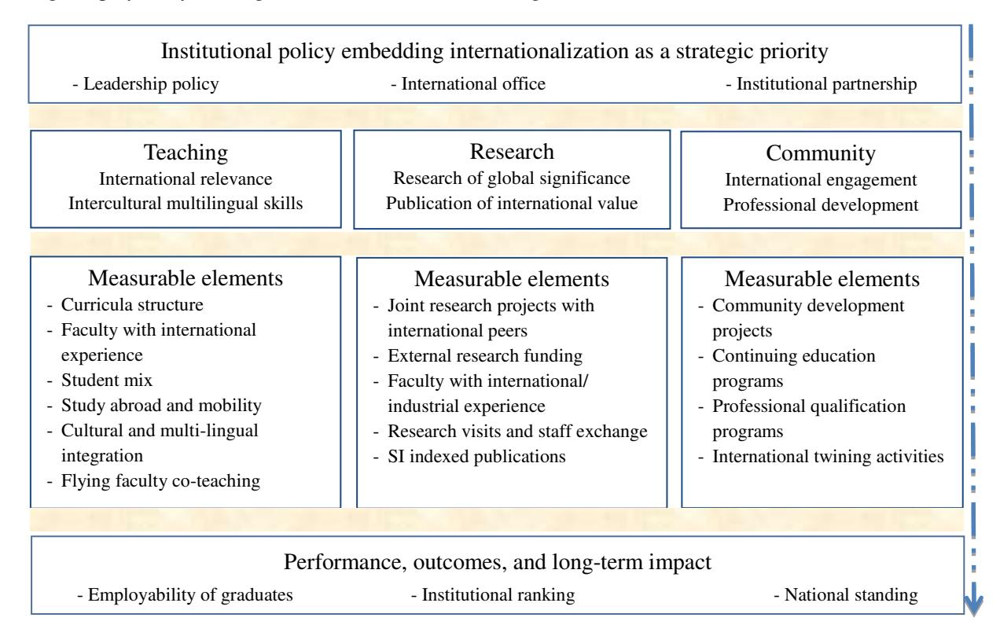

<!-- A2.R03 | source: papers_json/A2.R03/ -->

## Internationalization Context of Arabia Higher Education

Salem Al-Agtash1,2 & Labib Khadra^3^

Correspondence: Salem Al-Agtash, Santa Clara University, 500 El Camino Real, Santa Clara, CA 95053, USA. E-mail: alagtash@gmail.com

Received: March 13, 2019 Accepted: April 13, 2019 Online Published: April 17, 2019

doi:10.5430/ijhe.v8n2p68 URL: https://doi.org/10.5430/ijhe.v8n2p68

## **Abstract **

يتوسع التدويل في مجال التعليم العالي في المنطقة العربية بسرعة كبيرة. وقد اتخذ أشكالاً مختلفة دون وجود نهج منهجي لتقييم نجاحه وأثره. من خلال تحليل أنماط الحراك، والاتجاهات، وأشكال التعاون الأكاديمي في المنطقة العربية، يُقدَّم إطار عمل للتدويل. الغرض من ذلك هو توجيه الجهود نحو تعزيز مكانة التعليم العالي في البعد الدولي. يعزز التدويل فكرة جعل الجامعة بيئة تعليمية ديناميكية عابرة للحدود. يُحلَّل مجال التعليم العالي في المنطقة العربية بشكل أساسي من منظور التدويل. تُقدَّم الجامعة الألمانية الأردنية كمثال توضيحي. الهدف هو الاستفادة من تجربتها كمعيار مرجعي لوضع سيناريو عملي لتنفيذ التدويل كبعد مهم من أبعاد التعليم العالي. تُظهر النتائج أهمية الفوائد المستمدة من الدراسة في الخارج، والتعاون البرامجي، والشراكة، والتدريب العملي، والتعاون البحثي، بوصفها مكونات أساسية للتدويل في أنظمة التعليم العالي.

**Keywords:** Arabia higher education, internationalization context, German Jordanian University

## **1. Introduction **

أصبح التدويل توجهاً عالمياً في التعليم العالي. ويُعد محركاً رئيسياً لتعزيز حراك الطلاب والموظفين؛ وإدخال التعليم والتعلم عن بُعد؛ وتحفيز التعليم العابر للحدود؛ وزيادة التعاون الأكاديمي. كما يُنظر إلى التدويل كوسيلة لبناء نظام معايير دولية والحفاظ على جودة التعليم من أجل إعداد ملائم للمؤهلات التي تلبي متطلبات العولمة في أسواق العمل والاقتصادات والمجتمعات (Marjorie, 2000; Qiang, 2003). تشمل فوائده المباشرة اكتساب المعرفة، وتحسين المناهج الدراسية، والميزة الاقتصادية، وتنمية القوى العاملة. ونتيجة لهذا التوجه المتنامي، ظهرت تحديات جديدة. من بين التحديات السائدة نقص السياسات التعليمية الداعمة، وضعف كفاءة تربية التدريس والتعلم، ومحدودية تقديم التعليم الرقمي، وعدم التطابق بين الجودة الأكاديمية والاعتراف بها.

## *1.1 General Perspective of Internationalization *

حظي التدويل من منظور عام باهتمام كبير في أدبيات التعليم العالي. يرى Arabkheradmand et al. (2015) أن تدويل التعليم العالي يمثل قيداً أمام تحقيق النمو المنشود للمؤسسات التعليمية، والذي بدوره يؤدي إلى نمو الأفراد وتقدم المجتمعات البشرية. يقدم Altbach and Knight (2007) دوافع وحقائق التدويل في التعليم العالي، مع جهود على المستوى الدولي للاستفادة من فوائد التدويل. وخلصا إلى أن التدويل يظل قوة محورية في التعليم العالي، إذ يوفر وصولاً كبيراً في بعض الدول ويمثل سوقاً متخصصة في دول أخرى. يقدم Knight (2004) التدويل كعملية تتخذ أشكالاً مختلفة من دمج المنظورات الدولية والثقافية دون تحديد المبررات والفوائد والنتائج والأنشطة والفاعلين، إذ إنها تتفاوت بين الدول والمؤسسات. كما عُرِّف التدويل بأنه استجابة دولة ما لأثر العولمة (Qiang, 2003) أو تكيف تنظيمي من خلال عملية التخطيط والتنفيذ (Bartell, 2003). يصبح التدويل عملية لا مفر منها حتى وإن لم تدعمها الحكومات الوطنية (Knight, 2003; Van der Wende, 2007).

تتفاوت اتجاهات وقضايا وتحديات العولمة والتدويل، وقد عولجت بشكل شامل في سياق محلي وإقليمي باستخدام مجموعة واسعة من الطرق والمناهج (De Wit, 2011). يتناول Siaya (2003)

> ^1^ Department of Computer Science and Engineering, Santa Clara University, Santa Clara, CA, USA

> ^2^ Department of Computer Engineering, German Jordanian University, Amman, Jordan (On leave)

> ^3^ Department of Electrical Engineering, Al-Hussein Technical University, Amman, Jordan

<!-- page 2 -->

مبادرات التدويل القائمة على الحرم الجامعي، مع التركيز على الدراسة في الخارج، والدراسات الدولية، واللغة الأجنبية، ورعاية الطلاب. يستكشف Marginson (2006) ديناميكيات المنافسة في التعليم العالي على المستويين الوطني والعالمي. جرى التركيز على أهمية تنمية القدرة الوطنية للتعليم العالي لتعديل أوجه عدم التماثل العالمية والتحولات أحادية الاتجاه. يقدم Rizvi and Lingard (2009) السياسة التعليمية بشكل معولم، مع تركيز على تطوير مناهج نظرية ومنهجية في إعادة التفكير في التدويل محلياً وخارجياً. يقدم Maringe and Foskett (2010) نظرة عامة شاملة على العولمة والتدويل، مع بيان التحديات التي تواجه الجامعات العاملة في البيئة العالمية، وهي: هيمنة النماذج الغربية، وانتشار رؤى محدودة للتدويل، وعدم الاتساق في هياكل الجامعات، ونقص الاستراتيجيات والرؤى القيادية.

## *1.2 Trends of Internationalization in the Arab Region *

تُشكل المراجع أعلاه الخلفية العامة للتدويل التي يستند إليها التحليل المُجرى على أنظمة التعليم العالي العربية في الدول الأعضاء الاثنتين والعشرين في جامعة الدول العربية. يُنظر إلى منظور التدويل ضمن البعد الدولي والثقافي للتدريس والبحث وخدمة المجتمع (Knight, J. 2006). يُعد التدويل في التعليم في المنطقة العربية ظاهرة متنامية. وقد اعتُرف به كمصدر مهم للتنمية في ظل التوسع الهائل وتراجع مكانة قطاع التعليم العالي العربي. أفادت منظمة الأمم المتحدة للتربية والعلم والثقافة (اليونسكو، 2009) عن استمرار فشل التعليم العالي العربي في تلبية احتياجات الطلاب وأصحاب العمل والمجتمع بشكل عام. ولوحظ أن غالبية مؤسسات التعليم العالي العربية تفتقر إلى موارد بشرية ومادية أساسية للنجاح. تعاني هذه المؤسسات من الاكتظاظ وضعف جودة تقديم التعليم. أدى هذا بشكل أساسي إلى تخريج طلاب بمؤهلات لا تتطابق مع متطلبات سوق العمل. يشير Jaramillo (2011) إلى أن مؤسسات التعليم العالي العربية أقل انخراطاً دولياً بكثير مقارنة بالمؤسسات في قطاعات التعليم العالي الأكثر تطوراً.

لذلك، تتمثل الفرصة أمام مؤسسات التعليم العالي العربية في التوافق مع الأنظمة والاتجاهات التعليمية العالمية لتطوير القيم والمعايير الأكاديمية من خلال التدويل. سيوفر هذا وصولاً إلى موارد معترف بها دولياً، وشرعية، واعتماداً موثوقاً إلى حد ما. غير أن الاعتماد لا يعالج جودة تدويل مؤسسة ما، كما أن التدويل لا يقدم حلاً للعديد من المشكلات السائدة في أنظمة التعليم العالي.

## *1.3 Motivation and Framework *

للأسف، لا توجد حتى الآن أبحاث تتناول جهود وسياسات التدويل من منظور التعليم العالي العربي. هناك نقص في التحليل المستنير حول القضايا الرئيسية والاتجاهات والتوقعات المستقبلية. في الواقع، يركز معظم البحث والدراسات المتاحة على إصلاحات وسياسات وحوكمة التعليم العالي العربي ضمن إطار عام (Mazawi, 2006). وتنشأ هذه الدراسات بشكل أساسي بدافع من منظمات دولية وإقليمية مثل اليونسكو. تهدف هذه الورقة إلى المساهمة في توثيق ملامح ومنظورات التدويل في أنظمة التعليم العالي العربي. توجد أشكال متنوعة من التنفيذ، لكن لا توجد توجهات سياسية واضحة بشأن العناصر المحتملة للتدويل الفعال التي يمكن أن توجه الجهود نحو تعزيز مكانة التعليم العالي العربي في البعد الدولي.

استناداً إلى تحليل أنماط الحراك، واتجاهات التدويل، وأشكال التعاون الأكاديمي، يُقدَّم إطار عمل. يقدم هذا الإطار التدويل كنهج لتعزيز القيم والجودة الأكاديمية، وتشجيع الفهم الثقافي، وتعزيز الحراك، وخلق الشراكات. تُقدَّم الجامعة الألمانية الأردنية كمثال توضيحي لبناء حالة تُظهر كيف يمكن الاستفادة من التدويل، رغم محدوديته في هيكل جامعة ثنائية القومية، من قِبل مؤسسات أخرى، بناءً على مجموعة رئيسية من الأولويات، ومع الانتباه إلى الفرص والضرورات والعقبات والتحديات القائمة في المنطقة. تعزز نتائج هذا المثال الأفكار الشائعة حول مكونات النجاح كما تُقاس باستخدام مقاييس الحراك والشراكة في دراسة حالة لنهج التدويل.

## *1.4 Research Methodology *

تتضمن منهجية البحث تحليل الاتجاهات وجمع مصادر بيانات مختلفة حول تدويل التعليم العالي. يركز التحليل على تصور وضع أنظمة التعليم العالي العربية في ظل التباينات القائمة في المنطقة؛ وتحديد مخططات الحراك القائمة واتجاهات التدويل؛ وتقديم مثال ناجح نسبياً على التعاون الدولي. يُقاس النجاح بمقاييس عناصر التدويل الرئيسية.

تتكون المنهجية من ثلاث خطوات. في الخطوة الأولى، تُعرض بيانات من مصادر مختلفة، تشمل تقارير وعروضاً تقديمية من اتحاد الجامعات العربية، واليونسكو، وجامعة الدول العربية، ومواقع الجامعات الإلكترونية، والمؤتمرات، و

<!-- page 3 -->

المنتديات التعليمية. تُحلَّل عناصر البيانات ومؤشراتها لتصور وضع التعليم العالي العربي فيما يتعلق بعدد الطلاب، وأعضاء هيئة التدريس، والبرامج الأكاديمية، ومخططات الحراك، وعدم تطابق المؤهلات، والإنفاق على البحث، والتعاون. بناءً على هذه التحليلات، تُحدد عناصر التدويل. وأخيراً، تُستخدم البيانات الفعلية للجامعة الألمانية الأردنية كقيم مقاييس للتدويل. جرى الحصول على هذه القيم من خلال مزيج من المصادر الأرشيفية والملاحظات.

في الخطوة الثانية، تُستخدم عملية رسم خرائط لتقديم توضيح وصفي للعناصر والحقائق والاتجاهات. تُستخدم هذه التوضيحات لشرح وضع التعليم العالي العربي وظاهرة تدويله المتنامية. بناءً على هذه التفسيرات، يُطوَّر إطار عمل للتدويل.

في الخطوة الثالثة: تُحلَّل الجامعة الألمانية الأردنية وتُقدَّم كمثال عملي على التدويل باستخدام مكونات الإطار. كانت النتيجة سلسلة من مقاييس التقييم التي تُظهر عناصر نجاح مختلفة. تُظهر هذه المقاييس تدابير كمية فيما يتعلق بالتدويل، والحراك، ونقل المعرفة، وتنفيذ البرامج، والأداء الداخلي، والمكاسب على المستويين الاقتصادي الكلي والجزئي.

## **2. Higher Education in Arabia **

أفاد المكتب الإقليمي للدول العربية في برنامج الأمم المتحدة الإنمائي (UNDP, 2009) بأن نحو 60% من سكان الدول العربية تقل أعمارهم عن 25 عاماً. يضع هذا العدد الكبير من الشباب حدوداً على القدرة التعليمية ويخلق تحديات اقتصادية جديدة. وما لم تُقترن سياسات فعالة بإصلاحات تعليمية متسارعة وبتوسيع نطاق الابتكار، فمن غير المرجح أن تستوعب الدول العربية الطاقة الحيوية للشباب وتلبي طموحاتهم إلى مزيد من الفرص والإلهام. نعرض الوضع الحالي للتعليم العالي العربي من زوايا مختلفة، أبرزها: الإنفاق الحكومي، والتحاق الطلاب، والتدويل، والجهود الجارية للتحسين، والحاجة إلى فضاء مشترك للتعليم العالي. وبالنظر إلى الفوارق الثقافية والاقتصادية والتعليمية الهائلة، توجد تباينات إقليمية كبيرة عبر قطاع التعليم العالي العربي. فعلى سبيل المثال، لا تتسم الأبعاد السياسية والثقافية بالتجانس، ولذلك ستؤثر القيود والإمكانات الناتجة تأثيراً كبيراً على أبعاد الجودة وطبيعة هياكل التعليم العالي.

## *2.1 Government Spending *

تهيمن هياكل الجامعات الحكومية في المنطقة العربية. وتشكل أكثر من 65% من إجمالي عدد الجامعات. أظهرت التقارير والكلمات الرئيسية المتاحة المتعلقة بالتعليم العالي لدى جامعة الدول العربية (www.lasportal.org) واتحاد الجامعات العربية (www.aaru.edu.jo) أن الإنفاق الحكومي على التعليم العالي محدود. يبلغ إجمالي الإنفاق الإقليمي العربي نحو 5% من الإنفاق العالمي على التعليم العالي. وفي المقابل، يبلغ إنفاق الدول الصناعية نحو 60% من الإنفاق العالمي (Schwalje, 2010). والواقع أن متوسط الإنفاق لكل طالب سنوياً لا يتجاوز 5% من المبلغ المُنفق لكل طالب سنوياً في الدول الصناعية. أما بالنسبة للبحث والتطوير، فإن متوسط الإنفاق أقل بكثير من 0.5% من إجمالي الناتج المحلي، مقارنة بـ 2-3% من إجمالي الناتج المحلي في الدول الصناعية (ALECSO, 2010). ورغم أن الصورة العامة للتعليم العالي العربي ليست مبشرة، فهناك توجه متنامٍ نحو تطوير أنظمة تعليمية أفضل مع دمج تقنيات أكثر لمواكبة التطورات والاتجاهات الحديثة.

## *2.2 Student Enrollment *

بلغ عدد الطلاب الملتحقين في الدول العربية 20 مليون طالب في نحو 1000 مؤسسة عربية، أبرزها الجامعات وكليات المجتمع ومعاهد إعداد المعلمين (UNESCO, 2009; ALECSO, 2010). نحو 9 ملايين من هؤلاء الطلاب ملتحقون بالجامعات. من بينهم 10% ملتحقون بالدراسات العليا (8% ماجستير، 2% دكتوراه). يؤثر هذا الانخفاض في الالتحاق ببرامج الدكتوراه تأثيراً كبيراً على تقدم البحث والتطوير في المنطقة العربية.

كما أُفيد (UNESCO, 2009; ALECSO, 2010) بأن 80% من طلاب المرحلة الجامعية الأولى ملتحقون بتخصصات العلوم الإنسانية، وأن 20% فقط ملتحقون ببرامج علمية. يخلق هذا عدداً غير متناسب من الخريجين، معظمهم في العلوم الإنسانية وقليل جداً في العلوم والتكنولوجيا. وفي الوقت نفسه، فإن عدد الطلاب لكل عضو هيئة تدريس مرتفع بشكل كبير، إذ يصل في المتوسط إلى 71:1 في كليات إدارة الأعمال ونحو 15:1 في العلوم والتكنولوجيا. أما النسبة في الدول الصناعية فتبلغ نحو 5:1، مما يمثل فارقاً هائلاً.

حفز الارتفاع المستمر في عدد الطلاب القطاع الخاص على الاستثمار في التعليم العالي، مما أدى إلى ظهور أنواع جديدة من التعليم مثل الجامعات المفتوحة والافتراضية، والفروع الجامعية الدولية الخارجية، والجامعات الثنائية القومية. ستفتح هذه الفرص المجال لزيادة التدويل، ومن ثم الوصول إلى موارد مؤهلة واعتماد موثوق إلى حد ما.

<!-- page 4 -->

## *2.3 Mobility *

لم يحظَ بُعد الحراك باهتمام كبير في أنظمة التعليم العالي العربية. وقد اتسم بأنه حراك خارجي للدراسة في الخارج لنيل درجة كاملة، يُدعم بشكل أساسي من خلال التمويل الخاص والعام. أما الحراك الخارجي للدراسة القصيرة الأمد في الخارج فمحدود، ويُدعم بشكل أساسي من خلال برامج تمويل مثل إيراسموس موندوس. ويُشار إلى الحراك الوارد في المنطقة العربية من خلال اهتمام الطلاب بدراسة اللغة والثقافة والدين والتاريخ، بشكل أساسي من شرق آسيا وأمريكا الشمالية ومناطق أفريقيا.

أظهرت الإحصاءات المتاحة أن نحو 2.9% فقط في المتوسط من طلاب الجامعات العربية يأتون من دول عربية أخرى، و0.8% من دول غير عربية. يعطي هذا معدل حراك وارد إجمالياً (يشمل كلاً من الطلاب العرب والدوليين الدارسين للحصول على درجات كاملة في الجامعات العربية) بنسبة 3.7% (UNESCO, 2009). وبافتراض معدل ثابت للحراك الوارد خلال العقد الماضي، تمثل هذه النسبة 2.5% من الحراك الطلابي العالمي (Varghese, 2008). وفي المقابل، يُقدَّر الحراك الوارد في أمريكا الشمالية وأوروبا الغربية بنحو 65% من الحراك الطلابي العالمي. من الواضح أن القضايا وحالات عدم الاستقرار الأخيرة في المنطقة أثرت بشكل كبير على الحراك الوارد. لا يزال الحراك الوارد إلى الجامعات العربية يُعد منخفضاً جداً. وعلى النقيض من ذلك، فإن حراك الطلاب الخارج من الدول العربية مرتفع نسبياً. ووفقاً لـ Varghese (2008)، يُقدَّر الحراك الخارج من المنطقة العربية بنحو 7.2% من الحراك العالمي. تُظهر اليونسكو (2009) أن الحراك الخارج على مستوى الدراسات العليا يُقدَّر بـ 53%، بشكل أساسي في برامج الدكتوراه، منها 80% يتجه إلى أمريكا الشمالية وأوروبا الغربية (Varghese, 2008). وبالتالي، فإن التدفق يسير في اتجاه واحد إلى حد كبير، مما ينتج عنه نمط ثقافي أجنبي في السياق الإقليمي العربي.

## *2.4 Expansion and Innovation Efforts *

بشكل عام، لا يزال التعليم العالي العربي قيد التطوير. التحديات والقضايا هائلة، وتشمل قيوداً على التمويل، ومعايير جودة محلية، ونقصاً في التوجهات السياسية، وموارد تعليمية غير كافية. بذلت الحكومات العربية عدة جهود للتوسع والابتكار من أجل التحسين. تركز هذه الجهود على تكوين الشراكات؛ وإنشاء أنظمة دعم فعالة وضمان جودة؛ وزيادة الإنفاق على البحث.

فيما يتعلق ببُعد الشراكة، أُفيد بظهور توجه جديد للهياكل التعليمية، يستند بشكل أساسي إلى اتفاقيات تعاون مع جامعات أجنبية. أشار Rena (2010) إلى أن الإمارات العربية المتحدة، وقطر، والمملكة العربية السعودية، ومصر تبرز كأمثلة على دول عززت التدويل بجرأة من خلال استقطاب جامعات أجنبية مرموقة لإنشاء فروع محلية، بهدف توسيع الوصول للسكان الطلابيين المحليين والعمل كـ"محاور" للتعليم العالي في مناطقها.

في الإمارات العربية المتحدة، على سبيل المثال، أُنشئت مدينة دبي الأكاديمية الدولية - وهي منطقة تعليمية حرة - لاستضافة عدة جامعات غربية من المملكة المتحدة والولايات المتحدة وأستراليا والهند ودول أخرى عديدة (MEI, 2010). وتشكل إعداد مماثل في الشارقة - مدينة الشارقة الجامعية. وكان الهدف هو تطوير مجمع المواهب في المنطقة وترسيخ الإمارات كمحور اقتصادي قائم على المعرفة.

دمج التعليم في قطر نظاماً تعليمياً يضم معاهد وفروعاً متنوعة لجامعات رائدة، بما فيها جامعة فيرجينيا كومنولث، وجامعة تكساس إيه آند إم في قطر، وكلية وايل كورنيل الطبية في قطر، وجامعة جورجتاون، وجامعة كارنيجي ميلون. تتلقى المؤسسات المشاركة إعانات وحوافز كبيرة لجعل الدوحة مصدراً لنخب مدربة تدريباً عالياً في مهن عديدة (MEI, 2010).

في المملكة العربية السعودية، برزت جامعة الملك عبدالله للعلوم والتقنية كمثال مبتكر على الشراكة مع جامعات رائدة عالمياً لتطوير برامج درجات علمية وتقنية معترف بها على نطاق واسع. في مصر، تُعد الجامعة الأمريكية في القاهرة، والجامعة الألمانية، والجامعة البريطانية أمثلة على فروع جامعية مدوَّلة. في الأردن، وُقّعت اتفاقية مع Bundesministerium für Bildung und Forschung - BMBF (الوزارة الاتحادية الألمانية للتعليم والبحث) لإنشاء الجامعة الألمانية الأردنية، بهدف تعزيز التعليم التقني وحراك الطلاب. في تونس والبحرين، تشكلت أيضاً شراكات مع مؤسسات أجنبية لتطوير برامج قصيرة الأمد وكليات ذات توجه مهني.

أما بالنسبة لأنظمة الدعم، فتُعد البنى التحتية لتقنية المعلومات والاتصالات وأنظمة الجودة تطورات رئيسية في أنظمة التعليم العالي العربية. تلعب شبكات وأدوات وتطبيقات تقنية المعلومات ومستودعات المحتوى أدواراً مهمة في التحول الأكاديمي. لقد أحدث الإنترنت ثورة حقيقية في تربية التدريس والتعلم وكذلك في الوصول إلى موارد المعرفة. ويمثل فضاءً افتراضياً بارزاً للتعاون الأكاديمي، والبحث المشترك، والوصول إلى المجلات الإلكترونية، والعلوم الإلكترونية، والمناهج المفتوحة، ومرافق الحوسبة غير المتاحة محلياً. علاوة على ذلك، تمثل تقنية المعلومات مورداً محتملاً في تطوير أنظمة المعلومات الوطنية، وشبكات البحث والتعليم الوطنية، وبوابات الجامعات، والمكتبات الرقمية، وقواعد بيانات البحث، وتربية التعلم الإلكتروني. كما ساهمت في تطوير التعليم المفتوح وعن بُعد، مما سمح بظهور أنواع جديدة من المستودعات التعليمية، وموارد المناهج، والأدوات التربوية. ومع ذلك،

<!-- page 5 -->

فإن تحقيق الإمكانات الكاملة لتقنية المعلومات يستلزم تكاليف وصعوبات هائلة للحفاظ على أجهزة وبرمجيات محدَّثة، فضلاً عن دعمها الفني المستمر وتحديثاتها. لا تزال دول عربية مثل العراق وليبيا واليمن وجيبوتي وجزر القمر والصومال تعاني من نقص نسبي في خدمات وموارد تقنية المعلومات.

فيما يتعلق بدعم أنظمة الجودة، أنشأت خمس عشرة دولة عربية (Lamine, 2010) إما لجاناً وطنية لضمان الجودة والاعتماد، أو حفزت تطوير برامج ضمان الجودة ومشاريع بناء القدرات للارتقاء بجودة أنظمة التعليم العالي الوطنية لديها. ولوحظ أن التركيز على الجودة لا يزال موجهاً نحو اعتماد الجامعات الخاصة دون إنجازات ملموسة وتطبيقات تشريعية راسخة. سيظل ضمان الجودة أولوية عالية في ظل عولمة التعليم العالي وتزايد التحاق الطلاب بالمؤسسات الخاصة.

فيما يتعلق بالإنفاق على البحث، تقتصر الجهود على التوجهات السياسية على المستويين الإقليمي والوطني. يقدم Badran (2005) وضعاً متدهوراً للبحث والتطوير في المنطقة العربية، يُعزى بشكل كبير إلى نقص التمويل، والاهتمام السياسي، والبيئات الداعمة. يُقدَّر الإنفاق على البحث في أفضل الأحوال بعُشر ما يُنفَق في الدول الصناعية. يمكن للقطاع الخاص أن يلعب دوراً مهماً من خلال أماكن تعاون تُنشأ لنقل المعرفة والتكنولوجيا والخبرة الأجنبية. أطلقت حكومات في الإمارات العربية المتحدة والأردن والمملكة العربية السعودية وعُمان، على سبيل المثال، مبادرات بحثية، تشمل هيئات البحث العلمي، ومراكز التميز، والمجالس العلمية، ومجمعات الأعمال والتكنولوجيا، والحاضنات (Lamine, 2010). يمكن توحيد هذه المبادرات على المستوى الإقليمي لتحفيز البحث التعاوني الذي يعالج مشكلات ملحة مشتركة في المنطقة.

## *2.5 Common Space of Higher Education *

طورت مناطق مثل أوروبا وأمريكا اللاتينية فضاءات مشتركة منظمة للتعليم العالي. عملت هذه الفضاءات كأدوات لمواءمة الأنظمة التعليمية، وتسهيل التعاون الأكاديمي، وإنتاج قوى عاملة ماهرة ومتوافقة لأسواق العمل الإقليمية والعالمية. في المنطقة العربية، هناك حاجة ملحة إلى فضاء عربي للتعليم العالي لتعزيز الانسجام الإقليمي بين مؤسسات التعليم العالي. ما هو قائم اليوم هو اتفاقية اليونسكو للاعتراف بالمؤهلات، التي وقّعتها 14 دولة عربية في عام 1978. لا تُعد هذه الاتفاقية كافية عندما يتعلق الأمر بقضايا التوافق بين أنظمة تقديم التعليم، وكذلك بحراك وقابلية توظيف ملايين الطلاب.

اليوم، أصبح التعليم العالي قطاعاً ذا منظور إقليمي لدعم التنمية الاجتماعية والاقتصادية، بدلاً من أن يكون قطاعاً محصوراً بالحدود الوطنية. مع وجود فضاء تعليمي مشترك، هناك فرصة محتملة للمساعدة في تسهيل الحراك، والاعتراف، ونقل الساعات المعتمدة، والجودة، فضلاً عن تعزيز الانسجام بين أنظمة التعليم العالي العربية. والأهم من ذلك، أن الطلاب سيمتلكون خيارات أكثر من حيث التكلفة والجودة، وسيؤسس أعضاء هيئة التدريس تعاوناً أوثق في البحث.

غير أن التحديات المحددة التي تواجه المنطقة في هذا الشأن هائلة. وتشمل عدم قابلية مقارنة المناهج الدراسية، والتنوع في هياكل البرامج والمؤهلات (أساس السنوات مقابل الساعات المعتمدة)، وحاجز اللغة والتواصل (الفرنسية مقابل الإنجليزية كوسيلة تدريس، خاصة في البرامج العلمية)، ونقص التوجهات السياسية والوعي. هناك حاجة إلى حالة من الاستعداد على المستوى الكلي، بحيث يتفق صناع السياسة على المبادئ الرئيسية لفضاء مشترك. ومع وجود فوارق واسعة في هياكل أنظمة التعليم العالي العربية، يظل إنشاء مثل هذا الفضاء مهمة صعبة. ومن المرجح جداً أن يُحفَّز فضاء مشترك أولي على أساس المؤهلات متعددة الجنسيات، والدراسة الفصلية بين الجامعات في الخارج، والتعاون البحثي الإقليمي المدفوع بآليات التمويل وتطوير السياسات.

## *2.6 Opportunities** *

استُلهم التدويل في المنطقة العربية من خلال تقديم دورات قصيرة الأمد للطلاب الأجانب، وغالباً درجات كاملة في الدراسات الإسلامية واللغة العربية. وفي المقابل، دفعت الحكومات في أوروبا التدويل من خلال توفير التمويل لتحفيز حراك الطلاب وأعضاء هيئة التدريس. في أمريكا الشمالية، كانت الجامعات جذابة للعديد من الطلاب والباحثين الدوليين. بشكل عام، يُنظر إلى حراك الطلاب وأعضاء هيئة التدريس على أنه يساهم في تطوير التعاون الدولي والتواصل، ويمثل مصدراً للتغيير في اندماج المجتمع.

يجلب التدويل فوائد محتملة وتجارب أكاديمية وثقافية قيّمة ومتنوعة. فهو يساعد على تقريب المؤسسات من بعضها البعض، مما يمكن من خلاله تحسين جودة التعليم، وتعزيز الابتكار، ونشر أفضل الممارسات في التعلم والتدريس، وتعزيز قابلية توظيف الطلاب في سوق العمل الدولي. كما يُنظر إليه كخيار استراتيجي للعديد من المؤسسات العربية، مما يدفعها إلى استخدام شبكات الحراك الغربية القائمة بشكل مكثف. تشمل أمثلة الشبكات في أوروبا إيراسموس موندوس، وتمبوس، وبرامج الإطار العام. في الولايات المتحدة، تشمل شبكات الحراك برنامج تبادل CIEE، وبرامج تبادل الطلاب الدوليين، والسنة الأكاديمية في أمريكا، وبرنامج فولبرايت للتبادل التعليمي الدولي، وبرنامج زمالة هيوبرت همفري. غير أن هذه الشبكات محدودة، وتنافسية للغاية، ومتاحة للمجتمعات

<!-- page 6 -->

العالمية. لا تزال السياسات التعليمية العربية تفتقر إلى عنصر التدويل والعولمة، ولذلك تتوفر شبكات حراك قليلة جداً على المستوى الإقليمي العربي. يُعد صندوق سفر لحراك الشباب مثالاً على ذلك. تستند أشكال أخرى من الحراك إلى اتفاقيات تبادل ثنائية تُموِّلها وزارات الخارجية من خلال برامج المنح الدراسية للطلاب الأجانب.

## **3. Internationalization Framework **

يتأثر قياس النجاح في التدويل بالمعايير المستخدمة في العمليات الأساسية للجامعة، أي التدريس والبحث والمشاركة المجتمعية (Coelen, 2009). يُعد تدويل التدريس أمراً حيوياً عندما يشكل أولوية استراتيجية للجامعة لاستقطاب الطلاب الدوليين، وتحفيز الحراك، وإعداد الخريجين لسوق العمل العالمي. يمثل هذا تحدياً كبيراً، إذ يتطلب من الجامعة جعل التدريس ذا صلة دولية، فضلاً عن إعداد الطلاب كمواطنين عالميين مزودين بمهارات ثقافية ولغوية متعددة. من منظور بحثي، يُحقق التدويل من خلال الوصول إلى التمويل البحثي العالمي، ومشاركة أعضاء هيئة التدريس في مشاريع بحثية ومجتمعات تعالج قضايا ومشكلات ذات أهمية عالمية، ونشر النتائج في مجلات ووقائع مؤتمرات مفهرسة عالمياً. وأخيراً، تُعد المشاركة المجتمعية عملية أساسية أخرى يمكن تدويلها. يمكن تحقيق ذلك من خلال المقارنة والتوأمة بين المجتمعات عبر دول مختلفة، وكذلك إشراك المنظمات الدولية والشركات في الخدمات المجتمعية فيما يتعلق بالتعليم المستمر والتطوير المهني.

يتفاوت البعد الدولي في هذه العمليات الأساسية بشكل كبير، وقد يؤدي إلى تفسيرات مختلفة للامتثال للتدويل. لذلك، هناك حاجة إلى إطار عمل لتحديد العناصر الأساسية للتدويل، والتي يمكن أن تعمل كمعايير مرجعية عفوية. يقدم الشكل 1 الإطار المقترح الذي يتميز بثلاث طبقات رئيسية. تمثل الطبقة العليا استراتيجية التدويل المؤسسية المنفذة من خلال سياسة القيادة، وتطوير الشراكات المؤسسية، وتشكيل مكتب دولي فعال. تقدم الطبقة الوسطى عناصر قابلة للقياس لكل عملية أساسية من عمليات الجامعة، وهي: التدريس، والبحث، والمشاركة المجتمعية. وأخيراً، تحدد الطبقة السفلية الأداء المتوقع والنتائج والأثر طويل الأمد، الذي يتميز بقابلية التوظيف، والترتيب، والمكانة الاقتصادية الوطنية.

*Figure 1. Internationalization framework*

يُعد هذا الإطار أداة فعالة في توصيف جهود التدويل. المقاييس رقمية ووصفية في آن واحد، ويمكن أن تُصور قيمة التدويل ضمن إطار زمني متواصل. نقدم الجامعة

<!-- page 7 -->

الألمانية الأردنية كمثال توضيحي للعرض. تجدر الإشارة إلى أن المؤسسات قد تمتلك مجموعة مختلفة من العناصر المخصصة ومقاييس التقييم بناءً على أهدافها الخاصة. في الأقسام الفرعية التالية، نقدم تفاصيل حول العناصر الأساسية للإطار وتوصيفها والمقاييس ذات الصلة.

## *3.1 Institutional *

على المستوى المؤسسي، يُعد التدويل سياسة تتصورها وتنفذها قيادة الجامعة. وينعكس ذلك في تنفيذ الاستراتيجية ويترسخ مؤسسياً من خلال اتفاقيات التعاون وإنشاء مكتب دولي. يقترح Brandenburg and Federkeil (2007) عملية ومنهجية للتدويل تشمل تحديد الأهداف، وتطوير الاستراتيجية، وصياغة خطة تنفيذ، وتدابير، ونظام جودة.

يُعد أحد المؤشرات الرئيسية لمدى جدية التعامل مع التدويل في المؤسسة تفعيل اتفاقيات الشراكة/التعاون مع جامعات نظيرة في الخارج. تتخذ الشراكة أشكالاً مختلفة وتعزز التعاون في تنفيذ مشاريع بحثية مشتركة وتطوير برامج درجات تعاونية. من منظور البحث المشترك، يعمل أعضاء هيئة التدريس من جامعات مختلفة معاً من خلال مخططات تمويل مختلفة على مشكلات بحثية ذات أهمية عالمية. من منظور البرامج، تقدم الجامعات المتعاونة درجات علمية في شكل برنامج تقليدي أو إلكتروني/مدمج. أحد الأهداف هو إتاحة برامج درجات معولمة بمكونات تعزز الفهم بين الثقافات، وفي الوقت نفسه تركز على مهارات لسوق العمل العالمي.

تتعاون بعض الجامعات لتقديم برامج ما دون الدرجة، أو الدرجة، أو الدراسات العليا المصممة في هيكل توأمة، أو ترخيص (فرانشايز)، أو منح درجة مشتركة/مزدوجة. في اتفاقية الترخيص، على سبيل المثال، تُخوَّل جامعة من قِبل جامعة أجنبية بتقديم دورات أو برامج في بلدها الخاص بمؤهلات الجامعة الأجنبية. في هذه الحالة، تُتخذ ترتيبات التدريس والتقييم ومنح الدرجة أو الساعات المعتمدة وفقاً للوائح الوطنية للجامعة المضيفة. في هيكل التوأمة، يأخذ الطلاب دورات لساعات معتمدة في جامعة أجنبية. وما لم تُتخذ ترتيبات لدرجة مشتركة أو مزدوجة، يحصل الطلاب على درجتهم من مؤسستهم الأم. أما في هيكل الدرجة المشتركة أو المزدوجة، فيحصل الطلاب على درجاتهم من كل من المؤسسة المضيفة والمؤسسة الأجنبية.

في قياس العنصر المؤسسي الأساسي للتدويل، يمكن استخدام عدة مقاييس. كما هو موضح في الجدول 1، نقترح مقاييس متعلقة بالسياسة المؤسسية، واتفاقيات وهيكل التعاون، وإنشاء المكتب الدولي، وقيمة الاندماج الثقافي.

*Table 1. Metrics of institutional core element of internationalization*

## No. Description

- 1. تقييم بيان السياسة المؤسسية الذي يحدد الرؤية والرسالة والأهداف والتوجهات والتطبيقات الاستراتيجية ذات الصلة
- 2. تقييم عدد وهيكل ونطاق اتفاقيات التعاون/الشراكة مع المؤسسات النظيرة في الخارج
- 3. تقييم الهيكل التنظيمي، وإجراءات التشغيل، وفعالية إنشاء مكتب وطني لتنسيق جميع أنشطة التدويل ذات الصلة
- 4. تقييم قيمة الاندماج الثقافي في العمليات الأساسية للمؤسسة، بما يشمل المهارات متعددة اللغات، والوعي، والتسامح

## *3.2 Teaching *

يتخذ تدويل التدريس أشكالاً مختلفة، تشمل تصميم المناهج الدراسية، والتحاق الطلاب الدوليين، والدراسة/التدريب في الخارج، والبعد الثقافي، وتوظيف أعضاء هيئة تدريس أجانب. في هذه الأشكال، يكون الفاعلون هم الطلاب، وأعضاء هيئة التدريس، والباحثون، والخبراء، والمهنيون. في تصميم المناهج، تعمل الجامعات المتعاونة معاً لتطوير مناهج ذات صلة دولية بمعايير متوافقة مع أطر المؤهلات الوطنية والدولية. تُحدَّد الساعات المعتمدة، والدورات، والمقررات، ومخرجات التعلم، والهياكل التربوية بشكل مشترك. من المهم أيضاً دمج الكفاءات اللغوية والثقافية في عملية التعلم، والتي يمكن تنفيذها بمجموعة متنوعة من الطرق. مع مناهج متوافقة ومكونات ثقافية/متعددة اللغات، يمكن للجامعات استقطاب الطلاب الدوليين بسهولة.

في الدراسة في الخارج، يميل الطلاب إلى قضاء فصل دراسي أو سنة في الخارج كجزء من درجتهم، أو الالتحاق ببرنامج درجة مشتركة/مزدوجة في جامعة في بلد أجنبي. يمثل هذا حالياً أكبر شكل من أشكال التدويل، وهو في تزايد مستمر. غير أن هناك العديد من المخاوف والقضايا القائمة، تشمل التمويل، وحواجز اللغة، ونقل الساعات المعتمدة. يعزز التدريب العملي أو الميداني في بلد أجنبي الحراك، ويقوي التجارب العملية والثقافية المشتركة. في بعض برامج الدرجات التقنية، يُعد التدريب العملي شرطاً للتخرج، وغالباً ما يُطلب في بلد

<!-- page 8 -->

أجنبي، مما يضيف بعداً ثقافياً آخر. في بعض الحالات، يساهم التدريب العملي في تعزيز توظيف الخريجين في الخارج، مما قد يؤثر على نقل المعرفة، لكنه قد يؤدي إلى أثر عكسي فيما يتعلق بظاهرة "هجرة العقول".

تساهم المؤسسات في تدويل التدريس ببُعد آخر من خلال فتح فروع جامعية في بلد أجنبي، مع نزعة في بعض الحالات نحو الاندماج والاستحواذ. في هذه الحالة، تنشئ جامعة حرمها الخاص في بلد أجنبي لتقديم دورة أو برنامج للطلاب في بلدهم الأم. تميل بعض الجامعات الأجنبية والشركات الخاصة إلى إنشاء جامعة افتراضية أو مؤسسية مستقلة قائمة بذاتها. تُعد جامعة أوراكل مثالاً على جامعة افتراضية مستقلة، تقدم شهادات ودورات خاصة بالبائعين. جامعة طلال أبوغزاله هي جامعة افتراضية تقوم على شراكات أكاديمية مع جامعات رائدة عالمياً. وتقدم دورات لساعات معتمدة وبرامج درجات كاملة للطلاب في دول مختلفة من خلال التعليم الإلكتروني. الجامعات الافتراضية والتعليم الإلكتروني صغيران نسبياً، لكن يُنظر إليهما على أنهما يحملان إمكانات كبيرة في المستقبل. ستظل جودة التدريس والتقديم مصدر قلق رئيسي. يجلب التعاون الكبير قيمة من خلال تدريس أعضاء هيئة تدريس أجانب وتكليفات التدريس المشترك، فضلاً عن الزيارات القصيرة الأمد والتعيينات طويلة الأمد.

تتعلق المقاييس المستخدمة لقياس التدريس كعنصر أساسي للتدويل بهيكل المناهج، والدراسة في الخارج، والتدريب العملي في الخارج، والطلاب الدوليين، وتبادل الموظفين، والممارسات الثقافية ومتعددة اللغات، ومشاركة وتوظيف أعضاء هيئة التدريس الأجانب. يقدم الجدول 2 تفاصيل المقاييس ذات الأهمية فيما يخص التدريس.

*Table 2. Metrics of teaching as a core element of internationalization*

## No. Description

- 5. تقييم العملية التي تُطوَّر من خلالها المناهج الدراسية، مع التركيز على الامتثال لمتطلبات أطر المؤهلات الوطنية والدولية؛ ومقررات تغطي مخرجات تعلم ذات أهمية دولية؛ ونهج تربوي يشدد على المهارات اللغوية ومتعددة الثقافات
- 6. تقييم العملية التي يُستقطب من خلالها الطلاب الدوليون، وكذلك قياس تركيبة الطلاب ونسبتهم
- 7. تقييم الهيكل التنظيمي، وإجراءات التشغيل، وفعالية المكتب الدولي في تنسيقه لجميع أنشطة التدويل ذات الصلة عبر المؤسسات
- 8. تقييم قيمة الاندماج الثقافي في العمليات الأساسية للمؤسسة، بما يشمل المهارات متعددة اللغات، والوعي، والتسامح، وكذلك الأنشطة اللامنهجية التي ترعى هذه المهارات
- 9. تقييم نسبة أعضاء هيئة التدريس ذوي الخبرة الدولية، وكذلك مشاركة أعضاء هيئة التدريس الأجانب في التدريس
- 10. تقييم ملف أنشطة أعضاء هيئة التدريس المشاركين في زيارات تدريس قصيرة الأمد، وكذلك مشاركة أعضاء هيئة التدريس المتنقلين في التدريس المشترك

## *3.3 Research *

تُعد المشاريع المشتركة ذات الأهمية الدولية، والعمل الميداني والبحثي، والإجازات التفرغية في الخارج، والزيارات القصيرة الأمد عوامل مهمة تساهم في تعزيز البعد الدولي للبحث. غالباً ما يحصل الباحثون على منح لقضاء فترة قصيرة الأمد في مؤسسات أجنبية لمتابعة البحث في تخصصات أكاديمية محددة. تُمنح المنح لمشاريع بحثية محددة، أو أستاذيات زائرة، أو أنشطة تدريب في الصناعة.

يمكن أن تشمل أنشطة بحثية إضافية التمويل والمشاركة في مجتمعات بحثية تعمل على مشكلات وقضايا ذات طابع عالمي. من المهم أيضاً تحديد واستقطاب أعضاء هيئة تدريس ذوي خبرة دولية وصناعية للمساهمة في ملف البحث وتطوير برامج دراسات عليا مشتركة على مستوى الدكتوراه. ستساهم الأنشطة البحثية بالتأكيد في نشر أبحاث ذات قيمة مفهرسة في تومسون.

توجد عدة برامج بحثية من هذا النوع حول العالم، تشمل DAAD الألمانية، وفولبرايت والمؤسسة الوطنية للعلوم في الولايات المتحدة، وبرامج التبادل والإطار الأوروبية. تميل البرامج البحثية في الجامعات العربية إلى إشراك أستاذيات زائرة للتفرغ العلمي، وتقتصر على التعاون مع مؤسسات في أوروبا والولايات المتحدة ودول متقدمة أخرى. يتعاون أعضاء هيئة التدريس والموظفون والباحثون مع نظرائهم في مؤسسة أجنبية بشكل أساسي في مشاريع أكاديمية مدعومة ببرامج حراك خاصة مثل إيراسموس الأوروبي، وماري كوري، وهومبولت الألمانية. يمكن أن تشمل المشاريع الأكاديمية البحث المشترك، وبناء القدرات، ومشاريع تعليمية أخرى.

<!-- page 9 -->

تُعرض في الجدول 3 المقاييس التي نستخدمها للبعد البحثي للتدويل، مع التركيز بشكل أساسي على المشاريع البحثية ذات الأهمية الدولية، والتمويل الخارجي، وأعضاء هيئة التدريس ذوي الخبرة الدولية، والزيارات البحثية، والمنشورات.

*Table 3. Metrics of research element in internationalization*

## No. Description 11. تقييم ملف البحث لأعضاء هيئة التدريس وأهمية المشاريع والمشاركة في مشكلات بحثية مع شركاء تعاون دوليين 12. تقييم أهمية وعدد المشاريع البحثية الممولة دولياً والمشاركة الفعالة لأعضاء هيئة التدريس 13. تقييم العملية التي تستقطب من خلالها الجامعة أعضاء هيئة تدريس ذوي ملف وخبرة بحثية دولية قوية 14. تقييم دعم الجامعة ومشاركة أعضاء هيئة التدريس في الزيارات البحثية وأنشطة تبادل الموظفين 15. تقييم ملف النشر وعدد المنشورات المفهرسة SI لكل باحث وعدد الاستشهادات الدولية 16. تقييم برامج الدراسة على مستويي المرحلة الجامعية الأولى والدراسات العليا التي تدعم الأنشطة البحثية ومشاركة الطلاب في مشاريع ورسائل موجهة نحو البحث

## *3.4 Community Engagement *

تُعد المشاركة المجتمعية عملية أساسية أخرى يمكن تدويلها. يمكن تحقيق ذلك من خلال دعم التنمية المجتمعية من منظورات مختلفة. تشمل هذه المشاريع التي تستهدف القضايا المجتمعية، والتعليم المستمر الذي يعالج التطوير المهني، وخدمات الدعم التي تعزز الوصول إلى موارد المعرفة.

تُعرض في الجدول 3 المقاييس التي نستخدمها لبُعد المشاركة المجتمعية للتدويل، مع التركيز بشكل أساسي على مشاريع التنمية، والتعليم المستمر، والشراكات من أجل المؤهلات المهنية، والأنشطة المجتمعية التي تدعم الاندماج الثقافي وأنشطة التوأمة حول العالم.

## **4. Illustrative Example **

تُقدَّم الجامعة الألمانية الأردنية (GJU) كمثال توضيحي على التدويل. وتُظهر مدى ونجاح الحراك والتعاون في سياق تدويل دولة عربية. تحاكي GJU نموذج الجامعات الألمانية للعلوم التطبيقية، التي تتميز بتركيزها على تطبيق المعرفة عملياً وتعزيز نقل المعرفة. وهي أكبر مشروع تعليمي لـ DAAD، بدعم تمويلي مستمر منذ إنشائها. كانت إنجازات GJU ملحوظة على المستويين الوطني والإقليمي، من خلال إنشاء مجتمع تميز نابض بالحياة.

أرست GJU روابط أوثق مع العديد من الجامعات في ألمانيا وجامعات أخرى في فنلندا والنمسا والسويد. يُعتمد التدويل كسياسة أساسية، مع تعيين نائب رئيس ألماني للعلاقات الدولية. أُنشئ مكتب دولي لتنسيق دراسة الطلاب وتدريبهم العملي في الخارج، وكذلك تبادل الطلاب والموظفين وأعضاء هيئة التدريس. نُوضح الجوانب الرئيسية لتدويل GJU فيما يتعلق بالشراكة المؤسسية؛ وتصميم المناهج؛ ودراسة الطلاب في الخارج؛ وتبادل الموظفين؛ والتعاون البحثي؛ والمشاركة المجتمعية. ترتبط هذه الجوانب فيما بينها وتساهم بشكل كبير في GJU فيما يتعلق بالأهمية الدولية في التدريس، والقيمة الدولية للبحث، والمشاركة الدولية في التنمية المجتمعية.

<!-- page 10 -->

## *4.1 Institutional Partnership *

نمت GJU حجماً ومكانةً على مدى السنوات الماضية. بلغ متوسط نمو أعداد الطلاب سنوياً 37%، ليصل إلى 3960 طالباً في عام 2015. نحو 20% من الطلاب يأتون من الدول المجاورة وأوروبا. تمتلك GJU بُعداً ألمانياً شاملاً في تدريسها وعملياتها ووظائفها. يُطلب من جميع طلاب GJU اجتياز 6 دورات مكثفة في اللغة الألمانية، ويُطلب منهم الدراسة لمدة سنة كاملة في ألمانيا. ولتسهيل تدريس اللغة الألمانية وحراك الطلاب، توظف GJU مدرسين ألمان، وتشارك في عدة اتفاقيات تعاون مع أكثر من 100 جامعة و20 شركة صناعية في ألمانيا. تمتلك GJU مجتمعات متعددة الثقافات قوية ومنفتحة على الحوار بين مختلف الهويات العرقية والدينية والاجتماعية. يدرس أكثر من 70 طالباً أجنبياً، معظمهم من ألمانيا، فصلاً دراسياً في GJU كل عام. علاوة على ذلك، نُظمت عدة مدارس صيفية بمشاركة أكثر من 60 طالباً من أوروبا يدرسون دورات في المجالات التقنية والاجتماعية مع طلاب من الأردن. ساهمت الدراسة في الخارج والمدارس الصيفية بشكل كبير في تحقيق حقيقي لاستراتيجية تدويل GJU، وأثرت على تحسين الوعي الثقافي بين الشرق والغرب.

## *4.2 Compatible Curricula Design *

تُصمَّم برامج ومناهج GJU وتُحدَّث باستمرار من قِبل أعضاء الشبكة ذوي الصلة، الذين يمثلون أساتذة من GJU والجامعات الألمانية الشريكة. تتكون المناهج من دورات بساعات معتمدة متوافقة، وتوصيف مشترك لمخرجات التعلم، ومؤهلات قابلة للمقارنة. عملت هذه المناهج كأطر لترتيبات الدرجات المزدوجة والمشتركة في عدد من برامج الدرجات في الجامعة. تشجع مناهج البرامج المقدمة في GJU التطور الشخصي، وتسهل على الطلاب استكشاف الأنشطة الريادية ومتابعتها أثناء وجودهم في الحرم الجامعي. أنشأت الجامعة، بالتعاون مع القطاع الخاص، أنواعاً متعددة من التدريب العملي خلال السنة الأولى، لمساعدة الطلاب على اكتساب مزيد من الخبرة الواقعية، وطورت دورات وورش عمل قصيرة اختيارية لمساعدة الطلاب على تحسين مهارات القيادة، وإدارة المشاريع، والكتابة، والتواصل.

يتجه معظم التركيز في طرق التدريس في GJU نحو نهج متمحور حول الطالب/المتعلم، موروث من نظام ECTS (النظام الأوروبي لنقل وتجميع الساعات المعتمدة). ورغم أن GJU تطبق نظام الساعات المعتمدة الأمريكي كما تشترط وزارة التعليم العالي، فقد ظلت هناك بعض المرونة في الاعتراف بنقل الساعات المعتمدة وفق ECTS من الجامعات الشريكة الأوروبية. اعتُمد نظام للمعادلة، انعكس في اتفاقية تعلم مع كل طالب. علاوة على ذلك، اعتمدت الدورات المقدمة في GJU هيكل مقررات بمخرجات تعلم محددة نتيجة توحيد المناهج.

في حالات عديدة، وقّعت GJU والجامعات الشريكة إطاراً ثنائياً للتعاون في تبادل الطلاب. يوفر هذا الإطار آلية لتوزيع الطلاب في المؤسسات المضيفة. كان الحراك جزءاً من نظام نقل الساعات المعتمدة بين الجامعات كما ينعكس في اتفاقيات تعلم الطلاب. طورت GJU من خلال تجربتها نظام نقل بين نظام الساعات المعتمدة الأردني (الموروث من النظام الأمريكي) ونظام ECTS الأوروبي.

## *4.3 Study Abroad *

تُعد سنة كاملة في مؤسسة ألمانية جزءاً من متطلبات التخرج. تستضيف الجامعات الألمانية طلاب GJU لفصل دراسي أكاديمي واحد، وتنظم تدريباً عملياً في الصناعة مدته 6 أشهر في ألمانيا. يُعرِّض هذا الطلاب لمجموعة واسعة من الباحثين والعلماء والممارسين من جامعات وصناعات أجنبية. هذا المكوّن السنوي فريد لـ GJU وعامل تمييز رئيسي. يمنح طلاب GJU تجربة مميزة من حيث الديناميكية في اختيار مجال تركيز للدراسة في جامعة شريكة، وفي التدريب العملي في صناعة ألمانية.

ينمو عدد الطلاب الذين ذهبوا للدراسة الإلزامية لمدة سنة في ألمانيا بمعدل نحو 60%، ليصل إلى 570 طالباً في عام 2015. تتفاوت تجارب الطلاب في ألمانيا، وكانت واعدة جداً في اكتساب معرفة ومهارات جديدة. يلتحق الطلاب بنحو 20 ساعة معتمدة وفق ECTS في جامعة ألمانية شريكة، حيث يكون التدريس باللغة الألمانية بالكامل. أظهرت النتائج أن الطلاب أدوا بشكل جيد في الدورات التي يأخذونها في ألمانيا. أكثر من 70% من الطلاب ينجحون في جميع الدورات. كانت تجارب التدريب العملي مجزية جداً للطلاب. أفاد الطلاب باكتساب معرفة ومهارات ومؤهلات وعادات عمل جديدة مهمة لسوق العمل المحلي. تشير تقارير التغذية الراجعة للتدريب العملي التي جُمعت إلى إجماع عام على المستوى العالي لمؤهلات GJU وطبيعتها التخصصية بالنسبة للطلاب. أشارت سجلات خريجي GJU إلى أن نحو 90% من الخريجين تم توظيفهم في شركات محلية وإقليمية ودولية. تُظهر الإحصاءات أن 30% من طلاب GJU يعملون في ألمانيا بعد تخرجهم، مما ينتج عنه قضية هجرة عقول في السياق الأوسع. عادةً ما تُعتبر هجرة العقول تكلفة اقتصادية، إذ تؤدي إلى استنزاف الأفراد المهرة إذا اختار الخريجون البقاء في ألمانيا على المدى الطويل. ويمكن القول أيضاً إن هؤلاء الطلاب سيساعدون في بناء اقتصادات أفضل من خلال نقل المعرفة إلى بلدهم الأم.

<!-- page 11 -->

في بعض الترتيبات، تُقدَّم دورات صيفية مكثفة بشكل مشترك لطلاب من جامعات في الأردن وأوروبا. في المتوسط، يدرس 35 طالباً من جامعات ألمانية في GJU لفصل دراسي. يُشكل الطلاب فرقاً للعمل على الواجبات والمشاريع، ويؤسسون صداقات جيدة جداً كعلامة على الفهم الثقافي الإيجابي. تكون تعليقات الطلاب الشخصية في معظمها متحمسة. حتى إن بعض الطلاب الأوروبيين بدأوا في تعلم اللغة العربية. يمكن أن يكون تنظيم المدارس الصيفية استراتيجية فعالة لتحفيز الطلاب الأوروبيين على الدراسة عبر التبادل في GJU. أحد العوامل الأساسية لحماس الطلاب الألمان كان اندماجهم بسهولة مع طلاب GJU. خلق التوجه القوي لهذه الجامعة الأردنية نحو ألمانيا وأوروبا مناخاً شعر فيه الطلاب الألمان بترحيب كبير.

## *4.4 Staff Exchange *

تحافظ GJU من خلال الشبكات ذات الصلة على تدفق مستمر لأعضاء هيئة التدريس والموظفين الألمان للتدريس المشترك والتعاون البحثي. من خلال تكليفات التدريس المشترك وتبادل الطلاب، أصبح بناء القدرات ونقل المهارات أمراً متأصلاً. والواقع أن جزءاً كبيراً من تصميم الدورات استند إلى دمج تكليفات التدريس العملي والمحاضرات النظرية. لهذا الدمج، مكمَّلاً بتدريب عملي إلزامي مدته 6 أشهر في صناعة أوروبية، أثر كبير على جودة خريجي GJU.

خلال تكليفات التدريس المشترك، يعمل موظفو GJU وأوروبا معاً على تطوير مواد الدورات، والامتحانات، والتقييم، ومشاريع الطلاب، والعروض التقديمية، وغيرها. لفصلين صيفيين، شارك أعضاء هيئة تدريس أوروبيون في تكليفات تدريس مشترك لمدة شهر واحد. نُظمت عدة ترتيبات أخرى لأعضاء هيئة تدريس متنقلين في برامج مختلفة. أظهرت التقارير أن أكثر من 50 ترتيباً للتدريس المشترك والتدريس المتنقل قد تم تنظيمها في GJU. يتجاوز عدد المدرسين الألمان، الذين يُدرِّسون بشكل أساسي اللغة الألمانية في GJU، 30% من إجمالي أعضاء هيئة التدريس في GJU. ساهم هذا المزيج في تطوير اندماج ومزيج ثقافي وثيق.

تساهم الجوانب والأنشطة المحورية للتعاون والتبادل في تحسينات متنوعة في النظام التعليمي في GJU، بما يشمل قابلية التوظيف، والحراك، والفهم بين الثقافات. يُعد المكوّن الدولي جانباً قوياً في المفهوم الشامل لـ GJU. ويتمثل من خلال تبادل مكثف ومتبادل للطلاب وأعضاء هيئة التدريس، وموازاة المناهج وطرق التدريس.

## *4.5 Research *

من خلال التعاون مع المؤسسات الألمانية، نجحت GJU في بناء بيئة بحثية ذات جودة في مجالات متعلقة بموارد المياه، والطاقة المتجددة، وأتمتة الأنظمة، وتقنية المعلومات والاتصالات. تُظهر الإحصاءات أن أعضاء هيئة التدريس جمعوا أكثر من مليون دولار أمريكي كمنح خارجية من وكالات تمويل وصناعات، ونحو نصف مليون دولار أمريكي كمنح داخلية/أولية. في عام 2011، مُنح إجمالي 3 منح TEMPUS من قِبل المفوضية الأوروبية للأردن لتطوير المؤسسات والبرامج. بالإضافة إلى ذلك، شارك أعضاء هيئة تدريس GJU في عدد من المشاريع الممولة من خلال FP 7 وDFG وDAAD.

بذلت GJU جهداً هائلاً لتحفيز أعضاء هيئة تدريسها على إجراء البحث والابتكار في مجالات ذات صلة بالمنطقة، والسعي للحصول على تمويل داخلي وخارجي. وفرت GJU باستمرار منح تمويل أولية لأعضاء هيئة التدريس لبدء أفكار بحثية ومفاهيم مشاريع يمكن تمويلها خارجياً على المدى الطويل.

## *4.6 Evaluation Merits *

لعرض مثال GJU، نقدم مقاييس لعناصر مختلفة في إطار التدويل. كما هو موضح في الجداول 5 و6 و7، تشمل المقاييس المعروضة: الشراكة والحراك على مجموعة متنوعة من الأبعاد. كما تُعرض مقاييس الأداء المتعلقة بالعوائد، والنتائج، والتوظيف. تعطي هذه المقاييس مؤشرات على مستوى الجهد المبذول في تطوير مؤسسة تعليم عالٍ ثنائية القومية ناجحة يمكن الاستفادة منها لتحسين بُعد التدويل. ضمن هذا الإعداد، يترسخ التدويل على مستوى السياسة ضمن إطار تعاون متين. تشير المقاييس المتعلقة بالحراك ونقل المعرفة إلى عدد كبير من الطلاب المشاركين في الدراسة في الخارج، وأن 30% من الموظفين دوليون، وعدد كبير من التبادلات والمشاريع المشتركة.

<!-- page 12 -->

| Metric | Value description |
| --- | --- |
| Specific returns and academic excellence | Improve student skills and competencies |
| Develop mutual links with German universities and industry |  |
| New academic programs are developed |  |
| Increased awareness of latest sciences and technologies. |  |
| Improved educational outcomes | Curricula designed to meet job market requirements |
| Focus on practical aspects |  |
| Employment of faculty with industrial experiences |  |
| Job market mismatch | 90% of graduates find decent jobs |

## **5. Conclusion **

قدمت هذه الورقة إطار عمل لتدويل التعليم العالي في السياق الإقليمي العربي. عُرض تحليل الاتجاهات وتصور لوضع نظام التعليم العالي العربي. يُنظر إلى التدويل كعنصر أساسي للتنمية، وهو يتوسع بسرعة كبيرة. يمكن تحقيقه من خلال مجموعة متنوعة من الأبعاد، تشمل الحراك للتدريس والتعلم، وبرامج التبادل للبحث، والشراكات مع جامعات أجنبية للربط المؤسسي. يُقدَّم إطار عمل كمعيار مرجعي للتدويل، بعناصره القابلة للقياس التي تركز على منظورات مختلفة متعلقة بالتدريس والبحث والمجتمع. يمكن استخدام هذه العناصر لتوجيه الجهود نحو تعزيز مكانة التعليم العالي في البعد الدولي. يُستخدم الإطار لمطابقة مدى ونجاح عناصره في مثال GJU لجامعة ثنائية القومية ذات روابط قوية مع الجامعات الألمانية. النتائج الرئيسية لهذا المثال هي: (1) حراك الطلاب والموظفين عنصر أساسي للتدويل، ويساهم بشكل كبير في تطوير المهارات لسوق العمل؛ (2) تُعد هجرة العقول قضية مطروحة، لكنها قد تدعم روابط أفضل لنقل المعرفة والاندماج الثقافي؛ (3) يُعد التعاون، وتطوير المناهج المشتركة، وتبادل الموظفين عناصر نجاح متميزة. تُظهر المقاييس الواردة في هذه الورقة

<!-- page 13 -->

مستوى النجاح في جودة التدريس والتعلم وكذلك البحث، والذي تحقق من خلال التعاون والتبادلات والتجارب العملية. يمكن تعميم مثال GJU لتحقيق حقيقي لنماذج تعاونية جديدة لأنظمة التعليم العالي في سياق التدويل. ويمثل دراسة حالة لنهج في التدويل.

## **Acknowledgements**

يود المؤلفون الإقرار بدعم جامعة الدول العربية في تطوير ورقة المفهوم الأولية بمدخلات من معالي فائقة الصالح. توجَّه شكر خاص إلى الأستاذة Jane Knight لمراجعاتها القيّمة، والأستاذة Jomana Amara لعدة مدخلات ومراجعات لغوية، والأستاذة Anne Lequy لمراجعتها ومدخلاتها بشأن البعد الألماني.

## **References **

- Akkari, A. (2004). Education in the Middle East and North Africa: The Current Situation and Future Challenges. *International Education Journal*, *5*(2), 144-153.
- Arab League Educational, Cultural and Scientific Organization ALECSO Report (2010). *Arab Strategy for Scientific * *Research, Technology, and Innovation,* URL: http://www.alecso.org.tn
- Altbach, P., & Knight J. (2007). The Internationalization of Higher Education: Motivations and Realities. *Journal of * *Studies in International Education, 1*(3/4), 290-305[. https://doi.org/10.1177/1028315307303542 ](https://doi.org/10.1177%2F1028315307303542)
- Arabkheradmand, A., Enayat, S., Zand-Moghadam, A., Bahrami, H., Derakhshesh, A., & Golkhandan, A. (2015). *An * *Introduction to the Internationalization of Higher Education: Essential Topics.* United States: University Press of America Inc.
- Ayoubi M., & Massoud K. (2007). The strategy of internationalization in Universities: A quantitative evaluation of the intent and implementation in UK universities. *International Journal of Educational Management*, *21*(4), 329-349. https://doi.org/10.1108/09513540710749546
- Badran, A. (2005). The Arab* States*, United Nations Educational, Scientific and Cultural Organization UNESCO Science Report. http://www.unesco.org/new/fileadmin/MULTIMEDIA/HQ/SC/pdf/sc_usr05_arab_en.pdf
- Bartell, M. (2003). Internationalization of universities: A university culture-based framework. *Higher Education,* *45*(1), 43–70. https://doi.org/10.1023/A:1021225514599
- Brandenburg, U. & Federkeil, G. (2007). How to measure internationality and internationalization of higher education institutions! Indicators and key figures. Center for Higher Education Development, Working paper No. 92, URL: [http://www.che.de/ ](http://www.che.de/)
- Coelen, R. (2009). Ranking and the measurement of success in internationalization: are they related?. *Measuring * *success in the internationalization of higher education*, de Wit, H. (eds) (Vol. EAIE occasional paper 22), 39-47.
- de Wit, H. (2011). *Trends, Issues and Challenges in Internationalization of Higher Education*. Centre for Applied Research on Economics and Management, Hogeschool van Amsterdam.
- Jaramillo, A., Ruby A., Henard, F., Zaafrane H. (2011). Internationalization of Higher Education in MENA: Policy issues associated with skills formation and mobility, *Worldbank Report* No. 63762-MNA
- Knight, J. (2003). *Internationalization of Higher Education Practices and Priorities*. International Association of Universities Survey Report.
- Knight, J. (2004). Internationalization remodelled: Definition, approaches, and rationales. *Journal of Studies in * *International Education,* *8*(1), 5-31. https://doi.org/10.1177/1028315303260832
- Knight, J. (2006). *Internationalization of higher education: New directions, new challenges*. International Association of Universities Global Survey Report.
- Lamine, B. (2010). Regional Report: A Decade of Higher Education in the Arab States (1998 2009): Achievements and Challenges, *Proceedings of the Arab Regional Conference on Higher Education.*
- Marjorie, L. (2000). Higher Education and the Global Marketplace: A Practical Guide to Sustaining Quality*. On the * *Horizon, 8*(5), 7-10. https://doi.org/10.1108/10748120010803555
- Marginson, S. (2006). Dynamics of national and global competition in higher education. *Higher Education*, *52*, 1–39. https://doi.org/10.1007/s10734-004-7649-x

<!-- page 14 -->

- Maringe, F., Foskett, N. (2010). *Globalization and Internationalization in Higher Education: Theoretical, Strategic * *and Management Perspectives. *London, UK: Bloomsbury publishing Plc.
- Mazawi, A. (2006). Contrasting Perspectives on Higher Education Governance in the Arab States, *Higher Education: * *Handbook of Theory and Research,* *20*,133-189. https://doi.org/10.1007/1-4020-3279-X_3
- Middle East Institute MEI Report (2010). *Higher Education and the Middle East: Serving the Knowledge-based * *Economy*. http:/[/www.mei.edu ](http://www.mei.edu/)
- Qiang, Z. (2003). Internationalization of Higher Education: Towards a Conceptual Framework. *Policy Futures in * *Education*, *1*(2), 248-270. https://doi.org/10.2304/pfie.2003.1.2.5
- Rena, R. (2010). Emerging Trends of Higher Education in Developing Countries. *Analele Stiintifice ale Universitatii*, *47*(2), 301-316.
- Rizvi, F. & Lingard, B. (2009). *Globalizing Education Policy*. New York, NY: Routledge.
- Siaya, L. & Hayward, F. (2003). *Final report: Mapping internationalization on U.S. campuses*. Washington, DC: American Council on Education.
- Schwalje, W. (2010). Presentation: Arab World Higher Education Situation Analysis and Options. URL: http:// [www.slideshare.net/ ](http://www.slideshare.net/)
- United Nations Development Programme UNDP Report (2009). *Arab Human Development Report, Challenges to * *Human Security in the Arab Countries*. http://www.arabstates.undp.org
- United Nations Educational, Scientific and Cultural Organization UNESCO Report. (2009).* Towards an Arab Higher * *Education Space: International Challenges and Societal Responsibilities. * https://unesdoc.unesco.org/ark:/48223/pf0000189272
- Varghese, N. (2008), *Globalization of higher education and cross-border student mobility*. Publication of UNECO. https://unesdoc.unesco.org/ark:/48223/pf0000157989
- Van der Wende, M. (2007). Internationalization of higher education in the OECD countries: Challenges and opportunities for the coming decade. *Journal of Studies in International Education, 11*(3/4), 274-289. https://doi.org/10.1177/1028315307303543
