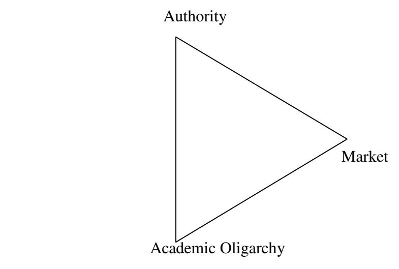
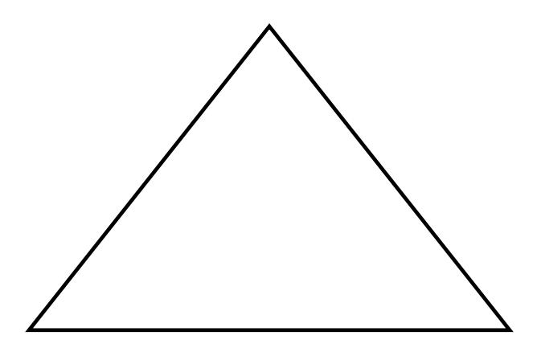
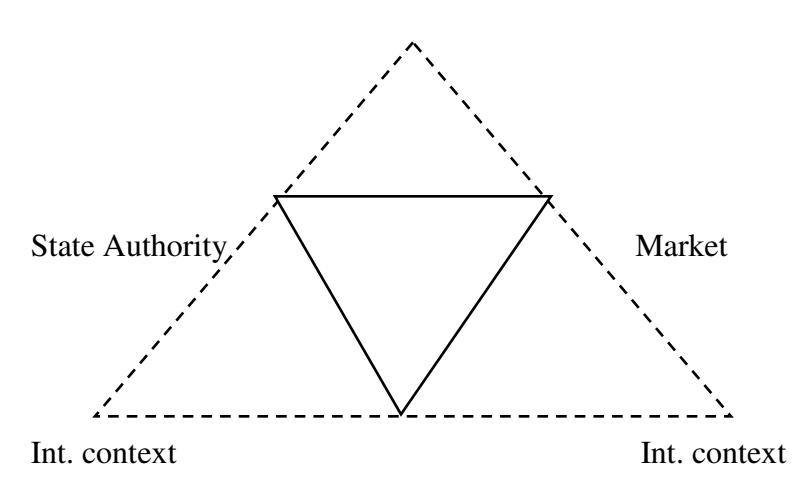

<!-- A2.R04 | source: papers_json/A2.R04/ -->

Copyright © IIUM Press

ISSN: 2289-8085

## **Internationalization of Higher Education ** **with Reference to the Arab Context: ** **Proposed Model**** **

**Aref Al Attari****[1](#page-0-0)**

**ABSTRACT: **هدفت هذه الدراسة إلى صياغة نموذج يضع تدويل التعليم العالي ضمن السياقين المحلي والإقليمي. ينطلق النموذج من مقدمات نظرية من بينها: أن الجامعات أُنشئت لتطوير المعرفة التي هي بطبيعتها كونية، لكنها في الوقت ذاته توجد داخل دول قومية لها مصالحها الخاصة؛ وأن الدول القومية ليست فقط كيانات ضمن النظام العالمي بل هي أيضاً أجزاء من مدارها الإقليمي؛ وأن المعرفة يمكن أن يُنظر إليها في آن واحد كفضيلة تُطلب لذاتها وكسلعة مولّدة للقوة والدخل تُلاحَق لأغراض نفعية. وبعبارة أخرى، فإن المعرفة والتعليم بما فيه التعليم العالي ليسا محايدين بل هما ميدان تجاذب. والسؤال المطروح هو: كيف يمكن أن يتحقق التدويل دون فقدان الطابع الإقليمي أو القومي (أو السياق المحلي)؟ هذا هو محور هذه الورقة. ولتحقيق هذا الغرض أجرى المؤلف مراجعة منهجية للأدبيات والنماذج ذات الصلة، وصاغ نقاط الانطلاق، وصمم نموذجه الخاص. وقدّم المؤلف النموذج المقترح وعلّق عليه وفق خطوات نمذجة DDI (الدلالة، والتوضيح، والتفسير). وانتهت الدراسة بملاحظات ختامية.

**KEYWORDS**: Internationalization of Higher Education, Arab Universities, Internationalization Model.

## **Introduction **

> ^1^ PhD and Professor, Department of Educational Foundations and Administration, College of Education, Yarmouk University- Jordan, Email: arefatar@yahoo.com

<!-- page 2 -->

كان التعليم العالي بطبيعته دائماً ذا طابع دولي. فمنذ "أكاديمية" أفلاطون قبل 500 عام من الميلاد، ومروراً بـ"الدراسات العامة" *Studium Generales* في العالم الإسلامي وأوروبا في العصور الوسطى، لم يتوقف السعي وراء المعرفة والفضول الفكري عند الحدود القومية. وكان العلماء المتجولون يشعرون بالألفة في أي من تلك الملاذات العلمية بغض النظر عن بلد المنشأ. غير أن نشوء "الدول القومية" في مرحلة ما بعد عصر النهضة أدخل عصراً جديداً من التنافس الاقتصادي والسياسي الشديد بين الأمم. وقد استُدعيت مؤسسات التعليم العالي لتمنح بلدانها ميزة تنافسية اقتصادية وللإسهام في بناء الدولة. ومن نتائج ذلك تزايد تدخل الحكومات في التعليم العالي، وهو ما يمثل "'انحرافاً' عن النموذج القديم للجامعة الذي كان مستقلاً تماماً عن الحكومات" (Kerr, 1990). ونتيجة لذلك، طغت الأغراض القومية المرتبطة بالتعليم العالي على تطوير المعرفة، أو على الأقل نافستها. ومن جهة أخرى، حدث تحول من النظر إلى المعرفة كـ"مسعى نبيل" إلى النظر إليها كمصدر "مولّد للقوة والدخل". "ومن السخرية أن تدويل الاقتصادات أدى إلى تأميم الجامعات" (Ibid).

غير أن عقد التسعينيات شهد "تقارباً جزئياً" بتعبير Kerr، أو "إعادة تدويل" كما يصفه Teichler (2007). فقد دفعت الظروف الاجتماعية والسياسية والاقتصادية في العالم المجتمع الدولي نحو التحرك باتجاه عصر من التعاون الواعي والحساس ثقافياً. وسايرت مؤسسات التعليم العالي هذا التوجه بإدراج مواضيع عالمية ودولية في بياناتها الرسالية وخططها الاستراتيجية. ويجب أن تتسم الجامعة العالمية اليوم بانخراطها في عمليات العولمة، وشبكاتها الدولية، ومنهجها المدوّل. ولم يعد الطلاب والعلماء يقصدون الجامعات الغربية فحسب، بل يتوجهون أيضاً إلى اليابان والصين وشرق آسيا (Altbach, 2005).

أدى الاهتمام المتزايد بالبعد الدولي للتعليم العالي، لا سيما خلال العقود القليلة الماضية، إلى ظهوره كمجال بحثي قائم بذاته. غير أن التداخل والتعارض المحتمل بين التدويل والتأميم لا يزال قليل البحث. ومن زاوية أخرى، يكاد البحث يكون صامتاً أيضاً بشأن

<!-- page 3 -->

الأقلمة الإقليمية. وستُعالج هذه الفجوات في النموذج المقترح الحالي. وتحقيقاً لهذا الهدف، يجري المؤلف مراجعة منهجية للأدبيات والنماذج ذات الصلة، ويصوغ على أساسها نموذجه المقترح.

تهدف هذه الورقة إلى الإسهام في هذا المسعى العلمي من خلال اقتراح نموذج يلائم السياق العربي الإسلامي، بغرض توعية صانعي القرار والسياسات ودعوة باحثين آخرين لمواصلة هذا الطرح وتطويره.

## **Methodology **

هذا نموذج "وصفي غير لغوي". فالنماذج بناءات افتراضية تتوصل، من خلال عملية فك ترميز وترميز، إلى فهم أفضل للعالم وإعادة بناء للواقع. غير أنها تظل محاكاة للواقع وليست الواقع نفسه. ويطبّق النموذج المقترح أسلوباً استدلالياً يتألف من مراحل التعلم المعروفة باسم DDI: الدلالة، والتوضيح، والتفسير. فمن خلال الدلالة نُقيم علاقة تمثيل بين النموذج والهدف؛ ومن خلال التوضيح نبحث في خصائص النموذج؛ ومن خلال التفسير نطرح ادعاءات حول النظام المستهدف (Frigg and Hatmann, 2012; Weisberg, 2012).

## **Related Literature **

بينما تسعى الجامعات في جميع أنحاء العالم إلى تحقيق التدويل، لم يثبت أن الوصول إلى تعريف موحد لـ"التدويل" أمر بسيط. علاوة على ذلك، فإن وجود مصطلحات ذات صلة مثل "التعليم الدولي"، و"البُعد الدولي"، و"عولمة التعليم العالي"، والتي تُستخدم بالتبادل، قد يؤدي إلى اللبس.

عرّف Knight (2004) المصطلح بأنه "عملية دمج بُعد دولي أو بين ثقافي أو عالمي في غاية التعليم ما بعد الثانوي أو وظائفه أو طريقة تقديمه" (Knight, 2004, p. 3). وتوحي الكلمتان المفتاحيتان *عملية* و*دمج* بأن التدويل شاغل مستمر

<!-- page 4 -->

يؤثر في رسالة التعليم العالي ووظيفته. ويتفق تعريف Ebuchi (1999) مع التعريف السابق في أن التدويل هو عملية تصبح من خلالها وظائف التعليم والبحث و"الخدمة" في نظام التعليم العالي متوافقة دولياً وبين ثقافياً.

ويُلاحَظ الطابع المستمر والديناميكي لعملية التدويل، وإشراك أصحاب المصلحة المتعددين، والحاجة إلى التزام قيادة المؤسسة، في تعريف Ellingboe (1998) للتدويل بأنه "رؤية مستمرة موجهة نحو المستقبل، متعددة الأبعاد، متعددة التخصصات، تقودها القيادة، وتشرك العديد من أصحاب المصلحة في العمل على تغيير الديناميكيات الداخلية للمؤسسة كي تستجيب وتتكيف بشكل مناسب مع بيئة خارجية متنوعة بشكل متزايد، وموجهة عالمياً، ومتغيرة باستمرار" (Ellingboe, 1998, p. 199).

ويُدخل Kalvemark and Der Wende (2007) السياسة الوطنية في تعريفهما للتدويل بوصفه "جهداً منهجياً ومستداماً (تقوم به الحكومات) يهدف إلى جعل التعليم العالي (نظام بلد معين) أكثر استجابة لمتطلبات وتحديات عولمة المجتمعات والاقتصاد وأسواق العمل. وقد تشمل هذه المتطلبات جميع جوانب التعليم العالي: البرامج الأكاديمية، والبحث، والطلاب والخريجين، وأعضاء هيئة التدريس والموظفين، والإدارة والتنظيم والإصلاحات، وغيرها".

## *Internationalization vs. Globalization *

يوجد اتفاق عام بين الباحثين على أن المصطلحين، رغم ارتباطهما الوثيق، مختلفان من حيث المنطلقات والأهداف والآثار. وعلى وجه الخصوص، فإن "التدويل" يستحضر تزايد الأنشطة العابرة للحدود مع استمرار وجود الحدود، بينما تشير "العولمة" إلى أنشطة مماثلة مرتبطة بتآكل الحدود (Knight, 2004). وهذا التناقض بين "الاستمرار" و"التآكل" للحدود يدل على طبيعة العولمة بوصفها في الأساس عملية اقتصادية للاندماج تتجاوز الحدود القومية وتؤثر في نهاية المطاف على تدفق المعرفة والأشخاص والقيم والأفكار. وهي بمعنى ما عملية فوق قومية. في المقابل، يشير التدويل إلى الترابط بين الأنظمة التعليمية الوطنية، حيث لا تُشكَّك الحدود ولا السلطات

<!-- page 5 -->

الوطنية. وبذلك، فإن العولمة تُؤثِّر أكثر مما تتأثر، بينما التدويل عملية سياسية قابلة للتوجيه (Luijten-Lub et al. 2005, pp. 149-150).

ويشير Rosnani (2015) إلى الطابع الاقتصادي للعولمة مربطاً إياها أساساً بهيمنة اعتبارات السوق. وفي المقابل، يمثل التدويل التقاء المحلي بالدولي. وفي سياق البيئات التعليمية، يحدث التدويل من خلال هجرة الطلاب والمحاضرين؛ وتبادل المعرفة عبر برامج الدراسة في الخارج، والخبرة الفنية والمهارات؛ والاستخدام الأوسع للغة مشتركة، وبخاصة الإنجليزية كلغة تدريس؛ واعتماد المناهج والمعايير الدولية.

ويرى Yeatman (1993) أن العولمة انتقال من دولة "الرفاه" إلى دولة "التنافس"، حيث تصبح أشكال التدخل الحكومي الوحيدة المسموح بها في الاقتصاد هي تلك التي تعزز التنافسية الاقتصادية الوطنية.

وقد ميّز Talgeri (2000) بين العولمة والتدويل على النحو التالي: "تميل العولمة إلى تجانس العمليات الاجتماعية والاقتصادية والثقافية والأكاديمية وتهميش العمليات الثقافية والاجتماعية الطرفية. أما التدويل فيبحث عن تدخل تشاركي بين شركاء متكافئين." ويسلط هذا التعريف الضوء على قلق متنامٍ، لا سيما في الدول النامية، من أن العولمة ستؤدي إلى تجانس الثقافات. ويصبح هذا المعنى خطيراً بوجه خاص حين تُستخدم العولمة بالتبادل مع التدويل، لأن ذلك يجعل الدول والمؤسسات متوجسة من جهود التدويل.

ورأى Scott (كما ورد في Callan 2000. p.18) علاقة جدلية بين التدويل والعولمة. فبالنسبة له، تجسّد جوهر التدويل في صورة عالم تهيمن عليه الدول القومية. أما العولمة فـ"تعني إعادة ترتيب جذرية لهذا النظام العالمي" (Scott, 1998, p. 126)، حيث تظهر تحالفات وكتل قوى إقليمية وعالمية جديدة. وبالنسبة لـScott، كان التدويل "حالة اعتادت عليها الجامعات دائماً" بينما العولمة "ظاهرة أكثر تقلباً واضطراباً".

<!-- page 6 -->

## **Internationalization vs. Regionalization **

اكتسبت الأقلمة الإقليمية أهمية أكبر في العقود الأخيرة بوصفها حلقة تربط التأميم بالتدويل. ومن هذا المنظور، تصبح الأقلمة تابعة لعملية التدويل. والأقلمة والتدويل، اللذان اعتُبرا اتجاهين متناقضين، مترابطان في الواقع ارتباطاً وثيقاً (Orton, 2000). كما تشمل أقلمة الجامعات تفاعلاً منسجماً بين الجامعات والمجتمعات المحلية. فمن خلال تحسين تنمية المجتمعات المحلية، تطور الجامعات نفسها. وبهذا المعنى، تُعد الأقلمة والتدويل جانبين لظاهرة أوسع، إذ يتعين على الجامعات إقامة علاقات مع مجموعة كاملة من الشركاء الخارجيين (Drilhon, 1993).

فعلى سبيل المثال، يعترف Altbach (1992b) بجامعات هونغ كونغ كجزء من مجتمع أكاديمي دولي، من خلال تحليل دورها الخاص في المنطقة الآسيوية، وبخاصة في ما يتعلق بالمجال الثقافي الصيني. فمن خلال توفير قيادة أكاديمية إقليمية، تستطيع جامعات هونغ كونغ في الوقت نفسه تعزيز تدويلها. كما أن ظهور شبكات علاقات جامعية في بعض المناطق الواسعة نسبياً يعني في حد ذاته تقدماً نحو التدويل.

وفي الأدبيات الأوروبية الغربية، تُعد الأوربة النسخة الموجهة إقليمياً من التدويل. وفي المنطقة الآسيوية، وبخاصة داخل المجال الثقافي الصيني، تلعب جامعات هونغ كونغ دوراً خاصاً. وتعزز رابطة أمم جنوب شرق آسيا (ASEAN)، وبرنامج التنقل الجامعي لآسيا والمحيط الهادئ (UMAP)، والشبكات الأوروبية عبر (ERASMUS) و(TEMPUS) وSocrates التعاون الإقليمي، ومناقشة المشكلات المشتركة، وبرامج المنح الإقليمية، وبعض الروابط المؤسسية. وفي اليابان، تأخذ سياسة التدويل الحالية الأقلمة بعين الاعتبار وتركز على السياق سريع التغير في المنطقة الآسيوية حيث كانت اليابان يوماً السيد الإمبراطوري. وفي العالمين العربي والإسلامي، يمكن لاتحاد الجامعات العربية، والألكسو (ALESCO)، والإيسيسكو (ISISCO)، ومكتب التربية العربي لدول الخليج أن تكون قوة مهمة محتملة من أجل

<!-- page 7 -->

تحسين الجامعات، وتنسيق الأنشطة الأكاديمية تجنباً للازدواجية، وضماناً للاستخدام الأمثل للموارد المحدودة، وخلقاً لأفضل الوسائل للتعامل مع الأنظمة الأكاديمية "المركزية" في الدول الصناعية.

## **Nationalization, Internationalization and Regionalization of ** **Arab Higher Education **

يمكن تتبع التعليم العالي العربي إلى المدارس العليا مثل *الأزهر، والقرويين، والزيتونة وقرطبة* ومعاهد أخرى كالمراصد والمستشفيات و*بيت الحكمة* التي ازدهرت في المدن الإسلامية حتى القرن السادس عشر، والتي كانت النموذج الذي بُنيت عليه أوائل الجامعات الأوروبية في بولونيا وباريس في مطلع الألفية الثانية.

وعندما انتقل مركز الثقل إلى أوروبا في القرن السادس عشر، دخلت تلك المؤسسات في حالة من الجمود، مكتفية بإعادة إنتاج المعرفة. وفي النصف الثاني من القرن التاسع عشر، كانت الجامعة الأمريكية في بيروت والجامعة اليسوعية في لبنان أول جامعتين حديثتين تُنشآن في العالم العربي. وأُنشئت أول جامعة حديثة غير أجنبية في العالم العربي، جامعة القاهرة، في أوائل القرن الماضي، وإن كانت عدة كليات عليا قد أُنشئت في مصر خلال القرن التاسع عشر.

وأدى ظهور هذه الجامعات الحديثة إلى عصر من الازدواجية: وجود جامعات حديثة على الطراز الأوروبي من جهة، وجامعات تقليدية قديمة مثل جامعة *الأزهر* من جهة أخرى. واستمر بناء الجامعات الإسلامية التقليدية والجامعات الحديثة حتى اليوم، مما عمّق هذه الازدواجية. وتُعد الازدواجية إحدى علل التعليم الإسلامي، إذ إنها مسؤولة، من بين عوامل أخرى، عن إنتاج فئتين من الخريجين بمنظومتي قيم مختلفتين.

وبُذلت محاولات عديدة لمعالجة هذه القضية، من بينها: تحديث الجامعات التقليدية، وإدخال كليات *الشريعة* في الجامعات الحديثة، وإنشاء نُسخ جديدة من الجامعات الإسلامية قائمة على دمج المعرفة الموحاة والمكتسبة، (والجامعة الإسلامية العالمية بماليزيا IIUM مثال على ذلك).

<!-- page 8 -->

والمفارقة أن الجامعات الإسلامية التقليدية والجامعات الأجنبية الحديثة مدوّلة بطبيعتها أكثر من الجامعات العامة الوطنية.

وساهم الاستثمار في التعليم المدرسي في الدول العربية بعد الاستقلال، من بين عوامل أخرى، في تحويل التعليم العالي من تعليم نخبوي إلى تعليم جماهيري. وأصبح التعليم العالي مطلباً اجتماعياً وأداة مهمة للحراك الاجتماعي والعدالة الاجتماعية وإعادة هندسة المجتمع بشكل عام. غير أن جماهيرية التعليم العالي العربي تركت الكثير مما هو مرغوب فيه. وقصور التعليم العالي العربي موثّق جيداً: الإفراط في تقييم الجامعة التعليمية العامة، وضعف البحث العلمي، وتكرار التخصصات الأكثر جاذبية، وما يرتبط بذلك من ارتفاع بطالة الخريجين، وهجرة الكفاءات، وغياب التدريب المهني، على سبيل المثال لا الحصر (Romani, 2009).

ومع ذلك، استمر الطلب الاجتماعي على التعليم العالي دون هوادة. وفي وقت لاحق من القرن، وتحت تأثير السياسات النيوليبرالية، حاولت العديد من الدول العربية تحويل اقتصاداتها من الأساس الزراعي والصناعي التقليدي إلى قطاع الخدمات، ثم مؤخراً إلى اقتصاد المعرفة وتكنولوجيا المعلومات (El Arabi, 2009; Masri, 2009). واعتُبر هذا التحول وسيلة مهمة تمكّن الدول العربية من الاندماج بنجاح في الاقتصاد العالمي، وهو ما يتطلب قوة عاملة عالية التعليم قادرة على المنافسة بثقة ليس فقط في سوق العمل الوطني بل في السوق العالمي المعولم. وتطلّب التحول نحو الخدمات واقتصاد المعرفة وظهور الشركات عبر الوطنية وظائف وقوى عاملة جديدة بمهارات محددة كإتقان اللغة الإنجليزية، والإلمام بالحاسوب، والكفاءة، والقدرات التنافسية. ومع التحول إلى اقتصاد المعرفة، تجاوز التركيز فكرة "التعليم كأداة لإعادة هيكلة الاقتصاد" إلى "أداة لتنمية الموارد البشرية".

ونتيجة لهذه التطورات، تزايدت مؤسسات التعليم العالي بشكل كبير ونما الالتحاق بالتعليم العالي بسرعة حتى في الدول ذات الأنظمة الجامعية المقيدة تاريخياً. ولاستيعاب

<!-- page 9 -->

هذا التوسع في أعداد الملتحقين بالتعليم العالي، أدخلت العديد من الدول العربية وشجعت وأضفت الشرعية على أشكال جديدة من التعليم العالي، منها الجامعات الخاصة، والتعلم الافتراضي، والجامعات المفتوحة، والتعليم الموازي، والبرامج الممنوحة بموجب اتفاقية امتياز، وفروع الحرم الجامعي الأجنبي، وكلها علامات على عصر جديد من التوجه النيوليبرالي (Atari, 2015).

غير أن الخصخصة كانت الشكل الأبرز بين هذه الاتجاهات الجديدة. وتفوق الجامعات الخاصة في بعض الدول العربية كالأردن ولبنان حالياً عدد الجامعات الحكومية أو العامة.

ويُعد "التدويل المستورد" للتعليم العالي شكلاً خاصاً من الخصخصة. فبدلاً من تحسين جودة المؤسسات العامة، دعت الدول العربية، وبخاصة دول الخليج، الجامعات الدولية إلى إنشاء حرم جامعي تابع في أراضيها. وتزامنت طموحات هذه الدول المنتجة للنفط في لعب دور رائد وطبيعة اقتصادها المعتمد على الهيدروكربونات مع حاجة ملحة لدى العديد من الجامعات في الدول المتقدمة إلى التوسع عالمياً. وكانت النتيجة إنشاء حرم جامعي تابع لعدد من الجامعات المرموقة في دول الخليج العربي (وتُعد المدينة التعليمية في قطر مثالاً على ذلك). وتقدم الجامعات الأمريكية الشمالية بوجه خاص برامجها حالياً في الإمارات العربية المتحدة وقطر والأردن. وفي سوريا توجد جامعات خاصة أوروبية وأوروبية-سورية. غير أن المعايير الأكاديمية في هذه المؤسسات الدولية مرتفعة جداً، ولا تتأهل لها سوى نسبة صغيرة من الطلاب. والواقع أن جامعة قطر، وهي الجامعة العامة الوحيدة في قطر، تستوعب 91 بالمئة من الطلاب القطريين، بينما لا تستوعب الجامعات النخبوية في المدينة التعليمية سوى 9 بالمئة. ويمكن الافتراض أن الدور الأساسي للجامعات الأمريكية الخاصة الباهظة التكلفة في الخليج ليس تعليم طلاب دول الخليج من أجل اقتصاد المعرفة، بل بالأحرى جلب الهيبة والاعتراف الدولي لهذه الدول (Buckner, 2011).

ويُظهر ما سبق أن التعليم العالي العربي لا يزال وطنياً مع نكهة تدويل طفيفة. وإذا اعتُبر التنقل الأكاديمي مؤشراً على التدويل، فإن الجامعات العربية متأخرة في هذا المجال. وهذا أمر طبيعي إذ إن التنقل الأكاديمي

<!-- page 10 -->

يتشكل بفعل اللغة، وسياسة الهجرة، والتاريخ، والثقافة، والعائد الاقتصادي. ولهذه الأسباب، يفضل الطلاب العرب الجامعات الغربية. ففي عام 2008، مثّل أكثر من 220000 طالب من الدول العربية (بنسبة 7.3%) من الطلاب الدوليين الدارسين في الخارج (Jaramillo, A., 2012). ومن جهة أخرى، لا تجذب الجامعات العربية الطلاب الدوليين للأسباب ذاتها، إضافة إلى كونها جامعات تعليمية واستيعابية للطلب أكثر منها جامعات بحثية. ولذلك تستضيف الجامعات العربية عدداً قليلاً من طلاب دول منظمة التعاون الاقتصادي والتنمية (OECD). أما الطلاب الدوليون غير العرب، ومعظمهم من دول إسلامية، فيمكن ملاحظتهم بشكل رئيسي في أقسام الدراسات العربية والإسلامية. غير أنه نظراً للقرب الجغرافي والتكلفة واللغة والثقافة، يمكن اعتبار بعض الجامعات العربية جامعات إقليمية تحدث فيها درجة معينة من تنقل الطلاب والموظفين.

وباستثناء بعض دول الخليج العربي، تميل الحكومات العربية نحو "تدويل مضبوط" وتتردد في منح الاعتمادات للجامعات الدولية للعمل في هذه الدول، لا سيما تلك الممولة والمدعومة أجنبياً بالكامل. وللتعويض عن نقص الحضور الدولي، تتمثل إحدى السياسات في توقيع برامج تعاون بين الجامعات العامة والمؤسسات الدولية بغرض تمكين الطلاب من اكتساب مزيد من الثقة في التعامل مع المجتمع الدولي بوجه عام.

## **Models of Internationalization of Higher Education **

يُعد مثلث Clark (1983) أقدم نموذج استُخدم كإطار لوصف دور وتأثير القوى والفاعلين المختلفين، وهم: السلطات (الحكومات)، والأسواق، والأوليغارشيات الأكاديمية التي تؤثر في تدويل التعليم العالي في بلد معين.

<!-- page 11 -->

*Figure 2 Clark's Triangle Model Source: Clark, B., (1983)*

واستخدم Akioychi (2009) تكييفاً لمثلث Clark لفهم تعقيد الوضع الذي تواجهه اليابان. وتفترض هذه الصيغة المعدّلة من النموذج وجود فجوة في الاستجابة لاتجاهات العولمة الجارية.

<!-- page 12 -->

## Academic/Universities ++

Market/Students + + State / Government++

State / Government++

Source: Akiyoshi (2009)

واستناداً إلى النموذج أعلاه، توصل Akiyoshi (2009) إلى الاستنتاجات التالية:

تميل الحكومات في اليابان إلى استجابة عالية لاتجاهات العولمة، إذ إن الحكومات أكثر إدراكاً للمعلومات المتعلقة باتجاهات السياسات. وتُعجَّل عملية استعارة السياسات تحت مظلة أيديولوجيات العولمة، والساحة الإقليمية، واقتصاد المعرفة. وفي المقابل، فإن الأوساط الأكاديمية والجامعات أقل استجابة عموماً من الحكومات، وإن كانت أكثر استجابة من السوق والطلاب. وتتزايد التبادلات الأكاديمية الدولية، وباتت هيمنة الإنجليزية بوصفها لغة أكاديمية مشتركة أمراً مسلَّماً به، على الأقل في مجالي العلوم الطبيعية والهندسة. ويوفر الاتصال القائم على الإنترنت

<!-- page 13 -->

فرصاً هائلة للتواصل الأكاديمي وعابر الحدود والتعاون البحثي دون لقاء مادي. وأخيراً، يُعد الطلاب والأسواق الأقل استجابة لاتجاهات العولمة. ويبدو أن الغالبية العظمى راضية بالأوضاع المحلية أو أقل قدرة بكثير على التكيف مع الأوضاع الدولية. ويرى Akiuychi أن القوة الاجتماعية والاقتصادية المحلية القوية في اليابان قد تعمل على تثبيط الأكاديميين والجامعات والطلاب عن التدويل بجدية. لذلك، حتى وإن حاولت الحكومة ممارسة ضغوط أو تقديم حوافز للتدويل، فقد لا يستجيب الأكاديميون والجامعات والطلاب على النحو المرغوب.

## **Multi Triangle Model **

وضع Kalvemark, M., and der Wende (1997) نموذج مثلث Clark في سياق دولي: "من خلال وضع النموذج في سياق دولي، نصف الخصائص الدولية للقوى التفاعلية التي تحدد تنسيق نظام التعليم العالي في بلد معين. ثانياً، يمكننا استكشاف مجالات التأثير الجديدة والتحقق من كيفية تأثر العلاقات والتفاعل بين هذه القوى بالسياق الدولي".

## Int. context

*Academic Oligarchy*

<!-- page 14 -->

ووفقاً لنموذج المثلثات المتعددة، يشكّل التوجه الدولي جزءاً أساسياً من السياسات الداخلية في الاقتصاد والتجارة في الدول ذات السياسة التصديرية أو التسويقية القوية للتعليم. ويمكن رؤية السياق التعليمي الدولي بطرق عديدة: سوق العمل للخريجين، وسوق الطلاب المحتملين، والتنقل الأكاديمي الدولي للعلماء، والتشبيك والتعاون، وجهود وبرامج التعليم والبحث المشتركة، والاعتراف المتبادل، والمراجعة الدولية من الأقران، وحتى التعاون الاستراتيجي على مستوى الإدارة والتنظيم.

ويثير النموذج تساؤلات حول تفاعل القوى الوطنية مع السياق الدولي فيما يتعلق بصياغة السياسات الوطنية للتعليم العالي والسياسات المؤسسية.

ومن الجدير بالذكر أن واضعي النموذج قد تطرقوا في شرحهم إلى الأقلمة. ووفقاً لنموذج المثلثات المتعددة، "قد ينشأ تعاون بين الدول المتجاورة لأغراض تحقيق فائدة متبادلة من العروض التعليمية والبنية التحتية، أو لتعزيز فعالية النظام أو بهدف تقليل الفروق بين الأنظمة والعقبات المرتبطة بها". ويشير واضعو النموذج إلى التعاون الشمالي (النوردي)، والمجلس الفرنسي الألماني للتعليم العالي، وسياسة الدول المجاورة لهولندا مع أجزاء من بلجيكا وألمانيا، وغيرها، كأمثلة.

## **Comments on the above models**

تُظهر النماذج أعلاه أن قابلية القبول للتدويل، أو على العكس الرضا عن النظام التعليمي الوطني، دالة على ثلاثة عوامل رئيسية، هي: الحكومات، والأوساط الأكاديمية، والسوق. ولا تعمل هذه العوامل الثلاثة بالضرورة بانسجام. فلكل منها أجندته الخاصة التي قد تتقارب أو تتباعد مع الأخرى إلى حد معين. وهكذا فإن الأوساط الأكاديمية في اليابان، وبدرجة أقل بكثير السوق والطلاب، ليست متحمسة لسياسات التدويل الحكومية. وهم، وبخاصة الأوساط الأكاديمية،

<!-- page 15 -->

Ī

يكتفون ببعض الأنشطة العابرة للحدود/الثقافات. وتلعب الثقافة واللغة والتاريخ دوراً في ذلك. فاليابان معروفة بتجانسها؛ ولغتها ليست منتشرة على نطاق واسع خارج حدودها أو محيطها المباشر، إلى جانب شعور بالاكتفاء الذاتي. ويختلف الوضع في الدول الغربية التي هي مجتمعات تعددية ذات تاريخ طويل في تصدير التعليم واستيعاب الطلاب والموظفين الأجانب.

ومن جهة أخرى، تنطلق النماذج المذكورة أعلاه من توجهات مدفوعة بالسوق الاقتصادي بدلاً من المقدمات الميتافيزيقية المتعلقة بطبيعة المعرفة والفاعلية الإنسانية ذاتها، وهو ما سيُستوعَب في نموذج المؤلف.

## The Author's Proposed Model

Nationali zation

Power

Uniqueness

Uniqueness

Univers

**Human Component **

<!-- page 16 -->

## **Points of Departure**

## **Philosophical Premises**

بينما تُعنى النماذج السابقة بدور الفاعلين الرئيسيين (الحكومات، والسوق، والأوساط الأكاديمية) في تدويل التعليم العالي، ينطلق المؤلف الحالي من نوع من المقدمات الفلسفية. المقدمة الأولى هي أن المعرفة يمكن النظر إليها على متصل بين "الفضيلة" و"القوة". فالمعرفة كفضيلة ترتبط بالأديان والفلاسفة المثاليين وأصحاب التوجه الخدمي. وكلما نظرنا إلى المعرفة أكثر كـ"فضيلة"، كلما اقتربنا من "التدويل" والعكس صحيح. أما المعرفة كقوة فترتبط بالتنافس والمنافسة وتوليد الأرباح. وكلما اقتربنا من النظر إلى المعرفة كقوة، كلما اقتربنا من التأميم. وتتطلب المعرفة كفضيلة نشر المعرفة وحرية الوصول إليها. وفي المقابل، تُدخل المعرفة كقوة حقوق الملكية الفكرية، وقيود الوصول، والتسليع وما شابه ذلك، من أجل الحفاظ على امتيازات وهيمنة القوى المسيطرة.

أما المقدمة الثانية فتتعلق بازدواجية التفرد والتمايز في مقابل العنصر الإنساني الكوني. وكلما شددنا على العالمية، كلما اقتربنا من التدويل. ولذلك، فإن الجامعات، بالتزامها بتطوير المعرفة الإنسانية، هي منشآت دولية. غير أن المعرفة الإنسانية غالباً ما تكون سياقية. وقد تتخذ هذه السياقية أشكال التمويل، أو الإطار التنظيمي، أو الحوكمة، أو المناهج، أو الشهادات. والسؤال هو هل يمكن أن يعمل "التدويل" و"السياقية" ("التأميم") بانسجام أو بتعارض (Kerr, 1990)؟ **و**هل ينبغي أن ننظر إلى الجامعات كأوعية لنشر المعرفة العالمية أم كأدوات للهيمنة الثقافية والمعرفية، حيث تعمل أشكال الثقافة والمعرفة المهيمنة على وضع الآخر (وغالباً ما يكون الدول الأقل نمواً) في موقف نفسي غير مؤاتٍ؟

وأدرج المؤلف الأقلمة الإقليمية كجزء أساسي من نموذجه. ولا حاجة للقول إن الأقلمة في

<!-- page 17 -->

النموذج الحالي تُعنى بالمنطقة العربية والإسلامية. ولكي تكون الأقلمة في السياق العربي الإسلامي مسعى مستمراً، نطرح ما يلي:

يجب أن تحافظ الأقلمة على القيم العربية الإسلامية، وأبرزها الموقف من المعرفة كفضيلة لا كسلعة. فنشر المعرفة رسالة. ولا ينبغي إهمال المعرفة كقوة، لكن يجب أن نضفي عليها دلالات إيجابية. وينبغي إيلاء أهمية عالية لصلة المعرفة والقيم المشتركة والمسؤولية الاجتماعية. ولا ينبغي التضحية بالاعتبارات الاجتماعية والثقافية التربوية من أجل السوق.

وينبغي أن تكون الأقلمة راسخة في علاقات مؤسسية ثابتة بين مؤسسات التعليم العالي العربية الإسلامية، تتجاوز المؤسسات السياسية حتى لا تخضع لأهوائها. وينبغي إنشاء جامعات عربية إسلامية جامعة متميزة لخلق "مجمّع موارد" من العلماء والباحثين، لتكون منتديات للنقاش وتبادل الخبرة والتجربة، ولإجراء مشاريع بحثية مشتركة. وثمة حاجة إلى مؤسسات إقليمية إلى جانب المؤسسات الوطنية.

وينبغي الحفاظ على مكانة اللغة العربية. وعلينا التمييز بين إتقان لغة أجنبية، وبخاصة الإنجليزية، وبين استخدامها كلغة تدريس على نطاق واسع. وينبغي النظر إلى اللغة العربية والخلفية الإسلامية كعلامات هوية إيجابية.

وينبغي تشجيع التنقل الأكاديمي للعلماء. ومن المؤسف أن التنقل الأكاديمي للعلماء العرب وربما المسلمين في هذه المرحلة مدفوع اقتصادياً وذو اتجاه واحد (من الدول المصدّرة للعمالة إلى الدول المستقبلة لها). ورغم أن هذا النوع من التنقل مقبول، فينبغي توسيعه ليصبح مسعى مدفوعاً بالمعرفة الأكاديمية وذا اتجاهين.

وتستحضر الأقلمة جميع المتطلبات لتوليد معرفة ثورية تسهم في المعرفة

<!-- page 18 -->

الإنسانية وتعكس في الوقت ذاته الذاكرة الجماعية للمنطقة العربية الإسلامية. ومن بين هذه المتطلبات صياغة نموذج بحثي عربي إسلامي يساعد على تعزيز التمايز والتفرد؛ وإنشاء مجتمعات علمية وجميع أنواع الاتصالات العلمية التي ترسّخ النموذج البحثي، والمعرفة، والذاكرة الجماعية في البيئة العربية الإسلامية.

وينبغي أن تكون المتطلبات المذكورة أعلاه جزءاً لا يتجزأ من خطة استراتيجية ومشروع حضاري يضع هذه المنطقة في موقع المساهم وليس فقط المتلقي.

## **Concluding Remarks**

ازدادت الأنشطة الدولية في التعليم العالي بشكل كبير في السنوات الأخيرة، وتشير التوقعات إلى أنها من المرجح أن تزداد أكثر في المستقبل. غير أنه بينما تتزايد الحاجة إلى تعزيز تدويل التعليم العالي، لا يوجد بوضوح إجماع شامل حول هذا المفهوم. فقد فُسّر بطرق عديدة، وغالباً ما يُستخدم بالتبادل مع مصطلحات أخرى. وبشكل عام، بالنسبة للجامعة، يعني التدويل الوعي بالتفاعلات داخل الثقافات وبينها وتفعيلها من خلال وظائفها التعليمية والبحثية والخدمية، بهدف نهائي هو تحقيق التفاهم المتبادل عبر الحدود الثقافية. أما بالنسبة لنظام التعليم العالي الوطني، فيشير التدويل إلى الحوار مع نظرائه في البلدان الأخرى. والتدويل، في الواقع، ليس موضوعاً أو ظاهرة حديثة النشأة، بل يعود إلى تاريخ قديم جداً.

وفي المقابل، تنظر العولمة إلى التعليم العالي من منظور تكنولوجي اقتصادي وإلى المعرفة كسلعة يمكن الاتجار بها من خلال جذب الطلاب الذين يدفعون رسوماً مرتفعة، أو من خلال "التعليم عبر الوطني"، مثل إنشاء فروع للحرم الجامعي في الخارج أو برامج "الامتياز". وينبغي أن تسعى مؤسسات التعليم العالي جاهدة إلى تعزيز سمعتها وحضورها الدولي وفق المعايير المستخدمة في "التصنيفات" العالمية للجامعات، وإلا فإنها ستواجه خطر التهميش في ظل غياب مثل هذا التحول النوعي.

ويحتاج التدويل إلى الجامعات الحديثة نظراً لتعقد الحياة الحديثة وطابعها المفتوح،

<!-- page 19 -->

وكذلك من أجل تنمية المجتمعات المحلية. وبطبيعة الحال، يتشكل جزء كبير من محتوى قضايا التنمية الإقليمية بأفكار وممارسات المجتمع المحلي، لكن القضايا الناشئة غالباً ما تُناقَش بعد ذلك في إطار مرجعي دولي صريح. لذلك يصبح المنظور الدولي ضرورياً عند التعامل مع التنمية المحلية، والعكس صحيح.

ونظراً لأن الثقافة الغربية، بما فيها نموذج الجامعة الحديثة، لا تزال هي الواقع المهيمن، فقد اكتسب تدويل التعليم العالي أحياناً دلالات سلبية في الدول الأقل نمواً، مثل التكيف الأحادي الجانب، وإهمال الخصائص الوطنية، وفقدان المكانة الدولية.

وحتى في أوروبا، تُنتقد بعض أشكال التدويل، مثل الحراك العمودي من خارج أوروبا إلى أوروبا، باعتبارها تدعو إلى التكيف بدلاً من التعلم من التباين، وإلى إفادة النخب المالية في الدول الفقيرة، والمساهمة في هجرة الأدمغة. أما فيما يتعلق بالتنقل داخل أوروبا، فقد أظهر مسح أن القيمة المهنية للدراسة في بلد أوروبي آخر آخذة في التراجع إلى حد ما، لأن هذه الخبرات الدولية تفقد شيئاً فشيئاً حصريتها وتمايزها (Teichler2007). ومرة أخرى، تعزز هذه الملاحظات الرأي القائل بأن جهود تدويل التعليم العالي لم يعد بإمكانها اختيار أنشطة منفصلة قائمة بذاتها، بل يتعين عليها دمج الأنشطة العابرة للحدود مع بعض الخطوات نحو التقارب الدولي ومع الأنشطة الرئيسية في الداخل.

ويُقترح التعاون والتنقل على قدم المساواة لدمج الأنشطة الدولية ضمن الأنشطة العامة لمؤسسات التعليم العالي: إذ تُبذل جهود متزايدة لصياغة الأنشطة الدولية كأنشطة رئيسية، ولضمان تطوير الأنشطة الرئيسية بطريقة تخدم الأنشطة الدولية.

ولا يزال البحث في تدويل الجامعات بعيداً عن الكفاية في الوقت الحالي، **و**بخاصة الدراسات التجريبية من منظور مقارن دولي. ويغيب بوجه خاص

<!-- page 20 -->

البحث الذي يهدف إلى توضيح الكيفية التي يُفهم بها التدويل في جامعات العالم الثالث، وكذلك التحقيق في العوامل الحاسمة والقيود وجدوى تدويل التعليم العالي في الدول غير الغربية الأقل نمواً.

## **Conclusion **

يأمل المؤلف أن يُسهم المنهج الذي قدمناه في توجيه المزيد من البحث في مؤسسات ومناطق متنوعة حول العالم. وقد ترغب الأبحاث الجديدة أيضاً في إشراك مشاركين داخل مؤسسات التعليم العالي يمثلون أعضاء هيئة التدريس، والطلاب، والموظفين، وكذلك الإداريين. ولا يزال الجهد الرامي إلى تفعيل المنظورات الدولية وتطوير مخيلة عالمية، بقدرة على تحديد كيفية ارتباط المعرفة دولياً، في مراحله الأولى. والتعلم من مؤسسات أخرى تمر بعملية التغيير قيّم جداً لنا وللآخرين المستثمرين في المسار المعقد والسياقي لتدويل تجربة الحرم الجامعي.

## **References**

- Akiyoshi, Y., (2009). The Internationalization of Japanese Higher Education: Policy Debates and Realities, Center for the Advancement of Higher Education, Tohoku University.
- Altbach, P., (2005) Globalization and the University: Myths and realities in an Unequal World, The NEA Almanac of Higher Education.
- Atari, A., *Privatization of Arab Higher Education with * *Special Reference to Jordan*, in Mina Hatouri and Rosnani Hashem, (2015) "Reforms in Islamic Higher Education", IIUM Press.
- Buckner, E., (2011) The Role of Higher Education in the Arab State and Society: Historical Legacies and Recent Reform Patterns, *Comparative and * *International Higher Education*, 3, 21-26.
- Clark, B., (1983) The Higher Education System: academic organization in cross-national perspective, University of California Press.

<!-- page 21 -->

- Ebuchi,K. 199, *Study of the internationalization of * *universities*, Tokyo, Tamagawa University Press pp.39,
- El Arabi, A., (2009) *Access and Equity in Higher Education: * *A Comparative Assessment of Financing Policies in * *Six Arab Countries*, A draft Unpublished paper,
- Ellingboe, B. (1998) Divisional Strategies to Internationalize a Campus Portait, In Mestenhauser, J., and Ellingboe (Eds) *Reforming the Higher Education Curriculum: * *Internationalizing the Campus*, Phoenix: Oryx Press.
- Forest , J., *Regionalism in Higher Education, An * *International Look at National and Institutional * *Interdependence,* Boston College Center for International Higher Edcuation
- Friesen, R., (2013) Faculty member engagement in Canadian University Internationalization: A consideration of understanding, motivations and rationales, *Journal * *of Studies in International Education*, 17(3) 209-227
- Frigg, R., and Hartmann, S., (2012) *Models* *in Science*, The Stanford Encyclopedia of Philosophy
- Jaramillo, et al, (2012) Internationalization of Higher Education in MENA: Policy Issues Associated with Skills Formation and Mobility, report no. 63762- MNA, World Bank.
- Kalvemark, M., and der Wende, M (Eds) (1997) (1997), National Policies for the internationalization of Higher Education in Europe, National Agency for Higher Education, Stokholm.
- Kerr, C., (1990) The Internationalization of Learning and the Nationalization of the purposes, of higher education, *European Journal of Education*, 25(1) 5-19.
- Knight, J., (2004) Internationalization remodeled: Definition, approaches and rationales, Journal of Studies in International Education, 8(1) 5-31
- Marginson, S., (2006) Dynamics of national and global competition in higher education, Higher Education, 52 (1) 1-39.

<!-- page 22 -->

- Massadeh, N., (2010) Internationalization of Higher Education in Jordan, Middle East Institute, Washington.
- Masri, M., (2009) Policy Process and educational Reform in the Arab World, *Mediterranean Journal of * *Educational studies,* 14 (1) 129-144.
- Romani, V., (2009) The Politics of Higher Education in the Middle East: Problems and Prospects, Crown Center for Middle East Studies, Brandeis University, Massachusetts,
- Rosnani Hashim (2012), *Internationalization of * *Contemporary Islamic Higher Education and * *Ummatic Development*: A Case Study of the International Islamic University Malaysia (IIUM), in Mina Hatouri and Rosnani Hashem, (2015) "Reforms in Islamic Higher Education", IIUM Press.
- Teichler, U., (2012) International Student Mobility in Europe in the Context of the Bologna Process, Journal of International Edcuationa nd Leadership, 2(1)
- Teichler, U., Internationalization of Higher Education: European Experiences, International Center for Higher Education Research University of Kassel
- Weber, L., and Duderstadt, The Globalization of Higher Education, Economica.
- Weisberg, M., (2012), Simulation and Similarity: Using Models to Understand the World, Oxford University Press.
- Yang, R., (2002) University internationalization: its meaning, rationales and implications, Intercultural Edcuation, 13 (1) 1-15
