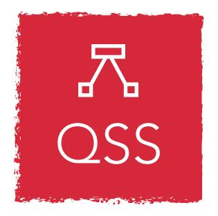
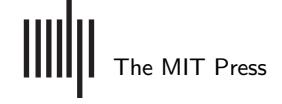
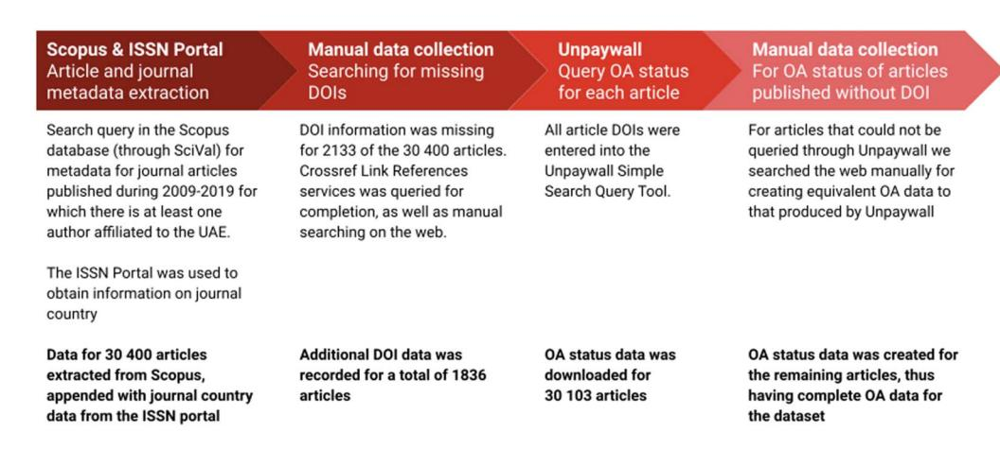
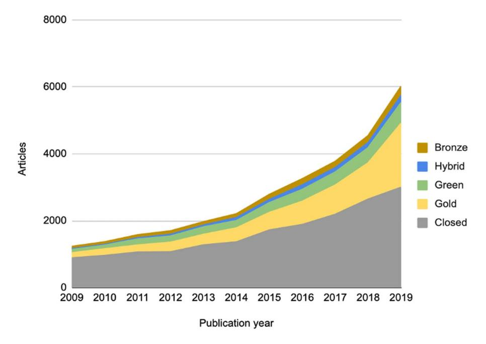
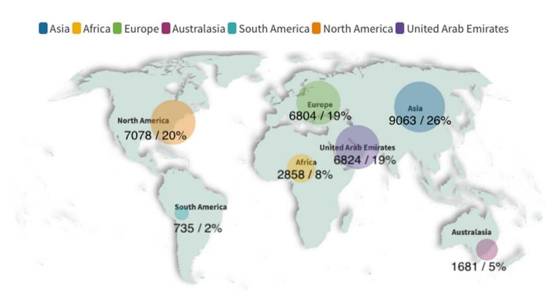
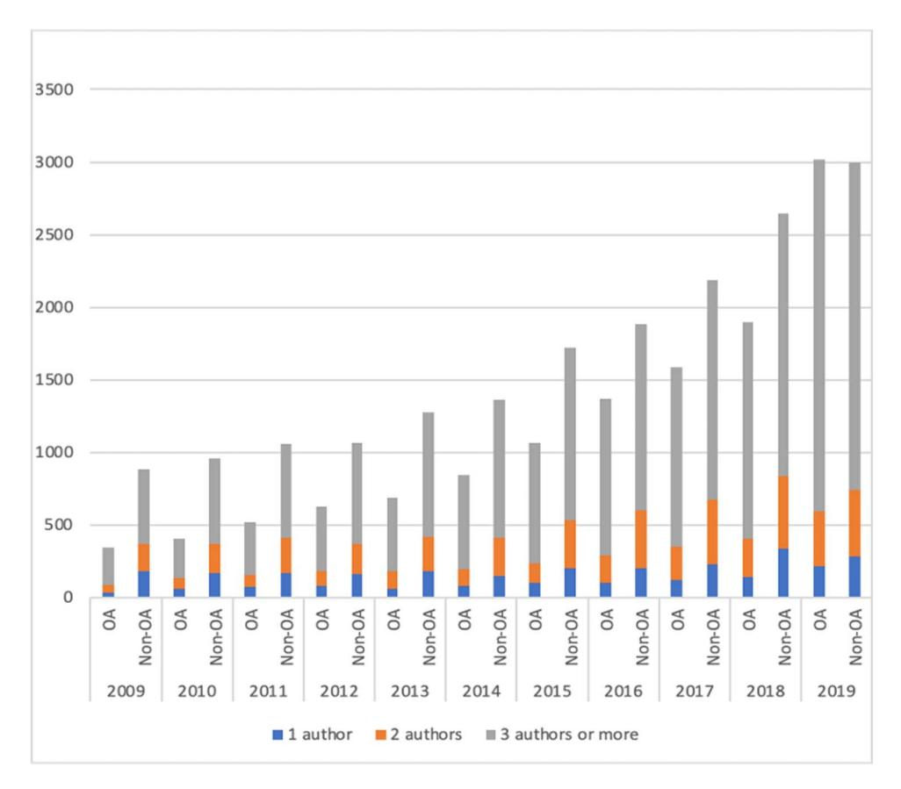

an open access 🔓 journal

Citation: Boufarss, M., & Laakso, M. (2023). Open access and international coauthorship: A longitudinal study of the United Arab Emirates research output. Quantitative Science Studies, 4(2), 372-393. https://doi.org /10.1162/qss_a_00256

https://doi.org/10.1162/qss_a_00256

## Peer Review:

https://www.webofscience.com/api /gateway/wos/peer-review/10.1162 gss a 00256

Received: 6 November 2022 Accepted: 27 March 2023

Corresponding Author: Mohamed Boufarss mohamed.boufarss@tuni.fi

Handling Editor: Ludo Waltman

Copyright: © 2023 Mohamed Boufarss and Mikael Laakso. Published under a Creative Commons Attribution 4.0 International (CC BY 4.0) license.

## الوصول المفتوح والتأليف المشترك الدولي: دراسة طولية لمخرجات البحث في دولة الإمارات العربية المتحدة

Mohamed Boufarss1 and Mikael Laakso2

1Faculty of Information Technology and Communication Sciences, Tampere University, Tampere, Finland 2Department of Management and Organisation, Hanken School of Economics, Helsinki, Finland

Keywords: coauthorship, international collaboration, open access, scientometrics, Scopus, UAE

## **ملخص **

نبحث في هذه الدراسة العلاقة المتبادلة بين الوصول المفتوح (OA)، والتأليف المشترك، والتعاون البحثي الدولي. ورغم أن أبحاثاً سابقة تناولت هذه العوامل كلاً على حدة، هناك فجوة معرفية في كيفية تفاعلها ضمن مجموعة بيانات واحدة. تشمل البيانات جميع المقالات المفهرسة في Scopus والمنشورة على مدى 11 عاماً (2009-2019)، حيث ينتمي واحد على الأقل من المؤلفين إلى مؤسسة في دولة الإمارات العربية المتحدة (30,400 مقالة إجمالاً). لتقييم حالة الوصول المفتوح للمقالات، استخدمنا بيانات Unpaywall للمقالات التي تحمل معرّف الكائن الرقمي (DOI)، وعمليات بحث يدوية على الويب للمقالات التي لا تحمله. لوحظ نمو قوي ومستمر في أعداد المقالات المنشورة وكذلك في حصص المقالات ذات الوصول المفتوح عبر السنوات. يقدم التحليل نتائج ذات دلالة إحصائية تدعم وجود علاقة إيجابية بين ارتفاع عدد المؤلفين المشاركين (خصوصاً الدوليين منهم) وحالة الوصول المفتوح للمقالات. هناك حاجة إلى مزيد من البحث للتحقق من العوامل التي قد تفسر العلاقة بين التأليف المشترك وارتفاع معدل الوصول المفتوح، مثل تطبيق مبادرات السياسة العلمية الوطنية، وتفاوت توفر التمويل للنشر بالوصول المفتوح في دول مختلفة، وأنماط تبني أنواع مختلفة من الوصول المفتوح ضمن تشكيلات مختلفة من التأليف المشترك، وأنماط خاصة محتملة بكل تخصص فيما يتعلق بالتأليف المشترك ومعدل الوصول المفتوح.

## 1. INTRODUCTION

ينمو نشر الوصول المفتوح (OA) في المجلات على مستوى العالم، سواء بوصفه مجلات كاملة أو على مستوى المقالة، خصوصاً من خلال اتفاقيات التحول الهجينة للوصول المفتوح (Crawford, 2021; Jahn, Matthias, & Laakso, 2022). كما يُعد الأرشفة الذاتية في المستودعات من قِبل المؤلفين عاملاً رئيسياً آخر يتيح الوصول المفتوح لمحتوى لن يكون متاحاً لولا ذلك إلا خلف حاجز دفع (Thibault, MacPherson et al., 2018). تطورت سياسات وممارسات النشر بالوصول المفتوح بشكل متفاوت من منظور دولي، حيث تقدمت العديد من الدول الأوروبية بسرعة في السنوات الأخيرة مقارنة ببقية دول العالم. يفرض ممولو البحوث ومؤسسات التعليم العالي في أوروبا بشكل متزايد أن تكون المنشورات الناتجة عن باحثين ممولين أو منتسبين متاحة بالوصول المفتوح فوراً (cOalition S, 2018; ROARMAP, n.d.). ورغم أن سياسات وممارسات الوصول المفتوح مرتبطة محلياً بمؤسسات وأدوات تمويل محددة، غالباً ما يُجرى البحث من خلال تعاون دولي. لذلك يمكن أن تؤثر المتطلبات والإمكانات المؤسسية لإتاحة الوصول المفتوح على المؤلفين المشاركين أيضاً، حتى لو كانت ظروفهم الخاصة لا تتطلب أو تتيح الوصول المفتوح لمنشوراتهم. المعرفة حول كيفية وجود هذه الظاهرة، أي الوصول المفتوح الناتج عن التأليف المشترك، وكيف تطورت بمرور الوقت، لا تزال ناقصة.

<!-- page 2 -->

أحد الجوانب الرئيسية التي أسهمت في بطء تطور المعرفة المتعلقة بالجوانب الأكثر تعقيداً للوصول المفتوح، مثل ظاهرة الوصول المفتوح الناتج عن التأليف المشترك الموصوفة في الفقرة السابقة، هو ندرة البيانات الأساسية الشاملة. ورغم أن نشر الوصول المفتوح ينمو بقوة منذ أكثر من 20 عاماً، لم تتحقق بعد قاعدة بيانات مركزية شاملة للبحث عن موارد الوصول المفتوح واسترجاعها ([Azadbakht &](#page-20-0) [Schultz, 2020)](#page-20-0). تُعد قاعدة بيانات Unpaywall المجانية حالياً المورد الأكثر شمولاً، لكنها مبنية على مبدأ أساسي هو أن المقالات المدرجة تحمل معرّف كائن رقمي (DOI)، وهو أمر لا تستخدمه جميع المجلات. في دراسة عن معرّفات DOI في Web of Science (WoS) Core Collection وScopus من 2005 إلى 2014، لاحظ [Gorraiz, Melero-Fuentes](#page-20-0) [et al. (2016)](#page-20-0) أنه بينما امتلك 90% من جميع العناصر القابلة للاستشهاد في العلوم والعلوم الاجتماعية في عام 2014 معرّف DOI، بلغت هذه النسبة نحو 50% في الفنون والعلوم الإنسانية. وبما أن هذا يخص المجلات المدرجة ضمن هذه الفهارس، يمكن افتراض أن نقص معرّفات DOI للمجلات خارجها أعلى. ورغم أن مشكلة نقص البيانات الشاملة، أو ما يشير إليه [Nguyen,](#page-21-0) [Luczak-Roesch et al. (2022)](#page-21-0) بـ"الملاءمة للاستخدام"، هي أمر يخص أيضاً توفر البيانات في نشر المجلات العلمية عموماً، حيث يؤثر اختيار مصدر البيانات المستخدم بقوة في شكل المشهد ([Basson, Simard et al., 2022)](#page-20-0)، تتفاقم هذه المشكلة بالنسبة لأبحاث الوصول المفتوح نظراً للحاجة غالباً إلى الاعتماد على طبقات متعددة من بيانات غير مكتملة للحصول على نظرة عامة على الوضع. ولمواجهة هذه القصور، يخلص [Xu, Yue et al. (2017)](#page-21-0) إلى أن دمج البيانات متعددة المصادر (MSDF) أمر "ضروري وذو معنى" في علم القياسات العلمية. بشكل عام، هناك حاجة إلى مزيد من الأبحاث حول الوصول المفتوح تشمل أيضاً أجزاء من مشهد النشر يتم إغفالها إذا اقتُصر على البيانات المتاحة بسهولة فقط.

تُخصَّص قدر كبير من الأبحاث الحالية لتحليل النمو الوصفي على مستوى المقالة للوصول المفتوح باستخدام Scopus وWoS، لكن اهتماماً أقل أُولي للعلاقة بين الانفتاح والتأليف المشترك والتعاون الدولي وبلد استضافة المجلة. باستخدام إثراء يدوي للبيانات، تقدم هذه الدراسة رؤية جديدة لهذه الظواهر باستخدام مخرجات البحث في دولة الإمارات العربية المتحدة (UAE) كبيانات أساسية. الهدف هو تقديم تحليل دقيق لمخرجات المقالات البحثية في الدولة، ومستوى الانفتاح، وعلاقته بالتأليف المشترك الدولي.

أسئلة البحث المحددة التي نسعى إلى الإجابة عنها من خلال استخدام بيانات طولية تتعلق بمخرجات المقالات في المجلات التي تشمل مؤلفاً واحداً على الأقل منتسباً إلى الإمارات هي:

## 1. ما الخصائص الرئيسية للوصول المفتوح للمقالات المنشورة من قِبل مؤلفين منتسبين إلى الإمارات؟

- (a) ما حصص أنواع الوصول المفتوح المختلفة؟
- (b) ما الفروق التخصصية في حصص الوصول المفتوح؟
- (c) هل لبلد استضافة المجلة علاقة بتوفر الوصول المفتوح؟
- (d) ما أكثر المستودعات شيوعاً للأرشفة الذاتية؟

## 2. كيف تتفاعل الجوانب المختلفة للتأليف المشترك مع حصص الوصول المفتوح لمخرجات البحث المنتسبة إلى الإمارات؟

- (a) كيف يتوزع التأليف المشترك عالمياً؟
- (b) هل لعدد المؤلفين المشاركين علاقة بتوفر الوصول المفتوح؟
- (c) هل للمنطقة الجغرافية للمؤلفين المشاركين علاقة بتوفر الوصول المفتوح؟

تُعد الإمارات حالة مثيرة للاهتمام لدراسة كل من مخرجات البحث ونمو الوصول المفتوح لعدة أسباب. أولاً، الإمارات دولة فتية جداً، تأسست في عام 1971 فقط، وأقدم جامعاتها تأسست في عام 1976. ورغم أنها لا تمتلك تقليداً بحثياً

<!-- page 3 -->

قديماً أو سياسة علمية راسخة، فقد خطت خطوات هائلة في تحويل مشهدها البحثي. كشف [Al Marzouqi, Alameddine et al. (2019)](#page-19-0) أن إنتاجية البحث في الإمارات شهدت زيادة بمقدار 16 ضعفاً بين عامي 1998 و2017، وتُدرج [UAE Commission for](#page-21-0) [Academic Accreditation (2022)](#page-21-0) حالياً 74 مؤسسة تعليم عالٍ نشطة. ثانياً، تتكون القوى العاملة البحثية في الإمارات من نسبة عالية من الوافدين، وبالتالي فهي انتقالية بطبيعتها، لكنهم قد يجلبون أيضاً معهم شبكات التعاون الخاصة بهم، وبذلك يعززون مخرجات الإمارات المؤلَّفة بشكل مشترك. وأخيراً، لم نتمكن من تحديد أي إشارة إلى مصادر تمويل رسوم معالجة المقالات (APC) داخل الإمارات عبر جميع الموارد التي تحلل التمويل الخارجي والداخلي في الدولة. وهذا يتناقض بشكل صارخ مع الدول ذات المعدل المرتفع لتبني الوصول المفتوح، ويبرز الخصائص الفريدة لبيئة البحث في الإمارات.

يذكر [Alsharari (2018)](#page-19-0) انشغال الجامعات الإماراتية بالحصول على الاعتراف من خلال الاعتماد الدولي. ويضيف أن "الترتيب المحلي والعالمي يكتسب أهمية متزايدة...". يلعب الأداء البحثي دوراً رئيسياً في معظم تصنيفات الجامعات، وغالباً ما يعتمد على المخرجات في المجلات الدولية، ويُفضَّل أن تكون عالية التصنيف. وهذا الانشغال بالتصنيفات (ضمن جوانب أخرى لجودة البيانات تُناقش في قسم المنهجية) هو ما يدعم اختيارنا لـScopus كمصدر للبيانات، إذ إنها مصدر رئيسي لبيانات مخرجات البحث لتصنيفات الجامعات مثل Quacquarelli Symonds (QS) وTimes Higher Education (THE). ما لم يُستكشف نسبياً هو كيف تطور نمو مقالات المجلات ذات الوصول المفتوح للمؤلفين المنتسبين إلى الإمارات في السنوات الأخيرة، وكيف قد يرتبط ذلك بالتغيرات في التأليف المشترك الدولي بين هؤلاء المؤلفين. من خلال تصميم دراسة حول هذا الموضوع، نهدف إلى تحسين المستوى الحالي للمعرفة المتعلقة بتأثير التأليف المشترك على حالة الوصول المفتوح للمقالات. كما نهدف إلى كشف مستوى التسوية التي يفرضها الاعتماد على بيانات الوصول المفتوح المتاحة بسهولة عند دراسة ظواهر من هذا النوع.

## 2. LITERATURE REVIEW

## 2.1. Challenges to OA Analysis and Retrieval

الطريق إلى دراسة شاملة للوصول المفتوح مليء بخيارات منهجية ومفاضلات مرتبطة بها يجب مراعاتها. أولاً، غالباً ما تفشل مصادر البيانات الحالية في تقديم بيانات تغطية شاملة لأنواع مختلفة من الوصول المفتوح، ما يدفع الباحثين إلى اللجوء إلى الجمع اليدوي للبيانات، وهو ما له آثار على كيفية انحياز الدراسات نحو لغات ودول وتخصصات معينة. ثانياً، اكتشاف واسترجاع مصادر الوصول المفتوح مقيّد بعدم اتساق أدوات البحث المختلفة الموجودة للوصول المفتوح.

ورغم أن الوصول المفتوح يُعد الفرع الأكثر نضجاً للعلوم المفتوحة حتى الآن، فإن قياس حصة الوصول المفتوح لمقالات المجلات مهمة معقدة نظراً لتعدد أنماط الوصول المفتوح وتعدد المناهج، وكذلك مجموعات البيانات المستخدمة. يوضح [Taubert, Hobert et al. (2019)](#page-21-0) هذه النقطة بقائمة تضم نحو 11 نوعاً مختلفاً من الوصول المفتوح مستمدة من أبحاث سابقة. لا تلتقط معظم الفهارس الببليوغرافية بيانات عن جميع هذه الأنماط، التي يمكن أن تتداخل مع بعضها البعض إذ تتوفر نسخ متعددة من المنشورات عبر قنوات مختلفة بمرور الوقت، ما يطرح تحدياً منهجياً للتحليل الببليومتري. وبما أن معظم قواعد البيانات الببليوغرافية مصممة أساساً لأغراض استرجاع المحتوى، فإن التحليل الببليومتري للبيانات الوصفية قد يكون غرضاً ثانوياً فقط [(Hood & Wilson, 2003](#page-20-0)). غالباً ما يلجأ الباحثون إلى جمع يدوي مكثف للبيانات لسد الفجوات فيها (انظر مثلاً [Boufarss, 2020)](#page-20-0). مشكلة أخرى في التحليل الببليومتري ذي النطاق الدولي، سواء تضمن أبعاد الوصول المفتوح أم لا، تتعلق بالانحيازات في مصدري البيانات الأكثر استخداماً، وهما WoS وScopus. تحتوي هاتان الخدمتان على انحيازات في التغطية مرتبطة بالتخصصات والدول واللغات ([Khanna, Ball et al., 2022;](#page-21-0) [Mongeon & Paul-Hus, 2016)](#page-21-0). كما أن الانحياز نحو المنشورات

<!-- page 4 -->

باللغة الإنجليزية، الذي أفاد به أيضاً [Björk (2019)](#page-20-0)، يجعل الدراسات الببليومترية الشاملة لدول غير ناطقة بالإنجليزية مثل الإمارات منحازة، إذ يكون جزء من مخرجاتها البحثية ممثَّلاً تمثيلاً ناقصاً غالباً. في تحليل شامل حديث لأبرز مصادر بيانات الاستشهاد، يكشف [Martín-Martín, Thelwall et al. (2021)](#page-21-0) أن المصادر تعاني من أحد قيدين رئيسيين: تغطية محدودة في حالة Scopus أو WoS؛ ووظائف بحث محدودة في حالة Google Scholar وMicrosoft Academic وDimensions وOpenCitations COCI. مع مراعاة ذلك، تمتلك Scopus الأفضلية بسبب تغطيتها الأوسع من WoS ووجود حقول بيانات وصفية أكثر، ما يتيح تحليلاً أعمق ([Thelwall & Maflahi, 2022)](#page-21-0). ويدعم هذه الحجة الأخيرة [Guerrero-Bote, Chinchilla-Rodríguez et al. (2021)](#page-20-0)، اللذان خلصا إلى وجود تغطية أكبر على مستوى الدول والمؤسسات في Scopus مقارنة بـDimensions، رغم أن الأخيرة تمتلك تغطية بيانات أكبر عموماً من الأولى. ومع ذلك، حتى وقت كتابة هذا البحث، لا توجد خدمات منافسة أكثر شمولاً من Scopus وWoS تقدم المستوى نفسه من التنسيق للبيانات الوصفية على مستوى المجلة والمقالة فيما يخص المجلات النشطة المحكَّمة التي تستوفي بعض المعايير الأساسية المشتركة، ما يعني أنها لا تزال مفيدة جداً لأغراض بحثية متنوعة طالما أُقرت القيود والانحيازات.

في وقت يتجه فيه تبني الوصول المفتوح نحو الارتفاع ([Archambault, Amyot et al., 2014](#page-19-0); [Piwowar,](#page-21-0) [Priem et al., 2018;](#page-21-0) [Piwowar, Priem, & Orr, 2019)](#page-21-0)، ظل اكتشاف واسترجاع موارد الوصول المفتوح قضية عمل عليها كثير من مقدمي الخدمات لتحسينها [(Azadbakht & Schultz,](#page-20-0) [2020;](#page-20-0) [Dhakal, 2019;](#page-20-0) [Willi Hooper, 2017)](#page-21-0). لا يتحقق الهدف العام المُروَّج له لحركة الوصول المفتوح، وهو إتاحة الوصول إلى الأبحاث العلمية لأي شخص لديه اتصال بالإنترنت، إذا لم يتمكن الأشخاص من العثور بسهولة على النسخ المفتوحة من المقالات ([Schultz, Azadbakht et al., 2019)](#page-21-0). حاولت أدوات اكتشاف الوصول المفتوح مثل Unpaywall وKopernio وOA button وLazy Scholar معالجة هذا التحدي، كما بيّن [Azadbakht and Schultz (2020),](#page-20-0) و[Duffin (2020),](#page-20-0) و[Else (2018)](#page-20-0)، و[Schultz et al. (2019).](#page-21-0) راجع [Willi Hooper (2017)](#page-21-0) أداة Unpaywall بوصفها أداة للعثور على الوصول المفتوح، ووجدها ذات ميزة مقارنة بـGoogle Scholar، التي تعاني من مشكلات في الدقة، والربط بالشبكات الاجتماعية الأكاديمية (ASNs)، التي قد تعاني من مشكلات الامتثال لحقوق النشر. ويشترك في هذه النتيجة [Dhakal (2019),](#page-20-0) الذي شدد على تركيز Unpaywall على المقالات المتاحة بشكل قانوني بالوصول المفتوح. كما أبرز [Dhakal (2019),](#page-20-0) مزايا أخرى لـUnpaywall، مثل أداة الاستعلام البسيط المتوفرة، وواجهة REST API، ولقطة قاعدة البيانات الكاملة، وجميعها تسهل تحديد حالة الوصول المفتوح لأعداد كبيرة من المقالات طالما يمكن تقديم معرّف DOI لكل منها.

سواء كان الأمر يتعلق بتركيز دراسات الوصول المفتوح الواضح على أدبيات المجلات، أو غياب مصادر بيانات شاملة تراعي مختلف نماذج الوصول المفتوح وتكون غير منحازة، أو أدوات اكتشاف واسترجاع غير موثوقة، فإن تحديات دراسات الوصول المفتوح كثيرة.

## 2.2. Research Collaboration and OA

شهد المشهد البحثي طفرة في التعاون خلال السنوات الأخيرة، مدفوعة بالانتشار العالمي للأجهزة المتصلة بالشبكة والخدمات الإلكترونية المرتبطة بها، وسياسات تشجع على الشراكات البحثية، واعتقاد بأن ذلك يؤدي إلى زيادة الإنتاجية العلمية [(Abramo,](#page-19-0) D'[Angelo, & Di Costa, 2009)](#page-19-0)، وزيادة الاستشهادات ([Eysenbach, 2006](#page-20-0); [Hajjem & Harnad, 2007)](#page-20-0)، وزيادة ظهور البحث ([Glänzel & Schubert, 2004)](#page-20-0)، وزيادة تبادل ونقل المعرفة، والإبداع، والرفقة الفكرية [(Katz & Martin, 1997](#page-21-0))، وزيادة الأداء الأكاديمي ([Aziz & Rozing, 2013](#page-20-0)). كما تأثر هذا الأمر بتحول عولمة العلم إلى ضرورة لمواجهة التحديات المجتمعية الكبرى (Macháč[ek, 2023)](#page-21-0). من الأمثلة على دعم التعاون البحثي على مستوى صانعي السياسات شبكة ممولي البحوث الأوروبية ERA-NET ومبادرات البرمجة المشتركة الأوروبية (JPI). يدعم [Chung, Cox, and Kim (2009)](#page-20-0) وجود ارتباط بين التعاون وارتفاع جودة وكمية المنشورات. ويشاركه هذا الرأي [Adams, Jamal et al. (2021)](#page-19-0) في

<!-- page 5 -->

سياق منطقة الشرق الأوسط وشمال أفريقيا وتركيا (MENAT)، إذ يعتقدون أن الارتفاع في المنشورات يعود بشكل كبير إلى التعاون الدولي.

ورغم أن التأليف المشترك هو أكثر مؤشرات التعاون البحثي شيوعاً [(Nguyen et al.,](#page-21-0) [2022)](#page-21-0)، ينبغي توخي الحذر عند استخلاص استنتاجات واسعة حول شدة وجودة التعاون البحثي استناداً فقط إلى البيانات الببليومترية. يرى [Katz and Martin (1997)](#page-21-0) أن "التأليف المشترك ليس أكثر من مؤشر جزئي على التعاون"، إذ لا يتطلب التعاون بين المؤسسات والتعاون الدولي بالضرورة تعاوناً بين الأفراد. ومثال على ذلك عندما يذكر باحث انتماءين، ما يشير إلى تعاون مؤسسي شامل. وفي الواقع، يمكن أن يحدث "تصادم بين التعاون والتأليف" ([Birnholtz,](#page-20-0) [2006)](#page-20-0) حتى عندما يولّد التعاون تأليفاً جماعياً أو "تأليفاً مفرطاً"، حيث تذكر بعض المقالات في الفيزياء، على سبيل المثال، آلاف المؤلفين المشاركين ([Kahn, 2018](#page-20-0)). ومما يثير الإشكال بالقدر نفسه ما يشير إليه [Moustafa (2020)](#page-21-0) بـ"الانتماءات الأخطبوطية"، في إشارة إلى المؤلفين الذين يذكرون انتماءات متعددة. قد يكون ذلك مقابل مكافأة مالية من مؤسسات تسعى لتحسين تصنيفها، أو رغبة المؤلفين في تعزيز سمعتهم من خلال ربط أنفسهم بمؤسسات مرموقة. لهذه الممارسات آثار عميقة على الإسناد والتقدير والملكية والسمعة. يقدم [Glänzel and Schubert (2004)](#page-20-0) استعراضاً أساسياً مفصلاً للتأليف المشترك. ويلاحظان أنه منذ نحو 20 عاماً، كان يمكن بالفعل ملاحظة اتجاه عام نحو انخفاض المنشورات ذات المؤلف الواحد. وقد قابل ذلك تكثيف التعاون في جميع التخصصات. في دراسة عن التأليف المشترك في تخصصات مختلفة من 1900 إلى 2020، أفاد [Thelwall and Maflahi (2022)](#page-21-0) بزيادة مطردة في متوسط عدد المؤلفين لكل مقالة. ورغم أن [Glänzel and Schubert (2004)](#page-20-0) لاحظا أن هذه الزيادة كانت "قانوناً عالمياً" شهدته جميع الدول، بغض النظر عن حجم مخرجاتها من المنشورات، لاحظا أن الدول المتوسطة أو الصغيرة كانت لديها منشورات مشتركة دولية أعلى من الدول الكبيرة.

تتجاوز فوائد التأليف المشترك التأثير الذي يمكن أن تحدثه على الملف العلمي لمؤلف فردي أو مؤسسة. يذكر [Wagner, Whetsell et al. (2018)](#page-21-0) أن "كلما زاد الانخراط الدولي لأمة من حيث التأليف المشترك وحراك الباحثين، زاد تأثير العمل العلمي." إذا كانت هذه المقولة دقيقة، وفي ضوء الحراك الوارد المرتفع كما بيّن [El-Ouahi, Robinson-García, and Costas (2021)](#page-20-0)، ومع منشورات مؤلَّفة بشكل مشترك دولياً بنسبة تقارب 70% في عام 2015 ([Moed, 2016](#page-21-0))، ينبغي أن تسجل الإمارات تأثيراً علمياً مرتفعاً. وبالفعل، أفاد [Al Marzouqi et al. (2019)](#page-19-0) بتحسن في نسبة المقالات من الإمارات المنشورة في المجلات المصنَّفة ضمن أعلى 10% (وفق CiteScore)، وأن هذا المؤشر كان أعلى من متوسط دول مجلس التعاون الخليجي وجامعة الدول العربية.

نُشر بحث قليل جداً حول العلاقة بين عدد المؤلفين ومستوى انفتاح المقالات. ورغم أنه بحث قديم يستكشف جانباً مختلفاً من الوصول المفتوح، وجدت دراسة [Eysenbach](#page-20-0)'s (2006) أن مقالات الوصول المفتوح لديها "عدد أكبر من المؤلفين." يمكن أن يُعزى ذلك إلى عاملين، هما ارتفاع احتمالية الأرشفة الذاتية مع زيادة عدد المؤلفين، وزيادة احتمالية تمويل رسوم معالجة المقالات (APC) من قِبل أحد انتماءات المؤلفين. ووجد [Hajjem and Harnad](#page-20-0) [(2007),](#page-20-0) في دراسة من الإطار الزمني نفسه تقريباً، أن عدد المؤلفين، ضمن عوامل أخرى، "يسهم بزيادة مستقلة وذات دلالة إحصائية في أعداد الاستشهادات."

تحدٍ آخر ينشأ عن التأليف المشترك هو من يتحمل تكلفة النشر بالوصول المفتوح. في دراستهم عن تكاليف الوصول المفتوح، مع مراعاة أدوار المؤلفين وعددهم في ألمانيا، حدد [Bruns, Rimmert, and Taubert (2020)](#page-20-0) خمسة نماذج دفع لرسوم APC: نموذج المؤلف الأول، ونموذج مؤلف إعادة الطباعة، ومساهمة المؤسسات بالتساوي، ومساهمة المؤسسات مرجحة بعدد المؤلفين، ومساهمة المؤسسات مرجحة حسب

<!-- page 6 -->

توليفة المؤلف-المؤسسة. ويخلصون إلى أن هذه النماذج تؤدي إلى مساهمات مالية مختلفة، وبالتالي تفضل بعض المؤسسات بعضها على البعض الآخر. درس [Morillo (2020)](#page-21-0) عن كثب العلاقات بين الوصول المفتوح (استناداً إلى بيانات Unpaywall)، وأنواع التمويل (وطني، دولي، ممول من الاتحاد الأوروبي)، والتعاون (تأليف مشترك وطني، دولي)، والاستشهادات لمقالات WoS المنشورة في عام 2017 في تخصصي علم المناعة والاقتصاد. أحد الفروق الواضحة منذ البداية كان أن المستوى العام للوصول المفتوح بين المقالات اختلف بشكل كبير بين التخصصين: 50% في علم المناعة وأقل من 15% في الاقتصاد. ورغم أن العوامل المدروسة مترابطة وتؤثر في بعضها بطرق مختلفة، استطاع المؤلفان أن يخلصا إلى أن احتمالية أن تكون المقالة ذات وصول مفتوح كانت أعلى بشكل ملحوظ في علم المناعة عندما كانت الدراسة ممولة من الاتحاد الأوروبي، وتضمنت تعاوناً دولياً، وارتبطت إيجابياً بالاستشهادات المتراكمة. كانت العوامل إيجابية تجاه احتمالية أن تكون المقالة ذات وصول مفتوح كلاً على حدة، لكن بشكل أقوى عندما توفر عدة عوامل منها معاً في المقالة نفسها. كان الاتجاه مماثلاً لدى العوامل نفسها في مقالات الاقتصاد، لكن القوة العامة كانت أضعف نظراً لانخفاض معدل تحديث الوصول المفتوح بشكل كبير عموماً.

استناداً إلى بحث عن السنوات الأولى لاتفاقيات التحول في ألمانيا، وجد [Haucap,](#page-20-0) [Moshgbar, and Schmal (2021)](#page-20-0) تغيراً ملحوظاً في أنماط النشر بين المؤلفين، إذ باتوا يختارون بشكل أكثر تكراراً المجلات المشمولة بمثل هذه الاتفاقيات مقارنة بالمجلات خارج نطاقها. وُجدت نتائج مماثلة أيضاً مؤخراً من قِبل [Wenaas](#page-21-0) [(2022)](#page-21-0) للمقالات من مؤلفين منتسبين إلى مؤسسات نرويجية. فماذا يعني هذا للدراسات المتعلقة بالتأليف المشترك والانفتاح؟ ينمو الوصول المفتوح بآليتين: مباشرة نتيجة قيام الناشرين بإتاحة مقالات كانت لتظل مغلقة لولا ذلك، وعن طريق تحفيز المؤلفين على اختيار مجلات تتيح الوصول المفتوح دون تكلفة إضافية.

## 2.3. The UAE Landscape

كانت مخرجات المقالات من الدول العربية بطيئة في اللحاق بالركب، لكنها تعوّض هذا التأخر بسرعة كجزء من اتجاه عالمي ينهي هيمنة المحور البحثي عبر الأطلسي، الذي كان يستحوذ على 75-80% من إجمالي مخرجات البحث الأكاديمي ([Adams et al., 2021)](#page-19-0). ويضيف [Adams](#page-19-0) [et al. (2021)](#page-19-0) أن عدد الأوراق البحثية الصادرة من منطقة MENAT شهد نمواً بمقدار 20 ضعفاً بين عامي 1981 و2019. ويترجم ذلك إلى انتقال من 2% إلى 8% من الحصة العالمية. كما يشاركون نتائج [Cavacini (2016)](#page-20-0) بأن مخرجات البحث من المنطقة تهيمن عليها إسرائيل وإيران وتركيا والسعودية ومصر، ما يعني أن دولاً أخرى، بما فيها الإمارات، لا تزال تلعب دوراً هامشياً في الإنتاج العلمي. في عام 2019، ساهمت الإمارات بنسبة 15% فقط من إنتاجية بحوث مجلس التعاون الخليجي مقابل 63% للسعودية ([Ajayan, Balasubramanian, & Ramachandran, 2022](#page-19-0)).

يقدم مشهد البحث في الإمارات بعض الخصائص الفريدة، تشمل، على سبيل المثال لا الحصر، كون الدولة يبلغ عمرها نحو 50 عاماً فقط، ووجود مجتمع بحثي عالي التنقل بوضع إقامة مؤقتة (أقدم جامعة يبلغ عمرها نحو 46 عاماً فقط)، وسكان متعددي اللغات وغير متجانسين. لجميع هذه العوامل تأثير مباشر على مخرجات البحث. غير أن الوضع بصدد التغير في الإمارات مع توجه السياسة العلمية الوطنية نحو زيادة المخرجات العلمية ([Boufarss & Laakso, 2020](#page-20-0)). بدأ هذا التوجه بإطلاق رؤية الإمارات 2021، تلاه إصدار استراتيجية الإمارات للابتكار، والاستراتيجية الوطنية للتعليم العالي 2030، وإعلان الأجندة الوطنية للعلوم المتقدمة 2031، وسياسة حوكمة البحث والتطوير (R&D)، وأخيراً نظام التأشيرة الذهبية المُطلق مؤخراً، الذي يهدف إلى استقطاب واستبقاء الباحثين المتميزين. علاوة على ذلك، أُطلقت مؤخراً مبادرات تهدف إلى توفير التمويل للبحث، وتشمل، من بين أخرى كثيرة، مؤسسة محمد بن راشد آل مكتوم للمعرفة، والمؤسسة الوطنية للبحوث، وهيئة أبوظبي للبحث و

<!-- page 7 -->

التطوير، ومجلس أبحاث التكنولوجيا المتقدمة، وصناديق أبوظبي غدن 21 للبحث والتطوير. تدرج سياسة حوكمة البحث والتطوير ضمن أهدافها "تعزيز منظومة وطنية مرنة وقوية للبحث والتطوير في الإمارات" و"وضع معايير لتحسين البحث، والارتقاء بأداء أنشطة البحث والتطوير الوطنية." من المرجح أن يكون لهذه السياسات والمبادرات أثر واضح على مخرجات البحث العلمي. قدّر تقرير [Clarivate Analytics (2019)](#page-20-0) أن المقالات البحثية الإماراتية المفهرسة في WoS Core Collection زادت بنسبة 450% بين عامي 2008 و2018. ويذكر التقرير نفسه أن الإمارات جزء من اتجاه نمو الوصول المفتوح، مع زيادة تدريجية في نسبة المقالات ذات الوصول المفتوح المنشورة في السنوات الأخيرة.

## 3. METHODOLOGY AND DATA

استندت بعض أحدث الدراسات وأكثرها شمولاً حول أبعاد الوصول المفتوح على المستوى الوطني إلى بيانات نظام معلومات البحث الحالي (CRIS) المجمّعة والمنسّقة وطنياً، والتي، عندما تتوفر لدى دولة ما، لا تزال توفر شمولية على حساب التفصيل الموحّد فيما يخص، على سبيل المثال، البيانات الوصفية للانتماء لجميع المؤلفين المشاركين وتصنيف نوع الوصول المفتوح [(Pölönen, Laakso et al., 2020](#page-21-0); [Wenaas, 2022](#page-21-0)). في غياب فهارس محلية أو إقليمية شاملة لمقالات المجلات تحتوي على البيانات الوصفية المطلوبة لانتماء المؤلف لكل مقالة، استخدمنا Scopus كمصدر للبيانات. يذكر [Boufarss (2020)](#page-20-0) أن "الفهارس الإقليمية مثل ARCIF وArab Impact Factor محدودة في تغطيتها للمجلات المنشورة محلياً." وفي الواقع، هذان المنتجان هما فهرسا عامل تأثير المجلة. وبالمثل، وفقاً لـ[Ouahi (2021),](#page-21-0) تبلغ حصة المجلات الإماراتية في فهرس الاستشهاد العربي التابع لـClarivate 2% فقط. كما يعاني هذا الفهرس من انحياز شديد، مع وجود نحو 79% من السجلات في فئتي الفنون والعلوم الإنسانية والعلوم الاجتماعية، ونحو 93% باللغة العربية ([Ouahi,](#page-21-0) [2021)](#page-21-0). كما يدعم اختيار Scopus التركيز المتصوَّر لدى المؤسسات الإماراتية على المنشورات المفهرسة أساساً في خدمتي Scopus وWoS، إذ وجد [Boufarss and Laakso (2020)](#page-20-0) أن الغالبية العظمى من مؤسسات التعليم العالي تعتبر نشر باحثيها في Scopus وWoS أمراً أساسياً وأولوية عالية.

تُعرض الخطوات الرئيسية لمنهجية جمع البيانات في الشكل 1. استخرجنا في البداية قائمة بالمقالات المنشورة خلال فترة 11 عاماً (2009 إلى 2019) والمؤلَّفة من قِبل باحثين منتسبين إلى مؤسسات إماراتية من Scopus، واستوردنا البيانات إلى Microsoft Excel. استُخرجت بيانات Scopus باستخدام Scival في فبراير 2020، وأُضيفت بيانات عام 2019 في أكتوبر 2021. أُجري استعلام عن المنشورات مقيّداً بحسب الدولة بـ"الإمارات العربية المتحدة." ولأجل التركيز على المحتوى

*Figure 1. Data collection methodology.*

<!-- page 8 -->

المُحكَّم أساساً، وقابلية المقارنة مع دراسات أخرى مثل [Piwowar et al. (2019),](#page-21-0) قُيّد الاستعلام كذلك بالمقالات، والمقالات قيد النشر، ومقالات الأعمال، وأوراق البيانات. نشأ اختيارنا لهذا الإطار الزمني في البداية من رغبة في تحليل عقد من البيانات، لكنه وُسّع لاحقاً إلى 11 عاماً. جاء اختيارنا لعام 2009 بدافع من بيانات في [Ajayan et al. (2022)](#page-19-0) و[Al Marzouqi et al. (2019)](#page-19-0) أشارت إلى قفزة كبيرة في مخرجات المقالات البحثية الإماراتية في ذلك العام، وكذلك بدافع الزخم العام لنشر مجلات الوصول المفتوح عالمياً، الذي كان يتصاعد بجدية أكبر مع عدة أنواع من الوصول المفتوح في ذلك الإطار الزمني تقريباً [(Piwowar et al.,](#page-21-0) [2018)](#page-21-0). استُبعدت المقالات المنشورة في عام 2020، إذ كانت المقاييس لا تزال معرضة لأن تكون "غير مكتملة" لذلك العام وقت جمع البيانات، خصوصاً فيما يتعلق بالمواد المؤرشفة ذاتياً، التي غالباً ما تخضع لفترة حظر قبل توزيعها على الويب. استُبعدت أوراق المؤتمرات والكتب وفصول الكتب سعياً للحصول على مجموعة بيانات متسقة يمكن تحليلها لحالة الوصول المفتوح للمجلات. ولإتاحة تحليل اختيار المجلة والعلاقة المحتملة فيما يتعلق باللغة والانحياز الجغرافي، أثرينا أيضاً البيانات ببلد المجلة باستخدام ISSN Portal.

بالنسبة للسجلات التي لا تحمل معرّف DOI (2,133 مقالة)، طابقنا هذه السجلات مع معرّفات DOI في Crossref Metadata باستخدام ميزة Link References الخاصة بها، أو بحثنا يدوياً وأضفنا معرّف DOI متى وُجد من خلال التحقق اليدوي عبر مواقع المجلات. تعذر إيجاد معرّف DOI للمقالات المتبقية البالغ عددها 297. شُغِّلت جميع السجلات التي تحمل معرّف DOI دفعة واحدة عبر أداة Unpaywall Simple Query Tool وأُضيفت البيانات الناتجة إلى تلك السجلات. أما بالنسبة للمقالات المتبقية المنشورة دون معرّفات DOI، فقد جمعنا يدوياً معلومات حالة الوصول المفتوح لها، متبعين المبادئ الأساسية للتصنيف التي تستخدمها Unpaywall أيضاً للحصول على مجموعة بيانات موحّدة. وللبقاء متسقين مع مبادئ جمع بيانات Unpaywall، استُبعدت موارد الوصول المفتوح في خدمات مثل ResearchGate وAcademia.edu.

أُثريت البيانات بعد ذلك بمنطقة انتماء المؤلف المشارك استناداً إلى بيانات بلد الانتماء في Scopus. جُمّعت دول الانتماء في ست مناطق، وهي أفريقيا وآسيا وأوقيانوسيا وأوروبا وأمريكا الشمالية وأمريكا الجنوبية. تجدر الإشارة إلى أن مؤلفاً واحداً قد ينتسب إلى أكثر من مؤسسة أو دولة عبر مقالة واحدة. من منظور هذه الدراسة، اعتُبر ذلك تعبيراً عن التعاون الدولي، ومتوافقاً مع أهداف الدراسة، ويمكن إدراجه على هذا النحو بدلاً من اعتباره أمراً يجب تجزئته أو تنقيته من البيانات. ولإعطاء نطاق لهذه الخاصية في البيانات، حسبنا أن 7,724 مقالة (25%) تضمنت انتماءات أكثر من عدد المؤلفين الإجمالي في البيانات الوصفية. جُمّعت تجمعات المواضيع في المجلات ضمن مجالات Scopus الموضوعية الخمسة الرئيسية (متعدد التخصصات، والعلوم الحياتية، والعلوم الصحية، والعلوم الفيزيائية، والعلوم الاجتماعية والإنسانية) بمطابقة حقل All Science Journal Classification Codes (ASJC) مع مجالات Scopus الموضوعية.

من أجل الوضوح وتجنب اللبس، تُستخدم التعريفات الأساسية التالية من [Piwowar](#page-21-0) [et al. (2018)](#page-21-0) لتصنيف نوع الوصول المفتوح:

- الوصول المفتوح الذهبي (Gold OA): مقالات منشورة في مجلة ذات وصول مفتوح تكون فيها جميع المقالات مفتوحة مباشرة على موقع المجلة.
- الوصول المفتوح الأخضر (Green OA): مقالات منشورة في مجلة تشترك، لكنها مؤرشفة ذاتياً، على سبيل المثال، في أرشيف مؤسسي أو تخصصي للوصول المفتوح. تتفاوت هذه المقالات في النسخة التي تتوفر بها، من نسخ الناشر إلى مسودات المقالة قبل التحكيم.
- الوصول المفتوح الهجين (Hybrid OA): مقالات منشورة في مجلة مدفوعة الاشتراك لكنها تُتاح فوراً بترخيص مفتوح، غالباً مقابل دفع رسوم APC.
- الوصول المفتوح البرونزي (Bronze OA): مقالات متاحة للقراءة من موقع الناشر لكن دون ترخيص، ما يقصر حقوق إعادة استخدامها على القراءة فقط.
- مغلق (Closed): لم يُعثر على نسخة مفتوحة من المقالة، ويُشار إليها أيضاً بغير ذات وصول مفتوح.

<!-- page 9 -->

تحتوي بيانات Unpaywall المستخدمة في هذه الدراسة على نوع وصول مفتوح واحد مسجَّل لكل منشور، وفي الحالات التي توفرت فيها نسخ متعددة، أُعطيت الأولوية لتسجيل خيار الوصول المفتوح الذهبي. لذلك، قد تكون حصة الوصول المفتوح الأخضر أقل من توفرها الفعلي لأن العديد من المقالات المتاحة عبر تلك الآلية قد تكون متاحة أيضاً كنوع وصول مفتوح ذهبي.

للتحليل الإحصائي، استخدمنا IBM SPSS 28.0. رُمّزت المتغيرات الثنائية ووجود سمات المقالة (حالة الوصول المفتوح للمقالة، وفئات تخصص المجلة، ومنطقة العالم للمجلة، ومجموعة منطقة العالم لانتماء المقالة) كترميز وهمي بـ0 أو 1 لتمكين التحليل. بالنسبة للتحليل المتعلق بأعداد المؤلفين المطلقة أو توزيع انتماء المؤلفين، استُبعدت القيم المتطرفة من التحليل لجعله أكثر تمثيلاً لأغلبية المقالات في المجتمع. استُبعدت في هذه الحالة المقالات التي يقع عدد مؤلفيها خارج انحراف معياري واحد عن المتوسط الحسابي لعدد المؤلفين (14.76)، ما يعني أن المقالات التي يزيد عدد مؤلفيها عن 159 لم تُعتبر (183 مقالة إجمالاً). يُذكر مكان تطبيق هذا الاستبعاد في قسم النتائج؛ وفي جميع الحالات الأخرى، تُدرَج جميع المقالات في التحليل.

## 4. RESULTS AND DISCUSSION

يعرض هذا الجزء من الدراسة ويناقش نتائج التحليل الذي أُجري على مجموعة البيانات الموصوفة في قسم المنهجية والبيانات.

## 4.1. What Are the Key OA Characteristics of Journal Articles from UAE-Affiliated Authors?

## 4.1.1. What are the shares of different OA types?

يُظهر الشكل 2 و[الجدول 1](#page-9-0) أن مخرجات المقالات العلمية للإمارات كانت قوية خلال السنوات الـ11 الماضية، خصوصاً منذ عام 2014، بالتزامن مع استراتيجية الإمارات للابتكار، التي تهدف إلى "تعزيز البحث والتطوير عبر الجامعات" ([UAE PMO, 2015)](#page-21-0). تبلغ نسبة المقالات ذات الوصول المفتوح للفترة من 2009 إلى 2019 نحو 41%، بارتفاع من 28% فقط في عام 2009 إلى 50% في عام 2019. علاوة على ذلك، يكشف التحليل السنوي لنسبة الوصول المفتوح خلال الفترة نفسها عن زيادة سنوية متوسطها 2.2%. هذه الأرقام مفاجئة في دولة لا تمتلك سياسات أو تكليفات أو إرشادات واضحة للوصول المفتوح على المستوى الوطني [(Boufarss &](#page-20-0)

*Figure 2. OA status and type by publication year.*

<!-- page 10 -->

*OA Type 2009 2010 2011 2012 2013 2014 2015 2016 2017 2018 2019 Total Closed 886 960 1,060 1,067 1,270 1,360 1,717 1,881 2,193 2,641 2,990 18,015 Gold 156 199 214 286 322 420 524 696 868 1,083 1,916 6,684 Green 102 123 179 185 220 220 294 355 390 452 619 3,139 Bronze 53 65 76 93 84 105 140 171 173 193 256 1,409 Hybrid 37 23 51 64 69 100 109 148 147 172 233 1,153 Total OA 348 410 520 628 695 845 1,067 1,370 1,578 1,900 3,024 12,385 Total 1,231 1,367 1,576 1,695 1,965 2,205 2,784 3,251 3,771 4,541 6,014 30,400 % OA 28 30 33 37 35 38 38 42 42 42 50 41*

*Table 1. OA type and status by publication year*

[Laakso, 2020](#page-20-0)). في الواقع، معدل الوصول المفتوح في الإمارات لعام 2019 أعلى بكثير من نتائج [Piwowar et al.](#page-21-0)'s (2019) التي أظهرت أن الحصة العالمية للوصول المفتوح بلغت نحو 31%. وبالمثل، هذه النسب متقدمة كثيراً على نسبة 24% للوصول المفتوح للأوراق المنشورة بين 2015 و2019 في الدول العربية والمفهرسة في فهرس الاستشهاد العربي (ARCI) كما أفاد [Ouahi (2021)](#page-21-0). ومع ذلك، تبقى هذه النسب أدنى من حصص الوصول المفتوح التي حققتها فنلندا (73%)، والمملكة المتحدة (70%)، والسويد (66%)، وفرنسا (65%) في عام 2019 [(Curtin University, 2022)](#page-20-0).

يُظهر [الشكل 2](#page-8-0) أيضاً أن 54% (6,684) من جميع المقالات ذات الوصول المفتوح تُقدَّم كوصول مفتوح ذهبي مباشرة عبر المجلات. يليها الوصول المفتوح الأخضر بنسبة 25% (3,139). يشكل الوصول المفتوح البرونزي والهجين 11% (1409) و9% (1,153) من المقالات ذات الوصول المفتوح على التوالي. يؤكد هذا الاتجاه استنتاجات [Piwowar et al. (2019)](#page-21-0) بأن الوصول المفتوح الذهبي يقود حركة الوصول المفتوح. عند تفسير هذه الأرقام، من المهم التذكير بأن بيانات Unpaywall المستخدمة هنا تسجل نوع وصول مفتوح واحداً فقط لكل منشور، وفي الحالات التي تتوفر فيها نسخ متعددة تُعطى الأولوية لتسجيل خيار الوصول المفتوح الذهبي. لذلك، تكون حصة الوصول المفتوح الأخضر أقل من توفرها الفعلي لأن العديد من المقالات المتاحة عبر تلك الآلية متاحة أيضاً كنوع وصول مفتوح ذهبي. على أي حال، يمكن القول إن هذا لن يكون له تأثير كبير على الاتجاه المتناقص للوصول المفتوح الأخضر، الذي يمكن أن يُعزى إلى تزايد عدد المؤلفين الذين ينشرون مقالات وصول مفتوح ذهبي ولا يختارون أرشفة هذه المقالات المفتوحة أصلاً ذاتياً.

## 4.1.2. What are the disciplinary differences in OA shares?

كما يعرض [الجدول 2](#page-10-0)، هيمنت العلوم الفيزيائية على المقالات التي شارك فيها مؤلفون منتسبون إلى الإمارات، إذ شكلت 47% من جميع المقالات. ويُعزى ذلك على الأرجح إلى البحث والتطوير في صناعة النفط والغاز. غير أن أعلى نسبة للوصول المفتوح تحققت في المجلات متعددة التخصصات بنسبة 90% (مثلاً بما يشمل المجلات الضخمة مثل PLOS ONE وScientific Reports). حققت العلوم الصحية والعلوم الحياتية ثاني أعلى نسب للوصول المفتوح، بواقع 55% و51% على التوالي. تجدر الإشارة أيضاً في هذا السياق إلى أن الدراسة تشمل فقط مقالات المجلات ولا تشمل، على سبيل المثال، أوراق المؤتمرات التي قد تتبع ديناميكيات مختلفة فيما يتعلق بحصص الوصول المفتوح وقد شهدت تغيرات مختلفة على مدى فترة المراقبة البالغة 11 عاماً.

ولاستكشاف ما إذا كانت درجة حالة الوصول المفتوح تختلف بشكل ذي دلالة إحصائية بين فئات تخصص المجلة الناشرة بمزيد من الدقة، أجرينا اختبار Pearson chi-square للارتباط. تبيّن أن العلاقة بين هذين المتغيرين (حالة الوصول المفتوح للمقالة و

<!-- page 11 -->

*Scopus subject area OA Closed Total % OA Health Sciences 2,880 2,349 5,225 55 Life Sciences 2,241 2,186 4,419 51 Physical Sciences 4,791 9,525 14,314 33 SS&H 1,819 3,885 5,695 32 Multidisciplinary 654 70 721 90*

*Table 2. OA by Scopus subject area*

مجال Scopus الموضوعي) ذات دلالة إحصائية، χ^2^ (4, 34,000) = [1,860.574, p < .000]. يُفصّل الجدول 3 الأعداد الفعلية في مجموعة البيانات مقارنة بالأعداد المتوقعة استناداً إلى التحليل: كان لدى العلوم الفيزيائية والعلوم الاجتماعية والإنسانية حصص أقل من المتوقع من المقالات المتاحة بالوصول المفتوح، بينما كان لدى العلوم الحياتية والعلوم الصحية ومتعددة التخصصات حصة أعلى من المتوقع من المقالات ذات الوصول المفتوح.

## 4.1.3. Does the journal host country have a connection to OA availability?

كما تُظهر النتائج في [الجدول 4](#page-11-0)، يستمر المؤلفون في التوجه شمالاً، إذ نُشرت غالبية المقالات في مجلات من أوروبا وأمريكا الشمالية. تستحوذ المجلات المنشورة في أوروبا وحدها على نحو 56% من جميع المقالات التي ينشرها مؤلفون إماراتيون. نشرت المجلات الأمريكية الشمالية 29% أخرى من المقالات. يمكن أن يُعزى ذلك إلى تمركز كبرى دور النشر في هذه الدول ([Mongeon & Paul-Hus, 2016)](#page-21-0)، وسعي المؤلفين نحو التأثير المرتفع والمكانة، أو إلى اتجاه تزايد عولمة التواصل البحثي (Macháč[ek, 2023](#page-21-0)). تمثل مجلات MENAT 926 منشوراً فقط (3%)، منها 724 (78%) ذات وصول مفتوح و202 (22%) خلف حاجز دفع.

تتصدر المجلات الأمريكية الجنوبية نسبة الوصول المفتوح للمقالات، إذ تبلغ 84% من جميع المقالات ذات وصول مفتوح. تليها مجلات MENAT (78%)، والمنظمات الدولية (75%)، وأوقيانوسيا (67%)، وآسيا (66%)، وأفريقيا (64%). تقع مجلات أوروبا وأمريكا الشمالية في أسفل القائمة بنسبة 36% و37%. تمثل عبارة "منظمة دولية" في هذا السياق المجلات التي تنشرها منظمة دولية، وتُدرَج على هذا النحو من قِبل المركز الدولي لـISSN لأن تلك المنظمات لا تمتلك مركزاً وطنياً لـISSN.

أجرينا اختبار Pearson chi-square للارتباط لتحديد ما إذا كان توزيع حالة الوصول المفتوح للمقالة يختلف عبر فئات بلد استضافة المجلة. تبيّن أن العلاقة بين هذين المتغيرين (حالة الوصول المفتوح للمقالة وبلد استضافة المجلة) ذات دلالة إحصائية، χ^2^ (6, 34,000) = [1,461.186, p < .000]. أظهرت نتائج التحليل أن المقالات المنشورة في مجلات ضمن

<!-- page 12 -->

فئات بلد استضافة المجلة الخاصة بأفريقيا وآسيا وأوقيانوسيا وأمريكا الجنوبية والدولية كان لديها توزيع أعلى من المتوقع للمقالات المتاحة بالوصول المفتوح، بينما كانت أوروبا وأمريكا الشمالية أقل من المتوقع. يعرض الجدول 5 مخرجات التحليل.

## 4.1.4. What are the most popular repositories for self-archiving?

لن يكون إجراء تحليل نسخة الوثيقة والموقع على الويب لأي نوع آخر غير الوصول المفتوح الأخضر ذا معنى، إذ ينبغي أن تكون النسخ في تلك الحالات متاحة دوماً من موقع الناشر بشكلها النهائي المحكَّم والمُدقَّق لغوياً، لكن بالنسبة للوصول المفتوح الأخضر، يمكن إتاحة الوصول من خلال نسخ وثائق متعددة، ويمكن أن يأتي من أنواع مختلفة من خدمات الويب حول العالم. استناداً إلى البيانات المبنية على طريقة حصاد Unpaywall لنسخ المقالات المختلفة، يُظهر [الجدول 6](#page-12-0) أن النسخة المقدَّمة من المخطوطة تشكل نحو نصف جميع المقالات المؤرشفة ذاتياً. وبدمجها مع نسبة النسخة المقبولة، تصل هذه النسبة إلى نحو ثلثي المقالات المؤرشفة ذاتياً. تُعد هذه النتيجة، أي أن نحو ثلث النسخ المؤرشفة ذاتياً هي النسخة المنشورة، مفاجئة، إذ إن ناشري المجلات عموماً لا يسمحون بنشر النسخة المنشورة ([Laakso, 2014)](#page-21-0) ما لم تُنشر المقالة في مجلة ذات وصول مفتوح بترخيص Creative Commons بحيث يُسمح صراحة بالتوزيع المفتوح.

أفادت دراسات بوجود عدد محدود من المستودعات المؤسسية (IRs) في الإمارات ([Boufarss, 2011;](#page-20-0) [Boufarss & Laakso, 2020)](#page-20-0)، وتقدم هذه الدراسة دليلاً إضافياً على أن الاستخدام الفعلي للمستودعات القائمة منخفض أيضاً عند النظر إليه من خلال ملاحظة مجموعة البيانات هذه. ورغم أن المستودعات المؤسسية كانت الموقع الأكثر شيوعاً للمقالات المؤرشفة ذاتياً/ذات الوصول المفتوح الأخضر كما بيّن [الجدول 7](#page-12-0)، كانت الغالبية العظمى منها في مؤسسات خارج الإمارات، إذ بلغت النسخ ذات الوصول المفتوح الموجودة في مستودع مؤسسي أكاديمي مقره الإمارات 36 مقالة فقط من أصل 1,077 مقالة عُثر عليها في مواقع مماثلة. تلت المستودعات المؤسسية المستودعات القائمة على الموضوع، وتحديداً arXiv وPMC، من حيث

<!-- page 13 -->

تكرار الاستخدام في أرشفة المقالات ذاتياً. هذه النتائج مفاجئة جداً في تناقضها مع نتائج [Boufarss and Laakso (2020)](#page-20-0) بأن غالبية مؤسسات التعليم العالي الإماراتية تُلزم أو تشجع الأرشفة الذاتية في مستودع مؤسسي، وهو أمر لا يحدث على الأقل في المستودعات المؤسسية المُشغَّلة داخل الإمارات استناداً إلى هذه النتائج.

## 4.2. How Do Different Aspects of Coauthorship Interplay with OA Shares of UAE-Affiliated Research Output?

للبدء بكشف العلاقات بين التأليف المشترك، والتعاون الدولي، وحالة الوصول المفتوح للمقالات، أُجري تحليل طولي تلخيصي حول كيفية تطور متوسط عدد مناطق العالم التي تغطيها الانتماءات لكل مقالة، وحصة المقالات التي تحتوي على انتماء دولي واحد على الأقل، للمقالات التي تضم مؤلفاً واحداً منتسباً إلى الإمارات على الأقل خلال السنوات الـ11 التي شملتها الدراسة. يعرض [الجدول 8](#page-13-0) نتائج هذا التحليل، ويُظهر نمواً مستمراً في كلا المؤشرين عبر السنوات، إذ ارتفع متوسط عدد مناطق العالم التي تغطيها الانتماءات في المقالات من 0.75 إلى 1.12، وارتفع إدراج انتماء دولي واحد على الأقل من 59% إلى 72%.

## 4.2.1. How is coauthorship distributed globally?

للحصول على منظور تلخيصي عالمي لتوزيع التأليف المشترك، جمّعنا بيانات الانتماء حسب مناطق العالم بدلاً من الدول الفردية، مع فصل الإمارات باعتبارها الدولة الفردية الوحيدة لإتاحة فحص التأليف المشترك الوطني فقط. يشير [الشكل 3](#page-13-0) إلى أن نحو 19% من جميع المقالات الإماراتية المؤلَّفة بشكل مشترك كانت مع مؤلفين إماراتيين آخرين. غير أن للمؤلفين الإماراتيين أيضاً محفظة تعاون متنوعة مع مؤلفين مشاركين من جميع القارات، إذ تتجاوز نسبة نحو 80% من المنشورات المؤلَّفة بشكل مشترك مع مؤلفين من دول أخرى نسبة الـ70% التي أفاد بها [Moed (2016).](#page-21-0) باستثناء التأليف المشترك الداخلي في الإمارات، الأرقام المعروضة على الخريطة غير حصرية لكل قارة، بل تلتقط جميع حالات وجود مؤلف مشارك واحد على الأقل من تلك القارة. سُجّلت أعلى حالات التعاون مع آسيا (26%)، وأمريكا الشمالية (20%)، وأوروبا (19%) على التوالي. أُفيد باتجاهات مماثلة للتعاون بين القارات من قِبل [Kozma and Calero-Medina (2019)](#page-21-0)

<!-- page 14 -->

بين المؤلفين الجنوب أفريقيين. يمكن أن يُعزى ذلك إلى مجموعة من العوامل، مثل الروابط الاستعمارية الجديدة وتأثير اللغة، حيث تُعد الإنجليزية لغة التدريس والأعمال في الإمارات، وديناميكيات القوى العاملة مع هيمنة المهاجرين من آسيا ([De Bel-Air, 2015](#page-20-0)) الذين يمثلون نحو نصف السكان. تشير إحصاءات هيئة التدريس الجامعية الإماراتية حسب الجنسية الواردة في [Karabchuk, Shomotova, and Chmel (2022)](#page-21-0) إلى أن نحو 89% من الأكاديميين وافدون في عام 2016/2017. يُظهر تقرير مماثل من [Bayanat.ae (s.d.)](#page-20-0) أن 12% فقط من أعضاء هيئة التدريس في جامعة زايد مواطنون إماراتيون. ووفقاً للتقرير نفسه، ينتمي أعضاء هيئة التدريس إلى 62 دولة مختلفة: 37% من الدول الآسيوية، و25% من الولايات المتحدة وكندا، و22% من الدول الأوروبية. تشير هذه النتائج إلى أن الإمارات جزء من الاتجاه المتزايد للمنشورات المشتركة دولياً الذي أفاد به [Glänzel and](#page-20-0) [Schubert (2004).](#page-20-0)

## 4.2.2. Does the number of coauthors have a connection to OA availability?

في البداية، قسّمنا المقالات إلى ثلاث مجموعات استناداً إلى عدد المؤلفين المشاركين في كل منها: واحد، اثنان، أو ثلاثة فأكثر. كما يُظهر [الشكل 4](#page-14-0)، وجدنا انتشاراً عاماً لحصة أعلى من الوصول المفتوح للمقالات المؤلَّفة من قِبل أكثر من ثلاثة مؤلفين طوال السنوات المشمولة. يمكن ملاحظة أيضاً وجود زيادة مستمرة في نسبة الوصول المفتوح عبر مستويات مختلفة من التأليف المشترك وعلى مدى السنوات الـ11 المشمولة. إضافة إلى أن عدد المنشورات المؤلَّفة بشكل مشترك كان أعلى بشكل ملحوظ من المقالات ذات المؤلف الواحد طوال السنوات الـ11 الماضية، شهدت مخرجات المنشورات متعددة المؤلفين نمواً قوياً خلال الفترة نفسها في كل من المقالات ذات الوصول المفتوح والمغلقة. يمكن أيضاً ملاحظة أن

*Figure 3. Coauthorship by continent.*

<!-- page 15 -->

*Figure 4. Single vs. multiauthor articles over time.*

معدل الوصول المفتوح أعلى بين المنشورات متعددة المؤلفين في السنوات الأخيرة، إذ بلغت، على سبيل المثال، نسبة الوصول المفتوح 52% للمقالات ذات الثلاثة مؤلفين فأكثر مقابل 43% للمقالات ذات المؤلف الواحد في عام 2019، و45% مقابل 29% في عام 2018، و45% مقابل 34% في عام 2017.

وللتعمق أكثر في هذا السؤال البحثي، أُجري انحدار لوجستي ثنائي الحدين لتحديد تأثير عدد المؤلفين على احتمالية أن تكون المقالة متاحة بالوصول المفتوح. تضمن هذا التحليل متغيرين مستقلين (عدد المؤلفين لكل مقالة) وسنة (سنة النشر)، ومتغيراً تابعاً واحداً لحالة الوصول المفتوح (نعم/لا). أدرجنا سنة النشر في النموذج لمراعاة النمو العام في الوصول المفتوح الملحوظ عبر سنوات المراقبة.

كما وُصف في القسم 3، استُبعدت القيم المتطرفة لتحسين التحليل المتعلق بأعداد المؤلفين المطلقة. استُبعدت أعداد المؤلفين خارج انحراف معياري واحد عن المتوسط الحسابي لعدد المؤلفين (14.76) في هذه الحالة، ما يعني أن المقالات التي يزيد عدد مؤلفيها عن 159 لم تُعتبر (183 مقالة إجمالاً).

كان نموذج الانحدار اللوجستي ذا دلالة إحصائية χ^2^ (2) = 1,431.995, p < .001. كان كلا المتغيرين التنبؤيين ذوي دلالة إحصائية: عدد المؤلفين وسنة النشر. ارتبطت زيادة عدد المؤلفين، وكذلك تأخر سنوات النشر، بزيادة احتمالية أن تكون المقالة متاحة بالوصول المفتوح. يتوافق اكتشاف أن زيادة عدد المؤلفين لكل ورقة يرتبط باحتمالية أعلى لكونها ذات وصول مفتوح مع نتائج [Morillo (2020)](#page-21-0) و[Eysenbach (2006)](#page-20-0) للتخصصات التي درساها. يُعرض ناتج التحليل في [الجدول 9.](#page-15-0)

<!-- page 16 -->

*B S.E. Wald df p Odds ratio 95% CI.for odds ratio Lower Upper Number of authors .094 .004 673.357 1 < .001 1.099 1.091 1.106*

Publication year .070 .004 293.676 1 < .001 1.072 1.064 1.081

Constant −143.895 8.224 297.136 1 < .001 .000

*Table 9. Logistic regression predicting likelihood of open access status of published articles based on number of authors and publication year*

غير أن الدرجة التي استطاعت بها المتغيرات المدرجة تفسير كامل التباين في حالة الوصول المفتوح للمقالات كانت منخفضة نسبياً. فسّر النموذج 6.3% (Nagelkerke R^2^) من التباين في حالة الوصول المفتوح، وصنّف بشكل صحيح 62.4% من الحالات. بلغت الحساسية 17.4% والنوعية 92.9%. بلغت القيمة التنبؤية السلبية 62.4% والقيمة التنبؤية الإيجابية 37.5%. وكمتابعة، أجرينا رسماً بيانياً لمنحنى خصائص التشغيل النسبي (ROC) للتأثيرات التمييزية للمتغيرات، وبلغت مساحة "عدد المؤلفين" .593 ومساحة "سنة النشر" .566، وهو ما يشير عموماً، وفقاً لـ[Hosmer, Lemeshow, and Sturdivant (2013)](#page-20-0)، إلى تمييز ضعيف لا يفوق كثيراً التصنيف العشوائي.

لذلك، ورغم أن الاختبار ومتغيراته كانت ذات دلالة إحصائية، هناك عوامل أخرى كثيرة مؤثرة أيضاً ينبغي استكشافها في دراسات مستقبلية.

استناداً إلى هذا الاكتشاف، نرى أن أحد العوامل المفسِّرة هو زيادة احتمالية أن يكون أحد المؤلفين مشمولاً بتكليف للوصول المفتوح يغطي إما نفقات APC للوصول المفتوح أو يضمن الأرشفة الذاتية للبحث المنشور نيابة عن جميع مؤلفي المقالة. وبما أن هذه التكليفات وإمكانات التمويل أصبحت أكثر شيوعاً بمرور الوقت، نعتقد أن ذلك يفسر أيضاً العلاقة المتعلقة بارتفاع احتمالية أن تكون المقالات الأحدث ذات وصول مفتوح.

## 4.2.3. Does the geographic region of coauthors have a connection to OA availability?

يُظهر [الجدول 10](#page-16-0) مقارنة بين معدل الوصول المفتوح والتعاون بين القارات. يُظهر أن أوروبا لاعب رئيسي ضمن أعلى 10 توليفات تعاون من حيث معدل الوصول المفتوح. لهذا التحليل، أدرجنا فئتين للمقالات التي لا تحتوي على انتماءات دولية (واحدة للمقالات ذات المؤلف الواحد بانتماء إماراتي، وأخرى للمقالات متعددة المؤلفين حيث توجد انتماءات إماراتية فقط) كنقطة مقارنة مع جميع الفئات الأخرى، التي تحتوي على توليفات مختلفة من الانتماءات الدولية. بلغت نسبة الوصول المفتوح بين المقالات ذات الانتماء الإماراتي فقط 32% للمقالات ذات المؤلف الواحد و38% للمقالات متعددة المؤلفين، وبذلك لا تتخلف كثيراً عن متوسط 41% لجميع المقالات خلال فترة الدراسة. يبدو أن النتائج تشير إلى أن ارتفاع التعاون بين القارات مرتبط بارتفاع معدل الوصول المفتوح.

ولمزيد من استكشاف العلاقة بين مناطق انتماء المؤلفين المشاركين المختلفة وحالة الوصول المفتوح للمقالات، اخترنا اختبار Pearson chi-square غير المعلمي للارتباط، مستخدمين هنا أيضاً مجموعة البيانات المعدَّلة التي استبعدت الـ183 مقالة التي تضم أكثر من 159 مؤلفاً لكل مقالة (N = 30,217). ولأننا نتعامل مع متغيرين ثنائيين (حالة الوصول المفتوح ووجود قارة انتماء مؤلف محددة)، ويمكن أن تشمل المقالات نفسها عدة متغيرات انتماء في آن واحد، تقرر أن الاختبار غير المعلمي هو الأنسب لاستكشاف هذا البعد من البيانات.

وجدت نتيجة اختبار Pearson chi-square للارتباط علاقة ذات دلالة إحصائية بين جميع فئات الانتماء وحالة الوصول المفتوح باستثناء المقالات ذات الانتماء إلى أفريقيا، حيث لم تكن النتائج ذات دلالة إحصائية. بالنسبة للمقالات ذات الانتماءات الوطنية فقط (انتماء إماراتي فقط)، كانت حصة المقالات ذات حالة الوصول المفتوح أقل من المتوقع. بالنسبة للمقالات التي تضمنت انتماءات إلى أوروبا وأمريكا الجنوبية وآسيا وأوقيانوسيا وأمريكا

<!-- page 17 -->

<!-- page 18 -->

الشمالية (مدرجة بترتيب تنازلي لحجم التأثير بين المتغيرين)، تجاوز العدد الفعلي للمقالات ذات الوصول المفتوح التوزيع المتوقع. وبما أن مؤشر Cramers V لحجم التأثير النسبي يتراوح بين 0 و1، شأنه شأن تحليل الارتباط التقليدي، يمكننا الاستنتاج أنه رغم أن النتائج ذات دلالة إحصائية، فإن حجم التأثير النسبي الفعلي منخفض، ويتراوح بين .037 و.079. يُعرض ناتج التحليل في الجدول 11. تدعم هذه النتائج فكرة أن المقالات المؤلَّفة بشكل مشترك دولياً في مجموعة البيانات متاحة بالوصول المفتوح بدرجة أعلى، حيث كان أقوى تأثير للمقالات التي تضمنت مؤلفاً مشاركاً بعنوان انتماء في أوروبا.

## 5. CONCLUSIONS

بالنسبة للبحث القياسي العلمي، تستطيع هذه الدراسة الإسهام في تطوير منهجية تكاملية لدعم البحث حول أبعاد متنوعة لبيانات مجموعات البيانات الببليومترية على المستويين الوطني والطولي. من خلال الجمع بين عناصر منهجية أساسية من أبحاث الوصول المفتوح، وأبحاث التأليف المشترك، والأبحاث على مستوى المخرجات الوطنية، تقدم هذه الدراسة أيضاً نتائج بحثية جديدة تتعلق بكيفية تشابك الوطني والدولي في فضاء نشر مقالات المجلات. بالنسبة لمجموعة البيانات هذه، استطعنا إثبات أن وجود عدد أكبر من المؤلفين مرتبط باحتمالية أعلى لأن تكون المقالة متاحة بالوصول المفتوح، وكذلك أن المقالات الأحدث أكثر احتمالاً أيضاً لأن تكون متاحة بالوصول المفتوح. تُظهر النتائج أيضاً دعماً لكون البحث الواسع متعدد القارات متاحاً بالوصول المفتوح بدرجة أعلى من البحث الذي يشمل مؤلفين وطنيين فقط. ورغم أن القدرة التفسيرية للنموذج الإحصائي في تحديد قارة المؤلف المشارك الأكثر تأثيراً في علاقته بكون المقالة ذات وصول مفتوح كانت ضعيفة عموماً، فإن أعلى حجم

<!-- page 19 -->

تأثير كان للمؤلفين المشاركين ذوي الانتماء الأوروبي. أحد التفسيرات المحتملة لذلك هو الدفع الذي مارسه العديد من مؤسسات التعليم العالي وممولي البحوث الأوروبيين خلال العقد الماضي لإتاحة مقالات المجلات بالوصول المفتوح، وهو ما يؤثر بالتالي على البحث المؤلَّف بشكل مشترك أيضاً.

فيما يتعلق بالمنظور الوطني وما تسهم به الدراسة في فهم أفضل لتطور البحث في الإمارات تحديداً، تُظهر هذه الدراسة أن مخرجات مقالات المجلات المنتسبة إلى الإمارات شهدت زيادات قوية في الحجم، والتعاون الدولي، والوصول المفتوح خلال السنوات الـ11 التي شملتها هذه الدراسة. وحدث ذلك بالتزامن مع اتخاذ الدولة خطوات لإرساء سياسة علمية أقوى تركز على هذه الجوانب بوصفها عناصر أساسية. من الصعب تحديد مقدار ما يمكن أن يُعزى من هذا التغيير إلى تأثير السياسة العلمية الوطنية ومقدار ما يُعزى إلى الاتجاهات العالمية للنمو والتعاون والوصول المفتوح، وسيتطلب ذلك بيانات وأساليب مختلفة لتحديده. غير أنه يمكن ملاحظة ارتفاعات مميزة في عدد الوثائق حول أوقات إصدار رؤية الإمارات 2021 في عام 2010، واستراتيجية الإمارات للابتكار في عام 2014، والأجندة الوطنية للعلوم المتقدمة 2031 في عام 2018. جدير بالذكر أيضاً في هذا السياق إرشادات البيانات المفتوحة للحكومة الاتحادية الإماراتية، واتفاقيات "القراءة والنشر" التحويلية مع كبرى دور النشر، مثل Cambridge وAmerican Chemical Society، الموقعة من قِبل الجامعتين الحكوميتين الرائدتين في البحث، جامعة خليفة وجامعة الإمارات العربية المتحدة. لا يزال من النادر نسبياً رؤية هذه الاتفاقيات خارج المؤسسات الأوروبية واتحادات المكتبات، حيث أصبحت شائعة جداً، وهذه خطوة قوية جداً من جانب الإمارات نحو تسهيل النشر الفوري للمخرجات البحثية بالوصول المفتوح.

كما هو متوقع من دولة يعتمد اقتصادها بشكل أساسي على النفط، تشير نتائجنا إلى أن أكبر عدد من المقالات كان في العلوم الفيزيائية. غير أن هذا المجال الموضوعي حقق ثاني أدنى معدل للوصول المفتوح بنسبة 33% بعد العلوم الاجتماعية والإنسانية. باستثناء المقالات في المجلات متعددة التخصصات، التي سجلت معدلاً ملحوظاً للوصول المفتوح بلغ 90%، حققت العلوم الصحية والعلوم الحياتية حصصاً بلغت 55% و51% على التوالي. من حيث منشورات الوصول المفتوح الأخضر، تُعد المستودعات المؤسسية والمستودعات القائمة على الموضوع المواقع المضيفة الرئيسية للمقالات ذات الوصول المفتوح الأخضر رغم العدد المتواضع من المستودعات في الإمارات. يشير هذا إلى مستوى منخفض من استخدام هذه المستودعات في الإمارات لأرشفة مخطوطات مقالات المجلات ذاتياً؛ غير أن هذه المستودعات قد تحتوي على أنواع أخرى من المحتوى.

وجدنا أن الإمارات تتماشى مع الاتجاه العالمي لتزايد المقالات المؤلَّفة بشكل مشترك، وأن حصة الوصول المفتوح بين المنشورات المؤلَّفة بشكل مشترك أعلى. يشير ذلك إلى أن الوعي بالوصول المفتوح يزداد مع زيادة عدد المؤلفين، أو أن تكلفة النشر بالوصول المفتوح تُتقاسم، بحيث تمتلك المشاريع البحثية ذات الفرق الأكبر وصولاً إلى أموال أكثر لدفع رسوم APC أو تُلزَم بذلك من قِبل الممولين، خصوصاً أولئك المتوافقين مع سياسات الوصول المفتوح المرتبطة بـPlan S. كما وجدنا أن معدل الوصول المفتوح مرتبط بحجم التعاون بين القارات، مع كون المؤلفين المشاركين الأوروبيين جزءاً خاصاً من أعلى 10 توليفات تعاون من حيث معدل الوصول المفتوح، رغم أن أعلى تعاون كان مع آسيا وأمريكا الشمالية. من المرجح أن يُعزى ارتفاع معدل الوصول المفتوح المرتبط بالتأليف المشترك الأوروبي إلى الاشتراك المرتفع بمبادئ Plan-S وHorizon Europe في أوروبا. يلزم إجراء مزيد من التحقيقات حول العوامل المسهمة في العلاقة بين التعاون ومعدل الوصول المفتوح.

تضمنت الدراسة أيضاً عنصراً أُدرجت فيه قارة الناشر للمجلة كمتغير، وأظهرت النتائج أن المجلات الأمريكية الشمالية والأوروبية استقطبت غالبية المقالات المنشورة من قِبل باحثين منتسبين إلى الإمارات خلال فترة المراقبة. غير أن المجلات الأمريكية الجنوبية نشرت أعلى نسبة من المقالات ذات الوصول المفتوح. تجدر الإشارة إلى أن هذه النتائج بالتحديد من المرجح أن تكون متأثرة بالانحياز الغربي لفهرس Scopus من حيث إدراج المجلات ([Khanna et al., 2022](#page-21-0); [Rodrigues & Abadal, 2014;](#page-21-0) [Tennant, 2020](#page-21-0)).

<!-- page 20 -->

تغير الوصول المفتوح كثيراً منذ عام 2009 بشكل عام، ونعتبر أن هذه الدراسة رصدت ذلك بشكل جيد جداً من منظورنا الخاص في النظر إلى العالم من نافذة الإمارات. غير أن الدراسة ليست دون قيود. من خلال هذه الدراسة، لاحظنا مدى تعقيد التعامل مع مجموعة بيانات ببليومترية غنية مُثراة بكل من معلومات حالة الوصول المفتوح وفئات مناطق العالم للتأليف. لا يمكن للمرء أن يفحص إلا عدداً محدوداً من المتغيرات في وقت واحد، ولا يمكن إدراج كل شيء في دراسة واحدة. يمكن للدراسات المستقبلية أن تتعمق أكثر: على سبيل المثال، فقط في تطور أنواع محددة من الوصول المفتوح باستخدام مجموعات بيانات وطنية مماثلة، وفي الوقت نفسه تحديد ممولي بحوث معينين من البيانات الوصفية على مستوى المقالة، وبذلك يمكن أيضاً إدراج الاعتبارات المالية لمختلف النماذج واستراتيجيات السياسة العلمية في المزيج. ونظراً للقبول الواسع لفهرسة Scopus كمقياس لقبول البحث بين مؤسسات التعليم العالي الإماراتية، وكذلك المتطلبات الصارمة للبيانات الوصفية التفصيلية لانتماء المؤلف، استخدمت هذه الدراسة مجموعة بيانات مستخرجة من Scopus. ومع ذلك، سيكون من المفيد إجراء دراسة مماثلة على نطاق أوسع بمقالات في فهارس أخرى ومجلات محلية ولغات أخرى. يمكن أيضاً توسيع الدراسات المستقبلية لمقارنة الوضع في الإمارات مع دول أخرى، وكذلك تحديد من موّل الوصول المفتوح للمنشورات المؤلَّفة بشكل مشترك.

## ACKNOWLEDGMENTS

The authors thank Prof. J. Tuomas Harviainen for his insightful comments and feedback during the different stages of this paper. They also thank the editors and anonymous reviewers for suggestions that greatly improved the manuscript.

## AUTHOR CONTRIBUTIONS

Mohamed Boufarss: Conceptualization, Data curation, Formal analysis, Methodology, Writing—original draft, Writing—review & editing. Mikael Laakso: Conceptualization, Formal analysis, Writing—review & editing.

## COMPETING INTERESTS

The authors have no competing interests.

## FUNDING INFORMATION

This research was not funded.

## DATA AVAILABILITY

The complete data set is available in Zenodo ([Boufarss & Laakso, 2023](#page-20-0)).

## REFERENCES

- Abramo, G., D'Angelo, C. A., & Di Costa, F. (2009). Research collaboration and productivity:Isthere correlation?HigherEducation, 57, 155–171. [https://doi.org/10.1007/s10734-008-9139-z](https://doi.org/10.1007/s10734-008-9139-z)
- Adams, J., Jamal, E. O., David, P., & Martin, S. (2021). The changing research landscape of the Middle East, North Africa and Turkey. Global Research Report. ISI. [https://clarivate.com](https://clarivate.com/webofsciencegroup/wpcontent/uploads/sites/2/dlm_uploads/2021/04/WS647760757-ISIGRR-Changing-Research-Landscape-of-MENAT-DIGITAL.pdf) [/webofsciencegroup/wpcontent/uploads/sites/2/dlm_uploads](https://clarivate.com/webofsciencegroup/wpcontent/uploads/sites/2/dlm_uploads/2021/04/WS647760757-ISIGRR-Changing-Research-Landscape-of-MENAT-DIGITAL.pdf) [/2021/04/WS647760757-ISIGRR-Changing-Research-Landscape](https://clarivate.com/webofsciencegroup/wpcontent/uploads/sites/2/dlm_uploads/2021/04/WS647760757-ISIGRR-Changing-Research-Landscape-of-MENAT-DIGITAL.pdf) [-of-MENAT-DIGITAL.pdf](https://clarivate.com/webofsciencegroup/wpcontent/uploads/sites/2/dlm_uploads/2021/04/WS647760757-ISIGRR-Changing-Research-Landscape-of-MENAT-DIGITAL.pdf) (accessed October 19, 2021).
- Ajayan, S., Balasubramanian, S., & Ramachandran, S. (2022). Benchmarking the research performance of United Arab Emirates with gulf cooperation council countries—A bibliometric study.
- Frontiers in Education, 7, 792548. [https://doi.org/10.3389/feduc](https://doi.org/10.3389/feduc.2022.792548) [.2022.792548](https://doi.org/10.3389/feduc.2022.792548)
- Al Marzouqi, A. H., Alameddine, M., Sharif, A., & Alsheikh-Ali, A. A. (2019). Research productivity in the United Arab Emirates: A 20-year bibliometric analysis. Heliyon, 5(12), e02819. [https://](https://doi.org/10.1016/j.heliyon.2019.e02819) [doi.org/10.1016/j.heliyon.2019.e02819](https://doi.org/10.1016/j.heliyon.2019.e02819), PubMed: [31872101](https://pubmed.ncbi.nlm.nih.gov/31872101)
- Alsharari, N. M. (2018). Internationalization of the higher education system: An interpretive analysis. International Journal of Educational Management, 32(3), 359–381. [https://doi.org/10.1108](https://doi.org/10.1108/IJEM-04-2017-0082) [/IJEM-04-2017-0082](https://doi.org/10.1108/IJEM-04-2017-0082)
- Archambault, É., Amyot, D., Deschamps, P., Nicol, A. F., Provencher, F., … Roberge, G. (2014). Proportion of open access

<!-- page 21 -->

- papers published in peer-reviewed journals at the European and world levels—1996–2013. European Commission. [https://science](https://science-metrix.com/sites/default/files/science-metrix/publications/d_1.8_sm_ec_dg-rtd_proportion_oa_1996-2013_v11p.pdf) [-metrix.com/sites/default/files/science-metrix/publications/d_1.8](https://science-metrix.com/sites/default/files/science-metrix/publications/d_1.8_sm_ec_dg-rtd_proportion_oa_1996-2013_v11p.pdf) [_sm_ec_dg-rtd_proportion_oa_1996-2013_v11p.pdf](https://science-metrix.com/sites/default/files/science-metrix/publications/d_1.8_sm_ec_dg-rtd_proportion_oa_1996-2013_v11p.pdf) (accessed October 19, 2021).
- Azadbakht, E., & Schultz, T. (2020). At the click of a button: Assessing the user experience of open access finding tools. Information Technology and Libraries, 39(2), 1–13. [https://doi.org/10](https://doi.org/10.6017/ital.v39i2.12041) [.6017/ital.v39i2.12041](https://doi.org/10.6017/ital.v39i2.12041)
- Aziz, N. A., & Rozing, M. P. (2013). Profit (p)-index: The degree to which authors profit from co-authors. PLOS ONE, 8(4), e59814. [https://doi.org/10.1371/journal.pone.0059814](https://doi.org/10.1371/journal.pone.0059814), PubMed: [23573211](https://pubmed.ncbi.nlm.nih.gov/23573211)
- Basson, I., Simard, M., Ouangré, Z. A., Sugimoto, C. R., & Larivière, V. (2022). The effect of data sources on the measurement of open access: A comparison of dimensions and the web of science. PLOS ONE, 17(3), e0265545. [https://doi.org/10.1371/journal](https://doi.org/10.1371/journal.pone.0265545) [.pone.0265545,](https://doi.org/10.1371/journal.pone.0265545) PubMed: [35358227](https://pubmed.ncbi.nlm.nih.gov/35358227)
- Bayanat.ae. (s.d.). Number of faculty members according to the nationality. Retrieved January 28, 2023, from [https://opendata.fcsc](https://opendata.fcsc.gov.ae/@zayed-university/faculty-members-country-nationality) [.gov.ae/@zayed-university/faculty-members-country-nationality.](https://opendata.fcsc.gov.ae/@zayed-university/faculty-members-country-nationality)
- Birnholtz, J. P. (2006). What does it mean to be an author? The intersection of credit, contribution, and collaboration in science. Journal of the American Society for Information Science and Technology, 57(13), 1758–1770. [https://doi.org/10.1002/asi.20380](https://doi.org/10.1002/asi.20380)
- Björk, B.-C. (2019), Open access journal publishing in the Nordic countries. Learned Publishing, 32(3), 227–236. [https://doi.org/10](https://doi.org/10.1002/leap.1231) [.1002/leap.1231](https://doi.org/10.1002/leap.1231)
- Boufarss, M. (2011). If we build it, will they come? A survey of attitudes toward institutional repositories among faculty at the Petroleum Institute. International Journal of Library Science, 3(J11).
- Boufarss, M. (2020). Charting the Open Access scholarly journals landscape in the UAE. Scientometrics, 122, 1707–1725. [https://](https://doi.org/10.1007/s11192-020-03349-0) [doi.org/10.1007/s11192-020-03349-0](https://doi.org/10.1007/s11192-020-03349-0)
- Boufarss, M., & Laakso, M. (2020). Open Sesame? Open access priorities, incentives, and policies among higher education institutions in the United Arab Emirates. Scientometrics, 124, 1553–1577. [https://doi.org/10.1007/s11192-020-03529-y](https://doi.org/10.1007/s11192-020-03529-y)
- Boufarss, M., & Laakso, M. (2023). Open access and international co-authorship: A longitudinal study of the United Arab Emirates research output [Data set]. Zenodo. [https://doi.org/10.5281](https://doi.org/10.5281/zenodo.7776055) [/zenodo.7776055](https://doi.org/10.5281/zenodo.7776055)
- Bruns, A., Rimmert, C., & Taubert, N. (2020). Who pays? Comparing cost sharing models for a Gold Open Access publication environment. Journal of Library Administration, 60(8), 853–874. [https://doi.org/10.1080/01930826.2020.1820275](https://doi.org/10.1080/01930826.2020.1820275)
- Cavacini, A. (2016). Recent trends in Middle Eastern scientific production. Scientometrics, 109, 423–432. [https://doi.org/10.1007](https://doi.org/10.1007/s11192-016-1932-3) [/s11192-016-1932-3](https://doi.org/10.1007/s11192-016-1932-3)
- Chung, K. H., Cox, R. A. K., & Kim, K. A. (2009). On the relation between intellectual collaboration and intellectual output: Evidence from the finance academe. Quarterly Review of Economics and Finance, 49(3), 893–916. [https://doi.org/10.1016/j](https://doi.org/10.1016/j.qref.2008.08.001) [.qref.2008.08.001](https://doi.org/10.1016/j.qref.2008.08.001)
- Clarivate Analytics. (2019). UAE's place in Web of Science research ecosystem report. [https://clarivate.com/webofsciencegroup/wp](https://clarivate.com/webofsciencegroup/wp-content/uploads/sites/2/2019/09/WS371049217_ACVR_UAE_USLetter_CMYK_v8_DIGITAL_SMALL.pdf) [-content/uploads/sites/2/2019/09/WS371049217_ACVR_UAE](https://clarivate.com/webofsciencegroup/wp-content/uploads/sites/2/2019/09/WS371049217_ACVR_UAE_USLetter_CMYK_v8_DIGITAL_SMALL.pdf) [_USLetter_CMYK_v8_DIGITAL_SMALL.pdf](https://clarivate.com/webofsciencegroup/wp-content/uploads/sites/2/2019/09/WS371049217_ACVR_UAE_USLetter_CMYK_v8_DIGITAL_SMALL.pdf) (accessed March 22, 2022).
- cOAlition S. (2018) Plan S: Making full and immediate Open Access a reality. Strasbourg: cOAlition S. [https://www.coalition](https://www.coalition-s.org) [-s.org](https://www.coalition-s.org) (accessed April 28, 2022).

- Crawford, W. (2021). Gold Open Access 2015–2020: Articles in journals (GOA6). Livermore, CA: Cites & Insights Books. [https://waltcrawford.name/goa6.pdf](https://waltcrawford.name/goa6.pdf) (accessed May 2, 2022).
- Curtin University. (2022). COKI open access dashboard. [https://](http://openknowledge.community/dashboards/coki-open-access-dashboard/) [openknowledge.community/dashboards/coki-open-access](http://openknowledge.community/dashboards/coki-open-access-dashboard/) [-dashboard/](http://openknowledge.community/dashboards/coki-open-access-dashboard/) (accessed March 10, 2022).
- De Bel-Air, F. (2015). Demography, migration, and the labour market in the UAE. Gulf Labour Markets, No. 7, 2015. [https://](https://gulfmigration.grc.net/media/pubs/exno/GLMM_EN_2018_01.pdf) [gulfmigration.grc.net/media/pubs/exno/GLMM_EN_2018_01.pdf](https://gulfmigration.grc.net/media/pubs/exno/GLMM_EN_2018_01.pdf) (accessed April 15, 2022).
- Dhakal, K. (2019). Unpaywall. Journal of the Medical Library Association, 107(2), 286–288. [https://doi.org/10.5195/jmla.2019.650](https://doi.org/10.5195/jmla.2019.650)
- Duffin, K. I. (2020). Comparing open access search tools to improve interlibrary loan fulfillment efficiency. Technical Services Quarterly, 37(4), 415–431. [https://doi.org/10.1080/07317131.2020](https://doi.org/10.1080/07317131.2020.1810442) [.1810442](https://doi.org/10.1080/07317131.2020.1810442)
- El-Ouahi, J., Robinson-García, N., & Costas, R. (2021). Analyzing scientific mobility and collaboration in the Middle East and North Africa. Quantitative Science Studies, 2(3), 1023–1047. [https://doi.org/10.1162/qss_a_00149](https://doi.org/10.1162/qss_a_00149)
- Else, H. (2018). How Unpaywall is transforming open science. Nature, 560(7718), 290–291. [https://doi.org/10.1038/d41586](https://doi.org/10.1038/d41586-018-05968-3) [-018-05968-3,](https://doi.org/10.1038/d41586-018-05968-3) PubMed: [30111793](https://pubmed.ncbi.nlm.nih.gov/30111793)
- Eysenbach, G. (2006). Citation advantage of open access articles. PLOS Biology, 4(5), e157. [https://doi.org/10.1371/journal.pbio](https://doi.org/10.1371/journal.pbio.0040157) [.0040157](https://doi.org/10.1371/journal.pbio.0040157), PubMed: [16683865](https://pubmed.ncbi.nlm.nih.gov/16683865)
- Gorraiz, J., Melero-Fuentes, D., Gumpenberger, C., & Valderrama-Zurián, J.-C. (2016). Availability of digital object identifiers (DOIs) in Web of Science and Scopus. Journal of Informetrics, 10(1), 98–109. [https://doi.org/10.1016/j.joi.2015.11.008](https://doi.org/10.1016/j.joi.2015.11.008)
- Glänzel, W., & Schubert, A. (2004). Analysing scientific networks through co-authorship. In H. F. Moed, W. Glänzel, & U. Schmoch (Eds.) Handbook of quantitative science and technology research (pp. 227–276). Dordrecht: Springer. [https://doi](https://doi.org/10.1007/1-4020-2755-9_12) [.org/10.1007/1-4020-2755-9_12](https://doi.org/10.1007/1-4020-2755-9_12)
- Guerrero-Bote, V. P., Chinchilla-Rodríguez, Z., Mendoza, A., & de Moya-Anegón, F. (2021). Comparative analysis of the bibliographic data sources Dimensions and Scopus: An approach at the country and institutional levels. Frontiers in Research Metrics and Analytics, 5, 593494. [https://doi.org/10.3389/frma.2020](https://doi.org/10.3389/frma.2020.593494) [.593494,](https://doi.org/10.3389/frma.2020.593494) PubMed: [33870055](https://pubmed.ncbi.nlm.nih.gov/33870055)
- Hajjem, C., & Harnad, S. (2007). Citation advantage for OA self-archiving is independent of journal impact factor, article age, and number of co-authors. arXiv preprint. [https://arxiv.org](https://arxiv.org/abs/cs/0701136) [/abs/cs/0701136](https://arxiv.org/abs/cs/0701136)
- Hood, W. W., & Wilson, C. S. (2003). Informetric studies using databases: Opportunities and challenges. Scientometrics, 58, 587–608. [https://doi.org/10.1023/B:SCIE.0000006882.47115.c6](https://doi.org/10.1023/B:SCIE.0000006882.47115.c6)
- Haucap, J., Moshgbar, N., & Schmal, W. B. (2021). The impact of the German 'DEAL' on competition in the academic publishing market. Managerial and Decision Economics, 42(8), 2027–2049. [https://doi.org/10.1002/mde.3493](https://doi.org/10.1002/mde.3493)
- Hosmer, D. W., Jr., Lemeshow, S., & Sturdivant, R. X. (2013). Applied logistic regression (3rd ed.). Hoboken, NJ: Wiley. [https://doi.org/10.1002/9781118548387](https://doi.org/10.1002/9781118548387)
- Jahn, N., Matthias, L., & Laakso, M. (2022). Toward transparency of hybrid open access through publisher provided metadata: An article-level study of Elsevier. Journal of the American Society for Information Science and Technology, 73(1), 104–118. [https://doi.org/10.1002/asi.24549](https://doi.org/10.1002/asi.24549)
- Kahn, M. (2018). Co-authorship as a proxy for collaboration: A cautionary tale. Science and Public Policy, 45(1), 117–123. [https://](https://doi.org/10.1093/scipol/scx052) [doi.org/10.1093/scipol/scx052](https://doi.org/10.1093/scipol/scx052)

<!-- page 22 -->

- Karabchuk, T., Shomotova, A., & Chmel, K. (2022). Paradox of research productivity of higher education institutions in Arab Gulf countries: The case of the UAE. Higher Education Quarterly, 76(4), 759–785. [https://doi.org/10.1111/hequ.12347](https://doi.org/10.1111/hequ.12347)
- Katz, J. S., & Martin, B. R. (1997). What is research collaboration? Research Policy, 26(1), 1–18. [https://doi.org/10.1016/S0048](https://doi.org/10.1016/S0048-7333(96)00917-1) [-7333(96)00917-1](https://doi.org/10.1016/S0048-7333(96)00917-1)
- Khanna, S., Ball, J., Alperin, J. P., & Willinsky, J. (2022). Recalibrating the scope of scholarly publishing: A modest step in a vast decolonization process. Quantitative Science Studies, 3(4), 912–930. [https://doi.org/10.1162/qss_a_00228](https://doi.org/10.1162/qss_a_00228)
- Kozma, C., & Calero-Medina, C. (2019). The role of South African researchers in intercontinental collaboration. Scientometrics, 121, 1293–1321. [https://doi.org/10.1007/s11192-019-03230-9](https://doi.org/10.1007/s11192-019-03230-9)
- Laakso, M. (2014). Green open access policies of scholarly journal publishers: A study of what, when, and where self-archiving is allowed. Scientometrics, 99, 475–494. [https://doi.org/10.1007](https://doi.org/10.1007/s11192-013-1205-3) [/s11192-013-1205-3](https://doi.org/10.1007/s11192-013-1205-3)
- Macháček, V. (2023). Globalization of scientific communication: Evidence from authors in academic journals by country of origin. Research Evaluation, 32(1), 157–169. [https://doi.org/10.1093](https://doi.org/10.1093/reseval/rvac033) [/reseval/rvac033](https://doi.org/10.1093/reseval/rvac033)
- Martín-Martín, A., Thelwall, M., Orduna-Malea, E., & López-Cózar, E. D. (2021). Google Scholar, Microsoft Academic, Scopus, Dimensions, Web of Science, and OpenCitations' COCI: A multidisciplinary comparison of coverage via citations. Scientometrics, 126(1), 871–906. [https://doi.org/10.1007/s11192-020](https://doi.org/10.1007/s11192-020-03690-4) [-03690-4](https://doi.org/10.1007/s11192-020-03690-4), PubMed: [32981987](https://pubmed.ncbi.nlm.nih.gov/32981987)
- Moed, H. F. (2016). Iran's scientific dominance and the emergence of South-East Asian countries as scientific collaborators in the Persian Gulf Region. Scientometrics, 108(1), 305–314. [https://](https://doi.org/10.1007/s11192-016-1946-x) [doi.org/10.1007/s11192-016-1946-x](https://doi.org/10.1007/s11192-016-1946-x)
- Mongeon, P., & Paul-Hus, A. (2016). The journal coverage of Web of Science and Scopus: A comparative analysis. Scientometrics, 106, 213–228. [https://doi.org/10.1007/s11192-015-1765-5](https://doi.org/10.1007/s11192-015-1765-5)
- Morillo, F. (2020). Is open access publication useful for all research fields? Presence of funding, collaboration and impact. Scientometrics, 125, 689–716. [https://doi.org/10.1007/s11192-020-03652-w](https://doi.org/10.1007/s11192-020-03652-w)
- Moustafa, K. (2020). Octopus affiliations. Scientometrics, 124(3), 2733–2735. [https://doi.org/10.1007/s11192-020-03600-8](https://doi.org/10.1007/s11192-020-03600-8)
- Nguyen, B. X., Luczak-Roesch, M., Dinneen, J. D., & Larivière, V. (2022). Assessing the quality of bibliographic data sources for measuring international research collaboration. Quantitative Science Studies, 3(3), 529–559. [https://doi.org/10.1162/qss_a_00211](https://doi.org/10.1162/qss_a_00211)
- Ouahi, J. E. (2021). Early insights into the Arabic citation index. arXiv preprint. [https://arxiv.org/abs/2101.12177](https://arxiv.org/abs/2101.12177)
- Piwowar, H., Priem, J., Larivière, V., Alperin, J. P., Matthias, L., … Haustein, S. (2018). The state of OA: A large-scale analysis of the prevalence and impact of Open Access articles. PeerJ, 6, e4375. [https://doi.org/10.7717/peerj.4375,](https://doi.org/10.7717/peerj.4375) PubMed: [29456894](https://pubmed.ncbi.nlm.nih.gov/29456894)
- Piwowar, H., Priem, J., & Orr, R. (2019). The future of OA: A large-scale analysis projecting Open Access publication and readership. bioRxiv. [https://doi.org/10.1101/795310](https://doi.org/10.1101/795310)

- Pölönen, J., Laakso, M., Guns, R., Kulczycki, E., & Sivertsen, G. (2020). Open access at the national level: A comprehensive analysis of publications by Finnish researchers. Quantitative Science Studies, 1(4), 1396–1428. [https://doi.org/10.1162/qss](https://doi.org/10.1162/qss_a_00084) [_a_00084](https://doi.org/10.1162/qss_a_00084)
- ROARMAP. (n.d.). ROARMAP: Registry of open access repository of mandates and policies. [https://roarmap.eprints.org/](http://roarmap.eprints.org/) (accessed October 19, 2021).
- Rodrigues, R. S., & Abadal, E. (2014). Ibero-American journals in Scopus and Web of Science. Learned Publishing, 27(1), 56–62. [https://doi.org/10.1087/20140109](https://doi.org/10.1087/20140109)
- Schultz, T. A., Azadbakht, E., Bull, J., Bucy, R., & Floyd, J. (2019). Assessing the Effectiveness of open access finding tools. Information Technology and Libraries, 38(3), 82–90. [https://doi.org/10](https://doi.org/10.6017/ital.v38i3.11009) [.6017/ital.v38i3.11009](https://doi.org/10.6017/ital.v38i3.11009)
- Taubert, N., Hobert, A., Fraser, N., Jahn, N., & Iravani, E. (2019). Open Access: Towards a non-normative and systematic understanding. arXiv, arXiv:1910.11568. [https://doi.org/10.48550](https://doi.org/10.48550/arXiv.1910.11568) [/arXiv.1910.11568](https://doi.org/10.48550/arXiv.1910.11568)
- Tennant, J. (2020). Web of Science and Scopus are not global databases of knowledge. European Science Editing, 46, e51987. [https://doi.org/10.3897/ese.2020.e51987](https://doi.org/10.3897/ese.2020.e51987)
- Thelwall, M., & Maflahi, N. (2022). Research coauthorship 1900–2020: Continuous, universal, and ongoing expansion. Quantitative Science Studies, 3(2), 331–344. [https://doi.org/10](https://doi.org/10.1162/qss_a_00188) [.1162/qss_a_00188](https://doi.org/10.1162/qss_a_00188)
- Thibault, R. T., MacPherson, A., Harnad, S., & Raz, A. (2018). The rent's too high: Self-archive for fair online publication costs. [https://digitalcommons.unl.edu/cgi/viewcontent.cgi?article](https://digitalcommons.unl.edu/cgi/viewcontent.cgi?article=1090&context=scholcom) [=1090&context=scholcom](https://digitalcommons.unl.edu/cgi/viewcontent.cgi?article=1090&context=scholcom) (accessed August 24, 2022).
- UAE Commission for Academic Accreditation. (2022). Higher education institutions. [https://www.caa.ae/Pages/Institutes/All.aspx](https://www.caa.ae/Pages/Institutes/All.aspx) (accessed August 24, 2022).
- UAE PMO. (2015). UAE national innovation strategy. [https://www](https://www.moei.gov.ae/assets/download/1d2d6460/National%20Innovation%20Strategy.pdf.aspx) [.moei.gov.ae/assets/download/1d2d6460/ National](https://www.moei.gov.ae/assets/download/1d2d6460/National%20Innovation%20Strategy.pdf.aspx) [%20Innovation%20Strategy.pdf.aspx](https://www.moei.gov.ae/assets/download/1d2d6460/National%20Innovation%20Strategy.pdf.aspx) (accessed August 24, 2022).
- Wagner, C. S., Whetsell, T., Baas, J., & Jonkers, K. (2018). Openness and impact of leading scientific countries. Frontiers in Research Metrics and Analytics, 3, 10. [https://doi.org/10.3389/frma.2018](https://doi.org/10.3389/frma.2018.00010) [.00010](https://doi.org/10.3389/frma.2018.00010)
- Wenaas, L. (2022). Choices of immediate open access and the relationship to journal ranking and publish-and-read deals. Frontiers in Research Metrics and Analytics, 7, 943932. [https://doi.org/10](https://doi.org/10.3389/frma.2022.943932) [.3389/frma.2022.943932,](https://doi.org/10.3389/frma.2022.943932) PubMed: [36339745](https://pubmed.ncbi.nlm.nih.gov/36339745)
- Willi Hooper, M. D. (2017). Product review: Unpaywall [Chrome & Firefox browser extension]. Journal of Librarianship & Scholarly Communication, 5(1), 1–3. [https://doi.org/10.7710/2162-3309](https://doi.org/10.7710/2162-3309.2190) [.2190](https://doi.org/10.7710/2162-3309.2190)
- Xu, H. Y., Yue, Z. H., Wang, C., Dong, K., Pang, H. S., & Han, Z. (2017). Multi-source data fusion study in scientometrics. Scientometrics, 111, 773–792. [https://doi.org/10.1007/s11192-017](https://doi.org/10.1007/s11192-017-2290-5) [-2290-5](https://doi.org/10.1007/s11192-017-2290-5)
