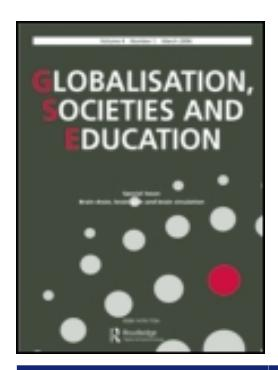

<!-- A2.R08 | source: papers_json/A2.R08/ -->

## **Globalisation, Societies and Education**

**ISSN: 1476-7724 (Print) 1476-7732 (Online) Journal homepage:****[ www.tandfonline.com/journals/cgse20](https://www.tandfonline.com/journals/cgse20?src=pdf)**

## **أشباح إصلاح التعليم العالي: حول العمليات التنظيمية المحيطة باستعارة السياسات**

## **Katja Brøgger**

**To cite this article:** Katja Brøgger (2014) The ghosts of higher education reform: on the organisational processes surrounding policy borrowing, Globalisation, Societies and Education, 12:4, 520-541, DOI: [10.1080/14767724.2014.901905](https://www.tandfonline.com/action/showCitFormats?doi=10.1080/14767724.2014.901905)

**To link to this article: **[https://doi.org/10.1080/14767724.2014.901905](https://doi.org/10.1080/14767724.2014.901905)

| Image: Calendar icon Published online: 31 Mar 2014. |
| --- |
| Image: Pencil icon Submit your article to this journal Image: external link icon |
| Image: Bar chart icon Article views: 1540 |
| Image: Magnifying glass icon View related articles Image: external link icon |
| Image: CrossMark logo View Crossmark data Image: external link icon |
| Image: Two documents icon Citing articles: 5 View citing articles Image: external link icon |

<!-- page 2 -->

## أشباح إصلاح التعليم العالي: حول العمليات التنظيمية المحيطة باستعارة السياسات

Katja Brøgger*

Department of Education, Aarhus University, Copenhagen NV, Denmark (Received 28 March 2013; accepted 4 March 2014)

تُعد عملية بولونيا Bologna Process من أوسع الأمثلة على عمليات استعارة السياسات. واستنادًا إلى بيانات نوعية، تدافع هذه المقالة عن دراسة جزء من هذه العملية بوصفها "صغرًا عالميًا" global smallness، مع التركيز على الآثار التنظيمية لتطبيق منهج معولم. ومن خلال مفهوم Derrida عن الاستذوات hauntology، وتحليل Fenwick and Edwards للواقعيات المتعددة، وفهم Barad للتشابك والزمن entanglement and time، تستكشف هذه المقالة كيف تستدعي عمليات التطبيق عوالم ممارسات قائمة في آن واحد، مدفوعة بفاعلية الماضي الذي يقلق حاضر إصلاح التعليم العالي. وأخيرًا، تتناول هذه المقالة كيف تميل الإصلاحات الجارية إلى زيادة الفجوة بين "ما يُؤدَّى في الخارج" و"ما يُمارَس في الداخل".

Keywords: globalisation; higher education; the Bologna Process as policy borrowing; curriculum; organisational change; hauntology and 'entanglement and time'

## هذا يغيّر كل شيء: مقدمة

عملية بولونيا هي اسم واحد – وربما الأهم – من بين الأسماء التي تُطلق على التغييرات الكبرى الجارية حاليًا داخل التعليم العالي، سواء داخل أوروبا أو خارجها. تهدف هذه العملية إلى إنشاء منطقة أوروبية للتعليم العالي European Higher Education Area من خلال تحويل هياكل التعليم العالي عبر مبادرات وأهداف مثل التنسيق التعليمي، وقابلية المقارنة، والتنقل، والمرونة، وقابلية التوظيف، وأطر المؤهلات وغيرها الكثير. تعيش Elena، وهي محاضرة، كل هذا. ففي مؤسستها للتعليم العالي، يجري حاليًا تطبيق أمر وزاري ومنهج بكالوريوس جديد، صُمِّم وفقًا لعمليات الإصلاح الأوروبية. تقول:

You know it's like … Oh, how should I put it? …. Well, I think we experience that … I really don't know how to phrase this … That our entire way of … being an education, being colleagues, our relations with management, our culture is … Well of course it needs to develop all the time; I mean it's not like

> ^*^Email: [kabj@dpu.dk](mailto:kabj@dpu.dk)

<!-- page 3 -->

we don't move and it's like … but … I currently experience that there are some fundamental relations in our house which are uhm … highly problematic.

Our working conditions and our culture seem so threatened.

تستكشف هذه المقالة الآثار التنظيمية لصنع السياسات المعولم. وتستند بشكل أساسي إلى بيانات ميدانية من عملية تطبيق أمر وزاري ومنهج تعليمي جديد، صُمِّم وفقًا لعمليات الإصلاح الأوروبية في جامعة وكلية جامعية في الدولة، لكنها تستفيد أيضًا من التطوير الاستراتيجي بين المديرين. وتركز هذه المقالة على آثار تغييرين منهجيين رئيسيين: التحول نحو التقسيم المعياري modularisation ونحو مخرجات التعلم learning outcomes. وتمثل الدراسة بحثًا نوعيًا يستخدم ملاحظات من اجتماعات الإدارة العليا، واجتماعات حول مراجعة التعليم بسبب الإصلاح التعليمي (شارك فيها ممثلون من الإدارة الوسطى والمحاضرين والطلاب)، واجتماعات حول تطوير وحدات محددة (شارك فيها المحاضرون فقط)، وبدرجة أقل، دروسًا صفية (شارك فيها المحاضرون والطلاب). بالإضافة إلى ذلك، تشير الدراسة أيضًا إلى سجلات يومية عبر البريد الإلكتروني أكملها المحاضرون والإدارة الوسطى. استُخدمت مواد من كل من السجلات اليومية والملاحظات لإعداد أدلة المقابلات لثلاثين مقابلة شبه منظمة. وكان المشاركون في المقابلات مديرين في الإدارة العليا والوسطى ومحاضرين. جُمعت هذه الأساليب النوعية المتنوعة مع تحليل وثائقي للوثائق التوجيهية الدولية والوطنية المتعلقة بعملية بولونيا، على المستويين الحكومي والمؤسسي. جُمعت البيانات الميدانية بين مارس 2011 ويناير 2013 وتم إخفاء هويتها.

من أجل فهم الآثار التنظيمية لعملية بولونيا – أي "الصغر العالمي" وكيف تُقلق فاعلية الماضي حاضر إصلاح التعليم العالي – أجمع بين المنهج الإثنوغرافي ودراسات السياسات والفلسفة ما بعد البنيوية. تهدف مساهمتي إلى إثبات أثر عمليات الإصلاح المعولمة على المستوى التنظيمي للتعليم العالي. ولتحقيق هذا الهدف، تتناول هذه المقالة ثلاثة تحديات رئيسية تتعلق ببحث إصلاح التعليم العالي اليوم. أولًا، تتناول التحدي المنهجي المتمثل في فهم "الصغر" العالمي؛ بعبارة أخرى، فهم العمليات المعولمة على المستوى التنظيمي. ويحمل هذا الطموح تحديات منهجية عميقة لأنه يتطلب منا التخلص من مكانة العولمة بوصفها سردية كبرى مهيمنة، وهو ما يؤدي غالبًا إلى تحليلات لا زمنية ولا تاريخية. ويكشف هذا عن الحاجة إلى تطوير لغة مفاهيمية مختلفة تُخضِع العالمي لمفهوم "الصغر الموضعي". تهدف هذه المقالة إلى إعادة صياغة المجال من خلال ربط التطبيق المحلي بعمليات السياسة الدولية، وتستمد إلهامها من بدائل تحليلية (مثل: Derrida [1987](#page-20-0), [1994,](#page-20-0) [2003](#page-20-0); Dale and Robertson [2012;](#page-19-0) Steiner-Khamsi [2004a,](#page-22-0) [2012)](#page-22-0)) ومنهجية (مثل: Barad [2007,](#page-19-0) [2010;](#page-19-0) Fenwick and Edwards [2011](#page-20-0); Law [2003](#page-21-0)) للتحليل الكلي.

<!-- page 4 -->

ثانيًا، تتناول هذه المقالة الطريقة التي يمكن بها فهم عملية بولونيا بوصفها عملية استعارة سياسات واسعة النطاق. وتهدف إلى استكمال الطموح المنهجي المتمثل في دراسة "الصغر"، ولذلك تُتابع من خلال وصف عملية بولونيا بأنها عملية استعارة سياسات. إن فهم عملية بولونيا بوصفها عملية استعارة سياسات – شيئًا يتألف من "إصلاحات مسافرة" travelling reforms – يمكّننا من التركيز على السياقات السياسية المحلية أو الأسباب السياقية لتبني أو رفض استعارة الإصلاحات الدولية.

ثالثًا، تتناول هذه المقالة فكرة أن إصلاح التعليم العالي "مُقلَق" بفاعلية الماضي. لقد أدت عملية بولونيا إلى إصلاح منهجي واسع النطاق في جميع أنحاء أوروبا وخارجها، ولذلك اختارت هذه المقالة المناهج المعولمة محورًا لها. ويشير هذا أيضًا إلى أن تطوير المنهج وتغييره يُعدّان جزءًا من سياسة التعليم، رغم أنهما غالبًا ما يُعاملان بوصفهما مجالًا بحثيًا مستقلًا. وتُحلَّل الآثار التنظيمية للمناهج المعولمة من خلال مصطلح Derrida الجديد "hauntology": تعليم حول "ما يُطارد" يمكّننا من فهم القوة التأسيسية للماضي. بعبارة أخرى، يساعدنا على إدراك كيف تستمر بعض الجوانب التي تبدو مستبعدة من الإصلاحات الحالية في التأثير تأسيسيًا على ما يُمارَس. ويستمد هذا التحليل إلهامه أيضًا من مفهوم Fenwick and Edwards للواقعيات المتعددة ومفهوم Barad للتشابك والزمن، مسلطًا الضوء على الطابع الأنطولوجي للممارسات المنفصلة وفكرة أن الماضي يُعاد تشكيله وترتيبه باستمرار، وبالتالي فهو حي جدًا. وبهذا المعنى، تُقلق فاعلية الماضي إصلاحات التعليم العالي الحالية. وبناءً عليه، تتناول المقالة كيف تميل الإصلاحات الجارية إلى زيادة الفجوة بين "ما يُؤدَّى في الخارج" و"ما يُمارَس في الداخل".

وكما يخبرنا الاقتباس الافتتاحي لـ Elena، فإن عملية بولونيا تغيّر كل شيء بالنسبة للعاملين في التعليم العالي؛ طريقتهم في كونهم تعليمًا، وزملاء، وعلاقاتهم بالإدارة، وثقافتهم. ولفهم ما إذا كانت تجربة Elena لعملية بولونيا بوصفها مغيّرة للحياة مرتبطة بالعمليات المعولمة وكيف، نحتاج أولًا إلى تصميم لغة مفاهيمية مختلفة يمكنها التقاط "الصغر العالمي".

## النظر إلى الأسفل: مقاربة منهجية

خضع مفهوم العولمة لعملية تطبيع شبه غير مرئية لكنها شاملة، بمعنى أنه يُستدعى عالميًا كوسيلة أساسية لتفسير كل ما يحدث ضمن مجالات السياسة أو الاقتصاد أو الثقافة. وبهذا المعنى، أصبح نوعًا من الاستعارة الحاوية container metaphor ويخضع لجدل واسع (Held and McGrew [2007;](#page-20-0) Scholte [2008)](#page-21-0)). يرى البعض أن العولمة تشير إلى تجانس أو تهجين ثقافي يُنتج هوية عالمية، بينما يؤكد آخرون أن العولمة مسار نحو تجدد ثقافي وتنوع مستمرين.

<!-- page 5 -->

علاوة على ذلك، استحوذت جهات فاعلة من كامل الطيف السياسي على المفهوم وأضافت له غموضًا بجعله يخدم أيديولوجيات مختلفة (Guillén [2001,](#page-20-0) 235–260; Held [2002,](#page-20-0) 305). استُخدم المصطلح الإنجليزي "globalisation" لأول مرة للدلالة على شيء "عالمي النطاق" عام 1960 (Guillén [2001,](#page-20-0) 238). ومع ذلك، يبدو أن هناك الآن نوعًا من الاتفاق على أن "العولمة" تشير إلى تحول في طريقة تنظيم الإنسان للعالم: تحول في الهياكل والممارسات والعلاقات الاجتماعية السياسية والاقتصادية والثقافية. ويربط هذا التحول مجتمعات متباعدة جغرافيًا ويوسّع روابط القوة السياسية والقضائية عبر مجتمعات العالم وقاراته (Dale and Robertson [2012;](#page-19-0) Held [2002;](#page-20-0) Robertson and Dale [2008;](#page-21-0) Scholte [2005](#page-21-0)).

سمّى Derrida العولمة "الجليل الهائل" the colossal sublime، نوعًا من "الجليل ما بعد الحداثي" postmodern sublime، ظاهرة ذات أبعاد متجاوزة تكسر كل ما سبقها ولا تعادل إلا نفسها (Derrida [1987,](#page-20-0) 135, [2003;](#page-20-0) Li [2000](#page-21-0), 1). يتناول Derrida الطابع المفاهيمي والخطابي والبلاغي للظاهرة: طموح المفهوم ليصبح "كلمة سيدة" Master word تسمّي العمليات الطاغية التي تؤطر عالمنا المعاصر (Li [2000,](#page-21-0) 9). يتفاعل Derrida بشكل نقدي مع هذا الادعاء الكلي والعالمي والميل نحو الاكتفاء الذاتي والحتمية الذي يبدو أنه يلغي التاريخية ويخلق انطباعًا بأن الخطاب "خطاب أدائي انتقائي يجد ما يبحث عنه ويصدق ما يخلقه" (Li [2000,](#page-21-0) 10, 34). وهذا في جوهره نقد لما يصفه Dale and Robertson أيضًا بالميل إلى النظر إلى الفئات باعتبارها طبيعية وثابتة. ويريان أن هذه الافتراضات الكبرى أدت إلى ميول معينة، مثل "الصنمية المكانية" spatial fetishism، وهي الميل إلى تجسيد وتطبيع عمليات مثل العولمة (كما في "العولمة تفعل")، مما يحبسنا في تحليلات لا زمنية ولا تاريخية (Dale and Robertson [2012](#page-19-0), 27).

تترك هذه الدراسة وراءها منظور العولمة الشائع المتعلق بالتغيرات الهيكلية في الدول الوطنية والاقتصادات الوطنية. وبدلًا من ذلك، تركز على العولمة في علاقتها بالتعليم العالي وتحديدًا في علاقتها بصنع السياسات والعمليات التنظيمية. غير أن هذا بالتحديد ما يزعزع المجال البحثي. يمسّ نقد Derrida قضيتين منهجيتين أساسيتين عند دراسة العمليات المعولمة. أولًا، يسلّط الضوء على قضية تكشف خلافات علمية محتملة داخل فلسفة العلم: تميل العولمة إلى أن تصبح "شاملة لكل شيء" عندما تظهر في صيغتها الاسمية المجسّدة؛ فكاسم، تشمل الكلمة السيدة الطاغية Globalisation كل شيء من الإرهاب وتغير المناخ إلى الأنظمة التعليمية. وعند استخدامها ككلمة سيدة، تميل العولمة إلى أن تُوصف بأنها عملية حتمية دون أي فاعلية محددة مرتبطة بها. وما يغيب غالبًا في السرديات الكبرى هو أهمية الفاعلية في تفسير عمليات السياسة والتفاوض عليها وفي آثار السياسة (Rizvi and Lingard [2010,](#page-21-0) x). علاوة على ذلك، يستمد هذا الخطاب غذاءه من افتراضات فلسفية مختلفة جدًا حول "العالم والحياة" عن تلك التي يقوم عليها مشروعي،

<!-- page 6 -->

وهي افتراضات ترفض وجود دال متعالٍ وتركز على المفهوم الأدائي للعولمة كما يظهر في أشكالها الفعلية والفعلية المتحركة من العمليات المُعوْلِمة. تجادل Karen Barad، إحدى الرائدات في نظريات الأدائية، بأن التحول نحو بدائل أدائية للتمثيلية يزيح التركيز من المطابقة بين الوصف والواقع إلى الممارسات والأفعال (Barad [2007,](#page-19-0) 28). أو بعبارة أخرى، يزيح التركيز إلى الفاعلية؛ إلى كيفية إنجاز شيء ما.

ثانيًا، يشكك نقد Derrida في المقاربة التحليلية المعتادة. تُشتق كلمة "sublime" من اللاتينية sublimis، وتعني "مرتفع" أو "سامٍ" أو "مرفوع". وبتسمية العولمة "sublime"، يشكك Derrida في تخيل العولمة على أنها شيء "هناك في الأعلى" وكيف يفرض هذا التخيل ضرورة "النظر إلى الأعلى" لدراستها: مقاربة يربطها Law بمبادئ "التعقيد الرومانسي" romantic complexity (Law [2003](#page-21-0)). ويمكن رصد هذه "الرغبة" في النظر إلى الأعلى بوصفها جزءًا من كل من المنظور الداعم للإصلاح والسياسة والمنظور الأكثر نقدية ضمن أبحاث بولونيا. فالمنظور الداعم للسياسة يعيد إنتاج فكرة التطبيق من أعلى إلى أسفل (Eurydice، مجموعة متابعة بولونيا، تقارير Trends، وحصر النتائج وتقارير المقارنة المرجعية الوزارية، إلخ؛ Keeling [2004)](#page-21-0)). أما المنظور النقدي فغالبًا ما يكون موجَّهًا أيديولوجيًا ومستوحى من نظرية الحوكمة governmentality theory. ويميل هذا البحث إلى التركيز على كيفية تميّز عملية بولونيا بأجندة نيوليبرالية (Fejes [2006,](#page-20-0) [2008](#page-20-0)). ويميل كلا المنهجين إلى البقاء أسيرين "لضرورة" "النظر إلى الأعلى" كشرط مسبق: إما "التطبيق من أعلى إلى أسفل" أو "أنظمة الحوكمة" النابعة من مستوى الإدارة أو النيوليبرالية "في حد ذاتها" (Shore and Wright [1997](#page-21-0); Staunæs [2007](#page-22-0)).

غير أن هذه المقالة تجادل بأنه من أجل دراسة بُعد الفاعلية في العمليات المعولمة ومن أجل فهم العمليات المعولمة على المستوى التنظيمي، يحتاج المرء في الواقع إلى النظر إلى الأسفل داخل عمليات التنظيم التفصيلية. وتُستمد مقاربة "النظر إلى الأسفل" من تفصيل Law حول "التعقيد الباروكي" baroque complexity – وهو مفهوم مستوحى من Leibniz وDeleuze – الذي يمكّن الباحث من تحديد التعقيد واستكشافه بالتفصيل (Law [2003,](#page-21-0) 6). ودراسة العولمة بالنظر إلى الأسفل تتحدى الفكرة القائلة، بطرق عدة، إن مفهوم العولمة يبدو محجوزًا للتغيرات الهيكلية الكبرى. ويُؤكد باستمرار أن للعولمة أثرًا هائلًا على الحياة اليومية، ومع ذلك يصعب علينا إظهار الطرق التي يحدث بها ذلك إن أصررنا على أن العولمة تتعلق فقط بالتغيرات والتحولات الهيكلية الكبرى. ومع ذلك، إذا حررنا العولمة من التحولات على مستوى الدولة الوطنية والاقتصاد الكلي، فإن اللغة المفاهيمية – المرتبطة ارتباطًا وثيقًا بالتحليل الكلي – تميل أيضًا إلى الإفلات من قبضتنا. لذلك، هناك حاجة إلى لغة مفاهيمية مختلفة حول العولمة: أدوات تحمل حساسيات منهجية ونظرية وتمكّننا من التقاط التحولات واللاخطية والصغر العالمي.

<!-- page 7 -->

في السنوات الأخيرة، سعى الباحثون إلى التخلص من مكانة العولمة التطورية بوصفها أحدث مرحلة من السرديات الكبرى (Tsing [2005,](#page-22-0) 58). ويقدم الباحثون حاليًا بدائل أدائية من خلال استكشاف فهم وصياغات ودراسات للعولمة تختلف عن التحليل الكلي وتهدف إلى إعادة صياغة المجال بربط التطبيق المحلي بعمليات السياسة الدولية. وأقترح أن هذه صياغات تحليلية للعولمة بوصفها عمليات مُنشأة ومتفاوَض عليها ومتنازَع عليها (Rizvi and Lingard [2010](#page-21-0); Shore and Wright [1997](#page-21-0); Tsing [2000)](#page-22-0))، أو بوصفها حركات محددة لأفكار وممارسات السياسة (Robertson and Dale [2008;](#page-21-0) Dale and Robertson [2012](#page-21-0); Steiner-Khamsi [2004a,](#page-22-0) [2004b,](#page-22-0) [2012](#page-22-0); Rosenau [2008;](#page-21-0) Phillips [2004;](#page-21-0) Whitty [2012;](#page-22-0) Carney [2009;](#page-19-0) Cuban [1998](#page-19-0); Rizvi and Lingard [2010](#page-21-0)) أو شيئًا يقع بين الواقعي والمتخيَّل (Steiner-Khamsi [2004b)](#page-22-0)). كما أقترح أنها صياغات منهجية للعمليات المعولمة وحركات السياسة والمقياس، مدفوعة (في الغالب) بنظرية ما بعد الإنسانوية والأدائية، التي تسعى إلى إحياء الاعتبارات الأنطولوجية، كما في حالة الواقعية الفاعلة agential realism عند Barad أو فهم Fenwick and Edwards المستوحى من نظرية الفاعل-الشبكة ANT لعمليات السياسة على أنها متحركة عبر مفاوضات دقيقة، أو اقتراح Rosenau منهجية مستوحاة من الصحافة تنتقل من حوادث دقيقة إلى عمليات أعم، أو منظور "الدراسة عبر" studying through الأنثروبولوجي-السياسي عند Reinhold، أو تحويل Law المستوحى من Leibniz وDeleuze للعالمي إلى "صغر" موضعي (Barad [2007;](#page-19-0) Fenwick and Edwards [2011](#page-20-0); Law [2003](#page-21-0); Rosenau [2008;](#page-21-0) Shore and Wright [1997](#page-21-0); Wright and Reinhold [2011](#page-22-0)). تمثل هذه المقاربات توضيحات أدائية للعولمة والتعليم لكنها مرتبطة بمجال أوسع من الباحثين ما بعد البنيويين الذين يرغبون في التأكيد على المادية والفاعلية كعوامل مهمة (Bramming [2012;](#page-19-0) Butler [1993](#page-19-0); Haraway [1991](#page-20-0); Juelskjær [2013](#page-20-0); Juelskjær, Staunæs, and Ratner [2013;](#page-21-0) Mol [2002;](#page-21-0) Staunæs [2007](#page-22-0); Søndergaard [2013)](#page-22-0)). وبطرق متنوعة، تميل هذه المقاربات إلى التخلي عن تخيل العالمي كالكلي والمحلي كالجزئي. كما تحاول، كما يقترح Robertson، تحدي التفسير الحصري للعالمي كمقياس، يدل بشكل أساسي على الحجم، وتوسيعه بفهم العالمي كامتداد، يدل على الأثر (Robertson et al. [2012)](#page-21-0)). تحدّ السرديات الكبرى من خيالنا التحليلي. ومع ذلك، فإن تركها جانبًا يواجهنا بتحدٍ هائل، إذ تركز كثير من المفاهيم التحليلية الحالية بشكل شبه حصري على الظواهر الكلية (Rosenau [2008)](#page-21-0)).

## استعارة السياسات

وفقًا لـ Rizvi and Lingard، "لا يمكن النظر إلى العولمة على أنها ظاهرة معممة بل يجب النظر إليها على أنها ظاهرة ديناميكية تُعبَّر عنها في تواريخ وتشكيلات سياسية معينة" (Rizvi and Lingard [2010,](#page-21-0) x). فبالنسبة لهما، السياسة نتاج وعملية في آن واحد. ويرفضان الروايات الأحادية الاتجاه والخطية لعملية السياسة بوصفها شيئًا ينبثق

<!-- page 8 -->

من تحديد الأجندات السياسية وإنتاج نص السياسة وتطبيقه في الممارسة. وبدلًا من ذلك، يؤكدان على العلاقات الفوضوية والمتنازَع عليها واللاخطية القائمة بين مناطق التفاوض المختلفة في عملية السياسة. فالجهات الفاعلة المشاركة ليست مجرد أوعية سلبية (Rizvi and Lingard [2010](#page-21-0), 5, 6). وعلى الرغم مما يمكن أن نسميه ظروفًا عالمية جديدة، يجادل Rizvi and Lingard ضد معاملة العمليات العالمية بوصفها حتمية تاريخيًا: بوصفها عمليات يجب على الناس والدول ببساطة التكيف معها.

استعارة السياسات وإقراضها، ونقل السياسات، وتنقّل السياسات، وسفر السياسات، وحركة السياسات، وجذب السياسات، وسياحة السياسات، كلها مصطلحات تهدف إلى وصف حركة أفكار وممارسات السياسة، بما في ذلك تلك المتعلقة بالتعليم العالي (Dale and Robertson [2012](#page-19-0); Steiner-Khamsi [2004a,](#page-22-0) [2012)](#page-22-0)). إن استعارة السياسات، المفهومة ليس فقط كمجال بحثي بل أيضًا كمقاربة بحثية، تتيح طريقة لتفعيل تتبع العمليات المعولمة كفاعليات محددة على المستوى التنظيمي والفردي. أو بعبارة أخرى، تقدم إطارًا مفاهيميًا لدراسة جذب السياسات عبر الوطني، بما في ذلك العلاقة بين الأحداث الموضعية والديناميكيات الدولية (Carney [2009,](#page-19-0) 63; Phillips [2004](#page-21-0)). وبدلًا من التركيز على الظواهر الكلية، يركز الباحثون المهتمون بالإصلاحات المتنقلة على السياقات السياسية المحلية أو الأسباب السياقية لتبني أو رفض استعارة الإصلاحات الدولية. وإلى جانب ذلك، يسلّط عدة معلقين آخرين، مثل Dale and Robertson [(2012](#page-19-0))، وMarsh and Sharman [(2009](#page-21-0))، وSteiner-Khamsi، الضوء على بُعد الفاعلية في دراسة عمليات نقل السياسات: "إن التركيز على السياق السياسي المحلي كوحدة تحليل لفحص نقل السياسات يمنح وزنًا أكبر للفاعلية والعملية والأثر وتوقيت استعارة السياسات" (Steiner-Khamsi [2012,](#page-22-0) 5). وبهذه الطريقة، يختلف منظور استعارة السياسات عن المنظورات التي تعيد إنتاج فهم الإصلاحات على أنها حتمية وتقترب "من الخارج" أو "من الأعلى"، كما ورد في القسم السابق. كما يحدد Keeling [(2004](#page-21-0)) أن البحث حول التطبيق الفعلي لعمليات السياسة داخل المؤسسات التعليمية يبدو ناقصًا. ويعود هذا على الأرجح جزئيًا إلى الإصرار المستمر نوعًا ما على أن العمليات المعولمة تنتمي حصريًا إلى المستوى الهيكلي الكلي (كما أشير سابقًا، لا توفر هذه المقاربة لغة لالتقاط "الواقعيات" المتغيرة على المستوى التنظيمي)، لكنه يعود أيضًا إلى الطريقة التي يُفهم بها تشكيل السياسة؛ إذ غالبًا ما يقوم على افتراض أن تحليل السياسة يتضمن دراسة عمليات صنع قرار عقلانية وخطية. وتُظهر عملية بولونيا متعددة الطبقات بوضوح أن هناك ما هو أكثر بكثير من ذلك.

بسبب الإصلاحات الدولية العميقة، نواجه حاجة متزايدة لاستكشاف الفضاءات التعليمية الدولية، مثل عملية بولونيا، في التعليم العالي؛ ليس فقط كظاهرة كلية، بل أيضًا كفضاء تعليمي يشمل الفاعليات على المستويين التنظيمي والفردي (Dale and Robertson [2012](#page-19-0); Steiner-Khamsi [2012](#page-22-0)).

<!-- page 9 -->

## الأطراف السائبة لعملية بولونيا

تستند عملية بولونيا إلى إعلان بولونيا، الذي صادقت عليه 47 دولة بحلول إطلاق منطقة التعليم العالي الأوروبية عام 2010 (EHEA-Ministers [2010)](#page-20-0)). ولا يمكن اعتبار عملية بولونيا سردية متماسكة واحدة ولا ظاهرة متسقة ومتناغمة (Keeling [2004](#page-21-0)). ولا تملك منطقة التعليم العالي الأوروبية "مركزًا" واحدًا، بل يبدو أن المؤسسات التعليمية الأوروبية مرتبطة ببعضها بشكل غير متماثل، مما يجعل ما يسمى عملية بولونيا إطارًا مرجعيًا مفتوحًا نسبيًا، ما يشير إلى أن عمليات مثل بولونيا وفّرت فرصة مرحّبًا بها لتبرير وتسريع الإصلاحات التعليمية المحلية (Ravinet [2008](#page-21-0); Steiner-Khamsi [2004b](#page-22-0)). ويمكن القول إن منطقة التعليم العالي الأوروبية تعمل بمثابة مثال تنظيمي (Nóvoa and Lawn [2002](#page-21-0)) وبالتالي، بطريقة ما، مرجعية عمياء. وبالطبع، هذا الوضع – حيث لا توجد حدود واضحة لهذه العمليات المجزّأة – يعقّد الفحص التجريبي لعملية بولونيا ويكشف تحديات نظرية ومنهجية كبرى. علاوة على ذلك، لا توجد سلطة تشريعية مرتبطة بالعملية، ولذلك تحققت بوتيرات مختلفة بسبب ما يسمى بطريقة التنسيق المفتوحة open method of coordination (OMC)، القائمة على الطوعية ومنح أولوية أكبر للمقارنة المرجعية وأفضل الممارسات المحلية (Dale [2004;](#page-19-0) Gornitzka [2005](#page-20-0); Henckel and Wright [2008;](#page-20-0) Keeling [2006](#page-21-0)). وتعمل طريقة OMC من خلال قيام الدول الفردية بتطبيق المفاهيم والأفكار ضمن القوانين واللوائح الوطنية. وبسبب الضغط الجماعي وهياكل الحوافز العميقة، لا يبدو أن البقاء خارج إطار OMC خيارًا واقعيًا. ويمكن للتقنيات "الناعمة"، مثل OMC، أن تكون أدائية بشكل قوي (Dean [2007)](#page-20-0)). ويُعد التحول المستمر لهياكل حوافز بولونيا مثالًا مقنعًا على ذلك. فمن بداياتها غير الرسمية والمرنة، انزلقت العملية نحو قيود أكثر توحيدًا ورسمية أثبتت أنها مُلزِمة جدًا للدول الموقّعة (Ravinet [2008)](#page-21-0)). ويظهر هذا بأقوى صوره من خلال تطور آليات المتابعة المطبقة خلال العملية. ويحدد Ravinet [(2008](#page-21-0)) هذه العملية بوصفها تحولًا من "المشاركة الطوعية" إلى "التنسيق المُراقَب". ومن بين التقنيات التأديبية المستخدمة لتقييم تطبيق أهداف بولونيا التقارير الوطنية، وتقارير Trends الصادرة عن رابطة الجامعات الأوروبية (EUA)، وتقارير الحصر، ومجموعة متابعة بولونيا (BFUG). وفي البداية، تكون التقارير الوطنية طوعية، لكنها سرعان ما تصبح مُلزِمة وتتبعها مطالب بتوحيد واسع النطاق يسهّل إجراء مقارنات بين الدول المشاركة. ويقترن هذا بالاستخدام المتزايد لبطاقات الأداء المُرمَّزة بالألوان [أخضر داكن لـ"أداء ممتاز"، أخضر فاتح لـ"جيد جدًا"، ومن هنا وصولًا إلى الأحمر، الذي يشير إلى أنه "لم يُحرَز تقدم يُذكر بعد"، كما يظهر في تقارير الحصر (BFUG-Stocktaking-Working-Group [2005](#page-19-0), 15)]. وتؤدي هذه التقنيات إلى آثار أدائية بخلقها

<!-- page 10 -->

"حوافز" من خلال المنافسة وآليات "التسمية والتخجيل" naming and shaming، كما يوثق Ravinet ([2008)](#page-21-0)) بوضوح. ويضيف احتمال الإحراج جراء الفشل ضغطًا هائلًا، وهذا بدوره يدفع عملية التطبيق (Ravinet [2008,](#page-21-0) 362). ويرتبط تكثيف تقنيات الإدارة التنظيمية أيضًا بزيادة التشابك مع استراتيجيات التنافسية (النمو) الأوروبية في حد ذاتها. ومنذ إعلان بولونيا عام 1999، قُطعت وعود بزيادة التنافسية الدولية لنظام التعليم العالي الأوروبي. وفي عام 2007، اعتمد الوزراء الأوروبيون استراتيجية منطقة التعليم العالي الأوروبية في سياق عالمي، والتي صُمِّمت لتعزيز التنافسية. وإلى جانب استراتيجية النمو للاتحاد الأوروبي، أوروبا 2020، تشكل هذه الاستراتيجية جزءًا من أجندة تحديث التعليم العالي، المنشورة عام 2011 (EHEA-Ministers [2007;](#page-20-0) European Commission [2010](#page-20-0), [2011](#page-20-0)). وتصوّر هذه الاستراتيجيات التعليم العالي بوصفه محركًا قويًا للنمو الاقتصادي. وفي عام 1999، لم تكن هناك طريقة للتنبؤ "بالأبعاد المستقبلية" لعملية بولونيا أو توقع آثارها، لا سيما آثارها غير المقصودة مثل تفكيك المبادئ التنظيمية التأسيسية في مؤسسات التعليم العالي، والصراع الحاد بين المحاضرين، وظهور ممارسات الظل (التي ستُدرَس في الأقسام التالية).

بما أن عملية بولونيا تعمل بتقنيات متابعة فعّالة للغاية، رغم طابعها المجزّأ، فإن عولمة عملية بولونيا ربما تكون واحدة من أوسع الأمثلة على نقل السياسات في التعليم العالي (Dale and Robertson [2012](#page-19-0); Steiner-Khamsi [2012)](#page-22-0)). أدت طموحات بولونيا إلى إصلاح منهجي واسع النطاق في جميع أنحاء أوروبا وخارجها: تدفقات من السياسات والممارسات التعليمية، سمّاها Naidoo أيضًا آليات استهلاكية ([2003](#page-21-0); Naidoo, Shankar, and Veer [2011](#page-21-0)). وتشمل هذه الإصلاحات تحولات من هياكل زمنية فصلية إلى هياكل معيارية modular، حيث تشكل كل وحدة modul وحدة تعلم قائمة بذاتها ويجب اجتيازها باختبار. كما تتضمن تحولات في التوجه، من مناهج موجَّهة نحو تطور الطالب طوال دراسته إلى مناهج موجَّهة نحو مخرجات التعلم؛ المعرفة والمهارات والكفاءة، كما حددها الإطار الأوروبي للمؤهلات European Qualification Frameworks (EQF) (EHEA-Ministers [2001,](#page-20-0) [2005](#page-20-0); European Commission [2008](#page-20-0)). ويتعلق جوهر EQF بثمانية مستويات مرجعية، تصف ما يعرفه المتعلم ويفهمه ويستطيع فعله عند إتمام عملية التعلم. ويتبع الإطار الدنماركي للمؤهلات الإطار الأوروبي فيما يتعلق بمخرجات التعلم، وتُوظَّف مخرجات التعلم هذه في أوامر ومناهج وزارية تعليمية جديدة. وقد غيّرت العملية بأكملها معنى الحديث عن المعرفة والتنظيم التعليمي، ومن خلال ذلك، غيّرت أيضًا ما هو قابل للقول والفعل وربما حتى ما يُمكن تجسيده كفاعل يشارك في عمليات التنظيم. غير أن البيانات الميدانية التي تستند إليها هذه المقالة تشير إلى أن هذا قد يكون تغيّر بطرق غير متوقعة. ويبدو أن انهيار الماضي والحاضر يؤدي إلى

<!-- page 11 -->

عواقب غير متوقعة. ولاكتشاف ما يحرّك ويغيّر "الواقعيات" على المستوى التنظيمي، نحتاج إلى أداة تحليلية تساعدنا على إظهار القوى التأسيسية.

## علم الاستذوات (Hauntology)

يعبّر المفهوم الفلسفي لعلم الاستذوات hauntology عن طريقة تفكير تمكّننا من فهم الطرق التي تُطارَد بها عمليات الإصلاح بما يبدو غائبًا. وترتبط هذه المقاربة التحليلية أيضًا بالطريقة التي يتيح بها المنهج الإثنوغرافي المستخدم هنا الوصول إلى ما لا يكون مرئيًا مباشرة: الوصول إلى ما "ليس موجودًا هناك". وبهذا المعنى، تصبح الإثنوغرافيا نوعًا من "إثنوغرافيا الغياب": أداة لاستكشاف الآثار التأسيسية لما يُفترض أنه غائب:

As in Hamlet, the Prince of a rotten state, everything begins with the apparition of a specter. (Derrida [1994,](#page-20-0) 2)

في كتاب "أشباح ماركس" Specters of Marx الصادر عام 1994، بدأ Derrida بتطوير مفهومه عن الأشباح بابتكار مصطلح جديد، ما يسمى "علم الاستذوات" hauntology: "تعليم حول ما يُطارِد". ويكاد يكون علم الاستذوات نظيرًا صوتيًا لعلم الوجود ontology في الفرنسية. فبينما يمثل علم الوجود التعليم حول ما هو موجود، تعليمًا حول Da-sein، الكينونة-هناك، فإن علم الاستذوات تعليم حول ما ليس كائنًا-هناك (Derrida [1994,](#page-20-0) 202). وبطريقة ما، يُعد علم الاستذوات مكمّلًا لعلم الوجود، وقد تعلمنا من أعمال Derrida أن القوة التأسيسية تميل إلى أن تكون متضمَّنة في المكمّل، "البقية"، الهوامش، أو ما يبدو "غائبًا". فالأشباح أنصاف حياة. إنها ممر يتعذر رصده بين المواقع والزمن، وقادرة على انهيار الماضي والحاضر. ووفقًا لـ Derrida، لا وجود لـ Da-sein للشبح. لكن لا وجود أيضًا لـ Da-sein دون غرابة (Unheimlichkeit) شبح ما. وبطريقة ما، الأشباح "غياب" له فاعلية (Brøgger [2013;](#page-19-0) Brøgger and Staunæs [2012](#page-19-0)). وما هو غائب "يُزعج" دائمًا. إنه يتجاوز الكينونة لكنه يظهر ويطارِد. الشبح revenant عائد: يعود، "يشبح"، "يستَذ"، كما يقول Derrida [(1994](#page-20-0), 10, 166):

A question of repetition: a specter is always a revenant. One cannot control its comings and goings because it begins by coming back. (Derrida [1994](#page-20-0), 11)

يتيح لنا تقديم مفهوم علم الاستذوات في هذه الدراسات طرح نقطة فلسفية وتجريبية معًا. تؤكد الرؤية الفلسفية أن الأشباح تطارد أولًا وقبل كل شيء Da-sein أو علم الوجود بحد ذاته: فكرة أنه بإمكاننا تجميد المواقف الأنطولوجية أو التركيز على أنطولوجيا هيمنية واحدة. وترتبط هذه الرؤية بالمادة التجريبية؛ فمن ناحية، يبدو أن عمليات الإصلاح تُطارَد بما يبدو غائبًا؛ وأن التغيير في المؤسسة مدفوع بشيء عائد من الغياب (وهو تحديدًا، كما سنرى في هذه الحالة،

<!-- page 12 -->

المجموعات التخصصية القديمة). ومن ناحية أخرى، من المستحيل تمامًا تحديد "واقع" المؤسسة؛ بل يبدو أن "واقعيات" متعددة تُستدعى بدلًا من ذلك.

## "الواقعيات" المتعددة والمتشابكة

يقدم Fenwick and Edwards إعادة صياغة مستوحاة من نظرية الفاعل-الشبكة ANT لعمليات السياسة (Fenwick and Edwards [2011](#page-20-0)) وثيقة الصلة جدًا بمنهجية Barad الانكسارية diffractive methodology، التي تعرضها في عملها الرئيسي الصادر عام 2007، "لقاء الكون في منتصف الطريق" Meeting the Universe Halfway. مستفيدين من ابتكارات ما بعد بنيوية سابقة (مثل Haraway وMol)، يُدخل Fenwick and Edwards المادية إلى البحث التربوي. وبينما تستمد Barad أفكارها من فيزياء الكم (Niels Bohr)، والفلسفة القارية (Foucault وDerrida)، والدراسات الكويرية (Haraway وButler)، يلتقي Fenwick وEdwards وBarad في اهتمام مشترك بإحياء مكانة علم الوجود أو ببساطة المادية في الفكر ما بعد البنيوي. وبينما تقدم Barad إطارًا أنطو-إبستيمولوجيًا، ما يسمى الواقعية الفاعلة agential realism، وبذلك تضع عملها كتقويض عميق للتمثيلية (Barad [2007,](#page-19-0) 44)، يختار Fenwick وEdwards معارضة البنائية constructivism. وينتقدان فكرة أن البنائية لا تقدم سوى منظورات مختلفة عن عالم يُفترض ضمنيًا وغالبًا دون قصد أنه موجود. ويجادل Fenwick وEdwards بأن التنوع لا يُنتَج بمنظورات متعددة، بل إننا في الواقع جزء من "عوالم" أو "واقعيات" مختلفة تتعايش وتتداخل، "متلاصقة معًا في نفس الفضاءات المادية" (Fenwick and Edwards [2011,](#page-20-0) 710, 722). ودراسة هذه الأنطولوجيات المتداخلة تعني، وفقًا لـ Fenwick وEdwards، ملاحظة تكاثر الممارسات والمعاني كعوالم مختلفة، لا مجرد وجهات نظر عالمية مختلفة (Fenwick and Edwards [2011,](#page-20-0) 722). ويعني هذا أن السياسة تصبح مسألة "انخراط هش لأنطولوجيات متعددة بدلًا من التسامي المستقر إلى أنطولوجيا واحدة"، وأن تطبيق السياسة يصبح "لصق أجزاء من واقعيات مختلفة معًا" (Fenwick and Edwards [2011,](#page-20-0) 723).

من خلال اتخاذ الأنطولوجيات المتعددة نقطة انطلاق، يصبح ممكنًا إظهار التباين الأنطولوجي في تطبيقات السياسة التعليمية والممارسات التي يتفاوض من خلالها مختلف الفاعلين السياسيين على هذه التعددية (Fenwick and Edwards [2011,](#page-20-0) 724). ويعني هذا أساسًا استكشاف كيفية توزيع الفاعلية وكيف تثبت بعض تجلياتها وتتحلل في استقرارات مؤقتة (Fenwick and Edwards [2011,](#page-20-0) 721). وترتبط هذه الاستقرارات بمفهوم Barad للقطع الفاعل agential cuts (Barad [2007](#page-19-0), 345, 347). فممارسات مادية محددة – أجهزة apparatuses – تُفعِّل ما يسمى القطع الفاعل. ووفقًا لـ Barad، التي تستفيد من مفهوم Butler للأدائية بوصفها ممارسة تكرارية واستشهادية، فإن الأجهزة ممارسات مفتوحة النهاية ترسم حدودًا، وإعادة تشكيل ديناميكية وتكرارية للعالم (Barad [2007](#page-19-0), 167, 184, 208; Butler [1993](#page-19-0), 2). كل قطع، طريقة قراءة شيء أو فحصه، يستدعي "عالمًا" مختلفًا، أو بشكل أدق، كل قطع يشكل إعادة تشكيل ديناميكية للعالم. ويغيّر هذا أساسًا إدراك علم الوجود من كيانات في الميتافيزيقا

<!-- page 13 -->

التقليدية إلى أنطولوجيا متشابكة. ففي الميتافيزيقا التقليدية، تُعد الإبستيمولوجيا والأنطولوجيا منفصلتين وتُعتبران تناقضًا ثنائيًا: موقف يستمر من الوضعية الكلاسيكية إلى الواقعية النقدية. وفي فكر Barad، لا يمكن التمييز بشكل ذي معنى بين الإبستيمولوجيا والأنطولوجيا؛ فهناك فقط أنطو-إبستيمولوجيا. وربما الأهم من ذلك، أن الميتافيزيقا الكلاسيكية تتعلق كلها بإيجاد تمثيلات دقيقة. غير أن Barad تسلط الضوء على مقاربة أخرى تؤكد أن ممارسات مختلفة لها أهميتها؛ وأن العالم ببساطة يتجسد بشكل مختلف من خلال ممارسات مختلفة (Barad [2007](#page-19-0), 89).

## فاعلية الأشباح

Enter the ghost, exit the ghost […] (Hamlet) […]. (Derrida [1994](#page-20-0), xix)

ترى Karen محاضرَين يقتربان منها. إنهما من مجموعة تخصصية أخرى. يتحركان بسرعة، وبتصميم ودقة كبيرة. وهي على وشك دخول مكتب لكنهما يفاجئانها عند الباب. يحاصرانها ويوقفانها بأسلحتهما (الأمر الوزاري والمسودات الأولى للمنهج). وهما يحدقان بها، يطالبانها بالتنازل عن بعض نقاط ECTS من مجموعتها لصالح مجموعتهما. أليس من العدل أن تفعل ذلك؟ فالمحتوى المرتبط بهذه النقاط يعود إليهما بحق. لطالما غطّيا هذا المجال، كما يجادلان. إنها جديدة، لا تعرف كيف تتصرف، ولا ما يجري. لم يسبق أن حُوصرت هكذا من قبل. تحاول الفرار، لكنهما يستمران في الجدال ومحاولة إقناعها. وأخيرًا، تهرب إلى المكتب.

يقول Chris، محاضر آخر، خلال مقابلة:

This has become everybody fighting everybody […] It seems as if there are small juntas showing up everywhere […] I've never been so alert before in my life.

أحدثت الأوامر والمناهج الوزارية الجديدة، المصممة وفقًا لعمليات الإصلاح الأوروبية، آثارًا عميقة، إذ تسببت في إعادة تنظيم توزيع العمل وتحولات في المواقع. وعند دراسة المادة التجريبية، يبرز تحولان منهجيان بشكل خاص:

- . التحول من الهيكل الفصلي إلى الهيكل المعياري، حيث تُقسَّم الوحدات إلى عدد من نقاط النظام الأوروبي لنقل الاعتمادات European Credit Transfer System (ECTS) (وتُستخدم ECTS كمعيار أوروبي مشترك يمكّن من قياس عبء العمل والاعتراف بالدراسة في الخارج) ويجب اختبارها فرديًا. ويشير هذا التحول أيضًا إلى تحول من التدريس القائم على المادة إلى التدريس عبر التخصصات.
- . التحول من تنظيم التعليم وفقًا لمجالات المواد إلى تنظيمه وفقًا لما يسمى المجالات الأساسية، المحددة موضوعيًا وغير المرتبطة بأي مادة محددة. ولكل مجال أساسي مخرجات تعلم محددة خاصة به. وتتبع الوحدات

<!-- page 14 -->

المجالات الأساسية، ولذلك يجب اختبار الطلاب ضمن المجالات الأساسية لا ضمن مجالات المواد.

سابقًا، كان التنظيم التأسيسي للعمل يدور حول ما يسمى المجموعات التخصصية، المرتبطة بمجالات المواد. غير أنه، كجزء من النموذج التنظيمي الجديد، يُقسَّم المحاضرون الآن إلى فرق عبر تخصصية تتبع المجالات الأساسية وتطور كل وحدة. وتتحمل هذه الفرق مسؤولية التدريس وتطوير محتوى الوحدات المسندة إليها معًا. وقد أدت هذه المناورة – إعادة تنظيم العمل وفقًا لتطبيق التعليم الجديد – إلى تفكيك المبدأ التنظيمي الأكثر تأسيسًا وقوة بين المحاضرين. سابقًا، كانت المجموعات التخصصية تحتل موقعًا قويًا جدًا داخل المؤسسة التعليمية وتحمي ليس فقط مصالح تخصصها بل أيضًا مصالح المحاضرين في مواجهة الإدارة عمومًا (في نظرها الخاص). ويشير المحاضرون إلى هذه المجموعة بـ"البيت" أو "العائلة" أو "مجموعة الدعم". وقد جرى تهميش المجموعات التخصصية الآن، جزئيًا بسبب المبدأ التنظيمي الجديد – إذ أصبحت الفرق، لا المجموعات التخصصية، مسؤولة عن إدارة الوحدات – وجزئيًا بسبب استبعادها من الأمر الوزاري والمنهج.

وكما رأينا للتو، يتصارع المحاضرون حاليًا على توزيع نقاط ECTS. ورغم أن هذا قد يبدو مفاجئًا، فإن الكثير معرَّض للخطر هنا. تُوزَّع نقاط ECTS وفقًا لحجم الوحدات؛ لكن عند تطوير محتوى هذه الوحدات ضمن فرق، لا يزال كل مشارك في الفريق عبر التخصصي يتصرف كما لو كان يمثل مجموعته التخصصية القديمة، ويتحول تطوير الوحدة جزئيًا إلى تفاوض على نقاط ECTS المرتبطة بمجالات المواد القديمة. وتتسبب هذه العملية في فقدان بعض المحاضرين "حجمًا" تنظيميًا: يصبحون ببساطة أصغر ويحملون جزءًا أصغر من التعليم ككل. لقد قُتلت المجموعات التخصصية القديمة، وبهذا المعنى، هي ميتة وغائبة. ومع ذلك تبدو حية جدًا، مهما كان طابعها الشبحي، وتبدأ في مطاردة الزملاء في الممرات أو في مراقبة الحوار بين المحاضرين.

Enter the ghost, exit the ghost, re-enter the ghost (Hamlet) […]. (Derrida [1994](#page-20-0), xix)

تعود المجموعات التخصصية إلى المشهد. إنه وقت بعد الظهر، ويجتمع المحاضرون في اجتماع فريق. مهمتهم تطوير إحدى وحدات المنهج الجديد. يمثلون خلفيات أكاديمية مختلفة. جميعهم يفهمون أنفسهم بوصفهم مندوبين ينوبون عن مجموعاتهم التخصصية القديمة؛ فعندما يشيرون إلى "نحن"، يقصدون دومًا "مجموعة الدعم". يناقشون محتوى الوحدة. وتتألف ورقة العمل التي بين أيديهم حاليًا من نقاط تحتوي جوانب مختلفة من المعرفة المطلوبة. ويستمرون، وهم يناقشون بأدب أي المجالات تنتمي إلى أي مجموعات تخصصية:

<!-- page 15 -->

تذكر إحدى المحاضِرات، Anne، أن علم النفس والتنظيم والثقافة، برأيها، تتداخل. ويقاطعها محاضر آخر، Vinnie، وينحني للأمام ويقول: "أعتقد حقًا أنه سيكون رائعًا لو تمكّنتم أنتم علماء النفس من تزويد الطلاب بمعرفة أساسية صلبة عن الأبعاد النفسية، ثم نقوم نحن، كعلماء اجتماع، بتدريس الثقافة. غالبًا ما أعتقد أنهم يفتقرون إلى المعرفة النفسية الأساسية الصلبة وهذا مهم جدًا لعملهم المستقبلي وأنتم أيضًا بارعون جدًا في هذا". تقول Anne: دعني أعطيك مثالًا؛ Schein أيضًا اسم كبير في علم النفس، نستخدمه نحن كما تستخدمونه أنتم. ويقول محاضر آخر، Jacob: "أوه، ظننت أنه لنا".

تُزيح إعادة التنظيم المواقع وتحوّل المواقع الهامشية إلى مواقع مهيمنة. فبعض المحاضرين معرَّضون لفقدان الحجم التنظيمي، وبعضهم على وشك استعادة الحجم أو اكتسابه. وكما تُظهر الملاحظة السابقة، يبدو أن المحاضرين يقدّرون تخصصات بعضهم البعض، ومع ذلك، وفي الوقت نفسه، وبطريقة دقيقة جدًا، يستعمِرون مجالات جديدة، كما عندما يثني Vinnie على Anne لبراعتها في تدريس ذلك الجزء من تخصصها الذي لا يمتد إلى مجال Vinnie نفسه. ولم يعد بإمكان المحاضرين المطالبة بتخصصهم كما اعتادوا. عليهم الدفاع عن "أرضهم" بطرق مختلفة أو استغلال إمكانية غزو أراضٍ جديدة. يواصل Vinnie:

But of course we can figure something out, you know, something that makes sense to the students. They know nothing worse than when things are repeated. You know the scenario; you enter class and introduce the subject and they all yell, 'We've already covered that!'. But, of course, we can figure something out.

Vinnie، الذي لا يزال متعاونًا ومتفهمًا جدًا، يستحوذ الآن على وجهة نظر الطلاب، وبالتالي يستطيع أن يؤكد أنه يرغب فقط في حماية مصالحهم. ويستمر الاجتماع بأسلوب مشابه: صراع لاحتكار المجالات مهما بدا دقيقًا ومهذبًا. غير أن الوثيقة التي عليهم تسليمها لا يمكن أن تحتوي هذه المجالات الموضوعية. يجب أن تحدد فقط محتوى الوحدة دون تقسيمه إلى مجالات موضوعية مختلفة. وباستمرار الصراع حول المجالات الموضوعية، يتفقون بسرعة على أنهم بحاجة إلى وثيقتين على الأقل: وثيقة رسمية تحدد محتوى الوحدة كما يتطلب الأمر الوزاري، ووثيقة أخرى غير رسمية تقسم المحتوى إلى المجالات الموضوعية القديمة.

قُتلت المجموعات التخصصية القديمة، ونتيجة للأمر الوزاري والمنهج الجديدين، استُبعدت. غير أنها، بعودتها من الموت لتُطارِد الأحياء، تغذي أفعال المحاضرين. وفي هيئة جيوش شبحية صغيرة، juntas، يبدأون في مطاردة الزملاء في الممر، لا لشيء إلا للعودة وبدء مراقبة الحوار بين المحاضرين الذين يتفاوضون على محتوى الوحدة. وبهذه الطريقة، يبدأون في إحداث انهيار بين الماضي والحاضر، مانحين ما يبدو غائبًا قوة تأسيسية. ولا يمكن اختزال هذا في مسألة وجهات نظر عالمية مختلفة؛ فهم يؤدون حرفيًا ممارسات مختلفة وبذلك يستحضرون عوالم مختلفة ذات آثار مادية و"واقعية" جدًا على الحياة التنظيمية اليومية، وبالأخص، بالطبع، على الممارسة التعليمية.

<!-- page 16 -->

للأشباح فاعلية: يُمنح الماضي فاعلية من خلال طرق تاريخية لتنظيم أعباء العمل أو الميزانيات. إن أفعال المحاضرين – مطاردتهم لبعضهم في الممرات ومفاوضاتهم الدقيقة وإنشاء "وثائق الظل" – مدفوعة بفاعلية ماضٍ لا يُغلَق أبدًا (Barad [2007](#page-19-0), 383, [2010](#page-19-0), 264). وفقًا لـ Barad، المستوحاة أيضًا من علم الاستذوات عند Derrida، يُعاد صياغة الماضي وتشكيله تكراريًا. فالماضي لم يكن موجودًا ببساطة منذ البداية (Barad [2007,](#page-19-0) 315–316). فالظواهر ليست موجودة في المكان والزمان، بل تتشكل من خلال تشابكات تمتد عبر الفضاءات والأزمنة، وتُعاد صياغتها تكراريًا من خلال النشاط الداخلي المستمر للعالم (Barad [2007](#page-19-0), 376). ينهار الماضي والحاضر ويُعاد تشكيل الماضي بطرق محددة مدفوعة بعمليات الإصلاح الحالية. ويُعاد تشكيل الماضي بطرق جديدة بسبب انهياره مع الحاضر. إن الطرق المختلفة التي "يمارس" بها المحاضرون التعليم ليست ما سعت الأجندات السياسية الأصلية إلى تحقيقه، لكنها أيضًا تختلف عما اعتادوا فعله، ولا يفعلون بالضرورة الشيء نفسه (Brøgger [2013](#page-19-0)). فللأوامر الوزارية آثار أدائية تدفع المحاضرين بطرق غير مقصودة. فيبدؤون في الاستعمار، أحيانًا من خلال الاحتواء الدقيق لمجال جديد، كما في إشادة Vinnie بـAnne، وأحيانًا في معركة مفتوحة، كما في حصار Karen من قبل "junta".

## أعطوا للإمبراطور

يؤكد استنتاج المحاضرين في اجتماعهم الطابع الشبحي؛ إذ ينتج المحاضرون "وثائق ظل" وراء الوثائق الرسمية – وثائق ظل توجّه ممارساتهم. فهم ينتجون بفعالية عوالم وممارسات مختلفة تُضاف إلى ممارسة المؤسسة وتشكلها. والمثير للاهتمام أيضًا أنه يبدو أن المحاضرين يشاركون هذا "السلوك الشبحي" مع الإدارة، إذ إن أفعالهم مطاردة بالماضي وتجري خلف التنظيم الرسمي والوثائق الرسمية. وكجزء من عمليات الإصلاح الجارية، تُطبَّق أدوات ومعايير جديدة تتعلق بضمان الجودة وطرق جديدة لتوثيق استخدام الموارد الاقتصادية عمومًا. ويتعلق جزء من هذا بسؤال كيفية تسجيل أنشطة مختلفة تتعلق بالإدارة والتدريس والبحث، إلخ. ويتعين على الجامعات والكليات الجامعية أن تُحاسِب على إنفاقها المالي. ولا تزال ميزانياتها وحساباتها مرتبطة ارتباطًا وثيقًا جدًا بمؤسساتها السابقة (الأصغر والأكثر استقلالية) – قبل حدوث عمليات الدمج الواسعة والتوحيد المؤسسي – ولذلك لا تتوافق مع المعايير المشتركة. ويشكل هذا بوضوح تحديًا عميقًا عند مواجهة المتطلبات الجديدة:

At a meeting, they discuss the difficulties and challenges connected to the ministerial demands on what percentage of the overall economy of the organisation that should go to administration, and what percentage to teaching. They are struggling to understand the logics of the new requirements for budgets

<!-- page 17 -->

and accounting. They discuss that it is difficult to meet the percentages, especially the demands on how much should be allocated to teaching. They argue that a lot of things can be regarded as teaching and learning, including the student's own study time. They relate this argument to the idea of the so called 'student centred learning'. The new requirements collide with the old systems and, therefore, one of the managers now states that they 'can easily move the numbers to the 'politically correct columns' [columns for resources spend on teaching] if necessary and for the occasion'.

من خلال إظهار "سلوك شبحي" معين، يقدّم المحاضرون والإدارة للإمبراطور ما له. غير أنهم، خلف ذلك، بينما ينتجون وثائق أو ينقلون أرقامًا من عمود إلى آخر، يمارسون طرقًا مختلفة جدًا "لأداء" عملهم. ففي اللحظة التي تُغيَّر فيها الأرقام أو تُصنَّع وثيقة ظل أخرى، يُستحضَر عالم مختلف. فالمحاضرون والإدارة لا يضيفون فقط منظورات مختلفة إلى الواقع ذاته. بل هم بالأحرى يؤدّون التعليم والأرقام بطرق مختلفة وبذلك يستحضرون عوالم مختلفة. وللأرقام والوثائق آثار أدائية جدًا من حيث إنها تُفعِّل المؤسسة والتعليم بطرق مختلفة. فممارسات مختلفة تحمل أهمية، كما تقول Barad – سواء بمعنى حمل الدلالة أو حمل المادية (وإنتاج آثار مادية). كل "عالم" شبحي بمعنى أنه لا "يحمل" أنطولوجيا قوية؛ فالأنطولوجيات الشبحية المتعددة هشة، أنطولوجيات "ضعيفة"؛ كل منها إعادة تشكيل ديناميكية للعالم – إنها متحركة، تتحول وتتغير في لحظة تبديل الأرقام أو إنتاج وثيقة. كل "عالم" استقرار مؤقت. وكل قطع فاعل – وثيقة تُنتَج أو أرقام تُنقَل إلى عمود مختلف – يُفعِّل "عالمًا". وهذا أيضًا ما تسميه Barad التعويلم worlding، الخلق المستمر للإحالة. وبالنسبة لـ Barad، هذا صحيح تحديدًا لأن الفاعلية ليست صفة. فليست شيئًا يملكه أحد أو شيء ما؛ بل هي إعادة التشكيل المستمرة للعالم. ويصبح تطبيق السياسة عندئذٍ لصق أجزاء من واقعيات مختلفة معًا (في نفس الفضاءات المادية)، كما يجادل Fenwick وEdwards (Fenwick and Edwards [2011,](#page-20-0) 710). ولا يتعامل الفاعلون التعليميون ببساطة كأوعية سلبية للإصلاح. بل يتبنون بعض الأجزاء ويرفضون أخرى. ويجادل Cuban وSteiner-Khamsi بأن المدارس تغيّر الإصلاحات بقدر ما تغيّر الإصلاحات المدارس (Cuban [1998](#page-19-0); Steiner-Khamsi [2012)](#page-22-0)). والنظر إلى ممارسات كل من المحاضرين والمديرين يشير بالتأكيد إلى أن التعليم العالي يتألف حاليًا من واقعيات تعليمية متعددة، لكن "التطبيق الناجح" لمعايير بولونيا يخفي هذه الصورة الأكثر فوضوية إلى حد ما. ويعطي "السلوك الشبحي"، بما في ذلك صراع العوالم الشبحية، ومطاردة الماضي، والوثائق والأعمدة الشبحية، هذا الانطباع أيضًا. ويؤكد Nathaniel، وهو محاضر، "السلوك الشبحي" للمحاضرين وهو يصف عملية التطبيق:

It has caused utter chaos and the only way we can handle it is by double entry bookkeeping.

<!-- page 18 -->

يستخدم Nathaniel المحاسبة بالقيد المزدوج بشكل مجازي للإشارة إلى استراتيجيتهم المزدوجة. فالمنطق النابع من المجموعات التخصصية القديمة هو ما يدفع تطوير المنهج؛ لكن قبل نشر المنهج، كما يقول Nathaniel، ينتجون صيغة تؤكد، على الورق، أن المجالات الأساسية الجديدة قد أُخذت بعين الاعتبار:

It's a complete mystery to us how these 'core areas' came up in the first place […] They simply don't exist as something people can identify with […] We have created something we call 'securing of the core areas' […] The core areas don't work as a guiding principle … how should I put this … they don't 'govern' or 'steer' anything.

قد لا يعمل التنظيم الجديد – الموضَّح هنا من خلال وصف Nathaniel للمجالات الأساسية – كمبدأ توجيهي للمحاضرين. غير أن هذا لا يعني أنهم غير محكومين بهذه التغييرات. وفي غضون ذلك، كما تعلمنا، فإن ظاهرة – على سبيل المثال، (التفاوض والتنازع المستمرين على) إصلاح التعليم – تتشكل من تشابكات تمتد عبر الفضاءات (من الوزراء الأوروبيين الذين يتفاوضون على هيكل معياري إلى المحاضرين الذين يطورون وحدة) والأزمنة (كما يدخل الماضي المُعاد تشكيله في هيئة، مثلًا، "juntas" ويغيّر الحاضر). ويكسر هذا الفهم الواسع لتاريخية متكشفة وهم الخطية. وبينما ينهار الماضي والحاضر، تُنتج الإصلاحات آثارًا أدائية عميقة لم يتوقعها صانعو السياسات ولا الفاعلون التعليميون أنفسهم – مثل الاستعمار الدقيق عبر احتواء مجال جديد، والاستعمار العنيف عبر الصراع الحاد للـjuntas، وإنتاج وثائق الظل، أو ممارسة المطابقة بين الأرقام والأعمدة. وبهذا المعنى، فإن الإصلاحات تحكم فعلًا – لكن، بينما تحكم، تُستحضَر أنطولوجيات جديدة تشهد على وجود واقعيات تعليمية بديلة، وبذلك تحوّل أيضًا كل شيء إلى قابل للتفاوض. ويتأمل أحد مديري الإدارة الوسطى في عملية التطبيق:

The most important management task used to belong to these groups [the old disciplinary groups]: How do we manage and divide labour? How do we define our assignment? […] The old disciplinary groups are a direct manifestation of power structures […] Just the fact that as a boss I have to negotiate the managerial rights … well that's just … […] There is a very, how should I put this, an unstated but yet very strong separation of powers [among the lecturers] […] You [indicating both lecturers and management] don't mess with … the bastions of power.

ولهذا أيضًا يمكن لـ Elena (في الاقتباس الافتتاحي) أن تقول إن الإصلاحات تغيّر وتؤثر في كل شيء: المحاضرين، والإدارة، وثقافتهم، وطريقتهم في كونهم تعليمًا. إنه تصادم أنطولوجي، ممارسات متداخلة لكنها أيضًا متنافسة، بين المحاضرين وبين المحاضرين والإدارة، تُنتج وتُعيد تشكيل الواقعيات التعليمية باستمرار.

<!-- page 19 -->

إنه تصادم يُدار باستمرار في الحاضر، مما يجعل الواقعيات التنظيمية و"التطبيق المتخيَّل" للإصلاحات معقدين جدًا.

## كُل الوثيقة: الخاتمة

أظهرت هذه المقالة أن تطبيق منهج معولم صُمِّم وفقًا لعمليات الإصلاح الأوروبية يدفع العمل التعليمي ويعيد تنظيمه. وما يبدو مستبعدًا و"مُحالًا إلى الغياب" يعود ليُطارِد الأحياء، وبذلك يظهر كقوة تأسيسية من حيث المساهمة في تشكيل الحياة العملية اليومية والممارسة التعليمية. غير أنه، بينما ينهار الماضي والحاضر، تظهر ممارسات تعليمية تختلف عن الممارسة السابقة وعن الأجندات السياسية معًا.

بالطبع، العالمي رؤية، تمامًا كما في رغبة عملية بولونيا في "جاذبية عالمية" (EHEA-Ministers [2007](#page-20-0)) وهو نص من حيث القوانين واللوائح الجديدة التي تشكل المنهج (على سبيل المثال لا الحصر). لكنه أيضًا تفاوض وتطبيق محليان (Carney [2009,](#page-19-0) 67) مدفوعان باعتبارات وأجندات مختلفة جدًا تُظهر ما يمكن تسميته الصغر العالمي. ويختلف الصغر العالمي اختلافًا كبيرًا عن الأنظمة التخيلية الجديدة للتنافسية العالمية، المرغوبة في الوثائق الرسمية لعملية بولونيا (EHEA-Ministers [2007](#page-20-0)). وتكسر المفاوضات والمنازعات عبر الفضاءات والأزمنة وهم الإصلاح كعملية صنع قرار خطية وعقلانية، تنبثق دون احتكاك عبر المؤسسة مؤدية إلى تغييرات محسوبة في الممارسة. بل يُقترَح أن عمليات الإصلاح المعولمة، مثل عملية بولونيا، ليست واقعًا واحدًا معطى "من الخارج"، بل تتألف من "واقعيات" متعددة "تُقلق" الإصلاحات الجارية. ويشير هذا إلى أن عملية بولونيا أكثر من الإعلانات والبيانات والأوامر الوزارية، بل هي ظاهرة تُؤدَّى وتُعاد صياغتها وتُوسَّع وتُغيَّر باستمرار من خلال المفاوضات بين هذه التعددية من العوالم – وإعادة تشكيل الأزمنة بينما ينهار الماضي والحاضر. أظهرت هذه المقالة أن فاعلية الإصلاح موزَّعة وأن كل عالم، مُستحضَر من مواقع تفاوضية مختلفة، هو "مساومة" تثبت فيها الإصلاحات وتتحلل في استقرارات مؤقتة.

فالعالمي ليس مجرد مسألة مقياس، بل أيضًا امتداد، ويمتد بعيدًا إلى الممارسات اليومية للتعليم العالي. إنه يغيّر كل شيء، كما قالت Elena في المقدمة، لكن، كما رأينا، ليس بالضرورة بالطرق التي نتوقعها. وتمتد الآثار الأدائية للإصلاحات إلى ما هو أبعد بكثير مما كان متوقعًا في البداية. وتشير البيانات الميدانية إلى أن الضغط الناتج عن الإصلاحات المعولمة الجارية يضيف إلى تكثيف الفجوة بين "ما يُؤدَّى في الخارج" و"ما يُمارَس في الداخل": المسافة التي تظهر من خلال منطق المحاسبة بالقيد المزدوج، والمحاضرين الذين ينتجون وثائق ظل خلف الوثائق الرسمية، والمديرين الذين ينقلون الأرقام بين الأعمدة. ويبدو أن الفاعلين التعليميين يمارسون "واقعيات" مختلفة خلف الأداء الظاهري. لذلك، من أجل استكشاف

<!-- page 20 -->

الصغر العالمي، يبدو أن على المرء أن ينظر إلى الأسفل وينظر خلف التنظيمات والوثائق الرسمية ويتتبع ما ليس موجودًا هناك: أشباح إصلاح التعليم العالي.

## Acknowledgements

This article draws on papers presented at the University of Bath and the University of Bristol in Spring 2012. I would like to thank the people at The School of Management, University of Bath and the Centre for Research on Globalisation, Education and Societies, University of Bristol for sharpening the understanding of my research field. I would also like to thank Dorthe Staunæs, Sue Wright and the reviewers for their insightful comments that have helped improve the manuscript. The title of the concluding paragraph is inspired by a Dana Spiotta novel.

## References

- Barad, K. 2007. Meeting the Universe Halfway. Quantum Physics and the Entanglement of Matter and Meaning. Durham, NC: Duke University Press.
- Barad, K. 2010. "Quantum Entanglements and Hauntological Relations of Inheritance Dis/continuities, SpaceTime Enfoldings, and Justice-to-Come." Derrida Today 3 (2): 240–268. doi[:10.3366/E1754850010000813.](http://dx.doi.org/10.3366/E1754850010000813)
- BFUG. 2005. Bologna Process Stocktaking Report from a Working Group Appointed by the Bologna Follow-up Group to the Conference of European Ministers Responsible for Higher Education, Bergen, May 19–20. Bergen: Bologna Followup Group (BFUG).
- Bramming, P. 2012. "(Im)perfect Pictures: Snaplogs in Performativity Research." Qualitative Research in Organizations and Management 7 (1): 54–71. doi[:10.110](http://dx.doi.org/10.1108/17465641211223465) [8/17465641211223465.](http://dx.doi.org/10.1108/17465641211223465)
- Brøgger, K. 2013. "Akademisk samlebåndsballade. Lidt om de organisatoriske effekter af uddannelsesstandardisering [Academics Troubling the Production-Lining of Higher Education. On the Organizational Effects of Educational Standardization]." Dansk Pædagogisk Tidsskrift (Danish Journal of Education) 2: 27–37.
- Brøgger, K., and Staunæs, D. 2012. "Entangled Research(ers): Or How to Create Empirical Knowledge When You Are Always Already Entangled with the World." Paper presented at the Feminist Materialisms Conference, Copenhagen, April 26–27.
- Butler, J. 1993. Bodies that Matter. On the Discursive Limits of Sex. New York: Routledge.
- Carney, S. 2009. "Negotiating Policy in an Age of Globalization: Exploring Educational 'Policyscapes' in Denmark, Nepal, and China." Comparative Education Review 53 (1): 63–88. doi[:10.1086/593152.](http://dx.doi.org/10.1086/593152)
- Cuban, L. 1998. "How Schools Change Reforms: Redefining Reform Succes and Failure." Teachers College Record 99 (3): 453–477.
- Dale, R. 2004. "Forms of Governance, Governmentality and the EU's Open Method of Coordination." In Global Governmentality, edited by W. Larner and W. Walters, 174–194. New York: Routledge.
- Dale, R., and S. Robertson. 2012. "Towards a Critical Grammar of Education Policy Movements." In World Yearbook of Education 2012. Policy Borrowing and

<!-- page 21 -->

- Lending in Education, edited by G. Steiner-Khamsi and F. Waldow, 21–40. New York: Routledge.
- Dean, M. 2007. Governing Societies. London: Open University Press.
- Derrida, J. 1987. The Truth in Painting. Chicago: University of Chicago Press.
- Derrida, J. 1994. Specters of Marx. The State of the Debt, the Work of Mourning and the New International. New York: Routledge.
- Derrida, J. 2003. "The 'World' of the Enlightenment to Come (Exception, Calculation, Sovereignty)." Research in Phenomenology, 33 (1): 9–52. doi[:10.1163/15691640](http://dx.doi.org/10.1163/15691640360699591) [360699591.](http://dx.doi.org/10.1163/15691640360699591)
- EHEA-Ministers. 2001. Prague Communiqué Communiqué of the Meeting of European Ministers in Charge of Higher Education in Prague on May 19th 2001. [http://www.ehea.info/.](http://www.ehea.info/)
- EHEA-Ministers. 2005. The Framework of Qualifications for the European Higher Education Area. Adopted by the Ministers of Education of the Bologna Process at Their Meeting in Bergen in May 2005, through the Bergen Communiqué. Bergen: European Higher Education Area. [http://www.ehea.info/.](http://www.ehea.info/)
- EHEA-Ministers. 2007. Strategy for the EHEA in a Global Setting. [http://www.ehea.](http://www.ehea.info/) [info/.](http://www.ehea.info/)
- EHEA-Ministers. 2010. "Budapest-Vienna Declaration." Bologna Ministerial Anniversary Conference 2010 in Budapest and Vienna, March. [http://www.ehea.info/.](http://www.ehea.info/)
- European Commission. 2008. The European Qualifications Framework for Lifelong Learning. Brussels: Education and Culture. [http://ec.europa.eu/dgs/education_culture.](http://ec.europa.eu/dgs/education_culture)
- European Commission. 2010. Europe 2020. A European Strategy for Smart, Sustainable and Inclusive Growth. Brussels, 3.3.2010. COM(2010) 2020. Brussels: European Commission.
- European Commission. 2011. Supporting Growth and Jobs An Agenda for the Modernisation of Europe's Higher Education Systems. Brussels, 20.9.2011. COM (2011) 567 final. Brussels: European Commission.
- Fejes, A. 2006. "Constructing the Adult Learner A Governmentality Analysis." Lindköpings Studies in Education and Psychology 106: 5–86.
- Fejes, A. 2008. "Standardising Europe: The Bologna Process and new Modes of Governing." Learning and Teaching 1 (2): 25–49. doi:[10.3167/latiss.2008.010203.](http://dx.doi.org/10.3167/latiss.2008.010203)
- Fenwick, T., and R. Edwards. 2011. "Considering Materiality in Educational Policy: Messy Objects and Multiple Reals." Educational Theory 61 (6): 709–726. doi:[10.1111/j.1741-5446.2011.00429.x.](http://dx.doi.org/10.1111/j.1741-5446.2011.00429.x)
- Gornitzka, Å. 2005. "Coordinating Policies for a 'Europe of Knowledge'. Emerging Practices of the 'Open Method of Coordination' in Education and Research." Arena Working Papers, 16. [http://www.arena.uio.no.](http://www.arena.uio.no)
- Guillén, M. F. 2001. "Is Globalization Civilizing, Destructive or Feeble? A Critique of Five Key Debates in the Social Literature." Annual Review of Sociology 27: 235–260.
- Haraway, D. 1991. Simians, Cyborgs and Women: The Reinvention of Nature. New York: Routledge.
- Held, D. 2002. Globalization/Anti-Globalization. Cambridge: Polity Press.
- Held, D., and A. G. McGrew. 2007. Globalization Theory: Approaches and Controversies. Cambridge: Polity.
- Henckel, O., and S. Wright. 2008. "The Bologna Process: A Voluntary Method of Coordination and Marketisation?" Teaching and Learning 1 (2): 1–24. doi[:10.31](http://dx.doi.org/10.3167/latiss.2008.010202) [67/latiss.2008.010202.](http://dx.doi.org/10.3167/latiss.2008.010202)
- Juelskjær, M. 2013. "Gendered Subjectivities of Spacetimematter." Gender and Education 25 (6): 754–768. doi:[10.1080/09540253.2013.831812.](http://dx.doi.org/10.1080/09540253.2013.831812)

<!-- page 22 -->

- Juelskjær, M., D. Staunæs, and H. Ratner. 2013. "The Return of the Freudian Couch®: Managing Affectivity through Technologies of Comfort." International Journal of Qualitative Studies in Education 26 (9): 1132–1152.
- Keeling, R. 2004. "Locating Ourselves in the 'European Higher Education Area': Investigating the Bologna Process in Practice." ECPR, European Political Science Network. [www.epsnet.org](http://www.epsnet.org)
- Keeling, R. 2006. "The Bologna Process and the Lisbon Research Agenda: The European Commission's Expanding Role in Higher Education Discourse." European Journal of Education 41 (2): 203–223. doi[:10.1111/j.1465-3435.2006.](http://dx.doi.org/10.1111/j.1465-3435.2006.00256.x) [00256.x.](http://dx.doi.org/10.1111/j.1465-3435.2006.00256.x)
- Law, J. 2003. And if the Global Were Small and Non-Coherent? Method, Complexity and the Baroque. Lancaster: Centre for Science Studies, Lancaster University.
- Li, V. 2000. "What's in a Name? Questioning 'Globalization'." Cultural Critique 45 (45): 1–39. doi[:10.2307/1354366.](http://dx.doi.org/10.2307/1354366)
- Marsh, D., and J. C. Sharman. 2009. "Policy Diffusion and Policy Transfer." Policy Studies 30 (3): 269–288. doi[:10.1080/01442870902863851.](http://dx.doi.org/10.1080/01442870902863851)
- Mol, A. 2002. The Body Multiple: Ontology in Medical Practice. Durham, NC: Duke University Press.
- Naidoo, R. 2003. "Repositioning Higher Education as a Global Commodity: Opportunities and Challenges for Future Sociology of Education Work." British Journal of Sociology of Education 24 (2): 249–259. doi:[10.1080/014256903](http://dx.doi.org/10.1080/01425690301902) [01902.](http://dx.doi.org/10.1080/01425690301902)
- Naidoo, R., A. Shankar, and E. Veer. 2011. "The Consumerist Turn in Higher Education: Policy Aspirations and Outcomes." Journal of Marketing Management 27 (11–12): 1142–1162. doi:[10.1080/0267257X.2011.609135.](http://dx.doi.org/10.1080/0267257X.2011.609135)
- Nóvoa, A., and M. Lawn, eds. 2002. Fabricating Europe The Formation of an Education Space. Dordrecht: Kluwer Academic.
- Phillips, D. 2004. Toward a Theory of Policy Attraction in Education the Global Politics of Educational Borrowing and Lending. New York: Teachers College Press, Columbia University.
- Ravinet, P. 2008. "From Voluntary Participation to Monitored Coordination: Why European Countries Feel Increasingly Bound by Their Commitment to the Bolgna Process." European Journal of Education 43 (3): 353–367. doi[:10.1111/j.](http://dx.doi.org/10.1111/j.1465-3435.2008.00359.x) [1465-3435.2008.00359.x.](http://dx.doi.org/10.1111/j.1465-3435.2008.00359.x)
- Rizvi, F., and B. Lingard. 2010. Globalizing Education Policy. New York: Routledge. Robertson, S., and R. Dale. 2008. "Researching Education in a Globalising Era." In The Production of Educational Knowledge in the Global Era, edited by J. Resnik, 19–32. Rotterdam: Sense.
- Robertson, S., R. Dale, S. Moutsios, G. B. Nielsen, C. Shore, and S. Wright. 2012. Globalisation and Regionalisation in Higher Education: Toward a New Conceptual Framework. Summative Working Paper for URGE Work Package 20. Aarhus: EPOKE, Department of Education, Aarhus University.
- Rosenau, J. N. 2008. "Three Steps toward a Viable Theory of Globalization." In Frontiers of Globalization Research. Theoretical and Methodological Approaches, edited by I. Rossi, 307–315. New York: Springer.
- Scholte, J.-A. 2005. Globalization: A Critical Introduction. Basingstoke: Palgrave.
- Scholte, J.-A. 2008. "Defining Globalisation." The World Economy 31 (11): 1471–1502.
- Shore, C., and S. Wright. 1997. Anthropology of Policy. Critical Perspectives on Governance and Power. New York: Routledge.

<!-- page 23 -->

- Søndergaard, D. M. 2013. "Virtual Materiality, Potentiality and Subjectivity: How Do We Conceptualize Real-Virtual Interaction Embodied and Enacted in Computer Gaming, Imagination and Night Dreams?" Subjectivity 6 (1): 55–78. doi:[10.1057/](http://dx.doi.org/10.1057/sub.2012.23) [sub.2012.23.](http://dx.doi.org/10.1057/sub.2012.23)
- Staunæs, D. 2007. "Subversive analysestrategier [Subversive Analytical Strategies]." In Magtballader, edited by J. Kofoed and D. Staunæs, 252–268. København: Danmarks Pædagogiske Universitetsforlag.
- Steiner-Khamsi, G. 2004a. The Global Politics of Educational Borrowing and Lending. New York: Teachers College Press, Columbia University.
- Steiner-Khamsi, G. 2004b. "Introduction. Globalization in Education: Real or Imagined?" In The Global Politics of Educational Borrowing and Lending, edited by G. Steiner-Khamsi, 1–6. New York: Teachers College Press, Columbia University.
- Steiner-Khamsi, G. 2012. "Understanding Policy Borrowing and Lending. Building Comparative Policy Studies." In World Yearbook of Education 2012. Policy Borrowing and Lending in Education, edited by G. Steiner-Khamsi and F. Waldow. New York: Routledge.
- Tsing, A. 2000. "The Global Situation." Cultural Anthropology 15 (3): 327–360. doi:[10.1525/can.2000.15.3.327.](http://dx.doi.org/10.1525/can.2000.15.3.327)
- Tsing, A. 2005. Friction. An Ethnography of Global Connection. Princeton: Princeton University press.
- Whitty, G. (2012). "Policy Tourism and Policy Borrowing in Education. A Trans-Atlantic Case Study." In World Yearbook of Education 2012. Policy Borrowing and Lending in Education, edited by G. Steiner-Khamsi and F. Waldow, 354–370. New York: Routledge.
- Wright, S., and S. Reinhold. 2011. "'Studying Through': A Strategy for Studying Political Transformation. Or Sex, Lies and British Politics." In Policy Worlds. Anthropology and the Analysis of Contemporary Power, edited by C. Shore, S. Wright, and D. Però, 86–104. New York: Berghahn Books.
