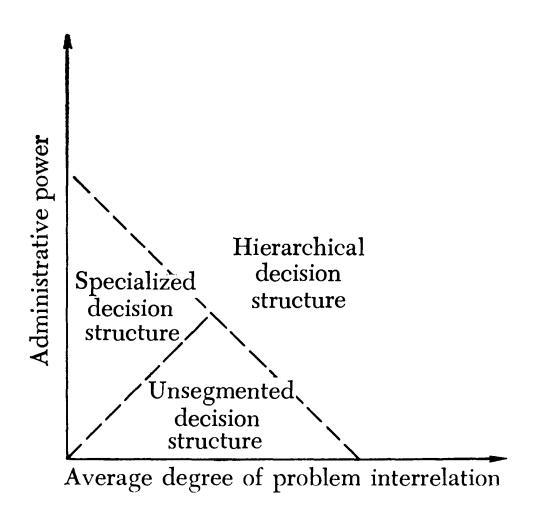
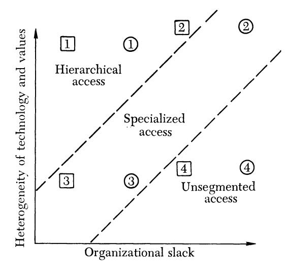
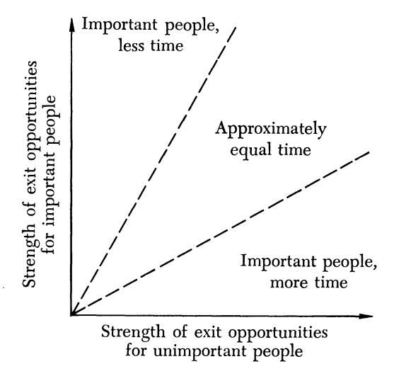
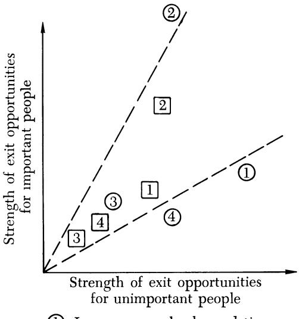
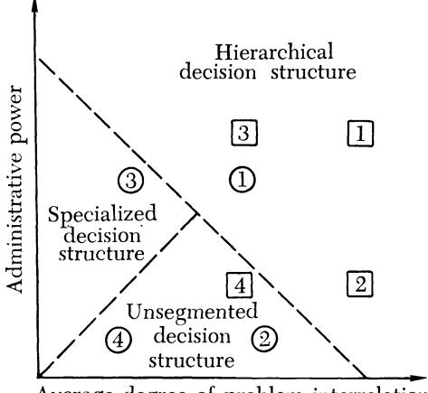

<!-- A2.R10 | source: papers_json/A2.R10/ -->


نموذج سلة المهملات لاختيار المنظمات

المؤلفون: Michael D. Cohen و James G. March و Johan P. Olsen

المصدر: Administrative Science Quarterly، Mar., 1972، Vol. 17، No. 1 (Mar., 1972)، pp. 1-

25

نشرته: Sage Publications, Inc. نيابة عن Johnson Graduate School of

Management، Cornell University

الرابط الثابت:[ https://www.jstor.org/stable/2392088](https://www.jstor.org/stable/2392088)

منصة JSTOR هي خدمة غير ربحية تساعد الباحثين والطلاب على اكتشاف واستخدام مجموعة واسعة من المحتوى في أرشيف رقمي موثوق، والبناء عليه. تستخدم هذه المنصة تقنية المعلومات وأدواتها لزيادة الإنتاجية وتيسير أشكال جديدة من البحث العلمي. لمزيد من المعلومات عن JSTOR، يرجى التواصل عبر support@jstor.org.

استخدامك لأرشيف JSTOR يعني قبولك لشروط وأحكام الاستخدام، المتاحة على https://about.jstor.org/terms



تتعاون Sage Publications, Inc. و Johnson Graduate School of Management، Cornell University مع JSTOR على رقمنة وحفظ وتوسيع الوصول إلى مجلة Administrative Science Quarterly

<!-- page 2 -->

## Michael D. Cohen, James G. March, and Johan P. Olsen

## A Garbage Can Model of Organizational Choice

الفوضى المنظمة هي منظمات تتميز بتفضيلات إشكالية، وتقنية غير واضحة، ومشاركة متغيرة. تشير دراسات حديثة عن الجامعات، وهي شكل مألوف من الفوضى المنظمة، إلى أنه يمكن النظر إلى هذه المنظمات لبعض الأغراض على أنها مجموعات من الخيارات الباحثة عن مشكلات، وقضايا ومشاعر باحثة عن مواقف قرار تُطرح فيها، وحلول باحثة عن قضايا تكون إجابة عليها، وصانعي قرار باحثين عن عمل. تُترجم هذه الأفكار إلى نموذج محاكاة حاسوبي صريح لعملية قرار من نوع سلة المهملات. تُوصف الآثار العامة لهذا النموذج من خلال خمسة مقاييس رئيسية على العملية. توضَّح التطبيقات الممكنة للنموذج على تنبؤات أضيق نطاقاً من خلال دراسة تنبؤات النموذج فيما يتعلق بأثر الشدائد على صنع القرار الجامعي.

لنتأمل الفوضى المنظمة. هذه منظمات - أو مواقف قرار - تتميز بثلاث خصائص عامة. الأولى هي التفضيلات الإشكالية. يصعب في المنظمة أن تُنسَب إلى موقف القرار مجموعة تفضيلات تلبي متطلبات الاتساق المعيارية لنظرية الاختيار. تعمل المنظمة على أساس مجموعة متنوعة من التفضيلات غير المتسقة وغير المحددة جيداً. يمكن وصفها بأنها مجموعة فضفاضة من الأفكار أكثر من كونها بنية متماسكة؛ فهي تكتشف تفضيلاتها من خلال الفعل أكثر مما تعمل على أساس تفضيلات مسبقة.

الخاصية الثانية هي التقنية غير الواضحة. رغم أن المنظمة تتمكن من البقاء بل والإنتاج، فإن أعضاءها لا يفهمون عملياتها الخاصة. تعمل على أساس إجراءات بسيطة من المحاولة والخطأ، ومخلفات التعلم من حوادث الخبرة الماضية، وارتجالات عملية عند الضرورة.

1 نحن مدينون لـ Nancy Block و Hilary Cohen و James Glenn على المساعدة الحاسوبية والتحريرية والفكرية؛ ولمعهد علم الاجتماع بجامعة Bergen، ومعهد التنظيم وعلم الاجتماع الصناعي بـ Copenhagen School of Economics، على الضيافة المؤسسية والمناقشات المفيدة حول السلوك التنظيمي؛ ولمؤسسة Ford Foundation على الدعم المالي الذي جعل تعاوننا ممكناً. كما نود أن ننوه بالملاحظات والاقتراحات المفيدة من S0ren Christensen و James S. Coleman و Harald Enderud و Ka're Rommetveit و William H. Starbuck.

الخاصية الثالثة هي المشاركة المتغيرة. يتفاوت المشاركون في مقدار الوقت والجهد الذي يخصصونه لمجالات مختلفة؛ ويتغير الانخراط من وقت لآخر. ونتيجة لذلك، تكون حدود المنظمة غير مؤكدة ومتغيرة؛ ويتغير الجمهور وصانعو القرار لأي نوع معين من الاختيار بشكل غير منتظم.

جرى تحديد خصائص الفوضى المنظمة هذه مراراً في دراسات المنظمات. وهي سمات مميزة لأي منظمة جزئياً - ولبعض الوقت. وتبرز بشكل خاص في المنظمات العامة والتعليمية وغير الشرعية. ستصف نظرية الفوضى المنظمة جزءاً من أنشطة أي منظمة تقريباً، لكنها لن تصف كل تلك الأنشطة.

للبناء على النظريات السلوكية الحالية للمنظمات من أجل استيعاب مفهوم الفوضى المنظمة، يجب دراسة ظاهرتين رئيسيتين حاسمتين لفهم الفوضى. الأولى هي الطريقة التي تتخذ بها المنظمات قرارات دون أهداف متسقة ومشتركة. مواقف صنع القرار في ظل غموض الأهداف شائعة في المنظمات المعقدة. وغالباً ما تُحل المشكلات دون اللجوء إلى مساومة صريحة أو نظام أسعار سوقي صريح - وهما عمليتان شائعتان لصنع القرار في غياب الإجماع. أما الظاهرة الثانية فهي الطريقة التي يُنشَّط بها أعضاء

<!-- page 3 -->

المنظمة. ويشمل ذلك مسألة كيف يصبح الأعضاء العرضيون ناشطين وكيف يُوجَّه الانتباه نحو قرار ما أو بعيداً عنه. من المهم فهم أنماط الانتباه داخل المنظمة، إذ لا ينتبه الجميع إلى كل شيء طوال الوقت.

تلزم مفاهيم إضافية أيضاً في نظرية معيارية للمنظمات تتعامل مع الفوضى المنظمة. أولاً، ينبغي تطوير نظرية معيارية لصنع القرار الذكي في ظل ظروف غامضة (أي في مواقف تكون فيها الأهداف غير واضحة أو غير معروفة). فهل يمكننا تقديم معنى للذكاء لا يعتمد على ربط الفعل الحالي بأهداف معروفة؟ ثانياً، تلزم نظرية معيارية للانتباه. يتقيد المشاركون داخل المنظمة بمقدار الوقت الذي يمكنهم تخصيصه للأمور المختلفة التي تتطلب انتباهاً. وبما أن تباينات السلوك في الفوضى المنظمة تعود في الغالب إلى مسائل من ينتبه إلى ماذا، فإن القرارات المتعلقة بتوزيع الانتباه هي قرارات محورية. ثالثاً، تتطلب الفوضى المنظمة نظرية إدارة منقّحة. تُدخل أجزاء مهمة من النظريات الإدارية المعاصرة آليات للرقابة والتنسيق تفترض وجود أهداف محددة جيداً وتقنية محددة جيداً، فضلاً عن انخراط جوهري من المشاركين في شؤون المنظمة. وحيثما تكون الأهداف والتقنية غامضة والمشاركة متغيرة، تنهار كثير من مسلّمات الإدارة وإجراءاتها المعيارية.

تتوجه هذه المقالة نحو نظرية سلوكية للفوضى المنظمة. استناداً إلى عدة دراسات حديثة، تُقترح بعض التوسعات والتعديلات على نظريات الاختيار القائمة. يُطوَّر نموذج لوصف صنع القرار داخل الفوضى المنظمة، ويُدرَس أثر بعض جوانب البنية التنظيمية على عملية الاختيار داخل هذا النموذج.

## THE BASIC IDEAS

فرص القرار هي في جوهرها مثيرات غامضة. يتردد هذا الموضوع عبر عدد من الدراسات الحديثة حول الاختيار التنظيمي.<sup>2</sup> ورغم أن المنظمات كثيراً ما

يمكن أن يُنظر إليها بشكل مريح كوسائل لحل مشكلات محددة جيداً أو كبنى يُحل فيها النزاع من خلال المساومة، فإنها توفر أيضاً مجموعات من الإجراءات يصل من خلالها المشاركون إلى تفسير لما يفعلونه وما فعلوه أثناء قيامهم به. من هذا المنظور، تُعد المنظمة مجموعة من الخيارات الباحثة عن مشكلات، وقضايا ومشاعر باحثة عن مواقف قرار تُطرح فيها، وحلول باحثة عن قضايا تكون إجابة عليها، وصانعي قرار باحثين عن عمل.

تركّز هذه النظرة إلى الاختيار التنظيمي الانتباه على الطريقة التي يتغير بها معنى الاختيار عبر الزمن. وتلفت الانتباه إلى الآثار الاستراتيجية للتوقيت، من خلال إدخال الخيارات والمشكلات، والنمط الزمني للطاقة المتاحة، وأثر البنية التنظيمية.

لفهم العمليات داخل المنظمات، يمكن للمرء أن ينظر إلى فرصة الاختيار كسلة مهملات يُلقي فيها المشاركون أنواعاً مختلفة من المشكلات والحلول عند توليدها. يعتمد مزيج المهملات في سلة واحدة على مزيج السلال المتاحة، وعلى العلامات المُلصقة على السلال البديلة، وعلى نوع المهملات التي تُنتج حالياً، وعلى سرعة جمع المهملات وإزالتها من المشهد.

يجب أن تُعنى نظرية من هذا النوع لصنع القرار التنظيمي بتفاعل معقد نسبياً بين توليد المشكلات في المنظمة، وتوزيع الأفراد، وإنتاج الحلول، وفرص الاختيار. ورغم أنه قد يكون مريحاً تخيّل أن فرص الاختيار تؤدي أولاً إلى توليد بدائل القرار، ثم إلى فحص عواقبها، ثم إلى تقييم تلك العواقب بحسب الأهداف، وأخيراً إلى قرار، فإن هذا النوع من النماذج غالباً ما يكون وصفاً ضعيفاً لما يحدث فعلياً. أما في نموذج سلة المهملات، فإن القرار هو نتيجة

> ^&^lt;sup>2</sup> We have based the model heavily on seven recent studies of universities: Christensen (1971), Cohen and March (1972), Enderud (1971), Mood

> ^(1971), ^Olsen (1970, 1971), and Rommetveit (1971). The ideas, however, have a broader parentage. In particular, they obviously owe a debt to Allison (1969), Coleman (1957), Cyert and March (1963), Lindblom (1965), Long (1958), March and Simon (1958), Schilling (1968), Thompson (1967), and Vickers (1965).

<!-- page 4 -->

أو تفسير لعدة مسارات مستقلة نسبياً داخل المنظمة.

يقتصر الاهتمام هنا على العلاقات المتبادلة

بين أربعة مسارات من هذا النوع.

المشكلات (Problems). المشكلات هي شاغل الأشخاص داخل المنظمة وخارجها. قد تنشأ حول قضايا أسلوب الحياة، أو الأسرة، أو إحباطات العمل، أو المسارات المهنية، أو العلاقات الجماعية داخل المنظمة، أو توزيع المكانة والوظائف والمال، أو الإيديولوجيا، أو أزمات البشرية الراهنة كما تفسّرها وسائل الإعلام أو الجار المجاور. كل هذه الأمور تتطلب انتباهاً.

الحلول (Solutions). الحل هو منتج شخص ما. فالحاسوب ليس مجرد حل لمشكلة في إدارة الرواتب يُكتشف عند الحاجة إليه. إنه إجابة تبحث بنشاط عن سؤال. إن خلق الحاجة ليس ظاهرة غريبة خاصة بسوق منتجات المستهلك؛ بل هو ظاهرة عامة في عمليات الاختيار. ورغم القول المأثور بأنك لا تستطيع إيجاد الجواب حتى تصوغ السؤال جيداً، فإنك غالباً لا تعرف ما هو السؤال في حل المشكلات التنظيمية حتى تعرف الجواب.

المشاركون (Participants). يأتي المشاركون ويرحلون. وبما أن كل دخول هو خروج في مكان آخر، فإن توزيع "المداخل" يعتمد على سمات الاختيار المتروك بقدر ما يعتمد على سمات الاختيار الجديد. ينشأ التباين الكبير في المشاركة من مطالب أخرى على وقت المشاركين (لا من سمات القرار قيد الدراسة).

فرص الاختيار (Choice opportunities). هذه هي المناسبات التي يُتوقع فيها من المنظمة أن تُنتج سلوكاً يمكن تسميته قراراً. تنشأ الفرص بانتظام، ولكل منظمة طرقها في إعلان مناسبة للاختيار. يجب توقيع العقود؛ وتوظيف الأشخاص أو ترقيتهم أو فصلهم؛ وإنفاق المال؛ وتوزيع المسؤوليات.

ورغم أن هذه المسارات ليست مستقلة تماماً عن بعضها بعضاً، يمكن النظر إلى كل مسار على أنه مستقل وخارجي بالنسبة للنظام. سيُركَّز الاهتمام هنا على دراسة نتائج معدلات وأنماط مختلفة من التدفقات في كل مسار وإجراءات مختلفة للربط بينها.

## THE GARBAGE CAN

يمكن تحديد نموذج محاكاة بسيط من حيث المسارات الأربعة ومجموعة من افتراضات معالجة المهملات.

تُدرَس أربعة متغيرات أساسية؛ وكل منها دالة للزمن.

تيار من الخيارات (choices). يُفترض عدد ثابت m من الخيارات. يتسم كل خيار بـ (أ) زمن دخول، وهو الزمن التقويمي الذي يُنشَّط فيه ذلك الخيار للقرار، و(ب) بنية قرار، وهي قائمة بالمشاركين المؤهلين للمشاركة في اتخاذ ذلك القرار.

تيار من المشكلات (problems). يُفترض عدد w من المشكلات. تتسم كل مشكلة بـ (أ) زمن دخول، وهو الزمن التقويمي الذي تصبح فيه المشكلة مرئية، و(ب) متطلب طاقة، وهو الطاقة اللازمة لحل خيار ترتبط به المشكلة (إذا كان تيار الحلول عند أعلى مستوى ممكن)، و(ج) بنية وصول، وهي قائمة بالخيارات التي يمكن للمشكلة الوصول إليها.

معدل تدفق الحلول (solutions). تفترض النظرية اللفظية تياراً من الحلول ومطابقة حلول محددة بمشكلات وخيارات محددة. تُوضع مجموعة أبسط من الافتراضات، ويُركَّز على المعدل الذي تتدفق به الحلول إلى النظام. يُفترض أنه، إما بسبب تباينات في تيار الحلول أو بسبب تباينات في كفاءة إجراءات البحث داخل المنظمة، تلزم طاقات مختلفة لحل نفس المشكلة في أوقات مختلفة. ويُفترض كذلك أن هذه التباينات متسقة بالنسبة لمشكلات مختلفة. وبذلك يُحدَّد معامل حل، يتراوح بين 0 و1، يعمل على طاقات القرار المحتملة لتحديد ناتج حل المشكلات (الطاقة الفعلية) المتحقق فعلياً خلال أي فترة زمنية معينة.

تيار من الطاقة الآتية من المشاركين. يُفترض وجود عدد v من المشاركين. يتسم كل مشارك بسلسلة زمنية من الطاقة المتاحة لصنع القرار التنظيمي. وبذلك، في كل فترة زمنية، يمكن لكل مشارك أن يوفر مقداراً محدداً من الطاقة المحتملة للمنظمة.

يعكس النموذج نوعين من التجزئة التنظيمية. الأول هو تخطيط الخيارات على صانعي القرار، أي بنية القرار. تُوصف بنية القرار للمنظمة بـ D، وهي مصفوفة v-by-m يكون فيها d<sub>ij</sub> يساوي 1 إذا كان المشارك i مؤهلاً للمشاركة في

<!-- page 5 -->

اتخاذ الخيار j. وإلا، فإن d_{ij} يساوي 0. أما الثاني فهو تخطيط المشكلات على الخيارات، أي بنية الوصول. تُوصف بنية الوصول للمنظمة بـ A، وهي مصفوفة w-by-m يكون فيها a_{ij} يساوي 1 إذا كان الخيار j متاحاً للمشكلة i. وإلا، فإن a_{ij} يساوي 0.

لربط هذه المتغيرات، تُحدَّد ثلاثة افتراضات سلوكية رئيسية. الأول افتراض حول تجميعية متطلبات الطاقة، والثاني يحدد الطريقة التي تُخصَّص بها الطاقة للخيارات، والثالث يصف الطريقة التي تُلحَق بها المشكلات بالخيارات.

افتراض تجميعية الطاقة. لكي يُتخذ أي خيار، يتطلب طاقة فعلية تعادل مجموع جميع متطلبات المشكلات العديدة الملحقة به. الطاقة الفعلية المكرَّسة لخيار ما هي مجموع طاقات صانعي القرار الملحقين بذلك الخيار، مخفَّضة، في كل فترة زمنية، بمعامل الحل. وحالما تساوي الطاقة الفعلية الإجمالية التي أُنفقت على خيار ما المتطلبات أو تتجاوزها في نقطة زمنية معينة، يُتخذ القرار.

افتراض تخصيص الطاقة. تُخصَّص طاقة كل مشارك لخيار واحد على الأكثر خلال كل فترة زمنية. يخصص كل مشارك طاقته بين الخيارات التي هو مؤهل لها للأقرب منها إلى القرار، أي الخيار ذا العجز الأصغر في الطاقة في نهاية الفترة الزمنية السابقة من حيث الطاقات المساهم بها من مشاركين آخرين.

افتراض تخصيص المشكلات. تُلحَق كل مشكلة بخيار واحد على الأكثر في كل فترة زمنية، بالاختيار من بين تلك المتاحة عبر حساب العجز الظاهري في الطاقة (من حيث متطلبات طاقة مشكلات أخرى) في نهاية الفترة الزمنية السابقة واختيار الخيار الأقرب إلى القرار. وباستثناء ما تدخل فيه الأولويات في البنية التنظيمية، لا يوجد ترتيب أولوية للمشكلات.

تلتقط هذه الافتراضات سمات رئيسية للعمليات المُلاحَظة. ويمكن تعديلها بعدة طرق دون الإخلال بالملاحظات التجريبية التي تستند إليها. غير أن نتائج هذه التعديلات لا تُتابَع هنا. بل يُركَّز الاهتمام على آثار النسخة البسيطة الموصوفة. وسيُفحَص

تفاعل البنية التنظيمية مع شكل الاختيار من نوع سلة المهملات.

## ORGANIZATIONAL STRUCTURE

تؤثر عناصر البنية التنظيمية في نتائج عملية قرار من نوع سلة المهملات (أ) من خلال التأثير في النمط الزمني لوصول المشكلات والخيارات والحلول أو صانعي القرار، (ب) من خلال تحديد تخصيص الطاقة من قبل المشاركين المحتملين في القرار، و(ج) من خلال إقامة روابط بين المسارات المختلفة.

العوامل التنظيمية التي ستُدرَس هي عوامل لها تفسيرات وآثار في العالم الواقعي وقابلة للتطبيق على نظرية الفوضى المنظمة. وهي سمات مألوفة للمنظمات، ناتجة عن مزيج من التخطيط الإداري المتعمد، والتعلم الفردي والجماعي، والمحاكاة. تتغير البنية التنظيمية استجابة لعوامل مثل الطلب السوقي على الأفراد وتباين القيم، وهي عوامل خارجية عن النموذج المعروض هنا. سيقتصر الاهتمام على السكون المقارن للنموذج، لا على الديناميكيات الناتجة عن التعلم التنظيمي.

لتشغيل النموذج، تُحدَّد العناصر التالية: (أ) مجموعة من المعالم الثابتة التي لا تتغير من تباين إلى آخر، (ب) أزمنة دخول الخيارات، (ج) أزمنة دخول المشكلات، (د) عبء الطاقة الصافي على المنظمة، (هـ) بنية الوصول للمنظمة، (و) بنية القرار للمنظمة، و(ز) توزيع الطاقة بين صانعي القرار في المنظمة.

ستُحدَّد بعض التباينات البنيوية النقية نسبياً في كل من هذه العناصر، وستُعطى أمثلة على كيفية ارتباط تباينات هذه البنى بمتغيرات خارجية رئيسية بشكل منهجي. ثم سيُبيَّن كيف تؤثر عوامل البنية التنظيمية هذه في خصائص مهمة للقرارات ضمن عملية قرار من نوع سلة المهملات.

## **Fixed Parameters **

ضمن التباينات المُبلَّغ عنها، تُثبَّت العناصر التالية: (أ) عدد الفترات الزمنية - عشرون، (ب) عدد فرص الاختيار - عشرة، (ج) عدد صانعي القرار - عشرة، (د) عدد المشكلات - عشرون، و(هـ)

<!-- page 6 -->

معاملات الحل للفترات الزمنية العشرين - 0.6 لكل فترة،<sup>3</sup>

## **Entry Times **

يُنظَر في تسلسلين مختلفين وُلِّدا عشوائياً لأزمنة دخول الخيارات. يُفترض أن يدخل خيار واحد في كل فترة زمنية عبر الفترات الزمنية العشر الأولى بأحد الترتيبين التاليين: (أ) 10, 7, 9, 5, 2, 3, 4, 1, 6, 8، أو (ب) 6, 5, 2, 10, 8, 9, 7, 4, 1, 3.

وبالمثل، يُنظَر في تسلسلين مختلفين وُلِّدا عشوائياً لأزمنة دخول المشكلات. يُفترض أن تدخل مشكلتان في كل فترة زمنية عبر الفترات الزمنية العشر الأولى بأحد الترتيبين التاليين:
(أ) 8, 20, 14, 16, 6, 7, 15, 17, 2, 13, 11, 19, 4, 9, 3, 12, 1, 10, 5, 18، أو (ب) 4, 14, 11, 20, 3, 5, 2, 12, 1, 6, 8, 19, 7, 15, 16, 17, 10, 18, 9, 13.

## Net Energy Load

إجمالي الطاقة المتاحة للمنظمة في كل فترة زمنية هو 5.5 وحدة. وبذلك تكون إجمالي الطاقة المتاحة عبر عشرين فترة زمنية 20 × 5.5 = 110. وتُخفَّض هذه القيمة بمعاملات الحل إلى 66. تسري هذه الأرقام عبر جميع التباينات الأخرى للنموذج. يُعرَّف عبء الطاقة الصافي على المنظمة بأنه الفرق بين إجمالي الطاقة اللازمة لحل جميع المشكلات وإجمالي الطاقة الفعلية المتاحة للمنظمة عبر جميع الفترات الزمنية. عندما تكون هذه القيمة سالبة، تكون هناك، من حيث المبدأ، طاقة كافية متاحة. وبما أن إجمالي الطاقة الفعلية المتاحة ثابت عند 66، فإن العبء الصافي يتغير بتغيير إجمالي متطلبات الطاقة للمشكلات. يُفترض أن لكل مشكلة نفس متطلب الطاقة تحت عبء معين. تُدرَس ثلاث حالات مختلفة لعبء الطاقة.

عبء الطاقة الصافي 0: عبء خفيف. تحت هذا الشرط، تبلغ الطاقة اللازمة لاتخاذ خيار ما 1.1 ضعف عدد المشكلات الملحقة به. أي أن الطاقة اللازمة لكل مشكلة هي 1.1. وبذلك يكون الحد الأدنى لإجمالي الطاقة الفعلية اللازمة

لحل جميع المشكلات هو 22، ويكون عبء الطاقة الصافي 22 - 66 = -44.

عبء الطاقة الصافي 1: عبء معتدل. تحت هذا الشرط، تبلغ الطاقة اللازمة لكل مشكلة 2.2. وبذلك تبلغ الطاقة اللازمة لاتخاذ خيار ما 2.2 ضعف عدد المشكلات الملحقة به، ويكون الحد الأدنى للطاقة الفعلية اللازمة لحل جميع المشكلات 44. ويكون عبء الطاقة الصافي 44-66=-22.

عبء الطاقة الصافي 2: عبء ثقيل. تحت هذا الشرط، تتطلب كل مشكلة طاقة قدرها 3.3. وتبلغ الطاقة اللازمة لاتخاذ خيار ما 3.3 ضعف عدد المشكلات الملحقة به. ويكون الحد الأدنى للطاقة الفعلية اللازمة لحل جميع المشكلات 66، ويكون عبء الطاقة الصافي 66-66=0.

ورغم أنه من الممكن من منظور الطاقة الإجمالية أن تُحل جميع المشكلات في أي حالة عبء، فإن صعوبة تحقيق تلك النتيجة عندما يكون عبء الطاقة الصافي صفراً - عبء ثقيل - كبيرة بوضوح.

## **Access Structure **

تُدرَس ثلاثة أنماط نقية من الترتيبات التنظيمية في بنية الوصول (العلاقة بين المشكلات والخيارات).

بنية الوصول 0: وصول غير مجزَّأ. تُمثَّل هذه البنية بمصفوفة وصول تكون فيها أي مشكلة نشطة قادرة على الوصول إلى أي خيار نشط.

| \Delta_o = | 1111111111 |
| --- | --- |
| 1111111111 |  |
| 1111111111 |  |
| 1111111111 |  |
| 1111111111 |  |
| 1111111111 |  |
| 1111111111 |  |
| 1111111111 |  |
| 1111111111 |  |
| 1111111111 |  |
| 1111111111 |  |
| 1111111111 |  |
| 1111111111 |  |
| 1111111111 |  |
| 1111111111 |  |
| 1111111111 |  |
| 1111111111 |  |
| 1111111111 |  |
| 1111111111 |  |
| 1111111111 |  |
| 1111111111 |  |

بنية الوصول 1: وصول هرمي. في هذه البنية تُرتَّب الخيارات والمشكلات معاً

> ^&^lt;sup>3</sup> The model has also been exercised under conditions of a set of solution coefficients that varies over the time periods. Specifically, the following series has been used: 1, 0.9, 0.7, 0.3, 0.1, 0.1, 0.3, 0.7, 0.9, 1, 0.6, 0.6, 0.6, 0.6, 0.6, 0.6, 0.6, 0.6

<!-- page 7 -->

في تسلسل هرمي بحيث تكون المشكلات المهمة - أي ذات الأرقام المنخفضة نسبياً - قادرة على الوصول إلى كثير من الخيارات، وتكون الخيارات المهمة - ذات الأرقام المنخفضة نسبياً - متاحة فقط للمشكلات المهمة. تُمثَّل هذه البنية بمصفوفة الوصول التالية:

بنية الوصول 2: وصول متخصص. في هذه البنية تصل كل مشكلة إلى خيار واحد فقط، ويكون كل خيار متاحاً لمشكلتين فقط، أي أن الخيارات تتخصص في أنواع المشكلات التي يمكن أن تُربَط بها. تُمثَّل هذه البنية بمصفوفة الوصول التالية:

| A_2 = | 1000000000 |
| --- | --- |
| 1000000000 |  |
| 0100000000 |  |
| 0100000000 |  |
| 0010000000 |  |
| 0010000000 |  |
| 0001000000 |  |
| 0001000000 |  |
| 0000100000 |  |
| 0000100000 |  |
| 0000010000 |  |
| 0000010000 |  |
| 0000001000 |  |
| 0000001000 |  |
| 0000000100 |  |
| 0000000100 |  |
| 0000000010 |  |
| 0000000010 |  |
| 0000000001 |  |
| 0000000001 |  |

ستُظهر المنظمات الفعلية مزيجاً

أكثر تعقيداً من قواعد الوصول. ويمكن تمثيل أي مزيج من هذا النوع بمصفوفة وصول ملائمة. تمثل البنى النقية الثلاث المدروسة هنا ثلاثة مناهج بديلة كلاسيكية لمشكلة تنظيم الوصول الشرعي للمشكلات إلى مواقف القرار.

## **Decision Structure **

تُدرَس ثلاثة أنماط نقية مماثلة في بنية القرار (العلاقة بين صانعي القرار والخيارات).

بنية القرار 0: قرارات غير مجزأة. في هذه البنية يستطيع أي صانع قرار المشاركة في أي فرصة اختيار نشطة. وبذلك تُمثَّل البنية بالمصفوفة التالية:

$$
D_0 = \begin{bmatrix} 1111111111\\ 1111111111\\ 1111111111\\ 1111111111\\ 1111111111\\ 1111111111\\ 1111111111\\ 1111111111\\ 1111111111\\ 1111111111 \end{bmatrix}
$$

بنية القرار 1: قرارات هرمية. في هذه البنية يُرتَّب صانعو القرار والخيارات معاً في تسلسل هرمي بحيث يجب اتخاذ الخيارات المهمة - أي الخيارات ذات الأرقام المنخفضة - من قبل صانعي قرار مهمين - أي صانعي قرار ذوي أرقام منخفضة - ويستطيع صانعو القرار المهمون المشاركة في كثير من الخيارات. تُمثَّل هذه البنية بالمصفوفة التالية:

```
\mathbf{D_1} = \begin{array}{c} 1111111111\\ 0111111111\\ 0011111111\\ 0001111111\\ 0000111111\\ 0000001111\\ 0000000111\\ 00000000
```

بنية القرار 2: قرارات متخصصة. في هذه البنية يرتبط كل صانع قرار بخيار واحد، ويكون لكل خيار صانع قرار واحد. يتخصص صانعو القرار في الخيارات التي يتعاملون معها. وبذلك تكون لدينا المصفوفة التالية:

<!-- page 8 -->

| D_2 = | 1000000000 |
| --- | --- |
| 0100000000 |  |
| 0010000000 |  |
| 0001000000 |  |
| 0000100000 |  |
| 0000010000 |  |
| 0000001000 |  |
| 0000000100 |  |
| 0000000010 |  |
| 0000000001 |  |

كما هو الحال في بنية الوصول، ستتطلب بنى القرار الفعلية مصفوفة أكثر تعقيداً. تتبنى معظم المنظمات مزيجاً من القواعد لتحديد شرعية المشاركة في القرارات. غير أن الحالات النقية الثلاث نماذج مألوفة لهذه القواعد، ويمكن استخدامها لفهم بعض نتائج بنية القرار على عمليات القرار.

## **Energy Distribution **

يعكس توزيع الطاقة بين صانعي القرار تباينات محتملة في مقدار الوقت الذي يقضيه صانعو قرار مختلفون على المشكلات التنظيمية. تؤثر معاملات الحل والتباينات في متطلب الطاقة للمشكلات على العلاقة العامة بين الطاقة المتاحة والطاقة المطلوبة. تُدرَس ثلاثة تباينات مختلفة في توزيع الطاقة.

توزيع الطاقة 0: طاقة أقل للأشخاص المهمين. في هذا التوزيع، يمتلك الأشخاص المهمون، أي المُعرَّفون كمهمين في بنية قرار هرمية، طاقة أقل. قد يعكس هذا تباينات في مزيج المطالب الخارجية والدافعية للمشاركة داخل المنظمة. يُبيَّن توزيع الطاقة المحدد كما يلي:

| Decision maker | Energy |  |
| --- | --- | --- |
| 1 | 0.1 |  |
| 2 | 0.2 |  |
| 3 | 0.3 |  |
| 4 | 0.4 |  |
| 5 | 0.5 | = E_0 |
| 6 | 0.6 |  |
| 7 | 0.7 |  |
| 8 | 0.8 |  |
| 9 | 0.9 |  |
| 10 | 1.0 |  |

إجمالي الطاقة المتاحة للمنظمة في كل فترة زمنية (قبل التخفيض بمعاملات الحل) هو 5.5.

توزيع الطاقة 1: طاقة متساوية. في هذا التوزيع، لا يوجد تمايز داخلي بين صانعي القرار من حيث الطاقة. يمتلك كل صانع قرار نفس الطاقة (0.55) في كل فترة زمنية. وبذلك يكون لدينا التوزيع التالي:

| Decision maker | Energy |
| --- | --- |
| 1 | 0.55 |
| 2 | 0.55 |
| 3 | 0.55 |
| 4 | 0.55 |
| 5 | 0.55 = E_1 |
| 6 | 0.55 |
| 7 | 0.55 |
| 8 | 0.55 |
| 9 | 0.55 |
| 10 | 0.55 |

إجمالي الطاقة المتاحة للمنظمة في كل فترة زمنية (قبل التخفيض بمعاملات الحل) هو 5.5.

توزيع الطاقة 2: طاقة أكبر للأشخاص المهمين. في هذا التوزيع، تُوزَّع الطاقة بشكل غير متساوٍ لكن في اتجاه معاكس لـ E_0. هنا يمتلك الأشخاص المُعرَّفون كمهمين في بنية القرار الهرمية طاقة أكبر. يُبيَّن التوزيع كما يلي:

| Decision maker | Energy |  |
| --- | --- | --- |
| 1 | 1.0 |  |
| 2 | 0.9 |  |
| 3 | 0.8 |  |
| 4 | 0.7 |  |
| 5 | 0.6 | = E, |
| 6 | 0.5 |  |
| 7 | 0.4 |  |
| 8 | 0.3 |  |
| 9 | 0.2 |  |
| 10 | 0.1 |  |

كما في المنظمات السابقة، إجمالي الطاقة المتاحة للمنظمة في كل فترة زمنية (قبل التخفيض بمعاملات الحل) هو 5.5.

حيثما تمتلك المنظمة بنية قرار هرمية، يكون التمييز بين صانعي القرار المهمين وغير المهمين واضحاً. أما حيثما تكون بنية القرار غير مجزأة أو متخصصة، فتُحدَّد تباينات توزيع الطاقة من حيث نفس صانعي القرار المرقَّمين (الأرقام الأدنى أكثر أهمية من الأرقام الأعلى) لتعكس فروق مكانة ممكنة

<!-- page 9 -->

لا تلتقطها بالضرورة بنية القرار.

## Simulation Design

تصميم المحاكاة بسيط. تُعطى نسخة Fortran من نموذج سلة المهملات في الملحق، مع التوثيق والشرح. تُدرَس هنا الأنواع الـ 34 = 81 من المواقف التنظيمية الناتجة عن أخذ التوليفات الممكنة لقيم الأبعاد الأربعة للمنظمة (بنية الوصول، وبنية القرار، وتوزيع الطاقة، وعبء الطاقة الصافي) تحت التوليفات الأربع لأزمنة دخول الخيارات والمشكلات. والنتيجة هي 324 موقف محاكاة.

## SUMMARY STATISTICS

يعمل نموذج سلة المهملات تحت كل من البنى التنظيمية الممكنة لتخصيص المشكلات وصانعي القرار للخيارات، ولتحديد الطاقة المطلوبة والطاقة الفعلية المطبَّقة على الخيارات، ولاتخاذ تلك الخيارات وحل تلك المشكلات بحسب ما تشير إليه التخصيصات والطاقات من إمكانية. ويجري ذلك لكل من الفترات الزمنية العشرين في محاكاة مدتها عشرون فترة لصنع القرار التنظيمي.

لكل من المواقف الـ 324، يلزم مجموعة من الإحصاءات الموجزة البسيطة عن العملية. وتقتصر هذه على خمسة.

## Decision Style

ضمن نوع المنظمة المفترض، تُتخذ القرارات بثلاث طرق مختلفة.

بالحل (resolution). تحل بعض الخيارات المشكلات بعد فترة من العمل عليها. وقد يتفاوت طول هذه الفترة تبعاً لعدد المشكلات. وهذه هي الحالة المألوفة الضمنية في معظم مناقشات الاختيار داخل المنظمات.

بالإشراف (oversight). إذا نُشِّط خيار في حين كانت المشكلات ملحقة بخيارات أخرى، وإذا كانت هناك طاقة متاحة لاتخاذ الخيار الجديد بسرعة، فسيُتخذ دون أي انتباه للمشكلات القائمة وبأدنى قدر من الوقت والطاقة.

بالهروب (flight). في بعض الحالات، ترتبط الخيارات بالمشكلات (دون نجاح) لبعض الوقت حتى يظهر خيار أكثر جاذبية لتلك المشكلات. تغادر المشكلات الخيار، وبذلك يصبح ممكناً اتخاذ القرار. لا يحل القرار

أي مشكلات؛ إذ ارتبطت الآن بخيار جديد.

تنطوي بعض الخيارات على كل من الهروب والحل معاً - إذ تغادر بعض المشكلات، بينما تُحل البقية. صُنِّفت هذه الحالات كحل، مبالغاً بذلك قليلاً في أهمية هذا الأسلوب. ونتيجة لهذا الاصطلاح، تكون الأساليب الثلاثة متنافية وشاملة بالنسبة لأي خيار واحد. غير أن المنظمة نفسها قد تستخدم أياً منها في خيارات مختلفة. وهكذا يمكن وصف أسلوب القرار لأي تباين معين من النموذج بتحديد نسبة الخيارات المكتملة التي اتُّخذت بكل من هذه الطرق الثلاث.

## Problem Activity

ينبغي لأي مقياس لدرجة نشاط المشكلات داخل المنظمة أن يعكس درجة النزاع داخل المنظمة أو درجة تبلور المشكلات. تُدرَس ثلاث إحصاءات مرتبطة ارتباطاً وثيقاً بنشاط المشكلات. الأولى هي العدد الإجمالي للمشكلات غير المحلولة في نهاية الفترات الزمنية العشرين؛ والثانية هي العدد الإجمالي للمرات التي تنتقل فيها أي مشكلة من خيار إلى آخر، أما الثالثة فهي العدد الإجمالي للفترات الزمنية التي تكون فيها المشكلة نشطة وملحقة بخيار ما، مجموعة عبر جميع المشكلات. ترتبط هذه المقاييس ارتباطاً قوياً ببعضها بعضاً. تُستخدم الثالثة كمقياس لنشاط المشكلات أساساً لأنها تمتلك تبايناً كبيراً نسبياً؛ وكانت ستُحصَّل نتائج مشابهة أساساً باستخدام أي من المقياسين الآخرين.

## Problem Latency

قد تكون المشكلة نشطة، لكن غير ملحقة بأي خيار. هذا الموقف هو الحالة التي تُعتَرَف فيها المشكلة وتُقبَل من قبل جزء من المنظمة، لكن لا تُعتبَر ذات صلة بأي خيار متاح. يُفترض أن تُظهر منظمة ذات كمون مشكلات مرتفع نسبياً أعراضاً مختلفة إلى حد ما عن منظمة ذات كمون منخفض. قِيس كمون المشكلات بالعدد الإجمالي للفترات التي تكون فيها المشكلة نشطة لكن غير ملحقة بخيار، مجموعة عبر جميع المشكلات.

<!-- page 10 -->

## **Decision Maker Activity **

لقياس درجة نشاط صانعي القرار في النظام، يلزم مقياس يعكس إنفاق طاقتهم، وحركتهم، ومثابرتهم. تُدرَس أربعة مقاييس: (أ) العدد الإجمالي للفترات الزمنية التي يكون فيها صانع القرار ملحقاً بخيار، مجموعة عبر جميع صانعي القرار، (ب) العدد الإجمالي للمرات التي ينتقل فيها أي صانع قرار من خيار إلى آخر، (ج) إجمالي مقدار الطاقة الفعلية المتاحة والمستخدمة، و(د) إجمالي الطاقة الفعلية المستخدمة على الخيارات زيادة على المطلوب لاتخاذها وقت اتخاذها. ترتبط هذه المقاييس الأربعة ارتباطاً قوياً فيما بينها. استُخدم الثاني أساساً بسبب تباينه الكبير نسبياً؛ وكان يمكن لأي من الآخرين أن يخدم الغرض بالقدر نفسه.

## **Decision Difficulty **

بسبب الطريقة التي يمكن أن تُتخذ بها القرارات في النظام، لا تتطابق صعوبة القرار مع مستوى نشاط المشكلات. يُدرَس مقياسان بديلان: العدد الإجمالي للخيارات غير المتخذة بحلول نهاية الفترات الزمنية العشرين، والعدد الإجمالي للفترات التي يكون فيها الخيار نشطاً، مجموعة عبر جميع الخيارات. يرتبط هذان المقياسان ارتباطاً قوياً. يُستخدم الثاني أساساً بسبب تباينه الأعلى؛ ولن تتغير الاستنتاجات لو استُخدم الأول.

## IMPLICATIONS OF THE MODEL

يُظهر تحليل التواريخ الفردية لعمليات المحاكاة ثماني خصائص رئيسية لعمليات قرار من نوع سلة المهملات.

أولاً، لا يُعد حل المشكلات كأسلوب لصنع القرار الأسلوب الأكثر شيوعاً، إلا في ظل ظروف يكون فيها الهروب مقيداً بشدة (مثل الوصول المتخصص) أو في بعض الحالات القليلة تحت عبء خفيف. يُعد صنع القرار بالهروب والإشراف

سمة رئيسية للعملية عموماً. في كل تجارب المحاكاة كان هناك عشرون مشكلة وعشرة خيارات. ورغم أن متوسط عدد الخيارات غير المتخذة كان 1.0، فإن متوسط عدد المشكلات غير المحلولة كان 12.3. وتُفصَّل النتائج في Table 1. يجب فحص الآثار السلوكية والمعيارية لعملية قرار تبدو أنها تتخذ الخيارات في معظمها بالهروب أو بالإشراف. وقد يظهر تفسير محتمل لسلوك المنظمات التي يبدو أنها تتخذ قرارات دون تحقيق تقدم ظاهر في حل المشكلات التي تبدو مرتبطة بالقرارات.

ثانياً، تتسم العملية بحساسية شاملة وعامة إلى حد كبير لتباينات العبء. كما يُظهر Table 2، فإن زيادة عبء الطاقة الصافي على النظام تزيد عموماً من نشاط المشكلات، ونشاط صانعي القرار، وصعوبة القرار، واستخدام الهروب والإشراف. يقل احتمال حل المشكلات، ويميل صانعو القرار إلى الانتقال من مشكلة إلى أخرى بتكرار أكبر، وتميل الخيارات إلى استغراق وقت أطول لاتخاذها ويقل احتمال حلها للمشكلات. ورغم إمكانية تحديد منظمة مستقرة نسبياً مع تغيرات العبء، لا يمكن أن تكون منظمة مستقرة في السلوك ولديها أيضاً سمات مرغوبة أخرى. مع تغير العبء، تبقى منظمة ذات بنية وصول غير مجزأة وبنية قرار متخصصة مستقرة نسبياً. تُظهر صعوبة قرار ونشاط صانعي قرار منخفضين نسبياً، وكموناً منخفضاً جداً للمشكلات، وأقصى نشاط للمشكلات. تتخذ تقريباً جميع القرارات المطروحة أمامها، وتستخدم طاقة قليلة من صانعي القرار، ولا تحل تقريباً أي مشكلات.

ثالثاً، من السمات النمطية للنموذج ميل صانعي القرار

<!-- page 11 -->

والمشكلات إلى تتبع بعضها بعضاً عبر الخيارات. رهناً بالقيود البنيوية على هذا التتبع، يعمل صانعو القرار على المشكلات النشطة بارتباط مع الخيارات النشطة؛ ويميل كل من صانعي القرار والمشكلات إلى التحرك معاً من خيار إلى آخر. وبذلك، يمكن أن يشعر صانعو القرار بأنهم يعملون دائماً على نفس المشكلات في سياقات مختلفة إلى حد ما، غالباً دون نتائج. وبالمثل، تلتقي المشكلات بنفس الأشخاص أينما ذهبت وبنفس النتيجة.

رابعاً، توجد ترابطات مهمة بين ثلاثة جوانب رئيسية من كفاءة عمليات القرار المحددة. الأول هو نشاط المشكلات، أي مقدار الوقت الذي تظل فيه المشكلات غير المحلولة ملحقة بنشاط بمواقف اختيار. نشاط المشكلات مقياس تقريبي لاحتمال نزاع القرار في المنظمة. الجانب الثاني هو كمون المشكلات، أي مقدار الوقت الذي تقضيه المشكلات مُنشَّطة لكن غير مرتبطة بخيارات. أما الجانب الثالث فهو زمن القرار، أي مثابرة الخيارات. من المفترض أن تُبقي بنية تنظيمية جيدة كلاً من نشاط المشكلات وكمونها منخفضين من خلال حل سريع للمشكلات في خياراتها. وفي عملية سلة المهملات، لم تُلاحَظ نتيجة كهذه قط. يميل تجزيء بنية الوصول إلى تقليل عدد المشكلات غير المحلولة النشطة في المنظمة لكن على حساب زيادة فترة كمون المشكلات، وفي معظم الحالات، الوقت المُكرَّس للوصول إلى القرارات. ومن ناحية أخرى، يميل تجزيء بنية القرار إلى تقليل كمون المشكلات، لكن على حساب زيادة نشاط المشكلات وزمن القرار.

خامساً، تكون العملية غالباً تفاعلية بشكل حاد. ورغم أن بعض الظواهر المرتبطة بسلة المهملات منتظمة وتسري عبر معظم الحالات تقريباً، مثل

أثر العبء الإجمالي، فإن ظواهر أخرى تعتمد بشكل أكبر بكثير على التوليفة المعينة من البنى المعنية. فبينما يُنتج التجزيء العالي لبنية الوصول عموماً زمن قرار بطيئاً، على سبيل المثال، فإن بنية وصول متخصصة، مقترنة ببنية قرار غير مجزأة، تُنتج قرارات سريعة.

سادساً، من المرجح أن تُحل المشكلات المهمة أكثر من المشكلات غير المهمة. ومن المرجح أن تُحل المشكلات التي تظهر مبكراً أكثر من تلك المتأخرة. وبالنظر فقط في الحالات التي تنطوي على تسلسل وصول هرمي حيث تُعرَّف الأهمية للمشكلات، يُبيَّن Table 3 العلاقة بين أهمية المشكلة وترتيب وصولها. ينتج النظام،

في الواقع، طابوراً من المشكلات من حيث أهميتها، على حساب المشكلات المتأخرة الوصول وقليلة الأهمية نسبياً، ولا سيما عندما يكون العبء ثقيلاً. هذا الطابور نتيجة لتشغيل النموذج. ولم يُفرَض كافتراض مباشر.

سابعاً، من الأرجح أن الخيارات المهمة أقل قدرة على حل المشكلات من الخيارات

<!-- page 12 -->

غير المهمة. تُتخذ الخيارات المهمة بالإشراف والهروب. وتُتخذ الخيارات غير المهمة بالحل. تُلاحَظ هذه الفروق تحت كلا تسلسلي دخول الخيارات، لكنها أكثر حدة حين تدخل الخيارات المهمة مبكراً نسبياً. ويُظهر Table 4

النتائج. ويمكن ربط هذه الخاصية للخيارات المهمة في عملية قرار من نوع سلة المهملات بشكل طبيعي ومباشر بالظاهرة في المنظمات المعقدة حيث تبدو الخيارات المهمة وكأنها "تحدث" فحسب.

ثامناً، رغم اتخاذ نسبة كبيرة من الخيارات، فإن حالات فشل الاختيار التي تحدث تتركز بين الخيارات الأكثر أهمية والأقل أهمية. أما الخيارات ذات الأهمية المتوسطة فتُتخذ دائماً تقريباً. نسبة حالات فشل الاختيار، تحت ظروف بنى وصول أو قرار هرمية، هي كما يلي:

Three most important choices 0.14
Four middle choices 0.05
Three least important choices 0.12

بمعنى عام، تقدم هذه السمات للعملية بعض الأدلة حول كيفية بقاء المنظمات حين لا تعرف ما تفعله. ينتهك جزء كبير من العملية المفاهيم المعيارية لكيفية اتخاذ القرارات. لكن معظم تلك المفاهيم مبنية على افتراضات لا يمكن تلبيتها في ظل الظروف المحددة. عندما تكون الأهداف والتقنيات غامضة، تُكلَّف المنظمات باكتشاف إجراءات قرار بديلة تسمح لها بالمضي قدماً دون إلحاق ضرر استثنائي بمجالات المشاركين أو بنموذجهم عما

ينبغي أن تكون عليه المنظمة. إنه تكليف صعب، والعملية الموصوفة استجابة جزئية له.

في الوقت نفسه، تعتمد تفاصيل النتائج بوضوح على سمات البنية التنظيمية. تُنتج عملية سلة المهملات نفسها أعراضاً سلوكية مختلفة تحت مستويات مختلفة من العبء على النظام أو تصاميم مختلفة لبنية المنظمة. تثير هذه الفروق إمكانية التنبؤ بتباينات في السلوك القراري في منظمات مختلفة. ويبقى مثال محتمل واحد على استخدام كهذا ليُدرَس.

## GARBAGE CANS AND UNIVERSITIES

من فئات المنظمات التي تواجه مواقف قرار تنطوي على أهداف غير واضحة، وتقنية غير واضحة، ومشاركين متغيرين، الكلية أو الجامعة الحديثة. إذا كانت آثار النموذج قابلة للتطبيق في أي مكان، فهي قابلة للتطبيق على الجامعة. ورغم وجود تباين كبير بين الكليات والجامعات، سواء بين البلدان أو داخل أي بلد، فإن للنموذج صلة عامة بصنع القرار في التعليم العالي.

## General Implications

كثيراً ما لا يحل صنع القرار الجامعي المشكلات. وغالباً ما تُتخذ الخيارات بالهروب أو الإشراف. تتسم عمليات القرار الجامعي بحساسية للزيادات في العبء. يتتبع صانعو القرار والمشكلات النشطون بعضهم بعضاً عبر سلسلة من الخيارات دون تقدم ملموس في حل المشكلات. ومن غير المرجح أن تحل الخيارات المهمة المشكلات.

تظهر القرارات التي تتغير تفسيراتها باستمرار أثناء عملية الحل، سواء في النموذج أو في الملاحظات الفعلية للجامعات. تُرتِّب المشكلات والخيارات وصانعو القرار أنفسهم وتُعيد ترتيبها. وفي سياق هذه الترتيبات، يمكن أن يتغير معنى الخيار عدة مرات، إذا فُهم هذا المعنى بوصفه مزيج المشكلات التي تُناقَش في سياق ذلك الخيار.

كثيراً ما تُحل المشكلات، لكن نادراً ما يكون ذلك من قبل الخيار الذي أُلحقت به أولاً. قد يصبح خيار كان يمكن، في بعض الظروف، أن يُتخذ بجهد قليل، ساحة للعديد من المشكلات. ويصبح الخيار

<!-- page 13 -->

شبه مستحيل الاتخاذ، حتى تنجرف المشكلات إلى ساحة أخرى. تُتحكَّم مطابقة المشكلات والخيارات وصانعي القرار جزئياً بسمات المحتوى والصلة والكفاءة؛ لكنها أيضاً حساسة جداً لسمات التوقيت، والتوليفات المعينة لسلال المهملات الحالية، والعبء الإجمالي على النظام.

## Universities and Adversity

عند إقامة روابط بين السمات الافتراضية للبنية التنظيمية في النموذج وبعض سمات الجامعات المعاصرة، يمكن استخدام الآثار الأكثر تفصيلاً للنموذج لاستكشاف سمات صنع القرار الجامعي. وعلى وجه الخصوص، يمكن للنموذج أن يفحص الأحداث المرتبطة بنوع واحد من الشدائد داخل المنظمات، وهو تراجع الرصيد التنظيمي (organizational slack).

الرصيد هو الفرق بين موارد المنظمة ومجموع المطالب المفروضة عليها. وبذلك يكون حساساً لعاملين رئيسيين: (أ) المال والموارد الأخرى التي توفرها البيئة الخارجية للمنظمة، و(ب) الاتساق الداخلي للمطالب التي يفرضها المشاركون على المنظمة. يُعتقَد عموماً أن الرصيد التنظيمي قد تراجع كثيراً داخل الكليات والجامعات الأمريكية خلال السنوات القليلة الماضية. يمكن بيان نتائج تراجع الرصيد في عملية قرار من نوع سلة المهملات من خلال إقامة علاقات محتملة بين تغيرات الرصيد التنظيمي والمتغيرات البنيوية الرئيسية داخل النموذج.

عبء الطاقة الصافي. عبء الطاقة الصافي هو الفرق بين الطاقة اللازمة داخل المنظمة والطاقة الفعلية المتاحة. ويتأثر بأي شيء يغيّر إما مقدار الطاقة المتاحة للمنظمة أو المقدار اللازم لإيجاد حلول المشكلات أو توليدها. تعتمد الطاقة المتاحة للمنظمة جزئياً على القوة الإجمالية لفرص الخروج المتاحة لصانعي القرار. فمثلاً، عندما يكون هناك نقص في أعضاء هيئة التدريس أو الإداريين أو الطلاب في سوق المشاركين، يكون عبء الطاقة الصافي على الجامعة أثقل مما لو لم يكن هناك نقص. تعتمد الطاقة اللازمة لإيجاد الحلول على تدفق حلول المشكلات الممكنة. فمثلاً، عندما تكون بيئة المنظمة غنية نسبياً،

يسهل إيجاد الحلول وتقل الطاقة الصافية. وأخيراً، تؤثر الجاذبية المقارنة للمنظمة ونفاذيتها للمشكلات في مطالب الطاقة عليها. فكلما زادت جاذبيتها، زادت المطالب. وكلما زادت نفاذيتها، زادت المطالب. ستجذب الجامعات ذات الرصيد وذات الوصول السهل نسبياً، مقارنة بساحات بديلة أخرى لحاملي المشكلات، عدداً كبيراً نسبياً من المشكلات.

بنية الوصول. يُتوقَّع أن تتأثر بنية الوصول في المنظمة بجهود متعمدة لاستخلاص مزايا التفويض والتخصص. وتعتمد تلك الجهود بدورها على بعض الخصائص العامة للموقف التنظيمي والمهمة والأفراد. فمثلاً، يُتوقَّع أن ترتبط بنية الوصول بشكل منهجي بسمتين للمنظمة: (أ) درجة التباين التقني والقيمي، و(ب) مقدار الرصيد التنظيمي. الرصيد، من خلال توفيره حواجز موارد بين أجزاء المنظمة، هو أساساً بديل عن التجانس التقني والقيمي. ومع زيادة التباين، مع ثبات الرصيد، تنتقل بنية الوصول من غير مجزأة إلى متخصصة إلى هرمية. وبالمثل، مع تراجع الرصيد، مع ثبات التباين، تنتقل بنية الوصول من غير مجزأة إلى متخصصة إلى هرمية. تُبيَّن الصورة المجمَّعة في Figure 1.


*FIGURE 1. HYPOTHESIZED RELATIONSHIP BETWEEN SLACK, HETEROGENEITY, AND THE ACCESS STRUCTURE OF AN ORGANIZATION*

<!-- page 14 -->

بنية القرار. مثل بنية الوصول، بنية القرار جزئياً نظام مخطَّط للمنظمة وجزئياً نتيجة تعلم وتفاوض داخل المنظمة. ويمكن توقع ارتباطها بشكل منهجي بالتقنية، وبسمات المشاركين والمشكلات، وبالظروف الخارجية التي تعمل فيها المنظمة. فمثلاً، هناك آثار مشتركة لعاملين: (أ) القوة الإدارية النسبية داخل النظام، أي المدى الذي يُمنَح فيه الإداريون الرسميون سلطة جوهرية، و(ب) متوسط درجة الترابط المُدرَك بين المشكلات. يُفترض أن القوة الإدارية العالية أو الترابط العالي للمشكلات يؤديان إلى بنية قرار هرمية، وأن القوة المعتدلة والترابط المنخفض للمشكلات يؤديان إلى بنى قرار متخصصة، وأن القوة الإدارية المنخفضة نسبياً، مقترنة بترابط معتدل للمشكلات، تؤدي إلى بنى قرار غير مجزأة. تُبيَّن العلاقات الافتراضية في Figure 2.


*FIGURE 2. HYPOTHESIZED RELATIONSHIP BETWEEN ADMINISTRATIVE POWER, INTERRELATION OF PROBLEMS, AND THE DECISION STRUCTURE OF AN ORGANIZATION*

توزيع الطاقة. ترتبط بعض العوامل الرئيسية المؤثرة في توزيع الطاقة داخل المنظمة بالفرص البديلة التي يمتلكها صانعو القرار لاستثمار وقتهم. المدى الذي

يوجد فيه طلب خارجي نشط على الانتباه يؤثر في المدى الذي ستكون فيه لدى صانعي القرار طاقة متاحة للاستخدام داخل المنظمة. فكلما كان الطلب الخارجي النسبي على الأشخاص المهمين في المنظمة أقوى، قلّ الوقت الذي سيقضونه داخل المنظمة مقارنة بغيرهم. يُلاحَظ أن توزيع الطاقة يشير فقط إلى العلاقة بين الطاقة المتاحة من الأشخاص المهمين والأشخاص الأقل أهمية. وبذلك يكون متغير توزيع الطاقة دالة للقوة النسبية للطلب الخارجي على أشخاص مختلفين، كما يُبيَّن في Figure 3.


*FIGURE 3. HYPOTHESIZED RELATIONSHIP BE-TWEEN EXIT OPPORTUNITIES AND THE DISTRIBU-TION OF ENERGY WITHIN AN ORGANIZATION*

في سياق جامعي، ليس من الصعب تخيل ظروف تختلف فيها فرص الخروج بين صانعي قرار مختلفين. فالتثبيت الوظيفي (tenure)، مثلاً، يقوي فرص الخروج لأعضاء هيئة التدريس الأكبر سناً. والمال يقوي فرص الخروج للطلاب وأعضاء هيئة التدريس، وإن كان أكثر بالنسبة للأولين من الآخرين. وتميل التقنية سريعة التغير إلى تقوية فرص الخروج لأعضاء هيئة التدريس الشباب.

على هذه الخلفية، تُدرَس أربعة أنواع من الكليات والجامعات: (أ) جامعات كبيرة وغنية، (ب) جامعات كبيرة وفقيرة، (ج) كليات صغيرة وغنية، و(د) كليات صغيرة وفقيرة.

<!-- page 15 -->

يمكن توقع تباينات مهمة في المتغيرات التنظيمية بين هذه المدارس. ومن المرجح أن يكون جزء كبير من هذا التباين تبايناً داخل الفئة الواحدة. غير أنه يمكن استخدام افتراضات حول هذه المتغيرات لتوليد بعض الافتراضات حول السمات السائدة للفئات الأربع، تحت ظروف الازدهار.

في ظل ظروف كهذه، يُتوقَّع أن يكون لمدرسة غنية نسبياً عبء طاقة خفيف، ولمدرسة فقيرة نسبياً عبء طاقة معتدل. وفيما يتعلق ببنية الوصول وبنية القرار والتوزيع الداخلي للطاقة، يُحدَّد الموضع الملائم لكل من الأنواع الأربعة من المدارس برمز دائري على Figures 4 و5 و6. والنتيجة هي نمط التباينات المُبيَّن أدناه:

والأشخاص غير المهمين. تُبيَّن النتائج المتوقعة لهذه التحولات بمواضع الرموز المربعة في Figure 6.

في الوقت نفسه، تؤثر الشدائد في كل من بنية الوصول وبنية القرار. يُتوقَّع أن تجلب الشدائد تراجعاً في الرصيد وزيادة في متوسط الترابط بين المشكلات. تُبيَّن التحولات الافتراضية الناتجة في بنيتي الوصول والقرار في Figures 4 و5.

يُبيَّن Table 5 آثار الشدائد على الأنواع الأربعة من المدارس وفق الافتراضات السابقة ونموذج سلة المهملات. من خلال فحص المرحلة الأولى من الشدائد، يمكن رؤية بعض الأسباب المحتملة لاستياء رؤساء المدارس الكبيرة والغنية. فبالنسبة إلى المدارس الأخرى، لا تكون هذه المدارس متضررة بشدة. المدارس الكبيرة والغنية

| | Load | Access structure | Decision structure | Energy distribution |
| --- | --- | --- | --- | --- |
| Large, rich | Light 0 | Specialized 2 | Unsegmented 0 | Less 0 |
| Large, poor | Moderate 1 | Hierarchical 1 | Hierarchical 1 | More 2 |
| Small, rich | Light 0 | Unsegmented 0 | Unsegmented 0 | More 2 |
| Small, poor | Moderate 1 | Specialized 2 | Specialized 2 | Equal 1 |

بهذا التحديد، يمكن استخدام نموذج سلة المهملات للتنبؤ بالفروق المتوقعة بين الأنواع المختلفة من المدارس. تُوجَد النتائج في Table 5. وتشير إلى أنه تحت ظروف الازدهار، سيكون النزاع الظاهر (نشاط المشكلات) أعلى بكثير في المدارس الفقيرة منه في الغنية، وسيكون زمن القرار أطول بكثير. ستتسم المدارس الكبيرة والغنية بدرجة عالية من كمون المشكلات. ستحل معظم القرارات بعض المشكلات.

ماذا يحدث لهذه المجموعة من المدارس تحت ظروف الشدائد - حين يتراجع الرصيد؟ وفقاً للحجج السابقة، يُتوقَّع أن يؤثر الرصيد في كل من المتغيرات التنظيمية. فهو أولاً يزيد عبء الطاقة الصافي، إذ تصبح الموارد أقل وبذلك تتطلب المشكلات حصة أكبر من الطاقة المتاحة لحلها، لكن يُعوَّض هذا الأثر لاحقاً بتراجع الطلب السوقي على الأفراد وتراجع الجاذبية النسبية للمدرسة كساحة للمشكلات. تقلل الآثار السوقية أيضاً من الفروق في الطلب السوقي على الأشخاص المهمين

المدارس تمتلك مستوى معتدلاً من نشاط المشكلات، ومستوى معتدلاً من القرار بالحل. غير أنه بالنسبة لحالتها السابقة، تُعد المدارس الكبيرة والغنية محرومة بالتأكيد. زاد نشاط المشكلات وزمن القرار كثيراً؛ وتراجعت نسبة القرارات التي تحل المشكلات من 68 بالمئة إلى 21 بالمئة؛ وأصبح الإداريون أقل قدرة على التنقل من قرار إلى آخر. ومن حيث كل هذه الجوانب، فإن الحرمان النسبي لرؤساء المدارس الكبيرة والغنية، في المراحل الأولى من الشدائد، أكبر بكثير من حرمان إداريي المدارس الأخرى.

المدارس الكبيرة والفقيرة في أسوأ وضع مطلق تحت الشدائد. لديها مستوى مرتفع من نشاط المشكلات، وزمن قرار كبير، ومستوى منخفض من حركة صانعي القرار، ونسبة منخفضة من القرارات المتخذة بالحل. لكن على معظم هذه الأبعاد، كان التغير أقل بالنسبة لها.

تشهد المدارس الصغيرة والغنية زيادة كبيرة في نشاط المشكلات، وزيادة في

<!-- page 16 -->



- 1 Large, poor school, good times
- 2 Large, rich school, good times
- 3 Small, poor school, good times
- 4 Small, rich school, good times
- 1 Large, poor school, bad times
- 2 Large, rich school, bad times
- 3 Small, poor school, bad times
- 4 Small, rich school, bad times

*FIGURE 4. HYPOTHESIZED LOCATION OF DIFFERENT SCHOOLS IN TERMS OF SLACK AND HETEROGENEITY*

زمن القرار، وتراجعاً في نسبة القرارات بالحل مع بدء الشدائد. أما المدارس الصغيرة والفقيرة فتبدو أنها تتحرك في اتجاه معاكس للاتجاهات في المجموعات الثلاث الأخرى. يتأثر أسلوب القرار قليلاً ببدء تراجع الرصيد، ويتراجع نشاط المشكلات وزمن القرار، وتزداد حركة صانعي القرار. قد يشعر رؤساء منظمات كهذه بإحساس من النجاح في جهودهم لإحكام تنظيم المنظمة استجابة لانكماش الموارد.

يعتمد تطبيق النموذج على هذا الموقف المعين بين الكليات والجامعات الأمريكية بوضوح على عدد كبير من الافتراضات. وستؤدي افتراضات أخرى إلى تفسيرات أخرى لأثر الشدائد داخل عملية قرار من نوع سلة المهملات. ومع ذلك، تمتلك الاستنتاجات

المستمدة من النموذج بعض المصداقية الظاهرية كوصف لبعض جوانب الحياة الحديثة في التعليم العالي الأمريكي.

يقدم النموذج أيضاً بعض التنبؤات بالتطورات المستقبلية. مع استمرار الشدائد، يتنبأ النموذج بأن جميع المدارس، ولا سيما المدارس الغنية، ستشهد تحسناً في وضعها. بين المدارس الكبيرة والغنية، يتضاعف القرار بالحل ثلاث مرات، ويتراجع نشاط المشكلات بنحو ثلاثة أرباع، ويتراجع زمن القرار بأكثر من النصف. وإذا كان للنموذج صحة، فيمكن توقع سلسلة من المقالات في مجلات العقد القادم تفصّل كيف تولى الرئيس X رئاسة الجامعة الكبيرة والغنية Y وقادها إلى "سلام" و"تقدم" (زمن قرار قصير، وقرارات دون مشكلات، ونشاط منخفض للمشكلات).


*Average degree of problem interrelation*

- ① Large, poor school, good times
- 2 Large, rich school, good times
- 3 Small, poor school, good times
- 4 Small, rich school, good times
- 1 Large, poor school, bad times
- 2 Large, rich school, bad times
- 3 Small, poor school, bad times
- 4 Small, rich school, bad times

*FIGURE 5. HYPOTHESIZED LOCATION OF DIFFERENT SCHOOLS IN TERMS OF ADMINISTRATIVE POWER AND PERCEIVED INTERRELATION OF PROBLEMS*

<!-- page 17 -->


- (1) Large, poor school, good times
- 2 Large, rich school, good times
- 3 Small, poor school, good times
- 4 Small, rich school, good times
- 1 Large, poor school, bad times
- 2 Large, rich school, bad times
- 3 Small, poor school, bad times
- 4 Small, rich school, bad times

*FIGURE 6. HYPOTHESIZED LOCATION OF DIF-FERENT SCHOOLS IN TERMS OF EXIT OPPORTUNI-TIES*

## **CONCLUSION **

تُرجمت مجموعة من الملاحظات المستمدة من دراسة بعض المنظمات الجامعية إلى نموذج لصنع القرار في الفوضى المنظمة، أي في مواقف لا تلبي شروط النماذج الكلاسيكية الأكثر لصنع القرار بواحدة أو أكثر من ثلاث طرق مهمة: التفضيلات إشكالية، أو التقنية غير واضحة، أو المشاركة متغيرة. عملية سلة المهملات هي عملية تنتقل فيها المشكلات والحلول والمشاركون من فرصة اختيار إلى أخرى بحيث تعتمد طبيعة الاختيار، والوقت الذي يستغرقه، والمشكلات التي يحلها، كلها على تشابك معقد نسبياً من العناصر. تشمل هذه مزيج الخيارات المتاحة في أي وقت معين، ومزيج المشكلات التي تصل إلى المنظمة، ومزيج الحلول الباحثة

عن مشكلات، والمطالب الخارجية على صانعي القرار.

من السمات الرئيسية لعملية سلة المهملات الفصل الجزئي بين المشكلات والخيارات. ورغم أن صنع القرار يُنظَر إليه كعملية لحل المشكلات، فإن هذا غالباً ليس ما يحدث. تُعالَج المشكلات في سياق خيار ما، لكن لا تُتخذ الخيارات إلا حين تجعل التوليفات المتغيرة من المشكلات والحلول وصانعي القرار الفعل ممكناً بالمصادفة. وهذا يحدث بشكل شائع بعد أن تكون المشكلات قد غادرت ساحة اختيار معينة أو قبل أن تكون قد اكتشفتها (قرارات بالهروب أو الإشراف).

حُدِّدت أربعة عوامل يُتوقَّع أن يكون لها آثار جوهرية على تشغيل عملية سلة المهملات: عبء الطاقة الصافي للمنظمة وتوزيع الطاقة فيها، وبنية القرار، وبنية وصول المشكلات. ورغم أن هذه التحديدات بسيطة جداً، فإن تفاعلها معقد للغاية، بحيث تتطلب دراسة السلوك المحتمل لنظام مُوصَّف بالكامل بعملية سلة المهملات والتحديدات السابقة محاكاة حاسوبية. لا يمكن وصف أي نظام حقيقي بالكامل بهذه الطريقة. ومع ذلك، تُظهر المنظمة المُحاكاة سلوكيات يمكن ملاحظتها بعض الوقت في معظم المنظمات تقريباً وبتكرار في بعضها، مثل الجامعات. يُعد نموذج سلة المهملات خطوة أولى نحو رؤية الترابط المنهجي لظواهر تنظيمية مألوفة، بل شائعة، لكنها كانت تُعتبَر سابقاً معزولة ومَرَضية. ومقارنة بنموذج معياري تقليدي للاختيار الرشيد، تبدو عملية سلة المهملات مَرَضية فعلاً، لكن هذه المعايير ليست ملائمة حقاً. تحدث العملية تحديداً حين لا تُلبَّى الشروط المسبقة للنماذج الرشيدة الأكثر اعتيادية.

من الواضح أن عملية سلة المهملات لا تحل المشكلات بشكل جيد. لكنها تمكّن من اتخاذ الخيارات وحل المشكلات، حتى حين تُبتلى المنظمة بغموض الأهداف والنزاع، وبمشكلات مفهومة بشكل ضعيف تتجول داخل النظام وخارجه، وببيئة متغيرة، وبصانعي قرار قد تكون لديهم أمور أخرى في أذهانهم.

توجد فئة كبيرة من المواقف المهمة

<!-- page 18 -->

التي لا يمكن فيها إزالة الشروط المسبقة لعملية سلة المهملات. وفي بعضها، مثل البحث الصرف، أو الأسرة، لا ينبغي إزالتها. الميزة الكبرى لمحاولة رؤية ظواهر سلة المهملات معاً كعملية واحدة هي إمكانية فهم تلك العملية، وأن يأخذ التصميم التنظيمي وصنع القرار وجودها بعين الاعتبار، وأنه يمكن، إلى حد ما، إدارتها.

## **APPENDIX **

تقرأ النسخة الخامسة من برنامج Fortran لنموذج سلة المهملات أزمنة دخول الخيارات، ومعاملات الحل، وأزمنة دخول المشكلات، ومتغيرين تحكم هما NA وIO. يتحكم NA في توليفات مختلفة من حرية الحركة لصانعي القرار والمشكلات. تستند جميع النتائج إلى عمليات تشغيل يكون فيها NA يساوي 1. تصف بطاقات التعليق المُضمَّنة في البرنامج إمكانيات أخرى. أما المتغير الآخر، IO، فيتحكم في المُخرَجات. عند القيمة 1، تُطبَع فقط الإحصاءات الموجزة. وعند القيمة 2، تُطبَع تواريخ كاملة لعملية القرار لكل تباين تنظيمي.

فيما يلي عشر إحصاءات موجزة:

- 1. (KT) مثابرة المشكلة، العدد الإجمالي للفترات الزمنية التي تُنشَّط فيها المشكلة وتُلحَق بخيار، مجموعة عبر جميع المشكلات.
- 2. (KU) كمون المشكلة، العدد الإجمالي للفترات الزمنية التي تُنشَّط فيها المشكلة لكن لا تُلحَق بخيار، مجموعة عبر جميع المشكلات.
- 3. (KV) سرعة المشكلة، العدد الإجمالي للمرات التي تنتقل فيها أي مشكلة من خيار إلى آخر.
- 4. (KW) حالات فشل المشكلة، العدد الإجمالي للمشكلات غير المحلولة بحلول نهاية الفترات الزمنية العشرين.
- 5. (KX) سرعة صانع القرار، العدد الإجمالي للمرات التي ينتقل فيها أي صانع قرار من خيار إلى آخر.
- 6. (KS) خمول صانع القرار، العدد الإجمالي للفترات الزمنية التي لا يكون فيها صانع القرار ملحقاً بخيار، مجموعة عبر جميع صانعي القرار.
- 7. (KY) مثابرة الخيار، العدد الإجمالي للفترات الزمنية التي يُنشَّط فيها خيار، مجموعة عبر جميع الخيارات.

<!-- page 19 -->

- of choices not made by the end of the twenty time periods. 9. (XR) Energy reserve, the total amount
- of effective energy available to the system but not used because decision makers are not attached to any choice. 10. (XS) Energy wastage, the total effec-
- tive energy used on choices in excess of that required to make them at the time they are made.

بنية وصول المشكلات وبنية القرار داخلياً. من أجل فحص أداء النموذج تحت بنى أخرى، سيلزم تعديل الشيفرة أو استبعادها لصالح جُمَل قراءة تأخذ البنى من البطاقات. تحت IO 2، سيكون إجمالي المُخرَجات حوالي

تسعين صفحة. زمن التشغيل نحو دقيقتين تحت مترجم Watfor.

<!-- page 20 -->

APPENDIX TABLE: FORTRAN PROGRAM FOR GARBAGE CAN MODEL, VERSION FIVE

```
c
 THE GARBAGE CAN MODEL. VERSION 5
C
 10 IS 1 FOR SUMMARY STATISTICS ONLY
C
 10 IS 2 FOR SUMMARY STATISTICS PLUS HISTORIES
c
C
 NA IS 1 WHEN PROBS AND DMKRS BOTH MOVE
C
C
 NA IS 2 WHEN DMKRS ONLY MOVE
c
 NA IS 3 WHEN PROBS ONLY MOVE
 NA IS 4 WHEN NEITHER PROBS NOR DMKRS MOVE
C
c
 IL IS A FACTOR DETERMINING PROB ENERGY REQ
C
C
 ***
c
 VARIABLES
c
 ***
c
 NUMBERS
 COUNTERS
C
 UPPER LIMITS
 NAME
c
 ***
C
 I
 NCH
 CHOICES
c
 NPR
 PROBLEM
 J
c
 NDM
 DECMKRS
 K
c
 NTP
 TIME
c
 ***
C
 ARRAYS
c
 CODE
 DIMEN
 NAME
c
 ***
c
 I CH
 CHOICE ENTRY TIME
 NCH
 CHOICE STATUS
C
 ICS
 NCH
c
 JET
 NPR
 PROB. ENTRY TIME
c
 NDD
 JF
 PROB. ATT. CHOICE
c
 JFF
 NPR
 WORKING COPY JF
c
 JPS
 NPR
 PROB. STATUS
c
 DMKR. ATT. CHOICE
 KDC
 NOM
C
 WORKING COPY KDC
 KDCW
 NDM
C
 MĆH
 ENERGY EXPENDED
 XEF
c
 XERC
 NCH
 CHOICE EN. REQT.
c
 XERP
 NPR
 PROB. EN. REQT.
c
 XSC
 NTP
 SOLUTION COEFFICIENT
C
C
 2-DIMENSIONAL ARRAYS
c
 ***
C
 CODE
 DIMEN
 NAME
c
 ***
c
 DECISION STRUCTURE
 IKA
 NCH. NDM
c
 NPR. NCH
 ACCESS STRUCTURE
 JIA
 NDM.NTP
 ENERGY MATRIX
c
 XEA
C
c
c
C
c
 SUMMARY
 STATISTICS FOR EACH VARIANT
C
 COL 1: KZ: TOTAL DECISIONS NOT MADE
c
 COL 2: KY: TOTAL NUMBER ACTIVE CHOICE PERIODS
c
 COL 3: KX: TOTAL NUMBER CHANGES BY DECISION MAKERS
c
 COL 4: KW: TOTAL PROBLEMS NOT SOLVED
 COL 5: KY: TOTAL NUMBER CHANGES BY PROBLEMS
c
C
 COL 6: KU: TOTAL NUMBER LATENT PROBLEM PERIODS
c
 COL 7: KT: TOTAL NUMBER ATTACHED PROBLEM PERIODS
 COL 8: KS: TOTAL NUMBER PERIODS DMKRS RESTING
c
 COL 9: XR: TOTAL AMOUNT OF UNUSED ENERGY
```

<!-- page 21 -->

```
COL 10:XS: TOTAL AMOUNT OF WASTED ENERGY
C
c
 ***
 INPUT BLOCK. READ-IN AND INITIALIZATIONS.
 DIMENSION ICH(20). JF(20). XERC(20). XEC(20). XSC(20). JFF(20). XERP(20
 *), JET(20), JPS(20), ICS(20), KDC(20), KDCW(20), JIA(20,20), IKA(20,20),
 CXEA(20,20),KABC(20,20),KBBC(20,20),KCBC(20,20)
1001
 FORMAT(5(13,1X))
1002
 FORMAT(10(13.1X))
1003
 FORMAT(25(I1.1X))
1004
 FORMAT(10F4.2)
 NTP=20
 NCH=10
 NPR=20
 NDM=10
 8
 READ(5.1002)(ICH(I).I=1.NCH)
 READ(5,1004)(XSC(LT),LT=1,NTP)
 READ(5.1002)(JET(J).J=1.NPR)
 READ(5.1003) NA.10
 WRITE(6.1050) NA
 DEC. MAKER MOVEMENT CONDITION (NA) IS 1,11/)
 1050 FORMAT( 1
 DO 998 IL=1.3
 18=1L-1
 DO 997 JAB=1.3
 JA=JAB-1
 DO 996 JDB=1.3
 JD=JDB-1
 DO 995 JEB=1.3
 JE=JEB-1
 XR=0.0
 XS=0.0
 KS=0
 DO 10 I=1.NCH
 XERC(I)=1.1
 XEE( I )=0.0
10
 ICS(I)=0
 DO 20 K=1.NDM
 KDC(K)=0
20
 KDCW(K)=KDC(K)
 DO 40 J=1.NPR
 XERP(J)=IL+1.1
 JF(J)=0
 JFF(J)=0
40
 JPS(J)=0
 SETTING UP THE DECISION MAKERS ACCESS TO CHOICES.
 DO 520 1=1.NCH
 DO 510 J=1.NDM
 IKA(I \cdot J) = 1
 IF(JD.EQ.1) GO TO 502
 IF(JD.EQ.2) GO TO 504
 GO TO 510
 502
 IF(I.GE.J) GO TO 510
 IKA(I.J)=0
 GO TO 510
 504
 IF(J.EQ.I) GO TO 510
 IKA(I.J)=0
 CONTINUE
 510
 520
 CONTINUE
 SETTING UP THE PROBLEMS ACCESS TO CHOICES.
C
 DO 560 I=1.NPR
 DO 550 J=1.NCH
```

<!-- page 22 -->

```
J[A(I.J)=0
 IF(JA.EQ.1) GO TO 532
 IF(JA.EQ.2) GO TO 534
 JIA(I.J)=1
 GD TO 550
 532
 IF ((I-J).GT.(I/2)) GO TO 550
 JIA(I.J)=1
 GO TO 550
 534
 IF(I.NE.(2*J)) GO TO 550
 JIA(I,J)=1
 1=(L.1-1)AIL
 550
 CONTINUE
 560
 CONTINUE
 DO 590 I=1.NDM
 DO 580 J=1.NTP
 XEA(I.J)=0.55
 IF(JF.EQ.1)GO TO 580
 XXA=I
 IF(JE.EQ.0)GO TO 570
 XEA(I.J)=(11.0-XXA)/10.0
 GO TO 580
 570 XEA(I.J)=XXA/10.0
 580
 CONTINUE
 590
 CONTINUE
 *** FINISH READ
 INITIALIZATION
 DO 994 LT=1.NTP
 1006 FURMAT(2X.6HCHDICE.2X.13.2X.6HACTIVE )
 CHOICE ACTIVATION
 00 101
 I = 1 . NCH
 IF(ICH(I).NE.LT)GO TO 101
 ICS(I)=1
 101
 CONTINUE
 PROB. ACTIVATION
 DO 110 J=1.NPR
 IF(JET(J).NE.LT)GO TO 110
 JPS( J ) = 1
 110
 CONTINUE
 FIND MOST ATTRACTIVE CHOICE FOR PROBLEM J
C
 00 120 J=1.NPR
 IF (JPS(J).NE.1) GO TO 120
 IF(NA.EQ.2)GO TO 125
 IF(NA.EQ.4)GO TO 125
 GO TO 126
 125
 IF(JF(J).NE.0)GO TO 127
 126
 S=1000000
 DO 121 I=1.NCH
 IF (ICS(I).NE.1) GO TO 121
 IF(JIA(J,I).EQ.0)GO TO 121
 IF(JF(J).EQ.0)GO TO 122
 IF(JF(J).EQ.I)GO TO 122
 IF((XERP(J)+XERC(I)-XEE(I)).GE.S)GO TO 121
 GO TO 123
 IF((XERC(I)-XEE(I)).GE.S)GO TO 121
122
 S=XERC(I)-XEE(I)
 GO TO 124
123
 S=XERP(J)+XERC(I)-XEE(I)
124
 JFF(J)=I
121
 CONTINUE
 GO TO 120
 127
 JFF(J)=JF(J)
```

<!-- page 23 -->

```
120
 CONTINUE
 DO 130 J=1.NPR
131
 JF(J)=JFF(J)
130
 JFF(J)=0
 LTT=LT-1
 IF(LT.EQ.1)LTT=1
 FIND MOST ATTRACTIVE CHOICE FOR DMKR K
 DO 140 K=1.NDM
 IF(NA.EQ.3)GO TO 145
 IF(NA.EQ.4) GO TO 145
 GO TO 146
 145
 IF(KDC(K).NE.0)GO TO 147
 146
 S=1000000
 DO 141 I=1.NCH
 IF (ICS(I).NE.1) GO TO 141
 IF(IKA(I.K).EQ.0)GO TO 141
 IF(KDC(K).EQ.0)G0 TO 142
 IF(KDC(K).EQ.1)GO TO 142
 IF((XFRC(I)-XEE(I)-(XEA(K.LTT)*XSC(LTT))).GE.S)GO TO 141
148
 GO TO 143
142
 IF((XERC(I)-XEE(I)).GE.S)GO TO 141
 S=XERC(I)-XEE(I)
 GO TO 144
 S=XERC(I)-XEE(I)-XEA(K,LTT)*XSC(LTT)
143
144
 KDCW(K)=I
141
 CONTINUE
 GO TO 140
 KDCW(K)=KDC(K)
 147
140
 CONTINUE
 DO 150 K=1.NDM
151
 KDC(K)=KDCW(K)
 IF(KDC(K).NE.O)GO TO 150
 XR=XR+(XEA(K.LT)*XSC(LT))
 KS=KS+1
 150 KDCW(K)=0
 ESTABLISHING THE ENERGY REQUIRED TO MAKE EACH CHOICE.
 DO 199 I=1.NCH
 IF(ICS(I).EQ.0)GD TO 199
 XERC(1)=0.0
 DO 160 J=1.NPR
 IF (JPS(J).NE.1) GO TO 160
 IF(JF(J).NE.I)GO TO 160
 XERC(I)=XERC(I)+XERP(J)
160
 CONTINUE
 DO 170 K=1.NDM
 IF(IKA(I.K).EQ.0)GO TO 170
 IF (KDC(K) . NE . I)GO TO 170
 XEE(I)=XEE(I)+XSC(LT)*XEA(K.LT)
170
 CONTINUE
199
 CONTINUE
 MAKING DECISIONS
 DO 299 I=1.NCH
 IF (ICS(I).NE.1) GO TO 299
 IF(XERC(1).GT.XEE(1))GO TO 299
 XS=XS+XEE(I)-XERC(I)
 ICS(I)=2
 DO 250 J=1.NPR
 IF(JF(J).NE.I)GD TO 250
 JPS(J)=2
250
 CONTINUE
```

<!-- page 24 -->

```
IF(NA.EQ.3)GD TO 261
 IF(NA.EQ.4)GD TO 261
 GO TO 299
 261
 DO 262 K=1.NDM
 IF (KDC(K) . NE . I)GO TO 262
 KDCW(K) = 1
 262
 CONT INUE
299
 CONTINUE
 DO 200 I=1.NCH
 200
 KABC(LT.I)=ICS(I)
 DQ 210 K=1.NDM
 KBBC(LT.K)=KDC(K)
 IF(KDCW(K).EQ.0)GO TO 210
 KDC(K)=0
 210
 KDCW(K)=0
 DO 220 J=1.NPR
 KCBC(LT.J)=JF(J)
 IF(JPS(J).EQ.0) GO TO 230
 IF(JPS(J).EQ.1) GO TO 220
 KCBC(LT.J)=1000
 GO TO 220
 230 KCBC(LT.J)=-1
 CONTINUE
 220
 994
 CONTINUE
C
 FINISH TIME PERIOD LOOP. BEGIN ACCUMULATION OF 10 SUMMARY STATISTICS.
 KZ = 0
 KY=0
 KX=0
 K W = 0
 KV=0
 KU=0
 KT = 0
 DO 310 I=1.NTP
 DO 320 J=1.NCH
 IF(KABC(I.J).NE.1)GO TO 320
 KY=KY+1
 IF(I.NE.NTP)GO TO 320
 KZ=KZ+1
 320
 CONTINUE
 310
 CONTINUE
 DU 330 I=2.NTP
 DO 340 J=1.NDM
 IF(KBBC(I.J).EQ.KBBC(I-1.J))GO TO 340
 KX = KX + 1
 340
 CONTINUE
 330
 CONTINUE
 DQ 350 I=1.NTP
 00 360 J=1.NPR
 IF (KCBC(I.J).EQ.0)GD TO 351
 IF(KCBC(I.J).EQ.-1) GO TO 360
 IF(KC9C(I.J).EQ.1000) GO TO 352
 KT=KT+1
 GO TO 360
 351
 KU=KU+1
 GO TO 360
 IF(I.NE.NTP)GO TO 360
 352
 KW=KW+1
 360
 CONTINUE
 350
 CONTINUE
 KW=NPR-KW
```

<!-- page 25 -->

```
DO 370 I=2.NTP
 DO 380 J=1.NPR
 IF(KCBC(I.J).EQ.KCBC(I-1.J))GO TO 380
 KV=KV+1
 380
 CONTINUE
 370 CONTINUE
 BEGIN WRITEOUT OF MATERIALS FOR THIS ORGANIZATIONAL VARIANT.
 1000 FORMAT(1H1)
 1019 FORMAT(2X.*LOAD=*,I1.* PR.ACC.=*,I1.* DEC.STR.=*,I1.* EN.DIST.=*.
 BI1.2X, 'STATS 1-10', 3X, 815, 1X, 2F6, 2/)
 WRITE(6.1019)IB.JA.JD.JE.KZ.KY.KX.KW.KV.KU.KT.KS.XR.XS
 IF(IO.EQ.1) GO TO 995
 2000 FORMAT( CHOICE ACTIVATION HISTORY .. 34x. DEC. MAKER ACTIVITY HISTOR
 BY'/' 20 TIME PERIODS.10 CHOICES'.33X. 20 TIME PERIODS.10 DEC. MAKE
 CRS*/* 0=INACTIVE.1=ACTIVE.2=MADE*.33X.*0=INACTIVE.X=WORHING ON CHO
 DICE X1//9X,1
 1 2 3 4 5 6 7 8 9 10',30X,'1 2 3 4 5 6 7 8 9 10'/)
 WRITE(6,2000)
 2001 FORMAT( 5X.12.3X.1012.25X.12.3X.1012)
 WRITE(6.2001)(LT.(KABC(LT.J).J=1.NCH).LT.(KBBC(LT.J).J=1.NDM).
 B LT=1.NTP )
 2002 FORMAT( / PROBLEM HISTORY: ROWS=TIME, COLS=PROBS. - 1=NOT ENTERED. .
 BO=UNATTACHED.X=ATT.TO CH.X. **=SOLVED 1/10X.
 C* 1 2 3 4 5 6 7 8 9 10 11 12 13 14 15 16 17 18 19 20 1/)
 WRITE(6,2002)
 2003 FORMAT(20(5x,12,3x,20(1x,12)/))
 WRITE(6,2003)(LT,(KCBC(LT,J),J=1,NPR),LT=1,NTP)
 WRITE(6,1000)
 995
 CONTINUE
 CONTINUE
 996
 997
 CONTINUE
 998 CONTINUE
 STOP
 END
 DATA AS FOLLOWS (AFTER GUIDE CARDS)
 3
 5
12345678901234567890123456789012345678901234567890123456789012345678901234567890
008.005.006.007.004.009.002.010.003.001
1.000.900.700.300.100.100.300.700.901.00
0.600.600.600.600.600.600.600.600.600.6
009,005,008,007,010,003.003,001,007,009
006,008,005,002,004,002,004,010,006,001
1 2
```

<!-- page 26 -->

Michael D. Cohen كان زميل ما بعد الدكتوراه من NSF-SSRC في Stanford University؛ وJames G. March هو David Jacks Professor of Higher Education, Political Science, and Sociology في Stanford University؛ وJohan P. Olsen أستاذ مساعد في العلوم السياسية بجامعة University of Bergen.

## **BIBLIOGRAPHY **

Allison, Graham T.

1969 "Conceptual models and the Cuban missile crises." American Political Science Review, 63: 689-718.

Christensen, Søren

Institut og laboratorieorganisation på 1971 Danmarks tekniske Højskole. Copenhagen: Copenhagen School of Econom-

Cohen, Michael D., and James G. March

1972 The American College President. New York: McGraw-Hill, Carnegie Commission on the Future of Higher Education.

Coleman, James S.

1957 Community Conflict. Glencoe: Free Press.

Cyert, Richard M., and James G. March

Behavioral Theory of the Firm. Englewood Cliffs: Prentice-Hall.

Enderud, Harald

Rektoratet og den centrale administra-1971 tion på Danmarks tekniske Højskole. Copenhagen: Copenhagen School of Economics.

Lindblom, Charles E.

The Intelligence of Democracy. New 1965 York: Macmillan.

Long, Norton

1958 "The local community as an ecology of games." American Journal of Sociology, 44: 251-261.

March, James G., and Herbert A. Simon

Organizations. New York: John Wiley.

Mood, Alexander (ed.)

More Scholars for the Dollar. New 1971 York: McGraw-Hill, Carnegie Commission on the Future of Higher Education.

Olsen, Johan P.

1970A Study of Choice in an Academic Organization. Bergen: University of

1971 The Reorganization of Authority in an Academic Organization. Bergen: University of Bergen.

Rommetveit, Kåre

1971 Framveksten av det medisinske fakultet ved Universitetet i Tromsø. Bergen: University of Bergen.

Schilling, Warner R.

"The H-bomb decision: how to decide 1968 without actually choosing." In W. R. Nelson (ed.), The Politics of Science. London: Oxford University Press.

Thompson, James D.

1967Organizations in Action. New York: McGraw-Hill.

Vickers, Geoffrey

1965 The Art of Judgment. New York: Basic Books.
