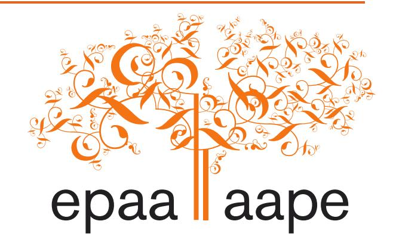

<!-- A2.R12 | source: papers_json/A2.R12/ -->

## education policy analysis archives

A peer-reviewed, independent, open access, multilingual journal

Arizona State University

Volume 25 Number 111 November 6, 2017 ISSN 1068-2341

November 6, 2017

ISSN 1068-2341

## **Discursive Contestations and Pluriversal Futures: A ** **Decolonial Analysis of Educational Policies in the United ** **Arab Emirates**

*Elena Aydarova* Auburn University United States

**Citation**: Aydarova, E. (2017). Discursive contestations and pluriversal futures: A decolonial analysis of educational policies in the United Arab Emirates. *Education Policy Analysis Archives, 25*(111). [http://dx.doi.org/10.14507/epaa.25.3063](http://dx.doi.org/10.14507/epaa.25.3063)

**الملخص: **ركزت معظم الأبحاث المتعلقة بالتحولات العالمية في التعليم على أفعال النخب السياسية والاقتصادية. ونتيجة لذلك، حظيت محاولات مقاومة وتقويض السياسات المتداولة عالمياً على المستوى دون الوطني باهتمام أقل. ولمعالجة هذه الثغرة، تركز هذه الدراسة على المنازعات الخطابية حول الإصلاحات التعليمية في دولة الإمارات العربية المتحدة. واستناداً إلى الإطار النظري لما بعد الاستعمار (Mignolo, 2011)، أستكشف كيف تُبرَّر التدخلات الغربية في السياسات التعليمية من خلال الخطابات المهيمنة، وكيف يتحداها معارضوها عبر الإعلام العام في دولة الإمارات العربية المتحدة. ورغم أن الخطابات البديلة تقدم تصورات للتعليم مفيدة لرسم مسارات مستقبلات تعددية، فإن الصراع بين الأصوات المختلفة يُحسم لصالح "أفضل" الممارسات العالمية. ولا يحدث هذا لأنها أكثر عقلانية أو عالمية، بل لأن أصوات المعارضة منفصلة ومجزأة. تكمن أهمية هذه الورقة في توظيف عدسة ما بعد الاستعمار في تحليل السياسات المتداولة عالمياً، وفي الالتفات إلى الأصوات التي تُهمَّش في تنفيذ الإصلاحات العالمية. **Keywords**: Global policies; educational policy transfer; United Arab Emirates; decolonial perspectives

Journal website:[ http://epaa.asu.edu/ojs/](http://epaa.asu.edu/ojs/) Manuscript received: 5/5/2017

Facebook: /EPAAA
Twitter: @epaa_aape

Facebook: /EPAAA Revisions received: 29/8/2017 Twitter: @epaa_aape Accepted: 5/9/2017

<!-- page 2 -->

## **Las disputas discursivas y unos** **futuros pluriversales: Un análisis decolonial de las ** **políticas** **educativas en los Emiratos Árabes Unidos**

**Resumen: **La mayoría de las investigaciones sobre las transformaciones globales en la educación se han centrado en las acciones de las élites políticas y económicas. Como resultado, los intentos de impugnar y subvertir las políticas de circulación mundial a nivel subnacional han recibido menos atención. Para abordar esta brecha, este estudio se centra en las disputas discursivas en torno a las reformas educativas en los Emiratos Árabes Unidos. Partiendo del marco teórico de la descolonialidad (Mignolo, 2011), exploro cómo las intervenciones occidentales en las políticas educativas están justificadas por los discursos dominantes y desafiadas por sus oponentes a través de los medios públicos en los Emiratos Árabes Unidos. A pesar de que los discursos alternativos proporcionan construcciones de educación útiles para trazar las trayectorias de futuros pluriversales, la lucha entre diferentes voces se resuelve a favor de las "mejores" prácticas globales. Esto no sucede porque sean más racionales o universales, sino porque las voces de la disidencia están desconectadas y fragmentadas. La importancia de este documento radica en emplear lentes decoloniales en el análisis de las políticas de circulación global y en atender a la s voces que se marginaban en la implementación de las reformas globales.

**Palabras-clave:** políticas globales; transferencia de política educativa; Emiratos Árabes Unidos; perspectivas decoloniales

## **Disputas discursivas e futuros pluriversais: Uma análise descolonial das políticas ** **educacionais nos Emirados Árabes Unidos**

**Resumo: **A maioria das pesquisas sobre transformações globais na educação se concentrou nas ações das elites políticas e econômicas. Como resultado, as tentativas de desafiar e subverter as políticas globais de circulação no nível subnacional receberam menos atenção. Para resolver esta lacuna, este estudo enfoca as disputas discursivas que envolvem reformas educacionais nos Emirados Árabes Unidos. A partir do quadro teórico da descolonialidade (Mignolo, 2011), exploro como as intervenções ocidentais nas políticas educacionais são justificadas pelos discursos dominantes e desafiadas pelos seus adversários através da mídia pública nos Emirados Árabes Unidos. Embora os discursos alternativos forneçam construções educacionais úteis para traçar as trajetórias dos futuros pluriversais, a luta entre diferentes vozes é resolvida em favor das "melhores" práticas globais. Isso não acontece porque eles são mais racionais ou universais, mas porque as vozes da dissidência são desconectadas e fragmentadas. A importância deste documento reside no uso de lentes decoloniais na análise das políticas de circulação global e no atendimento de vozes que foram marginalizadas na implementação de reformas globais. **Palavras-chave:** políticas globais; transferência de política educacional; Emirados Árabes Unidos; perspectivas descoloniais

## **Discursive Contestations and Pluriversal Futures: A Decolonial Analysis of ** **Educational Policies in the United Arab Emirates**

عادت طالبتي مريم، وهي معلمة إماراتية تحت التدريب وأم لثلاثة أطفال، من تدريبها العملي في مدرسة محلية، ووصفت تجربتها بعينين دامعتين: "كل شيء بالإنجليزية. المعلمون لا يعرفون ماذا يفعلون. لا يوجد منهج ولا كتب دراسية. الطلاب لا يفهمون ما يحدث. لا يوجد تعلم في تلك المدرسة. يا آنسة، إنهم *يقتلون*

<!-- page 3 -->

أطفالنا، أجيال أطفالنا." وعلى غرار مريم، شعر كثير من طالباتي السابقات المتدربات على التدريس بالضيق من استخدام الإنجليزية لغةً للتدريس في المدارس الحكومية للأطفال الناطقين بالعربية؛ ووجد كثيرات منهن أن أدلة المنهج القائم على المخرجات، المستوردة من دول أخرى، تمثل تحدياً. وفي الوقت نفسه، أفادت حكومة دولة الإمارات العربية المتحدة (UAE) بأن "إصلاح المدارس الحكومية الإماراتية [كان] نجاحاً كبيراً" (Al Najami, 2008). وتثير الفجوة بين هذين التقييمين تساؤلات لا تتعلق فقط بإصلاحات الإمارات، بل أيضاً بالصراعات التي تولّدها السياسات المتداولة عالمياً في أنحاء العالم.

بحثت الدراسات الحديثة حول سياسة التعليم العالمية أبعاداً متعددة للعولمة في التعليم (Mundy, Green, Lingard, & Verger, 2016). وركز هذا الخط البحثي على كيفية انخراط رواد الأعمال في تجارة السياسات حول العالم (Ball, 2012, 2016)، وكيف يروّج فاعلو القطاع الخاص لحزم إصلاح للاستحواذ على مساحات في أسواق التعليم الوطنية (Au & Ferrare, 2015; Steiner-Khamsi, 2016)، وكيف تستخدم المنظمات الدولية – مثل OECD أو World Bank – السياسات العالمية كأدوات لحوكمة التعليم العالمية (Klees, Samoff, & Stromquist, 2012; Rizvi & Lingard, 2010). وغالباً ما يعقب إدخال السياسات العالمية إلى الفضاءات الوطنية تغييرات رمزية فقط، تعكس كيف تتعامل النخب الوطنية مع "الخطاب العالمي" لتجارة السياسة عبر الوطنية (Steiner-Khamsi, 2010, 2016). وحين تصل السياسات العالمية إلى مستوى الممارسة، يمكن إعادة تفسيرها أو مقاومتها أو إضفاء معانٍ جديدة عليها (Anderson-Levitt, 2003; Vavrus & Bartlett, 2009). غير أن الاهتمام المتنامي بالسياسات والنصوص العالمية يحمل خطر تكريس التوحيد القياسي أو إلغاء الاختلاف الذي تخلقه هذه السياسات نفسها. وفي هذا السياق، وكما يجادل Carney وRappleye وSilova (2012)، من المهم توثيق الإكراه والمنازعة والصراع المحيطين بالسياسات المتداولة عالمياً، والالتفات إلى مسائل الفاعلية والسلطة المتضمنة في إدخالها.

تكتسب مسائل الإكراه والسلطة والفاعلية أهمية خاصة في ضوء الروابط بين تجارة السياسة العالمية وبروز الإمبريالية الجديدة بوصفها "شكلاً من أشكال الهيمنة البنيوية تستخدم فيه دولة ذات قوة عالمية أكبر تدخلات سياسية واقتصادية في دول أخرى للتأثير في السياسة وممارسة السيطرة على الأسواق" (Chen, 2010, p. 18). وربما تحول موقع الهيمنة من الفاعلين الحكوميين إلى كيانات القطاع الخاص في الشمال العالمي (Ball, 2012)، لكن السيطرة عبر التبعية واستخراج الموارد ظلت قائمة. وتخلق شركات الاستشارات التعليمية وشركات التعليم هذه التبعيات، إذ تخبر أولاً صانعي السياسة الوطنيين أو المربين المحليين بما ينبغي أن يبدو عليه التعليم "الجديد"، ثم تبيعهم الخدمات التي يُزعَم أنها ستحقق التغيير اللازم (Steiner-Khamsi, 2016). وبينما يبدأ الفاعلون الوطنيون في اقتناء هذه الخدمات، يصبحون متشابكين في علاقات اعتماد طويل الأمد على خبراء أجانب لتزويدهم بمخططات السياسة، أو أطر المناهج، أو نماذج تدريب المعلمين، بصرف النظر عن مدى ملاءمتها للظروف الاجتماعية-التاريخية والثقافية لممارساتهم التعليمية. ومن الآثار الجانبية لهذه التبعيات إلغاء نماذج وفلسفات تعليمية بديلة تُستبعَد باعتبارها غير ملائمة للعصر الحديث (Spring, 2015a, 2015b). وحين يُدرك المهنيون في التعليم، حتى في سياقات مستقلة نسبياً مثل الاتحاد الروسي، أن إلغاء البدائل الوطنية شكل من أشكال الاستعمار (Aydarova, 2015)، فمن واجب الباحثين الدوليين الالتفات إلى الطرق التي بدأت من خلالها تجارة السياسة العالمية تعمل كنظام استعماري جديد (Spring, 2015a, 2015b).

تضع هذه التحولات عبئاً إضافياً على أبحاث سياسة التعليم الدولية. فعلى الباحثين الآن ليس فقط توثيق انتشار السياسات العالمية، بل أيضاً رسم مسارات محتملة لإنهاء الاستعمار وإنهاء الإمبريالية في التعليم (Chen, 2010). وتتناول هذه الورقة هذا التحدي من خلال دراسة المنازعات الخطابية حول الإصلاح التعليمي في دولة الإمارات العربية المتحدة (UAE) عبر عدسة إطار ما بعد الاستعمار (Chen, 2010; Mignolo, 2011). ورغم أن تحولات التعليم العالي في الإمارات حظيت ببعض الاهتمام في الأدبيات الأكاديمية (انظر Burden-Leahy, 2009; Donn & Manthri, 2010)، فإن السياسات التعليمية التي تستهدف قطاع

<!-- page 4 -->

التعليم من الروضة حتى الصف الثاني عشر حظيت باهتمام أقل (باستثناءات انظر Abi-Mershed, 2010; Ridge, 2012). ومع ذلك، تُعد الإمارات، بوصفها إحدى دول الخليج الغنية بالنفط، حالة مثيرة للاهتمام للنظر في كيفية تشكيل الاستعمار الجديد لسياسات التعليم من الروضة حتى الصف الثاني عشر، وكيف تُنازَع من قِبل الجمهور. وبدون ضغوط خارجية ظاهرة، تستورد الدولة خطابات سياسية ونماذج تعليمية على نطاق واسع. غير أن هذه الواردات تشعل صراعات ومنازعات. ومن خلال تحليل هذه المنازعات، أُظهر كيف تتماشى النخب السياسية مع أجندات الاستعمار من خلال السعي إلى أشكال تعليمية يُزعَم أنها تقود البلاد إلى الاقتصاد المعرفي المرغوب عالمياً. وفي المقابل، يبني معارضوها حججاً لصالح إنهاء استعمار التعليم الإماراتي لمتابعة مستقبلات بديلة. ويسلط هذا التحليل الضوء على الفاعلية التي يمارسها من يعارضون الإصلاحات، ويكشف عدم التكافؤ في السلطة المتضمن في هذه النقاشات، ويوثق المناورة التكتيكية الناشئة نتيجة هذه المنازعات. وتكمن أهمية هذه الورقة في النظر في كيفية استخدام الصراع ضد المخططات العالمية لإنهاء استعمار سياسات التعليم العالمية ومتابعة مستقبلات تعددية.

## **Research Context: The United Arab Emirates**

تقع الإمارات ضمن دوائر متحدة المركز من عدة طبقات سياقية – الشرق الأوسط، والعالم العربي، ومجلس التعاون الخليجي – وهي دولة ميسورة الحال لكنها نامية. ولا تعتمد على القروض الدولية لتنفيذ إصلاحاتها التعليمية، لكنها تتبنى العديد من السياسات العالمية (Rizvi & Lingard, 2010). وقبل تشكيل اتحاد سبع إمارات عام 1971، كانت الإمارات تجمعاً فضفاضاً من القبائل المستقرة والبدوية تحت الحماية البريطانية. وفي عام 1973، جلب اكتشاف النفط الثروة وزاد من المشاركة الأجنبية – وبحلول مطلع الثمانينيات، لم يشكل الإماراتيون سوى 20% من سكان الدولة (Davidson, 2005). واعتمدت الإمارات على خبرة دول عربية أخرى لتطوير نظامها التعليمي الوطني (Heard-Bey, 1982; M. Lootah, 2011). ونما عدد الطلاب المسجلين مع مرور الوقت (Peck, 1986)، لكن جودة التعليم في المدارس الحكومية ظلت مصدر قلق (Al Banna, 1997; Gardner, 1995). وفي عام 2000، وفي محاولة لتحسين التعليم، أصدرت وزارة التربية والتعليم الإماراتية وثيقة *Education Vision 2020* التي دعت إلى توطين التعليم، وتحسين مؤهلات المعلمين، وزيادة وصول الطلاب إلى التكنولوجيا (M. Lootah, 2011).

وفي منتصف العقد الأول من الألفية الثانية، أصدرت السلطات الإماراتية سلسلة من تقارير السياسات التي أعطت الأولوية لأجندات التنمية الاقتصادية (مثل *Abu Dhabi Economic Vision 2030*؛ *Abu Dhabi Policy Agenda 2007-2008*، إلخ)، وبدأ تحول رئيسي في السياسة التعليمية. وأنشأت إمارتا أبوظبي ودبي وكالاتهما الخاصة لمراقبة المدارس والإشراف عليها، إضافة إلى وزارة التربية والتعليم القائمة بالفعل – مجلس أبوظبي للتعليم (ADEC) عام 2005، وهيئة المعرفة والتنمية البشرية في دبي (KHDA) عام 2006. واعتمدت هاتان الوكالتان بشكل شبه حصري على خبراء وافدين، معظمهم من دول ناطقة بالإنجليزية. وفي عام 2007، انضمت إمارة دبي إلى TIMMS، وأكد أداء الطلاب الضعيف المخاوف بشأن تدني جودة التعليم من الروضة حتى الصف الثاني عشر. وفي الوقت نفسه تقريباً، ذكر تقرير لشركة McKinsey (Barber, Mourshed, & Whelan, 2007) أن نظام التعليم الإماراتي يحتاج إلى إصلاحات لجعله موجهاً نحو المخرجات وفعالاً.

وأعقب هذا التحول في السياسة عدد هائل من الإصلاحات التعليمية (Kirk, 2013). وقللت هذه الإصلاحات من دور الحكومة في التعليم، وزادت من مشاركة القطاع الخاص، ولامركزت النظام التعليمي (The Executive Council, 2008). وأدخلت كل من دبي وأبوظبي نماذج مدرسية جديدة: "مدارس الغد" (Madares Al Ghad) و"النموذج المدرسي الجديد" على التوالي. وأدخلت النماذج الجديدة مناهج قائمة على المخرجات، والإنجليزية لغةً للتدريس، ونظاماً للتقييم المستمر، من بين تدابير أخرى. وعكست كثير من هذه الإصلاحات نماذج أجنبية أدخلها مستشارون أجانب، دون مراعاة كبيرة لمقتضيات السياق المحلي (Aydarova, 2013). وشعر المعلمون في المدارس بأنهم غير مستعدين إلى حد كبير لهذه

<!-- page 5 -->

التغييرات، وشعروا بالحيرة إزاء التوقعات الجديدة (AlAlili, 2014). وحاول بعضهم مقاومة الإصلاحات، بينما استقال آخرون ببساطة (Ibrahim, Al-Kaabi, & El-Zaatari, 2013). وبينما ركزت التحليلات السابقة لهذه الإصلاحات على نجاحاتها أو إخفاقاتها، أقترح توسيع نطاق البحث لدراسة كيف نُوقشت هذه الإصلاحات في المجتمع ككل عبر عدسة نظرية ما بعد الاستعمار (Chen, 2010; Mignolo, 2011).

## **Theoretical Framework**

في محاولة حديثة لإعادة تصور مجال أبحاث التعليم الدولي، جادل Welch (2013) بأن "ما بعد الاستعمار، من نواحٍ عديدة، نقطة انطلاق أكثر صلابة للمنهجية المقارنة [إذ إنه] يقوم على رفض الأبوية وتبني قيم التبادلية والمعاملة بالمثل" (p. 46). ومع ذلك، يرى باحثون من الجنوب العالمي أن ما بعد الاستعمار، كشكل من أشكال نقد المركز الإمبراطوري، ليس كافياً. وبدلاً من ذلك، يقترحون متابعة إنهاء الاستعمار وإنهاء الإمبريالية وإنهاء الغربنة، من أجل "بناء عالم يتعايش فيه العديد من العوالم" (Mignolo, 2011, p. 54). وتُشكل هذه المتابعة أساس النظرية اللااستعمارية.^1^ ومن هذا المنظور النظري، أصبحت النيوليبرالية العالمية إحدى السمات المحددة لمشروع الحداثة، بخطابها الذي يعمل بوصفه "خطاب خلاص (بالتحول بالأمس، بالتنمية اليوم)، لكن من أجل تنفيذ ما يعظ به هذا الخطاب، من الضروري تهميش أو تدمير كل ما يعترض طريق الحداثة" (Mignolo, 2011, pp. xxiv-xxv). ويُعطي الخلاص عبر التنمية الأولوية للأهداف الاقتصادية على جميع الأهداف الأخرى، ويقدم حلولاً تقنية للمشكلات الاجتماعية. ويقوم هذا "التفكير العالمي الخطي" (Mignolo, 2011, p. 91) على افتراضات إشكالية لمعرفة عالمية قادرة على توجيه أي مجتمع أو دولة على مسار خطي نحو حالة أكثر تطوراً، موجِّهةً إياه نحو نسخة واحدة من المستقبل – سواء كانت اقتصاداً معرفياً أو مجتمعاً مدفوعاً باستهلاك متزايد باستمرار (Mignolo, 2011).

من العناصر المهمة في عملية إنهاء الاستعمار تحرير العقل (wa Thiong'o, 1995) الذي يعزز التفكير اللااستعماري (Mignolo, 2011). والتفكير اللااستعماري إبستمولوجيا تدعو إلى "تدخل فاعل ضد الشعور الانتصاري للرغبة الإمبريالية" (Chen, 2010, p. 112) في السيطرة عبر إنتاج المعرفة أو الحكم عبر تداول السياسة. ويتطلب هذا التدخل كلاً من إعادة تقييم ما يشكل ادعاءً مشروعاً بالمعرفة أو شكلاً معتبراً من أشكال الوجود (Mignolo, 2011)، وتفكيك "المتخيل الثقافي الاستعماري" (Chen, 2010, p. 112)، الذي تُعرَّف فيه الذوات المستعمَرة باستمرار في مقابل صورة المستعمِر. ويتطلب التفكير اللااستعماري أن نقبل "الروابط بين التاريخ الجغرافي والإبستمولوجيا" ونتبنى "شرعية 'أنا حيث أفكر'". والوعد الذي يحمله التفكير اللااستعماري لأبحاث التعليم الدولية هو أنه "يواجه الامتيازات الإمبراطورية للتفكير الإمبراطوري/العالمي الخطي" ويوفر موارد لـ"بناء مستقبلات لااستعمارية" (Mignolo, 2011, p. 90).

من مهام النظرية اللااستعمارية "إعادة بناء وصياغة تخيلات جديدة واكتشاف اتجاه مستقبلي أكثر ديمقراطية" (Chen, 2010, p. 112) نحو التعددية بدلاً من التوحيد القياسي والتماثل. وتُعد إعادة التفكير في التعليم – أغراضه وعملياته وأنشطته – محورية في هذا الصراع نحو مستقبلات تعددية، لا عالمية. وبدلاً من افتراض أن أشكال التدريس والتعلم السائدة في الشمال العالمي ملائمة بالقدر نفسه لسياقات أخرى، يحثنا التفكير اللااستعماري على الالتفات بشكل أوثق إلى الأشكال التعليمية القائمة في الجنوب العالمي، ودراسة إمكاناتها في الحفاظ على تنوع رؤى العالم

> ^ ^ ^1^ Decoloniality is specifically Mignolo's (2011) term. Because Mignolo and Chen strive towards similar goals and find their own work complementary to each other, I apply Mignolo's term to both of their theories to underscore important conceptual bridges between decoloniality and deimperialization in Chen's (2010) work.

<!-- page 6 -->

والخبرات. ولتحقيق ذلك، من المهم "توليد معرفة لبناء مجتمعات تكون فيها الحياة (بشكل عام، لا الحياة البشرية فقط) لها الأولوية على المكاسب الاقتصادية والنمو الاقتصادي والتنمية الاقتصادية، وزراعة معرفة تُخضع النمو الاقتصادي لاحتياجات الإنسان، بدلاً من إخضاع احتياجات الإنسان للنمو الاقتصادي والتنمية" (Mignolo, 2011, p. 115).

وتتطلب زراعة هذه المعرفة ألا نتجاهل، بوصفنا باحثين، التصورات البديلة للحداثة أو التعليم أو المستقبلات المرغوبة في الفضاءات الوطنية ودون الوطنية لبحثنا باعتبارها غير ذات صلة. بل علينا أن نلتفت إلى مجموعة متنوعة من الأصوات وننخرط فيما يسميه Chen "التوفيقية النقدية" – أو عملية "استدخال عناصر من الآخرين بفاعلية في ذاتية النفس من أجل تجاوز الحدود والمواقف الانقسامية التي بنتها تاريخياً علاقات القوة الاستعمارية" (Chen, 2010, p. 98). ومن هذا المنظور، يتطلب موقعي الخاص بوصفي باحثة تفحصاً، لأن الكلمات التي يتحدث بها التابع يمكن تجاهلها أو تحريفها أو إساءة تفسيرها بسهولة (Spivak, 2012). وبوصفي امرأة نشأت في أوكرانيا ما بعد الاشتراكية وتلقت تعليمها في الولايات المتحدة، تكشف روابطي بالإمارات، بوصفي معلمة معلمين سابقة عملت في مؤسسة بُنيت على نماذج تعليمية مستوردة، عن تواطئي في الاستعمار الجديد نفسه الذي أحاول نقده. ومع ذلك، حوّلت الصراعات التي شهدتها – ومنها ما عُرض في مطلع هذه الورقة – تصوراتي عن العالم وموقعي فيه. وكما يلاحظ Chen (2010, p. 23)، "لن يكتمل عمل إنهاء الاستعمار الذي يؤديه المستعمَر بدون إنهاء إمبريالية المستعمِر، والعكس صحيح." ومن هذا الموقع خضت هذا التحليل – موقع "المسؤولية الأخلاقية التعاطفية بوصفها حقاً سابقاً للأصل" (Spivak, 2012, p. 347) الضرورية لإنهاء الإمبريالية والاستعمار المتبادل.

## **Methodology**

في هذه الدراسة، أستخدم منهجيات تحليل السياسة النقدي (Bacchi, 2000; Taylor, 1997) مقترنة بتحليل الخطاب النقدي (Fairclough, 2003, 2013) لدراسة المنازعات الخطابية حول الإصلاح التعليمي في سياق الإمارات. يتعامل تحليل السياسة النقدي مع السياسة التعليمية بوصفها خطاباً "قد يكون له أثر إعادة توزيع 'الصوت' [ب]حيث لا يهم ما يقوله بعض الناس أو يفكرون فيه، بل تصبح أصوات معينة فقط قادرة على أن تُسمع بوصفها ذات معنى أو حجية" (Ball, 1993, p. 15). ورغم وجود خطاب مهيمن أو حجية، فإن "الذوات تُوضَع بالنسبة إلى خطابات متعددة ومتناقضة، مما يفتح حيزاً للتغيير" (Bacchi, 2000, p. 54). لذلك، تلتفت هذه الورقة إلى الخطابات "المهيمنة" (Ball, 1993, p. 15) في إصلاحات التعليم الإماراتية، وتدرس كيف نُشرت خطابات بديلة في صراع حول المعنى والسلطة والمستقبلات المرغوبة (Taylor, 1997). ويتيح هذا التركيز على الصراع بين أصوات متعددة لمحة عن التحديات التي تواجه الموقف المهيمن (Bacchi, 2000) وإمكانية التغيير نحو مستقبلات تعددية (Mignolo, 2011).

يوفر تحليل الخطاب النقدي (CDA) لـFairclough أدوات مفيدة لتحليل السياسة النقدي في سياق العولمة (Rizvi & Lingard, p. 2010). وبالتركيز على الخطاب بوصفه دلالة مرتبطة جدلياً بعناصر اجتماعية أخرى، يوفر CDA أدوات لتحليل طبيعة العلاقات بين ثلاثة مستويات من الواقع الاجتماعي – البنى والممارسات والأحداث الاجتماعية (Fairclough, 2003). وفي هذا الإطار، الخطابات هي "طرق دلالية لتصور جوانب من العالم (المادي أو الاجتماعي أو الذهني)، يمكن تحديدها عموماً بمواقف أو منظورات مختلفة لمجموعات مختلفة من الفاعلين الاجتماعيين" (Fairclough, 2013, p. 180). ويتيح هذا لمحلل الخطاب إقامة روابط بين البنى الاجتماعية والبنى الخطابية، وبالتالي رسم خريطة التفاعل الحواري بين الخطابات المهيمنة وبدائلها. علاوة على ذلك، يُظهر تمييز CDA بين مختلف الأنماط – أو "الطرق الدلالية للفعل والتفاعل" (Fairclough, 2013, p. 179) – كيف ترتبط أنشطة اجتماعية مختلفة بتمثيلات نصية مختلفة. وبالتالي، فإن تتبع كيفية تشظي تمثيلات السياسة عبر نصوص السياسة والمنشورات الإعلامية والتعليقات على الإنترنت،

<!-- page 7 -->

وتقارير المؤتمرات والمواقع الإلكترونية يكشف المعاني المتعددة والصراعات المختلفة المرتبطة بالإصلاحات التعليمية. وأخيراً، يوفر CDA نموذجاً لتحليل الحجاج الكامن في العلاقات بين المشكلات والحلول في صنع السياسة ونقاشاتها. وفي هذا النموذج، يوفر تحليل الحجاج رؤية لتخيلات المشاركين السياسية وتطلعاتهم للسيطرة الاجتماعية أو التغيير الاجتماعي (Fairclough, 2013).

ومن أجل الوصول إلى المنازعات الخطابية حول الإصلاحات التعليمية والمستقبلات المحتملة للإمارات، حللتُ مجموعة متنوعة من النصوص التي التقطت أصواتاً مختلفة في المجتمع الإماراتي. وتألف المتن النصي الذي حُلِّل في هذه الدراسة أساساً من مقالات صحفية عن الإصلاحات التعليمية نُشرت في ثلاث صحف رائدة في دولة الإمارات العربية المتحدة بين مايو 2001 ومايو 2011. اخترتُ التركيز على المقالات الصحفية لعدة أسباب. أولاً، تستخدم النخب السياسية الصحف لعرض الروايات التي تخدم أجنداتها، مما يتيح الوصول إلى الخطابات المهيمنة المتداولة في المجتمع. وفي الوقت نفسه، تتيح أقسام الرأي، والرسائل إلى المحررين، أو التعليقات على الإنترنت على المقالات الصحفية فرصاً لدخول خطابات بديلة إلى المجال الاجتماعي، مما يلتقط تعدد الأصوات الاجتماعي والصراع حول المعاني. ولضمان تنوع أكبر في المنظورات، جمعتُ مقالات من ثلاث صحف رئيسية متداولة في الإمارات تمثل أطرافاً مختلفة من الطيف السياسي، وتستهدف جمهوراً متداخلاً لكن مختلفاً أيضاً. الصحيفة الأولى، *Khaleej Times* (*KT*)، تحمل المحتوى نفسه في نسختيها الإنجليزية والعربية، وتفخر بأنها تحقق "أعلى توزيع بين الصحف الناطقة بالإنجليزية في الخليج"، وتدّعي "قاعدة قراء متعددة الجنسيات تبلغ 450,000". أما *Gulf News* (*GN*) فتُوزَّع بين دول مجلس التعاون الخليجي (مثل الإمارات وقطر وعمان والبحرين وغيرها) لكنها تُنشر بالإنجليزية فقط. وتضم منشورات تصف مواقف القادة وروايات أكثر نقداً تأتي من رسائل القراء أو مقالات يقدمها صحفيون من خارج شبه الجزيرة العربية الأكثر محافظة. وأخيراً، تأسست صحيفة *The National* (*TN*) عام 2008، وتدّعي أنها تروي "قصة الشرق الأوسط كما يراها أهل المنطقة". وتضم كلاً من كتابات تدعم الموقف الرسمي وتعليقات أكثر نقداً على أحداث المنطقة. وتتيح كل من *Gulf News* و*The National* للقراء نشر تعليقات. وفي بحثي، ركزتُ تحديداً على المنشورات التي وصفت وحللت وانتقدت الإصلاحات التعليمية في دولة الإمارات العربية المتحدة. واستُبعدت من هذا البحث المقالات التي وصفت إصلاحات تعليمية في سياقات أخرى أو ركزت على تحولات في مجالات أخرى من المجال الاجتماعي الإماراتي.

بالإضافة إلى المقالات، جمعتُ تعليقات القراء عليها (إن وُجدت)، ونصوص السياسة، والتقارير الدولية، ونصوص المواقع الإلكترونية ذات الصلة، ومنشورات أخرى مرتبطة بعمليات الإصلاح في الإمارات. وإجمالاً، اختير أكثر من 30 مقالاً من كل صحيفة، بحيث تجاوز إجمالي عدد النصوص في قاعدة البيانات 100 نص. وسِرت في التحليل عبر مرحلتين. ركزت الجولة الأولى من الترميز المفتوح على تحديد موضوعات واسعة كشفت صراعاً بين خطابات مختلفة، ودفعتني إلى البحث عن إطار نظري يمكن أن يسلط الضوء على هذه الصراعات. واستندت الجولة الثانية بشكل أكبر إلى الإطار النظري للنظرية اللااستعمارية واستخدمت CDA. وبعد ملاحظة الصراع الذي التقطته النصوص، حددتُ أولاً أي النصوص تمثل الموقف المهيمن وأيها يتحداه. ثم ركزتُ على بنى الحجاج التي اتبعتها هاتان المجموعتان: كيف وصفتا "المستقبلات البديلة الممكنة والمرغوبة" (فرضية الهدف؛ Fairclough, 2013, p. 183)، وكيف أشكلتا جودة التعليم الإماراتي (الفرضية الظرفية)، وأي مسارات عمل دعتا إليها (الادعاء)، وأي قيم أعطتا الأولوية لها (فرضية القيمة). وأتاح رسم بنى الحجاج لدى المجموعتين المختلفتين تحديد عقد المنازعات – أو المجالات التي قدمت فيها مجموعات مختلفة منظورات متعارضة، مثل أهداف الإصلاح التعليمي، واتجاه العمل، وموضوعات الإصلاح، ولغة الإصلاح. وفيما يلي، أعرض نتائج هذه الدراسة استناداً إلى عقد المنازعات التي تلتقط صراعات الإصلاحات التعليمية وتفتح إمكانات لمستقبلات تعددية.

<!-- page 8 -->

## **Discursive Contestations**

## **Goals of Educational Reform **

**الخطابات المهيمنة: الأولويات الاقتصادية والسياسية.** كما لوحظ سابقاً، حدث التحول الرئيسي في السياسة الإماراتية في منتصف العقد الأول من الألفية الثانية. وانعكس هذا التحول في عدد المنشورات حول موضوع الإصلاح التعليمي التي ظهرت في الصحافة الإماراتية: بين عامي 2001 و2006، تناولت خمس مقالات فقط في *Gulf News* و*Khaleej Times* هذا الموضوع، بينما تناولته إحدى عشرة مقالة في عام 2008 وحده. والمهم ليس فقط الاهتمام المتزايد بجهود الإصلاح، بل أيضاً اللغة المستخدمة لتمييز الابتعاد عن الأشكال "التقليدية" للتعليم. ودعت إعلانات وزارة التربية والتعليم إلى "إصلاح جذري للتعليم" (*TN*, Lewis, 2008c) وتجديد كامل للتعليم المدرسي (*GN*, Majaida, 2010). ومن المهم بالمثل الفضاءات التي ارتبطت بها الدعوات إلى الإصلاح في الصحافة. ودعا قادة حكومة الإمارات والوزراء ورؤساء المجالس وضيوف دوليون بارزون أحياناً إلى إصلاحات عاجلة للنظام التعليمي. وأُطلقت هذه الدعوات عبر مؤتمرات تعليمية دولية أو وطنية، مثل قمة World Economic Forum (*KT*, "Call for urgent action," 2010) أو اجتماعات وزراء التعليم في مجلس التعاون الخليجي (GCC) (*TN*, Lewis, 2008). واستهدفت هذه الدعوات ليس فقط النظام التعليمي في الإمارات، بل أيضاً الأنظمة التعليمية في الشرق الأوسط والعالم العربي ومجلس التعاون الخليجي.

في الخطاب المهيمن للقادة، كانت القوى الدافعة وراء إلحاحية الإصلاح التعليمي اقتصادية أساساً، مدفوعة بمبادئ نظرية رأس المال البشري والمنافسة الاقتصادية العالمية. ومن خلال التغيير في النظام التعليمي، طمح القادة الوطنيون إلى تطوير "قوة عاملة متطورة وريادية" ستبني "اقتصاداً معرفياً مستداماً" بحلول عام 2021 (The Executive Council, 2007, p. 28) وتتنافس على المستوى العالمي. ووُصف بناء الاقتصاد المعرفي بأنه المسار المعترف به عالمياً للتنمية، وبسبب محاولات الإمارات الابتعاد عن اعتمادها المفرط على النفط (The Government of Abu Dhabi, 2008). وناقش أفراد متنوعون، من الرئيس التنفيذي السابق لشركة IBM (*KT*, WAM, 2010) إلى وزير التربية والتعليم الإماراتي (*KT*, Ahmad, 2010)، الخطوات التي يجب أن تتخذها الدولة لتجديد تعليمها وبناء اقتصاد معرفي.

غير أن الصحافة لم تنقل فقط كيف وصف القادة الوطنيون والدوليون الحاجة إلى تطوير اقتصاد معرفي، بل أيضاً ما قالته التقارير الصادرة عن منظمات دولية، مثل برنامج الأمم المتحدة الإنمائي (UNDP) أو البنك الدولي، حول طرق تحقيق هذا الهدف. فمثلاً، خُصص *Arab Human Development Report* (UNDP, 2003) حصراً لتنمية مجتمعات المعرفة في العالم العربي. وبينما تناولت توصيته الأولى ضمان حرية التعبير والرأي من خلال الحوكمة الرشيدة، تناولت توصيته الثانية الحاجة إلى إتاحة الوصول إلى تعليم جيد لجميع المواطنين. وحدد *Arab Knowledge Report* (UNDP, 2009)، الذي نُشر بالتعاون مع مؤسسة محمد بن راشد آل مكتوم في دبي، طرقاً لمعالجة فجوة المعرفة بين الدول العربية وبقية العالم. واستند إلى التقارير السابقة، سواء بإبراز أثر غياب الحرية على رأس المال المعرفي للأمم العربية، أو بالتشديد المتكرر على دور المدارس والجامعات في بناء رأس المال المعرفي للأمم العربية. ونوقش كلا التقريرين في الصحف بوصفهما داعمين لرؤية القادة الوطنيين للإصلاح التعليمي كمسار نحو الاقتصاد المعرفي (*GN*, "Gulf News says", 2003; *KT*, "Arab states," 2009).

بالإضافة إلى العوامل الاقتصادية، ادعت الخطابات المهيمنة أن التعليم يجب أن يُصلَح للحفاظ على الاستقرار السياسي في المنطقة. وقبل أحداث الربيع العربي في شتاء وربيع 2011، نشر الشيخ محمد بن راشد آل مكتوم – حاكم دبي ورئيس وزراء الإمارات – مقالاً بعنوان "*Education vs. Extremism*" في صحيفة *Wall Street Journal* عام 2009

<!-- page 9 -->

(Al Maktoum, 2009). وأُعيد نشر المقال نفسه في *Khaleej Times* تحت عنوان "الإمارات تكرس نفسها لنموذج تعليمي جديد" (*KT*, WAM, 2009). ودعا فيه أمم العالم العربي إلى إصلاح التعليم لمنع الاضطراب السياسي. واقترح أن الانفجار الديموغرافي، أو "فورة الشباب" (يقدر أن 25 إلى 40% من السكان العرب تحت سن 25 عاماً حسب تقديرات مختلفة)، يمكن أن يؤدي إلى انعدام الاستقرار في المنطقة، إذا كان جميع الشباب عاطلين عن العمل. ووضع الشيخ محمد الإمارات في موقع القائد الفريد الذي يمكن أن يكون قدوة لدول عربية أخرى. وجمع في خطابه بين مفاهيم التنافسية الحديثة في الاقتصاد العالمي وأمجاد الماضي العربي القديم، حين قاد العالم العربي في العلم والطب والرياضيات. ووفقاً للشيخ محمد، يمكن للأمم العربية، من خلال الإصلاح التعليمي، الحفاظ على استقرارها السياسي واستعادة أمجاد العصر الذهبي الإسلامي:

Our ancestors had their own form of globalization. Through free trade and scientific inquiry, they brought great wealth and enlightenment to Arab societies. We want to rekindle that spirit of daring in the Arab world. There aren't any other viable options, because we are in danger of being left behind in a relentlessly competitive world. Investing in education means investing in the permanent peace and security that our people deserve. (Al Maktoum, 2009)

وخلاصة القول، اعتماداً على "الخطاب العالمي" (Steiner-Khamsi, 2010)، دعت النخب السياسية إلى إصلاحات تعليمية من المنظورين الاقتصادي أو السياسي من أجل خلق قوة عاملة أفضل – إما أكثر تأهيلاً لأنها مدربة جيداً، أو أكثر استقراراً اجتماعياً لأنها موظفة. ويعكس هذا التركيز على الأولويات الاقتصادية "التفكير العالمي الخطي" (Mignolo, 2011, p. 78) الذي يستعمر المخيلة ويفترض أن مساراً عالمياً واحداً فقط نحو التنمية ممكن – مسار التحديث نحو اقتصاد قائم على المعرفة.

**الخطابات البديلة: الأولويات المدنية والتفاوتات البنيوية.** في مقابل المتحدثين الأقوياء بالخطابات المهيمنة، جاءت الخطابات البديلة في النقاش الإماراتي من مربين وباحثين وصحفيين وأولياء أمور شككوا في الإيديولوجيا الرسمية وسعوا إلى بدائل لها. ومع ذلك، ورغم مواجهتهم للخطابات المهيمنة، لم يحملوا أجندة محددة سلفاً. بل تطورت أجنداتهم استجابة لفرض الإيديولوجيا المهيمنة. وبعدم شغلهم مواقع القوة والسلطة، تُركوا يعتمدون على أنفسهم في إيجاد فضاءات عامة لطرح مخاوفهم. وبالنسبة لهم، أصبحت المؤتمرات الوطنية والإقليمية، والافتتاحيات، والمنتديات الإلكترونية القنوات الرئيسية للتفاعل الخطابي مع الخطابات المهيمنة.

كان أحد الجوانب الرئيسية التي شُكِّكت فيها الخطابات البديلة هو هدف التعليم والإصلاحات. فمثلاً، خلال مؤتمر تعليمي حول التعليم الإماراتي، شارك المتحدثون أن "النظام التعليمي الوطني [ينبغي أن] يخلق 'مواطنين صالحين لا مجرد عمال جيدين'" (*GN*, Salama, 2010). وأكد هذا النقد أن تركيز الحكومة على التنافسية والاقتصاد صرف الانتباه عن إعداد الطلاب ليكونوا مواطنين إماراتيين.

ونشب صراع حول مفهوم ما يشكل المواطن. وردت النخب السياسية بأنها تتبنى هدف تنمية "مواطنين منتجين" (*GN*, "Prioritising Education Must Be an Arab Ideal," 2010). وقد استحوذ هذا الرد على النقد وأعاد إدخال مفهوم المواطن في رؤية المستقبلات المرغوبة، لكن فقط بعد صبغه بالقيمة الاقتصادية. وبينما أعطت الخطابات البديلة الأولوية للمواطنة كشكل من أشكال الالتزام تجاه الدولة القومية، ركزت الخطابات المهيمنة على المواطنة كفائدة للاقتصاد.

ولم تنجُ التقارير الدولية أيضاً من التمحيص والمنازعة. ونشر الدكتور N. Janardhan – محلل سياسي مقيم في دولة الإمارات العربية المتحدة – مقالاً وضع فيه دعوات *Arab Human Development Reports* ضمن الشبكة المعقدة للعلاقات الاستعمارية الجديدة بين الغرب والعالم العربي. "كانت الرسالة المركزية لكلا التقريرين أن يصوغ العرب

<!-- page 10 -->

مستقبلهم بأنفسهم بدلاً من السماح للغرب بإملاء التغييرات"، كما لاحظ (*KT*, Janardhan, 2005). غير أن تحليله أشار إلى أن إصدار التقريرين نفسه كان متورطاً في السياسة، إذ فرضت الولايات المتحدة تعديل محتواهما لأن المؤلفين "ربطوا غياب التنمية بسياسات الولايات المتحدة في المنطقة." بعبارة أخرى، شددت الخطابات البديلة على الأبعاد النقدية للتقريرين، متجاوزة التركيز الضيق على التعليم كمسار للاقتصاد المعرفي الذي عرضته النخب السياسية. وقدمت بدلاً من ذلك تسييقاً أوسع للتعليم ضمن علاقات استعمارية جديدة مع الغرب قد تعيق التنمية.

وفي رده على *Arab Knowledge Report* (UNDP, 2009)، سلط رمزي بارود، صحفي فلسطيني أمريكي، الضوء على كيف تجنب الخطاب المهيمن، من خلال التركيز على التعليم، معالجة قضايا نظامية أكبر:

Generalised problems can only obtain generalized, thus superficial solutions. Therefore, it has been summarily decided that the problem lies in lack of education, not the inequitable and unrepresentative political systems. Education became the buzz word, as if education is a detached value. (*KT*, Baroud, 2009)

وشكك بارود في نقده في مدى ملاءمة "الخطاب العالمي" للسياقات المحلية من خلال إثارة اعتراضات على "المشكلات والحلول المعممة". فاستيراد تعريف المشكلة من مكان آخر، وفقاً لبارود، لا يتيح لحلّالي المشكلات تحديد الاحتياجات الخاصة بالسياق، وينتج عنه حلول سطحية. وباستهزائه من الادعاء بأن التعليم هو المشكلة الكامنة وراء جميع العلل الاجتماعية في الدول العربية، شكك بارود في الأنظمة السياسية التي تسيطر على مواطنيها دون إعطائهم صوتاً. ويعيد هذا التشكيك انتباه قراء الصحيفة إلى تقرير UNDP (2003) السابق، حيث أُعطيت حرية التعبير الأولوية القصوى، لا الإصلاح التعليمي. وأشار أيضاً إلى معاملة النخب السياسية للتعليم كسلعة، أو منتج، أو "قيمة منفصلة". والمضمَّن في هذا الاقتباس نقد للقادة الوطنيين والسياسيين الذين يرون التعليم علاجاً شاملاً للعلل الاجتماعية دون البحث عن طرق لمعالجة المشكلات التي تواجهها مجتمعاتهم، سواء كانت اقتصادات ضعيفة تعجز عن توظيف جميع مواطنيها، أو تفاوتات كبيرة بين الأغنياء والفقراء. وفي نقد لاذع مماثل لإصلاحات الإمارات، لاحظت مريم إسماعيل (2010) – صحفية في *The National* – أن "المال لن يصلح المدارس عندما توجد مشكلات اجتماعية وبنيوية متوطنة لم تُعالَج."

## **Reform Actions**

**الخطابات المهيمنة: إدخال نماذج عالمية.** واستناداً إلى الخطابات المتداولة عالمياً حول التعليم من أجل الاقتصاد المعرفي، صرح وزراء التربية ورؤساء مجالس التعليم مراراً بأن "إصلاحات شاملة للتعليم العام" (*TN*, Lewis, 2008a) ضرورية لخلق نظام جديد يشدد على "التفكير الإبداعي" و"التفكير النقدي" و"حل المشكلات" و"الابتكار". وعلى غرار سياقات أخرى حول العالم، صُوِّر نظام التعليم "التقليدي" القائم على "التعلم الحفظي" و"الحفظ" و"الاعتماد المفرط على الكتب الدراسية" (*TN*, Lewis, 2008a) بوصفه نموذجاً باليًا ينبغي التخلي عنه. ورُفضت الأشكال "التقليدية" للتدريس حيث المعلم "خبير" باعتبارها غير ملائمة؛ ووُصفت الأشكال "الحديثة" للتدريس التي يكون فيها الطلاب "فاعلين" و"في مركز عملية التعلم" بأنها لا غنى عنها لتنمية الاقتصاد الوطني (*TN*, Lewis, 2008c). وحدثت المقابلات بين "التقليدي" و"الحديث" في سياق إشارات متكررة إلى "أفضل الممارسات الدولية" أو "أفضل الممارسات العالمية"، و"المعايير والمقاييس الدولية"، و"تعليم عالمي المستوى"، سواء في وثائق السياسة (Abu Dhabi Executive Council, 2007; ADEC, 2012) أو في الصحافة. وعكست الإشارات إلى "أفضل الممارسات الدولية الحديثة" غير المحددة لكن المرغوبة، وإلى الإنجازات التعليمية للدول "المتقدمة" (*TN*, Lewis, 2008e)

<!-- page 11 -->

ما أسماه Chen (2010) "المتخيلات الثقافية الاستعمارية"، التي وضعت الممارسات المرتبطة بالغرب أساساً في موقع أعلى من بدائلها المحلية.

وتحولت الأفضلية المتصوَّرة للنهج المستخدمة في أماكن أخرى إلى مستوى مكثف من النشاط السياسي، جلبت خلاله السلطات "خبراء من الخارج" لتقديم المساعدة في جهود الإصلاح (*TN*, Lewis, 2008d). ومن بين هؤلاء الخبراء لم يكن فقط باحثون وعلماء أفراد استُقدموا من قِبل ADEC وKHDA والوزارة بعقود قصيرة أو طويلة الأمد، بل أيضاً شركتا استشارات خاصتان هما McKinsey وBooz Allen Hamilton. وحدد هؤلاء الخبراء المختلفون الجوانب التي تحتاج إلى إصلاح، وشاركوا في وضع خطط استراتيجية لتحقيق هذه التغييرات، وفتحوا الباب أمام استيراد نماذج متعددة إلى الإمارات. فمثلاً، أوضحت الدكتورة Lynne Pierson – إحدى مديرات مجلس أبوظبي للتعليم – إدخال مجموعة واسعة من النماذج الدولية في مدارس إماراتية مختلفة: "لا نؤمن بجلب (فقط) نموذج واحد، إذ قد ينجح في تلك الدولة لكن ليس بالضرورة في أبوظبي" (*KT*, WAM, 2010). وأوضح مسؤول إماراتي آخر بالمثل أنه بما أنه لم يكن واضحاً أي النماذج ستنجح في سياق الإمارات، كان من الضروري جلب أكبر عدد ممكن منها. وغالباً ما تحقق تكاثر النماذج هذا من خلال دعوة مجموعة متنوعة من فاعلي القطاع الخاص لإدارة المدارس، وتوظيف المعلمين، وتصميم المناهج. ومن بين هؤلاء الفاعلين Nord Anglia وGEMS Education وCfBT (British Education Development Trust).

وفي خضم تكاثر النماذج هذا، انصب التركيز على إدخال معايير للمخرجات التعليمية، وتقييمات موحدة لقياس هذه المخرجات، وعمليات تفتيش مدرسية لمراقبة جودة التعليم المُقدَّم. وأصبح ما يهم هو التركيز النيوليبرالي على الأداء، مثل المكاسب المعرفية الظاهرة في التقييمات الموحدة أو الدرجات الأعلى في عمليات التفتيش المدرسي، التي لا يمكن ملاحظتها إلا كنشاط خارجي بدلاً من تحول داخلي. وبدأت تقارير عن ضعف تحصيل الطلاب في الاختبارات الوطنية أو إخفاق المدارس في تحقيق معايير الجودة تنتشر عبر الصحف في عامي 2009 و2010. ووصلت عملية الاستعمار التي بدأت بالمقارنات المجردة بين النهج "الحديثة" و"التقليدية" إلى المدارس والمعلمين والأطفال من خلال تدابير عقابية كالتشهير بالمدارس وإغلاقها.

**الخطابات البديلة: نقد النماذج الأجنبية.** ضمّت الخطابات البديلة عناصر من الخطابات المهيمنة بتأكيدها أن التغييرات ضرورية؛ لكنها أشكلت وسائل تحقيق هذه التغييرات وشككت في جدوى الواردات التعليمية. وفي أكتوبر 2010، نظم مركز الإمارات للدراسات والبحوث الاستراتيجية مؤتمراً حول سياسات التعليم الإماراتية. وفي حديثه في ذلك المؤتمر، شدد الدكتور Warnica، أستاذ التعليم في الجامعة الأمريكية في رأس الخيمة، على "أن نقل نماذج التعليم الغربية جملة إلى الإمارات لا يجدي نفعاً، وأن السيطرة من أعلى إلى أسفل استبعدت الابتكار من جانب الطلاب والمعلمين" (*GN*, Hilotin, 2010). ووفقاً للدكتور Warnica، أنتجت الإصلاحات التعليمية الإماراتية نتائج معاكسة تماماً لما قُصد بها: فبدلاً من رفع مستوى ابتكار الطلاب وإبداعهم، قوّضتهما. وفي نقده لدور "الخبراء الخارجيين"، لاحظ الدكتور Warnica: "لكي ينجح المستشارون الأجانب في تحقيق الإصلاحات، يجب أن يقوموا بها *مع* المربين والمدارس المحليين لا *عليهم*" (التشديد مضاف، *GN*, Salama, 2010). وأكد هذا النقد الطبيعة الاستعمارية الجديدة للعلاقات بين "الخبراء الخارجيين" والفاعلين المحليين المتسمة باختلالات في السلطة والسيطرة.

وانتقد أكاديمي آخر في المؤتمر نفسه الواردات التعليمية بسبب تكلفتها المرتفعة وإخفاقها في تنمية الهوية الوطنية الإماراتية لدى الطلاب. وذكرت الدكتورة مريم لوتاه أن الواردات كانت مكلفة؛ وأن النفقات المطلوبة لها كان ينبغي أن تُستخدم بدلاً من ذلك لتطوير الخبرة التعليمية المحلية (*GN*, Matthew, 2010). وحوّل تطوير القدرات المحلية التركيز من جلب تدابير خارجية إلى خلق محركات داخلية. وبالنسبة للدكتورة لوتاه، كان هذا التحول ضرورياً لأن النماذج والمناهج الأجنبية، فضلاً عن تكاثر الخبراء الأجانب الذين

<!-- page 12 -->

رافقوها، قوّضت الهوية الوطنية للطلاب الإماراتيين. وباستعادة هدف التعليم المتمثل في خلق مواطنين، دخل خطاب الدكتورة لوتاه في منازعة خطابية مع الخطابات المهيمنة: "يجب أن تكون العوامل الرئيسية في سياسة التعليم محلية، وعلى الإمارات أن تركز على المحركات الداخلية لبناء مواطنين صالحين" (*GN*, Matthew, 2010). وردد حجاج الدكتورة لوتاه، الداعي إلى اهتمام أكثر تركيزاً بالفضاء المحلي وموارده ومتطلباته، وصف Mignolo (2011, p. 99) للتفكير اللااستعماري الذي يرفض المخططات العالمية المُنتَجة في مكان آخر من أجل تبني إبستمولوجيا "أنا حيث أفعل وأفكر."

وأكدت انتقادات أخرى للنماذج المستوردة عدم توافقها مع دين الدولة السائد. وجادل البعض بأن الإسلام، بوصفه حجر الزاوية لثقافة المجتمع، ضاع في سعي الدولة نحو التنافسية والاقتصاد المعرفي. لذلك، رداً على استيراد النماذج التعليمية الغربية، وُجهت دعوات للعودة إلى الطرق الإسلامية في البحث والتعلم والوجود.

"الدمار الهائل الذي عانى منه العالم يستند في الأصل إلى أفكار العلماء الذين أنتجوا أدوات الدمار لأنهم نظروا إلى فكرة الإنجاز وحدها دون البحث في آثارها وعواقبها. ينبغي أن يقوم التعليم على الفكر الثقافي الإسلامي، الذي يتضمن أسس النظرة المتكاملة للكون والعلوم"، قالت الدكتورة حصة. […] "معظم من نسميهم متخصصين في التعليم يشملون أفراداً يفتقرون إلى فهم ووعي بالإنجازات الفكرية الإسلامية التي يمكن تطبيقها في التعليم. تدعي العديد من الدعوات الأخيرة لإصلاح التعليم في الإمارات أنها تهدف إلى نشر روح التسامح بين الطلاب. لكن في الواقع، ينتج عن ذلك التعصب والتطرف." (*GN*, El Shammaa, 2010)

انتقدت الدكتورة حصة عبدالله لوتاه – أستاذة في جامعة الإمارات العربية المتحدة – المعرفة والخبرة الغربية بوصفها قوة مدمرة، وشككت في التركيز على الإنجاز كمقياس للنجاح التعليمي. وفي حديثها في المؤتمر نفسه، جادلت بأن البديل الوحيد لاحتمال الدمار هو إعادة الإسلام إلى مركز التعليم لمساعدة الطلاب على تنمية التسامح والتوازن الروحي. وسيؤدي عدم القيام بذلك إلى التطرف. وخلافاً لدعوة الشيخ محمد إلى إصلاح التعليم لمنع التطرف التي نوقشت في القسم السابق، يُظهر هذا الاقتباس أن التطرف لا ينشأ ببساطة نتيجة نقص التعليم؛ بل ينشأ نتيجة تعليم غير متوافق مع الإبستمولوجيات والأنطولوجيات المحلية.

وإلى جانب نقد النماذج المستوردة، تضمنت الخطابات البديلة دعوات لإعادة الإسلام إلى التعليم من خلال خلق نماذج تدريس بديلة. فمثلاً، وصف أحد المقالات المنشورة في *Khaleej Times* مركز تعلم جديد يقدم "مزيجاً من تعاليم القرآن والمعرفة العلمية" و"يوفر للطلاب طريقة حياة جديدة" (*KT*, Shabandri, 2011) من أجل استعادة توازن الحياة وإنتاج "مفكرين وعلماء معتدلين". ولم يكن هدف هذا المركز مجرد تزويد الطلاب بمعرفة الإسلام، بل مساعدتهم على تحقيق "تحقق ذاتي" و"إثراء [أرواحهم]". وانصب التركيز لا على مقاييس الأداء الخارجية، بل على التوازن الداخلي لتحقيق طريقة حياة مختلفة. وتحدى نموذج هذا المركز الخطابات المهيمنة حول أهداف التعليم كشكل من أشكال المنافسة، واقترح أن يكون التركيز بدلاً من ذلك على التوازن والاعتدال. ووفرت إعادة تفسير دور الإسلام في التعليم كقوة يمكن أن تستعيد الروحانية التي يمحوها حالياً التركيز الغربي على الأداء، مساراً بديلاً للتطور التعليمي، وقدمت لمحة عن إمكانية مستقبلات تعددية يدعو إليها مفكرو ما بعد الاستعمار.

<!-- page 13 -->

## **Language of Reform **

**الخطابات المهيمنة: الإنجليزية لغةً للتدريس.** وفقاً للنخب السياسية الإماراتية، الهدف الأساسي للتعليم هو خلق اقتصاد معرفي وضمان التنافسية العالمية. وبحجة أن الإنجليزية هي "لغة الاقتصاد العالمي" (*KT*, WAM, 2010)، اقترح وزير التربية والتعليم أن تحسين طلاقة الطلاب الإماراتيين في الإنجليزية ينبغي أن يصبح "هدفاً استراتيجياً حتمياً" (*GN*, Landais, 2010). وفي الإمارات، كانت الإنجليزية لغة التدريس في مؤسسات التعليم العالي منذ منتصف التسعينيات. وغالباً ما طُلب من الطلاب الذين تلقوا تعليمهم من الروضة حتى الصف الثاني عشر بالعربية الالتحاق ببرامج ما قبل الجامعة لتحسين كفاءتهم في الإنجليزية وتعزيز مهاراتهم الأكاديمية للتعليم العالي. ومنذ عام 2003، وصف القادة الإماراتيون برامج التأسيس هذه بأنها استنزاف للنظام التعليمي: إذ استحوذت البرامج التعويضية، وفقاً لأحد التقديرات، على 30% من ميزانية التعليم العالي (*KT*, Janardhan, 2009). وألقى وزير التعليم العالي والبحث العلمي باللوم في النفقات الكبيرة لبرامج التأسيس هذه على نظام التعليم غير الفعال من الروضة حتى الصف الثاني عشر والتدريس التقليدي بالعربية. وكما وصف أحد المقالات، "أثبت النهج أحادي اللغة أنه ضار، مع التحاق أكثر من 95% من الطلاب ببرامج التأسيس التعويضية" (*TN*, Ahmad, 2011).

ولتقليص نفقات الدولة على البرامج التعويضية، أدخلت إصلاحات العقد الأول من الألفية الثانية الإنجليزية لغةً للتدريس عبر النظام التعليمي بأكمله من الروضة حتى الصف الثاني عشر. وفي "النموذج المدرسي الجديد" لأبوظبي، استُخدمت الإنجليزية لتدريس فنون اللغة الإنجليزية والرياضيات والعلوم، بينما استُخدمت العربية في حصص اللغة العربية والتربية الإسلامية والتربية المدنية (ADEC, 2012). وأعطت "مدارس الغد" في دبي بالمثل الأولوية لاستخدام الإنجليزية لغةً للتدريس. واعتُبرت هذه الخطوة ضرورية لتنفيذ المناهج الأجنبية المستوردة من دول ناطقة بالإنجليزية. وعند مواجهتهم بشأن فرض الإنجليزية، جادل المسؤولون التعليميون بأن أنواع المدارس الجديدة "لا تتعلق كلها بالإنجليزية" (*GN*, Matthew, 2010)، بل بأن الإنجليزية هي القناة التي يمكن من خلالها للأطفال الإماراتيين تلقي تعليم جيد.

**الخطابات البديلة: العربية على الإنجليزية.** أطلقت الإنجليزية بوصفها وسيلة التدريس في مدارس الروضة حتى الصف الثاني عشر منازعات حول أثرها على التحصيل الأكاديمي للطلاب وهويتهم الوطنية. ونشر باحثون مقالات رأي جادلت بأن الإنجليزية لغةً للتدريس أعاقت تعلم الطلاب لأنهم لم يكونوا متمكنين منها:

In the UAE, […],after about 50 special Madares Al Ghad or Schools of the Future were started more than two years ago, with maths [sic] and science being taught in English, a recent survey revealed that 73 per cent of pupils in these schools deemed the new curriculum "difficult and incomprehensible." (*KT*, Janardhan, 2009)

واكتسبت المخاوف المتعلقة باللغة والتعلم وقضايا الهوية زخماً في المجتمع لدرجة أن حكومة الإمارات كلّفت دراسة نُشرت في *The National*. ويُزعَم أن الدراسة وجدت أن 80% من أولياء الأمور لم يعتقدوا أن الإنجليزية بوصفها لغة التدريس تقوّض الهوية الوطنية للطلاب أو ثقافتهم (*TN*, Ahmad, 2011). ولم يناقش المقال كيف أُجريت الدراسة أو أين نُشرت. وأرسل أحد القراء رسالة إلى المحرر معلقاً على المقال. وتمثل قلق هذا القارئ في التطور المعرفي للأطفال الذين دُرِّست لهم مفاهيم في الرياضيات والعلوم بوسيلة الإنجليزية التي لم يفهموها. وفي رأي هذا القارئ، كان تغيير لغة التدريس إلى لغة لا يعرفها الطلاب أمراً معاكساً للإنتاجية بسبب عائق التعلم الذي تخلقه الحواجز اللغوية. وشدد قارئ آخر على الرابط بين اللغة والهوية في تعليق على الإنترنت على المقال، وُسِّع لاحقاً وأُعيد نشره كرسالة إلى المحرر:

<!-- page 14 -->

I disagree about what this article is trying to convince us: that teaching our children in English will not affect their identity. Language is the corner stone [sic] in one's identity. There are many developed countries other than the Englishspeaking nations that study in their original language. (TN, S. Lootah, 2011)

وارتبط هذا التعليق الأخير بالانتقادات التي أثارها العديد من معارضي الإنجليزية بوصفها لغة التدريس، بسبب التهديد الذي تمثله لهويات الطلاب و"بقاء الإمارات كأمة عربية وخليجية" (*GN*, Matthew, 2010). وبوصف الإنجليزية بأنها "أساسية للنجاح في مجالات من الهندسة إلى الأعمال" (*TN*, National Editorial, 2011)، وضعت الخطابات المهيمنة الإنجليزية في موقع لغة الحداثة والتنمية والفرصة، وأحالت العربية إلى موقع التراث والتقليد. وبحجة أنه من غير الملائم معاملة العربية "فقط [ك]لغة التراث والثقافة" (*GN*, Salama, 2010)، حاول المربون والباحثون وأولياء الأمور تعطيل التوزيع غير المتكافئ للمكانة بين اللغات والثقافات. وشككت هذه الانتقادات مجتمعة في استخدام الإنجليزية بوصفها وسيلة "الإخضاع الروحي" (wa Thiong'o, 1995, p. 287) واستعمار عقول الطلاب الذي قد ينتجه هذا الترتيب الهرمي للغات في المنهج المدرسي.

## **Subjects of Reform **

**الخطابات المهيمنة: المعلمون الدوليون.** فرض السعي إلى طرق تدريس جديدة، وإدخال مناهج مستوردة، واعتماد الإنجليزية لغةً للتدريس، متطلبات جديدة على القوى العاملة التعليمية. وقد كشفت تقارير أعدتها وكالات خارجية، إلى جانب تقييمات وطنية، سابقاً أن المعلمين في الإمارات يفتقرون إلى المؤهلات اللازمة (Gardner, 1995). واستلزمت خطط الإصلاح الطموحة تحولاً سريعاً في مهنة التدريس، وقررت السلطات الإماراتية تحقيق ذلك من خلال توظيف معلمين من دول أخرى:

In efforts to drive improvement in English language teaching and introduce modern pedagogic methods in the Abu Dhabi's public school system, ADEC has hired internationally licensed teachers. (*GN*, El Shammaa, 2010)

ومن خلال هذا الإجراء، وضعت السلطات التعليمية المعلمين الأجانب في موقع موضوعات الإصلاح القادرة على تجديد طرق التدريس في المدارس وتحقيق "الهدف الاستراتيجي الحتمي" المتمثل في تحسين معرفة الطلاب بالإنجليزية. واستُقدم معظم المعلمين من دول ناطقة بالإنجليزية مثل "الولايات المتحدة والمملكة المتحدة وكندا ونيوزيلندا وجنوب أفريقيا وأيرلندا" (*KT*, WAM, 2010). ومن السمات المميزة للمعلمين المطلوبين لم تكن فقط مؤهلاتهم، بل أيضاً وضعهم كـ"ناطقين أصليين بالإنجليزية" (*TN*, Ahmad, 2011).

وكانت عملية توظيف المعلمين الدوليين واستقدامهم مكثفة إلى درجة أنهم سرعان ما فاق عددهم عدد المعلمين الإماراتيين:

Figures issued by KHDA for 2009/2010 showed that 1,787 of the 3,154 teachers working in the state system were Emirati… In Abu Dhabi, 4,319 of the 10,854 teachers employed by ADEC are Emirati nationals. Little wonder if some local teachers feel eclipsed by their international counterparts. (*TN*, Collins, 2011)

ورغم الأعداد الكبيرة من المعلمين الدوليين التي وُظِّفت كل عام، نادراً ما ناقشت النخب السياسية علناً دور المعلمين الدوليين في الإصلاحات التعليمية، باستثناء تعليقات موجزة عن "عملهم إلى جانب المربين المحليين" (*TN*, Ahmad, 2011). وتجنبت الخطابات الرسمية الكشف عن الاعتماد على الخبرة الأجنبية داخل الفصل الدراسي نفسه، رغم أن إعلانات باللغة الإنجليزية عن وظائف تدريس في مدارس الإمارات ملأت الإنترنت باستمرار.

<!-- page 15 -->

**الخطابات البديلة: محنة المعلمين الإماراتيين.** جادل باحثون في مواجهة الخطابات المهيمنة بأن المعلمين الأجانب يمثلون تهديداً للهوية الوطنية واستنزافاً مالياً للنظام التعليمي. واعتُبروا تهديداً لأنهم لم يستطيعوا الإسهام في تنمية الهوية الوطنية للطلاب ولأنهم لم يكونوا ملتزمين بالمجتمعات المحلية. واعتُبروا استنزافاً مالياً لأن الرواتب المرتفعة المعروضة على المعلمين الوافدين كان يمكن استخدامها بدلاً من ذلك لتعزيز القوى العاملة التعليمية المحلية، أو تحسين المدارس، أو تطوير مواد تدريسية جديدة. وأكدت الخطابات البديلة "الأثر السلبي 'للتدخل المستمر من الأجانب، وتغيير السياسات، وأن وقتاً ومالاً كبيرين يُمنحان للخبراء الأجانب ولا يُمنح وقت كافٍ للأولويات المحلية'" (*GN*, Matthew, 2010).

وبالنظر إلى تنمية الهوية الوطنية وخلق مواطنين صالحين بوصفهما الهدفين الأساسيين للتعليم، التقطت الخطابات البديلة حججاً بأن المعلمين الإماراتيين مكون لا غنى عنه في عمليتي التدريس والتعلم. لكن في سياق الإصلاحات، هُمِّش المعلمون الإماراتيون بفعل قوة الخبراء التعليميين الأجانب المكلفين بتجديد النظام التعليمي، وبفعل هيبة المعلمين الدوليين الناطقين بالإنجليزية.

Many nationals are finding that teaching methods they have relied upon for years have suddenly fallen from favour [sic]. Held up to international scrutiny, they have been found wanting in the face of contemporary theory that promotes student participation and active learning. (TN, Collins, 2011)

ويُظهر هذا الاقتباس كيف أسهمت الخطابات المهيمنة في وضع المعلمين في ترتيب هرمي، حيث وُصف المعلمون الدوليون بأنهم من يملكون المهارات والكفاءات اللازمة لتحويل المدارس الإماراتية، والمعلمون الإماراتيون بأنهم من لا يملكون هذه الخبرة. ويكشف هذا الترتيب الهرمي بأوضح صورة عملية الاستعمار الكامنة في جهود الإصلاح: فالطرق التي يجد بها "التمحيص الدولي" أن المربين المحليين "ينقصهم شيء" تشير إلى المتخيل الثقافي الاستعماري (Chen, 2010)، الذي وضع الذوات المستعمَرة في موقع التخلف وقلة التطور مقارنة بالمستعمِر. وبإشارته إلى أن المعلمين الدوليين "عليهم أن يتعلموا بقدر ما يعطون" وأنهم "لا يملكون كل الإجابات"، أشار David Allison من Specialist Schools and Academies Trust (*TN*, Collins, 2011) إلى التوترات الناجمة عن التدفق الأحادي الاتجاه للمعرفة الذي خلقه هذا الترتيب الهرمي.

ونتيجة لهذه التفاوتات في المكانة، استقال كثير من المعلمين الإماراتيين من التدريس أو اختاروا وظائف في قطاعات أخرى: بين عامي 2009 و2011، انخفض عدد المعلمين الإماراتيين في مدارس دبي بمقدار 500 من إجمالي 1787 (*TN*, Collins, 2011). وجادل أفراد من الجمهور بأنه ينبغي توظيف مزيد من المعلمين الإماراتيين في المدارس، وأن تُقدَّر خبرتهم. فمثلاً، جادلت لولوة المرزوقي، عضوة هيئة تدريس في جامعة زايد، بأن للمعلمين الإماراتيين دوراً مهماً يؤدونه:

Parents read about all these expatriate teachers and assume that they are the only qualified teachers. That assumption is wrong. Emirati teachers are not promoted in the right way. There are Emirati teachers who are qualified as contributing to a good school system, and to be an Emirati in a classroom is to be a role model and to be proud of your children and culture. (*TN*, Collins, 2011)

وترديداً للشعور أعلاه، جادل أحد صحفيي *The National* بأن على وزارة التربية والتعليم "البحث عن بعض المساعدة هنا في الداخل بدلاً من الأبطال الخارقين من الخارج" (*TN*, Ismail, 2011). وجادل مؤيدون عديدون بأن التعليم ينبغي أن يُحسَّن من خلال توطين التدريس (*GN*, Salama, 2010) لا من خلال مزيد من استعماره.

<!-- page 16 -->

## **Discussion**

تكشف المنازعات الخطابية حول الإصلاحات التعليمية في دولة الإمارات العربية المتحدة أن الخطابات العالمية وعمليات النقل التعليمي تخلق منازعات دون وطنية وصراعات إيديولوجية حول أهداف التعليم وأولوياته ومعانيه. وتُظهر حالة الإمارات أنه مع تزايد شدة الأثر العالمي الذي جلبته رغبة السلطات في خلق اقتصاد معرفي، تزداد أيضاً المقاومة المحلية له. غير أن هذه المقاومة لا تقتصر على إعادة تفسير الممارسات العالمية (Anderson-Levitt, 2003). بل تفضي إلى إعادة تفسير الذات المحلية وتوجهها الرمزي في العالم. وفي حالة الإمارات، كان فرض الممارسات العالمية في الفضاء الوطني محفزاً قوياً لإبراز صراعات المخاوف الوطنية والتهديدات الثقافية على السطح. وعلى غرار ما يحدث في سياقات دولية أخرى، سلكت النخب السياسية الإماراتية مسار أن تصبح أكثر عالمية وتبنت رؤية مستقبل عالمي. وفعلت ذلك من خلال الترويج لإيديولوجيات التنافسية وإعطاء الأولوية للأهداف الاقتصادية، رغم أن معظم مواطني الإمارات يعتمدون بشدة على الدعم الحكومي (Kanna, 2011). وبينما سعت الخطابات المهيمنة إلى استعمار المستقبل، وروّجت بدورها لتدابير إصلاحية للهيمنة الاستعمارية الجديدة، حاولت الخطابات البديلة إنهاء استعمار الحاضر لخلق مستقبلات تعددية. وأعرب أكاديميون وصحفيون وأولياء أمور أفراد عن انتقادات للخطابات الرسمية، وأبدوا مخاوف بشأن آثار السياسات الجديدة على المجتمع الإماراتي ومستقبله. ولم تكمن أولوياتهم في الأداء الاقتصادي، بل في الهوية الوطنية والاستقرار الروحي والتوازن والاعتدال. وكان تهديد فقدان الثقافة أو التلوث اللغوي يهمهم أكثر بكثير من هدف الاقتصاد المعرفي البعيد. وذكرت أصوات الخطابات البديلة أنه من الأفضل الحفاظ على ما يميز مواطني الإمارات بدلاً من جعلهم عالميين على حساب فقدان أنفسهم. ومع ذلك، لم يكن لهذه الأصوات أجندة متماسكة محددة سلفاً أو خطة عمل: بل نشأت رؤاها للعالم وتصوراتها للتدريس والتعلم في سياق مواجهة الدوغما الرسمية وصراعها معها.

ومن بين الأولويات التي شددت عليها الخطابات البديلة، كانت الهوية الوطنية الأكثر استشهاداً بها. ومع ذلك، في سياق الإمارات – وهي دولة شابة نسبياً، تكون فيها الولاءات القبلية أقوى من الولاءات للدولة الموحدة، وتشكل فيها الاتحاد من خلال رضا اشتُري بالدولارات النفطية (Kanna, 2011) – كانت هذه الإشارات مفارقة واستراتيجية في آن واحد. وترددت خطابة الحاجة إلى الحفاظ على الهوية الوطنية مع مخاوف الأسر الحاكمة بشأن حماية مواقع سلطتها: ففي دولة منقسمة لا تربط فيها هوية موحدة المواطنين معاً، يمكن أن يتضاءل تمسك النخب بالسلطة والسيطرة. وحققت هذه الخطابة في نهاية المطاف درجة من النجاح لأن النخب السياسية استحوذت على مفهوم التعليم من أجل الهوية الوطنية وأدمجته كمبدأ رئيسي للسياسات التعليمية اللاحقة. فمثلاً، سعت النسخة المنقحة من "النموذج المدرسي الجديد" التي أُدخلت في خريف 2010 إلى "تنمية قدرات [الطلاب] في اللغتين العربية والإنجليزية، ومهارات التفكير النقدي، والهوية الثقافية *والوطنية* من خلال الاستخدام المتسق لمخرجات تعلم وتربية صارمة" (التشديد مضاف، ADEC, 2012, p. 4). وبالمثل، أذعنت السلطات في نهاية المطاف لمن جادلوا لصالح دور بارز للمعلمين الإماراتيين واللغة العربية، وأدخلت نموذجاً ثنائي اللغة يتطلب وجود معلمَين (أحدهما غربي والآخر إماراتي) في كل فصل دراسي. وحتى لو ظلت هذه الاستحواذات والمراجعات والتنازلات على المستوى الخطابي، فإنها كشفت أن الصراع مع الخطابات المهيمنة كان له آثاره الإيجابية.

ومع ذلك، ليست المنازعات والاستحواذات المتبادلة ملحوظة بسهولة للعين المجردة للمراقب. وتظل خفية لأن خطابات مختلفة تستهدف جماهير مختلفة وتنشر رسائلها على مستويات سياقية مختلفة. وجّه قادة الإمارات دعواتهم إلى التغيير لجماهير أوسع، عارضين خطاباتهم متجاوزين حدود الإمارات، إلى مجلس التعاون الخليجي، والعالم العربي، والشرق الأوسط، بل والولايات المتحدة. وأضافت إضافة هذه المرجعيات الخارجية ثقلاً إلى

<!-- page 17 -->

حججهم، واضعةً إياهم في موقع فاعلين ذوي عقلية عالمية يمثل منطقهم فضاءات أوسع من الساحة الوطنية. أما المتحدثون بالخطابات البديلة، فركزوا حججهم على الإمارات، مبقين على صانعي السياسة مخاطَبيهم الرئيسيين. وقُدمت إشارات قليلة نسبياً إلى العالم خارج حدود الإمارات، مما أضعف موقع هذا الخطاب إذ بدا ضيق الأفق مقارنة بـ"الخطاب العالمي" الذي استخدمته النخب. وأُخفيت أصوات المعارضة المفككة وصراعاتها ومقاومتها بفعل هيمنة الخطاب المهيمن، ونطاق نفوذه الأوسع، والسلطة المندمجة فيه. ومن خلال التوزيع غير المتكافئ للسلطة والانتشار غير المتساوي لهذه الخطابات المختلفة، أمكن تحقيق الاستعمار التعليمي عبر الإصلاحات المتداولة عالمياً. وتتلاشى المخططات البديلة التي يدعو إليها من يواجهون النخب السياسية في هذا الصراع، ونادراً ما تظهر في النقاشات الدولية، رغم أنها قد تقدم الكثير ليس فقط للإمارات بل للدول المحيطة بها.

## **Conclusion**

كانت عمليات النقل والاستيراد التعليمي منذ زمن طويل محور تركيز أبحاث سياسة التعليم الدولية؛ ومع ذلك، ركزت دراسات قليلة نسبياً على كيف يمكن استخدام الاستجابات المحلية للسياسات العالمية لقلب السيناريو من أجل تخيل وخلق واستدامة تصورات بديلة للتدريس والتعلم. لذلك، لا تقدم هذه الورقة تحليلاً لحالة الإمارات فحسب، بل تمد أيضاً دعوة لإعادة النظر في افتراضات مسلَّم بها عن التعليم وتخيل بدائل للنظام النيوليبرالي العالمي. ويتطلب هذا انخراطاً فاعلاً مع الخطابات البديلة عبر الحدود الوطنية من أجل بناء مستقبلات تعددية تحافظ على التنوع، وتصون الكرامة، وتبني الإنسانية للسنوات القادمة.

ومع ذلك، يطرح الانخراط مع الخطابات البديلة عدداً من التحديات، إذ تخلق طبيعتها المفككة والمجزأة عقبات أمام الباحثين. وغالباً ما تواجه محاولات تحديد وتتبع تأثيرات الخطابات البديلة عبر السياقات الدولية مشكلات تتعلق بنطاق تداولها المحدود، وغموض الفضاءات التي قد تظهر فيها، والخوف من التبعات المحتملة على المعارضين، فضلاً عن التحديات اللغوية للوصول إلى محتواها. وتتطلب هذه التحديات نهجاً منهجية جديدة وتصوراً أكثر مرونة لما يشكل البيانات.

ومع ذلك، ورغم هذه التحديات، يخلق الالتفات إلى الخطابات البديلة عبر عدسة الإطار اللااستعماري حيزاً لشكل جديد من تحليل السياسة الدولية. وكما جادل Takayama وSriprakash وConnell (2017, p. S18)، تُظهر النظريات ما بعد الاستعمارية واللااستعمارية "كيف يمكن تصور 'الباقي' مصدراً لاختلاف جذري وأساساً لمواجهة الإرث الفاعل للاستعمار الذي يقيد مخيلتنا حول التربية والسياسة والبحث." وبالتالي، يتيح الالتفات إلى الخطابات البديلة للباحثين الدوليين فرصة الالتفات إلى أصوات إنهاء الاستعمار والمعارضة في الفضاءات دون الوطنية، وتضخيم هذه الأصوات عبر الحدود الدولية.

وبدلاً من التركيز على كيف تقصر هذه الأصوات عن التصورات الغربية أو العالمية للتعليم، يمكن أن تتبع الأبحاث المستقبلية أخلاقيات الانخراط المسؤول اللااستعمارية مع الآخر، وتدرس كيف يمكن استخدام البدائل المحلية لتفكيك المعايير العالمية (Aydarova, 2015). ويمكن لهذا النوع من الانخراط الأخلاقي مع الروايات التي تنازع الخطابات المهيمنة وتقدم رؤى حول أشكال التعليم التي محاها انتشار السياسات النيوليبرالية العالمية أن يخلق فرصاً أكبر لإعادة تخيل بدائل لمستقبلات تعددية (Mignolo, 2011). وينبغي أن تستكشف الأبحاث المستقبلية أي دور يمكن أن تؤديه الخطابات البديلة المتداولة في الفضاءات دون الوطنية في عملية إنهاء الاستعمار في الجنوب العالمي، وكيف يمكن توظيف تداولها على المستوى العالمي نحو إنهاء إمبريالية الشمال العالمي.

<!-- page 18 -->

## **Acknowledgements**

I would like to thank Kyle Greenwalt, Christina Yao, Crystal Garcia, Anne Campbell, Jonathan Friedman, and Bevin Roue for their feedback on earlier drafts of this paper. I am also thankful to Mohammed Uddin for his input during the preparation of this manuscript.

## **References**

- Abi-Mershed, O. (Ed). (2010). *Trajectories of education in the Arab World: Legacies and challenges*. Oxon: Routledge.
- ADEC. (2012). *Abu Dhabi education reform: The road to 2030*. Abu Dhabi: Abu Dhabi Education Council.
- Ahmad, A. (2010, October 6). UAE requires large Emirati engineer base. *Khaleej Times*. Retrieved from[ http://www.khaleejtimes.com/article/20101006/ARTICLE/310069907/1002.](http://www.khaleejtimes.com/article/20101006/ARTICLE/310069907/1002)
- Ahmad, A. (2011, April 11). Lessons in English endorsed by Arab parents. *The National*. Retrieved from[ http://www.thenational.ae/news/uae-news/education/lessons-in-english-endorsed](http://www.thenational.ae/news/uae-news/education/lessons-in-english-endorsed-by-arab-parents)[by-arab-parents.](http://www.thenational.ae/news/uae-news/education/lessons-in-english-endorsed-by-arab-parents)
- AlAlili, S. (2014). *Reforming English curriculum in United Arab Emirates: An examination of Emirate teachers' * *beliefs and practices regarding the adoption of "English Continuous Assessment Rich Task" (ECART)*. Unpublished Doctoral Dissertation. East Lansing: Michigan State University.
- Al Banna, H. (1997). Teacher training in the UAE: Problems and prospects. In K. E. Shaw (Ed.) *Higher education in the Gulf: Problems and prospects*, (pp. 101-121). Exeter: University of Exeter Press.
- Al Majaida, A. (2010, February 26). Call to revamp secondary school education in GCC. *Khaleej * *Times*. Retrieved from [http://www.khaleejtimes.com/article/20100226/ARTICLE/302269902/1002.](http://www.khaleejtimes.com/article/20100226/ARTICLE/302269902/1002)
- Al Maktoum, M. (2009, June 3). Education vs. extremism. *The Wall Street Journal*. Retrieved from [https://www.wsj.com/articles/SB124398534971279197.](https://www.wsj.com/articles/SB124398534971279197)
- Al Najami, S. (2008, August 17). UAE public school reform project a big success. *Gulf News*. Retrieved from http://gulfnews.com/news/uae/education/uae-public-school-reformproject-a-big-success-1.125455.
- Anderson-Levitt, K. (2003). *Local meanings, global schooling: Anthropology and world culture theory*. New York: Palgrave Macmillan. http://dx.doi.org/10.1057/9781403980359
- Arab states face education crisis, risk instability. (2009, October 28). *Khaleej Times*.
- Au, W. & Ferrare, J. (Eds). (2015). *Mapping corporate education reform: Power and policy networks in the * *neoliberal state*. New York: Routledge.
- Aydarova, O. (2013). If not "the Best of the West," then "Look East": Imported teacher education curricula in the Arabian Gulf. *Journal of Studies in International education*, *17*(3), 284-302. http://dx.doi.org/10.1177/1028315312453742
- Aydarova, O. (2015). Global discourses and local responses: A dialogic perspective on educational reforms in the Russian Federation. *European Education,* *47*(4), 331-345. http://dx.doi.org[/10.1080/10564934.2015.1107375](http://dx.doi.org/10.1080/10564934.2015.1107375)
- Bacchi, C. (2000). Policy as discourse: What does it mean? Where does it get us? *Discourse: Studies in * *the Cultural Politics of Education,* *21*(1), 45-57. http://dx.doi.org/10.1080/01596300050005493
- Ball, S. J. (1993). What is policy? Texts, trajectories and toolboxes. *Discourse: Studies in the Cultural * *Politics of Education*, *13*(2), 10–17. http://dx.doi.org/10.1080/0159630930130203

<!-- page 19 -->

- Ball, S. J. (2012). *Education, plc: Understanding private sector participation in public sector education*. London: Routledge.
- Ball, S. J. (2016). Following policy: Networks, network ethnography and education policy mobilities. *Journal of Education Policy, 31*(5), 549-566. http://dx.doi.org/10.1080/02680939.2015.1122232
- Barber, M., Mourshed, M., & Whelan, F. (2007). *Improving education in the Gulf.* London: McKinsey.
- Baroud, R. (2009, November 3). Who cares for development? *Khaleej Times*. Retrieved from [http://www.khaleejtimes.com/editorials-columns/who-cares-for-development.](http://www.khaleejtimes.com/editorials-columns/who-cares-for-development)
- Burden‐Leahy, S. M. (2009). Globalisation and education in the postcolonial world: The conundrum of the higher education system of the United Arab Emirates. *Comparative Education,* *45*(4), 525-544. http://dx.doi.org/10.1080/03050060903391578
- Call for urgent action on water security, education reforms. (2010, December 3). *Khaleej Times*. Retrieved from [http://www.khaleejtimes.com/article/20101203/ARTICLE/312039916/1036.](http://www.khaleejtimes.com/article/20101203/ARTICLE/312039916/1036)
- Carney, S., Rappleye, J., & Silova, I. (2012). Between faith and science: World culture theory and comparative education. *Comparative Education Review,* *56*(3), 366-393. http://dx.doi.org/10.1086/665708
- Chen, K.-H. (2010). *Asia as method: Toward deimperialization*. Durham: Duke University Press. http://dx.doi.org/10.1215/9780822391692
- Collins, L. (2011, May 14). Expat teachers aren't only ones leaving UAE schools. *The National*. Retrieved from[ http://www.thenational.ae/news/uae-news/education/expat-teachers-arent](http://www.thenational.ae/news/uae-news/education/expat-teachers-arent-only-ones-leaving-uae-schools)[only-ones-leaving-uae-schools.](http://www.thenational.ae/news/uae-news/education/expat-teachers-arent-only-ones-leaving-uae-schools)
- Davidson, C. M. (2005). *The United Arab Emirates: A study in survival*. Boulder: Lynne Reinner.
- Donn, G., & Manthri, Y. (2010). *Globalisation and higher education in the Arab Gulf States.* Oxford: Symposium Books. http://dx.doi.org/10.15730/books.73
- El Shammaa, D. (2010, October 7). A vision for the future of the UAE education. *Gulf News. * Retrieved from[ http://gulfnews.com/news/uae/education/a-vision-for-the-future-of-the](http://gulfnews.com/news/uae/education/a-vision-for-the-future-of-the-uae-education-1.692849)[uae-education-1.692849.](http://gulfnews.com/news/uae/education/a-vision-for-the-future-of-the-uae-education-1.692849)
- Fairclough, N. (2003). *Analysing discourse: Textual analysis for social research*. London: Routledge.
- Fairclough, N. (2013). Critical discourse analysis and critical policy studies. *Critical Policy Studies,* *7*(2), 177-197. http://dx.doi.org/10.1080/19460171.2013.798239
- Gardner, W. E. (1995). Developing a quality teaching force for the United Arab Emirates: Mission improbable. *Journal of Education for Teaching, 21*(3), 289-301. http://dx.doi.org/10.1080/02607479550038518
- Gulf News says: Knowledge is power, so re-plan. (2003, November 11). *Gulf News*. Retrieved from [http://gulfnews.com/news/uae/general/gulf-news-says-knowledge-is-power-so-re-plan-](http://gulfnews.com/news/uae/general/gulf-news-says-knowledge-is-power-so-re-plan-1.369880)[1.369880.](http://gulfnews.com/news/uae/general/gulf-news-says-knowledge-is-power-so-re-plan-1.369880)
- Heard-Bey, F. (1982). *From Trucial states to United Arab Emirates*. London: Longman.
- Hilotin, J. (2010, October 7). Education conference: Worrying trend. *Gulf News*. Retrieved from [http://gulfnews.com/news/uae/education/education-conference-worrying-trend-1.692959.](http://gulfnews.com/news/uae/education/education-conference-worrying-trend-1.692959)
- Ibrahim, A., Al Kaabi, A., & El Zaatari, W. (2013). Teacher resistance to educational change in the United Arab Emirates. *International Journal of Research Studies in Education,* *2*(3), 25-36. http://dx.doi.org/10.5861/ijrse.2013.254
- Ismail, M. (2010, November 21). All the experts and money in the world can't teach a child. *The * *National*. Retrieved from[ http://www.thenational.ae/thenationalconversation/news](http://www.thenational.ae/thenationalconversation/news-comment/all-the-experts-and-money-in-the-world-cant-teach-a-child)[comment/all-the-experts-and-money-in-the-world-cant-teach-a-child.](http://www.thenational.ae/thenationalconversation/news-comment/all-the-experts-and-money-in-the-world-cant-teach-a-child)

<!-- page 20 -->

- Ismail, M. (2011, May 22). Amid the din of reform, teachers' voices are drowned out. *The National*. Retrieved from[ http://www.thenational.ae/thenationalconversation/comment/amid-the](http://www.thenational.ae/thenationalconversation/comment/amid-the-din-of-reform-teachers-voices-are-drowned-out)[din-of-reform-teachers-voices-are-drowned-out.](http://www.thenational.ae/thenationalconversation/comment/amid-the-din-of-reform-teachers-voices-are-drowned-out)
- Janardhan, N. (2005, January 4). How Arab renaissance runs into American roadblocks. *Khaleej * *Times*. Retrieved from[ http://www.khaleejtimes.com/editorials-columns/how-arab](http://www.khaleejtimes.com/editorials-columns/how-arab-renaissance-runs-into-american-roadblocks)[renaissance-runs-into-american-roadblocks.](http://www.khaleejtimes.com/editorials-columns/how-arab-renaissance-runs-into-american-roadblocks)
- Janardhan, N. (2009, December 7). Arabic or English? *Khaleej Times.* Retrieved from http://www.khaleejtimes.com/editorials-columns/arabic-or-english.
- Kanna, A. (2011). *Dubai, the city as corporation*. Minneapolis: University of Minnesota Press. http://dx.doi.org/10.5749/minnesota/9780816656301.001.0001
- Kirk, D. J. (2013). Comparative education and the Arabian Gulf. In A. Wiseman & E. Anderson (Eds.) *Annual Review of Comparative and International Education 2013*, (pp. 175-189). Bingley: Emerald Group Publishing. http://dx.doi.org/10.1108/S1479-3679(2013)0000020018
- Klees, S. J., Samoff, J., & Stromquist, N. P. (Eds). (2012). *The World Bank and education: Critiques and * *alternatives*. Rotterdam: Sense Publishers. http://dx.doi.org/10.1007/978-94-6091-903-9
- Landais, E. (2010, September 19). UAE needs reforms to create a more innovative society. *Gulf * *News*. Retrieved from[ http://gulfnews.com/news/uae/education/uae-needs-reform-to](http://gulfnews.com/news/uae/education/uae-needs-reform-to-create-more-innovative-society-1.683949)[create-more-innovative-society-1.683949.](http://gulfnews.com/news/uae/education/uae-needs-reform-to-create-more-innovative-society-1.683949)
- Lewis, K. (2008a, August 31). Overhaul for school curriculum. *The National*. Retrieved from [http://www.thenational.ae/news/uae-news/education/overhaul-for-school-curriculum.](http://www.thenational.ae/news/uae-news/education/overhaul-for-school-curriculum)
- Lewis, K. (2008b, August 31). A problem-solving approach. *The National*. Retrieved from [http://www.thenational.ae/news/uae-news/education/a-problem-solving-approach.](http://www.thenational.ae/news/uae-news/education/a-problem-solving-approach)
- Lewis, K. (2008c, October 19). Call for radical education overhaul. *The National*. Retrieved from [http://www.thenational.ae/news/uae-news/call-for-radical-education-overhaul.](http://www.thenational.ae/news/uae-news/call-for-radical-education-overhaul)
- Lewis, K. (2008d, November 6). Education reform plan thrown open for comment. *The National*. [http://www.thenational.ae/news/uae-news/education-reform-plan-thrown-open-for](http://www.thenational.ae/news/uae-news/education-reform-plan-thrown-open-for-comment)[comment. ](http://www.thenational.ae/news/uae-news/education-reform-plan-thrown-open-for-comment)
- Lewis, K. (2008e, December 25). Reforms fail to improve Gulf school's standards. *The National*. Retrieved from[ http://www.thenational.ae/news/uae-news/reforms-fail-to-improve-gulf](http://www.thenational.ae/news/uae-news/reforms-fail-to-improve-gulf-schools-standards)[schools-standards.](http://www.thenational.ae/news/uae-news/reforms-fail-to-improve-gulf-schools-standards)
- Lootah, M. (2011). Assessing educational policies in the UAE. In *Education in the UAE: Current status * *and future developments*, (pp. 27-52). Abu Dhabi: The Emirates Center for Strategic Studies and Research.
- Lootah, S. (2011, April 13). Readers write on the importance of Arabic in the UAE. *The National*. Retrieved from[ http://www.thenational.ae/thenationalconversation/feedback/readers](http://www.thenational.ae/thenationalconversation/feedback/readers-write-on-the-importance-of-arabic-in-the-uae)[write-on-the-importance-of-arabic-in-the-uae.](http://www.thenational.ae/thenationalconversation/feedback/readers-write-on-the-importance-of-arabic-in-the-uae)
- Matthew, F. (2010, October 7). Education has to build strong UAE citizens. *Gulf News*. Retrieved from[ http://gulfnews.com/opinion/thinkers/education-has-to-build-strong-uae-citizens-](http://gulfnews.com/opinion/thinkers/education-has-to-build-strong-uae-citizens-1.692780)[1.692780.](http://gulfnews.com/opinion/thinkers/education-has-to-build-strong-uae-citizens-1.692780)
- Mignolo, W. (2011). *The darker side of Western modernity: Global futures, decolonial options*. Durham: Duke University Press. http://dx.doi.org/10.1215/9780822394501
- Mundy, K., Green, A., Lingard, B., & Verger, A. (Eds). (2016). *Handbook of global education policy*. Malden: Wiley Blackwell. http://dx.doi.org/10.1002/9781118468005
- National Editorial. (2011, April 13). Bilingualism is an advantage to be embraced. *The National*. Retrieved from[ http://www.thenational.ae/thenationalconversation/editorial/bilingualism](http://www.thenational.ae/thenationalconversation/editorial/bilingualism-is-an-advantage-to-be-embraced)[is-an-advantage-to-be-embraced.](http://www.thenational.ae/thenationalconversation/editorial/bilingualism-is-an-advantage-to-be-embraced)

<!-- page 21 -->

- Prioritising Education Must Be an Arab Ideal. (2010, October 31). *Gulf News*. Retrieved from [http://gulfnews.com/opinion/editorials/prioritising-education-must-be-an-arab-ideal-](http://gulfnews.com/opinion/editorials/prioritising-education-must-be-an-arab-ideal-1.704055)[1.704055.](http://gulfnews.com/opinion/editorials/prioritising-education-must-be-an-arab-ideal-1.704055)
- Peck, M. C. (1986). *The United Arab Emirates: A venture in unity*. Boulder: Westview Press.
- Ridge, N. (2012). In the shadow of global discourses. In G. Steiner-Khamsi & F. Waldow (Eds.), *World yearbook of education 2012: Policy borrowing and lending in education*, (pp. 291-308). London: Routledge.
- Rizvi, F., & Lingard, B. (2010). *Globalizing education policy*. London: Routledge.
- Salama, S. (2010, October 6). Emphasis on foreign languages does not contradict UAE policies. *Gulf * *News. *Retrieved from[ http://gulfnews.com/news/uae/education/emphasis-on-foreign](http://gulfnews.com/news/uae/education/emphasis-on-foreign-languages-does-not-contradict-uae-policies-1.692334)[languages-does-not-contradict-uae-policies-1.692334.](http://gulfnews.com/news/uae/education/emphasis-on-foreign-languages-does-not-contradict-uae-policies-1.692334)
- Shabandri, M. (2011, March 8). Blending religion with modern education. *Khaleej Times*. Retrieved from[ http://www.khaleejtimes.com/nation/education/blending-religion-with-modern](http://www.khaleejtimes.com/nation/education/blending-religion-with-modern-education)[education.](http://www.khaleejtimes.com/nation/education/blending-religion-with-modern-education)
- Spivak, G. C. (2011). *An aesthetic education in the era of globalization*. Cambridge: Harvard University Press.
- Spring, J. (2015a). *Economization of education: Human capital, global corporations, skills-based schooling*. New York: Routledge.
- Spring, J. (2015b). *Globalization and education: An introduction.* New York: Routledge.
- Steiner-Khamsi, G. (2010). The politics and economics of comparison. *Comparative Education Review, * *54*(3), 323-342. http://dx.doi.org/10.1086/653047
- Steiner-Khamsi, G. (2016). New directions in policy borrowing research. *Asia Pacific Education Review*. doi:10.1007/s12564-016-9442-9
- Swan, M. (2013, March 15). Sheikh Nahyan and Blair define education for today at Dubai forum. *The National*. Retrieved from[ http://www.thenational.ae/news/uae-news/education/sheikh](http://www.thenational.ae/news/uae-news/education/sheikh-nahyan-and-blair-define-education-for-today-at-dubai-forum)[nahyan-and-blair-define-education-for-today-at-dubai-forum.](http://www.thenational.ae/news/uae-news/education/sheikh-nahyan-and-blair-define-education-for-today-at-dubai-forum)
- Takayama, K., Sriprakash, A., & Connell, R. (2017). Toward a postcolonial comparative and international education. *Comparative Education Review*, *61*(S1), S1-S24. http://dx.doi.org/10.1086/690455
- Taylor, S. (1997). Critical policy analysis: Exploring contexts, texts and consequences. *Discourse: * *Studies in the Cultural Politics of Education,* *18*(1), 23-35. http://dx.doi.org/10.1080/0159630970180102
- The Executive Council. (2007). *Policy agenda 2007-2008: The emirate of Abu Dhabi.* Abu Dhabi: The Executive Council.
- The Government of Abu Dhabi. (2008). *Abu Dhabi economic vision 2030*. Abu Dhabi: The Government of Abu Dhabi.
- United Nations Development Program. (2003). *Arab Human Development Report 2003: Building a * *knowledge society*. New York: United Nations Development Program.
- United Nations Development Program. (2009). *The Arab Knowledge Report: Towards productive * *intercommunication for knowledge*. Dubai: Al Maktoum Foundation.
- Vavrus, F. & Bartlett, L. (2009). *Critical approaches to comparative education: Vertical case studies from Africa, * *Europe, the Middle East, and the Americas*. New York: Palgrave Macmillan. http://dx.doi.org/10.1057/9780230101760
- WAM: Emirates News Agency. (2010, September 14). Abu-Dhabi rolls out key school reform plan. *Khaleej Times*. Retrieved from [http://www.khaleejtimes.com/article/20100914/ARTICLE/309149879/1002.](http://www.khaleejtimes.com/article/20100914/ARTICLE/309149879/1002)

<!-- page 22 -->

- WAM: Emirates News Agency. (2009, June 3). UAE dedicated to a new education paradigm: Mohammed. *Khaleej Times*.
- Wa Thiong'o, N. (1995). The language of African literature. In B. Ashcroft, G. Griffiths, & H. Tiffin (Eds.), *The post-colonial studies reader, *(pp. 285-290). London: Routledge.
- Welch, A. (2013). Technocracy, uncertainty, and ethics: Comparative education in an era of postmodernity and globalization. In R. Arnove, C. Torres, & S. Franz (Eds.) *Comparative * *education: The dialectic of the global and the local,* (pp. 389-403). Lanham: Rowman & Littlefield.

<!-- page 23 -->

## **About the Author**

## **Elena Aydarova**

Auburn University

Email address:[ eza0029@auburn.edu](mailto:eza0029@auburn.edu) Website:[ https://elenaaydarova.com/](https://elenaaydarova.com/) [http://orcid.org/0000-0002-0387-2889](http://orcid.org/0000-0002-0387-2889)

Elena Aydarova is an Assistant Professor of Social Foundations at the Department of Educational Foundations, Leadership, and Technology at Auburn University.

Herinterdisciplinary research examines the interactions between global social change and the work of teachers, teaching, and teacher education through the lens of equity and social justice. Her projects have explored teacher education reforms in Russia and the US, internationalization of education, teacher retention, as well as commercialization of teacher preparation. Throughout her career, Dr. Aydarova has taught in the United States, Ukraine, China, and the United Arab Emirates.

## education policy analysis archives

Volume 25 Number 111

Volume 25 Number 111 November 6, 2017 ISSN 1068-2341

ISSN 1068-2341

Readers are free to copy, display, and distribute this article, as long as the work is attributed to the author(s) and **Education Policy Analysis Archives, **it is distributed for noncommercial purposes only, and no alteration or transformation is made in the work. More details of this Creative Commons license are available at

http://creativecommons.org/licenses/by-nc-sa/3.0/. All other uses must be approved by the author(s) or **EPAA**. **EPAA** is published by the Mary Lou Fulton Institute and Graduate School of Education at Arizona State University Articles are indexed in CIRC (Clasificación Integrada de Revistas Científicas, Spain), DIALNET (Spain),[ Directory of Open Access Journals,](http://www.doaj.org/) EBSCO Education Research Complete, ERIC, Education Full Text (H.W. Wilson), QUALIS A1 (Brazil), SCImago Journal Rank, SCOPUS, SOCOLAR (China).

Please send errata notes to Audrey Amrein-Beardsley at[ audrey.beardsley@asu.edu](mailto:audrey.beardsley@asu.edu)

**Join EPAA's Facebook community** at[ https://www.facebook.com/EPAAAAPE](https://www.facebook.com/EPAAAAPE) and **Twitter ** **feed **@epaa_aape.

<!-- page 24 -->

University of Connecticut

**Amy Garrett Dikkers **University of North Carolina, Wilmington

## education policy analysis archives editorial board

Lead Editor: **Audrey Amrein-Beardsley **(Arizona State University) Editor Consultor: **Gustavo E. Fischman** (Arizona State University)

Associate Editors: **David Carlson, Lauren Harris**, **Margarita Jimenez-Silva,** **Eugene Judson**, **Mirka Koro-****Ljungberg, Scott Marley, Jeanne M. Powers, Iveta Silova, Maria Teresa Tatto** (Arizona State University)

| Ljungberg, Scott Marley, Jeanne M. Powers, Iveta Silova, Maria Teresa Tatto (Arizona State University) | **Gene V Glass** Arizona State University | **Gloria M. Rodriguez** University of California, Davis |
| --- | --- | --- |
| **Cristina Alfaro** San Diego State University | **Ronald Glass** University of California, Santa Cruz | **R. Anthony Rolle** University of Houston |
| **Gary Anderson** New York University | **Jacob P. K. Gross** University of Louisville | **A. G. Rud** Washington State University |
| **Michael W. Apple** University of Wisconsin, Madison | **Eric M. Haas** WestEd | **Patricia Sánchez** University of Texas, San Antonio |
| **Jeff Bale** OISE, University of Toronto, Canada | **Julian Vasquez Heilig** California State University, Sacramento | **Janelle Scott** University of California, Berkeley |
| **Aaron Bevanot** SUNY Albany | **Kimberly Kappler Hewitt** University of North Carolina Greensboro | **Jack Schneider** College of the Holy Cross |
| **David C. Berliner** Arizona State University | **Aimee Howley** Ohio University | **Noah Sobe** Loyola University |
| **Henry Braun** Boston College | **Steve Klees** University of Maryland | **Nelly P. Stromquist** University of Maryland |
| **Casey Cobb** University of Connecticut | **Jaekyung Lee** SUNY Buffalo | **Benjamin Superfine** University of Illinois, Chicago |
| **Arnold Danzig** San Jose State University | **Jessica Nina Lester** Indiana University | **Adai Tefera** Virginia Commonwealth University |
| **Linda Darling-Hammond** Stanford University | **Amanda E. Lewis** University of Illinois, Chicago | **Tina Trujillo** University of California, Berkeley |
| **Elizabeth H. DeBray** University of Georgia | **Chad R. Lochmiller** Indiana University | **Federico R. Waitoller** University of Illinois, Chicago |
| **Chad d'Entremont** Rennie Center for Education Research & Policy | **Christopher Lubienski** Indiana University | **Larisa Warhol** University of Connecticut |
| **John Diamond** University of Wisconsin, Madison | **Sarah Lubienski** Indiana University | **John Weathers** University of Colorado, Colorado Springs |
| **Matthew Di Carlo** Albert Shanker Institute | **William J. Mathis** University of Colorado, Boulder | **Kevin Welner** University of Colorado, Boulder |
| **Sherman Dorn** Arizona State University | **Michele S. Moses** University of Colorado, Boulder | **Terrence G. Wiley** Center for Applied Linguistics |
| **Michael J. Dumas** University of California, Berkeley | **Julianne Moss** Deakin University, Australia | **John Willinsky** Stanford University |
| **Kathy Escamilla** University of Colorado, Boulder | **Sharon Nichols** University of Texas, San Antonio | **Jennifer R. Wolgemuth** University of South Florida |
| **Melissa Lynn Freeman** Adams State College | **Eric Parsons** University of Missouri-Columbia | **Kyo Yamashiro** Claremont Graduate University |
| **Rachael Gabriel** University of Connecticut |  |  |

Missouri-Columbia

University, UK

**Susan L.** **Robertson **Bristol

University

<!-- page 25 -->

## archivos analíticos de políticas educativas consejo editorial

Editor Consultor: **Gustavo E. Fischman** (Arizona State University)

Editores Asociados: **Armando Alcántara Santuario** (Universidad Nacional Autónoma de México), **Jason Beech**, (Universidad de San Andrés), **Angelica Buendia**, (Metropolitan Autonomous University), **Ezequiel Gomez Caride**, (Pontificia Universidad Católica Argentina), **Antonio Luzon**, (Universidad de Granada), **José Luis Ramírez,** Universidad de Sonora)

## **Claudio Almonacid**

Universidad Metropolitana de Ciencias de la Educación, Chile

## **Miguel Ángel Arias Ortega ** Universidad Autónoma de la

Ciudad de México

## **Xavier Besalú Costa **

Universitat de Girona, España

**[Xavier Bonal](javascript:openRTWindow()** **Sarro** Universidad Autónoma de Barcelona, España

## **[Antonio Bolívar](javascript:openRTWindow()** **Boitia**

Universidad de Granada, España

**[José Joaquín Brunner](javascript:openRTWindow()** Universidad Diego Portales, Chile

**[Damián Canales Sánchez](javascript:openRTWindow()**

Instituto Nacional para la Evaluación de la Educación, México

## **Gabriela de la Cruz** **Flores**

Universidad Nacional Autónoma de México

## **[Marco Antonio Delgado Fuentes](javascript:openRTWindow()**

Universidad Iberoamericana, México

**[Inés Dussel](javascript:openRTWindow()**, DIE-CINVESTAV, México

**[Pedro Flores Crespo](javascript:openRTWindow()** Universidad Iberoamericana, México

## **Ana Mar

a Garc

a de Fanelli **

Centro de Estudios de Estado y Sociedad (CEDES) CONICET, Argentina

## **Juan Carlos González Faraco **

Universidad de Huelva, España

## **María Clemente Linuesa **

Universidad de Salamanca, España

## **Jaume Martínez Bonafé**

Universitat de València, España

## **Alejandro Márquez Jiménez **

Instituto de Investigaciones sobre la Universidad y la Educación, UNAM, México

## **Mar

a Guadalupe Olivier** **Tellez**,

Universidad Pedagógica Nacional, México

**[Miguel Pereyra](javascript:openRTWindow()** Universidad de Granada, España

**[Mónica Pini](javascript:openRTWindow()** Universidad Nacional de San Martín, Argentina

## **Omar Orlando Pulido Chaves**

Instituto para la Investigación Educativa y el Desarrollo Pedagógico (IDEP)

## **[José Luis Ramírez](javascript:openRTWindow()** **Romero**

Universidad Autónoma de Sonora, México

**[Paula Razquin](javascript:openRTWindow()** Universidad de San Andrés, Argentina

## **Jos

 Ignacio Rivas Flores**

Universidad de Málaga, España

## **[Miriam Rodríguez Vargas](javascript:openRTWindow()**

Universidad Autónoma de Tamaulipas, México

## **José Gregorio Rodríguez **

Universidad Nacional de Colombia, Colombia

**[Mario Rueda Beltrán](javascript:openRTWindow()** Instituto de Investigaciones sobre la Universidad y la Educación, UNAM, México

## **Jos

 Luis San Fabi

 Maroto **

Universidad de Oviedo, España

**[Jurjo Torres Santomé](javascript:openRTWindow()**, Universidad de la Coruña, España

## **[Yengny Marisol Silva Laya](javascript:openRTWindow()**

Universidad Iberoamericana, México

## **Ernesto Treviño Ronzón**

Universidad Veracruzana, México

## **[Ernesto](javascript:openRTWindow()** **Treviño** **Villarreal**

Universidad Diego Portales Santiago, Chile

**[Antoni Verger Planells](javascript:openRTWindow()** Universidad Autónoma de Barcelona, España

## **[Catalina Wainerman](javascript:openRTWindow()**

Universidad de San Andrés, Argentina

## **Juan Carlos Yáñez Velazco**

Universidad de Colima, México

<!-- page 26 -->

## arquivos analíticos de políticas educativas conselho editorial

Editor Consultor: **Gustavo E. Fischman** (Arizona State University) Editoras Associadas: **Geovana Mendonça Lunardi Mende**s (Universidade do Estado de Santa Catarina), **Marcia Pletsch, Sandra Regina Sales (**Universidade Federal Rural do Rio de Janeiro)

| **Almerindo Afonso** Universidade do Minho Portugal | **Alexandre Fernandez Vaz** Universidade Federal de Santa Catarina, Brasil | **José Augusto Pacheco** Universidade do Minho, Portugal |
| --- | --- | --- |
| **Rosanna Maria Barros Sá** Universidade do Algarve Portugal | **Regina Célia Linhares Hostins** Universidade do Vale do Itajaí, Brasil | **Jane Paiva** Universidade do Estado do Rio de Janeiro, Brasil |
| **Maria Helena Bonilla** Universidade Federal da Bahia Brasil | **Alfredo Macedo Gomes** Universidade Federal de Pernambuco Brasil | **Paulo Alberto Santos Vieira** Universidade do Estado de Mato Grosso, Brasil |
| **Rosa Maria Bueno Fischer** Universidade Federal do Rio Grande do Sul, Brasil | **Jefferson Mainardes** Universidade Estadual de Ponta Grossa, Brasil | **Fabiany de Cássia Tavares Silva** Universidade Federal do Mato Grosso do Sul, Brasil |
| **Alice Casimiro Lopes** Universidade do Estado do Rio de Janeiro, Brasil | **Jader Janer Moreira Lopes** Universidade Federal Fluminense e Universidade Federal de Juiz de Fora, Brasil | **António Teodoro** Universidade Lusófona Portugal |
| **Suzana Feldens Schwertner** Centro Universitário Univates Brasil | **Debora Nunes** Universidade Federal do Rio Grande do Norte, Brasil | **Lílian do Valle** Universidade do Estado do Rio de Janeiro, Brasil |
| **Flávia Miller Naethe Motta** Universidade Federal Rural do Rio de Janeiro, Brasil | **Alda Junqueira Marin** Pontifícia Universidade Católica de São Paulo, Brasil | **Alfredo Veiga-Neto** Universidade Federal do Rio Grande do Sul, Brasil |
|  | **Dalila Andrade Oliveira** Universidade Federal de Minas Gerais, Brasil |  |

Gerais, Brasil
