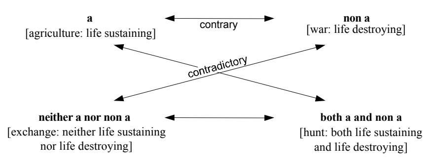
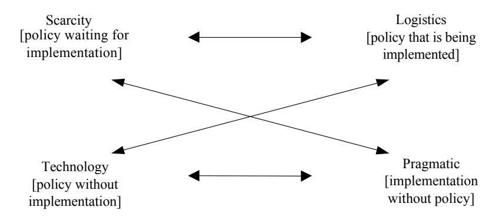
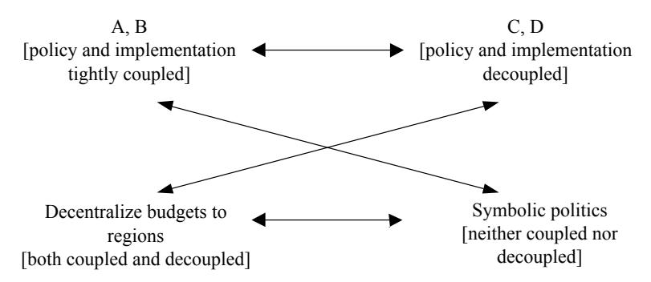
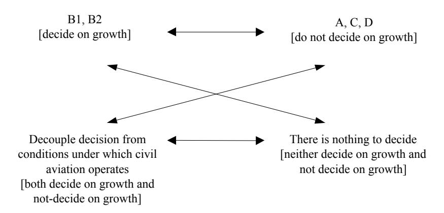

<!-- A2.R15 | source: papers_json/A2.R15/ -->

# 18 Narrative Policy Analysis

Michel I. G. van Eeten

بما أن القصص حاضرة في كل جانب من جوانب السياسات العامة، كان من المحتم أن تصبح القصص في وقت ما موضوعاً مركزياً للدراسة داخل تحليل السياسات. وقد تبين أن هذا حدث متأخراً لا مبكراً. فلفترة طويلة، تعاملت مجالات تحليل السياسات مع القصص باعتبارها أشكالاً أدنى من المعلومات والاستدلال، يجب تجاوزها لصالح المناهج العلمية الصارمة والبيانات الموضوعية.

استغرق الأمر حتى أواخر الثمانينيات قبل أن يثبت محلل سياسات—وللمفارقة، كان خلفيته في الإحصاء—أن التحليل الجيد للسياسات يدور حول صياغة حجة، لا حول تطبيق المنطق والعلم (Majone 1989). كان هذا الاستبصار جزءاً من تطور أوسع حمل تسميات كثيرة، لكن كثيرين عرفوه باسم "المنعطف الحجاجي" في تحليل السياسات (Fischer and Forester 1993). ووفقاً لـ Fischer (2003)، أدى هذا التطور إلى مجموعة من المناهج الجديدة التي تقدم بديلاً "ما بعد تجريبي" للنماذج التكنوقراطية والتجريبية السائدة في تحليل السياسات.

من بين هذه المناهج الجديدة تحليل السياسات السردي—حتى وإن كان الكتاب الرائد في هذا المجال (Roe 1994) لا يتبنى كل عناصر الأجندة ما بعد التجريبية. ووفقاً لـ Roe (1994, 2)، فإن الاستبصار العملي الأساسي لتحليل السياسات السردي هو: "القصص المستخدمة عادة في وصف وتحليل قضايا السياسات تشكل قوة بحد ذاتها، ويجب أخذها بعين الاعتبار صراحة عند تقييم خيارات السياسات." وبدلاً من التركيز على القصص بحد ذاتها، يركز Roe (1994, p. 3) على السرديات السياسية، التي يعرّفها بأنها: "تلك القصص—السيناريوهات والحجج—التي يعتبرها طرف أو أكثر في الخلاف بمثابة ضامن ومثبّت لافتراضات صنع السياسات في مواجهة عدم اليقين أو التعقيد أو الاستقطاب المرتبط بالقضية."

يبدأ هذا الفصل بطرح سؤال حول ما يعنيه أخذ السرديات بعين الاعتبار صراحة في تحليل السياسات. ثم يناقش تنوع الإجابات التي قدمها الباحثون لهذا السؤال. بعد ذلك، ننتقل إلى استخدام تحليل السياسات السردي كإجراء منهجي للتعامل مع القضايا السياسية الخلافية التي تتسم بسرديات سياسية متضاربة. ومن المفاهيم المهمة في هذا الإجراء مفهوم "السردية الفوقية" metanarrative، الذي نستكشفه بشيء من التفصيل. ويقدم الجزء الأخير من الفصل دراستي حالة موجزتين لتطبيقات فعلية لتحليل السياسات السردي، مع التركيز على الخطوة الأخيرة: تحديد السردية الفوقية.

## NARRATIVE COMMA POLICY COMMA ANALYSIS

ماذا يعني أخذ السرديات بعين الاعتبار صراحة في تحليل السياسات؟ في حين يربط Roe تحليل السياسات السردي بمنهج محدد جداً، فإن هذا ليس السبيل الوحيد لأخذ القصص بعين الاعتبار. طوّر مؤلفون آخرون مناهج مختلفة يمكن أن تندرج تحت التسمية نفسها. وما تُظهره هذه المناهج هو أن التسمية يمكن أن تُفهم بطرق تعني أساليب ووحدات تحليل وأهداف بحثية مختلفة. وتُشكّل هذه المناهج المصطلحات ضمن التسمية بطرق متنوعة. على سبيل المثال:

تحليل السرد للسياسة narrative analysis of policy، حيث تُطبّق أساليب التحليل السردي على
عالم السياسة، وغالباً ما تُظهر البنى السردية والرمزية العاملة في عمليات
السياسات (e.g., Stone 1997)؛

<!-- page 2 -->

- *تحليل السرديات السياسية*، حيث تُستخدم أساليب مختلفة—غالباً من العلوم الاجتماعية—لإعادة بناء القصص التي يرويها الفاعلون حول قضايا السياسات، وغالباً ما تُظهر كيف تُعطى نفس مصطلحات أو تدابير السياسة معاني مختلفة ومتضاربة (e.g., Bedsworth 2004):
- *التحليل السياسي للسرديات*، حيث تُستخدم أساليب مختلفة—من نظرية الأدب والعلوم الاجتماعية معاً—لتحليل العلاقات بين السرديات السياسية المتضاربة بهدف تطوير نصيحة سياسية حول كيفية المضي قدماً، مثل كيفية إعادة صياغة قضية السياسة (e.g., Roe 1994)؛
- *سردية تحليل السياسات*، حيث يُستخدم التحليل السردي لاستكشاف الأسس السردية لتحليل السياسات نفسه، وغالباً ما يُظهر افتراضات إيديولوجية خفية وبنى قوة، ويدعو إلى مزيد من التأمل الذاتي المهني والتعددية (e.g., Fischer and Forester 1993).

هذه ليست مجموعة شاملة من التشكيلات، لكنها تجعلنا واعين لتنوع المناهج التي يمكن أن تدّعي انتماءها لتسمية تحليل السياسات السردي. وفي الأدبيات، نرى خيارات مختلفة—أو بالأحرى، مفاضلات—تُتخذ فيما يتعلق بالأساليب ووحدة التحليل والهدف البحثي.

فيما يخص الأساليب، يشير مصطلح *التحليل السردي* بدقة إلى فرع نظرية الأدب المعروف بعلم السرديات narratology. وقد طوّر علم السرديات مفاهيم وأساليب هدفها الخاص دراسة خصائص السرديات—أو بدقة أكبر—دراسة النصوص، بمعناها الواسع، من حيث كونها سرديات. وبالطبع، يحدث في أي نص محدد ما هو أكثر بكثير من السرد وحده، لكن علم السرديات يركز أساساً على هذا الجانب الأخير. والسرد، بشكل عام، يُعرَّف بأنه سرد لسلسلة من الأحداث، حيث يُعرَّف الحدث بأنه الانتقال من حالة إلى أخرى (e.g., Bal 1998).

طوّر هذا الحقل مفاهيم لدراسة ثلاثة جوانب أساسية لأي سرد: القصة والنص والسرد (narration) (Rimmon-Kenan 1983, 3). تشير القصة إلى مجموعة الأحداث التي يجري سردها، مجردة عن تمثيلها المحدد في النص. وهنا، يركز التحليل السردي على الأحداث والشخصيات والحبكة. أما النص فيشير إلى رواية القصة في الخطاب المنطوق أو المكتوب، رغم أن التحليل السردي امتد ليشمل أيضاً دراسة السرديات في وسائط أخرى غير النص. وعند دراسة النص، يحاول التحليل السردي فهم كيفية سرد القصة، مثل التوقيت (قد لا يتبع السرد التسلسل الزمني للقصة) وما يسمى بـ"البؤرة" focalization. والبؤرة هي المنظور أو الموشور الذي من خلاله يُمثَّل المحتوى السردي. أما الجانب الثالث، السرد narration، فيتعلق بفعل إنتاج السردية. ويركز تحليل السرد على الراوي أو الرواة والمروي لهم الذين قد يكونون حاضرين صراحة في النص، حتى كشخصيات، أو ضمنياً. ومن بين الجوانب الثلاثة، النص وحده هو المتاح مباشرة للمحلل كوحدة تحليل. أما القصة والسرد فلا يمكن دراستهما إلا من خلال النص.

في تحليل السياسات السردي، يشير مصطلح *التحليل السردي* أحياناً إلى مجموعة المفاهيم والأساليب المذكورة أعلاه من نظرية الأدب. ومن الأمثلة استخدام إطار Propp للحكايات الشعبية لتحليل السرديات السياسية حول كارثة فيضان (Van Eeten 1999b) أو مشاريع تنموية (Roe 1989). إضافة إلى ذلك، يُستخدم المصطلح كتسمية فضفاضة تغطي مجموعة أوسع بكثير من الأساليب—فأي أسلوب يركز على اللغة يمكن استخدامه أساساً. فبالنسبة لـ Roe، على سبيل المثال، لا يقتصر تحليل السياسات السردي على التحليل السردي بحد ذاته، بل يوظّف مجموعة متنوعة من الأساليب والمفاهيم من حقل أوسع بكثير هو نظرية الأدب المعاصرة (1994, 2).

قد يشير مصطلح *التحليل السردي* أيضاً إلى حقل ذي صلة في العلوم الاجتماعية—دراسة كيفية عمل السرديات في التفاعلات بين الأفراد. وغالباً ما تستخدم هذه الدراسات مجموعة من الأساليب الإثنوغرافية. فقد أجرى Wagenaar (1995)، على سبيل المثال، دراسات مفصلة للقصص التي يرويها الموظفون العموميون لفهم الوضع الذي يجدون فيه أنفسهم أو منظماتهم. والتركيز هنا على ما تخبرنا به القصة عن ممارسة السياسات، أكثر من التركيز على القصة نفسها. وتحتوي القصص على استعارات وتمييزات وعناصر أخرى لصنع المعنى تساعد المحلل على ربط لغة الفاعلين بأفعالهم. وتشبه هذه الأنواع من التحليل السردي مناهج مثل تحليل الإطار (Schön and Rein 1994)، وتحليل أنظمة المعتقدات

<!-- page 3 -->

(Sabatier and Jenkins-Smith 1993)، وتحليل الخطاب (Hajer 1995). ومن حيث الأساليب، قد يطبق هذا البحث أساليب من علم السرديات، لكن مصطلح *التحليل السردي* يشير في الغالب أساساً إلى أن السرديات تُتخذ كنقطة انطلاق، أي كوحدة تحليل، أكثر من إشارته إلى استخدام أساليب محددة.

وفيما يتعلق بوحدة التحليل، نرى أيضاً اختلافات مثيرة للاهتمام في الأدبيات—وهي مرتبطة بالمفاضلات المتعلقة بالأساليب. ونظراً لأصول التحليل السردي، فإن أبسط وحدة تحليل هي "نص قائم" لمؤلف محدد—مثل أوراق السياسات أو التقارير الإخبارية أو النماذج البيروقراطية أو الخطب أو الروايات الشفهية التي يقدمها المستجيبون. وعلى غرار نظرائهم في نظرية الأدب، وسّع بعض المحللين هذه النصوص القائمة لتشمل أيضاً أشياء غير لفظية أخرى من عالم السياسة والسياسة العامة، مثل المباني وصور التلفزيون والصور الفوتوغرافية واللوحات (e.g., Yanow 1995a; Edelman 1995).

وفي حين أن النصوص المحددة والفردية تشكّل وحدة تحليل طبيعية، فإنها تفرض قيوداً على نوع التعميمات والاستنتاجات التي يمكن للمحلل التوصل إليها. عادة ما يهتم تحليل السياسات بدراسة عمليات صنع القرار الجماعي. ويمكن استخدام النصوص الفردية لهذه المهمة، بقدر ما يمكن إظهار أنها تمثّل موقفاً معيناً أو ظاهرة معينة على المستوى الجماعي. غير أن هذا صعب عادة. فمن المرجح أن يختلف خطاب مسؤول واحد أو روايته الشفهية—قليلاً أو ليس قليلاً—عن مسؤول آخر، حتى لو كانا ينتميان إلى الإدارة نفسها. ومن غير المرجح أن تعكس ورقة سياسة واحدة بشكل تام نطاق التصريحات الرسمية بشأن قضية معينة.

لذلك، يحتاج المحلل غالباً إلى وحدة تحليل أكثر تجميعاً من النصوص الفردية. لهذا السبب، عندما يكتب المحللون عن السرديات السياسية، فهم غالباً لا يتحدثون عن نص محدد، بل عن سردية مُشكَّلة تُنسب إلى فاعل في قضية سياسة—أي موقف مجموعة أو منظمة أو حتى ائتلاف من المنظمات. ويسمي Yanow (1995b, 113) هذا "نصاً مُشكَّلاً" في مقابل "نص مؤلَّف" وهو ذاته النص القائم المذكور أعلاه. فقد أعاد Bridgman and Barry (2002)، على سبيل المثال، بناء سرديتين سياسيتين رئيسيتين من مجموعة مقابلات غير منظمة مع أصحاب مصلحة رئيسيين. وبشأن قضية نقل أرقام الهاتف في قطاع الاتصالات النيوزيلندي، جمعوا كل الروايات في سرديتين: قصة شركة الاتصالات المهيمنة وقصة منافسيها. وقد اتبع آخرون (e.g., Bedsworth et al. 2004; Roe 1994; Van Eeten 1999a) نهجاً مشابهاً.

خطوة أخرى تأخذنا إلى وحدات تحليل أكثر تجميعاً. يتحدث Dicke (2001, 10)، متبعاً Czarniawska (1997)، عن "سرديات مجتمعية"، يعرّفها بأنها "خطوط استدلال متشابهة" تتشاركها "قصص صغيرة" كثيرة—وهذه الأخيرة هي ما أسميناه سابقاً نصوصاً قائمة محددة أو نصوصاً مؤلَّفة. وقد كتب Edelman (1977, 1988) باستفاضة عن القصص والرمزية في الخطاب السياسي الأوسع، مع ربط تحليله بنصوص محددة بشكل فضفاض فقط.

وكيفية بناء هذه السرديات السياسية "المُجمَّعة" أمر يقرره المحلل. فتحليل السياسات السردي لا يفرض أي أسلوب لهذا الجزء من البحث. وتُظهر الأدبيات مجموعة متنوعة من الأساليب، منها على سبيل المثال لا الحصر تحليل المحتوى (Linder 1995)، وتحليل الفاعلين أو أصحاب المصلحة (Bridgman and Barry, 2002)، وتحليل الشبكات (Hukkinen et al. 1990)، والسيميائية (Van Eeten and Roe, 2000)، ومنهجية Q (Van Eeten 2001). وفي حالات كثيرة، قد يغيب أسلوب صريح تماماً ويعتمد الباحث على معقولية المواقف وإمكانية التوفيق بينها (e.g., Bedsworth et al. 2004). ويعني هذا عادة أن السرديات المُشكَّلة تُبنى على فكرة مشتركة (يُفترض) عن المنظورات ذات الصلة بالقضية—وغالباً ما تتبع تمييزات مباشرة بين الفاعلين، على غرار الصناعة والحكومة والجماعات البيئية.

مهما كان الأسلوب المتبع، فإن التحليل السردي نفسه لا يبدأ إلا *بعد* أن يتم (إعادة) بناء السرديات—أو، في حالة النصوص المؤلَّفة—تحديدها. ولطريقة إعادة بناء السرديات السياسية عواقب على الأساليب التي يمكن تطبيقها عليها. تعتمد كثير من أساليب علم السرديات اعتماداً كبيراً على "القراءات الدقيقة" close readings (أي على تفاصيل النصوص التي يجري تحليلها). ويمكن قول الشيء نفسه عن الأساليب المستخدمة في النهج الإثنوغرافي للتحليل السردي. فإذا كان النص بناءً شديد التجميع، فإنه عادة يقدم تفاصيل أقل معنى، مما يوفر

<!-- page 4 -->

أرضية أقل خصوبة لهذه الأساليب. والمفاضلة هنا، بالطبع، هي أن السردية المُشكَّلة، الأقل تحديداً، تسمح بقابلية تعميم أوسع للاستنتاجات الناتجة عن التحليل. وبالنسبة لكثير من محللي السياسات العاملين في عمليات صنع القرار الجماعي، تُعد تلك القابلية للتعميم شرطاً أساسياً لعملهم. لذا فهم يتبنون أساليب في تحليلهم السردي يمكن أن تتعامل مع السرديات المُجمَّعة. ويُعد استخدام Roe للمربع السيميائي semiotic square لمقارنة السرديات السياسية والتباين بينها مثالاً على مثل هذا الأسلوب (Roe 1994).

يقودنا هذا إلى المجموعة الثالثة من المفاضلات: الهدف البحثي. يمكن فهم كثير من المفاضلات المتعلقة بالأساليب ووحدات التحليل بشكل أفضل بالنظر إلى نوع الاستنتاجات التي يهتم بها المحلل. كما أن نوع الاستنتاج المفضّل يوجّه أيضاً الأساليب ووحدات التحليل المناسبة.

كان كثير من الأعمال المبكرة حول السرد والرمزية في لغة السياسات يهدف إلى كشف ونقد البنى الإيديولوجية والقوة الخفية. وقد نشر Murray Edelman (1971, 1977, 1988) أبحاثاً شهيرة في هذا الاتجاه. ويشير أحد عناوين كتبه إلى هدفه بوضوح كافٍ: *Political Language: Words That Succeed and Policies That Fail* (Edelman 1977). وعادة، يُظهر كيف تستخدم النخب السياسية والمهنية اللغة لتعزيز بنية القوة القائمة وتسهيل القبول الهادئ للفقر المزمن والفوارق الكبيرة. ويعترف Edelman صراحة بأنه لا يُخضِع منتقدي "الأنظمة" الحالية للتحليل نفسه، لأنه مهتم بالأنظمة نفسها تحديداً بسبب قوتها. يكتب Edelman (1977, 14): "المغزى الكامل ... هو فحص استحضار الإدراكات البديلة." وغالباً ما تُتجاهل هذه البدائل أو تُقاوَم بفعالية من قبل من بيدهم السلطة، كما يجادل.

وفي بعض مجالات السياسات، ربما أصبح هدف Edelman حقيقة إلى حد ما. هنا، يواجه الباحثون منظورات متعددة ومتضاربة حول القضية نفسها—بل وغالباً حول الأدلة نفسها (e.g., Throgmorton 1993). وقد لجأ كثيرون إلى اللغة في محاولة لتفسير كيف يكون من الممكن وجود هذه المنظورات المختلفة جداً وما هي تبعاتها. وقد وفّر السرد طريقة طبيعية لوصف هذه المنظورات وفهمها. وبالنسبة لكثير من الباحثين، الهدف الرئيسي ليس فقط تفسير ديناميكيات عملية السياسة عبر إظهار وجود سرديات سياسية متعددة ومتضاربة، بل أيضاً إثبات أن كل سردية من هذه السرديات صالحة بشروطها الخاصة ويجب أخذها بعين الاعتبار في عملية صنع السياسات. وبكلمات Bedsworth وزملائه (2004, 406): "هذه ... السرديات السياسية تُظهر كيف يختلف الفاعلون في السياسة في دوافعهم للعمل، وأسس ثقتهم بالادعاءات، واستجابتهم لعدم اليقين."

إن استخدام السرد لتفسير الفعل يوضح لماذا لا يلتزم معظم هؤلاء الباحثين بتعريف صارم للسرد، بل يدمجون أيضاً أشكالاً حجاجية من اللغة. فهم مهتمون بما يحرّك فعل الفاعلين، وكيف يقومون بـ"القفزة المعيارية" من "الكائن" إلى "الواجب" (Schön and Rein 1994). ويستخدم الفاعلون كلاً من السرد والحجاج لهذا الهدف—حيث تكون السرديات، بمعناها الصارم، قصصاً عن سلسلة من الأحداث لها بداية ووسط ونهاية، كما في السيناريوهات، وحيث تُبنى الحجج من المقدمات إلى الاستنتاجات. ولهذا يدمج باحثون مثل Roe وآخرون كلا الشكلين في تعريفهم للسردية السياسية—حتى وإن جادل آخرون بأن الحجج والسرديات تمثّلان نمطين مختلفين من المعرفة والتفكير (Bruner 1986).

وضمن هذا الخط من الأدبيات، يرفض الباحثون صراحة الحكم على السرديات المختلفة من حيث قيمتها الحقيقية أو ترسيخ أسبقية سردية على أخرى—رغم أن بعضهم يحاول تفسير تجريبياً لماذا أصبحت سردية معينة مهيمنة (e.g., Bridgman and Barry 2002). وضمنياً أو صراحة، غالباً ما ينتقد هذا البحث السردية المهيمنة، نظراً لوجود بدائل صالحة بالقدر نفسه غالباً ما يعبّر عنها أصحاب مصلحة أقل نفوذاً. وتكتسب هذه النقطة أهمية متساوية في مراحل مختلفة من عملية السياسة—من تعريفات المشكلة المتنافسة إلى التقييمات المتنافسة للسياسات (Abma 1999). وعلى المنوال نفسه، ينتقد هذا البحث المناهج التكنوقراطية في هذه الحالات، لأن القضايا لم يعد بالإمكان حسمها بالاستناد إلى "حقائق موضوعية."

ونقطة النهاية لهذا الخط من الأدبيات—إظهار وجود سرديات سياسية متضاربة، لكنها صالحة بالقدر نفسه، ولها تبعات متعارضة على الفعل—هي نقطة البداية لباحثين

<!-- page 5 -->

آخرين: بما أن وجود هذه السرديات غالباً ما يجعل القضايا مستعصية، كيف يمكننا إعادة صياغة القضية؟ هدفهم البحثي هو التوصل إلى نصيحة سياسية تساعد الفاعلين على الخروج من المأزق القائم. والتحدي هنا هو التعامل مع حقيقة أنه لا توجد في هذه الحالات طريقة للفصل بين السرديات المتنافسة، لا على أسس علمية ولا على أسس أخرى. وقد خلص عدة باحثين إلى أن الفاعلين والمحللين في هذه الحالات يفعلون خيراً إذا طوّروا سردية جديدة تأخذ بعين الاعتبار السرديات القائمة، لكنها في الوقت نفسه أكثر قابلية للتداول أو صنع السياسة. وهذا ما أسماه Roe (1994) تحديد السردية الفوقية metanarrative. وأسماه آخرون إعادة الصياغة أو إعادة التأطير (Rein and Schön 1993). ويصف Schön and Rein (1994) إعادة التأطير بأنها محاولة لتحويل نموذج المشكلة. وهذا النهج عملية تداولية مفتوحة تقوم على الحجة والدليل والنقاش السياسي حيث يمكن للمشاركين التفكير النقدي وإعادة تقييم تأطيرهم الأولي للقضية. وكان الاستبصار الفارق لـ Roe هو فهم كيف يمكن استخدام التحليل السردي لدعم هذه العملية الصعبة. وسنعود إلى هذا الاستبصار قريباً.

وكما ذُكر سابقاً، يؤثر اختيار الهدف البحثي على اختيار الأساليب ووحدة التحليل. وهذه ليست علاقة آلية أو حتمية، لكن يمكننا الإشارة إلى أنماط معينة هنا. من حيث المبدأ، لا تستبعد الأهداف البحثية المذكورة أعلاه بعضها بعضاً. يمكن للمرء أن يجري تحليلاً نقدياً لبنى القوة الخفية لسردية سياسية، ويفعل الشيء نفسه للسرديات المتنافسة، ويفسر كيف توجّه أفعال الفاعلين في اتجاهات مختلفة، ويحاول التوصل إلى نصيحة سياسية حول كيفية المضي قدماً، في ضوء هذه السرديات المتضاربة.

عملياً، مع ذلك، يميل تحليل السياسات السردي إلى عكس قيود الوقت والموارد والتركيز على هدف واحد من هذه الأهداف. تحليل ونقد سردية مهيمنة محددة يتناسب جيداً مع القراءات الدقيقة وأساليب علم السرديات، لأن لدى المحلل وقتاً للتعمق في تفاصيل تلك السردية—وربما النظر بالتفصيل إلى مجموعة من النصوص ذات الصلة. وبالمثل، يمكن لتحليل سردي إثنوغرافي، مثلاً لقصص موظفي الخدمة الاجتماعية عن عملائهم، أن يخصص اهتماماً للروايات الشفهية والصياغات المحددة للمستجيبين الأفراد. ويختلف الأمر بالنسبة للمحللين المهتمين بالسرديات (المُشكَّلة) التي تلتقط مواقف أصحاب المصلحة في عملية صنع القرار. هنا، نرى جهداً أكبر يُبذَل في تحديد هذه السرديات وبنائها وتفصيلها، وأقل في التحليل التفصيلي للنصوص القائمة الفعلية. ونرى تحولاً مماثلاً عندما يكون الهدف إعادة صياغة قضية سياسية مستعصية بسبب سرديات سياسية متضاربة. يسحب هذا الهدف الموارد والاهتمام بعيداً عن إعادة بناء السرديات—رغم أن ذلك بالطبع يجب فعله هنا أيضاً، كخطوة أولى—وباتجاه تحليل العلاقات بين تلك السرديات. يمكننا الآن أيضاً أن نفهم لماذا يوظّف Roe (1994) المربع السيميائي كأسلوب: فهو يسمح له بتحليل العلاقات بين السرديات المختلفة، مما قد يشير، على أمل، إلى سردية فوقية محتملة. وهو يقضي وقتاً أقل في تطبيق أساليب التحليل السردي على السرديات نفسها، ووقتاً أقل حتى في أساليب تحديد وإعادة بناء السرديات الفردية. وتقدم معظم حالاته السرديات السياسية ببساطة كأنها معطاة سلفاً ويمكن تقسيمها بسهولة إلى قصص وغير قصص. وقد أدى هذا إلى بعض الالتباس لدى الباحثين الذين حاولوا تبنّي نهجه. لهذا السبب، سنعدّل نهجه قليلاً لجعله أكثر شفافية وقابلية للتكرار. أولاً، مع ذلك، ننتقل إلى مفهومه عن السردية الفوقية.

## FINDING THE METANARRATIVE

استقطب مفهوم السردية الفوقية اهتماماً كبيراً، وفي الوقت نفسه، ولّد التباساً كبيراً. ويبدو أن الالتباس يتعلق بمسألتين: كيف تُحدَّد السردية الفوقية وما هي طبيعتها؟

يتبع نهج Roe أربع خطوات (1994, 3–4): أولاً، يحدد المحلل السرديات التقليدية التي تهيمن على القضية. ثانياً، يحدد السرديات التي لا تتطابق مع التعريف التقليدي، أي "اللاقصص" non-stories، مثل الحجة الدائرية أو تلك التي تسير عكس السرديات المهيمنة. ثالثاً، يقارن المحلل بين مجموعتي السرديات ويقابل بينهما—القصص من جهة، واللاقصص أو القصص المضادة من جهة أخرى—من أجل

<!-- page 6 -->

توليد سردية فوقية "يرويها" هذا التقابل. رابعاً، وأخيراً، يحدد المحلل ما إذا كانت السردية الفوقية تعيد صياغة القضية بطريقة تجعلها أكثر قابلية للتداول والتحليل وصنع السياسة، وكيف يتم ذلك.

حرفياً، السردية الفوقية هي سردية عن سرديات أخرى. بالنسبة لـ Roe، هي قصة يمكن أن تفسر كيف يمكن أن تكون كل السرديات السياسية المتضاربة حول قضية معينة صحيحة في الوقت نفسه. علاوة على ذلك، لا يبحث المحلل—أو صانع السياسة أو صاحب المصلحة—عن أي سردية فوقية فحسب، بل عن سردية فوقية تمكّن الأطراف المعنية من إعادة صياغة القضية لجعلها أكثر قابلية للتداول والتحليل وصنع السياسة. وبهذا المعنى، السردية الفوقية هي اقتراح لأجندة سياسية جديدة (Van Eeten 1999a). وكما هو الحال مع كل نصيحة سياسية، يعتمد الأمر على الفاعلين فيما إذا كانت السردية الفوقية ستُتبنى وتنجح فعلاً في إعادة صياغة القضية.

السردية الفوقية ليست حلاً وسطاً أو أرضية مشتركة. ولتوضيح ذلك بمثال بسيط: إذا قالت سردية إن القضية "سوداء" وقالت أخرى إنها "بيضاء"، فإن السردية الفوقية ليست "رمادية" بل مصطلح يجمع بين "السواد" و"البياض" في آن واحد (أي "التلوّن")—أو لا هو "أسود" ولا "أبيض" ("انعدام اللون"). وهذا هو منطق المربع السيميائي (Schleifer 1987). ويمكن فهم المصطلحين الأخيرين كمصطلحين فوقيين يعلّقان على إمكانية التقابل الأول بين الأسود والأبيض. ويقدم الشكل 18.1 توضيحاً أكثر إثارة للاهتمام للمربع السيميائي.

من خلال مقارنة السرديات السياسية حول قضية معينة والتباين بينها، تصبح العلاقات بينها مرئية، مما قد يشير إلى سردية فوقية. وبهذا المعنى، يصف Roe (1994, 4) السردية الفوقية بأنها القصة التي "يرويها" هذا التقابل. وغني عن القول إن هذا التقابل قد يشير إلى سرديات فوقية مختلفة أو حتى إلى لا شيء على الإطلاق. علاوة على ذلك، قد يُنفَّذ التقابل بطرق مختلفة، مما يؤدي أيضاً إلى نتائج محتملة مختلفة. وهذا ليس بالضرورة مشكلة. بل على العكس، الخيارات الأكثر مرحّب بها. فالبحث ليس عن السردية الفوقية "الصحيحة" الوحيدة، بل عن سردية فوقية تبدو الأكثر واعدة في إعادة صياغة القضية.

إجراء Roe غير واضح في عدة جوانب مهمة. أولاً، كيف يحدد المحلل القصص واللاقصص؟ فمعظم دراسات حالته تقدم السرديات ببساطة، كأنه من البديهي معرفة أي السرديات موجودة، وكذلك ما هي بنيتها—أي ما إذا كانت قصصاً أم لاقصصاً. ونظراً لغياب توجيه منهجي حول كيفية إعادة بناء السرديات، تصبح الخطوتان الأوليان إشكاليتين. فإذا أعاد المحلل بناء هذه السرديات السياسية بشكل فضفاض، فإن تصنيف سردية ما، خصوصاً، على أنها لاقصة يخاطر بأن يكون مجرد نتاج للتحليل نفسه. لهذا السبب، يحتاج المحلل إلى دمج دعم منهجي أكبر للخطوتين الأوليين في تصميم بحثه. وتُظهر دراستا الحالة المقدمتان في الأقسام التالية من هذا الفصل طريقة واحدة للقيام بذلك: عبر تطبيق منهجية Q، وهي رفيق مناسب وفعال للغاية لتحليل السياسات السردي.

المشكلة الثانية في هذا الإجراء هي أنه من غير الواضح لماذا لا يمكن توليد السردية الفوقية إلا من خلال مقابلة القصص باللاقصص. وبالتأكيد، هذه مقارنة مثيرة للاهتمام وواعدة. فهم الاختلافات البنيوية بين المجموعتين من المرجح أن يخبر المحلل بشيء عن خصائص الخطاب السياسي. لكن الإجراء لا يحتاج أن يقتصر على تلك المقارنة فقط. وكما سنرى في دراستي الحالة، يمكن لمقارنات مختلفة

***FIGURE 18.1** The semiotic square.*

<!-- page 7 -->

أن تولّد سردية فوقية أيضاً. ويمكن للمربع السيميائي أن يساعد على كشف علاقات ذات معنى بين السرديات بطرق مختلفة.

وجّه Fischer (2003, 174–75) ثلاثة انتقادات إضافية لنهج Roe. أولاً، يذكر أن Roe يعتمد على القصص التي يقدمها المشاركون المباشرون في القصة. وهذا إشكالي، بحسب Fischer، لأن "غالباً ما تكون المشكلة الحقيقية التي يجب التعامل معها في خلاف عام ناتجة عن اعتبارات خارج نطاق الحجج اليومية." وفي حين يثير Fischer قلقاً مشروعاً بأنه قد توجد منظورات مهمة خارج الحجج الحاضرة حالياً في النقاش، فإن استخدامه لمصطلح *المشكلة الحقيقية* غير موفق ولا يبدو منسجماً بشكل جيد مع النهج ما بعد التجريبي. ومن غير الواضح كيف يمكن لأي اعتبار أن يدّعي وصف المشكلة "الحقيقية". وبينما قد يجد البعض، مثلاً، أن نقداً غرامشياً للبنى الاجتماعية المهيمنة مفيد وغني بالمعلومات، قد يجد أصحاب المصلحة الساعون للتأثير في صنع السياسة أن فهم السرديات السياسية المختلفة والعلاقات بينها أكثر فائدة. باختصار، يجب أن يكون نقد Fischer بمثابة تحذير بشأن حدود الأسلوب، لكنه لا يبدو أنه يُبطل نهج Roe.

الانتقاد الثاني لـ Fischer هو أن Roe فشل في دمج مشاركة الفاعلين في نهجه. وفي حين صحيح أن المشاركة غائبة بشكل لافت كموضوع في كتاب Roe، فإن النهج نفسه لا يبدو أن لديه مشكلة معها. فيمكن تنفيذ كل خطوات الإجراء بطريقة تشاركية. وقد يولّد إشراك أصحاب المصلحة فعلياً في مقارنة (مجموعات) سرديات مختلفة نتائج مثيرة للاهتمام، إضافة إلى توفير ضوابط على العملية التحليلية. فإذا نتجت سردية فوقية عن هذه العملية، فمن المرجح أن تحظى بدعم أكبر من سردية فوقية هي نتاج محلل منفرد. مع ذلك، فإن الإسهام الحاسم لـ Roe هو أن لدى المحلل الآن على الأقل بعض الدعم المنهجي لتيسير عملية إعادة الصياغة وإيجاد السرديات الفوقية—أي أن المحلل يمكنه إضافة قيمة إلى العملية.

الانتقاد الثالث والأخير الذي يطرحه Fischer هو أن Roe كان ينبغي أن يطبّق التحليل السردي على تحليل السياسات نفسه. كما ينتقد ما يراه توجهاً تكنوقراطياً في نهج Roe. ويعترف Roe صراحة بأن نقد الأسس التكنوقراطية للتحليل التقليدي للسياسات يمكن، بل ينبغي، أن يُجرى. لكن هذا ليس هدف كتابه. وتوجد بالفعل أدبيات غنية جادلت لصالح "المنعطف الحجاجي" في تحليل السياسات. ويختار Roe توجهاً أكثر أداتية، بهدف الإسهام بمنهجية جديدة في مجال تحليل السياسات. ومهما كان رأي المرء في هذه الخيارات، فهي ليست متأصلة في النهج نفسه، بل تعكس الأجندة التي يُوظَّف بموجبها. ويمكن أن يوظّف تحليل السياسات السردي فاعلون مختلفون—لا محللون فقط—وهو متوافق تماماً مع أجندات مختلفة، سواء كانت تجريبية أو ما بعد تجريبية أو غير ذلك.

يقودنا هذا النقاش إلى الجزء الأخير من هذا الفصل: تطبيق النهج في دراستي حالة. ونظراً لقيود الفصل، سنمر بإيجاز عبر الخطوات لتوضيح كيف يمكن تنفيذ النهج عملياً، مع أخذ الاعتبارات المذكورة أعلاه بعين الاعتبار.

## TWO APPLICATIONS OF NARRATIVE POLICY ANALYSIS

تتناول دراسة الحالة الأولى وجهات نظر أصحاب المصلحة المتضاربة أثناء صياغة أحدث خطة وطنية هولندية للنقل. أما الحالة الثانية فتتعلق بالتوسع الخلافي لمطار أمستردام سخيبول. وفي كلتا الحالتين، تم تنفيذ الخطوتين الأوليين من تحليل السياسات السردي باستخدام منهجية Q—لمزيد من التفاصيل حول دراستي الحالة، انظر Van Eeten (2001; 2003).

كيف يمكن تحديد حجج أصحاب المصلحة دون فرض تعريف محدد للمشكلة عليهم؟ منهجية Q مناسبة بشكل خاص لمهمة الكشف عن المواقف التي يحملها فعلاً المشاركون في النقاش، بدلاً من قبول الفئات المحددة سلفاً من صانعي القرار أو المحللين أو المشاركين. وفي السنوات الأخيرة، حظيت منهجية Q باهتمام متزايد في مجتمع تحليل السياسات، خصوصاً فيما يتعلق بأدائها في دعم مبادرات المشاركة العامة و

<!-- page 8 -->

كشف مواقف أصحاب المصلحة وعلاقاتها المتبادلة وتمثيلها (Dryzek and Berejikian 1993; Durning 1993, 1999; Gargan and Brown, 1993; Maxwell and Brown, 2000; Pelletier et al, 1999; Steelman and Maguire, 1999; Weimer 1999). وقد أثبتت هذه المنهجية فائدتها في التقاط فهم غني لآراء ومواقف أصحاب المصلحة، مما يجعلها أداة مهمة للديمقراطية التداولية، كما أقرّ Dryzek (1990) منذ أكثر من عقد.

تختزل منهجية Q تنوع الآراء والوجهات والأفكار إلى مجموعة من تعريفات المشكلة الأساسية. وباختصار، الإجراء كالتالي: يرتب المستجيبون مجموعة من العبارات المتعلقة بالمشكلة. وباستخدام التحليل العاملي factor analysis، تحدد المنهجية عوامل، وهي مجموعات من العبارات المترابطة في ترتيبات بعض المستجيبين. ويمكن تفسير هذه المجموعات بوصفها سرديات سياسية. وتكمن أناقة هذه المنهجية في أنها غير حساسة للسرديات التي يتوقع المحلل مسبقاً وجودها—على خلاف تقنيات المقابلة النوعية المفتوحة التي غالباً ما تنتهي بإعادة إنتاج فئات مسبقة مثل مجموعات أصحاب المصلحة المختلفة. وهذا يجعل الإجراء أكثر متانة وموثوقية للخطوتين الأوليين من تحليل السياسات السردي. كما تنجح منهجية Q في تجنب بعض العيوب المهمة للاستبيانات، كما شرح Dryzek (1990).

طُبِّقت منهجية Q في كلتا دراستي الحالة عبر عدد من الخطوات نقدمها بإيجاز هنا.3 أولاً، في محاولة لعكس نطاق الآراء، جُمعت نحو 200 عبارة من أرشيفات الإعلام وأوراق المناصرة واجتماعات أصحاب المصلحة والمقابلات والتقارير السياسية. وكانت التقارير الحرفية لعدة اجتماعات أصحاب مصلحة مفيدة بشكل خاص، بسبب نطاق الحجج والمواقف المعبَّر عنها فيها.

من هذه المجموعة، اختيرت عينة من العبارات لاستخدامها في مقابلات لاحقة مع أصحاب المصلحة (75 عبارة لحالة خطة النقل؛ و80 لحالة توسيع المطار). وللتحقق من تمثيلية العينة، أُضيف سؤال ضبط إلى بروتوكول المقابلة: سُئل المشاركون عما إذا كانوا يفتقدون أي جانب من جوانب القضية اعتقدوا أنه ذو صلة بموقفهم. ولم تثر الإجابات المقدَّمة خلال المقابلات أي تساؤلات حول صلاحية العينة.

بعد ذلك، اختير ممثلون من أصحاب المصلحة—24 لحالة خطة النقل؛ و38 لحالة توسيع المطار. وبالنسبة للحالة الأخيرة، شملت عينة المستجيبين ممثلين عن شركات الطيران، وإدارة المطار، ومستويات وقطاعات مختلفة من الحكومة، ومنظمات بيئية وطنية، ومواطنين محليين، ومجموعات مصالح بيئية، ومجموعات مصالح اقتصادية تجارية أو إقليمية.

طُلب من كل ممثل إجراء ترتيب Q، حيث يُشكِّل المستجيب وجهة نظره عبر ترتيب العبارات من العينة وفق تسلسل تدريجي على طول متصل. وتم ترميز طرفي التوزيع بـ"الأشد موافقة" و"الأشد معارضة"، مع 0 يشير إلى اللامبالاة. وفق أسلوب ترتيب Q القياسي، طُلب من المستجيبين أيضاً وضع العبارات في توزيع شبه طبيعي (Figure 18.2). ويشجع هذا المستجيبين على التفكير في العلاقات بين العبارات بشكل أكثر منهجية، وكذلك ترتيب أولويات العبارات بالنسبة لبعضها بعضاً. وأثناء عملية الترتيب وبعدها، أُجريت مقابلات مع المستجيبين للتأكد من الأساس المنطقي وراء ترتيبهم المحدد.

أخيراً، خضعت ترتيبات Q لتحليل عاملي لتحديد الأنماط والقواسم المشتركة بين الأفراد. وفي دراسة الحالة الخاصة بخطة النقل، أدى ذلك إلى أربعة عوامل ذات دلالة. وحددت دراسة الحالة الخاصة بتوسيع المطار خمسة عوامل. وحُدِّدت السرديات السياسية التي تمثلها العوامل

<!-- page 9 -->

عبر حساب درجات العبارات، أي المتوسط المرجح للدرجات التي أعطاها لكل عبارة ترتيبات Q المرتبطة بالعامل.

بالنسبة لكل حالة، بدءاً بحالة خطة النقل، نلخص بإيجاز السرديات السياسية التي وُجدت ونقارن بين هذه السرديات ونباين بينها، بحثاً عن سردية فوقية تتيح لنا إعادة صياغة القضية.

## CASE STUDY: DUTCH NATIONAL TRANSPORTATION PLAN

كانت سياسة النقل الهولندية موضع خلاف لسنوات، إذ انتقد أصحاب المصلحة الخطة السابقة لعدم فعاليتها فيما يتعلق بالحد من المشكلات البيئية، والازدحام الهائل، وضعف أداء النقل العام، والعلاقات الإدارية المجزَّأة، من بين قضايا أخرى. وكانت الخطة السابقة، التي قدمتها الحكومة رسمياً عام 1990، تحمل أهدافاً طموحة جداً بشأن هذه القضايا. لكنها فشلت في تحقيق معظم طموحاتها.

في ربيع عام 1998، بدأت وزارة النقل والأشغال العامة وإدارة المياه عملية تداولية لإثراء تطوير خطة النقل الوطنية الجديدة. وبعد عدة جلسات عصف ذهني مع مشاركين محتملين، حددت الوزارة ثمانية موضوعات متكررة في النقاش اعتبرتها مهمة لكتابة الخطة الجديدة.5

وحول هذه الموضوعات، نُظِّمت ثماني منصات تداولية بمشاركة نحو عشرة مشاركين لكل منها، وترأسها المشاركون أنفسهم. وأُرسلت الدعوة للمشاركة على نطاق واسع، وإن كانت في معظمها موجهة لأشخاص لديهم، بطريقة أو بأخرى، انخراط مهني في النقل. وكانت النتيجة مزيجاً من ممثلين عن قطاعات مختلفة من الحكومة المحلية والإقليمية والمحافظات والوطنية، وأكاديميين ومستشارين، وممثلي أصحاب مصلحة من منظمات بيئية وقطاع النقل والنقابات العمالية والصناعة. وإجمالاً، شارك أكثر من مئة شخص في العملية التداولية. وخُصِّصت أموال لكل منصة كي تكون قادرة على تنظيم نفسها بشكل عادل.

على مدار الصيف، بلغت العملية ذروة كثافتها. وفي غضون أشهر قليلة فقط، أنتجت المنصات الثماني أكثر من 65 وثيقة تصل إلى عدة بوصات من تقارير تقصي الحقائق والآراء وأوصاف المشكلات والمناقشات وبيانات الرؤية والتوصيات وردود الفعل من الخارج وملاحظات على العملية نفسها. وعلى الرغم من أن كل منصة كانت المؤلف الرسمي لوثائقها، إلا أن الوثائق كانت في الواقع بيانات وتوصيات متعددة المؤلفين ومتنوعة بشأن قضايا النقل.

وسرعان ما تبين أن مهمة توثيق نتائج مداولات المنصات أصعب بكثير مما كان متوقعاً. فقد كان هناك عدد وفير من المواقف والتوصيات، والأهم من ذلك، الوثائق. وبدت الروابط بين الموضوعات بعيدة المنال وموضوعاً لنقاش كبير داخل المشروع. مسبقاً، توقع فريق المشروع أن يشكّل أصحاب المصلحة ائتلافات حول مجموعات مختلفة من تدابير السياسة، والتي يمكن عندها تحديدها كبدائل تُطوَّر وتُعَدّ لصنع القرار في الخطة. لكن الأمور سارت بشكل مختلف. فقد حظيت كثير من تدابير السياسة بدعم من مجموعة واسعة من الفاعلين، لكن لأسباب مختلفة.

ودعماً لمهمته، كلّف فريق المشروع بتحليل سياسات باستخدام منهجية Q لتقطير المنظورات الرئيسية الكامنة وراء—أو، إن شئت، الشاملة لـ—الآراء الكثيرة حول الموضوعات الثمانية للمنصات. وبهذه الطريقة، أمل الفريق في الحصول على فهم أفضل للاتجاهات المختلفة لسياسة النقل، وكذلك تحديد أجندة المداولات اللاحقة. وفيما يلي السرديات السياسية الرئيسية التي حددتها دراسة Q.

## A. SCARCITY NARRATIVE

انطلاقاً من نهج سوقي للنقل، تلاحظ هذه السردية جميع أشكال "الندرة" في أنظمة النقل (كما تنعكس، مثلاً، في ازدحام المرور والآثار الخارجية المرتبطة بـ

<!-- page 10 -->

تلوث السيارات)، التي يجب توزيع تكاليفها بشكل أفضل، أي أن التوزيع الاقتصادي للتكاليف والفوائد المرتبطة بهذه الحالات من الندرة غير متماثل. ويُعيق التخصيص الأكثر عقلانية لبنية النقل التحتية وخدماته حقيقةُ أن الأسعار التي تحكم نظام النقل نادراً ما تعكس التكاليف والفوائد الحقيقية للنقل. فاستخدام البنية التحتية، على سبيل المثال، "مجاني" بعد دفع ما يُعد أساساً رسم دخول في شكل ضريبة طرق. علاوة على ذلك، التكلفة ثابتة، بغض النظر عن مقدار ما يستخدمه المرء من سعة البنية التحتية أو مقدار السعة المتاحة. وبالتالي، لا يتطابق الطلب على تنقل النقل بشكل مثالي مع عرض البنية التحتية لتلك التنقلية. وبالمثل، لا تنعكس الآثار الخارجية للنقل، مثل الضرر البيئي واستخدام الموارد الطبيعية، في السعر.

من هذه السردية، الإجابة السياسية هي تنفيذ تدابير تُسعِّر النقل باتجاه "قول الحقيقة"، أي عكس التكاليف الحقيقية. فعلى سبيل المثال، ينبغي أن تتوقف الحكومة عن معاملة البنية التحتية للطرق كسلعة جماعية تُموَّل عبر استثمارات عامة، وبدلاً من ذلك تتعامل معها كسلعة خاصة، بنية أسعارها أكثر انسجاماً مع رغبة الأفراد وقدرتهم على الدفع.

## **B.** LOGISTICS NARRATIVE

هنا الشاغل الأساسي هو تحسين الأداء اللوجستي لنظام النقل كشبكة. ووفقاً لهذه السردية، يولّد النظام أنواعاً مختلفة من الفوائد الاجتماعية والاقتصادية، وليس أقلها الدور الحاسم الذي تلعبه الشبكة في اقتصاد هولندي يعتمد بشدة على النقل والتوزيع الفعال للسلع والخدمات. وكانت "هولندا، بوابة أوروبا" العبارة المختصرة لهذه السردية. والمشكلة الرئيسية هي وجود اختناقات لوجستية تسبب عدم كفاءة وتضر بالبيئة. فشرايين النقل مسدودة، وتزداد صعوبة الوصول إلى المراكز الاقتصادية. وفي هذا المنظور، ليس الطلب المتزايد على تنقل النقل مشكلة في جوهره. بل على العكس تماماً، تتطلب المشكلات الحقيقية—الاختناقات—إدارة وتدخلات حكومية أفضل.

تشمل الإجابات السياسية للحد من الاختناقات أو التخفيف منها بناء بنية تحتية جديدة وتدابير تهدف إلى استخدام أكثر كفاءة لبنية الشبكة القائمة. وتتضمن هذه الأخيرة مقترحات تهدف إلى تعزيز تدفقات المرور وكذلك ضمان أن تحصل استخدامات الطرق الأكثر فائدة اقتصادياً، مثل نقل البضائع، على الأولوية على الاستخدامات الأقل أهمية، مثل حركة المتنقلين اليومية. وتعتمد الأدوات المستخدمة على الاختناق المحدد وقد تشمل التنظيم والتسعير والتغييرات في تصميم الطرق، من بين أمور أخرى.

## C. Pragmatic Narrative

بخلاف السرديات الأخرى، لا يدور الخط السردي المهيمن هنا حول حالة النقل، بل حول الدروس المستفادة من السياسات السابقة. لقد علّمت التجربة الماضية المسؤولين أن مشكلات النقل معقدة ومتعددة الأوجه ولا يمكن فهمها من منظور واحد متماسك. وبهذا التقدير، يظل فهمنا ناقصاً بشكل دائم، وهذا ينعكس على أفضل وجه في أن سجل الإجابات التي اقترحتها السرديات الأخرى كان متبايناً جداً. وعلى أي حال، أثبتت التجربة أن ما ينجح يعتمد بشكل كبير على السياق. ويتعب المسؤولون وأصحاب المصلحة المناصرون لهذه السردية من أي سياسة أو إطار نقل "جديد" ويجادلون بدلاً من ذلك بأن المطلوب ليس إجابات "جديدة" (على افتراض أنها ممكنة أصلاً)، بل استخدامات أكثر ذكاءً ومرونة لما هو معروف بالفعل عملياً.

من حيث المبدأ، تشمل الإجابات السياسية للمشكلات في نظام النقل كامل مجموعة التدابير المعروفة. والتحدي الحقيقي هو تفصيل حزم سياسات مخصصة لكل حالة ومنطقة لتناسب الطيف الواسع من قضايا النقل. فأداة واحدة، مثل الأسعار، قد

<!-- page 11 -->

تنجح لمشكلة ومنطقة، لكنك تحتاج إلى مجموعات مختلفة من الأدوات لمشكلات ومناطق أخرى.

## D. TECHNOLOGICAL NARRATIVE

يواجه نظام النقل مشكلات خطيرة، منها الازدحام والضرر البيئي. ومع ذلك، فالنظام خدمة عامة عالية القيمة، والمطلوب لمعالجة مشكلاته هو ابتكار وتجريب تكنولوجي كبير. وسيؤدي التبني الواسع النطاق للتقنيات الجديدة إلى نظام نقل عالي الجودة، ومستدام أيضاً، وقابل للوصول إليه من جانب كل الفئات الاجتماعية، وهما القيمتان الأساسيتان في هذه السردية. ومن الأمثلة تحويل أنظمة النقل العام إلى "أنظمة نقل جماعي مفرد"، أي سيارات كهربائية للمدينة مقترنة بمواقف سيارات وروابط بوسائل نقل أخرى في الأطراف. وكثير من التقنيات، في نظر مناصري هذه السردية، متاحة بالفعل لكنها تظل غير مستخدَمة بسبب مجموعة متنوعة من العوائق المؤسسية والاقتصادية. ومهمة الحكومة هي إزالة هذه العوائق.

هنا الإجابات السياسية هي مجموعة متنوعة من التدابير لتحقيق الابتكار التكنولوجي. وقد تشمل هذه التدابير استثمارات حكومية في التقنيات، إضافة إلى أدوات سياسة أخرى مثل التسعير والتنظيم.

لكل سردية من هذه السرديات تبعات سياسية مختلفة جداً، حتى عندما تبدو وكأنها تطالب بالتدابير نفسها. لنأخذ قضية تخفيف الازدحام عبر تقليل عدد السيارات على الطريق—وهو هدف رئيسي للخطة السابقة التي فشلت فشلاً ذريعاً في تحقيقه. من منظور سردية الندرة، لن يكون تقليل عدد السيارات هدفاً بحد ذاته أبداً، بل سيكون فقط نتاجاً ثانوياً للتسعير الكامل للتكلفة. من منظور السردية اللوجستية، هي بالفعل السياسة الهولندية الحالية للحد من عدد السيارات على الطريق، لكن في أوقات وأماكن معينة فقط. والسيارات مشكلة بقدر ارتباطها باختناقات لوجستية معينة. من منظور السردية العملية، تقليل عدد السيارات خيار سياسي متاح دائماً، لكن أهميته يجب أن تُقيَّم حسب كل حالة على حدة ولن يكون أبداً بالتأكيد هدفاً أو أولوية على مستوى النظام كله. ومن منظور السردية التكنولوجية، يعني تقليل عدد السيارات على الطرق نوعاً مختلفاً تكنولوجياً من السيارات أو حلاً قد لا يكون قائماً على السيارة أصلاً. والهدف الحقيقي ليس تقليل عدد السيارات على الطريق بل تطوير تكنولوجيا لوضع السيارات الصحيحة على الطريق.

ماذا يمكن أن يخبرنا التحليل السردي عن العلاقات بين هذه السرديات؟ هنا، يبدو المربع السيميائي مفيداً. نقطة انطلاق أولى هي التقابل بين السردية اللوجستية وسردية الندرة. فقد جسّدت هاتان الانقسام الرئيسي في النقاش العام آنذاك.

كانت السردية اللوجستية هي الأساس المنطقي الرئيسي وراء السياسة القائمة وقادت برامج التنفيذ لسنوات. أما سردية الندرة، من ناحية أخرى، فكانت المنافس الجديد الذي اكتسب دعماً سريعاً. وأصبح تركيزها على التسعير والأسواق مدعوماً بشكل متزايد من وكالات حكومية مختلفة كاتجاه مستقبلي لسياسة النقل. غير أن المحاولات الفعلية لتنفيذها واجهت مقاومة شديدة وفشلت تقريباً بلا استثناء. استغرق الأمر نحو عشر سنوات حتى تطوّر الحكومة وتتفق على مبادرة للتسعير الإلكتروني للطرق حول أكبر ثلاث مدن هولندية، لتجد دعمها السياسي ينهار بمجرد أن تحرك النظام نحو التنفيذ. حتى الآن، سردية الندرة هي إلى حد كبير سياسة وتنفيذ قليل جداً. والنتيجة الإجمالية سياسة نقل خاملة تماماً، رغم الحاجة المشترَكة على نطاق واسع للتغيير في ضوء المشكلات الحالية.

وبأخذ التقابل بين الندرة واللوجستيات كنقطة انطلاق، يمكننا أن نرى كيف تشير المصطلحات المركبة الناشئة عن هذا التقابل (كل من السياسة والتنفيذ، ولا السياسة ولا التنفيذ) إلى السرديتين المتبقيتين. وبمعنى مهم، كلتاهما بديلان ناشئان عن التقابل بين اللوجستيات والندرة. ومعاً، تشكّل السرديات الأربع مربعاً سيميائياً حول التدخلات، أي طريقة ارتباطها بالتنفيذ اليومي للسياسة (Figure 18.3).

<!-- page 12 -->

*FIGURE 18.3 Semiotic square on future transportation policy.*

إذا فسّرنا التقابل الأول على أنه يدور حول سياسة يجري تنفيذها أو لا يجري تنفيذها، فإن الحجة العملية تدل بوضوح على الموقف الذي هو منفَّذ وغير منفَّذ في آن واحد. هنا، كل شيء تنفيذ بلا سياسة. أو بالأحرى، أياً كان ما يحدث في التنفيذ *هو* السياسة. حتى إن بعض مناصريها عبّروا عن عداء تجاه ما شعروا بأنه إفراط في سياسة "جديدة" لم تصل أبداً إلى التنفيذ. والواقع أن كثيراً من المستجيبين أشاروا إلى أنهم اعتبروا سياسة النقل الوطنية عائقاً رئيسياً، لا مصدر دعم، أمام إطلاق مبادرات إقليمية فعّالة ومبتكرة. والسبب في أنها لا تقترح سياسة نقل بالطريقة التي تفعلها السرديات الأخرى، يفسّر أيضاً لماذا لهذه السردية حضور هامشي، إن وُجد، في معظم الوثائق الرسمية—بل ولماذا بالكاد يُعترف بها كسردية سياسية أصلاً.

وعلى النقيض الحاد من ذلك، تقف السردية التكنولوجية التي لا تُقبَل كسياسة، ولا توجّه التنفيذ. تحمل السردية D هالة من الخيال العلمي حولها، وبمفارقة، لأنها محددة جداً. أي أن هناك مقاطع فيديو مستقبلية وعروضاً حاسوبية لابتكارات تكنولوجية كبرى يجب، وفق هذه السردية، أن تتبناها الحكومة. والصور شبه تشغيلية أكثر من اللازم، بينما يبدو لكثيرين أن الأنظمة المصوَّرة بعيدة جداً عن سياسة النقل وممارساته الحالية. ونتيجة لذلك، يبدو الخيار أكثر عدم تصديق. والواقع أن مناصري D حاولوا التوصل إلى مقترحات ترتبط بالبرامج الحكومية القائمة، للخروج من عالم الخيال العلمي، لكن كثيرين يعتقدون أن الحكومة لن تصل إلى هناك أبداً. الأمر ببساطة بعيد جداً عن المنال. لكن إذا قِيست هذه البعدية بمعيار التبني الحكومي، فإن القضية الحقيقية هي مدى عدم تصديقها كسياسة حكومية.

وبشكل عام، يثير المربع السيميائي تقابلاً آخر: بين السرديات السياسية التي تربط السياسة بالتنفيذ بشكل وثيق (A, B) وتلك التي تفصل بينهما (C, D). تجادل السردية C بأن الابتكار—المُعرَّف بأنه تنفيذ التغيير—لا يكون ممكناً إلا إذا رُفعت قيود السياسة عن العمليات، بينما تجادل D بأن الابتكار الحقيقي يجب أن يتحرر من قيود الجدوى الآنية والتنفيذ في قطاع سياسي مجزَّأ. ويمكن صياغة هذا كمربع سيميائي جديد (Figure 18.4).

***FIGURE 18.4** Semiotic square on future transportation policy.*

<!-- page 13 -->

السردية الفوقية التي قد يشير إليها هذا هي اللامركزية الشاملة لميزانيات النقل. ومن شأن هذه الخطوة أن تفصل إلى حد كبير بين السياسة الوطنية والتنفيذ الإقليمي، لكنها في الوقت نفسه ستربط السياسة الإقليمية—التي هي الآن السياسة المهمة من حيث التمويل—بالتنفيذ الإقليمي. وهذا يلقي ضوءاً مختلفاً على فشل مبادرة التسعير الطرقي حول أكبر ثلاث مدن التي اتُّخذت تحت سردية الندرة. فإذا كان ازدحام هذه المدن فعلاً مشكلاً بقدر ما يجادل كثيرون، فلماذا لم تبادر هذه المدن نفسها بمخطط تسعير طرقي، بغض النظر عن الدعم الوطني لمثل هذا التدبير؟

يشير المصطلح "لا/ولا" إلى بديل لا يمكن أبداً أن يصبح صراحة سياسة رسمية، لكنه مع ذلك خيار حقيقي وقائم: تصبح سياسة النقل الوطنية لعبة سياسة رمزية. تنظر وزارة النقل إلى سياساتها كوسيلة رمزية للتأثير في الأنشطة الإقليمية. وأياً كانت جهود التنفيذ التي قد تحدث عملياً، عند الحاجة، ستحاول الوزارة الاستحواذ عليها باعتبارها جزءاً من السياسة.

## CASE STUDY: THE CONTROVERSIAL EXPANSION OF AMSTERDAM AIRPORT

منذ منتصف الثمانينيات، واجهت الحكومة الهولندية صعوبة في الموازنة بين الأهمية الاقتصادية لمطار سخيبول والأثر البيئي لحركة الطيران المتزايدة. استغرق الأمر نحو عشر سنوات لصياغة الحل السياسي الصعب الذي اتفق عليه مجلس الوزراء أخيراً. حددت الخطة هدفاً مزدوجاً: توسيع مطار سخيبول بمدرج خامس، والحد من الأثر البيئي للمطار. ووُضعت معايير جديدة وأكثر صرامة لتلوث الضوضاء. وكان أحد أهداف التوسيع تقليل عدد الأشخاص الذين يعانون من ضوضاء الطائرات كإزعاج شديد عبر توزيع حركة الطائرات على مساحة أوسع. وإلى جانب الحد من تلوث الضوضاء، تبنّت الخطة سياسة عدم التصعيد للسلامة، وتلوث الهواء المحلي، والإزعاج الناتج عن الروائح (بمعنى ألا تتجاوز مستوياتها مستويات عام 1990).

قبِل البرلمان الخطة على مضض عام 1995، لكن ليس قبل تعديلها بشكل كبير. وخشي أعضاء البرلمان من أنه إذا تجاوز معدل النمو التوقعات، فقد تمنح هيئة الطيران المدني المطار مرونة أكبر مما ينبغي بشأن معايير الضوضاء. لذا أضافوا تعديلاً يحد من نمو مطار سخيبول بحيث لا يتجاوز حداً أقصى من 44 مليون راكب و3.3 مليون طن من البضائع سنوياً. ولسوء الحظ، في العام ذاته الذي نُشرت فيه الخطة، أي 1995، تساوت أحجام الركاب والبضائع الفعلية مع ما توقعه النموذج لعام 2004. ولسوء الحظ أيضاً، كان النمو الاقتصادي فعلياً أقل مما افترضه النموذج. وكان الحد على نمو سخيبول يقترب بسرعة.

وهكذا، واجهت الحكومة مرة أخرى قرار توسيع للمطار. في عام 1996، وبناءً على طلب البرلمان، أنشأت الحكومة المركزية مشروعاً مشتركاً بين الوكالات يسمى مستقبل البنية التحتية للطيران الهولندي (TNLI). وكان على TNLI معالجة القضية من خلال تداول واسع مع أصحاب المصلحة، للإجابة على السؤال الجوهري (TNLI 1997, iii): "هل نريد استيعاب مزيد من نمو الطيران المدني في هولندا؟ السؤال المحوري هو ما إذا كان مزيد من النمو مفيداً وضرورياً. ما هي المزايا والعيوب، والتكاليف والفوائد، والتحديات والمخاطر؟"

عكست هذه الصياغة للمشكلة أجندة النقاش المستقطبة. وتجمّع أصحاب المصلحة حول مواقف مؤيدة أو معارضة لمزيد من النمو، على خطوط راسخة. وحددت هذه المواقف طرفي متصل من البدائل المتاحة، مع وضع حجج سياسية أكثر اعتدالاً، مثل "النمو الانتقائي" و"تخفيف الآثار السلبية"، في مكان ما نحو الوسط.

كانت مداولات أصحاب المصلحة جارية بالفعل، عندما كلّف مشروع TNLI بتحليل سياسات باستخدام منهجية Q من أجل رسم خريطة مواقف أصحاب المصلحة وإيجاد مسارات للمضي قدماً في قرار التوسيع الخلافي. وحدد التحليل خمس سرديات سياسية.

<!-- page 14 -->

## A. SOCIETAL INTEGRATION OF A GROWING AIRPORT

تجادل هذه السردية بأن الفوائد المجتمعية للمطار عالية القيمة. من ناحية أخرى، مشكلة تلوث الضوضاء ذات أهمية قصوى. ولا توجد سردية سياسية أخرى تُفصِّل التكاليف والفوائد بهذا الوضوح جنباً إلى جنب. والموازنة بين الاثنين هي جوهر هذه السردية. علاوة على ذلك، تُصاغ التكاليف والفوائد أساساً من منظور إقليمي ومكاني، أي من حيث آثارها على المنطقة المحيطة بالمطار. ويعتبر المستجيبون تلوث الضوضاء تكلفة أهم بكثير للمطار المتنامي من، مثلاً، انبعاثات ثاني أكسيد الكربون (CO2). كما يُعترَف بأن للفوائد هذا النطاق الإقليمي المكاني—يجب أن يوفر المجتمع مساحة للطيران المدني لأنه يسهم بشكل كبير في مناخ الأعمال الدولي للمنطقة.

باختصار، تُصرّ هذه السردية السياسية على أنه في المنطقة يجب تحقيق توازن إيجابي بين هذه التكاليف والفوائد، إذا أُريد لدمج المطار في المجتمع الأوسع أن ينجح.

## B1 Expansion of Aviation Infrastructure as a Necessity
In the Face of International Economic Competition

B1 هي السردية التي قادت المقترح الأصلي لتوسيع مطار سخيبول ودعمه المستمر. وعلى غرار السردية A، تُقدِّر هذه السردية بشدة الفوائد الاقتصادية للطيران المدني، رغم أن التركيز الآن دولي لا إقليمي. وتؤكد B1 على السياق الدولي للطيران المدني والحاجة إلى الاستثمار في القطاع للحفاظ على الفوائد الاجتماعية والاقتصادية.

إذا لم تستثمر هولندا في التوسيع، فستفقد موقعها القوي في هذا القطاع، كما تدّعي هذه السردية، لأن دولاً أخرى تستثمر وبأثر كبير. وبما أن النقل والبنية التحتية يُعتبَران العمود الفقري للاقتصاد الهولندي، فسيتأثر بذلك موقع الاقتصاد الوطني الدولي بأكمله. وسيؤدي هذا إلى مجموعة متنوعة من العواقب السلبية، أبرزها فقدان الوظائف وأثرها المضاعف.

في المجمل، تدعو هذه السردية إلى الاستثمار في التوسيع بينما لا تزال هناك فرص للقيام بذلك. ويعترف المستجيبون بالمشكلات البيئية للتوسيع، لكن في هذه السردية لا تؤثر المشكلات البيئية على الضرورة المتصوَّرة للنمو. يمكن أن يحدث التوسيع ضمن معايير الضوضاء والسلامة لأن نمو المطار يمكن استيعابه في موقع جديد حيث الآثار على السكان أقل بكثير، مثل جزيرة اصطناعية قبالة الساحل. وفيما يخص الآثار البيئية العالمية للطيران، فإن هذه السردية تتفق مع الموقف السياسي السابق: عدم توسيع هولندا سيؤدي إلى نقل التلوث إلى مكان آخر أو حتى زيادته إجمالاً. بعبارة أخرى، مهما حدث، فإن آثار مزيد من النمو أمر لا مفر منه.

## B2 EXPANSION OF CIVIL AVIATION INFRASTRUCTURE
AS AN UNIUSTIFIED USE OF PUBLIC FUNDS

بما أن الخلاف الحالي مستقطَب، يتوقع المستجوِبون العثور على سردية شغوفة معارضة لتوسيع المطار، وبالفعل، يؤكد تحليل Q هذا بقوة. السردية السياسية B2 هي نقيض B1. وتُعبِّر المجموعة نفسها من عبارات ترتيب Q عن كلتا السرديتين. وكما هو متوقَّع في الاستقطاب، تُعامِلان الجوانب نفسها كمركزية، لكن تقييمهما لهذه العبارات متعارض تماماً. فحيث تدّعي B1 أن توسيع البنية التحتية ضرورة من منظور البقاء الاقتصادي الدولي، تلقي B2 بشكوك جدية على أهمية قطاع الطيران المدني للاقتصاد الهولندي.

الاستثمار في توسيع بنية الطيران التحتية ليس فقط غير ضروري، بل هو استخدام غير مبرَّر لموارد عامة نادرة. وتنطوي سياسة "هولندا، بوابة أوروبا" على تكاليف عالية جداً من حيث البنية التحتية والضرر البيئي، بينما فوائدها الاجتماعية والاقتصادية،

<!-- page 15 -->

إن كانت حقيقية، منخفضة جداً. ومشكلة السعة في مطار سخيبول لا تُعتبَر حقيقية، بل صعوبة ذاتية الصنع. لذا فمن غير المنطقي، وفقاً لهذه السردية السياسية، الادعاء بأن النمو الحالي للطيران المدني يجبر هولندا بطريقة ما على التوسع. وبما أن فوائد التوسيع وضرورته غائبتان، فمن الأفضل بكثير الامتناع عن استيعاب مزيد من النمو، إن لم يكن مقاومته بفعالية. وتتوفر فرص استثمار أفضل بكثير، مثل تكنولوجيا المعلومات والاتصالات. وهذه تظهر وعداً اقتصادياً أكبر مع عيوب أقل.

## C. ECOLOGICAL MODERNIZATION OF THE CIVIL AVIATION SECTOR

السردية التي يتبناها الموقف C، كما في B2، ناقدة للطيران المدني في هولندا. لكن، بخلاف B2، لا ينبع الموقف النقدي من تقييم لعيوب مزيد من النمو. النمو أو عدمه قضية ثانوية هنا. بل تركز السردية على الشروط التي يعمل بموجبها الطيران المدني كقطاع وصناعاته الرئيسية.

الطيران المدني موضع خلاف في هذه السردية لأن الشروط التي تضمن عمل القطاع بطريقة مستدامة غائبة. وتتمثل النقطة المركزية في خط هذه السردية في أن القطاع لم يستوعب التكاليف الحقيقية للطيران، خصوصاً الآثار الخارجية البيئية. ويرجع هذا جزئياً إلى أن الحكومة تعامل القطاع بشكل مختلف عن فروع الصناعة الأخرى. فمعايير تلوث الضوضاء والمخاطر المقبولة أقل صرامة مما هي عليه في صناعات أخرى، ولا توجد ضريبة على وقود الطائرات أو ضريبة قيمة مضافة على التذاكر والخدمات المرتبطة بها. كما توجد إعانات مخفية.

يحتاج القطاع إلى أخذ التكاليف الحقيقية لعملياته بعين الاعتبار. وعند القيام بذلك، سيؤدي هذا تلقائياً تقريباً إلى نمط تشغيل مستدام. وبهذه الطريقة، سيصبح الطيران المدني أشبه بقطاعات أخرى، مثل الصناعة الكيميائية، بخضوعه لما يُسمى التحديث الإيكولوجي (Hajer 1995). وينبغي أن تبدأ بنى أسعار حركة الطيران بعكس التكاليف الحقيقية للطيران. وتطبيق ضريبة على وقود الطيران وضريبة قيمة مضافة على التذاكر نقطة انطلاق جيدة، كما هو رفع معايير الضوضاء والسلامة. ووفقاً لهذه السردية السياسية، ما يعيق التحديث الإيكولوجي، وما يحتاج إلى تقييم نقدي، هو الأدوار المتعددة للحكومة في قطاع الطيران المدني.

## D. Sustainable Solutions To a Growing Demand for Mobility

تتعامل السردية D مع القضية أساساً كمشكلة في الطلب المتنامي على التنقل؛ أي أن الناس يريدون السفر أكثر، أياً كانت وسيلة النقل (بري أو جوي أو غير ذلك). من جهة، تُعتبَر المشكلات البيئية الإقليمية والعالمية للطيران المدني خطيرة. ومن جهة أخرى، فإن التنقل المتنامي—الذي تُعد زيادة حركة الطيران جزءاً مهماً منه—تطور مستقل إلى حد كبير سار بغض النظر عن سياسة الحكومة للتدخل.

استيعاب مزيد من نمو التنقل، والطلب عليه، هو حسب هذه السردية أقرب إلى ضرورة منه إلى خيار. وسيزداد التنقل بطريقة أو بأخرى. في الوقت نفسه، تُشدِّد السردية على خطورة المشكلات البيئية المرتبطة بنمو التنقل. وبالجمع بين هذين العنصرين، تقود هذه السردية إلى التركيز على البحث عن حلول مستدامة للطلب المتنامي على التنقل. ولا تولي أي سردية أخرى هذا القدر من الاهتمام لضرورة استبدال حركة الطيران بأشكال نقل أخرى ذات آثار بيئية أقل. كما تدعو السردية إلى "تخضير" تصميم وإدارة البنية التحتية للطيران اللازمة لاستيعاب النمو.

نحن الآن في وضع يسمح لنا بتحديد ما إذا كانت هذه السرديات تعيد صياغة القضية وكيف. تعكس الحجتان B1 وB2 الاستقطاب السائد المؤيد أو المعارض لمزيد من النمو والتوسع في البنية التحتية. أما الحجج A وC وD، فتُعرِّف مشكلات ذات صلة لكنها مختلفة وتدعو إلى تدابير مختلفة. ويشير التحليل إلى أن هذه السرديات مستقلة نسبياً.6

<!-- page 16 -->

*FIGURE 18.5 Semiotic square on airport expansion.*

مع ذلك، عادةً ما تُختزَل A وC وD وتُعامَل كجزء لا يتجزأ من المواقف المؤيدة أو المعارضة للنمو. وبهذا المعنى، يمكننا وصفها بأنها لاقصص. وبدلاً من دمج اللاقصص في B1 أو B2، تُصرّ البيانات على أنه يمكن النظر إليها بشكل أكثر منطقية باعتبارها مستقلة نسبياً عن (بل متعامدة مع) الطيف المؤيد أو المعارض لمزيد من النمو. فعلى سبيل المثال، يتبنى ثلاثة مستجيبين كلاً من السردية C وB1، بينما يتبنى خمسة آخرون C ونقيض B1، أي B2.

وعندما نقابل B1 وB2—السرديتين المهيمنتين—مع A وC وD—اللاقصص—نحصل على مربع سيميائي يشير إلى سردية فوقية (Figure 18.5).

في مقابل السرديات المهيمنة، من الواضح أن اللاقصص لا ترى قرار النمو كالقضية الأساسية للسياسة. للتوضيح: تقييم تكاليف وفوائد مزيد من النمو ليس قضية أصلاً في حجة التحديث الإيكولوجي (C). وتُعنى الحجة أساساً بالشروط التي يعمل بموجبها قطاع الطيران المدني والشروط اللازمة لتحقيق تنمية مستدامة. أما ما إذا كان مزيد من النمو سيحدث في ظل هذه الشروط فهو سؤال آخر—لا يحتاج إلى إجابة—وفقاً لهذه الحجة السياسية، لأن السوق سيجيب عليه لاحقاً. وبالمثل، لا ترى A وD قرار التوسيع نفسه كالقضية الجوهرية.

يشير هذا التقابل إلى سردية فوقية: فصل قرار التوسيع عن القضايا التي تعبّر عنها A وC وD. وإعطاء هذه السرديات الأخيرة أجنداتها السياسية الخاصة. وبهذه الطريقة، أياً كانت نتيجة قرار التوسيع، يمكن للحكومة أن تحقق تقدماً مهماً فيما يتعلق بـ A وC وD. فيمكنها، مثلاً، أن تبدأ بوضع ظروف تشغيل "طبيعية" لقطاع الطيران المدني: ضرائب الوقود، ومعايير ضوضاء قابلة للتنفيذ توفر فعلاً حماية قانونية للمواطنين، وإزالة الإعانات المخفية. وسيتقاطع هذا مع مواقف أصحاب المصلحة المستقطبة التي تُمثِّلها B1/B2، بما أن كلا المعسكرين يدعم A وC وD. وعلى الأقل بأهمية مماثلة: من بين 38 ممثل أصحاب مصلحة، كان لدى 13 منهم انجذاب أقوى للحجج A أو C أو D والمقترحات التي تمثّلها، مقارنة بالحجتين B1 أو B2. وهذا يعني أنه بالنسبة لهم من الأهم أن يُتخذ إجراء بشأن هذه القضايا، من أن يذهب قرار التوسيع في اتجاه أو آخر.

مصطلح "لا/ولا" في المربع السيميائي هو أيضاً نوع من السردية الفوقية، وإن كان ليس قابلاً كثيراً لمزيد من التداول والتحليل: فهو يجادل بأنه لا يوجد فعلاً ما يجب حسمه. وهذا هو الرأي الساخر الذي انتهى إليه بعض أصحاب المصلحة بعد العملية التداولية الشاقة. لقد رأوا المحنة بأكملها طقساً شكلياً. وفي الواقع، لن توقف أي سلطة سياسية توسيع المطار أبداً.

<!-- page 17 -->

## IN CONCLUSION

كان ظهور تحليل السياسات السردي ابتكاراً لافتاً في تحليل السياسات. صحيح أن تحديد السرديات الفوقية لم يضع حداً للخلاف والاستقطاب في عالم السياسة. ويبدو من غير المرجح أن يجتاز أي نتاج لتحليل السياسات ونصيحتها مثل هذا الاختبار. ومع ذلك، فقد تمكن الأسلوب من توليد استبصارات مفاجئة ونصائح قيّمة، إذا كان متلقو الدراسات التي شاركت فيها مقياساً لذلك. لم تجعل هذه الاستبصارات والنصائح عملهم أسهل بكثير، لكنها ساعدتهم على تحديد مجالات كان فيها بعض التقدم ممكناً. تقدم هامشي، قد يقول البعض. لكن كما قال محترفا السياسة Neustadt and May (1986, xvii): "التحسن الهامشي يستحق السعي إليه. بل نشك في وجود نوع آخر منه."

بهذا المعنى، تبنّى تحليل السياسات السردي نصيحة Majone حول كيفية "تحسين نوعية التداول العام" بشأن مشكلات السياسة المعقدة. "التحليل الجيد للسياسات،" كما يجادل، "[...] يوفر بنية فكرية للخطاب العام." وتكتسب هذه البنية أهمية خاصة "عندما تكون المقدمات الواقعية أو القيمية موضع خلاف، وعندما لا توجد معايير مقبولة عموماً للصواب، [لأنه عندئذ] تكتسب إجراءات صنع القرار أهمية خاصة ولا يمكن معاملتها كمجرد أداتية بحتة." وتحتاج البنية إلى "تيسير حوار واسع النطاق" بين مناصري الآراء المختلفة (Majone, 1989, 7, 17, 183).

لم يولّد تحليل السياسات السردي حركة مهنية شاملة، بأي مقياس من المقاييس. مع ذلك، فقد نجح في إيجاد صدى داخل حركة ما بعد التجريبية، وكذلك ضمن التيار السائد لتحليل السياسات. وحظي عمل Roe بمراجعات واستشهادات واسعة. وعلى صعيد شخصي أكثر، فازت دراسة حالتي بشأن توسيع مطار أمستردام سخيبول بجائزة Vernon لعام 2001 لأفضل ورقة في *Journal of Policy Analysis and Management*. وتمكن مؤلفون آخرون استخدموا شكلاً ما من التحليل السردي من النشر في المجلات الكبرى. وكل هذا خبر جيد.

أثار الاهتمام الذي حظي به تحليل السياسات السردي من التيار السائد—التكنوقراطي، إن شئت—لتحليل السياسات، بعض التحفظات وجذب الشك في المجتمع ما بعد التجريبي. وفي حين قد يعبس البعض تجاه الأداتية بحد ذاتها—وهو رأي متناقض بعض الشيء لمجال تأسس ليكون أداتياً بالضبط لصنع القرار—يمكن أيضاً النظر إلى هذا كممر عبور لإيصال بعض الرسائل المهمة لأجندة ما بعد التجريبية.

## **NOTES **

- لمحة موجزة عن علم السرديات، انظر: http://www.press.jhu.edu/books/hopkins_guide_to_literary_theory/narratology.html.
- 2. في ملحق Narrative Policy Analysis، يقدم Roe فعلاً تفصيلاً منهجياً حول كيف "ينبغي مثالياً" تنفيذ نهجه. وفي حين يقدم منهجاً مثيراً للاهتمام وصالحاً أكثر تحديداً بشأن الخطوتين الأوليين من التحليل، فإنه لا يعالج مخاوفنا. أولاً، يبدو الأسلوب "المثالي" المقترح مقيّداً بلا داعٍ. إنه في الواقع مجرد طريقة واحدة، وغير معتادة إلى حد ما، لتفعيل الخطوتين الأوليين. ثانياً، طبّق Roe نفسه هذا الإجراء المثالي في دراسة حالة واحدة فقط من دراساته. ويبدو أن البقية كانت ممكنة بدونه. وهذا يشير أيضاً إلى أن هناك طرقاً أخرى لتحقيق الهدف نفسه.
- 3. لمناقشة عامة ممتازة لمنهجية Q، انظر Brown (1980).
- 4. بعد حساب الارتباطات، أُجري تحليل عاملي مركزي، ثم دُوِّر وفقاً لمبدأ varimax. واقتصر عدد العوامل المستخرَجة على أربعة لأن العوامل الإضافية لم تسهم بأكثر من نقاط مئوية قليلة في التباين الكلي المفسَّر وكانت دلالتها الإحصائية ضئيلة.
- 5. الموضوعات الثمانية كانت: (1) التوتر بين الاحتياجات الفردية والمصالح الجماعية؛ (2) إمكانية الوصول: الوجهات والروابط؛ (3) استخدام البنية التحتية: فعل المزيد بالإمكانات نفسها؛ (4) البيئة كجانب حاسم في تطوير السياسة وتنفيذها؛ (5) التكنولوجيا: التنقل بلا عيوب؛

<!-- page 18 -->

- (6) الدولة والسوق؛ (7) العلاقات الإدارية: اللامركزية حيثما أمكن، والمركزية حيثما لزم؛ (8) البعد الدولي لسياسة النقل.
- لشرح كامل لسبب استقلالية هذه السرديات نسبياً، انظر Van Eeten (2001, p. 404).

## REFERENCES

- Abma, T. (1999), Telling Tales: On Evaluation and Narrative. Advances in Program Evaluation, Vol. 6, JAI Press, 1999.
- Bal, M. (1998), Narratology: Introduction to the Theory of Narrative, University of Toronto Press.
- Bedsworth, L.W., M.D. Lowenthal, W.E. Kastenberg (2004), Uncertainty and Regulation: The Rhetoric of Risk in the California Low-Level Radioactive Waste Debate. *Science, Technology & Human Values*, 29 (3): 406–427.
- Bridgman, T. and D. Barry (2002), Regulation is evil: An application of narrative policy analysis to regulatory debate in New Zealand. *Policy Sciences*, 35: 141–161.
- Bruner, J. (1986), Actual Minds, Possible Worlds, Cambridge, MA: Harvard University Press.
- Czarniawska, B. (1997), Narrating the Organization: Dramas of Institutional Identity, Chicago: Chicago University Press.
- Dicke, W.M. (2001), Bridges and Watersheds: A Narrative Analysis of Water Management in the Netherlands, England and Wales, Amsterdam: Aksant.
- Dryzek, J.S. (1990), Discursive Democracy: Politics, Policy, and Political Science, Cambridge University Press.
- Dryzek, J.S. and J. Berejikian (1993), Reconstructive democratic theory. *American Political Science Review*, 87: 48–60.
- Durning, D. (1993), Participatory policy analysis in a social-service agency: A case-study, *Journal of Policy Analysis and Management*, 12 (2): 297–322.
- Durning, D. (1999), The transition from traditional to postpositivist policy analysis: A role for Q-methodology. *Journal of Policy Analysis and Management*, 18 (3): 389–410.
- Edelman, M. (1971), *Politics as Symbolic Action: Mass Arousal and Quiescence*, New York: Academic Press.
- Edelman, M. (1977), Political Language: Words that Succeed and Policies that Fail, New York: Academic Press
- Edelman, M. (1988), Constructing the Political Spectacle, Chicago: University of Chicago Press.
- Edelman, M. (1995), From Art to Politics: How Artistic Creations Shape Political Conceptions, Chicago: University of Chicago Press.
- Fischer, F. (2003), Reframing Public Policy: Discursive Politics and Deliberative Practices, New York: Oxford University Press.
- Fischer, F. and J. Forester (eds.) (1993), *The Argumentative Turn in Policy Analysis and Planning*, Durham/London: Duke University Press.
- Gargan, J.J. and S.R. Brown (1993). What is to be done? Anticipating the future and mobilizing prudence. Policy Sciences, 26: 347–359.
- Hajer, M.A. (1995), The Politics of Environmental Discourse: Ecological Modernization and the Policy Process, Oxford: Clarendon.
- Hukkinen, J., Rochlin, G.I. and Roe, E.M. (1990). A Salt on the Land: A Narrative Analysis of the Controversy over Irrigation-Related Salinity and Toxicity in California's San Joaquin Valley. *Policy Sciences*, 23 (4): 307–329.
- Linder, S.H. (1995), Contending Discourses in the Electric and Magnetic Fields Controversy: The Social Construction of EMF Risk as a Public Problem. *Policy Sciences*, 28: 209–230.
- Majone, G. (1989), Evidence, Argument, and Persuasion in the Policy Process. New Haven: Yale University Press.
- Maxwell, J and S.R. Brown (2000). Identifying problems and generating solutions under conditions of conflict. *Operant Subjectivity*, 23 (1): 31–51.

<!-- page 19 -->

- Pelletier, D., Kraak, V., McCullum, C., Uusitalo, U., Rich, R. (1999). The shaping of collective values through deliberative democracy: An empirical study from New York's North Country, *Policy Sciences*, 32 (2): 103–131.
- Rein, M. and D. Schön (1993), Reframing Policy Discourse, in: Fischer, F. and J. Forester (eds.) (1993), The Argumentative Turn in Policy Analysis and Planning, Durham/London: Duke University Press, 145–166
- Rimmon-Kenan, S. (1983), Narrative Fiction: Contemporary Poetics, London: Methuen.
- Roe, E.M. (1989), Folktale Development. The American Journal of Semiotics, vol. 6 (2/3): 277-289.
- Roe, E.M. (1994), Narrative Policy Analysis: Theory and Practice, Durham/London: Duke University Press.
- Hukkinen, J., G.I. Rochlin, E.M. Roe (1990), A Salt on the Land: A Narrative Analysis of the Controversy over Irrigation-Related Salinity and Toxicity in California's San Joaquin Valley. *Policy Sciences*, 23 (4): 307–329.
- Sabatier, P.A. and H.C. Jenkins-Smith (eds.) (1993), Policy Change and Learning: An Advocacy Coalition Approach, Boulder, CO: Westview Press.
- Schleifer, R. (1987), A.J. Greimas and the Nature of Meaning: Linguistics, Semiotics, and Discourse Theory, London/Sydney: Croom/Helm.
- Schön, D.A. and M. Rein (1994), Frame Reflection: Toward the Resolution of Intractable Policy Controversies, New York: Basic Books.
- Steelman, T.A. and L.A. Maguire (1999), Understanding participant perspectives: Q-methodology in national forest management. *Journal of Policy Analysis and Management* 18 (3): 361–388.
- Stone, D.A. (1997), Policy Paradox and Political Reason, Boston: Harper Collins.
- The Rhetoric of Risk in the California Low-Level Radioactive Waste Debate. *Science, Technology & Human Values*, Vol. 29 No. 3: 406–427.
- Throgmorton, J. (1993), Survey Research as Rhetorical Trope: Electric Power Planning Arguments in Chicago, in: Fischer, F. and J. Forester (eds.) (1993), *The Argumentative Turn in Policy Analysis and Planning*, Durham/London: Duke University Press, 117–144.
- TNLI (Project of Ministry of Transport, Public Works, and Water Management, Ministry of Housing, Spatial Planning, and the Environment, and Ministry of Economic Affairs) (1997). Hoeveel ruimte geeft Nederland aan luchtvaart? Perspectievennota. The Hague: SDU.
- Van Eeten, M.J.G. (1999a), Dialogues of the Deaf: Defining New Agendas for Environmental Deadlocks, Delft: Eburon.
- Van Eeten, M.J.G. (1999b), Morality, Uncertainty, and Controversy: A Metanarrative about Flooding and Dike Improvement, in: Abma, T. (1999), *Telling Tales: On Evaluation and Narrative. Advances in Program Evaluation*, Volume 6, JAI Press, 1999, 53–78.
- Van Eeten, M.J.G. (2001), Recasting Intractable Policy Issues: The Wider Implications of the Netherlands Civil Aviation Controversy. *Journal of Policy Analysis and Management*, vol. 20 (3): 391–414.
- Van Eeten, M.J.G. (2003), Taking the Public Seriously: Linking Deliberative Democracy and Collective Decisionmaking. Manuscript under review.
- Van Eeten, M.J.G. and E.M. Roe, (2000), When Fiction Conveys Truth and Authority: The Netherlands Green Heart Planning Controversy. *Journal of the American Planning Association*, vol. 66 (1): 58–76.
- Wagenaar, H. (1995), Urgent Stories: Morality and Narrative in Public Administration. Administrative Theory and Praxis, 17 (1): 92–104.
- Weimer, W.L. (1999). Comment: Q-method and the isms. *Journal of Policy Analysis and Mangement*, 18 (3): 426–429.
- Yanow, D. (1995a), Built Space as Story: The Policy Stories that Buildings Tell. *Policy Studies Journal*, 23: 407–422.
- Yanow, D. (1995b), Practices of Policy Interpretation: Editors Introductory Essay to the Special Issue "Policy Interpretation." *Policy Sciences*, 28: 111–126.

<!-- page 20 -->

</content>
