<!-- A2.R16 | source: papers_json/A2.R16/ -->

## United Arab Emirates University

## [Scholarworks@UAEU](https://scholarworks.uaeu.ac.ae/)

الأطروحات

[الأطروحات ](https://scholarworks.uaeu.ac.ae/all_dissertations)[الأطروحات والرسائل الإلكترونية ](https://scholarworks.uaeu.ac.ae/etds)

1-2021

## EXAMINING UNIVERSITY STAKEHOLDERS' PERCEPTION OF THE IMPLEMEN IMPLEMENTATION OF IN TION INTERNATIONALIZATION IN HIGHER TION EDUCATION INSTITUTIONS IN THE UAE

Mohammed Madi Yousif

يمكن متابعة هذا العمل وأعمال إضافية على: [https://scholarworks.uaeu.ac.ae/all_dissertations](https://scholarworks.uaeu.ac.ae/all_dissertations?utm_source=scholarworks.uaeu.ac.ae%2Fall_dissertations%2F201&utm_medium=PDF&utm_campaign=PDFCoverPages)

<!-- page 2 -->

## United Arab Emirates University

## College of Education

## EXAMINING UNIVERSITY STAKEHOLDERS' PERCEPTION OF THE IMPLEMENTATION OF INTERNATIONALIZATION IN HIGHER EDUCATION INSTITUTIONS IN THE UAE

Mohammed Madi A. Ahmed Yousif

قُدمت هذه الأطروحة استيفاءً جزئيًا لمتطلبات الحصول على درجة الدكتوراه في الفلسفة

تحت إشراف الدكتور محمد الحوسني

يناير 2021

<!-- page 3 -->

## **إقرار** **بالعمل الأصلي**

أنا، محمد ماضي أ. أحمد يوسف، الموقع أدناه، طالب دراسات عليا في جامعة الإمارات العربية المتحدة (UAEU)، ومؤلف هذه الأطروحة المعنونة *"Examining University Stakeholders' Perception of the Implementation of * *Internationalization in Higher Education Institutions in the UAE,"* أُقرّ رسميًا بأن هذه الأطروحة هي عملي البحثي الأصلي الذي أنجزته وأعددته بنفسي تحت إشراف الدكتور محمد الحوسني، في كلية التربية بجامعة الإمارات العربية المتحدة. لم يُقدَّم هذا العمل أو يُنشر من قبل، ولم يشكل أساسًا لمنح أي درجة أكاديمية أو دبلوم أو لقب مماثل في هذه الجامعة أو أي جامعة أخرى. وأي مواد مقتبسة من مصادر أخرى (سواء منشورة أو غير منشورة) واعتُمد عليها أو أُدرجت في أطروحتي قد جرى توثيقها والإشارة إليها بشكل مناسب وفقًا للأعراف الأكاديمية المتبعة. كما أُقر بعدم وجود أي تضارب محتمل في المصالح فيما يتعلق بالبحث أو جمع البيانات أو التأليف أو العرض و/أو نشر هذه الأطروحة.

توقيع الطالب: التاريخ: 02-05-2021

<!-- page 4 -->

حقوق النشر © 2021 محمد ماضي أحمد يوسف جميع الحقوق محفوظة

<!-- page 5 -->

## **لجنة الإشراف**

1) المشرف: محمد الحوسني

اللقب العلمي: أستاذ مساعد

قسم أسس التربية

كلية التربية

2) المشرف المشارك: إبراهيم دويار

اللقب العلمي: أستاذ

قسم أسس التربية

كلية التربية

3) العضو: راشد علي راشد علي الزحمي

اللقب العلمي: أستاذ مساعد

قسم القيادة ورشاقة المنظمات

كلية إدارة الأعمال والاقتصاد

<!-- page 6 -->

## **الموافقة على أطروحة الدكتوراه**

تمت الموافقة على أطروحة الدكتوراه هذه من قبل أعضاء لجنة المناقشة التالية أسماؤهم:

1) المشرف (رئيس اللجنة): محمد الحوسني اللقب العلمي: أستاذ مساعد القسم: أسس التربية الكلية: التربية التوقيع التاريخ 16/2/2021 2) المشرف المشارك: إبراهيم دويار اللقب العلمي: أستاذ القسم: أسس التربية الكلية: التربية التوقيع التاريخ 18/2/2021 3) العضو: راشد علي راشد علي الزحمي اللقب العلمي: أستاذ مساعد القسم: القيادة والرشاقة التنظيمية الكلية: التربية التوقيع التاريخ 16/2/2021 4) العضو (الممتحن الخارجي): وليام ج. روثويل اللقب العلمي: أستاذ القسم: أنظمة التعلم والأداء المؤسسة: جامعة ولاية بنسلفانيا، الولايات المتحدة الأمريكية التوقيع التاريخ 18/2/2021

<!-- page 7 -->

تم قبول أطروحة الدكتوراه هذه من قبل: العميد بالإنابة لكلية التربية: د. نجوى محمد الحوسني التوقيع التاريخ 2/6/2021 عميد كلية الدراسات العليا: الأستاذ الدكتور علي المرزوقي

3/6/2021

نسخة ____ من ____

التوقيع التاريخ

<!-- page 8 -->

## **الملخص**

جلبت عولمة الاقتصادات والمجتمعات حول العالم تحولات هائلة في مجال التعليم العالي، ما خلق سياقًا يستوجب تضمين بُعد "دولي" في مؤسسات التعليم العالي (HEIs). يُعد التعلم العالمي عنصرًا أساسيًا في تطوير المهارات المعرفية، وكذلك في زيادة نجاح الأكاديميين، ولذلك يُعد أصحاب المصلحة المؤسسيون مثل الإداريين وأعضاء هيئة التدريس والطلاب مشاركين رئيسيين في مبادرات تدويل الأوساط الأكاديمية. تبحث الدراسة الحالية في وجهات نظر أصحاب المصلحة المؤسسيين (كبار الإداريين وأعضاء هيئة التدريس والطلاب) فيما يتعلق بعملية تدويل التعليم العالي في دولة الإمارات العربية المتحدة (UAE) وتنفيذها، وتكشف عن فوائدها وتحدياتها المحتملة. في دراسة ذات منهج مختلط، جُمعت البيانات باستخدام استبيانات عبر الإنترنت ومقابلات شبه منظمة مع أصحاب المصلحة المؤسسيين من ثماني مؤسسات مرموقة في دولة الإمارات العربية المتحدة. ولتقييم عملية التدويل ضمن إطار "مكعب التدويل"، جرى الحصول على وثائق رسمية تتعلق بالسياسات والاستراتيجيات من هذه المؤسسات. تشير النتائج العامة إلى أن أصحاب المصلحة المؤسسيين ينظرون إلى التدويل بشكل أساسي كظاهرة مهمة تُستخدم كأداة لخلق المعرفة ونشرها، بما يُحسّن في النهاية جودة التعليم. صنّفت الدراسة المؤسسات موضوع البحث بناءً على جهودها في التدويل، مُقدمةً لصناع القرار مصدرًا غنيًا بالمعلومات لاستخدامه بشكل مفيد في تخطيط وتنفيذ التدويل في مؤسساتهم.

**الكلمات المفتاحية**: Internationalization in Higher Education, Higher Education in the UAE, Higher Education Stakeholders, Perception of Institutional Stakeholders.

<!-- page 9 -->

## **Title and Abstract (in Arabic)**

## **استطالع** **أراء أصحاب المصلحة الجامعيين حول التدويل في مؤسسات التعليم العالي في ** **دولة اإلمارات العربية المتحدة**

## **

all of the content in the document, including the text, tables, figures, and other elements, to ensure that the section headers have the correct levels (h1, h2, h3, h4, h5, or h6). If a section header does not have the right level, edit the html to fix it. Only edit the h1, h2, h3, h4, h5, and h6 tags. Do not change any other tags or content in the headers. Only output the headers that changed (if nothing changed, output nothing). Every header you output needs to have one and only one level tag (h1, h2, h3, h4, h5, or h6).**

بسبب العولمة العالمية لالقتصادات والمجتمعات، يوجد تحوالت هائلة في مجال التعليم العالي، ا يتضمن بُعدًا "دوليًا" في مؤسسات التعليم العالي. حيث يعد التعلم العالمي ضروريًا مما خلق سياقً في تطوير المهارات المعرفية ونجاح األكاديميين. ال شك أن أصحاب المصلحة المؤسسيين مثل كبار اإلداريين وأعضاء هيئة التدريس والطالب هم من المشاركين الرئيسيين في مبادرات تدويل األوساط األكاديمية. لذلك، تبحث الدراسة الحالية في أراء أصحاب المصلحة المؤسسيين )كبار اإلداريين وأعضاء هيئة التدريس والطالب( فيما يتعلق بعملية تطبيق تدويل التعليم العالي في دولة اإلمارات العربية المتحدة، وتكشف عن الفوائد والتحديات المحتملة من خالل اإلجابات على االستبيانات. في هذه الدراسة المختلطة، تم جمع البيانات باستخدام االستبيانات عبر اإلنترنت والمقابالت شبه المنظمة مع أصحاب المصلحة المؤسسيين من ثماني مؤسسات ذات تصنيف عا ل في اإلمارات العربية المتحدة. بهدف تقييم عملية التدويل باستخدام إطار التدويل، تم طلب وثائق رسمية بشأن السياسات واالستراتيجيات من هذه المؤسسات. تشير النتائج اإلجمالية إلى أن أصحاب المصلحة المؤسسيين يعتبرون التدويل ظاهرة مهمة، والتي تعمل كأداة لخلق ونشر بنا على ًء المعرفة، والتي من شأنها تحسين جودة التعليم. صنفت الدراسة المؤسسات قيد الدراسة جهود التدويل التي تبذلها، مما يوفر لصانعي القرار مصد ًرا غنيًا للمعلومات لتعزيز عملية تخطيط وتنفيذ للتدويل في مؤسساتهم .

**مفاهيم البحث الرئيسية:** التدويل في التعليم العالي، التعليم العالي في اإلمارات العربية المتحدة، أصحاب المصلحة في التعليم العالي، أراء المؤسسات المعنية.

<!-- page 10 -->

## **شكر وتقدير**

أتوجه بالشكر للدكتور محمد الحوسني، الذي كان حماسه للتربية وتقديمه لهذا المجال هو نقطة الانطلاق بالنسبة لي. أود أن أشكر لجنتي على توجيهها ودعمها ومساندتها طوال فترة إعدادي لهذه الأطروحة، وبالأخص مشرفي الدكتور محمد الحوسني.

أود أن أشكر رئيس وجميع أعضاء قسم أسس التربية في جامعة الإمارات العربية المتحدة لمساعدتي طوال فترة دراستي وبحثي. وأخص بالشكر مكتب البحث بمكتبة جامعة الإمارات العربية المتحدة لتزويدي بالمراجع ذات الصلة. كما أتوجه بالشكر الخاص لعائلتي التي ساعدتني طوال هذه الرحلة. وأنا ممتن جدًا لكل ما قدموه من مساعدة ودعم.

<!-- page 11 -->

## **الإهداء**

*إلى والديّ الحبيبين وعائلتي*

<!-- page 12 -->

## **جدول المحتويات **

TitleiDeclaration of Original WorkiiCopyrightiiiAdvisory CommitteeivApproval of the Doctorate DissertationvAbstractviiTitle and Abstract (in Arabic)viiiAcknowledgmentsixDedicationxTable of ContentsxiList of TablesxvList of FiguresxviiList of AbbreviationsxixChapter 1: Introduction11.1 Overview11.2 Statement of the Problem11.3 Purpose of the Study11.4 Research Questions11.5 Significance of the Study1Chapter 2: Literature Review152.1 Introduction152.2 Definitions of Internationalization152.3 Internationalization of Higher Education: Process, Approaches, and Models182.3.1 Process222.3.2 Approaches222.3.3 Models242.4 Theoretical Frameworks272.4.1 Human capital theory272.4.2 Neoliberalism272.4.3 Internationalization Cube292.4.4 Internationalization Cycle292.5 Internationalization and Globalization302.6 Rationales of Internationalization312.6.1 Altered Rationales: From Academic to Economic402.7 Impact of Culture on the Internationalization
of Higher Education432.8 Policies on Internationalization of Higher Education482.9 Internationalization of Higher Education: Challenges
and Critical Perspectives512.10 Higher Education Landscape in the UAE592.10.1 Brief History of Higher Education in the UAE602.11 Previous Studies: Perceptions of
Institutional Stakeholders on the
Internationalization of Higher Education Worldwide692.11.1 Definition of Internationalization
in Chinese Higher Education Institutions702.11.2 Internationalization in
Canadian Higher Education712.11.3 Internationalization in Cambodian
Higher Education Institutions722.11.4 Internationalization in Japanese HEIs732.11.5 Internationalization in Japanese and
Singaporean HEIs742.12 Chapter Conclusion75Chapter 3: Methodology773.1 Introduction773.2 Research Paradigm783.3 Context of the Research813.4 Research Participants823.5 Pilot Study873.6 Data Collection: Quantitative Phase883.7 Data Collection: Qualitative Phase893.8 Semi-Structured Interviews893.9 Document Analysis903.9.1 Document Analysis: Policy913.9.2 Document Analysis: Implementation923.9.3 Document Analysis: Support923.10 Validity and Reliability933.11 Reliability1013.12 Strengthening Validity of Instrument: Faculty Reviews1013.13 Data Analysis – Quantitative1033.14 Data Analysis – Qualitative1043.15 An Ethical Approach Towards Research1063.15.1 Data Protection and Storage1063.15.2 Research Limitations1073.16 Chapter Conclusion108Chapter 4: Results1104.1 Overview1104.2 Phase 1: Quantitative Results1104.3 Question 1: How Do University Stakeholders
Perceive Internationalization in the UAE?1114.3.1 Meaning of Internationalization1114.3.2 Significance of Internationalization1144.3.3 Rationales of Internationalization1164.3.4 Risks of Internationalization1194.4 Question 2: How Do HEIs Implement Internationalization
in the UAE Universities?1214.4.1 Policy Description1224.4.2 Presence of Implementation strategies1234.4.3 Effectiveness of Implementation1244.4.4 Most Frequent Internationalization Activities1244.5 Question 3: What Are the Contributions and
Opportunities Brought by Internationalization
to HEIs in the UAE?1274.5.1 Contribution of Internationalization1274.5.2 Opportunities of Internationalization1284.6 Question 4: What Are the Challenges Associated
with Internationalization in HEIs in the UAE?1314.6.1 Challenges1314.6.2 Challenges of Implementation1344.7 Question 5: Is There Any Significant Difference
Between Nationals and Non-national
Faculty and Administrators Regarding Internationalization?1354.7.1 Perceptions1354.7.2 Implementation1364.7.3 Opportunities1364.7.4 Challenges1364.8 Question 6: Is There Any Significant Difference
Between the Stakeholders Regarding Internationalization
Perceptions, Implementation, Opportunities, and Challenges?1374.8.1 Perceptions1404.8.2 Risks1404.8.3 Implementation1404.8.4 Opportunities1414.8.5 Challenges1414.9 Summary of Quantitative Findings1424.9.1 Perception1424.9.2 Implementation1434.9.3 Opportunities1444.9.4 Challenges1454.9.5 Differences Between Nationals and Non-nationals1464.9.6 Differences in Perceptions, Implementation, Opportunities and Challenges of Institutional Stakeholders1464.10 Phase 2: Qualitative Analysis1474.10.1 Theme 1: Understanding and Experience1474.10.2 Theme 2: Implementation of Internationalization1504.10.3 Theme 3: Opportunities of Internationalization1554.10.4 Theme 4: Challenges of Internationalization1584.11 Summary of Qualitative Findings1614.11.1 Theme 1: Understanding and Experience1614.11.2 Theme 2: Implementation of Internationalization1624.11.3 Theme 3: Opportunities of Internationalization1634.11.4 Theme 4: Challenges of Internationalization1634.12 Essence of the Quantitative and Qualitative Phases164Chapter 5: Discussion, Implications, and Conclusion1665.1 Overview1665.2 Quantitative Questions1675.3 Qualitative Questions1675.4 Results and Discussions1675.4.1 Question 1: How Do University Stakeholders Perceive Internationalization in the UAE?1685.4.2 Question 2: How Do HEIs Implement Internationalization in the UAE's universities?1785.4.3 Question 3: What are the Opportunities Brought by Internationalization to HEIs in the UAE?1855.4.4 Question 4: What are the Challenges Associated with the Implementation of Internationalization in HEIs in the UAE?1885.4.5 Question 5: Is There Any Significant Difference Between Nationals and Non-national Faculty and Administrators?1915.4.6 Question 6: Is There Any Significant Difference Between the Stakeholders Regarding Their Internationalization Perception, Implementation, Opportunities, and Challenges?1935.5 Summary and Conclusion1935.6 Internationalization Post-pandemic and Beyond1975.7 Policy Implications1985.8 Recommendations for Future Research20References20Appendices21

<!-- page 13 -->

<!-- page 14 -->

<!-- page 15 -->

<!-- page 16 -->

<!-- page 17 -->

## **قائمة الجداول**

Table 1: Vertices of the internationalization cube29Table 2: Institutional rationales of internationalization42Table 3: Demographics of participating student group84Table 4: Demographics of participating faculty/administrator group82Table 5: Interview participants86Table 6: Factor analysis of faculty/admin questionnaire
(rotated component matrix)96Table 7: Factor analysis of student questionnaire
(rotated component matrix)99Table 8: Reliability test for faculty/admin questionnaire100Table 9: Reliability test for student questionnaire100Table 10: Faculty/admin responses on the meaning of
internationalization111Table 11: Student responses on the meaning of
internationalization113Table 12: Faculty/admin responses on significance of
internationalization115Table 13: Student responses on significance of
internationalization115Table 14: Faculty/admin responses on rationales of
internationalization116Table 15: Student responses on rationales of
internationalization118Table 16: Faculty/admin responses on risks of internationalization119Table 17: Student responses for risks of internationalization120Table 18: Faculty/admin responses on description of policy122Table 19: Faculty/admin responses on presence of
internationalization strategy123Table 20: Faculty/admin responses on the
process of internationalization124Table 21: Faculty/admin responses on frequent
internationalization activities124Table 22: Student responses on frequent internationalization
activities125Table 23: Faculty/admin responses on contribution of
internationalization126Table 24: Student responses on contribution of
internationalization127Table 25: Faculty/admin responses on opportunities of
internationalization128Table 26: Student responses on opportunities of internationalization130Table 27: Faculty/admin responses on challenges of
internationalization132Table 28: Student responses on challenges of
internationalization133Table 29: Faculty/admin responses on challenges of implementation134Table 30: T-test – perception, implementation, opportunities, and
challenges, by nationality137Table 31: ANOVA – comparison of perception, implementation,
opportunities, and challenges138Table 32: Post hoc multiple comparisons139Table 33: Summary of results – internationalization cube151Table 34: Essence of quantitative and qualitative phases164Table 35: HEIs in the UAE and their level of implementation184

<!-- page 18 -->

<!-- page 19 -->

## **قائمة الأشكال**

Figure 1: Knight's internationalization cycle31Figure 2: Research design by phase, procedure, and product80Figure 3: Faculty/admin responses on the meaning of
internationalization112Figure 4: Student responses on the meaning of internationalization114Figure 5: Faculty/admin and student responses on
significance of internationalization115Figure 6: Faculty/admin responses on rationales of
internationalization117Figure 7: Student responses on rationales of internationalization118Figure 8: Faculty/Admin responses on risks of internationalization120Figure 9: Student responses on risks of internationalization121Figure 10: Faculty/admin responses on description of policy123Figure 11: Faculty/admin responses on frequent internationalization
activities125Figure 12: Student responses on frequent internationalization activities127Figure 13: Faculty/admin and student responses on contribution
of internationalization128Figure 14: Faculty/admin responses on opportunities of
internationalization129Figure 15: Student responses on opportunities of internationalization131Figure 16: Faculty/admin responses on challenges of internationalization132Figure 17: Student responses on challenges of internationalization133Figure 18: Faculty/admin responses on challenges of implementation135Figure 19: Cyclical relationship between increased
international activities and increased international exposure173

<!-- page 20 -->

## **قائمة المختصرات**

AACSB Association to Advance Collegiate Schools of Business

ABET Accreditation Board for Engineering and Technology

ANOVA Analysis of Variance

AUCC Association of Universities and Colleges of Canada.

AUD American University in Dubai

AURAK American University of Ras Al Khaimah

AUS American University of Sharjah

BA Business Administration

CAA Commission for Academic Accreditation CIEA Chief International Educator Administrator

DCCI Dubai Chamber of Commerce and Industry

DIAC Dubai International Academic City

DST Dynamic Systems Theory

FL Foreign Languages

GATS General Agreement on Trade in Services

GCC Gulf Cooperation Council

HCT Higher Colleges of Technology

I@H Internationalization at Home

IAU International Association of Universities

ICU International Communication Unit

IS International Studies KU Khalifa University

MBA Master of Business Administration

MENA Middle East and North Africa

MIT Massachusetts Institute of Technology

MNC Multinational Corporation

MOE Ministry of Education

NYUAD New York University Abu Dhabi

OIR Office of International Relations

QS Quacquarelli Symonds

SLO Student Learning Outcome THE The Time Higher Education

<!-- page 21 -->

UD University of Dubai

UOD University Outreach Department

UoS University of Sharjah

UOW University of Wollongong

UOWD University of Wollongong in Dubai

ZU Zayed University

<!-- page 22 -->

## **الفصل الأول: المقدمة**

## **1.1 نظرة عامة**

"*التدويل يغيّر عالم التعليم العالي، * *والعولمة تغيّر عالم التدويل".*—جين نايت.

يشهد المشهد العالمي للتعليم العالي تحولًا جذريًا وهائلًا، ولم يعد أمام مؤسسات التعليم العالي (HEIs) خيار سوى مواءمة عملياتها واستراتيجياتها وسياساتها وممارساتها للاستجابة لهذا التحول والصمود أمامه. عالم التعليم العالي يتغير، بلا شك، والعالم الدولي الذي يخدمه التعليم العالي يتغير أيضًا. وبناءً عليه، أصبح البُعد الدولي للتعليم العالي يزداد أهمية وتعقيدًا وغموضًا. ونتيجة لظاهرة العولمة، يشهد التعليم العالي متطلبات تدويل غير اختيارية.

وفي حين ترتبط العولمة والتدويل ببعضهما، إلا أنهما مختلفان جوهريًا. تُعرَّف العولمة بأنها "تدفق التكنولوجيا والاقتصاد والمعرفة والأشخاص والقيم والأفكار عبر الحدود" (Knight and de Wit, 1997, p. 6). وبهذا، تؤثر العولمة على كل دولة بشكل مختلف تبعًا لتاريخها وتقاليدها وثقافتها وأولوياتها. وحيثما وُجدت العولمة، لا بد أن يكون البُعد الدولي للتعليم العالي جزءًا مهمًا من سياقها. وعلى الرغم من أنها كلمة رائجة في وسائل الإعلام السائدة، فقد ثبت أن طبيعة العولمة وأهميتها يصعب تحديدهما بدقة كافية لرسم حدود تأثيرهما على سياسات وممارسات التعليم العالي. فالعولمة ظاهرة معقدة تقاوم بعناد أي تفسير أو تطبيق سهل (Carnoy and Rhoten, 2002). ومثل العولمة، يُستخدم مصطلح التدويل بشكل متكرر

<!-- page 23 -->

في سياقات متنوعة ولأغراض واسعة؛ إلا أن المعنى الوظيفي لهذا المصطلح يبقى غامضًا وغير واضح (Knight, 1999; Stier, 2003; Yang, 2002). ومن الجدير بالذكر أن نايت (Knight, 1999) قد أثّر في الباحثين من خلال التمييز بين هذين المصطلحين، إذ يقول: "يمكن اعتبار العولمة بمثابة المحفز، بينما التدويل هو الاستجابة، وإن كانت استجابة استباقية" (p. 14). وفي المقابل، يحدد نيلسن (Nielsen, 2011) التدويل كمتغير أساسي يُلهم العولمة ويُيسّرها، وليس مجرد متغير استجابة يصف كيفية تفاعل المؤسسات مع العولمة عبر المجالات الاقتصادية والاجتماعية والسياسية والثقافية.

يُفهم التدويل على أفضل وجه من خلال تعريف نايت (Knight, 2004): "عملية دمج بُعد دولي أو بيني-ثقافي أو عالمي في غرض التعليم ما بعد الثانوي ووظائفه وأساليب تقديمه" (p. 11). وبهذا المعنى، تُعتبر أي نشاط ييسّر هذه العملية الموصوفة محاولة لتدويل مؤسسة تعليم عالي. تُعد برامج الدراسة بالخارج للطلاب، والتعاون البحثي الدولي، وبرامج التنقل لأعضاء هيئة التدريس، كلها عناصر مهمة للتدويل. وفي العقد الماضي، انصبّ تركيز مؤسسات التعليم العالي حول العالم على أنشطة التدويل بالخارج أكثر من أنشطة التدويل في الداخل.

إضافة إلى ذلك، كانت استراتيجيات التدويل التي تتبناها مؤسسات التعليم العالي أكثر عشوائية، وتفتقر إلى وضوح الغرض، وغير متسقة مع الأهداف النهائية للمؤسسة. غير أن بيئة التعليم العالي عالميًا تتأثر حاليًا بشدة بالإصلاحات النيوليبرالية التي تنظر إلى التعليم العالي كسلعة تُتداول بحرية. ونتيجة لذلك، أصبح التعليم العالي صناعة قادرة على توليد إيرادات كبيرة، تتنافس فيها المؤسسات مع بعضها البعض بدلًا من التعاون فيما بينها (De Wit, 2020). تتضمن عملية التحول الاجتماعي

<!-- page 24 -->

التغيير الذي يطرأ على المجتمعات نتيجة النمو الاقتصادي والعلم والتكنولوجيا. وتعمل العولمة كمحفز لهذا التغيير، الذي له أثر تحويلي، على سبيل المثال، على الوظائف الأساسية لمؤسسات التعليم العالي. وتحت هذا التأثير، تُطور مؤسسات التعليم العالي عقلية "استهلاكية" تُحوّل التعليم إلى منتج يُتداول ويُتبادل في سوق مفتوحة (Altbach, 2004; Marginson and Considine, 2000; Slaughter and Rhoades, 2004). ويرى سلوتر وليزلي (Slaughter and Leslie, 1997) أن "الأكاديمية قد تحولت من نواة قائمة على الفنون الحرة إلى محيط ريادي"، حيث تؤدي "أسْوَقة" التعليم إلى ظهور "بحث وتطوير ذي غرض تجاري" (pp. 208). ويتيح هذا لمؤسسات التعليم العالي التنافس عالميًا على الموارد المالية والبشرية للاستفادة من الفرص المتاحة (Slaughter and Rhoades, 2004).

كما تحوّل العولمة الاقتصادية المعرفة والتعليم إلى سلعة. ويقارن خان وآخرون (Khan et al., 2016) تدويل مؤسسات التعليم العالي بتدويل المنظمات التجارية في بيئة يحركها السوق، تتأثر بالعرض والطلب، وتعمل بشكل تنافسي وريادي. وقد أصبحت الأنشطة الناتجة عن ذلك أكثر تطورًا عالميًا مما كانت عليه سابقًا. وتُنظر إلى هذه الظاهرة كنظام رأسمالي يدفع المؤسسات نحو التنافسية لتحقيق التميز في جميع الجوانب، مما يزيد من مكانتها ومكانتها المرموقة. وتؤدي هذه العملية بعد ذلك إلى تعزيز دورة أخرى من التسليع. ويذكر خان وآخرون (Khan et al., 2016) أن حتى مبررات التدويل داخل مؤسسات التعليم العالي تعكس مبررات المنظمات التجارية — أي زيادة الأرباح، والتعلم من السوق، وتبادل المعرفة التقنية، وتنويع المخاطر.

علاوة على ذلك، يوجد لدى سوق العمل طلب هائل على الخريجين المهرة الذين يمتلكون مهارات التواصل بين الثقافات والتدريب اللازم ليصبحوا قادة العالم في المستقبل. ويعبّر الشراري (AlSharari, 2018) عن تحذير العديد من الباحثين من هذا

<!-- page 25 -->

"النموذج التجاري"، مُحتجًا بأن ثمة آثارًا سلبية محتملة إذا أُجبرت مؤسسات التعليم العالي على التنافس في السوق، مما قد يدفع هذه المؤسسات إلى إعادة تشكيل غرضها الحقيقي. وتشير الدراسات إلى أن إحدى طرق مواجهة هذه الآثار هي جعل التعليم العالي أصلًا عامًا يتمتع فيه الجميع بالحقوق وإمكانية الوصول والتنقل على نطاق عالمي. ويذكر دي ويت (De Wit, 2000) أن التدويل، من الناحية السياسية، يُيسّر طريقة لبناء الهيمنة — وتحديدًا "الهيمنة الأكاديمية" التي يتطلب فيها توسيع النفوذ معرفة بالثقافات.

ويذكر دي ويت (De Wit, 2000) أن الجامعات في الولايات المتحدة استخدمت تقنيات تدويل مختلفة وحصلت على تمويل من حكومتها الفيدرالية لدعم مبادرات التدويل. وعادةً ما تصبح معرفة الثقافات واللغات والأنظمة امتدادًا للنفوذ. غير أن هذه الإجراءات قد فُسّرت بشكل مختلف من قبل العديد من الدول الأخرى؛ إذ ترى بعضها في هذه الاستراتيجية شكلًا من أشكال "الإمبريالية" لفرض هيمنتها. غير أن الولايات المتحدة تُصرّ على أن استراتيجيتها للتدويل هي مبادرة من أجل السلام والتفاهم بين الثقافات والدول الأخرى. أما بالنسبة لدول آسيا والمحيط الهادئ، فإن التدويل يتيح احتمال الابتعاد عن التبعية الغربية ولغات التدريس الغربية، وبذلك يمنحها فرصة لتعزيز لغاتها الخاصة في هذه العملية (De Wit, 2000). ويلاحظ دي ويت (De Wit, 2000) أن مبررات التدويل كانت في السابق ذات طابع سياسي أكثر، وتتعلق بتحسين التفاهم بين الدول وتعزيز السلام. غير أن هذه المبررات قد تغيرت منذ ذلك الحين إلى مبررات تضيف قيمة للأهداف الاقتصادية، حيث تتنافس المؤسسات الآن في عالم ريادي، وتستجيب لأسواق العمل المتنامية بهدف جني الأرباح. ووفقًا لهدسون (Hudson, 2016)، فإن التركيز على جانب "توليد الإيرادات" في أنشطة التدويل يعود بشكل أساسي

<!-- page 26 -->

إلى انخفاض التمويل العام لمعظم مؤسسات التعليم العالي حول العالم. كما تتأثر مبررات التدويل بالديناميكيات التنافسية المؤسسية والخارجية في بيئات التعليم العالي (Seeber et al., 2016). وتشمل الأسباب الداخلية التي تدفع المؤسسات نحو التدويل نمطًا جديدًا ومتنوعًا من الإيرادات وتركيزًا على البحث عالي الجودة من خلال التعاون الأجنبي.

يجلب التدويل فوائد عديدة لمؤسسات التعليم العالي. ويقدم خان وآخرون (Khan et al., 2016) لمحة عن الفوائد المحتملة، ومنها:

- زيادة الوعي والانفتاح الفكري لدى الطلاب تجاه القضايا العالمية
- تبادل الممارسات الفعالة لتحسين جودة التدريس والتعلم
- تعزيز قدرات البحث وإنتاج المعرفة
- زيادة حضور العلامة التجارية وسمعتها عالميًا
- تنويع مصادر الإيرادات (إذ يزيد عدد الطلاب الأجانب الذين يدفعون رسومًا من الإيرادات).

وفيما يتعلق بالانفتاح الفكري، يضيف جيبين وأسد خان (Jibeen and Asad Khan, 2015) أن مثل هذه السمات مرغوبة في الاقتصاد العالمي. كما تُبرز الدراسات اختلافات في الفوائد. فبالنسبة للدول النامية، توجد فرصة لاكتساب المواطنة الوطنية والدولية للطلاب والموظفين؛ أما بالنسبة للدول المتقدمة، فإن استقطاب الكفاءات وتوليد الإيرادات هما الفائدتان الرئيسيتان المحتملتان (Jibeen and Asad Khan, 2015). وتتمثل أهم الفوائد التي حددتها مؤسسات التعليم العالي في زيادة التوجه الدولي لدى الموظفين/الطلاب وتحسين الجودة الأكاديمية (Knight, 2007). إضافة إلى ذلك، يمكن ملاحظة فوائد التعلم العالمي في تطوير المهارات المعرفية وكذلك زيادة النجاح الأكاديمي (Kahn and Agnew, 2017). أما أقل الفوائد أهمية، وفقًا

<!-- page 27 -->

لمؤسسات التعليم العالي، فهي المواطنة الوطنية والدولية، وتوليد الإيرادات، واستقطاب الكفاءات. وقد يبدو من الصعب على البعض تصديق أن توليد الإيرادات يُنظر إليه كفائدة (ومبرر) ذي أولوية منخفضة كهذه (Knight, 2007).

أثّرت العولمة والتدويل بشكل كبير على دولة الإمارات العربية المتحدة (UAE) من خلال توفير بيئة مواتية للأعمال والاستثمار. وفي العقود القليلة الماضية، وسّعت دولة الإمارات قدراتها في مجال التعليم العالي بسرعة. وعلى الرغم من أن هذا النمو حدث خلال فترة زمنية قصيرة نسبيًا، فقد أُولي اهتمام كافٍ بالجودة (Kirk and Napier, 2009)، وهو أمر كثيرًا ما يُغفَل في التوسع المتسرع. علاوة على ذلك، أدى وجود مؤسسات تعليم عالي تقدم مناهج دولية إلى زيادة التنافس بين مقدمي التعليم المحليين، مما حسّن بدوره من جودة تعليمهم. وتسعى حكومة دولة الإمارات إلى تحقيق جودة تعليم عالية من خلال الاستثمار في مؤسسات ذات مستوى عالمي وخدمات استشارية للطلاب الصغار.

تعتمد مؤسسات التعليم العالي في دولة الإمارات ثلاث ممارسات إدارية أكثر شيوعًا من غيرها. وهي: (أ) الإصلاحات النيوليبرالية؛ (ب) التوحيد القياسي؛ (ج) الشراكة.

أولًا، أدت الإصلاحات النيوليبرالية إلى خصخصة التعليم العالي في دولة الإمارات، ووسّعت إمكانية الوصول إلى التعليم العالي من خلال خلق ثقافة التعلم المدمج أو المفتوح. وتضمن الإصلاحات النيوليبرالية التنافسية، مما يؤدي إلى الابتكار في تقديم التعليم العالي. ويُعد التعلم عبر الإنترنت وسيلة تستخدمها الجامعات لزيادة إمكانية وصول الطلاب على نطاق واسع.

ثانيًا، يُعد نهج الجودة الموحد نظامًا أمريكيًا معروفًا للساعات المعتمدة، يُستخدم في الجامعات في جميع أنحاء دولة الإمارات. ويتميز هذا النظام بمواد اختيارية إلزامية تؤدي إلى تخصص فرعي، وساعات معتمدة تعتمد على التخصص الرئيسي، ونظام تقييم على مقياس من 0 إلى 4. وتُعد الجامعة الأمريكية في دبي (AUD)،

<!-- page 28 -->

والجامعة الأمريكية في الشارقة (AUS)، وجامعة نيويورك أبوظبي (NYUAD) أمثلة على جامعات في دولة الإمارات تستخدم نظام الساعات المعتمدة الأمريكي.

ثالثًا، وقّعت عدة جامعات في دولة الإمارات شراكات مع مؤسسات أجنبية، بما في ذلك جامعات، بهدف إدخال الحداثة إلى البيئة الأكاديمية العربية. وقد عُرفت هذه الممارسة باسم "الأمركة". ومن الأمثلة البارزة على ذلك جامعة الإمارات العربية المتحدة، التي لديها شراكات متعددة مع جامعات في كوريا واليابان والولايات المتحدة؛ وجامعة خليفة (KU)، التي شاركت مع معهد ماساتشوستس للتكنولوجيا (MIT) المرموق. ولا تعني هذه الممارسة بالضرورة اتفاقيات مع "جامعات أمريكية" — بل تسعى إلى تحديث مشهد التعليم العالي في دولة الإمارات من خلال التعاون مع جامعات أجنبية، معظمها من الغرب.

غير أن التدويل ليس خاليًا من العيوب. ويذكر الشراري (AlSharari, 2018) أنه مع السعي المكثف نحو الحداثة ورموز الثقة (أي الاعتمادات الأكاديمية)، قد تتعرض الأهداف الوطنية والسلامة الثقافية للتآكل. إضافة إلى ذلك، من المتوقع أن يرفع التدويل تكاليف التعليم العالي، والتي يتحملها الطلاب بشكل أساسي. وفي بعض الحالات، تكون البنية التحتية الضعيفة والمرافق دون المستوى غير ملائمة للبحث، مما يؤدي إلى انخفاض أعداد المسجلين من طلاب الدكتوراه، وهو ما يزيد من تدني جودة البحث. أما خارجيًا، فيمثل التنافس العالمي في السوق العالمية التهديد الرئيسي لمؤسسات التعليم العالي في دولة الإمارات (AlSharari, 2018).

## **1.2** **بيان المشكلة**

تتزايد أهمية توفير تعليم عالي الجودة في مؤسسات التعليم العالي بدولة الإمارات. ويؤكد القادة باستمرار على أهمية التعليم عالي الجودة، المعترف به على نطاق عالمي. وتتجلى هذه الطموحات أيضًا بوضوح

<!-- page 29 -->

في برنامج رؤية الحكومة الوطنية 2021، والذي يهدف من بين أهداف أخرى إلى تحقيق الوحدة في المعرفة، من خلال تأسيس "اقتصاد قائم على المعرفة". وتسعى الحكومة إلى تشجيع المزيد من المواطنين الإماراتيين على الالتحاق بمؤسسات التعليم العالي، حيث سيطورون المهارات اللازمة لدفع عجلة الاقتصاد القائم على المعرفة (UAE Vision 2021, 2019). ولهذا الغرض، يرى الباحث أنه من الضروري أن تصبح مؤسسات التعليم العالي في دولة الإمارات مُدوَّلة. فالتدويل يساعد على زيادة إمكانية الوصول إلى رأس المال البشري عالي المهارة في بلد معين (OECD and The World Bank, 2007). كما يوفر لمؤسسات التعليم العالي المحلية إثراءً فكريًا وحافزًا لبرامجها الأكاديمية وبحوثها (Stella, 2006)، مع نتيجة مصاحبة تتمثل في بناء القدرات على المستويين المؤسسي والوطني. ومن خلال التدويل، يمكن لمؤسسات التعليم العالي تحسين جودة مناهجها وطلابها وبرامجها، وهو ما قد يؤدي إلى تطوير المهارات اللازمة للاقتصاد القائم على المعرفة الذي تتصوره حكومة دولة الإمارات في المستقبل القريب.

ويذكر العليلي (AlAleeli, 2019) أن الأشخاص يمثلون موارد حيوية تُحرّك الاقتصاد في نهاية المطاف. ومن خلال التعليم والتدريب وتطوير المهارات، تسعى دولة الإمارات إلى استقطاب قوى عاملة عالية المهارة ومنتجة لزيادة قدرتها الاقتصادية (Oxford Business Group, 2019).

يؤثر التدويل على التعليم العالي، وطنيًا ودوليًا على حد سواء. وكما يقول نايت (Knight, 1999)، "إنه من قصر النظر اعتبار التدويل مفهومًا جغرافيًا فحسب" (p. 16). وقد فرض هيكل السوق الحالي للتعليم العالي ضغطًا كبيرًا على الجامعات الوطنية للتكيف مع متطلبات التدويل. وثمة سباق مستمر بين قادة مؤسسات التعليم العالي لاستقطاب مربين وباحثين وطلاب

<!-- page 30 -->

وإداريين ذوي جودة عالية للصمود في سوق شديدة التنافسية. ومن الضروري الكشف عن النوايا الكامنة وراء التدويل، إذ تؤثر بشكل كبير على السياسات الموجهة نحو تدويل فعّال.

وبناءً على ذلك، يمكن رؤية مؤشر على التنفيذ الفعّال للتدويل من خلال ظهور مؤسسات التعليم العالي في قوائم التصنيف العالمي التي تُعدّها وكالات مثل تصنيف QS العالمي للجامعات، وتصنيف تايمز للتعليم العالي (THE) العالمي للجامعات، وتصنيف شنغهاي. ويدفع هيكل السوق مؤسسات التعليم العالي إلى السعي وراء تصنيفات عالمية أعلى، في محاولة للترويج لنفسها عالميًا كمؤسسات تعليم عالي مُدوَّلة وعالية الجودة، لكن دون اعتبار كافٍ للأسباب الكامنة وراء حاجة مؤسساتها إلى التدويل. وتُظهر معظم معايير التقييم لدى وكالات التصنيف العالمي عبر عوامل التدويل مثل السمعة الأكاديمية، واستقطاب أعضاء هيئة تدريس دوليين، وسمعة أصحاب العمل، والطلاب الدوليين. فعلى سبيل المثال، يستخدم تصنيف THE العالمي للجامعات 13 مؤشر أداء معايَرًا يستند إلى التدريس والبحث والتوجه الدولي. وعلى وجه التحديد، بالنسبة لمساعي التدويل مثل التوجه الدولي، تقيس هذه المؤشرات نسب الطلاب الدوليين والموظفين الأكاديميين والتأليف المشترك مع أكاديميين دوليين (The Time Hihger Education (THE) World University Rankings, 2020). أما في تصنيف كواكواريلي سيموندز (QS) العالمي، فتُصنَّف الجامعات باستخدام مؤشرات مختلفة مثل السمعة الأكاديمية وسمعة أصحاب العمل، ونسب أعضاء هيئة التدريس والطلاب الدوليين. وتحمل هذه الأنظمة التصنيفية حدودًا خاصة بها. ففي حالة جامعات دولة الإمارات، تُستخدم الأنشطة الدولية دون هيكل مناسب، في سعي أحادي الجانب نحو تصنيفات أعلى. ورغم أن نظام التعليم العالي في دولة الإمارات يضم أكثر من 75 مؤسسة، لم تُدرج سوى ست مؤسسات (في وقت بدء هذا البحث)

<!-- page 31 -->

في قائمة الجامعات المصنفة عالميًا، وأعلاها جامعة الإمارات العربية المتحدة، المصنفة حاليًا في المرتبة 284 (QS World University Rankings, 2021)، ولم تظهر سوى خمس مؤسسات في تصنيف THE العالمي (THE World University Rankings 2020).

وبناءً على ذلك، يُعطي هذا مؤشرًا واضحًا على أوجه القصور في تنفيذ عملية التدويل في جامعات دولة الإمارات. ويلاحظ العقتاش والخضرا (Al-Agtash and Khadra, 2019) غياب توجه سياسي واضح لإرشاد استراتيجيات التدويل العربية، وبالتالي غياب عناصر التدويل الفعّال لتعزيز التعليم العالي العربي.

علاوة على ذلك، شهدت دولة الإمارات توسعًا سريعًا في نظام التعليم العالي لديها. ونظرًا لأن هذا النمو حدث خلال فترة زمنية قصيرة نسبيًا، اضطرت مؤسسات التعليم العالي إلى التنازل عن الكثير من عملياتها (وضع السياسات، والتمويل، والتخطيط) لتقليل الضغط وتحقيق أهدافها بأقل تكلفة ممكنة. وقد أدت هذه العجلة إلى العديد من أوجه القصور، كما لاحظ غبرا (Ghabra, 2010)، الذي يذكر أن الجامعات في دولة الإمارات تعاني من ضعف الإدارة، وضعف استراتيجيات وممارسات التوظيف، وأعباء تدريس ثقيلة، وتركيز مفرط على الربح، وضعف تمثيل أعضاء هيئة التدريس، وعدم استقرار بين الموظفين. وقد كان هذا هو الوضع قبل نحو عقد من الزمن. وتسعى دولة الإمارات حاليًا إلى معالجة كل أوجه القصور هذه؛ إلا أن هناك حاجة إلى تحسين التنفيذ عبر مؤسسات التعليم العالي في الدولة لتحقيق تدويل فعّال. ويذكر العليلي (AlAleeli, 2019) أن هناك غيابًا للبحوث التي تصف كيفية قيام مؤسسات الإمارات بتنفيذ خطط التدويل الخاصة بها، وهو ما من شأنه أن يمكّن أصحاب المصلحة من تقييم أوجه القصور وتسهيل تنفيذ فعّال.

تتطلب عملية تدويل مؤسسات التعليم العالي إدراج روابط بين الثقافات، ونقل المعرفة والتكنولوجيا، وأنظمة فعّالة من

<!-- page 32 -->

المساءلة، ومعايير مشتركة، ومعايير للأخلاقيات والجودة (Altbach et al., 2009; Tilak, 2007). وقد أثرت موجة التغيير التي فرضتها عملية التدويل على المعتقدات الثقافية الوطنية وممارسات التدريس، وأثارت بعض المقاومة من مجتمع التعليم التقليدي. ويؤكد العلي (Al-Ali, 2014) أن إحدى السمات البارزة لمؤسسات التعليم العالي في دولة الإمارات هي إحساسها بالهوية العربية، والتي قد تتعرض للتآكل نتيجة الإفراط في التدويل. ويعبّر العليلي (AlAleeli, 2019) عن مخاوف تتعلق بفقدان الهوية الوطنية بسبب التدويل. فعلى سبيل المثال، من خلال اعتماد اللغة الإنجليزية كلغة تدريس رئيسية، أصبحت تجارب المواطنين حول معنى أن يكونوا عربًا مخفَّفة. فاللغة العربية تتآكل والقيم التقليدية لم تعد شائعة كما كانت من قبل.

لا شك أن التدويل أصبح أمرًا حتميًا لصمود مؤسسات التعليم العالي في مجتمع شديد العولمة. ومن ناحية أخرى، لم تُيسّر العولمة مساعي التدويل فحسب، بل جلبت أيضًا تحولات هائلة في المشهد العالمي للتعليم العالي، وخاصة في دولة الإمارات. وفي حين يحمل التدويل فوائد معروفة عديدة، فإنه ليس خاليًا من التحديات — وستُناقَش هذه لاحقًا. إضافة إلى ذلك، سيُبحث في هذه الدراسة عملية التدويل، وتحديدًا داخل ثماني مؤسسات في دولة الإمارات، إلى جانب فوائد وتحديات التنفيذ. ويمتلك إداريو مؤسسات التعليم العالي وأعضاء هيئة التدريس والطلاب مفاتيح النجاح في التدويل — من خلال كيفية دمجهم للقيمة المضافة لإجراءات التدويل في ممارساتهم الإدارية ووظيفتهم الأساسية ضمن نظام التعليم العالي.

## **1.3** **غرض الدراسة**

يتمثل الهدف الرئيسي للدراسة في تقديم وصف فعّال ومتسق لكيفية إدراك أصحاب المصلحة المؤسسيين لعملية التدويل.

<!-- page 33 -->

لذلك، يقوم الإداريون وأعضاء هيئة التدريس والطلاب، بصفتهم عناصر تغيير، بدور حيوي في إبراز القيمة الحقيقية لهذه العملية، وكذلك في تشكيل ممارساتها. ولذلك، تُعنى الدراسة الحالية بشكل أساسي بوجهات نظر وتصورات أصحاب المصلحة المؤسسيين من خلال دراسة (أ) مدى وعي أصحاب المصلحة المؤسسيين بعملية تنفيذ تدويل التعليم العالي في دولة الإمارات؛ و(ب) تصور أصحاب المصلحة المؤسسيين للتدويل، مقارنة بممارساتهم الفعلية. وأخيرًا، تسعى الدراسة الحالية إلى توضيح الفوائد المحتملة والتحديات المرتبطة بها، كما يصفها أصحاب المصلحة المؤسسيون.

## **1.4 أسئلة البحث **

يهدف البحث إلى الإجابة عن سؤال رئيسي شامل: ما هي تصورات أعضاء هيئة التدريس وكبار الإداريين والطلاب في مؤسسات التعليم العالي حول عملية تنفيذ التدويل داخل مؤسساتهم؟

تنقسم أسئلة البحث وفقًا لمرحلتي البحث: النوعية والكمية. ولكل من المرحلتين أسئلة منفصلة تهدف إلى دراسة العملية من زوايا مختلفة. أسئلة المرحلة الكمية هي كالتالي:

- 1. كيف يُدرك أصحاب المصلحة الجامعيون التدويل في دولة الإمارات؟
- 2. كيف تُنفّذ مؤسسات التعليم العالي التدويل في جامعات دولة الإمارات؟
- 3. ما هي الفرص التي يجلبها التدويل لمؤسسات التعليم العالي في دولة الإمارات؟

<!-- page 34 -->

- 4. ما هي التحديات المرتبطة بتنفيذ التدويل في مؤسسات التعليم العالي بدولة الإمارات؟
- 5. هل يوجد فرق ذو دلالة إحصائية بين أعضاء هيئة التدريس والإداريين المواطنين وغير المواطنين فيما يتعلق بتصورهم للتدويل؟
- 6. هل يوجد فرق ذو دلالة إحصائية بين أصحاب المصلحة فيما يتعلق بتصوراتهم عن التدويل وتنفيذه وفرصه وتحدياته؟

## **1.5** **أهمية الدراسة**

تتضح أهمية الدراسة على المستويين الكلي والجزئي. فعلى المستوى الكلي، تُسهم الدراسة في إثراء الأدبيات المتاحة المتعلقة بعملية تدويل مؤسسات التعليم العالي وطنيًا ودوليًا. إضافة إلى ذلك، تُقدّم نتائج الدراسة وصفًا تفصيليًا لوعي المؤسسات بعملية التدويل والفرص والتحديات المرتبطة بها.

أما على المستوى الجزئي أو المؤسسي، فتكمن أهمية الدراسة في تقديم نموذج لتقييم فعالية عملية التدويل. وتركّز الدراسة على تقييم أنشطة التدويل في مؤسسات التعليم العالي، وكذلك تصورات التدويل والسياسات والدعم واستراتيجيات التنفيذ المرتبطة بها. وعليه، تُقدّم النتائج الإجمالية دليلًا لصناع القرار في مؤسسات التعليم العالي للمساعدة في تحديد موقع المؤسسة فيما يتعلق بعملية التدويل الخاصة بها. وبالمثل، قد تساعد صناع القرار هؤلاء على تحديد أي فجوات بين أهداف مؤسسة التعليم العالي وتحقيقها للتدويل، وذلك بهدف تحسين استراتيجيات السياسة والدعم والتنفيذ. وبالمثل، من خلال الانخراط في مراجعة للتدويل

<!-- page 35 -->

كتلك التي تتناولها هذه الدراسة، سيُتاح لصناع القرار في مؤسسات التعليم العالي الانتقال إلى المرحلة التالية في عملية التدويل أو وضع خطة لمراجعة العملية الحالية.

ووفقًا لمعرفة الباحث، لم يُجرَ سوى عدد قليل من الدراسات في دولة الإمارات من قبل، وتُقدّم الدراسة الحالية رؤى قيّمة حول مؤسسات التعليم العالي من حيث التدويل. وستساعد الدراسة صناع القرار والإدارة العليا على فهم مدى أهمية التدويل في التعامل مع التأثير الهائل للعولمة. إضافة إلى ذلك، من خلال الكشف عن تصورات مؤسسات التعليم العالي بشأن التدويل، تُتيح الدراسة تقييم الغرض والخطوات المهمة الواجب اتخاذها أثناء التخطيط للتدويل. ومن المحتمل أن تُعزز هذه الدراسة استراتيجيات التدويل التي تتبعها مؤسسات التعليم العالي، سواء في دولة الإمارات أو المنطقة. وتُوسّع نتائج البحث المعرفة حول استراتيجيات التدويل، وهو ما ينبغي أن يساعد في الإعداد لجهود مستقبلية لتدويل التعليم العالي والتنافس على مكانة بين الجامعات الدولية المرموقة. وتكشف الدراسة عن التحديات والعقبات الحرجة في التدويل، وسبل تجاوز مؤسسات التعليم العالي لهذه العقبات لتحقيق مساعيها.

ولا يُعد تقييم مساهمة التدويل مصدر اهتمام لمؤسسات التعليم العالي فحسب، بل أيضًا لهيئات الاعتماد مثل الرابطة الغربية للمدارس والكليات (WASC)، ولجنة الولايات الوسطى للتعليم العالي (MSCHE). وبناءً على ذلك، تشير النتائج إلى اتجاهات لتحسين استراتيجية التدويل ومسار للمؤسسات التي تفتقر إلى وسيلة لتحسين المعايير الدولية.

<!-- page 36 -->

## **الفصل الثاني: مراجعة الأدبيات**

## **2.1 المقدمة**

يهدف هذا الفصل إلى تقديم ومناقشة تفصيلية للموضوعات المتعلقة بتدويل التعليم العالي. أولًا، يستعرض الفصل تعريفات التدويل لبناء أساس متين لفهم مختلف وجهات النظر والتصورات. ثم تُناقَش النماذج النظرية للمساعدة في تفسير عملية تدويل مؤسسات التعليم العالي، وستُستخدم هذه كدليل لتحليل عملية التدويل في ثماني مؤسسات تعليم عالٍ في دولة الإمارات. وتستند الأطر النظرية إلى نموذج فان دير فيندي (Van der Wende, 1997a) ونموذج نايت (Knight, 1994) المكون من تسع خطوات لتحليل عملية التدويل، إضافة إلى مكعب التدويل الذي صاغه فان دايك وميجر (Van Dijk and Meijer, 1998). وتتيح هذه الأطر، عند دمجها، تشريحًا كاملًا وتحليلًا نقديًا للعمليات والاستراتيجيات المرتبطة بتدويل مؤسسة ما. وبعد ذلك، يُناقَش الأثر الهائل للعولمة، إلى جانب أهمية التدويل ومختلف مبررات أصحاب المصلحة. وبما أن الثقافة والسياسة عنصران متشابكان، فإنهما يُستكشفان في سياق التدويل. وأخيرًا، يتناول الفصل التحديات العديدة الناشئة عن تدويل مؤسسات التعليم العالي والنقاشات والانتقادات الرئيسية الموجودة في الأدبيات.

## **2.2** **تعريفات التدويل**

التدويل ليس مصطلحًا جديدًا. في الواقع، كان موجودًا منذ قرون في العلوم السياسية والعلاقات الحكومية؛ إلا أن سياقه في قطاع التعليم قد ازداد بشكل كبير منذ ثمانينيات القرن الماضي. ويشرح نايت (Knight, 2015)

<!-- page 37 -->

أهمية تعديل تعريفات التدويل لتعكس السياق الحالي للتعليم العالي في عالم اليوم المُعولم. فعالم التعليم العالي ليس ثابتًا؛ بل هو في تطور مستمر، واليوم أكثر من أي وقت مضى، مع ظهور مصطلحات جديدة مثل التعليم عبر الوطني، وعديم الحدود، وعابر الحدود. وفي حين حاول الباحثون تعريف التدويل من وجهات نظر متعددة وبمستويات مختلفة من الدقة (Harari, 1977; Arum and Van de Water, 1992; Rudzki, 1998; Söderqvist, 2002)، تبقى الحاجة إلى تعريف أوسع يعكس النظام والتحديات الحالية، نظرًا للترابط والتكامل الناتجين عن العولمة (Knight, 2015).

وقد تطورت تعريفات تدويل التعليم العالي من حيث الهوية والمعنى. واستنادًا إلى تعريف قدمه هراري في الأصل خلال السبعينيات، يُعرّف أروم وفان دي ووتر (Arum and Van de Water, 1992) التعليم الدولي بأنه "أنشطة وبرامج وخدمات متعددة تندرج ضمن الدراسات الدولية، والتبادلات التعليمية الدولية، والتعاون التقني" (p. 202). ويركز هذا التعريف على ثلاثة عناصر: (أ) المحتوى الدولي للمنهج؛ (ب) الحركة الدولية للباحثين والطلاب فيما يتعلق بالتدريب والبحث؛ (ج) المساعدة والتعاون الدوليان. ويلخص فان دير فيندي (Van der Wende, 1997b) تعريف تدويل مؤسسات التعليم العالي بأنه "أي جهد منهجي ومستمر لجعل التعليم العالي أكثر استجابة لمتطلبات وتحديات عولمة المجتمعات والاقتصاد وأسواق العمل" (p. 19).

ويرى نايت (Knight, 2004) أن تعريف أروم وفان دي ووتر (1992) يغفل الإقرار بسياق قطاع التعليم الذي تعمل فيه مؤسسات التعليم العالي. ويتضمن تنقيح نايت (Knight, 2015) جوانب سياقية، إذ يذكر أن التدويل على المستويات الوطنية والقطاعية والمؤسسية هو "عملية دمج بُعد دولي،

<!-- page 38 -->

بيني-ثقافي أو عالمي في غرض التعليم ما بعد الثانوي أو وظائفه أو أسلوب تقديمه" (p. 2). ويتشابه مفهوم بيك (Beck, 2013) للتدويل بشكل لافت مع تعريف نايت (Knight, 1994) وفان دير فيندي (Van der Wende, 1997a) للعولمة. ويستند بيك (Beck, 2013) إلى عمل أبادوراي (Appadurai, 2006) حول "المشاهد" (scapes)، والتي يُعرّفها بيك بأنها "تدفقات" وفق تصور العولمة عبر الأبعاد السياسية والاقتصادية والاجتماعية. وبناءً على ذلك، يُقدّم بيك (Beck, 2013) "مشهد تعليمي" جديدًا (edu-scape) ليشمل تدويل التعليم العالي، والذي يتضمن تدفق الأفكار والأنشطة والبحوث عبر الحدود الوطنية. وتتأثر هذه "المشاهد التعليمية" بشدة بمشاهد أخرى، مثل "المشهد الإثني" (حركة الأشخاص) و"المشهد المالي" (حركة الأموال).

ولإدراج مجال المنظمات وتأثيرها على تقدم المؤسسات نحو أهدافها في التدويل، يُعرّف رودزكي (Rudzki, 1998) التدويل بأنه "عملية تغيير تنظيمي، وابتكار في المناهج، وتطوير للموظفين، وتنقّل للطلاب بهدف تحقيق التميز في التدريس والبحث والأنشطة الأخرى التي تضطلع بها الجامعات كجزء من وظيفتها" (p. 16). وبالمثل، يصف تعريف آخر يركز على المؤسسات التدويل بأنه عملية تحول من مؤسسة تعليم عالٍ وطنية إلى مؤسسة تعليم عالٍ دولية، مما يؤدي إلى تضمين أبعاد دولية (Söderqvist, 2002). وباستخدام عملية قائمة على المخرجات، يُعرّف هدزيك (Hudzik, 2011) التدويل بأنه "التزام من خلال العمل، بغرس وجهات النظر الدولية والمقارنة في مهام التدريس والبحث والخدمة في التعليم العالي" (p. 7).

وقد استُكشف معنى التدويل من زوايا ووجهات نظر مختلفة عديدة، وفي سياقات كثيرة، مع التركيز على عناصر مختلفة للتدويل. وتراوحت هذه العناصر عبر الجوانب المختلفة المتضمنة ضمن

<!-- page 39 -->

التدويل — من التغيير التنظيمي الذي يجلب تنفيذًا فعّالًا، إلى الالتزام الذي تُظهره نتائج التدويل (الجوانب القابلة للقياس). وبتشابه مع الظروف التي تحدث فيها العولمة، جرى تصور التدويل بوصفه تدفق الأفكار والبحوث والأنشطة عبر الحدود. وقد تطورت هذه التعريفات مع مرور الوقت، بما يعكس التغيرات في مشهد التعليم العالي. ويتناول القسم التالي بالتفصيل عملية التدويل من خلال مختلف المناهج والنماذج الموجودة في الأدبيات.

## **2.3** **تدويل التعليم العالي: العملية، والمناهج، والنماذج**

لفهم ظاهرة تدويل التعليم العالي، من الضروري استكشاف العمليات والعمليات الفرعية المتضمنة، وكذلك مختلف المناهج المتبعة في التدويل.

## **2.3.1 العملية**

يقترح تشو (Zhou, 2016) إطارًا متجذرًا في نظرية الأنظمة الديناميكية (DST) لتقييم طبيعة وتطور عملية التدويل في التعليم العالي. وتوضح أن نظرية الأنظمة الديناميكية هي منهج لدراسة ديناميكيات الأنظمة المعقدة التي تحتوي على عناصر عرضة للتغيير بمرور الوقت، والتي قد يحتوي فيها نظام واحد على أنظمة فرعية تعمل وفق نفس المبادئ الديناميكية وعلى مستويات فردية ضمن تسلسل هرمي. علاوة على ذلك، ضمن هذا الإطار، قد يؤدي أي تغيير في متغير واحد أو نظام فرعي واحد إلى تغييرات في النظام بأكمله من خلال عملية تنظيم ذاتي.

ولهذه الأنظمة الديناميكية حالتان. الحالة الأولى هي تراكم للعوامل التاريخية. وتجعل التباينات في نقطة الانطلاق هذه النظام حساسًا لمدخلات

<!-- page 40 -->

مختلفة، مما يؤدي إلى تطورات متباينة. أما الحالة التالية، والمعروفة بحالة الجاذب، فتحدث عندما يكون النظام منفتحًا ومتغيرًا باستمرار، وإن كان مستقرًا في ظل ظروف معينة. ويمكن القول إن حالة الجاذب هي عندما يعتاد النظام على وضعه الحالي. وثمة سمة أخرى وهي أنه عندما تخترق قوى خارجية النظام وتستدعي تغييرًا، يعيد النظام تنظيم نفسه ويجد حالة جاذب جديدة. كما يمتلك النظام الديناميكي معايير تحكم تُمكّنه من المضي قدمًا أو تعيق تطوره، وتُعتبر هذه المعايير عناصر حاسمة قادرة على التأثير في النظام بأكمله.

وبتطوير نظرية الأنظمة الديناميكية وأفكار أخرى في الأدبيات، يقترح تشو (Zhou, 2016) أن التدويل يحدث على خمسة مستويات متمايزة: المستوى العالمي، والوطني، والمؤسسي، والبرنامجي، والشخصي.

فالمستوى العالمي، وهو الأوسع، يمثل التدويل الذي يحدث في السياق العالمي، بما في ذلك المهارات الأساسية التي يحتاجها الطلاب في القرن الحادي والعشرين، وسياق التنمية العالمية، ومختلف التقنيات المستخدمة حول العالم. ويعكس المستوى الوطني الاحتياجات الظرفية والتدويلية لبلد معين، بما في ذلك عناصر مثل اتجاهات تنقل الطلاب الوطنيين. ويشير المستوى المؤسسي إلى التدويل في مؤسسة واحدة ويشمل عناصر مثل بيانات الرسالة وبرامج التدويل في الحرم الجامعي. ويضم المستوى البرنامجي الاحتياجات المختلفة للتخصصات المتعددة المعنية. وأخيرًا، يشير المستوى الشخصي إلى الأنشطة الفردية المتعلقة بالتدويل، بدءًا من مقررات أعضاء هيئة التدريس، والأنشطة اللامنهجية للطلاب، وتدريب التطوير المهني للموظفين.

وضمن كل مستوى من هذه المستويات الخمسة توجد عناصر إضافية، تُسمى الأغراض، والبرامج، والمناهج، والمشاريع، والنتائج. ويشير الغرض إلى سبب

<!-- page 41 -->

دافع الموضوع لاعتماد التدويل ويشمل الأهداف العامة والخطط الاستراتيجية. ويشير البرنامج إلى موقع التدويل — أي أين تكون الحاجة إلى التدويل. ويشير المنهج إلى الطريقة المتبعة لتحقيق أهداف التدويل المؤسسي، بما في ذلك استراتيجيات التنفيذ. أما المشاريع فهي أنشطة التدويل، بينما تمثل النتائج ثمار جميع الأنشطة. ويشبه التسلسل الهرمي ضمن البنية المفاهيمية شكل مخروط مقلوب، حيث يمتلك المستوى الأعلى أغراضًا أوسع وأكثر شمولًا، ويُنتج نتائج أكبر مقارنة بالمستويات الأضيق أدناه. ولكل مستوى الحالات المذكورة أعلاه ويعمل ضمن نظام ديناميكي. ويُتيح تصور عملية التدويل باستخدام نظرية الأنظمة الديناميكية منظورًا استراتيجيًا حول كيفية تأثر العمليات الفرعية بعناصر مختلفة، وكيفية تأثيرها في نهاية المطاف على العملية الكلية للتدويل.

ويُعثر على نموذج آخر لتفسير عملية التدويل في دورة التدويل التي وضعها نايت (Knight, 1994)، والتي تحدد ست مراحل لوصف عملية التدويل. تبدأ العملية بمرحلة الوعي بالظاهرة، والتي تتطلب توضيح الحاجة إلى التدويل والغرض منه بوضوح، تليها مرحلة الالتزام التي تشمل أصحاب مصلحة مختلفين يسعون إلى تعزيز التفاهم والتعاون المتبادل. وتشمل المرحلة التالية تخطيط الموارد والاستراتيجيات والأولويات. تليها مرحلة التفعيل من حيث التنفيذ، ثم مرحلتا المراجعة والتعزيز. وتقوم العملية على ثقافة "داعمة"، بمعنى أن المراحل الست تكون أكثر كفاءة في ظل الدعم الكامل من أصحاب المصلحة المعنيين. وهذه هي المراحل العامة في استراتيجية عملية التدويل؛ إلا أن سودركفيست (Söderqvist, 2002) يفضل تصنيف هذه المراحل من حيث النتائج:

<!-- page 42 -->

- مرحلة صفرية (حيث تكون أنشطة التدويل هامشية)
- مرحلة أولى (تركز على تنقل الطلاب)
- مرحلة ثانية (زيادة تدويل المناهج والبحث)
- مرحلة ثالثة (مأسسة التدويل، حيث تُولى الجودة أهمية أكبر)
- مرحلة رابعة (تسويق التدويل تجاريًا، حيث تُصدَّر خدمات التعليم العالي).

يمكن أيضًا تفسير عملية التدويل باستخدام مراحل نايت الست (1994) مع خطوات فان دير فيندي الثلاث (Van der Wende, 1997a) مجتمعة، وهي: (أ) تحليل البيئة؛ (ب) تحليل التنفيذ؛ (ج) أثر التكامل. ويفسر هذان النموذجان العملية التي تُدوِّل من خلالها المؤسسات نفسها، بما في ذلك عملية التنفيذ، والتي تُعد محور سؤال البحث. ولتحقيق فهم شامل للعملية المعنية ككل، من الضروري استكشاف النموذجين اللذين اقترحهما فان دير فيندي ونايت. ويحدد نموذج فان دير فيندي (Van der Wende, 1997a) ثلاثة عوامل مهمة للتدويل. العامل الأول هو الأهداف والاستراتيجيات نحو التدويل (كما تُحددها الجامعة نفسها وسياسات دولية أخرى). ويقابل العامل الثاني تنفيذ الأهداف والاستراتيجيات في ثلاثة مجالات محددة: تنقل الطلاب، وتنقل الموظفين، وتطوير المناهج. أما العامل الثالث فهو آثار مرحلة التنفيذ. وضمن مرحلة التنفيذ، يُحلل النموذج الآثار قصيرة المدى على تنقل الطلاب وتنقل الموظفين وتطوير المناهج، والآثار طويلة المدى على جودة التعليم، والمخرجات، ومكانة المؤسسة.

<!-- page 43 -->

## **2.3.2 المناهج **

من الجدير بالذكر أنه من المفيد أيضًا تحديد المناهج المختلفة للتدويل. وبفحص تصنيف باحثين مختلفين (Aigner et al., 1992; Arum and Van de Water, 1992; De Wit, 1995; Knight, 1994, 1999; Knight and de Wit, 1997)، يصف كيانج (Qiang, 2003) هذه المناهج بأنها "مواقف" من منظور إداري — أي مواقف تتبناها إدارة المؤسسة تدفعها نحو التدويل. ويشجع المنهج القائم على النشاط، وهو الأكثر شيوعًا، على تعزيز المناهج الدراسية أو تبادل الطلاب. ويغفل هذا المنهج أثر وفوائد أنشطة التدويل، مما يؤدي إلى نتائج غير منسقة وغير متكاملة في معظم الأحيان، فيما يتعلق باستراتيجية التدويل الشاملة. ويشدد منهج الكفاءة على تطوير المهارات والمعرفة التي ستساعد الطلاب وأعضاء هيئة التدريس والموظفين على أن يصبحوا "أكفاء" في عالم متعدد الثقافات ومُعولم. وفي المقابل، يركز منهج الروح المؤسسية (ethos) على الثقافة المؤسسية التي تتكيف مع الاحتياجات والقيم الدولية. وأخيرًا، يعِد منهج العملية بغرس أبعاد دولية في الخدمات من خلال مزج الأنشطة والسياسات والإجراءات.

ويحاول نايت (Knight, 2004, pp. 19–20, pp. 31–33) تمييز المناهج على المستويين الوطني والمؤسسي. ويشمل المستوى الوطني منهج البرنامج، ومنهج التبرير، والمنهج العرضي (ad hoc)، ومنهج السياسة، والمنهج الاستراتيجي. ويضم منهج البرنامج الأنشطة والبرامج الدولية المتعلقة بالتنقل والبحث والروابط. ويشمل منهج التبرير أسباب سعي دولة ما إلى التدويل في المقام الأول. ويبدو المنهج العرضي للتدويل استجابة للتغيرات في البيئة التعليمية. إضافة إلى ذلك، يذكر نايت (Knight, 2004) أن منهج السياسة يركز على السياسات التي تُيسّر التدويل. وأخيرًا، يهدف المنهج

<!-- page 44 -->

الاستراتيجي إلى مواءمة الأهداف الدولية للمؤسسة مع أهداف الدولة.

وعلى المستوى المؤسسي، يضيف نايت (Knight, 2004) بُعدين إضافيين، إلى جانب المناهج/المواقف الأربعة التي استعرضها كيانج (Qiang, 2003). وهما منهج النتائج ومنهج الخارج/عبر الحدود. ويركز منهج النتائج على مخرجات أو نتائج التدويل، في حين يشدد منهج الخارج/عبر الحدود على تقديم التعليم عبر الحدود.

ويلخص فاردهان (Vardhan, 2015) الموضوعات المتزامنة في تدويل التعليم العالي ويحاول تقديم العمليات التي تتضمن مكونات التدويل، بما في ذلك أنماط ونماذج التدويل. وتشمل الأنماط تنقل البرامج والطلاب والأكاديميين. ومن بين الأنماط الأخرى المحددة في الأدبيات النمط النيوليبرالي، ونمط ضمان الجودة، والنمط المستورد للتدويل. وتشمل نماذج التدويل نماذج الاستيراد والتصدير والمشروع المشترك والشراكة والحرم الجامعي الأجنبي، على غرار نماذج الشركات متعددة الجنسيات (MNCs). وتشمل نماذج التنقل الامتياز التجاري، والدرجات المزدوجة، والتعلم عن بعد أو المدمج. ويصف ملخص فاردهان (2015) هذه العمليات كأدوات تُيسّر التدويل، وليست العملية الفعلية المتضمنة في تدويل مؤسسة تعليم عالٍ.

تُناقَش المناهج المذكورة أعلاه على كل من المستويين المؤسسي والوطني. وتتبنى كل مؤسسة تعليم عالٍ أحد هذه المناهج وفقًا لاحتياجاتها المؤسسية، ويعتمد ذلك أحيانًا على ما إذا كانت المؤسسة ترغب في مواءمته مع الاستراتيجيات الوطنية للدولة أم لا.

<!-- page 45 -->

## **2.3.3 النماذج**

ظهرت نماذج متنوعة للجامعات الدولية خلال العقد الماضي نتيجة الجهود المستمرة لتدويل المؤسسات. وقد صنّف نايت (Knight, 2015) المؤسسات الدولية حسب النموذج: النموذج الكلاسيكي، والنموذج القمري (satellite)، والجامعة المشتركة التأسيس، وهذه الأخيرة تمثل أحدث جيل من الجامعات الدولية. ويشير النموذج الكلاسيكي إلى مؤسسة طورت أنشطة وشراكات متعددة. وتشمل هذه التعاون مع جامعات شريكة دولية، ومراكز بحثية، ووكالات غير حكومية وحكومية. وتشمل الشراكات مبادرات عديدة تتراوح من الأكاديمية إلى الإدارية، مثل تنقل الأكاديميين، والبرامج المشتركة، والتطوير، والتقديم، والمقارنة المعيارية. وبموجب النموذج القمري، تُرسّخ الجامعة وجودها في دول أخرى من خلال مراكز بحثية قمرية، وحرم جامعي فرعي، ومكاتب اتصال لدعم الخريجين، واستقطاب أعضاء هيئة التدريس، وما إلى ذلك، في تلك الدول.

ووفقًا لنايت (Knight, 2015)، فإن السمة الجوهرية لهذا النموذج هي سلسلة مخطط لها استراتيجيًا ومطورة من المكاتب البحثية أو التدريسية أو الإدارية في دول مستهدفة حول العالم. علاوة على ذلك، تُسمى أي جامعة تمتلك حرمًا جامعيًا أو مكتبًا قمريًا واحدًا أو أكثر في الخارج بـ"الجامعة الشبكية الدولية" (على سبيل المثال، جامعة نيويورك). أما أحدث نماذج الجامعات فهو نموذج الجامعة المشتركة التأسيس أو التطوير. ويتضمن هذا النموذج إنشاء جامعة مستقلة مشتركة التأسيس، مرخصة من الدولة المضيفة لكن طُوّرت من خلال تعاون دولي، على سبيل المثال، الجامعة الألمانية للتكنولوجيا في عُمان، ومعهد مصدر للعلوم والتكنولوجيا في أبوظبي (وهو الآن جزء من جامعة خليفة (KU)) بالتعاون مع معهد ماساتشوستس للتكنولوجيا.

<!-- page 46 -->

للتدويل جوانب متعددة. ومن خلال النظر إلى العمليات والمناهج والنماذج ذات الصلة بالسياق الحالي، يمكن اكتساب رؤى قيّمة حول أهميته في قطاع التعليم العالي. ويتناول القسم التالي بالتفصيل الأطر النظرية ذات الصلة التي توجه وتشكّل التحليل الرئيسي للبحث.

## **2.4** **الأطر النظرية**

بُنيت هذه الدراسة على نظرية رأس المال البشري ونظرية النيوليبرالية، إضافة إلى دورة التدويل التي وضعها نايت (1994) ومكعب التدويل الذي طوره فان دايك وميجر (Van Dijk and Meijer, 1998).

وفيما يلي عرض لنظريتين: نظرية رأس المال البشري والنيوليبرالية. وهاتان النظريتان قويتان في تفسير سبب أهمية التدويل وحتميته اليوم، وتوفران سياقًا إضافيًا للنقاش التالي.

## **2.4.1 نظرية رأس المال البشري **

ربما تُفسّر نظرية رأس المال البشري على أفضل وجه سبب كون التدويل عملية مهمة للتعليم العالي. وتشير نظرية رأس المال البشري إلى أن التعليم الرسمي أداة بالغة الأهمية وضرورية لتحسين القدرة الإنتاجية للسكان. وتشدد النظرية على كيفية زيادة التعليم لإنتاجية الأفراد وكفاءتهم من خلال رفع مستوى رصيدهم المعرفي. وبناءً على ذلك، يُنظر إلى أي مساهمة في التعليم الرسمي كاستثمار في رأس المال البشري، وهو ما يعتبره أنصار النظرية أكثر قيمة من رأس المال المادي. ويتفق معظم الاقتصاديين على أن الموارد البشرية هي المحدد النهائي للتنمية الاجتماعية-الاقتصادية. وفي هذا، يتفقون مع تأكيد بساخاروبولوس وودهال (Psacharopoulos and Woodhall, 1997) (كما ورد في Olaniyan and Okemakinde, 2008) على أن الموارد البشرية

<!-- page 47 -->

"تشكل الأساس النهائي لثروة الأمم" (p. 479)، وأنه في حين يُعد رأس المال المادي والموارد الطبيعية عوامل إنتاج سلبية، فإن البشر هم العناصر الفاعلة التي تُراكم رأس المال، وتستغل الموارد الطبيعية، وتُيسّر مزيدًا من التنمية الوطنية.

ومن منظور اقتصادي، يتجلى الاستثمار في رأس المال البشري أيضًا في معدلات العوائد. ويُجادل الاقتصاديون بأنه من خلال زيادة الاستثمارات في رأس المال البشري طوال دورة حياة الفرد، ينعكس معدل العائد في أي استثمار يقوم به، في أي نقطة زمنية. ويلخص غورغوشيدزه (Gorgoshidze, 2010) النظرية بالتأكيد على أنه للحصول على وظائف ذات أجر جيد، يجب أن يكون المرء متعلمًا تعليمًا جيدًا، ولهذا السبب يميل كثير من الأفراد في الدول النامية إلى الهجرة للحصول على تعليم عالي الجودة. إضافة إلى ذلك، يُعد بناء رأس المال البشري ضروريًا للدول لتنويع اقتصاداتها والتحول نحو اقتصاد قائم على المعرفة. ويخلص دي لا فوينتي وتشيكوني (De la Fuente and Ciccone, 2003) إلى أن الاستثمار في رأس المال البشري يُسهم بشكل كبير في نمو الإنتاجية، ويجلب تغيرات تكنولوجية سريعة، ويعزز التماسك الاجتماعي.

وإضافة إلى النتائج على المستوى الاقتصادي الكلي، يمكن أن يُسفر بناء رأس المال البشري أيضًا عن فوائد على المستوى الفردي. فقد يُعزز التعليم القدرات المهنية للفرد ويساعد على تكوين مواطنين واعين يُسهمون في مجتمع أفضل. والاقتصاد الجديد اليوم هو اقتصاد معرفي عالمي عابر للحدود الوطنية ومترابط بعمق. وهذا الاقتصاد ديناميكي وتنافسي، ويتطلب قوى عاملة تمتلك مهارات تحليلية وقدرة على الابتكار والتكيف لتحقيق النجاح. وتُساعد احتياجات ومكافآت المشاركة في الاقتصاد العالمي على تفسير ما يدفع الفرد إلى السعي وراء التعليم العالي.

<!-- page 48 -->

تُفسّر نظرية رأس المال البشري أحد المبررات الشاملة للحاجة إلى التدويل، من منظورين: بالنسبة للطلاب، الذين يأملون في الحصول على تعليم عالي الجودة للحصول على وظائف أفضل؛ وبالنسبة للدول وبالتالي المؤسسات، للحصول على طلاب/أفراد يمتلكون القدرات والمهارات اللازمة للازدهار في قوى عاملة معولمة والمساهمة في اقتصادات قائمة على المعرفة. ويوضح راغورام (Raghuram, 2013) أن "المهاجرين المعرفيين" يُقدَّرون بالفعل كمحركين للنمو الاقتصادي وكمهاجرين أكثر اندماجًا اجتماعيًا في البيئة.

## **2.4.2 النيوليبرالية**

لتفسير السياق الحالي لمؤسسات التعليم العالي، من المفيد استكشاف سمات النيوليبرالية وكيفية إحداثها لتدويل سريع من خلال زيادة التنافسية وتغيير المبررات مع تركيز أكبر على النتائج الاقتصادية للتدويل.

تدعو الأيديولوجية النيوليبرالية إلى العمل ضمن نظام السوق الحرة، حيث يكون تدخل الحكومة في حده الأدنى. ويوضح بامبرغر وآخرون (Bamberger et al., 2019) أن النيوليبرالية تُعزز سيادة السوق والتنافسية والاختيار العقلاني. وهي عنصر أساسي في صياغة التعليم من أجل المكسب الاقتصادي الفردي. ويلخص تشنغ (Zheng, 2010) أثر "العولمة النيوليبرالية" (مصطلح يُقصد به الإشارة إلى أن موجة العولمة قد يسّرت الإصلاحات النيوليبرالية). أولًا، تتمكن الدول المتقدمة الأساسية من استقطاب الأشخاص بفضل تقدمها التكنولوجي وحداثتها، مستقبلةً تدفقات بشرية عالمية واردة. وفي المقابل، تُترك الدول الطرفية والنامية للتعامل مع هجرة الأدمغة. ثانيًا، يتضح الرغبة في تراكم رأس المال البشري، كما يظهر من منظور الطلاب. فالطلاب يهاجرون للحصول على تعليم عالي الجودة وليكونوا قادرين على المنافسة في السوق العالمية.

<!-- page 49 -->

ونتيجة لتأثيرها الهائل، تطرح النيوليبرالية تحديات عديدة. ويلخص بامبرغر وآخرون (Bamberger et al., 2019) هذه التحديات ويعتبرونها مسؤولة عن الممارسات الاقتصادية التي تؤثر على التدويل في مؤسسات التعليم العالي. والانتقاد هنا هو أن النيوليبرالية تُبرز الجانب التجاري للتدويل بدلًا من الجانب الإنساني. وتشمل هذه السعي الدؤوب وراء العلامة التجارية العالمية والسمعة من خلال منافسة شرسة، بدلًا من إرساء نموذج تعاون متين البناء. ويُعد الاستقطاب المكثف للطلاب، وكذلك معاملة الطلاب الدوليين كـ"بقرة حلوب"، مع العمل في الوقت نفسه كشركة أعمال دولية، نتائج واضحة للعمل ضمن بيئة نيوليبرالية للتعليم العالي. ولا يمكن إنكار أثر العولمة في تفاقم الإصلاحات النيوليبرالية والمساعي الموجهة نحو السوق. وقد أذكت هذه الرؤية التنافس بين مختلف أنظمة التعليم العالي حول العالم، محولةً مبرراتها من أكاديمية إلى اقتصادية في معظمها. ويمكن ملاحظة هذا التحول في جميع أصحاب المصلحة الرئيسيين، وكذلك في الإصلاحات التي ينفذونها (سواء المؤسسات أو الدول).

## **2.4.3** **مكعب التدويل**

يُعد مكعب التدويل امتدادًا للنموذج ثنائي الأبعاد الذي اقترحه ديفيز (Davies, 1992)، والذي تضمن بُعدي السياسة والتنفيذ، وهو أداة أكثر شمولية لتحليل التنفيذ من خلال إضافة بُعد "الدعم". وفي جوهره، يهدف المكعب إلى تمييز سياسات التدويل باعتبارها هامشية أو ذات أولوية، والدعم باعتباره أحادي الجانب أو ثنائي الجانب، والتنفيذ باعتباره عرضيًا أو منهجيًا. ومقارنةً بالنموذجين اللذين طرحهما نايت وفان دير فيندي، يمتلك مكعب التدويل معايير محددة وقابلة للقياس. ووفقًا لديفيز (Davies, 1992)، يوفر المكعب أيضًا رؤى حول عملية التدويل: ففي معظم الحالات تتبع المؤسسة بنية هامشية، عرضية،

<!-- page 50 -->

وأحادية الجانب، لكنها تنمو وتتطور نحو نقطة أو رأس أكثر تنظيمًا وذات أولوية وثنائية الجانب على المكعب، وهو ما يعادل سياسة محددة بوضوح واستراتيجية للتدويل (الجدول 1).

يُستخدم مكعب التدويل في هذه الدراسة كدليل لفحص عملية التدويل في ثماني مؤسسات تعليم عالٍ في دولة الإمارات. وبالنسبة لكل من هذه الأبعاد، جرى فحص موقع المؤسسة الإلكتروني، ودلائلها، وحزم القبول، والتقارير السنوية، وما إلى ذلك، لتحديد موقع المؤسسة على المكعب، بما يعكس عملية التدويل في مؤسستها.

## **2.4.4 دورة التدويل**

كما ذُكر سابقًا، تُقدّم دورة التدويل التي وضعها نايت (Knight, 1994) التدويل كنتيجة لست خطوات مُدمجة في ثقافة داعمة تُعزز عمل الدورة. ووفقًا لنايت (Knight, 1994)، "تتضمن الدورة المقترحة ست مراحل حيث

<!-- page 51 -->

تنتقل الكليات والجامعات عبرها بالوتيرة الخاصة بها" (p. 12). وتحديدًا، المراحل الست هي:

- الوعي (بالحاجة والغرض والفوائد من التدويل للموظفين والطلاب وأعضاء هيئة التدريس والمجتمع)
- الالتزام (من الإدارة العليا، ومجلس الحوكمة، وأعضاء هيئة التدريس، والموظفين، والطلاب)
- التخطيط (تحديد الاحتياجات والموارد والأهداف والأولويات والاستراتيجيات)
- التفعيل (التركيز على الأنشطة والخدمات الأكاديمية)
- المراجعة (تقييم وتعزيز جودة/أثر المبادرات وعملية صياغة الاستراتيجيات)
- التعزيز (تطوير الحوافز والتقدير والمكافآت لأعضاء هيئة التدريس والموظفين والطلاب).

هذه المراحل دورية وتتدفق بسلاسة الواحدة تلو الأخرى. ويذكر نايت (Knight, 1994) كيف أن مجرد وجود الوعي لا يكفي — بل إن تحويله إلى التزام أمر بالغ الأهمية. علاوة على ذلك، يوضح نايت (Knight, 1994) كيف ينبغي ألا يستند الالتزام فقط إلى سمات "ملموسة" مثل الأموال، بل أيضًا إلى "مواقف" الجهات المعنية، من المستويات العليا إلى المستويات الدنيا. وعلاوة على ذلك، لا يُثمر التخطيط إلا إذا كانت مجموعة كبيرة من الداعمين راغبة وملتزمة بقضية التدويل. وبالمثل، لا يمكن أن يحدث تفعيل فعّال دون تخطيط سليم ويتطلب قدرًا كبيرًا من التفكير الاستراتيجي. وهكذا تؤدي خطوتا المراجعة والتعزيز إلى شعور متجدد بالوعي، لتبدأ دورة أخرى. وتُوضّح العملية بأكملها، كما صورها نايت (Knight, 1994)، كيف

<!-- page 52 -->

تجلب كل دورة مزيدًا من التغيير في الدورة التالية، مما يؤدي في نهاية المطاف إلى المستوى المنشود من التدويل.

*Figure 1: Knight's internationalization cycle (Knight, 1994)*

<!-- page 53 -->

## **2.5 التدويل والعولمة**

جلبت العولمة تغييرًا هائلًا لمشهد التعليم العالي، حيث يُعد "التدويل" الاستجابة الرئيسية لهذا التغيير. ويُستقبل التدويل الآن بمواقف "استباقية" بدلًا من مواقف "رد الفعل" (Ota, 2018, p. 230). وتتجلى هذه التحولات من خلال ظهور بنى تحتية جديدة للجامعات الدولية (Knight, 2015)، والأنماط المتنوعة التي تُدوِّل من خلالها المؤسسات نفسها (Vardhan, 2015)، وأنماط جديدة لتقديم التعليم، ومقدمي تعليم جدد (Altbach and Knight, 2007)، وظهور مراكز تعليمية إقليمية (Mok, 2007). علاوة على ذلك، يفترض ليفين (Levin, 1999) أن ثمة جوانب عديدة للعولمة أثرت على مؤسسات التعليم العالي، بما في ذلك تمويل القطاع العام، وتدويل الطلاب، والمناهج، والتقديم، والشراكات، والمنافسة الخارجية. وعلى الرغم من أن التدويل يعود تاريخه إلى القرن الثالث عشر، فإن جدته تكمن في كثافة هذه الممارسات كونها تُسرَّع على موجة العولمة.

ولا بد من الإشارة إلى أنه، رغم ترابط التدويل والعولمة، لا ينبغي استخدامهما بالتبادل. ويُعرّف نايت ودي ويت (Knight and de Wit, 1997) العولمة بشكل عام بأنها "تدفق التكنولوجيا والاقتصاد والمعرفة والأشخاص والقيم [و] الأفكار . . . عبر الحدود" (p. 6). ويفترض كراتشيون (Crăciun, 2018) أن غياب تعريف مقبول عالميًا للعولمة يُظهر فقط أنها تُنظر إليها بأشكال مختلفة في سياقات مختلفة. ويلاحظ ألتباخ (Altbach, 2014) أن التدويل قد يُنظر إليه كسياسات وبرامج محددة تنفذها الحكومات والمؤسسات الأكاديمية إما للتعامل مع العولمة أو استغلالها؛ بل قد يُنظر إليه حتى كطريقة طوعية وإبداعية للتعامل مع العولمة. وثمة فرق واحد يمكن استنتاجه، وهو أنه بينما تُعد العولمة والتغيرات التي تجلبها أمرًا حتميًا،

<!-- page 54 -->

يمكن للمرء أن يختار كيفية التدويل، وهو ما يخضعه لمستوى من الاستقلالية والمرونة.

وللتمييز بين المصطلحين، قد يوفر ما يلي رؤى أعمق حول اختلافهما. يمكن النظر إلى العولمة كقوى اقتصادية وسياسية واجتماعية تدفع التعليم نحو مستويات دولية أعلى. وفي المقابل، يشمل التدويل سياسات وممارسات النظام التعليمي والمؤسسات في التعامل مع قوة التعليم العالمية (Altbach and Knight, 2007). وباختصار، قد يُنظر إلى التدويل كنتيجة للعولمة، رغم أن التدويل، في البيئة الحالية، يبدو أنه يزداد تمايزًا، خاصة في مجال التعليم. ولم يعد بالإمكان اعتباره مجرد نتيجة بسيطة للعولمة. بل أصبح مبادرة قائمة بذاتها منفصلة عن موجة العولمة التي حملته. علاوة على ذلك، توجد آراء متنوعة حول ما يشمله مصطلح العولمة، وهي آراء تميل إلى زيادة التمييز بين المصطلحين. وتكشف الأدبيات عن وجهات نظر للعولمة تتراوح من "عملية تصبح فيها الدول أكثر تكاملًا عبر حركات السلع ورأس المال والعمالة والأفكار" (Bloom, 2004, كما ورد في Kandiko, 2010, p. 154) إلى "انضغاط العالم وتكثيف الوعي بالعالم ككل" (Robertson, 1992, p. 8).

يناقش ألتباخ (Altbach, 2014) العناصر الرئيسية للتدويل التي جلبتها العولمة في القرن الحادي والعشرين. ومن أهم هذه العناصر دور اللغة الإنجليزية. فقد يُنظر إليها كلاتينية القرن الحادي والعشرين، تمامًا كما كانت اللاتينية في أوروبا خلال العصور الوسطى، ومحورية للتواصل حتى في المناطق التي لا تُستخدم فيها الإنجليزية كلغة للتعليم العالي. فالإنجليزية هي لغة المجلات العلمية، وتشدد الجامعات على أهمية النشر في مجلات علمية ذات تداول دولي

<!-- page 55 -->

باللغة الإنجليزية. إضافة إلى ذلك، تتوجه أعداد كبيرة من الطلاب الدوليين إلى جامعات في الدول الناطقة بالإنجليزية. وتقدم العديد من الدول غير الناطقة بالإنجليزية مقررات بالإنجليزية لاستقطاب الطلاب الدوليين (بحيث لا يضطرون لتعلم اللغة المحلية ويتمكن الطلاب المحليون من تحسين لغتهم الإنجليزية).

وبما أن الإنجليزية هي لغة العالم العلمي، فإن الدول الناطقة بالإنجليزية أو "الأنجلوسكسونية"، وتحديدًا الولايات المتحدة، قادرة على الاستفادة من ذلك لصياغة بحوثها بشكل أفضل في الأدبيات العلمية والاستفادة من نظام مراجعة الأقران، الذي تهيمن عليه المنهجية الغربية. وفي المقابل، يتعين على الآخرين التواصل بلغة غير مألوفة، باستخدام منهجية غير مألوفة. ويتعرض الأكاديميون لضغط للنشر بالإنجليزية، إذ يُعتقد أن ذلك يضمن ظهور إنجازاتهم في المجلات العلمية "الأفضل" أو "الأعلى" تصنيفًا، وبالتالي إثبات صحة عملهم. ويتضح هيمنة المنتجات الإنجليزية في المجلات وحتى الكتب الدراسية التي تؤثر على الطلاب والأكاديميين حول العالم.

وفيما يتعلق بتدويل المناهج الدراسية، تُعد برامج إدارة الأعمال (BA) وماجستير إدارة الأعمال (MBA) أفضل مثال على هيمنة الأفكار الصادرة عن الدول الكبرى الناطقة بالإنجليزية. ويُعد تخصص إدارة الأعمال مجالًا جديدًا أُنشئ لإعداد الأفراد للعمل في الشركات متعددة الجنسيات. وفي درجة الماجستير في إدارة الأعمال، يتجلى تصميم المنهج الأمريكي بشكل واضح. وقد نشأت أصول هذه الدرجة من الحاجة إلى إعداد الطلاب الأمريكيين للعمل في شركات أمريكية تعمل وفق أيديولوجيات أمريكية. وقد اعتمدت المؤسسات المحلية هذا النموذج، مع تعديلات طفيفة فقط للسياقات المحلية (Altbach, 2014). ويلخص فان دير فيندي (Van der Wende, 2001) التهديدات التي تطرحها الدول الأنجلوسكسونية، مسلطًا الضوء على السمات الرئيسية التي تمنحها مكانة قوية في سوق التعليم الدولي، بما في ذلك

<!-- page 56 -->

اللغة الإنجليزية كلغتها المشتركة أو لغة الجسر، وهياكل الدرجات المتنوعة، واستراتيجيات التقديم في الخارج، والحكومات الداعمة.

تشمل الاتجاهات العالمية المشتركة في تدويل التعليم العالي، والتي تُسرّعها العولمة: زيادة التنافس في تطوير المواهب البشرية؛ وزيادة إمكانية الوصول للطلاب ذوي الدخل المنخفض؛ وتركيز متزايد على البحث والابتكار، والتعاون البحثي الدولي، والإنصاف للجميع (Coelen, 2018; Ibrahim, 2011).

وكما يلخص كولين (Coelen, 2018)، فإن الاتجاه العام يميل نحو: زيادة المساءلة داخل مؤسسات التعليم العالي فيما يتعلق بمساعيها في التدويل؛ زيادة الاستخدام الاستراتيجي للتنوع الديموغرافي القائم داخل دول معينة (مثل دولة الإمارات) لإنتاج نتائج مماثلة للتدويل دون الحاجة إلى عبور الحدود؛ تركيز متزايد على تعزيز فرص توظيف طلاب الجامعات؛ توسيع استخدام التكنولوجيا لتيسير نماذج التعليم عبر الإنترنت والافتراضية للتعلم عن بعد.

ومن الاتجاهات العالمية الأخرى أن المؤسسات، داخليًا، تتوخى الحذر من البرامج الدولية الإضافية والعرضية التي تُقدمها كل كلية أو قسم على حدة؛ بل تُفضل نهجًا أكثر استراتيجية وشمولية للمؤسسة تجاه التدويل (Brandenburg and de Wit, 2011; Hudzik, 2011; Ota, 2014). ويركز بعض الأكاديميين على القيمة الاقتصادية التي تجلبها العولمة، بينما يعتبر آخرون الجوانب السياسية والثقافية أكثر أهمية. وقد أدت هذه الجوانب السياسية والاقتصادية إلى نتائج واضحة في مؤسسات التعليم العالي حول العالم: انخفاض التمويل العام، وتركيز التمويل البحثي في مجالات العلوم والتكنولوجيا، وزيادة الشراكات والتعاون مع مؤسسات أخرى. غير أن التغييرات لم تُحقق جميعها نتائج ناجحة؛

<!-- page 57 -->

فمن الجوانب الإشكالية القبول الجماعي، وقضايا الوصول، والخصخصة، وقضايا القدرة على تحمل التكاليف، واللامركزية (Kandiko, 2010).

يستثمر رأس المال العالمي بشكل كبير في صناعات المعرفة حول العالم لتلبية الطلب المتزايد للقوى العاملة المعولمة والحاجة إلى منتجات وكوادر معرفية لتغذية النمو الاقتصادي. وحاليًا، يُنظر إلى التدويل كسلعة خاصة يمكن تداولها بحرية، مما يُبرز دور القوى التجارية وهيمنتها على مشهد التعليم العالي (Altbach and Knight, 2007). ويُولى اهتمام متزايد لمتطلبات السوق وتنمية القوى العاملة، وكلاهما يؤدي إلى زيادة التنافس بين مؤسسات التعليم العالي (Ibrahim, 2011).

والواقع أن الجامعات تزداد توجهًا نحو المستهلك والسوق. وتظهر النيوليبرالية الآن بشكل متكرر كموضوع لمقالات بحثية، في إشارة إلى هيمنة السوق، وتخفيف الحكومات لسيطرتها، وتنظيم الأسواق لنفسها. ويصبح الطلاب وأولياء الأمور مستهلكين، ومن خلال ذلك، يوجد حافز لتعزيز الفعالية الإدارية لمؤسسات التعليم العالي، وهو ما يُعزز أيضًا "الشفافية" والحاجة إلى نتائج ملموسة. ونتيجة لتسليع التعليم العالي وتخفيضات التمويل، توجد أيضًا ضغوط هائلة على الجامعات لتأمين التمويل من مصادر أخرى (White, 2015).

ومن المثير للاهتمام أن العولمة تتيح للباحثين والعلماء السفر والدراسة في الخارج، موسعةً السوق العالمية بدرجات معتمدة دوليًا. علاوة على ذلك، تمتلك العديد من الدول قوانين هجرة تُيسّر دخول الأشخاص ذوي المهارات العالية، بينما تظل الجامعات دائمًا راغبة في استقطاب أفضل المواهب. غير أنه في حين تزيد العولمة من إمكانية وصول الباحثين للدراسة والعمل في أي مكان، فإنها تُعزز أيضًا أوجه عدم المساواة القائمة. فالجامعات ذات النفوذ تهيمن على مجال إنتاج المعرفة، وتتبعها المؤسسات الأضعف في خطاها. والمؤسسات

<!-- page 58 -->

القوية تقع بشكل أساسي في دول كبيرة وثرية حيث يمكنها الاستفادة من مجموعة كاملة من الموارد، مثل التمويل الحكومي، والبنية التحتية، ومختبرات البحث (Altbach, 2014).

ويلاحظ هدسون (Hudson, 2016) أن التدويل يُعد محركًا للعولمة ومدفوعًا بها في آن واحد. ولا شك أن العولمة مهدت الطريق للابتكار العالمي وزيادة الترابط؛ إلا أن ضغوط العولمة أدت أيضًا إلى تغيرات عديدة في كيفية عمل مؤسسات التعليم العالي. ويتضح ذلك في طريقة إدارتها وما يعنيه فعليًا أن تكون مؤسسة تعليم عالٍ مُدوَّلة. علاوة على ذلك، لم يعد التدويل الآن مجرد تدفق للطلاب — بل يشمل أيضًا تدفق البرامج، ومقدمي الخدمات، والمشاريع، والسياسات، وغيرها. إضافة إلى ذلك، تتخذ الحكومات وقادة التعليم العالي وصناع السياسات الآن تدابير مكثفة لتعظيم الفوائد المُحققة من مبادرات التدويل.

لقد حوّلت العولمة بحق مشهد التعليم العالي، كما يتضح من ظهور أنماط جديدة لتقديم التعليم العالي. وفي حين أن العولمة والتدويل مفهومان مترابطان، فإنهما بالتأكيد ليسا متطابقين. فالتدويل هو في آن واحد نتيجة أو أثر للعولمة، لكنه أيضًا، وبشكل متزايد اليوم، مبادرة قائمة بذاتها تتبناها مؤسسات التعليم العالي والدول. وقد يسّرت العولمة انتشار المعرفة من خلال النماذج الغربية للتعليم العالي؛ إلا أنها عززت أيضًا أوجه عدم المساواة التي يُنظر إليها عادة كشكل من أشكال الاستعمار الجديد الذي تفرضه الجهات المهيمنة في السوق (الواقعة بشكل أساسي في الدول الأنجلوسكسونية). وعلى الصعيد العالمي، يُستعرض مشهد التعليم العالي من منظور نيوليبرالي، مما يزيد من التنافس في السوق ويتيح متابعة البُعد الاقتصادي للتدويل بشكل عدواني.

<!-- page 59 -->

## **2.6 مبررات التدويل **

للحصول على فهم واضح لمبادرات التدويل، من الأهمية بمكان الكشف عن الأسباب الكامنة وراء رغبة مؤسسة ما في التدويل. ويشدد سيبر وآخرون (Seeber et al., 2016) على أن استقصاء المبررات أمر بالغ الأهمية لفهم سبب تصرف المؤسسات بطريقة معينة، إذ تؤثر هذه المبررات على السلوك والخيارات الناتجة. ومن الجدير بالذكر أن هذه المبررات تتأثر بالديناميكيات التنافسية المؤسسية والخارجية في مجال التعليم العالي. وتوجد المنظمات في بيئات معقدة، إذ تتأثر بجهات داخلية وخارجية لها مجموعاتها الخاصة من المصالح. وبالتالي، تخضع المبررات لوجهات نظر متنوعة من كل من البيئة الخارجية والداخلية التي تعمل فيها.

توجد المبررات المتنوعة للتدويل نتيجة الأثر الكبير الذي يفرضه التدويل على عدة مجالات في التعليم العالي، مما يثير اهتمام مجموعة متنوعة من أصحاب المصلحة. ويدعي رمبلي وآخرون (Rumbley et al., 2012) أن أساس التدويل يختلف من دولة إلى أخرى ومن مؤسسة إلى أخرى. وبالمثل، يجادل كروس وآخرون (Cross et al., 2011) بأن مبرر التدويل يُقدَّم على عدة مستويات، وتُعطى له أولويات مختلفة من قبل دول مختلفة، ويعكس تعقيدًا متعدد الأوجه ما زال يتطور بمرور الوقت استجابة لاحتياجات واتجاهات مختلفة عبر مشهد التعليم العالي.

ويميز نايت ودي ويت (Knight and de Wit, 1997)، ودي ويت (De Wit, 2002)، وكيانج (Qiang, 2003) بين أربعة أنواع من المبررات، توصف بأنها سياسية، واقتصادية، واجتماعية-ثقافية، وأكاديمية بطبيعتها. ويُفسَّر المبرر السياسي من خلال موقع الدولة، كما يتحقق عبر سياساتها الخارجية (De Wit, 2002; Qiang, 2003). وتُظهر المبررات الاقتصادية الهدف طويل المدى للتنمية والتنافسية، حيث يُسهم التدويل في توفير الموارد البشرية الماهرة اللازمة

<!-- page 60 -->

للتنافسية الدولية للدولة (de Wit, 2013; Qiang, 2003). ويذكر هدسون (Hudson, 2016) أنه بسبب انخفاض التمويل العام لمعظم مؤسسات التعليم العالي حول العالم، يوجد تركيز شديد على جانب "توليد الإيرادات" في أنشطة التدويل. ومن الجدير بالذكر أن ألتباخ ونايت (Altbach and Knight, 2007) يدعيان أن الدافع الرئيسي لجميع مشاريع التدويل هو تحقيق الربح. وعلى الرغم من عدم وجود أدلة تجريبية كافية لمثل هذه الادعاءات، يتضح مؤشر على عمل المبررات الاقتصادية في تصرفات دول مثل أستراليا وكندا والمملكة المتحدة وحتى الولايات المتحدة، التي تستقطب طلابًا دوليين لجني الأرباح من خلال فرض رسوم مرتفعة. فعلى سبيل المثال، تُولّد إيرادات قطاع التعليم في أستراليا مبالغ هائلة، إذ تضخ أكثر من 13 مليار دولار أمريكي سنويًا في الاقتصاد المحلي (Deloitte Access Economics, 2016).

كما يُقدّم هؤلاء الطلاب الدوليون خدمات بحثية وتدريسية، إضافة إلى إنفاقهم مبالغ هائلة داخل الدولة المضيفة. ومن النتائج الجديرة بالذكر الأخرى التي توصل إليها ألتباخ ونايت (Altbach and Knight, 2007) أن أكثر من مليوني طالب يُمولون أنفسهم؛ وبالتالي، يُعد الطلاب أكبر مصدر لتمويل التعليم الدولي. ويلاحظ ألتباخ (Altbach, 2014) أن ما يقارب 80 بالمئة من الطلاب من الدول النامية يدرسون في الخارج، مع سعي الغالبية العظمى منهم للتعليم في دول الشمال. ويثبت هؤلاء الطلاب الدوليون أنهم مصادر تمويل هائلة للدولة المضيفة، وهو ما يمثل حافزًا قويًا للمبررات الاقتصادية لمؤسسات التعليم العالي للسعي نحو التدويل.

كما أدت العولمة إلى تغيير المبررات وراء السعي نحو التدويل. ويلاحظ دي ويت (De Wit, 2000) وفان دير فيندي (Van der Wende, 2001) أن المبررات كانت في السابق ذات طابع سياسي أكثر، تتعلق بشكل أساسي بتحسين التفاهم بين الدول وبالتالي تعزيز السلام. غير أن هذه المبررات تغيرت الآن إلى مبررات تضيف قيمة للأهداف الاقتصادية، حيث تتنافس المؤسسات في عالم ريادي وتلبي احتياجات أسواق العمل المتنامية، من أجل

<!-- page 61 -->

جني الأرباح. ويذكر الشراري (AlSharari, 2018) التحذير الذي يعبّر عنه العديد من الباحثين ضد النموذج التجاري، مشيرًا إلى أنه ستكون هناك آثار سلبية إذا أُجبرت مؤسسات التعليم العالي على التنافس في السوق، حيث قد تُجبر على إعادة تشكيل غرضها الحقيقي. وتشير الدراسات إلى أن إحدى طرق مواجهة الآثار السلبية هي جعل التعليم العالي أصلًا عامًا يتمتع فيه الجميع بالحقوق وإمكانية الوصول والتنقل على نطاق عالمي (Alfantookh and Bakry, 2008).

يتعلق المبرر الاجتماعي والثقافي بدور الجامعة في خلق تفاهم بيني-ثقافي وكفاءة لدى الطلاب وأعضاء هيئة التدريس. ويركز هذا على ثقافة الدولة ولغاتها الخاصة؛ إلا أنه يُشجَّع على أهمية فهم اللغات والثقافات الأجنبية (De Wit, 2013; Qiang, 2003). ومن المثير للاهتمام أن فاردهان (Vardhan, 2015) يُبرز كيف يعتبر بعض الباحثين المبرر الثقافي القضية الأهم بين المبررات الاقتصادية والسياسية والأكاديمية والاجتماعية. ويصفونه بأنه "نسخة حديثة من الإمبريالية الثقافية" (Grieco and Holmes, 1999، كما ورد في Vardhan, 2015, p. 3)، حيث تمتلك الثقافة الغربية القوة والنفوذ للهيمنة على بقية العالم باستخدام خبرتها في مجالي التعليم والبحث.

وأخيرًا، يتعلق المبرر الأكاديمي بتطوير بُعد دولي وبيني-ثقافي في عمل التعليم العالي. ويؤدي تدويل التعليم العالي إلى معايير أكاديمية دولية أفضل للتدريس والبحث (De Wit, 2013; Qiang, 2003). لذلك، يحمل المبرر الأكاديمي الدولي قيمة مضافة للنظام التعليمي.

## **2.6.1 تغيّر المبررات: من الأكاديمي إلى الاقتصادي**

يُقر المبرر الأكاديمي بأهمية التدويل لجودة التعليم العالي. وغالبًا ما تُعتبر جودة التعليم الأعلى

<!-- page 62 -->

من أهم نتائج التدويل. وفي بحثها حول التدويل وجودة التعليم العالي، تخلص جانغ (Jang, 2009) إلى أن للتدويل أثرًا صافيًا إيجابيًا على الجودة، وأن وجود الطلاب الدوليين على وجه الخصوص يبدو أنه يمتلك الأثر الأكبر على الجودة. وبالمثل، يُظهر بحث وانغ ولونغ (Wang and Long, 2019) الذي استقصى العلاقة بين التدويل وجودة برنامج الدكتوراه في التربية (Ed.D) في الولايات المتحدة نتائج مماثلة، ويشير إلى ارتباط إيجابي بين التدويل ومؤشرات الجودة في البرنامج مثل الابتكار والقدرات البحثية. ومن الواضح أن للتدويل آثارًا دائمة على جودة التعليم وقد يكون أساسًا للسعي نحو المبرر الأكاديمي؛ إلا أنه مع تزايد الإصلاحات النيوليبرالية، يُلاحَظ أن التحول يتجه بشكل رئيسي نحو المبررات الاقتصادية.

وفي تلخيص المبررات الرئيسية الأربعة (السياسية، والاجتماعية/الثقافية، والاقتصادية، والأكاديمية)، يذكر لومبي وفروسكيت (Lumby and Froskett, 2016) وجهتي نظر شاملتين توجهان هذه المبررات. الأولى بُعد فلسفي، يُفسّر التدويل كعنصر حيوي لإضافة قيمة للتعليم، من أجل إنتاج قوى عاملة مؤهلة وواعية عالميًا. أما الثانية فتتضمن البُعد الاقتصادي، حيث يُعد التدويل فرصة تجارية ذات قدرات على توليد الإيرادات، من بين فوائد أخرى. ويلاحظ نايت (Knight, 2010) أن التدويل يمكن أن يكون سطحيًا أو مُترسخًا. وتتعامل التكتيكات السطحية مع الخطاب فقط — استقطاب طلاب من الخارج دون أهداف جوهرية، ومع ترويج وتسويق مكثفين. أما الاستراتيجيات المُترسخة فهي حيث يحدث التغيير الحقيقي، وتُصاغ هذه الاستراتيجيات لتحقيق أهداف رئيسية متعلقة بالتدويل. ويلخص كيا (Kea, 2014) المفاهيم الأيديولوجية الثلاثة التي يعمل التدويل ضمنها في التعليم العالي: المثالية، والنفعية،

<!-- page 63 -->

والتربوية. وفي حين تحمل النفعية مفاهيم مشابهة للبُعد الاقتصادي المذكور أعلاه، يُقسَّم البُعد الفلسفي إلى المثالية والتربوية. وفي إطار المفهوم المثالي، يُوضَع التركيز على زيادة الكفاءة بين الثقافات لحل التحديات العالمية على أمل بناء عالم أفضل؛ وفي إطار المفهوم التربوي، ينصب التركيز الرئيسي على تطوير مهارات الفرد والمساهمة في نموه وتطوره.

ويستند كيانج (Qiang, 2003) إلى إطار المبررات المؤسسية الذي وضعه نايت (الجدول 2) لإدراج وجهات نظر متعددة لأصحاب المصلحة، بما في ذلك الحكومة، والمؤسسات التعليمية، والقطاع الخاص. علاوة على ذلك، يدعو كيانج (Qiang, 2003) إلى الاعتراف بالدوافع والمبررات المتعددة داخل مجموعة واحدة من أصحاب المصلحة ومقارنتها بالآخرين للوصول إلى رؤية شاملة للوضع. ويدعو غارسون (Garson, 2016) إلى اتباع نهج متوازن تجاه هذه المبررات لضمان نجاح واستدامة قطاع التعليم العالي.

المصدر: المؤلف (مُقتبَس من Knight, 2008).

<!-- page 64 -->

تقدم الأدبيات مساهمات عديدة حول مختلف المبررات وتصنيفها؛ إلا أنه، كما يلاحظ هدسون (Hudson, 2016)، فإن التقييم النقدي لهذه المبررات، كما يُدركها مختلف مجموعات أصحاب المصلحة، أمر بالغ الأهمية. وتحاول هدسون (Hudson, 2016) تقييم المبررات المتغيرة، لكن نتائجها تخضع لتحيزات المطابقة، إذ استُخدمت مجموعة واحدة فقط من أصحاب المصلحة في عينتها. ويتردد كبار القادة والإداريين في مسايرة المبررات الاقتصادية، إذ إن إدراج تحقيق الربح كمبرر قد يُعرّض سمعة المؤسسات المُنشأة أساسًا للتعليم للخطر. علاوة على ذلك، يتعارض تحقيق الربح مع الغرض الحقيقي لمؤسسات التعليم العالي، مما يُهدد جودة التعليم المُقدَّم. ويدعو غارسون (Garson, 2016) إلى فحص نتائج المبررات الكامنة وراء التدويل، بما في ذلك تحقيق دقيق في الخطاب، وتحديدًا: "هل التدويل قادر فعلًا على إنتاج خريجين مؤهلين عالميًا، بالنظر إلى أنه يُعزز أحادية ثقافية مهيمنة ويزيد من عدم المساواة العالمية؟"

تُبرز الأدبيات المذكورة أعلاه أهمية استقصاء المبررات الكامنة. ورغم أن المبررات قد توجد بشكل عام، تبقى هناك حاجة ماسة لتأكيد هذه المبررات بأدلة تجريبية، وكذلك بوجهات نظر أصحاب المصلحة المؤسسيين ومساهماتهم. وتركز هذه الدراسة على تصورات أصحاب المصلحة المؤسسيين الرئيسيين فيما يتعلق بعملية التدويل، مع محاولة استقصاء وتحليل دوافع أصحاب المصلحة نحو التدويل، من بين أهداف أخرى.

## **2.7 أثر الثقافة على تدويل التعليم العالي**

من العولمة إلى الانكماشات المالية، إلى التحولات في موازين القوى ما بعد الاستعمار، إلى تصاعد التكنولوجيا والاتصالات حول العالم، يُعد التدويل عملية دائمة التطور، تتأثر بشدة بضغوط عالم متغير. وفيما

<!-- page 65 -->

يتعلق بالثقافة، وصف جيانغ (Jiang, 2008) تدويل التعليم العالي بأنه "تبادلات متبادلة للثقافة الوطنية" (p. 348). ويستكشف لومبي وفروسكيت (Lumby and Froskett, 2016) جهود مؤسسات التعليم العالي لتحديد وتأمين مكانات نسبية من خلال التدويل، مع التركيز على كيفية تصور الثقافة داخل المنظمة وكيفية تيسيرها وتوجيهها إلى حد ما للمناهج المتبعة في التدويل. ولا يمكن النظر إلى الثقافة على أنها متجانسة، سواء كانت ثقافة أمة أو ببساطة ثقافتها التنظيمية. وظهور ثقافات فرعية ومضادة متنوعة أمر حتمي. علاوة على ذلك، من المتوقع ظهور ثقافة مهيمنة، حتى في وجود ثقافات فرعية متنوعة. وتساعد دراسة الثقافة على فهم سبب سلوك الناس بالطريقة التي يسلكون بها. وتشير كمية كبيرة من البحوث إلى أن الثقافة تُميّز أنماطًا مختلفة من السلوك البشري لفك رموز المعاني المرتبطة بما يفعلونه. وقد يكون هذا مفيدًا بشكل خاص في مشهد التعليم العالي، لفهم واستكشاف دوافع وأفعال مختلف أصحاب المصلحة في بدء ممارسات التدويل.

تُعد المستويات العالية من التفاعل الاجتماعي مع كيانات أخرى سمة مميزة للجامعات، مما ينتج عنه ثقافة تنظيمية متطورة للغاية. ويشير بارتل (Bartell, 2003) إلى ثقافة مؤسسات التعليم العالي على أنها القيم والمعتقدات لدى المرتبطين بموظفي الجامعات (الإداريون، والموظفون، والطلاب، وأعضاء مجلس الإدارة، وموظفو الدعم) والتي تطورت عبر عملية تاريخية وتُظهر من خلال استخدام اللغة والرموز. إضافة إلى ذلك، تتأثر عملية حل المشكلات بأنماط السلوك هذه وقيمها المرتبطة بها. وتُبرز الأدبيات أهمية الثقافة وكيفية فتحها لمنظور شامل حول عمل المنظمة. وتشكل الثقافة المرتبطة بالتكيف الخارجي، وانفتاح النظام، والتفاعل المجتمعي، النمط الثقافي "الحُر التنظيم" (adhocracy)، والذي

<!-- page 66 -->

من الأرجح أن يُيسّر عملية دولية مثمرة، بخلاف الثقافة التي تشدد على التسلسل الهرمي وتخصيص الموارد. علاوة على ذلك، يُعد التخطيط الاستراتيجي الموجَّه بالثقافة، والرسالة، وأنماط الاتصال، والرؤى العالمية، وآفاق الجدوى، أمرًا لا غنى عنه لتطوير ثقافة تنظيمية قادرة على تيسير ودعم التكيف مع التغير البيئي (Bartell, 2003).

يحدد لومبي وفروسكيت (Lumby and Froskett, 2016) أربعة مجالات رئيسية تركز فيها مؤسسات التعليم العالي على التدويل فيما يتعلق بتحديد مكانتها النسبية وعكس ثقافتها التنظيمية. أولًا، بالنسبة لبعض المؤسسات، يتعلق التدويل فقط باستقطاب طلاب أجانب للدراسة في موقعها، بافتراض أن ثقافة هؤلاء الطلاب ذات قيمة ومكانة عالية. ثانيًا، تعتقد بعض المؤسسات أن التدويل يتعلق بشكل رئيسي بالتبادل الثقافي، حيث تُقدَّر الاختلافات ويُحتفى بها. ثالثًا، بالنسبة للبعض، قد يعني ذلك مشاركة العالم في ثقافة عالمية متجانسة.

رابعًا، تعتقد بعض المؤسسات أن التدويل يتعلق بمجموعة حصرية من الأنداد يعملون معًا، بحيث لا يُشمَل سوى من يمتلكون نفس القيمة من حيث الثقافة والقيمة العالمية المستوى. ويحدد لومبي وفروسكيت (Lumby and Froskett, 2016) بعض التحديات في ضوء التبادلات الثقافية التي تحدث ضمن التدويل. فبينما يكتسب الطلاب الدوليون وجهات نظر متنوعة خلال دراستهم، تتعرض ثقافتهم الخاصة لتآكل محتمل. ويلاحظ ألتباخ (Altbach, 2014) أن الطلاب لا يستوعبون فقط التدريب الذي يتلقونه، بل أيضًا القيم والأعراف الثقافية للدولة المضيفة، وبذلك يعملون كحاملين للثقافة الأكاديمية الدولية.

وهذه، في الواقع، هي أعراف وقيم الجامعات الحضرية الكبرى، والتي تُقلل فعليًا من أهمية القيم الثقافية للعالم النامي. وقد يؤدي ذلك لاحقًا إلى تراجع في المسافة الثقافية أو التميز الثقافي

<!-- page 67 -->

لدى الأجيال المستقبلية من هؤلاء الطلاب الدوليين عن ثقافتهم الأصلية (Lumby and Froskett, 2016).

وللحصول على فهم شامل للثقافة التنظيمية، يذكر بارتل (Bartell, 2003) أهمية الثقافة التنظيمية، معتبرًا إياها عنصرًا رئيسيًا في التغيير التنظيمي. ولتحقيق نتائج ناجحة، ينبغي أن تدعم ثقافة المنظمة بنيتها والاستراتيجية المستخدمة لتحقيق الأهداف. وتمتلك الجامعات خصائص فريدة. وغالبًا ما يتعارض تناقضها الثقافي، الذي يتطلب التوفيق بين التراث المتراكم، مع المتطلبات الحديثة التي تفرضها بيئة خارجية ديناميكية. وعلى نفس المنوال، يشدد كيانج (Qiang, 2003) على ضرورة مواءمة العناصر الأكاديمية والتنظيمية للخدمات التي تُقدمها المؤسسة، بحيث تترسخ في السياسة والتخطيط الثقافيين، وتؤدي إلى استراتيجية ناجحة للتدويل. علاوة على ذلك، يُشدَّد على دور الثقافة وقدرتها على تشكيل الاستراتيجيات الإدارية، مع الإشارة إلى أنه ضمن مجموعة متنوعة من أصحاب المصلحة، تبدو الأهداف والغايات غير متكاملة. وقد تُشكّل مثل هذه البيئة في كثير من الأحيان عائقًا أمام التخطيط الفعّال. ويُشار إلى دور القائد كعنصر بالغ الأهمية يمكن أن يُيسّر مواءمة الأهداف بين مختلف أصحاب المصلحة ويخلق روابط بين الثقافة وأهداف التدويل نفسها (Taylor, 2004).

يتوسع موراي وآخرون (Murray et al., 2014) في احتياجات القيادة في التعليم العالي الدولي في سياق أستراليا وأوروبا. وفي كلتا المنطقتين، يعتمد التدويل بشكل كبير على المشاركة الأكاديمية، إذ باتت المسؤوليات تشمل الآن مجموعة متنوعة من أصحاب المصلحة المؤسسيين. وثمة اتجاه نحو تعميم الاستراتيجيات، وهو ما يستدعي زيادة التعاون والتشابك عبر عدة تخصصات وأقسام. كما يذكرون التحديات — إذ يُعد إشراك الموظفين

<!-- page 68 -->

بفعالية في عملية التدويل التحدي الرئيسي. كما يُعد الابتكار والتخطيط الاستراتيجي والإقناع لدفع المؤسسة إلى الأمام وتأمين دعم رفيع المستوى من الجهات المعنية تحديًا آخر. وتُطلب مهارات تقنية محددة، مثل التخطيط الاستراتيجي، وإدارة التغيير، والكفاءة بين الثقافات، على سبيل المثال لا الحصر. وتشمل الحلول التي يقترحها موراي وآخرون (Murray et al., 2014) التطوير المهني لجميع الفئات والمستويات لتعزيز المهارات وإشراك مختلف أصحاب المصلحة الذين يُشكلون تدويل التعليم العالي. وتُعتبر الدورات القصيرة والندوات مهمة، وقد يكون التدريب الأقل رسمية (الإرشاد بين الأقران، والتواصل، والتعاون مع مؤسسات أخرى في نفس الدولة أو دولة أخرى) نقطة عمل ممكنة لتيسير إدارة فعّالة. وعلى وجه الخصوص، يحتاج كبار المسؤولين التنفيذيين إلى برامج قيادة تنفيذية مصممة خصيصًا، مع توضيح مبكر للأدوار قبل الانتقال إلى وظيفة في مجال التدويل.

وبما أن التدويل يتضمن في الغالب تبادلًا ثقافيًا لبناء وتطوير كفاءات ومهارات بين الثقافات، فإن دور الثقافة مهم. وتُقدّم دراسة الثقافة رؤى حول كيفية سلوك الناس وما يدفعهم لاتخاذ القرارات، وهي مفيدة للغاية في تحليل مبررات مختلف أصحاب المصلحة فيما يتعلق بتدويل مؤسسات التعليم العالي. وتؤثر ثقافة مؤسسة التعليم العالي على قدرتها على تنفيذ التدويل بفعالية، وتتراوح من منظور استراتيجي إلى نهج أكثر عرضية. لذلك، شدد العديد من الباحثين على الحاجة إلى المواءمة بين أهداف المؤسسات ودوافع أصحاب المصلحة المعنيين. كما تؤثر الثقافة على السياسات الموجهة نحو التدويل، والتي تُشرح بمزيد من التفصيل في القسم التالي.

<!-- page 69 -->

## **2.8 سياسات تدويل التعليم العالي**

يُشير فاردهان (Vardhan, 2015) إلى الطبيعة المتكررة للتدويل — كيف يقود دورة من المعرفة والاقتصاد والحوكمة. وفي جوهر الأمر، تدفع الحاجة إلى المعرفة والاستثمار في رأس المال البشري الأداء الاقتصادي، والذي يؤثر بدوره على الوظائف الحكومية ويوفر استقرارًا للدولة. لذلك، تعتمد السياسات الحكومية بشكل كبير على الأداء الاقتصادي، المدفوع بالمعرفة والبحث ورأس المال البشري. وبالتالي، أصبحت السياسات الحكومية تركز أكثر على تدويل مؤسسات التعليم العالي، ويتزايد نطاق وعدد الجهات الفاعلة المشاركة في تدويل التعليم العالي بشكل كبير. ورغم أن السياسة تبقى ضمن اختصاص الحكومات الإقليمية، دخلت العديد من الهيئات الفيدرالية والوطنية غير الحكومية إلى الساحة لوضع سياسات موجهة نحو التدويل. وبشكل عام، تهدف هذه السياسات إلى ربط الجهات الفاعلة المشاركة في التعليم والتجارة والهجرة والمجتمعات المؤسسية. لذلك، من الضروري فهم العلاقات بين السياسات المُصاغة من خلال التفاعلات بين المنظمات على المستوى الوطني داخل مؤسسات التعليم العالي، إذ يعتمد أداء المؤسسة بشكل كبير على هذه العلاقات (Viczko and Tascón, 2016).

ويصنف هيلمز وآخرون (Helms et al., 2016) هذه الجهات الفاعلة إلى أربع فئات: كيانات حكومية إقليمية، ووكالات حكومية وطنية، ووكالات شبه حكومية ومنظمات مستقلة، وجهات مؤثرة أخرى. وبالنسبة للجهات الفاعلة الإقليمية، تكون العضوية على مستوى الدولة، من خلال مشاركة الوكالات والوكالات الفرعية في حكومة كل دولة عضو. والدافع الرئيسي هنا هو تعزيز التنمية الاقتصادية في جميع أنحاء المنطقة إضافة إلى زيادة القدرة البشرية. أما على المستوى الوطني، فعادة ما تكون الجهة الحكومية المسؤولة التي تُشرف على التعليم العالي في الدولة هي وزارة التعليم، التي تبدأ وتنفذ رسميًا

<!-- page 70 -->

سياسة التدويل. أما بالنسبة للكيانات شبه الحكومية والمستقلة، فهي عادة منظمات غير ربحية تتلقى تمويلًا من الحكومة لتيسير وتعزيز أنشطة التدويل.

ومع تفاعل هذه الجهات الفاعلة، تتفاوت المصالح وعلاقات القوة. ومن الواضح أنه في حين يترسخ التدويل داخل مؤسسات التعليم العالي ويُوجَّه نحو السعي لتحقيق اقتصاد معرفي عالمي، فإنه يتأثر ويتشكل بالإصلاحات النيوليبرالية. فعلى سبيل المثال، في كندا، تُشكل الإصلاحات النيوليبرالية أهداف الدولة في تعزيز تجارة حرة في التعليم يمكن تسليعها وتسويقها دوليًا. وقد أثرت الإصلاحات النيوليبرالية بعمق على حوكمة مؤسسات التعليم العالي وغيرت طريقة عملها. وقد حدث تحول من رؤية تقليدية، تُعتبر فيها المعرفة سلعة عامة، إلى رؤية تُعتبر فيها شكلًا من أشكال رأس المال يُسوَّق أو يُتاجَر به. وفي حين أن قادة المؤسسات كانوا على وعي بالحاجة إلى التدويل، توجد "عدم فعالية" عندما يتعلق الأمر بتنفيذ وتفعيل الأهداف المُعلنة. وعلى الرغم من أن هدف المؤسسات هو التدويل، توجد عقبات كبيرة أمام هذه العملية، وتحديدًا الحاجة إلى تحول نموذجي من التركيز الخارجي إلى نهج أكثر شمولية يأخذ بعين الاعتبار قيم أصحاب المصلحة المؤسسيين وافتراضاتهم وممارساتهم (Childress, 2009).

وفي تحليل للسياسة الوطنية، يذكر فيتشكو وتاسكون (Viczko and Tascón, 2016) تأثير اقتصاد المعرفة على تشكيل التغيير الاجتماعي. ويُدفع هذا التغيير بعمليات اقتصادية تعمل على خلق ترتيبات مؤسسية وعلاقات قوة، بما في ذلك تسلسل هرمي للمواقع الاجتماعية. وفي هذا، يُعرَّف مصطلح "السياسة" بأنه "مساحة اجتماعية أو سياسية تتشكل من خلال علاقات القوة وأنظمة الحوكمة" (Shore and Wright, 1997, p. 14)

<!-- page 71 -->

واستجابةً لتعقيد مصطلح "التدويل"، يجادل كراتشيون (Crăciun, 2018) بأن الالتباس قد يؤدي إلى سياسات غير قادرة على تحقيق النتائج المرجوة منها. ويتضح ذلك من محاولة بالاتور وستافرو (Ballatore and Stavrou, 2017) لتشريح وتحليل السياسات الدولية التي وُضعت لبرنامج تبادل الطلاب التابع للاتحاد الأوروبي، إيراسموس. وقد أظهرا أن هذه السياسات عززت أوجه عدم المساواة الاجتماعية التي دخلت مؤسسات التعليم العالي من خلال مناهج محددة، وبرامج، ونماذج تنقل أكاديمي للطلاب، وما إلى ذلك. وأظهرا أن بعض الدول في برنامج إيراسموس ومؤسسات التعليم العالي المقابلة لها شهدت تدفقات وافدة أكبر من الطلاب، وأن ذلك لم يوفر فرصًا متساوية لأولئك المنتمين إلى دول أخرى، مما سمح لهؤلاء الطلاب بالمشاركة في تطوير البرنامج وتجربة الانخراط بين الثقافات. ويتمثل هدف مثل هذه البرامج والسياسات المتعلقة بالتنقل في السماح بسهولة التنقل ومساعدة الطلاب على اختيار مؤسسات تتوافق مع تفضيلاتهم، بغض النظر عن خلفيتهم الاجتماعية. غير أنه بأخذ إيراسموس كمثال، فإن الطلاب من خلفيات اجتماعية أعلى قادرون بشكل أفضل على المشاركة في مثل هذه البرامج، إذ يمكنهم تحمل تكلفة العيش في الخارج بشكل أفضل.

وباختصار، يُعد الاستثمار في سياسات تدويل مؤسسات التعليم العالي أمرًا مهمًا من حيث توليد قيمة اقتصادية عبر خلق المعرفة والاستثمار في رأس المال البشري، وهو ما يدعم في نهاية المطاف حكومة مستقرة قادرة على صياغة وتنفيذ السياسات بشكل أفضل. وتشارك عدة جهات فاعلة في وضع وتنفيذ هذه السياسات، بما في ذلك المنظمات الإقليمية والوكالات شبه الحكومية. وتؤثر النيوليبرالية على السياسات، التي تُصاغ بناءً على الدوافع المتباينة لمختلف أصحاب المصلحة، مما يُغير المبررات لتبني تركيز أكبر على التنافس والتدفقات الاقتصادية. وتتبع السياسات المتعلقة

<!-- page 72 -->

بالتدويل تصنيفًا شائعًا (Helms et al., 2016) يركز على كل مما يلي:

- تنقل الطلاب
- البحث
- الشراكات التعاونية
- التدويل في الداخل.

من المهم فهم كيفية تأثير هذه السياسات، المتأثرة بشدة بالنيوليبرالية، على مبادرات التدويل. وتنشأ أكثر القضايا والتحديات إلحاحًا في مشهد التعليم العالي الحالي نتيجة السياسات غير الفعّالة. لذلك، من الضروري استكشاف التحديات التي تُشكّل أساس التدويل.

## **2.9** **تدويل التعليم العالي: التحديات ووجهات النظر ** **النقدية**

يجلب التدويل فرصًا مثيرة عديدة لمؤسسات التعليم العالي (Jowi, 2009). وفي الوقت نفسه، فإن التحديات أمر حتمي في بيئة معقدة وغير مؤكدة (Altbach et al., 2009; de Wit, 2013). فالجامعات اليوم أكثر ترابطًا من خلال التكنولوجيا والشراكات وتنقل الطلاب — ويمكن أن يُعزى الكثير من ذلك إلى موجة العولمة. وتواجه مؤسسات التعليم العالي ضغوطًا قاسية بسبب التنافس، ونتيجة للعولمة، تستثمر الوقت والجهد في صياغة سياسات واستراتيجيات فعّالة للتدويل. ورغم أن تدويل مؤسسات التعليم العالي يَعِد بفوائد عديدة، فمن الضروري تحليل هذه الظاهرة نقديًا للتغلب على أوجه القصور ومساعدة أصحاب المصلحة المعنيين على الاستفادة من فوائدها.

ويُبرز ألتباخ ونايت (Altbach and Knight, 2007) تحديات التدويل، في ضوء العولمة. ويتمثل قلقهما الرئيسي في مدى قدرة المؤسسات

<!-- page 73 -->

والشركات والشبكات التي تُقدّم مقررات أو برامج عابرة للحدود على أن تحظى مقرراتها المسجلة والمرخصة بالاعتراف من الدول المرسلة والمستقبلة. ويُدّعى أن العديد من الدول تفتقر إلى الإرادة السياسية أو القدرة على تسجيل أو تقييم مقدمي الخدمات في الخارج (Altbach and Knight, 2007). وحتى إذا امتلكت المؤسسات أطرًا تنظيمية لضمان الجودة، فإنها لا تُطبَّق على مقدمي الخدمات خارج النظام التعليمي الوطني. وبسبب هذه الفجوة، يتجنب مقدمو الخدمات الأجانب، سواء الشرعيون أو المارقون، الامتثال للتنظيم الوطني في كثير من الدول، مما يجعل الرقابة مهمة شاقة. وإضافة إلى هذه القضية، يبرز سؤال آخر: كيف يمكن للجهات التنظيمية ضمان جودة المقررات التي تقدمها المؤسسات الخاصة التي لا تُعد جزءًا من نظام ضمان الجودة الوطني؟

يتزايد تدويل وتسويق الاعتماد الأكاديمي، وهو ما يطرح مجموعة تحديات خاصة به. فبينما توجد وكالات اعتماد دولية شرعية تُقدّم معايير ومقاييس دولية، بدأت أيضًا شبكات مؤسسية معينة نفسها اعتماد أعضائها. وقد يؤدي ذلك إلى مشكلات محتملة لمنظمات تركز فقط على زيادة وضعها الاعتمادي بدلًا من جودة التعليم الفعلية. كما يثير ذلك قلقًا بشأن "مصانع الشهادات الوهمية" التي تصنعها جامعات مزيفة. علاوة على ذلك، تنشأ قضية تتعلق بجهة منح المؤهل: من المسؤول عن منح المؤهلات في الشراكات وترتيبات الشبكات الأخرى؟

وفيما يتعلق بالاعتماد، من الضروري بالتالي وجود آليات تعترف بالمؤهلات في جميع السياقات الوطنية والإقليمية والدولية. إضافة إلى ذلك، يحتاج تقييم الجودة والسياسة من قبل الجهات التنظيمية إلى إعادة صياغة لاستيعاب مختلف مقدمي الخدمات الذين يستخدمون طرق تقديم مختلفة. ويقدم ألتباخ ونايت (Altbach and Knight, 2007) رؤى حول اتجاهات العولمة،

<!-- page 74 -->

وأوجه عدم اليقين، والتحديات التي تؤثر على وتيرة تبني المؤسسات للتدويل. فالقضايا السياسية والوطنية، بما فيها تهديد الإرهاب، وقيود التأشيرات في العديد من الدول، والسلطات الحكومية، وتأثيرها على السياسات التي تنظم تكلفة الرسوم الدراسية، قد تؤثر على مساعي التدويل.

وفيما يتعلق بالعمل ضمن أنظمة السوق تحت تأثير الإصلاحات النيوليبرالية، يذكر غارسون (Garson, 2016) عدة مخاوف بشأن تدويل مؤسسات التعليم العالي. فتجارة التعليم في سوق عالمية عبر اتفاقية GATS تُشجع على الاستخدام المفرط لسياسات استقطاب الطلاب الدوليين كاستراتيجية لتوليد الإيرادات. وقد زادت حالة السوق من تفاقم التحديات المرتبطة بعدم المساواة وإمكانية الوصول لدى الأقل قدرة على الدفع. وتثير الهيمنة الغربية على التعليم العالي المُدوَّل مزيدًا من المخاوف. فالأكاديميون حول العالم يمتلكون إمكانية وصول محدودة إلى الموارد أو المنشورات، وبالتالي تهيمن الجامعات الغربية على البحث أيضًا.

غير أن التحدي الرئيسي، وفقًا لغارسون (Garson, 2016)، يكمن في استمرار أيديولوجيات الاستعمار ومتطلباته. ومن الجدير بالذكر أن ذلك يحدث في تدفقات الفكر الظاهرة في كل من المنتجات التعليمية وماديًا في شكل هجرة الأدمغة. وعادة ما تكون تدفقات الطلاب من الجنوب إلى الشمال ومن الشرق إلى الغرب، بينما تكون تدفقات المنتجات التعليمية من الشمال إلى الجنوب ومن الغرب إلى الشرق.

علاوة على ذلك، لا يتلقى فوائد التدويل سوى الطلاب الدوليين القادمين من دولة أخرى. ويذكر بيك (Beck, 2013) أنه بينما تجني الدولة المستقبلة فوائد اقتصادية وأكاديمية، تُترك الدول النامية للتعامل مع استنزاف مواهبها من خلال هجرة الأدمغة. ويذكر غارسون (Garson, 2016) أن التدويل يحتاج إلى إفادة جميع الطلاب والموظفين بدلًا من التركيز فقط على تنقل الطلاب الدوليين. وأحد المناهج المطروحة

<!-- page 75 -->

هو "التدويل في الداخل" (I@H)، حيث يتعرض جميع الطلاب للتعلم البيني-الثقافي والعالمي دون الحاجة إلى السفر للخارج للدراسة.

والتحديات في تنفيذ استراتيجيات وسياسات التدويل مثيرة للقلق بالقدر نفسه. وتشمل هذه التحديات نقص التمويل، ونقص المرافق والموارد المادية، وضعف تحفيز أعضاء هيئة التدريس والموظفين وعدم كفاءتهم، وغياب الاستقلالية المؤسسية والحرية الأكاديمية، والإجراءات البيروقراطية المعقدة، والتسييس (Bloom and Rosovsky, 2007; Chapman and Austin, 2002; Lee, 2007; OECD and The World Bank, 2007).

وباختصار، تشمل تحديات التدويل قضايا الاعتماد الناشئة عن اختلاف الأنظمة المستخدمة في دول مختلفة، وعدم المساواة في الوصول بسبب النظام المتزايد التوجه نحو السوق الذي يعمل ضمنه التعليم العالي، واستخدام استراتيجيات استقطاب مفرطة لتوليد الإيرادات، والفوائد أحادية الجانب للدولة المضيفة (تاركة الدولة الأخرى للتعامل مع فقدان المواهب). وتشمل تحديات تنفيذ أي نشاط للتدويل نقص الاستراتيجية والدعم والتمويل.

وترتفع التحديات المرتبطة بتدويل التعليم العالي بمعدل مثير للقلق. وقد تفوق الآثار السلبية الفوائد، إن لم يُنظر إليها من منظور نقدي. ورغم محدوديته، فإن جسم الأدبيات المتعلق بانتقادات التدويل آخذ في النمو. وتفحص هذه الانتقادات عمومًا أثر العولمة على تغيير الأولويات في التعليم العالي، وأثر سياسة التدويل على قضايا العدالة الاجتماعية العالمية المتعلقة بالتعليم.

ويُشير بيك (Beck, 2013) إلى مجالات المشكلات في بحوث التدويل، ملاحظًا عدة فجوات في تصور القضية، وأن التفسيرات القائمة للمبررات مبسطة، مع القليل من الاهتمام بالمناهج وطرق التدريس. و

<!-- page 76 -->

غياب وجهات نظر أعضاء هيئة التدريس والطلاب في السرد، إضافة إلى القبول الساذج لحتمية التدويل، كلها تشكل جزءًا من خطاب التدويل الذي يحتاج إلى تحليل نقدي. ويواجه بيك (Beck, 2013) الخطاب القائم في التصورات، وتحديدًا في المبررات الأكاديمية للتدويل. وكشف استطلاع أُجري عام 2014 حول التدويل من قبل رابطة الجامعات والكليات الكندية (AUCC) أن 94 بالمئة من المستجيبين استخدموا التدويل كوسيلة لإعداد الطلاب لقوى عاملة معولمة، وأن مبرر التدويل كان "أكاديميًا" بحتًا (AUCC, 2014). ومن الواضح أنه بينما ترغب غالبية الجامعات في أن تكون عناصر تغيير من خلال التدويل، لا يمكن تحقيق التغيير المنشود بمجرد زيادة النشاط الدولي وارتفاع نسب القبول من الطلاب الأجانب.

وبالمثل، يناقش وايت (White, 2015) التحديات المرتبطة بالتنوع. فالتنوع في استقطاب الطلاب، والتعاون البحثي الدولي، والمشاريع الدولية، كلها تجلبها عملية التدويل. وتدعي العديد من الجامعات، كما لوحظ في استطلاع AUCC، أن التنوع هو المبرر الأساسي للتدويل. ويكمن الانتقاد في اعتبار التنوع مبررًا مفضلًا. هل المبرر "سياسة استراتيجية" مدروسة بعناية؟ أم أنه مجرد أسلوب اعتُمد للاستجابة للضغوط المتزايدة الناتجة عن تخفيضات التمويل والعولمة؟ ويذكر الاستطلاع أيضًا أن الجامعات لم تعتبر الإيرادات الإضافية من الطلاب الدوليين عاملًا مهمًا. ويتساءل وايت (White, 2015) عما إذا كانت أي مؤسسة ستُقر علنًا بمبرراتها الاقتصادية.

ولا يقل تحليل نتائج التدويل نقديًا أهمية. وتُوجد تداعيات التدويل من خلال تقييم كيفية

<!-- page 77 -->

فهم الطلاب الدوليين لهوياتهم الثقافية والوطنية الخاصة. ويفحص بيك (Beck, 2013) تجارب الطلاب الدوليين الدارسين في جامعة كندية. ومن تحليلاتها، يبدو أن السعي نحو التعليم العالي يعمل بالفعل من خلال البُعد الاقتصادي؛ فالطلاب يُدركون الفوائد الاقتصادية نتيجة الدراسة في الخارج، بينما تُدرك المؤسسات الآفاق الاقتصادية لاستقطاب الطلاب الدوليين. علاوة على ذلك، يعتقد الطلاب أن التعليم الغربي "جيد"، مما يُسهم بالتالي في الحفاظ على الهيمنة الغربية. وتترسخ هذه الهيمنة داخل الأمم وتُعزز التأثيرات الاستعمارية السابقة. ويناقش موك (Mok, 2007) كيف تأثرت الجامعات الآسيوية بشدة بممارسات الإدارة الغربية والأيديولوجيات النيوليبرالية، مستعرضًا الإصلاحات في مجال الأسوقة والخصخصة والأسولة (corporatization)، سعيًا لتحسين حوكمتها وإدارتها الخاصة. ويشدد على ضرورة تكييف النماذج الغربية مع السياق الوطني، بدلًا من نسخها مباشرة. والتحذير هنا هو أنه دون تكييف مناسب، من المحتمل أن تتعرض الجامعات الآسيوية لنوع من إعادة الاستعمار.

يهدف بيك (Beck, 2013) إلى توضيح الفروق بين التصورات والواقع فيما يتعلق بالتفاعلات وجداول الأعمال بين الثقافات. فبينما يُلاحَظ التزام بخلق التنوع ويُعزَّز من خلال السياسات والوثائق الترويجية، يوجد غياب واضح في التواصل والتبادل بين الثقافات بين الطلاب. ويؤدي ذلك إلى تشكيل الطلاب الدوليين لمجموعات من نفس الثقافة، مما يُنكر الغرض من وجود طلاب دوليين لتحقيق تبادل بين الثقافات لتعزيز قيم التنوع. ويقترح بيك (Beck, 2013) أن "تُيسّر" الجامعة هذه التفاعلات لتحقيق النتائج المرجوة. ويلاحظ جيمس وآخرون (James et al., 2013) أن العديد من المؤسسات تُصور، من خلال بيانات رسالتها ورؤيتها، أهمية

<!-- page 78 -->

اكتساب تعليم في بيئة أجنبية لتعزيز المهارات والكفاءات بين الثقافات، وبالتالي اكتساب ميزة تنافسية.

غير أنه عند الحديث عن التدويل، يُفترض غالبًا أنه بطريقة ما، من خلال وجود أشخاص مختلفين من حولنا، سنتمكن من العمل بفعالية في مكان عمل معولم. ولا يمكن تحقيق الواقع والنتيجة المتوقعة إلا إذا كان هناك تركيز على المعتقدات والمعرفة والمواقف التي تدعم طموح أن يكون المرء مواطنًا مسؤولًا ومؤهلًا عالميًا. علاوة على ذلك، يذكر كيانج (Qiang, 2003) أنه يمكن تحقيق نموذج مستدام إذا استقطب التدويل طلابًا دوليين وأرسل طلابًا محليين، كما وفّر مساحة فكرية لنقاش فعّال حول وجهات نظر متنوعة، وبالتالي نمو في التعلم. ويُبرز جيمس وآخرون (James et al., 2013) أهمية أعضاء هيئة التدريس، مشيرين إلى أنه لمعالجة تحديات تلبية توقعات واحتياجات مجموعة الطلاب الدوليين بحق، يجب على المربين العمل مع الطلاب واستقصاء القضايا الكامنة المتعلقة بالهيمنة الثقافية والمساعدة في تطوير مهارات التفكير النقدي لديهم.

وستُيسّر هذه العملية أيضًا فهمًا أعمق للسياقات الاجتماعية والأسباب الجذرية والأيديولوجيات الكامنة وراء الأحداث والخطابات. علاوة على ذلك، يجادلون بأنه من الضروري أن تُقر ثقافة المؤسسة وتُعزز السياقات والتاريخ والنماذج الثقافية المتنوعة، وأن تعكس ذلك في مناهجها تجاه المعرفة والبحث والتدريس.

وتُعد الأسولة الجماهيرية (massification) تحديًا آخر. ويُعرّف هورنسبي وعثمان (Hornsby and Osman, 2014) الأسولة الجماهيرية بأنها زيادة في أعداد الطلاب المسجلين، وبالتالي زيادة في إمكانية الوصول إلى التعليم. ويرى ألتباخ (Altbach, 2013) أن الأسولة الجماهيرية تُخفض جودة التعليم وتزيد من معدلات تسرب الطلاب، خاصة في الدول النامية مثل الصين والهند. وبالمثل، يذكر بالاتور وستافرو (Ballatore and Stavrou, 2017) أنه

<!-- page 79 -->

بينما زادت أعداد القبول المرتفعة من إمكانية الوصول بالفعل، فإن عدم المساواة الاجتماعية سيكون حاضرًا حتمًا بسبب مختلف متطلبات مؤسسات التعليم العالي. ويدعو ألتباخ (Altbach, 2013) إلى خطوات إضافية نحو توسيع تدابير الاعتماد وضمان الجودة لضمان عملية سلسة. وهذه قضايا مهمة يجب أن يعالجها المربون وإداريو الجامعات حول العالم من خلال سياسة تدويل أكثر انخراطًا وإنصافًا واستجابة على المستوى المؤسسي الفردي.

ويجادل وايت (White, 2015) بأنه بينما قد يجلب التدويل فوائد عديدة، قد تتفاقم السلبيات إذا كانت عملية التدويل غير مخططة. ويعتقد المرشح أنه ينبغي على المؤسسات أن تُقر وتعترف صراحة بأن التدويل يُولّد إيرادات. وبمجرد الاعتراف العلني بذلك، ستكون المؤسسات في وضع أفضل للانخراط في الشفافية والتروي في عملية التدويل. علاوة على ذلك، وبينما يمتلك التدويل إمكانية زيادة جودة التعليم، وبالتالي جودة الحياة، فإنه يجلب معه أيضًا موجة من الاستعمار الجديد والهيمنة الغربية. ويقترح وايت (White, 2015) اختيار تنفيذ متوازن للتدويل يُدمج العدالة الاجتماعية.

وفي حين أن تدويل التعليم العالي ظاهرة نُظر إليها بشكل إيجابي، فإن نقد أوجه قصورها وعواقبها غير المقصودة أمر ضروري لمساعدة صناع السياسات على صياغة سياسات أكثر فعالية. وينبغي على المؤسسات التي تسعى بلا هوادة نحو التدويل دون فهم كامل لدوافعها أن تكون حذرة من الخطاب النقدي حول التدويل. وعند مراجعة الأدبيات، تدور الموضوعات المشتركة المحيطة بانتقاد تدويل مؤسسات التعليم العالي بشكل رئيسي حول مبررات السعي نحو التدويل. والادعاء الرئيسي هو أنه بمجرد استقطاب المزيد والمزيد من الطلاب الدوليين في محاولة لزيادة النشاط الدولي،

<!-- page 80 -->

لا يمكن تحقيق أهداف التدويل ما لم تُتابَع في بيئة تُعزز الكفاءة بين الثقافات لدى الطلاب المستقطبين.

## **2.10 مشهد التعليم العالي في دولة الإمارات **

تسببت العولمة في تغييرات هائلة في مشهد التعليم العالي بدولة الإمارات. ويوضح كيرك (Kirk, 2010) كيف طمست العولمة التكامل الاجتماعي والثقافي مع ممارسات وسياسات التعليم. ولا يمكن أن يكون هناك مثال أفضل على بيئة معولمة من دولة الإمارات. فبموقعها الاستراتيجي في المركز، الذي يربط بين العالمين الشرقي والغربي، حوّلت القوى العاملة شديدة التنوع والعولمة في دولة الإمارات البلاد بالفعل إلى مركز للتعليم العالي (Altbach, 2014). وربما أدى تناقص الموارد والركود في مجالات أخرى من المخرجات الاقتصادية إلى زيادة الاهتمام باقتصاد قائم على المعرفة، تُولَّد فيه الإيرادات من خلال رأس المال البشري الماهر وإنتاج المعرفة (Kirk, 2010). غير أن هذا ليس السبب الوحيد لظهور الاهتمام بالاقتصاد القائم على المعرفة عالميًا. فالمواطن الواعي يُسهم في ازدهار الدولة في التغلب على التحديات التي تجلبها التطورات السريعة الوتيرة اليوم (Tamim and Colburn, 2019). وفي حالة دولة الإمارات، يؤمن قادتها إيمانًا راسخًا بأهمية اقتصاد يقوده المعرفة والابتكار:

*الثروة الحقيقية لأي أمة متقدمة هي شعبها وخاصة * *المتعلمين منهم، ويُقاس ازدهار الشعب ونجاحه ب * *مستوى تعليمه. –* صاحب السمو الشيخ زايد بن سلطان آل نهيان

تجلب العولمة موجة من التنافس إلى صناعة التعليم. وتتنافس الدول فرادى على النجاح والموارد والقوة، مما يُفاقم مشكلات بيع وشراء نماذج التعليم المستوردة، ويؤدي إلى أنظمة

<!-- page 81 -->

مدمجة من الأفكار والثقافات. ويتضح هذا بشكل خاص في دولة الإمارات، التي تُعد مستهلكًا للمنتجات التعليمية، بدلًا من أن تكون دولة تُطور أنظمة تعليمية محلية أكثر ملاءمة للسياق الوطني. غير أن كيرك (Kirk, 2010) يذكر أنه بفضل اقتباس النماذج تمكنت دولة الإمارات من تحفيز التطور التعليمي في المنطقة. ويلاحظ بيردن-ليهي (Burden-Leahy, 2009) أن دولة الإمارات سعت للحصول على خبرة تعليمية من أوروبا وأمريكا الشمالية. وكان هذا خيارًا واعيًا، وليس نتيجة استعمار مفروض من قبل الدول الكبرى، بل لأنه لم تكن هناك بنية تحتية تعليمية للبدء بها.

ويرى بيردن-ليهي (Burden-Leahy, 2009) في ذلك علامة إيجابية: كيف تمكنت دولة الإمارات من تحويل الآثار السلبية للاستعمار إلى إيمان إيجابي بخبرة النماذج الغربية لتيسير تطوير أنظمتها التعليمية الخاصة وجلب الحداثة إلى الدولة. وحتى اليوم، تبقى دولة الإمارات ثاني أكبر مستورد للتعليم العالي في العالم (بعد الصين) بامتلاكها 32 حرمًا جامعيًا فرعيًا دوليًا يمثل 13 بالمئة من جميع الحرم الجامعي الفرعي الدولي حول العالم (Ashour and Fatima, 2016). وحالة دولة الإمارات مذهلة. فقد بدأت الدولة دون أي نماذج تعليمية، ومع ذلك تقدمت نحو ترسيخ نفسها كمركز أكاديمي دولي. ويُعرض تاريخ كيفية تحقيق ذلك أدناه.

## **2.10.1 نبذة تاريخية عن التعليم العالي في دولة الإمارات **

أدى التعليم دورًا حيويًا في تاريخ الدولة منذ تأسيسها عام 1977. وكان الوعي والإدراك فيما يتعلق بالاستثمار في تنمية الموارد البشرية وأثره على الاقتصاد الوطني واضحًا منذ البداية (Kirk, 2010). وبدأ تطور التعليم العالي في دولة الإمارات عام 1977، مع تأسيس أول مؤسساتها، جامعة الإمارات العربية المتحدة (UAEU). ومع ارتفاع الطلب المحلي بمرور الوقت، أُنشئت مؤسسات تعليم عالٍ أخرى في إمارات مختلفة.

<!-- page 82 -->

ويضم نظام التعليم في دولة الإمارات ثلاث مجموعات من المؤسسات: عامة (تُموَّل من الحكومة المركزية)؛ وجامعات خاصة وشبه حكومية؛ وكليات خاصة.

وحاليًا، تضم دولة الإمارات ثلاث مؤسسات اتحادية — جامعة الإمارات العربية المتحدة، وجامعة زايد (ZU)، وكليات التقنية العليا (HCT) — إضافة إلى مؤسسات شبه حكومية مثل الجامعة الأمريكية في الشارقة (AUS)، والجامعة الأمريكية في رأس الخيمة (AURAK)، وجامعة عجمان، ومؤسسات أجنبية خاصة مثل جامعة نيويورك أبوظبي والجامعة البريطانية في دبي (BUiD). وفي الوقت الحالي، توجد أكثر من 70 مؤسسة في دولة الإمارات، بما فيها المؤسسات الاتحادية الثلاث، وفقًا لوزارة التربية والتعليم (MOE) (2018). ومن الجدير بالذكر أنه، تبعًا لبنية السوق العربية عمومًا، جُمِّعت مقدمو التعليم هؤلاء في مراكز أكاديمية، تروجها الحكومات المركزية والمحلية لكل من الطلاب ومؤسسات التعليم الخارجية (Kirk, 2010).

تمتلك دولة الإمارات نموذجًا هجينًا للتعليم: نموذج غربي مستورد مدمج مع تعليم تقليدي قائم على الأسس الإسلامية؛ ويُستخدم هذا النموذج كطريق مختصر لتحقيق نمو هائل في مجال التعليم. وقد اختارت العاصمة أبوظبي بعناية وموّلت عددًا محدودًا من المؤسسات الدولية (جامعة نيويورك أبوظبي وباريس سوربون) لتزويد الدولة بأفضل الممارسات الدولية. أما مدينة دبي الدولية الأكاديمية (DIAC) فهي منطقة في دبي حيث أنشأت مجموعة متنوعة من المؤسسات الخارجية حرمًا جامعيًا فرعيًا على نفقتها الخاصة. ومن اللافت أن أكثر من 20 مؤسسة أنشأت فروعًا لها في DIAC؛ إلا أن معظمها غير معروف ولا يستقطب أعدادًا كافية من الطلاب (Altbach, 2014; Ashour and Fatima, 2016).

ويُدرج راندال (Randall, 2011) أربعة أنواع من هياكل ملكية التعليم العالي الشائعة في الدول العربية:

- دول ذات تعليم عالٍ مملوك بشكل رئيسي للقطاع العام

<!-- page 83 -->

- دول ذات ملكية خاصة استراتيجية متزايدة
- دول تمتلك مؤسسات تعليم عالٍ خاصة وعامة على حد سواء
- دول ذات مؤسسات خاصة بشكل رئيسي.

وتنتمي أبوظبي إلى الفئة الثانية، حيث يتزايد الإعداد الاستراتيجي للملكية الخاصة، بينما تنتمي دبي إلى الفئة الرابعة، حيث يتزايد عدد المؤسسات الخاصة.

ويُفصّل ويلكنز وهويسمان (Wilkins and Huisman, 2019) المزيد من القطاعات في التعليم العالي بدولة الإمارات، استنادًا إلى الجودة والكمية. فإمارة الشارقة، على سبيل المثال، تمتلك جامعتين كبيرتين فقط؛ إلا أن كلتيهما جامعتان ذات تصنيف عالٍ، وهو ما يشير إلى تفضيل الجودة على الكمية، على غرار حالة أبوظبي. أما إمارة دبي، من ناحية أخرى، فتتبع نهجًا قائمًا على السوق الحرة، مما يسمح لأي مؤسسة بإنشاء حرم جامعي، وهو ما يشير إلى الكمية.

وللإشراف على مؤسسات التعليم العالي وتنظيمها، تتولى هيئة اعتماد الأكاديميين (CAA) مسؤولية ترخيص واعتماد مقدمي التعليم العالي الوطنيين والأجانب على حد سواء، إذ تضم دولة الإمارات 76 مؤسسة (MOE, 2018) و1,252 برنامجًا معتمدًا (CAA, 2020). وأُنشئت وزارة التعليم العالي والبحث العلمي (MOHESR) عام 1976 لاعتماد الكيانات العامة والخاصة على حد سواء من خلال الفرع المحلي لهيئة CAA، استجابةً لنمو التعليم العالي (Kirk, 2010). وتشمل أهدافها الرئيسية مساعدة مواطني دولة الإمارات على الالتحاق بأفضل الجامعات حول العالم، وتحسين أداء التعليم العالي ومعاييره مع تحسين الفعالية والكفاءة من خلال تركيز متزايد على البحث العلمي والابتكار (Al-Shaiba, 2014).

وتتولى هيئة CAA مسؤولية اعتماد وترخيص المؤسسات غير الاتحادية. علاوة على ذلك، تُعد البرامج المعتمدة من CAA جذابة لمواطني دولة الإمارات، إذ

<!-- page 84 -->

تعترف معظم إمارات الدولة وشركات التوظيف التابعة لها (القطاع العام) بشهادات CAA فقط (Wilkins and Huisman, 2019). وإضافة إلى الاعتماد الوطني، تُعتمد الجامعات في دولة الإمارات أيضًا من قبل عدة وكالات اعتماد دولية مثل WASC وMSCHE.

وتقيس المعايير بشكل أساسي الأغراض والأهداف المؤسسية والتعليمية. وحاليًا، توجه خطة التعليم الإماراتية 2017-2021 السياسات والممارسات لتعزيز قطاع التعليم العالي. وتُشكّل البرامج الذكية، وأساليب الترخيص والتقييم الجديدة، إلى جانب مراجعات هائلة للمناهج، حجر الأساس لهذه الاستراتيجية. وتشمل الخطة مرحلتين مهمتين. الأولى هي إعداد الطلاب لدخول مؤسسات التعليم العالي، مع توقع احتياجات السوق، أما الثانية فهي تعزيز البحث والابتكار داخل البرامج. وتنعكس المرحلة الثانية في هدف عام 2021، إذ تهدف دولة الإمارات إلى إنفاق 1.5 بالمئة على البحث والتطوير وأن تكون بين أفضل 15 دولة في العالم (MOE, 2018).

وقد قيّم الشراري (AlSharari, 2018) عملية تدويل التعليم العالي في دولة الإمارات، من خلال دراسة تطور نظامها التعليمي، وتحليل مكونات ونتائج التدويل من حيث العملية والحوكمة والمخرجات. وتُظهر نتائج الدراسة أن دولة الإمارات تروج لنفسها كـ"مركز تعليمي" في الشرق الأوسط. وبناءً على ذلك، يُدرج الشراري (AlSharari, 2018) ثلاثة محركات رئيسية للتدويل في دولة الإمارات، تشمل النيوليبرالية، وضمان الجودة، والتدويل المستورد. ومع تحديات كبرى تتجلى من خلال زيادة معدلات القبول في التعليم العالي وارتفاع تكاليفه، سعت الإصلاحات النيوليبرالية إلى توسيع إمكانية الوصول إلى التعليم العالي وتحويل التكاليف إلى القطاع الخاص.

<!-- page 85 -->

يسمح النموذج النيوليبرالي بإنشاء المزيد من الجامعات والتنافس فيما بينها لتحسين عروضها. ويتضح هذا في المناطق الحرة بدبي، حيث يجري إنشاء المزيد والمزيد من الحرم الجامعي الدولي. ويلاحظ راندال (Randall, 2011) أن نظام التعليم العالي في دولة الإمارات بُني باستخدام نموذج اجتماعي-اقتصادي جديد ونهج نيوليبرالي. ويُعد ضمان الجودة محركًا آخر لجهود التدويل في دولة الإمارات، في محاولة "لتوحيد" الخدمات التعليمية المُقدمة ومطابقة الجودة والمستوى التعليمي عالميًا. ومع النمو السريع لمؤسسات التعليم العالي في دولة الإمارات، تصبح الحاجة إلى تعزيز الجودة أمرًا حتميًا.

وقد سُجلت حالات احتيال في الشهادات في المنطقة؛ لذا شجعت وزارة التربية والتعليم على تصديق الشهادات، وكذلك معادلتها لضمان أن تكون الشهادة المكتسبة قابلة للمقارنة بالشهادات المعتمدة في دولة الإمارات (Tamim and Colburn, 2019). وأخيرًا، يُحدَّد "التدويل المستورد"، أو الرغبة في أن يُروَّج للمؤسسة كمؤسسة عالمية، كمحرك لجهود التدويل في دولة الإمارات. ويفترض ويلكنز وهويسمان (Wilkins and Huisman, 2019) أن مؤسسات التعليم العالي تُسوّق الآن بشكل متزايد لعروضها وتستخدم وسائل التواصل الاجتماعي لزيادة حضور علامتها التجارية. ويتضح دليل على الرغبة في أن تكون بين أفضل المؤسسات عالميًا في التصنيفات العالمية لجامعة الإمارات العربية المتحدة، التي قفزت 40 مرتبة في عام 2019 وحصلت على تصنيف المرتبة 350 عالميًا.

ودعت دولة الإمارات جامعات دولية لإنشاء حرم جامعي فيها، لتُضفي مكانة واعتمادًا دوليًا على كل من دولة الإمارات ومنطقة مجلس التعاون الخليجي (GCC)، وتحديدًا من خلال إعطاء الأولوية للمؤسسات القائمة على البحث وإنشاء وكالات وطنية وإقليمية للاعتماد الدولي. علاوة على ذلك، فُهم تدويل التعليم العالي في دولة الإمارات كنموذج أعمال يُعزز فوائد تبادل المعرفة

<!-- page 86 -->

والقيم الثقافية، والتحسين العام لجودة التعليم الوطني، ونشر التكنولوجيا، وخلق قوى عاملة مؤهلة عالميًا. كما تُدوِّل دول مجلس التعاون الخليجي الأخرى مؤسسات التعليم العالي لديها. وتنبع الاستثمارات الهائلة في التعليم العالي في منطقة مجلس التعاون الخليجي من الحاجة إلى تنويع الاقتصادات من أجل تقليل الاعتماد على موارد النفط والغاز (Ibrahim, 2011). ويجادل الخليفة (Al-Khalifa, 2016) بأن قرار دول مجلس التعاون الخليجي بتحرير وخصخصة صناعة التعليم قد زاد من الالتزام بتوفير منهج مُدوَّل في مؤسسات التعليم العالي.

وقد نفذت وزارات التربية والتعليم في دول مجلس التعاون الخليجي أحكام الاتفاقية العامة لتجارة الخدمات (GATS) التابعة لمنظمة التجارة العالمية، للسماح بإنشاء جامعات خاصة وتشجيع الحركة العابرة للحدود للخدمات التعليمية. وقد ألهمت سياسات التحرير مؤسسات التعليم العالي الوطنية على التدويل من خلال تبني منهج دولي ونموذج تصميم تعليمي قائم على اللغة الإنجليزية. وخصصت دول مجلس التعاون الخليجي أجزاءً كبيرة من ناتجها المحلي الإجمالي (GDP) لتحسين تقديم الخدمات الأكاديمية للشعوب العربية. فعلى سبيل المثال، حققت المملكة العربية السعودية أعلى إنفاق بلغ 56 مليار دولار أمريكي في عام 2014، بينما أنفقت مملكة البحرين نحو 2.2 مليار دولار أمريكي. وفي عام 2018، وافق مجلس وزراء دولة الإمارات على ميزانية اتحادية بلغت 60.3 مليار درهم (16.4 مليار دولار أمريكي) لعام 2019، بزيادة نسبتها 17.3 بالمئة عن السنوات السابقة (Oxford Business Group, 2019). لذلك، يمكن القول إن حكومات دول مجلس التعاون الخليجي ملتزمة بتوسيع إمكانية الوصول إلى التعليم العالي لزيادة أعداد الطلاب في مؤسسات التعليم العالي من خلال استراتيجيات التحرير والخصخصة (Al-Khalifa, 2016).

ومع هذا النمو والتقدم في نظام التعليم العالي بدولة الإمارات، تنشأ تحديات عديدة. ومن حيث ظروف السوق الحالية، تشمل التحديات الرئيسية

<!-- page 87 -->

نقصًا في أعضاء هيئة التدريس المؤهلين وغيابًا لمعرفة واضحة بالسوق (إذ يجهل الطلاب وأولياء الأمور سوق التعليم العالي شديد التنوع والمُربك في دولة الإمارات) (Jose and Chacko, 2016). ومن التحديات الأخرى غياب البحث ذي الصلة الإقليمية في المنطقة. وبالتالي، يوجد ابتكار وتخصيص أقل في المناهج. وتوجد حاجة إلى أن يحقق الطلاب مستوى أكاديميًا أعلى وأن يكونوا قادرين على إجراء البحث بلغة أجنبية، مع الربط بالسياقات المحلية (Emirates Center for Strategic Studies Research, 2011).

علاوة على ذلك، لا تمتلك سوى 13 مؤسسة فقط في دولة الإمارات ميزانية بحثية تفوق 27,000 دولار أمريكي (Ashour and Fatima, 2016). ومن الجدير بالذكر أن دولة الإمارات تضم العديد من الطلاب الدوليين المسجلين في مؤسسات التعليم العالي بها. وتلبية عقلياتهم المتنوعة وخلق بيئات تعلم مثالية للتنوع بين الطلاب وأعضاء هيئة التدريس يطرح تحديًا كبيرًا. علاوة على ذلك، فإن التكلفة المتزايدة للتعليم العالي في دولة الإمارات مرتفعة بشدة، فوق معدل التضخم بكثير. ومع انخفاض أسعار النفط والتباطؤ الاقتصادي، يبقى المصدر الوحيد الجاهز للإيرادات هو من الطلاب المغتربين في المؤسسات الخاصة (Jose and Chacko, 2016). كما يُعد غياب التعاون بين الجامعات في منطقة الشرق الأوسط وشمال أفريقيا (MENA)، متبوعًا بالمنافسة غير الكاملة بين الجامعات العاملة في المناطق الحرة، قضية واضحة (Jose and Chacko, 2016; Ibrahim, 2011). وثمة تحدٍ آخر ينشأ من كون التعليم العالي بحاجة إلى توخي الحذر أثناء خدمة سوق العمل. فبعض المقررات مطلوبة بشدة، لكن لا يقل أهمية إدراج تخصصات أخرى، بغض النظر عن ربحيتها في السوق (Emirates Center for Strategic Studies and Research, 2011). ويذكر كيرك (Kirk, 2010) أنه بينما تسعى دولة الإمارات إلى أن تكون قوة إقليمية وعالمية، فإنها لا تزال معتمدة بشدة على القوى العاملة، التي تتألف بشكل رئيسي من المغتربين.

<!-- page 88 -->

ويوجد نقص في المواطنين المهرة والمؤهلين، وإيرادات هائلة تُدفع للعمال المغتربين، مما يُسفر عن اعتماد ضخم.

ويذكر فوكس (Fox, 2007) أنه من حيث السياسة، بينما نجحت دولة الإمارات في استقدام المواهب الأجنبية، تنشأ قضية سياسية استراتيجية من الحاجة إلى تدريب وتعليم المواطنين الإماراتيين ليمتلكوا فعليًا المهارات والكفاءات لقوى عاملة مستقبلية شديدة العولمة. وقد تحسنت دولة الإمارات بشكل هائل في أنظمة تنظيم تنقل الطلاب، وفي تبني التعليم عبر الوطني، وفي تطوير إجراءات فعّالة للاعتراف بالشهادات الأجنبية.

تؤدي التركيبة السكانية دورًا مهمًا في مشهد التعليم العالي لأي دولة. ويلاحظ ماديتشي وكولو (Madichie and Kolo, 2013) عددًا من القضايا المتعلقة بالتركيبة السكانية في دولة الإمارات. فمن إجمالي السكان، يشكل المواطنون نحو 11.5 بالمئة فقط، مع نسبة أصغر من ذلك مؤهلة للالتحاق بالجامعة. ويتضح تفضيل عام لريادة الأعمال، بدلًا من التعليم العالي، لدى المواطنين الذكور. وربما يُعزى السبب الرئيسي وراء ذلك إلى تنوع الفرص المتاحة للذكور، بدءًا من سهولة الالتحاق بالجيش أو الشرطة، إلى فرص الأعمال، والوظائف الحكومية. علاوة على ذلك، يميل مواطنو دولة الإمارات أكثر نحو الدراسة في الخارج، نظرًا للحوافز والفرص العديدة المتاحة هناك. وقد ارتفعت نسبة الالتحاق الإجمالية بالتعليم العالي (GER) في الدولة من 17.4 بالمئة في عام 2007 إلى 36.8 بالمئة في عام 2016، بينما ارتفع إجمالي عدد طلاب التعليم العالي من 113,648 في عام 2011 إلى 159,553 في عام 2016، وفقًا لليونسكو (Kamal, 2018). ومن التحديات الاجتماعية الأخرى لمؤسسات التعليم العالي حالة دخل الأسرة. ويتألف سكان دولة الإمارات في غالبيتهم من مغتربين، مع وجود العديد من الأسر ضمن فئتي الدخل المنخفض والمتوسط. لذلك تُشكّل تكلفة التعليم في الدول الأجنبية عقبة

<!-- page 89 -->

كبيرة. وعادة ما تحصل هذه الفئة على تمويل من العائلة/الأقارب للدراسة في الخارج، حيث يُدركون قيمة أكبر مقابل أموالهم.

وتشمل التحديات المؤسسية الأخرى قضايا السمعة، التي تعتمد على مجموعة من العوامل مثل جودة التعليم، وتنوع البرامج الدراسية، وجودة أعضاء هيئة التدريس، وآفاق الدعم المالي، وما إلى ذلك (Madichie and Kolo, 2013). ويجادل العقتاش والخضرا (Al-Agtash and Khadra, 2019) بأنه بينما تُستخدم استراتيجيات تنفيذ متنوعة، يوجد غياب لتوجه سياسي واضح لإرشاد هذه الاستراتيجيات، وبالتالي غياب لعناصر التدويل الفعّال التي من شأنها تعزيز التعليم العالي العربي في السياق الدولي.

ومن خلال فهم الاتجاهات التي تُشكّل وتؤثر على التعليم العالي في دولة الإمارات، سيكون أصحاب المصلحة المؤسسيون مُجهزين بشكل أفضل لإعداد الطلاب ليصبحوا مؤهلين وواعين عالميًا، وهو ما يمثل أساسًا مطلب القوى العاملة المستقبلية (Ibrahim, 2011). وقد طرح مركز الإمارات للدراسات والبحوث الاستراتيجية (ECSSR) (2011) عدة اقتراحات، بما في ذلك خطة عمل مكونة من أربع نقاط. أولًا، ينبغي إرساء تنسيق وثيق بين المجالس والهيئات الأساسية. فعلى سبيل المثال، ينسق مجلس أبوظبي للتعليم (ADEC) بشكل وثيق مع وزارة التربية والتعليم لمواءمة أدوارهما ونتائجهما. ثانيًا، يحتاج التعليم في دولة الإمارات إلى مناهج محددة للمساعدة في تيسير تطوير اقتصاد قائم على المعرفة.

ويمكن للتعليم العالي أن يقود التحرك نحو الازدهار الاقتصادي والتنمية الاجتماعية. لذلك، ثالثًا، يقترح مركز ECSSR (2011) أن تحذو دولة الإمارات حذو الصين والهند وسنغافورة، وأن تستثمر في التعليم العالي، مع التركيز على البحث العلمي، والصرامة الأكاديمية، والمزيج الدولي من الموظفين وأعضاء هيئة التدريس، إضافة إلى منهج مبتكر. رابعًا، يجب تحقيق توازن

<!-- page 90 -->

فيما يتعلق بالتدويل والحفاظ على القيم الأصيلة للثقافة الإسلامية والعربية.

## **2.11** **دراسات سابقة: تصورات أصحاب المصلحة المؤسسيين حول ** **تدويل التعليم العالي حول العالم**

دراسات حول عملية التدويل في الأطراف العالمية – سيبيريا. في عالم اليوم المُعولم، تعمل مؤسسات التعليم العالي ضمن مشهد تعليمي عالٍ غير متكافئ. ويتألف "مركز" هذا العالم من دول متقدمة تتميز بأنظمتها التعليمية المتطورة، بينما يتألف "الطرف" من دول واقتصادات ناشئة تعتمد بشدة على أنظمة تعليم المركز. وقد درست أوجيغوفا وبايك (Uzhegova and Baik, 2020) عملية التدويل في مواقع طرفية مثل سيبيريا والشرق الأقصى، مستقصيتين العوامل التي تؤثر على العملية في الجامعات الروسية في سيبيريا.

ولتحقيق الهدف الرئيسي للدراسة، استُخدم نهج كليمنشيتش (Klemenčič, 2015) المتكامل لتدويل مؤسسات التعليم العالي في الأطراف لتوفير إطار واسع لتحليل نتائج الدراسة. واستُخدمت أساليب نوعية للتحليل لتوفير رؤى أعمق حول الوضع الحالي للتدويل في الجامعات. وشكّل تحليل الوثائق والمقابلات الأداتين المهمتين في جمع البيانات.

وتشير النتائج إلى أن التأثيرات الرئيسية على عملية التدويل في المواقع الطرفية مترابطة مع مجالات تطوير التدويل لديها، مثل بناء حضور دولي، وخلق تعاون دولي مع مؤسسات، وتنمية بيئة داعمة للتدويل.

<!-- page 91 -->

وتقدم أوجيغوفا وبايك (Uzhegova and Baik, 2020) عدة توصيات، تُدمج مجالات التطوير المذكورة سابقًا، كما حُددت في دراستهما. فبناء حضور دولي أمر حيوي؛ إذ يُيسّر الحضور إنشاء "مكانة متخصصة" (niche) يمكن لمؤسسات التعليم العالي استخدامها لتمييز نفسها دوليًا. ثانيًا، يتيح التعاون الدولي لمؤسسات التعليم العالي الوصول إلى موارد لا تتوفر لها بخلاف ذلك. ثالثًا، يُعد البحث المؤسسي ركيزة مهمة تدعم تطوير موضع استراتيجي دولي لمؤسسات التعليم العالي. وكشفت مقابلات الدراسة وجهات نظر كبار القادة حول عملية التدويل. وبناءً على ذلك، خلصوا إلى أن هناك حاجة إلى بذل مزيد من الجهود في إيصال قيمة التدويل إلى جميع الموظفين المعنيين.

## **2.11.1 تعريف التدويل في مؤسسات التعليم العالي الصينية**

يُهيمن على الحوار حول تدويل التعليم العالي بشكل رئيسي المُثل الغربية. والتدويل ظاهرة معقدة تتطلب وجهات نظر متعددة الثقافات من حول العالم. وهدف لوي (Lui, 2020) إلى جمع تصور جماعي للتعريف الصيني للتدويل استنادًا إلى الأهداف والمناهج والتحديات المؤسسية الصينية للتدويل. وبُني التعريف من مقابلات مع 37 مهنيًا صينيًا يعملون في 37 مؤسسة تعليم عالٍ في جميع أنحاء الصين. ويُقدم ليو (Liu, 2020) رؤى عميقة حول كيفية تعلم دول العالم غير الغربي واختيارها وتكييفها للممارسات الغربية التي تناسب احتياجاتها الوطنية بشكل أفضل.

وتشير النتائج إلى أن تعريف التدويل يتمحور حول تحقيق معايير عالمية المستوى ذات اعتراف عالمي. ويُعد خلق المعرفة معنى آخر معترفًا به على نطاق واسع للتدويل، وفقًا للتصورات الصينية.

<!-- page 92 -->

أما بالنسبة لمبررات التدويل، فالموضوع الرئيسي هو تحسين الجودة الأكاديمية وإرساء شراكات دولية مع مؤسسات مرموقة. ويبقى تحقيق تصنيف عالمي أعلى تصورًا وهدفًا متكررًا لمؤسسات التعليم العالي الساعية للتدويل. علاوة على ذلك، يكمن المنهج المحوري للتدويل، وفقًا للمهنيين الصينيين، في الشراكات الدولية، وبرامج البحث المشترك، والتبادل الدولي للطلاب وأعضاء هيئة التدريس. وأخيرًا، توضح الدراسة تحديات التدويل: غياب الاستراتيجية المؤسسية والتوافق، وغياب الالتزام من كبار المسؤولين، وغياب المبادرات والحوافز — وهذه هي القضايا الرئيسية المحيطة بالتدويل.

## **2.11.2 التدويل في التعليم العالي الكندي **

مع التقدم في استراتيجيات مثل برامج تبادل الطلاب والموظفين، والتدويل في الداخل (I@H)، وتدويل المناهج، تحتل السياسات التعليمية موقع الصدارة في هذه الاستراتيجيات وتنفيذها الفعّال. واستخدم تاسكو (Taskoh, 2020) تحليل السياسة النقدي بشكل أساسي لتقييم أسباب التدويل في مؤسسة تعليم عالٍ عامة كندية. وتضمنت المنهجية النوعية مقابلات مع كبار القادة مثل الإداريين ورؤساء الأقسام والمديرين التنفيذيين، إضافة إلى أعضاء هيئة تدريس من أربع كليات. وكان الغرض من تقييم السياسات في هذه الدراسة قياس أسباب اعتماد سياسات معينة للتدويل بدلًا من البدائل القائمة.

وتشير نتائج الدراسة إلى عدة مبررات للسعي نحو التدويل، بما في ذلك توفير تعليم عالي الجودة لإعداد مواطنين عالميين، وبناء قدرات بحثية أعلى، وتعزيز العلامة التجارية والحضور المؤسسي. كما استقصت الدراسة بعمق المبررات الاقتصادية لتكشف أن الخطاب السائد هو السعي نحو التدويل لمبررات أكاديمية.

<!-- page 93 -->

ووفقًا لأعضاء هيئة التدريس، يهدف التدويل بشكل رئيسي إلى تحقيق مكاسب مالية، وتسويق التعليم العالي على مستوى عالمي، وترسيخ حضور دولي. وتخلص الدراسة إلى أن الجامعات تحتاج إلى إظهار مستوى أعلى من الالتزام تجاه التدويل وإعادة تصوره كصالح عام. ومن خلال التركيز على المبررات الاقتصادية، تُعرّض مؤسسات التعليم العالي الغرض والرسالة الأكاديمية للتعليم ما بعد الثانوي للخطر. علاوة على ذلك، يدعو تاسكو (Taskoh, 2020) إلى مواءمة تصورات أصحاب المصلحة المؤسسيين مع دوافع وأسباب السعي نحو التدويل؛ إذ من شأن ذلك أن يساعد في إدارة أهداف التدويل بفعالية.

## **2.11.3 التدويل في مؤسسات التعليم العالي الكمبودية**

يُنظر إلى حتمية تعزيز وتطوير قطاع التعليم العالي كفرصة لدفع النمو الاقتصادي في كل من الدول المتقدمة والنامية. وقد رفعت العولمة بالفعل من مكانة التدويل كأداة لتعزيز عروض التعليم العالي حول العالم. والبحث في التدويل في مؤسسات التعليم العالي حول العالم غني بوجهات النظر الغربية. وهدف بحث كيا (Kea, 2014) إلى فحص عملية التدويل داخل مؤسسات التعليم العالي في دول نامية صغيرة، وكشف تصورات أصحاب المصلحة المؤسسيين لتدويل مؤسسات التعليم العالي. كما استُقصي تنفيذ التدويل، وكذلك التحديات والفرص.

واستخدمت الدراسة أساليب نوعية وكمية لتقييم تصورات أصحاب المصلحة المؤسسيين حول معنى التدويل وأهميته ومبرراته ومخاطره، مُقدمةً رؤية شاملة لوجهات نظرهم. وكانت جامعة نوم بنه الملكية (RUPP) في كمبوديا دراسة حالة، وضعت عملية التدويل في سياق دولة نامية صغيرة.

<!-- page 94 -->

وتُعد فعالية التنفيذ وتكرار أنشطة التدويل جانبًا مهمًا من الدراسة. لذلك، جرى تقييمها لتوفير فهم أعمق لعملية التدويل في جامعة RUPP.

وتشير النتائج إلى أن تدويل مؤسسات التعليم العالي في الدول النامية الصغيرة عملية هرمية تتميز بمراحل تطورها ومخاطرها وتحدياتها. والتصور المشترك بين أصحاب المصلحة المؤسسيين هو أن التدويل أداة لجلب الحداثة إلى مؤسسات التعليم العالي، مع التركيز على المعايير الأكاديمية المعترف بها عالميًا. وتُعزز هذه المعايير من خلال منهج متكامل بين الثقافات، وتنقل الطلاب/أعضاء هيئة التدريس، والتعاون الدولي. وتكمن أهمية التدويل، وفقًا لأصحاب المصلحة المؤسسيين، في قدرته على الارتقاء بالجودة الأكاديمية إلى المستوى الدولي. وفي حين تهدف عدة مبادرات إلى تدويل جامعة RUPP، يبدو أن القضية الرئيسية في التنفيذ هي غياب استراتيجية شاملة لتوجيه ممارساتها. ويُعد نقص الموارد المالية والبشرية قضية أخرى. ويلاحظ كيا (Kea, 2014) أن هذه عقبات تواجه مؤسسات التعليم العالي في الدول النامية الصغيرة، تمنعها من الصعود على السلم الهرمي للتدويل.

## **2.11.4** **التدويل في مؤسسات التعليم العالي اليابانية**

أجرى مورلي وآخرون (Morley et al., 2020) دراسة حول التجمعات الوجدانية للتدويل في التعليم العالي الياباني. وهدف الباحثون إلى استقصاء تنفيذ التدويل في اليابان وكيفية اختباره وتخيله، وربط التنقل بقضايا العاطفة والإنصاف. وجُمعت البيانات في مقابلات شبه منظمة على مدى عامين من 13 باحث دكتوراه أجنبي و34 أكاديميًا مهاجرًا في جامعات عامة ووطنية وخاصة في اليابان. وتُظهر الدراسة أن التدويل يُقدم مكافآت غنية في التجارب

<!-- page 95 -->

والخبرات الفردية إلا أنه قد يُعيد أيضًا إنتاج التسلسلات الهرمية والأنظمة والإقصاءات الاجتماعية والدولية المهيمنة. إضافة إلى ذلك، يظهر توافق إيجابي مع اقتصاد المعرفة الدولي بسبب وجود هيئات دولية في الأنظمة النيوليبرالية. غير أنه فيما يتعلق بالتفاعلات والخدمات التفاضلية، يُختبر أيضًا عدم الاستقرار من قبل المشاركين. وتُظهر النتائج أن التنقل الدولي يوفر أنواعًا جديدة من "اللزوجة" والوقوع في فخ قضايا الهوية وأوجه عدم المساواة بوصفهم غرباء. ورغم أن التنقل يمثل عولمة جديدة، ما بعد وطنية ومحسّنة، للمعرفة والأشخاص وأنظمة التعليم العالي، فإنه يخلق أيضًا نوعًا من المحو في الاقتصاد السوقي المتسارع والأداتي والمُسلَّع للأكاديمية النيوليبرالية عالميًا، مما يتطلب توظيفًا وجدانيًا وجندريًا لإدارة جيوسياسة المعرفة.

## **2.11.5 التدويل في مؤسسات التعليم العالي اليابانية والسنغافورية**

استقصى ساندرز (Sanders, 2019) سياسات تدويل التعليم العالي على المستوى الوطني في اليابان وسنغافورة باستخدام تحليل مقارن عبر الحالات. واقترحت الدراسة أنه رغم الاختلافات في الظروف الوطنية والمناهج النهائية للتدويل، تستخدم الدولتان التدويل بشكل رئيسي كعملية للبقاء تنافسيتين في الاقتصاد العالمي القائم على المعرفة في القرن الحادي والعشرين. ورغم أن التدويل يبني جسورًا بين المؤسسات والدول والأشخاص داخل المناطق وعبرها، فإنه يُدفع بمبررات ذات تركيز وطني في هاتين الدولتين. وفي كلتيهما، يُعد تدويل التعليم العالي استجابة واضحة للعولمة. وتشير الدراسة أيضًا إلى أنه للحفاظ على شرعيتهما، يجب على الدولتين ضمان روابط وثيقة بين التعليم والتنمية الاقتصادية لضمان أنه مع تدويل الاقتصاد، يتدوّل التعليم أيضًا.

<!-- page 96 -->

تدور الموضوعات المشتركة المكتشفة من الدراسات السابقة حول التدويل من سياقات مختلفة حول كون التدويل وسيلة لبناء سمعة وحضور دوليين. علاوة على ذلك، يُنظر إلى التدويل كطريقة لخلق المعرفة وتحسين جودة التعليم حول العالم. وتتم المناهج المتبعة في التدويل بشكل رئيسي من خلال التعاون الدولي مع الجامعات، والشراكات، وبرامج تبادل الطلاب/أعضاء هيئة التدريس. وفي جميع السياقات، سواء في الدول الطرفية النامية أو الدول الغربية المتقدمة، يُنظر إلى التدويل كظاهرة مهمة توفر مجموعة وافرة من الفوائد مثل تعزيز البحث، وجودة تعليم أعلى، وحضور دولي يوفر مجموعته الخاصة من الفوائد للمؤسسات والدول.

## **2.12** **خلاصة الفصل**

استعرض هذا الفصل الأدبيات المتعلقة بالتدويل، مغطيًا جميع الجوانب، من تعريفه إلى انتقادات الأدبيات طويلة الأمد حول تدويل مؤسسات التعليم العالي حول العالم. وقد نُظر إلى معنى التدويل بطرق عديدة؛ إلا أن جوهره هو تبادل الطلاب/أعضاء هيئة التدريس، والمناهج المُدوَّلة، والبحث الذي يستشهد به الباحثون بشكل أكثر شيوعًا.

وفي حين تختلف العمليات والمناهج المتبعة في التدويل حول العالم، تبقى أهمية التدويل أولوية قصوى. وتُفسّر نظرية رأس المال البشري على أفضل وجه سبب ضرورة وجود مواطنين واعين قادرين على الإسهام في اقتصاد قائم على المعرفة. وقد جلبت العولمة بالفعل تحولات هائلة في مجتمعنا، ومن بينها الانتقال إلى اقتصاد قائم على المعرفة. كما غذّت العولمة الإصلاحات النيوليبرالية التي تُجبر فيها مؤسسات التعليم العالي على التنافس فيما بينها. وقد أثرت النيوليبرالية بدورها على مبررات السعي نحو التدويل. وتكشف الأدبيات أن المبررات الاقتصادية

<!-- page 97 -->

هي المبرر الأهم لمؤسسات التعليم العالي حول العالم؛ إلا أن تفاصيل كل مبرر تختلف من مؤسسة إلى أخرى.

وتُعد الثقافة جانبًا آخر تتأثر به مؤسسات التعليم العالي نتيجة التدويل. ومن الناحية المثالية، ينبغي أن يكون هناك مواءمة استراتيجية بين أهداف الدولة ومؤسسة التعليم العالي لتحقيق التوازن الصحيح بين القيم الثقافية الدولية والقيم الثقافية الخاصة بالدولة. وعلى نفس المنوال، تُعد ثقافة المنظمة مهمة لتحقيق التدويل؛ إذ قد تعتمد صياغة سياسات فعّالة على نوع الثقافة داخل مؤسسة التعليم العالي. وأخيرًا، تُعد فوائد التدويل معروفة على نطاق واسع؛ إلا أن تحديات مثل الاعتماد، والأسولة الجماهيرية، وجودة التعليم، والتنفيذ، هي قضايا تحتاج إلى تقييم نقدي لمعالجة أوجه القصور في التدويل. ويناقش الفصل التالي المنهجية بالتفصيل، موضحًا العملية والنهج المتبعين لإجراء البحث.

<!-- page 98 -->

## **الفصل الثالث: المنهجية**

## **3.1** **المقدمة**

يستعرض هذا الفصل منهجية الدراسة، التي تضمنت مراحل بحثية متنوعة للوصول إلى الأهداف. واتبعت الدراسة تصميمًا بحثيًا تفسيريًا متسلسلًا ذا منهج مختلط واسع الاستخدام لفحص تصورات أصحاب المصلحة في مؤسسات التعليم العالي حول الوضع الحالي لتدويل التعليم العالي في دولة الإمارات. ويذكر إيفانكوفا وآخرون (Ivankova et al., 2006) أن التصميم التفسيري المتسلسل ذو المنهج المختلط يستخدم مرحلتين متعاقبتين: الأولى كمية؛ والثانية نوعية. ويُعزز الجمع بين الأساليب النوعية والكمية صحة النتائج من خلال (أ) تثليث النتائج عبر أساليب مختلفة لفحص الظاهرة نفسها، (ب) توسيع وتفصيل النتائج، (ج) الكشف عن التناقضات التي قد تنتج عن استخدام أساليب مختلفة (Creswell and Plano Clark, 2011).

تضمنت المرحلة الأولى من الدراسة الحالية جمع وتحليل بيانات كمية (عبر استبيانات بمقياس ليكرت) لتحديد وعي أصحاب المصلحة وتصوراتهم حول تدويل التعليم العالي، واستكشاف الفرص المحتملة والتحديات المرتبطة بها. وفي المرحلة الثانية، استُخدمت مقابلات شبه منظمة وتحليل وثائق قائم على إطار مكعب التدويل، لتوفير توضيح متعمق للبيانات الكمية المجمعة. ثم تُدمج نتائج كلتا المرحلتين في المناقشة النهائية.

يوضح هذا القسم تصميم البحث ونموذجه، وسياق البحث ووصفًا للمشاركين في البحث. كما تُعالَج الاعتبارات الأخلاقية وحدود الدراسة.

<!-- page 99 -->

## **3.2** **نموذج البحث**

يمكن اعتبار النموذج بنية تنظيمية، وموقفًا فلسفيًا يتعلق بطبيعة الظواهر والبنى الاجتماعية. وتذكر فيلزر (Feilzer, 2010) أن اختيار أسئلة البحث وأساليبه يعكس فهم الباحثين المعرفي (الإبستمولوجي) للعالم. وتقبل البراغماتية بوجود واقع متعدد يمكن الإجابة عنه باستخدام العملية لحل المشكلات.

وبدلًا من التركيز على الأسلوب المستخدم، تركز البراغماتية على المشكلة وتتخذ جميع المناهج المتاحة لمعالجتها. لذلك، يرتبط البحث ذو المنهج المختلط بالبراغماتية (Creswell and Plano Clark, 2011). واستخدمت هذه الدراسة نهجًا براغماتيًا من خلال دمج أسلوبين (كمي ونوعي) لفهم مشكلة البحث فهمًا كاملًا.

كان الهدف الرئيسي للبحث فحص تصورات أصحاب المصلحة الجامعيين فيما يتعلق بعملية التدويل. وكانت الأسئلة الرئيسية للإجابة عنها لتحقيق أهداف البحث هي:

- كيف يُدرك أصحاب المصلحة الجامعيون التدويل في دولة الإمارات؟
- كيف تُنفّذ مؤسسات التعليم العالي التدويل في جامعات دولة الإمارات؟
- ما هي الفرص التي يجلبها التدويل لمؤسسات التعليم العالي في دولة الإمارات؟
- ما هي التحديات المرتبطة بتنفيذ التدويل في مؤسسات التعليم العالي بدولة الإمارات؟
- هل يوجد فرق ذو دلالة إحصائية بين أعضاء هيئة التدريس والإداريين المواطنين وغير المواطنين فيما يتعلق بتصورهم للتدويل؟
- هل يوجد فرق ذو دلالة إحصائية بين أصحاب المصلحة فيما يتعلق ب

<!-- page 100 -->

تصورهم للتدويل وتنفيذه وفرصه وتحدياته؟

وبما أن البحث هدف إلى فحص التصورات، فإن تصميم البحث التفسيري ذا المنهج المختلط مناسب تمامًا، لأنه في مثل هذا التصميم، يتبع استخدام الأساليب الكمية والنوعية عملية متسلسلة للوصول إلى فهم شامل: ففي المرحلة الأولى، تُستخلص نتائج إحصائية كمية؛ ثم، في المرحلة النوعية الثانية، تُضاف عمق ووضوح وتعليقات إضافية على النتائج الكمية.

ويذكر إيفانكوفا وآخرون (Ivankova et al., 2006) أهمية تمثيل تصميم البحث من خلال نموذج بصري لمساعدة الباحث والآخرين على فهم التصميم بسهولة أكبر. ويلخص الشكل 2 تصميم البحث ومكوناته.

<!-- page 101 -->

*Figure 2: Research design by phase, procedure, and product*

<!-- page 102 -->

## **3.3** **سياق البحث**

فحصت الدراسة الحالية ثماني مؤسسات تعليم عالٍ في دولة الإمارات وعملية تنفيذها للتدويل: أولًا، من خلال تحليل تصورات أصحاب المصلحة المؤسسيين حول الظاهرة؛ وثانيًا، من خلال مراجعة عملية التدويل لكل جامعة على مكعب التدويل. ويُعد مشهد التعليم العالي في دولة الإمارات فريدًا، نظرًا لديناميكيات التركيبة السكانية شديدة التنوع والدعم المتزايد من الحكومة. وقد سعت دولة الإمارات، وتحديدًا إمارتا أبوظبي ودبي، إلى ترسيخ نفسيهما كمراكز أكاديمية للمساعدة في خلق اقتصاد قائم على المعرفة.

والوضع الحالي للتدويل في جامعات دولة الإمارات هو كالتالي. أُنشئت مؤسسات التعليم العالي في دولة الإمارات وفق بنية سوقية، مقترنة بالنيوليبرالية؛ وذلك لتعزيز التنافس فيما بينها. ويُعد التدويل جانبًا واحدًا يضيف قيمة لعروض كل جامعة، مما يشجع مؤسسات التعليم العالي على تنفيذ التدويل لكسب ميزة على منافسيها. ولترسيخ نفسها كجزء من مركز أكاديمي عالمي، تركز مؤسسات التعليم العالي في دولة الإمارات بشدة على ضمان الجودة والنماذج التعليمية المستوردة. وفي هذا البحث، تندرج الجامعات الثماني قيد الدراسة تحت ثلاث فئات: عامة، وخاصة، وفروع أجنبية، وهو ما يعكس مشهد التعليم العالي الحالي في دولة الإمارات.

وتُعد الجامعات العامة السمة المميزة لمجتمع عربي ذي جذور ثقافية يرغب في التقدم من خلال معايير تعليم دولية. وتزيد الكيانات الخاصة من إمكانية الوصول إلى التعليم العالي وتُغذي التنافس لتحسين عروضها. وتضيف الفروع الأجنبية إحساسًا بالحداثة والمكانة في مشهد تعليم عالٍ متزايد التنوع. ويتطلب تنوع مشهد التعليم العالي، مقترنًا بالتركيبة السكانية المتزايدة التنوع في دولة الإمارات، مزيدًا من الدراسة

<!-- page 103 -->

لفهم الديناميكيات القائمة، من كل من المنظورين الوطني والدولي. وتسعى هذه الدراسة إلى الإسهام في الحوار العالمي حول التدويل من منظور أصحاب المصلحة في مؤسسات التعليم العالي بدولة الإمارات. إضافة إلى ذلك، قد يكون البحث الحالي مفيدًا لصناع السياسات في منطقة الشرق الأوسط وشمال أفريقيا لمساعدتهم على اكتساب فهم شامل لوعي أصحاب المصلحة الرئيسيين فيما يتعلق بتدويل مؤسساتهم.

## **3.4** **المشاركون في البحث**

كان هدف الدراسة فهم تصورات أصحاب المصلحة المؤسسيين فيما يتعلق بعملية التدويل في مؤسسات التعليم العالي بدولة الإمارات. وتطلب تحقيق هذا الهدف عملية اختيار من مرحلتين لجمع البيانات: (أ) اختيار المؤسسات في دولة الإمارات؛ (ب) اختيار المشاركين في البحث من المؤسسات المختارة.

وفي هذا البحث، اختيرت ثماني مؤسسات تعليم عالٍ في دولة الإمارات، وهي:

- جامعة الإمارات العربية المتحدة (UAEU)
- جامعة نيويورك أبوظبي (NYUAD)
- جامعة خليفة (KU)
- جامعة زايد (ZU)
- جامعة دبي (UD)
- جامعة وولونغونغ في دبي (UOWD)
- جامعة الشارقة (UoS)
- الجامعة الأمريكية في الشارقة (AUS).

واختيرت هذه الجامعات للأسباب التالية. أولًا، اختيرت الجامعات بناءً على تصنيفها ضمن المنطقة — مع كون جامعة الإمارات العربية المتحدة أقدم جامعة

<!-- page 104 -->

وأعلاها تصنيفًا في الدولة. وتُعد هذه الجامعات جامعات رائدة تمثل أعلى المعايير الأكاديمية في المنطقة وتتصدر القائمة الإقليمية لأفضل الجامعات. ثانيًا، من خلال شمولها لجامعات خاصة وعامة في أبوظبي ودبي والشارقة، تُمثل هذه الجامعات تنوعًا واسعًا في الطلاب واختلافات إقليمية داخل دولة الإمارات. وأخيرًا، تشارك كل من هذه الجامعات في أنشطة تدويل متنوعة، مما يتيح دراسة شاملة لعملية التدويل.

وتضمنت المرحلة الثانية من عملية الاختيار تحديد المشاركين في البحث، بناءً على توفرهم. وبما أن هدف الدراسة كان فحص تصورات وممارسات التدويل على المستوى المؤسسي، حُدد أعضاء رئيسيون متنوعون في مؤسسات التعليم العالي بدولة الإمارات، بمن فيهم كبار الإداريين وأعضاء هيئة التدريس والطلاب من كليات متنوعة، كفئة مستهدفة ودُعوا للمشاركة في البحث. واستُخدم أسلوب أخذ عينات ملائم لتحديد المشاركين في مرحلة البحث الكمي وأخذ عينات هادف للمرحلة النوعية.

وأُرسلت رسالة بريد إلكتروني إلى مكاتب البحث في المؤسسات الثماني تطلب منها نشر دعوة ورابط إلكتروني لاستطلاع البحث على مواقع الجامعات، تطلب من الطلاب وأعضاء هيئة التدريس والإداريين المشاركة. وكان لكل مؤسسة جرى الاتصال بها "شخص اتصال رئيسي" مسؤول عن نشر الدعوة على البوابات المؤسسية. وفي حال وجود نقص في المشاركين، كانت العملية الاحتياطية المقترحة هي جمع استجابات إضافية من أعضاء هيئة التدريس والإداريين من خلال الطريقة التالية. وبالنسبة للمشاركين من أعضاء هيئة التدريس، أُنشئت قائمة اتصال بالبريد الإلكتروني لأعضاء هيئة التدريس من كل جامعة باستخدام المعلومات الموجودة على المواقع الرسمية.

<!-- page 105 -->

إضافة إلى ذلك، في جامعة الإمارات العربية المتحدة، عمّم شخصا اتصال رئيسيان الاستطلاع داخل المؤسسة، يدويًا ومن خلال بوابة إلكترونية (قُدم الرابط عبر البريد الإلكتروني، واستُهدف هؤلاء المستجيبون باستخدام قائمة بجميع موظفي الجامعة). وعُمم الاستطلاع أيضًا يدويًا على العديد من أعضاء هيئة التدريس والإداريين والطلاب. وسُجلت استجاباتهم وأُدخلت في نظام الاستطلاع الإلكتروني يدويًا. ويلخص الجدولان 3 و4 التركيبة السكانية لمجموعتي أصحاب المصلحة: الطلاب وأعضاء هيئة التدريس/الإداريين.

<!-- page 106 -->

<!-- page 107 -->

في المجمل، شارك 1894 مستجيبًا في الاستطلاع، ممثلين مجموعة متنوعة من المؤسسات والألقاب المهنية والأقسام. ومن هؤلاء، أكمل الاستطلاع 1679 مستجيبًا فقط؛ منهم 1323 طالبًا، و237 من أعضاء هيئة التدريس، و119 من الموظفين الإداريين، بينما كانت استجابات 215 مستجيبًا غير مكتملة، وبالتالي أُزيلوا من مجموعة البيانات. ومن استطلاع الطلاب، شكّلت الإناث 73.09%، بينما في استطلاع أعضاء هيئة التدريس، كانت الأغلبية من الذكور (67.98%). ومن حيث الجنسية، في استطلاع الطلاب، كانت الغالبية من المواطنين (67.5%)، بينما كان 90.17% من المشاركين في استطلاع أعضاء هيئة التدريس من غير المواطنين. ومن بين المؤسسات، تميزت جامعة الإمارات العربية المتحدة بأكبر عدد من المستجيبين في كلا الاستطلاعين، تليها جامعة خليفة وجامعة الشارقة.

وبالنسبة للمقابلات، أُرسلت رسالة بريد إلكتروني إلى العمداء ونواب رؤساء الجامعات المساعدين وأعضاء هيئة التدريس في المؤسسات الثماني للمشاركة في جلسة مقابلة عبر الإنترنت من خلال تطبيق زووم للتواصل بالفيديو. وإجمالًا، أُجريت مقابلات مع 11 مشاركًا (سبعة إداريين وأربعة من أعضاء هيئة التدريس) من هذه المؤسسات (الجدول 5).

<!-- page 108 -->

## **3.5** **الدراسة الاستطلاعية**

في الدراسة الحالية، جُمعت البيانات عبر استبيانات، ومقابلات شبه منظمة مع إداريي الجامعات وأعضاء هيئة التدريس، وتحليل وثائق (باستخدام إطار مكعب التدويل) للوثائق الرسمية المتعلقة بالسياسات والاستراتيجيات. وكما هو الحال مع أخذ العينات، جُمعت البيانات على مرحلتين: مرحلة استطلاعية أو "اختبار مسبق" ومرحلة الدراسة الرئيسية. واستندت المرحلة الاستطلاعية إلى عينة فرعية صغيرة للتحقق من صحة إجراء جمع البيانات للدراسة الرئيسية وتقليل الأخطاء الناتجة عن تصميم بحثي غير سليم (Adams et al., 2007). وبالنسبة للدراسة الاستطلاعية، كانت جامعة الإمارات العربية المتحدة هي المؤسسة قيد الفحص، إذ استُطلع رأي ما يصل إلى 153 طالبًا وعضو هيئة تدريس عبر كليات مختلفة من خلال استبيان نُشر على بوابة إلكترونية للجامعة. وحُللت استجابات الاستبيان الاستطلاعي، وأُجريت تغييرات طفيفة. فعلى سبيل المثال، صُححت ترقيم العناصر في كلا استطلاعي أصحاب المصلحة. إضافة إلى ذلك، أُضيف عنصر واحد في استطلاع الطلاب عن طريق الخطأ (المرافق وتطوير تقنية المعلومات) كمبرر للسعي نحو التدويل. وأُزيل هذا العنصر إذ لم يظهر في استطلاع أعضاء هيئة التدريس/الإداريين. غير أن النتائج أشارت إلى أن تصميم البحث كان مناسبًا وملائمًا لهدف البحث.

وأُجري تحليل للجامعات يوضح كيفية موضعة كل مؤسسة ضمن أبعاد مكعب التدويل بعد مرحلة جمع البيانات. وأُجري بعض تحليل البيانات أثناء جمع الباحث لبيانات إضافية. ويتوافق هذا مع غال وآخرون (Gall et al., 1996)، الذين يلاحظون أن جمع البيانات عملية ناشئة في بحث دراسة الحالة. وعُومِلت كل حالة كحالة شاملة ومتميزة. وتذكر ميريام (Merriam, 1988) أنه في "دراسة حالات متعددة، توجد مرحلتان من التحليل — التحليل داخل الحالة والتحليل عبر الحالات" (p. 194).

<!-- page 109 -->

## **3.6** **جمع البيانات: المرحلة الكمية**

تهدف الأساليب الكمية إلى تحقيق اتساع في الفهم بينما تهدف الأساليب النوعية، في معظمها، إلى تحقيق عمق في الفهم (Etikan et al., 2016). وكما ذُكر سابقًا، استُخدم كل من النهجين الكمي والنوعي لتعزيز البحث الحالي. وبالنسبة للمرحلة الكمية، استُخدم مقياس ليكرت من 5 نقاط لمعالجة جميع أسئلة البحث.

وتألف الاستطلاع من قسمين: صُمم الأول لجمع بيانات ديموغرافية للمشارك مثل الجنس والمنصب وسنوات الخبرة. وغطى القسم الثاني أربعة جوانب متعلقة بالتدويل: تصورات أصحاب المصلحة حول التدويل، والممارسات الحالية، وفرص وتحديات التدويل. وصُممت عناصر الاستطلاع للمساعدة في الإجابة عن سؤال البحث الرئيسي. وتناول القسم الأول تصورات أصحاب المصلحة حول التدويل، والتي قِيست باستخدام أسئلة فرعية حول معنى التدويل ومبرراته ومخاطره. وتناول القسم الثاني السياسات وتنفيذ التدويل — وأُدرجت هذه في الاستبيان لأعضاء هيئة التدريس والإداريين فقط، إذ يمتلك هؤلاء المشاركون معرفة أكبر بهذه القضايا مقارنة بالطلاب. وتلا هذا القسم أسئلة حول الفرص والتحديات التي يجلبها التدويل. وتضمن مقياس ليكرت خمسة خيارات للاختيار من بينها، بما في ذلك خيار متطرف في كل طرف من المقياس، وخيار محايد، وخياران "إلى حد ما". ولأغراض التحليل، جُمعت الخيارات "إلى حد ما" والخيارات المتطرفة معًا، تاركةً ثلاثة خيارات فقط (غير موافق، محايد، وموافق).

<!-- page 110 -->

## **3.7** **جمع البيانات: المرحلة النوعية**

صُممت الدراسة الحالية لفهم تدويل التعليم العالي من منظور أصحاب المصلحة المؤسسيين. وعالجت هذه المرحلة جميع أسئلة البحث من خلال توفير رؤى وتوضيحات متعمقة حول البيانات المجمعة في المرحلة الكمية. علاوة على ذلك، كانت الدراسة تهدف إلى زيادة فهم تدويل التعليم العالي كظاهرة في موقع محدد، من منظور المشاركين في الدراسة. واتبعت الدراسة النموذج التفسيري باستخدام نهج نوعي، يتبنى تصميمًا ظاهراتيًا. وكدراسة تفسيرية، تتجذر في الاستقصاء الأنطولوجي والاعتقاد المعرفي بأن الواقع الاجتماعي بُنية، في هذه الحالة من قبل المشاركين في البحث (Cohen et al., 2011). وأُجريت الدراسة من خلال مقابلات شبه منظمة وتحليل وثائق.

## **3.8** **المقابلات شبه المنظمة**

ركز مسار نوعي ثانٍ على الكشف عن معنى التجارب المعيشية للأفراد، وكذلك الكشف عن جوهر هذه التجارب وإعطاء صوت لمن عاشوها (Creswell, 1998). وحُصل على البيانات النوعية عبر مقابلات شبه منظمة عبر الإنترنت بهدف استقصاء عناصر محددة طرحها استطلاع الاستبيان بشكل أعمق. وتُعد المقابلات إحدى أكثر أدوات البحث مرونة في جمع البيانات، وتتراوح بين البيانات الواقعية، والآراء ووجهات النظر، والسرديات الشخصية، والتواريخ، مما يجعلها مفيدة للإجابة عن مجموعة واسعة من أسئلة البحث (Atkins and Wallace, 2012).

وبشكل عام، قد تتبنى المقابلات نهج المستجيب أو نهج المُخبِر. وفي هذه الدراسة، اعتُمد نهج المُخبِر، حيث يُسمح للمشارك

<!-- page 111 -->

بصوت أصيل ويُسمح له بتجاوز حدود الأسئلة المحددة التي تتطلب إجابات محددة. واستخدمت المقابلة شبه المنظمة نموذجًا، باستخدام أسئلة محددة لتوجيه كل مقابلة، دون قصر المقابلة على هذه الأسئلة، والسماح للمشاركين (بمن فيهم بعض أعضاء هيئة التدريس ذوي المعرفة العالية) بالمساهمة في النقاش والتوسع حسب الحاجة. وبما أن القصد هنا كان فهم التصورات بين أصحاب المصلحة، فإن نهج المُخبِر هو بوضوح أسلوب أكثر ملاءمة للوصول إلى أفكار المشاركين وآرائهم بعمق. وشمل جمع البيانات مقابلات شبه منظمة مع نواب رؤساء الجامعات للبحث، ونواب رؤساء الجامعات، ونواب رؤساء الجامعات المساعدين للشؤون الأكاديمية، ومديري شؤون الطلاب، وعمداء المدارس والكليات التي تقدم نوعًا من الأنشطة الدولية والتي تؤثر قيادتها على سياسة الجامعة.

إضافة إلى ذلك، أُجريت مقابلات شبه منظمة مع أعضاء هيئة تدريس من كليات متنوعة؛ إذ تمكنوا من تقديم رؤى قيّمة كونهم يشكلون عنصرًا رئيسيًا من عناصر التدويل. ولضمان توافق استجاباتهم مع نطاق الدراسة، أُجريت المقابلات بشكل استطلاعي مع كبار القادة وأعضاء هيئة التدريس ثم رُوجعت بناءً على مدخلاتهم.

## **3.9** **تحليل الوثائق**

يُشكّل تحليل الوثائق عنصرًا أساسيًا من عناصر البحث الاجتماعي النوعي، إذ يُيسّر تثليث البيانات (Bowen, 2009). وتوجد عدة أنواع من الوثائق التي تُحلل خلال تحليل الوثائق. ويحدد باوين (Bowen, 2009) ثلاثة أنواع: السجلات العامة، والوثائق الشخصية، والأدلة المادية. واستُخدمت في هذا البحث سجلات عامة مثل بيانات الرسالة، والتقارير السنوية، وأدلة السياسات لتحليل عملية التدويل داخل مؤسسات التعليم العالي بدولة الإمارات. واختير تحليل الوثائق لتكملة كل من النتائج النوعية والكمية

<!-- page 112 -->

وتوفير أسلوب منهجي لتحليل عملية التدويل داخل مؤسسات التعليم العالي. وقدم تحليل الوثائق معلومات متعمقة حول عملية التدويل داخل المؤسسات الثماني، باستخدام إطار مكعب التدويل. وتُقتَبس معايير تحليل الوثائق للأبعاد الثلاثة في مكعب التدويل من نماذج تحليل بوريس (Burriss, 2006) ومن رسم خرائط التدويل في الحرم الجامعي الأمريكي (Green et al., 2008).

## **3.9.1 تحليل الوثائق: السياسة**

يشير بُعد السياسة في مكعب التدويل، كما حدده فان دايك وميجر (Van Dijk and Meijer, 1998)، إلى الأهمية المُعلقة على التدويل، كما تُشير إليه الأهداف المرئية (أي المذكورة صراحة) للمؤسسة في عدة من وثائقها. ولا تعمل هذه الوثائق فقط كنقاط توجيه داخلية للإداريين وأعضاء هيئة التدريس والطلاب، بل أيضًا لتأكيد قيم الجامعة لأصحاب المصلحة الخارجيين (Burriss, 2006). وتألف المصدر الأساسي لجمع البيانات لهذا البعد من مراجعة الوثائق المؤسسية، مثل بيان رسالتها، ووثائق التخطيط الاستراتيجي للألفية، وأوراق السياسة الدولية، وحزم القبول، وتحليل الموقع الإلكتروني، ومنشورات الحرم الجامعي، ودليل التثبيت والترقية لأعضاء هيئة التدريس. وبالنسبة لهذا البعد، دُرس تحليل الوثائق وسُجل وجُدول وفقًا لبروزها وتكرارها ومستوى توزيعها وأهميتها بالنسبة للتدويل (Burriss, 2006).

ويمكن تصنيف السياسة إما "ذات أولوية" أو "هامشية". وتُشير السياسة ذات الأولوية إلى أن التدويل مُترسخ ضمن كل نشاط والاستراتيجية العامة والتوجه للمؤسسة. أما السياسة الهامشية، من ناحية أخرى، فتُشير إلى أن أنشطة التدويل لا تحظى بالأولوية. وكان المصدر الرئيسي للبيانات هو المواقع الإلكترونية الرسمية للمؤسسات، والتي استُقيت منها الوثائق و

<!-- page 113 -->

حُللت. واسترشد تحليل البيانات للعناصر ضمن مكعب التدويل بنموذج طوره بوريس (Burriss, 2006)، إذ كان له دور فعال في المساعدة على تنظيم البيانات. وأُضيف معيار جديد وهو "وسائل التواصل الاجتماعي" لتحليل السياسات داخل المؤسسات. وهنا سُجلت جهود التدويل عبر وسائل التواصل الاجتماعي وجُدولت.

## **3.9.2 تحليل الوثائق:** **التنفيذ**

يشير بُعد التنفيذ، وفقًا لفان دايك وميجر (Van Dijk and Meijer, 1998)، إلى "الطريقة أو الأسلوب الذي تُدار به الأنشطة الدولية" (p. 159) داخل مؤسسة تعليم عالٍ. ووفقًا لمكعب التدويل، يمكن أن يكون مستوى التنفيذ إما "منهجيًا" (يتبع إجراءات مُعلنة صراحة) أو "عرضيًا" (لا تُخطط أنشطة التدويل، بل تُنفذ دون أي سياسة أو إجراء مناسب). ويتألف المصدر الأساسي لجمع البيانات لهذا البُعد من مراجعة للوثائق المؤسسية التي تُصور الهياكل التنظيمية والسياسات والإجراءات الخاصة بالتدويل. وبما أنه لا يمكن العثور على جميع المعلومات المتعلقة بعملية التنفيذ من خلال البيانات الأولية، جُمع المصدر الثانوي للبيانات من خلال المقابلات مع نواب رؤساء الجامعات والعمداء وأعضاء هيئة التدريس من المؤسسات الثماني.

## **3.9.3 تحليل الوثائق: الدعم**

وفقًا لمكعب التدويل، يشير الدعم إلى "المساعدة" المُقدمة لمساعي التدويل. ويمكن تصنيف الدعم إلى نوعين: الدعم التفاعلي، الذي يشير إلى الدعم في التفاعل بين الإدارة العليا وأقسام مستوى أعضاء هيئة التدريس؛ والدعم أحادي الجانب، الذي يشير إلى الدعم المُقدم بشكل منفصل إما على المستوى الأعلى أو مستوى القسم، لكن دون

<!-- page 114 -->

تفاعل بين هذين. وتضمن المصدر الأساسي لجمع البيانات لبُعد الدعم مقابلات مُهيكلة مع نواب رؤساء الجامعات للبحث، ومديري شؤون الطلاب، وعمداء الكليات. وتُعرض القائمة الكاملة للعمداء الذين أُجريت معهم مقابلات والأسئلة في الملحق 1.

## **3.10 الصدق والثبات**

ترتبط عناصر ومصطلحات متنوعة بجودة البحث الاجتماعي، وخاصة البحث النوعي؛ ومن بينها المصداقية، والاعتمادية، والأصالة، والجدارة بالثقة، والصدق، والثبات، وقابلية النقل (Creswell, 2007; Merriam, 1988; Merriam and Tisdell, 2015; Miles and Huberman, 1994; Patton, 2002; Yin, 2003). وعلى الرغم من تنوع المصطلحات التي يستخدمها الباحثون، فإن غرضها المشترك هو زيادة جودة بحثهم و"وصف الظواهر وتفسيرها بأكبر قدر ممكن من الدقة والاكتمال، بحيث تتوافق أوصافهم وتفسيراتهم قدر الإمكان مع الطريقة التي يعمل بها العالم فعليًا" (Patton, 2002, p. 546). وقد طُورت معايير أو اختبارات مختلفة للحكم على جودة البحث الاجتماعي التجريبي اعتمادًا على الأسس الفلسفية والتوجهات النظرية وأغراض الدراسة (Patton, 2002).

وفي الدراسة الحالية، اعتُبرت ثلاثة اختبارات — صدق البناء، والصدق الخارجي، والثبات — ذات صلة. ويشير صدق البناء إلى مدى إرساء مقاييس تشغيلية صحيحة للمفاهيم قيد الدراسة (Yin, 2003). واستُخدمت عدة تدابير في هذا البحث لتحسين صدق البناء، بما في ذلك تثليث مصادر أدلة متعددة وملاءمة إجراءات البحث وأدواته. وصُممت عملية جمع البيانات ذات المراحل الثلاث (أي مراجعة الأدبيات، واستطلاع الاستبيان، والمقابلات) لتوفير سلسلة من الأدلة وتمكين الباحث من

<!-- page 115 -->

فهم وربط مفاهيم تدويل التعليم العالي بشكل شامل ومنهجي، على نطاق واسع وفي موقع الدراسة. ويهدف تثليث البيانات، بما في ذلك استطلاع الاستبيان، والمقابلات الفردية، وتحليل الوثائق، إلى زيادة مستوى دقة النتائج. وأُكدت البيانات الناتجة عن الاستطلاع والمقابلات أو فُحصت للتحيزات مقابل المعلومات المستمدة من الوثائق والملاحظات. وأخيرًا، استندت أدوات البحث، بما في ذلك الاستبيانات وأدلة المقابلات، إلى الأدبيات القائمة والدراسات التي أجراها باحثون معروفون في مجال تدويل التعليم العالي.

ويُعنى الصدق الخارجي بـ"مشكلات معرفة ما إذا كانت نتائج الدراسة قابلة للتعميم" (Yin, 2003, p. 37). وبهذا المعنى، يمكن زيادة الصدق الخارجي من خلال توفير وصف تفصيلي لـ (أ) الظاهرة، (ب) المشاركين، (ج) سياق الدراسة. وتُعالَج كل من هذه الطرق الثلاث للصدق الخارجي في هذه الدراسة لضمان أن يكون فهم الظاهرة شاملًا ودقيقًا قدر الإمكان. ولتحقيق ذلك، يُقدَّم وصف تفصيلي ومتعمق لسياق الدراسة (أفضل مؤسسات التعليم العالي في دولة الإمارات)، والظاهرة (عملية التدويل)، والمشاركين في البحث (الإداريون وأعضاء هيئة التدريس والطلاب). إضافة إلى ذلك، تُقارَن نتائج هذه الدراسة وتُربط بالمفاهيم الأوسع للتدويل في الأدبيات القائمة والدراسات السابقة، مثل دراسات نايت (Knight, 2008).

ويُجرى اختبار للثبات، أي "مدى إمكانية تكرار نتائج المرء" (Merriam and Tisdell, 2015, p. 250)، في هذا البحث لتقليل الأخطاء والتحيزات وزيادة جودة الدراسة. ويستند الثبات إلى فكرة أنه إذا اتبع باحثون آخرون الإجراءات نفسها وأجروا دراسة الحالة نفسها، فسيصلون إلى النتائج والاستنتاجات نفسها (Yin, 2003). وتشمل التدابير

<!-- page 116 -->

المُتخذة في هذا البحث لضمان الثبات: (أ) استخدام مصادر أدلة متعددة (يُشار إليها بـ"التثليث") للبيانات؛ (ب) الوصف والتفسير الشامل والمتعمق للظاهرة قيد التحقيق وسياق الدراسة؛ (ج) تصميم بحثي مخطط بعناية مع إجراءات منهجية لجمع البيانات وأساليب بحث تفصيلية؛ (د) استخدام أدوات بحث مستندة إلى دراسات سابقة لباحثين معروفين في المجال. علاوة على ذلك، وإحصائيًا، حُسب معامل ألفا كرونباخ للتحقق من ثبات عناصر الاستبيان. واستُخدمت جميع هذه التدابير لزيادة صدق الدراسة وثباتها.

ولتحديد العوامل التي اعتُبرت ذات صلة، أُجري تحليل عاملي، باستخدام تدوير المكونات، لكل من استبياني أعضاء هيئة التدريس/الإداريين والطلاب (الجدولان 6 و7). واعتُبرت العناصر التي سجلت أقل من 0.005 (ستة عناصر) في استبيان أعضاء هيئة التدريس/الإداريين غير ذات صلة. وكانت هذه العناصر الستة: الإجراءات البيروقراطية المعقدة، وغياب استراتيجية شاملة وظيفية للتدويل، ونقص الموارد المالية، ونقص الموارد البشرية (المهارات والخبرة المناسبة)، ونقص المشاركة والالتزام (بتدويل مؤسستهم) من أصحاب المصلحة المؤسسيين، ونقص الاعتراف والدعم من المستويات الأعلى (وزارة التربية والتعليم والحكومة الوطنية). أما بالنسبة لاستبيان الطلاب، فقد سُجل عنصر واحد "كيف تُقيّم مستوى أهمية التدويل في مؤسستك" بدرجة منخفضة وفقًا للتحليل العاملي، إذ كان سؤالًا قائمًا بذاته. لذلك، لا ينبغي إزالته من الاستبيان في الأبحاث المستقبلية

<!-- page 117 -->

<!-- page 118 -->

<!-- page 119 -->

<!-- page 120 -->

<!-- page 121 -->

<!-- page 122 -->

## **3.11 الثبات**

تُعرض معاملات الثبات لكل قسم في استبياني أعضاء هيئة التدريس/الإداريين والطلاب أدناه (الجدولان 8 و9). وعادة، يُعتبر معامل ثبات يبلغ 0.70 أو أعلى "مقبولًا" في معظم مواقف بحوث العلوم الاجتماعية. ووفقًا للنتائج، يمتلك كل قسم معاملًا أعلى من 0.70.

| Reliability Statistics | Cronbach's Alpha | N of Items |
| --- | --- | --- |
| Perception | 0.835 | 24 |
| Implementation | 0.921 | 11 |
| Opportunities | 0.866 | 5 |
| Challenges | 0.803 | 4 |

## **3.12 تعزيز صدق الأداة: مراجعات أعضاء هيئة التدريس**

اقتُبست الأداة المستخدمة في البحث من كيا (Kea, 2014)، مع موافقة على استخدام الأداة لأغراض البحث مُنحت للمرشح عبر البريد الإلكتروني.

<!-- page 123 -->

وبما أن الدراسة الحالية تسعى إلى استكشاف عملية تدويل مؤسسات التعليم العالي في دولة الإمارات، استُبدلت أو عُدلت بعض عناصر البحث في هذه الأداة. وتضمن الاستطلاع الأصلي معايير قليلة لفحص عملية التدويل، وتحديدًا التنفيذ. لذلك، اقتُبست أسئلة التنفيذ للدراسة الحالية من الاستطلاع العالمي الخامس للرابطة الدولية للجامعات (IAU) (Marinoni, 2019)، بما في ذلك المعايير التي تقيس عملية صياغة السياسة وتنفيذها. وأُضيفت هذه إلى قسم التنفيذ في أداة كيا (Kea, 2014) الأصلية.

ولتعزيز صدق الأداة، راجع الاستبيان المستخدم في البحث خمسة أعضاء هيئة تدريس من جامعة الإمارات العربية المتحدة؛ وصُححت أو استُبدلت عدة عناصر رئيسية، وفقًا لملاحظاتهم. وفي المسودة الأولية، أُضيفت مجموعات الجنسية لكلا استبياني الطلاب وأعضاء هيئة التدريس/الإداريين، وكذلك سنوات الخبرة الدولية (لأعضاء هيئة التدريس والإداريين). وحُذفت عناصر فرعية عديدة (كان لبعضها معانٍ متشابهة)، مما قلّص قائمة من 14 عنصرًا فرعيًا إلى قائمة من سبعة عناصر لجعل الاستطلاع أكثر إيجازًا ووضوحًا للمشاركين.

علاوة على ذلك، أُجريت عدة تغييرات طفيفة على المصطلحات المستخدمة، مثل إدراج التنقل الوارد مع التنقل الصادر وتغيير كلمة "التمييز" (ما يُنجز بعد الاستطلاع) إلى "الجمع" (ما ينجزه الاستطلاع فعليًا). وفي القسم 3، كانت هناك سابقًا أسئلة تقييمية مفردة لوصف السياسة وعملية التنفيذ. غير أنه بناءً على الملاحظات، وُسّعت العناصر الفرعية في كل سؤال بعنوان واحد لتوفير وضوح حول الموضوع المستكشف. كما أُزيلت الأسئلة التفصيلية حول وصف السياسة/عملية التنفيذ

<!-- page 124 -->

من نسخة الطلاب إذ إنهم قد يجهلون أو لا يستطيعون الإجابة عن أسئلة حول السياسة المؤسسية وعملية التنفيذ.

وأخيرًا، ولتعزيز الوضوح البصري للاستبيان وتقليل التكرار في استطلاع أعضاء هيئة التدريس والإداريين، أُزيلت التعليمات المتكررة مثل "قيّم كل عنصر بالترتيب...."، ووُضعت بدلًا من ذلك مرة واحدة في أعلى جدول التقييم. وغُيّر مقياس التقييم من 0-4 إلى 1-5 لجعله أكثر بديهية. وفي استطلاع الطلاب، أُبقيت التعليمات الإضافية حول تقييم العناصر الفرعية، إذ رُئي أن الطلاب قد يحتاجون إلى توجيه أو تفسير إضافي لتقييم العناصر بأكبر قدر ممكن من الدقة.

## **3.13 تحليل البيانات –** **الكمي**

ترتبط الأساليب الكمية بنهج استنباطي يختبر النظريات (Greener, 2008). وغالبًا ما يستخدم الباحثون الكميون بيانات رقمية أو إحصائية في تحليلاتهم لوصف النتائج وتفسيرها والتنبؤ بها. وعند تطبيق الأساليب الكمية على عينة كبيرة، من المرجح جدًا أن تُمثل النتائج مجمل السكان المستهدفين. علاوة على ذلك، يستطيع الباحثون الكميون تقليل التحيز أو تقليصه لأنه يمكنهم تجنب التفاعل المباشر مع المشاركين الذين قد يتأثرون بوجود الباحثين (Sachdeva, 2009). وتتمثل الانشغالات الأربعة الرئيسية التي يجب مراعاتها عند إجراء دراسة كمية في القياس والسببية والتعميم والتكرار (Bryman and Bell, 2011). ويُمكّن القياس الباحثين من التمييز بين الفروق الدقيقة أو الطفيفة بين الأفراد ويساعد في توفير نتائج متسقة وموثوقة غير متأثرة بتغيرات دخيلة (Bryman and Bell, 2011). وعند إجراء دراسة كمية، يركز الباحثون عادة على السببية — أي على تفسير أسباب المتغيرات المختلفة (Bryman and Bell, 2011).

<!-- page 125 -->

حُللت البيانات الكمية لهذا البحث أولًا باستخدام التحليل الوصفي، الذي وصف السمات الأساسية للبيانات. وفي المرحلة التالية، حُللت البيانات بعمق باستخدام أسلوب تثليث يجمع بين مصادر من الأدبيات، وتحليل الوثائق، واستجابات المقابلات. ويمكن فحص العلاقات بين المفاهيم السببية من حيث المتغيرات المستقلة والتابعة (Bryman and Bell, 2011). وفي هذه الدراسة، اختُبر أثر الجنسية على تصورات التدويل: كان المتغير المستقل جنسية المشارك، والمتغير التابع تصور التدويل. وأُجري اختبار t لاستقصاء الفروق في التصورات بين المواطنين وغير المواطنين بشكل أعمق. وبما أن الدراسة ركزت على التدويل، اعتُبرت مقارنة تصورات المواطنين وغير المواطنين ذات قيمة. ويفحص اختبار t ما إذا كانت متوسطات مجتمعي عينتين تختلف بشكل ذي دلالة إحصائية عن بعضهما البعض أم لا. إضافة إلى ذلك، بما أن بعض الاستجابات استدعت مزيدًا من الاستقصاء، أُضيفت هذه إلى أسئلة المقابلة شبه المنظمة. وبما أن الدراسة تضمنت تقييمات لأكثر من مجموعتين من أصحاب المصلحة (أي أعضاء هيئة التدريس والإداريين والطلاب)، أُجري اختبار تحليل التباين (ANOVA) لتقييم الدلالة الإحصائية للفروق بين هذه المجموعات من حيث تصورات وتنفيذ وتحديات وفرص التدويل.

## **3.14 تحليل البيانات –** **النوعي**

بالنسبة لتحليل البيانات النوعية، اختير المشاركون في المقابلات من كل مؤسسة وصُنفوا كإدارة عليا أو إدارة وسطى أو أعضاء هيئة تدريس. وأُعطي كل مشارك رمزًا فريدًا اعتمادًا على مؤسسته ومنصبه داخل المؤسسة. فعلى سبيل المثال، يشير الرمز [In1TM2] إلى المؤسسة 1، الإدارة العليا، العضو 2.

<!-- page 126 -->

أُجريت المقابلات باستخدام تطبيق زووم للمؤتمرات عبر الإنترنت — واستغرقت هذه نحو 30 إلى 35 دقيقة. وسُجلت المقابلات باستخدام ميزة التسجيل في زووم، ونُقلت إلى نص مكتوب باستخدام تطبيق الويب Transcribe. وأُعيدت النصوص المكتوبة إلى المشاركين في المقابلات وحُللت بعد موافقتهم على المضي قدمًا.

وحُللت نصوص المقابلات باستخدام تطبيق تحليل البيانات NVivo (الإصدار 12). ورُفعت النصوص إلى النظام ورُمّزت وفقًا للموضوعات الرئيسية لكل سؤال في المقابلة. ثم صُدّرت هذه الملفات المُرمّزة إلى مايكروسوفت وورد، حيث جُمّعت العناصر يدويًا، اعتمادًا على مدى تكرار الفكرة نفسها عبر المقابلات. وجُدول تكرار حدوث موضوع معين، مما أعطى رؤية شاملة للعناصر التي ذكرها أصحاب المصلحة بشكل أكبر. واستُخدم الترميز الاستقرائي لتحليل البيانات من المرحلة النوعية. وحُددت مقاطع النص التي تحتوي على وحدات معنى، وأُنشئت تسميات لهذه الفئات جرى فيها تخصيص مقطع النص. وتذكر توماس (Thomas, 2006) أن الباحث قد يُطور وصفًا أوليًا لمعنى الفئة من خلال كتابة مذكرة حول الفئة (مثل الارتباطات، والروابط، والدلالات). وقد تُربط الفئة بفئات أخرى في علاقات متنوعة مثل الشبكات أو التسلسلات الهرمية. وكان المُرمّز في هذه الحالة هو الباحث نفسه. ولتحقيق تحليل متين للبيانات النوعية، خضع الباحث لدورات تدريبية متاحة على تطبيق NVivo وتعلم التحليل الموضوعي وترميز البيانات من خلال الدروس التعليمية الموجودة ضمنه. وساعدت كتب مثل "الاستقصاء النوعي وتصميم البحث" (Creswell, 2007) الباحث على فهم مناهج مختلفة لتحليل البيانات النوعية.

<!-- page 127 -->

وأضافت النتائج مزيدًا من العمق إلى البيانات الكمية القائمة وساعدت على ضمان أن كل موضوع مُبرر ومدعوم بالتصور. واستخلصت الدراسة فئات موضوعية من البيانات النوعية وثلّثتها مع كل من النتائج الكمية والأدبيات لزيادة توضيح معنى المعلومات المجمعة وتعميق تصورات أصحاب المصلحة المؤسسيين لعملية التدويل.

## **3.15 نهج أخلاقي تجاه البحث**

لضمان أن تكون الدراسة أخلاقية على جميع المستويات، اتُخذت الخطوات التالية. قُدم البحث إلى لجنة أخلاقيات البحث في جامعة الإمارات العربية المتحدة وحصل على الموافقة وفقًا لذلك، مؤكدةً عدم وجود قضايا أخلاقية أو مخاطر على الأشخاص الذين شاركوا في الدراسة. وكانت الموافقة المستنيرة عنصرًا أساسيًا في كل من المرحلتين النوعية والكمية لجمع البيانات. وأُخبر المشاركون بغرض البحث وكيف ستُتيح مشاركتهم إجراء الدراسة. وذُكِّروا بحقهم في الانسحاب في أي مرحلة إذا شعروا بعدم الارتياح للإفصاح عن تصوراتهم. وحُفظت السرية طوال البحث، باستخدام رموز للمؤسسات قيد الدراسة وللمشاركين الذين أُجريت معهم مقابلات. ووفقًا لباتون (Patton, 2002)، ينبغي الحفاظ على سرية هويات المشاركين لحمايتهم من الأذى أو الإجراء العقابي.

## **3.15.1 حماية البيانات** **وتخزينها**

لضمان حماية البيانات وخصوصية المشاركين، سيحتفظ الباحث بجميع البيانات المجمعة من استطلاع المشاركين في البحث واستجابات المقابلات وتسجيلاتها وما إلى ذلك، مخزنة على قرص صلب يملكه الباحث،

<!-- page 128 -->

لا يمكن للآخرين الوصول إليه. وسيحتفظ الباحث بالبيانات حتى يونيو 2021 ثم ستُحذف نهائيًا.

## **3.15.2 حدود البحث**

تُعرض حدود الدراسة البحثية أدناه. أولًا، تستند الدراسة إلى أفضل الجامعات في دولة الإمارات، التي تضم كيانات عامة وخاصة على حد سواء. وقد يُعيق تعميم النتائج الموضع الفريد لدولة الإمارات ومؤسسات التعليم العالي بها على الساحة العالمية. وفي حين قد تختلف تصورات المشاركين في الدراسة عبر سياقات مختلفة، يمكن تكرار الأساليب المستخدمة لمعالجة الدراسة.

ثانيًا، أُجري أخذ عينات المشاركين للمرحلة الكمية باستخدام أخذ عينات ملائم لضمان وصول أوسع عبر المؤسسات. غير أن افتراض أن تصورات الطلاب وأعضاء هيئة التدريس/الإداريين تُمثل مجمل السكان يحتاج إلى النظر إليه بحذر. وتمتلك مؤسسات التعليم العالي في دولة الإمارات تركيبة سكانية فريدة، بوتقة انصهار لثقافات وجنسيات مختلفة، لكل منها تجارب معيشية وتصورات مختلفة. غير أن أخذ العينات الهادف ساعد على ضمان حصول الدراسة على مجموعة أوسع من الاستجابات من فئات ديموغرافية متنوعة.

جرى التواصل مع المشاركين في البحث خلال فترة جائحة كوفيد-19؛ وشكّل هذا تحديًا إذ كانت المؤسسات غير نشطة لفترة من الوقت. إضافة إلى ذلك، ربما تغيّرت تصورات واستجابات المشاركين نتيجة أثر كوفيد-19 بسبب التوتر والقلق الناتجين عن الجائحة. وفي المرحلة النوعية، استُخدم أخذ العينات الهادف للتواصل مع أعضاء هيئة تدريس وإداريين ذوي معرفة كانوا جزءًا من أنشطة التدويل في مؤسساتهم. غير أن حجم العينة كان صغيرًا، رغم الجهود المبذولة للتواصل مع العديد من أعضاء هيئة التدريس والإداريين في المؤسسات المختلفة. وبسبب كوفيد-19، رفض كثيرون الدعوة، بينما لم يرد آخرون. علاوة على ذلك، وبسبب محدودية التنقل

<!-- page 129 -->

خلال الجائحة، لم يكن بالإمكان ملاحظة التدويل في المؤسسات مباشرة من خلال زيارات الحرم الجامعي والمحادثات وجهًا لوجه مع أصحاب المصلحة المؤسسيين.

علاوة على ذلك، وبسبب تحيز الرغبة الاجتماعية، ربما تردد المشاركون الذين يمثلون مؤسسات ربحية في الكشف عن أن مسعى رئيسيًا لمؤسساتهم كان توليد الأرباح، إذ قد يكون لذلك أثر سلبي على صورة العلامة التجارية المؤسسية. ويذكر زيربي وبولهوس (Zerbe and Paulhus, 1987) أن الأشخاص، بشكل عام، لديهم حاجة للظهور بمظهر أكثر إيجابية وتوجهًا اجتماعيًا مما هم عليه فعليًا. ومن خلال الرغبة الاجتماعية، يُظهرون ميلًا لإنكار الأفعال والسلوكيات غير المرغوبة اجتماعيًا وتأكيد تمسكهم بتلك المرغوبة اجتماعيًا.

وأخيرًا، من المهم الإقرار بجودة البيانات التي كانت متاحة. وبالنسبة لتحليل الوثائق، سعى الباحث للحصول على وثائق مثل الخطط الاستراتيجية لتحليل تنفيذ التدويل. غير أن بعض الوثائق لم تكن متاحة على مواقع بعض المؤسسات. وأعاقت الجائحة الجهود المبذولة للحصول على بيانات من هذه المؤسسات، وبالتالي كانت بعض الوثائق غير كاملة أو مجزأة. وأثر غياب التوثيق على نتائج بعض المؤسسات في تقييم تنفيذ التدويل لديها، وهو ما كان من الممكن، لولا ذلك، أن يُحسّن موضعها على مكعب التدويل.

## **3.16** **خلاصة الفصل**

تصف المنهجية المُقدمة في هذا القسم عناصر مهمة لهذه الدراسة، مثل تصميم البحث، الذي اتبع نهجًا تفسيريًا متسلسلًا وسياقيًا ذا منهج مختلط. وتضمن هذا القسم معلومات حول المشاركين في الدراسة، وأساليب جمع البيانات، وتصميم البحث وإجراءاته، والأدوات المستخدمة في جمع البيانات. كما أوضح هذا الفصل مراحل عملية جمع البيانات المختلفة والعناصر المُطبقة في تحليل البيانات، إضافة إلى

<!-- page 130 -->

الأدوات المستخدمة لضمان ثبات الدراسة وصدقها. كما عُولجت القضايا الأخلاقية في البحث وحدود الدراسة.

<!-- page 131 -->

## **الفصل الرابع: النتائج**

يُقدم هذا الفصل تحليل البيانات المجمعة للإجابة عن أسئلة البحث المُدرجة في الفصل 3.

## **4.1** **نظرة عامة**

يُقدم هذا الفصل نتائج الدراسة في قسمين: أولًا، النتائج من مرحلتي البحث الكمية والنوعية، تليها النتائج من تحليل الوثائق باستخدام إطار مكعب التدويل. وإجمالًا، ستساعد النتائج في الإجابة عن السؤال الرئيسي الشامل للدراسة: ما هي تصورات أصحاب المصلحة المؤسسيين حول تنفيذ عملية التدويل في مؤسسات التعليم العالي بدولة الإمارات؟ وتُوضَّح عملية التنفيذ في المؤسسات الثماني باستخدام إطار مكعب التدويل. كما تُبرز النتائج التصورات المستندة إلى معنى التدويل وأهميته ومبرراته ومخاطره، وكذلك الفرص والتحديات في ضوء التدويل.

## **4.2** **المرحلة 1: النتائج الكمية**

يُقدم القسم التالي النتائج الرئيسية للمرحلة الكمية. ويركز هذا القسم على معنى التدويل وأهميته ومبرراته ومخاطره كما تُدركها مختلف مجموعات أصحاب المصلحة ضمن المؤسسات الثماني. علاوة على ذلك، يُقدم هذا القسم تصور أصحاب المصلحة حول تنفيذ عملية التدويل في جامعات دولة الإمارات، ويناقش الفرص التي خلقها التدويل، كما يُدركها المستجيبون في الدراسة. وتُبرز التحديات التي تُواجَه بسبب التدويل عمومًا، وأثناء

<!-- page 132 -->

تنفيذ التدويل. وأخيرًا، تُعتبر مقارنة بين مختلف أصحاب المصلحة وتصوراتهم.

## **4.3** **السؤال 1:** **كيف يُدرك أصحاب المصلحة الجامعيون التدويل ** **في دولة الإمارات؟**

يُقدم القسم التالي النتائج المتعلقة بتصور التدويل في مؤسسات التعليم العالي بدولة الإمارات. طُلب من أصحاب المصلحة ترتيب عناصر تصف مجتمعة معنى التدويل وأهميته ومبرراته ومخاطره.

## **4.3.1 معنى التدويل**

يُدرج الجدول 10 التصنيفات التي أعطاها الإداريون وأعضاء هيئة التدريس للعناصر التي تُشكّل تصورهم لمعنى التدويل. وتُعرض هذه التصنيفات أيضًا بشكل تخطيطي في الشكل 3.

<!-- page 133 -->

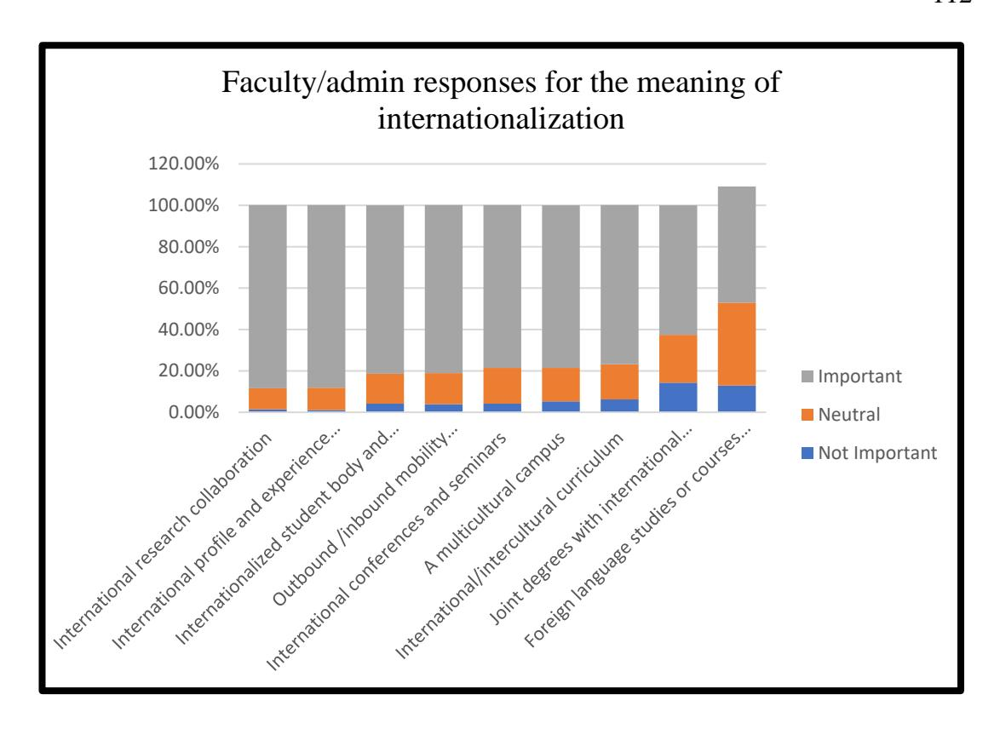
*Figure 3: Faculty/admin responses on the meaning of internationalization*

وتراوحت نسب تصنيف أعضاء هيئة التدريس والإداريين بين 56.1% و88.5%. واعتبرت إجاباتهم "التعاون البحثي الدولي" أهم عنصر للتدويل، بنسبة 88.5%، تلاه "الحضور والخبرة الدولية لأعضاء هيئة التدريس"، بنسبة 88.2%، و"تنوع جسم الطلاب وخبرتهم الدولية" ثالثًا من حيث الأهمية بنسبة 81.4%. من ناحية أخرى، كانت "الدرجات المشتركة مع جامعات دولية" و"دراسات أو مقررات اللغات الأجنبية" أقل العناصر أهمية لأعضاء هيئة التدريس والإداريين، بنسبة 62.6% و56.1% على التوالي.

وكما هو موضح في الجدول 11، تراوحت استجابات الطلاب بين 66.2% و82.5%. وكانت العناصر الثلاثة الأهم للتدويل هي "الحضور والخبرة الدولية لأعضاء هيئة التدريس" و"تنوع جسم الطلاب وخبرتهم الدولية"

<!-- page 134 -->

و"التعاون البحثي الدولي"، بنسبة 82.5% و81.7% و81.6% على التوالي. وكانت العناصر الأقل أهمية للطلاب "المنهج الدولي والبيني-الثقافي"، بنسبة 71.5%، و"دراسات ومقررات اللغات الأجنبية" بنسبة 66.2%. وتُعرض هذه التصنيفات أيضًا بشكل تخطيطي في الشكل 4.

<!-- page 135 -->

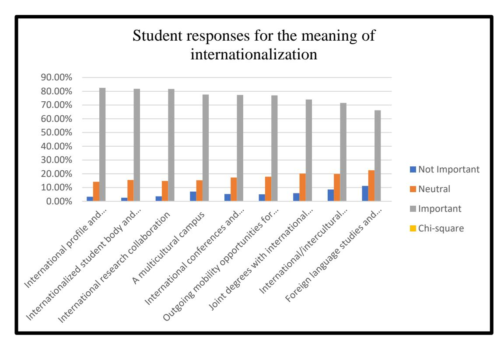
*Figure 4: Student responses on the meaning of internationalization*

## **4.3.2 أهمية التدويل **

يُظهر الجدول 12 الاستجابات التي أعطاها الإداريون وأعضاء هيئة التدريس حول تصورهم لأهمية التدويل. وتُعرض هذه أيضًا بشكل تخطيطي في الشكل 5. وأدرك معظم المستجيبين من أعضاء هيئة التدريس/الإداريين (67.1%) التدويل باعتباره ذا أهمية كبيرة في مؤسساتهم، بينما أدرك 10 بالمئة فقط التدويل باعتباره غير مهم لمؤسساتهم.

وكما هو موضح في الجدول 13 والشكل 5، أدرك معظم الطلاب (63.4%) التدويل باعتباره ذا أهمية كبيرة في مؤسساتهم، بينما أدرك سبعة بالمئة فقط التدويل باعتباره غير مهم لمؤسساتهم.

<!-- page 136 -->

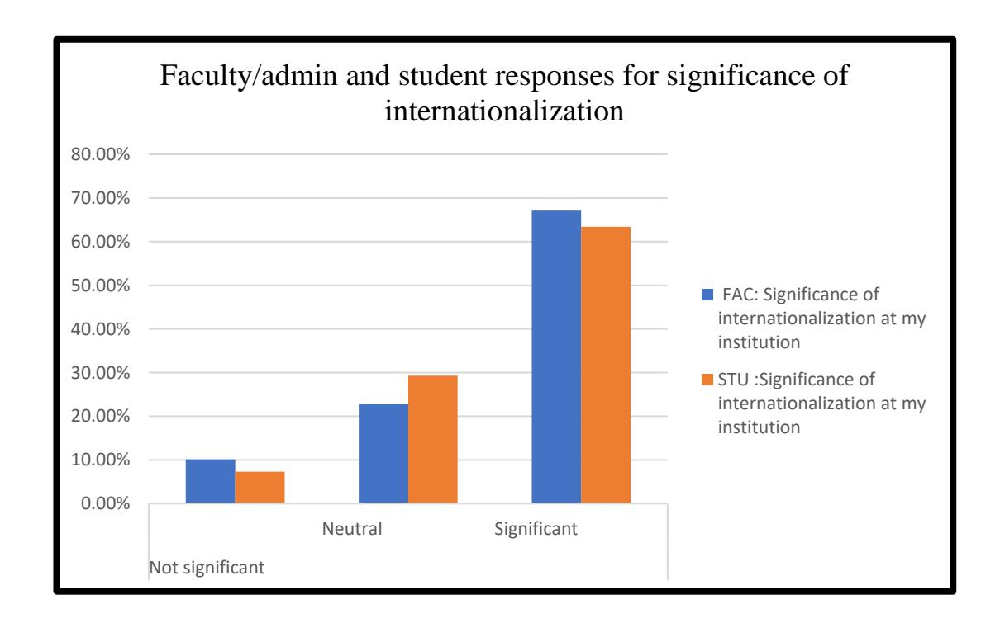
*Figure 5: Faculty/admin and student responses on significance of internationalization*

<!-- page 137 -->

## **4.3.3 مبررات التدويل**

يُدرج الجدول 14 والشكل 6 التصنيفات التي أعطاها الإداريون وأعضاء هيئة التدريس للعناصر التي تُشكّل تصورهم لمبررات التدويل. وتراوحت استجابات أعضاء هيئة التدريس/الإداريين بين 53.9% و92.7%، مع كون "الجودة الأكاديمية" أهم مبرر للتدويل بنسبة 92.7%، تلاه "تعزيز الحضور المؤسسي" بنسبة 89.4%، و"إرساء شبكات وتحالفات" ثالثًا بنسبة 85.6%. وفي المقابل، جاء "تطوير قدرات الموارد البشرية" و"تنويع مصادر الدخل" في المرتبة الأخيرة، بنسبة 78.1% و53.9% على التوالي.

<!-- page 138 -->

يُدرج الجدول 15 والشكل 7 التصنيفات التي أعطاها الطلاب للعناصر التي تُشكّل تصورهم لمبررات التدويل. وتراوحت استجابات الطلاب بين 73.3% و88.1%. وكانت أهم المبررات "تعزيز الجودة الأكاديمية"، و"تعزيز الحضور المؤسسي"، و"إرساء شبكات وتحالفات"، بنسبة 88.1% و83.9% و83.6% على التوالي. وكان أقل المبررات أهمية للطلاب "تنويع مصادر الدخل والدعم المالي"، بنسبة 73.3%.

<!-- page 139 -->

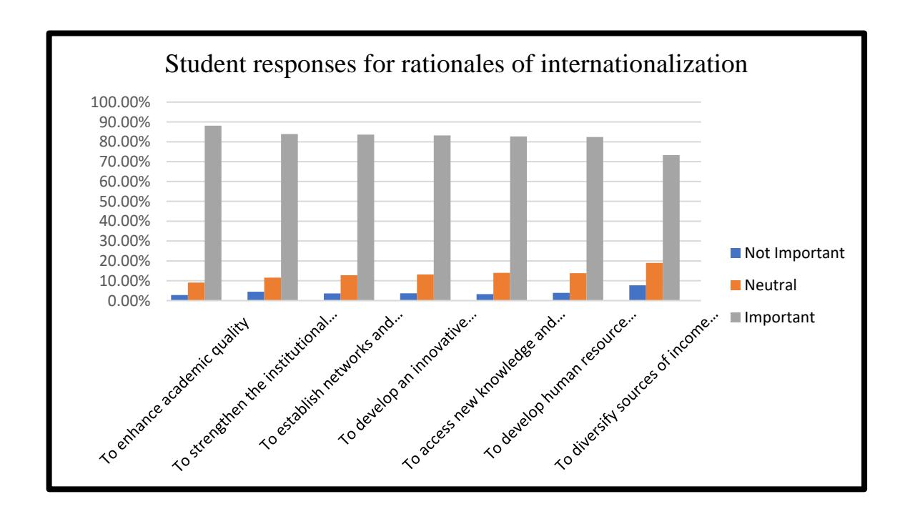
*Figure 7: Student responses on rationales of internationalization*

<!-- page 140 -->

## **4.3.4 مخاطر التدويل**

يُدرج الجدول 16 التصنيفات التي أعطاها أعضاء هيئة التدريس والإداريون للعناصر التي تُشكّل تصورهم لمخاطر التدويل. وتراوحت استجاباتهم بين 16.8% و36.3%، مع اعتبار "فقدان الهوية الوطنية والقيم الثقافية" أخطر عنصر للتدويل، بنسبة 36.3%، تلاه "الاستخدام المفرط للغة الأجنبية" بنسبة 30%. وفي المقابل، أُدركت العناصر الأقل خطورة على أنها "عدم المساواة في الوصول إلى التعليم الدولي"، بنسبة 27.8%، تلاها "التناقضات/التهديدات السياسية" بنسبة 24.4%، و"خلق منهج متجانس" بنسبة 16.8%. وبالنسبة لكل عنصر من عناصر المخاطر، مال أعضاء هيئة التدريس والإداريون أكثر نحو إدراك كل عنصر باعتباره "غير خطير" أكثر من إدراكه "خطيرًا".

<!-- page 141 -->

*Figure 8: Faculty/Admin responses on risks of internationalization*

يُدرج الجدول 17 التصنيفات التي أعطاها الطلاب للعناصر التي تُشكّل تصورهم لمخاطر التدويل. وتراوحت استجاباتهم بين 32% و55.2%، مع اعتبار "فقدان الهوية الوطنية والقيم الثقافية" أخطر عنصر للتدويل، بنسبة 55.2%، تلاه "عدم المساواة في الوصول إلى التعليم" بنسبة 51.9%، و"الاستخدام المفرط للغات الأجنبية" بنسبة 51.2%. واعتُبرت "عدم المساواة والاعتماد في الشراكات المؤسسية" و"تجانس المنهج" الأقل خطورة، بنسبة 39.3% و32% على التوالي.

<!-- page 142 -->

| Table 17: Student responses for risks of internationalization |  |  |  |  |  |  |
| --- | --- | --- | --- | --- | --- | --- |

| Risks of Internationalization | Not Risky (%) | Neutral (%) | Risky (%) |
| --- | --- | --- | --- |
| Loss of national identity and cultural values | 27.30 | 17.5 | 55.20 |
| Inequality of access to international education | 21.80 | 26.3 | 51.90 |
| Overuse of foreign languages | 28.50 | 20.3 | 51.20 |
| Increased foreign 'degree mills' and low-quality education providers | 24.40 | 25.0 | 50.60 |
| Political incongruences/threats | 29.80 | 24.7 | 45.50 |
| Inequality and dependency in institutional partnership | 23.00 | 37.7 | 39.30 |
| Homogenization of curriculum | 31.20 | 36.7 | 32.00 |

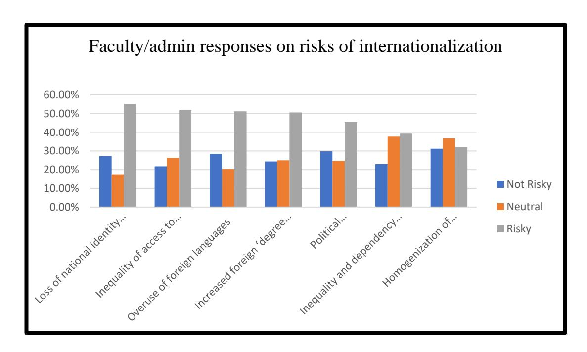
*Figure 9: Student responses on risks of internationalization*

## **4.4 السؤال 2: كيف تُنفّذ مؤسسات التعليم العالي التدويل في ** ** جامعات دولة الإمارات؟**

يُقدم القسم التالي النتائج المتعلقة بتنفيذ التدويل في مؤسسات التعليم العالي بدولة الإمارات، استنادًا إلى أوصاف أصحاب المصلحة لـ

<!-- page 143 -->

السياسة، واستراتيجية التدويل، وعملية التنفيذ الشاملة، وأنشطة التدويل. واستجاب أعضاء هيئة التدريس والإداريون لعناصر الاستبيان المتعلقة بالسياسة والاستراتيجية والتنفيذ الشامل وأكثر أنشطة التدويل تكرارًا، بينما استجاب الطلاب فقط للأسئلة المتعلقة بأكثر أنشطة التدويل تكرارًا في مؤسساتهم.

## **4.4.1 وصف السياسة**

كما هو موضح في الجدول 19 والشكل 10، تراوحت استجابات أعضاء هيئة التدريس والإداريين في اختيارهم لواصفات السياسة بين 37.4% لـ"وجود اعتماد في الميزانية للتنفيذ" و47.5% لـ"وجود عنصر دولي" في السياسات أو الخطط الاستراتيجية، بينما وافق 45.3% على أن مؤسساتهم تمتلك سياسة للتدويل. ومن الواضح وجود نسبة عالية في المقياس المحايد، تتراوح بين 37.5% و40.4%، مما يعكس أن العديد من أعضاء هيئة التدريس والإداريين لا يوافقون ولا يعارضون كل عنصر من العناصر.

<!-- page 144 -->

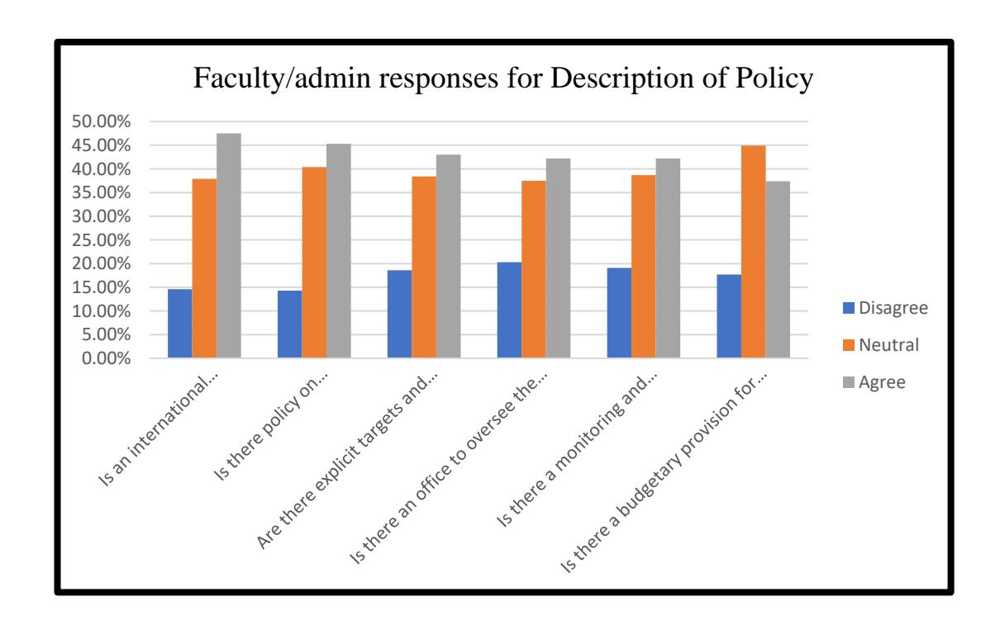
*Figure 10: Faculty/admin responses on description of policy*

## **4.4.2 وجود استراتيجيات تنفيذ **

كما هو موضح في الجدول 19، وافق 53.7% من أعضاء هيئة التدريس والإداريين على وجود استراتيجية للتدويل.

<!-- page 145 -->

## **4.4.3** **فعالية التنفيذ**

كما هو موضح في الجدول 20، أدرك 44.1% من أعضاء هيئة التدريس والإداريين عملية صياغة السياسات المتعلقة بتخطيط الأنشطة الدولية باعتبارها فعّالة، بينما اعتقد 44.7% أن استراتيجية التنفيذ الشاملة للتدويل فعّالة.

## **4.4.4** **أنشطة التدويل الأكثر تكرارًا**

يُقدم الجدول 21 والشكل 11 نتائج التكرار لمختلف أنشطة التدويل، كما يُدركها أعضاء هيئة التدريس والإداريون. أُدرج "استقطاب أعضاء هيئة تدريس وموظفين أجانب" كأكثر نشاط تدويل تكرارًا، بنسبة 80.6%، تلاه "المؤتمرات والندوات الدولية" بنسبة 68.3%، و"الجودة الأكاديمية بمعايير دولية" و"التعاون البحثي الدولي"، بنسبة 67.1% و66.0% على التوالي. وكانت الأنشطة الأقل تكرارًا "المنهج الدولي/البيني-الثقافي"، بنسبة 48.1%، و"فرص التنقل الصادر للطلاب والموظفين"، بنسبة 42.7%، و"برامج الدرجات التعاونية الدولية"، بنسبة 37.1%.

<!-- page 146 -->

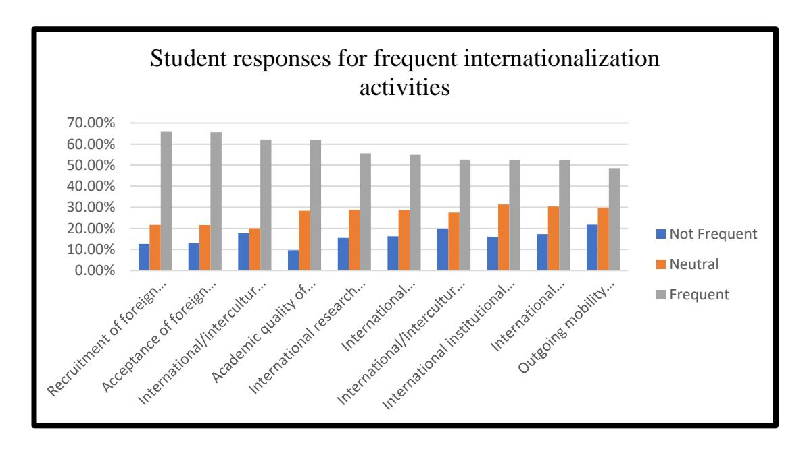
*Figure 11: Faculty/admin responses on frequent internationalization activities*

<!-- page 147 -->

وكما هو موضح في الجدول 22 والشكل 12، اختار الطلاب "استقطاب أعضاء هيئة تدريس أجانب" كأكثر نشاط تدويل تكرارًا، بنسبة 65.8%، تلاه "قبول طلاب أجانب"، بنسبة 65.6%، و"فعاليات الحرم الجامعي الدولية والبينية-الثقافية" بنسبة 62.2%. وكانت الأنشطة الأقل اختيارًا "الاتفاقيات الدولية والمؤسسية"، بنسبة 52.5%، و"برامج الدرجات التعاونية الدولية"، بنسبة 52.3%، و"فرصة التنقل الصادر للطلاب والموظفين"، بنسبة 48.6%.

<!-- page 148 -->

*Figure 12: Student responses on frequent internationalization activities*

## **4.5 السؤال 3: ما هي المساهمات والفرص التي يجلبها ** ** التدويل لمؤسسات التعليم العالي في دولة الإمارات؟**

ركز هذا القسم في الاستبيان على الآثار الإيجابية للتدويل على مؤسسات التعليم العالي المدروسة.

## **4.5.1 مساهمة التدويل**

كما هو موضح في الجدول 23، وافق ثلاثة أرباع أعضاء هيئة التدريس والإداريين على أن التدويل ساهم إيجابيًا في مؤسساتهم، بينما عارض 5.9% فقط أن التدويل قد ساهم إيجابيًا.

<!-- page 149 -->

وكما هو موضح في الجدول 24، اعتقد نحو ثلثي الطلاب (65.7%) أن التدويل ساهم إيجابيًا في مؤسساتهم، بينما عارض 4.8% فقط. وتُقارَن نتائج كلتا مجموعتي أصحاب المصلحة بشكل تخطيطي في الشكل 13.

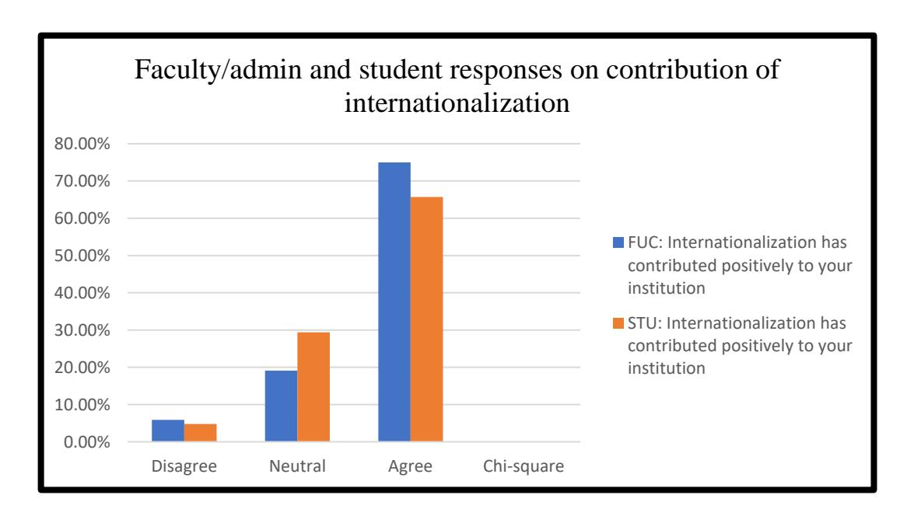
*Figure 13: Faculty/admin and student responses on contribution of internationalization*

## **4.5.2 فرص التدويل**

تناول هذا السؤال الفرص التي خلقها التدويل. وكما هو موضح في الجدول 25 والشكل 14، حدد أعضاء هيئة التدريس والإداريون "تعزيز

<!-- page 150 -->

القدرة المؤسسية على البحث وإنتاج المعرفة" باعتباره الفرصة الأكثر ذكرًا (84.5%)، تلاه "تبادل المعرفة"، بنسبة 83.7%، و"تعزيز الحضور الدولي والعلامة التجارية وتصنيفات عالمية أفضل"، بنسبة 82.6%، و"معايير تعلم دولية تؤدي إلى قوى عاملة مؤهلة عالميًا"، بنسبة 77.2%.

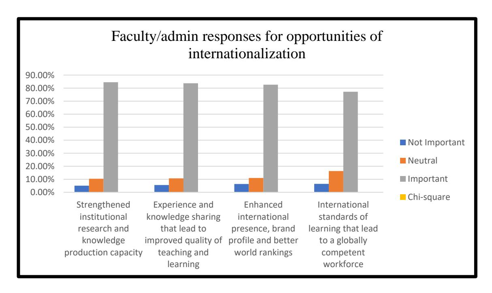
*Figure 14: Faculty/admin responses on opportunities of internationalization*

<!-- page 151 -->

وكما هو موضح في الجدول 26 والشكل 15، حدد الطلاب "تبادل الخبرة والمعرفة" باعتباره الفرصة الأكثر ذكرًا (79.1%)، تلاه "تعزيز القدرة المؤسسية على البحث وإنتاج المعرفة"، بنسبة 77.2%، و"تعزيز الحضور الدولي والعلامة التجارية وتصنيفات عالمية أفضل"، بنسبة 77.0%، و"معايير تعلم دولية تؤدي إلى قوى عاملة مؤهلة عالميًا"، بنسبة 72.7%.

<!-- page 152 -->

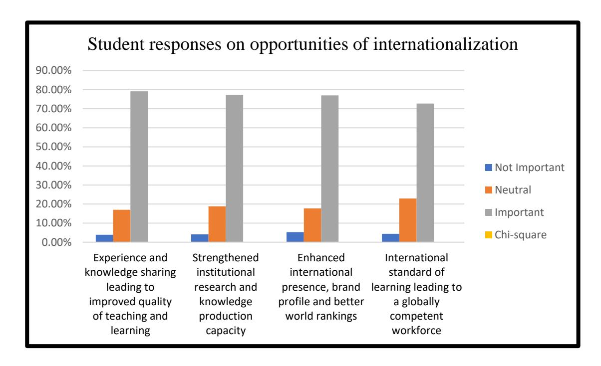
*Figure 15: Student responses on opportunities of internationalization*

## **4.6 السؤال 4: ما هي التحديات المرتبطة بالتدويل ** ** في مؤسسات التعليم العالي بدولة الإمارات؟**

يركز هذا القسم على تحديات التدويل، وكذلك تحديات تنفيذ التدويل.

## **4.6.1 التحديات**

كما هو موضح في الجدول 27 والشكل 16، اختار أعضاء هيئة التدريس والإداريون "معاملة ضمان الجودة والاعتماد كاستراتيجيات لأغراض العلامة التجارية للجامعة فقط"، بنسبة 47.7%، و"تسليع وتسويق برامج التعليم"، بنسبة 41.3%، و"صعوبة الاعتراف بالمؤهلات ومعادلتها"، بنسبة 40.2%، كأكثر التحديات الجدية ذكرًا. وفي المقابل، اختير "استنزاف الأدمغة"، بنسبة 33.7%، بأقل تكرار كتحدٍ جدي للتدويل.

<!-- page 153 -->

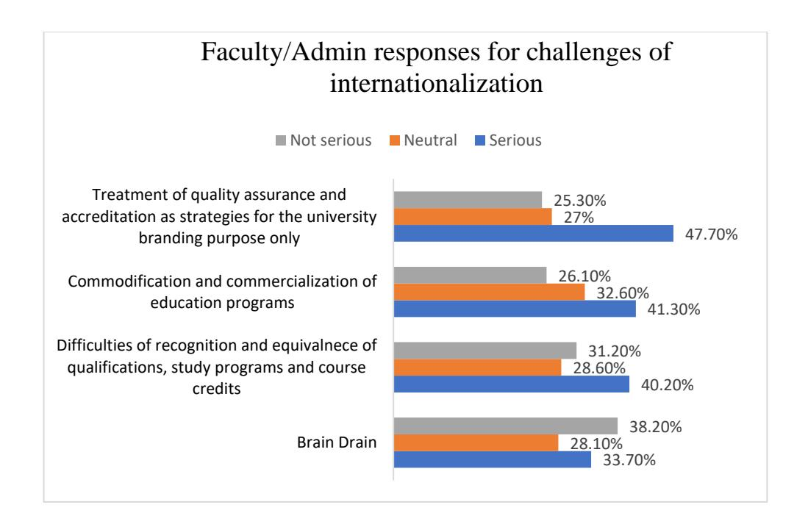
*Figure 16: Faculty/admin responses on challenges of internationalization*

وكما هو موضح في الجدول 28 والشكل 17، اختار الطلاب "معاملة ضمان الجودة والاعتماد كاستراتيجيات لأغراض العلامة التجارية للجامعة فقط"، بنسبة 60.0%، كأكثر تحدٍ جدي للتدويل ذكرًا، تلاه "استنزاف

<!-- page 154 -->

الأدمغة"، بنسبة 56.4%، و"صعوبة الاعتراف بالمؤهلات ومعادلتها"، بنسبة 56.3%، و"تسليع وتسويق التعليم"، بنسبة 54.5%.

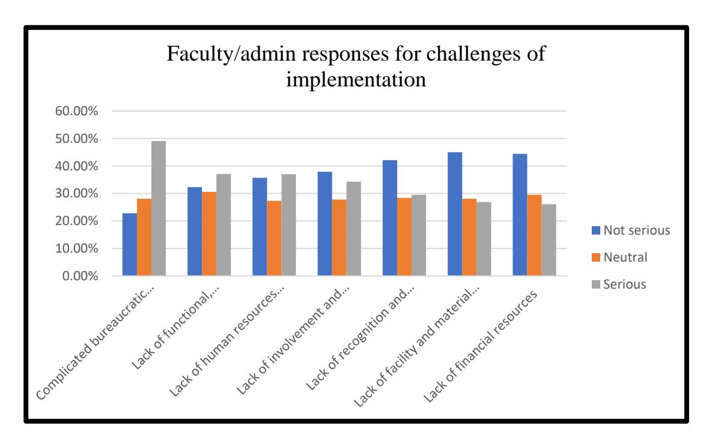
*Figure 17: Student responses on challenges of internationalization*

<!-- page 155 -->

## **4.6.2 تحديات التنفيذ **

سُئل أعضاء هيئة التدريس والإداريون فقط عن تحديات تنفيذ التدويل. وكما هو موضح في الجدول 29 والشكل 18، اختير "الإجراء البيروقراطي المعقد" بأكثر تكرار كتحدٍ جدي للتنفيذ (49.1%)، تلاه "غياب استراتيجية شاملة وظيفية للتدويل"، بنسبة 37.1%، و"نقص الموارد البشرية"، بنسبة 37.1%. وكانت تحديات التنفيذ الأقل اختيارًا "نقص الدعم من المستويات الأعلى"، بنسبة 29.5%، و"نقص المرافق والموارد المادية"، بنسبة 26.9%، و"نقص الموارد المالية"، بنسبة 26.1%.

<!-- page 156 -->

*Figure 18: Faculty/admin responses on challenges of implementation*

## **4.7 السؤال 5: هل يوجد فرق ذو دلالة إحصائية بين أعضاء هيئة ** ** التدريس والإداريين المواطنين وغير المواطنين فيما يتعلق بالتدويل؟ **

كجزء من تحليل الدراسة، أُجريت اختبارات t للعينات المستقلة لتحديد أي فروق ذات دلالة إحصائية في الدرجات المُحصّل عليها من أعضاء هيئة التدريس والإداريين المواطنين، مقارنة بأولئك من أعضاء هيئة التدريس والإداريين غير المواطنين. وتُعرض نتائج الاختبار أدناه.

## **4.7.1 التصورات **

أُجري اختبار t للعينات المستقلة لمقارنة تصورات التدويل بين أعضاء هيئة التدريس والإداريين المواطنين وغير المواطنين. وكشف اختبار t عن فرق ذي دلالة إحصائية بين هاتين المجموعتين عند مستوى p<0.05 لتصورات التدويل لدى المواطنين (M = 3.88, SD = 0.39) وغير المواطنين (M = 3.27, SD = 0.44)؛ t(354) = 1.98 p = 0.048. وكانت الفروق ذات دلالة عند مستوى 0.05 لمجال المبررات، بقيمة p تبلغ 0.015

<!-- page 157 -->

(الجدول 30)، إذ تجاوزت استجابات المواطنين استجابات غير المواطنين في سبعة من ثمانية عناصر تغطي مجال المبررات.

## **4.7.2 التنفيذ **

أُجري اختبار t للعينات المستقلة لمقارنة الاستجابات على أسئلة تتعلق بتنفيذ التدويل بين أعضاء هيئة التدريس والإداريين المواطنين وغير المواطنين. ولم يكن هناك فرق ذو دلالة في متوسط الدرجات لحالتي المواطنين (M = 3.59, SD = 0.74) وغير المواطنين (M = 3.52, SD = 0.82)؛ t (354) = 0.542 p = 0.59 (الجدول 30).

## **4.7.3 الفرص**

أُجري اختبار t للعينات المستقلة لمقارنة الاستجابات على أسئلة تتعلق بفرص التدويل بين أعضاء هيئة التدريس والإداريين المواطنين وغير المواطنين. ولم يكن هناك فرق ذو دلالة في متوسط الدرجات لحالتي المواطنين (M = 4.29, SD = 0.64) وغير المواطنين (M = 4.19, SD = 0.83)؛ t (354) = 0.727 p = 0.468 (الجدول 30).

## **4.7.4 التحديات**

أُجري اختبار t للعينات المستقلة لمقارنة الاستجابات على أسئلة تتعلق بتحديات التدويل بين أعضاء هيئة التدريس والإداريين المواطنين وغير المواطنين. ولم يكن هناك فرق ذو دلالة في متوسط الدرجات لحالتي المواطنين (M = 2.98, SD = 1.02) وغير المواطنين (M = 3, SD = 0.81)؛ t (354) = -0.105 p = 0.917 (الجدول 30).

.

<!-- page 158 -->

## **4.8 السؤال 6: هل يوجد فرق ذو دلالة إحصائية بين ** ** أصحاب المصلحة فيما يتعلق بتصورات التدويل وتنفيذه ** ** وفرصه وتحدياته؟**

كجزء من تحليل الدراسة، أُجريت اختبارات تحليل التباين (ANOVA) واختبارات المقارنة المتعددة اللاحقة (post-hoc) لتحديد الفروق ذات الدلالة الإحصائية في متوسط الدرجات المُحصّل عليها عبر مختلف مجموعات أصحاب المصلحة. وتُعرض نتائج الاختبار في الجدولين 31 و32.

<!-- page 159 -->

<!-- page 160 -->

<!-- page 161 -->

## **4.8.1 التصورات **

أُجري اختبار ANOVA أحادي الاتجاه لمقارنة الإداريين وأعضاء هيئة التدريس والطلاب من حيث تصوراتهم للتدويل. وكان هناك فرق ذو دلالة بين هذه المجموعات عند مستوى p<0.05 للحالات الثلاث [DF (2,1676), F (29.323), P = 0.000]. وأشارت المقارنات اللاحقة إلى أن متوسط درجة الطلاب (M = 3.96, SD = 0.49) كان مختلفًا بشكل ذي دلالة عن درجات مجموعتي الإداريين (M = 3.76, SD = 0.42) وأعضاء هيئة التدريس (M = 3.73, SD = 0.45).

## **4.8.2 المخاطر **

أُجري اختبار ANOVA أحادي الاتجاه لمقارنة الإداريين وأعضاء هيئة التدريس والطلاب في استجاباتهم على أسئلة حول مخاطر التدويل. وكان هناك فرق ذو دلالة بين هذه المجموعات بشأن مخاطر التدويل عند مستوى p<0.05 للحالات الثلاث [DF (2,1676), F (65.716), P = (0.00)]. وأشارت المقارنات اللاحقة إلى أن متوسط درجة الطلاب (M = 3.3469, SD = 0.93967) كان مختلفًا بشكل ذي دلالة عن درجات مجموعتي أعضاء هيئة التدريس (M = 2.6962, SD = 0.91143)، والإداريين (M = 2.7275, SD = 0.93917).

## **4.8.3 التنفيذ **

أُجري اختبار ANOVA أحادي الاتجاه لمقارنة الإداريين وأعضاء هيئة التدريس والطلاب في استجاباتهم على أسئلة حول تنفيذ التدويل. وكان هناك فرق ذو دلالة بين هذه المجموعات عند مستوى p<0.05 للحالات الثلاث [DF (2,1676), F (5.027), P (0.007)]. وأشارت المقارنات اللاحقة إلى أن متوسط درجة الطلاب (M = 3.7, SD = 0.8) كان

<!-- page 162 -->

مختلفًا بشكل ذي دلالة عن درجة مجموعة الإداريين (M = 3.6, SD = 0.8)، ومجموعة أعضاء هيئة التدريس (M = 3.5, SD = 0.8).

## **4.8.4 الفرص **

أُجري اختبار ANOVA أحادي الاتجاه لمقارنة الإداريين وأعضاء هيئة التدريس والطلاب في استجاباتهم على أسئلة حول فرص التدويل. وكان هناك فرق ذو دلالة بين هذه المجموعات عند مستوى p<0.05 للحالات الثلاث [DF (2,1676), F (3.061), P = (0.047)]. وأشارت المقارنات اللاحقة إلى أن متوسط درجة الإداريين (M = 4.18, SD = 0.83) كان مختلفًا بشكل ذي دلالة عن درجة مجموعة الطلاب (M = 4.0973, SD = 0.73)، لكن ليس عن مجموعة أعضاء هيئة التدريس (M = 4.27, SD = 0.77).

## **4.8.5 التحديات**

أُجري اختبار ANOVA أحادي الاتجاه لمقارنة الإداريين وأعضاء هيئة التدريس والطلاب في استجاباتهم على أسئلة حول تحديات التدويل. وكان هناك فرق ذو دلالة بين هذه المجموعات عند مستوى p<0.05 للحالات الثلاث [DF (2,1676), F (50.097), P (0.00)]. وأشارت المقارنات اللاحقة إلى أن متوسط درجة الطلاب (M = 3.6761, SD = 0.93256) كان مختلفًا بشكل ذي دلالة عن درجات مجموعتي أعضاء هيئة التدريس (M = 3.15, SD = 0.93)، والإداريين (M = 3.05, SD = 1.01).

<!-- page 163 -->

## **4.9** **ملخص النتائج الكمية**

## **4.9.1 التصورات **

- أ. المعنى: اعتقدت غالبية أصحاب المصلحة أن الحضور والخبرة الدولية لأعضاء هيئة التدريس، وتنوع جسم الطلاب وخبرتهم الدولية، والتعاون البحثي الدولي، كانت أهم عناصر التدويل.
- ب. الأهمية: اعتقد أكثر من 60 بالمئة من أصحاب المصلحة أن التدويل مهم في مؤسساتهم، بينما اعتقد أقل من 10 بالمئة أن التدويل غير مهم في مؤسساتهم.
- ج. المبررات: كشف أصحاب المصلحة أن 80 بالمئة منهم اعتبروا تعزيز الجودة الأكاديمية، وتعزيز الحضور والسمعة المؤسسية، وإرساء الشبكات والتحالفات، وتطوير منهج مبتكر، والوصول إلى معرفة وتكنولوجيا جديدة، وتطوير قدرة الموارد البشرية، الأسباب الرئيسية لتدويل التعليم العالي في دولة الإمارات.
- د. المخاطر: أشارت استجابات أعضاء هيئة التدريس والإداريين إلى أن التدويل غير خطير، إذ اعتبر أكثر من 40 بالمئة من المشاركين معظم عناصر المخاطر غير خطيرة. وبينما صُنفت خسارة الهوية الوطنية والقيم الثقافية، والاستخدام المفرط للغات الأجنبية، وزيادة "مصانع الشهادات" الأجنبية ومقدمي التعليم منخفض الجودة كأهم مخاطر التدويل، فقد اعتبرها أقل من 36 بالمئة خطيرة. من ناحية أخرى، أدرك الطلاب

<!-- page 164 -->

مستوى أعلى من المخاطر من التدويل، مع اختيار أكثر من نصف المشاركين خسارة الهوية الوطنية والقيم الثقافية، وعدم المساواة في الوصول إلى التعليم الدولي، والاستخدام المفرط للغات الأجنبية، وزيادة "مصانع الشهادات" الأجنبية ومقدمي التعليم منخفض الجودة كأعلى عناصر المخاطر. واتفقت كلتا المجموعتين على أن خسارة الهوية الوطنية والقيم الثقافية، والاستخدام المفرط للغات الأجنبية، وزيادة "مصانع الشهادات" الأجنبية ومقدمي التعليم منخفض الجودة هي المخاطر الرئيسية للتدويل.

## **4.9.2 التنفيذ**

في هذا الجزء من الاستبيان، اقتصرت استجابات الاستطلاع المتعلقة بالسياسة والاستراتيجية وعملية تنفيذ التدويل على أعضاء هيئة التدريس والإداريين فقط، بافتراض أن الطلاب لم يكونوا معنيين مباشرة بهذه المسائل. غير أن الطلاب أُدرجوا في تقييم تكرار أنشطة التدويل في مؤسساتهم.

- أ. السياسة: اعتقد أكثر من 40 بالمئة من أعضاء هيئة التدريس والإداريين أن جامعتهم تمتلك سياسة للتدويل على مستوى المؤسسة بأكملها، إضافة إلى سياسات ووثائق أخرى ذات عناصر دولية. علاوة على ذلك، وجدت أهداف ومعايير صريحة مطابقة للمعايير الدولية. وعارض الوصف أعلاه أقل من 18 بالمئة.
- ب. الاستراتيجية: اعتقد نحو 54 بالمئة من أعضاء هيئة التدريس والإداريين أن جامعتهم تمتلك استراتيجية لتنفيذ التدويل، بينما عارض ذلك أقل من 17 بالمئة.
- ج. العملية: اعتقد أكثر من 44 بالمئة من أعضاء هيئة التدريس والإداريين أن عملية مؤسستهم في صياغة سياسات حول الأنشطة الدولية فعّالة، إضافة إلى استراتيجية التنفيذ الشاملة. واعتقد أقل من 20

<!-- page 165 -->

بالمئة أن عملية صياغة السياسات واستراتيجية التنفيذ الشاملة غير فعّالة.
- د. الأنشطة: اعتقد أكثر من 50 بالمئة من أصحاب المصلحة أن استقطاب أعضاء هيئة تدريس وأساتذة زائرين أجانب، والمؤتمرات والندوات الدولية، والجودة الأكاديمية بمعايير دولية، والتعاون البحثي الدولي، وقبول طلاب أجانب، والاتفاقيات المؤسسية الدولية، وفعاليات الحرم الجامعي الدولية والبينية-الثقافية، هي أكثر أنشطة التدويل تكرارًا في مؤسساتهم. من ناحية أخرى، اعتقد أصحاب المصلحة أن برامج الدرجات التعاونية الدولية وفرص التنقل الصادر للطلاب والموظفين هي أنشطة التدويل الأقل تكرارًا.

## **4.9.3 الفرص**

- أ. المساهمة: في السؤال العام حول الأثر الإيجابي للتدويل، اعتقد أكثر من 65 بالمئة من أصحاب المصلحة أن التدويل يُسهم إيجابيًا في مؤسستهم، بينما اعتقد أقل من ستة بالمئة أن التدويل لم يُسهم في مؤسستهم.
- ب. الفرص: اعتقد أكثر من 70 بالمئة من أصحاب المصلحة أن تبادل الخبرة والمعرفة المؤدي إلى تحسين جودة التدريس والتعلم، وتعزيز القدرة المؤسسية على البحث وإنتاج المعرفة، وتعزيز الحضور الدولي والعلامة التجارية وتصنيفات عالمية أفضل، والمعيار الدولي للتعلم المؤدي إلى قوى عاملة مؤهلة عالميًا، هي فرص يجلبها التدويل.

<!-- page 166 -->

## **4.9.4** **التحديات**

في هذا القسم الفرعي من الاستبيان، اقتصرت استجابات الاستطلاع المتعلقة بتحديات تنفيذ التدويل على أعضاء هيئة التدريس والإداريين فقط، بافتراض أن الطلاب لم يكونوا معنيين مباشرة. غير أن الطلاب أُدرجوا في تقييم التحديات العامة للتدويل.

- أ. التحديات العامة: اعتقد أقل من 47 بالمئة من أعضاء هيئة التدريس والإداريين أن معاملة ضمان الجودة والاعتماد كاستراتيجيات لأغراض العلامة التجارية للجامعة فقط، وتسليع وتسويق برامج التعليم، وصعوبات الاعتراف بالمؤهلات وبرامج الدراسة وساعات المقررات ومعادلتها، واستنزاف الأدمغة، تُشكّل تحديات جدية مرتبطة بالتدويل، بينما اعتقد أكثر من 50 بالمئة من الطلاب أن العناصر المذكورة أعلاه تُشكّل تحديات جدية مرتبطة بالتدويل.
- ب. تحديات تنفيذ التدويل: اعتقد أقل من 50 بالمئة من أعضاء هيئة التدريس والإداريين أن تنفيذ التدويل يفرض تحديات جدية. واعتُبرت العناصر التالية الأكثر مواجهة كتحديات لتنفيذ التدويل: الإجراء البيروقراطي المعقد، وغياب استراتيجية شاملة وظيفية للتدويل، ونقص الموارد البشرية (المهارات والخبرة المناسبة)، بينما اعتُبر نقص المرافق والموارد المادية ونقص الموارد المالية أقل التحديات المرتبطة بعملية تنفيذ التدويل.

<!-- page 167 -->

## **4.9.5 الفروق** **بين المواطنين وغير المواطنين**

وفقًا لنتائج اختبار t المستقل، وُجد فرق ذو دلالة إحصائية فيما يتعلق بتصور المواطنين وغير المواطنين بين أعضاء هيئة التدريس والإداريين، وتحديدًا ضمن مجال المبررات، بقيمة p تبلغ 0.015. واعتقد أكثر من 90 بالمئة من المواطنين أن الوصول إلى معرفة وتكنولوجيا جديدة، وإرساء شبكات وتحالفات، وتطوير منهج مبتكر، وتعزيز الحضور والسمعة المؤسسية، هي أهم مبررات السعي نحو التدويل. واعتقد غير المواطنين أن تعزيز الجودة الأكاديمية، وتعزيز الحضور والسمعة المؤسسية، وإرساء شبكات وتحالفات، هي أهم مبررات التدويل بنسبة 93.1% و89.1% و84.7% على التوالي.

## **4.9.6 الفروق** **في تصورات وتنفيذ وفرص وتحديات ** **أصحاب المصلحة المؤسسيين**

وفقًا لاختبار ANOVA أحادي الاتجاه، يوجد فرق ذو دلالة إحصائية بين آراء أصحاب المصلحة حول تصورات التدويل وتنفيذه وفرصه وتحدياته.

- أ. التصور: في بُعد التصور، أظهرت "المخاطر" فروقًا ذات دلالة إحصائية بين مجموعات أصحاب المصلحة. أدرك الطلاب مستوى أعلى من المخاطر مقارنة بأعضاء هيئة التدريس والإداريين، بمتوسط درجة بلغ 3.35، بينما كان متوسط درجات أعضاء هيئة التدريس والإداريين أقل من 3.00.
- ب. التنفيذ: في بُعد التنفيذ، قُورنت متوسطات درجات الطلاب وأعضاء هيئة التدريس والإداريين على استجاباتهم لتكرار أنشطة التدويل. أدرك الطلاب مزيدًا من أنشطة

<!-- page 168 -->

التدويل في مؤسساتهم، بمتوسط درجة بلغ 3.7، بينما كان متوسط درجات أعضاء هيئة التدريس والإداريين 3.5 و3.6 على التوالي.
- ج. الفرص: أدرك الإداريون وأعضاء هيئة التدريس الفرص باعتبارها أكثر أهمية من الطلاب، بمتوسط درجة بلغ 4.2 و4.3 على التوالي، بينما كان متوسط درجة الطلاب 4.1.
- د. التحديات: أدرك الطلاب تحديات التدويل باعتبارها أكثر جدية من أعضاء هيئة التدريس والإداريين، بمتوسط درجة بلغ 3.68، بينما بلغ متوسط درجة أعضاء هيئة التدريس 3.15 ومتوسط درجة الإداريين 3.05.

## **4.10 المرحلة 2: التحليل النوعي**

يُقدم هذا القسم تحليل البيانات المجمعة عبر المقابلات شبه المنظمة وتحليل الوثائق. وتُقدم النتائج الإجمالية إجابات للسؤال النوعي الرئيسي: كيف يُدرك أصحاب المصلحة الجامعيون التدويل في دولة الإمارات؟ وبشكل عام، كشف التحليل عن أربعة موضوعات رئيسية: فهم التدويل وخبرته، وتنفيذ التدويل، وفرص التدويل، وتحديات التدويل.

## **4.10.1 الموضوع 1: الفهم والخبرة **

## عناصر مهمة للتدويل

وفقًا للمقابلات، شارك المستجوَبون ثلاث قضايا رئيسية: البحث الدولي، وأعضاء هيئة التدريس والطلاب الدوليون، والمنهج الدولي. وذكر معظم المشاركين "التعاون البحثي الدولي" و"برامج البحث المشترك" و"البحث الدولي" عند سؤالهم عن معنى

<!-- page 169 -->

التدويل. علاوة على ذلك، ذكروا استقطاب أعضاء هيئة تدريس أجانب، وكما ذكر أحد أعضاء هيئة التدريس، "التعيين المتبادل لأعضاء هيئة تدريس دوليين من مؤسسات مختلفة" [In1TM1]. كما ذُكر تبادل الطلاب ووجود طلاب دوليين في الحرم الجامعي بشكل متكرر. ومن المثير للاهتمام أن المشاركين ركزوا على "المنهج" و"البرامج الدولية المُقدَّمة"، وهو ما يختلف عن استجابات الاستبيان. وذكر المشاركون "حضور الجامعة" وقال أحدهم "الحضور على المستوى الدولي . . . يحدث من خلال مشاركة أعضاء هيئة تدريسها البحثية في مؤتمرات دولية، وتنظيم مؤتمرات دولية في مقر الجامعة، وتبادل الطلاب وتبادل أعضاء هيئة التدريس — لقد أصبح ذلك جزءًا مهمًا جدًا لكل جامعة" [In8TM1]. وبعبارة أخرى، يتيح كون المؤسسة "دولية" حضورًا للجامعة على نطاق عالمي؛ ويتحقق ذلك بشكل رئيسي من خلال الأنشطة التي ذكرها المشاركون بأكبر قدر — البحث والتبادلات الدولية لأعضاء هيئة التدريس والطلاب. وذكر [In7FA1] التدويل بوصفه "امتدادًا للعولمة"، مشيرًا إلى مستوى عالٍ من فهم الموضوع.

## أهمية التدويل

علاوة على ذلك، ووفقًا لفهم وخبرة المستجوَبين، يُنظر إلى التدويل كإضافة مهمة لأي منظمة مؤسسية. ذكر المشاركون في المقابلات العلامة التجارية والحضور كأهمية للتدويل. ورأوا في العلامة التجارية طريقة للحصول على حضور دولي والحصول على تصنيف أعلى عالميًا. وذكر [In1TM1] "تحسين الموضع في الساحة الدولية مع الاعتراف بأثر الجامعة"، كأهمية للتدويل. من ناحية أخرى، ذكر مشارك أيضًا "تخريج طلاب أكفاء" [In3FA1] يمتلكون

<!-- page 170 -->

المؤهلات اللازمة للوظائف في المستقبل، بينما أضاف آخر "يمكننا أن نتعلم من بعضنا البعض ويمكن للطلاب أن يتعلموا من بعضهم البعض" [In6FA1]. وشعر المشاركون أن التدويل يساعد على استقطاب أفضل الطلاب على المستوى الدولي. كما ذكر العديد من المشاركين البحث، بمعنى أن التدويل يُحسّن البحث التعاوني وأثره. وذكر [In1TM2] أن الجامعات تهدف إلى أن تكون "مؤسسات بحثية"، و"لكي تكون مؤسسات بحثية، يجب أن يكون لديك أثر بحثي عالٍ على المستوى الدولي".

## مبررات التدويل

رأى المشاركون في المقابلات "بناء الحضور" كوسيلة لتيسير جميع أنشطة التدويل، على سبيل المثال، استقطاب موظفين وطلاب دوليين. وقال [In6FA1] "توجد علاقة تبعية بين العلامة التجارية والأمور الأخرى، فإذا كانت الجامعة شائعة جدًا من حيث البحث والتعليم فهذا يعني أنه من الأسهل بكثير استقطاب أعضاء هيئة تدريس وإدارة وطلاب جيدين إلى الحرم الجامعي، وكذلك رأس المال المالي".

## مخاطر التدويل

شارك المشاركون في المقابلات فهمًا مشابهًا فيما يتعلق بفقدان الثقافة كإحدى المخاطر الرئيسية المرتبطة بالتدويل. وذكر [In1TM1] أن "أي عملية عولمة تحمل خطر فقدان الهوية الخاصة بالجامعة أو الامتثال للمعايير الدولية". وبالمثل، اعتقد المشاركون أن وجود جامعات دولية يمثل تحديًا للجامعات المحلية. وذكر [In5TM1] أنه "إذا كان التدويل يتضمن فتح الباب أمام المزيد من الجامعات لإنشاء حرم جامعي قمري في دول مختلفة، فإن وجود المزيد من الجامعات

<!-- page 171 -->

في منطقة واحدة يمثل تحديًا كبيرًا للجامعات المحلية. لذلك ستواجه الجامعات المحلية تحديات في استقطاب الطلاب". وأضاف [In1TM3] إلى هذه النقطة: "نعم، إذا ركزنا فقط على القيام بأمور من أجل الحضور المؤسسي، فقد ننتهي بالتضحية بالغرض الأصلي للمؤسسة، القائم على الطالب المحلي والقضايا المحلية". وفيما يتعلق بالهوية الوطنية، ذكر [In3FA1] أن "تهميش الهوية الوطنية، واللغة العربية، والقيم العربية . . . قد يكون أثرًا سلبيًا للتدويل".

وأشارت النتائج الإجمالية لهذا الموضوع إلى أن معنى التدويل يتعلق بشكل رئيسي بوجود بحث دولي، وأعضاء هيئة تدريس وطلاب دوليين، ومنهج دولي. علاوة على ذلك، قدّر المشاركون تدويل التعليم العالي واعتبروه عملية فعّالة لأنها أدت إلى استقطاب أعضاء هيئة تدريس دوليين، وتحسين جودة التعليم، والقدرة المالية. من ناحية أخرى، للتدويل أثر سلبي على الهوية الوطنية ويتعارض مع وجهات النظر المحلية.

## **4.10.2 الموضوع 2: تنفيذ التدويل**

فيما يتعلق بعملية التنفيذ الشاملة، استُخدم مكعب التدويل لتحديد عملية التدويل داخل المؤسسات.

<!-- page 172 -->

تُشير فئات الجامعات الثلاث المُدرجة أدناه إلى أن غالبية الجامعات قيد الدراسة مُدوَّلة بدرجة عالية. وعند تحليل الوثائق، اتضح أن غالبية المؤسسات تمتلك بُعدًا/عنصرًا دوليًا مُدرجًا في سياستها/خططها الاستراتيجية المؤسسية، مع التركيز بشكل رئيسي على التعاون البحثي وتبادل أعضاء هيئة التدريس والطلاب. وأكد بعض المشاركين في المقابلات وجود سياسة وأدرجوا سماتها الرئيسية؛ وذكر البعض عدم وجود سياسة لديهم؛ وكان البعض غير متأكد من السياسة في مؤسستهم.

## الفئة 1 – مؤسسات مُدوَّلة بدرجة عالية

تمتلك هذه المؤسسات أولوية قصوى للتدويل (الموضع 8 على المكعب)، وهو ما ينعكس في سياساتها، وتنفيذها لهذه السياسات منظم للغاية. والدعم المُقدَّم تفاعلي بين المستويين المركزي والطرفي داخل كل مؤسسة.

ومن حيث السياسة، ذكر [In8TM1] أن المؤسسة تمتلك سياسة على مستوى الجامعة بأكملها وأن "كل برنامج يمتلك نشاطه الخاص". وقال [In4FA1]: "لا

<!-- page 173 -->

يمكنني أن أعطيك سياسة محددة صارمة… لكننا نُجري المزيد من المؤتمرات الدولية… لدينا الكثير من التعاونات الدولية… [ولدينا] مذكرات التفاهم".

ومن حيث الاستراتيجية، ذكر [In8TM1] كيف تمتلك مؤسستهم خطة استراتيجية وميزانية لتنفيذها: "تُدعم من خلال السماح لأعضاء هيئة التدريس بالمشاركة في المؤتمرات عبر تنظيم مؤتمرات دولية وعبر دعم [هم] للنشر على المستوى الدولي في مجلات مرموقة". وذكر [In4TM1] أن استراتيجيتهم "قائمة على التصنيفات، لذلك لدينا تعاونات بحثية، واستطلاعات رضا . . . هذا هو التدويل الذي يؤدي دورًا كبيرًا من حيث تحسين الاستراتيجية لتصنيفنا داخل المنطقة دوليًا. وأضاف [In8TM1] أن الجامعة "تهدف إلى تصنيف QS أعلى وتهدف إلى الحصول على اعتماد EQUIS [نظام اعتماد دولي مرموق للغاية] لكلية إدارة الأعمال". وأخيرًا، كان تبادل الطلاب وأعضاء هيئة التدريس جزءًا أساسيًا من الاستراتيجية.

ومن حيث التنفيذ الشامل، وصف [In8TM1] التنفيذ بأنه "مُنفَّذ بالكامل"، مشيرًا إلى أن العملية تبدأ بخطط استراتيجية ثم تخصيصات الميزانية لكل قسم.

## الفئة 2 – في طريقها نحو التدويل

تنتمي هذه المؤسسات إلى أفضل المؤسسات في دولة الإمارات (الموضعان 6 و7 على المكعب). وبينما يُعد التدويل أولوية بالنسبة لها، والدعم المُقدَّم تفاعلي، فإن تنفيذها منظم جزئيًا فقط. ولوحظ أنه بينما يقل تصنيفها عن الجامعات في الموضع 8 على مكعب التدويل، فإن تصنيفها على النطاق العالمي أعلى.

ومن حيث السياسة، ذكر [In1TM2]: "لا أتذكر أن لدينا سياسة مكتوبة للتدويل…. الاستقطاب لا يقتصر على موقع جغرافي محدد، فالتدويل يكمن في الحمض النووي للمؤسسة... بخلاف كونه

<!-- page 174 -->

مكتوبًا في سياسة… ينبغي ألا نعمل بجمود ضمن سياسة محددة بدقة قد تُعيق مرونة المؤسسة". وذكر [In2MM1] كيف تمتلك مؤسستهم حصصًا محددة: "يعرفون عدد الطلاب الذين سيُرسَلون. . . كم عدد المسابقات التي يشارك فيها الطلاب، وكم عدد التدريبات، وكم عدد فرص التطوع الدولي في جميع هذه الأمور، [هذه] مُحددة في السياسات". لم يكن بعض المشاركين على دراية كاملة بالسياسة لكن تمكنوا من تأكيد تنفيذها الفعّال.

ومن حيث الاستراتيجية، ذكر [In1TM1] أن "الاستراتيجية تركز على باحثين من الطراز الرفيع، معترف بهم ولديهم حضور دولي . . . [و]سيجلبون حتمًا شبكات معترف بها دوليًا إلى الجامعة". أما بالنسبة لاستراتيجية الاعتماد، فذكر [In5TM1]: "إنه جزء من استراتيجيتنا ضمان أن تمتلك جميع برامجنا اعتمادًا دوليًا، إلى جانب الاعتماد المحلي". وقال [In5TM1] أيضًا إن "تبادل الطلاب مهم جدًا أيضًا بالنسبة لنا، لذلك يُنفَّذ هذا أيضًا بالكامل كجزء من استراتيجيتنا . . . للحضور وتوفير تجربة تعلم للطلاب تكمل ما يتعلمونه محليًا". وكشف [In5TM1] أن "التعاون البحثي عرضي جدًا . . . أعني أن أعضاء هيئة التدريس مسؤولون عنه، لكن هذا مجال نحتاج إلى التركيز عليه". وذكر [In1TM2] الفرق بين الاستراتيجيات والسياسات على النحو التالي: "عندما تنظر إلى الخطة الاستراتيجية للجامعة، وحتى المشروع، نعم، التدويل موجود في كل مكان، لكن هذا ليس صحيحًا حقًا؛ لا يمكنني تسميته 'السياسة'، لكن إذا كان لديك هدف استراتيجي . . . فهو موجود". ويُظهر هذا التصريح أن الجامعة قد تمتلك هدفًا استراتيجيًا مُدوَّلًا، لكن لتجنب الجمود، لم تصُغ سياسات محددة تُملي جهود التدويل.

<!-- page 175 -->

## الفئة 3 – غير مُدوَّلة على الإطلاق

لا تعتبر هذه المؤسسات التدويل أولوية (الموضعان 1 و2 على المكعب). ومن المثير للدهشة أن إحداها جامعة عامة، والأخرى فرع خاص؛ وكلا نوعي الجامعات، العامة والخاصة، يظهران في موضع أعلى على المكعب. وعند تحليل الوثائق، وُجد أن [In3] لا تعتبر التدويل أولوية. أما ظروف [In7] فمختلفة. فهي بالفعل فرع دولي، وتُوجَّه جميع مبادراتها من قبل فرعها العالمي الرئيسي. من المحتمل أن [In7] لم تُروّج لنفسها كحاملة لواء التدويل لأن (أ) إنها بالفعل جامعة دولية ومصدر أصيل للتدويل؛ أو (ب) قد تُدرَج جميع سياساتها وإجراءاتها صراحة من قبل الفرع الرئيسي بدلًا من الفرع في دولة الإمارات. ومن حيث السياسة، ذكر [In3TM1] أنهم لا يمتلكون سياسات بحد ذاتها. فتدويلهم مجرد جزء من طريقة عملهم — إنه عملهم. كما ذكر المستجيب أن امتلاك سياسة يعني أن يكونوا "مُجبَرين" على تحقيق أمور معينة، وهو ما لا يتوافق مع طريقة إدارتهم لأعمالهم. وبالمثل، ذكر [In3FA1]: "لست على دراية كبيرة، لكن من الواضح لي أن هناك تطبيقًا للتدويل في الجامعة، على سبيل المثال، من حيث المنهج". وقال [In2MM1] إن استراتيجيتهم قائمة على القدرة على استقطاب النشر الدولي وأن من المهم النشر في منشورات معترف بها وذات أثر مرتفع.

ومن هذه الاستجابات، يتضح أن السياسة إما مُحددة بوضوح ومُبلَّغة لجميع أصحاب المصلحة المعنيين أو تُترك غير منظمة. ومن حيث العناصر الأقل تقييمًا، غاب وجود لجنة إطار مراقبة لتقييم التقدم أو مكتب للإشراف على التنفيذ في معظم الجامعات. وبينما امتلكت معظم المؤسسات أقسامًا ولجانًا لتعزيز الأنشطة الدولية، غاب مكتب

<!-- page 176 -->

للإشراف على التقدم والتنفيذ من معظم المؤسسات. أما بالنسبة لاستراتيجيات التدويل، فوفقًا للمشاركين في المقابلات، ظهرت ثلاث استراتيجيات رئيسية داخل المؤسسات: تعزيز التعاون البحثي الدولي وإرساء شبكات عالمية؛ وبناء مصداقية دولية من خلال اعتماد البرامج؛ وتبادل الطلاب وأعضاء هيئة التدريس.

قدم المشاركون في المقابلات ثلاث استجابات واسعة حول تكرار أنشطة التدويل في مؤسساتهم، تركز بشكل رئيسي على تبادل الطلاب، وفرص الدراسة في الخارج على المستوى الدولي، واستقطاب الطلاب الدوليين. ولاحظ [In5TM1] أن "لدينا تبادل طلابي — لدينا طلاب دوليون يزورون جامعتنا وبعض طلابنا يذهبون إلى هناك خلال الصيف". وكانت البرامج المشتركة والتعاونات الدولية التالية الأكثر ذكرًا بين المشاركين. وذكر [In1TM1] أن "الجامعات تُقيم الآن شراكات مع مجموعة متنوعة من البرامج التعليمية التي تتيح للطلاب المشاركة في تلك البرامج التعليمية المُطورة بشكل مشترك". وأدرج [In3FA1] التعاونات المشتركة مع السفارات الخارجية كإحدى الأنشطة الأكثر تكرارًا — "لدى جامعتنا علاقات وشراكات مع مؤسسات خارجية مثل السفارة الكورية".

## **4.10.3 الموضوع 3: فرص التدويل **

## تبادل الثقافة والمعرفة والخبرة

ركز المشاركون في المقابلات بشكل رئيسي على تبادل الثقافة والقيم الذي يحدث خلال أنشطة التدويل مثل تبادل الطلاب وتبادل أعضاء هيئة التدريس. وذكر [In3TM1] أن "تبادل الطلاب يمنح طلابنا فرصة للتعرض للعالم ودول أخرى . . . لثقافات أخرى . . .

<!-- page 177 -->

من خلال استقطاب أعضاء هيئة تدريس دوليين [و]أيضًا التنوع بحيث تمتلك آراء مختلفة، ثقافات في الحرم الجامعي". علاوة على ذلك، قال [In3TM1] "عندما تُجري مؤتمرات، تستفيد من خبرة من أجزاء أخرى من العالم لا تمتلكها محليًا في دولة الإمارات، لذا لكل نشاط فوائده الخاصة إن صح التعبير". وشارك [In1TM3] مشاعر مماثلة، مشيرًا إلى أن الفرصة تكمن في مساعدة أصحاب المصلحة على "استيعاب فوائد الثقافات الأخرى" وأن "تبادل ولقاء العقول هو الفرصة الأكبر".

## تعزيز البحث من خلال التعاون الدولي

كان تعزيز البحث موضوعًا شائعًا آخر وُجد ضمن استجابات المشاركين. وأشار [In1TM1] إلى الفرص اللاحقة الناتجة عن زيادة البحث:

[إلى] التحسن كجامعة موجهة نحو البحث … وهو ما من شأنه أن يُمكّن الطلاب في هذه الجامعة من تحسين أثر انخراطهم في الشبكات الدولية للجامعات؛ وسيتيح ذلك كلا الأمرين، غالبًا البحث حيث يكون التركيز الرئيسي. لكن سيؤثر ذلك حتمًا أيضًا على التعليم، كما ذكرت، وهو الجزء الأهم.

كان المستجيبون على وعي بالتغييرات الحاصلة في مؤسساتهم وعملية التدويل. وذلك لأنهم يُشكّلون الجزء الأهم من تلك العملية، ولديهم رأي رئيسي في القرارات المتعلقة بما إذا كانت استراتيجية التدويل تتعلق بالجودة الأكاديمية أو البحث. وانعكست المساهمة الإيجابية أيضًا في استجابات المستجوَبين. وذكر [In1TM2] التغييرات التي حدثت في المؤسسة نتيجة التدويل:

أعتقد أنه خلال السنوات العشر الماضية . . . مؤسستنا مختلفة تمامًا بسبب انفتاحها على الاتجاهات والمناهج الدولية . . . لذا فإن وتيرة حدوث التغييرات كبيرة وأعتقد أن الدافع هنا

<!-- page 178 -->

هو الحصول على اعتماد من هيئات دولية . . . على سبيل المثال، في كلية إدارة الأعمال، المعتمدة من AACSB، [و]من أجل الحفاظ على اعتمادها، يجب أن تكون مدرسة عالمية. وينطبق الأمر نفسه على الكليات الأخرى بل وحتى على كيفية إدارة الجامعة.

تحدث [In1TM1] عن تحسن موضع الجامعة من حيث التصنيف وجودة التعليم الشاملة باعتباره أهم مساهمة للتدويل. "أعتقد أنه كان عنصرًا فعّالًا ومنتجًا للغاية في تحسين موضع الجامعة وتصنيفها، إضافة إلى تعزيز البرامج التعليمية الأكاديمية التي سيستفيد منها الطلاب". وشارك [In5TM1] شعورًا مشابهًا، إذ ذكر أن:

السمعة الدولية والاعتراف والحضور جزء من تدويلنا. كما أن طلابنا سفراؤنا، فعندما يسافرون إلى الخارج، ينشرون رسالة ممتازة عن جودة التعليم من مؤسستنا، مما يُضيف إلى حضورنا دوليًا. أولئك الذين يأتون ويزوروننا، يختبرون تعليمًا ومرافق وبيئات عالية الجودة، وتنوعًا ثقافيًا...كل هذا يُضيف إلى الحضور.

وإجمالًا، يمكن أن تُعزى مساهمة التدويل بشكل رئيسي إلى تحسين العلامة التجارية والحضور و"البروز" للجامعة على الساحة العالمية، وكذلك إلى كيفية إتاحته للمقارنة المعيارية مع المعايير الدولية، وهو ما يُحسّن فقط جودة التعليم.

## فرص التدويل في ظل كوفيد-19

في المقابل، اعتبر معظم المشاركين الجائحة "نعمة" مُقنّعة. ولخص [In1TM2] الفوائد ببلاغة:

بالنسبة لي، قدم كوفيد-19 هدية ذهبية لتدويل التعليم العالي، لأننا اليوم يمكننا حضور ندوات إلكترونية دولية بشكل أكثر تكرارًا، ويمكننا المشاركة في مؤتمرات افتراضية بشكل أكثر تكرارًا. إنه أرخص بكثير وأعتقد أنه يمكننا أن نحصل على مزيد من الطلاب وأعضاء هيئة التدريس الدوليين الذين يعملون من

<!-- page 179 -->

حيث هم، فهم لا يحتاجون إلى التواجد هنا فعليًا، ويمكنك الاستفادة من الخبرة [إذ] لا يمكننا تحمل تكلفة توظيفهم بالكامل من قبل المؤسسات. لذلك، هناك أثر إيجابي على التعليم العالي عندما يتعلق الأمر بعواقب كوفيد-19 على كيفية إجراء التعليم.

كما شدد [In1TM1] على مدى قرب مجتمعنا خلال الجائحة وكيف أجبرت الأزمة قطاع التعليم العالي على أن يكون مبتكرًا:

لقد جلب وسائل اتصال مُحسَّنة، والقدرة على تقديم العمليات التعليمية والبحثية عبر العالم بشكل أكثر تماسكًا. ومن المثير للاهتمام أنه من خلال منعنا من التواصل وجهًا لوجه، جعلنا أقرب بكثير من بعضنا وأعطى قبولًا اجتماعيًا لوسائل التواصل الجديدة . . . [هذه] وسيلة جديدة لاستخدام هذا التواصل في التعليم لتصبح واقعًا. لقد أجبرنا على قبول ذلك، وأحدث ذلك ثورة في العملية التعليمية الكاملة للتدويل ووفّر الحاجة إلى قبول عمليات التدريس عبر العالم من حيث البرامج والمحتوى ليصبح واقعًا مقبولًا.

ووافق [In5TM1] وأضاف: "سمحت لنا هذه الجائحة أساسًا باستكشاف جانب إيجابي. هذه برامج الدرجات المشتركة. يمكن أن تكون عبر الإنترنت. لم يُفكَّر في هذا من قبل". وإجمالًا، رغم أن كوفيد-19 يحمل تحديات عديدة بحد ذاته، لا يمكن تجاهل أثره الإيجابي على كيفية إجراء التعليم.

## **4.10.4 الموضوع 4: تحديات التدويل **

## تآكل الثقافة

كان للمشاركين في المقابلات آراء متباينة. وتراوحت استجاباتهم الرئيسية من "قضايا في إنشاء مرفق بحثي لاستقطاب المواهب" إلى "الحفاظ على العلاقة القائمة مع الجهات الأجنبية" إلى "تآكل الثقافة"، والذي كان واضحًا أيضًا في عناصر مخاطر التدويل. وذكر [In1TM3] أنه في "الحفاظ على المجتمع والثقافة، سيكون هناك دائمًا تصادم مع

<!-- page 180 -->

العولمة والتدويل. كما يوجد فقدان للغة المحلية والزي المحلي".

## نقص تمويل مراكز البحث

من بين تحديات أخرى لم تُدرج في الاستطلاع، صرّح [In1TM1] بأنه "لا يوجد تمويل حالي للبحث كما في أوروبا أو أمريكا الشمالية حيث تحرص المنظمات الحكومية على إنفاق طلب معين من الناتج المحلي الإجمالي لتعزيز البحث في جوانب مختلفة من العلوم"، مضيفًا أن "التحديات الرئيسية هي معايير بيئة البحث والتعليم والتحديات في جلب والاحتفاظ بالباحثين ذوي [الكفاءة العالية]".

## تحديات الاعتماد

كما ذُكرت تحديات في الاعتماد وإرساء الدرجات المشتركة، إذ قال [In5TM1] "اعتماد البرامج هو جانب صعب آخر. نمتلك عادة إرشادات صارمة جدًا ومحكمة من الوزارة فيما يتعلق باعتماد البرامج . . . قد يجعل هذا من الصعب تيسير الدرجات المشتركة". وأضاف [In8TM1] "للحصول على الموافقات من الوزارة، تُشجعنا الوزارة على أن يكون لدينا اتفاق جيد مع الجهات الأجنبية . . . هذا هو الأكثر تحديًا".

## تحديات في التنفيذ: سياسات إدارية جامدة

ذكر [In1TM2] أن "التحديات دائمًا إدارية . . . إذا أرادت مؤسسة أن تهدف إلى مستوى عالٍ وتصبح لاعبًا مهمًا جدًا على المسرح الدولي . . . فينبغي ألا يكون هناك جمود، ولا سياسات جامدة ولا إجراءات جامدة، وينبغي أن تكون العقلية مختلفة". يشير هذا التعليق إلى أن

<!-- page 181 -->

العقلية الجامدة داخل المؤسسة يمكن فعلًا أن تكون عائقًا أمام فعالية خطط المؤسسة وسياساتها.

## تحديات التدويل في ظل كوفيد-19

أثرت جائحة كورونا العالمية على جميع مجالات الحياة، بما في ذلك التعليم العالي. وربما كان التعليم العالي القطاع الأكثر تأثرًا، إذ نشهد تحولًا رئيسيًا من الفصول الدراسية التقليدية إلى أنماط تعلم أكثر رقمنة ودمجًا. وطُلب من المشاركين في المقابلات تقديم آرائهم حول أثر كوفيد-19 على التعليم العالي عمومًا وكيف أثر أيضًا على تنفيذ التعليم العالي. وتنبع التحديات الرئيسية من توقف جميع الأنشطة المتعلقة بالسفر وأنشطة التدويل التي تتضمن نوعًا من السفر إلى الخارج، حيث قد تتأثر أنشطة الإجازة التفرغية. وذكر [In5TM1] أن "محليًا، تأثرت فرص تبادل الطلاب سلبًا، إذ لا يوجد أساسًا تبادل طلابي؛ كما تأثر التعاون الدولي الذي يتطلب اللقاء وجهًا لوجه". وذكر [In3TM1] التحديات في لوجستيات مثل هذه الأنشطة: "أصبحت اللوجستيات أكثر صعوبة هذه الأيام ولدى الدول قيود". وأوضح [In6FA1] التجارب الشخصية التي جلبتها الجائحة:

ما اختبرته حتى الآن هو تدهور جودة التعليم وتدهور جودة البحث . . . يعاني الطلاب بسبب جودة التعليم، وجودة المحاضرات، وجودة التقييم، وكذلك أعضاء هيئة التدريس. توجد العديد من الموارد التي لا يمكنني الوصول إليها خلال الجائحة من أجل البحث.

<!-- page 182 -->

## **4.11 ملخص** **النتائج النوعية**

## **4.11.1 الموضوع 1: الفهم والخبرة **

ركز القسم الأول من المقابلة على تصورات أعضاء هيئة التدريس والإداريين، المتألفة من العناصر المهمة، والأهمية، والمبررات، والمخاطر للتدويل. ذكر المشاركون في المقابلات بشكل رئيسي التعاونات البحثية وبرامج البحث المشترك، وذُكر استقطاب أعضاء هيئة تدريس أجانب وتبادل الطلاب كعناصر مهمة للتدويل.

## أهمية التدويل

ذكر المشاركون في المقابلات زيادة العلامة التجارية والحضور من خلال التعاون البحثي، واستقطاب أعضاء هيئة تدريس وطلاب أجانب، وبرامج تبادل الطلاب/أعضاء هيئة التدريس كأهم أهمية للتدويل.

## مبررات التدويل

اعتُبر بناء الحضور المؤسسي المبرر الرئيسي من قبل أعضاء هيئة التدريس والإداريين. وسيعمل بناء الحضور حتمًا كوسيلة لتيسير أنشطة تدويل أخرى مثل استقطاب أعضاء هيئة تدريس وطلاب دوليين.

## مخاطر التدويل

من بين المخاطر، ذُكر فقدان الثقافة كأهم مخاطر التدويل. وبالنسبة لكل من الهوية المؤسسية وهوية الفرد، يطرح التدويل تهديدًا من خلال احتمال تهميش الهوية الوطنية لكل من الفرد والمؤسسة.

<!-- page 183 -->

## **4.11.2 الموضوع 2: تنفيذ التدويل**

## وصف السياسة

ركز القسم الثاني من المقابلة على تنفيذ التدويل، بما في ذلك سياسات واستراتيجيات التدويل. وكشف تحليل الوثائق أن غالبية المؤسسات قيد الدراسة تمتلك عنصرًا دوليًا في سياساتها ووثائقها، مع التركيز على البحث وتبادل أعضاء هيئة التدريس. وغابت سلطة أو مكتب إشراف على التدويل من معظم المؤسسات.

## عملية التنفيذ

كشف تحليل الوثائق أيضًا عن ثلاث مجموعات من المؤسسات من إطار مكعب التدويل. كانت المجموعة الأولى من مؤسسات التعليم العالي "مُدوَّلة بدرجة عالية"، بسياسة ذات أولوية، وتنفيذ منظم، ودعم تفاعلي. وكانت المجموعة الثانية من مؤسسات التعليم العالي "في طريقها نحو التدويل"، تمتلك سياسة ذات أولوية ودعمًا تفاعليًا، لكن دون تنفيذ منظم. وكانت المجموعة الثالثة من مؤسسات التعليم العالي "غير مُدوَّلة على الإطلاق"؛ إذ تمتلك سياسات هامشية، واستراتيجيات عرضية، ودعمًا أحادي الجانب للتدويل.

## استراتيجيات التدويل

ذكر المشاركون في المقابلات أن استراتيجياتهم للتدويل ركزت بشكل رئيسي على التعاون البحثي، وإرساء الشبكات، ومعايير الاعتماد، وتبادل الطلاب/أعضاء هيئة التدريس.

<!-- page 184 -->

## الأنشطة الدولية

ذكرت غالبية المشاركين في المقابلات برامج تبادل الطلاب، واستقطاب أعضاء هيئة تدريس وطلاب أجانب، والتعاونات المشتركة، باعتبارها أنشطة التدويل الأكثر تكرارًا في مؤسساتهم.

## **4.11.3 الموضوع 3: فرص التدويل **

حُدد تبادل الثقافة والمعرفة كأهم فرصة ناتجة عن التدويل. وعلى نفس المنوال، ذُكر تعزيز البحث أيضًا كفرصة رئيسية. واعتُرف بالمساهمات الإيجابية الإجمالية للتدويل جيدًا من قبل أصحاب المصلحة المؤسسيين؛ إذ يُعتبر تحسن الموضع وتعزيز الجودة الأكاديمية كلاهما مساهمات إيجابية للتدويل. كما طُلب من المشاركين في المقابلات تحديد الفرص، إن وجدت، في ضوء كوفيد-19. وحُدد حضور المؤتمرات والفعاليات عبر الإنترنت دون الحاجة إلى المشاركة الشخصية أو السفر إلى الخارج كأكبر فرصة للتدويل خلال الجائحة.

## **4.11.4 الموضوع 4: تحديات التدويل**

من حيث التحديات، حُدد تآكل الثقافة كتحدٍ رئيسي، إضافة إلى تحديات أخرى واجهت معايير الاعتماد. ومن حيث تحديات التنفيذ، ذُكر نقص تمويل مراكز البحث والسياسات الإدارية الجامدة بشكل متكرر من قبل غالبية المشاركين في المقابلات. من ناحية أخرى، جلب كوفيد-19 بعض التحديات كما أدركها المشاركون. وذُكر تدهور البحث وجودته كأخطر التحديات خلال الجائحة.

<!-- page 185 -->

## **4.12 جوهر المرحلتين الكمية والنوعية **

يلخص الجدول التالي الاستجابات من كلتا المرحلتين الكمية والنوعية.

<!-- page 186 -->

<!-- page 187 -->

## **الفصل الخامس: المناقشة والدلالات** **والخاتمة**

## **5.1 نظرة عامة**

يحتوي هذا الفصل على أربعة أقسام، يبدأ بنظرة عامة على الدراسة ذات المنهج المختلط. وتحتوي الأقسام التالية على نتائج من كلتا المرحلتين الكمية والنوعية. وأخيرًا، تُقدم الدلالات والتوصيات إلى جانب خاتمة البحث.

كان الغرض من هذه الأطروحة المتسلسلة ذات المنهج المختلط فحص تصورات أصحاب المصلحة الجامعيين (كبار الإداريين وأعضاء هيئة التدريس والطلاب) حول عملية تنفيذ التدويل. وكما ذُكر سابقًا، كان قادة المؤسسات على وعي بالحاجة إلى التدويل — إذ توجد "عدم فعالية" عندما يتعلق الأمر بتنفيذ وتفعيل الأهداف المُعلنة. ورغم أن هدف المؤسسات هو التدويل، توجد عقبات كبيرة أمام هذه العملية، وتحديدًا الحاجة إلى تحول نموذجي من التركيز الخارجي إلى نهج أكثر شمولية يأخذ بعين الاعتبار قيم أصحاب المصلحة المؤسسيين وافتراضاتهم وممارساتهم (Childress, 2009). كما أن من الضروري الكشف عن التصورات والنوايا الكامنة وراء عملية التدويل إذ تؤثر بشكل كبير على السياسات الموجهة نحو تدويل فعّال (Seeber et al., 2016). واسترشدت هذه الدراسة بستة أسئلة بحثية. وسيناقش القسم التالي من هذا الفصل بإيجاز النتائج الرئيسية من كلا المسارين البحثيين، الكمي والنوعي. ولتذكير القراء، فإن أسئلة البحث التي تُناقَش هي كالتالي:

<!-- page 188 -->

## **5.2 الأسئلة الكمية**

- 1. كيف يُدرك أصحاب المصلحة الجامعيون التدويل في دولة الإمارات؟
- 2. كيف تُنفّذ مؤسسات التعليم العالي التدويل في جامعات دولة الإمارات؟
- 3. ما هي الفرص التي يجلبها التدويل لمؤسسات التعليم العالي في دولة الإمارات؟
- 4. ما هي التحديات المرتبطة بتنفيذ التدويل في مؤسسات التعليم العالي بدولة الإمارات؟
- 5. هل يوجد فرق ذو دلالة إحصائية بين أعضاء هيئة التدريس والإداريين المواطنين وغير المواطنين فيما يتعلق بتصورهم للتدويل؟
- 6. هل يوجد فرق ذو دلالة إحصائية بين أصحاب المصلحة فيما يتعلق بتصوراتهم للتدويل وتنفيذه وفرصه وتحدياته؟

## **5.3 الأسئلة النوعية**

- 1. كيف يُدرك أصحاب المصلحة الجامعيون التدويل في دولة الإمارات؟ الأسئلة الفرعية: أولًا. كيف تُنفّذ مؤسسات التعليم العالي التدويل في جامعات دولة الإمارات؟ ثانيًا. ما هي الفرص التي يجلبها التدويل لمؤسسات التعليم العالي في دولة الإمارات؟ ثالثًا. ما هي التحديات المرتبطة بتنفيذ التدويل في مؤسسات التعليم العالي بدولة الإمارات؟

## **5.4 النتائج والمناقشات**

استخدمت أسئلة البحث 1 و2 و3 و4 أساليب كمية مثل الإحصاء الوصفي. وحُللت السؤالان 5 و6 باستخدام إحصاء متعدد المتغيرات، أي اختبار t وتحليل التباين ANOVA على التوالي. واتبعت الأسئلة النوعية النموذج

<!-- page 189 -->

التفسيري. ويسترشد هيكل هذا القسم بموضوعات النتائج من كلا مساري الدراسة والاستنتاجات المستخلصة من الموضوعات.

هدف البحث إلى فهم تصورات تنفيذ عملية التدويل، كما يتصورها أصحاب المصلحة المؤسسيون. ولتحقيق هذا الهدف، فحصت الدراسة تصورات تدويل التعليم العالي داخل دولة الإمارات. ويساعد تنفيذ التدويل داخل المؤسسات الثماني على فهم الوضع الحالي للتدويل داخل هذه المؤسسات ويوفر نقطة مقارنة مع تصورات أصحاب المصلحة. وقيّمت الدراسة معنى وأهمية ومبررات ومخاطر التدويل، كما يُدركها أعضاء هيئة التدريس والإداريون والطلاب. كما فُحصت فرص وتحديات التدويل، مع تضمن النتائج الإجمالية للدراسة نظرة عامة شاملة على عملية وتنفيذ التدويل في أفضل مؤسسات التعليم العالي في دولة الإمارات.

## **5.4.1 السؤال 1: كيف يُدرك أصحاب المصلحة الجامعيون التدويل في ** ** دولة الإمارات؟**

فحص البحث تصورات أصحاب المصلحة للتدويل استنادًا إلى معانيه وأهميته ومبرراته ومخاطره.

## معنى التدويل وأهميته

تشير النتائج إلى أن الحضور والخبرة الدولية لأعضاء هيئة التدريس، وجسم الطلاب الدولي وخبرتهم، والبحث الدولي، كانت أهم مكونات التدويل كما يُدركها أكثر من 80 بالمئة من كلا مجموعتي أصحاب المصلحة. وتُعد أهمية التدويل نتيجة كمية أخرى

<!-- page 190 -->

إذ وافق 60 بالمئة من أصحاب المصلحة على أن التدويل مهم لمؤسساتهم. وذُكر البحث الدولي والتعاونات البحثية بشكل متكرر إلى جانب تبادل أعضاء هيئة التدريس الدوليين، كما ذكر [In1TM1]، "تعيين أعضاء هيئة تدريس دوليين من مؤسسات دولية مختلفة". وذكر [In1TM2] و[1n3TM1] و[In3F1] و[In6F1] و[In8TM1] جميعًا "استقطاب أعضاء هيئة تدريس أجانب". كما ذُكر تبادل الطلاب بوصفه "مشاركة طلاب دوليين من دول مختلفة" من قبل [In1TM1] و[In8TM1] و[In3TM1] و[In3F1].

كان تدويل المنهج والبرامج/المقررات المُقدَّمة شعورًا آخر شاركه معظم المشاركين في المقابلات كبرامج دولية أو تدويل المنهج، كما ذكر [In1TM2] و[In7F1]. وتُظهر كل من الاستجابات النوعية والكمية أن الطلاب وأعضاء هيئة التدريس والإداريين يمتلكون آراء مماثلة إذ يعتبرون الحضور والخبرة الدولية لأعضاء هيئة التدريس، وجسم الطلاب الدولي وخبرتهم، والبحث الدولي، أهم عناصر التدويل، مُقدمين مؤشرًا واضحًا لما يعتبرونه "معنى" التدويل.

أما بالنسبة لأهمية التدويل، فتُدعَّم نتائج المرحلة الكمية بالاستجابات النوعية في المرحلة النوعية؛ إذ ذكر معظم المشاركين زيادة العلامة التجارية والحضور "على الساحة الدولية مع الاعتراف بأثر الجامعة" [In1TM1]، و"تصنيف أفضل"، و"تعاون دولي أفضل مع جهات أخرى" [In8TM1]، [In6FA1]. ويُنظر إلى تحسين جودة التعليم وغرس المهارات لدى الطلاب باعتباره أثرًا مهمًا للتدويل، إذ ذكر [In1TM3] و[In3FA1] و[In4FA1] "جلب مستوى

<!-- page 191 -->

من التميز"، و"تخريج طلاب أكفاء"، و"تطوير مؤهلات للوظائف في المستقبل".

تشير النتائج إلى أن أصحاب المصلحة المؤسسيين يُدركون التدويل كوسيلة لخلق المعرفة وتبادلها. ووفقًا لأصحاب المصلحة، يتحقق خلق المعرفة من خلال البحث الدولي والتعاونات البحثية، بينما يُمارَس تبادل المعرفة من خلال تعيين أعضاء هيئة تدريس دوليين واستقطاب طلاب دوليين. ويُذكر التعاون البحثي الدولي في عدة تكرارات لتعريف التدويل في الأدبيات ويبقى جانبًا مهمًا حول العالم. وتُفسّر "العناصر الأهم" معنى التدويل، كما يتضح في التكرارات السابقة لمعنى التدويل وتعريفه من قبل باحثين متنوعين، الذين ركزوا على أهم عناصر التدويل (Arum and Van de Water, 1992; Beck, 2014; Harari, 1977; Hudzik, 2011; Liu, 2020; Kea, 2014; Rudzki, 1998; Thi My Ngoc et al., 2018).

يركز تعريف هراري (Harari, 1977) وأروم وفان دي ووتر (Arum and Van de Water, 1992) للتدويل (كما ورد في Knight, 1994, p. 3) على ثلاثة عناصر: (أ) المحتوى الدولي للمنهج؛ (ب) الحركة الدولية للباحثين والطلاب فيما يتعلق بالتدريب والبحث؛ (ج) المساعدة والتعاون الدوليان. ويُعرّف رودزكي (Rudzki, 1998) التدويل بأنه "عملية تغيير تنظيمي، وابتكار في المناهج، وتطوير للموظفين، وتنقّل للطلاب بهدف تحقيق التميز في التدريس والبحث والأنشطة الأخرى التي تضطلع بها الجامعات كجزء من وظيفتها" (p. 16). ويُعرّف هدزيك (Hudzik, 2011) التدويل بأنه "التزام من خلال العمل، بغرس وجهات النظر الدولية والمقارنة في مهام التدريس والبحث والخدمة في التعليم العالي" (p. 7). وبالتالي،

<!-- page 192 -->

تُشير الأدبيات إلى أن البحث والمنهج وحركة الباحثين والطلاب تُشكّل أهم عناصر التدويل — وبالتالي تُشير إلى معنى ما هو التدويل.

تُلخص الأدبيات أهمية البحث وأعضاء هيئة التدريس الأجانب (Dewi, 2018; Douglas, 2014; Kuzhabekova and Lee, 2018). ويُعد البحث فعلًا جانبًا مهمًا للاستثمار فيه، إذ تنبع العناصر الرئيسية التي تُسهم في تطور المؤسسة والدولة الشاملين من البحث. وفي هذا الاتجاه، تُركز العديد من الحكومات جهودها على تعزيز الجامعات البحثية من أجل التقدم ودفع اقتصاداتها (Kuzhabekova and Lee, 2018). فالدول ذات الاقتصادات الأعلى مثل سنغافورة وهونغ كونغ تستقطب أكاديميين أجانب لتعزيز إنتاجيتها البحثية (Dewi, 2018). وبالمثل، وجد كوجابيكوفا ولي (Kuzhabekova and Lee, 2018) أن أعضاء هيئة التدريس الأجانب يُسهمون في بناء القدرة البحثية من خلال توسيع قاعدة المعرفة التي تلائم عدة سياقات وزيادة نشر البحث. علاوة على ذلك، تساعد الخبرة البحثية الدولية الجامعات على الحصول على حضور دولي من خلال شبكات البحث العالمية. وبالمثل، يفترض دوغلاس (Douglas, 2014) أنه لكي تكون الجامعات منتجة للمعرفة، تحتاج إلى التدويل وامتلاك أعضاء هيئة تدريس مندمجين بشكل وثيق مع شبكات البحث الدولية.

ومن حيث اختلاف السياقات العالمية، في الصين، تشير دراسة ليو (Liu, 2020) إلى أن المعنى الصيني للتدويل يركز على تحقيق معايير عالمية المستوى ذات اعتراف عالمي متبوعة بـ"خلق المعرفة"، وهو معنى آخر معترف به على نطاق واسع للتدويل، وفقًا للتصورات الصينية. ومن منظور كمبودي، يفترض كيا (Kea, 2014) أن التدويل أداة لجلب الحداثة إلى مؤسسات التعليم العالي من خلال منهج متكامل بين الثقافات، وتنقل

<!-- page 193 -->

الطلاب/أعضاء هيئة التدريس، والتعاون الدولي. كما يُنظر إلى تدويل المنهج ضمن العناصر المهمة. ويُطلق ثي مي نغوك وآخرون (Thi My Ngoc et al., 2018) على المنهج الموجَّه دوليًا مصطلح "العمود الفقري" لعملية التدويل. ويُدرَج المنهج الدولي في العديد من تكرارات تعريف التدويل ويُعد، وفقًا للأدبيات، عنصرًا أساسيًا للتدويل. ويجب على مؤسسات التعليم العالي تحسين جودة تعليمها لإنتاج موارد بشرية عالية الجودة تلبي احتياجات القوى العاملة المستقبلية؛ وإحدى طرق تعزيز الجودة تبني منهج مبتكر، يغرس مهارات التعلم مدى الحياة لدى الطلاب.

جاءت دراسات اللغات الأجنبية في المرتبة الأخيرة كأقل عنصر أهمية للتدويل لدى كلتا مجموعتي أصحاب المصلحة. وبسكانها المكونين بشكل رئيسي من مغتربين، تُعد دولة الإمارات دولة متعددة اللغات، تُتحدث فيها بشكل رئيسي اللغتان العربية والإنجليزية. وأصبحت الإنجليزية اللغة المركزية للتواصل نتيجة بداية العولمة والتدفق الهائل للمغتربين الذين يعملون كموظفين في قطاعات متنوعة داخل دولة الإمارات، بما فيها التعليم العالي (Badry and Willoughby, 2016). ويُفسر ذلك سبب حصول "دراسات اللغات الأجنبية" على أدنى ترتيب بين العناصر المهمة للتدويل؛ إذ كانت بالفعل عائقًا للأنشطة داخل مؤسسات التعليم العالي في دولة الإمارات. من ناحية أخرى، لا يمكن تجاهل أهمية التدويل حول العالم. ووفقًا للاستطلاع العالمي الخامس لـ IAU (Marinoni, 2016)، ذكرت أكثر من 90 بالمئة من المؤسسات المشاركة (907 مؤسسة تعليم عالٍ) التدويل في خطتها الاستراتيجية/رسالتها، مما يشير إلى الأهمية الواسعة الانتشار للتدويل. وهذا هو الحال نفسه مع المؤسسات الثماني قيد الدراسة. فمن خلال تحليل الوثائق، ذكرت معظم المؤسسات صراحة التدويل وأهميته في وثائق رسالتها ورؤيتها واستراتيجيتها.

<!-- page 194 -->

تكمن أهمية التدويل، وفقًا لأصحاب المصلحة، في تحسن موضع المؤسسة على منصة عالمية، مما يتيح مزيدًا من الحضور دوليًا. ومن سياق كمبودي، تكمن أهمية التدويل، وفقًا لأصحاب المصلحة المؤسسيين، في قدرته على الارتقاء بالجودة الأكاديمية إلى المستوى الدولي (Kea, 2014). ويتيح الحضور المتزايد زيادة في أنشطة التدويل، مما يُعزز ويُوسّع الحضور التدويلي. وتتضح هذه العلاقة عند تقييم مبررات التدويل (يُوضَّح ذلك أكثر في القسم التالي)، إذ تُدرك غالبية أصحاب المصلحة أن بناء الحضور وسيلة لتيسير جميع أنشطة التدويل، على سبيل المثال، استقطاب طلاب وموظفين دوليين. وتُوضَّح الطبيعة الدورية لهذا التصور في الشكل 17. وكما يتضح، يُعد الدعم الحكومي حاسمًا في تيسير هذه العملية.

<!-- page 195 -->

وباختصار، تشير النتائج إلى أن أصحاب المصلحة المؤسسيين يُعرّفون التدويل كعملية مهمة تُسهم في نمو مؤسسات التعليم العالي وتطوير حضورها الدولي، عبر التعاون البحثي الدولي، واستقطاب أعضاء هيئة تدريس دوليين، وتبني منهج دولي، وقبول طلاب دوليين. علاوة على ذلك، تتوافق تصورات أصحاب المصلحة في مؤسسات التعليم العالي بدولة الإمارات مع التصورات العالمية حول معنى التدويل وأهميته (Arum and Van de Water, 1992; Beck, 2014; Harari, 1977; Hudzik, 2011; Liu, 2020; Kea, 2014; Marinoni, 2016; Rudzki, 1998; Thi My Ngoc et al., 2018).

## مبررات التدويل

يشير المسار الكمي إلى أن كلتا مجموعتي أصحاب المصلحة اختارتا "تعزيز الجودة الأكاديمية" كمبرر رئيسي للسعي نحو التدويل، إذ لاحظ ذلك أكثر من 88 بالمئة. وتشمل المبررات الأخرى الأعلى تقييمًا تعزيز الحضور، وإرساء الشبكات والتحالفات، والوصول إلى تكنولوجيا جديدة، وتطوير قدرات بشرية ومنهج مبتكر، بأكثر من 78 بالمئة. وتذكر الاستجابات النوعية بشكل متكرر "العلامة التجارية والسمعة". ويذكر [In6FA1] "توجد علاقة تبعية بين العلامة التجارية والسمعة الجيدة، فإذا كانت الجامعة شائعة جدًا من حيث البحث والتعليم فهذا يعني أنه من الأسهل بكثير جلب رأس المال البشري؛ أعضاء هيئة تدريس وإدارة وموظفين وطلاب جيدين إلى الحرم الجامعي". ويشارك [In1TM2] شعورًا مشابهًا، مصرحًا بأن "حضور الجامعة ينبغي أن يشمل حقًا جميع العناصر الحاسمة التي ستُيسّر أن تكون مؤسسة دولية". ويُلمّح كلا التصريحين إلى حقيقة أن امتلاك حضور دولي يُيسّر أنشطة تدويل أخرى مثل المنهج الدولي والتعاون

<!-- page 196 -->

الدولي. علاوة على ذلك، يُذكر تعزيز الجودة الأكاديمية أيضًا بشكل متكرر. ويذكر [In3FA1] "تحسين جودة التعليم"، بينما يذكر [In4FA1] إنتاج أفضل الآفاق من خلال "جودة تعليم جيدة". وهذا مؤشر قوي على أن أصحاب المصلحة فهموا القيمة الحقيقية للتدويل لتعزيز جودة التعليم.

يتمثل الهدف الرئيسي للتدويل في تحسين الجودة التعليمية عالميًا. وتشير نتائج المبرر إلى أن للتدويل دورًا حيويًا في تطوير بُعد دولي وبيني-ثقافي في وظيفة التعليم العالي. وعُولجت نتائج الدراسة الحالية في العديد من الدراسات السابقة (de Wit, 2013; Knight, 1999; Liu, 2020; Taskoh, 2020; Qiang, 2003, AlAleeli, 2019). ويؤدي تدويل التعليم العالي إلى معايير أكاديمية دولية أفضل لكل من التدريس والبحث (de Wit, 2013; Qiang, 2003). ولا تظهر مبررات أخرى في المجال الاقتصادي والاجتماعي والسياسي (Knight, 1999; de Wit 2002; Qiang 2003) من الاستجابات. وبالمثل، يُشير ليو (Liu, 2020) إلى أن تحسين الجودة الأكاديمية وإرساء شراكات دولية مع مؤسسات مرموقة هي المبررات الأساسية للتدويل، وأن تحقيق تصنيف عالمي أعلى تصور وهدف متكرر لمؤسسات التعليم العالي الساعية للتدويل من منظور صيني. ومن منظور كندي، يجد تاسكو (Taskoh, 2020) أن توفير تعليم عالي الجودة لإعداد مواطنين عالميين، وبناء قدرات بحثية أعلى، وتعزيز العلامة التجارية والحضور المؤسسي، والسعي نحو مكاسب مالية، وتسويق التعليم العالي على مستوى عالمي، وترسيخ حضور دولي، من بين أهم مبررات مؤسسات التعليم العالي الكندية. ويذكر العليلي (AlAleeli, 2019) أن المبرر الأكاديمي

<!-- page 197 -->

واضح في مؤسسات التعليم العالي بدولة الإمارات، كما يتضح من مساعيها المستمرة نحو التدويل من خلال الاعتمادات الدولية.

وتماشيًا مع الأدبيات والسياقات العالمية، تتمحور مبررات التدويل حول تعزيز الجودة الأكاديمية وتعزيز الحضور المؤسسي، وهو ما يُعزز جميع أنشطة التدويل الأخرى (de Wit, 2013; Knight, 1999; Liu, 2020; Taskoh, 2020; Qiang, 2003).

## مخاطر التدويل

تشير النتائج الكمية إلى أنه بينما تُدرَك أهمية التدويل إيجابيًا، فإن المخاطر، بشكل عام، ليست واضحة بالقدر نفسه إذ لاحظ أعلى خطر، "فقدان الهوية الوطنية والقيم الثقافية"، 36.3 بالمئة فقط من أعضاء هيئة التدريس والإداريين. ومن ناحية أخرى، أدرك الطلاب هذا الخطر بمستوى أعلى، بنسبة 55 بالمئة. أُدرك فقدان القيم الثقافية باعتباره أعلى خطر، مما يُؤكد الاعتقاد بأنه بينما يمكن أن يُسهم التدويل في خلق المعرفة وتبادلها، فإنه يفعل ذلك على حساب هوية الفرد الثقافية، على نحو مشابه لأثر العولمة. ويذكر باحثون معاصرون مثل تيلمان (Tillman, 2009) أن العولمة غيّرت الأعراف الاجتماعية والثقافية داخل المجتمع. ويشير المسار النوعي إلى أن المشاركين اعتقدوا أن فقدان الهوية المؤسسية وتهميش القيم الوطنية كانا من مخاطر التدويل. كما ذُكر أثر التدويل على الجامعات المحلية بشكل متكرر. وذكر [In1TM1] "فقدان الهوية الخاصة بالجامعة". وذكر [In1TM3] "التضحية" بالغرض الأصلي للمؤسسة المحلية، القائم على الاحتياجات المحلية. وبالمثل، ذكر [In5TM1] أثر الحرم الجامعي القمري الدولي على الجامعات المحلية بوصفه

<!-- page 198 -->

"تحديًا للجامعات المحلية في استقطاب الطلاب". ويُعد ضمان الحفاظ على الثقافة الوطنية أمرًا مهمًا إذ عبّر [In4FA1] عن التحديات التي واجهتها مؤسسته بسبب غياب فهم واضح للثقافات الوطنية عند تدويل عملياتها. كما تُثير الدراسة نقطة تتعلق بالثقافة؛ إذ يجلب تدويل مؤسسة التعليم العالي حتمًا عدة تغييرات على الثقافة الرئيسية للمؤسسات. غير أنه يمكن الشعور بلمحات من الثقافة المحلية ضمن هذه الثقافة الجديدة (مزيج من الثقافة المُدوَّلة والمحلية). ويتلقى الطلاب الأجانب الدارسون في هذه المؤسسة الثقافة المحلية على منصة مُدوَّلة وينشرونها عندما يعودون إلى دول أخرى، حاملين الثقافة المحلية معهم عبر الساحة العالمية. لذلك، يُعد التدويل أداة لنشر الثقافات الوطنية عالميًا. وناقش عدة مؤلفين هذه النتائج في مراجعة الأدبيات (Altbach, 2014; AlSharari, 2018; Bartell, 2003; Lumby and Froskett, 2015; AlAleeli, 2019).

ويذكر ألتباخ (Altbach, 2014) أن الطلاب يستوعبون القيم والأعراف الثقافية للدولة المضيفة، إضافة إلى التدريب الذي يتلقونه، وبذلك يعملون كحاملين للثقافة الأكاديمية الدولية. وهذه، في الواقع، هي أعراف وقيم الجامعات الحضرية الكبرى؛ لذلك قد يُقلل تفاعل الطلاب مع أقرانهم الدوليين من جوهر القيم الثقافية للفرد. وقد يؤدي ذلك لاحقًا إلى تراجع في المسافة الثقافية أو التميز الثقافي لدى الأجيال المستقبلية من هؤلاء الطلاب عن ثقافتهم الأصلية (Lumby and Froskett, 2015). إضافة إلى ذلك، غالبًا ما يتعارض التراث والقيم المتراكمة مع المتطلبات الحديثة للعالم المُعولم (Bartell, 2003). وهذا تصور كرره المشاركون في المقابلات، الذين اعتقدوا بشكل عام أن الثقافة المؤسسية تتعارض مع الثقافة المُدوَّلة. علاوة على ذلك، يذكر الشراري (AlSharari, 2018) أنه مع السعي المكثف نحو الحداثة ورموز الثقة

<!-- page 199 -->

(الاعتمادات)، قد تتعرض الأهداف الوطنية والسلامة الثقافية للتآكل. وبالمثل، يؤيد العليلي (AlAleeli, 2019) فكرة أن تدويل التعليم العالي في دولة الإمارات يخشاه الجمهور؛ إذ لا يتزامن مع القيم الثقافية المحلية، مما يُشكّل تهديدًا للقيم المجتمعية على نطاق واسع. وإجمالًا، شارك الطلاب وأعضاء هيئة التدريس وكبار الإداريين إلى حد ما المشاعر نفسها من حيث المخاطر، معتقدين أن فقدان الثقافة خطر من مخاطر التدويل (Altbach, 2014; AlSharari, 2018; Bartell, 2003; Lumby and Froskett, 2015).

وفي جوهر الأمر، كان تصور تدويل مؤسسات التعليم العالي في دولة الإمارات كالتالي. التدويل ظاهرة مهمة، تُعتبر أداة لعمليتين رئيسيتين: (أ) خلق المعرفة من خلال زيادة البحث والتعاونات البحثية؛ (ب) نشر المعرفة من خلال زيادة التبادلات واستقطاب أعضاء هيئة تدريس وطلاب دوليين، من أجل تحسين جودة التعليم المُقدَّم من مؤسسات التعليم العالي وتعزيز الحضور المؤسسي عالميًا. غير أنه ينبغي أن يكون هناك توازن في تحقيق التدويل، إذ إن الخطر الرئيسي المُدرَك، مع هذا التقدم، هو تآكل الثقافة والقيم الوطنية.

## **5.4.2 السؤال 2: كيف تُنفّذ مؤسسات التعليم العالي التدويل في ** ** جامعات دولة الإمارات؟**

يُقدم هذا القسم تنفيذ التدويل في مؤسسات التعليم العالي بدولة الإمارات. وقُيّمت عملية التنفيذ من خلال وصف سياسة التدويل، واستراتيجيات التدويل، والعملية الشاملة للتدويل في مؤسسات التعليم العالي بدولة الإمارات.

<!-- page 200 -->

## وصف سياسات التدويل

تُظهر النتائج الكمية أن 45 بالمئة من أصحاب المصلحة المؤسسيين أدركوا أن المؤسسة تمتلك سياسة للتدويل، بينما عارض نحو 14 بالمئة امتلاكهم لسياسة. وكان نحو 40 بالمئة محايدين بشأن هذا العنصر. وتشير هذه النسب إلى درجة من الغموض وعدم اليقين بين أعضاء هيئة التدريس والإداريين فيما يتعلق بسياساتهم الدولية. ويتضح ذلك أيضًا في العناصر الأخرى؛ إلا أن 47 بالمئة من أعضاء هيئة التدريس والإداريين اعتقدوا بوجود عنصر دولي في وثائق مؤسسية أخرى. ومن المسار النوعي، من خلال تحليل الوثائق، يتوافق هذا التصور مع حقيقة أن معظم المؤسسات تمتلك نوعًا من العنصر الدولي في سياساتها أو استراتيجياتها؛ إلا أن امتلاك "سياسة" أمر قابل للنقاش إلى حد ما، كما كشف المشاركون في المقابلات.

وذكر [In1TM2] أن التدويل يكمن "ضمن الحمض النووي للمؤسسة"، بدلًا من كونه مكتوبًا في سياسة، وهو أمر رأوه مصدرًا كبيرًا للمرونة: "ينبغي ألا نعمل بجمود فقط ضمن سياسة محددة بدقة، قد تُعيق مرونة المؤسسة." وبالمثل، ذكر [In3TM1] أنهم لا يمتلكون سياسات وأن ذلك ليس أولوية بالنسبة لهم. وذكر [In6FA1] و[In7FA1] أن المؤسسات فروع دولية وأنها وُلدت كمؤسسات دولية؛ وبالتالي تُملي سياستها من قبل المؤسسة العالمية. غير أن [In2MM1] ذكر أن لديهم سياسات صريحة للتدويل وأنها تُبلَّغ لكل قسم في المؤسسة.

<!-- page 201 -->

يبدو أن مراقبة التقدم الفعّال والإشراف على أنشطة التدويل من خلال مكتب تدويل مُرسَّخ جيدًا مسعى غير مُطبَّق في معظم المؤسسات، كما تبين من تحليل الوثائق. وتذكر الأدبيات الاتجاهات والبنية العامة للسياسة حول العالم (ACE, 2002; De Wit, 2020; Helms et al., 2016). وأحد الاستنتاجات الرئيسية هو أن سياسات التدويل تختلف عبر مناطق ومؤسسات مختلفة، اعتمادًا على احتياجاتها (ACE, 2002). لذلك، لا يوجد وصف متين لسياسة واحدة شائعة عالميًا. ويذكر دي ويت (De Wit, 2020) أنه خلال السنوات الثلاثين الماضية، انتقلت السياسات من سياسات شاملة واستراتيجية إلى سياسات مجزأة وهامشية؛ إلا أن التنقل لا يزال العامل المهيمن الأكثر في سياسات التدويل حول العالم. وقد جرى تهميش القيم التقليدية مثل التبادلات الثقافية والتعاون التي أثرت على التدويل في الماضي إلى حد ما بسبب توجه نحو التنافس وتوليد الإيرادات والعلامة التجارية. ويذكر هيلمز وآخرون (Helms et al., 2016) أن سياسات التدويل تتبع تصنيفًا شائعًا، يركز على كل مما يلي:

- تنقل الطلاب
- البحث
- الشراكات التعاونية
- التدويل في الداخل.

## استراتيجية التدويل

وفقًا للنتائج الكمية، وافق أكثر من نصف أصحاب المصلحة على امتلاكهم استراتيجية للتدويل. وتشير النتائج النوعية أيضًا إلى أن معظم

<!-- page 202 -->

المشاركين وافقوا على أن مؤسساتهم تمتلك استراتيجيات للتدويل. وذكر [In1TM1] أن "الاستراتيجية طُورت أيضًا كجزء من تحول الجامعة، مع التركيز على باحثين من الطراز الرفيع معترف بهم يمتلكون حضورًا دوليًا وشبكات بحثية تُتيح فرصًا، تجلب حتمًا شبكات معترف بها دوليًا إلى الجامعة". وبالمثل، ذكر [In4FA1] أن استراتيجيتهم تستند إلى تحسين التصنيفات من خلال "التعاونات البحثية".

كان الاعتماد مسارًا آخر ذُكر بشكل متكرر. وذكر [In5TM1] أن "جزءًا من استراتيجيتنا الحفاظ على، وضمان أن تمتلك جميع برامجنا اعتمادًا دوليًا، إلى جانب الاعتماد المحلي". وذُكر تبادل الطلاب بشكل متكرر. وذكر [In5TM1] أن "تبادل الطلاب مهم جدًا أيضًا بالنسبة لنا، لذلك يُنفَّذ هذا بالكامل كجزء من استراتيجيتنا للحضور وتوفير تجربة تعلم للطلاب تكمل ما يتعلمونه محليًا"، مضيفًا [In8TM1] أن لديهم "تبادل طلابي، بعض الطلاب يأتون إلى هنا وبعضهم يذهب إلى الخارج". وبشكل عام، تندرج استراتيجية معظم المؤسسات ضمن أربعة مجالات رئيسية:

- زيادة البحث الدولي والتعاونات البحثية
- إرساء الشبكات والتحالفات
- بناء مصداقية دولية من خلال الاعتمادات
- تبادل الطلاب وأعضاء هيئة التدريس.

في الواقع، هذه هي نفس العناصر التي تُعتبر الأهم للتدويل. لذلك، تُسهم الاستراتيجية في النقطتين اللتين حُددتا سابقًا: خلق المعرفة وتبادلها. ويُضاف الاعتماد إلى الاستراتيجية لضمان أن تكون جودة التعليم متوافقة مع المعايير الدولية، مما يُضيف إلى حضور المؤسسات، وهو ما يُطلق الدورة الموضحة سابقًا.

<!-- page 203 -->

وتقترح الأدبيات نتائج مماثلة (Knight, 2003; Liu, 2020; Qiang, 2003; Uzhegova and Baik, 2020; Wright, 2009). فحول العالم، أصبح التدويل استراتيجية شائعة تستخدمها الجامعات لإعداد الخريجين للعمل في مجتمع موجَّه بيني-ثقافيًا (Knight 2003; Qiang, 2003). ويفترض رايت (Wright, 2009) أن استدامة استراتيجيات التدويل حيوية لنجاح مؤسسات التعليم العالي على المدى الطويل. غير أن استراتيجيات التدويل حتمية لجميع المؤسسات المعتمدة من CAA. ومن سياق عالمي، في سيبيريا، يركز تطوير التدويل لديهم بشكل رئيسي على بناء حضور دولي، وخلق تعاون دولي مع مؤسسات، وتنمية بيئة داعمة للتدويل (Uzhegova and Baik, 2020). وبالمثل، في الصين، تتجه استراتيجيتهم ومنهجهم نحو الشراكات الدولية وبرامج البحث المشترك والتبادل الدولي للطلاب وأعضاء هيئة التدريس (Liu, 2020).

## عملية التنفيذ الشاملة

تشير النتائج الكمية إلى أن أكثر من 44 بالمئة من أعضاء هيئة التدريس والإداريين اعتقدوا أن عملية تنفيذهم لصياغة السياسات (التخطيط والتقييم والتقدير) فعّالة، إضافة إلى عملية التنفيذ الشاملة. وذكر [In8TM1] أن تنفيذهم يشمل ميزانيات لكل خطة. وبالمثل، ذكر [In2MM1] أن كل قسم يمتلك سياسات للتدويل وتُقدَّم كل منها كمؤشرات أداء رئيسية. غير أن [In3FA1] اعتقد أن تنفيذهم غير فعّال: "لا أعتقد أن التطبيق نُفذ بشكل صحيح، لأن هناك فروقًا كبيرة بين الطلاب المتخرجين من الجامعات العامة والجامعات الخاصة في دولة الإمارات".

<!-- page 204 -->

قُيّمت عملية التنفيذ الشاملة للتدويل باستخدام مكعب التدويل، مُشيرةً إلى ثلاث فئات من المؤسسات: مُدوَّلة بدرجة عالية، وفي طريقها نحو التدويل، وغير مُدوَّلة على الإطلاق. وتدعم دراسات سابقة النتائج نفسها (ACE, 2002; Childress, 2009; Qiang, 2003).

وتُعرَّف "المؤسسة المُدوَّلة بدرجة عالية"، وفقًا لـ ACE (2002)، بأنها "عملية استراتيجية ومنسقة تسعى إلى مواءمة ودمج السياسات والبرامج والمبادرات الدولية، وموضعة الكليات والجامعات لتكون أكثر توجهًا عالميًا وترابطًا دوليًا" (p. 3). وتمتلك مؤسسات التعليم العالي في الفئة الأولى تدويلًا مُترسخًا في مؤسساتها بينما تسعى تلك في الفئة الثانية إلى تدويل مؤسساتها، مبذولةً الجهود الصحيحة في المكان الصحيح. أما الفئة الثالثة فلا تُدرك القيمة التي يمكن أن يُقدمها التدويل لمؤسساتها؛ لذا فإن جهود التدويل لديها ضئيلة (الجدول 34). ومن اللافت أن تلك الموجودة في الفئة الثانية كان لديها دعم كامل وأولوية لجهود التدويل؛ إلا أن السياسة عرضية إلى حد ما. والجامعات في هذه الفئة مؤسسات مرموقة في المنطقة؛ لذلك، فإن وجود سياسة منظمة تضمن نتائج تدويل أفضل أمر قابل للنقاش وينبغي استكشافه أكثر في بحوث مستقبلية. ويذكر كيانج (Qiang, 2003) أنه يجب مواءمة العناصر الأكاديمية والتنظيمية للخدمات التي تُقدمها المؤسسة، بحيث تترسخ في السياسة والتخطيط الثقافيين، مما يؤدي إلى استراتيجية ناجحة للتدويل. ويذكر تشايلدرس (Childress, 2009) أن هناك عقبات كبيرة أمام التدويل، وتحديدًا الحاجة إلى تحول نموذجي من التركيز الخارجي إلى نهج أكثر شمولية يأخذ بعين الاعتبار قيم أصحاب المصلحة المؤسسيين وافتراضاتهم وممارساتهم.

<!-- page 205 -->

## أنشطة التدويل

تشير النتائج الكمية إلى أن أكثر من 50 بالمئة من أصحاب المصلحة اعتقدوا أن استقطاب أعضاء هيئة تدريس وأساتذة زائرين أجانب، والمؤتمرات والندوات الدولية، والجودة الأكاديمية بمعايير دولية، والتعاون البحثي الدولي، وقبول طلاب أجانب، والاتفاقيات المؤسسية الدولية، وفعاليات الحرم الجامعي الدولية والبينية-الثقافية، هي أكثر أنشطة التدويل تكرارًا في مؤسساتهم. من ناحية أخرى، اعتقد أصحاب المصلحة أن برامج الدرجات التعاونية الدولية وفرص التنقل الصادر للطلاب والموظفين هي أنشطة التدويل الأقل تكرارًا. وقدم المشاركون في المقابلات ثلاث استجابات واسعة حول أنشطة التدويل في مؤسساتهم، تركز بشكل رئيسي على تبادل الطلاب، وفرص الدراسة في الخارج على المستوى الدولي، واستقطاب طلاب دوليين. ولاحظ [In5TM1] أن "لدينا تبادل طلابي"، على غرار [In8TM1] الذي ذكر أن لديهم تبادلات طلابية. وكانت البرامج المشتركة والتعاونات الدولية التالية الأكثر ذكرًا بين المشاركين. وذكر [In1TM1] أن "الجامعات تُقيم الآن شراكات مع مجموعة متنوعة من البرامج التعليمية التي تتيح للطلاب المشاركة في تلك البرامج التعليمية المُطورة بشكل مشترك". وأدرج [In3FA1] التعاونات المشتركة مع السفارات الخارجية

<!-- page 206 -->

كإحدى الأنشطة الأكثر تكرارًا. وتدعم دراسات سابقة نتائج هذا البحث (Marinoni, 2016; Wu and Qiang, 2018).

يذكر وو وكيانج (Wu and Qiang, 2018) كيف تُركز دول ومناطق مختلفة على أنواع مختلفة من أنشطة التدويل، اعتمادًا على موضعها (مركزية أو طرفية) في الساحة العالمية. وبالنسبة لدول مثل دولة الإمارات، التي تُعتبر شبه طرفية، يُستخدم التدويل "الموجَّه داخليًا" من أجل التنمية وبناء القدرات. وتشمل الأنشطة في هذا التوجه استقطاب باحثين وعلماء أجانب، واستيراد برامج أجنبية، وإرسال الطلاب إلى الخارج. وحول العالم، وفقًا للاستطلاع العالمي الخامس لـ IAU (Marinoni, 2016)، يُشكّل كل من تنقل الطلاب الوارد والصادر وتنقل الساعات المعتمدة الأولوية القصوى في جميع المناطق، تليها الشراكات الاستراتيجية والتعاون البحثي الدولي.

## **5.4.3 السؤال 3: ما هي الفرص التي يجلبها التدويل ** ** لمؤسسات التعليم العالي في دولة الإمارات؟**

قُيّم قسم فرص التدويل أولًا من خلال مساهمة التدويل ثم فرصه الشاملة.

## مساهمة التدويل

أُدركت مساهمة التدويل بشكل إيجابي، إذ أقر أكثر من 65 بالمئة من أصحاب المصلحة بمقدار القيمة التي يُقدمها التدويل لمؤسساتهم. وحدد المسار النوعي المساهمة. وذكر [In1TM1] أن "أعتقد أنه كان عنصرًا منتجًا وفعّالًا جدًا في تحسين موضع الجامعة إضافة إلى تعزيز البرامج التعليمية

<!-- page 207 -->

الأكاديمية التي سيستفيد منها الطلاب". وبالمثل، ذكر [In2MM1] أن التدويل كان لبنة بناء رئيسية: "إذا نظرت إلى الجامعة، الأساتذة يمشون حول الحرم الجامعي – قد تعتقد أنك في الأمم المتحدة، أعضاء هيئة التدريس يتحدثون لغات مختلفة، توجد ثقافات مختلفة، تجد مجموعة متنوعة من الأشخاص من أماكن مختلفة، وهذا مؤشر". ولم تُدرَك التصنيفات المُحسَّنة وجودة التدريس المُحسَّنة والحضور المُحسَّن كذلك فحسب، بل كانت المساهمات الفعلية للتدويل. وتُقدم دراسات سابقة نتائج مماثلة حول الأثر الإيجابي وفوائد التدويل (Khan et al, 2016; Kahn and Agnew, 2017).

يذكر خان وآخرون (Khan et al., 2016) عدة فوائد للتدويل مثل زيادة الوعي والانفتاح الفكري لدى الطلاب تجاه القضايا العالمية، وتبادل الممارسات الفعالة لتحسين جودة التدريس والتعلم، وتعزيز قدرات البحث وإنتاج المعرفة، وزيادة حضور العلامة التجارية وسمعتها عالميًا. ويفترض كان وأغنيو (Kahn and Agnew, 2017) أنه يمكن رؤية فوائد التعلم العالمي في تطوير المهارات المعرفية، وكذلك زيادة النجاح الأكاديمي.

## فرص التدويل

اعتقد أكثر من 70 بالمئة من أصحاب المصلحة أن تبادل الخبرة والمعرفة المؤدي إلى تحسين جودة التدريس والتعلم، وتعزيز القدرة المؤسسية على البحث وإنتاج المعرفة، وتعزيز الحضور الدولي والعلامة التجارية وتصنيفات عالمية أفضل، والمعيار الدولي للتعلم المؤدي إلى قوى عاملة مؤهلة عالميًا، هي فرص يجلبها التدويل. وكانت إحدى الفرص التي حُددت على نطاق واسع في المسار النوعي تبادل

<!-- page 208 -->

المعرفة والخبرة الدولية والأفكار حول العالم. وذكر [In5TM1] أن الفرص "أكثر في برامج الدرجات المشتركة أو المزدوجة"، على غرار [In3TM1] الذي ذكر أنه "من خلال إجراء مشاريع مشتركة مع مؤسسات أخرى، يمكن لكلا الطرفين التعلم والاستفادة من بعضهما البعض". كما ذكر [In1TM3] أهمية تبادل المعرفة: "أعتقد أيضًا أن تبادل أفضل ممارسات التدريس والتعلم [هو فرصة للتدويل]". وتتوافق دراسات سابقة (Marinoni, 2016; Uzeghova and Baik, 2020) مع نتائج البحث.

وفي الاستطلاع العالمي الخامس لـ IAU، يُبلغ مارينوني (Marinoni, 2016) عن تعزيز التعاون الدولي وبناء القدرات باعتباره أهم فائدة متوقعة للتدويل على المستوى العالمي، في جميع المناطق باستثناء أمريكا الشمالية. ويبقى "تحسين جودة التدريس والتعلم" فائدة مهمة جدًا للتدويل عالميًا وفي جميع مناطق العالم، باستثناء أمريكا الشمالية. (p. 25) وأهم فائدة أبلغ عنها المستجيبون من أمريكا الشمالية هي "زيادة الوعي الدولي/الانخراط الأعمق مع القضايا العالمية من قبل الطلاب" (p. 25). وتشير أوجيغوفا وبايك (Uzhegova and Baik, 2020) إلى فرص مماثلة. فالتعاونات الدولية تتيح لمؤسسات التعليم العالي الوصول إلى موارد لا تتوفر لها بخلاف ذلك. ويُعد البحث المؤسسي ركيزة مهمة تدعم تطوير موضع استراتيجي دولي لمؤسسات التعليم العالي. إضافة إلى ذلك، يُعد بناء حضور دولي حيويًا أيضًا في تيسير إنشاء "مكانة متخصصة" يمكن لمؤسسات التعليم العالي استخدامها لتمييز نفسها دوليًا.

<!-- page 209 -->

## **5.4.4 السؤال 4: ما هي التحديات المرتبطة بتنفيذ ** ** التدويل في مؤسسات التعليم العالي بدولة الإمارات؟**

## التحديات العامة للتدويل

تصور المشاركون المختلفون تحديات التدويل بشكل مختلف. واعتقد نحو 47 بالمئة من أعضاء هيئة التدريس والإداريين أن معاملة ضمان الجودة والاعتماد كاستراتيجيات لأغراض العلامة التجارية للجامعة فقط، وتسليع وتسويق برامج التعليم، وصعوبات الاعتراف بالمؤهلات وبرامج الدراسة وساعات المقررات ومعادلتها، واستنزاف الأدمغة، تُشكّل تحديات جدية مرتبطة بالتدويل، بينما اعتقد معظم الطلاب (50-60%) أن العناصر المذكورة أعلاه تُشكّل تحديات جدية مرتبطة بالتدويل. وبينما حدد المشاركون في الاستطلاع أن ضمان الجودة يُنفَّذ فقط من أجل العلامة التجارية، أدرك المشاركون في المقابلات عددًا من التحديات، عكست المخاطر المُدركة — على سبيل المثال، تآكل الثقافة. وتراوحت استجاباتهم من "قضايا في إنشاء مرفق بحثي لاستقطاب المواهب" إلى "الحفاظ على العلاقة القائمة مع الجهات الأجنبية" إلى "تآكل الثقافة"، والذي كان واضحًا أيضًا في عناصر مخاطر التدويل.

وذكر [In1TM3] أنه في "الحفاظ على المجتمع والثقافة، سيكون هناك دائمًا تصادم مع العولمة والتدويل. علاوة على ذلك، يوجد فقدان للغة المحلية والزي المحلي". ومن بين تحديات أخرى لم تُدرج في الاستطلاع، صرّح [In1TM1] بأنه "لا يوجد تمويل حالي للبحث كما في أوروبا أو أمريكا الشمالية حيث تحرص المنظمات الحكومية على إنفاق طلب معين من الناتج المحلي الإجمالي لتعزيز البحث في جوانب مختلفة من العلوم"، مضيفًا أن

<!-- page 210 -->

"التحديات الرئيسية هي معايير بيئة البحث والتعليم والتحديات في جلب والاحتفاظ بالباحثين ذوي [الكفاءة العالية]".

تناقش الأدبيات التحديات الرئيسية (Altbach and Knight, 2013; Beck, 2013; White, 2015) مثل صعوبة الاعتراف بساعات المقررات. ويذكر ألتباخ ونايت (Altbach and Knight, 2013) أن الاعتماد يتزايد تدويله وتسويقه، وهو ما يطرح مجموعة تحديات خاصة به. فبينما توجد وكالات اعتماد دولية شرعية تُقدّم معايير ومقاييس دولية، بدأت أيضًا شبكات مؤسسية معينة نفسها اعتماد أعضائها. وقد يؤدي ذلك إلى مشكلات محتملة لمنظمات تركز فقط على زيادة وضعها الاعتمادي بدلًا من جودة التعليم الفعلية. ويُعد استنزاف الأدمغة تحديًا آخر يُواجَه في الساحة العالمية لمؤسسات التعليم العالي. ولا يتلقى فوائد التدويل سوى الطلاب الدوليين المهاجرين من دولة أخرى. ويذكر بيك (Beck, 2013) أنه بينما تجني الدولة المستقبلة فوائد اقتصادية وأكاديمية، تواجه الدول التي يغادرها الطلاب استنزافًا لمواهبها من خلال هجرة الأدمغة. ويبدو التسليع قضية أخرى بسبب النظام المتزايد التوجه نحو السوق الذي يعمل ضمنه التعليم العالي، مما يستدعي الاستخدام المفرط لاستراتيجيات الاستقطاب لتوليد الإيرادات (White, 2015).

## تحديات في تنفيذ التدويل

من بين تحديات التنفيذ المحددة، اعتُبرت الإجراءات البيروقراطية المعقدة عائقًا أمام التنفيذ الفعّال لمساعي التدويل. وكان هذا شعورًا شاركته غالبية أصحاب المصلحة المشاركين في تنفيذ أنشطة التدويل. وتشير الأدبيات إلى تحديات مماثلة

<!-- page 211 -->

في التنفيذ (ACE, 2002; Al Agtash and Khadra, 2019; Kea, 2014; Liu, 2020; Marinoni, 2016; Madichie and Kolo, 2013; Uzhegova and Baik, 2020). ويحدد الاستطلاع العالمي الخامس لـ IAU (Marinoni, 2016) "نقص الموارد المالية" كأهم عقبة داخلية أمام التدويل تليها "الصعوبات الإدارية/البيروقراطية" و"نقص المعرفة باللغات الأجنبية". غير أن ACE يحدد نقص التخطيط كعقبة أمام التنفيذ الفعّال (ACE, 2002). ومن منظور عربي، يلاحظ العقتاش والخضرا (Al Agtash and Khadra, 2019) غياب توجه سياسي واضح لإرشاد هذه الاستراتيجيات، وبالتالي غياب عناصر التدويل الفعّال لتعزيز التعليم العالي العربي في السياق الدولي. ويضيف ماديتشي وكولو (Madichie and Kolo, 2013) أن تحديات مؤسسية أخرى تشمل قضايا السمعة، التي تعتمد على مجموعة من العوامل مثل جودة التعليم، وتنوع البرامج الدراسية، وجودة أعضاء هيئة التدريس، وآفاق الدعم المالي. وفي المواقع الطرفية مثل سيبيريا، تُعد القضية الرئيسية في تنفيذ التدويل التواصل؛ إذ يحتاج الأمر إلى مزيد من الجهود في إيصال قيمة التدويل إلى جميع الموظفين المعنيين (Uzhegova and Baik, 2020). وبالمثل، من منظور صيني، يُحدد ليو (Liu, 2020) غياب الاستراتيجية المؤسسية والتوافق، وغياب الالتزام من كبار المسؤولين، وغياب المبادرات والحوافز، على غرار كيا (Kea, 2014)، الذي يفترض أنه، من سياق كمبودي، تبدو القضية الرئيسية في التنفيذ هي غياب استراتيجية شاملة لتوجيه ممارساتها. ويُعد نقص الموارد المالية والبشرية قضية أخرى.

ومن حيث الدعم، تسعى دولة الإمارات — وتحديدًا إمارتا أبوظبي ودبي — إلى ترسيخ نفسيهما كمراكز أكاديمية عالمية، ويتضح دعمهما للتدويل في المبادرات التي تتخذها المؤسسات. وتمتلك دولة الإمارات

<!-- page 212 -->

موضعًا قويًا كمركز أكاديمي ناشئ في مشهد التعليم العالي الدولي؛ إذ تتمتع الدولة بمؤسسات عالية الجودة ومعتمدة ومُدوَّلة، يُيسّرها الدعم الحكومي، وتركيبة سكانية متنوعة تميل إلى السعي نحو التعليم العالي في الإمارات. علاوة على ذلك، يجد الطلاب حول العالم أن دولة الإمارات وجهة دولية جذابة بحوافز عديدة للسعي نحو التعليم العالي فيها. فهم قادرون على الحصول على تعليم داخلي عالي الجودة، والعثور على وظائف، والحصول على فرصة لإنشاء أعمال تجارية.

## **5.4.5 السؤال 5: هل يوجد فرق ذو دلالة إحصائية بين ** ** أعضاء هيئة التدريس والإداريين المواطنين وغير المواطنين؟ **

أشارت نتائج اختبار t الكمي إلى عدم وجود فروق ذات دلالة في التنفيذ والفرص والتحديات؛ إلا أنه كان هناك فرق ذو دلالة إحصائية فيما يتعلق بتصور المواطنين وغير المواطنين بين أعضاء هيئة التدريس والإداريين، وتحديدًا ضمن مجال المبررات، بقيمة p تبلغ 0.015. وكان الوصول إلى معرفة وتكنولوجيا جديدة، وتطوير منهج مبتكر، وتطوير قدرة الموارد البشرية، أهم المبررات تقييمًا لدى المواطنين، بنسب 100% و91.4% و88.6% على التوالي، بينما اعتبر غير المواطنين تعزيز الجودة الأكاديمية، وتعزيز الحضور المؤسسي، وإرساء شبكات وتحالفات أهم المبررات، بنسب 93.1% و89.1% و84.7% على التوالي.

وتعزيزًا للنتائج أعلاه باستجابات المقابلات، يُرى التصور الوطني من حيث أهمية التدويل في قدرته على تعزيز مهارات الأفراد وقدراتهم، لضمان امتلاكهم مسارًا وظيفيًا ناجحًا في مكان

<!-- page 213 -->

العمل المستقبلي المُعولم. أما بالنسبة للمشاركين غير المواطنين، فيكمن تصورهم لأهمية التدويل في قدرته على زيادة الحضور والعلامة التجارية للمؤسسة. ومع هذا التصور الكامن لأهمية التدويل، يعتقد المشاركون المواطنون أن تعزيز الجودة الأكاديمية هو أهم مبرر للتدويل، بينما يعتقد المشاركون غير المواطنين أن تعزيز الحضور المؤسسي هو أهم مبرر إضافة إلى تحسين جودة التعليم. أما بالنسبة للمخاطر، فيعتقد المشاركون المواطنون أن فقدان الهوية الوطنية والقيم الثقافية العربية خطر من مخاطر التدويل بينما يعتقد المشاركون غير المواطنين أن المخاطر تكمن في فقدان القيم المؤسسية.

وباختصار، يمتلك المواطنون نظرة أكثر انطوائية للتدويل، إذ يؤمنون بتطوير مهارات وقدرات رأس المال البشري الوطني لتحقيق النجاح ودفع الاقتصاد القائم على المعرفة. علاوة على ذلك، يعتقدون أن التدويل يُخاطر بفقدان الهوية الوطنية والقيم الثقافية العربية. من ناحية أخرى، يمتلك المشاركون غير المواطنين مفهومًا أكثر انفتاحًا للتدويل، إذ يعتقدون أن التدويل أداة لتوفير حضور للمؤسسة وتحسين علامتها التجارية وسمعتها في الساحة العالمية. علاوة على ذلك، يعتقدون أن مخاطر التدويل تتمثل في تهميش الهوية المؤسسية؛ وليس هوية الفرد.

<!-- page 214 -->

## **5.4.6 السؤال 6: هل يوجد فرق ذو دلالة إحصائية بين ** ** أصحاب المصلحة فيما يتعلق بتصورهم للتدويل ** ** وتنفيذه وفرصه وتحدياته؟**

تشير نتائج اختبار ANOVA الكمي الذي أُجري بين مجموعات أصحاب المصلحة الثلاث (الطلاب وأعضاء هيئة التدريس والإداريون) إلى فرق ذي دلالة في التصور، وتحديدًا في مجال المخاطر، وفي التنفيذ والفرص والتحديات. أدرك الطلاب مستوى أعلى من المخاطر مقارنة بأعضاء هيئة التدريس والإداريين، بمتوسط درجة بلغ 3.35، بينما كان متوسط درجات أعضاء هيئة التدريس والإداريين أقل من 3.00.

وبالنسبة للتنفيذ، أدرك الطلاب مزيدًا من أنشطة التدويل في مؤسساتهم، بمتوسط درجة بلغ 3.7، بينما كان متوسط درجات أعضاء هيئة التدريس والإداريين 3.5 و3.6 على التوالي. وبالنسبة للفرص، أدرك الإداريون وأعضاء هيئة التدريس الفرص بشكل أكثر أهمية من الطلاب، بمتوسط درجة بلغ 4.2 و4.3 و4.1 على التوالي. وأدرك الطلاب تحديات التدويل باعتبارها أكثر جدية، مقارنة بأعضاء هيئة التدريس والإداريين، بمتوسطات درجات بلغت 3.68 و3.15 و3.05 على التوالي. وفي جوهر الأمر، أدرك الطلاب مخاطر وتحديات أكبر وفرصًا أقل للتدويل مقارنة بأعضاء هيئة التدريس والإداريين. علاوة على ذلك، أدرك الطلاب مزيدًا من أنشطة التدويل مقارنة بأعضاء هيئة التدريس والإداريين.

## **5.5 الملخص والخاتمة**

يُسهم هذا البحث في الأدبيات المتعلقة بتدويل التعليم العالي بعدة طرق. فلم يسبق إجراء دراسة تُحلل عملية تنفيذ

<!-- page 215 -->

التدويل داخل مؤسسات التعليم العالي بدولة الإمارات من قبل، لذلك تُشكّل نقطة انطلاق للباحثين للنظر بعمق أكبر في كل عملية ضمن دورة التدويل وتوضيح العوامل التي تُعيق أو تُعزز التنفيذ الفعّال. وكشفت الدراسة تصورات مؤسسات التعليم العالي بشأن التدويل، مما يتيح تقييم الغرض والعناصر المهمة الواجب اتخاذها أثناء التخطيط لتنفيذ التدويل. وتُوسّع نتائج هذا البحث معرفة استراتيجيات التدويل التي تستخدمها المؤسسات المرموقة حاليًا، مما يساعد كبار أصحاب المصلحة وصناع القرار على الاستعداد بشكل أفضل لمحاولات أكثر استراتيجية في المستقبل لتدويل التعليم العالي والتنافس مع أفضل الجامعات الدولية. إضافة إلى ذلك، كشفت النتائج نقاطًا حاسمة في تحديات وعقبات التدويل، وقدمت توصيات حول كيفية التغلب على تلك التحديات حتى تتمكن مؤسسات التعليم العالي من تحقيق أهدافها.

وفي جوهر الأمر، كان تصور أصحاب المصلحة للتدويل في مؤسسات التعليم العالي بدولة الإمارات كالتالي. التدويل ظاهرة مهمة، تُعتبر أداة لعمليتين رئيسيتين: خلق المعرفة من خلال زيادة البحث والتعاونات البحثية؛ ونشر المعرفة من خلال زيادة التبادلات واستقطاب أعضاء هيئة تدريس وطلاب دوليين، من أجل تحسين جودة التعليم المُقدَّم من مؤسسات التعليم العالي وتعزيز الحضور المؤسسي عالميًا. غير أنه ينبغي أن يكون هناك توازن في تحقيق التدويل إذ يحمل هذا التقدم خطر تآكل الثقافة والقيم الوطنية.

إضافة إلى ذلك، يوجد فرق ذو دلالة إحصائية في تصور الطلاب وأعضاء هيئة التدريس/الإداريين، إذ يُدرك الطلاب مخاطر وتحديات أكبر

<!-- page 216 -->

إضافة إلى فرص أقل مقارنة بأعضاء هيئة التدريس والإداريين. علاوة على ذلك، ضمن المؤسسات الثماني المدروسة هنا، كانت عملية التدويل مختلفة لكل منها، مما أدى إلى نتائج مختلفة، كما يتضح من مواضعها المختلفة على مكعب التدويل. وظهرت ثلاث فئات من مؤسسات التعليم العالي: الفئة 1، وهي المؤسسات المُدوَّلة بدرجة عالية؛ والفئة 2، وهي المؤسسات التي تتقدم نحو التدويل؛ والفئة 3، وهي المؤسسات غير المُدوَّلة على الإطلاق. ووفقًا لتصنيف سودركفيست (Soderqvist, 2007) لعمليات ونتائج التدويل، تنتمي مؤسسات التعليم العالي في الفئة 3 إلى المرحلة الصفرية حيث تكون أنشطة التدويل هامشية، وتنتمي الفئة 2 إلى كل من المرحلتين الأولى والثانية حيث ينصب التركيز على التنقل والتعاونات البحثية، وتنتمي الفئة 1 إلى المرحلة الثالثة حيث يُؤسسَّس التدويل على مستوى الحرم الجامعي بأكمله. وفي الدراسة، لم تُطابق أي مؤسسة المرحلة الرابعة، حيث تُصدَّر خدمات التعليم العالي. وقد يكون هذا هو الخطة المستقبلية لمؤسسات التعليم العالي في المجموعة 1، لتحسين تدويلها أكثر، حيث يمكنها تصدير خدمات التعليم العالي لديها عالميًا.

وتُظهر مواءمة النتائج مع الإطار النظري لدورة التدويل التي وضعها نايت أنه بينما يوجد "وعي" بالحاجة إلى تدويل مؤسسات التعليم العالي في دولة الإمارات وغرضه وفوائده، و"التزام" ملموس في شكل تمويل ودعم، فإن مراحل "التخطيط" و"المراجعة" و"التعزيز" هي مجالات ينبغي التركيز عليها لتحسين الكفاءة. ووفقًا لنايت (Knight, 1994)، تُعد المراجعة والتعزيز مهمين لأنهما يُطلقان شعورًا متجددًا بالوعي، وهو ما يُطلق بدوره دورة أخرى من مساعي التدويل المتزايدة. وهذا غائب عن المؤسسات في دولة الإمارات. فغالبية المؤسسات لا تمتلك مكاتب للإشراف على أنشطة التدويل ولا توجد حوافز تُذكر لأصحاب المصلحة على

<!-- page 217 -->

مساعيهم في التدويل، وهو ما من شأنه أن "يُعزز" دورة أخرى من التدويل. إضافة إلى ذلك، بينما يوجد اتجاه متصاعد نحو تسليع التعليم العالي، فإن أثر العمل ضمن بيئة نيوليبرالية واضح بين مؤسسات التعليم العالي داخل دولة الإمارات. ويوجد تنافس بالتأكيد بين الجامعات، لكنه لا يدفع المؤسسات نحو السعي نحو الجانب "التجاري" أو الاقتصادي للتدويل. وقد يعود ذلك بشكل رئيسي إلى الدعم والتمويل المتزايدين المُقدَّمين من الحكومة.

ولن تُدفع ممارسات التدويل إلا لزيادة "الحضور"؛ وللسبب نفسه، تُنفَّذ حملات تعزيز العلامة التجارية المتزايدة. وهذا هو الاتجاه حول العالم؛ إذ جرى تهميش القيم التقليدية مثل التبادلات الثقافية والتعاون التي أثرت على التدويل في الماضي إلى حد ما بسبب توجه نحو التنافس وتوليد الإيرادات والعلامة التجارية (De Wit, 2020). بينما يُعد الاستقطاب المكثف للطلاب ومعاملة الطلاب الدوليين كـ"بقرة حلوب"، نتائج واضحة للعمل ضمن بيئة نيوليبرالية للتعليم العالي (Bamberger et al., 2019).

تُركز مؤسسات التعليم العالي في دولة الإمارات على زيادة الحضور أو تعزيز العلامة التجارية لتيسير جميع مساعي التدويل الأخرى. وكانت نتيجة أخرى أن أنشطة التدويل النموذجية التي تتضمن تعاونًا أو نوعًا من "التبادل" مُفضَّلة ومُنفَّذة بشكل متكرر، بخلاف أنشطة التدويل في الداخل (I@H) مثل تطوير منهج دولي. وضمن الأنشطة النموذجية أو التقليدية، تُفضَّل الأنشطة الأكاديمية مثل التعاونات البحثية أو تعيين أعضاء هيئة تدريس دوليين على الأنشطة غير الأكاديمية. ويُعد التدويل في الداخل مهمًا، إذ يحتاج جميع الطلاب إلى التعرض للتعلم البيني-الثقافي والعالمي. ولم يُدرَك مفهوم تدويل الحرم الجامعي دون الحاجة للسفر بشكل جيد من قبل أصحاب المصلحة المؤسسيين،

<!-- page 218 -->

مما يشير إلى غياب وعيهم بفوائد التدويل في الداخل، مثل حل قضية عدم تكافؤ الفرص للوصول إلى تعليم عالٍ بمستوى دولي. ويذكر غارسون (Garson, 2016) أن التدويل يحتاج إلى إفادة جميع الطلاب والموظفين بدلًا من التركيز فقط على تنقل الطلاب الدوليين. وفي جانب إيجابي، لا تُدرَك مخاطر التدويل باعتبارها خطيرة بشكل كبير، مما يشير إلى أن بيئة مؤسسات التعليم العالي في دولة الإمارات تتبنى التدويل بسبب تركيبتها السكانية شديدة التنوع.

وفي الواقع، يقترح العليلي (AlAleeli, 2019) أنه يمكن ربما النظر إلى التدويل كعملية لتعزيز وترويج الهوية الوطنية لدولة الإمارات. ويوضح دي ويت (De Wit, 2000) كيف يمكن أن يساعد التدويل الدول على الانخراط في البيئة العالمية على منصة متساوية، بخلاف الهيمنة الغربية. وبذلك يعمل التدويل كأداة ضرورية، تجلب مجموعة وافرة من الفوائد للأفراد والمؤسسات والدولة ككل.

## **5.6** **التدويل بعد الجائحة وما بعدها**

أُجري هذا البحث خلال تفشي كوفيد-19 عالميًا. وبغض النظر عن التحديات في إتمام البحث خلال الجائحة، اتضحت عدة تغييرات حول العالم وتحديدًا في مجال التعليم العالي. توقفت أنشطة التعليم العالي في الحرم الجامعي، وقُيّد السفر، وخضع الطلاب للتعلم عن بعد. ومن حيث أنشطة التدويل، تأثر تنقل الطلاب وأعضاء هيئة التدريس بشدة بسبب قيود السفر والاحتياطات الصحية العامة الشاملة المُتخذة. كما جرت الأنشطة البحثية افتراضيًا، في شكل مؤتمرات وندوات عبر الإنترنت. وسط جميع التحديات في الجائحة، صمد التعليم العالي و

<!-- page 219 -->

تبنى المنصة الرقمية. وشعر المشاركون في المقابلات أنفسهم أن التفشي دفع مؤسسات التعليم العالي إلى الابتكار المستمر ومتابعة رسالتها — تقديم التعليم للطلاب عالميًا. وبينما تحدث جميع أنشطة التدويل عبر الإنترنت، تغيب قيمة اللقاء وجهًا لوجه والنقل الناتج للثقافة من خلال الحضور المادي والمعايشة. لذلك، يُعد تدويل المنهج والتدويل في الداخل (I@H) بديلين يمكن لمؤسسات التعليم العالي استخدامهما للحفاظ على ثقافات متنوعة وتبادلها، مع تطوير قدرات طلابها في الداخل.

## **5.7** **الدلالات على مستوى السياسات **

استنادًا إلى نتائج الدراسة، تُحدد دلالات وتوصيات على مستوى السياسات في هذا القسم لتحسين وتعزيز فعالية تنفيذ التدويل في مؤسسات التعليم العالي. أولًا، مع وجود نحو 76 مؤسسة معتمدة من CAA في دولة الإمارات، فإن المعايير التي تتبعها مجتمعة لها أثر كبير على التعليم العالي في دولة الإمارات (CAA, 2019). وفي حين تمتلك معايير CAA اشتراطات لأنشطة التدويل، فإنها لا تندرج ضمن مجال متماسك واحد مخصص تحديدًا لتعزيز وزيادة أنشطة التدويل.

ينبغي أن تمتلك CAA اشتراطات محددة تحت قسم "التدويل" ستجد المؤسسات الوصول إليه أسهل؛ علاوة على ذلك، ستتمكن من تجميع وتنسيق جهود التدويل الخاصة بها لتحقيق أثر أكبر مما يتحقق بأنشطة غير مُدمجة ذات أثر ضئيل. وبالتالي، يحتاج إنشاء مكتب للإشراف على جهود التدويل ومراقبتها إلى الإنشاء في غالبية المؤسسات، حيث يحتاج موقع ودور CIEA إلى تحديد واضح.

<!-- page 220 -->

ثانيًا، بينما يوجد تركيز وهدف واضحان لتحسين جودة التعليم من خلال التدويل، ينبغي أيضًا مراعاة هدف بناء وتطوير القدرات البشرية ومواءمته مع الرؤية الوطنية لتصبح اقتصادًا قائمًا على المعرفة. وتوجد الفجوات الحالية في مستوى المهارات وكفاءات الخريجين الجدد، وقدرتهم على إيجاد وظائف، مما يستدعي مجموعات مهارات أعلى. ويفترض كولين (Coelen, 2018) أنه حول العالم، يوجد تركيز متزايد على تعزيز فرص توظيف طلاب الجامعات. ويستثمر رأس المال العالمي بشكل كبير في صناعات المعرفة حول العالم لتلبية الطلب المتزايد للقوى العاملة المعولمة والحاجة إلى منتجات وكوادر معرفية لتغذية النمو الاقتصادي (Altbach and Knight, 2007).

لذلك، ينبغي أن يكون هذا الهدف جزءًا من استراتيجية المؤسسات ويُصاغ من مدخلات ليس فقط من أصحاب المصلحة المؤسسيين بل أيضًا من أصحاب المصلحة "الصناعيين" الخارجيين في القطاعين الخاص والعام. وينبغي مواءمة الاستراتيجية الكاملة للتدويل المؤسسي مع تصورات أصحاب المصلحة الذين هم، في نهاية المطاف، مطورو ومستفيدو عملية التدويل داخل مؤسساتهم. ويشدد كيانج (Qiang, 2003) على ضرورة مواءمة العناصر الأكاديمية والتنظيمية للخدمات التي تُقدمها المؤسسة، بحيث تترسخ في السياسة والتخطيط الثقافيين، وتؤدي إلى استراتيجية ناجحة للتدويل. وينبغي أن تُعالج هذه الاستراتيجية أيضًا تحديات ومخاطر التدويل وأن تُوائم التصورات مع الممارسات للتخلص من التناقضات وتعزيز عملية التدويل.

وبالمثل، ينبغي إبلاغ الاستراتيجية لجميع الأقسام وأصحاب المصلحة المعنيين، الداخليين والخارجيين على حد سواء. وينبغي أن يكون كل فرد داخل مؤسسة التعليم العالي على وعي بجهود التدويل التي تتخذها المؤسسات. وتحتاج قنوات التواصل في المؤسسات إلى التحسين بحيث يكون أصحاب المصلحة

<!-- page 221 -->

على علم دائم بفرص المشاركة في الأنشطة الدولية. ويدعو موراي وآخرون (Murray et al., 2014) إلى زيادة التعاون عبر عدة تخصصات وأقسام. ويحتاج التواصل مع أصحاب المصلحة الخارجيين من خلال المواقع الإلكترونية والوثائق الاستراتيجية إلى احتواء مزيد من المعلومات حول عملية التدويل والنتائج اللاحقة. وتحتاج المواقع الإلكترونية إلى التحديث لاستيعاب جميع المعلومات حول جهود التدويل بطريقة واضحة ومنظمة. وينبغي أن تُوضح الرؤية والرسالة وتعكسا غرض جهود التدويل الخاصة بالمؤسسة. علاوة على ذلك، تحتاج التقارير الاستراتيجية حول أهداف وسياسات التدويل إلى النشر على البوابات الإلكترونية ليتمكن الجميع من الوصول إليها بسهولة.

وأخيرًا، توجد حاجة للتحرك نحو أساليب ومفاهيم أحدث للتدويل، مثل التدويل في الداخل (I@H)، على سبيل المثال، من خلال بناء منهج بيني-ثقافي. ويُعد ابتكار المناهج ضروريًا في تعزيز قدرات الطلاب والكفاءة بين الثقافات للتفوق في عالم مُعولم. وينبغي استخدام هذه الأساليب مع الممارسات القائمة لدعم مخطط تدويل شامل، لا يزيد فقط من إمكانية الوصول إلى دراسات دولية عالية الجودة لجميع الطلاب، بل يُشجع أيضًا على حوار مفتوح للتعلم بين الثقافات لجميع أصحاب المصلحة. ووفقًا للتصنيف الشائع المستخدم لسياسات التدويل، يُعد تنقل الطلاب، والبحث، والشراكات التعاونية، والتدويل في الداخل، العناصر الرئيسية التي يُركز عليها (Helms et al., 2016). ولتيسير تنفيذ مثل هذه التوصيات، توجد حاجة إلى تحول في ثقافة كل منظمة. وينبغي التخلي عن الممارسات البيروقراطية الجامدة، وينبغي إرساء ثقافة "حُرة التنظيم" (adhocracy) — ثقافة مرتبطة بالتكيف الخارجي، وانفتاح النظام، وزيادة التفاعل المجتمعي — وغرسها داخل كل وحدة (Bartell, 2003). ويتطلب ابتكار المناهج ليلائم العنصر البيني-الثقافي نفسه

<!-- page 222 -->

عقولًا مبتكرة للعمل معًا بشكل تعاوني، وبالتالي تحتاج ثقافة المنظمة إلى التغيير للسماح بمرونة أكبر وتوفير مجال لمزيد من الإبداع والحداثة.

## **5.8** **توصيات للبحث المستقبلي**

فحص البحث الحالي تصورات وممارسات وفرص وتحديات التدويل في ثماني مؤسسات تعليم عالٍ داخل دولة الإمارات، محللًا وجهات نظر أصحاب المصلحة المؤسسيين مثل أعضاء هيئة التدريس وكبار الإداريين والطلاب. وتوصلت الدراسة إلى نتائج عديدة تتعلق بكيفية إدراك أصحاب المصلحة المؤسسيين للتدويل في مؤسساتهم. وبما أن الأجندة الوطنية توجه الممارسات في المؤسسات المعتمدة من CAA، ينبغي أن يشمل البحث المستقبلي وجهات نظر أصحاب المصلحة على المستوى الحكومي، إذ إنهم أساسيون لوضع السياسات التي تؤثر على مؤسسات التعليم العالي. علاوة على ذلك، ينبغي إدراج أصحاب المصلحة الخارجيين مثل ممارسي الصناعة وأصحاب العمل، إذ تُعد تصوراتهم حيوية لفهم احتياجات السوق والمهارات المطلوبة من الطلاب.

وتتمثل نتيجة رئيسية تظهر كمجال للبحث المستقبلي في أن المؤسسات في الفئة الثانية (أي التي تتقدم نحو التدويل) أظهرت تنفيذًا غير منظم نسبيًا، مقارنة بمؤسسات ذات تصنيف أدنى حول العالم، والتي كان لديها تنفيذ أكثر تنظيمًا. وتُثير هذه النتيجة سؤال بحث مهم: هل يؤدي التنفيذ المنظم إلى نتائج تدويل فعّالة وناجحة، من حيث التصنيف العالمي وجودة تعليم أعلى، مع الأخذ في الاعتبار أن سياسة التدويل ذات أولوية والدعم للتدويل تفاعلي بين المستويين المركزي والطرفي للمؤسسات؟

<!-- page 223 -->

كانت تصورات الطلاب مختلفة بشكل كبير عن تصورات أصحاب المصلحة الآخرين من حيث مخاطر وفرص وتحديات التدويل. فأعضاء هيئة التدريس والإداريون لديهم نظرة أكثر تفاؤلًا للتدويل، بينما يُدرك الطلاب مزيدًا من المخاطر والتحديات وفرصًا أقل للتدويل. وقد يكون هذا محفزًا لدراسات مستقبلية للتركيز على أسباب امتلاك الطلاب لمثل هذه النظرة لتدويل مؤسساتهم. وأخيرًا، ينبغي أن يكون أحد مجالات البحث دراسة تقارن تصورات المواطنين وغير المواطنين فيما يتعلق بتنفيذ التدويل. وفي الدراسة الحالية، قُورنت تصورات المواطنين وغير المواطنين وحُللت — وكشفت فروقًا ذات دلالة إحصائية. لذلك، ينبغي إجراء دراسة كاملة تقارن تصوراتهم في جميع العناصر لاستكشاف التمايز بين تصورات المواطنين وغير المواطنين للتدويل بشكل شامل. علاوة على ذلك، ينبغي استكشاف أثر الخبرة الدولية على التصورات بمزيد من العمق، ودراسة كيف يمكن أن تُغير الخبرة الدولية للفرد تصوراته لتدويل التعليم العالي.

<!-- page 224 -->

## **المراجع**

- Adams, J. Khan, H. T. A., Raeside, R., and White, D. (2007). *Research methods for * *graduate business and social science students.* SAGE. http://doi.org/10.4135/9788132108498
- Aigner, J.S. Nelson, P., and Stimpfl, J.R (1992). *Internationalizing the university: Making * *it work*. CBIS Federal.
- Al-Agtash, S. and Khadra, L. (2019). Internationalization context of Arabia higher education. *International Journal of Higher Education, 8*(2), 68–81. https://doi.org/10.5430/ijhe.v8n2p68
- Al-Ali, M. (2014). *The development of the UAE federal higher education system: Main * *characteristics and influences *[Doctoral dissertation, University of Bath]. University of Bath Research Portal. https://researchportal.bath.ac.uk/files/187934572/Thesis_final_version_Maytha_June_2 014.pdf
- AlAleeli, S. (2019). Internationationalization of higher education in the United Arab Emirates. In V. Kennon, and S. Palsone, *The Wiley Handbook of Global * *Workplace* *Learning* (pp. 323–342). John Wiley and Sons.
- Alfantookh, A., and Bakry, S. H. (2008). Views on the globalisation of higher education. *International Journal of Arab Culture, Management and Sustainable * *Development*, *1*(1), 123–129. https://doi.org/10.1504/IJACMSD.2008.020492
- Al-Khalifa, L. A. (2016). Higher education trade, liberalization and GATS commitments in the Arab Gulf region: Challenges and regulatory reforms. *Journal of Business * *and Retail Management Research, 11*(1), 124–137. https://doi.org/10.24052/JBRMR/249
- Altbach, P. G. (2004). Globalization and the university: Myths and realities in an unequal world. *Tertiary Education and Management*, *10*(1), 3–25. https://doi.org/10.1023/B:TEAM.0000012239.55136.4b
- Altbach, P. G. (2013). *The international imperative in higher education. *SensePublishers. https://b-ok.global/dl/2170354/858d7b
- Altbach, P. G. (2014). Globalization and the university: The realities of the 21st century. In The Emirates Center for Strategic Studies and Research (ECSSR), *The future * *of education in the UAE: Innovation and* *knowledge production* (pp. 97–121). ECSSR.

<!-- page 225 -->

- Altbach, P. G, and Knight, J. (2007). The internationalization of higher education: Motivations and realities. *Journal of Studies in International Education, 11*(3–4), 290–305. https://doi.org/10.1177/1028315307303542
- Altbach, P. G., Reisberg, L., and Rumbley, L. E. (2009). *Trends in global higher * *education: Tracking an academic revolution. A report prepared for the UNESCO * *2009 World Conference on Higher Education* (ED.2009/Conf.402/inf.5). UNESCO. https://unesdoc.unesco.org/ark:/48223/pf0000183219.locale=en
- Al-Shaiba, A. (2014). Key perspectives on preparing UAE nationals for employment. In The Emirates Center for Strategic Studies and Research (ECSSR), *The future of * *education in the UAE: Innovation and* *knowledge production* (pp. 67–95). ECSSR.
- Alsharari, N. M. (2018). Internationalization of the higher education system: An interpretive analysis. *International Journal of Education Management*, *32*(3), 359–381. https://doi.org/10.1108/IJEM-04-2017-0082
- American Council on Education (ACE). (2002). *Beyond September 11: A comprehensive* *national policy on international education*. American Council on Education, Center for Institutional and International Initiatives. Washington, D.C.
- Appadurai, A. (2006). Disjuncture and difference in the global cultural economy. In M. G. Durham, and D. M. Kellner (Eds.), *Media and cultural studies: KeyWorks* (Rev. ed.) (pp. 584–603). Blackwell. https://crabgrass.riseup.net/assets/102142/appadurai.pdf#page=623
- Arum, S., and Van der Water, J. (1992). The need for a definition of international education in U.S. universities. In C. B. Klasek (Ed.), and others, *Bridges to the * *futures: Strategies for internationalizing higher education* (ED362112) (pp. 191– 203). ERIC. https://files.eric.ed.gov/fulltext/ED362112.pdf
- Ashour, S., and Fatima, S. K. (2016). Factors favoring or impeding building a stronger higher education system in the United Arab Emirates. *Journal of Higher * *Education Policy and Management*, *38*(5), 576–591. https://doi.org/10.1080/1360080X.2016.1196925
- Association of Universities and Colleges of Canada. (2014). *Canada's universities in the * *world: AUCC internationalization survey*. AUCC.[ https://www.univcan.ca/wp](https://www.univcan.ca/wp-content/uploads/2015/07/internationalization-survey-2014.pdf)[content/uploads/2015/07/internationalization-survey-2014.pdf.](https://www.univcan.ca/wp-content/uploads/2015/07/internationalization-survey-2014.pdf)Accessed on February 5, 2020.
- Atkins, L., and Wallace, S. (2012). Interviewing in educational research. In L. Atkins, and S. Wallace, *Qualitative research in education *(pp. 85–106). SAGE. http://doi.org/10.4135/9781473957602.n6

<!-- page 226 -->

- Badry, F., and Willoughby, J. (2016). *Higher education revolutions in the Gulf: * *Globalization and institutional viability*. Routledge. https://doi.org/10.4324/9780203796139
- Ballatore, M., and Stavrou, S. (2017). Internationalisation policy as a (re)producer of social inequalities: The case of institutionalised student mobility. *Rassegna * *Italiana di Sociologia*, pp. 251–282. https://doi.org/10.1423/87309
- Bamberger, A., Morris, P., and Yemini, M. (2019). Neoliberalism, internationalisation and higher education: Connections, contradictions and alternatives. *Discourse: * *Studies in the Cultural Politics of Education*, *40*(2), 203–216. https://doi.org/10.1080/01596306.2019.1569879
- Bartell, M. (2003). Internationalization of universities: A university culture-based framework. *Higher Education*, *45*(1), 43–70. https://doi.org/10.1023/A:1021225514599
- Beck, K. (2013). Making sense of internationalization: A critical analysis. In Y. Hébert and A. A. Abdi (Eds.), *Critical perspectives on international education* (pp. 43– 61). SensePublishers. https://doi.org/10.1007/978-94-6091-906-0_2
- Bloom, D. E., and Rosovsky, H. (2007). Higher education in developing countries. In J. J. F. Forest, and P. G. Altbach (Eds.), *International handbook of higher education * (pp. 443–459). Springer. https://doi.org/10.1007/978-1-4020-4012-2_22
- Bowen, G. A. (2009). Document analysis as a qualitative research method. *Qualitative * *Research Journal*, *9*(2), 27–40. https://doi.org/10.3316/QRJ0902027
- Brandenburg, U., and de Wit, H. (2011, Winter). The end of internationalization. *International Higher Education*, No. 62, 15–17. https://ejournals.bc.edu/index.php/ihe/article/view/8533/7667
- Bryman A., and Bell E. (2011). *Business Research Methods* (3rd ed.). Oxford University Press.
- Burden-Leahy, S. H. (2009). Globalisation and education in the postcolonial world: The conundrum of the higher education system of the United Arab Emirates. *Comparative Education*, *45*(4), 525–544. https://doi.org/10.1080/03050060903391578
- Burriss, A. P. (2006). *Institutional effectiveness in internationalization: A case study of * *internationalization at three higher education institutions* (Publication No. 3199633) [Doctoral dissertation, George Washington University]. ProQuest Dissertations and Theses Global.
- Carnoy, M., and Rhoten, D. (2002). What does globalization mean for educational change? A comparative approach. *Comparative Education Review*, *46*(1), 1–9.

<!-- page 227 -->

- Chapman, D. W., and Austin, A. E. (2002). The changing context of higher education in the developing world. In D. W. Chapman, and A. E. Austin (Eds.), *Higher * *education in the developing world: Changing contexts and institutional responses* (pp. 3–22). Greenwood Publishing.
- Childress, L. K. (2009). Internationalization plans for higher education institutions. *Journal of Studies in International Education*, *13*(3), 289–309. https://doi.org/10.1177/1028315308329804
- Coelen, R. J. (2018). *Changing landscapes of internationalisation of higher education: * *The needs of associate degree programs.* NHL Stenden. [http://www.academia.edu/attachments/58590863/download_file?s=portfolio](http://www.academia.edu/attachments/58590863/download_file?s=portfolio)
- Cohen, L., Manion, L., & Morrison, K. (2011). Research Methods in Education (7th ed.) London: Routledge.
- Commission for Academic Accreditation (CAA), UAE. (2020). *Accredited programs*. Retrieved February 18, 2021, from: https://www.caa.ae/Pages/Programs/All.aspx
- Commission for Academic Accreditation (CAA), UAE. (2019). *Standards for * *institutional licensure and program accreditation*. https://www.caa.ae/PORTALGUIDELINES/Standards%202019%20- %20Dec%202019%20v2.docx.pdf
- Crăciun, D. (2018). National policies for hig her education internationalization: A global comparative perspective. In A. Curaj, L. Deca, and R. Pricopie (Eds.), *European * *higher education area: The impact of past and future policies* (pp. 95–106). Springer. https://doi.org/10.1007/978-3-319-77407-7_7
- Creswell, J. W. (1998). *Qualitative inquiry and research design: Choosing among five * *traditions*. SAGE.
- Creswell, J. W. (2007). *Qualitative inquiry and* *research design: Choosing among five * *approaches* (2nd ed.). SAGE. https://tinyurl.com/y36v29tx
- Creswell, J. W., and Plano Clark, V. L. (2011). *Designing and conducting mixed methods * *research *(2nd ed.). SAGE.
- Cross, M., Mhlanga, E., and Ojo, E. (2011). Emerging concept of internationalisation in South African higher education: Conversations on local and global exposure at the University of the Wiwatersrand (Wits). *Journal of Studies in International * *Education*, *15*(1), 75–92. https://doi.org/10.1177/1028315309334635
- Davies, J. L. (1992). Developing a strategy for internationalization in universities: Towards a conceptual framework. In C. B. Klasek (Ed.), and others, *Bridges to * *the futures: Strategies for internationalizing higher education* (ED362112) (pp. 177–190). ERIC. https://files.eric.ed.gov/fulltext/ED362112.pdf

<!-- page 228 -->

- De la Fuente, Á., and Ciccone, A. (2003). *Human capital in a global and knowledge**based economy*. European Commission. https://www.antoniociccone.eu/wpcontent/uploads/2007/07/humancapitalpolicy.pdf
- De Wit, H. (Ed.). (1995). *Strategies for internationalization of higher education: A * *comparative study of Australia, Canada, Europe and the United States of America * (ED398804). ERIC.
- De Wit, H. (2000). Changing rationales for the internationalization of higher education. In L. C. Barrows (Ed.), *Internationalization of higher education: An institutional * *perspective. Papers on higher education *(ED450662) (pp. 9–21). ERIC. https://files.eric.ed.gov/fulltext/ED450662.pdf
- De Wit, H. (2002). *Internationalisation of higher education in the* *United States of * *America and Europe: A historical, comparative, and conceptual analysis.* Greenwood Press.
- De Wit, H. (2013). *An introduction to higher education internationalisation.* Vita e Pensiero. (pp. 3-47)
- De Wit, H. (2020). Internationalization of higher education: The need for a more ethical and qualitative approach. *Journal of International Students*, *10*(1), 1–4. https://doi.org/10.32674/jis.v10i1.1893
- Deloitte Access Economics. (2016). *The value of international education to Australia*. Australian Government Department of Education and Training. https://internationaleducation.gov.au/research/researchpapers/Documents/ValueInternationalEd.pdf
- Dewi, A. U. (2018). Towards knowledge economy: A comparative study of Indonesian and South Korean internationalization of higher education. In I. R. Adi, R. Achwan, and I. Hamad (Eds.), *1* *st* *International Conference on Social and * *Political Issues (ICSPI, 2016) "Knowledge and Social Transformation"* (pp. 63– 83). KnowledgeE. https://doi.org/10.18502/kss.v3i10.2905
- Emirates Center for Strategic Studies and Research (ECSSR). (2011). *Education in the * *UAE: Current status and future developments.* ECSSR.
- Etikan, I., Musa, S. A., and Alkassim, R. S. (2016). Comparison of convenience sampling and purposive sampling. *American Journal of Theoretical and Applied Statistics*, *5*(1), 1–4. https://doi.org/10.11648/j.ajtas.20160501.11
- Feilzer, M. Y. (2010). Doing mixed methods research pragmatically: Implications for the rediscovery of pragmatism as a research paradigm. *Journal of Mixed Methods * *Research, 4*(1), 6–16. https://doi.org/10.1177/1558689809349691

<!-- page 229 -->

- Fox, W. H. (2007). *The United Arab Emirates: Policy choices shaping the future of public * *higher education*. Center for Studies in Higher Education, University of California, Berkeley. https://escholarship.org/uc/item/3f17n04j
- Gall, M. D., Borg, W. R., and Gall, J. P. (1996). *Educational* *research: An introduction* (6th ed.). Longman Publishing.
- Garson, K. (2016). Reframing internationalization. *Canadian Journal of Higher * *Education*, *46*(2), 19–39. https://journals.sfu.ca/cjhe/index.php/cjhe/article/view/185272/pdf
- Ghabra, S. (2010, July). Student-centered education and American-style universities in the Arab world. *Viewpoints*, 21–26. https://www.mei.edu/sites/default/files/publications/Education%20VP.pdf
- Gorgoshidze, K. (2010). Understanding motivations for student mobility: The case of Georgia [Master's thesis, Lund University]. LUP Student Papers. http://lup.lub.lu.se/student-papers/record/1612561
- Green, M. F., Luu, D., and Burris, B. (2008). *Mapping internationalization on U.S. * *campuses: 2008 edition*. American Council on Education. https://www.acenet.edu/Documents/Mapping-FullReport-2008.pdf
- Greener, S. (2008). *Business research methods* (1st ed.), London: Ventus Publishing.
- Harari, M. (1977). Internationalization of higher education. In A. S. Knowles (Ed.), *The * *international encyclopedia of higher education*, (Vol. 5, pp. 2293–2301). Jossey-Bass.
- Helms, R. M., Brajkovic, L., and Rumbley, L. E. (2016). National policies for higher education internationalisation: What campus leaders and practitioners need to know. *Internationalisation of Higher Education –* *Policy and Practice, *No. 3, 2016, Article A 3.2-4. https://tinyurl.com/yymkc35h
- Hornsby, D. J., and Osman, R. (2014). Massification in higher education: Large classes and student learning. *Higher Education*, *67*(6), 711–719. https://doi.org/10.1007/s10734-014-9733-1
- Hudson, R. (2016). Dominated by economics? Evidence of changing drivers of internationalization and its funding within higher education institutions in Europe. *Higher Education Policy*, *29*(1), 1–19. https://doi.org/10.1057/hep.2015.4
- Hudzik, J. K. (2011). *Comprehensive internationalization: From concept to action.* NAFSA. http://ecahe.eu/w/images/1/1f/Comprehensive_Internationalization_- _NAFSA.pdf

<!-- page 230 -->

- Ibrahim, N. (2011). The UAE and higher education in the 21st century. In ECSSR, *Education in the UAE: Current status and future developments* (pp. 147–158). ECSSR.
- Ivankova, N. V., Creswell, J. W., and Stick, S. L. (2006). Using mixed-methods sequential explanatory design: From theory to practice. *Field Methods*, *18*(1), 3–20. https://doi.org/10.1177/1525822X05282260
- James, C. E., Cullinan, C. C., and Abdi, A. A. (2013). Internationalizing post-secondary education: Opportunities, possibilities and challenges. In Y. Hebért and A. Abdi (Eds.), *Critical perspectives on international education* (pp. 149–164). SensePublishers. https://doi.org/10.1007/978-94-6091-906-0_9
- Jang, J.-Y. (2009). Analysis of the relationship between internationalization and the quality of higher education [Doctoral dissertation, University of Minnesota]. University Digital Conservancy. http://hdl.handle.net/11299/49220
- Jiang, X. (2008). Towards the internationalisation of higher education from a critical perspective. *Journal of Further and Higher Education*, *32*(4), 347–358. https://doi.org/10.1080/03098770802395561
- Jibeen, T., and Khan, M. A. (2015). Internationalization of higher education: Potential benefits and costs. *International Journal of Evaluation and Research in Education * *(IJERE)*, 196–199. http://doi.org/10.11591/ijere.v4i4.4511
- Jose, S., and Chacko, J. (2016). Building a sustainable higher education sector in the UAE. *International Journal of Educational Management*, *31*(6), 752–765. https://doi.org/10.1108/IJEM-05-2016-0102
- Jowi, J. O. (2009). Internationalization of higher education in Africa: Developments, emerging trends, issues and policy implications. *Higher Education Policy*, *22*(3), 263–281. https://doi.org/10.1057/hep.2009.8
- Kahn, H. E., and Agnew, M. (2017). Global learning through difference: Considerations for teaching, learning, and the internationalization of higher education. *Journal of * *Studies in International Education*, *21*(1), 52–64. https://doi.org/10.1177/1028315315622022
- Kamal, K. (2018). *Education in the United Arab Emirates*. WENR. https://wenr.wes.org/2018/08/education-in-the-united-arab-emirates
- Kandiko, C. B. (2010). Neoliberalism in higher education: A comparative approach. *International Journal of Arts and Sciences*, *3*(14), 153–175. http://openaccesslibrary.org/images/BGS220_Camille_B._Kandiko.pdf
- Kea, Y. (2014). *Internationalization of higher education in Cambodia: Perceptions, * *practices, and challenges at the Royal University of Phnom Penh* [Doctoral

<!-- page 231 -->

- dissertation, Waseda University]. Waseda University Repository. http://hdl.handle.net/2065/45791
- Khan, M. A., Omrane, A., and Bank, D. (2016). The role of internationalization in the higher education industry: An exploratory study. *International Journal of * *Economics and* *Strategic Management of Business Process*, *7*(2), 86–99. http://ipco-co.com/ESMB/ESMB/2.pdf
- Kirk, D. (2010). *The development of higher education in the United Arab Emirates.* ECSSR.https://www.ecssr.ae/en/publication/the-development-of-highereducation-in-the-united-arab-emirates/ Accessed on 19th January, 2020.
- Kirk, D., and Napier, D. (2009). The transformation of higher education in the United Arab Emirates: issues, implications, and intercultural dimensions*.* In J. Zajda, H. Daun, and L. J. Saha (Eds.), *Nation-building, identity and citizenship education* (pp. 131–142). Springer. https://doi.org/10.1007/978-1-4020-9318-0_10
- Klemenčič, M. (2015). Internationalization of higher education in the peripheries: The 'gear effect' of integrated international engagement. In H. Casper-Hehne, D. Di Maria, E. Egron-Polak, M. F. Green, F. Marmolejo, L. Matei, T. Nokkala, and L. Purser (Eds.), *Internationalisation of Higher Education –* *Policy and Practice*, Article A 2.1-11. https://scholar.harvard.edu/files/manja_klemencic/files/internationalisation_of_h igher_education_in_peripheries_submitted.docx?m=1452721761
- Knight, J. (1994). *Internationalization: Elements and checkpoints* (ED549823) (pp. 1– 15). ERIC. https://files.eric.ed.gov/fulltext/ED549823.pdf
- Knight, J. (1999). Internationalization of higher education. In OECD, *Quality and * *internationalisation in higher education* (pp. 13–18). OECD Publishing. https://doi.org/10.1787/9789264173361-en
- Knight, J. (2004). Internationalization remodeled: Definition, approaches, and rationales. *Journal of Studies in International Education*, *8*(1), 5–31. https://doi.org/10.1177/1028315303260832
- Knight, J. (2007, Winter). Internationalization brings important benefits as well as risks. *International Higher Education,* pp. 46. https://doi.org/10.6017/ihe.2007.46.7939
- Knight, J. (2010). Higher education crossing borders: Programs and providers on the move. In D. B. Johnstone, M. B. d'Ambrosio, and P. J. Yakoboski (Eds.), *Higher * *education in a global society *(pp. 42–69). Edward Elgar. https://doi.org/10.4337/9781849805315.00010
- Knight, J. (2015). International universities: Misunderstandings and emerging models? *Journal of Studies in International Education*, *19*(2), 107–121. https://doi.org/10.1177/1028315315572899

<!-- page 232 -->

- Knight, J., and De Wit, H. (Eds.). (1997). *Internationalisation of higher education in Asia * *Pacific countries.* European Association for International Education.
- Kuzhabekova, A., and Lee, J. (2018). International faculty contribution to local research capacity: A view from publication data. *Higher Education Policy, 31*(3), 423–446. https://doi.org/10.1057/s41307-017-0067-3.
- Lee, M. N. N. (2007). Higher education in Southeast Asia in the era of globalization. In J. J. F. Forest, and P. G. Altbach (Eds.), *International handbook of higher * *education *(pp. 539–555). Springer. https://doi.org/10.1007/978-1-4020-4012- 2_27
- Levin, J. S. (1999). Missions and structures: Bringing clarity to perceptions about globalization and higher education in Canada. *Higher Education,* *37*(4), 377–399. https://doi.org/10.1023/A:1003635731222
- Liu, W. (2020). The Chinese definition of internationalisation in higher education. *Journal of Higher Education Policy and Management*. https://doi.org/10.1080/1360080X.2020.1777500
- Lumby, J., and Foskett, N. (2016). Internationalization and culture in higher education. *Educational Management Administration and* *Leadership*, *44*(1), 95–111. https://doi.org/10.1177/1741143214549978
- Madichie, N. O., and Kolo, J. (2013). An exploratory enquiry into the internationalization of higher education in the United Arab Emirates. *The Marketing Review,* *13*(1), 83–99. https://doi.org/10.1362/146934713X13590250137862
- Marginson, S. and Considine, M. (2000). *The enterprise university: Power, governance * *and reinvention in Australia*. Cambridge University Press. https://tinyurl.com/y5uc2fyf
- Marinoni. G. (2019). *Internationalization of higher education: An evolving landscape, * *locally and globally.* IAU 5 th global survey. DUZ Medienhaus; IAU.
- Merriam, S. B. (1988). *Case study research in education: A qualitative approach*. Jossey-Bass. pp. 120-145
- Merriam, S. B., and Brockett, R.G. (1997). *The profession and practice of adult * *education: An introduction*. Jossey-Bass. pp. 110-113
- Merriam, S. B., and Tisdell, E. J. (2015). *Qualitative research: A guide to design and * *implementation* (4th ed.). Jossey-Bass. https://b-ok.global/dl/2858491/baa41e
- Miles, M. B, and Huberman, A. M. (1994). *Qualitative data analysis: An expanded * *sourcebook*. SAGE.

<!-- page 233 -->

- Ministry of Education (UAE). (2018, November 3). *List of licensed institutions in UAE*. https://www.moe.gov.ae/En/MediaCenter/News/Pages/licensedInstitutions.aspx
- Mok, K. H. (2007). Questing for internationalization of universities in Asia: Critical reflections. *Journal of Studies in International Education*, *11*(3–4), 433–454. https://doi.org/10.1177/1028315306291945
- Morley, L., Roberts, P., and Ota, H. (2020). The affective assemblage of internationalisation in Japanese higher education. *Higher Education*. Advance online publication. https://doi.org/10.1007/s10734-020-00593-4
- Murray, D., Goedegebuure, L., Van Liempd, H.-G., and Vermeulen, M. (2014). *Leadership needs in international higher education in Australia and Europe: * *Final report of a Delphi study *(Report No. 3)*.* IEAA; EAIE. https://www.ieaa.org.au/documents/item/189
- Nielsen, S. Y. (2011). *The perceptions of globalization at a public research university * *computer science graduate department*. (Publication no. 3465358) [Doctoral dissertation, University of California]. ProQuest Dissertations and Theses Global.
- OECD, and The World Bank. (2007). *Cross-border tertiary education: A way towards * *capacity development.* https://doi.org/10.1787/9789264038493-en
- Olaniyan, D. A., and Okemakinde, T. (2008). Human capital theory: Implications for educational development. *Pakistan Journal of Social Sciences*, *5*(5), 479–483. https://medwelljournals.com/abstract/?doi=pjssci.2008.479.483
- Ota, H. (2014). Japanese universities' strategic approach to internationalization: Accomplishments and challenges. In A. Yonezawa, Y. Kitamura, A. Meerman, and K. Kuroda (Eds.), *Emerging international dimensions in East Asian higher * *education* (pp. 227–252). Springer. https://doi.org/10.1007/978-94-017-8822- 9_12
- Ota, H. (2018). Internationalization of higher education: Global trends and Japan's challenges (EJ1182868). *Education Studies in Japan: International Yearbook*, No. 12 (pp. 91–105). ERIC. http://files.eric.ed.gov/fulltext/EJ1182868.pdf
- Oxford Business Group. (2019). Five-year education strategy supported by high federal spending in the UAE. *The Report: Abu Dhabi 2019*. https://oxfordbusinessgroup.com/analysis/firm-foundations-federal-educationspending-will-remain-high-achieve-aims-five-year-development
- Peterson, P. M, and Helms, R. M. (2014). *Challenges and opportunities for the global * *engagement of higher education*. American Council on Education. https://www.acenet.edu/Documents/CIGE-Insights-2014-Challenges-Opps-Global-Engagement.pdf

<!-- page 234 -->

- Patton, M. Q. (2002). *Qualitative research and evaluation methods *(3rd ed.). SAGE.
- Qiang, Z. (2003). Internationalization of higher education: Towards a conceptual framework. *Policy Futures in Education, 1*(2), 248–270. https://doi.org/10.2304/pfie.2003.1.2.5
- QS World University Rankings. (2021). *QS world university rankings 2021*. https://www.topuniversities.com/university-rankings/world-universityrankings/2021
- Raghuram, P. (2013). Theorising the spaces of student migration. *Population, Space and * *Place*, *19*(2), 138–154. https://doi.org/10.1002/psp.1747
- Randall, M. (2011). Global trends and their impact on higher education in the UAE. In ECSSR, *Education in the UAE: Current status and future developments* (pp. 183– 205). ESSR.
- Robertson, R. (1992). *Globalization: Social theory and global culture*. SAGE.
- Rudzki, R. E. J. (1998). *The strategic* *management of internationalization: Towards a * *model of theory and practice* [Doctoral dissertation, Newcastle University]. Newcastle University Theses. https://theses.ncl.ac.uk/jspui/bitstream/10443/149/1/rudzki98.pdf
- Rumbley, L., Altbach, P., and Reisberg, L. (2012). Internationalization within the higher education context. In D. K. Deardoff, H. de Wit, J. D. Heyl, and T. Adams (Eds.), *The SAGE handbook of international higher education *(pp. 3–26)*.* SAGE. http://dx.doi.org/10.4135/9781452218397.n1
- Sachdeva, J. K. (2009). *Business research methodology*. Himalaya Publishing House.
- Sanders, J. S. (2019). National internationalization of higher education policy in Singapore and Japan: Context and competition. *Compare: A Journal of * *Comparative and International Education*, *49*(3), 413–429. https://doi.org/10.1080/03057925.2017.1417025
- Seeber, M., Cattaneo, M., Jeroen, H., and Stefano, P. (2016). Why do higher education institutions internationalize? An investigation of multilevel determinants of internationalization rationales. *Higher Education 72*(5), 685–702. https://doi.org/10.1007/s10734-015-9971-x
- Shore, C., and Wright, S. (1997). Policy: A new field of anthropology. In C. Shore, and S. Wright (Eds.). *Anthropology of policy: Critical perspectives ongovernance and * *power* (pp. 3–39)*.* Routledge. https://www.researchgate.net/publication/278303221_Policy_A_New_Field_of_ Anthropology

<!-- page 235 -->

- Slaughter, S., and Rhoades, G. (2004). *Academic capitalism and the new economy: * *Markets, state, and higher education*. Johns Hopkins University Press.
- Slaughter, S., and Leslie, L. L. (1997). *Academic capitalism: Politics, policies, and the * *entrepreneurial university.* Johns Hopkins University Press.
- Söderqvist, M. (2002). *Internationalisation and its management at higher-education * *institutions: Applying conceptual, content and discourse analysis *[Doctoral dissertation, Helsinki School of Economics]. Aaltodoc. http://urn.fi/URN:ISBN:951-791-718-X
- Stier, J. (2003). Internationalisation, ethnic diversity and the acquisition of intercultural competencies. *Intercultural Education*, *14*(1), 77–91. https://doi.org/10.1080/1467598032000044674
- Stella, A. (2006). Quality assurance of cross‐border higher education. *Quality in Higher * *Education*, *12*(3), 257–276. https://doi.org/10.1080/13538320601072859
- Tamim, R. M, and Colburn, L. K. (2019). In quest of educational quality in the UAE. In K. Gallagher (Ed.), *Education in the United Arab Emirates* (pp. 161–179). Springer. https://doi.org/10.1007/978-981-13-7736-5_10
- Taskoh, A. K. (2020). Internationalization in Canadian higher education institutions: Ontario. *Higher Education for the Future, 7*(2), 97–117. https://doi.org/10.1177/2347631120930538
- Taylor, J. (2004). Toward a strategy for internationalisation: Lessons and practice from four universities. *Journal of Studies in International Education, 8*(2), 149–171. https://doi.org/10.1177/1028315303260827
- THE World University Rankings. (2020). *Methodology for overall and subject rankings * *for the Times Higher Education world university rankings 2021.* https://www.timeshighereducation.com/world-university-rankings/worlduniversity-rankings-2021-methodology