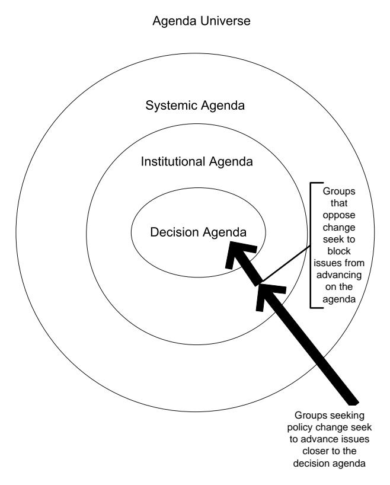

<!-- A2.R21 | source: papers_json/A2.R21/ -->

## Handbook of Public Policy Analysis

Theory, Politics, and Methods

Edited by
Frank Fischer
Gerald J. Miller
Mara S. Sidney

<!-- page 2 -->

## **Handbook of** **Public Policy** **Analysis**

**Theory, Politics, ** **and Methods**

<!-- page 3 -->

## **PUBLIC ADMINISTRATION AND PUBLIC POLICY**

## **A Comprehensive Publication Program**

## *Executive Editor*

## **JACK RABIN**

أستاذ الإدارة العامة والسياسة العامة، كلية الشؤون العامة، The Capital College، جامعة Pennsylvania State University—Harrisburg، Middletown، Pennsylvania

*Assistant to the Executive Editor* **T. Aaron Wachhaus, Jr.**

- 1. Public Administration as a Developing Discipline, Robert T. Golembiewski
- 2. Comparative National Policies on Health Care, Milton I. Roemer, M.D.
- 3. Exclusionary Injustice: The Problem of Illegally Obtained Evidence, Steven R. Schlesinger
- 5. Organization Development in Public Administration, edited by Robert T. Golembiewski and William B. Eddy
- 7. Approaches to Planned Change, Robert T. Golembiewski
- 8. Program Evaluation at HEW, edited by James G. Abert
- 9. The States and the Metropolis, Patricia S. Florestano and Vincent L. Marando
- 11. Changing Bureaucracies: Understanding the Organization before Selecting the Approach, William A. Medina
- 12. Handbook on Public Budgeting and Financial Management, edited by Jack Rabin and Thomas D. Lynch
- 15. Handbook on Public Personnel Administration and Labor Relations, edited by Jack Rabin, Thomas Vocino, W. Bartley Hildreth, and Gerald J. Miller
- 19. Handbook of Organization Management, edited by William B. Eddy
- 22. Politics and Administration: Woodrow Wilson and American Public Administration, edited by Jack Rabin and James S. Bowman
- 23. Making and Managing Policy: Formulation, Analysis, Evaluation, edited by G. Ronald Gilbert
- 25. Decision Making in the Public Sector, edited by Lloyd G. Nigro
- 26. Managing Administration, edited by Jack Rabin, Samuel Humes, and Brian S. Morgan
- 27. Public Personnel Update, edited by Michael Cohen and Robert T. Golembiewski
- 28. State and Local Government Administration, edited by Jack Rabin and Don Dodd
- 29. Public Administration: A Bibliographic Guide to the Literature, Howard E. McCurdy
- 31. Handbook of Information Resource Management, edited by Jack Rabin and Edward M. Jackowski
- 32. Public Administration in Developed Democracies: A Comparative Study, edited by Donald C. Rowat
- 33. The Politics of Terrorism: Third Edition, edited by Michael Stohl

<!-- page 4 -->

- 34. Handbook on Human Services Administration, edited by Jack Rabin and Marcia B. Steinhauer
- 36. Ethics for Bureaucrats: An Essay on Law and Values, Second Edition, John A. Rohr
- 37. The Guide to the Foundations of Public Administration, Daniel W. Martin
- 39. Terrorism and Emergency Management: Policy and Administration, William L. Waugh, Jr.
- 40. Organizational Behavior and Public Management: Second Edition, Michael L. Vasu, Debra W. Stewart, and G. David Garson
- 43. Government Financial Management Theory, Gerald J. Miller
- 46. Handbook of Public Budgeting, edited by Jack Rabin
- 49. Handbook of Court Administration and Management, edited by Steven W. Hays and Cole Blease Graham, Jr.
- 50. Handbook of Comparative Public Budgeting and Financial Management, edited by Thomas D. Lynch and Lawrence L. Martin
- 53. Encyclopedia of Policy Studies: Second Edition, edited by Stuart S. Nagel
- 54. Handbook of Regulation and Administrative Law, edited by David H. Rosenbloom and Richard D. Schwartz
- 55. Handbook of Bureaucracy, edited by Ali Farazmand
- 56. Handbook of Public Sector Labor Relations, edited by Jack Rabin, Thomas Vocino, W. Bartley Hildreth, and Gerald J. Miller
- 57. Practical Public Management, Robert T. Golembiewski
- 58. Handbook of Public Personnel Administration, edited by Jack Rabin, Thomas Vocino, W. Bartley Hildreth, and Gerald J. Miller
- 60. Handbook of Debt Management, edited by Gerald J. Miller
- 61. Public Administration and Law: Second Edition, David H. Rosenbloom and Rosemary O'Leary
- 62. Handbook of Local Government Administration, edited by John J. Gargan
- 63. Handbook of Administrative Communication, edited by James L. Garnett and Alexander Kouzmin
- 64. Public Budgeting and Finance: Fourth Edition, edited by Robert T. Golembiewski and Jack Rabin
- 67. Handbook of Public Finance, edited by Fred Thompson and Mark T. Green
- 68. Organizational Behavior and Public Management: Third Edition, Michael L. Vasu, Debra W. Stewart, and G. David Garson
- 69. Handbook of Economic Development, edited by Kuotsai Tom Liou
- 70. Handbook of Health Administration and Policy, edited by Anne Osborne Kilpatrick and James A. Johnson
- 71. Handbook of Research Methods in Public Administration, edited by Gerald J. Miller and Marcia L. Whicker
- 72. Handbook on Taxation, edited by W. Bartley Hildreth and James A. Richardson
- 73. Handbook of Comparative Public Administration in the Asia-Pacific Basin, edited by Hoi-kwok Wong and Hon S. Chan
- 74. Handbook of Global Environmental Policy and Administration, edited by Dennis L. Soden and Brent S. Steel
- 75. Handbook of State Government Administration, edited by John J. Gargan
- 76. Handbook of Global Legal Policy, edited by Stuart S. Nagel
- 78. Handbook of Global Economic Policy, edited by Stuart S. Nagel
- 79. Handbook of Strategic Management: Second Edition, edited by Jack Rabin, Gerald J. Miller, and W. Bartley Hildreth
- 80. Handbook of Global International Policy, edited by Stuart S. Nagel

<!-- page 5 -->

- 81. Handbook of Organizational Consultation: Second Edition, edited by Robert T. Golembiewski
- 82. Handbook of Global Political Policy, edited by Stuart S. Nagel
- 83. Handbook of Global Technology Policy, edited by Stuart S. Nagel
- 84. Handbook of Criminal Justice Administration, edited by M. A. DuPont-Morales, Michael K. Hooper, and Judy H. Schmidt
- 85. Labor Relations in the Public Sector: Third Edition, edited by Richard C. Kearney
- 86. Handbook of Administrative Ethics: Second Edition, edited by Terry L. Cooper
- 87. Handbook of Organizational Behavior: Second Edition, edited by Robert T. Golembiewski
- 88. Handbook of Global Social Policy, edited by Stuart S. Nagel and Amy Robb
- 89. Public Administration: A Comparative Perspective, Sixth Edition, Ferrel Heady
- 90. Handbook of Public Quality Management, edited by Ronald J. Stupak and Peter M. Leitner
- 91. Handbook of Public Management Practice and Reform, edited by Kuotsai Tom Liou
- 92. Personnel Management in Government: Politics and Process, Fifth Edition, Jay M. Shafritz, Norma M. Riccucci, David H. Rosenbloom, Katherine C. Naff, and Albert C. Hyde
- 93. Handbook of Crisis and Emergency Management, edited by Ali Farazmand
- 94. Handbook of Comparative and Development Public Administration: Second Edition, edited by Ali Farazmand
- 95. Financial Planning and Management in Public Organizations, Alan Walter Steiss and Emeka O. Cyprian Nwagwu
- 96. Handbook of International Health Care Systems, edited by Khi V. Thai, Edward T. Wimberley, and Sharon M. McManus
- 97. Handbook of Monetary Policy, edited by Jack Rabin and Glenn L. Stevens
- 98. Handbook of Fiscal Policy, edited by Jack Rabin and Glenn L. Stevens
- 99. Public Administration: An Interdisciplinary Critical Analysis, edited by Eran Vigoda
- 100. Ironies in Organizational Development: Second Edition, Revised and Expanded, edited by Robert T. Golembiewski
- 101. Science and Technology of Terrorism and Counterterrorism, edited by Tushar K. Ghosh, Mark A. Prelas, Dabir S. Viswanath, and Sudarshan K. Loyalka
- 102. Strategic Management for Public and Nonprofit Organizations, Alan Walter Steiss
- 103. Case Studies in Public Budgeting and Financial Management: Second Edition, edited by Aman Khan and W. Bartley Hildreth
- 104. Handbook of Conflict Management, edited by William J. Pammer, Jr. and Jerri Killian
- 105. Chaos Organization and Disaster Management, Alan Kirschenbaum
- 106. Handbook of Gay, Lesbian, Bisexual, and Transgender Administration and Policy, edited by Wallace Swan
- 107. Public Productivity Handbook: Second Edition, edited by Marc Holzer
- 108. Handbook of Developmental Policy Studies, edited by Gedeon M. Mudacumura, Desta Mebratu and M. Shamsul Haque
- 109. Bioterrorism in Medical and Healthcare Administration, Laure Paquette
- 110. International Public Policy and Management: Policy Learning Beyond Regional, Cultural, and Political Boundaries, edited by David Levi-Faur and Eran Vigoda-Gadot
- 111. Handbook of Public Information Systems, Second Edition, edited by G. David Garson
- 112. Handbook of Public Sector Economics, edited by Donijo Robbins

<!-- page 6 -->

- 113. Handbook of Public Administration and Policy in the European Union, edited by M. Peter van der Hoek
- 114. Nonproliferation Issues for Weapons of Mass Destruction, Mark A. Prelas and Michael S. Peck
- 115. Common Ground, Common Future: Moral Agency in Public Administration, Professions, and Citizenship, Charles Garofalo and Dean Geuras
- 116. Handbook of Organization Theory and Management: The Philosophical Approach, Second Edition, edited by Thomas D. Lynch and Peter L. Cruise
- 117. International Development Governance, edited by Ahmed Shafiqul Huque and Habib Zafarullah
- 118. Sustainable Development Policy and Administration, edited by Gedeon M. Mudacumura, Desta Mebratu, and M. Shamsul Haque
- 119. Public Financial Management, edited by Howard A. Frank
- 120. Handbook of Juvenile Justice: Theory and Practice, edited by Barbara Sims and Pamela Preston
- 121. Emerging Infectious Diseases and the Threat to Occupational Health in the U.S. and Canada, edited by William Charney
- 122. Handbook of Technology Management in Public Administration, edited by David Greisler and Ronald J. Stupak
- 123. Handbook of Decision Making, edited by Göktu˘g Morçöl
- 124. Handbook of Public Administration, Third Edition, edited by Jack Rabin, W. Bartley Hildreth, and Gerald J. Miller
- 125. Handbook of Public Policy Analysis: Theory, Politics, and Methods, edited by Frank Fischer, Gerald J. Miller, and Mara S. Sidney
- 126. Elements of Effective Governance: Measurement, Accountability and Participation, Kathe Callahan

*Available Electronically*

Principles and Practices of Public Administration, edited by Jack Rabin, Robert F. Munzenrider, and Sherrie M. Bartell

<!-- page 7 -->

<!-- page 8 -->

## **Handbook of** **Public Policy** **Analysis**

## **Theory, Politics, ** **and Methods**

## **Edited by**

## **Frank Fischer**

*Rutgers University* *Newark, New Jersey, U.S.A.*

## **Gerald J. Miller**

*Rutgers University* *Newark, New Jersey, U.S.A.*

## **Mara S. Sidney**

*Rutgers University* *Newark, New Jersey, U.S.A.*

CRC Press هي دار نشر تابعة لمجموعة Taylor & Francis Group، وهي شركة إعلامية.

<!-- page 9 -->

CRC Press، Taylor & Francis Group، 6000 Broken Sound Parkway NW، Suite 300، Boca Raton، FL 33487-2742

© 2007 بواسطة Taylor & Francis Group, LLC. دار CRC Press هي دار نشر تابعة لمجموعة Taylor & Francis Group، وهي شركة إعلامية.

لا مطالبة بحقوق الأعمال الحكومية الأمريكية الأصلية. طُبع في الولايات المتحدة الأمريكية على ورق خالٍ من الأحماض. 10 9 8 7 6 5 4 3 2 1

الرقم الدولي المعياري للكتاب-10: 1-57444-561-8 (غلاف مقوى). الرقم الدولي المعياري للكتاب-13: 978-1-57444-561-9 (غلاف مقوى).

يحتوي هذا الكتاب على معلومات مستمدة من مصادر موثوقة ومعتمدة. تم اقتباس المواد المعاد طبعها بإذن، مع الإشارة إلى مصادرها. وردت في الكتاب مجموعة واسعة من المراجع. بُذلت جهود معقولة لنشر بيانات ومعلومات موثوقة، لكن المؤلف والناشر لا يتحملان مسؤولية صحة جميع المواد أو نتائج استخدامها.

لا يجوز إعادة طبع أي جزء من هذا الكتاب أو استنساخه أو نقله أو استخدامه بأي شكل، سواء بوسائل إلكترونية أو ميكانيكية أو غيرها، معروفة حاليًا أو تُستحدث لاحقًا، بما في ذلك النسخ الضوئي والتصوير المصغر والتسجيل، أو في أي نظام لتخزين المعلومات واسترجاعها، دون إذن كتابي من الناشرين.

للحصول على إذن بالنسخ الضوئي أو الاستخدام الإلكتروني لمواد من هذا العمل، يُرجى زيارة www.copyright.com (http://www.copyright.com/) أو الاتصال بـ Copyright Clearance Center, Inc. (CCC)، 222 Rosewood Drive، Danvers، MA 01923، 978-750-8400. مركز CCC هو منظمة غير ربحية تمنح التراخيص والتسجيل لمجموعة متنوعة من المستخدمين. أما بالنسبة للمؤسسات التي حصلت على ترخيص نسخ ضوئي من CCC، فقد تم ترتيب نظام دفع منفصل لها.

**إشعار العلامة التجارية:** قد تكون أسماء المنتجات أو الشركات علامات تجارية أو علامات تجارية مسجلة، وتُستخدم فقط لأغراض التعريف والتوضيح دون أي نية للتعدي عليها.

## **بيانات فهرسة مكتبة الكونغرس أثناء النشر**

Handbook of public policy analysis: theory, politics, and methods / edited by Frank Fischer, Gerald J. Miller, and Mara S. Sidney.

p. cm. -- (Public administration and public policy ; 125)

يتضمن مراجع ببليوغرافية وفهرسًا.

ISBN-13: 978-1-57444-561-9 (alk. paper)

ISBN-10: 1-57444-561-8 (alk. paper)

1. علوم السياسات--أدلة، كتيبات، إلخ. 2. الإدارة العامة--أدلة، كتيبات، إلخ. I. Fischer, Frank, 1942- II. Miller, Gerald. III. Sidney, Mara S., 1964- IV. Title. V. Series.

H97.H3583 2007

352.3'4--dc22 2006031906

**قم بزيارة موقع Taylor & Francis على** **http://www.taylorandfrancis.com**

**وموقع CRC Press على** **http://www.crcpress.com**

<!-- page 10 -->

## المساهمون

**Clinton J. Andrews** أستاذ مشارك في كلية Edward J. Bloustein للتخطيط والسياسة العامة بجامعة Rutgers University، ومدير برنامج التخطيط الحضري. نشر أبحاثًا واسعة في مجال إدارة الطاقة والبيئة والسياسات، وأحدث كتبه هو *Humble Analysis*.

**Thomas A. Birkland** يدير مركز أبحاث السياسات في جامعة State University of New York at Albany، حيث يعمل أيضًا أستاذًا. هو مؤلف كتاب *After Disaster: Agenda Setting, Public Policy, and Focusing Events.*

**Susan E. Clarke** أستاذة العلوم السياسية بجامعة University of Colorado at Boulder. تُدرّس حلقة دراسية عليا حول مناهج البحث الحساسة للسياق. وهي محررة في مجلة *Urban Affairs Review*. أحدث كتبها هو *The Work of Cities* (بالاشتراك مع Gary Gaile).

**Caroline Danielson** محللة سياسات في معهد Public Policy Institute of California، في San Francisco. حصلت على الدكتوراه في العلوم السياسية من جامعة University of Michigan، Ann Arbor.

**Peter deLeon** حصل على الدكتوراه من Rand Graduate School. الدكتور deLeon مؤلف كتاب *Democracy and the Policy Sciences* وكذلك *Advice and Consent.*

**Tansu Demir**، حاصل على الدكتوراه، أستاذ مساعد في قسم الإدارة العامة بجامعة University of Central Florida. حصل على الدكتوراه في الإدارة العامة من جامعة Florida Atlantic University عام 2005.

**Frank Fischer** أستاذ العلوم السياسية وعضو هيئة التدريس في كلية Edward J. Bloustein للتخطيط والسياسة العامة بجامعة Rutgers University. من منشوراته الحديثة *Reframing Public Policy: Discursive Politics and Deliberative Practice،* و*Citizens, Experts, and the Environment: The Politics of Local Knowledge.*

**John Forester** أستاذ التخطيط الحضري والإقليمي بجامعة Cornell University. من أشهر أعماله *The Deliberative Practitioner*، و*Planning in the Face of Power* (University of California Press، 1989)، و*The Argumentative Turn in Policy Analysis and Planning* (بالاشتراك مع Frank Fischer).

**Jan-Eric Furubo**، مقيّم عمل في المكتب الوطني للتدقيق (National Audit Office) في السويد، وهو مؤلف للعديد من المقالات والمنشورات في مجال صنع القرار، وشارك في تحرير *International Atlas of Evaluation* (2002). وهو رئيس الجمعية السويدية للتقييم (Swedish Evaluation Society).

**Yaakov Garb** محاضر في معهد Jacob Blaustein Institutes for Desert Research بجامعة Ben-Gurion University of the Negev، وأستاذ مساعد زائر في برنامج Global Environmental Program بمعهد Watson Institute for International Studies، جامعة Brown University. عمل على مجموعة من القضايا البيئية والحضرية دوليًا، مستندًا غالبًا إلى منظورات من دراسات العلم والتكنولوجيا (Science and Technology Studies، STS). أنجز مؤخرًا مقالات حول "بناء الحتمية" في المشاريع الكبرى، وتغيّر أنماط السفر بالتجزئة في وسط أوروبا، وسياسات التنقل في إسرائيل وفلسطين.

<!-- page 11 -->

**x** Contributors

**Herbert Gottweis** مدير قسم العلوم السياسية بجامعة University of Vienna. من منشوراته *Governing Molecules: The Discursive Politics of Genetic Engineering in Europe and in the United States*.

**Steven Griggs** محاضر في السياسة العامة بمعهد Institute of Local Government Studies بجامعة University of Birmingham في المملكة المتحدة. يركز بحثه الحالي على خطابات حملات الاحتجاج المجتمعي ضد توسيع المطارات في المملكة المتحدة.

**John Grin** أستاذ علوم السياسات بقسم العلوم السياسية بجامعة University of Amsterdam. وهو أيضًا مدير Amsterdam School for Social Science Research، ومدير مشارك لشبكة Dutch Knowledge Network on System Innovations، وهو برنامج بحثي حول التحولات الجذرية نحو مجتمع مستدام.

**Hubert Heinelt** أستاذ الإدارة العامة والسياسة العامة والبحوث الحضرية والإقليمية بجامعة Darmstadt University of Technology. وهو عضو في اللجنة التنفيذية لجمعية European Urban Research Association، ومجموعة Standing Group on Urban Research التابعة لجمعية العلوم السياسية الألمانية.

**Robert Hoppe** أستاذ في كلية إدارة الأعمال والإدارة العامة والتكنولوجيا (BBT) بجامعة University of Twente، هولندا. يرأس قسم السياسة والمعرفة، ورئيس تحرير مجلة *Beleidswetenschap*. تتركز اهتماماته البحثية في مناهج تحليل السياسات وحدود العلم والسياسة.

**Helen Ingram** حاملة كرسي Warmington Endowed Chair للإيكولوجيا الاجتماعية بجامعة University of California at Irvine. لديها تعيينات مشتركة في أقسام التخطيط والسياسة والتصميم، والعلوم السياسية، والجريمة والقانون والمجتمع.

**Werner Jann** يشغل كرسي العلوم السياسية والإدارة والتنظيم بجامعة University of Potsdam، ألمانيا. كان أستاذًا مشاركًا في Postgraduate School of Administrative Sciences Speyer، وزميل باحث في جامعة University of California، Berkeley.

**Patrick Kenis** أستاذ بجامعة Tilburg University، هولندا، حيث يرأس أيضًا قسم دراسات التنظيم. حصل على الدكتوراه في العلوم الاجتماعية والسياسية من معهد European University Institute في فلورنسا، إيطاليا.

**David Laws** كبير باحثين ومحاضر في قسم الدراسات الحضرية والتخطيط بمعهد Massachusetts Institute of Technology. من منشوراته الحديثة *Reframing Regulation: Changing Forms of Law and Practice in U.S. Environmental Policy*، و*The Practice of Innovation: Institutions, Policy, and Technology Development.*

**Anne Loeber** باحثة ما بعد الدكتوراه ومحاضرة في السياسة العامة بقسم العلوم السياسية بجامعة University of Amsterdam، هولندا. وهي أيضًا عضو في لجنة توجيه تقييم التكنولوجيا، وهي هيئة استشارية مستقلة لوزارة الزراعة والطبيعة والثروة السمكية الهولندية.

**Martin Lodge** محاضر في العلوم السياسية والسياسة العامة بقسم الحكومة ومركز ESRC Centre for Analysis of Risk and Regulation، London School of Economics and Political Science. تتركز اهتماماته البحثية الرئيسية في الحكومة التنفيذية المقارنة، وخاصة في مجال التنظيم.

<!-- page 12 -->

**xi** Contributors

**Miriam Manon** خريجة كلية Commonwealth Honors College بجامعة University of Massachusetts, Amherst، حيث حصلت على بكالوريوس متعدد التخصصات في العدالة الاجتماعية والبيئة. أكملت فصلًا دراسيًا في معهد Arava Institute for Environmental Studies في إسرائيل، وتخطط لمواصلة دراستها في تقاطع القضايا البيئية والاجتماعية.

**Kuldeep Mathur** تقاعد مؤخرًا من منصب المدير الأكاديمي في مركز دراسات القانون والحوكمة، وأستاذ في مركز الدراسات السياسية بجامعة Jawaharal Nehru University (JNU)، نيودلهي، الهند. كان سابقًا نائبًا لرئيس JNU ومديرًا للمعهد الوطني الهندي للتخطيط والإدارة التعليمية.

**Navdeep Mathur** زميل باحث في معهد Institute of Local Government Studies، كلية السياسة العامة، جامعة University of Birmingham، المملكة المتحدة. وهو أيضًا محرر المنتديات في مجلة *Journal of Critical Policy Analysis.*

**Igor Mayer** أستاذ مشارك في كلية التكنولوجيا والسياسة والإدارة بجامعة Delft University of Technology، هولندا. وهو أيضًا مدير مركز Delft-Rotterdam Centre for Process Management and Simulation.

**Gerald J. Miller** أستاذ الإدارة العامة بجامعة Rutgers University، حيث يُدرّس الميزانية الحكومية وغير الربحية والإدارة المالية. نشر العديد من الكتب والمقالات البحثية، منها *The Handbook of Debt Management* و*Government Financial Management Theory.*

**Hugh T. Miller** أستاذ الإدارة العامة ومدير كلية Public Administration بجامعة Florida Atlantic University. من أحدث كتبه *Postmodern Public Administration: Revised Edition*، بالاشتراك مع الراحل Charles J. Fox، و*Tampering with Tradition: The Unrealized Authority of Democratic Agency*، بالاشتراك مع Peter Bogason وSandra Kensen.

**Jerry Mitchell** أستاذ الشؤون العامة بكلية Baruch College، جامعة City University of New York. مؤلف كتاب جديد نشرته دار SUNY Press بعنوان *The Business of BIDS*.

**Changhwan Mo** زميل باحث حاليًا في معهد Korea Transport Institute، وكان مستشارًا في مجموعة الإصلاح التنظيمي بمكتب رئيس الوزراء في كوريا الجنوبية. مؤلف أو مشارك في تأليف عدة مقالات في مجالات السياسة العامة والميزانية والعولمة.

**Wayne Parsons** أستاذ السياسة العامة بجامعة Queen Mary, University of London. من منشوراته *The Political Economy of British Regional Policy*؛ *The Power of the Financial Press: Keynes and the Quest for a Moral Science*، و*Public Policy*، وهو محرر سلسلة New Horizons in Public Policy لدار Edward Elgar.

**Deike Peters** زميلة حاليًا لمؤسسة German Research Foundation (DFG) في مركز Center for Metropolitan Studies بجامعة Technical University in Berlin. حصلت على الدكتوراه في التخطيط وتطوير السياسات من جامعة Rutgers University، وعلى درجتي ماجستير في التخطيط الحضري والشؤون الدولية من جامعة Columbia University.

**Helga Pülzl** باحثة ما بعد الدكتوراه حاليًا بقسم الاقتصاد والعلوم الاجتماعية بجامعة University of Natural Resources and Applied Life Sciences، فيينا (BOKU). كما تعمل محاضرة في السياسة المقارنة بقسم العلوم السياسية بجامعة University of Vienna.

<!-- page 13 -->

**xii** Contributors

**Jörg Raab** أستاذ مساعد في دراسات السياسة والتنظيم بجامعة Tilburg University، هولندا. يركز بحثه أساسًا على آليات الحوكمة في الدولة والاقتصاد والمجتمع وعلى موضوعات مختلفة في نظرية التنظيم مع التركيز على الشبكات بين المنظمات.

**Bernard Reber** زميل باحث في الفلسفة الأخلاقية والسياسية بمركز CNRS-University Paris V. درّس أيضًا في l'Ecole Nationale Supérieure des Mines de Paris، Sorbonne. شارك في تحرير *Pluralisme moral, juridique et politique* و*Les sciences humaines et sociales à l'heure des TIC*.

**Donijo Robbins** أستاذة مشاركة بكلية Public & Nonprofit Administration بجامعة Grand Valley State University في Grand Rapids، Michigan، حيث تُدرّس مقررات دراسات عليا وجامعية في الميزانية العامة والإدارة المالية ومناهج البحث. حصلت على الدكتوراه في الإدارة العامة من جامعة Rutgers University.

**Paul A. Sabatier** أستاذ بقسم البيئة والسياسة بجامعة University of California، Davis. نشر كتاب *Theories of the Policy Process.*

**Alan R. Sadovnik** أستاذ التربية والشؤون العامة والإدارة وعلم الاجتماع بجامعة Rutgers University. من منشوراته *Equity and Excellence in Higher Education*؛ *Exploring Education: An Introduction to the Foundations of Education*؛ و*Knowledge and Pedagogy: The Sociology of Basil Bernstein*.

**Thomas Saretzki** أستاذ السياسة والسياسات البيئية بمركز دراسة الديمقراطية بجامعة University of Lueneburg (ألمانيا). وهو حاليًا باحث زائر بجامعة Northwestern University في Evanston، إلينوي.

**Anne Larason Schneider** أستاذة بكلية العدالة وقسم العلوم السياسية بجامعة Arizona State University، Tempe. شاركت في تحرير (مع Helen Ingram) كتاب *Deserving and Entitled* وشاركت في تأليف (أيضًا مع Helen Ingram) كتاب *Policy Design for Democracy* (University Press of Kansas، 1997).

**Mary Segers** أستاذة العلوم السياسية بجامعة Rutgers University. من كتبها *A Wall of Separation? Debating the Role of Religion in American Public Life* (1998) و*Abortion Politics In American States* (1995، بالاشتراك في التحرير مع Timothy Byrnes).

**Mara S. Sidney** أستاذة مشاركة في العلوم السياسية بجامعة Rutgers University، Newark. مؤلفة كتاب *Unfair Housing: How National Policy Shapes Local Action.*

**Diane Stone** حاملة كرسي Marie Curie في مركز دراسات السياسة بجامعة Central European University في بودابست، وقارئة في السياسة والدراسات الدولية بجامعة University of Warwick. من كتبها *Global Knowledge Networks and International Development* (مع Simon Maxwell). تشارك في تحرير مجلة *Global Governance.*

**Eileen Sullivan** محاضرة في العلوم السياسية بجامعة Rutgers University. عملت مديرة أبحاث في إدارة التوظيف بمدينة نيويورك، ومكتب المساءلة الحكومية الأمريكي (GAO)، ومعهد Vera Institute of Justice؛ كما عملت مستشارة بحثية لشركة New York City Economic Development Corporation.

**Douglas Torgerson** أستاذ السياسة بجامعة Trent University في كندا. كان محررًا سابقًا لمجلة *Policy Sciences*، ومن منشوراته عدة دراسات نقدية حول نظرية وتاريخ هذا المجال.

<!-- page 14 -->

**xiii** Contributors

**Oliver Treib** أستاذ مساعد بقسم العلوم السياسية، معهد الدراسات المتقدمة، فيينا. تشمل مواضيع بحثه سياسة الاتحاد الأوروبي الاجتماعية، وأنماط الحوكمة الجديدة، وبنى الانقسام السياسي في السياسة الدولية.

**Michel J.G. van Eeten** أستاذ مشارك بكلية التكنولوجيا والسياسة والإدارة، جامعة Delft University of Technology، هولندا. وهو أيضًا فائز بجائزة Raymond Vernon من جمعية Association for Public Policy Analysis and Management، ومؤلف (مع Emery Roe) كتاب *Ecology, Engineering, and Management.*

**Danielle M. Vogenbeck**، حاصلة على الدكتوراه في الشؤون العامة من جامعة University of Colorado at Denver، عالمة سلوكية مشاركة في مؤسسة RAND، حيث تتخصص في تطبيق تحليل الشبكات الاجتماعية على التغيير التنظيمي وحوكمة الشبكات ومشاريع تنمية المجتمع.

**Hendrik Wagenaar** أستاذ السياسة العامة بقسم الإدارة العامة بجامعة Leiden University. مؤلف كتاب *Government Institutions* (Kluwer) وشارك في تحرير (مع M. A. Hajer) كتاب *Deliberative Policy Analysis* (Cambridge University Press).

**Peter Wagner** أستاذ النظرية الاجتماعية والسياسية بمعهد European University Institute في فلورنسا، إيطاليا، وأستاذ علم الاجتماع بجامعة University of Warwick، المملكة المتحدة. من كتبه الحديثة *Varieties of World-Making: Beyond Globalization* (بالاشتراك في التحرير مع Nathalie Karagiannis، 2006) و*A History and Theory of the Social Sciences.*

**Christopher M. Weible** أستاذ مساعد بكلية السياسة العامة، معهد Georgia Institute of Technology في أتلانتا. تتركز اهتماماته البحثية على عمليات السياسات والسياسة البيئية، ونُشرت أعماله في مجلات *Policy Studies Journal*، و*Political Research Quarterly*، و*Journal of Public Administration Research and Theory*.

**Kai Wegrich** محلل سياسات أول في RAND Europe. حصل على الدكتوراه من جامعة Potsdam University. تشمل اهتماماته الخاصة إصلاح القطاع العام وتنظيمه.

**Hellmut Wollmann** أستاذ (متقاعد) السياسة العامة والإدارة العامة بمعهد العلوم الاجتماعية بجامعة Humboldt University، برلين، ألمانيا. كان مؤسسًا مشاركًا ورئيسًا (1998/1999) لجمعية European Evaluation Society. حرر كتاب *Evaluation in Public Sector Reform* (2003، مع V. Hoffmann-Martinot)، و*Comparing Public Sector Reform in France and Germany* (2006)، و*The Comparative Study of Local Government and Politics* (2006، مع H. Baldersheim).

**Kaifeng Yang** أستاذ مساعد في الإدارة العامة بكلية Askew School of Public Administration and Policy، جامعة Florida State University. وهو باحث مشارك في المركز الوطني للإنتاجية العامة بجامعة Rutgers University، ومركز DeVoe Moore للتنمية الاقتصادية بجامعة Florida State University.

**Dvora Yanow** تشغل كرسي Strategic Chair in Meaning and Method بجامعة Vrije Universiteit، أمستردام. مؤلفة كتب *How Does a Policy Mean؟*؛ *Conducting Interpretive Policy Analysis*؛ *Constructing American "Race" and "Ethnicitiy"* وشاركت في تحرير *Knowing in Organizations* و*Interpretation and Method: Empirical Research Methods and the Interpretive Turn*.

<!-- page 15 -->

<!-- page 16 -->

## Contents

Introductionxix**Part I**
***Historical Perspectives*****Chapter 1**The Policy Sciences at the Crossroads
*Peter deLeon and Danielle M. Vogenbeck*3**Chapter 2**Promoting the Policy Orientation: Lasswell in Context
*Douglas Torgerson*15**Chapter 3**Public Policy, Social Science, and the State: An Historical Perspective
*Peter Wagner*29**Part II**
***Policy Processes*****Chapter 4**Theories of the Policy Cycle
*Werner Jann and Kai Wegrich*43**Chapter 5**Agenda Setting in Public Policy
*Thomas A. Birkland*63**Chapter 6**Policy Formulation: Design and Tools
*Mara S. Sidney*79**Chapter 7**Implementing Public Policy
*Helga Pülzl and Oliver Treib*89**Chapter 8**Do Policies Determine Politics?
*Hubert Heinelt*109**Part III**
***Policy Politics, Advocacy, and Expertise*****Chapter 9**A Guide to the Advocacy Coalition Framework
*Christopher M. Weible and Paul A. Sabatier*123**Chapter 10**Policy Communities
*Hugh T. Miller and Tansu Demir*137**Chapter 11**Public Policy Analysis and Think Tanks
*Diane Stone*149Part IVPolicy Decision Making: Rationality, Networks, and LearningChapter 12 Rationality in Policy Decision Making161
Clinton J. AndrewsChapter 13 Rational Choice in Public Policy: The Theory in Critical Perspective173
Steven GriggsChapter 14 Taking Stock of Policy Networks: Do They Matter?187
Jörg Raab and Patrick KenisChapter 15 Theories of Policy Learning: Agency, Structure, and Change201
John Grin and Anne LoeberPart VDeliberative Policy Analysis: Argumentation, Rhetoric, and NarrativesChapter 16 Deliberative Policy Analysis as Practical Reason: Integrating Empirical
and Normative Arguments223
Frank FischerChapter 17 Rhetoric in Policy Making: Between Logos, Ethos, and Pathos237
Herbert GottweisChapter 18 Narrative Policy Analysis251
Michel M.J. van EetenPart VIComparative, Cultural, and Ethical PerspectivesChapter 19 Comparative Public Policy273
Martin LodgeChapter 20 Applied Cultural Theory: Tool for Policy Analysis289
Robert HoppeChapter 21 Ethical Issues and Public Policy309
Eileen Sullivan and Mary SegersChapter 22 Public Policy and Democratic Citizenship: What Kinds of Citizenship
Does Policy Promote?329
Anne Larason Schneider and Helen IngramPart VIIQuantitatively Oriented Policy MethodsChapter 23 Quantitative Methods for Policy Analysis349
Kaifeng YangChapter 24 The Use (and Misuse) of Surveys Research in Policy Analysis369
Jerry MitchellChapter 25 Social Experiments and Public Policy381
Caroline DanielsonChapter 26 Policy Evaluation and Evaluation Research393
Hellmut WollmannPart VIIIQualitative Policy Analysis: Interpretation, Meaning, and ContentChapter 27 Qualitative-Interpretive Methods in Policy Research405
Dvora YanowChapter 28 Qualitative Research and Public Policy417
Alan R. SadovnikChapter 29 Interpretation and Intention in Policy Analysis429
Henk WagenaarChapter 30 Context-Sensitive Policy Methods443
Susan E. ClarkePart IXPolicy Decisions TechniquesChapter 31 Cost-Benefit Analysis465
Gerald J. Miller and Donijo RobbinsChapter 32 Environmental Impact Assessment: Between Bureaucratic Process
and Social Learning481
Yaakov Garb, Miriam Manon, and Deike PetersChapter 33 Technology Assessment as Policy Analysis: From Expert Advice493
to Participatory Approaches
Bernard ReberChapter 34 Public Policy Mediation: From Argument to Collaboration513
David Laws and John ForesterPart XCountry PerspectivesChapter 35 Policy Analysis in Britain537
Wayne ParsonsChapter 36 The Evolution of Policy Analysis in the Netherlands553
Igor MayerChapter 37 Policy Analysis and Evaluation in Sweden: Discovering the Limits
of the Rationalistic Paradigm
Jan-Eric Furubo57Chapter 38 The Policy Turn in German Political Science
Thomas Saretzki587Chapter 39 Policy Analysis in India: Research Bases and Discursive Practices
Navdeep Mathur and Kuldeep Mathur603Chapter 40 Korean Policy Analysis: From Economic Efficiency to Public Participation
Changhwan Mo617Index623

<!-- page 17 -->

**xvi** Contents

<!-- page 18 -->

**xvii** Contents

<!-- page 19 -->

**xviii** Contents

<!-- page 20 -->

## المقدمة

كانت دراسة السياسة العامة، بما فيها مناهج تحليل السياسات، من أسرع المجالات نموًا في العلوم الاجتماعية خلال العقود القليلة الماضية. نشأ تحليل السياسات لغرضين: فهم أفضل لعملية صنع السياسات، وتزويد صناع القرار بمعرفة موثوقة ذات صلة بالسياسات حول المشكلات الاقتصادية والاجتماعية الملحة. يُعرّف Dunn (1981, 35) تحليل السياسات بأنه "تخصص تطبيقي في العلوم الاجتماعية يستخدم مناهج بحث وحجج متعددة لإنتاج وتحويل معلومات ذات صلة بالسياسة يمكن استخدامها في السياقات السياسية لحل مشكلات السياسات."

بشكل عام، ظهر تطور تحليل السياسة العامة في البداية كظاهرة أمريكية. لاحقًا، تبنّت كندا وعدد متزايد من الدول الأوروبية هذا التخصص، وكانت هولندا وبريطانيا من الأمثلة المهمة بشكل خاص. علاوة على ذلك، بدأ عدد متزايد من الباحثين في أوروبا، لا سيما الباحثين الشباب، بالانتساب إلى تحليل السياسات. والواقع أن كثيرًا منهم قدّم إسهامات مهمة في تطور هذا المجال.

على الرغم من أن تقديم المشورة في مجال السياسات قديم قدم الحكومة نفسها، فإن التعقيد المتزايد للمجتمع الحديث يُكثّف بشكل كبير حاجة صناع القرار إلى المعلومات. تجمع قرارات السياسات بين المعرفة التقنية المتطورة والواقع الاجتماعي والسياسي المعقد، لكن تعريف السياسة العامة نفسها واجه مشكلات متعددة. فهم بعض الباحثين ببساطة أن السياسة هي كل ما تختار الحكومات فعله أو عدم فعله. بينما وضع آخرون تعريفات تركز على الخصائص المحددة للسياسة العامة. يُعرّف Lowi و Ginsburg (1996, 607)، على سبيل المثال، السياسة العامة بأنها "نية معلنة رسميًا مدعومة بجزاء، قد يكون مكافأة أو عقوبة." وكمسار عمل (أو امتناع عن عمل)، يمكن أن تتخذ السياسة العامة شكل "قانون، أو قاعدة، أو نظام أساسي، أو مرسوم، أو لائحة، أو أمر."

تُنسب أصول التركيز على السياسات عادةً إلى كتابات Harold Lasswell، الذي يُعد مؤسس علوم السياسات. تصوّر Lasswell مشروعًا متعدد التخصصات قادرًا على توجيه عمليات صنع القرار السياسي للمجتمعات الصناعية في مرحلة ما بعد الحرب العالمية الثانية (انظر Torgerson، الفصل 2). دعا إلى دراسة دور "المعرفة في عملية السياسة ومن أجلها". أشار المشروع إلى تخصص علمي اجتماعي شامل يهدف إلى تكييف الممارسات الديمقراطية مع واقع مجتمع تقني-صناعي ناشئ. صُمم هذا المجال ليتقاطع مع تخصصات متعددة، وكان من المفترض أن يشمل إسهامات من العلوم السياسية، وعلم الاجتماع، والأنثروبولوجيا، وعلم النفس، والإحصاء والرياضيات، وحتى العلوم الطبيعية والفيزيائية في بعض الحالات. وكان من المفترض أن يستخدم مناهج كمية ونوعية على حد سواء.

لكن مشروع التحليل السياساتي فشل إلى حد كبير في تبني رؤية Lasswell الجريئة، واتبع بدلًا من ذلك مسار تطور أضيق بكثير. اتخذ تحليل السياسات، كما هو معروف اليوم، توجهًا تجريبيًا موجهًا أكثر نحو الممارسات الإدارية منه إلى تيسير الحكم الديمقراطي بحد ذاته (انظر deLeon و Vogenbeck، الفصل 1). وعلى النقيض من منظور منهجي متعدد التخصصات، تشكّل هذا المجال بإطار منهجي أكثر تقييدًا مستمد من نظريات المعرفة الوضعية الجديدة/التجريبية التي سيطرت على العلوم الاجتماعية في ذلك الوقت. أدى هذا إلى التركيز على التحليل الكمي الصارم، والفصل الموضوعي بين الحقائق والقيم، والبحث عن نتائج قابلة للتعميم تكون صحتها مستقلة عن السياق الاجتماعي المحدد الذي استُخلصت منه. أي أن الإطار المحدود تحوّل إلى علم سياسات قادر على وضع قواعد قابلة للتعميم تنطبق على مجموعة من المشكلات والسياقات. وقد كان لهذا التوجه، إلى حد كبير، تأثير مهيمن من علم الاقتصاد ومناهجه العلمية الوضعية على تطور هذا المجال.

<!-- page 21 -->

**xx** Introduction

بشكل عام، حقق هذا التوجه السياساتي المعاصر نجاحًا كبيرًا. فتحليل السياسات لا يحتل مكانة بارزة في العلوم الاجتماعية فحسب، بل تنتشر ممارسته أيضًا في الحكومة والمنظمات السياسية الأخرى. فبالإضافة إلى الأوساط الأكاديمية، يعمل محللو السياسات باحثين في الوكالات الحكومية على جميع مستويات الحكومة، وفي مراكز الفكر المعنية بالسياسة العامة، ومؤسسات البحث، وشركات الاستشارات، وجمعيات جماعات المصالح، والمنظمات غير الحكومية. ويتزايد توظيفهم في أقسام الشؤون العامة بالشركات الكبرى لرصد السياسات الاقتصادية والتنظيمية ودراستها.

في الوقت نفسه، لم يخلُ هذا التخصص من المشكلات. فقد تعرّض للانتقاد مرارًا بسبب فشله في إنتاج قدر وافر من المعرفة الموجهة نحو المشكلات ذات الصلة المباشرة بعملية السياسات، أو ما وُصف بـ"المعرفة القابلة للاستخدام." ففي أواخر السبعينيات وأوائل الثمانينيات، أظهرت الدراسات أن البحث السياساتي التجريبي استُخدم بأقل مما كان متوقعًا بكثير. وأوضحت الأبحاث حول الاستفادة من نتائج السياسات أن نحو ثلث الإداريين فقط الذين تلقوا هذه المعلومات استطاعوا تحديد استخدام ملموس لها. ولخّص deLeon هذا الأمر بملاحظة ساخرة مفادها أن الاقتصادي المتخصص في تحليل التكلفة والعائد سيجد صعوبة في تفسير سبب بذل جهد كبير في نشاط بهذا القدر الضئيل من العائد.

هذا لا يعني أن البحث السياساتي كان بلا أثر، لكنه لم يكن دائمًا من النوع الذي سعى إلى تقديمه، أي المعرفة القابلة للتطبيق المباشر على حل المشكلات. وغالبًا ما كان الإسهام أقرب إلى وظيفة تنويرية ساعدت السياسيين وصناع القرار والجمهور على التفكير في القضايا العامة، دون حلّها بحد ذاتها. وفي ضوء هذه الصعوبات، سعى آخرون إلى اتجاهات جديدة. فبالنظر عن كثب إلى طبيعة المشكلات الاجتماعية وتبعاتها المعرفية على علم السياسات، شدد هؤلاء على الطابع المعياري والتفسيري المتأصل في مشكلات السياسات. ولاحظ هؤلاء الباحثون أن تحليل السياسات ونتائجها مشبعان بمشكلات معقدة تتعلق بالسياسة والقيم الاجتماعية، مما يتطلب من هذا المجال الانفتاح على طائفة من المناهج والقضايا الأخرى.

وقد أدى هذا إلى التحول نحو عمليات الجدل السياساتي والتحليل السياساتي التداولي. يتحدى هذا الموقف، المعروض في الجزء الرابع، التوجه الوضعي الجديد أو التجريبي الذي شكّل هذا المجال، ويقترح أنه لا يمكنه وحده إنتاج أنواع المعرفة اللازمة لصنع السياسات. والمطلوب هو تركيز معياري أكبر يجمع بين البحث التجريبي والبحث المعياري.

يتألف الكتاب من عشرة أجزاء. يتناول الجزء الأول، "المنظورات التاريخية"، الأصول الأساسية للمجال وتطوره. يقدّم الفصل الأول من ثلاثة فصول في هذا الجزء، بقلم Peter deLeon و Danielle Vogenbeck، استعراضًا لتطور هذا المجال - نجاحاته وإخفاقاته - ويشدد على القضايا السياسية والمنهجية التي شكّلت تطوره، ولا سيما توجهه نحو المشكلات، ومنظوره المتعدد التخصصات، والطابع المعياري لأبحاثه. وبناءً على هذه الاعتبارات، يقدمان اقتراحات لتطوير المجال مستقبلًا. يركز Douglas Torgerson بشكل أكثر تحديدًا على إسهام مؤسس هذا المجال، Harold Lasswell. فيرسم بتفصيل معقول منظور Lasswell المتعدد التخصصات، ومفهومه لـ"علوم سياسات الديمقراطية"، والحاجة إلى الانتباه لدور السياق الاجتماعي والسياسي في تحليل مشكلات السياسات وتطبيق أهداف السياسة في عالم الفعل على حد سواء. ويختتم Peter Wagner الجزء الأول بالتراجع خطوة أخرى لفحص تطور منظور السياسات من حيث تطور الدولة الحديثة وحاجاتها إلى المعرفة السياساتية. فيتتبع تطور المعرفة الاجتماعية من أجل تحسين الإنسان رجوعًا إلى عصر التنوير، ويناقش التقاليد النظرية المختلفة للتدخل السياسي، والحاجة إلى المعرفة التجريبية، والعلاقة الوثيقة بين هذه المعرفة والوظائف الإدارية للدولة الحديثة. ويختتم مقالته بتحليل لتزايد "الطابع العلمي" في صنع السياسة، وفي الحياة السياسية بشكل أعم، الذي رافق هذه التطورات.

يتناول الجزء الثاني من الكتاب، "عمليات السياسات"، مراحل عملية صنع السياسات. يبدأ Werner Jann و Kai Wegrich بالنظر في جدوى نموذج "مراحل السياسة" أو "نموذج الدورة" لعملية السياسة. ويرون، من قبيل المفارقة، أن هذا النموذج يتعرض للانتقاد المستمر لكنه يُستخدم بكثرة، مع ذلك، لتنظيم البحث.

<!-- page 22 -->

Introduction **xxi**

يرى المؤلفان أن معظم الباحثين تخلّوا عن الافتراضات الخاطئة المرتبطة بهذا النموذج، واستخدموه لتنظيم أدبيات متنوعة والإجابة عن أسئلة مهمة حول طبيعة عمليات السياسات. يتناول الفصل الثاني، بقلم Thomas Birkland، المرحلة الأولى من عملية السياسة، وهي تحديد الأجندة، أي العملية التي تكتسب فيها المشكلات والحلول البديلة الاهتمام أو تفقده. ويبحث في القدرة التفاضلية للجماعات على التحكم في الأجندة، والاستراتيجيات المستخدمة لجذب الانتباه إلى قضايا السياسة، ومجموعة القوى التي تسهم في دخول قضية إلى الأجندة أو خروجها منها. ويستعرض المناهج الشائعة لقياس وتتبع وضع قضية سياسية في الأجندة. تليه Mara Sidney بمناقشة للمناهج التطبيقية والأكاديمية لصياغة السياسات، مع التركيز على دور التصميم واختيار أدوات السياسة. وباعتبارها المرحلة في عملية السياسة التي يولّد فيها المشاركون حلولاً بديلة للتعامل مع القضايا التي وصلت إلى الأجندة، يسلّط البحث في صياغة السياسات الضوء على كيفية اتخاذ خيارات السياسة. ويظهر أن الأعمال الحديثة تُدخل معايير معيارية في تصاميم السياسات، وتوسّع لتشمل المنظمات غير الحكومية بوصفها مصممة سياسات بحد ذاتها، بما فيها مجتمعات الخبراء السياسيين ومراكز الفكر. ثم تستكشف Helga Pülzl وOliver Treib مرحلة تنفيذ عملية السياسة، مقارنين المناهج من أعلى إلى أسفل، ومن أسفل إلى أعلى، والمناهج الهجينة. ويقترحان أن التقييمات حتى الآن قد أغفلت قيمة هذه المناهج المختلفة. وتحقيقًا لذلك، يعرضان مجموعة من الرؤى التي يمكن استخلاصها منها. كما يحثّان باحثي تنفيذ السياسات على التركيز على مشكلات التنفيذ التي تواجه الاتحاد الأوروبي، نظرًا لمشكلاته متعددة الثقافات الفريدة، ويرون في هذا الصدد أن المناهج التفسيرية-التحليلية يمكن أن تفتح آفاقًا جديدة واعدة. وأخيرًا، يتناول Hubert Heinelt تصنيف Lowi الرائد للسياسات، ويبحث بوجه خاص في افتراضه بأن "السياسات تُحدد السياسة." ومن خلال وضع العمل الأصلي في سياق أدبيات السياسات في تلك الفترة، يبيّن كيف يمكن تحديثه ليظل مفيدًا في التعامل مع قضايا السياسة المعاصرة. ويقترح توسيع التصنيف وتنقيحه من خلال دمج دور السياقات المؤسسية وشبكات السياسة في توليد ديناميكيات سياسية متنوعة، والانتباه إلى تغيّر حدود السياسات وتصورات المشكلات.

يتناول الجزء الثالث، بعنوان "سياسة السياسات، والمناصرة، والخبرة"، دور المناصرة السياسية والخبرة في عملية السياسة. ويبدأ بإطار ائتلاف المناصرة المؤثر الذي طوره Paul Sabatier. يعرض Christopher Weible وSabatier هذا الإطار، موضّحين الطريقة التي تكافح بها الائتلافات، المنظمة حول أنظمة معتقدات السياسة، لتغيير السياسة العامة. ويشدد النموذج على دور الصدمات الخارجية للأنظمة السياسية ودور المعرفة التقنية ومجتمعات الخبراء في التأثير على أنظمة المعتقدات. ويوضّحان النموذج بدراسة حالة مختصرة. ويركز Hugh Miller وTansu Demir بشكل أكثر تحديدًا على دور مجتمعات السياسة التي تتشكل حول قضايا سياسية معينة. وتتكون مجتمعات السياسة من خبراء مهنيين وآخرين يتابعون عن كثب ويشاركون في النقاشات حول مشكلة سياسية. ويشترك أعضاء هذه المجتمعات في اهتمامات ومخاوف مشتركة حول مجال القضية المحددة، ويشاركون بطرق مختلفة في إحداث تغيير في السياسة. ومع تركيزها على الأفكار والحلول لإصلاح السياسة، تلعب هذه المجتمعات دورًا مهمًا في تشكيل المداولات حول السياسة العامة، لا سيما في مرحلتي تحديد الأجندة وصياغة السياسة من عملية صنع السياسة. وأخيرًا، تتناول Diane Stone موضوع مراكز الفكر السياسية، التي ظهرت أيضًا للتأثير على أفكار السياسة وتشكيلها. وقد أصبحت هذه المؤسسات، التي ظهرت الآن في الدول النامية والمتقدمة على حد سواء، فاعلين مهمين في المشهد السياسي. وفي بعض البلدان ترتبط ارتباطًا وثيقًا بالأحزاب السياسية أو التوجهات؛ وفي بلدان أخرى تكون مستقلة نسبيًا. وتقدّم مراكز الفكر السياسية أو تفسّر معرفة جديدة للقرارات ذات الصلة بالسياسة، وتُعنى بقضايا السياسة المحلية والخارجية على حد سواء.

يركز الجزء الرابع من الكتاب على العقلانية في صنع قرار السياسة ودور شبكات السياسة والتعلم. يقارن فصل Clinton Andrews حول العقلانية في صنع قرار السياسة بين فكرة "العقلانية" بوصفها علمًا وبوصفها استعارة. ويوسّع تحليله عبر التخصصات ذات الصلة، وهي الاقتصاد وتحليل السياسات وعلم الإدارة. وبوجه خاص، يركز

<!-- page 23 -->

**xxii** Introduction

على الفروق بين المنهج العقلاني لصنع القرار والمفهوم الأكثر توجهًا نحو الجمهور للعقل العملي. يتبعه Steven Griggs بالتركيز على نظرية الاختيار العقلاني المؤثرة. ويحلل بشكل نقدي مناهج باحثي السياسات الذين يستخدمون هذا النموذج التحليلي للتعامل مع عدد من المواضيع المهمة: العمل الجماعي، وبناء الائتلافات، والبيروقراطيات، والدورة السياسية-التجارية. ويتحدى تحليله كلاً من نظرية الاختيار العقلاني في صنع السياسة، وكذلك، وهو أمر لا يقل أهمية، المشكلات التي تطرحها للباحثين السياسيين الذين يستخدمون مناهج منافسة أخرى. وبوضع النظرية في سياقها السياسي، يحذّر من أولئك الذين يجادلون بأن تقنيات الاختيار العقلاني أدوات محايدة ومرنة. وفي الفصل التالي من هذا الجزء، يركز Jörg Raab وPatrick Kenis على "شبكات السياسة." ومن خلال ملاحظة الجاذبية التي حظي بها هذا المفهوم لدى العديد من باحثي السياسات، ولا سيما الاهتمام متعدد التخصصات الذي جذبه، يعرضان مجموعة كبيرة من نتائج الأبحاث حول شبكات السياسة. وبوجه خاص، يشددان على أهمية الشبكات في تعزيز الابتكار. كما يناقشان أسئلة تتعلق بعلاقة شبكات السياسة بتعزيز الابتكار، ونشر الأفكار، والاعتماد على الموارد، وتبعات عدم تكافؤ الموارد بين شبكات السياسة. ويختتمان بالإشارة إلى أن الأبحاث في هذا المجال لم تُثبت غالبًا بوضوح عددًا من الادعاءات المركزية التي طرحها منظّرو شبكات السياسة. وفي الفصل الأخير من هذا الجزء، يركز John Grin وAnne Loeber على المفهوم ذي الصلة، وهو التعلم السياساتي. ويوصف التعلم السياساتي بأنه توجه نظري كثيرًا ما يُطرح كمنافس لمفهوم القوة كوسيلة لتفسير تغيّر السياسة. ويقارنان التعلم السياساتي بتوجهات نظرية أخرى - نهج المراحل، ونظرية الأنظمة، ونظرية الألعاب بوجه خاص - ويبحثان دوره في نقل الأفكار السياسية، ويستعرضان تطبيقاته وتبعاته في مجالات بحثية مختلفة.

يتناول الجزء الخامس من الكتاب، "التحليل السياساتي التداولي"، دور الجدل والخطابة والسرد في عملية التحليل السياساتي. وينشأ التحليل السياساتي التداولي إلى حد كبير كبديل معرفي للنزعات الوضعية الجديدة والتقنوقراطية التي كان لها تأثير قوي على هذا التخصص. وفي هذا المنهج، ينصب التركيز على اللغة والجدل بدلاً من الأدلة بمفهومها الضيق. وبوجه خاص، يشدد هذا التوجه على الوظائف التنويرية للتحليل السياساتي. تفتتح مقالة Frank Fischer هذا الجزء. وبعد استعراض حدود المعرفة الوضعية الجديدة للتحليل السياساتي السائد وإخفاقاته في إنتاج "معرفة قابلة للاستخدام"، يتناول الفصل نموذجًا تواصليًا للجدل السياساتي. ويرتكز النموذج، كما يُعرض، على منطق تقييمي غير رسمي، ويوضَّح بإيجاز بمثال سياساتي متعلق بالطاقة النووية. ويتناول Herbert Gottweis منظور الخطابة العريق ويحدّثه ليلائم احتياجات ومصالح التحليل السياساتي. والمهم بوجه خاص أنه يبيّن أن المنظور الخطابي يسمح بإدراج العناصر العاطفية لسياسة السياسات، التي تهملها عادةً المناهج التقليدية. ويشدد في هذا الصدد على ضرورة الانتباه إلى جماهير محددة في بناء النتائج وعرضها. وأخيرًا، يستكشف Michel van Eeten منهجًا محددًا للتحليل السياساتي الجدلي يركز على السرد وشكل التواصل القصصي. وبالاستناد إلى المنظور الذي طوّره Emery Roe، يبيّن كيف يستخدم كل من المواطنين وصناع السياسة السرديات. ويُوضَّح الجدل بدراستَي حالة.

يستكشف الجزء السادس الجوانب المقارنة والثقافية والأخلاقية للسياسة العامة. يتناول Martin Lodge أهداف تحليل السياسة العامة المقارن، محددًا هدفه الأساسي بتفسير محددات الفعل الحكومي من خلال دراسة أنماط خيارات السياسة ونتائجها عبر السياقات المختلفة. وتشترك الدراسات المقارنة في منطق مشترك، وإن لم تشترك في مناهج مشتركة. فهي تسعى إلى فهم قضايا تتراوح بين كيفية جمع الحكومات للأموال وإنفاقها، وكيفية اكتسابها للمعرفة واستخدامها، وكيفية تنظيمها وتقديمها للخدمات، والسياسات التي تختارها للتدخل في المجتمع. وفي الفصل الثاني، يجادل Robert Hoppe بأن محللي السياسات ينبغي أن يقيّموا بشكل منهجي دور الثقافة عند تحليل مشكلة أو عملية سياسية. ويقترح نظرية الشبكة-المجموعة الثقافية كأداة لفهم خطابات السياسة الحساسة للتعددية والتي يمكن أن تدفع بشكل بنّاء العمليات السياسية المتوقفة نحو العمل. يستحضر Eileen Sullivan وMary Segers النظريات السائدة لصنع القرار الأخلاقي في حالات مسؤولين عموميين واجهوا أسئلة صعبة. وبفحص حالات تشمل استجابة المسؤولين الأمريكيين للإبادة الجماعية في رواندا، واتخاذ

<!-- page 24 -->

Introduction **xxiii**

قرار حول استخدام التعذيب في زمن الحرب، يقدّم المؤلفان نموذجًا لتحليل الاعتبارات الأخلاقية في القرارات العامة. ويدعوان إلى زيادة تطبيق الأخلاق الواجبية على صنع القرار. وفي الفصل الأخير، تناقش Anne Larason Schneider وHelen Ingram التبعات العديدة للمواطنة الديمقراطية المتجذرة في السياسات العامة والمتشكلة بها. ويبحثان كيف تؤثر السياسات في الوصول إلى المجال العام وكيف تؤثر في الظروف المادية التي تُمكّن أو تُقيّد المواطنة الفاعلة. ويقترح المؤلفان أن السياسات تسهم في نهاية المطاف في درجة تماهي المجموعة مع الأمة، وفي تصوراتها لقيمتها في النظام السياسي.

يتناول الجزء السابع من الكتاب المناهج التحليلية الكمية الأساسية المستخدمة في بحث السياسات. وفي الفصل الأول، يناقش Kaifeng Yang تطور استخدام العلوم الاجتماعية للمناهج الكمية في تحليل السياسات في الولايات المتحدة. ثم يبحث طبيعة واستخدامات مناهج مختلفة، منها التحليل أحادي المتغير وثنائي المتغير، وتحليل الانحدار المتعدد، وتحليل السلاسل الزمنية، وتحليل المسار، وتحليل تاريخ الأحداث، ونظرية الألعاب. وفي الفصل الثاني حول بحوث الاستطلاعات، يجادل Jerry Mitchell بأن استطلاعات الرأي تجذب وتفتن العديد من محللي السياسات. ومن خلال استكشاف طبيعة وعملية بحث الاستطلاعات، يصف استخداماتها ومناهجها المختلفة في تحليل السياسات، وينتهي بنقد يشير إلى مزالق بحث الاستطلاعات. وبوجه خاص، يطرح تساؤلات حول التبعات الديمقراطية لاستخدام الاستطلاعات في عملية صنع قرار السياسة. تبحث Caroline Danielson، في كتابتها عن التجريب الاجتماعي، الادعاء بأن التجارب أصبحت "المعيار الذهبي" في تقييم السياسات، إذ تعمل كحكم صارم ومباشر بين الخيارات السياسية. وتسلط الضوء على قضايا تتعلق بالسببية والشفافية المنهجية. ومن خلال استعراض تاريخ التجريب في تحليل السياسات وفحص محتوى تجربة ما، تخلص إلى أن أي تجربة تستند إلى افتراضات حاسمة ولها قيود مهمة. ويتناول الفصل الأخير من هذا الجزء مناهج بحث التقييم. وهنا يستعرض Hellmut Wollmann المفاهيم التي يقوم عليها تقييم السياسات ويثير قضايا سياسية ومنهجية متنوعة تنشأ عنها. ومن خلال استكشاف تطور هذا الشكل من التحليل السياساتي، يشدد على مأسسة نظرية التقييم وممارساته في العديد من البلدان.

يستكشف الجزء الثامن الجوانب النوعية لتحليل السياسات. ويحوّل التركيز إلى الأبعاد الذاتية للمهمة التحليلية، ويبحث دور التفسير والمعنى الاجتماعي والسياق الظرفي. تركز Dvora Yanow على المناهج النوعية ذات التوجه التفسيري المستخدمة في بحث السياسات. وتصف هذه المناهج بأنها قائمة على الكلمة وموجهة نحو تأمل الكاتب، هدفها تحديد المعنى الاجتماعي وتحليله. وتصف مجموعة متنوعة من مناهج جمع البيانات، مثل الملاحظة والمقابلات وقراءة الوثائق، وكذلك مناهج تحليل البيانات، مثل تحليل الإطار والسرد والفئات. ويقارن Alan Sadovnik بين البحث النوعي والكمي، متتبعًا تاريخ البحث النوعي في علم الاجتماع والتعليم في الولايات المتحدة. ويستعرض عدة مسارات حديثة اتبعها البحث النوعي، من الإثنوغرافيا إلى دراسات الحالة والبحث المؤسس بيانيًا. ثم يقدّم معايير لتقييم هذا النوع من البحث في تحليل السياسات. ويتناول Henk Wagenaar قضايا معرفية أعمق تقوم عليها التحليل التفسيري. ويجادل بضرورة البحث المنهجي في النوايا الدلالية للسلوكيات والأفعال المُلاحَظة في كل من تحليل السياسات وصنعها. ويعرض الفصل منهجين رئيسيين للتفسير في تحليل السياسات، هما المنهج التأويلي ومنهج التفاعل الاجتماعي المولّد للتقليد. وتختتم Susan Clarke هذا الجزء بتحليل لدور السياق في اختيار استخدام مناهج سياساتية معينة. وبالتركيز على مجالات تحليل السياسات التي قد لا تعزز فيها الملاحظات وحدها البصيرة أو الفهم، تبيّن أن السياق أساسي لكامل نطاق ملاحظات البيانات. وتحقيقًا لذلك، تستعرض وتنتقد عددًا من المناهج الحساسة للسياق. وتخلص إلى أن حساسية الملاحظة للسياق ستساعد على موازنة صرامة البحث مع المرونة والموثوقية والصحة في صياغة حجج مقنعة ويسهل الوصول إليها وتقديم أدلة تدعم الادعاءات.

يبحث الجزء التاسع، "تقنيات قرارات السياسة"، مختلف الأدوات المستخدمة للمساعدة في صقل خيارات السياسة. وفي الفصل الأول حول تحليل التكلفة والعائد (CBA)، يستكشف Gerald Miller وDonijo Robbins

<!-- page 25 -->

**xxiv** Introduction

جذور هذا الشكل من التحليل، ويفحصان منطق واستخدامات تحليل التكلفة والعائد، ويستكشفان استخدامه للتقييم الاحتمالي في القرارات الرامية إلى تحسين الرفاه الاجتماعي. كما ينتقدان تحليل التكلفة والعائد بوصفه شكلاً من أشكال تحليل السياسات محدودًا باستخدامه الحصري للمنطق الاقتصادي. وتُعد تقنية تقييم الأثر البيئي (EIA) الراسخة موضوع مقالة Yaakov Garb وMiriam Manon وDeike Peters في الفصل التالي من هذا الجزء. وبفحص الطرق التي تُستخدم بها لتقييم الآثار البيئية، يتتبعون تاريخ استخدامها، ويقترحون طرقًا قد تكون مفيدة في العالم النامي. كما يقيّمون هذه التقنية وفق معايير العلوم الصارمة، ويخلصون إلى أن تقييم الأثر البيئي ليس علمًا صارمًا، لكنهم يجادلون بأنه يمكن أن يسهم، وهو بالفعل يسهم، في التعلم الاجتماعي. ثم يستكشف Bernard Reber تقنيات تقييم التكنولوجيا، المصممة لتقييم الآثار الحالية والمستقبلية - قصيرة وطويلة الأمد - للتكنولوجيات القائمة والناشئة حديثًا. ويصف أولاً التطور الأولي لتقييم التكنولوجيا في الولايات المتحدة ثم يبحث تبنّيه في مختلف البلدان الأوروبية. وبوجه خاص، يعرض ممارسات تقييم التكنولوجيا التشاركي (مثل هيئات المحلفين المواطنين ومؤتمرات توافق الآراء) التي كانت ابتكارات في أوروبا. ثم يختتم بمناقشة للتبعات الاجتماعية والمعيارية لتقييمات التكنولوجيا. ويتناول David Laws وJohn Forester استخدامات الوساطة في النزاعات، ويصفان ممارسة وعملية التفاوض بالوساطة في عالم من المنظورات التعددية المطروحة في تحليل السياسات. وبعد مناقشة استخداماتها بعدة أمثلة من الولايات المتحدة وكندا، يخلصان إلى أن التوجه العملي للوساطة يمكن أن يُلزم بشكل مفيد الوسطاء وأصحاب المصلحة المعنيين برسم علاقاتهم بقضية سياسية، وفهم القضية بشكل أفضل من منظور مصالحهم الخاصة، وفحص تلك المصالح من منظور الأطراف الأخرى المشاركة في هذا الشكل من التفاوض.

يتتبع الجزء الأخير من الكتاب، "منظورات قطرية"، تطور تحليل السياسات في سياقات وطنية مختارة. وكما أشرنا في البداية، نشأ تحليل السياسات كمجال تخصصي أمريكي فريد إلى حد ما، لكن، كما يهدف هذا الجزء إلى إظهاره، تطور لاحقًا في مجموعة واسعة من البلدان الأخرى حول العالم. يستعرض المؤلفون هنا نشأة هذا المجال في بلدان مختلفة، والمناهج السائدة لتحليل السياسات التي اعتُمدت، والجهات الفاعلة والمنظمات - داخل الحكومة وخارجها - التي تمارس تحليل السياسات اليوم. تبحث الفصول الأربعة الأولى من هذه الفصول بلدانًا أوروبية. يفتتح Wayne Parsons بمناقشة لتحليل السياسات في بريطانيا. ويبحث الدور المركزي الذي لعبه التحليل الاقتصادي منذ فترة طويلة في عملية صنع السياسة في بريطانيا، ويتتبع تطور دراسات السياسة داخل الجامعات البريطانية. ودعا حزب العمال الجديد العلوم الاجتماعية إلى "أن تصبح ذات صلة" من خلال إبلاغ الحكومة بما ينجح ولماذا، لكن المؤلف متشكك في أن التحول نحو "صنع السياسة المستند إلى الأدلة" سيحل المشكلات. ويصف Igor Mayer بعد ذلك أصول وتطور الوكالات الحكومية المتعددة المسؤولة عن تحليل السياسات في هولندا من حقبة ما بعد الحرب العالمية الثانية حتى الوقت الحاضر، إلى جانب صعود معاهد البحث ومراكز الفكر غير الحكومية. ويتتبع تأرجحًا بندوليًا من الالتزام بالنماذج التقنوقراطية والعقلانية للتحليل نحو نماذج تشاركية مبتكرة، مع تأرجح عودة في أواخر التسعينيات نحو منهج إداري عام يشدد على المؤشرات ومقاييس المخرجات. ويركز Jan-Eric Furubo على تأكيد السويد على مناهج بحث التقييم. ويناقش الطرق التي أدى بها التوجه الإيجابي في السويد تجاه الدولة كآلية لحل المشكلات إلى نظام واسع الانتشار من اللجان التي تربط البحث بالسياسة. وقد استوعبت هذه البنية المؤسسية بسهولة أدوات تقييم البرامج والميزانية من الولايات المتحدة خلال الستينيات والسبعينيات في سياق التطور الثقافي المستمر للسويد. ثم يؤرّخ Thomas Saretzki اهتمام ألمانيا المتزايد بتحليل السياسات إلى السبعينيات، في ظل الائتلاف الحاكم الاجتماعي-الليبرالي، ويبحث التحولات المصاحبة مع تكيّف الجامعات ومعاهد البحث مع متطلبات المعرفة القابلة للاستخدام. ويسلط الضوء على الانقسامات التخصصية بين علماء السياسة الألمان، ونمو مجموعة من مراكز البحث التي طورت مناهج مميزة لتحليل السياسات. ويصف كيف أصبحت المفاهيم السياسية للمجتمع المدني، والأوربة، والمناهج الفكرية جزءًا من بحث السياسة العامة، ويرصد زيادة عامة في اهتمام الباحثين الشباب بالسياسة العامة كمجال دراسي.

يركز الفصلان الأخيران على التطورات خارج أوروبا. يناقش Kuldeep

<!-- page 26 -->

Introduction **xxv**

Mathur وNavdeep Mathur الهند. ويبيّنان أن تحليل السياسات في بلدهما صيغ تقليديًا من حيث تخطيط التنمية، مع هيمنة طويلة الأمد لمناهج التحليل الاقتصادوية على هذا المجال. لكن هناك، مع ذلك، صعودًا حديثًا لمنظمات بحثية غير حكومية ومجموعات مجتمعية تقدّم معرفة محلية تتحدى المنهج الاقتصادي الطويل الأمد لحل المشكلات داخل الدولة. وتنتج الجامعات الآن بحثًا سياساتيًا يتجاوز تقييم البرامج، ويجلب مناهج مؤسسية وماركسية جديدة إلى الطاولة. وتُظهر المنظمات غير الحكومية أنها تقدّم بشكل متزايد منظورات بديلة حول إخفاقات الدولة وتشدد على الحاجة إلى عمليات ديمقراطية وتشاركية لصنع السياسة. وفي الفصل الأخير من الكتاب، يبيّن Changhwan Mo كيف تزامنت التحولات في الأنظمة السياسية الكورية مع تطور تحليل السياسات وشكّلته. فقد خدمت الوكالات الحكومية التي يعود تاريخها إلى الستينيات والسبعينيات مصالح نظام استبدادي، منتجة دراسات لدعم تفضيلاته السياسية، وغالبًا ما دمجت تقنيات التحليل الاقتصادي الأمريكي. ومع تحوّل كوريا إلى الديمقراطية في أواخر الثمانينيات، تحوّل باحثو السياسات نحو دراسات العملية، لتحليل تصاعد المشاركة المدنية والصراع عبر الجماعات الاجتماعية والسياسية.

## **الملخص**

تقدّم أجزاء الكتاب العشرة وفصوله الأربعون منظورًا واسعًا وشاملاً لمجال تحليل السياسة العامة. ويغطي الكتاب التطور التاريخي لتحليل السياسات، ودوره في عملية السياسة، والمناهج التجريبية التي حددت هذا المسعى، والنظرية التي ولّدتها هذه المناهج، والقضايا المعيارية والأخلاقية المحيطة بممارسته. وتناقش الفصول الجدالات النظرية التي حددت هذا المجال في السنوات الأخيرة، بما في ذلك أعمال الباحثين ما بعد الوضعيين والتفسيريين والبنائيين الاجتماعيين. وفي هذا الصدد، فإن الفكرة المحورية عبر الكتاب هي التفاعل بين التحليل التجريبي والتحليل المعياري، وهي قضية جوهرية تمتد عبر الجدالات المعاصرة في هذا المجال.

<!-- page 27 -->

<!-- page 28 -->

## *Part I*

*Historical Perspectives*

<!-- page 29 -->

<!-- page 30 -->

# 1 The Policy Sciences at the Crossroads

*Peter deLeon and Danielle M. Vogenbeck*

## **المقدمة**

منذ أن صاغ Harold Lasswell (1951) لأول مرة مفهوم علوم السياسات، كان المعيار المرجعي لهذا المجال البحثي هو الصلة بالعالمين السياسي والاجتماعي. واستجابةً مباشرة للأسئلة التي طرحها Robert Lynd (1939) في كتابه *Knowledge for What?* وإصرار John Dewey المستمر على البراغماتية (deLeon and Vogenbeck 2006)، كانت نظرياته البارزة وتطبيقاته الواقعية على حد سواء في صميم علوم السياسات. وقد رآه الأكاديميون والإداريون، من نواحٍ عديدة، بوصفه التتويج النهائي للعلاقة بين الجامعة والمدينة.

وعلى ما يبدو، ومع تزايد تعقيد مشكلات العالم، كان ينبغي أن يزداد هذا التوجه مركزية، لأنه يحاول حل المشكلات التي تُثقل كاهل المجتمع وحكوماته. والواقع أنه على مدى العقود القليلة الماضية، أنشأت تقريبًا كل بيروقراطية أو وكالة حكومية (وكذلك عدد كبير من المجموعات غير الربحية) نوعًا من الميثاق التحليلي والمكتب المصاحب له (لا سيما تلك التي تتعامل مع تحليل السياسات و/أو تقييمها) لدعم قراراتها وأجندتها الإدارية (انظر Radin 2000). في الوقت نفسه، مع ذلك، وصف آخرون التخلي العام في الأوساط السياسية عن التفكير العقلاني التحليلي، حيث كثيرًا ما عبّر باحثو السياسات عن شعورهم بأن عملهم لا يُستخدم. وصف Donald Beam (1996, 430–431) محللي السياسات بأنهم يعانون من "الخوف والارتياب والقلق والإنكار" وأنهم لا "يملكون ثقة... بقيمتهم في العملية السياسية كما كانوا يملكونها قبل 15 أو 20 عامًا." وأبدى Heineman وزملاؤه (2002, 1 و9) قلقًا مماثلاً بشأن مدى وصول البحث السياساتي ونتائجه:

... رغم تطور مناهج بحث متطورة، لم يكن لتحليل السياسات تأثير جوهري كبير على صناع السياسة. وظل محللو السياسات بعيدين عن مراكز القوة حيث تُتخذ قرارات السياسة... وفي هذه البيئة، تراجعت قيم الصرامة التحليلية والمنطق أمام الضرورات السياسية.

وفي وقت أقرب، وصف المؤلف Ron Suskind اجتماعًا مع مسؤول في البيت الأبيض في عهد George W. Bush؛ وتؤثر تعليقات ذلك المسؤول بشكل مباشر على الطرق التي يتناول بها باحثو السياسات مجال عملهم:

قال المساعد إن أشخاصًا مثل [Suskind] كانوا "فيما نسميه المجتمع القائم على الواقع"، الذي عرّفه بأنهم أشخاص "يؤمنون بأن الحلول تنبثق من دراستكم المتأنية للواقع الملموس." وأومأت برأسي وتمتمت بشيء عن مبادئ التنوير والتجريبية. فقاطعني قائلاً: "هذه ليست الطريقة التي يعمل بها العالم فعلاً بعد الآن. نحن إمبراطورية الآن، وعندما نتصرف، نصنع واقعنا الخاص. و

<!-- page 31 -->

بينما تدرسون ذلك الواقع - بتأنٍ، كما ستفعلون - سنتصرف مجددًا، صانعين واقعًا جديدًا آخر، يمكنكم دراسته أيضًا، وهكذا تسير الأمور. نحن فاعلو التاريخ... وأنتم، جميعكم، ستُتركون لدراسة ما نفعله." (Suskind 2004, 51)

بالنسبة لهذا المراقب، كان التحليل السياساتي التوجيهي يُقوَّض ليصبح تحليلاً وصفيًا تاريخيًا وغير ذي صلة إلى حد كبير يأتي بعد وقوع الأحداث.

ومع ذلك، وتوخيًا للإنصاف، يمثّل تاريخ السياسة العامة الأمريكية بعد الحرب العالمية الثانية إنجازات مهمة عديدة. فقد استفادت نوعية الحياة السياسية الأمريكية، من نواحٍ عديدة، استفادة مباشرة وكبيرة من صنع السياسة العامة، بدءًا من عقيدة Truman ومشروع Marshall (اللذين أوقفا فعليًا زحف الشيوعية الأوروبية بعد الحرب العالمية الثانية) إلى قانون GI Bill (الذي جلب فوائد التعليم العالي لجيل كامل من الرجال الأمريكيين، ومعه انتشار واسع للتعليم العالي في نسيج المجتمع الأمريكي) إلى سياسات Medicare/Medicaid الأصلية (1964) إلى حركات الحقوق المدنية الأمريكية إلى ازدهار البرامج البيئية إلى (حرفيًا) وصول رجال إلى القمر. إلا أنه، كما أشار Derek Bok (1997)، لم تُنتج التوقعات والإنجازات الأمريكية تقدمًا شاملاً مقارنة بدول صناعية أخرى، حيث تُعد الجريمة والبيئة والرعاية الصحية والتعليم من الروضة حتى الصف الثاني عشر أربعة فقط من أوجه القصور في الولايات المتحدة، مما يستحضر سؤال Richard Nelson (1977) اللاذع: "إذا كنا قادرين على إرسال رجل إلى القمر، فلماذا لا نستطيع حل مشكلات الأحياء الحضرية الفقيرة؟" وكل هذا يقود المرء - بعد نحو خمسين عامًا من صياغة Lasswell الأولى لعلوم السياسات - إلى طرح سلسلة من الأسئلة التقييمية النقدية حول استمرار حيويتها: لماذا تكون بعض أمثلة البحث السياساتي أكثر نجاحًا من غيرها؟ أو، هل هناك منحنى تعلم لعلوم السياسات؟ ما الذي يمثّل نجاحًا وما مساره؟ هل يمكننا حساب التكاليف والفوائد الخاصة بكل منهما؟ وفي النهاية، كيف نقيّم علوم السياسات من حيث العملية والنتائج على حد سواء؟

ولفهم صحة هذه المخاوف، من الضروري وضعها في سياق تطور علوم السياسات. يبحث هذا الفصل الأسس السياسية والمنهجية والفلسفية في تطور علوم السياسات لتتبع دورها في السياق السياسي المعاصر. كما يتيح لنا اقتراح طرق يمكن من خلالها تعديل علوم السياسات.

## **تطور علوم السياسات**

لأغراض هذا النقاش، دعونا نحدد بسرعة المرتكزات المركزية لمنهج علوم السياسات.1 ميّز منهج علوم السياسات ومؤيدوه أنفسهم عمدًا عن الباحثين الأوائل في (من بين مجالات أخرى) العلوم السياسية، والإدارة العامة، والاتصالات، وعلم النفس، والفقه القانوني، وعلم الاجتماع، من خلال طرح ثلاث خصائص محددة تجاوزت، مجتمعةً، الإسهامات الفردية من تلك المجالات الدراسية التقليدية:

- 1. صُيغت علوم السياسات بوعي بوصفها *موجهة نحو المشكلة*، إذ تتناول بشكل صريح قضايا السياسة العامة وتطرح توصيات لمعالجتها، بينما ترفض علنًا دراسة الظاهرة لذاتها (Lasswell 1956)؛ فالسؤال المجتمعي أو السياسي - "ماذا في ذلك؟" - كان دائمًا محوريًا في منهج علوم السياسات. وبالمثل، يُنظر إلى مشكلات السياسة على أنها تحدث في سياق محدد، سياق يجب أخذه بعين الاعتبار بعناية من حيث التحليل والمنهجية والتوصيات اللاحقة. وبالتالي، لم يطوّر منهج السياسات بالضرورة أساسًا نظريًا شاملاً.
- 2. تتميز علوم السياسات بأنها *متعددة التخصصات* بشكل واضح في مناهجها الفكرية والعملية. ويعود ذلك إلى أن كل مشكلة اجتماعية أو سياسية تقريبًا تحتوي على مكونات

> ^1. ^يمكن الاطلاع على مزيد من التفصيل والشرح في deLeon (1988)؛ وقد تشمل المواد "الأرشيفية" Lasswell 1951a وWebsite 1951b و1971؛ وLasswell and Kaplan 1950؛ وDewey 1927؛ وMerriam 1926؛ وMerton 1936.

<!-- page 32 -->

- متعددة مرتبطة ارتباطًا وثيقًا بالتخصصات الأكاديمية المختلفة دون أن تندرج بوضوح ضمن النطاق الحصري لأي تخصص واحد. لذا، وللوصول إلى تقدير كامل للظاهرة، يجب استخدام العديد من المنظورات ذات الصلة ودمجها. تخيّل، إن استطعت، بحثًا سياساتيًا في مجال إعادة التطوير الحضري (أو، من ناحية أخرى، الإرهاب الدولي) لا يستلزم تشكيلة من المناهج والمهارات التخصصية.
- 3. منهج علوم السياسات *معياري* أو *موجّه نحو القيم* عمدًا؛ ففي حالات كثيرة، يتعلق الموضوع المتكرر لعلوم السياسات بالروح الديمقراطية وكرامة الإنسان.2 وقد جاء هذا التوجه القيمي إلى حد كبير كرد فعل على السلوكية، أي "الموضوعية"، في العلوم الاجتماعية، وإدراكًا أنه لا توجد مشكلة اجتماعية أو منهج بحثي خالٍ من القيم. وعليه، لفهم مشكلة ما، يجب على المرء الإقرار بمكوناتها القيمية. وبالمثل، لا يخلو أي عالم سياسات من قيمه الشخصية، التي يجب أيضًا فهمها، إن لم يكن حلّها، كما ناقش Amy (1984). واكتسب هذا الموضوع لاحقًا دورًا محوريًا في تحوّل حركة علوم السياسات نحو توجه ما بعد وضعي (انظر، من بين آخرين، Dryzek 1990، وFischer 2003).

وصف كل من Beryl Radin (2000) وPeter deLeon (1988) التطورات المؤسسية والسياسية لعلوم السياسات.3 وعلى الرغم من أنهما ليسا في تعارض واضح، فإن تسلسليهما الزمني يقدمان تركيزات متباينة. جادل Radin (2000) بأن منهج تحليل السياسات استمد عن وعي من تراث دراسات الإدارة العامة الأمريكية؛ فاقترح، على سبيل المثال، أن تحليل السياسات يمثل استمرارًا للحركة التقدمية في أوائل القرن العشرين (انظر أيضًا Fischer 2003)، لا سيما من حيث تحليلها العلمي للقضايا الاجتماعية والنظام السياسي الديمقراطي. وركزت روايتها بشكل خاص على النمو المؤسسي (والتعليمي الداعم له) لمنهج تحليل السياسات. واقترحت Radin تقدمًا خطيًا أساسيًا (وإن كان تدريجيًا) من منهج تحليلي محدود يمارسه عدد قليل نسبيًا من الممارسين (مثل مؤسسة Rand Corporation في كاليفورنيا؛ انظر Smith 1966) إلى عدد متزايد من المؤسسات الحكومية و"مراكز الفكر" والجامعات.

وبعد إدخال تحليل الأنظمة (الذي يراه كثيرون سلفًا مباشرًا لتحليل السياسات) ونجاحه الظاهر في وزارة الدفاع بقيادة الوزير Robert McNamara في أوائل الستينيات (انظر Smith 1966)، امتدت تطبيقاته إلى وكالات حكومية أخرى، مثل وزارة الصحة والتعليم والرفاه في منتصف الستينيات، بمباركة صريحة من الرئيس Lyndon Johnson. ورغم أن تحليل الأنظمة لم يحظَ مجددًا بالنجاح الكبير (والمؤقت، للإنصاف) الذي حظي به في وزارة الدفاع (انظر Wildavsky 1979)، فقد تبنّى التوجه التحليلي سريعًا عدد من المكاتب الفيدرالية والوكالات الحكومية وعدد كبير من مجموعات الاستشارات التحليلية (انظر Fischer 1993، وRicci 1984). وبالتالي، رأت Radin (2000) تطور تحليل السياسات بوصفه "صناعة نمو"، حيث تبنّت عدد قليل من الوكالات الحكومية المختارة أولاً منهجًا تحليليًا مبتكرًا صراحةً، ثم تبعتها أخرى، وتطورت صناعة لخدمتها. ونشأت مشكلات مؤسسية، مثل المواقع البيروقراطية المناسبة لتحليل السياسات، لكن تم التغلب عليها إلى حد كبير. ومع ذلك، تُولي هذه الرواية اهتمامًا ضئيلاً لثلاث سمات مميزة لمنهج علوم السياسات: فهناك اهتمام مباشر ضئيل بتوجه النشاط نحو المشكلة، وتُهمل المواضيع متعددة التخصصات إلى حد كبير، وغالبًا ما تُغفَل الأسس المعيارية لقضايا السياسة (وتوصياتها). وعليه، وصف تحليل Radin المدروس جدًا العملية المؤسسية الناجحة إلى حد كبير (لكن غير السياسية أساسًا) لإيجاد البحث السياساتي الرسمي موطنًا بيروقراطيًا في الحكومات.

> ^2. ^في أحد أولى إعلاناتها التأسيسية، كرّس H. D. Lasswell وAbraham Kaplan (1950, xii and xxiv) علوم السياسات لتوفير "المعرفة ذات الصلة بتكامل القيم المتحققة والمتجسدة في العلاقات بين الأشخاص"، والتي "لا تقدّر مجد الدولة المجردة من الطابع الشخصي أو كفاءة الآلية الاجتماعية، بل كرامة الإنسان وتحقيق القدرات الإنسانية."

> ^3. ^لأغراض هذا النص، لنفترض أن مصطلح علوم السياسات يشمل الفروق التي تصفها مصطلحات "تحليل السياسات" و"تحليل الأنظمة" و"علوم السياسات". يتفق Fischer (2003, هامش 1 و4، ص1 و3 على التوالي) مع deLeon (1988) في هذا الاستخدام.

<!-- page 33 -->

قدّم DeLeon (1988) نموذجًا موازيًا لكن أكثر تعقيدًا إلى حد ما، يربط فيه الأنشطة التحليلية المرتبطة بأحداث سياسية محددة (وهو ما يسميه *العرض*، أي الأحداث التي زوّدت المحللين بمجموعة من الظروف الخاصة التي يمكنهم تطبيق مهاراتهم عليها، وهو نشاط تعلّمي إن جاز التعبير) بمتطلب متطور لتحليل السياسات داخل المكاتب الحكومية (*الطلب*، أي متطلب متزايد للمهارات التحليلية). وبوجه خاص، اقترح سلسلة من خمسة أحداث سياسية كانت محورية في تطور علوم السياسات، من حيث الدروس المستفادة:4

*الحرب العالمية الثانية*. جمعت الولايات المتحدة عددًا غير مسبوق من العلماء الاجتماعيين - الاقتصاديين، وعلماء السياسة، وباحثي العمليات، وعلماء النفس، إلخ - لتطبيق مهاراتهم الخاصة لدعم جهود الحرب الحليفة. وأرست هذه الأنشطة سابقة مهمة، أظهرت قدرة العلوم الاجتماعية على توجيه تحليل موجه نحو المشكلة لقضايا عامة ملحّة، وفي هذه الحالة، ضمان النصر على قوى المحور. والواقع أن Lasswell وزميله في علوم السياسات Abraham Kaplan أمضيا الحرب في دراسة تقنيات الدعاية التي استخدمتها مكتبة الكونغرس. وأدت هذه الجهود الجماعية (ونجاحاتها الظاهرة) مباشرة إلى تأسيس National Science Foundation بعد الحرب (رغم أنها كانت في البداية أكثر اهتمامًا بالعلوم الفيزيائية) وCouncil of Economic Advisors، فضلاً عن مرافق بحثية مثل Rand Corporation (Smith 1966) وBrookings Institution (Lyons 1969). ومع ذلك، وبشكل عام، وبينما بدا جانب *العرض* من معادلة السياسة مُختبَرًا في المعارك وجاهزًا، لم يكن هناك سوى القليل من جانب *الطلب* من الحكومة، ربما بسبب رغبة مجتمع ما بعد الحرب العالمية الثانية في العودة إلى الحياة الطبيعية.

*الحرب على الفقر.* في أوائل الستينيات، وبدفع كبير من المظاهرات المتصاعدة للحقوق المدنية والظهور الجديد لمنظمات غير ربحية كبرى (مثل Ford Foundation) على المشهد السياسي الأمريكي، لاحظ الأمريكيون أخيرًا الفقر المتفشي والمهين القائم في "أمريكا الأخرى" (Harrington 1963) وأدركوا أنهم، كجسم سياسي، كانوا غير مطلعين بشكل ملحوظ. وانتقل العلماء الاجتماعيون بحماس إلى هذه الفجوة المعرفية لكن دون اتفاق يُذكر، منتجين ما أسماه Moynihan (1969) "أقصى درجات سوء الفهم الممكن." وأُطلقت مجموعة واسعة من البرامج الاجتماعية لمعالجة هذه الحرب بالذات، مع تحقيق معالم مهمة، خاصة في المقاييس الإحصائية المحسّنة لما يشكّل الفقر ومقاييس التقييم لتقدير برامج مكافحة الفقر المختلفة (انظر Rivlin 1970)، وبالطبع، الحقوق المدنية (أي قانون Civil Rights لعام 1964). واقترح Walter Williams (1998)، وهو يستذكر أيامه الأولى في مكتب Office of Economic Opportunity (O.E.O.)، أن تلك كانت "أيام المجد" لتحليل السياسات. وكان محاربون قدامى آخرون في O.E.O.، مثل Robert Levine (1970)، أكثر تحفظًا، بينما ذهب البعض، مثل Murray (1984)، إلى حد الإشارة إلى أنه مع ظهور برامج مكافحة الفقر والجريمة والعمل الإيجابي، كان الفقراء الأمريكيون في الواقع "يخسرون الأرض." وفي أفضل الأحوال، اضطر محللو السياسات لمواجهة التعقيد الهائل للحالة الاجتماعية واكتشاف أنه، في بعض الحالات، لا توجد إجابات سهلة. ولخّص DeLeon (1988, 61) لاحقًا نتيجة الحرب على الفقر بأنها "عقد من المحاولة والخطأ والإحباط، وبعده كان من الجدل إن كانت عشر سنوات ومليارات الدولارات قد أنتجت أي إغاثة ملموسة، ناهيك عن فعّالة."5

*حرب فيتنام*. جلبت حرب فيتنام أدوات تحليل السياسات إلى مواقف قتالية، في تمرين تحليلي ضخم تفاقم بفعل الاضطراب الداخلي المتنامي حول إدارتها، وبالطبع، الخسائر في الأرواح التي تكبدها المشاركون فيها. وراقب مكتب وزير الدفاع McNamara الحرب عن كثب، مع مراقبة مستمرة من الرؤساء Kennedy وJohnson وNixon؛6 وكان هؤلاء المشاركون، بحسب عبارة David Halberstam (1972)، "الأفضل والألمع." لكن أصبح واضحًا بشكل متزايد أن الصرامة التحليلية - المحددة بمصطلحات مثل

> ^4. ^يتوسع deLeon (1988) في شرح هذه النقاط. وقد تبنّى Fischer (2003) وDryzek (1993) الكثير من تفسيره.

> ^5. ^للاطلاع على تفاصيل حول الحرب على الفقر، انظر Aaron (1978) وKershaw (1970) وNathan (1985).

> ^6. ^كما انعكس ذلك في نشر صحيفة *New York Times* لمراجعة McNamara للالتزام في فيتنام، المعروفة على نطاق واسع باسم The Pentagon Papers (Sheenan 1972).

<!-- page 34 -->

*عدد القتلى*، و*الذخيرة المستهلكة*، و*الإمدادات المنقولة* - وصنع القرار العقلاني أصبحا غير ذي صلة إلى حد كبير أمام المشاعر العامة المتنامية المناهضة للحرب، التي وُصفت غالبًا بشكل نقدي في وسائل الإعلام الأمريكية، وانعكست أخيرًا في الانتخابات الرئاسية الأمريكية لعام 1972. وفي أحيان كثيرة، وُجدت أدلة على أن الأرقام الصارمة كانت تُتلاعب بها عمدًا لخدمة أغراض عسكرية وسياسية. علاوة على ذلك، حتى في أيامه الجيدة نسبيًا، لم يكن محللو الأنظمة قادرين فكريًا على استيعاب التغيرات شبه اليومية في أنشطة الحرب التي كانت تحدث في الساحتين الدولية والمحلية على حد سواء. وفي ذلك الوقت، جادل Colin Gray (1971) بأن تحليل الأنظمة، وهو أحد المزايا الظاهرة للولايات المتحدة في صنع السياسة الدفاعية، تبيّن أنه قصور رئيسي في المجهود الحربي الأمريكي وأسهم جزئيًا في الإخفاقات الأمريكية النهائية في فيتنام. وأخيرًا، والأكثر دلالة، لم يستطع محللو وزارة الدفاع أن يعكسوا الإرادات السياسية (لكل طرف) اللازمة للانتصار، أو، في حالة هذه الحرب، للصمود لفترة أطول من الخصم. ولم تُقلل المناهج الفعّالة من حيث التكلفة ضد فيتنام الشمالية كثيرًا من قدرتها القتالية (انظر Gelb and Betts 1979)، إلى أن اضطرت القوات الأمريكية أخيرًا وحرفيًا للتخلي عن الأمة التي ضحّت بأكثر من خمسين ألف روح لحمايتها.

*فضيحة ووترغيت.* أدت الأنشطة الأكثر إثارة للقلق المحيطة بإعادة انتخاب الرئيس Richard Nixon في حملة 1972، ومحاولات إدارته ولجنة CREEP الفظّة "للتستر" على العلامات المدينة الدالة، واستعداده لملاحقة معارض حرب فيتنام Daniel Ellsberg سرًا، إلى توجيه تهم عزل ضد رئيس أمريكي، لم تُتفادَ إلا لأن الرئيس Nixon اختار الاستقالة بعار بدلاً من مواجهة إجراءات العزل في الكونغرس (Lukas 1976؛ Olson 2003).7 وأدت الأدلة التي لا يمكن إنكارها على وجود مسؤولية في أعلى مجالس الحكومة الأمريكية إلى إدراك عام واضح بأن المعايير والقيم الأخلاقية قد انتُهكت من قبل معاوني الرئيس بتواطؤ شبه مؤكد من الرئيس نفسه. وقوّضت هذه الأنشطة غير المصرح بها للحكومة، مثل جمع أدلة غير قانونية (على الأرجح بوسائل غير دستورية)، المعيار العام وشكّلت فعلاً سياسيًا لا يُغتفر. والواقع أن كثيرًا من المراقبين جادلوا بأن الرئيس Gerald Ford (الذي خلف Nixon بوصفه نائب الرئيس المعيّن) خسر أمام المرشح Jimmy Carter في انتخابات 1976 الرئاسية لأنه اختار العفو عن الرئيس Nixon، محميًا إياه بذلك من ملاحقة جنائية محتملة. قلّة من يستطيعون النظر إلى فضيحة ووترغيت دون التأمل في أثرها على ثقة الجمهور بحكومته المنتخبة. وكان تعهد Jimmy Carter الانتخابي اللافت بأنه "لن أكذب عليكم أبدًا" وقانون Ethics in Government (1978) هما فقط أبرز التجليات على أن المعايير المعيارية كانت محورية في أنشطة الحكومة، مؤكّدَين، إن جاز التعبير، أحد المبادئ المركزية لعلوم السياسات.

*أزمة الطاقة في السبعينيات*. إذا كان منبع الجهود التحليلية في أوائل الستينيات هو الحرب على الفقر، وفي أواخر الستينيات كان الانخراط في فيتنام، فقد وفّرت أزمة الطاقة في السبعينيات أرضية خصبة لأفضل الجهود التحليلية التي يمكن أن تقدمها الدولة. وإذ ابتُلي الجمهور بارتفاع أسعار البنزين على مستوى البلاد، غرق تقريبًا في وصف وتوصيات لسياسة طاقة وطنية؛ وقد تتناول عناصرها مستوى احتياطيات النفط (المحلية والعالمية) ومصادر الطاقة المتنافسة (مثل الطاقة النووية مقابل النفط مقابل الطاقة الشمسية)، عبر آفاق زمنية (متوقعة) مختلفة (انظر مثلاً Stobaugh and Yergin 1979). ومع هذا المحيط الحقيقي من البيانات التقنية، بدا المجتمع التحليلي مستعدًا لإبلاغ صناع سياسة الطاقة عن علم، وصولاً إلى الرئيس نفسه. لكن هذا لم يحدث. وكما لاحظ Weyant لاحقًا، "ربما فشل ما يصل إلى ثلثي نماذج [الطاقة] في تحقيق أغراضها المعلنة في شكل تطبيق مباشر على مشكلات السياسة" (Weyant 1980, 212). وكان التباين لافتًا وواضحًا: كانت سياسة الطاقة مليئة باعتبارات تقنية وتحليلية (مثل احتياطيات النفط غير المستغلة والنمذجة التقنية المعقدة؛ انظر Greenberger et al. 1983)، لكن القرارات الأساسية

> ^7. ^أصبحت حلقة العزل أكثر بؤسًا باستقالة نائب رئيس Nixon، Spiro Agnew، في وقت سابق، بدلاً من مواجهة تهم فساد سياسي ارتكبها عندما كان حاكم Maryland (انظر Cohen and Witcover 1974).

<!-- page 35 -->

كانت ذات طابع سياسي واضح (أي أنها *لم تكن* مدفوعة بالتحليل) - أنشأ الرئيس Nixon مشروع Project Independence، وأعلن الرئيس Carter أن استقلال الطاقة يمثّل "المعادل الأخلاقي للحرب"، وأنشأ الرئيس Ford وزارة طاقة جديدة (انظر Commoner 1979)، مع توسيع الرئيس Carter لخيار البدائل بإنشاء معهد Solar Energy Research Institute (Laird 2001). وبدا أن هناك تقاربًا بين العرض التحليلي والطلب الحكومي، لكن لم يتحقق أي اتساق في السياسة، ناهيك عن توافق، وهي حالة لم تُسهم كثيرًا في ترسيخ منهج علوم السياسات لدى عملائها المباشرين (المسؤولين الحكوميين) أو المستفيدين النهائيين (المواطنين).

منذ تحليل deLeon (1988)، ألقى حدث تاريخي أخير بظله على تطور علوم السياسات، وهو *نهاية الحرب الباردة*.8 أملت الحرب الباردة بشكل أساسي السياسة الأمريكية منذ نهاية الحرب العالمية الثانية حتى نهاية الثمانينيات، وكانت، بأثر رجعي، نشاطًا تحليليًا بقدر ما كانت سياسية.9 ونظرًا لأن الانشغال المركزي لوكالة الاستخبارات المركزية الأمريكية (CIA)، منذ إنشائها تقريبًا، كان المراقبة الدقيقة والشاملة للاتحاد السوفيتي (آنذاك)، كان من اللافت بشكل خاص أن صناع القرار الأمريكيين فوجئوا تمامًا تقريبًا عندما أشرف Mikhail Gorbachev (ولاحقًا Boris Yeltsin) على زوال "الإمبراطورية الشريرة"، تقريبًا كما طالب بذلك الرئيس Ronald Reagan قبل بضع سنوات. ودون التشكيك في الشجاعة الشخصية و(لاحقًا) مرونة القادة الأمريكيين والروس، كان لافتًا أن أيًا من النظامين لم يبدُ أنه يملك القدرة التحليلية القادرة على تطوير مبادرات ودية تجاه الآخر. وكان أحد التفسيرات المعتادة أن ميزانية الدفاع الأمريكية (وترسانتها الوشيكة من أنظمة الأسلحة) أجبرت السوفييت على سباق تسلح مدمر التكاليف، سباق وجدوا أنفسهم غير قادرين على منافسته اقتصاديًا، ناهيك عن تقنيًا. وأدى هذا التفاوت بالسوفييت إلى التخلي عن الحرب الباردة، حتى لو كان ذلك يعني الخسارة المؤكدة "للإمبراطورية" السوفيتية. ورغم أن هذا التفسير ليس دون مزايا، فإنه يُهمل بشدة تأثيرات الحركة الأمريكية المناهضة للأسلحة النووية (deLeon 1987) على قادتها. وباختصار، أسهمت الأخطاء التحليلية لوكالة CIA وسوء تقدير آثار الرأي العام الأمريكي كثيرًا في ترسيخ الحرب الباردة القائمة في وعي الجمهور، ولم تُسهم كثيرًا في اقتراح كيف كان يمكن أن تنتهي. أي أن نهاية الحرب الباردة، مهما كانت مفيدة، لم تمثل إنجازًا يُحسب لعلوم السياسات.

يجب أن نلاحظ أنه بينما قد لا تكون ثمار علوم السياسات وفيرة بشكل خاص عند النظر إليها من خلال عدسات سياسية، فإن الأنشطة والنتائج السياسية ليست مع ذلك مرادفة لعلوم السياسات. لكن من المؤكد بالمثل أن الاثنين متزامنان، وأنهما يقيمان في المجال السياساتي نفسه. فإذا كان لعلوم السياسات أن تحقق أهداف تحسين السياسة الحكومية من خلال تطبيق صارم لمواضيعها المركزية، فإن إخفاقات الجسم السياسي يجب بالضرورة أن تُعزى جزئيًا على الأقل إلى فشل، أو على الأقل قصور جدي، في منهج علوم السياسات. ولطرح السؤال ذاته من منظور معاكس: لماذا ينبغي للمتلقين الاسميين للبحث السياساتي أن يتبنّوه إذا كان البحث والسياسة الناتجة عنه لا يعكسان قيم وحدوس صانع السياسة العميل، أي، في نظرهم، لا يمثّلان أي قيمة مضافة ملموسة؟ وإلى هذا السؤال، يجب إضافة قضية الحوكمة الديمقراطية، وهو مفهوم يتفق عليه الجميع تقريبًا حتى تظهر قضايا التفاصيل المهمة (انظر deLeon 1997؛ Barber 1984؛ Dahl 1970/1990)، مثل هل للديمقراطية المباشرة مكان واقعي في ديمقراطية تمثيلية تعددية أساسًا. ومع ذلك، فهذه قضية يثيرها المراقبون المعاصرون مرارًا (مثل Dionne 1991؛ Nye et al. 1997)، وليس أكثر وضوحًا من Christopher Lasch: "هل للديمقراطية مستقبل؟... السؤال ليس عمّا إذا كانت الديمقراطية *تستطيع* البقاء... [بل] عمّا إذا كانت

> ^8. ^بالتأكيد أثقلت أحداث سياسية أخرى منذ عام 1990 كاهل الجسم السياسي الأمريكي (مثل محاكمة عزل الرئيس William Clinton ومختلف الأحداث المحيطة بالحرب على الإرهاب بما فيها غزوَي أفغانستان والعراق)، لكن السجل التاريخي لهذه الأحداث، ناهيك عن آثارها على مجتمعات البحث السياساتي، لم يُكتب بعد.

> ^9. ^هناك أدبيات مطوّلة حول هذا الموضوع الجلل؛ انظر Gaddis (1992) وBeschloss and Talbott (1993) لتحليلين مناسبين زمنيًا.

<!-- page 36 -->

الديمقراطية *تستحق* البقاء" (1995, 1 و85؛ التشديد مضاف). وفي ضوء تشريعات مثل قانون USA PATRIOT (الذي أُقر في أعقاب هجمات 11 سبتمبر 1991 على واشنطن العاصمة ونيويورك مباشرة)، يصبح هذا السؤال أكثر إلحاحًا.

## **الرجوع نحو المستقبل**

من المهم إدراك أن التحديات التي تواجه علوم السياسات ليست غير متوقعة؛ فأي توجه قائم صراحةً على قيم معيارية سيكون بالتأكيد موضع جدل، تمامًا كما تتسم مجموعة من قضايا القيم بالانقسام. علاوة على ذلك، أدرك مؤسسو علوم السياسات أن مناهجهم كانت بالتأكيد ستتغير، مع تغيّر المعضلات والتحديات التي تواجهها علوم السياسات. يمكننا النظر عن كثب إلى مجالين من المرجح أن تحدث فيهما تغييرات لعلوم السياسات، في تفاعلاتها مع عالم الواقع السياسي وتوسّع بناءاتها النظرية.

المعضلة الأولى، التي تبدو مستعصية بقدر ما يمكن تخيّله في المشهد السياسي المتغير، تنعكس فيما وصفه Douglas Torgerson (1986, 52–53؛ التشديد في الأصل):

يتجذر الطابع الديناميكي لظاهرة [علوم السياسات] في توتر داخلي، *تعارض جدلي بين المعرفة والسياسة*. ومن خلال تفاعل المعرفة والسياسة، تبرز جوانب مختلفة من الظاهرة في لحظات مختلفة... ووجود التوتر الجدلي يعني أن للظاهرة إمكانية التطور، وتغيير شكلها. ومع ذلك، ليس هناك نمط تطور محدد حتمي.