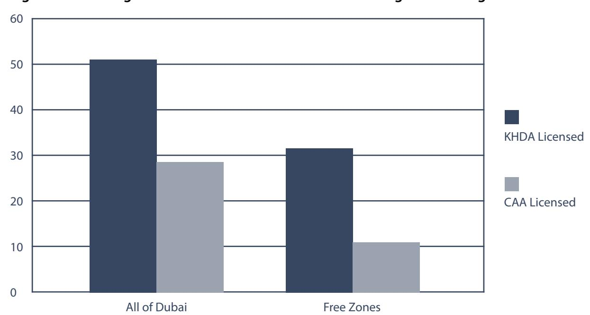
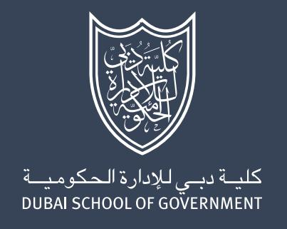

**نشرة سياسات رقم 20** **أغسطس 2010**

للفروع الدولية للجامعات (IBCs) حضور بارز في قطاع التعليم العالي في دبي، إلا أن دور هذه المؤسسات لم يُفهم بعد فهماً كاملاً. علاوة على ذلك، قد يتأثر تطور أدوار هذه الفروع الدولية في دبي بشكل كبير بتصميم السياسات العامة. تحدد هذه النشرة ثلاث قضايا رئيسية تؤثر على تطور قطاع التعليم والسياسات العامة ذات الصلة. أولاً، في معظم الدول المستوردة، تمثل الفروع الدولية للجامعات نسبة صغيرة فقط من إجمالي عدد مؤسسات التعليم ما بعد الثانوي، ومعظم الدول لديها بالفعل قطاعات تعليم عالٍ عام وخاص راسخة. أما في دبي، فقد تطور قطاع التعليم العالي الخاص بسرعة، وأصبح عدد الفروع الدولية للجامعات يقارب نصف إجمالي عدد المؤسسات التعليمية المرخصة للعمل في الإمارة. ثانياً، تقوم مقدمو التعليم الأجانب بأدوار متنوعة في بناء القدرات في دبي، تتراوح بين إتاحة الوصول للوافدين المستبعدين من النظام العام، وحتى الإشارة إلى الحداثة المتزايدة للإمارة أمام العالم. ينبغي النظر في كيفية تأثير قرارات السياسة العامة المستقبلية على هذه الأدوار. ثالثاً، أدى استخدام المناطق الحرة لتسهيل استيراد مقدمي التعليم الأجانب إلى وجود آليات ازدواجية لضمان الجودة على المستويين الاتحادي والمحلي، إضافة إلى نقص التنسيق عبر القطاع. وقد خلق هذا بيئة يوجد فيها ازدواجية كبيرة في البرامج الدراسية المطروحة، وارتباك بشأن التنظيم، وقلق حول جودة بعض البرامج. ورغم أن هذه القيود شائعة في الأنظمة التعليمية سريعة التطور، فإنها إن تُركت دون معالجة يمكن أن تعيق مساهمة القطاع بأكمله بفعالية في تنمية الإمارة والدولة، وكذلك الاستدامة طويلة الأمد لكل مؤسسة.* تقدم هذه النشرة نظرة عامة على قضايا السياسة العامة الرئيسية، وتطرح مجموعة من الأسئلة للمساعدة في تأطير النقاش الجاري.

## **International Branch ** **Campuses, Free Zones,** **and Quality Assurance: ** **Policy Issues for Dubai** **and the UAE**

*بقلم Jason E. Lane*

## **Introduction**

تغيّر مشهد التعليم العالي في دولة الإمارات العربية المتحدة بشكل كبير منذ تأسيس أول جامعة في الدولة، جامعة الإمارات العربية المتحدة (UAEU)، عام 1976. خلال النصف الأول من تاريخ الدولة، كان الوصول إلى التعليم العالي محدوداً، ومتاحاً بشكل شبه حصري للمواطنين الإماراتيين عبر مؤسستين اتحاديتين (أي UAEU وكليات التقنية العليا، أو HCT).^1^ ومنذ ذلك الحين، شهدت الدولة زيادة سريعة في عدد مؤسسات التعليم العالي الخاصة، وسعت بعض الإمارات إلى بناء قدراتها التعليمية عبر جذب فروع لكليات وجامعات أجنبية (مثل London Business School وMichigan State University وNew York University). وقد حدث أكبر تحول في قطاع التعليم العالي الخاص في دبي، حيث يوجد الآن أكثر من 50 مؤسسة مرخصة من هيئة المعرفة والتنمية البشرية في دبي (KHDA) لمنح الدرجات والدبلومات بعد المرحلة الثانوية.

يمكن أن يكون لطريقة تنظيم الحكومة لقطاع التعليم العالي لديها أثر دائم على فرص الوصول للتعليم وتنمية القوى العاملة. وحتى الآن، صاحب التوسع السريع لنظام التعليم العالي الخاص في الإمارات تأخر في التنظيم الحكومي، كما هو الحال في أي نظام يتغير بسرعة.^2^ تواجه الإمارات الآن تحديات في مواءمة التنظيم الحكومي مع أولوياتها الاستراتيجية، مع تحديد حدود السلطة الوطنية والمحلية داخل قطاع التعليم العالي في الوقت نفسه. وعلى وجه الخصوص، هناك تنوع محدود في مستويات الدرجات العلمية أو البرامج الأكاديمية، مما

> ^*^على سبيل المثال، أغلقت Michigan State University Dubai معظم عملياتها الأكاديمية في يوليو 2010 قبل تخريج أي طلاب

<!-- page 2 -->

يجعل من الصعب بناء قوى عاملة ديناميكية ومرنة. علاوة على ذلك، يخلق نقص الوضوح التنظيمي ارتباكاً بين الطلاب والمؤسسات حول الاعتراف المحلي بالدرجات العلمية. ويتعين على دبي، بوصفها أكبر مستورد للمؤسسات التعليمية بين الإمارات، أن تتعامل مع قضايا ضمان الجودة المرتبطة بقطاع تعليم عالٍ خاص سريع التطور يضم أكبر عدد من الفروع الدولية للجامعات في أي منطقة في العالم. ولذلك، لا توجد نماذج مماثلة يمكن الاسترشاد بها. ويشير التطور المستمر للنظام والتوترات الحالية في نقاشات ضمان الجودة إلى أن الحكومتين المحلية والاتحادية ستواصلان النظر في سياسات جديدة في هذا المجال.

## **International Branch Campuses**

على مدى العقدين الماضيين، سعى عدد متزايد من الدول النامية إلى جذب جامعات من العالم المتقدم (بشكل رئيسي من أستراليا والمملكة المتحدة والولايات المتحدة) لإنشاء فروع وشراكات تعليمية داخل حدودها. وأبرز شكل تتخذه هذه المبادرات العابرة للحدود هو الفرع الدولي للجامعة (IBC). في شكله الأساسي، يُعد الفرع الدولي للجامعة موقعاً أجنبياً تابعاً لجامعة ما، ومملوكاً (جزئياً على الأقل) للحرم الجامعي الأم. كما يجب أن يكون هذا الفرع موقعاً فعلياً في الدولة الأجنبية يستطيع منه الطالب دراسة المقررات والحصول على درجة علمية من الحرم الجامعي الأم.^3^

يوثّق تقرير صادر عام 2009 عن Observatory for Borderless Higher Education (OBHE) وجود أكثر من 160 فرعاً دولياً للجامعات يعمل حول العالم، وهو رقم يقارب ضعف العدد الذي أورده الـOBHE قبل ثلاث سنوات.^4^ وكان واحد وأربعون فرعاً من الفروع التي حددها تقرير OBHE موجوداً في الإمارات، مما يجعلها أكبر مستورد للفروع الدولية للجامعات في العالم. وهذا الرقم لا يأخذ في الحسبان الفروع التي افتُتحت منذ آخر إحصاء، كما أنه لا يعكس الدور الكبير الذي تؤديه هذه المؤسسات داخل قطاع التعليم في دبي والإمارات.

## **Overview of Private Higher ** **Education in Dubai**

حتى مايو 2010، أفادت KHDA بوجود 53 مؤسسة تعليمية بعد ثانوية مرخصة لمنح الدرجات أو الدبلومات في دبي. ومن بين هذه المؤسسات، لا توجد سوى ثلاث مؤسسات ضمن نظام التعليم العالي العام الاتحادي (Zayed University وفرعان تابعان لـHCT – كلية دبي للرجال وكلية دبي للنساء). أما الـ50 المتبقية فهي جزء من قطاع التعليم العالي الخاص. ونحو نصف هذه المؤسسات هي فروع لمقدمي تعليم أجانب، وتعمل ضمن مناطق حرة مخصصة تُعفيها من التنظيم الاتحادي (سيُناقش ذلك لاحقاً).

تتفاوت الفروع الدولية للجامعات من حيث حجم القيد، ومستوى الدرجة الممنوحة، واتساع البرامج المطروحة. ورغم عدم وجود جمع منهجي لأعداد القيد حتى الآن، فإن البيانات التي جمعها المؤلف من مختلف الفروع تشير إلى أن أعداد القيد تتراوح بين أقل من 100 وعدة آلاف. وقد اعتُمدت الفروع لمنح درجات على مستوى الدبلوم/الزمالة، والبكالوريوس، والدكتوراه. ومعظم الفروع تمنح درجات على مستوى البكالوريوس والماجستير. وهناك عدد صغير ولكنه متزايد من المؤسسات يمنح درجات الدكتوراه في التعليم وإدارة الأعمال. والوصول إلى درجات الزمالة والدبلوم محدود في دبي، وتقدمه بشكل شبه حصري المؤسسات المحلية.^5^

اتساع البرامج المطروحة في الفروع الدولية للجامعات في دبي محدود. فمعظم البرامج التي يقدمها مزودو التعليم الأجانب موجهة مهنياً (مثل إدارة الأعمال، والهندسة، والتعليم)، ويبدو أنها مدفوعة بمتطلبات السوق. وكانت قطاعات العقارات والتمويل وإدارة الأعمال من أكبر مجالات نمو الوظائف في دبي خلال العقد الماضي، كما أن تزايد عدد الوافدين ممن لديهم أطفال يعزز الرغبة في مزيد من المعلمين ذوي التعليم الجيد في المرحلتين الابتدائية والثانوية. وهناك 31 مؤسسة خاصة

<!-- page 3 -->

تقدم درجات ماجستير في مجالات إدارة الأعمال في دبي؛ منها 23 مؤسسة من مقدمي التعليم الأجانب. في المقابل، تكاد تكون البرامج الأكاديمية في الفنون والعلوم الإنسانية والاجتماعية معدومة في قطاع التعليم الخاص.

## **The Roles of IBCs in Dubai**

يُنظر إلى الفروع الدولية للجامعات بشكل متزايد على أنها مكونات أساسية في سياسة التنمية الاقتصادية في الاقتصادات النامية. وهذا صحيح بالنسبة لدبي. ومع ذلك، تطورت هذه المؤسسات في دبي بسرعة لتؤدي عدداً من الأدوار التي لا تُشاهد عادة بين مقدمي التعليم العالي الخاص. وفيما يلي أربعة أدوار محددة تؤديها الفروع الدولية للجامعات في دبي:^6^

## **Demand Absorption **

مثل جميع مؤسسات التعليم العالي الخاصة في دبي، تؤدي الفروع الدولية للجامعات دوراً مهماً في تلبية الطلب على التعليم العالي بين أعداد الوافدين الكبيرة. ونظراً لأن المؤسسات الاتحادية الثلاث مقتصرة على الطلاب الإماراتيين فقط، فإن المؤسسات الخاصة (بما فيها مقدمو التعليم الأجانب) تمتص الطلب على التعليم العالي من الوافدين الذين يعيشون ويعملون في دبي، مما يتيح لهم فرصة الوصول إلى التعليم العالي دون الحاجة لمغادرة الإمارة أو اللجوء إلى التعلم عن بُعد.

## **Provision of Something Diferent **

هناك سبب آخر لتطور التعليم العالي الخاص، وهو توفير نوع من التعليم غير متاح في القطاع العام. وعلى المستوى الدولي، تقدم المؤسسات ضمن هذه الفئة عادة تجربة تعليم ذات طابع ديني، وقد طوّرت بعض مؤسسات التعليم العالي الخاصة في دبي درجات ذات توجه ديني (أي الدراسات الإسلامية أو التمويل الإسلامي). ومع ذلك، فإن معظم الفروع الدولية للجامعات في دبي تقدم شيئاً مختلفاً، إذ تتيح الوصول إلى مناهج دراسية من دول أخرى.

في الواقع، توفر الفروع الدولية للجامعات في دبي إمكانية الوصول إلى مناهج من 11 دولة مختلفة على الأقل، منها

Australia وBelgium وFrance وIndia وIran وIreland وLebanon وPakistan وRussia وthe United Kingdom وthe United States. ويكتسب ذلك أهمية خاصة بالنسبة لدبي نظراً للتنوع العرقي بين سكانها الوافدين، ولأن نظام التعليم الخاص في المرحلتين الابتدائية والثانوية يُعلّم الأطفال وفق 13 منهجاً وطنياً مختلفاً. فعندما يتخرج هؤلاء الطلاب من المرحلة الثانوية، يسعون لمواصلة تعليمهم في بيئة تعليمية مألوفة لهم.

علاوة على ذلك، هناك عدد متزايد من الطلاب الإماراتيين المهتمين بمتابعة تعليم مختلف عما تقدمه المؤسسات الاتحادية، لكنهم غير قادرين، لأسباب متعددة، على متابعة هذه الخيارات في دول أخرى. وتتيح لهم الفروع الدولية للجامعات إمكانية الحصول على درجة علمية أجنبية دون الحاجة لمغادرة بلدهم.

## **Signaling Modernity**

بالنسبة للعديد من الحكومات، بما فيها حكومة دبي، تُعد الفروع الدولية للجامعات وسيلة للإشارة إلى حداثتها المتنامية أمام العالم الخارجي. وقد يحدث ذلك بثلاث طرق. أولاً، في أبسط أشكاله، يجذب افتتاح الفروع الدولية للجامعات اهتماماً إعلامياً دولياً، مما يوجه مزيداً من الانتباه إلى الأنشطة التعليمية وغير التعليمية داخل الإمارة. ثانياً، قد يوحي الارتباط بجامعة ذات سمعة دولية قوية (سواء كان ذلك صحيحاً أم لا) بمستوى معين من الجودة في قطاع التعليم بشكل أوسع.^7^ فاختيار Michigan State University من الولايات المتحدة أو S.P. Jain من الهند لإنشاء فرع في دبي قد يُشير للأطراف الخارجية إلى أن دبي تتمتع بمستوى كافٍ من الأهمية العالمية والمكانة التعليمية يبرر انضمام هذه المؤسسات إلى قطاعها التعليمي. ثالثاً، قد يشكل تنوع الدول الممثلة بين الفروع الدولية للجامعات إقراراً ضمنياً بالتوجه العالمي للإمارة وتنوعها المتزايد.

## **Demand Creation **

على خلاف الأنواع الأخرى من التعليم العالي الخاص، يتمثل دور فريد للفروع الدولية للجامعات في خلق طلب على نفسها وعلى النظام المحلي. فحقيقة

<!-- page 4 -->

أن الفروع الدولية للجامعات تتمتع بسمعة قائمة في الجودة، وتقدم تجربة تعليمية قد لا تكون متاحة في أي مكان آخر في المنطقة، قد تجذب طلاباً جدداً إلى دبي. وبذلك، فإن وجود هذه الفروع قد يخلق طلباً من طلاب كانوا سيختارون خلاف ذلك متابعة تعليمهم في مكان آخر.

## **Free Zones**

كانت المناطق الحرة، وهي أداة للتنمية الاقتصادية مصممة لإعفاء الشركات من التنظيم الاتحادي، من أهم العوامل في نمو مقدمي التعليم الأجانب في دبي. ومع ذلك، أدى استخدام المناطق الحرة إلى خلق مجموعة من التحديات، منها ظهور أنظمة مساءلة متعددة. وقد غذّى ذلك نقاشات حول الدور المناسب للحكومتين المحلية والاتحادية، وحدّ من التنسيق على مستوى النظام من خلال خلق عدة قطاعات فرعية شبه مستقلة داخل النظام التعليمي.

تستضيف أربع مناطق حرة حالياً الفروع الدولية للجامعات في دبي. وتستضيف مدينة دبي الأكاديمية الدولية / قرية دبي للمعرفة (DIAC/DKV) أكبر عدد من هذه الفروع، وهي المنطقة الحرة الوحيدة المخصصة للتعليم. وتجذب DIAC/DKV مجموعة واسعة من المؤسسات من دول متعددة. وتُطرح فيها درجات البكالوريوس والدراسات العليا، ويأتي الطلاب من مختلف أنحاء المنطقة العربية والعالم. وتقدم بعض المؤسسات برامج متشابهة، مما يخلق درجة من المنافسة بين المؤسسات المختلفة. كما يوجد تعاون محدود بين بعض المؤسسات، لكنه يقتصر في الغالب على مجال الأنشطة الطلابية (مثل مباريات كرة القدم).

أما المناطق الحرة الأخرى فهي أكثر استراتيجية في اختيار المؤسسات، وأكثر تقييداً في أنواع البرامج المطروحة. فعلى سبيل المثال، يعمل Center for Excellence في مركز دبي المالي العالمي (DIFC) على جذب واستبقاء تنوع من البرامج

المدرسية على مستوى الدراسات العليا في إدارة الأعمال من كليات إدارة أعمال دولية عالية التصنيف. ولا توجد برامج مكررة. كما أن هذه البرامج لا تخدم فقط العاملين في مؤسسات داخل DIFC، بل تخدم أيضاً طلاباً من دول أخرى عديدة. والغرض منها هو المساعدة في بناء قدرات قيادية داخل DIFC، وكذلك زيادة رأس المال الاجتماعي والشبكات الدولية لجميع العاملين داخل DIFC. وبالمثل، تستضيف مدينة دبي الطبية (DHCC) فرعاً لمعهد Boston College لأبحاث وتعليم طب الأسنان، الذي يدعم مهمة DHCC المتمثلة جزئياً في تحسين المستوى العام لصحة الأسنان في المنطقة. وأخيراً، يقدم Rochester Institute of Technology من الولايات المتحدة مجموعة من الدرجات في إدارة الأعمال والتقنية داخل واحة دبي للسيليكون، وهي منطقة حرة موجهة لتقنية الأعمال.

## **Regulating Free Zone Education**

نظراً لإعفاء الفروع الدولية للجامعات العاملة في المناطق الحرة من آليات ضمان الجودة الاتحادية، وضعت كل منطقة حرة متطلبات محددة تلزم الفروع بتقديم برامج أكاديمية مماثلة في جودتها لبرامج الحرم الجامعي الأم. ومع ذلك، كان تطبيق هذه المتطلبات غير متساوٍ ومتفاوتاً. علاوة على ذلك، ونظراً لأن كل منطقة من المناطق الحرة الأربع تخضع لإدارة هيئات مختلفة، فقد ظهر نقص في التنسيق فيما يتعلق بهذا التطبيق، وطوّرت كل منطقة حرة هيكلها التنظيمي الخاص بها. فعلى سبيل المثال، تدير DHCC مجلسها الخاص لمراجعة أخلاقيات البحوث التي تُجرى على البشر من قبل جامعاتها، في حين لا تملك أي منطقة حرة أخرى مجلساً مماثلاً منفصلاً. وبالمثل، تمنع DIFC فروعها الدولية من تقديم درجات متنافسة، بينما تقدم عدة مؤسسات تابعة لـDIAC/DKV نفس البرامج الأكاديمية. وقد خلق النقص العام في التنظيمات المحلية حاجة إلى آلية ضمان جودة على مستوى الإمارة داخل دبي.

ولمعالجة المخاوف المتعلقة بالجودة، مع الإقرار بأن الفروع تستند إلى

<!-- page 5 -->

افتراضات مختلفة حول أساليب التعلم والتدريس، أنشأت KHDA آلية جديدة لضمان الجودة عام 2008. ويقوم المجلس الدولي لضمان جودة الجامعات (UQAIB)، المكوّن من أعضاء من دول مختلفة، بتدقيق المؤسسات للتأكد من وجود آليات تضمن أن جودة التعليم المقدم في الفرع تماثل جودة التعليم في الحرم الجامعي الأم. غير أن الحصول على ترخيص من هذه الهيئة لا يشهد على مستوى أدنى من الجودة، بل يؤكد فقط أن جودة برنامج المؤسسة تماثل جودة برنامجها في الحرم الجامعي الأم.

وعلى المستوى الاتحادي، تتولى هيئة الاعتماد الأكاديمي (CAA)، التابعة لوزارة التعليم العالي والبحث العلمي، مسؤولية ترخيص واعتماد جميع مؤسسات التعليم العالي في الإمارات. وتتولى CAA مسؤولية التأكد من أن المؤسسات وبرامجها تستوفي مجموعة موحدة من متطلبات ضمان الجودة. وكما ذُكر أعلاه، فإن التواجد داخل منطقة حرة يُعفي الفرع الدولي للجامعة من متطلبات CAA. وهذا الإعفاء، رغم أنه يسمح

للمؤسسات بالعمل دون تدخل من الحكومة الاتحادية، قد خلق مشكلات، إذ لا تُعترف الحكومة بالدرجات العلمية الصادرة عن هذه المؤسسات (وهو أمر مهم بشكل خاص لمن يتقدمون للوظائف في القطاع العام)، أو لا يُتاح الدعم المالي للطلاب الإماراتيين الملتحقين بهذه المؤسسات. والجدير بالذكر أنه رغم إعفاء المناطق الحرة للمؤسسات من متطلبات CAA، فقد سعت عدة فروع دولية للجامعات للحصول على ترخيص مؤسسي واعتماد أكاديمي من CAA، وحصلت عليه. ومن بين 51 مؤسسة بعد ثانوية مدرجة لدى KHDA بوصفها معتمدة للعمل في دبي، 29 مؤسسة مرخصة من الحكومة الاتحادية عبر CAA.

تُبرز الطبقات المتعددة من التنظيم الحكومي وغير الحكومي للتعليم التحديات التي تواجه تطور ومساءلة الفروع الدولية للجامعات في دبي والإمارات ككل. ويتمثل أحد المكونات المهمة في نقاش المساءلة الحالي في مسألة ما إذا كانت الحكومة المحلية أو الاتحادية مسؤولة عن الترخيص و

***Figure 1: Licensing Authorities for Dubai**'**s Institutions of Higher Learning***

**Source:** This information comes from the list of licensed institutions on the CAA portal (www.caa.ae) and the KHDA Web site (www.khda.gov.ae). Data was collected from each Web site on May 11, 2010.

<!-- page 6 -->

اعتماد مؤسسات التعليم العالي. ويُظهر تسجيل المؤسسات "المرخصة" جزئياً هذا الانقسام. علاوة على ذلك، فإن التنسيق داخل النظام ضئيل. وتجعل الاختلافات التنظيمية بين CAA وUQAIB من الصعب تحقيق الانسجام عبر النظام، خاصة بين مؤسسات المناطق الحرة وغير الحرة. علاوة على ذلك، فإن توزع الفروع الدولية للجامعات بين أربع مناطق حرة مختلفة، لكل منها هيئة خاصة ومجموعة تنظيمات مختلفة، يجعل التنسيق بين مؤسسات المناطق الحرة أمراً صعباً.

## **Moving Forward**

يجتمع عدد من العوامل لخلق بيئة تعليمية في الإمارات مختلفة تماماً عن معظم الدول الأخرى. وينطبق ذلك بشكل خاص على دبي، حيث يقارب عدد مقدمي التعليم الأجانب عدد المؤسسات المحلية، وحيث يعمل معظم مقدمي التعليم الأجانب داخل المناطق الحرة. والمهم أنه في سياق التطور السريع للقطاع، لم يتضح بعد دور الحكومتين المحلية والاتحادية في تنظيم هذه الكيانات؛ كما لم يتضح المسار الذي يمكن من خلاله لمقدمي التعليم الأجانب مساعدة الحكومة على تحقيق أولوياتها الاستراتيجية. والواقع أن مقاربات الوكالات الاتحادية والمحلية لضمان الجودة تُظهر اختلافاً جوهرياً في النهج. فآلية ضمان الجودة في دبي، UQAIB، تسعى للتأكد من أن كل مؤسسة أجنبية تقدم تجربة تعليمية مماثلة لتجربة حرمها الجامعي الأم، تاركة للطالب حرية اختيار التعليم الذي يرغب في متابعته. أما الآلية الاتحادية لضمان الجودة، CAA، فترخّص المؤسسات بناءً على استيفائها مجموعة موحدة من المعايير الدنيا. ويضمن ذلك وجود مستوى أدنى من الجودة، ووجود قدر من التماثل بين جميع المؤسسات في الدولة.

من منظور دولي، صُممت معظم آليات ضمان الجودة

لقطاع تعليم ما بعد الثانوي الذي يتألف بشكل رئيسي من مؤسسات محلية تخدم في الغالب طلاباً محليين. علاوة على ذلك، وفي هذا السياق، يُتوقع أن تقضي الغالبية العظمى من الطلاب معظم حياتهم في الدولة التي صممت آليات ضمان الجودة. أما في دبي والإمارات بشكل أوسع، فهذا لا ينطبق بالضرورة. ورغم عدم توفر البيانات اللازمة بعد لتقديم صورة دقيقة عن الطلاب في دبي، فإن البيانات التي جمعها المؤلف تشير إلى أن الإماراتيين لا يمثلون سوى أقلية من الطلاب، وأن كثيراً من الطلاب الوافدين يتوقعون العودة إلى بلدانهم الأصلية بعد إنهاء درجاتهم العلمية في دبي.

هذا لا يعني أن آليات ضمان الجودة القائمة في دول أخرى لن تنجح في دبي. ومع ذلك، ينبغي لصانعي القرار في الإمارات، عند تصميم هيكل مثل هذه الآليات، أن يكونوا على وعي بالاختلافات الجوهرية بين نظامهم ومعظم الأنظمة الأخرى، وأن يتخذوا قراراتهم وهم على دراية كاملة بكيفية تأثير النظام التنظيمي على التطور المستقبلي لقطاع التعليم. فعلى سبيل المثال، قد يختلف هدف تأهيل قوى عاملة للإمارات عن هدف جذب الطلاب إلى الإمارات للاستفادة من تنوع المؤسسات المتاحة من شبه كل أنحاء العالم. فمن ناحية، قد يؤدي السماح بتنوع في متطلبات المؤسسات ومستويات الجودة إلى إعاقة تطور قوى عاملة متماسكة وفعالة. ومن ناحية أخرى، فإن إنشاء نظام من المؤسسات ذات متطلبات متشابهة قد يجعل التنوع الدولي للمؤسسات أقل جاذبية للطلاب الأجانب، ويعمل ضد هدف أن تصبح الإمارة مركزاً تعليمياً.^9^ والأسئلة التالية مقصودة للمساعدة في توجيه النقاشات المستمرة حول السياسات العامة:

1. من هم الطلاب الذين تخدمهم الفروع الدولية للجامعات، وما هي طموحاتهم؟

<!-- page 7 -->

- 2. ما هي أسباب استيراد مقدمي التعليم من دول أخرى؟ هل الهدف هو المساعدة في تحقيق سياسات التوطين عبر زيادة الوصول إلى برامج عالية الجودة؟ هل الهدف تشجيع مزيد من الإماراتيين على الدراسة في الإمارات؟ هل الهدف جذب طلاب أجانب أو استبقاء الوافدين المقيمين بالفعل في الدولة؟
- 3. عند تقييم دور التعليم بالنسبة للطلاب الوافدين، كم عدد من يرغب منهم في البقاء والعمل في الإمارات بعد التخرج؟ وكم منهم سيبقى فعلاً، وإلى متى؟

- 4. ما هي مزايا/عيوب وجود برامج أكاديمية مبنية على عدة مناهج وطنية مختلفة؟
- 5. ما هي مزايا/عيوب وجود إطار تنظيمي موحد (مقابل أطر مختلفة للمؤسسات الأجنبية/المحلية)؟
- 6. كيف يمكن لأي إطار تنظيمي جديد أن يوائم الفروع الدولية للجامعات مع الأولويات الاستراتيجية للحكومة؟ وكيف يمكن لمثل هذا الإطار أن يغيّر الدور الحالي لهذه الفروع؟
- 7. كيف يؤثر وجود الفروع الدولية للجامعات على مقدمي التعليم المحليين؟

- تأسست دولة الإمارات العربية المتحدة عام 1971 كاتحاد يضم ست إمارات كانت مستقلة سابقاً: Abu Dhabi وAjman وDubai وFujairah وSharjah وUmm Al-Quwain. وانضمت Ras Al-Khaimah إلى الاتحاد عام 1972. وكانت UAEU هي المؤسسة العامة الوحيدة للتعليم العالي في الدولة حتى تأسست Higher Colleges of Technology عام 1988. أما المؤسسة العامة الأخرى للتعليم العالي، Zayed University، فلم تُؤسس إلا عام 1999. 1
- Levy, Daniel A. 2006. The unanticipated explosion: private higher education's global surge. Comparative Education Review 50, 2: 217-240. 2
- لا تستخدم جميع مؤسسات التعليم الأجنبية في دبي مصطلح "الفرع الجامعي". واستخدامه هنا هو فقط لتحديد مجموعة فرعية معينة من مؤسسات التعليم العالي الخاص التي تستوفي التعريف السابق، ولا يقصد به الإيحاء بأي نوع تنظيمي محدد. ويُستخدم المصطلح للتمييز عن ترتيبات التعاون أو "التوأمة"، وكذلك المشاريع البحثية فقط، مثل مراكز الأبحاث التي أنشأها معهد Massachusetts Institute of Technology (MIT) حول العالم. 3
- من المرجح أن تكون الزيادة ناتجة عن كل من تطور مؤسسات جديدة وتحسن المعلومات المتوفرة عن وجود الفروع الدولية للجامعات. 4
- وفقاً لـKHDA، لا تقدم درجات الزمالة أو الدبلوم سوى ثماني مؤسسات تعليم عالٍ عامة وخاصة فقط. 5
- هذه المعلومة مأخوذة من مقالة قادمة للمؤلف. انظر: Lane, J. E. (forthcoming) Importing private higher education: international branch campuses. Journal of Comparative Policy Analysis. 6
- قد يوحي مثل هذا الارتباط بمستوى معين من الجودة فيما يتعلق بالبرامج التعليمية، أو أنواع الطلاب الملتحقين بالقطاع، أو جودة الخريجين في القوى العاملة. وهناك حاجة لمزيد من العمل لفهم الآثار المتعلقة بالسمعة الناتجة عن الفروع الدولية للجامعات على الحكومة المضيفة بشكل أكمل. 7
- يتألف أعضاء UQAIB من رئيس وعشرة أعضاء إضافيين يُعينون لمدة لا تقل عن أربع سنوات. ووفقاً لـInternational Network of Quality Assurance Agencies in Higher Education (INQAAHE)، جاء الأعضاء الأوائل من Australia وAsia وNew Zealand وSouth Africa وthe United Kingdom وthe United States. (لم تُدرج الدول الآسيوية بشكل منفصل.) 8

<!-- page 8 -->

9 أصبحت دول مثل الولايات المتحدة والمملكة المتحدة مراكز تعليمية بسبب نوع التعليم الذي يقدمه نظامها، والذي يختلف عن معظم الدول الأخرى. وهذا يتيح لها إنشاء آليات ضمان جودة قائمة على معتقدات متشابهة حول التعليم. غير أن دبي تبنّت استراتيجية مختلفة، إذ توفر إمكانية الوصول إلى الأنظمة التعليمية لعدد من الدول المختلفة في موقع واحد.

**Jason E. Lane** أستاذ مساعد في الإدارة التعليمية ودراسات السياسات، وأحد قائدي فريق أبحاث التعليم العابر للحدود (C-BERT) في جامعة State University of New York at Albany. يقوم هو وفريقه بدراسة تطور مؤسسات التعليم العالي المتنقلة عبر الحدود الوطنية، وقد أجروا زيارات ميدانية لأكثر من 40 فرعاً دولياً للجامعات في 10 دول. وقد أمضى الدكتور Lane خلال العام الماضي عدة أشهر في الشرق الأوسط بصفته Fulbright New Century Scholar لدراسة تطور الفروع الدولية للجامعات. وله أكثر من 20 مقالاً منشوراً، وقام بتحرير/تأليف خمسة كتب حول المؤسسات التعليمية والإدارة والعولمة والسياسات.

الآراء الواردة في نشرة السياسات هذه تعبر عن رأي المؤلف، ولا تعكس بالضرورة آراء أمناء ومسؤولي وموظفي مدرسة دبي للحكم.

## © 2010 Dubai School of Government

مدرسة دبي للحكم (DSG) هي مؤسسة بحثية وتعليمية تركز على السياسة العامة في العالم العربي. تأسست عام 2005 تحت رعاية صاحب السمو الشيخ محمد بن راشد آل مكتوم، نائب رئيس الدولة ورئيس مجلس الوزراء حاكم دبي، بالتعاون مع Harvard Kennedy School، وتهدف DSG إلى تعزيز الحوكمة الرشيدة من خلال تطوير قدرة المنطقة على وضع سياسات عامة فعالة.

ولتحقيق هذا الهدف، تتعاون مدرسة دبي للحكم أيضاً مع مؤسسات إقليمية وعالمية في تقديم برامجها البحثية والتدريبية. إضافة إلى ذلك، تنظم المدرسة منتديات سياسات ومؤتمرات دولية لتسهيل تبادل الأفكار وتعزيز النقاش النقدي حول السياسة العامة في العالم العربي.

تلتزم المدرسة بخلق المعرفة، ونشر أفضل الممارسات، وتدريب صانعي السياسات في العالم العربي. ولتحقيق هذه المهمة، تعمل المدرسة على تطوير قدرات قوية لدعم برامجها البحثية والتعليمية، منها

- البحوث التطبيقية في السياسة العامة والإدارة؛
- درجات الماجستير في السياسة العامة والإدارة العامة؛
- التعليم التنفيذي لكبار المسؤولين والتنفيذيين؛ و
- منتديات معرفية للباحثين وصانعي السياسات.

للحصول على النشرات الإخبارية حول الفعاليات والمنشورات والأخبار الخاصة بمدرسة دبي للحكم، يمكن التسجيل عبر الإنترنت على www.dsg.ae.

مدرسة دبي للحكم Convention Tower, Level 13 P.O. Box 72229 Dubai, United Arab Emirates Tel: 971-4-329-3290 Fax: 971-4-329-3291

