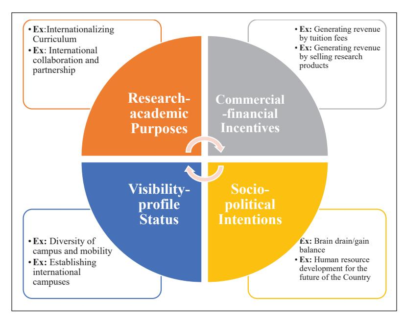

<!-- A2.R27 | source: papers_json/A2.R27/ -->

*مقالة*

## **التدويل ** **في مؤسسات التعليم العالي ** **الكندية: ** **أونتاريو**

Higher Education for the Future 1–21 © 2020 The Kerala State Higher Education Council Reprints and permissions: in.sagepub.com/journals-permissions-india DOI: 10.1177/2347631120930538 journals.sagepub.com/home/hef

## **Ali Khorsandi Taskoh1**

## **الملخص**

التعليم أداة للتعاون بين الأمم. ظهور مفاهيم مثل تدويل السياسات التعليمية، وبرامج تبادل الطلاب والموظفين، وتدويل المنهج الدراسي، والتدويل في الداخل (IAH)، وحتى ظهور وكالات متعددة الجنسيات لتسريع التبادلات العالمية في مجال التعليم العالي، دفعت صانعي السياسات التعليمية إلى الاعتراف بأن فصل السياسات التعليمية عن سياسات الشؤون الخارجية للأمم لا يؤدي إلا إلى فشل الأهداف والأولويات التعليمية للأمم. استنادًا إلى منهجيات البحث النوعي ودراسة الحالة، اعتمدت هذه الدراسة التحليل النقدي للسياسات (CPA) للإجابة على سؤال "لماذا تنخرط جامعة عامة كندية في التدويل؟". أظهرت الدراسة أن قرار الاعتراف بالتدويل كأولوية في جامعة عامة في أونتاريو يستند إلى دوافع مختلفة تتراوح من العوامل التجارية-الاقتصادية والاجتماعية-السياسية إلى العوامل الأكاديمية-التعليمية وبناء السمعة. كما حددت الدراسة التوسع التدريجي للمبررات القائمة على السوق، التي كانت غائبة تاريخيًا عن سياسات الجامعات التقليدية في السياق الكندي، لتشمل المبادرات التعليمية والمبررات الأكاديمية.

## **الكلمات المفتاحية**

التدويل، التعليم العالي، المبررات، بيانات السياسات، الخطاب، التصورات

## **الباحث المراسل:**

Ali Khorsandi Taskoh, Department of Educational Administration and Planning, Faculty of Psychology and Education, Allameh Tabataba'i University (ATU), Olympic Sq., Tehran 14896-84511, Iran. E-mails: ali.khorsandi@atu.ac.ir; khorsandi.higheredu@gmail.com

> ^ ^Department of Educational Administration and Planning, Faculty of Psychology and Education, Allameh Tabataba'i University (ATU).

<!-- page 2 -->

## **مقدمة**

كان تدويل التعليم العالي الأولوية الأولى للسياسات وأهم عامل تغيير في عمليات وممارسات سياسة التعليم العالي على مدى العقدين الماضيين. من المأمول أيضًا أن يكون هناك حافز وطني ودولي بين صانعي السياسات التعليمية لإشراك جميع مؤسسات وجامعات التعليم العالي تقريبًا في ممارسة التدويل، إذ يُعد اليوم علامة على المكانة والسمعة إذا كان هدف الجامعات ورسالتها هو منافسة المنافسين العالميين الآخرين. ومع ذلك، يبدو أنه لا يوجد بعد فهم واضح لهذه الممارسة، إذ يرى Buckner and Stein (2019, p. 1) أنه "(حول) العالم، يُطلب من أعضاء هيئة التدريس والموظفين والإداريين الانخراط في التدويل داخل حرمهم الجامعي، غالبًا مع فهم محدود لماهية التدويل، أو ما ينبغي أن يكون عليه، أو ما يمكن أن يكون." وفي السياق نفسه، يشير Rumbley et al. (2019, p.10) إلى أن: "(النقاشات) حول تدويل التعليم العالي في أوروبا وغيرها تركز بشكل متزايد على فهم الأثر الذي يحدثه التدويل، وكذلك العمليات التي ينبغي أن تتبعها مؤسسات التعليم العالي (HEIs) للوصول إلى أهداف التدويل (والأهداف المرتبطة بها)."

كما أصبح التدويل عنصرًا أساسيًا في مبادرات المؤسسات و"سمة مهمة من سمات مشهد التعليم (العالي) الكندي" (Beck, 2012, p. 133). تنخرط معظم المؤسسات في كندا في شكل من أشكال النشاط الدولي، واليوم تنخرط جميع المؤسسات تقريبًا في كندا وحول العالم بدرجة ما في أنشطة تهدف إلى بناء روابط عالمية وتنمية كفاءات عالمية بين طلابها وأعضاء هيئة التدريس والوحدات الإدارية (AUCC, 2014; p. 3). تُدرج جميع المؤسسات الكندية تقريبًا التدويل ضمن بيان رسالتها وتخطيطها الاستراتيجي، و"أكثر من 95% من الجامعات تُبلغ بأن وثائق تخطيطها الاستراتيجي أو طويل المدى تشير صراحة (89%) أو ستشير (7%) إلى التدويل و/أو الانخراط العالمي" (AUCC, 2014; p. 9). بالإضافة إلى ذلك، أصدرت الحكومة الفدرالية أول توصيات وطنية على الإطلاق لتدويل التعليم العالي (DFAIT, 2012a). كما يلاحظ المرء زيادة كبيرة في ميزانية الجامعات الكندية المخصصة للتدويل، وكذلك في المساحات المكتبية والموظفين المكرسين لهذا النشاط. وبناءً على ذلك، تخطط كندا لتكون وجهة رائدة للعديد من الطلاب الدوليين وعلماء العالم الرائدين.

مع ذلك، قد تُدوّل الجامعات حرمها وسياساتها وعملياتها لأسباب مختلفة. بعض مبررات التدويل مشتركة بين مؤسسات مختلفة حول العالم. ومع ذلك، قد يكون لكل جامعة مبرراتها ومكوناتها الخاصة في السياق ذاته. وكعنصر مشترك في بيانات رسالة المؤسسات، جعل صانعو السياسات والإدارات في التعليم العالي الكندي التدويل جانبًا رئيسيًا من خططهم الاستراتيجية لأسباب مختلفة. لذلك، يبدو التدويل حاضرًا في كل مكان في بيانات السياسات والخطاب في مؤسسات التعليم العالي الكندية. غير أنه ليس من الواضح تمامًا ما هي المبررات التي تدفع سياسات ومبادرات التدويل في الجامعات العامة في السياق الكندي. وبينما تكافح معظم الجامعات الكندية وتجوب العالم بقوة للعثور على عملاء جدد وجذب المزيد من الطلاب الدوليين

<!-- page 3 -->

(Coates & Morrison, 2011; Jones & Oleksiyenko, 2011; McNeil, 2013)، فإن المبررات الرئيسية وراء التدويل تحتاج إلى فحص نقدي. تحاول هذه المقالة تقديم تحليل نقدي للسياسات حول سبب وكيفية انخراط جامعة عامة في أونتاريو في التدويل. وفي سياق أصبحت فيه المنافسة في سوق عدواني للتعليم العالي إحدى السمات الرئيسية للجامعات في العالم المتقدم (Beck, 2012; CMEC, 2011; Fisher et al., 2009; Jones & Oleksiyenko, 2011)، تسعى هذه المقالة إلى فهم كيفية تموضع المبررات في أجندات وبرامج التدويل في سياق أونتاريو.

بعد هذا العرض التمهيدي، تستمر هذه الورقة بمراجعة للأدبيات ونظرة عامة على المنهجية. ثم تلخص النتائج وتُطور حجة وتحليلًا نقديين. وتُختتم باستنتاج وتوصيات سياسية.

## **مراجعة الأدبيات**

يهتم صانعو سياسات التعليم العالي على المستويين المؤسسي والحكومي بشكل متزايد بمجموعة الفوائد المرتبطة بالتدويل. تُظهر مراجعة الأدبيات العلمية أن هناك مجموعة متنوعة من الدوافع التي تجعل المؤسسات تُدوّل سياساتها وعملياتها. فالتدويل من جهة يُولّد دافعًا تنافسيًا وتجاريًا لمبادرات مختلفة مثل تسجيل الطلاب، بينما يستحضر من جهة أخرى مفاهيم الترابط عبر الوطني والتدفقات الأكاديمية المتبادلة للأفراد (Matthews, 2002). ونظرًا لأن أهداف وغايات التدويل متعددة ومتضاربة إلى حد ما (Tarc, 2013)، فهناك فئات مختلفة من المبررات لاعتراف المؤسسات به كأولوية سياسية. يُصنّف Maringe and Gibbs (2006) جميع مبررات التدويل ضمن ستة تيارات واسعة: اقتصادية، وسياسية، واجتماعية-ثقافية، وتكنولوجية، وتعليمية، وتربوية. ويُطوّر Knight (2004, pp. 22–23) تصنيفًا للمبررات يتألف من مرحلتين واسعتين: (أ) تنمية الموارد البشرية الوطنية، بما يشمل التحالفات الاستراتيجية، والتجارة التجارية، وبناء الأمة، والتنمية الاجتماعية/الثقافية؛ و(ب) العلامة التجارية الدولية المؤسسية وبناء السمعة، بما يشمل توليد الدخل، وتنمية الطلاب والموظفين، والتحالفات الاستراتيجية، وإنتاج المعرفة. ووفقًا لتصنيف Knight (2004)، تُصنّف المرحلتان الواسعتان من المبررات، أي الوطنية والمؤسسية، ضمن أربعة مبررات مركزية هي: (أ) اجتماعي-ثقافي، (ب) سياسي، (ج) نمو اقتصادي، و(د) أكاديمي.

وفقًا لاستطلاع IAU's (2005)، فإن المبررات الرئيسية للتدويل هي "زيادة قدرة ومعرفة الطلاب وأعضاء هيئة التدريس الدوليين وإنتاجها؛ وتعزيز قدرة البحث والمعرفة وإنتاجها؛ وخلق ملف تعريفي وسمعة دوليين؛ والمساهمة في الجودة الأكاديمية؛ وتوسيع وتنويع مصادر أعضاء هيئة التدريس والطلاب؛ وتعزيز تطوير المنهج والابتكار؛ [و] تنويع توليد الدخل" (p. 2). ومع ذلك، فمن منظور وملاحظات معظم الباحثين، يرتبط التدويل في الدول الغنية في الشمال الغربي بشكل متزايد بتسليع وتسويق التعليم العالي (Altbach 2002; de Wit, 2011; IAU, 2012; Maringe et al.,

<!-- page 4 -->

2013). وكما يرى Knight (2008)، فإن الاتجاه السائد للتدويل في المؤسسات الأنجلو-أمريكية يميل غالبًا نحو المبررات الاقتصادية والتجارية. بعبارة أخرى، أحد المبررات الرئيسية للتدويل في معظم المؤسسات الأنجلو-أمريكية هو الربح الاقتصادي والتجاري. لذلك، "أصبحت الحوافز المالية وبرامج توليد الدخل من أهداف التدويل في العديد من المؤسسات في الغرب على مدى العقدين الماضيين" (KhorsandiTaskoh, 2014, p. 40). وفي بحث أحدث، يجد Buckner (2019, p. 315) ما يلي:

الإداريون في مؤسسات التعليم العالي في الاقتصادات كثيفة المعرفة، وخصوصًا في الولايات المتحدة وكندا الناطقة بالإنجليزية، أكثر ميلًا لصياغة الفوائد من حيث تعزيز الوعي الدولي للطلاب، بينما يُشار إلى توليد الإيرادات بشكل أكبر في السياقات الأنجلوفونية الأخرى. ويُجادل بأنه في أمريكا الشمالية الأنجلوفونية، يُستخدم التعليم العالي لمكافحة تاريخ من الانغلاق المحلي؛ وفي الاقتصادات كثيفة المعرفة، يُنظر إليه كدعم لسلاسل العمالة الماهرة؛ وفي السياقات الأنجلوفونية خارج أمريكا الشمالية، يُصاغ كصادرات ذات قيمة اقتصادية.

وفي هذا الصدد، قد تُوجّه مجموعة واسعة من الدوافع المؤسسات العامة في السياق الكندي بشأن تدويل التعليم العالي. يبدو أن أن تصبح كندا الرائدة عالميًا في القرن الحادي والعشرين من أجل جذب أفضل الطلاب الأجانب وإعداد المواطنين للسوق العالمية هي الرؤية والمشهد المحوريان للتعليم العالي الكندي (Chakma et al., 2012). ووفقًا لاستطلاع AUCC's (2014) بشأن مبررات تدويل التعليم العالي، فإن "الأسباب الأربعة الأخرى الأكثر ذكرًا هي بناء تحالفات وشراكات استراتيجية مع مؤسسات رئيسية في الخارج، وتعزيز حرم جامعي مُدوَّل، وزيادة الملف التعريفي العالمي للجامعة، وتوليد الإيرادات" (AUCC, 2014, pp. 12). وهناك دوافع أخرى ترتبط بشكل مباشر أكثر برفاهية الوطن وازدهاره. وبالرغم من استطلاع AUCC، فإنه كما هو الحال في جامعات دول أخرى، تلعب المبررات الاقتصادية والسياسية وتعزيز أجندات التجارة والدبلوماسية الوطنية دورًا كبيرًا في تطوير مبادرات التدويل في الجامعات الكندية. فعلى سبيل المثال، يُظهر تقرير صادر عن DFAIT (2012b) أن الطلاب الدوليين ساهموا بأكثر من 8 مليارات دولار في الاقتصاد الكندي عام 2010 من خلال الرسوم الدراسية والسكن والإنفاق التقديري. ويجد Tight (2019, p. 1) ما يلي:

بينما يفسر كثيرون النمو المتزايد لعولمة وتدويل التعليم العالي كأثر آخر من آثار الأجندات الليبرالية الجديدة، ينبغي عدم تجاهل دور مؤسسات التعليم العالي كمحرضين على المزيد من العولمة والتدويل، مع ضرورة الاعتراف بالتنازلات التي تقدمها في القيام بذلك.

ومن ثم، يجب أن نتذكر أن دور صانعي السياسات التعليمية والباحثين وأصحاب المصلحة في التعليم العالي، وكذلك مؤسسات التعليم العالي حيث يُفترض أن يحدث التدويل فعليًا، يجب اعتباره أساسيًا لنجاح التدويل بما يتماشى مع محور هذا البحث الذي يفحص مثل هذه الممارسة في أونتاريو. ويُقدّم Zha et al. (2019, p. 673) أيضًا المجالات الثلاثة التالية في إطارهم التحليلي "للكشف عن

<!-- page 5 -->

الديناميكيات والتيارات في تدويل الجامعات الصينية"، وهو ما يؤكد العبارات أعلاه.

(1) التفاعل بين الفاعلين والوكالات المحليين للتدويل وظروفهم البيئية المباشرة، سواء كانت ذات طبيعة أكاديمية/مهنية، أو سوقية، أو حكومية/إدارية؛ (2) الترابط بين هؤلاء الفاعلين والوكالات على جميع المستويات، سواء كانت محلية أو وطنية أو عالمية؛ و(3) التفاعل بين العمليات المادية للتدويل والتوجهات الأخلاقية/الروحية.

## **نظرة عامة على المنهج المفاهيمي والمنهجية**

اعتمدت هذه الدراسة منهجًا مفاهيميًا نقديًا. يُستخدم التحليل النقدي للسياسات لاستخلاص "الحقيقة" حول قضايا السياسة (Chesler & Crowfoot, 2000) ويتيح للباحث فرصة الحديث مع الإدارة حول سياسات محتملة الخطأ أو الظلم (Ozga, 2000). يعترف التحليل النقدي للسياسات بالسياسة كعملية سياسية ومحمّلة بالقيم (Allan et al., 2010; Marshall, 1997; Prunty, 1985; Weimer, 1998). تم اختيار التحليل النقدي للسياسات كالمنهج المفاهيمي وطريقة التحليل المفضلين من أجل تصور سبب وضع سياسة (مثل التدويل) في فترة زمنية محددة وكيفية وضعها موضع التنفيذ. من المهم معرفة كيف تُوجَّه مبررات السياسة وتُنظَّم حول مجموعة من بيانات السياسة والخطاب والتصورات المتعلقة بالتدويل. في هذه الدراسة، يساعد التحليل النقدي للسياسات الباحث على فهم المبررات الضمنية وغير المباشرة لنص السياسة وخطابها بشكل صحيح. وتحديدًا، يُستخدم لاستجواب وجهات نظر إدارة الجامعة وأعضاء هيئة التدريس ولفحص آرائهم بشكل نقدي حول مبادرات التدويل. يكشف التحليل النقدي للسياسات في هذا السياق (وبهذا الصدد) عن المبررات المقصودة مقابل المُتظاهر بها الكامنة وراء أجندة (أجندات) السياسة وحلولها المقترحة بشأن التدويل. ويشمل هذا تحليلًا لكيفية إدراك مختلف الفاعلين في السياسة للمبررات وصياغتهم لها، وكيفية فهمها وتجربتها من قِبل الممارسين المستهدفين في حياتهم اليومية ومهنهم.

تستخدم هذه الدراسة منهجية البحث النوعي ودراسة الحالة. ووفقًا لـ Denzin and Lincoln (2005)، يدرس الباحثون النوعيون الأشياء في بيئاتها ومواقعها الطبيعية والحقيقية، محاولين "فهم أو تفسير الظواهر من حيث المعاني التي يضفيها الناس عليها" (p. 3). تم اختيار جامعة عامة رائدة في أونتاريو، كندا، اعتمدت وطبّقت التدويل بنشاط كسياسة ولديها خطة استراتيجية خاصة بذلك، كموقع للبحث في هذه الدراسة. وللحفاظ على السرية، تم اختيار "جامعة أونتاريو" كاسم مستعار لموقع البحث. اعتمد جمع البيانات لهذا البحث على عدة مصادر أولية، وهي مقابلات فردية مع مخبرين رئيسيين، ووثائق سياسية (بما في ذلك الخطط الاستراتيجية والأكاديمية)، ومواد أرشيفية منشورة في الإعلام. تم اختيار المشاركين في هذه الدراسة من بين "الأشخاص الغنيين بالمعلومات" (Patton, 2002; Yin, 2006). وللاختيار للمشاركة في هذه الدراسة،

<!-- page 6 -->

كان يجب أن يكون لديهم معرفة وخبرة واسعة بالتدويل أو أن يكونوا قد شاركوا في برامج التدويل بالجامعة. بلغ العدد الإجمالي للمشاركين في المقابلات مع المخبرين الرئيسيين 27 مشاركًا. تم اختيار المشاركين من مجموعتين رئيسيتين: (أ) *الإداريون* (11 مشاركًا) بمن فيهم كبار الإداريين، وأعضاء مجلس الإدارة ومجلس الشيوخ، ورؤساء الأقسام، والمدراء التنفيذيون العاملون في البرامج والمكاتب الدولية للموقع؛ و(ب) *أعضاء هيئة التدريس* (16 مشاركًا) بمن فيهم أعضاء هيئة التدريس والباحثون الدوليون المهتمون بالتدويل من الكليات الأربع: الآداب والإنسانيات، والهندسة، والعلوم، والعلوم الاجتماعية. استخدمت الدراسة نوعين من أخذ العينات: أخذ العينات *الهادف* (القائم على معايير) وأخذ العينات *كرة الثلج*. حُلِّلت البيانات المجمَّعة على مرحلتين: الحالة الفردية (Merriam, 1998; Yin, 2006) والتحليل عبر الحالات (الفرعية) (Borman et al., 2006; Yin, 2013).

## **النتائج: المبررات السياسية الرائدة**

مبررات السياسة هي أسباب ودوافع تُبيّن سبب اعتماد سياسة معينة وتفضيلها على بديل آخر في مؤسسة معينة. ترتبط النتائج في هذا القسم بالسؤال المركزي "لماذا تنخرط جامعة عامة في أونتاريو في التدويل؟" أستعرض وأناقش أولًا بإيجاز ما تقوله السياسة الرسمية كما وردت في الوثائق السياسية والمواد الأرشيفية التي تعكس خطاب إدارة جامعة أونتاريو. ثم ألخص النتائج من المقابلات الفردية وتصورات المخبرين الرئيسيين.

## *السياسة الرسمية للتدويل*

أحد الأهداف الرئيسية للتدويل في جامعة أونتاريو هو جعل انخراط المؤسسة في الأنشطة الدولية في سياق متزايد العولمة أكثر شمولًا. ووفقًا للخطة الاستراتيجية للتدويل الخاصة بالجامعة، يُحقَّق هذا الهدف من خلال "الشراكة" و"التفاعل" الأوثق مع مؤسسات في الخارج، خصوصًا تلك الواقعة خارج حدود أمريكا الشمالية (The University of Western Ontario, 2009). لذلك يُعد الانخراط الأكاديمي الدولي وتعزيز العلاقات والتعاون البحثي مع المؤسسات الخارجية دافعًا مهمًا للجامعة للاعتراف بالتدويل كأولوية سياسية. بعبارة أخرى، يبدو أن تطوير "مبادرات بحثية تعاونية" قوية بهدف إفادة المؤسسة والبلد هو المبرر الرئيسي للتدويل. واستنادًا إلى تقرير *Plan of Engaging the Future* (The University of Western Ontario, 2010)، أنشأت جامعة أونتاريو صندوقًا بحثيًا دوليًا للتعاون البحثي مع مؤسسات ذات اهتمامات وقدرات بحثية مماثلة في دول مثل فرنسا والهند والمكسيك والصين، أو مناطق (مثل الكاريبي) وقارات (مثل أفريقيا).

<!-- page 7 -->

كانت المبادرات التعليمية، وتطوير تجارب التعليم والتعلم الدولية، وجذب أفضل الطلاب الأجانب هي المبرر المحوري الآخر للتدويل في جامعة أونتاريو. ووفقًا للخطة الاستراتيجية، تلتزم الجامعة بتطوير تجربة التعليم والتعلم في الدراسات الجامعية والعليا (The University of Western Ontario, 2009). ويبدو أن تدويل المنهج الدراسي من أجل تعليم مواطنين عالميين هو الهدف الرئيسي للتدويل والمبادرات التعليمية الدولية. ومن خلال Plan of Engaging the Future (المتعلقة بالتدويل)، تلتزم الجامعة بتزويد طلابها بتعليم يُعدّهم للعيش والعمل والمساهمة الفعالة في الاقتصاد والمجتمع العالميين (The University of Western Ontario). ويقول نائب رئيس الجامعة إن الجامعة، من خلال التدويل، تهدف إلى إعداد مواطنين جاهزين عالميًا (McMullin as cited in Talbot, 2012). ومن خلال الخطة، التزمت الجامعة بتقديم فرص تعليمية مختلفة للطلاب المحليين والدوليين. كما التزمت الجامعة بإعداد الطلاب للمشاركة في فرص تعليمية أو مهنية في الخارج. ومن خلال برنامج International Curriculum Fund، على سبيل المثال، التزمت الجامعة بتطوير برامج ذات توجه دولي على مستويي البكالوريوس والدراسات العليا.

ووفقًا لإدارة الجامعة، كانت الدوافع والحوافز الاقتصادية أيضًا مبررًا أساسيًا للتدويل. ويعتقد رئيس جامعة أونتاريو أن التدويل، بجميع أشكاله، سيُحقق ازدهارًا اقتصاديًا لفائدة الكنديين. ويضيف Chakma أن "جودة التعليم المُقدَّم في كندا لم يعد بالإمكان أن تبقى سرًا محفوظًا جيدًا. إن جذب أفضل الطلاب الدوليين سيضمن أن يرى العالم كندا كالمكان المناسب لأفضل المواهب والشراكات العالمية وفرص الأعمال" (Chakma as cited in Renaud, 2012). وبالنسبة للإدارة، هناك بالتأكيد بعض الإيرادات التي يجب توليدها من خلال أنشطة التدويل. ووفقًا للرئيس، يساهم الطلاب الدوليون بما يُقدَّر بمليار دولار سنويًا في اقتصاد مقاطعة أونتاريو (Chakma, 2010). وبالنسبة للرئيس، فإن التركيز فقط على الجوانب التعليمية والبحثية للتدويل لا يمكن أن يكون سياسة مناسبة لجامعة أونتاريو. ووفقًا له، فإن التركيز فقط على التعليم (والتدريس)، وإجراء البحوث، وتقديم بعض الخدمة المجتمعية لا يكفي لجامعة حديثة (Travis, 2009). ويفترض الرئيس أن الجامعة يمكن أن تكون قوة إيجابية لضمان أن يكون المستقبل الاقتصادي للمدينة التي تقع فيها الجامعة على أفضل حال ممكن. ووفقًا له، إذا عانت المدينة اقتصاديًا، فإن المؤسسة ستعاني عاجلًا أم آجلًا. والمثير للاهتمام في هذه الاقتباسات هو أن الحافز الاقتصادي ليس للجامعة، بل للمدينة والبلد الذي تقع فيه الجامعة. والجدير بالذكر أن رئيس الجامعة يتجنب الحديث عن الفوائد الاقتصادية للتدويل بالنسبة للجامعة نفسها. وبغض النظر عن خطاب الرئيس وموقفه، فإن وثائق السياسة الرسمية مثل الخطط الاستراتيجية والأكاديمية تلتزم الصمت بشكل متناقض بشأن الحوافز الاقتصادية لمبادرات وبرامج التدويل.

وعلى الرغم من تصريح الرئيس، لا يوجد اتساق ملموس بين مصادر خطاب الإدارة المختلفة بشأن الدوافع الاقتصادية

<!-- page 8 -->

وتأثيرات التدويل. فعلى سبيل المثال، بينما يتحدث الرئيس عن الأثر الاقتصادي للتدويل، تعتقد نائبة الرئيس أن المبادرات الحالية لا تُحرِّكها أهداف اقتصادية، وتحديدًا الأموال والرسوم الدراسية التي يجلبها الطلاب الدوليون للنظام. وفي مقابلة لها في مجلة جامعية، قالت إن التدويل لا يُحرِّكه إطلاقًا الرسوم الدراسية التي يتعين على الطلاب الدوليين دفعها. ووفقًا لها، فإن الرسوم التي تفرضها جامعة أونتاريو على الطلاب الدوليين تعادل مستويات الرسوم المفروضة على الطلاب المحليين بالإضافة إلى المنح الحكومية التي تحصل عليها الجامعة مقابل الطلاب المحليين ((McMullin as cited in Uzielli, 2011)). ويوحي غياب الاتساق بين خطاب كبار الإداريين بأن الإدارة لا تُفصح بوضوح عن تأملاتها بشأن الدوافع والتأثيرات الاقتصادية للتدويل. ويُعزز التناقض بين الخطاب والحقائق، وبين مصادر مختلفة، فرضية أن الدوافع الاقتصادية أجندة كامنة ومخفية لسياسات ومبادرات التدويل.

## *تصورات المشاركين (الإداريون وأعضاء هيئة التدريس)*

## *الحوافز التجارية والمالية*

يبدو أن الدوافع الاقتصادية والتجارية هي المبرر المركزي للتدويل في جامعة أونتاريو. وتحديدًا من وجهة نظر أعضاء هيئة التدريس، تبدو قصة التدويل مختلفة وأكثر تعقيدًا من السياسات الرسمية. ووفقًا لأعضاء هيئة التدريس، باستثناء قلة من كلية الهندسة، فإن توليد الإيرادات هو المبرر الأول والأهم للجامعة لاعتماد التدويل. ويفترض أعضاء هيئة التدريس أن استقطاب المزيد من الطلاب الدوليين، خصوصًا على مستوى البكالوريوس، هو سياسة أساسية لجلب المزيد من الموارد المالية للمؤسسة. وتميل الجامعة إلى النظر إلى الفصول الدراسية كأماكن يجب ملؤها وفق ما يمكن تسميته نموذج "ملء المقاعد". فقد صرّح الدكتور Adams، وهو أستاذ كامل من كلية العلوم الاجتماعية، على سبيل المثال، قائلًا: "طلابي يزدادون تحولًا إلى زبائن لي؛ وهذا هو جوهر المعاملة التجارية؛ ملء المقاعد؛ نضع أكبر عدد ممكن من المقاعد المملوءة." ووفقًا للدكتور Hilton، وهو أستاذ كامل من كلية الآداب والإنسانيات، "ارتبط الدفع نحو منطق التدويل بمجموعة أوسع من التحول وتغيير ثقافة المؤسسة والتزامها." وأضافت: "كان التدويل جزءًا من أجندة أوسع لتسييل أصول الجامعة البحثية والتدريسية والفكرية."

ووفقًا لأعضاء هيئة التدريس، لا تُجري أقسام الجامعة عادةً استقطابًا فعالًا للطلاب الدوليين على مستوى الدراسات العليا لأسباب مالية. ومع ذلك، تعتقد الكليات أنه على مستوى البكالوريوس، فإن الهدف المركزي للتدويل هو جني المال. فقد علّق الدكتور Brennon، وهو أستاذ مشارك من كلية العلوم، على سبيل المثال، قائلًا: "(إن) برنامج البكالوريوس في قسمنا أشبه بسوق مفتوح، والطلاب الأجانب هم الزبائن الفعليون... تنظر الإدارة إلى الطلاب الدوليين كمصدر غني للمستهلكين." بعبارة أخرى، من الواضح لمعظم أعضاء هيئة التدريس أن

<!-- page 9 -->

العامل المالي هو المبرر الأول والأهم للتدويل، وتحديدًا استقطاب المزيد من طلاب البكالوريوس الدوليين. ووفقًا للدكتور Adams، تنظر جامعة أونتاريو إلى الطلاب كنشاط مُولِّد للإيرادات على مستوى البكالوريوس. واعتقد الدكتور Tishman، رئيس قسم من كلية الآداب والإنسانيات، أن المال (الحوافز الاقتصادية) هو الجزء المركزي من مبررات التدويل. وعلّق قائلًا: "تستقطب الجامعة المزيد من الطلاب الدوليين لأنهم يجلبون لنا المزيد من المال." كما علّق الدكتور Blatt، وهو أستاذ مشارك من كلية العلوم، قائلًا: "من وجهة النظر التجارية، من المغري أن نتقاضى خمسة عشر ألف دولار بدلًا من خمسة آلاف، ونحصل على المزيد من الأشخاص الذين يدفعون الخمسة عشر ألف دولار." ويفترض أعضاء هيئة التدريس أن المبرر المركزي للجامعة في استقطاب المزيد من الطلاب الدوليين على مستوى البكالوريوس هو إيجاد واستبدال بعض الموارد الخارجية لضخ المزيد من المال في النظام لتشغيل المؤسسة. ويتسق هذا المنظور مع تقرير AUCC's (2014) الذي يشير إلى أن أهم عائق أمام تطوير التدويل في السياق الكندي هو نقص فرص التمويل. وقال Boes، وهو أستاذ كامل من كلية العلوم، على سبيل المثال:

"التمويل الحكومي لجامعات أونتاريو في تراجع؛ وهو في تراجع منذ 20 عامًا على الأقل. لذا، في بيئة يتراجع فيها نصيب التمويل الحكومي على مستوى المقاطعة وسيستمر في التراجع، وحيث لا توجد مرونة كبيرة لرفع الرسوم الدراسية للطلاب المحليين -لأن ذلك تتحكم فيه الحكومة الإقليمية في النهاية، وهناك سبب سياسي يمنع الإدارة من رفع الرسوم المحلية- تسعى جامعة (أونتاريو) إلى المزيد من التمويل الخارجي غير الحكومي؛ لذا إذا تحدثت مع الإدارة، فهم يأملون في جمع المزيد من التبرعات؛ لذا سيكونون أكثر جدية في جمع التبرعات؛ ويسعون وراء المزيد من أصحاب المليارات ويُسمّون المزيد من المرافق باسمهم بقدر ما يستطيعون. لذا فإن جمع التبرعات جزء كبير من الأمر."

أصرّ مجتمع أعضاء هيئة التدريس، خصوصًا المشاركون من الكليات الثلاث (أي العلوم الاجتماعية، والعلوم، والآداب والإنسانيات)، على أن الحوافز المالية هي القيم الأساسية التي تُحرِّك مبادرات التدويل في جامعة أونتاريو. ووفقًا للدكتور Boles، وهو أستاذ مشارك من كلية العلوم الاجتماعية، على سبيل المثال، يدفع الطلاب الدوليون المال للجامعة مقابل برامج تم التخطيط لها بالفعل لتلبية احتياجات الطلاب المحليين. ووفقًا للدكتور Tracy، وهو أستاذ كامل من كلية الآداب والإنسانيات، "التدويل يتعلق بالمال ولا أحد يستطيع رؤية القيم الليبرالية للتعليم في الجامعة بعد الآن." وافترض الدكتور Adams، وهو أستاذ كامل من كلية العلوم الاجتماعية، أن تدويل الحرم الجامعي يُحرِّكه محرك اقتصادي وليس محركًا تعليميًا. وأضاف: "يتعلق المحرك الاقتصادي بحقيقة أن الطلاب الأجانب في حرمنا الجامعي يدفعون رسومًا دراسية أكبر بمرتين أو ثلاث مرات من الطلاب الكنديين."

يوجد تباين بين ما يقوله الإداريون وما تُدركه الكليات بشأن مبررات استقطاب الطلاب الدوليين. تحدّى أعضاء هيئة التدريس المواقف التجارية لإدارة الجامعة تجاه التدويل والطلاب الدوليين. ويعتقدون أن الجامعة كانت تبيع الشهادات الجامعية

<!-- page 10 -->

للعالم من خلال التدويل كأنه مشروع تجاري. علّق الدكتور Hilton، وهو أستاذ مشارك من كلية الآداب والإنسانيات، قائلًا: "أعتقد أن إدارة جامعتنا تنظر إلى الطلاب الدوليين كأبقار حلوب، وبالطبع، تنظر الحكومة الإقليمية إليهم بالطريقة نفسها." واعتقدت أن هذا هو الجزء المخيّب للآمال في التدويل، أي النظر إلى الطلاب الأجانب كمولّدين للإيرادات. وواصلت انتقادها بقولها: "من المحزن جدًا أن تقول الحكومات الإقليمية والفدرالية إن على الجامعات أن تجمع أموالها الخاصة؛ ومن المحزن جدًا عندما تفرض الجامعات على الطلاب الدوليين رسومًا ثلاثة أضعاف أو أكثر مما تفرضه على طلابنا." وكان الدكتور Levinson، وهو أستاذ مشارك من كلية الآداب والإنسانيات، متشككًا لأنه افترض أن التدويل مشروع تجاري للحكومة الحالية. وقال: "أحاول ألا أكون عضو هيئة تدريس مدفوعًا بأيديولوجيا، لكن من حيث القيم التي يُروِّجها التدويل، أنا متشكك جدًا بل وناقد تمامًا في الوقت نفسه؛ فهذه أجندة سياسية-تجارية، وليست خطة تعليمية حقيقية." لذلك، فإن تصورات أعضاء هيئة التدريس هي أن الاهتمام الأول والرئيسي لإدارة الجامعة ليس استقطاب أفضل وألمع طلاب البكالوريوس الدوليين. بل إنهم مهتمون بخلفياتهم الثرية والأموال التي يمكن أن يُوَلِّدوها منهم. وهذا يتسق فعلًا مع ملاحظات Coates and Morrison's (2011, p. 215) بأن "الجامعات في أونتاريو تُطارد الطلاب الأجانب من جميع أنحاء العالم."

ووفقًا للإداريين، صحيح أن الطلاب الدوليين يساهمون بشكل كبير في الاقتصاد الكندي، لكن في معظم الأقسام مثل الهندسة والعلوم، يُموَّل جميع طلاب الدراسات العليا من قِبل أقسامهم. واعتقد الدكتور Saeedi، رئيس قسم من كلية الهندسة، أن جني المال ليس الدافع الرئيسي لبرنامج الدراسات العليا. ووفقًا له، عليهم استقطاب أشخاص موهوبين لأداء عملهم. وعلّق قائلًا: "نريد أفضل الطلاب الدوليين في مختبراتنا؛ لأن مختبراتنا تحتاجهم." ووفقًا للمشاركين، يمكن أن يكون استقطاب الطلاب الدوليين للعمل في مختبرات الأقسام مثالًا على المبررات الأكاديمية-البحثية التي تُحرِّك مبادرات التدويل في جامعة أونتاريو. وبالنسبة للدكتور James، وهو عميد مساعد من كلية العلوم، هناك احتمال أن تحاول المؤسسة جني المال من خلال رسوم الطلاب الدوليين، لكن لا يوجد أي ضغط من الجامعة والإدارة العليا على الأقسام لاستقطاب المزيد من طلاب الدراسات العليا الدوليين لزيادة تمويل الجامعة. ولاحظ الدكتور Santos، رئيس قسم من كلية العلوم الاجتماعية، أن الجامعة ربما تجني بعض المال من جانب البكالوريوس، ومع ذلك، فإن 5 بالمئة فقط من طلابها في البكالوريوس يأتون من الخارج.

## *المبررات البحثية والأكاديمية*

للتدويل معنى مختلف بالنسبة للإداريين وأعضاء هيئة التدريس. ووفقًا لتصورات المشاركين في البحث، خصوصًا من وجهة نظر الإداريين، تُعد الأغراض البحثية والأكاديمية أحد المبررات الرئيسية للتدويل في جامعة أونتاريو. ويُعد التعاون والشراكات مع الشركاء الدوليين في المشاريع البحثية العالمية المكوّن الرئيسي (والأهم) لهذا المبرر. ووفقًا للدكتور Birdwell، وهو عضو في مجلس الإدارة، على سبيل المثال، لا يمكن للجامعة أن تكون تنافسية على أي مستوى "إذا لم يكن لديها تعاون وانخراط ذو معنى يتجاوز الحدود المحلية و

<!-- page 11 -->

الوطنية." وافترض الدكتور Dishke، عضو مجلس الشيوخ، أن التعاون البحثي الدولي مع مؤسسات رائدة في العالم من شأنه أن يوفر فرصًا كبيرة لجامعة أونتاريو. ووفقًا له، "الجامعات التي تستقطب المواهب المحلية فقط قد تُفوِّت فرصًا لتبادل المعرفة والتعلم من مجموعة أوسع من الخبرات الحياتية والثقافية." وأكّد الدكتور Smith، وهو إداري كبير آخر، تصور الدكتور Dishke. وافترض أن "توسيع الشراكات الدولية مع معاهد البحث الأجنبية وتوظيف مسؤولين جامعيين كبار مُكلَّفين بمهمة تدويل مخصصة" يخلق فرصًا كبيرة للمجتمع. ووفقًا للدكتورة Miller، وهي إدارية كبيرة أخرى، تحتاج جامعة أونتاريو إلى خطة شراكة دولية تُطوِّر مزيدًا من التعاون مع الشركاء الخارجيين وتُمكِّن باحثي وطلاب الجامعة من التواصل معهم دوليًا. ووفقًا لها، يُعد التعاون البحثي جزءًا لا مفر منه من ماضي وحاضر ومستقبل مكوّن التدويل بالجامعة. وقالت الدكتورة Miller: "منذ سنوات وربما عقود، تُجري هذه الجامعة أبحاثًا دولية وتتعاون مع أشخاص حول العالم في مسائل كانت مهمة." وأضافت أن علماء الجامعة كانوا يترجمون أبحاثهم ويُعبِّئون المعرفة ويُعيدون نشرها في مجلات دولية من خلال عرض أبحاثهم في المؤتمرات.

يُعد تدويل المنهج الدراسي وزيادة جودة وفعالية عملية التعلم والتدريس عنصرًا آخر من المبرر البحثي والأكاديمي للتدويل في جامعة أونتاريو. ووفقًا للإداريين وكذلك المشاركين من كلية الهندسة، يُقدِّم طلاب الدراسات العليا الدوليون مساهمات مختلفة للأكاديمية الكندية وحرم الجامعات الكندية. مساهمتهم الرئيسية هي تنفيذ مشاريع الأقسام البحثية وإثراء تنوع وإنتاجية عمليات التعلم والفصول الدراسية. في برامج الدراسات العليا، خصوصًا في أقسام الهندسة والعلوم، يُستقطب الطلاب الدوليون لمساعدة أعضاء هيئة التدريس في إجراء مشاريعهم البحثية. واعتقد الدكتور Vig، وهو أستاذ مشارك من كلية الهندسة، أن طلاب الدراسات العليا الدوليين لا يجلبون مالًا إضافيًا لقسمه، لكنهم مصدر رئيسي للتأثير على البحث العلمي لأعضاء هيئة التدريس. وعلّق قائلًا: "لم يكن للعديد من مشاريعنا البحثية ومنشوراتنا أن تحدث لو لم يكن معي زملائي وأنا طلاب دراسات عليا دوليون يرافقوننا في مشاريعنا البحثية." وردّد الدكتور Beardslee، وهو أستاذ كامل من الكلية نفسها، آراء الدكتور Vig، قائلًا: "يُجري طلاب الدراسات العليا الدوليون معظم جمع البيانات في برامجنا البحثية. لذا، فإن أي عضو هيئة تدريس ناجح في الهندسة، إنما ينجح إلى حد كبير لأن لديه فريقًا من طلاب الدراسات العليا يعملون إما في مختبره أو في مشاريع أطروحة فردية تتناسب مع برنامجه البحثي العام." ووفقًا للدكتور Barr، وهو أستاذ مشارك من كلية العلوم، فإن معظم منشوراته ومنشورات زملائه مشتركة التأليف مع طلاب الدراسات العليا والزملاء ما بعد الدكتوراه. وعلّق قائلًا: "هم (الطلاب والزملاء الدوليون) مصدر جيد للمتدربين والعاملين الذين يمكننا الاستعانة بهم في مختبراتنا وفرقنا البحثية ومقرراتنا." واعتقد الدكتور Sameti، وهو أستاذ مشارك من كلية الهندسة، أن "قسمه يستقطب الطلاب الدوليين ببساطة لأن لديهم وعدًا أكاديميًا قويًا وبسبب المصالح المتبادلة."

<!-- page 12 -->

ووفقًا للدكتور Anderson، وهو أستاذ مشارك من كلية الهندسة، دفع رئيس الجامعة وحثّ على زيادة عدد الطلاب الدوليين في الحرم الجامعي لأسباب ومبررات بحثية وأكاديمية. وقال: "أنا متأكد، وربما تدرك ذلك، أنني لا أعتقد أن رئيسنا يدفع نحو ذلك (التدويل) من منظور جني المال. أعتقد أن الرئيس يدفع نحو ذلك بسبب القيمة الأكاديمية المضافة لوجود طلاب دوليين هنا." وفي الوقت نفسه، اعتقد عدد قليل من أعضاء هيئة التدريس أنه سيكون جزئيًا نمطًا ذاتي المصلحة من التدويل إذا استعانت بعض الأقسام بطلاب دوليين لتنفيذ مشاريع أعضاء هيئة التدريس البحثية. لخّص الدكتور Boes، وهو أستاذ كامل من كلية العلوم، هذا الوضع بقوله: "النمط الأناني هو أنه إذا استطعنا استقطاب طلاب أو زملاء دراسات عليا بحثية عالية الجودة، فإن إنتاجية القسم البحثية تستمر." والنمط الأناني الذي يشير إليه الدكتور Boes يعني ضمنًا أن الجامعة لا تتحمل أي مسؤولية عن النمو المهني للطلاب الدوليين بعد التخرج. وغني عن القول إن الطلاب الدوليين أكثر خضوعًا ثقافيًا واعتمادًا أكاديميًا على قرارات ومصالح مشرفيهم، خصوصًا في مجالات الهندسة والعلوم.

## *الظهور والمكانة والسمعة*

يُعد بناء علامة تجارية عالية المكانة دوليًا من أجل جذب أكثر الأشخاص لمعانًا وموهبة مبررًا مهمًا لجامعة أونتاريو. تُعد زيادة وتأمين المكانة الوطنية وبناء السمعة والملف التعريفي الدولي المكوّنين الرئيسيين لهذا المبرر. وتحديدًا من وجهة نظر أعضاء هيئة التدريس، يبدو الظهور والمكانة دافعين رئيسيين للتدويل. ويعتقدون أن التدويل يوفر مبررًا لتجاوز الرؤية المحلية والنهج الإقليمي للتعليم العالي. ولهذا الغرض، تحتاج جامعة أونتاريو إلى عدد كبير من الطلاب والباحثين وأعضاء هيئة التدريس الدوليين الذين يمتلكون عقلية دولية. ووفقًا لأعضاء هيئة التدريس، فإن الأجندة الخفية لصانعي سياسات الجامعة هي أنهم بحاجة إلى الخروج من العقلية الإقليمية وتطوير الملف التعريفي الدولي للمؤسسة. وهذه مهمة حققتها بالفعل معظم الجامعات الناجحة الكبرى مثل أكسفورد وهارفارد في العالم. علّق الدكتور Chao، وهو أستاذ كامل من كلية العلوم الاجتماعية، على سبيل المثال، قائلًا: "من المهم بمعنى ما أن تكون الجامعة معروفة على نطاق واسع على المستوى العالمي. لا أعتقد أن أي مؤسسة تريد أن تكون مؤسسة إقليمية أو محلية حصريًا؛ نحتاج إلى مكانة عالية؛ وبقدر ما تستحق الاعتراف، أحب ذلك، دوليًا." ووفقًا لمعظم المشاركين، فإن إعادة تسمية العلامة التجارية لجامعة أونتاريو وجعل صورتها المهنية مرئية خارج البلد والمقاطعة أمر محوري بين مبررات التدويل. علّق الدكتور Pierce، وهو أستاذ كامل من كلية العلوم الاجتماعية، على سبيل المثال، قائلًا: "أعادت الجامعة (العامة) تسمية علامتها التجارية لتقديم صورة أكثر اتساقًا واحترافية للعالم الخارجي."

ووفقًا للإداريين، أحد الاهتمامات المركزية للجامعات العامة للاعتراف بالتدويل كأولوية سياسية هو التنافس على المكانة والسمعة الوطنية والدولية. واعتقدت الإدارة العليا أن من واجب الإدارة الحفاظ على سمعة الجامعة وزيادتها وطنيًا ودوليًا. وصرّح الدكتور Bryon، وهو عضو في مجلس الإدارة، على سبيل المثال، قائلًا: "الناس متعطشون للتعليم الذي نمتلكه في أمريكا

<!-- page 13 -->

الشمالية...؛ لذا تحتاج الإدارة إلى القدرة على الحفاظ على سمعتنا ورفعها، وفي الوقت نفسه جعل المكان جذابًا للأجانب، وللأشخاص من خارج المقاطعة للقدوم إليه." ووفقًا للدكتور Smith، وهو إداري كبير، في معظم الأحيان، تُحرِّك المنافسة غير الصحية التدويل. وعلّق قائلًا: "تتصارع كل جامعة مع الأخرى؛ هذا شيء آخر يُصيبني بالجنون؛... (فقط) انظر إلى جنوب أونتاريو؛ كل الجامعات تتنافس مع بعضها البعض." وأضاف: "التدويل أصبح مشروعًا تجاريًا." ووفقًا لبعض الإداريين، فإن لعبة المنافسة القائمة ليست سيئة في حد ذاتها، بل هي فرصة كبيرة لكندا والمؤسسات الكندية. وصرّح الدكتور Saeedi، رئيس قسم من كلية الهندسة، على سبيل المثال، قائلًا: "أعتقد أنه سيكون من المؤسف جدًا للجامعات الكندية أن تتجاهل هذه المنافسة... فقط من وجهة نظر السوق... هناك سوق كبيرة هناك؛ هذه فرصة كبيرة للمؤسسة والأقسام وأعضاء هيئة التدريس وأيًا كان." ويقع هذا ضمن اقتصاد رأسمالي عالمي قائم على التنافسية.

الحقيقة، مع ذلك، هي أنه حتى مع تقبّل بعض أعضاء هيئة التدريس أن جامعة أونتاريو يجب أن تهتم بظهورها دوليًا، كان بعض الجامعيين غير سعداء بذلك إلى حد ما. ويفترضون أنه بقدر ما تُنفَّذ أنشطة التدويل كشكل من أشكال توسيع العلامة التجارية على حساب الأسباب العلمية أو التربوية، فإن مجتمع أعضاء هيئة التدريس لن يكون مهتمًا بأن يكون جزءًا من أجندة تجارة التدويل. ووفقًا للدكتور Levinson، وهو أستاذ مشارك من الكلية نفسها، لا تبدو الضرورات الحالية للتدويل في جامعة أونتاريو مرتبطة بالضرورة بالطبيعة الكوزموبوليتانية الدولية للعلم؛ بل تتعلق أكثر بجذب المزيد من الطلاب الأجانب. ويدّعي: "تضطر إدارة الجامعة إلى توسيع العلامة التجارية دوليًا للحصول على المزيد من الطلاب الدوليين من آسيا وأماكن أخرى."

## *المبررات الاجتماعية-السياسية*

تُعد الأجندات الاجتماعية-السياسية مبررًا آخر للاعتراف بالتدويل كأولوية سياسية في جامعة أونتاريو. ووفقًا للمشاركين، يُعد فقدان أكثر المواهب لمعانًا وموهبة من خلال هجرة الأدمغة، تحديدًا إلى الولايات المتحدة، إحدى أبرز المشكلات التي يجب معالجتها قبل فوات الأوان لأنها تُدمِّر اقتصاد كندا. ويُعد التدويل، خصوصًا لطلاب الدراسات العليا الدوليين، مصدرًا جيدًا جدًا للمواهب لتعويض المستوى المتزايد من هجرة أدمغة الكنديين إلى دول غربية أخرى. ويرى الدكتور Anderson، وهو أستاذ مساعد من كلية الهندسة، أن الطلاب الدوليين يُلبّون احتياجات الهجرة الكندية. ووفقًا لأعضاء هيئة التدريس، يُعد التدويل وسيلة لجذب أشخاص موهوبين لمستقبل البلاد. وقال الدكتور Boes، وهو أستاذ كامل من كلية العلوم، على سبيل المثال: "التدويل بالنسبة لكندا مشروع سياسي من أجل جلب أشخاص لمعين كمهاجرين ومقيمين محتملين." ويرى الدكتور Robinson، وهو أستاذ كامل من كلية الآداب والإنسانيات، أيضًا أن التدويل يشمل أجندة سياسية. وعلّق قائلًا: "افتراضي هو أن هجرة الأدمغة واكتساب الأدمغة يمكن أن يحدثا في الوقت نفسه. ما أفكر فيه الآن بشأن التدويل هو أنه بالتأكيد له بُعد سياسي؛ أعتقد أنه من وجهة نظر كندا أمر جيد." ووفقًا للدكتور Sameti، وهو أستاذ مشارك من كلية الهندسة، فإن استقطاب وتدريب

<!-- page 14 -->

***F igure 1.** Rationales of Internationalization at Ontario University **Source: **Khorsandi Taskoh (2014).*

طلاب الدراسات العليا وجعلهم مهندسين رائدين لمستقبل كندا مبرر مهم لأقسام الهندسة.

## **الحجج والتحليل**

تدعم النتائج وجود مبررات مختلفة للتدويل في جامعة أونتاريو، تتراوح، من بين أمور أخرى، من المبررات الأكاديمية والتعليمية مثل تعليم مواطنين عالميين وبناء القدرة على البحث والشراكة، إلى المبررات الاقتصادية والإدارية، والسعي لتعزيز المكانة والسمعة الدولية للمؤسسة. تُحدِّد البيانات التي جُمِعت من بحثي أربعة مبررات رئيسية تُحرِّك مبادرات التدويل: تجاري ومالي، وبحثي وأكاديمي، وظهور ومكانة، واجتماعي-سياسي (انظر الشكل 1).

مثل العديد من المؤسسات في التقليد الأنجلو-أمريكي للأكاديمية (de Wit, 2011; Knight, 2008; Maringe et al., 2013)، تُحرِّك جامعة أونتاريو إلى حد كبير الحوافز الاقتصادية للتدويل. واستنادًا إلى وثائق السياسة الرسمية وتصورات الإداريين، فرغم أن الأهداف والمكوّنات البحثية والأكاديمية هي نظريًا المبررات المركزية التي تُحرِّك المبادرات الدولية، فإن إدارة الجامعة لا يمكنها تجاهل الفوائد الاقتصادية المغرية للتدويل في الممارسة العملية. بعبارة أخرى، يرتبط التدويل خطابيًا بمبررات وأنشطة أكاديمية

<!-- page 15 -->

مثل البحث الدولي، والشراكة والتعاون، واستقطاب أفضل الطلاب موهبة، وبرامج التنقل، والجودة والتميز التعليميين، لكن الاتجاه السائد يرتبط في الغالب بالمبررات التجارية والمالية، ومبررات الظهور والمكانة. تتحدى هذه النتيجة جزئيًا، وليس كليًا، نتائج AUCC's (2014)، التي تشير إلى أن تعليم خريجين ذوي معرفة دولية وتزويد الطلاب المحليين والدوليين بمعرفة ومهارات دولية وثقافية هو المبرر الأساسي للتدويل في المؤسسات الكندية. غير أن هناك اتفاقًا وارتباطًا بين استطلاعات AUCC والنتائج المستمدة من الوثائق السياسية الرسمية وخطاب الإدارة في هذه الدراسة. لكن عندما يتعلق الأمر بتصورات أعضاء هيئة التدريس، يظهر تباين بين نتائج هذه الدراسة واستطلاعات AUCC.

من اللافت أن هناك فهمًا مشتركًا لأهمية مبرر الظهور والمكانة للتدويل يربط بين السياسة الرسمية وخطاب الإدارة وتصورات المشاركين. تُوصي سياسة جامعة أونتاريو إدارتها مباشرة بتحديد مبادرات يمكن أن ترفع الملف التعريفي والسمعة الدوليين للجامعة محليًا ودوليًا. وبناءً على هذه التوصية، سعت إدارة الجامعة إلى تحقيق المكانة والسمعة الدوليتين من خلال التزامات مناسبة مختلفة مثل زيادة عدد طلاب البكالوريوس الدوليين، وتعزيز الكثافة الفكرية في المؤسسة، والتوسع الانتقائي في عدد الشراكات النشطة مع مؤسسات بحثية وتدريسية دولية مرموقة (مثل الدرجات المشتركة والمزدوجة). وتتسق هذه النتيجة مع ملاحظات بعض الباحثين (Kehm & Teichler, 2007; Knight, 2004)، الذين يشيرون إلى أن أحد المبررات المؤسسية الرئيسية للتدويل هو التصنيفات الدولية، والعلامة التجارية الدولية المؤسسية، وبناء ملف تعريفي تنافسي عام رائع. ومن المثير للاهتمام أن أحد الأهداف الرئيسية لبناء علامة تجارية عالية المكانة وزيادة السمعة الدولية يهدف إلى جذب أكثر العقول (الطلاب والباحثين) لمعانًا وموهبة إلى الحرم الجامعي، وكذلك توليد المزيد من الإيرادات في جامعة أونتاريو.

قد تكون هناك أيضًا دوافع مختلفة وراء مبادرة أو مكوّن معين من التدويل. تكشف نتيجة أخرى من هذه الدراسة عن تعدد الأهداف وتنوع الدوافع للمكوّن الفردي نفسه من كل مبرر. فقد يكون هناك، على سبيل المثال، هدف واحد بسيط فقط للاستمرار في استقطاب الطلاب الدوليين. فبالرغم من المبرر المادي ودافع توليد الإيرادات وراء استقطاب طلاب "البكالوريوس" الدوليين، يُستقطب أفضل طلاب "الدراسات العليا" الدوليين وطلاب ما بعد الدكتوراه، خصوصًا في مجالي الهندسة والعلوم، لأسباب علمية وبحثية وجزئيًا لمبررات اجتماعية-سياسية مرتبطة بسياسة الهجرة. لذلك، قد لا تكون المبررات الاجتماعية-السياسية مثل سياسة الهجرة أجندة إدارة الجامعة؛ ومع ذلك فإنها تتقاطع مع تغييرات الحكومة الفدرالية في سياسة الهجرة التي تركز على المهاجرين الشباب المتعلمين والماهرين. وتتسق هذه المناقشة مع نتيجة IAU's (2012) التي تُظهر أن التدويل قد يُعزز عملية الهجرة وهجرة الأدمغة بل ويُسرِّعها عالميًا. وبالتالي، يمكن للتدويل أن يُحدِث سيناريو غير متكافئ لهجرة/اكتساب الأدمغة يُعزز بشدة هروب رأس المال

<!-- page 16 -->

البشري والهجرة الصافية للطلاب الماهرين إلى دول أغنى مثل كندا. وهذا يحرم العديد من الدول من إمكاناتها البشرية.

كما بُيِّن في القسم السابق، بينما يتحدى معظم أعضاء هيئة التدريس المبررات الاقتصادية والمالية للتدويل، خصوصًا فيما يتعلق باستقطاب الطلاب الدوليين، يرفض الإداريون هذه النقطة والانتقاد. لن يعترف إداريو الجامعة أبدًا بالنظر إلى الطلاب الدوليين كأبقار حلوب، ولن يعترفوا أيضًا بأن التجارة والعائدات التجارية هي المبرر المركزي الذي يُحرِّك التدويل. يتعلق التحدي والانتقاد المرتبط بذلك من وجهة نظر أعضاء هيئة التدريس بعدم المساواة في الرسوم الدراسية التي يدفعها الطلاب المحليون والدوليون في جامعة أونتاريو. ومن منظور الإداريين، يُعد الفارق في الرسوم بين الطلاب المحليين والدوليين مبررًا في سياق أونتاريو، بالنظر إلى أن الجامعات، مثل العديد من المؤسسات الأخرى في كندا، تتلقى تمويلًا حكوميًا وأموالًا للطلاب المحليين وليس للطلاب الدوليين. تُبرِّر الجامعات الفارق في الرسوم بين الطلاب المحليين والدوليين: أولًا، تتلقى جامعة أونتاريو تمويلًا حكوميًا وأموالًا للطلاب المحليين، وليس للطلاب الدوليين. ثانيًا، هذه الممارسة شائعة في جامعات عامة أخرى في كندا وفي العالم الأنجلو-أمريكي. تدّعي الإدارة أن جامعة أونتاريو ليست المؤسسة الوحيدة التي تتبع أجندة تدويل قائمة على السوق. ووفقًا لهم، لدى جامعات أخرى داخل وخارج كندا أجندات مماثلة. ثالثًا، على مستوى البكالوريوس، مقارنة بجامعات رائدة أخرى في الدول الغنية في الشمال الغربي، لدى جامعة أونتاريو عدد قليل من الطلاب الدوليين ويجلبون أموالًا غير ذات دلالة للنظام. وبالتالي، فإن الأعداد المنخفضة من طلاب البكالوريوس الدوليين لا تُمثِّل فائدة اقتصادية كبيرة لجامعة أونتاريو. لذلك، يدّعي الإداريون أن وجود رسوم متباينة للطلاب الدوليين والمحليين أمر مفهوم نظرًا لكونه ممارسة شائعة في جميع أنحاء كندا وأماكن أخرى. ووفقًا للإدارة، إذا كانت تكلفة الطلاب الدوليين مختلفة فقط في جامعة أونتاريو، فلن تكون "ممارسة طبيعية" للمؤسسة أن تفرض رسومًا أعلى على الأشخاص غير المحليين.

يبدو من المحتمل أن يُشكِّل المبرر الاقتصادي والمالي كدافع مهيمن مصدر قلق للمجتمع. ويعود ذلك إلى أن أعضاء هيئة التدريس يعتقدون أن المؤسسة كانت تتعامل مع التعليم العالي بعقلية تجارية، بدلًا من منظور المبررات التعليمية للدراسة. ويميل اتجاه التدويل هذا لصالح الطلاب الأثرياء على حساب الطلاب المستحقين. من الواضح لي أن مجتمع أعضاء هيئة التدريس والباحثين لديه موقف سلبي تجاه التدويل، وتحديدًا ميل الجامعة نحو المبررات التجارية والأرباح التجارية. ويعتقدون أن الخطاب الحالي حول التدويل يبتعد كثيرًا عن الأسباب الحقيقية التي جرى استقطابهم من أجلها كأساتذة وباحثين لتدريس الطلاب أو إجراء البحث العلمي. ويتسق هذا مع ملاحظات باحثين آخرين، تشير إلى أن قطاع التعليم العالي يُنظر إليه كعامل في ضمان الإنتاجية الاقتصادية (Bok, 1982; Giroux, 2012; Marginson, 2013; Rizvi & Lingard, 2010). وضمن هذا الإطار التجاري، أصبحت مؤسسات التعليم العالي، كما لاحظ Slaughter and Rhoades (2004)، محركات دولية لتوليد الإيرادات لأن الربح أصبح ذا أولوية على الأنشطة التعليمية الأساسية

<!-- page 17 -->

للمؤسسة. وبالمثل، تدعم نتيجة دراستي الادعاء بأن التدويل يبدو مكوّنًا رئيسيًا للسوق العالمية للتعليم العالي، حيث تبيع المؤسسات ذات العلامة التجارية منتجاتها (أي الشهادات وإفادات الاعتماد) للطلاب من العالم النامي.

النقطة الأخيرة في هذا القسم هي وجود تصورات ومواقف متباينة تجاه مبررات وأجندات التدويل بين المشاركين من كلية الهندسة والكليات الثلاث الأخرى. كان المشاركون من كلية الهندسة أكثر تفاؤلًا بشأن مبادرات التدويل مقارنة بالمشاركين من الكليات الأخرى. قد تُثير هذه النتيجة أفكارًا حول سبب كون المشاركين من بعض الكليات أكثر تفاؤلًا بشأن التدويل من غيرهم. أحد الأسباب هو أن المشاركين من كلية الهندسة هم الأكثر انخراطًا في الأنشطة والمشاركات الدولية مقارنة بالكليات الأخرى، خصوصًا كلية الآداب والإنسانيات التي كانت الأقل انخراطًا. بعبارة أخرى، المشاركون من كلية الهندسة أكثر تفاؤلًا لأنها مُفضَّلة من قِبل الاقتصاد السياسي الفعلي في الغرب، القائم على إنتاجية توليد إيرادات ملموسة. وهي إيجابية لأنها استفادت وتتمتع بامتياز من مكوّنات وأنشطة مختلفة للتدويل، مقارنة بالباحثين من كليات أخرى في جامعة أونتاريو. وردّد اثنان من المشاركين في البحث هذه النقطة. فعلى سبيل المثال، علّقت الدكتورة Boles، وهي أستاذة مشاركة من كلية العلوم الاجتماعية، قائلة: "إذا كنت تدرس أو تُدرِّس في مجالات مثل العلوم الإنسانية وعلم الاجتماع والعديد من العلوم الاجتماعية، فإحساسي كشخص من الداخل هو أنك لن تكون في المرحلة الأولى من أولوية التدويل الآن." من هذا المنظور، من المهم الإشارة إلى أن الكليات يمكن تقسيمها إلى قسمين: "أكثر" دولية و"أقل" دولية. وبالتالي، يبدو أن الانخراط غير المتكافئ للأقسام والأفراد في أنشطة التدويل هو السبب الرئيسي للتصورات المتباينة بين المشاركين. ويتسق هذا المنظور مع بحث Warwick and Moogan's (2013) الذي يُظهر وجود تباينات واسعة في الممارسة من حيث درجة وتنفيذ مبادرات التدويل بين الأقسام وبين الكليات في الجامعة نفسها.

## **الخاتمة**

تعترف هذه الدراسة بالتدويل كعنصر أساسي من مبادرات السياسة في جامعة أونتاريو، وهو يستند إلى مبررات مختلفة تتراوح من المكوّنات التجارية والاقتصادية، والاجتماعية-السياسية، إلى المكوّنات الأكاديمية والتعليمية وبناء السمعة. ومع ذلك، توجد العديد من التناقضات والتصورات المختلفة بشأن المبررات بين تصورات المشاركين في البحث وخطاب الإدارة المفترض أن يستند إلى سياسات رسمية. ووفقًا للسياسة الرسمية للجامعة وخطاب الإداريين، فإن المبرر الرئيسي للتدويل هو إثراء مجتمع الجامعة من حيث التنوع التعليمي والأكاديمي والثقافي. وفي المقابل، يعتقد أعضاء هيئة التدريس أن الهدف الأساسي للتدويل

<!-- page 18 -->

هو توليد الإيرادات، وبناء العلامة التجارية، وتوسيع ملف الجامعة التعريفي في الممارسة العملية. ومع الأخذ بكل ذلك في الاعتبار، تخلص هذه الدراسة إلى أن التسليع هو الاتجاه المهيمن (إن لم يكن الوحيد) الذي يُؤثِّر على التدويل ويحكمه في جامعة أونتاريو. من هذا المنظور، يُقيَّم التدويل كهدف في حد ذاته. بعبارة أخرى، وعلى الرغم من المبررات المختلفة والتنوع الكبير، تُحدِّد هذه الدراسة أن هذه الجامعة تحديدًا لديها، إلى حد ما، اهتمامات مشابهة لجامعات أخرى في الدول الغنية في الشمال الغربي.

فيما يتعلق بصنع سياسة التدويل، تحتاج جامعة أونتاريو ومؤسسات التعليم العالي في كندا إلى إعادة تصور حماستها تجاه المبادرات الدولية، لأن الحماس الزائد للأهداف والمبررات التجارية قد يُعرِّض الأهداف الأكاديمية والتعليمية للجامعة للخطر. يحتاج إداريو الجامعة إلى تصور يعترف بالجامعة كمشروع أكاديمي واجتماعي-ثقافي. وبناءً على ذلك، ينبغي أن تكون الأهداف المركزية لأنشطة التدويل تعليم أجيال جديدة من الطلاب الواعين عالميًا، الذين يتمتعون بقدرة تنافسية عالمية، وإبداع ونقد أكاديميين، وكذلك التزام سياسي بقيم الديمقراطية والتنوع والعدالة كما تدّعي الجامعة في خطابها. ربما يجد إداريو الجامعة صدى في هذا التصور ويشعرون بأن مثل هذه الرسالة تتطلب نهجًا تجاريًا لضمان أن تكون الجامعة قوية ماليًا بما يكفي لمواصلة هذه الرسالة. لكن الحجة الكاملة هي أن إداريي التعليم العالي في أونتاريو بحاجة إلى الانتقال من السياسة (النص والخطاب) إلى الممارسة. يحتاجون إلى التحرك نحو كل تلك الأمور الجيدة المكتوبة في نصوص السياسات ويحب إداريو الجامعات الحديث عنها، مثل التنوع، والتنقل، وفرص التبادل، والقيم التعليمية والفكرية، والوعي العالمي والأثر الدولي، من بين أمور أخرى. تحتاج الجامعات إلى إظهار المزيد من الالتزام بالتعاون، وخدمة الصالح العام، والسعي إلى شمولية مقنعة وتميز علمي. ويمكن لهذا الالتزام بالممارسة أن يُقلِّل إلى حد كبير من سوء الفهم والتوترات الحالية السائدة بين فهم الإداريين للتدويل وتوقعات وملاحظات أعضاء هيئة التدريس المنخرطين في الأنشطة الدولية.

## **إقرار**

يستند الجزء الرئيسي من البيانات في هذه الورقة إلى أطروحة دكتوراه المؤلف بعنوان "A critical policy analysis of internationalization in postsecondary education: An ontario case study" التي دافع عنها في University of Western Ontario.

## **إعلان تضارب المصالح**

أعلن المؤلف عدم وجود أي تضارب محتمل في المصالح فيما يتعلق بالبحث والتأليف و/أو نشر هذه المقالة.

## **التمويل**

لم يتلق المؤلف أي دعم مالي للبحث والتأليف و/أو نشر هذه المقالة.

<!-- page 19 -->

## **المراجع**

Allan, E. J., Iverson, S. V., & Roper-Huilmsn, R. (Eds.). (2010). *Reconstructing policy in * *higher education*. Routledge.

- Altbach, P. G. (2002). Perspectives on international higher education. *Change*, *34*(3), 29–31.
- Association of Universities and Colleges of Canada (AUCC). (2014). *Canada's Universities * *in the World: AUCC Internationalization Survey.* https://www.univcan.ca/wp-content/ uploads/2015/07/internationalization-survey-2014.pdf
- Beck, K. (2012). Globalization/s: Reproduction and resistance in the internationalization of higher education. *Canadian Journal of Education*, *35*(3), 133–148.
- Bok, D. (1982). *Beyond the ivory tower: Social responsibilities of the modern university.* Harvard University Press.
- Borman, K. M., Clarke, C., Cotner, B., & Lee, R. (2006). Cross-case analysis. In J. L. Green, C. Camilli, & P. B. Elmore (Eds.), *Handbook of complementary methods in * *education research *(pp. 123–139)*. *Lawrence Erlbaum Associates.
- Buckner, E. (2019).The internationalization of higher education: National interpretations of a global model.* Comparative Education Review, 63*(3), 315–336. doi:10.1086/703794
- Buckner, E., & Stein, S. (2019). What counts as internationalization? Deconstructing the internationalization imperative.* Journal of Studies in International Education, 24*(2), 151–166*. *https://doi.org/10.1177/1028315319829878
- Chakma, A. (2010). Why International Students scholarships are good for Canada. *The * *Globe and Mail*. https://www.theglobeandmail.com/opinion/why-internationalstudent-scholarships-are-good-for-canada/article1241333/
- Chakma, A., Bisson, A., Côté, J., Dodds, C., Smith, L., & Wright, D. (2012).* International * *education: A key driver of Canada's future prosperity*. Government of Canada. https:// www.international.gc.ca/education/assets/pdfs/ies_report_rapport_sei-eng.pdf
- Chesler, M. A., & Crowfoot, J. (2000). An organizational analysis of racism in higher education. In M. C. Brown, II (Ed.), *ASHE reader series: Organization & * *governance in higher education* (5th ed., pp.436–469). Pearson Custom Publishing.
- Coates, K. S., & Morrison, B. (2011). *Campus confidential: 100 startling things you don't * *know about Canadian universities.* Lorimer Press.
- Council of Ministers of Education, Canada (CNEC). (2011). *Bringing education in Canada * *to the world, bringing the world to Canada: An international education marketing * *action plan for provinces and territories. Council of the Federation*. http://www.cmec. ca/Publications/Lists/Publications/Attachments/264/COF_Bringing_Ed_to_Canada_ Eng_final.pdf
- De Wit, H. (2011). *Trends, issues and challenges in internationalization of higher * *education*. Centre for Applied Research on Economics and Management, Hogeschool van Amsterdam.
- Denzin, N. K., & Lincoln, Y. S. (Eds.). (2005). Introduction: The discipline and practice of qualitative research. In *The sage handbook of qualitative research *(3rd ed., pp. 1–32). SAGE Publications.
- Department of Foreign Affairs and International Trade Canada. (DFAIT). (2012a). *International education: A keydriver of Canada's future prosperity* (Final Report). Advisory Panel on Canada's International Education Strategy. http://www.international. gc.ca/education/report-rapport/strategy-strategie/index.aspx?view=d
- DFAIT. (2012b). Economic impact of international education in Canada. http://www. international.gc.ca/education/report-rapport/economic-impact-economique/index. aspx?lang=eng&view=d

<!-- page 20 -->

- Fisher, D., Rubenson, K., Jones, G., & Shanahan, T. (2009). The political economy of postsecondary education: A comparison of British Columbia, Ontario, and Québec. *Higher * *Education*, *57*, 549–566.
- Giroux, H. A. (2012). *Education and the crisis of public values: Challenging the assault on * *teachers, students, and public education. *Peter Lang.
- IAU. (2012). Affirming academic values in internationalization of higher education: A call for action. https://iau-aiu.net/IMG/pdf/affirming_academic_values_in_ internationalization_of_higher_education.pdf
- International Association of Universities (IAU). (2005). Key results: 2005 IAU global survey on internationalization. https://iau-aiu.net/IMG/pdf/key_results_2005_1.pdf
- Jones, G. A., & Oleksiyenko, A. (2011). The internationalization of Canadian university research: A global higher education matrix analysis of multi-level governance. *Higher * *Education*, *61*(1), 41–57.
- Kehm, B. M., & Teichler, U. (2007). Research on internationalization in higher education. *Journal of Studies in International Education, 11*(3–4), 260–273.
- Khorsandi Taskoh, A. (2014). *A critical policy analysis of internationalization in * *postsecondary: An Ontario case study.* The University of Western Ontario. http://ir.lib. uwo.ca/cgi/viewcontent.cgi?article=3340&context=etd
- Knight, J. (2004*). *Internationalization remodeled: Definitions, approaches and rationales*. * *Journal of Studies in International Education, 8, *5*–*31.
- ———. (2008). *Higher education in turmoil: The changing world of internationalization.* Sense Publishers.
- Marginson, S. (2013). The impossibility of capitalist markets in higher education. *Journal * *of Education Policy*, *28*(3), 353–370.
- Maringe, F. & Gibbs, P. (2006). *Marketing higher education: Theory and practice*. Open University Press.
- Maringe, F., Foskett, F., & Woodfield, S. (2013). Emerging internationalization models in an uneven global terrain: Findings from a global survey. *Compare*, 43(1), 9–36.
- Marshall, C. (Ed.). (1997). *Feminist critical policy analysis: A perspective from primary * *and secondary schooling.* Falmer Press.
- Matthews, J. (2002). International education and internationalization are not the same as globalisation: Emerging issues for secondary schools. *Journal of Studies in * *International Education, 6*(4), 360–390.
- McNeil, R. (2013). *Canadian university presidents on sustainability: Definitions, roles and * *ways forward* (Unpublished Master's thesis, Dalhousie University, Halifax, Canada).
- Merriam, S. B. (1998). *Qualitative research and case study applications in education.* Jossey-Bass.
- Ozga, J. (2000). *Policy research in educational settings: Contested terrain. *Open University Press.
- Patton, M. Q. (2002). *Qualitative research and evaluation methods *(3rd ed.). SAGE Publications.
- Prunty, J. J. (1985). Signposts for a critical educational policy analysis. *Australian Journal * *of Education,* *24*(2), 133–140.
- Renaud, J. (2012). Canada needs (international) talent. *Media Relations.* https:// mediarelations.uwo.ca/2012/08/14/canada-needs-international-talent/
- Rizvi, F., & Lingard, B. (2010). *Globalizing educational policy.* Routledge.
- Rumbley, L. E., Hudson, R., & Sandstrom, A.M. (2019). 'Successful' internationalization: European insights. *International Higher Education*, *98*, 10–12. https://ejournals. bc.edu/index.php/ihe/article/view/11185

<!-- page 21 -->

Slaughter, S., & Rhoades, G. (2004). *Academic capitalism and the new economy: Markets, * *state and higher education.* Johns Hopkins University Press.

- Talbot, A. (2012). Targets help define what 'internationalization' means. *Western News. * https://news.westernu.ca/2012/03/targets-help-define-what-internationalizationmeans/
- Tarc, P. (2013). *International education in global times: Engaging the pedagogic*. Peter Lang.
- The University of Western Ontario (2009). *Strategic plan for internationalization*, 2009- 2012. https://president.uwo.ca/pdf/strategic-plan/r0906sen_ann1.pdf
- The University of Western Ontario (2010). *Engaging the future: Update on the strategic * *plan*. http://www.uwo.ca/univsec/board/minutes/2010/r1009sen_ann1.pdf
- Tight, M. (2019). Globalization and internationalization as frameworks for higher education research.* Research Papers in Education, 1–23.* doi:10.1080/02671522.2019.1633560.
- Travis, H. (2009). Planting the seeds for internationalization. *Western News*. https://news. westernu.ca/2009/09/planting-the-seeds-for-internationalization/
- Uzielli, J. (2011). Western focuses on internationalization. *The Gazette.* https:// westerngazette.ca/news/western-focuses-on-internationalization/article_e796c551- 6117-53af-aefc-c949bdb09e2e.html
- Warwick, P. & Moogan, Y. J. (2013). A comparative study of perceptions of internationalization strategies in UK universities. *Compare*, *43*(1), 102–123.
- Weimer, D. L. (1998). Policy analysis and evidence: A craft perspective. *Policy Studies * *Journal*, *26*(1), 114–128.
- Yin, R. K. (2006). Case study methods. In J. L. Green, G. Camilli & P. B. Elmore (Eds.), *Handbook of complementary methods in education research* (pp. 111–122). Lawrence Erlbaum Associates.
- Yin, R. K. (2013). *Case study research: Design and methods* (5th ed.). SAGE Publications. Zha, Q., Wu, H., & Hayhoe, R. (2019). Why Chinese universities embrace internationalization: An exploration with two case studies.* Higher Education, 78*(4), 669–686. doi:10.1007/s10734–019–00364.

## **Author's bio-sketch**

**Ali Khorsandi **Taskoh is Assistant Prof. of Department of Educational Administration & Planning affiliated with Allameh Tabataba'i University (ATU), Tehran, Iran. He got his Ph.D. degree in Educational Policy Studies from the University of Western Ontario, CANADA. His areas of interest for research and teaching fall within the areas of Educational Policy, Higher Education, Internationalization of Education, Critical Policy Analysis, Comparative Education, and Leadership in HE.
