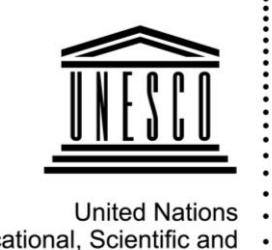
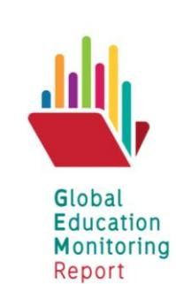

<!-- A2.R29 | source: papers_json/A2.R29/ -->

United Nations
Educational, Scientific and
Cultural Organization

Background paper prepared for the Arab States 2019 Global Education Monitoring Report

*Migration, displacement and education: * *Building bridges,* *not walls*

## INTERNATIONALIZATION OF HIGHER EDUCATION IN THE COUNTRIES OF THE GULF COOPERATION COUNCIL: IMPACT ON THE NATIONAL LANGUAGE

*This paper was commissioned by the Global Education Monitoring Report as background information * *to assist in drafting the Arab States* *2019* *GEM Report, Migration, displacement and education: * *Building* *bridges,* *not walls. It has not been edited by the team. The views and opinions expressed in * *this paper are those of the author(s) and should not be attributed to the Global Education Monitoring * *Report or to UNESCO. The papers can be cited with the following reference: "Paper commissioned for * *the Arab States 2019* *Global Education Monitoring Report, Migration, displacement and education: * *Building* *bridges,* *not walls". For further information, please contact**[ gemreport@unesco.org.](mailto:gemreport@unesco.org)*

F A T I M A B A D R Y 201 9

<!-- page 2 -->

## Abstract

يندرج تدويل التعليم العالي في دول مجلس التعاون الخليجي (GCC) ضمن تحول شامل لمنطقة الخليج العربي من مجتمعات قبلية في معظمها إلى دول حديثة تطمح إلى أن تصبح رائدة عالمياً في اقتصادات المعرفة في القرن الحادي والعشرين. وفي العقود الستة الأخيرة، وبفضل ثروتها النفطية، حققت دول مجلس التعاون الخليجي خطوات كبيرة في تطوير بنيتها التحتية الاجتماعية والاقتصادية والتعليمية. وقد وسّعت هذه الدول نظامها التعليمي عبر تبني التدويل من أجل تحقيق مساواة أكبر بين الجنسين، وتوسيع فرص الوصول، وزيادة الخيارات، وترسيخ التسامح وتقدير التنوع. ويتم تنفيذ التدويل من خلال استيراد النماذج التعليمية الغربية، والكوادر الأكاديمية والمؤسسات، وإقامة شراكات مع مؤسسات التعليم العالي الدولية، واعتماد اللغة الإنجليزية كوسيط للتدريس. ومن أبرز التحديات تنفيذ سياسات لغة التعليم التي تستند إلى السياقات اللغوية والاجتماعية للمنطقة. ويناقش هذا التقرير أثر ممارسات التدريس باللغة الإنجليزية على محو الأمية بالعربية في غياب سياسات صريحة لثنائية اللغة، مصممة لتنمية كفاءات الطلاب في كل من الإنجليزية كلغة دولية والعربية كوسيط لإنتاج المعرفة، بما يتوافق مع الرؤى الوطنية الرسمية لدول مجلس التعاون الخليجي.

## Introduction

يشمل تدويل التعليم العالي (HE) حركة الطلاب والمؤسسات والنماذج التعليمية والبرامج وأعضاء هيئة التدريس والإداريين عبر الحدود الوطنية. ومع مطلع القرن الحادي والعشرين، أصبحت التصنيفات العالمية للمؤسسات، والعلامة التجارية، والدورات عن بُعد والإلكترونية، ومنح الامتيازات، وإنشاء الشبكات، واستخدام اللغة الإنجليزية كوسيط للتدريس (EMI) جزءاً من عمليات التدويل أيضاً (Spring 2015; THE, 2017). وعلى الرغم من الفوائد العديدة المرتبطة بالتدويل، لا يزال استخدام EMI في المناطق غير الناطقة بالإنجليزية موضع جدل. فمؤيدوه يرون فيه طريقاً مختصراً للوصول إلى أحدث المعارف، مما يمكّن الخريجين من أن يصبحوا محركين للتنمية الاقتصادية لبلدانهم، بينما يرى معارضوه أن EMI يقلل من قيمة اللغات الوطنية في التعليم، ويحدّ من إنتاج البحث باللغة الأم، ويضعف الهوية الوطنية والثقافية.

يستعرض هذا التقرير ممارسات تدويل التعليم العالي في دول مجلس التعاون الخليجي الست: مملكة البحرين، ودولة الكويت، والمملكة العربية السعودية (KSA)، وسلطنة عمان، ودولة قطر، والإمارات العربية المتحدة (UAE). ويستكشف كيف قللت ممارسات التدويل من أهمية الآثار طويلة المدى لسياسات EMI على تطور اللغة العربية، وكيف لا تتوافق هذه الممارسات مع بيانات الرؤية الوطنية التي تؤكد أهمية اللغة العربية ودلالتها التاريخية لهوية هذه الدول. ويشير التقرير إلى الحاجة لسياسات صريحة لثنائية اللغة، تستند إلى السياقات اللغوية والاجتماعية للمنطقة، وتهدف إلى تنمية كفاءات الطلاب في الإنجليزية كلغة دولية والعربية كوسيط لإنتاج المعرفة، بما يتماشى مع الرؤى الوطنية الرسمية لدول مجلس التعاون الخليجي.

## Internationalization of higher education in GCC countries

أدى تصنيف الخدمات التعليمية كسلعة بموجب الاتفاقية العامة لتجارة الخدمات (GATS) الصادرة عن منظمة التجارة العالمية (WTO) عام 1995 إلى توسيع التجارة العالمية في التعليم وتسريع تدويله (Spring, 2015). ومع بداية القرن الحادي والعشرين، أدت البيئة السياسية المتغيرة

<!-- page 3 -->

الناتجة عن أحداث الحادي عشر من سبتمبر عام 2001، وما تلاها من خروج بريطانيا من الاتحاد الأوروبي (Brexit)، والترامبية، وصعود الحركات القومية والمعادية للهجرة في أوروبا والولايات المتحدة، إلى تغيير اتجاه هذه الحركة، وأدت إلى انخفاض في حركة الطلاب نحو الغرب وزيادة في حركة مقدمي التعليم الغربيين نحو الشرق. وتُعد دول مجلس التعاون الخليجي من بين الدول التي شهدت هذا التحول في العقدين الأخيرين، إذ رحّبت باستيراد خدمات ونماذج التعليم العالي إلى بيئة تعليمها العالي الحديثة نسبياً.

في العقود الستة الأخيرة، وبفضل ثروتها النفطية، شهدت دول مجلس التعاون الخليجي تحولاً جذرياً في مجتمعاتها من مجتمعات قبلية في معظمها إلى دول حديثة تطمح إلى أن تكون رائدة في اقتصادات المعرفة في عالم القرن الحادي والعشرين المعولم. ويُعد التعليم العالي أحد القطاعات التي شهدت نمواً لافتاً خلال فترة زمنية قصيرة نسبياً. فأول جامعة حكومية، وهي جامعة الملك سعود في المملكة العربية السعودية، لا يعود تاريخها إلا إلى عام 1957، تلتها جامعة الكويت عام 1966، وجامعة قطر عام 1973، وجامعة الإمارات العربية المتحدة (UAEU) عام 1976، وجامعة السلطان قابوس (عمان) وجامعة البحرين عام 1986 (Badry and Willoughby, 2016). وقد أُنشئت هذه الجامعات على نموذج الجامعات العربية، بشكل رئيسي من قِبل أكاديميين من مصر وسوريا ولبنان والأردن والعراق. غير أنه بحلول نهاية القرن العشرين، تصاعد الانتقاد لفشل النموذج الجامعي العربي في تخريج طلاب يمتلكون المهارات التي تتطلبها أسواق العمل المعولمة في اقتصادات المعرفة. وجاء انتقاد آخر من الحكومات الأمريكية والأوروبية التي اتهمت التعليم في العالم الإسلامي بنشر أيديولوجيات دينية متشددة وتعصب وإرهاب إسلاموي. وفي أعقاب أحداث الحادي عشر من سبتمبر، طُولبت الدول الإسلامية بتنفيذ إصلاحات لتحديث أنظمتها التعليمية من أجل تعزيز التسامح والقيم العالمية (أي الغربية) (Moini et al. 2009).

ولإصلاح جامعاتها الحكومية وتحسين الجودة، توجهت حكومات دول مجلس التعاون الخليجي نحو الغرب من خلال تشجيع الشراكات مع المؤسسات الأجنبية، ودعوة الفروع الجامعية، وفتح السوق التعليمي أمام الخصخصة. واستندت هذه الإصلاحات بشكل عام إلى توصيات منظمات دولية مثل برنامج الأمم المتحدة الإنمائي (UNDP)، ومنظمة التعاون الاقتصادي والتنمية (OECD)، والبنك الدولي (UNDP 2004, OECD, 2008)، واستندت إلى حد كبير إلى نموذج اقتصادي ونظرية رأس المال البشري للتعليم (Spring, 2015). ودعت الإصلاحات إلى اعتماد المناهج الغربية وأساليب التدريس ومعايير التقييم المستندة إلى أطر دولية مثل الإطار الأوروبي للمؤهلات (EQF) وإطار بولونيا (الإطار الأوروبي لمؤهلات التعليم العالي) (CAA, 2012). وكان أحد العناصر الرئيسية للتدويل هو التحول من العربية إلى الإنجليزية كوسيط للتدريس (EMI)، والتي يُعتقد أنها "الأداة الأساسية لتحسين جودة التعليم والتعلم" (Barnawi and Al Hawsawi 2017, p. 213). وقد أُوكل تصميمها وتنفيذها إلى مجموعات استشارية دولية، وأعضاء هيئة تدريس ومسؤولين جامعيين وافدين تلقوا تعليمهم في الغرب وشكّلوا أغلبية الأكاديميين (من 80% إلى 95%) في الجامعات غير الحكومية (Hamdan, 2013; KHDA, 2016; Le Haa and Barnawi, 2015). وفي العقد الأول من الألفية، شهد التعليم العالي توسعاً استثنائياً، خصوصاً في قطاعه غير الحكومي، لتلبية الطلب المتزايد من المواطنين وأبناء المقيمين الوافدين المستقرين في دول مجلس التعاون الخليجي لدعم اقتصاداتهم المزدهرة. وقد تحقق التدويل من خلال عدد من العمليات. فضّلت البحرين والمملكة العربية السعودية والكويت وعمان إقامة شراكات بين المؤسسات المحلية والجامعات الغربية، بينما دعت الإمارات وقطر أيضاً مؤسسات أجنبية لفتح فروع جامعية، مع تقديم حوافز مالية كبيرة لها. بالإضافة إلى ذلك، أطلق الحكام المحليون والمواطنون الأثرياء مؤسسات خاصة قائمة على نماذج الجامعات الأمريكية في أنحاء المنطقة (Badry and Willoughby, 2016; Barnawi, 2017; Barnawi and Al Hawsawi, 2017; Hayes, 2018; Le Haa and Barnawi, 2015; Mahboob and Ilyas, 2017).

<!-- page 4 -->

## Strategies and policies regulating internationalized higher education in GCC countries

تبنّت مراسيم وممارسات متعددة تدويل التعليم العالي للتعامل مع التحديات العالمية. ويعطي النهج المتبع تجاه اللغة الأولوية لتعليم الإنجليزية، استناداً إلى افتراض أن خريجي دول مجلس التعاون الخليجي يجب أن يطوروا مهارات تواصل متقدمة بالإنجليزية للمنافسة في سوق عمل معولم بشكل متزايد. فعلى سبيل المثال، أدخلت المراسيم الملكية السعودية رقم 171 بتاريخ 14/08/2004 ورقم 160 بتاريخ 02/05/2011 اللغة الإنجليزية في مراحل ما قبل الجامعة لإعداد الطلاب للدراسة بالإنجليزية في المراحل الجامعية؛ وفي عام 2015، عزز برنامج "التعليم من أجل المهنة" الوزاري تعليم الإنجليزية لأغراض الجامعة والمهنة (Barnawi et. al. 2017, p. 200). وفي البحرين، تمثل الاستراتيجية الوطنية للتعليم العالي 2014-2024 "مشاركة استراتيجية في تدويل التعليم العالي... من خلال الاستفادة من شراكات عالمية قوية للمساعدة في تعزيز جودة وتنوع التعليم بوتيرة أسرع." ومن بين النتائج المتوقعة إنتاج "مواطنين عالميين جاهزين للعمل" (Higher Education Council. p. 38). وتهدف الخطة الاستراتيجية القطرية 2017-2022 إلى تعزيز قدرة القطريين على المساهمة الفعالة في القوى العاملة والمجتمع القطري... (The Peninsula, 2017)، بينما تهدف الاستراتيجية الوطنية للتعليم العالي في الإمارات إلى "تقديم نموذج تعليمي حديث وعالمي للطلاب الإماراتيين" (*Gulf News,* 2017).

وتقوم مختلف النُهج المتبعة لتنفيذ هذه الاستراتيجيات على فرضية مشتركة مفادها أن تدويل التعليم العالي (بما في ذلك EMI) هو أقصر طريق لتنمية موارد بشرية قادرة على تشغيل اقتصادات المعرفة في دول مجلس التعاون الخليجي. ففي المملكة العربية السعودية، تُشجَّع الجامعات والكليات على توقيع عقود تعاون وشراكات مع جامعات دولية، ويمكن للجهات المحلية الحصول على امتيازات تعليمية دولية لفتح مؤسسات جامعية محلياً (Barnawi et al. 2017; Hamdan, 2013). وتُتبع ترتيبات مماثلة في البحرين والكويت وعمان. وفي قطر، دعت مؤسسة قطر (QF) جامعات أمريكية مرموقة (وجامعات غربية أخرى)، مثل جامعة فيرجينيا كومنولث، وجامعة جورجتاون، وكارنيجي ميلون، وجامعة كورنيل، وجامعة نورثوسترن، وتكساس إيه آند إم، لفتح فروع جامعية في تخصصات مختارة ضمن مدينة قطر التعليمية المُنشأة حديثاً (Badry and Willoughby, 2016; Moini, et.al., 2009). أما في الإمارات، فهناك ترتيبات متعددة. فقد تبنّت إمارة أبوظبي نموذجاً مشابهاً لنموذج قطر بدعوة جامعة نيويورك أبوظبي (NYUAD) وجامعة السوربون، لكنها شجّعت أيضاً إنشاء عدة جامعات خاصة. وأنشأت دبي مناطق تعليمية حرة مثل قرية المعرفة ومدينة دبي الأكاديمية، حيث تقدم الفروع الجامعية وكذلك الجامعات الخاصة خدمات تعليمية. وقد استضافت مدينة الشارقة الجامعية، التي أنشأها حاكم الشارقة عام 1997، مؤسسات خاصة قائمة على النموذج الأمريكي.

بصرف النظر عن العملية المتبعة، تفتقر استراتيجيات التدويل في دول مجلس التعاون الخليجي إلى سياسة صريحة لثنائية اللغة في التعليم توازن بين تحسين مهارات العربية والإنجليزية. فاعتماد الإنجليزية كوسيط للتدريس (وليس كلغة أجنبية/ثانية) لا يقترن بحلول عملية لتحسين كفاءات اللغة العربية، رغم الاعتراف الواسع بأن مستويات محو الأمية بالعربية لدى طلاب دول مجلس التعاون الخليجي آخذة في التراجع. وتتعارض هذه النُهج مع إعلانات دول مجلس التعاون الخليجي التي تؤكد أهمية اللغة والثقافة العربية كركيزة للهوية الوطنية. فعلى سبيل المثال، تهدف رؤية السعودية 2030 إلى "تعزيز الهوية الوطنية والحفاظ عليها وإبرازها بحيث توجّه حياة الأجيال القادمة... من خلال البقاء وفياً للقيم والمبادئ الوطنية، وكذلك من خلال تشجيع التنمية الاجتماعية ودعم اللغة العربية" (KSA Vision, 2030). وينص المجلس التعليمي العماني في فلسفته للتعليم (Oman Vision, 2017, p. 20) على أن: "المواطنة تنطوي على شعور بالانتماء إلى الوطن وإلى هويته العربية والإسلامية." وبالمثل، تؤكد رؤية قطر الوطنية 2030 أنه: "رغم المكاسب الاقتصادية والاجتماعية السريعة، والتغير السياسي، حافظت قطر على قيمها الثقافية والتقليدية كأمة عربية وإسلامية..." (QNV 2008, p.1)، وتؤكد الإمارات في رؤيتها 2021 أن "العربية

<!-- page 5 -->

ستعود لتكون لغة حيوية ونابضة بالحياة، تُعبّر عن نفسها في كل مكان نطقاً وكتابة كرمز حي للقيم العربية الإسلامية التقدمية للأمة" (UAE Vision 2021, p. 4).

## Challenges from internationalization of higher education in GCC countries

استفاد شباب دول مجلس التعاون الخليجي من بعض جوانب تدويل التعليم العالي، مثل المساواة بين الجنسين، وتنوع المشهد التعليمي الذي يوفر خيارات أوسع، والوصول إلى المعرفة العالمية عبر الإنجليزية. وقد رفع هذا مكانة عدة جامعات سعودية وإماراتية لتصنَّف ضمن أفضل 500 مؤسسة دولية (QS world university rankings, 2018). ومع ذلك، حقق التدويل نجاحات متواضعة في تحقيق النتائج الاقتصادية المتوقعة. فهدف توطين القوى العاملة لا يزال بعيد المنال، وتظل نسبة المواطنين العاملين في القطاع الخاص ضئيلة في دول مثل قطر والإمارات (أقل من 1% و5% على التوالي). وتواصل اقتصادات دول مجلس التعاون الخليجي اعتمادها على العمالة الأجنبية والمهنيين الوافدين لتوسيع قطاعها الخاص، رغم أنظمة الحصص الحكومية والحملات المكثفة لتشجيع مواطني دول مجلس التعاون الخليجي على الانضمام إلى القطاع الخاص. ويشتكي قادة الأعمال من أن الموظفين المواطنين يفتقرون إلى المهارات النقدية والتحليلية والتقنية والابتكارية والتواصلية اللازمة لقيادة اقتصادات المعرفة في القرن الحادي والعشرين (Hayes, 2018; Le Haa and Barnawi 2015). ووفقاً للبنك الدولي، "رغم الاستثمارات الكبيرة في التعليم على مدى الخمسين عاماً الماضية، والنمو اللافت في معدلات الالتحاق، والتكافؤ بين الجنسين في جميع مراحل التعليم تقريباً، لم تتمكن منطقة الشرق الأوسط وشمال أفريقيا (MENA) من جني الفوائد الشخصية والاجتماعية والاقتصادية الكاملة للتعليم" (World Bank, 2019, p. ix).

لم يُمكّن التدويل المنطقة من تحسين الجودة بشكل ملحوظ أو بناء "بنية تحتية علمية وتكنولوجية كافية لاستيعاب المعرفة وتطبيقها وابتكارها" (UNESCO, 2018, p. 8). ولا تزال المنطقة مستهلكة للمعرفة أكثر من كونها منتجة لها، ويعود ذلك جزئياً إلى نقص التمويل المناسب للبحث العلمي. ورغم استثمار دول مجلس التعاون الخليجي بكثافة في التعليم، بما في ذلك تقديم حوافز مالية كبيرة للفروع الجامعية والشراكات الدولية وخدمات الاستشارات، لا تتجاوز نسبة الإنفاق على البحث والتطوير 1% من الناتج المحلي الإجمالي (UNESCO, 2018, p.15). إضافة إلى ذلك، فإن القيود الاجتماعية المفروضة على الوصول إلى البيانات، خصوصاً في العلوم الاجتماعية، لا تسهّل إجراء البحوث في بعض أجزاء المنطقة.

وقد أدت سياسات EMI إلى تحديات اجتماعية وتوترات سياسية، مع معارضة من كل من الجماعات التقدمية والمحافظة في مجتمعات دول مجلس التعاون الخليجي. وعلى الرغم من اختلاف الأسباب، أدان كلا الطرفين تراجع مكانة اللغة العربية في التعليم. واستجابةً لذلك، غيّرت الحكومات مسارها في بعض الحالات وأعادت اعتماد العربية كوسيط للتعليم في الجامعات الحكومية، كما هو الحال في جامعة قطر عقب اعتراضات الحركات الإسلامية المحافظة. وفي عام 2019، وقّع أمير قطر قانوناً ينص على أن "جامعات ومؤسسات التعليم العالي في دولة قطر [يجب أن] تدرّس باللغة العربية وتجري الدراسات والبحوث العلمية بالعربية أيضاً" (Abdulmalik, 2019). واتخذت حتى الفروع الجامعية خطوات للرد على انتقادات أخرى. فقد أطلقت كلية الخدمة الخارجية بجامعة جورجتاون في قطر (SFS-Q) برنامجاً لتعليم اللغة العربية لطلاب تخصصات الأعمال والإعلام "لتوسيع القدرة على القراءة والكتابة بأوضح مستويات العربية" أثناء الدراسة بالإنجليزية. وتبنّت الجامعات الحكومية الإماراتية نهجاً مشابهاً (Mahboob & Ilyas, 2017; Badry, 2016; Selvi and Yazan, 2017). ومع ذلك، يستمر الدفع نحو الإنجليزية بشكل عام رغم المعارضة، كما يلاحظ برناوي والحوساوي (2017، ص 201) في وصفهما للتوترات في السعودية.

ففي حين يسعى ناشطون إسلاميون إلى الضغط على المسؤولين الحكوميين لعرقلة الجهود الرامية إلى تعليم الإنجليزية للناشئة والبالغين على حد سواء، تواصل حكومات داعمة للأعمال، وجامعات نيوليبرالية، وهيئات مؤسسية، بالتعاون مع معاهد دولية، الترويج بقوة لفرض الإنجليزية بوصفها "تميزاً أكاديمياً عالمياً"، سعياً إلى تشكيل التصور العام حول مزاياها المفترضة في بناء القدرات المحلية.

<!-- page 6 -->

لم تُترجم العديد من المبادرات الرامية إلى حماية اللغة العربية إلى ممارسات فعلية في التعليم العالي. فقد أطلق قادة الإمارات "الميثاق العربي" لتعزيز اللغة العربية ومراكز التميز لتطوير استخدام العربية في التقنيات الرقمية والترجمة عام 2012 (Emirates24/7, 2012). وفي عام 2018، أُعلن عن مشروع لإنشاء أكاديمية اللغة العربية في جامعة الإمارات العربية المتحدة (Ednet, 2018). وتُعد البحرين والكويت وعمان من الوافدين المتأخرين نسبياً إلى التدويل، لكنها ليست بمنأى عن الانتقاد. فقد كانت أبطأ في تنفيذ EMI في نظام التعليم الحكومي، حيث لا تزال العربية اللغة الرئيسية للتدريس، بينما بدأ إدخال الإنجليزية كلغة أجنبية في وقت أبكر في مرحلة ما قبل الجامعة (Hayes, 2015).

ليست منطقة مجلس التعاون الخليجي الجزء الوحيد من العالم الذي يتعين عليه التعامل مع هيمنة الإنجليزية في ظل العولمة. فالدول الأخرى غير الناطقة بالإنجليزية في أوروبا وآسيا تدرك هيمنة الإنجليزية في اقتصادات المعرفة وأهميتها في الوصول إلى البحث العلمي والتكنولوجيا. غير أنها نجحت في الحفاظ على لغاتها الأم في التعليم (مثل الفرنسية والألمانية والإسبانية والكورية والروسية والصينية واليابانية، وغيرها) مع تبني استخدام الإنجليزية كلغة إضافية. أما في دول مجلس التعاون الخليجي، فقد أدى تبني الإنجليزية في غياب سياسات لغوية صريحة متكيفة مع العوامل السياقية واللغوية إلى تهميش فعلي للغة العربية. اجتماعياً، يشكّل الأجانب ما بين 60% و80% من السكان، والإنجليزية هي لغة التواصل المشترك في الأعمال والتواصل التقني. ومحو الأمية بالعربية سلعة منخفضة القيمة في سوق العمل رغم أنها لا تزال اللغة الرسمية. إضافة إلى ذلك، تُنظر إلى العربية على أنها لغة صعبة، ويعود ذلك جزئياً إلى منهجيات التدريس التقليدية التي تتجاهل خصائص لغوية مهمة للعربية نابعة من طبيعتها الازدواجية (diglossic) (Lamine, 2010). وتصف الازدواجية اللغوية (Diglossia) حالة تتعايش فيها لهجتان جنباً إلى جنب في توزيع تكاملي داخل مجتمع لغوي واحد. تُكتسب العربية المحكية (SVA) كلغة أم تُستخدم في المنزل والتواصل اليومي غير الرسمي. أما اللهجة الثانية، وهي العربية الفصحى الحديثة (MSA)، فتُتعلم في المدرسة ويعتمد إتقانها على استخدامها في التعليم لأن وظيفتها تقتصر اجتماعياً على التواصل الرسمي والكتابة. ولنجاح تعليم اللغة العربية، لا بد من الاعتراف بالفروق اللغوية المهمة بين اللهجتين ومعالجتها (Badry, 2004; Saeigh-Haddad and Schiff, 2016; World Bank, 2019). ومع ذلك، تواصل منهجيات التدريس الحالية تجاهل تحدي الازدواجية اللغوية بافتراض أن الانتقال من العربية المحكية إلى الفصحى الحديثة يتم تلقائياً. وقد يُولّد الفشل في التعامل مع هذه الفروق في التدريس مواقف سلبية لدى المتعلمين الذين يرون الفصحى الحديثة لغة صعبة.

ومن التحديات الأخرى القيمة المُعطاة للبحث باللغة العربية في توظيف وترقية أعضاء هيئة التدريس والتصنيفات الجامعية العالمية. فقواعد البيانات الدولية الكبرى، مثل Scopus التابعة لإلسفير، وWeb of Science، وGoogle Scholar، وغيرها، لا تفهرس المجلات الصادرة باللغة العربية، مما يؤدي إلى نقص تمثيل البحث العربي على الساحة الدولية. فمن بين نحو 300 مجلة أكاديمية باللغة العربية، لا يُدرج في Scopus حالياً سوى مجلتين فقط، مما يحد من انتشار المنشورات العربية. ونتيجة لذلك، لا تتوفر لدى الأكاديميين العرب حوافز تُذكر للنشر بالعربية (al hamami, 2015). وللمنافسة عالمياً واستيفاء متطلبات التوظيف والترقية، يتعين على الأكاديميين النشر في المجلات الأكاديمية الإنجليزية المفهرسة (Barnawi and Al Hawsawi, 2017; Kirkpatrick and Barnawi, 2017). وقد يُتيح إطلاق مؤشر الاستشهاد العربي الأول (ARCI)، وهو مبادرة مشتركة بين Clarivate Analytics وبنك المعرفة المصري، والمقرر أن يبدأ عام 2020، "تسهيل الوصول إلى البحث العلمي العربي... من خلال تعزيز البصمة الأكاديمية العربية وتحسين تصنيفات الجامعات في نهاية المطاف" (Sawahel, 2018).

وقد وسّع التدويل مشهد التعليم العالي، لكن في غياب استراتيجيات طويلة المدى تجمع بين التحديث وسياسات ثنائية اللغة الواضحة، قد ينتهي به الأمر إلى تهديد أصالة واستقلالية التعليم العالي. فسياسات EMI تُطيل أمد الاعتماد على الغرب في التدريس والمناهج، وتُبطئ تقدم اللغة العربية كأداة لإنتاج المعرفة. كما أنها تُرسّخ "وعياً مُستعمَراً

<!-- page 7 -->

حيث يُنظر إلى اللغة الأولى على أنها نوع من الإعاقة بدلاً من كونها مورداً يجب الاستفادة منه" (Phillipson مقتبس في Arfan, 2014, p. 52).

## Conclusion

جرى تبني التدويل في إصلاحات التعليم العالي بدول مجلس التعاون الخليجي، استناداً إلى أهداف اقتصادية بالدرجة الأولى، باعتباره أقصر وسيلة لدفع المنطقة نحو الاقتصادات الرائدة في القرن الحادي والعشرين. وقد أفاد التدويل المنطقة من خلال تحسين فرص الوصول والاختيار، خصوصاً للإناث اللواتي كانت حركتهن نحو الغرب محدودة، واللواتي يمكنهن الآن متابعة التعليم العالي في بلدانهن. كما حرّر التدويل التعليم وأتاح أنماطاً جديدة ومتعددة لتقديمه، وفتح المجال أمام البحث النقدي والتحليل والابتكار. وأخيراً، أتاح الوصول إلى المعرفة العالمية والفرص الاقتصادية. ومع ذلك، ورغم الاستثمارات الضخمة والإصلاحات المتعددة، لا تزال العوائد دون النتائج المتوقعة حتى عند قياسها بمقاييس اقتصادية. ومن الناحية اللغوية، أعطى التدويل، كما مُورس في المنطقة، الأولوية للسرعة العملية عبر EMI على حساب بناء تعليم عالٍ أصيل ومستدام يدعم دور اللغة العربية كما أكدته رؤى دول مجلس التعاون الخليجي. وفي غياب سياسات صريحة لثنائية اللغة تعترف بالتحديات السياقية واللغوية التي تواجه العربية وتحدد سبل التعامل معها، تفقد اللغة العربية تدريجياً موقعها لصالح EMI في تعليم دول مجلس التعاون الخليجي على جميع المستويات. وقد أدى نقل أنظمة تعليمية منفصلة عن السياقات الاجتماعية-التاريخية والسياسية والثقافية واللغوية المحلية إلى الحد من فوائد التدويل، وخلق تنافر معرفي بين المعتقدات الراسخة بأن شبه الجزيرة العربية هي مهد الهوية العربية والإسلامية، والتصور القائل بأنه للانتماء إلى مجتمعات المعرفة المستقبلية، يحتاج المرء إلى قبول التخلي عن لغته وربما جزء من هويته.

## References

- Abdulemalek. A. 27 January, 2019. New law: Protecting Arabic language. *The Peninsula. Qatar Daily * *newspaper. *[https://www.thepeninsulaqatar.com/opinion/27/01/2019/New-law-Protecting-Arabic](https://www.thepeninsulaqatar.com/opinion/27/01/2019/New-law-Protecting-Arabic-language)[language](https://www.thepeninsulaqatar.com/opinion/27/01/2019/New-law-Protecting-Arabic-language)
- al Hamami, M. 2015. Teaching science subjects in Arabic: Arab university scientists' perspective. *[Language ](https://search-proquest-com.aus.idm.oclc.org/education/pubidlinkhandler/sng/pubtitle/Language+Learning+in+Higher+Education/$N/2031323/PagePdf/1789278792/fulltextPDF/9DF5B83A2A23410EPQ/5?accountid=16946)* *[Learning in Higher Education.](https://search-proquest-com.aus.idm.oclc.org/education/pubidlinkhandler/sng/pubtitle/Language+Learning+in+Higher+Education/$N/2031323/PagePdf/1789278792/fulltextPDF/9DF5B83A2A23410EPQ/5?accountid=16946)** *Berlin Vol.5, No.1,[ p](https://search-proquest-com.aus.idm.oclc.org/education/indexingvolumeissuelinkhandler/2031323/Language+Learning+in+Higher+Education/02015Y01Y01$232015$3b++Vol.+5+$281$29/5/1?accountid=16946)p. 105-12
- Arfan, I. 2014. Philosophy, language policy and the knowledge society. In Wiseman, A. W, Alromi, N. H. & Alshumrani S. (eds.). *Education for a Knowledge Society in * *Arabian Gulf Countries. *Emerald Publishing Limited.
- Badry, F. 2004. *Acquiring the Arabic Lexicon: Evidence of productive strategies and pedagogical * *implications*. Bethesda, MD: Academica Press.
- Badry, F. 2019. Expanding the UAE's higher education horizon: Path towards a sustainable future. In Gallagher, K. (ed.). *Education in the United Arab Emirates: Innovation and transformation.* Singapore: Springer. 57-73
- Badry, F. and Willoughby, J. 2016. *Higher education revolutions in the Gulf: Globalization and institutional * *viability*. Routledge Advances in Middle East and Islamic Studies. NY: Routledge
- Bahrain vision 2030. From Regional Pioneer to Global Contender. The economic vision 2030 for Bahrain. [http://www.moic.gov.bh/en/Ministry/bahrain-economic-vision-2030](http://www.moic.gov.bh/en/Ministry/bahrain-economic-vision-2030)
- Barnawi, O. 2018. *Neoliberalism and English language education policies in the Arabian Gulf.* Routledge research in language education. Abingdon, Oxon: Routledge.

<!-- page 8 -->

- Barnawi, O. Z. and al-Hawsawi S. 2017. English language education policy in the Kingdom of Saudi Arabia: Current trends, issues and challenges. In Kirkpatrick, R. (ed.), *English Language Education Policy in the * *Middle East and North Africa. *Language Policy 13*.* Springer International Publishing. Pp. 199- 222. DOI 10.1007/978-3-319-46778-8_12
- CAA (Commission for Academic Accreditation). September, 2012. *Extracts from the Qualifications * *Framework Emirates Handbook and Implementation of QF Emirates in Higher Education.* Ministry of Higher Education and Scientific Research. UAE. [https://www.nqa.gov.ae/EN/NQAWEBOPENDATADOCUMENTS/f890c24f-c73c-4ef2-b4c2-](https://www.nqa.gov.ae/EN/NQAWEBOPENDATADOCUMENTS/f890c24f-c73c-4ef2-b4c2-613d44945061/PDF/Extract%20QFEmirates_Higher%20Education.pdf) [613d44945061/PDF/Extract%20QFEmirates_Higher%20Education.pdf](https://www.nqa.gov.ae/EN/NQAWEBOPENDATADOCUMENTS/f890c24f-c73c-4ef2-b4c2-613d44945061/PDF/Extract%20QFEmirates_Higher%20Education.pdf)
- Ednet. 2018. UAE University launches Arabic Language Academy. [http://ednet.ae/stories/uae-university](http://ednet.ae/stories/uae-university-launches-arabic-language-academy)[launches-arabic-language-academy](http://ednet.ae/stories/uae-university-launches-arabic-language-academy)
- EMIRATES24/7. MOHAMMED UNVEILS ARABIC LANGUAGE CHARTER. [HTTPS://WWW.EMIRATES247.COM/NEWS/GOVERNMENT/MOHAMMED-UNVEILS-ARABIC-LANGUAGE-](https://www.emirates247.com/news/government/mohammed-unveils-arabic-language-charter-2012-04-23-1.455274)[CHARTER-2012-04-23-1.455274)](https://www.emirates247.com/news/government/mohammed-unveils-arabic-language-charter-2012-04-23-1.455274).
- Gulf News. 13 December, 2017. Ministry of Education launches National Higher Education Strategy. [https://gulfnews.com/uae/education/ministry-of-education-launches-national-higher-education](https://gulfnews.com/uae/education/ministry-of-education-launches-national-higher-education-strategy-1.2140696)[strategy-1.2140696](https://gulfnews.com/uae/education/ministry-of-education-launches-national-higher-education-strategy-1.2140696)
- Hamdan, A. 2013. An Exploration into 'Private' Higher Education in Saudi Arabia: Improving Quality and Accessibility? *[The ACPET Journal for Private Higher Education.](https://search-proquest-com.aus.idm.oclc.org/pubidlinkhandler/sng/pubtitle/The+ACPET+Journal+for+Private+Higher+Education/$N/1766335/DocView/1511016288/fulltext/C883041836624804PQ/9?accountid=16946)* East Melbourne, Vol. 2[, No.](https://search-proquest-com.aus.idm.oclc.org/indexingvolumeissuelinkhandler/1766335/The+ACPET+Journal+for+Private+Higher+Education/02013Y12Y01$23Dec+2013$3b++Vol.+2+$282$29/2/2?accountid=16946) 2, pp. 33-44.
- Hayes, A. 2018. Deconstructing the 'magnetic' properties of neoliberal politics of education in Bahrain. *Globalisation, Societies and Education.**[ http://eprints.keele.ac.uk/1590/1/pre-print%20revision.pdf](http://eprints.keele.ac.uk/1590/1/pre-print%20revision.pdf)*
- Higher Education Council. *National Higher Education Strategy: Putting higher education at the heart of the * *nation. Bahrain 2014-2024*. [http://moedu.gov.bh/hec/UploadFiles/Bahrain%20Higher%20Education%20Strategy%20-](http://moedu.gov.bh/hec/UploadFiles/Bahrain%20Higher%20Education%20Strategy%20-%20Summary.pdf) [%20Summary.pdf](http://moedu.gov.bh/hec/UploadFiles/Bahrain%20Higher%20Education%20Strategy%20-%20Summary.pdf)
- KHDA. 2016. *From now to next. The last ten years of private education in Dubai and beyond. Dubai private * *education landscape, 2016-17* [https://www.khda.gov.ae/Areas/Administration/Content/FileUploads/Publication/Documents/English/2](https://www.khda.gov.ae/Areas/Administration/Content/FileUploads/Publication/Documents/English/20170615112154_KHDALandscape2016-17__English.pdf) [0170615112154_KHDALandscape2016-17__English.pdf](https://www.khda.gov.ae/Areas/Administration/Content/FileUploads/Publication/Documents/English/20170615112154_KHDALandscape2016-17__English.pdf)
- Kirkpatrick R. and Barnawi, O. Z. 2018. Introduction: English Language Education Policy in MENA. R. Kirkpatrick, op. cit., pp. 8-12
- Lamine, B. (ed). 2010. Towards an Arab higher education space: International challenges and societal responsibilities. *Proceedings of the Arab Regional Conference on Higher Education*. Held in Cairo 31 May, 1-2 June, 2010. Beirut, Lebanon: UNESCO Regional Bureau for Education in the Arab States.
- Le Haa, P. and Barnawi O. Z. 2015. Where English, neoliberalism, desire and internationalization are alive and kicking: higher education in Saudi Arabia today *Language and Education. *Vol. 29, No. 6, pp. 545- 565,[ http://dx.doi.org/10.1080/09500782.2015.1059436](http://dx.doi.org/10.1080/09500782.2015.1059436)
- Mahboob, A. and Ilyas, T. 2017. Introduction: Challenges to education in the GCC during the 21st century. In Mahboob, A. and Ilyas, T. (eds). *Challenges to education in the GCC during the 21st Century*. Cambridge, UK: Gulf Research Centre. pp.13- 18. ISBN: 78-1-909864-16-0
- Mahboob, A., Ilyas, T. and al Issa, A. 2018. *Shaping the Future of the GCC Countries through language policy * *and planning: Concepts, challenges and aspirations workshop 7*. Cambridge, UK: Gulf Research Centre.
- Ministry of Education Bahrain. [http://moedu.gov.bh/hec/Page.aspx?page_key=private_heis_contact_info](http://moedu.gov.bh/hec/Page.aspx?page_key=private_heis_contact_info)
- Moini, J.S, Bikson, T.K., Neu, C.R. and Desisto, L. 2009. *The reform of Qatar University*. RAND corporation. National Agenda. 2019. Ministry of Cabinet Affairs and The Future. [https://uaecabinet.ae/en/national](https://uaecabinet.ae/en/national-agenda)[agenda](https://uaecabinet.ae/en/national-agenda)
- OECD. 2008. *Tertiary education for the knowledge society (*Volumes 1 and 2). Paris: OECD.
- Oman vision 2040.[ https://www.2040.om/en/oman-vision-2040/themes/people-and-society/](https://www.2040.om/en/oman-vision-2040/themes/people-and-society/)
- QNV 2030 (Qatar National Vision). July 2008. General Secretariat For Development Planning [https://www.mdps.gov.qa/en/qnv1/Documents/QNV2030_English_v2.pdf](https://www.mdps.gov.qa/en/qnv1/Documents/QNV2030_English_v2.pdf)

<!-- page 9 -->

- QS World University Rankings. 2018.[ https://www.topuniversities.com/university-rankings/world](https://www.topuniversities.com/university-rankings/world-university-rankings/2018)[university-rankings/2018](https://www.topuniversities.com/university-rankings/world-university-rankings/2018)
- Saiegh-Haddad, E., and Schiff, R. (2016). The impact of diglossia on voweled and unvoweled word reading in Arabic: A developmental study from childhood to adolescence. Scientific Studies of Reading, 20, 311– 324. doi:10.1080/10888438.2016.1180526.
- Sawahel, W. 07 June 2018. New research index to enhance Arabic academic footprint. *University World * *News. Africa-Middle East.* [https://www.universityworldnews.com/post.php?story=20180607144307817](https://www.universityworldnews.com/post.php?story=20180607144307817)
- Selvi, A. F. & Yazan, B. 2017. English as an International Language pedagogy: A sustainable alternative for teaching English in the GCC Region. Mahboob and Ilyas op. cit., pp. 65-92
- Spring, J. 2015. *Globalization of education: An introduction*. NY: Routledge
- Sultanate of Oman. The educational Council. 2017. *The philosophy of education in Oman. *First edition [www.educouncil.gov.om;](http://www.educouncil.gov.om/) [https://www.mohe.gov.om/userupload/PDFs/](https://www.mohe.gov.om/userupload/PDFs/فلسفة%20التعليم%20في%20سلطنة%20عمان-انجليزي.pdf)انجليزي-عمان20%سلطنة20%في20%التعليم20%فلسفة.pdf
- THE [(Times Higher Education)](https://search-proquest-com.aus.idm.oclc.org/pubidlinkhandler/sng/pubtitle/Times+Higher+Education/$N/236250/DocView/1869132592/fulltext/6F7246DEB62F4F87PQ/16?accountid=16946). 2 February, 2017. The World's Most International Universities. Issue 2291. London
- UAE Vision 2021.[ http://www.dubai.ae/SiteCollectionDocuments/UAE_Vision_2021_English.pdf](http://www.dubai.ae/SiteCollectionDocuments/UAE_Vision_2021_English.pdf)
- UNDP (United Nations Development Program). 2003. Arab human development report 2003. *Building an * *Arab knowledge society*. New York: UNDP
- UNESCO. 2018. *Financing Higher Education in Arab states. *The UNESCO Regional Bureau for Education in the Arab States – Beirut, Lebanon: UNESCO. [http://www.unesco.org/new/fileadmin/MULTIMEDIA/FIELD/Beirut/video/Report.pdf](http://www.unesco.org/new/fileadmin/MULTIMEDIA/FIELD/Beirut/video/Report.pdf)
- Vision 2030. Kingdom of Saudi Arabia. National transformation program. Delivery Plan 2018-2020. *NTP * *English Public Document_KSA vision.pdf*
- Wilkins S. 2010. Higher education in the United Arab Emirates: An analysis of the outcomes of significant increases in supply and competition. *Journal of Higher Education Policy and Management, *Vol. 32*,* No, 4, pp. 389–400. doi:10.1080/1360080X.2010.491112
- World Bank. 2019. *Expectations and aspirations: A New Framework for Education in the Middle East and * *North Africa: Overview.* [http://documents.worldbank.org/curated/en/527931542039352771/pdf/131974-WP-v1-PUBLIC-nov13-](http://documents.worldbank.org/curated/en/527931542039352771/pdf/131974-WP-v1-PUBLIC-nov13-6am-33255cmp-eproof.pdf) [6am-33255cmp-eproof.pdf](http://documents.worldbank.org/curated/en/527931542039352771/pdf/131974-WP-v1-PUBLIC-nov13-6am-33255cmp-eproof.pdf)

<!-- page 10 -->

## Endnotes

> ^i^ The distinction public/ non-public institutions is used rather than public/private because even the so called private institutions and branch campuses receive generous support from governments and are subject to varying degrees of state regulations. In addition, some private universities are owned by rulers or members of their entourage.

> ii The UAE, with a population of less than 10 million people, has the highest number of branch campuses worldwide with a total of over 180 institutions (Badry, in press, Wilkins, 2010). In KSA, population 33 million, the number of tertiary institutions has jumped from 19 to about 127 and 37 international branch campuses in a decade (Hamdan, 2013). In Bahrain there are 13 non- public institutions for a population of less than 1.5 million. Kuwait has a population of 4.25 million with 4 public institutions and 7 non-public. In Oman, with a population of 4.9 there are 27 non-public universities. These figures are obtained from ministry of education websites of each country. Population estimates are obtained from[ https://www.worldometers.info/world](https://www.worldometers.info/world-population/)[population/](https://www.worldometers.info/world-population/) for each country.

> iii One of the desired attributes of the "global citizen" is the ability to communicate well in English.

> iv Qatar Foundation, launched in 1995, established the Rand-Qatar Policy Institute (RQPI) in collaboration with the RAND corporation to overhaul the country's educational system including Qatar University which experienced its first major reform in 2003. The reform included the adoption of English as a medium of instruction in most disciplines. Subsequently, the reforms led to major criticisms particularly because they ended up excluding many Qatari citizens from qualifying for admission and at the same time many Qatari faculty members could not teach in English. This led to a reversal in language in education policies with Arabic being reintroduced as a medium of instruction in social sciences and humanities.

> ^v^ There are other educational free zones in Dubai based on specialty such as the Dubai Health Care city where branches of Western medical schools are established.

> vi All GCC economies are powered by 60-80% expatriate workforce primarily in the private sector. This percentage can be as high as 90% in countries such as Qatar. Nationalization- referred to as Emiratization, Saoudization, Qatarization, Omanization, Kuwaitization and Bahrainization- is one of the major goals expected to result from education outcomes.

> vii GCC citizens are generally more attracted to public sector employment because of many benefits, such as higher salaries, automatic promotions, longer holidays, shorter working hours and attractive retirement benefits.

> viii Conservatives object to English using religious arguments to justify the need to protect from what they perceive as negative influences of Western culture and languages on Islamic societies. Progressives are opposed to EMI from a cultural and identity perspective that calls for preserving Arabic as an identity marker.
