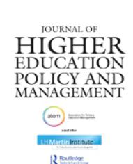

<!-- A2.R31 | source: papers_json/A2.R31/ -->

## **Journal of Higher Education Policy and Management**

**ISSN: 1360-080X (Print) 1469-9508 (Online) Journal homepage: ****[www.tandfonline.com/journals/cjhe20](https://www.tandfonline.com/journals/cjhe20?src=pdf)**

## **Connectivity for whom and for what? A normative** **dimension of education hub**

## **William** **Yat** **Wai** **Lo** **&** **Felix** **Sai** **Kit** **Ng**

**To** **cite** **this** **article:** William Yat Wai Lo & Felix Sai Kit Ng (2016) Connectivity for whom and for what? A normative dimension of education hub, Journal of Higher Education Policy and Management, 38:3, 354-368, DOI:[ 10.1080/1360080X.2016.1174403](https://www.tandfonline.com/action/showCitFormats?doi=10.1080/1360080X.2016.1174403)

**To** **link** **to** **this** **article:** [https://doi.org/10.1080/1360080X.2016.1174403](https://doi.org/10.1080/1360080X.2016.1174403)

Published online14 Apr 2016.Submit your article to this journal ↗Article views425View related articles ↗View Crossmark data ↗Citing articles: 1View citing articles ↗

<!-- page 2 -->

## Connectivity for whom and for what? A normative dimension of education hub

William Yat Wai L[oa](#page-1-0) and Felix Sai Kit Ng[b](#page-1-1)

a Department of International Education and Lifelong Learning, Hong Kong Institute of Education, Hong Kong; ^b^ Department of Applied Social Sciences, Hong Kong Polytechnic University, Hong Kong

## ABSTRACT

تتمثل حجة هذه الدراسة في أن البُعد الوصفي لمفهوم education hub، الذي يركز على أهمية connectivity في تعزيز تنافسية المكان، غير كافٍ لمعالجة القيم التعليمية في سياق عولمة higher education. لذلك، تحاول الدراسة تأسيس بُعد معياري (normative) لمفهوم education hub من خلال سرد تجريبي لتجربة مجموعة من طلاب الجامعات من Myanmar في Hong Kong، بالإضافة إلى الانخراط مع أفكار cosmopolitanisation ومفهوم higher education بوصفه حقًا "عابرًا للحدود الوطنية" (transnational). ومن خلال النظر في هذه القصص القادمة من Myanmar، تكشف هذه الدراسة عن تبني internationalisation في higher education بوصفها وسيلة لتعزيز العدالة والتنمية عبر الحدود الوطنية.

## KEYWORDS

Connectivity; Education hub; internationalisation; right to higher education; student mobility

## Introduction

مر نظام higher education في Hong Kong بعملية internationalisation لأكثر من عقد من الزمن. وخلال هذه العملية، دخلت زيادة عدد الطلاب الدوليين إلى جدول أعمال السياسات، وأصبحت مبررًا لسياسة تطوير Hong Kong لتصبح education hub إقليميًا. وفي هذا السياق، أُجريت مؤخرًا عدة دراسات حول العوامل التي تؤثر في قرار الطلاب الدوليين بالدراسة في Hong Kong (Bodycott & Lai, [2012](#page-13-0); Li, [2011](#page-14-0); Li & Bray, [2007](#page-14-1); Ng, [2011](#page-14-2); Zeng & Watkins, [2011)](#page-15-0). ونظرًا للوعي بآثار العولمة النيوليبرالية (neo-liberal globalisation) على higher education، ينظر كثير من هذه الدراسات إلى تعزيز الترابط العالمي لـHong Kong كاستجابة لتحديات المنافسة العالمية على المواهب وسوق higher education الدولي. وهذا المنهج الأداتي (instrumentalist)، الذي يُعتمد فيه مفهوم تطوير Hong Kong إلى education hub إقليمي عند دراسة دور الطلاب الدوليين (Cheung, Yuen, Yuen, & Cheng, [2010,](#page-13-1) [2011](#page-13-2); Lai & Maclean, [2011)](#page-13-3)، مفيد من حيث كشف العلاقة بين higher education والنمو والتنمية الاقتصادية في سياق neo-liberal globalisation.

مع ذلك، فإن المنهج الأداتي غير كافٍ لمعالجة القيم التعليمية في عملية internationalisation لـhigher education (Stier, [2004,](#page-14-3) [2010)](#page-14-4)، وقد يتجاهل أهمية مفهوم higher education بوصفه حقًا في

<!-- page 3 -->

مناقشة مبررات تعزيز الترابط. لذلك، تحاول هذه الدراسة فحص مدى ملاءمة مفهوم higher education بوصفه حقًا لفهم الترابط، وذلك من خلال النظر في تجربة مجموعة من طلاب الجامعات من Myanmar في Hong Kong. تهدف الدراسة المعروضة في هذه الورقة إلى تحديد وتحليل العوامل التي قد تكون عوائق أو عوامل مُيسِّرة لهذه الفئة قليلة التمثيل في سعيها لتحصيل higher education في Hong Kong والتنقل خلاله. كما تبحث الدراسة إلى أي مدى يرتبط المنهج الحالي لعملية internationalisation بمفهوم higher education بوصفه حقًا.

تستعرض هذه الدراسة في البداية مبادرات سياسة Hong Kong لبناء education hub إقليمي ومبرراتها، وبذلك توضح البُعد الوصفي لمفهوم education hub. ثم تنتقل إلى قسم المنهجية الذي يشرح طريقة إجراء دراسة حالة نوعية (qualitative case study). بعد ذلك، تعرض نتائج البحث المقسمة إلى ثلاث فئات، هي: القضايا البنيوية، وقضايا المجتمع، وقضايا الأسرة والفرد. ويتبع هذا التصنيف نقاش حول الطريقة التي قد يكون بها المنهج الأداتي لـinternationalisation قد أغفل أهمية الحق في التعليم لفهم تنقل الطلاب. وتختتم الدراسة بالقول إن internationalisation في higher education يجب أن تنخرط مع رؤية cosmopolitan بوصفها موجهًا معياريًا.

## Background: the descriptive dimension of education hub

هدفت سياسة تطوير Hong Kong كـeducation hub إقليمي، التي أُعلن عنها في 2004، في المقام الأول إلى استقطاب مزيد من الطلاب غير المحليين من أجل internationalisation في higher education (Tung, [2004](#page-15-1)). ومع ذلك، ووفقًا لـUniversity Grants Committee (UGC)، فإن تطوير Hong Kong إلى education hub هو "سياسة استثمار في اقتصاد المعرفة التنافسي من خلال تقديم خدمات تعليمية لفئة سكانية غير محلية مع تركيز قوي على الجذب الداخلي" (University Grants Committee, [2010,](#page-15-2) p. 54). ويوضح هذا البيان أنه إلى جانب تنويع تركيبة الطلاب، خدمت السياسة أيضًا مهمة دفع التنمية الاقتصادية والاجتماعية لـHong Kong، إذ تولد مبادرات التعليم إيرادات وتجذب المواهب الأجنبية (Knight, [2013](#page-13-4)). وقد نشأت فكرة بناء education hub في سياق تراجع اقتصادي خلال أواخر التسعينيات ومطلع الألفينيات. لذلك، نُظر إلى التعليم بوصفه صناعة يمكن تصديرها لتلبية الطلب المتنامي على التعليم في الدول والمناطق المجاورة، مما يوفر قوة جديدة للنمو الاقتصادي. وتعززت فكرة تصدير الخدمات التعليمية بعد الأزمة المالية العالمية عام 2008. وفي عام 2009، ولخلق فرص تجارية جديدة وتعزيز تنافسية Hong Kong، قررت الحكومة اعتبار الخدمات التعليمية أحد ست محركات اقتصادية جديدة يمكن أن تكمل الركائز الاقتصادية التقليدية (Tsang, [2009)](#page-14-5).

نُفذت استراتيجية education hub من خلال زيادة عدد وأنواع مزودي ومستهلكي الخدمات التعليمية غير المحليين. ويشير non-local provision إلى ظهور برامج تعليم عالٍ ذاتية التمويل وفروع جامعية تديرها مؤسسات أجنبية. أما بالنسبة إلى non-local consumption، فقد استمر عدد الطلاب غير المحليين في قطاع التعليم العالي في الازدياد منذ أن أعربت UGC عن نيتها توسيع تعداد الطلاب غير المحليين في عام 2004 (University Grants Committee, [2004)](#page-15-3). وفي عام 2010، رفعت UGC

<!-- page 4 -->

نسبة الطلاب غير المحليين المسموح بها من 10 إلى 20 في المئة في البرامج الممولة من UGC في مؤسساتها (UGC, [2010](#page-15-2)). وفي الوقت ذاته، خففت الحكومة أنظمة الهجرة والتوظيف وزادت فرص المنح الدراسية لجذب مزيد من الطلاب غير المحليين. وعلى وجه التحديد، تسمح الأنظمة المعدَّلة للطلاب غير المحليين بالعمل بدوام جزئي والقيام بالتدريب أثناء فترة دراستهم، وبالبقاء والعمل بعد إتمام درجاتهم العلمية. كما توفر الحكومة فرص منح دراسية جديدة من خلال إنشاء صندوق HKD 1 billion HKSAR Government Scholarship Fund في عام 2008. وأُنشئت برامج منح دراسية موجهة للطلاب غير المحليين من دول ASEAN، والهند، وكوريا، ودول Asia-Pacific Economic Cooperation (APEC) في عامي 2012 و2014 (Education Bureau, [2015](#page-13-5)). ونتيجة لذلك، ارتفعت نسبة الالتحاق غير المحلي في البرامج الممولة من UGC ارتفاعًا كبيرًا من 2.86 إلى 15.33 في المئة بين عامي 2001 و2013 (University Grants Committee, [2015)](#page-15-4).

هناك جانب مهم في استراتيجية education hub يتمثل في طابعها الاقتصادي الحتمي، ويمكن توضيح ذلك بفكرتين. أولًا، يُنظر إلى higher education كسلعة قابلة للتداول في سياق ظهور سوق higher education عالمي. والواقع أن الأيديولوجيا والممارسات النيوليبرالية (neoliberal) قد انتشرت على نطاق واسع حول العالم وشكّلت الأجندة العالمية لتطوير higher education. ونتيجة لذلك، يُنظر إلى higher education بوصفه استثمارًا مربحًا يمكن استخدامه لتوليد إيرادات من الرسوم الدراسية ونفقات أخرى للطلاب الأجانب، وبالتالي حاولت دول كثيرة المشاركة في التجارة الدولية لخدمات التعليم (Organisation for Economic Cooperation and Development, [2004)](#page-14-6). وتظهر فكرة توليد الإيرادات من خلال المشاركة في سوق higher education الدولي في وثائق سياسة Hong Kong. ومع ذلك، وكما أفاد Lee [(2014](#page-14-7))، يميل صانعو السياسات إلى التقليل من أهمية هذه الفكرة. وبدلًا من ذلك، ينظرون إلى فكرة تنمية رأس المال البشري (human capital) بوصفها جوهر استراتيجية education hub. ففي عصر اقتصاد المعرفة، تتمثل إحدى الوظائف المهمة لـhigher education في تنمية الموارد البشرية، وكذلك ابتكار وتطبيق تقنيات جديدة في الأنشطة الاقتصادية (Marginson & Van Der Wende, [2007)](#page-14-8). وفي هذا الصدد، يُعد بناء education hubs طريقة لتنمية رأس المال البشري. ويوضح هذا البيان لماذا أصبحت عبارتا "talent competition" و"brain drain and gain" كلمتين مفتاحيتين في توضيح منهج رأس المال البشري لـinternationalisation في higher education واستراتيجية education hub. ويمكن تطبيق هذه الفكرة لتفسير استراتيجية education hub في Hong Kong. وكما تشير UGC، فإن "بيئة بحثية نشطة أمر أساسي لجذب المواهب إلى Hong Kong... فجميع الأشخاص الموهوبين ينجذبون بوجود موهوبين آخرين في المجالات نفسها والمجالات ذات الصلة" (UGC, [2010](#page-15-2), p. 89). ويشير هذا البيان إلى إدراك للعلاقة بين مفهوم education hub وتنمية رأس المال البشري.

إن إدراك الدور الأساسي لـhigher education في التنمية الوطنية في عصر العولمة يُلمّح إلى مبررات مبادرات education hub في Hong Kong، والتي تركز على أهمية connectivity في تعزيز تنافسية المدينة (Chow & Loo, [2015)](#page-13-6). غير أن هذا المنهج الأداتي أغفل أهمية التصور الحديث لـhigher education بوصفه حقًا (Burke, [2012;](#page-13-7) Hodgson, [1998](#page-13-8); McCowan, [2013)](#page-14-9) عند مناقشة المبررات الأيديولوجية للترابط في مجال higher education، وهذا المنهج غير كافٍ لمعالجة سؤال "ما الذي يُفتقد في عملية internationalisation؟" والإجابة عنه (Ng, [2012)](#page-14-10). ولإظهار بُعد بديل لمفهوم

<!-- page 5 -->

education hub، تنظر هذه الدراسة في مجموعة من طلاب الجامعات من Myanmar الذين يدرسون في Hong Kong بمساعدة HKSAR Government Scholarship Fund ومساعدات دولية أخرى للتعليم. ومن خلال مراجعة الأدبيات، والملاحظة، والمقابلات، تهدف هذه الدراسة إلى تنظيم وتحليل العوامل المُيسِّرة والعوائق أمام هذه الفئة قليلة التمثيل في سعيها لتحصيل higher education في Hong Kong والتنقل خلاله. وبذلك، يُفهم كيف يرتبط ترابط المكان بأساس وطبيعة الحق في higher education.

## **Stories from Myanmar **

ينصب التركيز هنا على الطلاب القادمين من Myanmar (المعروفة سابقًا باسم Burma)، لأن الاهتمام الكبير في الدراسات السابقة حول الطلاب الدوليين في المدينة انصب على الطلاب من مainland China، الذين يشكلون غالبية الطلاب غير المحليين في Hong Kong. وتُعد دراسة تجربة مجموعة من طلاب Myanmar الذين حصلوا على higher education بفضل الدعم المالي للمنح الحكومية والمساعدات التعليمية الأخرى ذات صلة وفعالة في تقييم الجوانب والوقائع غير الاقتصادية لـconnectivity في سياق تسويق وتسليع higher education.

بدأنا الدراسة بمراجعة الأدبيات حول نظام higher education في Myanmar وظروف الطلاب المهاجرين واللاجئين من منطقة حدود Thai-Myanmar. واستنادًا إلى مراجعة الأدبيات، أُجريت 14 مقابلة شبه منظمة (semi-structured interviews) في عام 2013. ونظرًا لأن المستجيبين اقتصروا على طلاب Myanmar الذين يدرسون في Hong Kong، وأن هذه الفئة من الطلاب صغيرة نسبيًا، كان من الصعب الوصول إلى هذا الجزء من تعداد الطلاب غير المحليين. لذلك، جرى تجنيد المستجيبين من خلال chain-referral sampling. والمستجيبون من خلفيات عرقية متنوعة. وبعضهم لديه خلفيات لجوء وهجرة قسرية، إذ فرّت أسرهم من البلاد بسبب الاضطهاد السياسي والمشقة الاقتصادية واستقرت في منطقة حدود Thai-Myanmar أو في Thailand. والجدير بالذكر أن معظمهم كانوا يدرسون مواد social sciences في المرحلة الجامعية الأولى في Hong Kong. ويلخص Table 1 المعلومات الخلفية للمستجيبين الأربعة عشر.

| Table 1. Background information of the 14 response | Table | 1. Backgro | ound inform | nation of th | he 14 | respondents |
| --- | --- | --- | --- | --- | --- | --- |

<!-- page 6 -->

جرى فرز بيانات المقابلات وفق الموضوعات (themes). وقد طُوِّر مخطط الفرز استنادًا إلى المنهج السوسيولوجي في التعليم، الذي يفترض وجود روابط بين التعليم والتغيرات الاجتماعية على المستوى الكلي (macro). والواقع أن الدراسات السوسيولوجية المبكرة حول التعليم تركز على فائدة التعليم للمجتمع بدلًا من الأفراد (Colclough, 2012). ويتضح هذا المنظور كذلك في دراسة Buchmann and Hannum's (2001) حول التعليم والتدرج الاجتماعي في الدول النامية. وبالنسبة إليهما، فإن توفير الفرص التعليمية هو نتيجة للعلاقة الديناميكية المتبادلة بين عوامل مختلفة على مستويات متعددة في الدول النامية. وفي ضوء هذا التحليل لآثار العوامل متعددة المستويات على الفرص التعليمية، استُخدمت ثلاثة موضوعات عامة، هي: sociopolitical factors، وcommunity-school factors، وfamily-individual factors، لفرز بيانات المقابلات.

## Determinants of the decision to study abroad

## Sociopolitical factors

تُعد السياقات الاجتماعية السياسية (sociopolitical) في Myanmar أساسية لفهم قرارات الدراسة في الخارج لدى الطلاب القادمين من البلاد. وهناك قضيتان سياسيتان مهمتان لتوضيح التطورات السياسية الحديثة في البلاد. أولًا، بعد فترة طويلة من الحكم العسكري الديكتاتوري، شهدت Myanmar سلسلة من الإصلاحات السياسية منذ تولي الرئيس Thein Sein منصبه في عام 2011 (Steinberg, 2013). ومنذ ذلك الحين، تشكل مناخ سياسي أكثر انفتاحًا. وأُطلق سراح قادة سياسيين معارضين، وسُمح للأحزاب السياسية المعارضة بالمشاركة في الانتخابات في السنوات الأخيرة (Topich & Leitich, 2013). ورغم إثارة تساؤلات حول استدامة الإصلاحات السياسية (Rogers, 2012)، يبدو معقولًا القول إن البلاد تنتقل تدريجيًا من الحكم العسكري الديكتاتوري، رغم أن عدم الاستقرار السياسي والمشكلات الاجتماعية المرتبطة به لا تزال مصدر قلق. ثانيًا، توجد صراعات عرقية في البلاد. والواقع أن Myanmar من أكثر الدول تنوعًا ثقافيًا في العالم. إذ تمتلك نحو 130 مجموعة عرقية لغاتها ولهجاتها الخاصة (Topich & Leitich, 2013). ووفقًا لبيانات إحصائية عبر الإنترنت (Central Intelligence Agency, 2013)، يشكل Burmans نسبة 68 في المئة من السكان. أما ثاني أكبر مجموعة عرقية فهي Shan (تسعة في المئة)، تليها Karen (سبعة في المئة)، ثم Rakhine (أربعة في المئة)، وChinese (ثلاثة في المئة)، وIndian (اثنان في المئة)، وMon (اثنان في المئة)، ومجموعات أخرى (خمسة في المئة). ووفقًا لهذا الملف الديموغرافي، تهيمن أغلبية Burman على مجالات مختلفة، بطرق مختلفة، وبدرجات متفاوتة. إضافةً إلى ذلك، توجد صراعات بين الحكومة المركزية والأقليات العرقية في البلاد. ورغم محاولة الرئيس Thein Sein تخفيف التوترات بين المجموعات العرقية من خلال دعوة معارضين سابقين للعودة إلى البلاد (Steinberg, 2013, p. 195)، لا تزال العداوة العرقية مصدر قلق في Myanmar. باختصار، يفسر الملف العرقي المعقد بعض التوترات وحالات عدم الاستقرار السياسي في البلاد.

توفر هذه السياقات والتطورات السياسية عدسة سياقية مفيدة لقراءة بيانات المقابلات. فعلى سبيل المثال، غادرت Susan، وهي من Burman، Myanmar لأن والدها شارك في احتجاجات مناهضة للحكومة عام 2007. لذلك فرّت أسرتها إلى منطقة حدود Thai–Myanmar. وقد أثرت هذه الخلفية الأسرية في دراستها. فقد التحقت بالمدرسة الثانوية في Myanmar لمدة عامين قبل الانتقال إلى Thailand. غير أنها ذكرت أنها لم تستطع مواصلة دراستها في مدارس Thailand بسبب خلفيتها كلاجئة. وحاولت الالتحاق بمدرسة في مخيم اللاجئين. لكنها

<!-- page 7 -->

قررت الانسحاب بسبب مخاوف تتعلق بالسلامة، إذ كانت المدرسة تُدار من قِبل Karen. ونتيجة لذلك، بقيت في مخيم اللاجئين لمدة عامين دون تعليم رسمي، ثم قررت التحضير لاختبارات General Educational Development والتقدم بطلبات للحصول على منح دراسية للدراسة في الخارج. وتعكس تجربتها الطريقة التي تُقيّد بها القضايا السياسية والتوترات بين المجموعات العرقية الفرص التعليمية في المجتمعات المحلية، وتشجع الطلاب على متابعة التعليم خارج بلدهم الأم. كما لاحظ عدة مستجيبين أن هوياتهم كأقليات عرقية أثرت في خياراتهم التعليمية. فقد فضّل Philip دراسة برنامج دبلوم تديره Kachin، لم تعترف به السلطات، بدلًا من الدراسة في نظام التعليم الرسمي. وذكر Zac أنه، بوصفه من Shan، شعر بعدم ارتياح للدراسة بلغة Burmese وقبول التاريخ الرسمي لـMyanmar. كما شعر Alan، وهو من Kachin، بعدم الرضا عن سياسة لغة التدريس. وبالنسبة إليه، يُعد التدريس بلغة Burmese شكلًا من أشكال القمع. وتفسر هذه الأسباب، إلى حد ما، قرارهم بمغادرة البلاد بحثًا عن تعليم أفضل.

والواقع أن معظم المستجيبين أشاروا إلى أن السعي وراء تعليم أفضل كان السبب الرئيسي لقرارهم بالدراسة في الخارج. مع ذلك، يبدو أن قضايا الجودة في نظام التعليم في Myanmar مرتبطة بالسياقات السياسية. وكما قالت Dolly،

لأسباب سياسية، أُغلقت الجامعات عندما تخرجت من المدرسة الثانوية. لم أستطع سوى الالتحاق بـPan Kachin College للحصول على دبلوم فقط. وبعد عامين، التحقت بجامعة عامة. غير أنني انسحبت قبل إتمام السنة الأولى لأنني لم أكن راضية عن جودة التعليم في Burma. ثم ذهبت إلى Thailand، وعملت في NGO.

من الواضح أن تطور higher education كان مرتبطًا ارتباطًا وثيقًا بالتطورات السياسية في Myanmar. وأُغلقت جميع الجامعات لمدة عامين بعد احتجاجات الطلاب عام 1988. وأدت إضرابات الطلاب في عامي 1996 و1998 إلى إغلاق إضافي دام ثلاث سنوات. وبسبب المشاركة النشطة للطلاب في الأنشطة السياسية، نُقلت جامعات كثيرة كانت تقع أصلًا في Yangon إلى أجزاء أخرى من البلاد، ودُرّست برامج البكالوريوس في حرم جامعي بعيد عن المركز الحضري. وتُعد هذه الخطوات إجراءات لإبعاد الطلاب عن السياسة (Lall, 2008). إضافةً إلى ذلك، وكما ذكر Lwin (2006, 2010)، تمارس حكومة Myanmar رقابة صارمة على قطاع الجامعات لفرض أيديولوجيتها السياسية. وكانت الجامعات تحت سيطرة مركزية وذات استقلالية محدودة. لذلك يرى Lwin أن "هيكل الجامعة يبدو تمامًا كجيش، حيث يبدو rector كجنرال جيش يقود colonels وmajors وcaptains" (Lwin, 2012, p. 8).

وتنعكس مثل هذه الأوضاع في بيانات مقابلاتنا. فعلى سبيل المثال، حصلت Chloe على درجة بكالوريوس في English في Myanmar. غير أنها أعربت عن تردد بشأن جودة هذه الشهادة، لأن شرط الحضور كان مرنًا للغاية وكانت معظم المقررات تُدرَّس بنمط distance learning. وكان فهمها لهذا الترتيب راجعًا إلى قيود الحكومة على عمل الجامعات. أما Yang، فقد أكمل درجة البكالوريوس في electronics engineering في Myanmar. وشارك ملاحظاته حول العلاقة بين القضايا السياسية وجودة higher education:

الفروق في محتوى المقررات بين Myanmar وHong Kong طفيفة. غير أن مستوى الجامعة مختلف؛ فمستوى Myanmar أدنى. ولن ألوم أساتذتي، لأن هذا الأمر مرتبط بالبيئة السياسية في البلاد،

<!-- page 8 -->

التي كانت الحكومة فيها تنوي تخفيض مستوى الجامعات إلى كليات بعد أحداث 1988

كما حصلت Heidi على درجة بكالوريوس في English language arts، واتفقت مع تقييم Chloe لنظام higher education في Myanmar. وأضافت أن الفساد كان موجودًا في قطاع الجامعات، حيث كان بإمكان الناس شراء الشهادات، وكان بعض المدرسين غير مؤهلين تأهيلًا عاليًا. وقد عزز هذا التقييم كلٌّ من Sally وDolly، اللتين قضتا عامًا في الدراسة في جامعات في Myanmar وقررتا الانسحاب بسبب عدم رضاهما عن جودة التعليم. باختصار، يعتبر معظم المستجيبين القضايا السياسية وآثارها على higher education في Myanmar تأثيرًا مهمًا في قرارهم بالدراسة في الخارج.

## **Community-school factors **

تشمل community-school factors توافر الموارد على مستوى المجتمع والمؤسسة، وثقافة التعليم والتعلم، وفرص التوظيف والآفاق المهنية في Myanmar.

ورغم تناول الرئيس Thein Sein الحاجة إلى تحسين التعليم العام في خطابه الافتتاحي (Steinberg, 2013, p. 194) وإصداره أمرًا بمنح الأولوية لتعزيز الجودة في higher education (Department of Higher Education, 2014)، ظلت الموارد التعليمية شحيحة في Myanmar. ووفقًا لبيانات United Nations Educational Scientific and Cultural Organization (UNESCO)، شكل الإنفاق العام على التعليم نسبة 0.8 في المئة من gross domestic product (GDP) للبلاد، أُنفق منها نحو 15 في المئة على higher education، مقارنة بـ56 في المئة على primary education و29 في المئة على secondary education في عام 2011 (United Nations Educational Scientific and Cultural Organization UIS, 2014). وجميع مؤسسات higher education في Myanmar ممولة من القطاع العام (Department of Higher Education, 2014)، وتتبنى البلاد نموذج higher education من النمط السوفيتي (Soviet-type)، حيث تخضع كل مؤسسة لسلطة وزارة مركزية. ويوضح Table 2 عدد مؤسسات higher education الخاضعة لإشراف كل وزارة. وكما ذكر Tin (2008)، تُوزَّع الموارد التعليمية توزيعًا غير متكافئ بين الوزارات. فمؤسسات higher education التابعة لوزارة التعليم تتلقى ميزانية محدودة، في حين أن تلك التابعة لوزارتَي

Source: Department of Higher Education (2014).

<!-- page 9 -->

Defence وAgriculture أفضل تمويلًا وتزويدًا بالموظفين والمعدات (p. 121). ورغم تحديد العوامل السياسية بوصفها تأثيرًا مهمًا، يُعد نقص الموارد سببًا رئيسيًا آخر لقضايا الجودة في higher education في Myanmar. وهذا يؤدي إلى المخاوف التي جرى تناولها في القسم السابق، ويشجع الطلاب على البحث عن فرص تعليمية في الخارج. ويؤكد هذا التحليل تقييم Heidi لـhigher education في Hong Kong. إذ قالت: "أحب تعليم Hong Kong كثيرًا. المرافق والمعدات هنا رائعة".

وترتبط قضايا الجودة في higher education بثقافة التعليم والتعلم في البلاد. وتشير بيانات مقابلاتنا إلى فرق واضح بين ثقافة التعليم والتعلم في Hong Kong وتلك الموجودة في Myanmar. فبينما تتبنى Hong Kong ثقافة تعلم أكثر تمركزًا حول الطالب (student-centred)، تحافظ Myanmar على النموذج التقليدي القائم على المعلم (teacher-centred). ويشترك المستجيبون على نطاق واسع في هذا الرأي. ويشير Tin (2008) إلى أن أسلوب التدريس في Myanmar مرتبط بالسياقات الدينية، حيث تُنشأ المدارس وفق بنية هرمية ولا يجوز التشكيك في أوامر الرؤساء أو تحديها (p. 114). وينعكس هذا المناخ المحافظ في طريقة التدريس (pedagogy). وكما أفاد المستجيبون، يركز المدرسون في Myanmar على حفظ الحقائق ويُجرون اختبارات لقياس حفظ الطلاب. ويتجلى هذا التحفظ التربوي في تعليق Chloe:

"وجدت أن التعليم في Burma راسخ بعمق في أسلوب التدريس التقليدي والتعلم السلبي. كان الطلاب سلبيين في التعلم وكان الأساتذة منغلقي الفكر. وكان الهدف الوحيد هو اجتياز الامتحانات".

وفي المقابل، يقدّر المستجيبون أسلوب التدريس في Hong Kong، الذي يربطهم بمهارات التفكير النقدي والتحليلي. وكما ذكر Philip،

"أحب أسلوب التدريس في Hong Kong، الذي يشجع الطلاب على التفكير باستقلالية. وهو مختلف تمامًا عن الطريقة التي جربتها في Burma، التي تركز على تدريب الذاكرة".

ويقارن Zac بين تجربته التعليمية في Thailand، وthe Philippines، وHong Kong، ويرى أن تعليم Hong Kong هو الأفضل بين الدول الثلاث لأنه يشجع الطلاب على التفكير المستقل.

وتكشف تجربة Zac أيضًا عن أهمية الآفاق المهنية في قراره بالدراسة في الخارج. فبالنسبة إليه، جاء السفر للدراسة في الخارج نتيجة للمشقة التي عاناها خلال فترة عمله في Thailand وMalaysia، حيث عمل كعامل مهاجر غير قانوني. وقد خاب أمله في ظروف العمل، فقرر البحث عن فرص تعليمية. لذلك عاد إلى Myanmar، وتعلم English، وذهب إلى the Philippines وHong Kong لتحصيل higher education. كما واجهت Sally صعوبة في إيجاد فرص عمل في Myanmar، رغم حصولها على شهادة طبية من جامعة عامة. ولم تتمكن من إيجاد وظيفة في المجال الطبي، واضطرت إلى العمل في NGOs تقدم خدمات مجتمعية. وبشكل عام، أكد مستجيبونا أن قرارهم بالدراسة في الخارج مرتبط بنقص الآفاق المهنية في Myanmar. غير أن بيانات مقابلاتنا تعكس وضعًا مختلفًا عما ورد في دراسة Perkins and Neumayer's (2014)، التي أشارت إلى أن جودة الجامعة ليست عاملًا مهمًا في تشكيل تنقل الطلاب الدوليين. وفي المقابل، تشير بياناتنا إلى أن السعي وراء تعليم أفضل عامل تحفيزي مهم للدراسة في الخارج بين مستجيبينا.

<!-- page 10 -->

## Family-individual factors

تشير الأدبيات القائمة إلى أن خطط الاستقرار بعد التخرج (Robertson, 2011) والروابط الاجتماعية مع آخرين في دول أجنبية تؤثر في قرارات الدراسة في الخارج (Collins, 2008). غير أن هذين العاملين لم يظهرا بدرجة عالية من الأهمية في بيانات هذه الدراسة. فمن بين المستجيبين الأربعة عشر، أشار Mike وحده إلى أن لديه روابط عبر الحدود. وأراد الدراسة في الخارج لأن شقيقته كانت تعمل في Singapore. وقد زارها وأعجبته المدينة. وكانت وجهته الأولى هي Singapore وليس Hong Kong، وكان يأمل في العمل في Singapore بعد التخرج. وذكر جميع المستجيبين الآخرين أنهم سيعودون إلى Myanmar على المدى الطويل، رغم أن سبعة منهم كانوا مهتمين بمتابعة دراسات إضافية في دول ناطقة بالEnglish، وأراد أحد المستجيبين العمل في Hong Kong لعدة سنوات بعد التخرج. ومن الجوانب اللافتة في هذا الجزء من البيانات التزام المستجيبين بتنمية Myanmar. فعلى سبيل المثال، لدى Sandy خلفية هجرة قسرية. وكان والدها سياسيًا. وقد نفته الحكومة العسكرية قبل نحو 20 عامًا. وتبنّاها أقاربها وبقيت في Myanmar. ثم انتقلت إلى Thailand وأُعيد لمّ شملها بأسرتها بعد إتمامها للمرحلة الثانوية. وكانت تُكمل درجة البكالوريوس، وستدرس في the US لدرجة الماجستير. غير أنها أشارت إلى أنها حريصة على العودة إلى Myanmar، رغم تردد أفراد أسرتها في العودة إلى وطنهم. ولدى Louie خلفية أسرية مشابهة. كان والده سجينًا سياسيًا. وبهذه الخلفية، جُلب Louie إلى Thailand، حيث عاش ودرس لنحو 5 سنوات. وقال إن تأثير والده كان عاملًا رئيسيًا في اختياره دراسة public policy. وأشار إلى أنه رغم تخطيطه للحصول على درجة الماجستير في الخارج، فإنه حريص على العودة إلى Myanmar ومتابعة مسيرة سياسية هناك. وكان هدفه أن يصبح عضوًا في البرلمان.

والجدير بالذكر أن أربعة مستجيبين فقط، من بينهم Louie، ذكروا أن المواد التي يدرسونها كانت اختيارهم الموضوعي. وأشار عدد من المستجيبين إلى أن خياراتهم ارتبطت إلى حد ما بفرص المنح الدراسية المتاحة لهم. غير أنهم كانوا حريصين على ربط دراستهم بخططهم للتطور المهني. وكما قالت Susan، "آمل أن أصبح social worker وأعمل في Kachin، لأن هناك لاجئين كثر. أود مساعدة هؤلاء اللاجئين في المنطقة، حتى لو لم أذهب إليها من قبل". كما قالت Sally،

سأعود إلى Myanmar بعد التخرج. وسأعود للعمل في الوكالة (الموجودة في Kachin) التي كنت أعمل فيها. أنا عضو في Kachin Peace Network. أتمنى أن أتمكن من الإسهام في تحقيق السلام والاستقرار في Kachin.

والواقع أن مستجيبين آخرين عديدين كانت لديهم رؤى شخصية مشابهة، وكانوا يأملون في تكريس أنفسهم لتنمية Myanmar أو مجتمعاتهم بعد التخرج. وتدفعنا أهمية هذا الجزء من البيانات إلى إعادة التفكير في التركيز على الدراسة في الخارج بوصفها فرصًا لتعزيز رأس المال (Xiang & Shen, 2009). ونحن نرى أن هذا السرد لتنقل الطلاب الدوليين يبرز السياق المُسوَّق لتقديم التعليم، حيث يُنظر إلى higher education بشكل أساسي بوصفه استهلاكًا خاصًا. وقد تُجسد الرؤى الشخصية للمستجيبين الاعتبارات غير الاقتصادية في قرارات الدراسة في الخارج، مما يشير ضمنًا إلى الطابع العام (publicness) لتنقل الطلاب الدوليين.

## Link between the factors

تشير بيانات المقابلات إلى أن القوى البنيوية الكلية (macrostructural)، أي sociopolitical factors، تؤدي دورًا مهمًا في تشكيل عوامل على المستوى الوسيط (meso) (مثل جودة

<!-- page 11 -->

التعليم) والمستوى الجزئي (micro) (مثل الرؤية الشخصية). والواقع أن جودة التعليم، كما نوقش سابقًا، مرتبطة ارتباطًا وثيقًا بسياسة الحكومة. إضافةً إلى ذلك، يُستخدم التعليم عادة كأداة رقابة أيديولوجية من قِبل الحكومات في كثير من الدول غير الديمقراطية. وبهذا المعنى، فإن قضايا الجودة في higher education وطموحات الأفراد وخططهم المتعلقة بمسار حياتهم، كما وردت في هذه الدراسة، سياسية في جوهرها.

علاوة على ذلك، تشير بيانات هذه الدراسة إلى أن عوامل الدفع (push factors) في Myanmar أقوى من عوامل الجذب (pull factors) في Hong Kong. فعلى سبيل المثال، تُحدَّد الديمقراطية بوصفها متغيرًا ذا صلة في تحليل قرار الدراسة في الخارج (Perkins & Neumayer, [2014)](#page-14-20). غير أن المستجيبين في هذه الدراسة لا يُجذَبون بوجود الديمقراطية في Hong Kong، بل يُدفَعون بغياب الديمقراطية في Myanmar. والواقع أن ثلاثة مستجيبين أشاروا إلى أن Hong Kong لم تكن خيارهم الأول، وستة من سبعة مستجيبين أبدوا اهتمامًا بمتابعة دراسات عليا بعد إتمام دراستهم الجامعية فضّلوا الذهاب إلى دول ناطقة بالEnglish أخرى بدلًا من البقاء في Hong Kong. وقد يكشف هذا التفضيل أن Hong Kong ليست جذابة جدًا في نظرهم. والمهم أن كثيرًا من المستجيبين يستطيعون الدراسة في Hong Kong بفضل الدعم المالي لـHong Kong Government Scholarship. وتطرح هذه القضايا تساؤلًا حول مدى ملاءمة تقديم منح دراسية لهذه الفئة من الطلاب لأهداف السياسة المتمثلة في تعزيز صناعة higher education في Hong Kong وجلب المدينة إلى المنافسة العالمية على المواهب، وهي أهداف مضمنة في أجندة internationalisation لـhigher education في Hong Kong.

لذلك، ينبغي تحويل وجهات النظر من منظور قائم على رأس المال البشري إلى منظور قائم على الحقوق (right-based) بشأن internationalisation في higher education. وعلى وجه التحديد، نرى أن المناهج الأداتية التي تستخدمها Hong Kong Government في سياستها بشأن internationalisation في higher education غير كافية لفهم القيمة التعليمية لتنقل الطلاب الدوليين ولتبرير استقطابها للطلاب الدوليين (Lo, [2015](#page-14-21)).

## Future prospects: a normative dimension

كما ورد في القسم السابق، يركز المنهج الأداتي القائم على internationalisation في higher education على المنفعة الاقتصادية لتنقل الطلاب الدوليين، لكنه غير كافٍ لتبرير السياسة التي تُيسّر التنقل الدولي للمستجيبين ذوي الخلفيات الأقل حظًا. لذلك، جرى فحص مفهوم higher education بوصفه حقًا. وتقدم الأدبيات القائمة حججًا مختلفة لهذا المفهوم. فعلى سبيل المثال، يرى Hodgson [(1998)](#page-13-8) أن higher education حق لأن له وظائف اجتماعية وفردية؛ فمنفعته الاجتماعية شرط مسبق لاستخدامه الفردي الذي يعزز كرامة الأفراد وتنميتهم ورفاههم. ويرى Burke ([2012](#page-13-7)) أن توسيع الوصول إلى higher education ينبغي أن يُتناول بوصفه مشروعًا للعدالة الاجتماعية لمعالجة قضايا معقدة تتعلق بعدم المساواة والإقصاء وسوء الاعتراف، نظرًا إلى أن الخطاب والإطار النيوليبراليين قد همّشا مفهوم العدالة الاجتماعية في مجال السياسة الاجتماعية. وبالمثل، يشير McCowan ([2013)](#page-14-9) إلى أن "لجميع الناس الحق طوال حياتهم في الانخراط في عمليات تعليمية ذات قيمة جوهرية وأداتية على حد سواء، وتُجسد احترام 'حقوق الإنسان'" (p. 173). وتقدم هذه الحجج منظورًا قائمًا على الحقوق

<!-- page 12 -->

بشأن higher education يشكل أساسًا لحجة تدعم التقديم عبر الحدود (borderless) لـhigher education.

علاوة على ذلك، يدرك الباحثون أن الوصول إلى higher education يوفر منافع إضافية للطلاب من خلفيات لجوء. فعلى سبيل المثال، تعتبر Dryden-Peterson (2010) أن higher education أداة حماية تُبقي الشباب بعيدًا عن الخدمة العسكرية. وتشير أيضًا إلى أن higher education عنصر مهم في إعادة الإعمار بعد النزاعات وفي التخطيط للتنمية الشخصية. ويرى Zeus (2011) أن higher education تؤدي "دورًا أساسيًا في سد الفجوة بين الإغاثة والتنمية من خلال بناء قدرة اللاجئين واعتمادهم على الذات" (p. 264)، و"يمكن أن تخدم غرض تمكين اللاجئين" (p. 271). وباختصار، تؤدي higher education وظيفة بناء القدرات (p. 260). وترى أن توفير higher education ينبغي ألا يقتصر على مؤسسات الدول القومية وألا يتقيد بالحدود الوطنية، نظرًا إلى المنافع المذكورة سابقًا وإلى غياب higher education الجيدة عادة في كثير من الدول النامية. وتُبرر هذه الحجة الدور المهم لتنقل الطلاب في تعزيز حقوق الإنسان "العابرة للحدود الوطنية" (transnational) في سياق cross-border higher education.

وترتبط هذه الأفكار ارتباطًا وثيقًا بنقاشنا حول القيم التعليمية للترابط العالمي. وتشير بيانات مقابلاتنا إلى أن العوامل السياسية والمجتمعية قيّدت وصول المستجيبين إلى higher education ذات الجودة في Myanmar. وتكشف هذه النتيجة أهمية التقديم عبر الحدود لـhigher education (أي الفرص التعليمية في Hong Kong) في تعزيز وصول هذه الفئة المحرومة إلى higher education. وتربط رؤاهم الشخصية للإسهام في بلدهم الأم بين الوظائف الفردية والوظائف الاجتماعية لـhigher education، مما يشير إلى أن تنقل الطلاب الدوليين لا يؤدي دورًا في التمكين والتنمية على المستوى الفردي فحسب، بل يساعد أيضًا في تعزيز العدالة الاجتماعية والتنمية في سياق عابر للحدود الوطنية. وتُظهر هذه النتيجة أن آثار تنقل الطلاب على التنمية البشرية قد تكون أكثر وضوحًا من تعزيز حقوق الأفراد في التعليم.

ومن منظور مفاهيمي، توضح دراسة الحالة هذه العلاقة بين هدف تعزيز الترابط وهدف تنمية الإنسانية. وكما ذُكر سابقًا، تفرض السياسة النيوليبرالية وتأثيراتها على أيديولوجيا التعليم قيدًا على فهمنا للترابط العالمي (مثل تنقل الطلاب الدوليين). وفي ظل هذا التأثير للنيوليبرالية، يُعرَّف غرض استقطاب الطلاب الدوليين تعريفًا ضيقًا بوصفه وسيلة لتحفيز النمو والتنمية الاقتصادية (مثل توليد الدخل الوطني والمنافسة على المواهب). غير أن عملية internationalisation في higher education تحمل رؤية cosmopolitan توجهنا لإعادة تقييم "أهمية مفهومَي 'الحدود' و'النظرة الوطنية' عند دراسة تدفق الطلاب عبر الحدود وسياسة تصدير خدمات higher education" (Lo & Ng, 2013, p. 44) ولرؤية تطور higher education من منظور عابر للحدود الوطنية. وعلى وجه التحديد، بالإشارة إلى أطروحة cosmopolitanisation لـBeck (2006, 2011)، نرى أن المنهج الأداتي يقدم ثنائية إقصائية (exclusive duality)، تكون فيها الأبعاد الوطنية والدولية متنافية. ويبرر هذا النموذج القاطع أجندة عالمية للمنافسة السوقية على نطاق عالمي، إذ يحافظ على أهمية الحدود الوطنية في فهم العولمة. ومع ذلك، لا يستطيع المنهج الأداتي الاستجابة استجابة مناسبة لتزايد المخاطر العابرة للحدود الوطنية والمحلية في سياق العولمة، لأن

<!-- page 13 -->

منطقه القاطع بسّط بشكل مفرط الثقافات والتقاليد المحلية والوطنية والإقليمية والعرقية والدينية. لذلك، ينبغي تبني منطق التعددية (equivocalness)، الذي يمثل شكلًا من أشكال التعددية الشاملة (inclusive pluralism)، والذي ينظر بشكل خاص إلى الأبعاد المحلية والوطنية والعالمية بوصفها موجودة جنبًا إلى جنب، وذلك في عملية internationalisation.

ونظرًا إلى إدراك استحالة العيش في عالم بلا حدود، يُعد هذا المنطق مهمًا من حيث تعزيز التعاطف الكوني (cosmopolitan empathy)، الذي يمكننا من خلاله معالجة كل من الفرص والتهديدات المرتبطة بالمخاطر العالمية، والاعتراف بالفروق المحلية والوطنية، وتبني مبدأ المزج (mélange) الذي يجمع بين الثقافات والتقاليد المحلية والوطنية والعرقية والدينية والكونية. ويستلزم تبني هذه المبادئ تحولًا نوعيًا (paradigm shift) من النظرة الوطنية إلى الرؤية الكونية (cosmopolitan vision)، التي تنطوي على إحساس بانعدام الحدود، عند تحليل المشكلات الاجتماعية ومواجهتها (Lo & Ng, 2013).

ويمكّننا تبني هذه الرؤية الكونية على internationalisation في higher education من النظر إلى Hong Kong بوصفها جزءًا من نظام higher education العالمي. والمهم أن هذا الفهم لموقع Hong Kong في نظام higher education العالمي يُرسّخ الحجة القائلة بتبني مبادرات تعزيز connectivity بين الناس من مختلف أنحاء العالم من خلال internationalisation، بوصفها مشروعًا لتنمية الإنسانية والمواطنة العالمية (Ng, 2012). كما يُبرر الحجة القائلة بأن تدفق المواهب يمكن اعتباره جزءًا من الدورة الدماغية العالمية (global brain circulation) وإنتاج المعرفة العالمي، حيث يُعَدّ الطلاب غير المحليين ويُربَطون بالمجتمع الأكاديمي العالمي (Lo, 2015). ونرى أن هذه الرؤية الكونية أكبر من المثالية (idealism)، التي ترتبط فقط بالعالم الأخلاقي (Stier, 2004)؛ بل هي ممارسة تأملية (reflexive) تدل على شكل من أشكال الواقعية الكونية (cosmopolitan realism)، لأن العالم يشهد اختفاء الحدود في جوانب مختلفة من الحياة والأنشطة، مما يكشف واقع cosmopolitanisation (Beck, 2011). لذلك، تُعد الرؤية الكونية، بوصفها منهجًا موجَّهًا معياريًا (normatively guided)، ضرورية لفحص الواقع الاجتماعي العابر للحدود الوطنية فحصًا نقديًا، ولإيجاد الطريق نحو أن تصبح education hub.

## **Conclusion **

باستخدام إطار عمل ثلاثي المستويات (three-level framework)، عرضت هذه الدراسة محددات قرار الدراسة في الخارج لدى مجموعة من طلاب Myanmar. وبذلك، كشفت الدراسة أهمية تنقل الطلاب الدوليين في تعزيز الحق في higher education في الدول النامية. ونعتقد أن هذا التصور مهم بشكل خاص عند دراسة higher education والتنمية في المجتمعات الانتقالية (transitional societies)، مثل Myanmar. فقد شهدت البلاد تحولات مهمة في ساحتها السياسية منذ عام 2011. وأشار بعض المستجيبين إلى أن هذه التغيرات عوامل تشجعهم على العودة إلى البلاد والإسهام في وطنهم بعد إتمام دراستهم. وتحتاج Myanmar إلى تعداد سكاني أكثر تعليمًا للحفاظ على إصلاحاتها وانفتاحها بسبب سنوات عزلتها. وفي هذا السياق، قد يصبح الشتات (diaspora) قوة دافعة لمزيد من التغيير والتنمية في البلاد. ومع ذلك، ما دور Hong Kong في دعم استمرارية عملية انتقال Myanmar؟ إن غياب رابطة خاصة بين المكانين يدفعنا إلى تأمل أعمق في أهمية الحدود الوطنية عند تصميم وتنفيذ مناهج واستراتيجيات internationalisation لـhigher education. ونحن

<!-- page 14 -->

نعتبر دراسة الحالة هذه خطوة أولية نحو مزيد من النقاش حول أهمية cosmopolitanism في تطوير higher education.

## Disclosure statement

No potential conflict of interest was reported by the authors.

## References

- Beck, U. [(2006](#page-11-0)). The cosmopolitan vision. Cambridge: Polity Press.
- Beck, U. [(2011](#page-11-0)). We do not live in an age of cosmopolitanism but in an age of cosmopolitisation: The 'global other' is in our midst. Irish Journal of Sociology, 19(1), 16–34. doi:[10.7227/](http://dx.doi.org/10.7227/IJS.19.1.2) [IJS.19.1.2](http://dx.doi.org/10.7227/IJS.19.1.2)
- Bodycott, P., & Lai, A. ([2012](#page-1-2)). The influence and implications of Chinese culture in the decision to undertake cross-border higher education. Journal of Studies in International Education, 16 (3), 252–270. doi:[10.1177/1028315311418517](http://dx.doi.org/10.1177/1028315311418517)
- Buchmann, C., & Hannum, E. [(2001)](#page-5-0). Education and stratification in developing countries: Areview of theories and research. Annual Review of Sociology, 27, 77–102. doi:[10.1146/](http://dx.doi.org/10.1146/annurev.soc.27.1.77) [annurev.soc.27.1.77](http://dx.doi.org/10.1146/annurev.soc.27.1.77)
- Burke, P.J. ([2012)](#page-3-0). The right to higher education: Beyond widening participation. Abingdon: Routledge.
- Central Intelligence Agency. [(2013](#page-5-1)). The World Factbook- Burma. Retrieved from [https://www.](https://www.cia.gov/library/publications/the-world-factbook/geos/bm.html) [cia.gov/library/publications/the-world-factbook/geos/bm.html](https://www.cia.gov/library/publications/the-world-factbook/geos/bm.html)
- Cheung, A.C.K., Yuen, T.W.W., Yuen, C.Y.M., & Cheng, Y.C. [(2010](#page-1-3)). Promoting Hong Kong's higher education to Asian markets: Market segmentations and strategies. International Journal of Educational Management, 24(5), 427–447. doi:[10.1108/09513541080000453](http://dx.doi.org/10.1108/09513541080000453)
- Cheung, A.C.K., Yuen, T.W.W., Yuen, C.Y.M., & Cheng, Y.C. ([2011)](#page-1-3). Strategies and policies for Hong Kong's higher education in Asian markets: Lessons from the United Kingdom, Australia, and Singapore. International Journal of Educational Management, 25(2), 144– 163.
- Chow, A.S.Y., & Loo, B.P.Y. ([2015](#page-3-1)). Applying a world-city network approach to globalizing higher education: Conceptualization, data collection and the lists of world cities. Higher Education Policy, 28(1), 107–126. doi:[10.1057/hep.2014.31](http://dx.doi.org/10.1057/hep.2014.31)
- Colclough, C. ([2012](#page-5-2)). Education, poverty and development – mapping their interconnections. Comparative Education, 48(2), 135–148. doi:[10.1080/03050068.2011.608891](http://dx.doi.org/10.1080/03050068.2011.608891)
- Collins, F.L. [(2008)](#page-9-0). Bridges to learning: International student mobilities, education agencies and inter-personal networks. Global Networks, 8(4), 398–417. doi:[10.1111/glob.2008.8.issue-4](http://dx.doi.org/10.1111/glob.2008.8.issue-4)
- Department of Higher Education, Myanmar. [(2014](#page-7-1)). Myanmar higher education policy. Retrieved from [http://www.myanmar-education.edu.mm/dhel-2/myanmar-higher-education-policy/](http://www.myanmar-education.edu.mm/dhel-2/myanmar-higher-education-policy/higher-education-policy/) [higher-education-policy/](http://www.myanmar-education.edu.mm/dhel-2/myanmar-higher-education-policy/higher-education-policy/)
- Dryden-Peterson, S. [(2010](#page-11-1)). The politics of higher education for refugees in a global movement for primary education. Refuge: Canada's Journal on Refugees, 27(2), 10–18. Retrieved from [http://pi.library.yorku.ca/ojs/index.php/refuge/article/view/34718](http://pi.library.yorku.ca/ojs/index.php/refuge/article/view/34718)
- Education Bureau. [(2015)](#page-3-2). HKSAR government scholarship fund. Retrieved from [www.edb.gov.](http://www.edb.gov.hk/en/edu-system/postsecondary/local-higher-edu/publicly-funded-programmmes/scholarship.html) [hk/en/edu-system/postsecondary/local-higher-edu/publicly-funded-programmmes/scholar](http://www.edb.gov.hk/en/edu-system/postsecondary/local-higher-edu/publicly-funded-programmmes/scholarship.html) [ship.html](http://www.edb.gov.hk/en/edu-system/postsecondary/local-higher-edu/publicly-funded-programmmes/scholarship.html)
- Hodgson, D. [(1998](#page-3-3)). The human right to education. Dartmouth: Ashgate.
- Knight, J. [(2013](#page-2-0)). Education hubs: International, regional and local dimensions of scale and scope. Comparative Education, 49(3), 374–387. doi:[10.1080/03050068.2013.803783](http://dx.doi.org/10.1080/03050068.2013.803783)
- Lai, A., & Maclean, R. ([2011](#page-1-4)). Managing human capital in world cities: The development of Hong Kong into an education hub. Asia Pacific Journal of Education, 31(3), 249–262. doi:[10.1080/02188791.2011.594418](http://dx.doi.org/10.1080/02188791.2011.594418)

<!-- page 15 -->

- Lall, M. [(2008](#page-6-0)). Evolving education in Myanmar: The interplay of state, business and the community. In M. Skidmore & T. Wilson (Eds.), Dictatorship, disorder and decline in Myanmar (pp. 127–150). Canberra, Australia: ANUE Press.
- Lee, J.T. ([2014](#page-3-4)). Education hubs and talent development: Policymaking and implementation challenges. Higher Education, 68(6), 807–823. doi:[10.1007/s10734-014-9745-x](http://dx.doi.org/10.1007/s10734-014-9745-x)
- Li, M. ([2011)](#page-1-2). Border crossing and market integration: Mainland consumers meet Hong Kong suppliers. In D.W. Chapman, W.K. Cummings, & G.A. Postiglione (Eds.), Crossing borders in East Asian higher education (pp. 319–342). Hong Kong: Springer.
- Li, M., & Bray, M. ([2007](#page-1-2)). Cross-border flows of students for higher education: Push–pull factors and motivations of mainland Chinese students in Hong Kong and Macau. Higher Education, 53(6), 791–818. doi:[10.1007/s10734-005-5423-3](http://dx.doi.org/10.1007/s10734-005-5423-3)
- Lo, W.Y.W. [(2015](#page-10-0)). Revisiting the notion of Hong Kong as a regional education hub. Higher Education Policy, 28(1), 55–68. doi:[10.1057/hep.2014.28](http://dx.doi.org/10.1057/hep.2014.28)
- Lo, W.Y.W., & Ng, F.S.K. [(2013](#page-11-2)). A critical reflection on internationalization of higher education in Hong Kong: The search for a cosmopolitan alternative. Asia Pacific Journal of Educational Development, 2(1), 37–46.
- Lwin, T. ([2006,](#page-6-1) November). Education in Burma: Hope for the future. Paper presented at 2006 IDAC Conference Interactive, Diversified, Autonomous, Creative Literacy Conference, Exhibition & Storytelling Festival, Taipei, Taiwan.
- Lwin, T. [(2010](#page-6-1)). Critical thinking : The Burmese traditional culture of education. Retrieved from [http://www.thinkingclassroom.org/resources.html](http://www.thinkingclassroom.org/resources.html)
- Lwin, T. ([2012)](#page-6-2). What should be the policy on education in eemocratic Burma/ Myanmar? Retrieved from [http://www.thinkingclassroom.org/EducationPapers/1. Dr. Thein Lwin](http://www.thinkingclassroom.org/EducationPapers/1.%A0Dr.%A0Thein%A0Lwin%A0Discussion%A0Paper%A0on%A0Educational%A0Reform%A0(draft%A0-%A0English)12April2012.pdf) [Discussion Paper on Educational Reform (draft - English)12April2012.pdf](http://www.thinkingclassroom.org/EducationPapers/1.%A0Dr.%A0Thein%A0Lwin%A0Discussion%A0Paper%A0on%A0Educational%A0Reform%A0(draft%A0-%A0English)12April2012.pdf)
- Marginson, S., & Van Der Wende, M. [(2007)](#page-3-5). Globalisation and higher education (OECD Education Working Paper No. 8). Paris: OECD.
- McCowan, T. [(2013)](#page-3-3). Education as a human right. London: Bloomsbury Academic.
- Ng, S.W. ([2011](#page-1-2)). Can Hong Kong export its higher education services to the Asian markets? Educational Research for Policy and Practice, 10(2), 115–131. doi:[10.1007/s10671-011-9099-4](http://dx.doi.org/10.1007/s10671-011-9099-4)
- Ng, S.W. ([2012)](#page-3-6). Rethinking the mission of internationalization of higher education in the Asia-Pacific region. Compare, 42(3), 439–459.
- Organisation for Economic Cooperation and Development. ([2004](#page-3-7)). Internationalization and trade in higher education: Opportunities and challenges. Paris: Author.
- Perkins, R., & Neumayer, E. ([2014](#page-10-1)). Geographies of educational mobilities: Exploring the uneven flows of international students. The Geographical Journal, 180(3), 246–259. doi:[10.1111/](http://dx.doi.org/10.1111/geoj.2014.180.issue-3) [geoj.2014.180.issue-3](http://dx.doi.org/10.1111/geoj.2014.180.issue-3)
- Robertson, S. ([2011](#page-9-1)). Student switchers and the regulation of residency: The interface of the individual and Australia's immigration regime. Population, Space and Place, 17(1), 103–115. doi:[10.1002/psp.v17.1](http://dx.doi.org/10.1002/psp.v17.1)
- Rogers, B. ([2012)](#page-5-3). Burma: A nation at the crossroads. London: Rider/ Ebury Pub.
- Steinberg, D.I. ([2013](#page-5-4)). Burma/Myanmar: What everyone needs to know (2nd ed.). Oxford: Oxford University Press.
- Stier, J. [(2004](#page-1-5)). Taking a critical stance toward internationalization ideologies in higher education: Idealism, instrumentalism and educationalism. Globalisation, Societies and Education, 2 (1), 1–28. doi:[10.1080/1476772042000177069](http://dx.doi.org/10.1080/1476772042000177069)
- Stier, J. [(2010)](#page-1-5). International education: Trends, ideologies and alternative pedagogical approaches. Globalisation, Societies and Education, 8(3), 339–349. doi:[10.1080/](http://dx.doi.org/10.1080/14767724.2010.505095) [14767724.2010.505095](http://dx.doi.org/10.1080/14767724.2010.505095)
- Tin, H. ([2008](#page-7-2)). Myanmar education: Challenges, prospects and options. In M. Skidmore & T. Wilson (Eds.), Dictatorship, disorder and decline in Myanmar (pp. 113–126). Canberra, Australia: ANU E Press.
- Topich, W.J., & Leitich, K.A. ([2013)](#page-5-1). The history of Myanmar. Santa Barbara, Calif: Greenwood. Tsang, Y.K. ([2009)](#page-2-1). The 2009 policy address: Breaking new ground together. Hong Kong: Government Printer.

<!-- page 16 -->

Tung, C.H. ([2004)](#page-2-2). The 2004 policy address: Seizing opportunities for development promoting people-based governance. Hong Kong: Government Printer.

United Nations Educational Scientific and Cultural Organization (UNESCO) - Institute for Statistics. ([2014](#page-7-3)). UIS statistics in brief: Education (all levels) profile – Myanmar. Retrieved from [http://stats.uis.unesco.org/unesco/TableViewer/document.aspx?ReportId=198&IF_](http://stats.uis.unesco.org/unesco/TableViewer/document.aspx?ReportId=198%26IF_Language=eng) [Language=eng](http://stats.uis.unesco.org/unesco/TableViewer/document.aspx?ReportId=198%26IF_Language=eng)

University Grants Committee. (UGC). [(2004)](#page-2-3). Hong Kong higher education: To make a difference, to move with the times. Hong Kong: Author.

University Grants Committee. [(2010)](#page-2-4). Aspirations for the higher education system in Hong Kong - Report of the University Grants Committee. Hong Kong: Author.

University Grants Committee. [(2015)](#page-3-8). Statistics. Retrieved from [http://cdcf.ugc.edu.hk/cdcf/](http://cdcf.ugc.edu.hk/cdcf/statEntry.do?lang=EN) [statEntry.do?lang=EN](http://cdcf.ugc.edu.hk/cdcf/statEntry.do?lang=EN)

Xiang, B., & Shen, W. ([2009](#page-9-2)). International student migration and social stratification in China. International Journal of Educational Development, 29(5), 513–522. doi:[10.1016/j.](http://dx.doi.org/10.1016/j.ijedudev.2009.04.006) [ijedudev.2009.04.006](http://dx.doi.org/10.1016/j.ijedudev.2009.04.006)

Zeng, M., & Watkins, D. ([2011](#page-1-6)). Adaptation of Mainland postgraduate students to Hong Kong's universities. In D.W. Chapman, W.K. Cummings, & G.A. Postiglione (Eds.), Crossing borders in East Asian higher education (pp. 343–373). Hong Kong: Springer.

Zeus, B. ([2011](#page-11-3)). Exploring barriers to higher education in protracted refugee situations: The case of Burmese refugees in Thailand. Journal of Refugee Studies, 24(2), 256–276. doi:[10.1093/jrs/](http://dx.doi.org/10.1093/jrs/fer011) [fer011](http://dx.doi.org/10.1093/jrs/fer011)
