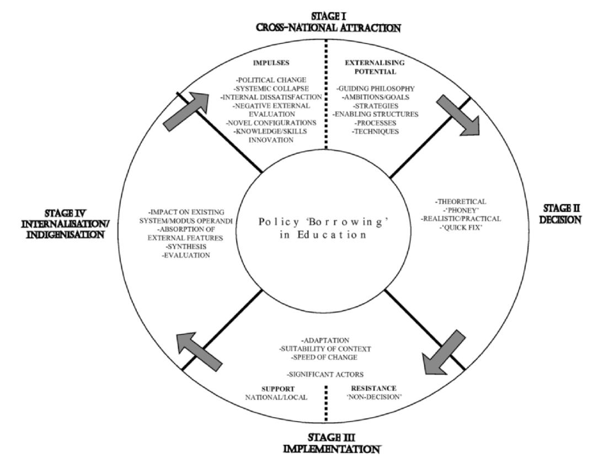
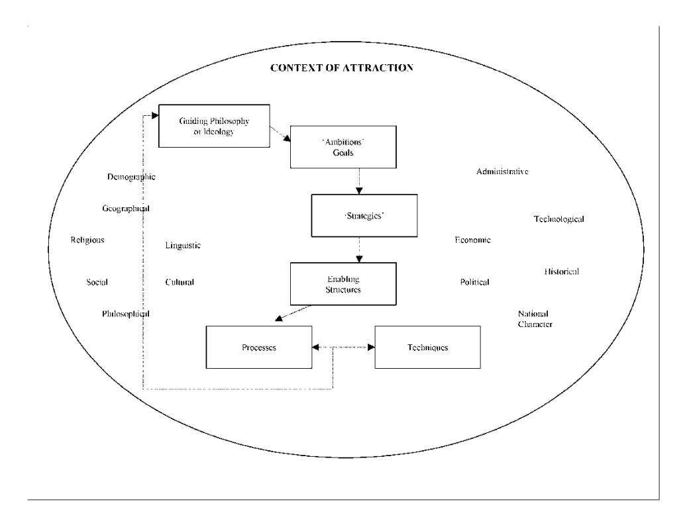
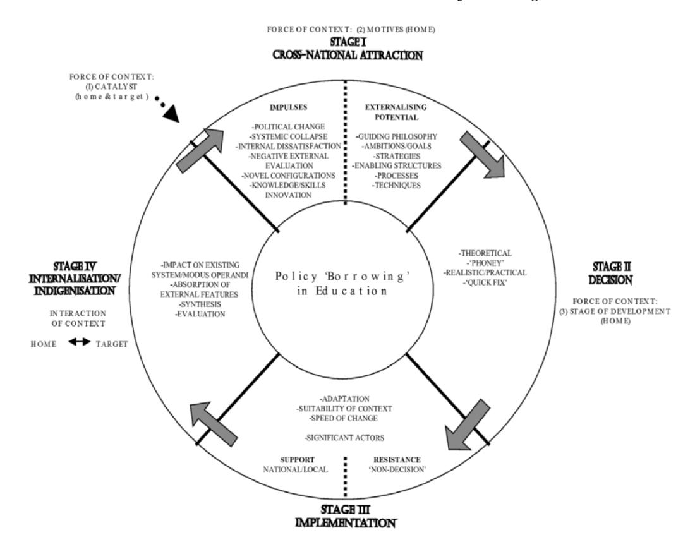

<!-- A2.R36 | source: papers_json/A2.R36/ -->

## **Comparative Education**

**ISSN: 0305-0068 (Print) 1360-0486 (Online) Journal homepage:****[ www.tandfonline.com/journals/cced20](https://www.tandfonline.com/journals/cced20?src=pdf)**

## **Processes of Policy Borrowing in Education: some** **explanatory and analytical devices**

## **DAVID PHILLIPS & KIMBERLY OCHS**

**To cite this article:** DAVID PHILLIPS & KIMBERLY OCHS (2003) Processes of Policy Borrowing in Education: some explanatory and analytical devices, Comparative Education, 39:4, 451-461, DOI:[ 10.1080/0305006032000162020](https://www.tandfonline.com/action/showCitFormats?doi=10.1080/0305006032000162020)

**To link to this article: **[https://doi.org/10.1080/0305006032000162020](https://doi.org/10.1080/0305006032000162020)

| Published online: 03 Jun 2010. |
| --- |
| Submit your article to this journal |
| Article views: 7029 |
| View related articles |
| Citing articles: 80 View citing articles |

<!-- page 2 -->

## Processes of Policy Borrowing in Education: some explanatory and analytical devices

## DAVID PHILLIPS & KIMBERLY OCHS

ABSTRACT *This paper addresses questions of policy 'borrowing' in education. Building on the* *authors' previous work, it proposes some explanatory and analytical devices to assist in the* *exploration of the processes involved in 'cross-national attraction' in educational policy and its* *consequences in terms of decision making, implementation, and 'internalisation'.*

## **المقدمة**

في دراسات سابقة، حاولنا تصنيف جوانب ما أسميناه "الجاذبية عبر الوطنية" (cross-national attraction) في صياغة السياسات التعليمية (Ochs & Phillips, 2002a,b; Phillips, 1989). وقد فعلنا ذلك بالإشارة إلى الاهتمام البريطاني بتوفير التعليم في ألمانيا على مدى المئتي عام الماضية تقريباً، من خلال دراسة الاستفادة من المثال الألماني في حالات مختلفة من التطورات التشريعية وغيرها من التطورات "الرسمية" (تقارير اللجان الملكية وهيئات أخرى، مثلاً؛ قارن Phillips, 2002). واقتصر استخدامنا لمصطلح "الجاذبية عبر الوطنية" على المراحل المبكرة من عملية استعارة السياسات، أي النقاط التي يتولد فيها الاهتمام بأنظمة أجنبية نتيجة دوافع متنوعة. وحاولنا تحديد "بؤر الجاذبية" الرئيسية التي مالت السياسات إلى التركيز عليها (انظر Figure 2 أدناه). لكننا لم نناقش عملية الاستعارة إلى ما هو أبعد من مرحلة "الجاذبية". وفي هذه الورقة الحالية، نحاول تقديم نموذج يصف مراحل أخرى في هذه العملية: القرار، والتنفيذ، والاستيعاب الداخلي (أو "التوطين" كما سُمّي).

كثيراً ما تعرض مصطلح "الاستعارة" (borrowing) للنقد، حيث فضّل المعلقون في أوقات مختلفة مصطلحات بديلة مثل "النسخ" و"التملك" و"الاستيعاب" و"النقل" و"الاستيراد"، إلخ. لكن لأغراض هذه الورقة الحالية، سنتجاوز هذا الجدل ونستخدم مصطلح "الاستعارة" ليغطي كامل نطاق القضايا المتعلقة بكيفية استخدام صناع السياسات للمثال الأجنبي في جميع مراحل عمليات إطلاق وتنفيذ التغيير التعليمي. وتحاول Figure 1 تقديم تمثيل تخطيطي جديد لعملية الاستعارة من الدوافع الأولية إلى الدمج في نظام "المستعير":

## **المراحل الأربع للاستعارة**

هنا، نطرح "الاستعارة" كتسلسل من أربع مراحل رئيسية توضح عملية استعارة السياسات. وهذه المراحل هي:

- I. Cross-National Attraction (Impulses and Externalising Potential)
- II. Decision

Correspondence to: David Phillips, Department of Educational Studies, University of Oxford, 15 Norham Gardens, Oxford OX2 6PY, UK. Email: david.phillips@edstud.ox.ac.uk

ISSN 0305-0068 print; ISSN 1360-0486 online/03/040451-11 2003 Taylor & Francis Ltd DOI: 10.1080/0305006032000162020

<!-- page 3 -->

*FIG. 1. Policy borrowing in education: composite processes.*

- III. Implementation
- IV. Internalisation/Indigenisation

## **المرحلة الأولى - الجاذبية عبر الوطنية: الدوافع وإمكانية التصدير الخارجي**

## *الدوافع*

بـ"الدوافع" (impulses)، نقصد الشروط المسبقة للاستعارة. وتشمل هذه عناصر مثل: تنامي الاستياء الداخلي (من جانب أولياء الأمور والمعلمين والطلبة والمفتشين)؛ والانهيار النظامي (قصور جانب ما من التعليم المقدَّم)؛ والتقييم الخارجي السلبي (على سبيل المثال، في الدراسات الدولية لتحصيل الطلبة مثل TIMSS أو PISA، أو من خلال أبحاث أكاديمية مؤثرة وواسعة الانتشار، كتلك التي أجراها Prais & Wagner, 1985)؛ والتغير الاقتصادي/المنافسة؛ والتغير السياسي وضرورات أخرى؛ وتشكلات عالمية أو إقليمية أو محلية جديدة (النزعات العولمية، آثار سياسات التعليم والتدريب في الاتحاد الأوروبي، تحالفات دولية مختلفة، على سبيل المثال)؛ والابتكار في المعرفة والمهارات؛ والتغير السياسي.

كما تشمل "الدوافع" أيضاً دوافع الأطراف المشاركة في العملية السياسية؛ وستكون هذه الدوافع متباينة جداً، إذ تتراوح من قلق حقيقي مستند إلى معرفة عميقة بالقضايا التعليمية إلى استغلال ساخر لنقاط ضعف حقيقية أو مصطنعة.

في أعمال سابقة، لُخّصت الدوافع التي قد تشعل هذه الاستراتيجيات والتي تحدد السمات "القابلة للاستعارة" في التعليم بالخارج على النحو التالي:

<!-- page 4 -->

- serious scientific/academic *investigation* of the situation in a foreign environment
- popular *perceptions* of the superiority of other approaches to educational questions
- politically motivated endeavours to seek reform of provision by identifying clear *contrasts* with the situation elsewhere
- *distortion* (exaggeration, what Steiner-Khamsi (2002) has termed 'scandalising'), whether or not deliberate, of evidence from abroad to highlight perceived deficiencies at home

[Adapted from Phillips, 2000]

## *إمكانية التصدير الخارجي*

يمكن أن تُلهم هذه الدوافع للتغيير البحث عن نماذج أجنبية قد تحل مشكلات قائمة أو ناشئة أو محتملة. وتقود هذه الدوافع إلى بؤر الجاذبية الست - جوانب السياسات والممارسات التعليمية القابلة للاستعارة - التي حددناها في تصنيفنا البنيوي للجاذبية عبر الوطنية (Ochs & Phillips, 2002a) والتي نعرّفها هنا كتوضيح لنطاق "إمكانية التصدير الخارجي" في البلد المستهدف:

- Guiding philosophy or ideology
- Ambitions/goals
- Strategies
- Enabling structures
- Processes
- Techniques

كما ذكرنا أعلاه، اقتصر تحليلنا لـ"الجاذبية عبر الوطنية" في دراساتنا السابقة أساساً على هذه المرحلة المبكرة من عملية الاستعارة، وتحديداً على "إمكانية التصدير الخارجي". وتصف Figure 2 بؤر الجاذبية الست من حيث الاستعارة، وتضعها في سياق تلك العناصر السياقية التي تشكّلها والتي تحدد بدورها ما إذا كانت قابلة للتكيف مع وضع أجنبي.

قد تكون "الفلسفة التوجيهية" شيئاً عاماً مثل السعي إلى "تكافؤ الفرص التعليمية"، أو "الاختيار والتنوع". أما "الطموحات/الأهداف" فتشير إلى مساعٍ مثل الأهداف في محو الأمية العددية والقرائية التي تبنّتها بريطانيا في السنوات الأخيرة. وتشمل "الاستراتيجيات" جميع جوانب حوكمة التعليم. وتمثل "الهياكل التمكينية" في تصنيفنا أحد أكثر جوانب التعليم "في الخارج" استهدافاً، وتشمل بشكل خاص تمويل التعليم وإدارته. أما "العمليات" فتشمل معايير التدريس والأنظمة الرقابية؛ و"التقنيات" تشمل الطرق التي يتبعها المعلمون في تدريس التلاميذ - أي أساليبهم البيداغوجية.

## **المرحلة الثانية - القرار**

تتكون مرحلة "القرار" في تحليلنا من مجموعة واسعة من التدابير التي تحاول من خلالها الحكومة والجهات الأخرى بدء عملية التغيير. وندرج ضمن هذه المرحلة عدة أوصاف توضح القرار المبني على نتائج الجاذبية عبر الوطنية.

الوصف الأول هو *النظري*. قد تقرر حكومة ما أن التعليم سيكون أولوية سياستها: كان "التعليم، التعليم، التعليم" شعار حكومة العمال في المملكة المتحدة منذ 1997، وهو يمثل موقفاً نظرياً شاملاً. أو قد تقرر حكومة أن السياسة المستقبلية ستسترشد بأهداف أكثر تحديداً مثل "الاختيار والتنوع"، على سبيل المثال. وقد يكون الواقع، بالطبع، أن هناك اختياراً و

<!-- page 5 -->

*FIG. 2. Structural typology of 'Cross-National Attraction' in education. Six foci of attraction.*

تنوعاً لفئة معينة فقط (كما كانت الحال في إنجلترا خلال حكومتَي Major وBlair)، لكن القرار سيكون من حيث المبدأ تأسيس كل سياسة تعليمية على موقف نظري أساسي بشأن القضايا المطروحة.

يقدّم مثال توفير التعليم المهني في ألمانيا إشارة مناسبة إلى نية سياسية تتضمن بعداً مقارناً لكنها تبقى نظرية أساساً. فقد جذب نجاح ألمانيا في التعليم المهني اهتمام صناع السياسات في بريطانيا على مدى فترة طويلة جداً. وكان محور تقارير HMI/Ofsted في الثمانينيات والتسعينيات. وحُددت سماته الجيدة الكثيرة وعُرضت للاقتداء بها. ومع ذلك، لم يحدث تقدم حقيقي في تنفيذ نمط الشراكة المحدد بين الحكومة وأصحاب العمل الذي دعم النهج الألماني والذي يمثل جوهر نجاحه. وهكذا يُستخدم المثال الألماني كحافز نظري للتغيير، وكهدف مستحيل عملياً للتعليم والتدريب المهني في سياق المملكة المتحدة، خاصة نظراً لاختلاف الدلالات الطبقية بين البلدين (Tomlinson, 2001, p. 137)، ومستويات التعليم بحسب العمر، والأوضاع الاجتماعية.

في ألمانيا اليوم، مع ذلك، يشارك نحو 70% من الطلبة في "النظام المزدوج" (Dual System) في تعليمهم الثانوي، الذي يدمج بين المقررات الأكاديمية في المدرسة والتدريب المهني في شركة. ويؤدي الطلبة، بصرف النظر عن طبقتهم، دوراً مزدوجاً كمتدرب (*Lehrling*) وطالب (*Berufsschu¨ler*). لا تعني كلمة "أكاديمي" "مكانة عالية"، ولا تعني كلمة "مهني" "مكانة أدنى" فقط: فكلا نوعَي المقررات مطلوب في المنهج من أجل التعليم الشامل للشاب. ويدعم "الشراكة الاجتماعية" الألمانية، وهي بنية تمكينية جوهرية للنظام، هذا الأمر والتدابير القائمة في ألمانيا لدعم

<!-- page 6 -->

النظام. ونظراً لاختلاف الأهداف السياسية للتدريب المهني بين البلدين، فإن التقليد الدقيق للنموذج الألماني لن يكون قابلاً للتطبيق في المملكة المتحدة.

أما وصفنا الثاني فهو *الزائف* (phoney). نستخدم هذا المصطلح لأن الحقيبة السياسية لوزراء التعليم العائدين من جولة سريعة في الخارج كثيراً ما تحتوي على أفكار ستجذب الناخبين فوراً، لكن ليس هناك احتمال لإدخالها في النظام "المحلي". ويمكن أن نذكر مثال "المدارس المغناطيسية" (magnet schools) الأمريكية التي جذبت اهتمام Kenneth Baker حين كان وزير الدولة للتعليم. وأقرب مثال لهذه المدارس ظهر في قانون Baker الإصلاحي للتعليم لعام 1988 كان كليات التقنية المدنية (city technology colleges)، التي لم تكن بأي حال نجاحاً فورياً، والتي لم تشبه بالتأكيد المدارس المغناطيسية في الولايات المتحدة. (ونقل عن مدير مدرسة Bronx High School for Science، بالمناسبة، بعد زيارة Baker لبرونكس عام 1987، قوله: "لو كنت مكانك، لقلت 'أتينا، رأينا، لكننا لم نُقهر'" (Phillips, 1989, p. 271).) ومع ذلك، كان مفهوم المدارس المغناطيسية جذاباً. فقد ازداد عدد المقاطعات المدرسية في الولايات المتحدة التي تقدم مدارس مغناطيسية بشكل كبير خلال الثمانينيات: من 138 مقاطعة في 1982 إلى 230 مقاطعة في 1991. وزاد عدد المدارس التي تقدم برامج مغناطيسية بأكثر من الضعف: من 1,019 مدرسة في 1982 إلى 2,433 في 1991؛ وتضاعف تقريباً ثلاث مرات عدد الطلبة المشاركين في برامج المدارس المغناطيسية من 441,000 إلى أكثر من 1.2 مليون. (Steel & Levine, 1994). ومع ذلك، كان الدافع وراء إنشاء المدارس المغناطيسية بشكل كبير هو التخفيف من مشكلة العرق والتمييز في المدارس، التي تحد من فرص الأطفال. ومن المحزن، كما يُقال، أن المدارس المغناطيسية لم تكن فعّالة تماماً في التعامل مع هذه المشكلة. ويجادل Chubb and Moe (1990, p. 209) بأنها تقدم خيارات لعدد صغير من التلاميذ، وتترك النظام التقليدي ككل سليماً، ويمكن أن يكون لها أثر سلبي في مدارس أخرى.

وتشكل القرارات *الواقعية/العملية* وصفنا الثالث. هنا يمكننا عزل تدابير ثبت نجاحها بوضوح في موقع معين دون أن تكون نتاجاً أساسياً لمجموعة متنوعة من العوامل السياقية التي تجعلها غير قابلة للتطبيق في مكان آخر. ومن الأمثلة على ذلك برنامج "استرداد القراءة" (reading recovery) في نيوزيلندا، الذي أعلن مفتشون بريطانيون في تقرير متحمس أنه "ليس غريباً عن أي شيء يمكن تجربته أو تحقيقه في فصل دراسي بريطاني" (Ofsted, 1993, p. 19). ومن الأمثلة الأخرى جهود مسؤولي بلدية London Borough of Barking and Dagenham لإدخال "مناهج قارية" مختلفة في تدريس الرياضيات لمدارس البلدية (Last, 1999; Luxton & Last, 1997).

وأخيراً، مع وصفنا الرابع، قرار *الحل السريع* (quick fix)، نصل إلى واحدة من أخطر نتائج عمليات الجاذبية عبر الوطنية. ومن الأمثلة اللافتة في السنوات الأخيرة الحماس في جنوب أفريقيا لـ"التعليم القائم على النتائج" (OBE)، وهو نهج للتعليم والتعلم كان مثيراً للجدل حتى في بلدان ذات أساس أكثر استقراراً بكثير لتوفيرها التعليمي مما كانت عليه جنوب أفريقيا في الفترة التي تلت مباشرة نهاية الفصل العنصري. ولم يعمل OBE بشكل جيد في السياق الجنوب أفريقي لأن البنية التحتية الأساسية لتجربة بهذا الحجم المتصوَّر لم تكن قائمة، ولأن الاهتمام بسياقات التنفيذ كان غير كافٍ.

وقد عانت الديمقراطيات الناشئة في الكتلة السوفيتية السابقة أيضاً من حلول سريعة، غالباً ما روّج لها مستشارون أجانب لديهم حماس شخصي. وعلى نطاق أوسع، انتقل الحماس لجدة اقتصاد السوق أيضاً إلى قطاع التعليم، حيث اعتُبر عمل قوى السوق تحرراً إيجابياً من قيود السيطرة الحكومية المحكمة، لكن نتج عن ذلك عدم يقين وانعدام أمان، إلى جانب قدر كبير من عدم المساواة. وقد أدى الإيمان بوعد الخصخصة إلى مجرد إنتاج نخب تستطيع أموالها شراء المزايا التي قد يوفرها تعليم معين (تعليم لغة أجنبية، دورات في الأعمال).

من مرحلة القرار، ننتقل الآن إلى العوامل المتعلقة بالتنفيذ.

<!-- page 7 -->

## **المرحلة الثالثة - التنفيذ**

قيل إن هناك شرطين مسبقين للإصلاح التعليمي الكبير: أولاً، يجب أن يكون هناك اعتقاد قوي داخل الحكومة بأن هناك خللاً كافياً في التعليم يجعل برنامجاً تشريعياً كبيراً يستحق العناء. ثانياً، يجب أن يكون هناك إجماع حول الحلول الممكنة (Simkins *et al.*, 1992).

يشكل "التنفيذ" المرحلة الرابعة في عملية الاستعارة. هنا يمكننا ملاحظة التكيف الذي سيخضع له أي نموذج أجنبي حتماً ضمن سياق نظام المستعير. وستتوقف درجة هذا التكيف على عدد كبير من العوامل السياقية (المذكورة أعلاه والتي نعود إليها أدناه). فمثلاً، سيحتاج نهج جديد للتعليم المهني إلى التكيف مع لوائح النقابات العمالية والصناعية إذا كانت الخبرة داخل الشركة للطلبة جزءاً من الأمر؛ أو سيتعين كتابة كتب دراسية جديدة لتغطية الابتكارات المنهجية، بما في ذلك تطورات مثل إدخال مادة دراسية جديدة (كما في تعليم المواطنة في إنجلترا وويلز)؛ أو سيتعين على التدريب الأولي والمستمر للمعلمين استيعاب أفكار جديدة تشمل أي جانب من جوانب التعليم المدرسي.

قد يكون التغيير سريعاً أو طويل الأمد بطبيعته، بحسب قابلية التكيف لتدابير سياسية معينة. ونظراً للحاجة المحتملة إلى مراجعة إجراءات معقدة وراسخة (التقييم والامتحانات، الشهادات، ترتيبات التدريب)، قد يمر وقت طويل قبل الشعور بأثر التدابير الجديدة.

سيتأثر التغيير بـ"الفاعلين المهمين" وقراراتهم في مراحل ومستويات مختلفة. وقد يكون "الفاعلون المهمون" هيئات مثل سلطات التعليم المحلية، أو مجالس المدارس، أو مجالس الإدارة؛ أو قد يكونون أفراداً مثل كبار مسؤولي التعليم، أو المستشارين، أو مديري المدارس. وقد يتلقون دعماً من حيث التشجيع الوطني والمحلي والحوافز المالية؛ أو قد يواجهون عرقلة (تقاعس، أساليب تأخير، عدم اتخاذ قرار) من جانب من يرون طرقاً لتقويض ما يعتبرونه سياسة غريبة. وقد جادل Bachrach and Baratz بأهمية تحليل "عدم اتخاذ القرار" و"تعبئة التحيز"، بحصر عملية صنع القرار في القضايا الأكثر أماناً (Theocharis, 2002). ولدى Corcoran منظور مختلف عن عدم اتخاذ القرار، والذي قد لا يكون "فعلاً مقصوداً". فهي تدرج "عدم الانتباه إلى التفاصيل" و"استجابة الآخرين المعنيين" ضمن أسبابها لغياب صنع القرار (Corcoran, 1974, p. 5).

## **المرحلة الرابعة - الاستيعاب الداخلي/التوطين**

أخيراً، هناك مرحلة "الاستيعاب الداخلي"، أو - كما سُمّيت - "التوطين" للسياسة. تصبح السياسة "جزءاً" من نظام التعليم في البلد المستعير، ويصبح ممكناً تقييم آثارها على الترتيبات القائمة مسبقاً في التعليم وطريقة عملها.

في هذا التصنيف، ننظر إلى الاستيعاب الداخلي/التوطين كسلسلة من أربع خطوات:

- 1. *Impact on the existing system/modus operandi*. Here, we examine the motives and objectives of the policy makers, in conjuntion with the existing system; and we address concepts such as Herskovitz's 'cultural relativism' (in Ball, 1994) or Mallinson's (1975) 'national character'. Anthropologists, such as Boas and Benedict (1938), also closely examined the proposition that assessments are relative to some standards which derive from the culture of the system and help determine the pre-existing arrangements. In examining the existing system, Stephen Ball (1994) offers four 'essential circuits' within the education system, or 'message systems' of education to use as a framework: curriculum, assessment, pedagogy and organisation.
- 2. *The absorption of external features*. This also includes using external references to foreign

<!-- page 8 -->

- features. Close examination of context is essential to understand how and the extent to which other features from another system can be adopted.
- 3. *Synthesis*. Here, we describe the process through which educational policy and practice become part of the overall strategy. Carnoy and Rhoten (2002) discuss the process of 're-contextualisation' in acknowledging that context affects the interpretation and implementation of such 'borrowed' policies. In some situations, as Kissane (2001) dicusses in her work on Kazakhstan, synthesis occurs at the same time as symbiosis occurs—when a dual policy strategy is necessary to address the different needs of local and national reform.
- 4. *Evaluation*. Finally, internalisation requires reflection and evalulation to best discern the realistic, or unrealistic, expectations of borrowing. Some researchers argue that who conducts the evaluation is nearly as important as how the evaluation is conducted. Steiner-Khamsi refers to the politics of educational 'lending' (Steiner-Khamsi, 2002). Judging from the examples of major research studies such as those conducted by UNESCO, OECD, and the World Bank, as discussed by Phillip Jones (1971) and others, organisational power can be a factor in the evaluation. The results of such evaluation might then start the whole process again, with further investigation of foreign models to put right perceived deficiencies.

## **مسألة السياق**

كان الأهمية المعقدة للسياق، أي "تجذّر" جوانب النُّهج والتوفير التعليميَين في الظروف الثقافية وغيرها السائدة محلياً (انظر Figure 2 أعلاه)، أيضاً موضع اهتمامنا. وناقشنا سابقاً قوى السياق وآثارها في الجاذبية عبر الوطنية للبؤر الست. وتُلخَّص قوى السياق الخمس لدينا على النحو التالي:

- contextual forces that affect the *motives* behind cross-national attraction
- contextual forces' which act as a *catalyst* to spark cross-national inquiry
- 'contextual interaction' that affects the *stage* of the policy development
- 'contextual interaction' that affects the policy development *process*
- 'contextual interaction' that affects the potential for policy *implementation*

[Ochs & Phillips, 2002]

ينبغي فحص هذه القوى الخمس داخل كل من البلد "المحلي" والبلد "المستهدف". وكما هو موضح في Figure 3، يمكن اعتبار قوى السياق الخمس بحسب تأثيرها المختلف على مراحل السياسة الأربع:

- (1) The context of educational policy and provision in the 'home' country can first act as a catalyst for the attraction. Examples of the catalysts (Figure 3) which can spark off the processes of cross-national attraction might be: Earnest endeavours on the part of policy-makers in England both before and after the 1870 Education Act to explore the experiences of other countries in introducing compulsory elementary education and in particular to discover solutions to the religious question. The Sputnik shock of the 1950s, when there was concern that the Soviet Union was making advances in science and technology that could not be matched in the USA because educational provision had fallen behind. The very title of Trace's book of

<!-- page 9 -->

- 1961, *What Ivan Knows That Johnny Doesn't*, is revealing of the anxiety created by Soviet achievement. Trace began with mathematics and science: 'The concern of most of the recent comparative studies of American and Soviet schools has been to show that American schools are lagging woefully behind Soviet schools in the teaching of mathematics and the sciences' (Trace, 1961, p. 3); but he proceeded to argue too that 'the humanities are … shamefully neglected' in American schools' (p. 4).
- The sudden impact of various types of political event, ranging from a major government publication or statement (such as Prime Minister James Callaghan's famous Ruskin College speech of 1976) to a significant change of education minister, or new political alliances, or a change of government. In recent years the most significant instances have been the abrupt changes in eastern Europe following the events of 1989/90 and in post-Apartheid South Africa.
- The shock results of the OECD's PISA study (2001) for those concerned with educational policy in Germany. In this widely reported and hotly debated survey Germany was reported as performing far less well than had been expected, and this has sparked off a widespread debate about how to remedy the situation.
- (2) It can affect the motives for attraction to the 'target' country (Stage I), as was the case in the development of education systems in many colonies in Africa, to support the economic and political motives of the colonial powers.
- (3) Context influences the decision to 'borrow' (Stage II). Here, political, social and religious factors can be particularly influential, especially in determining the stages of development. Is the term of political office or timing of re-election of key political figures factored into the realities of the decision making?
- (4) The context of the 'target' country must also be considered, particularly in comparison to that of the 'home' country, regarding possible implementation (Stage III). Careful examination of the context in both the 'home' and 'target' countries is essential to evaluate compatibility and comparability and so to determine what it is possible to borrow, given different cultural mores, demographics, etc.
- (5) During Stage IV of policy 'borrowing', internalisation/indigenisation, we must also address the potential interaction between contexts in both the home country and target country: the similarities and differences between the two countries, and the target country's potential effect on the internalisation of educational practice or policy in the 'home' country. For example, in examining South Africa's internalisation of OBE, it is important to consider the contextual factors within the 'target' countries from which they borrowed such policies, to understand better what might be possible in South Africa. This process of transfer may be problematic in itself, but should nonetheless be considered.

وكما جادل كثير من الباحثين المقارنين، يتسم السياق بأهمية حاسمة لتطور أنظمة وسياسات التعليم. ويذكّرنا Harold Noah بأن:

The authentic use of comparative study resides not in wholesale appropriation and propagation of foreign practices but in careful analysis of the conditions under which certain foreign practices deliver desirable results, followed by consideration of ways to adapt those practices to conditions found at home. (Noah, 1986, pp. 161–162)

وكما عبّر Michael Sadler بأفضل صياغة، في خطابه الشهير في Guildford، "ينبغي ألا ننسى أن الأمور خارج المدارس تهم أكثر حتى من الأمور داخلها، وأنها تحكم وتفسر الأمور داخل المدارس" (Sadler, 1900, p. 49).

<!-- page 10 -->

*FIG. 3. The five forces of context.*

غير أن الباحثين ما زالوا يواجهون التحدي التالي: كيف نفسّر هذه "الأمور"؟ ورغم أن كثيرين يتفقون على أن السياق قضية مهمة ينبغي معالجتها، تبقى هناك صعوبات متأصلة في دراسته. وفي عملنا السابق، عند مناقشة تصنيفنا البنيوي للجاذبية عبر الوطنية في التعليم، أوردنا عدة عوامل سياقية لتصنيف عناصر السياق (انظر Figure 1). ومع ذلك، فإن قائمتنا ليست شاملة بأي حال، وستتفاوت العوامل السياقية المحددة حتماً عبر الدراسات المقارنة. وكما جادل Holmes (1981) وآخرون، فإنه في محاولة فهم عمليات نقل السياسات والجاذبية عبر الوطنية، يجب علينا أيضاً فحص *درجة* تأثير العوامل السياقية في عملية الجاذبية ومراحل النقل. وهذا أمر بالغ الصعوبة قياسه، حتى باستخدام أكثر الأساليب الإحصائية تطوراً، نظراً للتفاعل المعقد بين العوامل السياقية، واحتمال التأخر الزمني في تأثير عوامل رئيسية، وصعوبة عزل جوانب معينة من السياق عن بعضها بعضاً.

## **الخاتمة**

يحتل مفهوم استعارة السياسات بالطبع مكانة مركزية في كثير من أعمال الباحثين المقارنين. فنحن نبحث فيما يحدث في أنظمة تعليمية أخرى من أجل التعلم من خلال المثال، وتكوين بعض الأحكام، واستكشاف إمكانيات الإصلاح "في الداخل". لكن الباحثين المقارنين يدركون الصعوبات المرتبطة باقتراح تبني سياسات وإجراءات "غريبة"، ومنذ زمن Matthew Arnold - وخاصة عقب مثال Michael Sadler - وهم يحذّرون صناع السياسات من

<!-- page 11 -->

الأخطار الكامنة في أي قرار سريع يُتخذ استناداً إلى حماس مفاجئ لفكرة تعليمية وُلدت ونشأت وبلغت النضج في سياق أجنبي.

وقد كان هدفنا من طرح الأدوات التفسيرية والتحليلية الموضحة في هذه الورقة الحالية لفت الانتباه إلى طرق تساعد على تأطير البحث في ظاهرة الجاذبية عبر الوطنية في التعليم وما يترتب عليها من تطور للسياسة وتنفيذها. ونقدّم العمل الموصوف أعلاه على أمل أن يفضي إلى نقد ونصائح ستؤدي إلى مزيد من تطوير الأدوات الوصفية والتحليلية التي عرضناها.

ينبغي اختبار المفاهيم النظرية مقابل أمثلة. وفي دراسات سابقة (Phillips, 2000, 2002, على سبيل المثال) نظرنا إلى الاهتمام البريطاني المستمر بتوفير التعليم في ألمانيا على مدى فترة طويلة. ويمكن الآن استخدام أدواتنا المختلفة لدراسة، على سبيل المثال، الاهتمام في المملكة المتحدة والولايات المتحدة بالتعليم في اليابان منذ الستينيات، أو الاهتمام الأمريكي بالتعليم في الاتحاد السوفيتي عقب صدمة سبوتنيك، أو الاهتمام الألماني بدول أخرى في أوروبا وغيرها بعد النتائج الصادمة لدراسة PISA التابعة لمنظمة OECD، أو آثار السياسة التعليمية في بلدان الكتلة الشرقية السابقة نتيجة اهتمامها بالدول الغربية عقب التغيرات السياسية الدراماتيكية في 1989/90. ونأمل أن يساعد هذا العمل على توفير أداة استكشافية لمزيد من الأمثلة على "استعارة السياسات".

## REFERENCES

BALL, S. (1994) *Education Reform* (Buckingham, Open University Press).

BOAS, F.&BENEDICT, R. (1938) *General Anthropology* (London, Heath).

CARNOY, M.&RHOTEN, D. (2002) What does globalization mean for educational change? A comparative approach, *Comparative Education Review*, 46 (1), pp. 1–9.

CHUBB, J.E. & MOE, T.M. (1990) *Politics, Markets and America's Schools* (Washington DC, The Brookings Institution). CORCORAN, E. (1974) Nondecision Making and Developmental Process, *Annual Meeting of the American Educational* *Research Association*, Chicago.

HOLMES, B. (1981) *Comparative Education: some consideration of method* (London, Allen & Unwin).

JONES, P. (1971) *Comparative Education Purpose and Method* (St. Lucia, Queensland, University of Queensland Press). KISSANE, C. (2001) Schools and History 'in Transition'. The case of Kazakhstan (Graduate School of Arts and Sciences, Columbia University, New York, unpublished Ph.D. dissertation in Comparative and International Education).

LAST, G. (1999) A primary mathematics improvement project harnessing continental teaching methods, in: B. JAWORSKI & D. PHILLIPS (Eds) *Comparing Standards Internationally. Research and Practice in Mathematics and* *Beyond* (Wallingford, Symposium Books).

LUXTON, R.&LAST, G. (1997) *Underachievement and Pedagogy, Discussion Paper No. 11* (London, National Institute of Economic and Social Research).

MALLINSON, V. (1975) *An Introduction to the Study of Comparative Education* (4th edn) (London, Heinemann Educational Books).

NOAH, H. (1986) The use and abuse of comparative education, in: P. G. ALTBACH & G. P. KELLY (Eds) *New* *Approaches to Comparative Education* (Chicago, IL, University of Chicago Press).

OCHS, K.&PHILLIPS, D. (2002a) *Towards a Structural Typology of Cross-national Attraction in Education* (Lisbon, Educa).

OCHS, K.&PHILLIPS, D. (2002b) Comparative studies and 'cross-national attraction' in education: a typology for the analysis of English interest in educational policy and provision in Germany', *Educational Studies*, 28 (4), pp. 325–339.

OECD (2001) *Knowledge and Skills for life. First Results from PISA 2000* (OECD, Paris).

OfSTED (1993) *Reading Recovery in New Zealand* (HMSO, London).

PHILLIPS, D. (1989) Neither a borrower nor a lender be? The problems of cross-national attraction in education, *Comparative Education,* 25 (3), pp. 267–274.

PHILLIPS, D. (2000) Learning from elsewhere in education: some perennial problems revisited with reference to British interest in Germany, *Comparative Education*, 36 (3), pp. 297–307.

PHILLIPS, D. (2002) *Reflections on British Interest in Education in Germany in the Nineteenth Century: a progress report* (Lisbon, Educa).

<!-- page 12 -->

- PRAIS, S.J. & WAGNER, K. (1985) Schooling standards in England and Germany: some summary comparisons bearing on economic performance, *National Institute Economic Review*, 112, pp. 53–76.
- SADLER, M. (1900) How far can we learn anything of practical value from the study of foreign systems of education? Address of 20 October, in: J. H. HIGGINSON (Ed.) *Selections from Michael Sadler* (Liverpool, Dejall & Meyorre).
- SIMKINS, T., ELLISON, L.&GARRETT, V. (Eds) (1992) *Implementing Educational Reform: the early lessons* (Essex, Longman).
- STEEL, L. & LEVINE, R. (1994) *Educational Innovation in Multiracial Contexts: the growth of magnet schools in American* *education* (Washington DC, US Department of Education).
- STEINER-KHAMSI, G. (2002) Vouchers Import In Mongolia: analyzing educational policy talk and beyond, CESE Conference Presentation, London.
- THEOCHARIS, D. (2002) *'Non-decision' in educational politics* (CESE Conference presentation, London, 17 July).
- TOMLINSON, S. (2001) *Education in a Post-welfare Society* (Buckingham, Open University Press).
- TRACE, A.S. (1961) *What Ivan Knows That Johnny Doesn't* (New York, Random House).

<!-- page 13 -->
