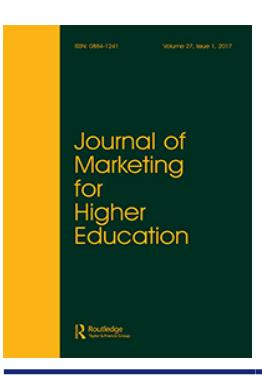
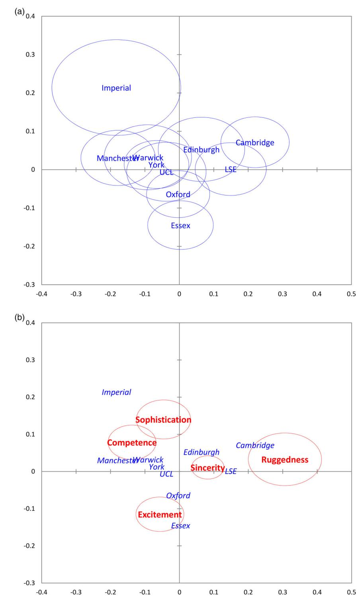

<!-- A2.R40 | source: papers_json/A2.R40/ -->

## **Journal** **of** **Marketing** **for** **Higher** **Education**

**ISSN: 0884-1241 (Print) 1540-7144 (Online) Journal homepage:****[ www.tandfonline.com/journals/wmhe20](https://www.tandfonline.com/journals/wmhe20?src=pdf)**

## **الشخصية** **التجارية** **في** **التعليم** **العالي:** **أنسنة** **الاتصالات** **التسويقية** **للجامعات**

**Richard** **Rutter,** **Fiona** **Lettice** **&** **John** **Nadeau**

**To** **cite** **this** **article:** Richard Rutter, Fiona Lettice & John Nadeau (2017) Brand personality in higher education: anthropomorphized university marketing communications, Journal of Marketing for Higher Education, 27:1, 19-39, DOI: [10.1080/08841241.2016.1213346](https://www.tandfonline.com/action/showCitFormats?doi=10.1080/08841241.2016.1213346)

**To** **link** **to** **this** **article:** [https://doi.org/10.1080/08841241.2016.1213346](https://doi.org/10.1080/08841241.2016.1213346)

| Image: Calendar icon | Published online: 05 Aug 2016. |
| --- | --- |
| Image: Pencil icon | Submit your article to this journal Image: External link icon |
| Image: Bar chart icon | Article views: 5153 |
| Image: Magnifying glass on document icon | View related articles Image: External link icon |
| Image: CrossMark logo | View Crossmark data Image: External link icon |
| Image: Two documents icon | Citing articles: 26 View citing articles Image: External link icon |

<!-- page 2 -->

## الشخصية التجارية في التعليم العالي: أنسنة الاتصالات التسويقية للجامعات

Richard Ruttera * [,](http://orcid.org/0000-0002-6080-783X) Fiona Letticea and John Nadeaub

a Norwich Business School, University of East Anglia, Norwich, UK; ^b^ School of Business, Nipissing University, North Bay, ON, Canada

## الملخص

بينما يُعترف بكتيب الجامعة (prospectus) كأداة اتصال تسويقي مهمة في استراتيجيات استقطاب الطلاب في التعليم العالي، فقد أصبح مُهملًا نسبيًا لأن كثيرًا من الباحثين ركزوا على قنوات اتصال أخرى، مثل وسائل التواصل الاجتماعي والمواقع الإلكترونية. ورغم أن الاهتمام انصبّ على تمايز العلامة التجارية لمؤسسات التعليم العالي (HEI)، فإن المعرفة قليلة حول أوجه الشبه والاختلاف بين الاتصالات التسويقية المؤسسية المستخدمة لبناء علاماتها التجارية. يسعى هذا البحث إلى استكشاف وتحليل كتيبات أفضل 10 مؤسسات تعليم عالٍ في المملكة المتحدة، ورسم مقارنة بين مواقعها النسبية باستخدام عدسة الشخصية التجارية. ورغم أن سمة الصدق (sincerity) في الشخصية التجارية كانت مشتركة بين جميع المؤسسات، فقد كان هناك تمايز واضح على أساس سمات أخرى، مما يُظهر أن الشخصية التجارية تعمّق فهمنا لموقع مؤسسات التعليم العالي. وقد ظهرت مجموعتان رئيسيتان من الشخصية التجارية بين المؤسسات العشر الأولى: الإثارة (excitement) والكفاءة (competence).

## ARTICLE HISTORY Received 25 July 2015 Accepted 23 February 2016

KEYWORDS UK higher education; university brand management; university branding; university marketing communications; brand personality

## المقدمة

بشكل متزايد، ينظر الطلاب إلى تجربة التعليم العالي (HE) على أنها معاملة تجارية ذات عائد مالي متوقع في المستقبل (Palfreyman, [2012)](#page-20-0). ففي المملكة المتحدة، على سبيل المثال، يتعزز هذا التوقع مع إدخال الرسوم الدراسية، إذ تستجيب المؤسسات لتضييق الموارد المالية التقليدية. وفي الوقت نفسه، تقدّم الجامعات كثيرًا من نفس البرامج الدراسية، مما يعني أن عروض البرامج تفقد قدرتها كعامل تمايز محتمل عندما تسعى الجامعة لاستقطاب الطلاب في سوق مزدحمة. وعلى غرار حيرة المستهلك في سوق مزدحمة (Walsh & Mitchell, [2010)](#page-21-0)، قد يجد الطلاب المحتملون عملية اتخاذ قرار اختيار الجامعة مربكة.

في هذا السياق، يرى Twitchell [(2004)](#page-21-0) أن على الجامعات إدارة علاماتها التجارية بشكل أكثر استباقية. فالعلامات التجارية لا تساعد المديرين على تحقيق النجاح في المؤسسات القائمة على المنتجات فحسب، بل أيضًا في المؤسسات القائمة على الخدمات (Berry, [2000](#page-18-0)). وهناك الكثير الذي يمكن تعلّمه من أدبيات العلامة التجارية لتعميق فهم التسويق في التعليم العالي، وقد بدأت إدارة العلامة التجارية بالفعل تُطبَّق في هذا القطاع. فعلى سبيل المثال، وعلى المستوى الكلي، أطلقت حكومة المملكة المتحدة حملة علامة تجارية عالمية عام 2000 تهدف إلى

<!-- page 3 -->

تعزيز مفهوم 'التعليم البريطاني'. وعلى المستوى الجزئي، تخصص الجامعات الفردية مزيدًا من الموارد لتحسين اتصالاتها التسويقية مع الطلاب المحتملين وأصحاب المصلحة الآخرين، ولتطوير علاماتها التجارية (Chapleo, [2010](#page-19-0)). ويبدو أن تخصيص الموارد هذا يؤتي ثماره، إذ باتت العلامات التجارية للجامعات معترفًا بها بالفعل كعامل تمييز قوي (Qian, [2009](#page-21-0)) من حيث استقطاب واستبقاء أفضل الطلاب وأعضاء هيئة التدريس (Florea, [2011](#page-19-0)).

يمكن للعلامات التجارية أن تلعب دورًا حيويًا في التأثير على التصورات، وخصوصًا تصورات مجموعة أصحاب المصلحة الرئيسية، مثل طلاب الجامعة الحاليين والمحتملين. تُستخدم تقنيات إدارة العلامة التجارية لبناء علاقات قوية وموالية (Freling & Forbes, [2005](#page-19-0), p. 406; Keller, [2001)](#page-20-0)، ولتمييز المؤسسات وعروض منتجاتها عن المنافسين ولتعزيز الأداء (Hoeffler & Keller, [2003)](#page-19-0). وقد أصبحت العلامة التجارية للجامعة عنصرًا حاسمًا في قرار الطالب، لا سيما أن اختيار الخدمة يميل إلى التعقيد وأن المنافسة بين الجامعات تشتد (Teh & Salleh, [2011](#page-21-0)). ويتأثر قرار الطالب بتصوره عن مؤسسات معينة، ولذلك يُقال إن العلامات التجارية القوية ترتبط إيجابيًا بأداء الاستقطاب (Salleh, [2009)](#page-21-0).

بينما كان يُنظر سابقًا إلى بحوث التسويق في التعليم العالي على أنها غير متطورة (Hankinson, [2004)](#page-19-0)، فقد استُكشفت مفاهيم أكثر تقدمًا في العلامة التجارية داخل القطاع (Ali-Choudhury, Bennett, & Savani, [2009](#page-18-0))، منها: العلامة التجارية كشعار (Alessandri, Yang, & Kinsey, [2006)](#page-18-0)، كصورة (Chapleo, [2007](#page-18-0))، الوعي بالعلامة وهوية العلامة (Lynch, [2006](#page-20-0))، تمايز صورة العلامة (Heslop & Nadeau, [2010](#page-19-0))، معنى العلامة (Teh & Salleh, [2011](#page-21-0))، أثر قوة العلامة على الرضا (Casidy & Wymer, [2015)](#page-18-0)، اتساق العلامة (Alessandri et al., [2006;](#page-18-0) Casey & Llewellyn, [2012](#page-18-0))، سمعة العلامة (Finch, McDonald, & Staple, [2013](#page-19-0); Suomi, [2014](#page-21-0))، نقاط التفاعل مع العلامة (Khanna, Jacob, & Yadav, [2014](#page-20-0)) وتحديات العلامة التجارية في التعليم العالي (Chapleo, [2015](#page-19-0)).

هناك اتجاه بحثي ناشئ في التعليم العالي حول الشخصية التجارية (Opoku, [2005](#page-20-0)) وقد يمثل أساسًا قويًا للتمايز بين الجامعات الكثيرة المتنافسة على استقطاب الطلاب. ومع ذلك، لم يستكشف البحث بعد الشخصية التجارية تحديدًا في الوسائط التقليدية وفي النص المكتوب الذي يشكّل هذا الاتصال الترويجي. وفي الوقت نفسه، تتضح أهمية الوسائط التقليدية، مثل كتيب الجامعة، للخطط الترويجية لمؤسسات التعليم العالي (HEIs) (Bradley, [2013](#page-18-0); Graham, [2013](#page-19-0)). وهناك فرصة حالية للاستفادة من المناهج التحليلية المتبعة في دراسة الوسائط الجديدة لفهم إمكانية تمايز الشخصية التجارية في الوسائط التقليدية لمؤسسات التعليم العالي. وقد حللت دراسات الوسائط الجديدة الشخصية التجارية المنقولة عبر النص المكتوب على الإنترنت (Rutter, Hanretty, & Lettice, [2015](#page-21-0)). ويمكن تطبيق هذا الأسلوب بالطريقة نفسها على وسائط التسويق التقليدية للتعليم العالي. لذلك، تستخدم هذه الورقة تحليلًا معجميًا لاتصالات مؤسسات التعليم العالي من المحتوى النصي للكتيب، لتحليل الاختلافات في الشخصيات التجارية التي تنقلها أفضل 10 جامعات في المملكة المتحدة.

يتمثل الهدف والمساهمة الرئيسية لهذه الورقة في دراسة الشخصية التجارية التي تنقلها مؤسسة تعليم عالٍ، باستخدام إطار الشخصية التجارية لـ Aaker [(1997)](#page-18-0) وأداة الشخصية التجارية القائمة على القاموس لـ Opoku ([2006](#page-20-0)). ومن خلال ذلك، يمكننا تقييم أوجه التشابه والاختلاف في اتصالات مؤسسات التعليم العالي عبر سمات الشخصية التجارية المنقولة في هذه القناة التسويقية الرئيسية. أما المساهمة الثانية فهي تقديم رؤية أعمق حول كيفية تشكيل مؤسسات التعليم العالي لشخصيتها التجارية من خلال اللغة والسياق المنقولين.

<!-- page 4 -->

## مراجعة الأدبيات

تتطلب دراسة الشخصية التجارية في اتصالات مؤسسات التعليم العالي مراجعة الأدبيات القائمة حول مفهوم الشخصية التجارية والاتصال في هذا القطاع. ومن المؤكد أن العلامة التجارية في التعليم العالي تُعدّ الآن عاملًا رئيسيًا للنجاح (Almadhoun, Dominic, & Woon, [2011](#page-18-0); Rutter, Roper, & Lettice, [2016;](#page-21-0) Teh & Salleh, [2011)](#page-21-0). وفي سياق التعليم العالي، عُرّفت العلامة التجارية بأنها 'تسليع' (commodification) خصائص الجامعة كعوامل تمييز، أو نقطة بيعها الفريدة (Iqbal, Rasli, & Hassan, [2012;](#page-20-0) Molesworth, Scullion, & Nixon, [2011,](#page-20-0) p. 80). ومن الناحية العملية، قد يبدو برنامج بكالوريوس إدارة الأعمال في كتيب ما غير قابل للتمييز بين المؤسسات، وفي هذه الحالة يلجأ الطلاب إلى مؤشرات جودة أخرى (مثل الترتيب أو الموقع) للتمييز بين العروض. وقد تبيّن أن موقع مؤسسة التعليم العالي يؤثر في شخصيتها التجارية (Dholakia & Acciardo, [2014)](#page-19-0). لذا قد توفر الشخصية التجارية أساسًا سليمًا لتمييز الجامعة عن منافسيها. ويمكن أن تتغير صورة الجامعة، كما أظهرت دراسة استكشفت آثار تحوّل في استراتيجية الإدارة على صورة المؤسسة (Melewar & Akel, [2005)](#page-20-0). إذًا، تلعب الاتصالات دورًا مهمًا في تأسيس وتغيير صورة العلامة التجارية المُدرَكة للجامعة. ورغم أن هناك رأيًا يرى أن تمايز العلامة التجارية مفيد لقطاع التعليم العالي (Chapleo, [2005)](#page-18-0)، فلم يظهر إجماع واضح حول الأساس البُعدي لهذا التمايز (Heslop & Nadeau, [2010)](#page-19-0). والواقع أن هناك ضغطًا على المؤسسات لتشترك أيضًا في أساس من التشابه مع غيرها في نفس مساحة السوق. وقد صِيغت هذه القوة نظريًا بمفهوم التماثل المؤسسي (isomorphism)، وتبيّن أنها تؤثر في تصورات الشرعية (Deephouse, [1996](#page-19-0)). لذلك، تحاول العلامات التجارية أن تُظهر أنها تنتمي إلى السوق المحدد، ويتحقق ذلك بإظهار امتثالها لمجموعة دنيا من المعايير النموذجية لمُقدّم الخدمة (King & Whetten, [2008](#page-20-0)). وينتج عن هذا توتر، أو توازن، بين الحاجة إلى التمايز للمنافسة والحاجة إلى عكس بعض المعنى المشترك عبر التماثل المؤسسي لإظهار الشرعية. لذلك، ينبغي أن تسعى المؤسسات إلى نقل صور 'مختلفة قدر الإمكان بشكل مشروع' (Deephouse, [1999,](#page-19-0) p. 148). وفي سياق مؤسسات التعليم العالي، قد يؤدي ذلك إلى نقل بعض الصفات المشتركة لإظهار الانتماء إلى هذا المجال، وقد تؤثر هذه الصفات المشتركة في تصوير الشخصية التجارية.

قبل مناقشة أنسنة (anthropomorphization) مؤسسات التعليم العالي في أنشطتها الاتصالية، من المهم فهم سياق التعليم العالي.

## التعليم العالي

يُشار إلى 'التعليم العالي' (HE) عمومًا بأنه التجربة التعليمية التي تلي التخرج من نظام K-12 في الولايات المتحدة وكندا، أو من التعليم الثانوي في المملكة المتحدة، والذي تقدّمه الكليات والجامعات على حد سواء (Saunders, [2015)](#page-21-0). والتعليم العالي معقّد، إذ يضم 11 نوعًا مختلفًا من التجارب، منها تعليقات الطلاب، والتخرج، وتصميم المناهج، والتواصل مع موظفي الخدمة، والصرامة الأكاديمية، والتقييم، والسلوك الصفي، والدراسات الصفية، والدراسات الفردية، وأساليب التدريس، وتصميم المقررات (Koris, Örtenblad, Kerem, & Ojala, [2015](#page-20-0)). كما أن موقع المؤسسة بالنسبة لمنزل الطالب المحتمل مهم جدًا أيضًا (Briggs, [2006;](#page-18-0) Vrontis, Thrassou, & Melanthiou, [2007](#page-21-0)). ويمكن أن يمتد التعقيد أيضًا إلى التجربة المجتمعية لكون الطالب على حرم جامعي معين (أي بناء الشبكات والصداقات أو القيمة الترفيهية لمشاهدة فرق الجامعة الرياضية).

<!-- page 5 -->

فالطلاب لا يشترون شهادة فحسب، بل ينخرطون في نظام تعليمي واجتماعي معقّد.

فكرة الطالب كمستهلك أو زبون للتعليم العالي مثيرة للجدل. ويرى Saunders ([2015](#page-21-0)) أن على الباحثين إعادة النظر في هذا الافتراض الأساسي في بحوث التعليم العالي، استنادًا إلى نتيجة مفادها أن أقلية فقط من الطلاب يحملون آراء متسقة مع التوجه الاستهلاكي. ومع ذلك، وجد Koris et al. [(2015)](#page-20-0) أن الطلاب لديهم بعض التوقع بأن يُعاملوا كمستهلكين في بعض جوانب تجربة التعليم العالي، وخاصة فيما يتعلق بتعليقات الطلاب والدراسات الصفية. وبأي حال، يحتاج الطلاب المحتملون إلى اتخاذ قرار بشأن الجامعات التي سيقدمون إليها طلباتهم واختيار الجامعة أو الكلية المفضلة لديهم للالتحاق بها. ويمكن لمعرفة إدارة العلامة التجارية المتطورة في مجال التسويق عبر مجموعة من القطاعات المؤسسية أن تساعدنا على فهم كيفية اتخاذ الخيارات داخل قطاع التعليم العالي.

## الشخصية التجارية

منذ أن قال King ([1970](#page-20-0)) 'يختار الناس علاماتهم التجارية بنفس الطريقة التي يختارون بها أصدقاءهم. فبالإضافة إلى المهارات والخصائص الجسدية، هم ببساطة يحبونهم كأشخاص' (p. 14)، تزايد الاهتمام بالعلامات التجارية باعتبارها كيانات أنثروبومورفية (Patterson, Khogeer, & Hodgson, [2013](#page-21-0)). فالعلامات التجارية المؤنسنة تسهّل التعرف والتفاعل، مما يحفّز العلاقة (Aaker, Fournier, & Brasel, [2004](#page-18-0)). فمثلًا، يتعرف الطلاب المحتملون على الجامعة، ويتفاعلون مع عملية القبول، ثم يلتحقون بها. ويمكن للشخصية التجارية القوية، المنقولة عبر وسائط مختلفة، أن تزيد من قيمة العلامة التجارية والأداء المؤسسي (Opoku, [2006](#page-20-0); Rutter et al., [2016](#page-21-0)). وقد بنى Malhotra ([1981](#page-20-0)) على دراسات سابقة عن هوية المستهلك والمنتجات ليدعو إلى الحاجة لمقاييس الشخصية التجارية، مما مهّد الطريق لعمل Aaker الرائد [(1997)](#page-18-0) حول الشخصية التجارية. وعرّف Aaker ([1997](#page-18-0)) الشخصية التجارية بأنها مجموعة الخصائص الإنسانية المرتبطة بالعلامة التجارية، وبُني إطار للشخصية التجارية باستخدام أبعاد إنسانية للشخصية، وبدمج عناصر القياس هذه مع مقاييس تسويقية قائمة. وقد استخلص هذا البحث وحلّل مجموعة من السمات لتحديد خمسة أبعاد للشخصية التجارية: الصدق، والإثارة، والكفاءة، والرقي (sophistication)، والخشونة (ruggedness).

حدّد Aaker ([1997](#page-18-0)) مقاييس منظمة حسب أوجه (facets) لكل من السمات الخمس. تضمّن الصدق أربعة أوجه تعكس عناصر متشابهة، وهي: البساطة والواقعية (down-to-earth, family-oriented, small-town)، والصدق (honest, sincere, real)، والسلامة (wholesome, original)، والبِشر (cheerful, sentimental, friendly). كما تضمّنت الإثارة أربعة أوجه حُدّدت بأنها الجرأة (daring, trendy, exciting)، والحيوية (spirited, cool, young)، والخيال (imaginative, unique)، ومواكبة العصر (up-to-date, independent, contemporary). أما الكفاءة فلها ثلاث مجموعات من أوجه عناصر القياس تشمل: الموثوقية (reliable, hardworking, secure)، والذكاء (intelligent, technical, corporate)، والنجاح (successful, leader, confident). وللرقي مجموعتان من الأوجه تشملان: الطبقة الراقية (upper class, glamorous, good looking) والسحر (charming, feminine, smooth). أما سمة الشخصية التجارية الأخيرة، الخشونة، فلها وجهان لعناصر القياس، وهما: طابع الهواء الطلق (outdoorsy, masculine, Western) والصلابة (tough, rugged).

يولي ممارسو العلامة التجارية اهتمامًا متزايدًا للشخصية التجارية واستخدامها كعامل تمييز استراتيجي. تصف الشخصية التجارية العلامة كما لو كانت شخصًا (Aaker, [1997;](#page-18-0) Cappara, Barbaranelli, & Guido, [2001;](#page-18-0) Grohmann, [2009](#page-19-0); Phau & Lau,

<!-- page 6 -->

[2001](#page-21-0))، وهي وسيلة للحفاظ على التفرد من خلال التأكيد على القيم النفسية بما يتجاوز الوظيفة. وتُنقل الشخصية التجارية من خلال الطريقة التي تتحدث بها المؤسسة وتتصرف بها (Malär, Nyffenegger, Krohmer, & Hoyer, [2012)](#page-20-0)، ومن خلال الرسائل التي تُنقل عبر قنوات تسويقية مختلفة. ويمكن أن تكون الشخصية التجارية رابطًا مهمًا بمفاهيم أخرى للعلامة التجارية مثل الثقة والأصالة. ورأى Sung and Kim ([2010](#page-21-0)) أن بُعد الصدق في الشخصية التجارية وسيلة لالتقاط مستوى الثقة المُدرَك بالعلامة التجارية، بينما رأى Godin ([2005](#page-19-0)) أن هذا البُعد تأسيسي حيث تكون الأصالة أساسية للعلامات التجارية. ويمكن أن تتآكل الثقة بالعلامة التجارية إذا كانت هناك تصورات ضعيفة حول الأصالة (Beverland, [2009](#page-18-0); Eggers, O'Dwyer, Kraus, Vallaster, & Güldenberg, [2013](#page-19-0)).

وفي مجال التعليم العالي، بدأ بحث الشخصية التجارية يظهر لفهم مواقع المؤسسات في سياقها التنافسي بشكل أفضل. ومن أهم النتائج أن الشخصية التجارية مهمة. فقد وجدت دراسة لكليات إدارة الأعمال وعلاماتها التجارية المؤسسية أن الشخصية التجارية كانت مهمة بقدر أهمية سماتها الخدمية أو التعليمية المُدرَكة (Alwi & Kitchen, [2014)](#page-18-0). ومع ذلك، يبدو أن هناك تطبيقًا غير متسق للشخصيات التجارية بين الجامعات. فقد وجد بحث في الاتصال التجاري عبر الإنترنت أن بعض الجامعات تحدد بوضوح شخصياتها التجارية في السوق بينما لا تفعل جامعات أخرى ذلك (Opoku, Hultman, & Saheli-Sangari, [2008](#page-20-0)). وفي الوقت نفسه، يبدو أن هناك سمة شخصية مهيمنة تنقلها شعارات الجامعات. وتُظهر الأبحاث أن بُعد الكفاءة في الشخصية التجارية هو الأكثر ارتباطًا بالشعار الأكاديمي (Watkins & Gonzenbach, [2013)](#page-21-0). ومع ذلك، لا يزال البحث محدودًا ولا يبدو أنه بحث فيما إذا كانت الشخصية التجارية تُصوَّر في الوسائط التقليدية، بما في ذلك الكتيبات المُرسَلة إلى الطلاب المحتملين.

## الاتصال بالعلامة التجارية

تُعدّ الطريقة التي تدير بها الجامعة اتصالات علامتها التجارية عنصرًا مهمًا في تجربة الطالب، وتُشير إلى مستوى تحقيق وعد العلامة التجارية (Douglas, McClelland, & Davies, [2008](#page-19-0)). وعلى وجه الخصوص، وجد Ivy ([2008](#page-20-0)) أن صورة العلامة التجارية القوية لها أهمية كبيرة في أداء استقطاب الطلاب. وتساعد نظرية الإشارة (signaling theory) على تفسير كيفية توصيل الجامعات للرسائل لترسيخ الشرعية أو تمايز العلامة التجارية لاستقطاب الطلاب. وتركز هذه النظرية على ثلاثة جوانب مهمة: المُرسِل (مصدر الرسالة)، والمُستقبِل (الهدف المقصود من الرسالة)، والإشارة (ترميز الرسالة) (Connelly, Certo, Ireland, & Reutzel, [2011](#page-19-0)). ويقيّم المستقبلون الإشارات ويعالجون معناها الذي قد يختلف عن النية الأصلية للمُرسِل (Connelly et al., [2011](#page-19-0)). لذلك، يبيّن مستقبلو الإشارة للمُرسِل ما إذا كانت الإشارة قد فُهمت أم لا (Gulati & Higgins, [2003](#page-19-0)). ويمكن للمُرسِل إعادة تقييم بناء الرسالة وتحديد ما إذا كانت هناك حاجة إلى تغيير. وفي سياق الجامعة، يمكن أن تأتي هذه التغذية الراجعة بشكل غير مباشر عبر إحصاءات اختيار الطلاب أو من خلال حوار مباشر أكثر مع الطلاب المحتملين.

تشير دراسات سابقة إلى أن أصحاب المصلحة الذين يختبرون رسالة أو أكثر من رسائل العلامة التجارية للجامعة (Lynch, [2006)](#page-20-0) يكوّنون صورًا عن تلك الجامعة، بغض النظر عمّا إذا كانت هذه العملية تُدار بنشاط من قِبل الجامعات أم لا. وتتمحور أدبيات اتصال العلامة التجارية الجامعية حول كيفية تسويق العلامة لنفسها من خلال الاتصالات الداخلية والخارجية على حد سواء (Chapleo, [2008](#page-18-0)). وتشير بعض الأبحاث إلى أن اتصالات العلامة التجارية الجامعية

<!-- page 7 -->

تأخذ شكل 'التسويق العلائقي' (relationship marketing)، وأن المؤسسات لا تسوّق منتجاتها، بل ترتبط بالعلامة التجارية التي ستُبنى (Shaw, Brain, Bridger, Foreman, & Reid, [2007)](#page-21-0). ويجب أن يُقدَّم وعد العلامة التجارية، كما تنقله الوسائط التسويقية، إلى أصحاب المصلحة بقيم يتعرفون عليها لكي تنجح العلامة التجارية. تنقل الجامعات علامتها التجارية عبر عدد كبير من القنوات التسويقية مثل الأيام المفتوحة والاتصالات المباشرة (Ivy, [2008](#page-20-0))، وتصور فرقها الرياضية الجامعية/مواقعها في جداول الترتيب (Hazelkorn, [2008](#page-19-0))، والكتيب، والقنوات الأحدث مثل الموقع الإلكتروني ووسائل التواصل الاجتماعي (Zailskaite-Jakste & Kuvykaite, [2012](#page-21-0)).

غالبًا ما تدرس الأبحاث التي تقيس اتصالات العلامة التجارية الجامعية الأساسية بيانات المهمة (mission statements) أو الشعارات الجامعية (Molesworth et al., [2011)](#page-20-0). ولخّص Molesworth et al. ([2011](#page-20-0)) اتصال العلامة التجارية الجامعية بأنه الجهد المبذول للحفاظ على رسالة متماسكة ومتسقة عبر العلامة التجارية، لنقل ما تمثله المؤسسة إلى أصحاب المصلحة. وأشار بحث حول المعنى المُدرَك للشعارات إلى أن الشعارات التي تُدرَك بأنها أكثر 'أكاديمية' ارتبطت بالكفاءة (Watkins & Gonzenbach, [2013)](#page-21-0). ويتفق الباحثون على أن الجامعات بحاجة إلى ضمان تلقّي طلابها المحتملين لاتصالات علامة تجارية متناغمة مع العلامة التجارية العامة للجامعة.

تراجعت أهمية وسائط التسويق المطبوعة مع زيادة التركيز على مصادر الاتصال عبر الإنترنت (Dimmick, Chen, & Li, [2004](#page-19-0)). ومع ذلك، وفي سياق تسويق التعليم العالي، يبدو هذا التغير أقل وضوحًا. فبينما توجد نسخة رقمية من الكتيب غالبًا أو محتوى مطابق يوجد على موقع الجامعة، لا يزال كتيب الجامعة وسيلة اتصال مهمة جدًا بحد ذاته (Brown & Sen, [2010;](#page-18-0) Ivy, [2008](#page-20-0); Johnson, [2001](#page-20-0))، يستخدمه الطلاب وأولياء أمورهم للاختيار بين الجامعات. وتشير بعض الدراسات إلى أن الكتيب سيكون، بالنسبة لبعض مجموعات الطلاب، مصدر معلوماتهم الوحيد (Reay, David, & Ball, [2005)](#page-21-0)، وقد تبيّن أن هذا صحيح خاصة داخل قطاع التعليم العالي الأوروبي (Atfield & Purcell, [2009](#page-18-0)). وتشير دراسة حديثة في المملكة المتحدة إلى أن النسخة الورقية من الكتيب كانت أكثر أهمية من العلامة التجارية عبر الإنترنت للمؤسسة (Justin, [2013)](#page-20-0). وداخل الكتيب، يُنقل محتوى العلامة التجارية من خلال نص الترحيب، ومحتوى المقررات، ومعلومات الموقع، والمتطلبات، والمرافق الاجتماعية والسكنية والعامة (Whitby, [1992](#page-21-0)). ويمثل الكتيب مقللًا للمخاطر، ويعزز النص والمفردات المستخدمة فيه الثقافة ومعنى العلامة التجارية (Johnson, [2001](#page-20-0)).

فحص Read, Archer, and Leathwood ([2003](#page-21-0)) شعور الانتماء لدى الطلاب بعد قراءتهم لكتيبات الجامعات. واستند ذلك إلى النظر في الصور والمعلومات النصية، وخلصت النتائج إلى أن الشباب البيض من الطبقة المتوسطة هم الأكثر تمثيلًا داخل كتيب المؤسسة. وقد شعر الطلاب الدوليون والناضجون بأن احتياجاتهم أقل تلبية. وحاول بحث Graham ([2013)](#page-19-0) قياس التغيرات عبر الزمن داخل اتصالات الكتيب والموقع الإلكتروني، مركزًا على اللغة المستخدمة والنبرة المنقولة. وخلص إلى أن الجامعات كانت تنقل إما موضوع 'النخبوية والجودة' أو موضوع 'إتاحة الوصول' (accessibility). كما أظهرت أن هناك تحولًا في التركيز داخل هذه الاتصالات بين عامي 2007 و2011، حيث انتقلت المؤسسات إلى التركيز على 'الجودة' بدلًا من 'إتاحة الوصول'. وتشير هذه الدراسات إلى وجود أوجه تشابه واختلاف في الأنشطة الاتصالية لمؤسسات التعليم العالي.

ورغم الاعتراف بأن الكتيب ينقل موقعًا كبيرًا للعلامة التجارية (Hammond, Harmon, & Webster, [2007](#page-19-0); Hayes, [2007;](#page-19-0) Hemsley-Brown & Oplatka,

<!-- page 8 -->

[2006](#page-19-0))، فإن هناك بحثًا قليلًا يدرس ما ينقله الكتيب من حيث علامة الجامعة التجارية وشخصيتها التجارية. لذلك يهدف هذا البحث إلى سدّ هذه الفجوة من خلال دراسة ومقارنة الشخصية التجارية المنقولة داخل 10 كتيبات جامعية. وسيقدّم هذا مساهمة رئيسية في بحوث التعليم العالي حول العلامة التجارية، من خلال النظر إلى العلامة التجارية بما يتجاوز شعار الجامعة وبيانات مهمتها. وعلى وجه التحديد، يسعى هذا العمل إلى الإجابة عن ثلاثة أسئلة بحثية – (1) ما كلمات الشخصية التجارية المستخدمة؟ (2) كيف تُقارَن الجامعات ببعضها من حيث الشخصيات المُصوَّرة؟ (3) ما اللغة المستخدمة لتمييز أنفسها عن الجامعات الأخرى؟

## المنهجية

يهدف هذا البحث إلى استكشاف ما إذا كانت شخصيات تجارية مميزة تُعرَض من خلال كتيب الجامعة. حللنا وقارنّا الشخصيات التجارية لعشر جامعات في المملكة المتحدة، كما تنقلها كتيباتها. أولًا، استُخدم تحليل المحتوى الكمي لعدّ تكرار كلمات الشخصية التجارية للإجابة عن سؤالنا البحثي الأول (RQ1). ثانيًا، حُللت البيانات باستخدام تحليل المطابقة المتعدد (MCA) ورُسمت بصريًا لإظهار الموقع النسبي والعلاقات بين مؤسسات التعليم العالي (RQ2). ثالثًا، استُخدم تحليل نوعي للكلمات وسياقها لاستكشاف موقع مؤسسة تعليم عالٍ وتطوير فهم نظري لكيفية قدرة مؤسسات التعليم العالي على تمييز نفسها (RQ3).

## العيّنة

اختيرت مؤسسات تعليم عالٍ ذات ترتيب مرتفع لمحاولة تقليل الفروق في الأداء، نظرًا لأنها ستحتاج بعد ذلك إلى المنافسة من خلال تمييز نفسها عبر علامتها وشخصيتها التجارية. وباستخدام بيانات أداء البحث من UK Research Assessment Exercise (RAE, [2008)](#page-21-0)، اختيرت أفضل 10 جامعات في المملكة المتحدة لاستخدامها في الدراسة كما هو موضح في Table 1.

## جمع البيانات

كان كتيب البكالوريوس محور تركيز هذا البحث، لأنه ينقل موقعًا كبيرًا للعلامة التجارية (Hammond et al., [2007;](#page-19-0) Hayes, [2007](#page-19-0); Hemsley-Brown & Oplatka, [2006](#page-19-0)) ويستخدمه الطلاب المحتملون للمقارنة بين عروض المؤسسات. لذلك، اتُصل بكل جامعة هاتفيًا لطلب أحدث نسخة من كتيبها،

<!-- page 9 -->

المتعلق بدخول الطلاب في العام الدراسي 2011/2012. وعند وصوله، حُوّل كل كتيب رقميًا باستخدام ماسح ضوئي للتعرف الضوئي على الحروف (OCR). وتمكّن ماسح OCR من تحويل 60-70% من وثائق الكتيب إلى صيغة رقمية. بعد ذلك، قُورنت كل صفحة من كل وثيقة يدويًا بالنص الأصلي، وأُدخلت نسبة الـ30-40% المتبقية من البيانات يدويًا. ونُفّذت هذه المهمة بين يونيو وديسمبر 2011.

## تحليل البيانات

أصبح تحليل المحتوى في دراسة العلامات التجارية الجامعية شائعًا، خاصة كأداة لتحليل بيانات التموضع (positioning statements) (Morphew & Hartley, [2006](#page-20-0)) والكلمات المستخدمة (Chapleo, Durán, & Díaz, [2011](#page-19-0)). أنشأ Opoku, Abratt, and Pitt ([2006](#page-20-0)) قاموسًا للمترادفات، استنادًا إلى أبعاد Aaker الخمسة ([1997](#page-18-0)) للشخصية التجارية. ويتألف القاموس من 1625 كلمة، ويحتوي كل بُعد على عدد مماثل من المترادفات تقريبًا. وكما هو الحال، لا يمكن قياس نموذج Aaker ذي الأبعاد الخمسة كميًا إلا باستخدام قاموس الشخصية التجارية لـ Opoku عند تقييم البيانات النصية. وتُبرز Table 2 أمثلة على الكلمات المتكررة المرتبطة بكل بُعد من أبعاد Aaker الخمسة من قاموس Opoku.

طُبّق تحليل المحتوى على مجموعة البيانات النصية (corpora) (Krippendorff, [2004)](#page-20-0) وعُدّت كلمات الشخصية التجارية. وتُظهر [Table 3](#page-9-0) عدد الكلمات لكل جامعة حسب بُعد الشخصية التجارية وعدد كلمات كل كتيب حسب الجامعة. قدّمت الكتيبات العشرة إجمالي 788,383 كلمة للتحليل، بانحراف معياري قدره 27,041. وتُظهر [Table 3](#page-9-0) نسبة الكلمات لكل جامعة حسب بُعد الشخصية التجارية. ويُظهر اختبار كاي تربيع (χ^2^ = 500.264; df = 36; p < .0001) أن متغيرات الصف (أي أبعاد الشخصية التجارية) والعمود (أي المواقع الإلكترونية) مرتبطة.

ولاستكشاف ما إذا كانت مؤسسات التعليم العالي تنقل شخصية تجارية متميزة من خلال كتيبها، استُخدم تحليل MCA لتحليل العلاقة بين الشخصية التجارية لكل جامعة والأبعاد الخمسة. ويُعد تحليل المطابقة (correspondence analysis) طريقة قوية لتصوير بنية البيانات، ويُستخدم كثيرًا في تحليل تموضع العلامة التجارية وتجزئة السوق (Maringe & Gibbs, [2009)](#page-20-0). وقدّم MCA ميزة تفسيرية متميزة مقارنة بالجدولة المتقاطعة للبيانات، إذ يمكن حينها تفسير الأبعاد الخمسة باستخدام محور ثنائي الأبعاد (Greenacre, [2010](#page-19-0); Hoffman & Franke, [1986)](#page-20-0). ويُعدّ تحليل المطابقة تقنية ترتيب (ordination) تُستخدم لاختزال البيانات متعددة المتغيرات إلى متغيرات أقل (نظرية في هذه الحالة) لوصف الاختلافات في البيانات بشكل أفضل. وتدعو الأدبيات إلى أن المحور ثنائي الأبعاد يساعد على التفسير ويعالج المشكلات المتعلقة بفروقات المسافة المكانية للمحورين x وy (Greenacre, [2010](#page-19-0); Hoffman & Franke, [1986)](#page-20-0)، ولذلك تُستخدم عادة رسوم المطابقة ثنائية الأبعاد (Opoku et al., [2006)](#page-20-0).

<!-- page 10 -->

| Table 3. Word count and word percentage by brand personality dimension. |  |  |  |  |  |
| --- | --- | --- | --- | --- | --- |
| Name | Competence | Excitement | Ruggedness | Sincerity | Sophistication |

| Name | Competence | Excitement | Ruggedness | Sincerity | Sophistication | Total word count |
| --- | --- | --- | --- | --- | --- | --- |
| *Word count by brand personality dimension* |  |  |  |  |  |  |
| Cambridge | 464 | 570 | 272 | 1065 | 164 | 98,596 |
| LSE | 270 | 318 | 147 | 407 | 44 | 52,817 |
| Oxford | 552 | 782 | 151 | 955 | 127 | 114,738 |
| Imperial | 231 | 165 | 41 | 196 | 67 | 29,935 |
| UCL | 328 | 450 | 100 | 471 | 120 | 66,217 |
| Manchester | 652 | 643 | 93 | 681 | 125 | 80,522 |
| Warwick | 341 | 405 | 69 | 467 | 114 | 59,799 |
| York | 570 | 595 | 117 | 770 | 97 | 95,245 |
| Essex | 538 | 950 | 204 | 881 | 135 | 111,070 |
| Edinburgh | 392 | 441 | 155 | 603 | 110 | 79,444 |
| *Word percentage by brand personality dimension* |  |  |  |  |  |  |
| Cambridge | 18.30% | 22.49% | 10.73% | 42.01% | 6.47% | 2.57% |
| LSE | 22.77% | 26.81% | 12.39% | 34.32% | 3.71% | 2.25% |
| Oxford | 21.50% | 30.46% | 5.88% | 37.20% | 4.95% | 2.24% |
| Imperial | 33.00% | 23.57% | 5.86% | 28.00% | 9.57% | 2.34% |
| UCL | 22.33% | 30.63% | 6.81% | 32.06% | 8.17% | 2.22% |
| Manchester | 29.72% | 29.31% | 4.24% | 31.04% | 5.70% | 2.72% |
| Warwick | 24.43% | 29.01% | 4.94% | 33.45% | 8.17% | 2.33% |
| York | 26.52% | 27.69% | 5.44% | 35.83% | 4.51% | 2.26% |
| Essex | 19.87% | 35.08% | 7.53% | 32.53% | 4.99% | 2.44% |
| Edinburgh | 23.05% | 25.93% | 9.11% | 35.45% | 6.47% | 2.14% |

وأخيرًا، وكما اقترح Markus and Visser ([1992](#page-20-0))، حُسبت أشكال بيضاوية للثقة بنسبة 95% من التوزيع متعدد الحدود باحتمالات مساوية للاحتمالات المُلاحَظة للكلمات في كل من فئات الشخصية التجارية الخمس. وقد سمحت درجة عدم اليقين المحيطة بتقديرات مواقع مؤسسات التعليم العالي بتفسير مستوى الاختلاف والتشابه في موقع الشخصية التجارية.

تعلّقت محدودية المنهجية بموثوقية البيانات (Krippendorff, [2004](#page-20-0)) والتفسير (Greenacre, [2010](#page-19-0))، واتُخذت خطوات لتقليل التحيز. وبما أن تحليل المحتوى يعتمد على موثوقية البيانات المجمَّعة (Krippendorff, [2004](#page-20-0))، قُرئت الكتيبات للتأكد من نقل أنواع متشابهة من المعلومات في جميع الأقسام الرئيسية، مثل المعلومات عن الجامعة والمقررات والمرافق. ولم تُستخدم صفحة المحتويات وصفحة الفهرس والشروط والأحكام، لأنها لا تهدف إلى نقل الشخصية التجارية. ثم أُتمتة التحليل باستخدام Wordstat، ومرة أخرى باستخدام برنامج نصي صغير بلغة Perl للحفاظ على الموثوقية. وكانت النتائج متشابهة؛ واقتصرت الفروق الطفيفة على معالجة تجذير الكلمات (word stemming). وبما أن كتيب كل جامعة يختلف في الحجم، فقد يكون للكتيب الأكبر عدد أكبر من كلمات الشخصية التجارية بشكل طبيعي. وبسبب فروق الحجم المتأصلة هذه، تحققت مقارنة صحيحة بين هذه المجموعات من خلال التعبير عن ترددات الاستجابة نسبةً إلى إجمالياتها الخاصة (Greenacre, [2010](#page-19-0)). فعلى سبيل المثال، إذا كانت النسبة متساوية، ولكن عدد إجمالي كلمات الشخصية التجارية يتفاوت بشدة، فإن المسافة بين الاثنين في تحليل المطابقة ستكون صفرًا. وهذا يتيح مقارنة صحيحة بين مواقع مؤسسات التعليم العالي.

## النتائج والتفسيرات

يوضح [Figure 1](#page-11-0)(a) و1(b) كيفية ترابط أبعاد الشخصية التجارية الخمسة. أُنشئت الرسوم باستخدام مصادر التباين المهيمنة في الأبعاد الخمسة

<!-- page 11 -->

للشخصية التجارية (استنادًا إلى [Table 3)](#page-9-0) واختزالها إلى بُعدين. ثم عُبّر عن البُعدين على المحورين x وy اللذين شكّلا 78.6% من إجمالي التباين في البيانات الأصلية. وتفسّر القيم الذاتية (eigenvalues) نسبتي 0.015 و54.44% للبُعد الأول، و0.006 و24.16% للبُعد الثاني. ويُبرز [Figure 1(](#page-11-0)b) الاختلافات بين الشخصيات التجارية لمؤسسات التعليم العالي بينما يُبرز [Figure 1(](#page-11-0)a) أوجه التشابه والتداخل.

## أبعاد الشخصية التجارية

يُظهر الرسم أن الرقي والكفاءة يقعان في الربع نفسه (أعلى اليسار) وهما مرتبطان ببعضهما بشكل وثيق. كما توجد الخشونة والصدق في الربع نفسه (أعلى اليمين) ويرتبطان بشكل مشابه على محور y، وإن لم يكن على محور x. أما الإثارة فتقع في الربع الأسفل الأيسر، مما يشير إلى انفصالها عن الأبعاد الأخرى.

يشير [Figure 1](#page-11-0)(b) إلى توترين مهمين: بين الإثارة والرقي (محور y) وبين الكفاءة والخشونة (محور x). والأخير أكثر أهمية، لأنه مرتبط بمحور x الذي يمثل النسبة الأكبر من التباين في استخدام كلمات الشخصية التجارية، أي تمايز الشخصية التجارية. لذلك، فإن أفضل 10 جامعات في المملكة المتحدة أكثر رقيًا على حساب الإثارة، وأكثر كفاءة على حساب الخشونة.

تُظهر نتائجنا أن سمة الشخصية التجارية، الصدق، تقع في موقع مركزي نسبيًا ولا تسهم كثيرًا في التمييز بين مؤسسات التعليم العالي. وهذا يشير إلى أن الصدق بُعد أساسي لجميع الكتيبات الجامعية العشرة، وأن الأبعاد الأربعة المتبقية للشخصية التجارية امتدادات تفاضلية من الشخصية التجارية الأساسية للصدق.

واستنادًا إلى تحليلنا، تتكشف الشخصية التجارية كعدسة مفيدة لفهم كيفية تمييز مؤسسات التعليم العالي لنفسها. ويتضح ذلك بصريًا واسميًا على حد سواء. فمثلًا، تحتل Cambridge مرتبة أدنى في بُعد الإثارة، لكنها أعلى نسبيًا في الخشونة مقارنة بالمؤسسات الرائدة الأخرى في المملكة المتحدة.

## الشخصية التجارية لمؤسسات التعليم العالي

يُبرز [Figure 1(](#page-11-0)a) و1(b) ثلاث فئات من الجامعات. تتألف الفئة الأولى من Imperial College London وCambridge University، ولكلتيهما شخصية تجارية فردية ومميزة. فقد ارتبطت Imperial بقوة بالرقي، بينما ارتبطت Cambridge بقوة أكبر بالخشونة. أما الفئة الثانية فتتألف من مجموعات جامعية مميزة، ولكنها متشابهة، تشمل ما يلي: ترتبط Oxford University وEssex University بقوة أكبر بالإثارة، بينما ترتبط Manchester وWarwick وYork وUCL بقوة أكبر بالكفاءة. وتتألف الفئة الثالثة من Edinburgh وLSE، اللتين كانتا متميزتين نسبيًا، لكنهما تنقلان شخصية تجارية في 'المنطقة الوسطى' وترتبطان بقوة أكبر بالصدق.

وفي سياق قطاع التعليم العالي، تشير نتائجنا إلى أن العلامات التجارية الجامعية تنقل شخصيات تجارية مميزة ومختلفة استنادًا إلى بُعد واحد من الشخصية التجارية. وتشير نتائج خريطة تحليل المطابقة إلى أن معظم الجامعات لديها شخصيات تجارية مميزة، وأن مؤسستين من مؤسسات التعليم العالي (Imperial College وCambridge) تنقلان شخصيات أقوى وأكثر تفردًا.

<!-- page 12 -->

*Figure 1. (a) HEI positions and (b) trait positions.*

<!-- page 13 -->

## الإشارة إلى المجموعات المختلفة لمؤسسات التعليم العالي

يفحص هذا القسم الاختلافات بين مجموعات مؤسسات التعليم العالي (سمتها الأكثر هيمنة) ثم الاختلافات والتشابهات داخل كل مجموعة، باستخدام مقتطفات من الوسائط التسويقية الفعلية لمؤسسات التعليم العالي. وتأتي كل عبارة لكل مؤسسة تعليم عالٍ من كتيبها.

## السمة 1: الرقي

تأسست Imperial College London منذ أكثر من 100 عام قليلًا، وهي جامعة قائمة على العلوم، بكليات للهندسة، والطب، والعلوم الطبيعية، وإدارة الأعمال والعلوم الإنسانية. وImperial رقيّة وكفؤة من حيث الشخصية التجارية. وقد ينتج هذا عن تخصص الجامعة في الهندسة الذي يسهم في شخصية مميزة عن المؤسسات الأخرى ضمن أفضل 10 مؤسسات. وتذكر الجامعة أنها في 'طليعة التعلّم والتكنولوجيا' وتفخر بروابط قوية جدًا بين الصناعة وأعضاء هيئة التدريس الذين 'يقدّمون مساهمات تقنية في مشاريع مرموقة' وأبحاث في 'مرافق [هي] من الطراز الأول - بعضها فريد في المملكة المتحدة' وكثير منها 'تستخدمه شركات تجارية'.

## السمة 2: الخشونة

تُعدّ Cambridge University واحدة من العلامات التجارية الرائدة في البلاد وعبر جميع القطاعات (Dectech, [2014](#page-19-0)). كما أنها إحدى أقدم الجامعات في العالم، وقد احتفلت مؤخرًا بذكراها الثمانمائة. وهي جامعة كلّية (collegiate)، تتألف من كليات مستقلة تعمل ضمن هيكل جامعي شامل. وتقدّم مقررات في الآداب، والعلوم الاجتماعية، والعلوم، والهندسة، والعلوم الطبية. وبينما تتصدر البحوث العلمية والتقنية والرائدة عالميًا، فإن مدينة Cambridge تشبه إلى حد كبير بلدة سوق زراعية. وCambridge University أكثر خشونة من الجامعات الأخرى في العينة، وتستخدم في كتيبها عبارات مثل 'اعمل بجد، وادرس بجد، واحصل على تجربة جامعية قوية' و'تقدّم مقرراتنا تحديًا صعبًا، لكنه تحدٍّ يستمتع به طلابنا. نحن نطالب بالكثير'.

## السمة 3: الإثارة

تميزت Oxford وEssex University بشكل رئيسي بالإثارة، رغم أن Oxford مالت أكثر نحو الرقي كبُعد ثانوي.

تأسست Essex University منذ 50 عامًا ولديها ثلاث كليات: العلوم الاجتماعية، التي تشتهر بها، والعلوم والصحة، والعلوم الإنسانية. وتحصل Essex University على درجة عالية في بُعد الشخصية التجارية للإثارة. وتصف نفسها بأنها 'بيئة محفّزة ومثيرة للدراسة فيها' وحققت المرتبة الثانية في الاستطلاع الوطني للطلاب في المملكة المتحدة (UK National Student Survey). وتستخدم Essex عبارات مثل 'محاضرات رائعة' و'سكننا الجديد الملون' وتروّج لـ'أماكن جديدة تظهر باستمرار حول المدينة، تضمن ألا تشعر بالملل أبدًا'. وقد تتعزز هذه الشخصية التجارية المثيرة أيضًا ببرنامج تلفزيون واقع بارز ('The Only Way Is Essex') يصوّر أفرادًا في سن الجامعة يستمتعون بأنشطة المقاطعة، وخاصة الحياة الليلية، رغم أن نجوم البرنامج الحقيقيين لا يلتحقون بـEssex University.

وOxford University هي أقدم جامعة في العالم الناطق بالإنجليزية، وهي، مثل Cambridge، تتألف من كليات مستقلة. وتقدّم مقررات ضمن أقسامها للعلوم الإنسانية؛ والعلوم الرياضية والفيزيائية والحياتية؛ والعلوم الطبية والعلوم الاجتماعية. وغالبًا ما تُجمَع Oxford وCambridge معًا وتُعرَفان بـ Oxbridge. ورغم هذا المصطلح الجماعي للجامعتين، فإن لهما شخصيتين

<!-- page 14 -->

تجاريتين مختلفتين. فـCambridge خشنة، بينما تحصل Oxford على درجة أعلى في الإثارة. ويتجسد ذلك في عبارات مثل استضافة 'فيزيائيين مشهورين للتحدث' مما يساعد الطلاب على 'تذكّر الأشياء المثيرة والرائعة من العالم الحقيقي' وتوفير 'الحرية لدراسة الأشياء التي تثير أكثر ما تثير'. وتؤكد إرشادات الهوية البصرية للجامعة (Harris [2015](#page-19-0)) ذلك بوصفه شيئًا 'يُثري المجتمعات الدولية والوطنية والإقليمية بطرق لا تُحصى'. وتمتد Oxford إلى بُعد ثانوي هو الرقي، إذ تذكر أن 'Oxford University مشهورة عالميًا بالتميز الأكاديمي' وهي 'تقع في أروع موقع يمكن تخيّله'. و'كلية الفلسفة هي الأكبر في المملكة المتحدة، وواحدة من الأكبر والأكثر مرموقية في العالم' بمكتبتها القديمة 'الرائعة الخاصة بها'. وعلى غرار Essex، لا يمكن أن يكون التعرف على علامة Oxford التجارية قد تضرر من كونها المحور الأسبوعي لبرنامج التلفزيون 'Lewis' (وقبله، 'Inspector Morse').

## السمة 4: الكفاءة

تنقل University of Manchester، وUniversity College London (UCL)، وWarwick University، وYork University شخصيات تجارية متشابهة للغاية، بتمايز قليل. وحُدّد تداخل كبير في شخصياتها التجارية، إذ ادّعت جميعها أنها في 'طليعة' تخصصها وتقدّم تعليمًا متفوقًا مقارنة بجميع الجامعات الأخرى. وقد وُجدت فروق دقيقة، أساسًا بين الإثارة والرقي والخشونة كأبعاد ثانوية.

يبلغ عمر University of Manchester قرابة 200 عام، وهي أكبر جامعة في موقع واحد في المملكة المتحدة، ولديها كليات للهندسة والعلوم الفيزيائية، والعلوم الحياتية، والعلوم الطبية والإنسانية، والعلوم الإنسانية. وفي عام 2004، تولّت Professor Dame Nancy Rothwell منصب نائبة رئيس الجامعة وذكرت أن هدف الجامعة هو أن تكون من بين أفضل الجامعات في العالم وأن 'تُرسّخ بحلول عام 2015 مكانتها بين أقوى 25 جامعة بحثية (...) وفقًا لمعايير مقبولة عمومًا للتميز والأداء البحثي' (University of Manchester, [2009)](#page-21-0). ويتحدث الكتيب عن تمتع Manchester بـ'سمعة من الطراز الأول' و'موظفين في طليعة البحث في مجالهم'، ويقدّم أيضًا 'أفضل وألمع الأشخاص في العالم (...) بيئة فكرية غنية ومثيرة'.

وبالمثل، يبلغ عمر UCL قرابة 200 عام أيضًا. وتصف UCL نفسها بأنها تلبّي الطلب على 'خريجين متميزين'. ولديها كليات للآداب والعلوم الإنسانية، وعلوم الدماغ، والبيئة العمرانية، والهندسة، والقانون، والعلوم الحياتية، والعلوم الرياضية والفيزيائية، والعلوم الطبية، وعلوم صحة السكان، والعلوم الاجتماعية والتاريخية. وقد جرى تجديد هويتها البصرية مؤخرًا مع التركيز على نقل هوية واضحة لجميع أصحاب المصلحة (Rodger, [2013](#page-21-0)). ويقدّم كتيب UCL المؤسسة للطلاب مع التركيز على كفاءة هيئة التدريس: 'يدرّس لكم موظفون يجرون بحوثًا أصيلة في طليعة تخصصهم'.

ويتشابه موقع الشخصية التجارية بالنسبة لـWarwick University الأحدث. ويبلغ عمر Warwick قرابة 50 عامًا ولديها كليات للآداب، والطب، والعلوم، والعلوم الاجتماعية. ويتحدث كتيب Warwick عن 'تقديم أساس متفوق'، وعلى غرار Manchester، يذكر أن 'فريق Warwick في طليعة التدريس والتعلّم، بموظفين أكاديميين يعملون في طليعة مواضيعهم'.

وUniversity of York جامعة كلّية ويبلغ عمرها 50 عامًا. وقد حُددت York كنجم صاعد، وحُددت باعتبارها الجامعة 'الجديدة' رقم واحد داخل المملكة المتحدة (Morgan, [2012](#page-20-0)). وتنقل York أيضًا الكفاءة، إذ تؤكد مرة أخرى أنه 'في York

<!-- page 15 -->

سيدرّسك موظفون في طليعة التطورات في مجالهم'، وأيضًا 'تشجيع [الخريجين] على تطوير [كفاءتهم] المهنية'.

## السمة 5: الصدق (وكسمة أساسية لجميع مؤسسات التعليم العالي)

إلى جانب المجموعات المختلفة، تشاركت مؤسسات التعليم العالي في بُعد أساسي مشترك: الصدق، الذي كان مرتفعًا نسبيًا في جميع مؤسسات التعليم العالي. ويُنقل الصدق عادة من خلال تقديم ترحيب وبيئة دافئة وودية، وتُجسّد ذلك Edinburgh وLSE.

وUniversity of Edinburgh جامعة راسخة منذ زمن طويل وتنقل الصدق بقوة. وتنقل Edinburgh الصدق من خلال وصف هيئة التدريس بأنها 'ممتازة وواقعية'، و'قابلة للتواصل، ومركّزة، ومتحمسة' وتبحث عن 'روح استقصاء حقيقية'. وسيكون الطلاب جزءًا من 'مجتمع ودّي' ويحظون بـ'ترحيب حار'. وبالمثل، تصف London School of Economics (LSE) نفسها بأنها 'تجربة ستثبت فائدتها الكبيرة في مستقبلك' و'التعلّم من أشخاص هم حقًا في القمة في مجالاتهم أمر رائع ومُلهِم للتواضع' وفرصة لـ'التعرف على أشخاص مثيرين للاهتمام وودودين حقًا'. وتصف LSE نفسها بأنها 'متميزة في [نقاط] قوتها'. ونظرًا لموقع LSE في واحدة من أكثر مدن العالم عالمية، لندن، فقد تمكنت العلامة التجارية من التأكيد على ذلك في الأسواق المحلية والدولية.

وتوجد اختلافات في بُعدي الرقي (Edinburgh) والخشونة (LSE). ويظهر بُعد الرقي الثانوي لـEdinburgh في نص الكتيب كالتالي: 'Edinburgh [بوصفها] واحدة من أكثر المؤسسات تاريخية ومرموقية' في المملكة المتحدة، وذات 'مراكز تميز مشهورة عالميًا وقائمة على البحث'. وتركز LSE على الطابع الخشن لتحدّي طلابها، موضحة أن 'المقرر(ات) ستتحدى الطلاب بفعالية وتُجبرهم على العمل بجد بمفردهم' وأن هناك حاجة إلى 'الدراسة الذاتية والمهارة الفكرية الصارمة'.

## المناقشة والاستنتاجات

في بيئة تتسم بمنافسة متزايدة يطبعها الاختيار، وتراجع التمايز، وتعقيد متزايد في المعلومات، غالبًا ما يجد المستهلكون عملية الاختيار مربكة (Walsh & Mitchell, [2010)](#page-21-0). ولزيادة سمعتها، أصبح تحديد موقع سوقي نسبي أكثر تمييزًا والحفاظ عليه أمرًا مهمًا لمؤسسات التعليم العالي، ومن ثم أصبحت العلامة التجارية وكيفية نقلها للطلاب المحتملين عامل تمييز مهم الآن. وكان الهدف من هذا البحث استكشاف ما إذا كانت شخصيات تجارية متميزة تُعرَض على السوق من خلال كتيب الجامعة. وعلى وجه الخصوص، يقدّم البحث رؤية كبيرة حول كيفية بناء الجامعات لعلاماتها التجارية، وكيفية تموضع المؤسسات في علامتها التجارية استنادًا إلى الشخصية التجارية، وأوجه التشابه والاختلاف بين الشخصيات التجارية لعشر جامعات.

قيّم هذا البحث الشخصية التجارية المنقولة عبر كتيبات 10 جامعات رائدة في المملكة المتحدة. ومن تحليلنا، وجدنا أن الصدق سمة مشتركة ومنقولة بقوة من قِبل جميع الجامعات، مما يمثل بُعد شخصية تجارية أساسيًا لقطاع التعليم العالي. ولم تكن لمعظم الجامعات شخصيات تجارية فردية، بل كانت قريبة نسبيًا من بُعدين أو أكثر من أبعاد الشخصية التجارية، مما يعني أن بُعدًا أساسيًا يمكن أن يُكمَّل ببُعد ثانٍ لتقديم فروق دقيقة بين الجامعات المتشابهة في بُعدها الأساسي. وحُددت توترات (الرقي مقابل الإثارة، والكفاءة مقابل الخشونة) وكذلك علاقات تآزرية

<!-- page 16 -->

(الرقي والكفاءة) بين أربعة من أبعاد الشخصية التجارية.

حُددت ثلاث مجموعات متمايزة من المؤسسات. ترتبط المجموعة 1 بقوة أكبر بالخشونة وتضم LSE وEdinburgh وCambridge، وجميعها تحتل مواقع متميزة داخل هذه المجموعة. وترتبط المجموعة 2 بقوة أكبر بالإثارة وتضم Oxford University وEssex University، مع كون Essex أقرب إلى الإثارة من Oxford. وضمن المجموعة 3، تقترب Manchester وWarwick كثيرًا من بُعد الشخصية التجارية للكفاءة، تليهما York ثم UCL. وعلى وجه التحديد وبشكل نسبي، تقع Manchester وWarwick وYork وUCL قريبة جدًا من بعضها مقارنة بالجامعات الأخرى، وهذا يشير إلى أن لديها شخصيات تجارية متشابهة فيما بينها. وتشير هذه النتائج إلى أن أكبر مجموعة، المتألفة من Manchester وWarwick وYork وUCL (جميعها نقلت درجات متفاوتة من الكفاءة القوية)، قد تحتاج إلى معالجة تمايزها السوقي إذا كانت تحاول استقطاب أنواع الطلاب نفسها. أما المجموعة 4 فهي Imperial College London فقط. ولديها شخصية تجارية مميزة ومختلفة جدًا وهي الأقرب إلى بُعدي الرقي والكفاءة.

## دلالات نظرية

يقدّم هذا البحث دليلًا تجريبيًا يُظهر أن الشخصية التجارية يمكن تحديدها داخل النص المكتوب لوسائط التسويق التقليدية، باستخدام أساليب التحليل المعجمي. وتستند هذه المساهمة التجريبية إلى نظريتي تمايز العلامة التجارية والتماثل المؤسسي المُفعَّلتين عبر نظرية الإشارة. وتتضمن نظرية الإشارة مُرسِلًا وإشارة ومُستقبِلًا (Connelly et al., [2011)](#page-19-0). وفي هذا البحث، تُرسَل إشارة الشخصية التجارية عبر كتيبات الجامعة إلى الطلاب المحتملين. وتمثل هذه النتيجة مساهمة لأنها تُظهر أن الشخصية التجارية إشارة مهمة في أنشطة استقطاب الطلاب. وبالتأكيد، فإن أهمية كتيب الجامعة في أنشطة استقطاب مؤسسات التعليم العالي (Bradley, [2013](#page-18-0); Graham, [2013](#page-19-0)) تعزز هذه المساهمة، وهذه الدراسة تمتد بحوث اتصال العلامة التجارية السابقة في التعليم العالي التي كانت تميل إلى التركيز على الشعارات وبيانات المهمة (Molesworth et al., [2011)](#page-20-0) أو على شعار الجامعة (Watkins & Gonzenbach, [2013)](#page-21-0). وعلاوة على ذلك، يُستخدم نشاط الإشارة هذا للشخصية التجارية من قِبل المُرسِل لتوفير أساس لتمايز العلامة التجارية عن مُقدّمي الخدمة الآخرين، ولكن أيضًا كأساس تماثلي (isomorphic) للتشابه لبناء الشرعية بين الجمهور المستهدف. وبينما يتعلق تمايز العلامة التجارية بتمييز علامة تجارية عن المنافسين (Hoeffler & Keller, [2003)](#page-19-0)، يمثل التماثل المؤسسي الضغط على المؤسسات لتبدو متشابهة من أجل اكتساب الشرعية في قطاع معين (Deephouse, [1996](#page-19-0)). ويقدّم هذا البحث دليلًا تجريبيًا يُظهر أن كليهما يعمل في إشارات رسائل الشخصية التجارية عبر كتيبات الجامعة. ويبدو أن الجامعات تسعى إلى تقديم شخصية تجارية متميزة مع تقديم جوانب مشتركة كافية للتواصل بأنها مُقدّمو تعليم موثوقون. ويتمثل التحدي في إيجاد توازن ناجح في هذه الإشارة. وينبغي أن يسعى البحث المستقبلي إلى دراسة استخدام أوجه التشابه والاختلاف هذه في إشارات الشخصية التجارية من قِبل الطلاب في قرارهم باختيار الجامعة.

كانت سمة الصدق في الشخصية التجارية بُعدًا أساسيًا لغالبية مؤسسات التعليم العالي في هذه الدراسة. وأشارت دراسات سابقة إلى أن سمة الصدق داخل الاتصالات تمثل مقياسًا للثقة بالعلامة التجارية (Sung & Kim, [2010](#page-21-0)) وهي مهمة بشكل خاص للعلامات التجارية التي تحتاج إلى أن تُنظر إليها كأصيلة في ظل تفاوت ثقة المستهلكين (Godin, [2005](#page-19-0)). وإذا أُدركت العلامات التجارية بأنها أقل أصالة، فيمكن أن تتآكل الثقة بها

<!-- page 17 -->

(Beverland, [2009](#page-18-0); Eggers et al., [2013)](#page-19-0). وتُظهر نتائجنا أن الصدق كان يُستخدم من قِبل جميع مؤسسات التعليم العالي كسمة أساسية، مرتبطة بالثقة في الاتصالات، بينما كانت الأبعاد الأربعة المتبقية للشخصية التجارية امتدادات تفاضلية. ويتماشى هذا التوافق حول نقل الصدق مع بحث يجد أن العلامات التجارية بحاجة إلى معنى مشترك لإظهار الشرعية والانتماء إلى قطاع أو سوق معين (Deephouse, [1999;](#page-19-0) King & Whetten, [2008](#page-20-0)). وفوق هذا المعنى المشترك، هناك أيضًا توتر القدرة على التمايز للمنافسة (Deephouse, [1999](#page-19-0))، وفي عينتنا، صوّرت بعض الجامعات اختلافات أقوى وشخصية تجارية أكثر تميزًا من غيرها.

كانت أبحاث سابقة قد حددت موقع الجامعة كعامل ذي أهمية كبيرة في اختيار الطالب؛ وعادة، كانت هذه المسافة من منزل الطالب المحتمل (Briggs, [2006;](#page-18-0) Vrontis et al., [2007)](#page-21-0). وتُظهر نتائج هذا البحث أنه حتى بالنسبة للجامعات الواقعة في المدينة نفسها (لندن)، يمكن أن تكون الشخصيات التجارية مختلفة ومتمايزة إلى حد كبير. فمثلًا، تُعرَّف LSE بالخشونة، وUCL بالكفاءة، وImperial College London بالرقي والكفاءة. ومن المرجّح أن تعكس هذه الاختلافات الطبيعة المختلفة لبرامجها والهوية التجارية المختلفة لكل جامعة. وهذا يمتد بحثًا سابقًا وجد أن الشخصيات التجارية للجامعات كانت تتشكل من خلال الإشارة إلى موقعها (Dholakia & Acciardo, [2014](#page-19-0)). فربط الشخصية التجارية بالموقع، كما فعلت Essex University، يمكن أن يساعد على استهداف نوع معين من الطلاب وينبغي دراسته في بحوث مستقبلية. وفي هذه الحالة، تصوّر Essex شخصية تجارية مثيرة من خلال كتيبها، استنادًا إلى مقرراتها المثيرة والمحفّزة، وبروابط مع حياة ليلية مثيرة وحيوية. ويتكامل هذا مع تصوير الحياة الليلية الحيوية في برنامج تلفزيون الواقع الشبابي الشائع 'The Only Way Is Essex'.

وشكّلت عدة مؤسسات تعليم عالٍ شخصيتها التجارية استنادًا إلى أوصاف هيئات التدريس والبحث والسمات الخريجة. وقد فعلت الجامعات التي نقلت الكفاءة ذلك من خلال التأكيد على كفاءات البحث الرائدة عالميًا لموظفيها. وقد أبرزت أبحاث سابقة كيف تُدرَك الشعارات 'الأكاديمية' بأنها الأكثر كفاءة (Watkins & Gonzenbach, [2013](#page-21-0)) وتُظهر نتائجنا أن النص الداعم الذي يؤكد الكفاءة يمكن أن يساعد في تعزيز هذه الهوية التجارية. وتشير نتائجنا إلى أن الجامعات الأقدم تنقل الكفاءة أقل من الجامعات الأحدث في عينتنا. وربما تحتاج الجامعات ذات السمعة الأقل تطورًا إلى التأكيد على كفاءتها أكثر من منافسيها الأكثر رسوخًا. فمثلًا، University of York صغيرة نسبيًا بعمر حوالي 50 عامًا، وتؤدي أداءً جيدًا في جداول الترتيب، لكنها تنقل بقوة كفاءة موظفي بحثها ومؤهلاتهم. وعلى النقيض، تُعرَّف Cambridge University، ذات السمعة الطويلة والراسخة، بسمة الشخصية التجارية للخشونة، بالتأكيد أساسًا على التحديات الصعبة للعمل واللعب بجد على حد سواء أثناء الدراسة في Cambridge. وينبغي تقييم فعالية هذا النهج في استقطاب الطلاب واستبقائهم في بحوث مستقبلية.

## دلالات لممارسة التعليم العالي

يفتح استخدامنا لأداة قائمة على القاموس لتقييم الشخصية التجارية إمكانيات جديدة مثيرة لبناء العلامة التجارية والتسويق في قطاع التعليم العالي. فهي تتيح لفرق التسويق والاتصال داخل الجامعات تقييم ما إذا كان نص الكتيب المكتوب ينقل بالفعل نوعًا معينًا من الشخصية التجارية. ويمكن لهذا النهج أن يدعم

<!-- page 18 -->

الجامعات في اختبار اتساق اتصالاتها المكتوبة مع الشخصية التجارية التي ترغب في تصويرها لمؤسستها. ويمكن للأداة أيضًا تقييم اتساق الشخصية التجارية المنقولة عبر وسائط نصية مختلفة، بما فيها الكتيبات المطبوعة والمواقع الإلكترونية وقنوات التواصل الاجتماعي القائمة على النص (Rutter, Lettice, & Barnes, [2013](#page-21-0)). وحيثما تُحدَّد تناقضات، يمكن مراجعتها ومواءمتها بشكل أفضل مع الشخصية التجارية التي ترغب الجامعة في نقلها إلى طلابها وأصحاب المصلحة الرئيسيين الآخرين.

يمكن لمديري الجامعات بالتالي الاستفادة من هذه النتائج لتعزيز، أو حتى تغيير، شخصيتهم التجارية. فمثلًا، في عينتنا، يمكن لـEdinburgh أن تسعى إلى إعادة تعريف نفسها بشكل أوضح، إذ لا يبدو أنها تنقل حاليًا الخشونة بقوة كما تفعل مؤسسات تعليم عالٍ خشنة أخرى. ويمكنها تحقيق ذلك من خلال التأكيد على الخشونة بقوة أكبر بكثير، مع الحفاظ على مستواها الحالي من الصدق.

ويمكن لمؤسسات التعليم العالي التي لم تربط شخصيتها التجارية بموقعها أن تنظر إلى ذلك كفرصة للاستفادة من موقعها وزيادة تمايز علامتها التجارية، خاصة إذا كانت المؤسسة الرئيسية في ذلك الموقع. أما بالنسبة لتلك التي تشارك موقعًا مع مؤسسات تعليم عالٍ أخرى، فيمكنها أن تنظر في التمايز على أساس أوصاف موظفيها وطلابها ومرافقها لتموضع نفسها بشكل مختلف أمام الطلاب المحتملين الذين ينظرون في عدة مؤسسات تعليم عالٍ في موقع واحد.

وتُحسّن زيادة قدرة الحوسبة والبيانات القدرة على المراقبة والتقييم والمقارنة المرجعية بفعالية مع المنافسة، وفهم المشهد التنافسي للتعليم العالي بشكل أفضل. وبينما تحظى أشكال أخرى من الوسائط التسويقية، وخاصة وسائل التواصل الاجتماعي، باهتمام متزايد، فينبغي ألا يكون ذلك على حساب كتيب الجامعة وموقعها الإلكتروني، اللذين لا يزالان مهمين في قرار الطالب. وتُظهر هذه الدراسة أن الوسائط التقليدية يمكن الاستفادة منها لخلق مواقع متمايزة في سوق التعليم العالي. لذلك، ينبغي توخي الحذر لضمان نجاح المؤسسات في تمييز نفسها عبر جميع خيارات وسائطها التسويقية وأن تكون الرسائل عبر الوسائط المختلفة متسقة.

## المحدودات والبحوث المستقبلية

استند بحثنا إلى تحليل اتصالات الجامعات عبر كتيباتها في نقطة زمنية واحدة. وسيسمح النهج القائم على القاموس للباحثين بتقييم التغيرات في الشخصيات التجارية المنقولة للجامعات عبر الزمن. ومن خلال تقييم هذه التغيرات عبر الزمن، هناك إمكانية لتقييم أثر الشخصية التجارية بطريقة أكثر طولية وتفصيلًا.

ركّز بحثنا على ما تنقله الجامعة عن نفسها عبر كتيبها، وليس على كيفية إدراك الطلاب المحتملين لشخصيتها التجارية. وسيتيح نهج التحليل المعجمي هذا أيضًا لبحوث مستقبلية المقارنة بين ما تنقله الجامعة وما يُدركه الطلاب الذين يقرؤون النص. وستُضيف دراسات مستقبلية تجمع تحليل النص المكتوب مع تصورات الطلاب استنادًا إلى ما قرؤوه، فهمًا أعمق لما إذا كانت الاتصالات تُدرَك كما هو مقصود وأين توجد التناقضات.

تشمل دراستنا 10 جامعات فقط في المملكة المتحدة. ويمكن أيضًا دراسة تحليل أكثر شمولًا للاختلافات والتشابهات في مجموعة من الاتصالات وبين مجموعة من الجامعات عبر بلدان مختلفة في المستقبل. وبالإضافة إلى ذلك، ليس واضحًا من هذا البحث ما إذا كانت مؤسسات التعليم العالي تتخذ قرارًا واعيًا لنقل

<!-- page 19 -->

شخصيتها التجارية داخل كتيبها. والدراسات التي تفحص عملية بناء الكتيب نادرة، ويمكن للبحوث المستقبلية أن تساعد على فهم هذه العملية بشكل أفضل والقرارات التي تقوم عليها اختيار المحتوى والكلمات المستخدمة.

## بيان الإفصاح

لم يُبلّغ المؤلفون عن أي تضارب محتمل في المصالح.

## ORCiD

Richard Rutter [http://orcid.org/0000-0002-6080-783X](http://orcid.org/0000-0002-6080-783X) Fiona Lettice [http://orcid.org/0000-0003-1304-4435](http://orcid.org/0000-0003-1304-4435)

## References

Aaker, J. [(1997](#page-2-0)). Dimensions of brand personality. Journal of Marketing Research, 34(3), 347–356. Aaker, J., Fournier, S., & Brasel, S. [(2004)](#page-4-0). When good brands do bad. Journal of Consumer Research, 31 (1), 1–16.

Alessandri, S. W., Yang, S. U., & Kinsey, D. F. ([2006](#page-2-0)). An integrative approach to university visual identity and reputation. Corporate Reputation Review, 9(4), 258–270.

Ali-Choudhury, R., Bennett, R., & Savani, S. [(2009)](#page-2-0). University marketing directors' views on the components of a university brand. International Review on Public and Nonprofit Marketing, 6(1), 11–33.

Almadhoun, N. M., Dominic, P., & Woon, L. F. ([2011)](#page-3-0). Social media as a promotional tool in higher education in Malaysia. Paper presented at 2011 National Postgraduate Conference, Kuala Lumpur.

Alwi, S. F. S., & Kitchen, P. J. ([2014](#page-5-0)). Projecting corporate brand image and behavioral response in business schools: Cognitive or affective brand attributes? Journal of Business Research, 67(11), 2324–2336.

Atfield, G., & Purcell, K. ([2009](#page-6-0)). Northern Ireland's students: Key findings from the Futuretrack Stage 1 survey. Labour Market Bulletin, 22, 117–132.

Berry, L. L. ([2000)](#page-1-0). Cultivating service brand equity. Journal of the Academy of Marketing Science, 28(1), 128–137.

Beverland, M. ([2009)](#page-5-0). Building brand authenticity: 7 Habits of iconic brands. London: Palgrave Macmillan.

Bradley, J. [(2013)](#page-2-0). Integrity in higher education marketing? A typology of misleading data-based claims in the university prospectus. International Journal for Educational Integrity, 9(2), 74–88.

Briggs, S. ([2006)](#page-3-0). An exploratory study of the factors influencing undergraduate student choice: The case of higher education in Scotland. Studies in Higher Education, 31(6), 705–722.

Brown, D., & Sen, B. [(2010](#page-6-0)). The undergraduate prospectus as a marketing tool for academic libraries. New Review of Academic Librarianship, 16(2), 160–191.

Cappara, G., Barbaranelli, C., & Guido, G. ([2001](#page-4-0)). Brand personality: How to make the metaphor fit? Journal of Economic Psychology, 22(3), 377–395.

Casey, R., & Llewellyn, L. P. [(2012)](#page-2-0). Brand consistency in social media: WVU's Eberly works toward a conceptual framework of integrated marketing communications. International Journal of Integrated Marketing Communications, 4(2), 17–25.

Casidy, R., & Wymer, W. ([2015](#page-2-0)). The impact of brand strength on satisfaction, loyalty and WOM: An empirical examination in the higher education sector.Journal of Brand Management, 22(2), 117–135.

Chapleo, C. ([2005](#page-3-0)). Do universities have successful brands? International Journal of Educational Advancement, 6(1), 54–64.

Chapleo, C. ([2007](#page-2-0)). Barriers to brand building in UK universities? International Journal of Nonprofit and Voluntary Sector Marketing, 12(1), 23–32.

Chapleo, C. [(2008](#page-5-0)). External perceptions of successful university brands. International Journal of Educational Advancement, 8(3), 126–135.

<!-- page 20 -->

Chapleo, C. [(2010](#page-2-0)). What defines 'successful' university brands? International Journal of Public Sector Management, 23(2), 169–183.

Chapleo, C. [(2015](#page-2-0)). Brands in higher education: Challenges and potential strategies. International Studies of Management & Organization, 45(2), 150–163.

Chapleo, C., Durán, M., & Díaz, A. ([2011](#page-8-0)). Do UK universities communicate their brands effectively through their websites? Journal of Marketing for Higher Education, 21(1), 25–46.

Connelly, B. L., Certo, S. T., Ireland, R. D., & Reutzel, C. R. ([2011](#page-5-0)). Signaling theory: A review and assessment. Journal of Management, 37(1), 39–67.

Dectech. ([2014)](#page-12-0). Decision technology: Brand personality 2014. Retrieved from [http://www.dectech.co.](http://www.dectech.co.uk/brand2014/brand_personality_2014.pdf) [uk/brand2014/brand_personality_2014.pdf](http://www.dectech.co.uk/brand2014/brand_personality_2014.pdf)

Deephouse, D. L. [(1996)](#page-3-0). Does isomorphism legitimate? Academy of Management Journal, 39(4), 1024–1039.

Deephouse, D. L. [(1999)](#page-3-0). To be different, or to be the same? It's a question (and theory) of strategic balance. Strategic Management Journal, 20(2), 147–166.

Dholakia, R. R., & Acciardo, L. A. ([2014)](#page-3-0). Branding a state university: Doing it right. Journal of Marketing for Higher Education, 24(1), 144–163.

Dimmick, J., Chen, Y., & Li, Z. ([2004)](#page-6-0). Competition between the Internet and traditional news media: The gratification-opportunities niche dimension. The Journal of Media Economics, 17(1), 19–33.

Douglas, J., McClelland, R., & Davies, J. [(2008](#page-5-0)). The development of a conceptual model of student satisfaction with their experience in higher education. Quality Assurance in Education, 16(1), 19–35.

Eggers, F., O'Dwyer, M., Kraus, S., Vallaster, C., & Güldenberg, S. ([2013)](#page-5-0). The impact of brand authenticity on brand trust and SME growth: A CEO perspective. Journal of World Business, 48(3), 340–348.

Finch, D., McDonald, S., & Staple, J. ([2013)](#page-2-0). Reputational interdependence: An examination of category reputation in higher education. Journal of Marketing for Higher Education, 23(1), 34–61.

Florea, N. V. [(2011)](#page-2-0). Using branding to attract, recruit, and retain talented staff. Management and Marketing Journal, 9(2), 283–297.

Freling, T. H., & Forbes, L. P. [(2005)](#page-2-0). An empirical analysis of the brand personality effect. Journal of Product & Brand Management, 14(7), 404–413.

Godin, S. [(2005)](#page-5-0). All marketers are liars: The power of telling authentic stories in a low-trust world. London: Penguin.

Graham, C. ([2013](#page-2-0)). Discourses of widening participation in the prospectus documents and websites of six English higher education institutions. British Journal of Sociology of Education, 34(1), 76–93.

Greenacre, M. [(2010](#page-8-0)). Correspondence analysis in practice. London: Chapman and Hall/CRC.

Grohmann, B. [(2009)](#page-4-0). Gender dimensions of brand personality. Journal of Marketing Research, 46(1), 105–119.

Gulati, R., & Higgins, M. C. ([2003](#page-5-0)). Which ties matter when? The contingent effects of interorganizational partnerships on IPO success. Strategic Management Journal, 24(2), 127–144.

Hammond, K. L., Harmon, H. A., & Webster, R. L. [(2007](#page-6-0)). University performance and strategic marketing: An extended study. Marketing Intelligence & Planning, 25(5), 436–459.

Hankinson, G. [(2004](#page-2-0)). The brand images of tourism destinations: A study of the saliency of organic images. Journal of Product & Brand Management, 13(1), 6–14.

Harris, J. ([2015](#page-13-0)). Oxford Blue: Visual identity guidelines. Retrieved from [https://www.ox.ac.uk/sites/files/](https://www.ox.ac.uk/sites/files/oxford/media_wysiwyg/OxfordBlue-visualidentityguidelines.pdf) [oxford/media_wysiwyg/OxfordBlue-visualidentityguidelines.pdf](https://www.ox.ac.uk/sites/files/oxford/media_wysiwyg/OxfordBlue-visualidentityguidelines.pdf)

Hayes, T. [(2007)](#page-6-0). Delphi study of the future of marketing of higher education. Journal of Business Research, 60(9), 927–931.

Hazelkorn, E. ([2008](#page-6-0)). Learning to live with league tables and ranking: The experience of institutional leaders. Higher Education Policy, 21(2), 193–215.

Hemsley-Brown, J., & Oplatka, I. ([2006](#page-6-0)). Universities in a competitive global marketplace: A systematic review of the literature on higher education marketing. International Journal of Public Sector Management, 19(4), 316–338.

Heslop, L. A., & Nadeau, J. ([2010)](#page-2-0). Branding MBA programs: The use of target market desired outcomes for effective brand positioning. Journal of Marketing for Higher Education, 20(1), 85–117.

Hoeffler, S., & Keller, K. L. ([2003)](#page-2-0). The marketing advantages of strong brands. The Journal of Brand Management, 10(6), 421–445.

<!-- page 21 -->

- Hoffman, D. L., & Franke, G. R. ([1986](#page-8-0)). Correspondence analysis: Graphical representation of categorical data in marketing research. Journal of Marketing Research, 23(3), 213–227.
- Iqbal, M. J., Rasli, A. B. M., & Hassan, I. ([2012](#page-3-0)). University branding: A myth or a reality. Pakistan Journal of Commerce and Social Sciences, 6(1), 168–184.
- Ivy, J. [(2008)](#page-5-0). A new higher education marketing mix: The 7Ps for MBA marketing. International Journal of Educational Management, 22(4), 288–299.
- Johnson, H. ([2001](#page-6-0)). Neutral, colluding or subversive? Educational Management Administration & Leadership, 29(3), 261–274.
- Justin, S. [(2013)](#page-6-0). University recruitment: One fifth of students say social media doesn't work. Retrieved from [http://www.guardian.co.uk/higher-education-network/blog/2013/apr/17/university-student](http://www.guardian.co.uk/higher-education-network/blog/2013/apr/17/university-student-recruitment-social-media)[recruitment-social-media](http://www.guardian.co.uk/higher-education-network/blog/2013/apr/17/university-student-recruitment-social-media)
- Keller, K. L. [(2001)](#page-2-0). Building customer-based brand equity: A blueprint for creating strong brands. Cambridge, MA: Marketing Science Institute.
- Khanna, M., Jacob, I., & Yadav, N. [(2014)](#page-2-0). Identifying and analyzing touchpoints for building a higher education brand. Journal of Marketing for Higher Education, 24(1), 122–143.
- King, B., & Whetten, D. ([2008](#page-3-0)). Rethinking the relationship between reputation and legitimacy: A social actor conceptualization. Corporate Reputation Review, 11(3), 192–207.
- King, S. ([1970](#page-4-0)). What is a brand. London: Walter Thompson.
- Koris, R., Örtenblad, A., Kerem, K., & Ojala, T. ([2015](#page-3-0)). Student-customer orientation at a higher education institution: The perspective of undergraduate business students. Journal of Marketing for Higher Education, 25(1), 29–44.
- Krippendorff, K. ([2004](#page-8-0)). Content analysis: An introduction to its methodology. London: Sage.
- Lynch, A. [(2006)](#page-2-0). University brand identity: A content analysis of four-year U.S. higher education web site home pages. Publication of the International Academy of Business Disciplines, XIII, 81–87.
- Malär, L., Nyffenegger, B., Krohmer, H., & Hoyer, W. D. [(2012](#page-5-0)). Implementing an intended brand personality: A dyadic perspective. Journal of the Academy of Marketing Science, 40(5), 728–744.
- Malhotra, N. K. ([1981](#page-4-0)). A scale to measure self-concepts, person concepts, and product concepts. Journal of Marketing Research, 18(4), 456–464.
- Maringe, F., & Gibbs, P. [(2009](#page-8-0)). Marketing higher education: Theory and practice. New York, NY: McGraw-Hill Education.
- Markus, M. T., & Visser, R. A. [(1992)](#page-9-0). Applying the bootstrap to generate confidence regions in multiple correspondence analysis. In K. H. Jockel, G. Rothe, & W. Sendler (Eds.), Bootstrapping and related (pp. 71–75). Berlin: Springer-Verlang.
- Melewar, T. C., & Akel, S. ([2005)](#page-3-0). The role of corporate identity in the higher education sector: A case study. Corporate Communications: An International Journal, 10(1), 41–57.
- Molesworth, M., Scullion, R., & Nixon, E. [(2011)](#page-3-0). The marketisation of higher education and the student as consumer. London: Routledge.
- Morgan, J. [(2012](#page-13-0)). THE 100 under 50 university rankings: Results. Retrieved from [http://www.](http://www.timeshighereducation.co.uk/419908.article) [timeshighereducation.co.uk/419908.article](http://www.timeshighereducation.co.uk/419908.article)
- Morphew, C. C., & Hartley, M. ([2006)](#page-8-0). Mission statements: A thematic analysis of rhetoric across institutional type. The Journal of Higher Education, 77(3), 456–471.
- Opoku, R. ([2005](#page-2-0)). Communication of brand personality by some top business schools online. Licentiate Thesis, Lulea University of Technology, ISSN 1402-1757.
- Opoku, R. [(2006)](#page-2-0). Towards a methodological design for evaluating online brand positioning. Luleå: Industrial Marketing and e-Commerce Research Group, Luleå University of Technology.
- Opoku, R., Abratt, R., & Pitt, L. [(2006)](#page-8-0). Communicating brand personality: Are the websites doing the talking for the top South African business schools? Journal of Brand Management, 14(1), 20–39.
- Opoku, R., Hultman, M., & Saheli-Sangari, E. [(2008)](#page-5-0). Positioning in market space: The evaluation of Swedish universities' online brand personalities. Journal of Marketing for Higher Education, 18(1), 124–144.
- Palfreyman, D. ([2012](#page-1-0)). Why does college cost so much? Perspectives: Policy and Practice in Higher Education, 16(1), 34–36.

<!-- page 22 -->

- Patterson, A., Khogeer, Y., & Hodgson, J. [(2013)](#page-4-0). How to create an influential anthropomorphic mascot: Literary musings on marketing, make-believe and meerkats. Journal of Marketing Management, 29(1-2), 69–85.
- Phau, I., & Lau, K. ([2001)](#page-4-0). Brand personality and consumer self-expression: Single or dual carriageway? The Journal of Brand Management, 8(6), 428–444.
- Qian, D. ([2009)](#page-2-0). Research into brand characteristics of brand majors in higher learning institutions [J]. Journal of Chongqing Technology and Business University, 2, 034.
- Read, B., Archer, L., & Leathwood, C. ([2003](#page-6-0)). Challenging cultures? Student conceptions of 'belonging' and 'isolation' at a post-1992 university. Studies in Higher Education, 28(3), 261–277.
- Reay, D., David, M. E., & Ball, S. J. [(2005)](#page-6-0). Degrees of choice: Class, race, gender and higher education. London: Trentham.
- Research Assessment Exercise (RAE). ([2008](#page-7-0)). Research Assessment Exercise (RAE). Retrieved from [http://](http://www.rae.ac.uk/) [www.rae.ac.uk/](http://www.rae.ac.uk/)
- Rodger, N. [(2013)](#page-13-0). New UCL visual identity website and guidelines launched. Retrieved from [https://](https://www.ucl.ac.uk/news/news-articles/0513/22052013-new-visual-identity-website-guidlines-launched) [www.ucl.ac.uk/news/news-articles/0513/22052013-new-visual-identity-website-guidlines](https://www.ucl.ac.uk/news/news-articles/0513/22052013-new-visual-identity-website-guidlines-launched)[launched](https://www.ucl.ac.uk/news/news-articles/0513/22052013-new-visual-identity-website-guidlines-launched)
- Rutter, R., Hanretty, C., & Lettice, F. [(2015)](#page-2-0). Political brands: Can parties be distinguished by their online brand personality? Journal of Political Marketing, 1–20. Retrieved from [http://dx.doi.org/](http://dx.doi.org/ 10.1080/15377857.2015.1022631) [10.1080/15377857.2015.1022631](http://dx.doi.org/ 10.1080/15377857.2015.1022631)
- Rutter, R., Lettice, F., & Barnes, S. ([2013](#page-17-0)). An empirical study of the effect of brand personality consistency on recruitment performance within the UK higher education sector. Paper presented at the 8th Global Brand Conference, Catholic University of Portugal, Porto, Portugal.
- Rutter, R., Roper, S., & Lettice, F. ([2016](#page-3-0)). Social media interaction, the university brand and recruitment performance. Journal of Business Research, 69(8), 3096–3104.
- Salleh, A. H. M. ([2009](#page-2-0)). Services management and marketing: Studies in Malaysia. Bangi: Graduate School of Business.
- Saunders, D. B. [(2015)](#page-3-0). They do not buy it: Exploring the extent to which entering first-year students view themselves as customers. Journal of Marketing for Higher Education, 25(1), 5–28.
- Shaw, J., Brain, K., Bridger, K., Foreman, J., & Reid, I. ([2007](#page-6-0)). Embedding widening participation and promoting student diversity. What can be learned from a Business Case approach? Retrieved from [http://](http://iis2.adir.hull.ac.uk/administration/pdf/federation_Embedding20WP20and20Promoting20Student20Diversity20(95).pdf) [iis2.adir.hull.ac.uk/administration/pdf/federation_Embedding20WP20and20Promoting20Student](http://iis2.adir.hull.ac.uk/administration/pdf/federation_Embedding20WP20and20Promoting20Student20Diversity20(95).pdf) [20Diversity20(95).pdf](http://iis2.adir.hull.ac.uk/administration/pdf/federation_Embedding20WP20and20Promoting20Student20Diversity20(95).pdf)
- Sung, Y., & Kim, J. ([2010](#page-5-0)). Effects of brand personality on brand trust and brand affect. Psychology & Marketing, 27(7), 639–661.
- Suomi, K. ([2014](#page-2-0)). Exploring the dimensions of brand reputation in higher education A case study of a Finnish master's degree programme. Journal of Higher Education Policy and Management, 36(6), 646–660.
- Teh, G.M., & Salleh, A.H.M. [(2011)](#page-2-0). Impact of brand meaning on brand equity of higher educational institutions in Malaysia. World, 3(2), 218–228.
- Twitchell, J.B. ([2004](#page-1-0)). Branded nation: The marketing of Megachurch, College, Inc., and Museumworld. New York: Simon & Schuster.
- University of Manchester. ([2009](#page-13-0)). Facts and figures (TOWARDS 2015). Retrieved from [http://www.](http://www.manchester.ac.uk/medialibrary/aboutus/facts_figures.pdf) [manchester.ac.uk/medialibrary/aboutus/facts_figures.pdf](http://www.manchester.ac.uk/medialibrary/aboutus/facts_figures.pdf)
- Vrontis, D., Thrassou, A., & Melanthiou, Y. [(2007)](#page-3-0). A contemporary higher education student-choice model for developed countries. Journal of Business Research, 60(9), 979–989.
- Walsh, G., & Mitchell, V.-W. [(2010)](#page-1-0). The effect of consumer confusion proneness on word of mouth, trust, and customer satisfaction. European Journal of Marketing, 44(6), 838–859.
- Watkins, B. A., & Gonzenbach, W. J. ([2013](#page-5-0)). Assessing university brand personality through logos: An analysis of the use of academics and athletics in university branding. Journal of Marketing for Higher Education, 23(1), 15–33.
- Whitby, Z. [(1992)](#page-6-0). Promotional publications: A guide for editors. Leeds: Heist.
- Zailskaite-Jakste, L., & Kuvykaite, R. [(2012)](#page-6-0). Implementation of communication in social media by promoting studies at higher education institutions. Engineering Economics, 23(2), 174–188.
