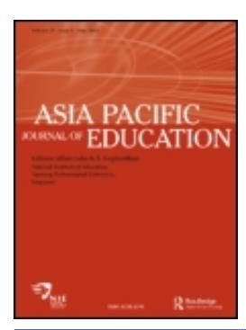
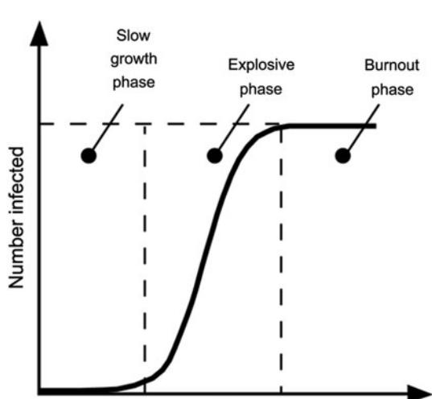

<!-- A2.R42 | source: papers_json/A2.R42/ -->

## **Asia Pacific Journal of Education**

**ISSN: 0218-8791 (Print) 1742-6855 (Online) Journal homepage:****[ www.tandfonline.com/journals/cape20](https://www.tandfonline.com/journals/cape20?src=pdf)**

## **Cross-national policy borrowing: understanding** **reception and translation**

**Gita Steiner-Khamsi**

**To cite this article:** Gita Steiner-Khamsi (2014) Cross-national policy borrowing: understanding reception and translation, Asia Pacific Journal of Education, 34:2, 153-167, DOI: [10.1080/02188791.2013.875649](https://www.tandfonline.com/action/showCitFormats?doi=10.1080/02188791.2013.875649)

**To link to this article: **[https://doi.org/10.1080/02188791.2013.875649](https://doi.org/10.1080/02188791.2013.875649)

| Image: Calendar icon | Published online: 13 Mar 2014. |
| --- | --- |
| Image: Pencil and paper icon | Submit your article to this journal Image: External link icon |
| Image: Bar chart icon | Article views: 10480 |
| Image: Magnifying glass on paper icon | View related articles Image: External link icon |
| Image: CrossMark logo | View Crossmark data Image: External link icon |
| Image: Two papers icon | Citing articles: 64 View citing articles Image: External link icon |

<!-- page 2 -->

## Cross-national policy borrowing: understanding reception and translation

Gita Steiner-Khams[i*](#page-1-0)

Teachers College, Columbia University, New York, USA

(Received 30 June 2013; final version received 7 November 2013)

تبحث هذه المقالة مفهومين أساسيين في أبحاث استعارة السياسات وإقراضها، وهما مفهومان يُستخدَمان غالباً لتفسير سبب وكيفية انتقال الإصلاحات التعليمية عبر الحدود الوطنية: الاستقبال (reception) والترجمة (translation). تحلّل الدراسات المتعلقة بالاستقبال الأسباب السياسية والاقتصادية والثقافية التي تفسّر جاذبية إصلاح مستورد من مكان آخر. أما الترجمة، فتجسّد فعل التكيّف المحلي، أو التعديل، أو إعادة الصياغة لإصلاح مستورد. ومن اللافت أن فعل استعارة السياسات، في معظم الحالات، يكون منزوع الإقليمية ويعتمد على معايير دولية أو "أفضل الممارسات" معرّفة بشكل عام. وتُستثنى من ذلك الإشارات إلى الدول الرائدة في اختبارات التحصيل الطلابي الدولية، مثل سنغافورة وفنلندا وشنغهاي في الآونة الأخيرة. وتطرح المقالة حجة مفادها أن محللي السياسات في الدول الأخرى لا يحاكون سمات نظام الدول الرائدة إلا إذا كانت تناسب أجندتهم السياسية المحلية الخاصة. علاوة على ذلك، هناك مجموعة جديدة من الأبحاث آخذة في الظهور في مجال التربية المقارنة تبحث في الإسقاطات الخاصة بكل دولة على الأنظمة التعليمية للدول الرائدة. وأخيراً، تشير المقالة إلى ظاهرة "نعم، لكن..." في الحالات التي يوجد فيها مقاومة للتعلّم أو التبنّي أو الاستعارة من الدول الرائدة. وفي لحظات المقاومة للتغيير هذه، يميل صانعو السياسات إلى إبراز الفروق الجوهرية بالإصرار على أن السياقات غير قابلة للمقارنة بما يكفي لتعلّم درس مفيد: فنلندا أحادية الثقافة أكثر مما ينبغي، وشنغهاي حضرية أكثر مما ينبغي، وسنغافورة تعتمد على الدروس الخصوصية أكثر مما ينبغي لتكون ذات صلة باستخلاص الدروس.

Keywords: policy borrowing; globalization studies; international student achievement tests; externalization; decontextualization; recontextualization

## Policy borrowing: normative versus analytical questions

غالباً ما يُنظر إلى التعلّم من تجارب الدول الأخرى باعتباره أحد أبرز سمات الدراسات المقارنة. وفي مجال التعليم، ساعدت دراسة استعارة السياسات على تثبيت وترسيخ شرعية حقل التربية المقارنة. غير أن التعلّم من المقارنة لا يعني بالضرورة أن السياسات والممارسات ينبغي أن تُنقل فعلياً من سياق إلى آخر. والواقع أن جيلاً بعد جيل من علماء المقارنة، من مايكل سادلر إلى برايان هولمز إلى روبرت كوين، حذّروا من تحليل التعليم خارج سياقه ومن استخدام المقارنة لنقل الإصلاحات التعليمية من دولة إلى أخرى. لكن في الممارسة العملية، تُعدّ استعارة السياسات عبر الوطنية هي القاعدة وليست الاستثناء. فعلى سبيل المثال، يعيد كوين ([2000)](#page-14-0) طرح سؤال سادلر الذي يعود عمره إلى مئة عام: "ماذا يمكننا أن نتعلّم من دراسة الأنظمة الأجنبية؟" ويوضح أن الدراسة المقارنة للأنظمة التعليمية، في الممارسة، غذّت "عبادة البضائع" (cargo-cult)، أي عملية تصدير واستيراد شاملة للنماذج التعليمية عبر الحدود الوطنية. وإذ أشكك في نقل "أفضل الممارسات" من سياق إلى آخر دون تمحيص، أنضم إلى كوين

> ^*^Email: [gs174@columbia.edu](mailto:gs174@columbia.edu)

<!-- page 3 -->

وإلى آخرين يفضّلون الملاحظة والتحليل والتفسير لعملية استعارة وإقراض السياسات بدلاً من الانخراط في فعل النقل الفعلي للسياسات التعليمية.

في الوقت الحاضر، انقسم مجال بحث استعارة السياسات إلى اتجاهين: مجموعة من الباحثين تدعو بشكل فاعل إلى استعارة السياسات، ومجموعة أخرى مهتمة بفهم متى ولماذا وكيف تحدث استعارة السياسات. تتبنّى المجموعة الأولى نهجاً معيارياً وتستخدم المقارنة لتحديد الأنظمة التعليمية الأفضل أداءً، والتي ينبغي تعلّم دروس منها أو "أفضل ممارسات" ونقلها. أما المجموعة الثانية فتحلّل لماذا ومتى تُصنع هذه الإشارات الخارجية، وتفحص أثر هذا الاستيراد على السياسات القائمة وموازين القوى.

ومن الملفت أن عضوية كلا المعسكرين الأكاديميين قد نمت بشكل هائل خلال السنوات القليلة الماضية. تضم مجموعة الباحثين المعياريين تلك المجموعة الكبيرة من العلماء الذين يجرون مقارنات معيارية بهدف استخلاص متغيرات النظام الفعّالة التي يمكن استخدامها كمؤشرات لتحديد المعايير العالمية. فمنظمة OECD (منظمة التعاون الاقتصادي والتنمية) ومنظمة IEA (الجمعية الدولية لتقييم التحصيل التربوي)، إلى جانب بنوك معرفة أخرى أنشأها البنك الدولي ومنظمات دولية أخرى، مهتمة بفهم ما ينجح وما لا ينجح. والهدف النهائي للبحث المعياري التطبيقي هو الإجابة عن أسئلة سياسية مثل: ما هو الحجم الأمثل للفصل الدراسي، وما هي السمات المثلى لنظام إعداد المعلمين، وما هو الراتب الأمثل للمعلم، وما هو التكرار الأمثل لفرض اختبارات الطلاب، وما هي النسبة المثلى بين الإنفاق العام والخاص على التعليم، وما إلى ذلك، من أجل تعليم فعّال وعالي الجودة؟ في المقابل، تتبنّى مجموعة الباحثين التحليليين بحثاً تأسيسياً وتختار المقارنة كأداة منهجية لتحسين نظرية عملية صنع السياسات. وقد شهدت هذه المجموعة الثانية من الباحثين أيضاً ازدهاراً غير مسبوق منذ مطلع القرن. فعلى سبيل المثال، قدّم الكتاب السنوي العالمي للتعليم لعام 2012 أعمال هذه المجموعة من الباحثين الذين يحللون استعارة السياسات عبر الوطنية (Steiner-Khamsi & Waldow, [2012)](#page-15-0). ويُشار إلى مجال إسهامهم بشكل متبادل بوصفه بحثاً في استعارة السياسات وإقراضها، أو سياسة التعليم العالمية، أو النقل التربوي. ويلخّص [Table 1](#page-2-0)، على سبيل المثال، بعض الفروق الرئيسية بين النهج المعياري والنهج التحليلي في دراسة النقل التربوي.

وللإنصاف، سيكون من الخطأ افتراض أن الموقفين — المعياري والتحليلي — متنافيان تماماً. فكثير منا نشط في كلا المعسكرين: فنحن نقرأ ونحلل وننتج أدبيات حول متغيرات النظام التي تؤثر على إمكانية الوصول إلى التعليم وجودته، والتي يمكن، في ظل ظروف معينة وفي سياقات محددة، أن تُنقل إلى أنظمة تعليمية أخرى. وفي الوقت نفسه، نعمل أيضاً على مستوى فوقي ونتأمل في سبب صدى فعل استعارة السياسات وإقراضها في سياقات معينة، ومن الذي يدعو عادةً إلى التعلّم من مكان آخر، وكيف يُترجم الإصلاح المستورد ويُنفَّذ في سياق معين، وما هو أثر فعل استعارة

| Normative | Analytical |
| --- | --- |
|  |  |

|  | Normative | Analytical |
| --- | --- | --- |
| "Best practices" | Which are the "best practices" that should be adopted? | Whose practices are considered "best practices"? |
| Dissemination | How can "best practices" be effectively disseminated? | Under which conditions is dissemination of a practice likely to occur? |
| Impact of lesson drawing | What has been improved as a result of policy borrowing? | Who benefits, who loses in the act of lesson drawing? |

<!-- page 4 -->

السياسات على بناء التحالفات بين الجهات الفاعلة المتنافسة في سياق سياسي معين. في هذه المقالة، أحاول الإسهام في الدراسات التحليلية حول استعارة السياسات، وأركّز بشكل خاص على مرحلتين رئيسيتين من مراحل استعارة السياسات: الاستقبال والترجمة.

يفحص الاستقبال الاتصال الأولي بسياسة التعليم العالمية على المستوى المحلي ويركّز على عملية الاختيار. أما الترجمة فتتناول التكيّف المحلي لسياسة التعليم العالمية.

## Reception

تشمل الأسئلة البحثية النمطية حول الاستقبال: لماذا يختار الفاعلون المحليون سياسة معينة، وأي مشكلة يُفترض أن تحلّها السياسة المستعارة، أو ما هي "نقاط الجذب" في السياسة التي تبدو جذّابة للفاعلين السياسيين المحليين. في هذه المقالة، سأسلّط الضوء على ثلاث قضايا رئيسية تميل أحدث الدراسات حول الاستقبال إلى فحصها: (1) متى أو تحت أي ظروف تميل الأنظمة التعليمية إلى أن تكون منفتحة ومتقبّلة للأفكار الجديدة من مكان آخر؟ (2) كيف يستخدم أصحاب المصلحة الإشارات إلى المعايير الدولية لإصلاح نظامهم؟ (3) ما هي بعض السمات الرئيسية للإصلاحات التي انتشرت عالمياً؟ وفيما يلي توسّع في هذه الأسئلة البحثية الثلاثة الرئيسية المتعلقة باستقبال السياسات، والتي أقترح تسميتها بالقضايا المرتبطة بـ: (1) الانفتاح على التقبّل (receptiveness)، (2) استخدام المعايير الدولية، و(3) سمات سياسة التعليم العالمية.

## Receptiveness: understanding the socio-logic of selective policy borrowing

من الضروري تقديم مفهوم "التخريج" (externalization) الذي صاغه عالم الاجتماع الألماني نيكلاس لوهمان وتبنّاه يورغن شرايفر للدراسات المقارنة في التعليم (Luhmann, [1990](#page-14-1); Schriewer, [1990)](#page-14-2). وضمن إطار نظري لنظرية النظم (Luhmann, [1990)](#page-14-1)، يقترح يورغن شرايفر وزملاؤه دراسة السياق المحلي من أجل فهم "المنطق الاجتماعي" (Schriewer & Martinez, [2004,](#page-15-1) p. 33) للتخريج. ويرى شرايفر ومارتينز أنه من الدلائل على "المنطق الاجتماعي" لنظام ما أن أنظمة تعليمية محددة فقط تُستخدَم كمصادر خارجية للسلطة. فمعرفة الأنظمة المستخدَمة كـ"مجتمعات مرجعية" تخبرنا شيئاً عن العلاقات المتبادلة بين الفاعلين ضمن أنظمة عالمية مختلفة. غير أن بحث شرايفر ومعظم زملائه يركّز على السرديات التاريخية للانتشار والاستقبال العالمي في التعليم.

قدّمتُ إطار التخريج في مجال دراسات السياسات المقارنة (Steiner-Khamsi, [2004](#page-15-2)). فعلى مدى السنوات العشر الماضية، جعلتُ من مشروعي الفكري تكييف مفهوم التخريج كإطار تفسيري لتحليل استعارة السياسات وإقراضها في التعليم بشكل منهجي. لقد نمت مجموعة الباحثين في التربية المقارنة الذين يركّزون على دراسة استعارة السياسات وإقراضها نمواً كبيراً، وباتت هناك، على الأقل، أربعة أجيال مختلفة من باحثي استعارة/إقراض السياسات، يضيف كل منهم منظورات ومسارات بحثية جديدة إلى هذا المجال المثير للاهتمام في التربية المقارنة (see Steiner-Khamsi & Waldow, [2012,](#page-15-0) chapter 1).

يمكن القول إن مفهوم التخريج مفيد لدراسات السياسات المقارنة لأنه يمكّننا من فهم كيفية إثارة "القوى العالمية" أحياناً محلياً بغرض توليد إصلاح في التطورات المحلية (Steiner-Khamsi, [2004](#page-15-2)). ووجدتُ أن التخريج يحدث بالتحديد في لحظة تصاعد النزاع السياسي، أي عندما تُصنع الإشارات إلى أنظمة تعليمية أخرى، أو إلى "معايير دولية في التعليم" بمعناها العام، أو إلى العولمة. وخلصتُ إلى أن استعارة السياسات عبر الوطنية، سواء كانت خطابية أو فعلية، لها أثر تصديقي على الخطاب السياسي المحلي. وفي منشورات سابقة، استخدمتُ الأخطبوط كاستعارة لوصف الجذب والصدى والاستقبال عبر الوطني للسياسات (Steiner-Khamsi, [2010](#page-15-3), [2012)](#page-15-4). فالفاعلون المحليون يمدّون أيديهم

<!-- page 5 -->

ويمسكون بذراع الأخطبوط الأقرب إلى أجندتهم السياسية الخاصة، وبذلك يضفون معنى (محلياً) على سياسة (عالمية). وبشكل افتراضي، تصبح أي دراسة حول الانفتاح على التقبّل دراسةً حول استعارة سياسات انتقائية. فاستعارة السياسات ليست أبداً شاملة، بل هي دائماً انتقائية، وتعكس بالتبعية "المنطق الاجتماعي" أو الأسباب الخاصة بالسياق التي تفسّر هذا الانفتاح.

في دراسات السياسات، صاغ جون كينغدون مصطلح "نافذة السياسة" (policy window) لتحديد الظروف المواتية للتغيير في السياسة (Kingdon, [1995,](#page-14-3) p. 19). ووجد أن تقارب التيارات الثلاثة التالية غالباً ما ينتج التغيير: تيار المشكلة (إدراك وجود مشكلة)، وتيار السياسة (توفر الحلول)، والتيار السياسي (تطورات جديدة في المجال السياسي، مثل تغيير الحكومة مؤخراً). ومن المهم الإشارة إلى أن كينغدون لا يأخذ في الحسبان عملية استعارة السياسات عبر الوطنية. ويمكن القول إنه في عصر العولمة، تُعدّ استعارة السياسات عبر الوطنية، سواء بشكل خطابي أو فعلي، هي القاعدة وليست الاستثناء. وبالتالي، يميل تيار السياسة إلى أن يكون متاحاً للسياسيين وصانعي القرار في كل الأوقات في شكل "أفضل الممارسات" أو "معايير دولية" أو دروس مستفادة من أنظمة تعليمية أخرى. والواقع أن ضغط الاستعارة كبير إلى درجة أن محللي السياسات كثيراً ما يجدون أنفسهم في موقف محرج يضطرون فيه إلى تعريف المشكلة المحلية بأثر رجعي بحيث تناسب الحل أو حزمة الإصلاح العالمية القائمة أصلاً.

يبدو لي أن المهمة الأكثر تحدياً هي مزامنة تدفق التيار السياسي مع التيارين الآخرين. وبصياغة هذا كسؤال بحثي: كيف تُعبَّأ الأحزاب السياسية والمصالح المختلفة لدعم تغيير أو إصلاح ما؟ لدى بحث استعارة السياسات الكثير ليقدّمه لهذا السؤال البحثي. فقد حدّدت دراسات عديدة الأثر النافع لاستعارة السياسات على التعبئة السياسية. إضافة إلى ذلك، وفي سياق الدول النامية، يدخل تيار رابع حيز التأثير: التيار الاقتصادي، أي احتمالات القروض أو المنح الدولية لتنفيذ إصلاح معين. ومن الضروري الإقرار بنظرية التيارات الثلاثة لكينغدون كإطار قيّم للفت الانتباه إلى توقيت التغيير في السياسة. وفي الوقت نفسه، لا غنى عن تبنّي منظور عولمي لتنقيح نظرية التيارات الثلاثة بما يتناسب مع واقع اليوم من التفاعل والاستعارة السياسية عبر الوطنية.

والواقع أن دراسة استعارة السياسات تمثّل أرضية خصبة لفهم موازين القوى والنزاع السياسي المطوّل في سياق معين بشكل أفضل. ويشمل النهج التحليلي لدراسة النقل التربوي عادةً بعداً سياسياً وبعداً اقتصادياً. فمن الناحية السياسية، للاستعارة أثر نافع على النزاع السياسي المطوّل: إذ إنها تبني التحالفات. فهي تمكّن مجموعات الضغط المتعارضة من دمج مواردها لدعم خيار سياسي ثالث، يُفترض أنه أكثر حياداً، مستعار من مكان آخر. وقد أصبحت "المعايير الدولية" نقطة مرجعية شائعة بشكل متزايد في مثل هذه القرارات. أما البعد الاقتصادي، بدوره، فهو بارز بشكل خاص في الدول النامية. فمن الناحية الاقتصادية، غالباً ما تكون استعارة السياسات ظاهرة عابرة، لأنها لا تستمر إلا طالما استمر التمويل الخارجي — المشروط باستيراد حزمة إصلاح معينة. فاستعارة السياسات في الدول الفقيرة هي لقطاع التعليم ما يمثّله التكيّف الهيكلي، وتخفيف الفقر، والحوكمة الرشيدة للقطاع العام عموماً: شرط للحصول على المساعدات. وكشرط للحصول على المنح أو القروض على المستوى البرنامجي، تُعدّ استعارة السياسات في الدول النامية قسرية وأحادية الاتجاه. فالإصلاحات تُنقل من الشمال/الغرب العالمي إلى الجنوب/الشرق العالمي.

## International standards: the functionality of an empty vessel

تحظى مصطلحات "المعايير الدولية" و"مهارات القرن الحادي والعشرين" و"أفضل الممارسات" بصدى كبير لدى السياسيين وصانعي السياسات، ويلجؤون إليها في لحظات معينة

<!-- page 6 -->

من وضع الأجندة: كلما دعت الحاجة إلى توليد ضغط من أجل الإصلاح. وتعمل هذه المصطلحات فعلياً كمحفّزات للتغيير رغم عدم وجود اتفاق حول معناها الفعلي. بل الأدهى من ذلك أنها تعمل كأوعية فارغة تُملأ، كلما دعت الحاجة، بمعنى محلي. ومع ذلك، فهي قوية سياسياً لأنها تولّد مخاوف من التخلّف عن الركب في سوق عالمية، وبالتالي فإن لديها القدرة على بناء، كما ذُكر سابقاً، تحالفات بين مجموعات مصالح كانت لتتعارض فيما بينها لولا ذلك. وباختصار، فإن العولمة ليست قوة خارجية، بل هي خطاب مُنتَج محلياً يُعبَّأ في لحظات معينة من النزاع السياسي المطوّل لتوليد ضغط الإصلاح وبناء تحالفات السياسات.

بالنسبة لباحثي الاستعارة من الجيل الأول، كان من الضروري تفسير اختيار "المجتمع المرجعي"، أي النظام التعليمي الذي استُعيرت منه السياسات والممارسات والأفكار. وعادةً ما كانت هناك أسباب ثقافية أو سياسية أو اقتصادية تفسّر اهتمام المستعير بنظام معين. فقد فحص فيليبس ([2004)](#page-14-4)، على سبيل المثال، أسباب الجذب السياسي عبر الوطني لمسؤولي الحكومة البريطانية والعلماء نحو النظام التعليمي في ألمانيا خلال القرن التاسع عشر. ويمكن أن يكون نطاق الدوافع التي تجعل دولة ما تسعى للاستلهام من النظام التعليمي لدولة أخرى متنوعاً جداً. ففي الولايات المتحدة، جذب التقارب السياسي بين إدارتَي ريغان وتاتشر انتباه المصلحين النيوليبراليين الأمريكيين إلى النموذج البريطاني في أوائل التسعينيات. لكن صانعي سياسة التعليم الأمريكيين كانوا مدفوعين أيضاً بالمنافسة (مثلاً، الاتحاد السوفيتي في أواخر الخمسينيات وأوائل الستينيات) أو بالفضول (مثلاً، اليابان خلال الثمانينيات). أما اليوم، فتحظى الدول الرائدة في اختبارات التحصيل الطلابي الدولية، مثل الأنظمة التعليمية في شنغهاي وفنلندا وسنغافورة، بأكبر قدر من الاهتمام. وكما سأوضح في القسم الأخير من هذه المقالة، توجد أسباب خاصة بكل دولة أو منطقية اجتماعياً لتفسير نجاح الدول الرائدة. فمحللو السياسات الألمان واليابانيون والكوريون يقدّمون تفسيرات مختلفة تماماً لسبب أداء الطلاب في النظام التعليمي الفنلندي بشكل جيد جداً في دراسات البرنامج الدولي لتقييم الطلاب (PISA). وترتبط تفسيراتهم بشكل أكبر بالنقاشات السياسية المثيرة للجدل في بلدانهم أكثر من ارتباطها بمتغيرات النظام الفعلية للنظام التعليمي الفنلندي. وبالتالي، فإن "الدروس المستفادة" من نظام تعليمي آخر تتضمن دائماً جزءاً كبيراً من الإسقاط على نظام تعليمي الآخرين.

منذ زمن طويل، انشغل باحثو التربية المقارنة بفهم اختيار المجتمعات المرجعية وأثره على صياغة السياسة المحلية (e.g., Silova, [2006)](#page-15-5). أما اليوم، فتتعامل الدراسات بشكل متزايد مع ظهور "فضاءات تعليمية" إقليمية ودولية جديدة، أو مناطق تنشأ نتيجة للمواءمة. ومن الأمثلة على ذلك بروتوكولا بولونيا ولشبونة في التعليم العالي، أو برامج التعليم للجميع في الدول النامية. فالحكومات التي توقّع مثل هذه الاتفاقيات يجب عليها في نهاية المطاف مواءمة سياساتها مع سياسات الفضاء التعليمي الأكبر الذي تنتمي إليه. ومن منظور بحث نقل السياسات، تُعدّ المواءمة نوعاً واحداً فقط من عدة أنواع لاستعارة السياسات وإقراضها؛ نوع يصوّر، ربما بشكل أوضح من الأنواع الأخرى، الانتقال من إطار مرجعي ثنائي إلى إطار إقليمي أو دولي.

## What is exportable, what is likely to go global?

ليس مستغرباً أن صناعة التعليم حريصة على تحديد السمات التي تجعل المنتج قابلاً للتسويق. وربما يكون من الأقل شهرة أن الحكومات بدأت أيضاً الآن في إظهار الاهتمام بما يُباع من المنتجات والخدمات التعليمية. فقد تعاقدت الحكومتان البريطانية والألمانية، على سبيل المثال، مع اقتصاديين لحساب القيمة

<!-- page 7 -->

التي يولّدها تصدير الخدمات والمنتجات التعليمية للاقتصاد. وفي سوق اليوم العالمية، تتنافس الحكومات فيما بينها على تصدير علامتها التعليمية التجارية الخاصة إلى دول أخرى أو جذب طلاب من دول أخرى للالتحاق بجامعاتها. وليس مستغرباً أن الحكومات، في محاولة لتسويق منتجاتها وخدماتها التعليمية بشكل أفضل، تدّعي أنها واءمت أنظمتها التعليمية مع المعايير الدولية. ومن الواضح أن مثل هذا التأكيد على المواءمة هو حيلة تسويقية تستخدمها الحكومات والشركات على حد سواء لأن الإشارة إلى المعايير الدولية مفيدة لأعمالها.

ورغم أن التعليم لا يُعدّ (بعد) أحد قطاعات التجارة التي تنظّمها منظمة التجارة العالمية، أصدرت الحكومات دراسات تحسب المكاسب أو الخسائر الاقتصادية من التجارة والخدمات التعليمية عبر الوطنية. وهي تتّبع أنماط التوريد الأربعة عبر الحدود التي حدّدتها اتفاقية GATS (الاتفاقية العامة للتجارة في الخدمات). وتحدث معظم أنشطة التجارة والخدمات العابرة للحدود في قطاع التعليم العالي. ومن الأمثلة من الولايات المتحدة ما يلي: (1) التجارة والخدمات العابرة للحدود: تصدير الكتب المدرسية والمجلات والمواد التعليمية والاختبارات من الناشرين الأمريكيين إلى دول أخرى، (2) الاستهلاك في الخارج: الطلاب الدوليون الملتحقون بالجامعات الأمريكية، (3) الحضور التجاري: الجامعات الفرعية والبرامج خارج الحرم الجامعي التي تُنشأ في الخارج، مثل جامعة نيويورك أبوظبي، و(4) حركة الأشخاص الطبيعيين: المواطنون الأمريكيون العاملون في الجامعات الأمريكية بالخارج، مثل الجامعة الأمريكية في بيروت أو الجامعة الأمريكية في القاهرة.

منذ عام 2004، يصدر المجلس الثقافي البريطاني (British Council) دراسات اقتصادية تحسب الصادرات البريطانية في مجال التعليم باستخدام أنماط التوريد الأربعة التي حدّدتها اتفاقية GATS. وتُظهر أحدث دراسة من عام 2007 أن القيمة الإجمالية لصادرات التعليم والتدريب إلى الاقتصاد البريطاني تتجاوز 12.5 مليار جنيه إسترليني (النمط 1)، وأن المكاسب الاقتصادية من الطلاب الدوليين الملتحقين بجامعات المملكة المتحدة (النمط 2) تبلغ نحو 8.5 مليار جنيه إسترليني سنوياً (Lenton, [2007](#page-14-5)). وبالمثل، استعانت وزارة التعليم والبحث الاتحادية الألمانية (Bundesministerium fu¨r Bildung und Forschung) بشركة الاستشارات Booz & Co. لحساب الأثر الاقتصادي للصادرات التعليمية الألمانية (Bundesministerium fu¨r Bildung und Forschung, [2010)](#page-14-6). وتشمل الدراسة ليس فقط التعليم العالي، بل تغطّي مجموعة واسعة من الخدمات والمنتجات التعليمية. وتميّز المبادرة الاتحادية الألمانية iMOVE، المعروفة رسمياً أيضاً باسم "Training – Made in Germany"، بين مجالين تُقدَّم فيهما الخدمات والسلع التعليمية: المجال التعليمي الأساسي (المدارس، التطوير المهني/التدريب المهني، التعليم العالي، تعليم اللغة الألمانية، تصدير المنتجات التعليمية)، والمجال التعليمي الموسّع (التدريب على منتجات محددة، الخدمات الاستشارية في قطاع التعليم). وتخلص الدراسة إلى أن الاقتصاد الألماني يجني سنوياً 9.4 مليار يورو من المبيعات والخدمات في هذين المجالين التعليميين.

من نواحٍ عديدة، لا يختلف المنتج التعليمي (كتاب مدرسي، اختبار طلابي، وحدة تدريبية، إلخ) أو الخدمة التعليمية (تقييم، تخطيط استراتيجي، تدريب، إدارة، إلخ) عن المنتجات والخدمات في قطاعات أخرى. وينبغي التسليم بأن بيع ونقل نفس حزمة الإصلاح على مستوى عالمي أكثر ربحية من تصميم إصلاحات بشكل فردي تناسب السياق المحدد. وتتطلب عملية التصدير الناجحة لحزم الإصلاح عدة مكونات: التدريب أو "بناء قدرات السكان المحليين"، وآلية صارمة لضمان الجودة في شكل ترخيص وشهادات للتأكد من أن الشركات المحلية المنافسة لا تجرؤ على تقديم نسخة أرخص ومخفَّفة من الحزمة العالمية، وإدارة دولية توظّف وتفصل الموظفين المحليين دون تردد. علاوة على ذلك، لا يكون بيع سياسة تعليمية عالمية مربحاً إلا إذا كانت معبّأة كمنتج متماسك ومترابط العناصر يُجبر

<!-- page 8 -->

الحكومة على شراء الحزمة بأكملها بدلاً من اختيار عناصر معينة والتفاوض عليها بشكل انتقائي. كما ينبغي أن يكون تنفيذ الحزمة معقداً بما يكفي بحيث يستمر "السكان المحليون" في الاعتماد على الاستشارات الدولية، وبالتالي يوافقون على ترتيبات تعاقدية طويلة الأجل. وأخيراً، تُعدّ الاختبارات الطلابية الموحدة ضرورية لإثبات فعالية الإصلاح، ولإظهار للعميل أن الاستيراد، الذي يكون دائماً أكثر تكلفة من الإصلاحات المحلية، كان يستحق العناء. وبعيداً عن الجدل، تميّز هذه المكونات السمات الأساسية لسياسة التعليم العالمية.

كما طرحتُ في منشورات أخرى حجة حول البُعد الزمني لسياسة التعليم العالمية (Steiner-Khamsi, [2010](#page-15-3)). فالبُعد الزمني، أو "عمر السياسة" (كما هو موضّح في [Figure 1)](#page-7-0)، له أهمية كبيرة ويساعد على التنبؤ باحتمال تصدير إصلاح ما أو نشره. ويتتبّع النموذج الوبائي للانتشار العالمي، المستخدَم على نطاق واسع في دراسات انتشار الابتكار وتحليلات الشبكات الاجتماعية (see Watts, [2003](#page-15-6), p. 172)، عملية نزع الإقليمية عن إصلاح ما بمرور الوقت. ويميّز النموذج الوبائي، الموضّح في [Figure 1,](#page-7-0)، بين المتبنّين الأوائل والمتأخرين للابتكار.

في المراحل المبكرة، لا "تُصاب" سوى أنظمة تعليمية قليلة بإصلاح معين. ويقدّم المتبنّون إشارات صريحة إلى الدروس المستفادة من أنظمة تعليمية أخرى، خصوصاً تلك التي يسعون تحديداً لمحاكاتها. ومن الأمثلة الجيدة على ذلك النقل عبر الأطلسي لمفهوم "اختيار المدرسة" (school choice) بين النظامين التعليميين الأمريكي والبريطاني في أوائل التسعينيات. فقد جعل التخريج إصلاحاً مثيراً للجدل أكثر قبولاً. أما خلال مرحلة النمو المتفجّر (المرحلة الوسطى كما هو موضّح في [Figure 1](#page-7-0))، فتتبنّى أنظمة أكثر إصلاحاً ما، فيما تتلاشى آثار استعارة السياسات عبر الوطنية. وبمجرد أن تستعير كتلة حرجة من المتبنّين المتأخرين إصلاحاً معيناً، تختفي الأصول الجغرافية والثقافية، مما يسهّل انتشار نسخ منزوعة السياق والإقليمية بسرعة. وفي هذه المرحلة، يحدث الانتشار العالمي. وبمجرد انتهاء "الوباء"، تستعير معظم الأنظمة التعليمية أجزاءً متفرقة من الإصلاح بشكل انتقائي، بينما تكتسب مناعة من جوانب أخرى. وخلال مرحلة النمو المتفجّر، يتبنّى صانعو السياسات الخطاب فقط. ويفعلون ذلك لأنهم يخشون التخلّف عن الركب ووصمهم بالتخلف أو القدم أو ما قبل الحداثة. وينبغي تفسير التبنّي المتأخر باعتباره

*Figure 1. Lazy-S curve*

Source: Watts [(2003](#page-15-6), p. 172)

<!-- page 9 -->

بياناً توجيهياً يصدره صانعو السياسات للدلالة على انتمائهم الجيوسياسي إلى فضاء تعليمي أكبر وأكثر حداثة. ويكون "الخطاب العالمي" الحاصل في هذه المرحلة رمزياً في الغالب، مع تبعات قليلة على العمل السياسي على المستوى الوطني، أو على تنفيذ السياسة على المستوى المؤسسي. وبالتالي، يفسّر عمر الإصلاح المتنقل مدى قابليته للمساءلة: فكلما كان أقدم وتم تداوله أكثر بين الأنظمة التعليمية، زاد احتمال تصديره أو نشره بشكل أكبر.

اليوم، نحن محاطون بإصلاحات "كثيرة التنقل". ويُعدّ كثير منها إصلاحات شبه سوقية، أو نيوليبرالية، أو مفرطة الليبرالية نشأت خلال حقبة تاتشر-ريغان. وفي البداية، استُعيرت من نيوزيلندا وأستراليا، وتُبنّيت في المملكة المتحدة والولايات المتحدة، ثم انتشرت إلى كل ركن من أركان العالم. وتحديداً لأنها قُدّمت منذ زمن بعيد، يشير إليها صانعو السياسات في الدول المتبنّية المتأخرة بأنها "إصلاحات دولية"، دون توضيح مصدرها. وفي مرحلة النمو المتفجّر — بعد 10 أو 20 أو 30 عاماً من تقديم الإصلاح — سيبدو من الغريب الإشارة إلى هذه الإصلاحات بأنها بريطانية أو أمريكية.

وللتذكير بالتفسيرات المقدَّمة في هذا القسم، فإن احتمال تبنّي إصلاح من مكان آخر يزداد كلما كان ذلك الإصلاح أكثر تنقلاً. فليس فقط أن الإصلاح المتنقل يصبح، مع كل تبنٍّ جديد، مؤكَّداً مجدداً باعتباره "أفضل ممارسة" — ليصل في النهاية إلى مرتبة "معيار دولي" — بل إنه يصبح أيضاً، مع كل فعل استعارة جديد، منزوع الإقليمية بشكل متزايد. وخلال مرحلة النمو المتفجّر (see [Figure 1](#page-7-0))، يُعدّ الإصلاح العالمي في آن واحد ملكاً للجميع وملكاً لا أحد. ويُعدّ افتراض الحياد أحد الأسباب التي تفسّر لماذا تميل سياسة التعليم العالمية إلى الصدى لدى السياسيين وصانعي السياسات: فالإصلاح يبدو خالياً من أي أجندة سياسية، وله القدرة على تعبئة مجموعات المصالح المتعارضة لدعم إصلاح خارجي واحد، منزوع الإقليمية، ويُفترض أنه محايد.

## Translation

التعلّم المتمحور حول الطالب، ومساءلة المعلم، والاختيار، وتعليم الفتيات، والمشاركة المجتمعية، والتعليم متعدد اللغات، ومحو الأمية المبكر، وقائمة طويلة أخرى من المعتقدات التربوية، بما فيها تلك التي تُعدّ نيوليبرالية، بدأت غالباً في الشمال العالمي ثم مُوِّلت لنشرها في بقية العالم. غير أن ما تعنيه في سياق معين يتفاوت بشكل كبير. والمطروح للنقاش هو منطق ونمط الترجمة، أو التكيّف المحلي، أو التوطين. فماذا يمكننا أن نتعلّم من تحليل كيفية تكيّف أو تعديل أو ترجمة سياسة تعليمية عالمية مستعارة في سياق معين؟

فيما يلي، صنّفتُ قضايا الترجمة الرئيسية إلى ثلاث مجموعات واسعة: مجموعة من العلماء لا تعتقد أن هناك الكثير لنتعلّمه من تحليل التكيّف المحلي، أو التعديل، أو الترجمة، لأنه توجد دائماً "ارتباط فضفاض" (loose coupling) بين السياسة المتصوَّرة والسياسة المطبَّقة، وبالتبعية، بين شكل السياسة (العالمية) على الورق وكيفية تنفيذها (محلياً). في المقابل، تتحمّس مجموعة ثانية من الباحثين لبحث التكيّف والتعديل المحلي، إذ إن مشروعهم يقوم على إظهار أن كل ظاهرة، بما فيها تجلّي سياسة التعليم العالمية في سياقات متنوعة، تعني — حسب السياق الثقافي — أشياء مختلفة لفاعلين مختلفين. وأخيراً، تنتج مجموعة ثالثة من المؤلفين دراسات مشابهة للمجموعة الثانية (ماذا تعني السياسة المستعارة في نظام معين)، لكنها تضيف أيضاً تعميمات وتستخلص نتائج لفهم عملية صنع السياسات. ولتسهيل التعرّف عليها، أقترح تسمية هذه المجموعات أو التقاليد الفكرية الثلاثة: النظرية المؤسسية الجديدة (neo-institutionalist theory)، والأنثروبولوجيا الثقافية، ونظرية النظم. لقد استخدمتُ في

<!-- page 10 -->

بحث آخر (Steiner-Khamsi, [2012)](#page-15-4) نظام "المكافأة الثلاثية" (triple bonus system) في منغوليا كحالة لتوضيح، بتفصيل دقيق، كيف تفسّر النظريات الثلاث المختلفة أثر استعارة السياسات على إصلاح راتب المعلمين في منغوليا. لذلك، سأكتفي في هذه المقالة برسم المواقف النظرية بدلاً من إعادة سرد الأمثلة الفعلية التي توضّح المدارس الفكرية المختلفة.

## Loose coupling between envisioned and enacted policies: a sociological dictum

قد يجادل البعض — انسجاماً مع المنظور المؤسسي الجديد — بأنه يوجد دائماً ارتباط فضفاض بين السياسة وتنفيذها. والواقع أن الارتباط الفضفاض استعارة يستخدمها كثيراً باحثو النظرية المؤسسية وعلم الاجتماع التنظيمي للدلالة على التباينات بين المستويات أو الأنشطة المختلفة ضمن حقل تنظيمي. وعلى غرار التباينات بين الموقف والسلوك، والنية والفعل، والسياسة والممارسة، يُعدّ الارتباط الفضفاض بالنسبة لكثير من علماء النظرية المؤسسية الجديدة أمراً لا عقلانياً أو خصوصياً أو غير منتظم. لذا فإن دراسة الارتباط الفضفاض غير ذات صلة بالنسبة لهم، إذ يتوقعون رؤى قليلة لمشروعهم الاجتماعي الأكبر لفهم التغيرات طويلة الأمد على المستوى المجتمعي. وفي التربية المقارنة، يبدو أن راميريز ([2003)](#page-14-7) وبيكر وليتاندر ([2005)](#page-14-8) يعودان إلى الارتباط الفضفاض كتفسير كلما واجها فروقاً عميقة بين معيار عالمي (مثلاً، التعليم المتمحور حول الطالب، الوعي بالنوع الاجتماعي، إلخ) وتجلّيه المحلي. غير أن مثل هذا النهج محدود القيمة لفهم الجذب أو إعادة التسييق (recontextualization) عبر الوطني للسياسة. وفي نهاية المطاف، بالنسبة للنظرية المؤسسية الجديدة، يُعدّ الارتباط الفضفاض هو التفسير (باللاتينية: explanans) لا القضية التي تستدعي تفسيراً (explanandum). لذا فإن تحليل الرابط بين العالمي والمحلي في استعارة السياسات يتطلب ألا يُقَرّ بالارتباط الفضفاض فحسب، بل أن يُفحَص ويُفسَّر بدقة أيضاً.

## Ethnographic accounts of what global education policies mean in local contexts

على النقيض تماماً، توجد مجموعة من الباحثين، تمثّل توجهاً محدداً ضمن الأنثروبولوجيا الثقافية، تنتج دراسات على مستوى دولة واحدة للتأكيد على أن القوى العالمية أو "الخارجية" يُعاد تفسيرها وتكييفها محلياً بشكل كبير، وبالتالي لا يكون لها سوى أثر محدود على البُنى والمعتقدات والممارسات المحلية. ورغم أن الخلافات بين المعسكرين — علماء الاجتماع المؤسسيين الجدد وعلماء الأنثروبولوجيا الثقافية المناهضين للمؤسسية الجديدة — أشعلت نقاشاً حيوياً حول نقاط القوة والضعف في كل إطار تفسيري، فإننا نفتقر إلى نقاش حول القيود المنهجية والنقاط العمياء التخصصية.

تنتقد دراسات الحالة الفردية المقدَّمة في المجلَّد الذي حرّرته أندرسون-ليفيت المؤسسيةَ الجديدة أو نظرية الثقافة العالمية من منظور أنثروبولوجي. وتعتمد عدة دراسات على سرديات إثنوغرافية لكيفية تنفيذ سياسات التعليم العالمية (Anderson-Levitt, [2003)](#page-14-9). وتعكس كل من دراسات الحالة التسع كيفية تفسير التأثيرات الخارجية في التعليم (القوى العالمية) في مجتمع معين (اللقاء المحلي). وكما هو معلن في عنوان الكتاب، يبحث مؤلفو دراسات الحالة في "المعاني المحلية" لرؤى وضغوط "التمدرس العالمي"، ويجدون تعددية في المعاني (المحلية). ويبني نقدهم على هذه النتيجة، ويُستخدَم كحجة لنقض الآثار التوحيدية للعولمة التي أكّدتها نظرية الثقافة العالمية. ويوضّح المساهمون أنه رغم أن الاختيار والتعلّم المتمحور حول الطالب والتعليم القائم على النتائج وتسويق المدارس، ضمن أمور أخرى، انتشرت عالمياً، فإنها لم تحل محل نماذج قائمة أصلاً ولم تعنِ الشيء نفسه في سياقات

<!-- page 11 -->

ثقافية متنوعة. فعلى سبيل المثال، يختلف الاختيار المتعلق بلغة التدريس، الذي دفعه المبشرون الأمريكيون في تنزانيا، لأسباب متنوعة، اختلافاً كلياً عن اختيار طرائق تدريس الرياضيات الذي كانت تعارضه فصائل من جمعية الآباء والمعلمين (PTA) في كاليفورنيا. وتهمّ هذه الفروق كثيراً مساهمي المجلَّد المحرَّر لأن هذه الفروق تكشف أن الأفراد في مجتمع معين لديهم فهم مشترك لما تعنيه نماذج الإصلاح العالمية في سياقهم الثقافي الخاص. وينتقدون خصومهم، علماء نظرية الثقافة العالمية أو علم الاجتماع المؤسسي الجديد، لأخذهم نماذج التمدرس العالمية على ظاهرها دون تمحيص السطح، وفحص كيفية تجلّيها بشكل مختلف على مستوى المجتمع. وبصياغة أكثر صراحة، يبدو أن منظّري الثقافة العالمية أخطأوا في اعتبار "قرصنة العلامات التجارية" مثل الاختيار، والتعليم القائم على النتائج، والتعلّم المتمحور حول الطالب، ضمن أمور أخرى، المخطوفة من زاوية من العالم والمقذوفة إلى زاوية أخرى، بمثابة نُذُر لتقارب دولي في التعليم.

## The logic of systems and organizations: the theory of self-referential systems

يعتمد إطاري التفسيري الخاص على عدة مفاهيم من نظرية النظم الاجتماعية (خصوصاً، الإحالة الذاتية، والتخريج، ومنطق النظام، والعمليات التنظيمية للنظم) لبناء إطار تفسيري لدراسات السياسات المقارنة. وتهدف النقاط المذكورة أعلاه إلى توضيح أن طريقة البحث المفضَّلة المستخدَمة في نظرية النظم تتكوّن من تحليل مفصَّل للسياقات المحلية وتشكيلات السياسات المحلية. فالسياق المحلي أساسي لفهم سبب استعارة السياسات (التخريج)، وكيفية تعديلها وتنفيذها محلياً (إعادة التسييق)، وما هو أثرها على البُنى والسياسات والممارسات القائمة (الاستدماج internalization).

كما هو موضَّح في منشورات أخرى، توجد على الأقل ثلاث مراحل في عملية استعارة السياسات: التخريج، وإعادة التسييق، والاستدماج. وتوجد ثروة من الدراسات التي تفحص بتفصيل دقيق كيف تُعاد صياغة سياق سياسة مستوردة أو تكييفها محلياً. ومعظم هذه الدراسات هي دراسات حالة فردية تستخدم الإثنوغرافيا أو المناهج النوعية لفهم ما تعنيه سياسة تعليمية عالمية معينة (مثلاً، الاختيار، المشاركة المجتمعية، مساءلة المعلم، إلخ) في سياق معين. وحتى الآن، توجد أيضاً بعض الدراسات حول سبب وتوقيت حدوث التخريج. ولفترة طويلة، أُنتِجت معظم هذه الدراسات حول التخريج في المراكز الثلاثة لبحث استعارة السياسات: كلية المعلمين، جامعة كولومبيا (نيويورك)، وجامعة همبولت (برلين)، وجامعة أكسفورد (أكسفورد، المملكة المتحدة). وبالمقارنة، أُنتِجت دراسات قليلة فقط تفحص الاستدماج. وبالطبع، هناك سبب معين يفسّر ندرة دراسات الأثر: تُطرَح افتراضات خاطئة مفادها أن كل سياسة مستعارة تُنفَّذ فعلياً، وبمجرد تنفيذها، إما تحل محل السياسات السابقة تماماً أو تولّد هجيناً من السياسات، يعكس عناصر مختارة من السياسات القديمة والجديدة.

في دراساتي حول الاستيراد التربوي في منغوليا، لاحظتُ أن الإحلال والتهجين لا يمثّلان سوى نوعين ممكنين فقط من الاستدماج للاستيراد التربوي. ويجب أيضاً أخذ نوع ثالث بعين الاعتبار — وهو تعزيز البُنى القائمة. واستخدمتُ استيراد التعليم القائم على النتائج (OBE) في منغوليا كمثال على ذلك. ومهما بدا الأمر عبثياً عندما قدّمتُ دراستي لأول مرة، فإن التعليم القائم على النتائج لم يفعل شيئاً سوى تعزيز نظام مراقبة المعلمين المفصَّل الذي كان قائماً منذ زمن طويل في منغوليا.[1](#page-14-10)

بالنسبة لنظرية النظم، يُعدّ فهم منطق النظام أو معنى النظام ذا أهمية حيوية. فبالنسبة لمجموعة الباحثين لدينا، ليست العولمة تدخّلاً تُقدّمه قوى خارجية، بل، كما ذُكر سابقاً، هي أصحاب المصلحة في النظام الذين يستخدمون دلالات العولمة أو المعايير الدولية — في أوقات معينة، وبطرق معينة، وتحت ظروف معينة — لزعزعة ديناميكية القوة في

<!-- page 12 -->

النظام. وبالفعل، يُرجَّح حدوث استعارة السياسات في ظل ظروف نزاع سياسي مطوَّل، عندما تتجاذب مجموعات المصالح المختلفة في اتجاهات مختلفة وتعرقل أي فرصة للتغيير. وعادةً ما يكون في مثل هذه السياقات السياسية أن يكون للإشارات إلى العولمة أو المعايير الدولية أثر نافع. فوسطاء سياسة التعليم العالمية (المنظمات الدولية، الشركات الدولية) يقحمونها كقوة ثالثة محايدة، ويقدّمونها كحل توافقي جذّاب، ويعبّئون مجموعات المصالح المتعارضة لبناء تحالف لدعم الاستيراد التربوي.

من المهم أن نتذكر أن عملية استعارة السياسات لا تنتهي هنا. فالتخريج ليس سوى بداية عملية طويلة. وما يحدث لاحقاً مهم للبحث فيه. علاوة على ذلك، أوصي بفحص السياسة المستوردة بعد خمس أو عشر سنوات من تقديمها لأول مرة. وكما تبيّن من عدة حالات استيراد تربوي، غالباً ما تكون تحالفات الدعوة للسياسات قصيرة العمر وغالباً ما تنهار بسبب خلافات حول كيفية تنفيذ السياسة فعلياً. وفي مرحلة إعادة التسييق، يظهر النقد حول الاستيراد التربوي. وإحدى الطرق لحل هذه المعضلة هي إنكار أن فعل استعارة السياسات قد حدث فعلاً. والإنكار ليس أمراً استثنائياً، وكانت أطروحة كارول-آن سبرين من أوائل الدراسات التي فحصت بالتفصيل كيف مُحيت كل آثار استعارة السياسة — في حالتها استيراد جنوب أفريقيا للتعليم القائم على النتائج من أستراليا وأمريكا الشمالية — بمجرد أن ساق معارضو الإصلاح حجة عدم القابلية للمقارنة (see Spreen, [2004](#page-15-7)). وفي اللحظة التي أصبح فيها التعليم القائم على النتائج (OBE 2000) مثيراً للجدل، أصرّ صانعو السياسات في جنوب أفريقيا على أن سياسة التعليم العالمية كانت "محلية النشأة" في المقام الأول وليست مستوردة من أي مكان آخر. ورغم أن تقنيات التوطين بأثر رجعي أو إعادة الصياغة هذه كثيراً ما تُستخدَم لاحقاً لتهدئة النقّاد، فإن القضية المطروحة لا تزال شرعية جذب السياسات عبر سياقات مختلفة: كيف يبرّر محللو السياسات وصانعوها اهتمامهم الشديد بأنظمة تعليمية (مثلاً، فنلندا وسنغافورة وشنغهاي) مختلفة تماماً وغير قابلة للمقارنة مع نظامهم الخاص؟

## Learning from Singapore: "Yes, but ... . "

كما هو موضَّح مراراً في هذه المقالة، لا يُعدّ استخلاص الدروس فعلاً عقلانياً في المقام الأول، بل هو متجذّر بعمق في قرارات سياسية واجتماعية واقتصادية. ورغم أن هناك الكثير لنتعلّمه من الأنظمة التعليمية في سنغافورة وفنلندا وشنغهاي، فإن محللي السياسات في الدول الأخرى لا يحاكون سمات نظام الدول الرائدة إلا إذا كانت تناسب أجندتهم السياسية المحلية الخاصة. وتيار السياسة (Kingdon, [1995](#page-14-3)) في شكل استخلاص الدروس من الدول الرائدة لا يؤدي بالضرورة إلى تغيير السياسة. فمتطلبات التغيير هي الإرادة السياسية (التيار السياسي)، وإدراك المشكلة (تيار المشكلة)، وإضافة إلى ذلك، في حالة الدول النامية، الحاجة إلى تعبئة تمويل خارجي (التيار المالي). ويجب أن يوجد ضغط للتغيير في كل هذه التيارات لكي يحدث التغيير فعلياً. وبصياغة مختلفة، من غير المرجَّح أن يحدث التغيير ما لم تترابط التيارات المختلفة وتولّد نافذة سياسة، أي لحظة مواتية للإصلاح. فماذا لو كانت نافذة السياسة مغلقة، أي إذا لم يكن هناك انفتاح على استخلاص أي درس من مكان آخر؟ في لحظات المقاومة للتغيير هذه، قد نشهد ظاهرة مثيرة للاهتمام: يميل صانعو السياسات إلى اللجوء إلى حجة الفروق الجوهرية بالإصرار على أن السياقات غير قابلة للمقارنة بما يكفي لتعلّم درس. وفي لحظات الجمود هذه يحجب صانعو السياسات الضغط العام، ويرفضون استخلاص الدروس، ويطلقون تصريحات عامة حول الدول الرائدة: فنلندا أحادية الثقافة أكثر مما ينبغي، وشنغهاي حضرية أكثر مما ينبغي، وسنغافورة تعتمد على الدروس الخصوصية أكثر مما ينبغي لتكون ذات صلة باستخلاص الدروس. ومن اللافت أن مناورات مشابهة

<!-- page 13 -->

لترسيم الحدود كانت موجودة في الماضي عندما كانت الأنظمة التعليمية في الاتحاد السوفيتي (الخمسينيات) أو اليابان (التسعينيات) تُعتبر رائدة في العلوم والرياضيات.

على غرار سلفها، دراسات الاتحاد السوفيتي (Sovietology)، كانت دراسات اليابان (Japanology) شعبوية إذ نشرت، بسرعة مذهلة، الكثير من التعميمات العامة والتصريحات النمطية حول التعليم في اليابان. وكما أشار كامينغز ([1989)](#page-14-11)، بالإشارة إلى تعبير صاغه جوزيف توبين: مال الباحثون الأمريكيون إلى استخدام نهج "نعم، لكن...". ويقرّ هذا النهج بالنجاحات في النظام التعليمي الآخر، لكنه في الوقت نفسه "يجادل بأن هذه النجاحات تأتي بثمن باهظ جداً، ثمن لا يرغب الأمريكيون في دفعه" (Cummings, [1989,](#page-14-11) p. 296). وشملت التصريحات المبالَغ فيها أو الخرافات حول التعليم الياباني: نموذج التنشئة الاجتماعية المقلوب (التساهل في الطفولة المبكرة، والانضباط في المراهقة وأوائل مرحلة الرشد)، والتعليم من أجل الأمة والدولة، وظاهرة "kyoiku mama" (الأم الموجّهة نحو التعليم)، والتعلّم بالحفظ في المدارس، والمنافسة والانتحار، والتعليم العالي النخبوي، وعدم المساواة الاجتماعية. وساعدت هذه الأحكام المعمَّمة حول المجتمع والتعليم الياباني على تسييج الضغط العام للتعلّم من اليابان. وبعد بضع سنوات، تلاشى انجذاب الولايات المتحدة للنظام التعليمي الياباني بسرعة ظهوره بسبب الأزمة الاقتصادية في آسيا. وخلال فترة زمنية قصيرة، اختفت "نقاط القوة المعترف بها بحذر في التعليم الياباني" (Cummings, [1989](#page-14-11), p. 298) من السرديات الأمريكية. وسقط النظام التعليمي الياباني من النعمة، وبدأ المراقبون الأمريكيون في استخدام الدراسات التي وثّقت مدارس الحفظ المكثف، وانتحار الطلاب، واحتراق المعلمين النفسي في اليابان بشكل واسع. وظهر النقّاد أيضاً ضمن السياقات اليابانية نفسها. ففي اليابان، برز خطاب الأزمة في مطلع الألفية الجديدة واستُخدِم لتبرير الحاجة إلى إصلاح جذري، مثل إصلاح المناهج بعيد المدى الذي نُفِّذ عام 2002 (Tsuneyoshi, [2004)](#page-15-8).

خلال الحرب الباردة، لم يكتفِ حقل دراسات الاتحاد السوفيتي (Sovietology) بتلبية المطالب الشعبوية لفهم سبب تخلّف الولايات المتحدة عن الركب في سباق الفضاء والتسلّح، بل جعل أيضاً من المقبول في البحث التربوي الانخراط في تحليلات تباينية، أي مقارنة موجَّهة بشكل أساسي نحو تحديد الاختلاف. ونتيجة لذلك، انقسم النظامان إلى ثنائية، ووُضِع كل منهما عند الطرف المقابل من طيف. وصُوِّر التعليم السوفيتي كنظام يعتمد على التلقين السياسي، بينما يُفترض أن النظام الأمريكي عزّز التفكير النقدي لدى الطلاب. وقائمة التصنيفات الثنائية طويلة. ويكفي ذكر ثنائية زائفة واحدة أخرى: يُفترض أن النظام التعليمي السوفيتي ركّز على إمكانية الوصول إلى التعليم على حساب جودة التعليم. وتم التخلّي عن حقل دراسات الاتحاد السوفيتي، كما يلاحظ بعض المعلّقين (e.g., Foster, [1998](#page-14-12))، بين عشية وضحاها تقريباً، واستُبدِل بدراسات اليابان. واعتُمِدت المنهجية الجديدة لاحقاً في حقل بحث دراسات اليابان لتُنتِج، كما ذُكر أعلاه، عدداً كبيراً من الدراسات التباينية حول التعليم الأمريكي والياباني.

Source: Berg-Schlosser ([2002,](#page-14-13) p. 2430)

<!-- page 14 -->

يعرض [Table 2](#page-12-0) التمايز بين الأنظمة والنتائج (Berg-Schlosser, [2002](#page-14-13), p. 2430; see also Landman, [2003](#page-14-14); Przeworski & Teune, [1970](#page-14-15))، وينظّمها من حيث التشابه أو التباين أو الاختلاف. وتناقش أدبيات مناهج البحث عادةً اختيار الحالات في الدراسات النوعية تحت عنوان أخذ العينات الهادف. ففي التحليلات التباينية، يختار الباحثون حالات/أنظمة يرونها "الأكثر اختلافاً" عن نظامهم الخاص من حيث المعايير السياسية أو الاجتماعية أو الاقتصادية (DS)، ويتوقعون العثور على نتائج مختلفة (DO). وقد ظلّلتُ الربع في [Table 2](#page-12-0) الذي يمثّل تصميم البحث التبايني (DS-DO)، الذي تُفحَص فيه الأنظمة الأكثر اختلافاً بتوقّع العثور على النتائج الأكثر اختلافاً.

يميل التصميم التبايني إلى أن يكون فعّالاً عندما توجد مقاومة للتغيير، أي عندما تُطرَح حجة الفروق الجوهرية بين النظام التعليمي الخاص ونظام الدول الرائدة. وهو يمثّل النوع "نعم، لكن..." من الدراسة: فهو يقرّ بأن الدول الرائدة لديها نتيجة أفضل أو مختلفة (DO)، لكنه في الوقت نفسه يفترض عدم وجود الكثير لنتعلّمه أو ننقله بسبب اختلافات سياسية أو اجتماعية أو اقتصادية جوهرية (DS). واليوم، تمثّل "السنغافوريات" أو "الفنلنديات" في دراسات السياسة التربوية المقارنة ما كانت عليه دراسات الاتحاد السوفيتي في الستينيات ودراسات اليابان في الثمانينيات: مثيرة للاهتمام للتعلّم منها لكن في معظمها يستحيل محاكاتها نظراً للاختلافات الجوهرية في السياق.

ومع ذلك، ورهناً بالأجندة السياسية المحلية، قد يحدث العكس أيضاً، إذ يلجأ محللو السياسات إلى الدول الرائدة فنلندا وشنغهاي وسنغافورة لتوليد ضغط الإصلاح والتعلّم من هذه الأنظمة عالية الأداء. ويفترض التعلّم السياسي تشابهاً في السياقات أو الحالات. وبالتالي، يميل صانعو السياسات إلى الدعوة لاستخلاص الدروس من الدول الرائدة بالتأكيد على مدى تشابه وضعهم الخاص مقارنة بالوضع في فنلندا أو شنغهاي أو سنغافورة. وكما هو موضَّح أعلاه، تميل التحليلات التباينية (النوع: DS-DO) التي تعرقل التعلّم السياسي إلى المبالغة في التأكيد على الاختلافات السياقية بين الأنظمة المختلفة. وفي الطرف المقابل من الطيف تقع التحليلات التكميلية (النوع: SS-DO) التي تبالغ في التشابه بين الأنظمة التعليمية قيد المراجعة وبذلك تقدّم حجة قوية للتعلّم من الدول الرائدة. وبالنسبة للباحثين في عملية صنع السياسات، من الأهمية بمكان فهم كيفية استجابة صانعي السياسات لنتائج دراسات OECD وIEA وما إذا كان صانعو السياسات يستخدمون تحليلاً تباينياً أو تكميلياً لدعم حجتهم.

وبطبيعة الحال، تصلح الدول الرائدة مثل فنلندا وشنغهاي وسنغافورة كشاشات إسقاط. وتتفاوت تفسيرات النجاح بشكل كبير، حسب السياق الوطني للباحثين التربويين. وتوجد مجموعة جديدة مثيرة للاهتمام من الأبحاث أنتجها علماء في مجال استعارة السياسات وإقراضها تفحص الاستقبالات الخاصة بكل دولة لنجاح فنلندا في اختبارات PISA. وتروي وسائل الإعلام والسرديات السياسية في ألمانيا واليابان وكوريا كل منها قصة مختلفة لتفسير سبب تفوّق الطلاب البالغين من العمر 15 عاماً في فنلندا على طلاب الأنظمة التعليمية الأخرى في القراءة والرياضيات والعلوم (Takayama, [2010](#page-15-9); Waldow, [2010)](#page-15-10). وتلقي هذه القصص ضوءاً أكبر على القضايا السياسية المثيرة للجدل في ألمانيا واليابان وكوريا، أكثر مما تلقيه على ما يجعل النظام التعليمي الفنلندي ناجحاً إلى هذا الحد. فقد استكشف فلوريان فالدو، على سبيل المثال، الإسقاطات الخصوصية التي وضعها صانعو السياسات الألمان على النظام التعليمي الفنلندي، لفهم كيف أنتج "المنطق الاجتماعي" المحلي تفسيرات مشوَّهة ومبسَّطة وأحياناً متناقضة في وسائل الإعلام الألمانية (Waldow, [2010](#page-15-10)). وفي حالتَي اليابان وألمانيا، أعاد صانعو السياسات صياغة، أو "فَنْلَدَة"، النقاشات الجارية في بلدانهم، والتي لم يكن لها علاقة تُذكَر بسبب أداء الطلاب الفنلنديين استثنائياً في دراسات PISA. وارتبطت تحليلاتهم بشكل أكبر برغبة تبرير إصلاحات تعليمية مثيرة للجدل في بلدانهم، وبالتالي لم تتوافق إلا بشكل فضفاض مع الحقائق في فنلندا.

<!-- page 15 -->

تقودنا شعبية اختبارات PISA وTIMSS (اتجاهات الدراسة الدولية في الرياضيات والعلوم) وغيرها من دراسات التحصيل الطلابي الدولية من نوع OECD أو IEA إلى استنتاج أن المقارنة الموحَّدة أصبحت أداة سياسية قوية لتوليد ضغط الإصلاح أو حجبه. وتميل الدول الرائدة في مثل هذه الدراسات إلى أن يُنظر إليها كواضعي معايير عالمية في التعليم. وقد جادلتُ في هذه المقالة بضرورة تمحيص سبب أو توقيت صدى سياسة تعليمية عالمية، أو ممارسة فضلى، أو معيار دولي في سياق معين، وكيف تتكيّف محلياً لاحقاً. ويُعدّ البحث العلمي في هاتين العمليتين المزدوجتين، استقبال السياسات وترجمتها، أساسياً لتطوير نظرية عملية صنع السياسات. وبتطبيق عدسة ثنائية البؤرة تنظر في آن واحد إلى السياق المحلي وإلى الأنماط عبر الوطنية، يُعدّ باحثو التربية المقارنة مؤهَّلين بشكل مثالي لتنفيذ هذا المشروع الفكري لبناء النظرية في دراسات السياسات.

## Note

1. Iveta Silova must be credited for having first detected this third type of impact of policy borrowing on the system in her award-winning dissertation (see Silova, [2006](#page-15-5)). She convincingly demonstrated how politicians in Latvia imported the rhetoric of human rights and multicultural education (strongly propelled by the Council of Europe) to justify segregated schooling for Latvian, Russian, and ethnic minority students (one aspect of which was preservation of mother tongue/minority languages). In effect, these stakeholders in Latvia adopted the language of human rights and multicultural education, propagated in the West, to defend a controversial legacy from the Soviet past that was still in effect in the new millennium.

## References

- Anderson-Levitt, K. (Ed.). (2003). Local meanings, global schooling. Anthropology and world culture theory. New York, NY: Palgrave Macmillan.
- Baker, D., & LeTendre, G. (2005). National differences, global similarities. World culture and the future of schooling. Stanford: Stanford University Press.
- Berg-Schlosser, D. (2002). Comparative studies: Method and design. In N. J. Smelser & P. B. Baltes (Eds.), International encyclopedia of the social and behavioural sciences (Vol. 4, pp. 2427– 2433). Amsterdam: Elsevier.
- Bundesministerium fu¨r Bildung und Forschung. (2010). Die wirtschaftliche Bedeutung deutscher Bildungsexporte. Definition. Volumen. Empfehlungen. Bonn: BMBF, prepared by Booz.
- Cowen, R. (2000). Comparing futures or comparing pasts? Comparative Education, 36, 333– 342. Cummings, W. K. (1989). The American perception of Japanese education. Comparative Education, 25, 293– 302.
- Foster, P. (1998). Foreword. In H. J. Noah & M. A. Eckstein (Eds.), Doing comparative education: Three decades of collaboration (pp. 1 – 8). Hong Kong: CERC Studies in Comparative Education.
- Kingdon, J. (1995). Agendas, alternatives, and public policies (2nd ed.). New York, NY: Longman. Landman, T. (2003). Issues and methods in comparative politics. New York, NY: Routledge.
- Lenton, P. (2007). Global value. The value of UK education and training exports: An update. Manchester: British Council.
- Luhmann, N. (1990). Essays on self-reference. New York, NY: Columbia University Press.
- Phillips, D. (2004). Toward a theory of policy attraction in education. In G. Steiner-Khamsi (Ed.), The global politics of educational borrowing and lending (pp. 54 – 67). New York, NY: Teachers College Press.
- Przeworski, A., & Teune, H. (1970). The logic of comparative social inquiry. New York, NY: Wiley. Ramirez, F. (2003). The global model and national legacies. In K. Anderson-Levitt (Ed.), Local meanings, global schooling. Anthropology and world culture theory (pp. 239– 254). New York, NY: Palgrave Macmillan.
- Schriewer, J. (1990). The method of comparison and the need for externalization: Methodological criteria and sociological concepts. In J. Schriewer & B. Holmes (Eds.), Theories and methods in comparative education (pp. 3 – 52). Bern: Lang.

<!-- page 16 -->

- Schriewer, J., & Martinez, C. (2004). Constructions of internationality in education. In G. Steiner-Khamsi (Ed.), The global politics of educational borrowing and lending (pp. 29 – 53). New York, NY: Teachers College Press.
- Silova, I. (2006). From sites of occupation to symbols of multiculturalism: Transfer of global discourse and the metamorphosis of Russian schools in post-Soviet Latvia. Greenwich, CT: Information Age Publishing.
- Spreen, C-A. (2004). Appropriating borrowed policies: Outcomes-based education in South Africa. In G. Steiner-Khamsi (Ed.), The global politics of educational borrowing and lending (pp. 101– 113). New York, NY: Teachers College Press.
- Steiner-Khamsi, G. (Ed.). (2004). The global politics of educational borrowing and lending. New York, NY: Teachers College Press.
- Steiner-Khamsi, G. (2010). The politics and economics of comparison. Comparative Education Review, 54, 323– 342.
- Steiner-Khamsi, G. (2012). The global/local nexus in comparative policy studies: Analysing the triple bonus system in Mongolia over time. Comparative Education, 48, 455– 471.
- Steiner-Khamsi, G., & Waldow, F. (Eds.). (2012). Policy borrowing and lending. World yearbook of education 2012. New York, NY: Routledge.
- Takayama, K. (2010). Politics of externalization in reflexive times: Reinventing Japanese education reform discourses through "Finnish PISA success". Comparative Education Review, 54, 51 –75.
- Tsuneyoshi, R. (2004). The new Japanese educational reforms and the achievement "crisis" debate. Educational Policy, 18, 364– 394.
- Waldow, F. (2010). Der Traum vom 'skandinavisch schlau Werden' – Drei Thesen zur Rolle Finnlands als Projektionsfla¨che in der gegenwa¨rtigen Bildungsdebatte. Zeitschrift fu¨r Pa¨dagogik, 56, 497– 511.
- Watts, D. J. (2003). Six degrees: The science of a connected age. New York, NY: Norton.
