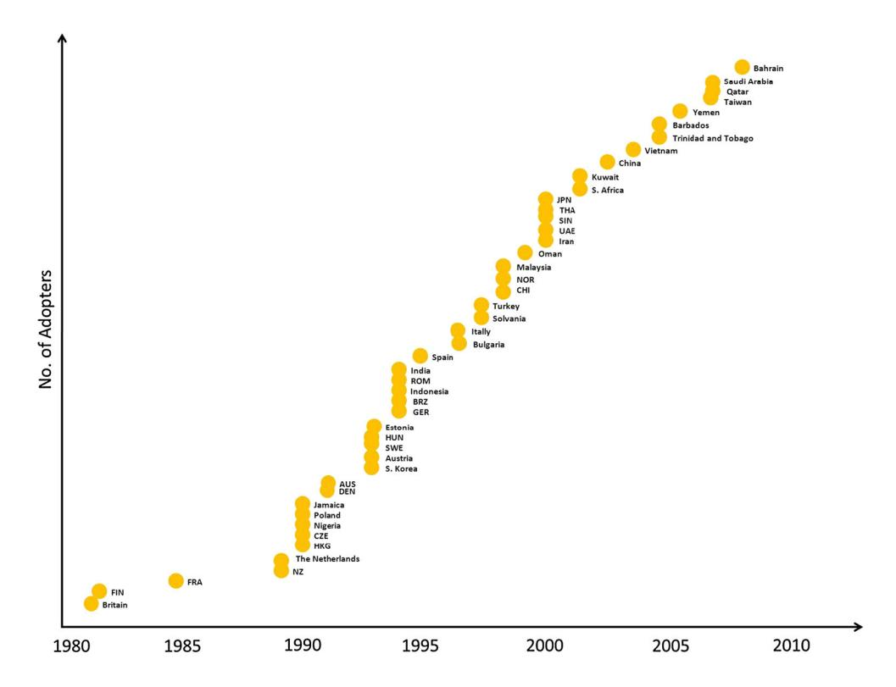
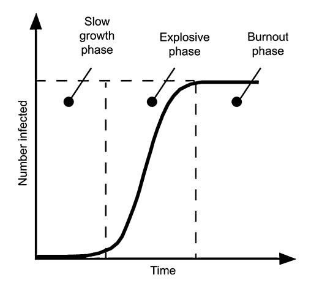

<!-- A2.R43 | source: papers_json/A2.R43/ -->

## **New directions in policy borrowing research **

Gita Steiner-Khamsi1

Received: 21 January 2016/Accepted: 14 June 2016/Published online: 22 June 2016 © Education Research Institute, Seoul National University, Seoul, Korea 2016

**Abstract** بحوث اقتراض السياسات (policy borrowing) هي مجال بحثي راسخ ضمن التربية المقارنة. وعلى مدى العشرين عاماً الماضية تقريباً، اكتسبت هذه البحوث مكانة بارزة بين الباحثين في مجال العولمة. وما يثير الاهتمام الأكبر ليس فقط سؤال أي الإصلاحات "تنتقل" دولياً، وأيها تبقى محلية، بل بالأحرى لماذا تجد الإصلاحات المنتقلة صدى في سياق معين وفي لحظة زمنية محددة، وكيف تُترجم أو تُكيَّف محلياً بعد ذلك. وإلى جانب قضايا الاستقبال والترجمة، فإن الأسئلة المتعلقة بسياسات واقتصاديات نقل السياسات محورية في هذا المجال البحثي. أظهرت دراسات تجريبية أن اقتراض الإصلاحات من دول أخرى، أو من قطاعات أخرى داخل الدولة، أو من "المعايير الدولية" بمفهومها الواسع، غالباً ما يساعد في بناء التحالفات داخل الدولة. كما يساعد اقتراض السياسات على حشد الموارد المالية، خاصة عندما يسبقه خطاب سياسي عن التخلف عن بعض المعايير الدولية أو "أفضل الممارسات". لذلك، تميل مناهج البحث المستخدمة، ونوع أسئلة البحث المطروحة، والاستنتاجات المستخلصة في هذا الحقل البحثي إلى معالجة الجوانب السياسية والاقتصادية للإصلاح التربوي. ويمكن القول إن المنظور عبر الوطني لا غنى عنه لتنفيذ هذا النوع من المشاريع الفكرية. وقد ساعد الانشغال الأكاديمي باقتراض السياسات في صياغة ملامح دراسات السياسات المقارنة. يقدم هذا المقال لمحة موجزة عن أهم مبادئ بحوث اقتراض السياسات، ثم يركز تحديداً على ثلاثة جوانب: استقبال السياسة، وإسقاط السياسة، و

**Keywords** Globalization studies · Policy studies · School reform · Policy borrowing · Global education policy

## Policy borrowing research: normative versus analytical questions

يُنظر غالباً إلى التعلم من تجارب الدول الأخرى على أنه أحد أبرز سمات الدراسات المقارنة. وفي مجال التربية، ساعدت دراسة اقتراض السياسات على ترسيخ وإضفاء الشرعية على حقل التربية المقارنة. غير أن التعلم من المقارنة لا يعني بالضرورة أنه ينبغي فعلاً نقل السياسات والممارسات من سياق إلى آخر. والواقع أن باحثاً مقارناً تلو الآخر، من مايكل سادلر إلى برايان هولمز إلى روبرت كوين، حذّروا من تحليل التربية بمعزل عن سياقها، ومن استخدام المقارنة لزرع إصلاحات تربوية من دولة إلى أخرى. لكن من الناحية العملية، فإن اقتراض السياسات عبر الوطني هو القاعدة وليس الاستثناء. فمثلاً، يعيد Cowen (2000) طرح سؤال سادلر الذي عمره مئة عام: "ماذا يمكننا أن نتعلم من دراسة الأنظمة الأجنبية؟" ويوضح أن الدراسة المقارنة للأنظمة التربوية قد غذّت، من الناحية العملية، ظاهرة أشبه بـ"عبادة الشحنة" (cargo-cult)، أي تصدير واستيراد شامل للنماذج التربوية عبر الحدود الوطنية. وإذ أشكك في عملية نقل "أفضل الممارسات" من سياق إلى آخر دون تمحيص، فإنني أنضم إلى Cowen وآخرين ممن يفضلون ملاحظة وتحليل وتفسير اقتراض السياسات وإقراضها بدلاً من الانخراط في النقل الفعلي للسياسات التربوية.

في الوقت الحاضر، انقسم مجال بحوث اقتراض السياسات إلى اتجاهين: أحدهما معياري والآخر

> rise of the global education industry as a new actor and beneficiary of global education policy.

> ^☑ ^Gita Steiner-Khamsi gs174@columbia.edu

> Teachers College, Columbia University, New York, NY, USA

<!-- page 2 -->

تحليلي. المجموعة الأولى من الباحثين تدافع بنشاط عن اقتراض السياسات، أما المجموعة الأخرى فتهتم بفهم متى ولماذا وكيف يحدث اقتراض السياسات. تتبنى المجموعة الأولى نهجاً معيارياً، وتستخدم المقارنة لتحديد الأنظمة التربوية الأفضل أداءً التي ينبغي أن تُستخلص منها الدروس أو "أفضل الممارسات" وتُنقل. أما المجموعة الثانية فتحلل لماذا ومتى تُصنع مثل هذه المراجعات الخارجية، وتفحص أثر هذه الواردات على السياسات القائمة وموازين القوى.

ومن الملفت أن عضوية كلا المعسكرين الأكاديميين نمت بشكل كبير خلال السنوات القليلة الماضية. تضم مجموعة الباحثين المعياريين عدداً كبيراً من العلماء الذين يجرون مقارنات معيارية بهدف استخلاص متغيرات النظام الفعّالة التي يمكن استخدامها بعد ذلك كمؤشرات لتحديد معايير مرجعية عالمية. فدراسات من نوع OECDو IEA، وكذلك بنوك المعرفة الأخرى التي أنشأها البنك الدولي ومنظمات دولية أخرى، تهتم بفهم ما ينجح وما لا ينجح. والهدف النهائي للبحث المعياري التطبيقي هو الإجابة على أسئلة السياسات مثل: ما هو الحجم الأمثل للصف؟ وما هي السمات المثلى لنظام إعداد المعلمين؟ وما هو الراتب الأمثل للمعلم؟ وما هو التكرار الأمثل لإجراء اختبارات الطلاب؟ وما هي النسبة المثلى بين الإنفاق العام والخاص على التعليم، وذلك من أجل تعليم فعّال وعالي الجودة؟ في المقابل، تنتمي مجموعة الباحثين التحليليين إلى البحث الأساسي، وتختار المقارنة كأداة منهجية لتحسين التنظير حول عملية صنع السياسات. وقد شهدت هذه المجموعة الثانية من الباحثين أيضاً ازدهاراً غير مسبوق منذ مطلع القرن. ويُشار إلى مجال إسهامها بالتبادل باعتباره بحثاً في اقتراض السياسات وإقراضها، أو في السياسة التربوية العالمية، أو في نقل التربية.

Table 1 summarizes, in an exemplary manner, some of the key differences between a normative and an analytical approach to studying educational transfer.

وللإنصاف، سيكون من الخطأ افتراض أن الموقفين، المعياري والتحليلي، متنافيان تماماً. فكثير منا ناشط في كلا المعسكرين: فنحن نقرأ ونحلل وننتج أدبيات حول متغيرات النظام التي تؤثر على فرص الوصول إلى التعليم وجودته، والتي يمكن، في ظل ظروف معينة وسياقات محددة، نقلها

to other educational systems. At the same time, we also operate at a meta-level and reflect on why the act of policy borrowing and lending resonates in specific contexts, who typically advocates for learning from elsewhere, how the imported reform is translated and implemented in a given context, and what impact the act of policy borrowing has on coalition-building among competing policy actors in a given policy context. تميل معظم تحليلات اقتراض السياسات إلى التركيز على مرحلتين رئيسيتين لاقتراض السياسات، وهما: الاستقبال والترجمة. يفحص الاستقبال أول تماس مع السياسة التربوية العالمية على المستوى المحلي، ويركز على عملية الاختيار. أما الترجمة فتتناول التكييف المحلي للسياسة التربوية العالمية. وفي هذا المقال، سأركز فقط على دراسات الاستقبال.

## Reception: understanding the ''sociologic'' of selective policy borrowing

تشمل أسئلة البحث النموذجية حول الاستقبال: لماذا يختار الفاعلون المحليون سياسة معينة، وما المشكلة التي يُفترض أن السياسة المقترضة تدّعي حلها، أو ما هي "نقاط الجذب" في السياسة التي تبدو مغرية للفاعلين السياسيين المحليين؟ في هذا المقال، سأتعمق في بعض أسئلة البحث الرئيسية التي تميل الدراسات الحديثة حول الاستقبال إلى فحصها: متى، أو في ظل أي ظروف، تكون الأنظمة التربوية منفتحة ومتقبلة لأفكار جديدة من خارجها؟ كيف يستخدم أصحاب المصلحة الإشارات إلى المعايير الدولية لإصلاح نظامهم؟ وما هي بعض السمات الرئيسية للإصلاحات التي انتشرت عالمياً؟ لذلك، يتناول هذا المقال بإيجاز قضايا تتعلق بالانفتاح، واستخدام المعايير الدولية، وسمات السياسة التربوية العالمية.

من الضروري تقديم مفهوم "التخريج" أو "الاستخراج" (externalization) الذي صاغه عالم الاجتماع الألماني نيكلاس لومان، وتبناه يورغن شرايفر لأغراض الدراسات المقارنة في التربية (Luhmann [1990](#page-9-0); Schriewer [1990](#page-9-0)). وضمن إطار نظري لنظرية الأنظمة (Luhmann [1990](#page-9-0))، يقترح يورغن شرايفر وزملاؤه دراسة السياق المحلي من أجل فهم "المنطق الاجتماعي" (Schriewer and Martinez [2004](#page-9-0): 33) لعملية التخريج. ويجد شرايفر ومارتينيز أنه من الدلالات على "المنطق الاجتماعي" لنظام ما أن أنظمة تربوية محددة فقط

<!-- page 3 -->

تُستخدم كمصادر خارجية للسلطة. ومعرفة أي الأنظمة تُستخدم كـ"مجتمعات مرجعية" يخبرنا بشيء عن العلاقات المتبادلة بين الفاعلين ضمن أنظمة عالمية مختلفة. غير أن بحث شرايفر ومعظم زملائه يركز على السرديات التاريخية للانتشار والاستقبال العالميين في التربية.

لقد أدخلتُ إطار التخريج إلى حقل دراسات السياسات المقارنة. ومنذ فترة طويلة، جعلت من مشروعي الفكري تكييف مفهوم التخريج كإطار تفسيري لتحليل اقتراض السياسات وإقراضها في التربية بشكل منهجي (Steiner-Khamsi [2004](#page-9-0)). وقد نمت مجموعة الباحثين في التربية المقارنة الذين يركزون على دراسة اقتراض السياسات وإقراضها نمواً كبيراً، وأصبح هناك الآن على الأقل أربعة أجيال مختلفة من باحثي اقتراض/إقراض السياسات، يضيف كل منهم منظورات ومسارات بحثية جديدة إلى هذا الحقل البحثي الرائع من التربية المقارنة (see Steiner-Khamsi and Waldow [2012](#page-9-0)).

ويمكن القول إن مفهوم التخريج يصلح كأداة تحليلية لدراسات السياسات المقارنة، إذ يمكّننا من فهم كيف تُستحدث "القوى العالمية" أحياناً محلياً بغرض توليد إصلاح في التطورات المحلية (Steiner-Khamsi [2004](#page-9-0)). ووجدتُ أن عملية التخريج تحدث تحديداً في لحظة اشتداد النزاع حول السياسة، أي عندما تُصنع إشارات إلى أنظمة تربوية أخرى، أو إلى "المعايير الدولية في التربية" بمفهومها الواسع، أو إلى العولمة. وخلصتُ إلى أن اقتراض السياسات عبر الوطني، سواء كان خطابياً أو فعلياً، له أثر تصديقي على الخطاب السياسي المحلي. وفي منشورات سابقة، استخدمتُ استعارة الأخطبوط لوصف الجذب والصدى والاستقبال عبر الوطني للسياسات. فالفاعلون المحليون يمدون أيديهم ويمسكون بذراع الأخطبوط الأقرب إلى أجندتهم السياسية الخاصة، وبذلك يضيفون معنى (محلياً) إلى سياسة (عالمية). وبشكل افتراضي، تتحول أي دراسة عن الانفتاح إلى دراسة عن اقتراض السياسات الانتقائي. فاقتراض السياسات لا يكون أبداً كاملاً وشاملاً، بل هو دائماً انتقائي، وبالتالي يعكس "المنطق الاجتماعي" أو الأسباب الخاصة بالسياق التي تفسر الانفتاح.

في دراسات السياسات، صاغ جون كينغدون مصطلح "نافذة السياسة" لتحديد الظروف المواتية لتغيير السياسة (Kingdon [1995](#page-9-0)). ووجد أن تقارب التيارات الثلاثة التالية من المرجح أن يُنتج تغييراً: تيار المشكلة (الاعتراف بمشكلة ما)، وتيار السياسة (توفر الحلول)، والتيار السياسي (تطورات جديدة في المجال السياسي، مثل تغيير الحكومة مؤخراً). ومن المهم الإشارة إلى أن كينغدون لا يأخذ بعين الاعتبار عمليات اقتراض السياسات عبر الوطني. ويمكن القول إنه في عصر العولمة، يصبح اقتراض السياسات عبر الوطني، سواء بشكل خطابي أو فعلي، هو القاعدة وليس الاستثناء.

وبناء على ذلك، يميل تيار السياسة إلى أن يكون متاحاً للسياسيين وصناع القرار في جميع الأوقات في صورة "أفضل الممارسات" أو "المعايير الدولية" أو الدروس المستفادة من أنظمة تربوية أخرى. والواقع أن الضغط نحو الاقتراض كبير إلى درجة أن محللي السياسات كثيراً ما يجدون أنفسهم في موقف محرج، إذ يضطرون إلى تعريف المشكلة المحلية بأثر رجعي بحيث تتناسب مع الحل أو حزمة الإصلاح العالمية الموجودة أصلاً (see Radtke [2009](#page-9-0)).

ويبدو لي أن المهمة الأكثر تحدياً هي مواءمة تدفق التيار السياسي مع التيارين الآخرين. وإذا صيغ هذا كسؤال بحثي: كيف تُحشد مختلف الأحزاب السياسية والمصالح لدعم تغيير أو إصلاح ما؟ وتقدم بحوث اقتراض السياسات الكثير للإجابة على هذا السؤال البحثي. وكما ذُكر سابقاً، حددت دراسات عديدة الأثر الإيجابي لاقتراض السياسات على الحشد السياسي (see Steiner-Khamsi and Waldow [2012)](#page-9-0). ويمكن القول إن للاقتراض أثراً إيجابياً على الصراع السياسي المطول: فهو يبني التحالفات. إذ يمكّن مجموعات المناصرة المتعارضة من دمج مواردها لدعم خيار سياسي ثالث، يُفترض أنه أكثر حياداً، مقترض من مكان آخر. وقد أصبحت "المعايير الدولية" نقطة مرجعية شائعة بشكل متزايد في مثل هذه القرارات. أما البعد الاقتصادي، فيبرز بشكل خاص في الدول النامية. فمن الناحية الاقتصادية، غالباً ما يكون اقتراض السياسات ظاهرة عابرة، لأنه لا يستمر إلا طالما استمر التمويل الخارجي المشروط باستيراد حزمة إصلاح معينة. واقتراض السياسات في الدول الفقيرة هو بالنسبة لقطاع التعليم ما يمثله التكيف الهيكلي، وتخفيف الفقر، والحوكمة الرشيدة بالنسبة للقطاع العام عموماً: شرط برامجي أو شرط لتلقي المساعدات.

إطار التيارات المتعددة لكينغدون قيّم لفهم توقيت الإصلاحات. غير أنه لا غنى عن تبني منظور العولمة لتحسين هذا الإطار بشكل يلائم واقع التفاعل السياسي عبر الوطني اليوم، ويأخذ بعين الاعتبار أن الحكومات المعتمدة على المساعدات تعتمد على التمويل الخارجي لتنفيذ الإصلاحات التربوية في بلدانها.

## Projections: the functionality of an empty vessel

تلقى مصطلحات مثل "المعايير الدولية" و"مهارات القرن الحادي والعشرين" و"أفضل الممارسات" صدى كبيراً عند السياسيين وصناع السياسات، ويلجؤون إليها في لحظات معينة من وضع الأجندة: كلما دعت الحاجة إلى توليد ضغط من أجل الإصلاح. وتعمل هذه المصطلحات فعلياً كحوافز للتغيير، حتى مع عدم وجود اتفاق على معناها الفعلي. بل والأهم من ذلك، أنها تعمل

<!-- page 4 -->

كأوعية فارغة تُملأ، متى دعت الحاجة، بمعنى محلي. ومع ذلك، فهي قوية سياسياً لأنها تولّد مخاوف من التخلف عن الركب في السوق العالمية، وبالتالي لديها القدرة، كما ذُكر سابقاً، على بناء تحالفات بين مجموعات مصالح كانت لتكون متعارضة لولا ذلك. وباختصار، فإن العولمة ليست قوة خارجية، بل هي خطاب يُستحدث محلياً ويُحشد في لحظات معينة من الصراع السياسي المطول لتوليد ضغط الإصلاح وبناء تحالفات السياسة.

بالنسبة لباحثي الاقتراض من الجيل الأول، كان من الضروري تفسير اختيار "المجتمع المرجعي"، أي النظام التربوي الذي اقتُرضت منه السياسات والممارسات والأفكار. وعادة ما كانت هناك أسباب ثقافية أو سياسية أو اقتصادية تفسر اهتمام المقترض بنظام معين. فقد بحث Phillips [(2004](#page-9-0))، على سبيل المثال، أسباب الجذب السياسي عبر الوطني الذي شعر به مسؤولو الحكومة البريطانية والباحثون تجاه النظام التربوي في ألمانيا خلال القرن التاسع عشر. ونطاق الدوافع التي تجعل دولة ما تسعى للاستلهام من النظام التربوي لدولة أخرى قد يكون شديد التنوع. ففي الولايات المتحدة، جذب التقارب السياسي بين إدارتي ريغان وتاتشر انتباه المصلحين النيوليبراليين الأمريكيين إلى النموذج البريطاني في أوائل التسعينيات. لكن صانعي السياسة التربوية الأمريكيين دفعتهم أيضاً المنافسة (مثل الاتحاد السوفيتي في أواخر الخمسينيات وأوائل الستينيات) أو الفضول (مثل اليابان خلال الثمانينيات).

وعلى غرار ابن عمه الأقدم، دراسات السوفييتولوجيا، اتسمت دراسات اليابانولوجيا بطابع شعبوي، إذ نشرت بسرعة مذهلة تعميمات واسعة وأحكاماً نمطية حول التربية في اليابان. وكما أشار Cummings [(1989](#page-9-0))، مستشهداً بتعبير صاغه جوزيف توبين: مال الباحثون الأمريكيون إلى استخدام نهج "نعم، لكن…". ويقر هذا النهج بالنجاحات في النظام التربوي الآخر، لكنه في الوقت نفسه "يزعم أن هذه النجاحات تأتي بثمن باهظ جداً، ثمن لا يرغب الأمريكيون في دفعه" (Cummings [1989:](#page-9-0) 296). وشملت التصريحات أو الأساطير المبالغ فيها حول التربية اليابانية: نموذج التنشئة الاجتماعية المقلوب (التساهل في الطفولة المبكرة، والانضباط في المراهقة وبداية الرشد)، والتعليم من أجل الأمة والدولة، وظاهرة "kyoiku mama" (الأم المهتمة بالتعليم)، والتعلم بالحفظ في المدارس، والمنافسة والانتحار، والتعليم العالي النخبوي، وعدم المساواة الاجتماعية. وقد ساعدت هذه الأحكام المعممة حول المجتمع الياباني والتربية اليابانية على تحصين الرأي العام ضد الضغط للتعلم من اليابان. وبعد بضع سنوات، تلاشى انجذاب الولايات المتحدة نحو النظام التربوي الياباني بسرعة ظهوره، بسبب الأزمة الاقتصادية في آسيا. وفي غضون فترة قصيرة، اختفت "نقاط القوة المعترف بها بحذر في التربية اليابانية" (Cummings [1989](#page-9-0): 298) من السرديات الأمريكية. وسقط النظام التربوي الياباني من النعمة، وبدأ المراقبون الأمريكيون

في استخدام دراسات تُوثّق مدارس التلقين المكثف، وانتحار الطلاب، وإرهاق المعلمين في اليابان بشكل واسع. كما ظهر منتقدون داخل السياق الياباني نفسه. وفي اليابان، برز خطاب الأزمة عند مطلع الألفية الجديدة، واستُخدم لتبرير الحاجة إلى إصلاح جذري، مثل إصلاح المناهج بعيد المدى الذي نُفذ عام 2002 (Tsuneyoshi [2004)](#page-9-0).

للأسف، تحتل التحليلات التقابلية مكانة راسخة في الخطاب العام. فهي تمثل النسخة الشعبوية من دراسات السياسات المقارنة، وهي نسخة يميل الأكاديميون عادة إلى النأي بأنفسهم عنها. فخلال الحرب الباردة، على سبيل المثال، لم يكتفِ حقل السوفييتولوجيا بتلبية المطالب الشعبوية لفهم سبب تخلف الأمة الأمريكية في سباق الفضاء والتسلح، بل جعل أيضاً الانخراط في التحليلات التقابلية، أي المقارنة الموجهة أساساً نحو تحديد الاختلاف، أمراً مقبولاً في البحث التربوي. ونتيجة لذلك، انقسم النظامان إلى ثنائية، ووُضع كل منهما في طرف من طرفي طيف. وصُوّرت التربية السوفيتية على أنها نظام يعتمد على التلقين السياسي، بينما كان يُفترض أن النظام الأمريكي يعزز التفكير النقدي لدى الطلاب. وقائمة البنى الثنائية طويلة، ويكفي أن نذكر ثنائية زائفة أخرى: أن النظام التربوي السوفيتي كان يُفترض أنه يركز على الوصول إلى التعليم على حساب جودته. وتلاشى حقل السوفييتولوجيا، كما لاحظ بعض المعلقين (e.g., Foster [1998)](#page-9-0)) بين ليلة وضحاها تقريباً، وحل محله حقل اليابانولوجيا. وتبنّت دراسات اليابانولوجيا لاحقاً المنهجية المبسطة نفسها، منتجة، كما ذُكر أعلاه، عدداً كبيراً من الدراسات التقابلية حول التربية الأمريكية واليابانية، بعضها أكثر تطوراً بقليل من غيره.

وفي الوقت الحاضر، تحظى الأنظمة الرائدة في اختبارات التحصيل الطلابي الدولية، مثل الأنظمة التربوية في شنغهاي وفنلندا وسنغافورة، بأكبر قدر من الاهتمام. وقد ظهرت مجموعة جديدة رائعة من الدراسات خلال السنوات القليلة الماضية تستخدم منهج البحث النموذجي لبحوث اقتراض السياسات: استكشاف السياق السياسي المحلي لفهم سبب حدوث "التخريج" ومتى تميل نافذة الانفتاح على السياسات عبر الوطنية إلى الانفتاح. وتفحص هذه المجموعة من الباحثين الأسباب الخاصة بالبلد أو الأسباب الاجتماعية التي تفسر نجاح الأنظمة الرائدة. ويقدم المحللون والصحفيون والأكاديميون الألمان واليابانيون والكوريون والأمريكيون تفسيرات مختلفة تماماً لسبب أداء الطلاب في فنلندا بشكل جيد جداً في دراسات PISA (Green Saraisky [2015;](#page-9-0) Takayama [2010](#page-9-0); Waldow [2010](#page-9-0); Takayama et al. [2013;](#page-9-0) Waldow et al. [2014)](#page-9-0). ويجدون أن هذه التفسيرات ترتبط بالنقاشات السياسية الخلافية في بلدانهم أكثر من ارتباطها بمتغيرات النظام الفعلية للنظام التربوي الفنلندي. واستُخدمت الإشارات إلى فنلندا كنموذج رائد كمصدر شبه خارجي للسلطة، لتصديق إصلاحات معينة، ربما

<!-- page 5 -->

خلافية، في السياق المحلي. وبالتالي، فإن "الدروس المستفادة" من نظام تربوي آخر تتضمن دائماً جزءاً كبيراً من الإسقاط على النظام التربوي للآخرين.

ومؤخراً، صاغ Waldow مصطلح "المرجع المضاد" (counter-reference) للدلالة على كيفية تناول وسائل الإعلام في الدول الغربية للأنظمة الرائدة في PISA أو TIMSS كعوامل رادعة بدلاً من نماذج يُحتذى بها إذا كانت هذه الأنظمة في آسيا ([2016)](#page-9-0). وتغذي هذه السرديات الإعلامية القائمة الطويلة من الصور النمطية أو التحيزات الغربية حول "التربية الآسيوية" لتفسير سبب تفوق طلاب اليابان أو كوريا أو شنغهاي أو سنغافورة على غيرهم: الانضباط القاسي، والتمكن من الاختبارات، و"أمهات النمر" أو "kyoiku mama" (الأم المهتمة بالتعليم؛ see Cummings [1989](#page-9-0)). أي أنها تعتمد في معظمها على تفسيرات ثقافية لسبب أداء الطلاب الجيد. وبعبارة أخرى، ليس النظام المدرسي العام هو ذو الأداء العالي، بل القيم الأسرية وعوامل أخرى غير مرتبطة بالمدرسة هي ما يفسر تفوق الطلاب الآسيويين في الرياضيات والعلوم. ويسهم أحدث بحث لـ Waldow في فهم أفضل للتحليلات التقابلية، التي تميل إلى دفع حجة "نعم، لكن…" التي وصفها سابقاً جوزيف توبين وويليام ك. كامينغز (see Cummings [1989](#page-9-0)): نعم، طلاب "هم" (السوفييت، اليابانيون، الصينيون، الكوريون، إلخ) يتفوقون على طلاب "نا" (في الغرب)، لكننا لسنا مستعدين لتغيير قيمنا ومعتقداتنا التربوية بطرق تُقربنا في النهاية مما يُنمّط باعتباره التربية الآسيوية.

ومن اللافت أن هذه الصور النمطية السلبية عن التربية الآسيوية أطلقت موجة من المراجعة الذاتية النقدية أدت إلى "نظرة تشاؤمية يحملها الكوريون الجنوبيون تجاه نظامهم التربوي الخاص" (Takayama et al. [2013:](#page-9-0) 316). وقبل عام واحد من PISA 2009، أعادت الحكومة تطبيق الاختبارات الوطنية (بالكورية: iljegosa)، وهو إجراء تعرض لانتقادات علنية لأنه قد "يزيد من المنافسة المفرطة بين الطلاب ويحفز الطلب على الدروس الخصوصية" (Takayama et al. [2013:](#page-9-0) 317). وفي ظل هذا النقاش العام الأوسع، لم يُحتفَ بالأداء الممتاز للطلاب الكوريين في PISA 2009 (المرتبة 2 في القراءة، والمرتبة 4 في الرياضيات، والمرتبة 6 في العلوم) كانتصار للنظام التربوي العام، بل استُخدم بالأحرى كتحذير لإظهار الاعتماد على صناعة التعليم، وخصوصاً الدروس الخصوصية ومدارس التلقين المكثف الخاصة. وفي محاولة لتهدئة المنتقدين للاختبارات الوطنية المفرطة، أُدخلت بعض التغييرات التدريجية خلال السنوات القليلة الماضية، مثل إصلاح "الفصل الدراسي الحر" في كوريا الجنوبية الذي يُفترض أن يقلل الضغط لمدة فصل دراسي واحد لا تُجرى فيه اختبارات. وبخلاف كل التوقعات الدولية، يمتنع صانعو السياسات الكوريون عن "تمجيد" نظامهم التربوي، رغم أن نظامهم، مع بعض الاستثناءات، يحتل المرتبة الأولى في كل دراسة تقييم طلابي من نوع OECD وIEA (Steiner-Khamsi [2003](#page-9-0)).

## Global education policy and the economy of scale

من الطبيعي أن أي ظاهرة تجذب انتباه عدد كبير من المراقبين، مثل النجاح الفنلندي، تصلح كشاشة إسقاط. فكل مراقب يفسر النجاح الفنلندي بطريقة مختلفة، استناداً إلى معرفته الموقعية الخاصة، وفي حالة السياسة العامة، "يصنع المعنى" استناداً إلى أجندته السياسية المحلية الخاصة (see Anderson-Levitt [2012)](#page-9-0). وبالمثل، فإن مصير السياسة التربوية العالمية هو أن تصبح مراوغة أو متعددة المعاني مع كل نظام تربوي جديد يتبنى سياسة تربوية عالمية.

وقد أشار باحثون في جامعة لندن، معهد التربية، وزملاؤهم بشكل مقنع إلى المعنى المتغير للخطاب التربوي العالمي. ويؤكد Bernstein [(1996](#page-9-0): 47) أنه كلما انتقل خطاب ما، "هناك مساحة يمكن أن تلعب فيها الأيديولوجيا […]. ومع انتقال هذا الخطاب، فإنه يتحول أيديولوجياً؛ ولم يعد الخطاب ذاته بعد الآن." ويُلخَّص تحول السياسة عبر الزمن أيضاً بإيجاز في عبارة روبرت كوين الرائعة "مع انتقاله، يتحول شكله" (Cowen [2009)](#page-9-0). وأخيراً، استفاد جيسون بيتش، طالب الدكتوراه السابق لدى Cowen، من إطاري Bernstein وCowen لمقارنة تبني خطاب عالمي واحد ونفسه حول التعلم المرتكز على الطالب في سياقين سياسيين مختلفين، هما البرازيل والأرجنتين، خلال الفترة 1955–1996 (Beech [2011)](#page-9-0).

وبالإضافة إلى الإقرار بأن فاعلين مختلفين يفسرون ظاهرة واحدة ونفسها (مثل النجاح الفنلندي في التربية) أو خطاباً واحداً ونفسه (الخطاب العالمي حول التعلم المرتكز على الطالب) بطرق مختلفة، من المهم أيضاً أخذ البعد الزمني للسياسة التربوية العالمية بعين الاعتبار. فالبعد الزمني، أو "دورة حياة السياسة" (كما هو مبين في الشكل 1)، له أهمية كبيرة ويساعد في التنبؤ باحتمالية تصدير إصلاح ما أو نشره. والنموذج الوبائي للانتشار العالمي، المصور في

*Fig. 1 Lazy-S curve. Source: Watts ([2003:](#page-9-0) 172)*

<!-- page 6 -->

الشكل 1، مستخدم على نطاق واسع في دراسات انتشار الابتكار وتحليل الشبكات الاجتماعية (see Watts [2003)](#page-9-0). ويتتبع النموذج الوبائي عملية إزالة التوطين (deterritorialization) لإصلاح ما عبر الزمن. ويميز بين المتبنين المبكرين والمتأخرين لابتكار ما. ففي المراحل المبكرة، لا "تُصاب" سوى أنظمة تربوية قليلة بإصلاح معين. ويصنع المتبنون إشارات صريحة إلى الدروس المستفادة من أنظمة تربوية أخرى، وخاصة تلك التي يسعون تحديداً لمحاكاتها.

ومن الأمثلة الجيدة على ذلك الانتشار العالمي لتدابير ومؤسسات ضمان الجودة (QA) في التعليم العالي. وقد أجرت راتانا لاو دراسة مقارنة دولية رائعة حول الانتشار العالمي لضمان الجودة، فحصت فيها في أي سنة أنشأت أنظمة التعليم العالي مؤسسات رسمية لضمان الجودة منفصلة عن وزارات التربية (Lao [2015)](#page-9-0). وكما هو مبين في الشكل 2، تُظهر تحليلاتها لأدبيات التعليم العالي أن ما لا يقل عن 48 دولة تبنت سياسات ضمان الجودة خلال الفترة 1983–2010. وكان الرواد هم حكومات بريطانيا وفرنسا وإنجلترا ونيوزيلندا وهولندا. فقد أضفت هذه الدول، ابتداء من أوائل الثمانينيات، الطابع المؤسسي على ضمان الجودة من خلال وضع سياسات مميزة، وإنشاء آليات، وتعيين وكالات مسؤولة عن ضمان الجودة في التعليم العالي. وفي إطار النظام الاشتراكي السابق، تُعتبر بولندا وجمهورية التشيك من المتبنين الأوائل لتقييم الجودة في التعليم العالي. ويشبه تحليل لاو منحنى الـ"لايزي إس" (lazy-S)، المصور في الشكل 1، الذي يميز بين ثلاث مراحل للإصلاحات العالمية: النمو البطيء، والنمو الأسي، والاستنفاد

Fig. 2 Global spread of quality assessment reforms in higher education. Source: Lao ([2015:](#page-9-0) xyz)

(burn out). وتماشياً مع Vidovich [(2004)](#page-9-0)، تحدد لاو عقد التسعينيات باعتباره مرحلة النمو الأسي لضمان الجودة. وفي الألفية الجديدة، ما زال تبني ضمان الجودة مستمراً لكن بوتيرة أبطأ، ويعود ذلك أساساً إلى أن مشهد التعليم العالي أصبح مشبعاً بالفعل بإصلاحات ضمان الجودة.

وكما ورد في منشورات سابقة (e.g., Steiner-Khamsi [2004)](#page-9-0))، يمكّننا النموذج الوبائي، الذي يستند إليه بحث انتشار الابتكار، من استكشاف عملية إزالة التوطين التي تصاحب العولمة في التربية. ومع كل نظام تربوي جديد يقترض سياسة من نظام آخر، تتلاشى آثار اقتراض السياسة عبر الوطني إلى درجة أنه، خلال مرحلة النمو الانفجاري (المرحلة الوسطى المصورة في الشكل 1)، تصبح السياسة منزوعة التوطين، وتُعاد صياغتها باعتبارها "معياراً دولياً" أو "أفضل ممارسة"، أي أنها إصلاح للجميع ولا أحد في آنٍ واحد. بل والأهم من ذلك، أنه بمجرد أن تقترض كتلة حرجة من المتبنين المتأخرين إصلاحاً معيناً، تختفي الأصول الجغرافية والثقافية، مما يسهّل انتشار النسخ المنزوعة السياق والتوطين بسرعة. وهذا يفسر النمو الأسي خلال المرحلة الوسطى، حين يحدث الانتشار العالمي.

## The emerging new global actors: the education industry

من نافلة القول إن الشركات تحلم بتطورات من نوع منحنى "لايزي إس"، أي سلع أو خدمات تجارية تنطلق في لحظة معينة، وتنتشر بسرعة، وتحقق

<!-- page 7 -->

مبيعات أسية. ورغم أن عدداً قليلاً من مزودي القطاع الخاص (التكنولوجيا، والاختبارات، وصناعة الكتب المدرسية) عملوا في مجال التربية منذ عقود، إلا أنه فقط في السنوات القليلة الماضية بدأ يُنظر إلى التربية كسوق عالمية ذات وفورات حجم (see Ball [2012;](#page-9-0) Verger et al. [2016](#page-9-0)). ويلخص ستيفن بول بإيجاز سبب قدرة شركات مثل Pearson وCambridge Education وBridge Schools وغيرها الكثير على توسيع معاملاتها التجارية عالمياً:

- 1. organizational changes in public sector institutions (recalibration and ''improvement'');
- 2. new state forms and modalities (governance, networks, and performance management);
- 3. the privatization of the state itself; and
- 4. the interests of ''restless'' capital and processes of commodification (public services as a profit opportunity and the provision of ''effective'' public service provision.

## Ball ([2012:](#page-9-0) 94).

استناداً إلى نظرية الأنظمة ذاتية الإشارة أو نظرية الأنظمة (نيكلاس لومان)، أود أن أبرز ثلاث ظواهر مثيرة للاهتمام تستحق مزيداً من الانتباه: أولاً، أصبح مفهوم "التعلم الفعّال" يُستخدم اليوم بالتبادل مع الإصلاح التربوي القائم على المعايير؛ ثانياً، أُعيدت صياغة علاقة القوة بين الأنظمة التربوية الوطنية والمنظمات والشركات عبر الوطنية بشكل يخدم مصلحة هذه المجموعة الأخيرة من الفاعلين؛ وأخيراً، أصبح حجم النظام التربوي هائلاً ويستمر في النمو بشكل أسي خلال العقود القليلة القادمة. ومن شأن دراسة هذه الظواهر الثلاث أن تمكننا من فهم سبب قدرة صناعة التربية العالمية على تحويل التربية إلى تجارة مربحة. وعند قراءة هذا الجزء، من المهم أن نتذكر أن هذا المقال لا يتناول الشركات المحلية والوطنية، مثل الدروس الخصوصية أو مدارس التلقين المكثف، بل الشركات التي تعمل عبر الوطنية.

أولاً، هناك بوضوح عملية ترشيد وتوحيد قياسي (standardization) أو تطبيع مستمرة تحدث في كل مجال من مجالات المجتمع، وقد وصفها بشكل مقنع علماء من توجهات نظرية مختلفة. ويُعد الإصلاح التربوي القائم على المعايير و"الحوكمة بالأرقام" (Jenny Ozga) على الأرجح أبرز إشارتين على عملية التوحيد القياسي في التربية. ويُشار إلى الأخيرة أحياناً بـ"القوة الناعمة" لأن الفاعلين في السياسة الوطنية لديهم خيار استخدام، أو عدم استخدام، نتائج التصنيفات الدولية إما لتوليد أو تخفيف ضغط الإصلاح لمواءمة نظامهم الوطني مع المعايير أو أفضل الممارسات الدولية. غير أنهم بحاجة إلى التواصل مع أصحاب المصلحة الآخرين في التربية وإقناعهم بلغة التربية. واللغة التربوية هي بشكل افتراضي لغة تضع المتعلم في صميم الاهتمام، بغض النظر عما إذا كان المتعلم طفلاً

مسجلاً في ما قبل المدرسة، أو طالباً في سن الدراسة، أو طالباً جامعياً، أو شخصاً بالغاً يتلقى تدريباً في بيئات تعليم غير رسمي. ولدفع أي نوع من التوحيد القياسي في قطاع التربية، يتعين على صناع السياسات أن يُثبتوا أن الإصلاح مفيد للمتعلم، أو الأفضل من ذلك، أنه يحسّن نتائج التعلم. ويُعد انتشار أدوات قياس ومقارنة جودة التعليم عبر الدول (دراسات من نوع OECD وIEA)، وعلى المستوى الوطني، وداخل المنطقة التعليمية، وداخل المدرسة، وحتى داخل الصف، معادلاً وظيفياً في النظام التربوي لما تفعله عملية التوحيد القياسي في المجتمع ككل: وضع المعايير. وفي ظل هذا السياق، أصبحت صناعة الاختبارات الخاصة غير التابعة للدولة حكماً رئيسياً على ما إذا كانت جودة التعليم أو نتائج التعلم قد تحسنت. وإضافة إلى ذلك، ونتيجة للتوحيد القياسي والتوجه نحو النتائج في التربية، نشهد اليوم عملية رسم إصلاح عكسي، إذ تُحدَّد الاختبارات أولاً، ثم تُنتج الشركات أو المنظمات ذاتها (مثل Pearson وCambridge Education وInternational Baccalaureate) كتبها المدرسية ومناهج إعداد المعلمين الخاصة بها لتتوافق مع اختباراتها. وهذا يعني عملياً إنشاء برامج أو مناهج تعليمية موازية، والتي، إن طُبقت على نطاق واسع وعالمياً، تؤدي بمرور الوقت إلى أنظمة تربوية تميز نفسها بأسماء العلامات التجارية بدلاً من الجنسية. وكجزء من هذا السيناريو الكارثي المحتمل للتعليم العام، قد تنتهي الأنظمة التربوية الوطنية إلى أن تصبح مكاناً يُلقى فيه "الباقي"، أي الأسر منخفضة الدخل التي لا تستطيع تحمل تكاليف الخدمات التربوية الإضافية التي تقدمها صناعة التربية العالمية.

ومن اللافت أن بعض حكومات الدول النامية تُرحب بهذا النوع من المواءمة ضمن إصلاح المناهج. والواقع أن المواءمة نقطة بيع مهمة لحزم إصلاح IB وCambridge Education Services وPearson وشركات تربوية دولية أخرى. ففي منغوليا، على سبيل المثال، تندلع أحياناً فضائح بشأن طلاب يُختبرون في امتحانات نهاية المرحلة الثانوية عالية المخاطر بمحتوى لم يُدرَّس لهم قط. ولا عجب أن يشعر الطلاب بالضياع، والأهل بالغضب، والمعلمون بالإحباط، والرأي العام بعدم الثقة بقدرة الحكومة على توجيه عملية الإصلاح التربوي. وعادة ما تجد حزم الإصلاح المتماسكة ومرتفعة الثمن صدى في مثل هذا المناخ بالتحديد. ومن منظور صناع السياسات، فمن الأفضل استيراد حزمة إصلاح باهظة الثمن تتماشى فيها جميع العناصر، بدلاً من إعادة اختراع كل شيء من الصفر، بدعم من عدد كبير من الجهات المانحة الدولية التي تشد كل منها في اتجاه مختلف، وتدافع كل منها عن "أفضل ممارساتها" الخاصة، وتمول "معاييرها الدولية" الخاصة. وتواجه دولة نامية تلو الأخرى تحدي نظام مختل (بعضه ناتج عن المساعدات)، لا يكاد يوجد فيه توافق بين ما هو مكتوب في

<!-- page 8 -->

المنهج، وما يُدرَّس للمعلمين، وما تقوله الكتب المدرسية، وما يتعلمه الطلاب، وكيف يُقيَّمون ويُصنَّفون من حيث مواصلة الدراسة.

ثانياً، وفقاً لنظرية لومان في الأنظمة ذاتية الإشارة (Luhmann [1990](#page-9-0))، فإن الأنظمة الفرعية (مثل النظام الفرعي التربوي) "تتفاعل" وتنأى بنفسها وتتمايز عما يُسمى بيئتها، أي عن الأنظمة الفرعية الأخرى (مثل السياسة والاقتصاد والدين والأسرة)، سعياً للحفاظ على منطقها وأنماط تنظيمها الخاصة. والتمايز عن الأنظمة الفرعية الأخرى لا غنى عنه لاستقلاليتها وبقائها. لذلك، يتبنى الفاعلون في النظام التربوي بشكل انتقائي، أو يستدخلون، أنماط تفكير أو جدل أو تنظيم نموذجية لأنظمة أخرى، مثل تبني نماذج شبه السوق من النظام الاقتصادي أو نموذج الحوكمة الرشيدة المتبنى من الأنظمة السياسية. والغرض من هذه الأمثلة هو توضيح كيف تتفاعل الأنظمة الفرعية، وتتعلم من بعضها البعض، ثم تُعيد صياغة ما تم نقله وفق منطقها الخاص. ومن منظور نظري، برزت ظاهرة مثيرة للاهتمام خلال السنوات القليلة الماضية: فاليوم، لم يعد "الآخرون" مجرد أنظمة فرعية أخرى داخل المجتمع، بل أصبحوا أيضاً المجتمع العالمي، ممثلاً بأنظمة عبر وطنية (مثل OECD والبنك الدولي) تعمل كواضعي معايير عالميين للحكومات الوطنية (see Luhmann [1997](#page-9-0)). ومن منظور نظرية الأنظمة، تمثل هذه الأنظمة عبر الوطنية "البيئة" بالنسبة للأنظمة الفرعية التربوية الوطنية. وبالتالي، تنخرط الحكومات الوطنية في "الخطاب العالمي" أو اقتراض السياسات الخطابي إقراراً بتبني معايير دولية أو معايير عالمية. ويُعد الاقتراض الانتقائي للمعايير الدولية محاولة للبقاء كنظام تربوي وطني في وقت تُقدَّر فيه الشهادات التربوية الدولية أكثر من الدرجات الوطنية. وهذا التوجه له تداعيات ضخمة على الأنظمة التربوية الوطنية. ففي عصر العولمة، يُرجَّح أن تصبح كلمة "عالمي" مرتبطة بشكل إيجابي متزايد بـ"العالمية الكوزموبوليتانية" و"المواطنة العالمية"، بينما ترتبط كلمة "وطني" بالتخلف والانغلاق. ولجعل هذا التوجه أكثر إثارة للاهتمام: بحسب مكانة الاقتصاد الوطني ضمن الاقتصاد العالمي الأوسع، فإن شهادة إتمام مدرسة دولية خاصة (مثل International Baccalaureate) قد تكون أعلى قيمة من شهادة من نظام وطني عام. وكما فُصِّل في منشور آخر، فإن المدارس التي تدّعي تطبيق "معايير دولية" في ازدياد عالمياً. وأبرز "نقاط بيعها" هي اللغة الإنجليزية كلغة تدريس، ودمج التكنولوجيا، وفي بعض الدول، اعتماد امتحانات نهاية المرحلة من قِبل أحد أنظمة التعليم في دول OECD.

ثالثاً، نما حجم النظام التربوي بشكل هائل بسبب صعود الطبقة الوسطى في الدول النامية، وانتشار الاعتقاد بالتعلم مدى الحياة في دول OECD. وكانت شركات التربية، مثل Pearson

LLC، ووسائل الإعلام أول من أشار إلى فرص العمل في مجال التربية. وتبع ذلك المستثمرون والبنوك. فمثلاً، أنشأ البنك الخاص السويسري المرموق Julius Baer صندوق استثمار مشترك أو "سلة تربية عالمية" في أكتوبر 2014 يتكون من أسهم اثنتي عشرة شركة رابحة.^1^ ووفقاً لبنك Baer، تُشكّل التربية، بعد الرعاية الصحية، ثاني أكبر سوق عالمية، ويتوقعون لها نمواً سنوياً بنسبة 7 في المئة. وكما ذُكر سابقاً وأكده كثيرون غيري، فإن النمو الاقتصادي في الدول النامية سيولّد طبقة وسطى متنامية قادرة وراغبة في إنفاق المال على تعليم أبنائها. ويتوقع بنك Baer أن الطبقة الوسطى المتنامية، إلى جانب "ارتفاع تكلفة التعليم، تضع عبئاً على الحكومات ذات الموازنات الضيقة، مما يعني اعتماداً متزايداً على الإنفاق الخاص ودوراً متنامياً لشركات التعليم الهادفة للربح" (Julius Baer [2014)](#page-9-0). وللمدارس الخاصة منخفضة الرسوم تقليد راسخ منذ زمن طويل في جنوب آسيا وأفريقيا، لكن الجديد نسبياً هو أن حكومات، مثل الجهات المانحة الثنائية DFID (وزارة التنمية الدولية البريطانية) وUSAID (الوكالة الأمريكية للتنمية الدولية)، توفر تمويلاً لأصحاب المشاريع الصغيرة والشركات الكبيرة لإنشاء أو إدارة مدارس خاصة منخفضة الرسوم بتكلفة دراسية تبلغ بضعة دولارات شهرياً.

ويمنح الاعتقاد اليوم بالتعلم مدى الحياة فرصاً غير محدودة لشركات التربية لبيع دورات وشهادات ودبلومات ودرجات جديدة. ورغم أن المدارس اليوم لا تشكل سوى موقع واحد من مواقع تعليمية عديدة، إلا أنها بوضوح الأكثر ربحية: فكتلة المتعلمين تبقى في المدرسة لمدة تصل إلى 12 عاماً، وتُختبر دورياً في المواد الأساسية في مراحل حرجة من النظام التربوي، وتُزوَّد بالكتب المدرسية ومواد التعلم والتكنولوجيا/المعدات، ويُدرِّسها عدد كبير من المعلمين الذين يخضعون لإعداد المعلمين والاعتماد، ويديرها مسؤولون إداريون ذوو رواتب جيدة يشرفون على المتعلم والمعلم في آن واحد. وفي موجة الإصلاحات النيوليبرالية، عملت الحكومات بشكل منهجي على تسليع التربية، ووفرت حوافز للشركات لإدارة المدارس من الأموال العامة.

إن الحجم الهائل للنظام التربوي، الذي يتسم بعقود طويلة الأجل لعدد كبير من "العملاء" الأفراد (تصل إلى 12 عاماً في المدارس)، وعملاء عائدين مستعدين للاستثمار في التعلم مدى الحياة، وتعقيد سلسلة القيمة (مواءمة الاختبارات والكتب المدرسية وتدريب المعلمين)، وأخيراً وليس آخراً، فرصة بيع كل ما سبق ليس فقط لكل طالب ومعلم ومدير في مدرسة واحدة، بل لمئات الآلاف أو الملايين من

> ^1^ The twelve companies are TAL Education (China), New Oriental Education (China), Nord Anglia Education (Hong Kong), Kroton Educacional (Brazil), Esta´cio Participac¸o˜es (Brazil), Pearson (UK), Reed Elsevier (Brazil), 2U (US), Apple (US), Google (US), Apollo Education (US), Grand Canyon Education (US).

<!-- page 9 -->

المدارس حول العالم، لا بد أن يكون أمراً مذهلاً بالنسبة لرجال الأعمال. ويفسر التعليم القائم على المعايير، واللغة الإنجليزية كلغة عالمية مشتركة، وإدماج التكنولوجيا في التدريس، والأهم من ذلك بيئة سياسات صديقة للأعمال، سبب ما نشهده حالياً من انتشار وبائي للشركات عبر الوطنية في مجال التربية.

## Conclusions

حاول هذا المقال تقديم لمحة عن دراسات اقتراض السياسات، وناقش اتجاهين جديدين مقنعين ضمن هذا الحقل البحثي: تناول الاتجاه الأول دراسات "الإسقاطات" على الأنظمة التربوية عالية الأداء وعلى المعايير الدولية. فمثلاً، قارنت مجموعة من الباحثين كيف تفسر وسائل الإعلام الوطنية في أستراليا وألمانيا وكوريا الجنوبية والولايات المتحدة النجاح الفنلندي بطرق مختلفة، وذلك بحسب المواضيع الساخنة أو القضايا الخلافية في كل من هذه الدول الأربع (Green وSung وTakayama وWaldow). واستناداً إلى نظرية الأنظمة (لومان)، يؤكدون أهمية فحص "المنطق الاجتماعي" لسياق ما من أجل فهم ردود الفعل تجاه الأنظمة الرائدة والإسقاطات عليها.

أما الاتجاه الثاني، المعروض في هذا المقال، فيتناول الانتشار العالمي لحزم إصلاح مثل ضمان الجودة في التعليم العالي أو الإصلاح التربوي القائم على المعايير في المدارس. وقد حاول عدة باحثين فهم الازدهار في صناعة التربية العالمية (Pearson وCambridge Education وBridge وOmega وغيرها) والمنظمات عبر الوطنية (Teach for All وInternational Baccalaureate وغيرها). ومرة أخرى، قد تساعد نظرية الأنظمة على لفت الانتباه إلى "منطق" الأنظمة التربوية الحالية لفهم سبب نجاح الشركات والمنظمات عبر الوطنية في بيع أو نشر سلعها وخدماتها بسرعة مذهلة عبر العالم. وكما اقتُرح في الجزء الأخير من هذا المقال، نحتاج إلى فهم التغيرات في النظام التربوي لفهم لماذا وكيف نجحت الشركات والمنظمات عبر الوطنية في توسيع عملياتها على نطاق عالمي. وأركز في هذا المقال على ثلاث سمات: أولاً، حركة التوحيد القياسي، التي تتخلل كل قطاعات المجتمع، تُترجم في النظام التربوي بمصطلح "التعلم الفعّال". وهكذا، تم تكييف دلالات التوحيد القياسي تربوياً لتعكس منطق النظام التربوي وأهدافه. ثانياً، أصبح المزودون الخاصون عبر الوطنيون للسلع والخدمات في التربية اليوم منافسين للتعليم العام الوطني. وفي عصر العولمة الذي يهم فيه تنقل الطلاب عبر الوطني، يقدمون أنفسهم على أنهم يتمتعون بميزة نسبية مقارنة بالحكومات الوطنية لأنهم قادرون على فتح مدارس تستخدم اللغة الإنجليزية كلغة

تدريس بصرف النظر عن اللغة أو اللغات الوطنية للبلد، والابتعاد عن المناهج الوطنية لتدريس "مهارات القرن الحادي والعشرين"، وتعزيز العالمية الكوزموبوليتانية والمواطنة العالمية، ثم إضفاء طابع ختم دولي أو اعتماد دولي على منتجهم. وأخيراً، أدى التعليم الحديث، الذي يضع الدولة مسؤولة عن التربية (ويسلب بذلك السلطة عن كل المواقع التربوية الأخرى مثل الأسرة والمجتمع والكنيسة إلخ) ويجعل التعليم الرسمي إلزامياً لكل مواطن، ثم في نهاية المطاف لكل مقيم، إلى توسع موثق جيداً في التعليم الجماعي. لكن نوع التعليم الجماعي الذي نشهده اليوم هو أضعاف ما استطاع التعليم الحديث في الإمبراطوريات الاستعمارية السابقة لشمال الكرة الأرضية تحقيقه من حيث الحجم قبل مئة عام. فالأفراد لا يذهبون إلى المدرسة مرة واحدة، بل يعودون إلى التعليم الرسمي مرات عديدة على مدى حياتهم. ولم تعد التربية مجرد مشروع للدولة، بل أصبحت مشروعاً مدى الحياة للروح، تجعل الأفراد يشعرون بالإشباع والتمكين والاستحقاق. ولكل هذه الأسباب، أصبحت التربية سوقاً ذات فرص غير محدودة للقطاع الخاص إذا اختارت الدولة رفع القيود وخلق سياسات صديقة للأعمال.

The 2016 World Yearbook of Education, entitled The Global Education Industry, assembled a group of noted authors with a critical outlook on the commercialization of education (Verger et al. [2016)](#page-9-0). وعدد من مؤلفي هذا الكتاب باحثون في دراسات السياسات المقارنة، ولا سيما في بحوث اقتراض السياسات. وبالنسبة للباحثين في مجالنا، من غير المفهوم كيف يمكن لمحللي السياسات فحص الإصلاحات التربوية في دولة واحدة بمعزل عما يحدث في أماكن أخرى. ومن الملحوظ أن الشركات تفكر وتعمل عالمياً. والعُقدة بين OECD وPearson، التي عُقدت عام 2015 لتطوير PISA 2018، تمثل اندماجاً بين منظمة حكومية دولية (OECD) وصناعة تربية عالمية (Pearson). وفي النموذج النيوليبرالي، يُفترض بالدولة أن تنظم وتضع المعايير وتراقب تطبيقها، لكن أن تفتح مجال تقديم التربية أمام القطاع الخاص. ويُفترض نظرياً أن تكون الشراكة بين القطاعين العام والخاص نظاماً من الضوابط والتوازنات. غير أن عملية رسم المناهج بأثر عكسي، التي تبدأ بمراجعة الاختبارات الموحدة ثم إصلاح الكتب المدرسية وإعداد المعلمين، ستضع بلا شك صناعات الاختبارات في موقع متميز، ليس فقط مقارنة بالشركات الأخرى، بل أيضاً مقارنة بالحكومات الوطنية.

وما يصح على الدولة يصح أيضاً على القطاع الخاص: فالبيروقراطية تولّد بيروقراطية أخرى من خلال إدخال قواعد ولوائح جديدة باستمرار، وإنشاء أدوات لتنفيذها ومراقبتها، وخلق مهن متخصصة تُعتمد للعمل نيابة عن البيروقراطية. وبالمثل، تنمو مبيعات الشركات من سلعها وخدماتها من خلال خلق احتياجات وعملاء جدد باستمرار، وتطوير منتجات جديدة، وتوليد

<!-- page 10 -->

امتيازات وترتيبات أخرى تمكّنها من الإشراف على سوقها الموسّع والاستفادة منه. وفي دراسات السياسات المقارنة، اعتدنا على "الرؤية كما ترى الدولة" من أجل استكشاف أدوات السياسة التي تستخدمها الدولة لتنظيم النظام التربوي. ويقترح الجزء الأخير من هذا المقال أنه ينبغي علينا الآن أن نبدأ بـ"الحساب كما تحسب الشركة" من أجل الفهم والتحليل والتفسير الكامل لسبب تحول التربية إلى سوق مربحة إلى هذا الحد.

## References

- Anderson-Levitt, K. (2012). Complicating the concept of culture. Comparative Education, 48(4), 441–454.
- Ball, S. J. (2012). Global Education Inc. New policy networks and the neo-liberal imaginary. London, New York: Routledge.
- Beech, J. (2011). Global panaceas, local realities. International agencies and the future of education. Frankfurt: Lang.
- Bernstein, B. (1996). Pedagogy, symbolic control and identity: Theory, research, critique. London: Taylor and Francis.
- Cowen, R. (2000). Comparing futures or comparing pasts? Comparative Education, 36(3), 333–342.
- Cowen, R. (2009). The transfer, translation and transformation of educational processes: And their shape-shifting? Comparative Education, 45(3), 315–327.
- Cummings, W. K. (1989). The American perception of Japanese education. Comparative Education, 25(3), 293–302.
- Foster, P. (1998). Foreword. In H. J. Noah & M. A. Eckstein (Eds.), Doing comparative education: Three decades of collaboration (pp. 1–8). Hong Kong: CERC Studies in Comparative Education.
- Green Saraisky, N. (2015). The politics of international large-scale assessment: The Programme for International Student Assessment (PISA) and American educational discourse, 2000–2012. UMI dissertations, Columbia University, ProQuest.
- Julius Baer, B. (2014). Tracker certificate on the global education basket. Zurich: Julius Baer.
- Kingdon, J. (1995). Agendas, alternatives, and public policies (2nd ed.). New York: Longman.
- Lao, R. (2015). The culture of borrowing: One hundred years of thailand higher education reforms. London, New York: Routledge.
- Luhmann, N. (1990). Essays on self-reference. New York: Columbia University Press.
- Luhmann, N. (1997). Globalization or world society: How to conceive of modern society. International Review of Sociology, 7(1), 67–79.

- Phillips, D. (2004). Toward a theory of policy attraction in education. In G. Steiner-Khamsi (Ed.), The global politics of educational borrowing and lending (pp. 54–67). New York: Teachers College Press.
- Radtke, F.-O. (2009). Evidenzbasierte Steuerung: Der Aufmarsch der Manager im Erziehungssystem. In R. Tippelt (Ed.), Steuerung durch Indikatoren. Budrich: Leverkusen-Opladen.
- Schriewer, J. (1990). The method of comparison and the need for externalization: methodological criteria and sociological concepts. In J. Schriewer & B. Holmes (Eds.), Theories and methods in comparative education (pp. 3–52). Bern: Lang.
- Schriewer, J., & Martinez, C. (2004). Constructions of internationality in education. In G. Steiner-Khamsi (Ed.), The global politics of educational borrowing and lending (pp. 29–53). New York: Teachers College Press.
- Steiner-Khamsi, G. (2003). The Politics of League Tables. Journal of Social Science Education, 1(1), online journal.
- Steiner-Khamsi, G. (Ed.). (2004). The global politics of educational borrowing and lending. New York: Teachers College Press.
- Steiner-Khamsi, G., & Waldow, F. (Eds.) (2012). Policy borrowing and lending. World yearbook of education 2012. London, New York: Routledge.
- Takayama, K. (2010). Politics of externalization in reflexive times: Reinventing Japanese education reform discourses through ''Finnish success''. Comparative Education Review, 54(1), 51–75.
- Takayama, K., Waldow, F., & Sung, Y.-K. (2013). Finland has it all? Examining the media accentuation of 'Finnish Education' in Australia, Germany and South Korea. Research in Comparative and International Education, 8(3), 307–325.
- Tsuneyoshi, R. (2004). The new Japanese educational reforms and the achievement ''crisis'' debate. Educational Policy, 18(2), 364–394.
- Verger, A., Lubienski, C., & Steiner-Khamsi, G. (Eds.). (2016). The global education industry. London, New York: Routledge.
- Vidovich, L. (2004). Global-national-local dynamics in policy processes: A case of ''quality'' policy in higher education. British Journal of Sociology of Education, 25(3), 341–354.
- Waldow, F. (2010). Der Traum vom 'skandinavisch schlau Werden'—Drei Thesen zur Rolle Finnlands als Projektionsfla¨che in der gegenwa¨rtigen Bildungsdebatte. Zeitschrift fu¨r Pa¨dagogik, 56(4), 497–511.
- Waldow, F. (2016). Das Ausland als Gegenargument: Fu¨nf Thesen zur Bedeutung nationaler Stereotype und negativer Referenzgesellschaften. Zeitschrift fu¨r Pa¨dagogik, 3, 403–421.
- Waldow, F., Takayama, K., & Sung, Y.-K. (2014). Rethinking the pattern of external policy referencing: Media discourses over the ''Asian Tigers'' PISA success in Australia, Germany and South Korea. Comparative Education Review, 50(3), 302–321.
- Watts, D. J. (2003). Six degrees: The science of a connected age. New York: Norton.

