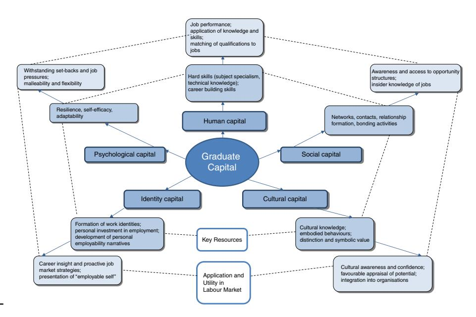

<!-- A2.R47 | source: papers_json/A2.R47/ -->

ET 59,4

338

Received 18 May 2016 Revised 30 January 2017 Accepted 31 January 2017

## Forms of graduate capital and their relationship to graduate employability

Michael Tomlinson

University of Southampton, Southampton, UK

## Abstract

الغرض – في سياق التغيرات البعيدة المدى في التعليم العالي وسوق العمل، دار نقاش واسع حول ما يشكل قابلية توظيف الخريجين وما الذي يحدد نتائجهم في سوق العمل. يستند كثير من هذه النقاشات إلى مناهج تركز على المهارات ومنطق جانب العرض ذي الصلة. يهدف هذا البحث إلى تطوير تصور بديل وعلائقي لقابلية التوظيف يقوم على مفهوم رؤوس الأموال. ويناقش كيف يقدم هذا التصور وصفاً أكثر تفصيلاً وتعدد الأبعاد للموارد التي يعتمد عليها الخريجون عند الانتقال إلى سوق العمل.

التصميم/المنهجية/الطريقة – يقدم البحث نموذجاً جديداً لقابلية توظيف الخريجين، مرتبطاً بخمسة مجالات من رأس المال تُعد مكونة لقابلية توظيف الخريجين ومهمة لانتقالهم إلى سوق العمل. يجمع البحث بين مناهج مفاهيمية قائمة ودراسات بحثية لتوضيح السمات المختلفة للنموذج وعلاقتها بقابلية توظيف الخريجين. كما يناقش بعض الآثار العملية لمن يساعدون في تيسير انتقال الخريجين إلى سوق العمل. النتائج – يجادل البحث بأن نموذج رأس مال الخريج يقدم طريقة جديدة لفهم قابلية توظيف الخريجين تعالج تحديات تيسير انتقالهم وإدارة بداية مسيرتهم المهنية. تُفهم أشكال رأس المال الموضحة على أنها موارد أساسية تمنح الأفراد فوائد ومزايا. تشمل هذه الموارد مجموعة من الأبعاد البشرية والاجتماعية والثقافية والهوياتية والنفسية-الاجتماعية، وتُكتسب من خلال خبرات الخريجين الرسمية وغير الرسمية.

قيود البحث/الآثار المترتبة – على الرغم من أن هذا نموذج مفاهيمي، فإن له آثاراً قوية محتملة على البحث المستقبلي في هذا المجال من حيث المزيد من الاستكشاف البحثي لمكوناته الأساسية وتطبيقها في سوق العمل.

الآثار العملية – تحمل إعادة التصور هذه لقابلية توظيف الخريجين أثراً كبيراً على إدارة الخريجين لمسيرتهم المهنية وعلى وضع استراتيجيات لتطوير الموارد التي تعزز انتقالهم وتقدمهم داخل سوق العمل. كما يحمل آثاراً على مرشدي المسار المهني في تطوير استراتيجيات عملية لقابلية التوظيف يمكن استخدامها داخل الأطر المؤسسية.

الآثار الاجتماعية – يثير البحث آثاراً مهمة تتعلق بالإدارة الفعالة والعادلة لنتائج الخريجين بعد التخرج، وهو أمر له صلة واضحة بجميع أصحاب المصلحة في قابلية توظيف الخريجين، بما في ذلك الطلاب/الخريجين ومرشدي المسار المهني وأصحاب العمل.

الأصالة/القيمة – يطور البحث نموذجاً جديداً لتصور قابلية توظيف الخريجين، ويوضحه ويطبقه في مناقشة قابلية توظيف الخريجين. كما يثير تطبيقات عملية تتعلق بمختلف مكونات النموذج.

Keywords Higher education, Policy, Employability, Skills, Capitals

Paper type Conceptual paper

## Introduction

لا تزال مسألة كيف ولماذا ينجح الخريجون في سوق العمل، وما الذي يمكن فعله لتعزيز "قابلية توظيفهم"، تهيمن على النقاشات حول الأثر الاقتصادي ودور التعليم العالي (HE). لقد مرت 20 عاماً منذ أن قدم تقرير Dearing (1997) توصيات فاعلة لتعزيز "مهارات التوظيف" لدى الخريجين، ودعا إلى أن تكون المناهج الجامعية أكثر انسجاماً مع احتياجات الاقتصاد. وقد اكتسبت هذه الاهتمامات زخماً متجدداً في ضوء مقترحات الحكومة البريطانية الأخيرة التي تربط فعالية المؤسسات وجودتها بعائدات الخريجين في سوق العمل (Department for Business, Innovation and Skills (DBIS), 2016). ومع ذلك، فإن ما يجعل الخريج مرغوباً لدى أصحاب العمل

Education + Training Vol. 59 No. 4, 2017 pp. 338-352 © Emerald Publishing Limited 0040-0912 DOI 10.1108/ET-05-2016-0090

يود المؤلف أن يشكر مختلف أعضاء خدمة المسار المهني والتوظيف في University of Southampton، وبخاصة Hazel McCafferty وHelen Fuge وKathryn Wood، على مناقشات مفيدة تتعلق بهذا المنهج.

<!-- page 2 -->

وما دور التعليم العالي في ذلك كان موضع جدل أكاديمي كبير وتحليل من أصحاب العمل (Hinchliffe and Jolly, 2011). ومع أنه يُفترض غالباً أن الخريجين الذين يمتلكون أعلى مستوى مرغوب من المهارات - أو "الصفات" - هم أكثر قابلية للتوظيف، فقد أظهر كثير من التحليلات أن قابلية توظيف الخريجين أوسع وأكثر تعقيداً (Jackson, 2016; Holmes, 2013; Tomlinson, 2012; Brown and Hesketh, 2004).

يطور هذا البحث تصوراً جديداً لقابلية توظيف الخريجين، يقوم على رؤوس أموال الخريج. فهو يتصور قابلية توظيف الخريجين على أنها تتكون إلى حد كبير من تراكم واستخدام أشكال متفاعلة متنوعة من رأس المال. تُعرَّف رؤوس الأموال هنا بأنها موارد أساسية تمنح الخريجين فوائد ومزايا. تشمل هذه الموارد مجموعة من الأبعاد التعليمية والاجتماعية والثقافية والنفسية-الاجتماعية، وتُكتسب من خلال خبرات الخريجين الرسمية وغير الرسمية. كما تتألف من أشكال متعددة تتفاعل وتساعد على تعزيز قوة كل شكل منها. والأشكال الرئيسية لرأس المال التي تشكل جوهر هذا المنهج هي: البشري، والاجتماعي، والثقافي، والهوياتي، والنفسي. وقد استُلهم كثير من الأطر المفاهيمية لرؤوس الأموال إما من مناهج اقتصادية أو سوسيولوجية أبرزت مزايا اكتساب المؤهلات الرسمية والموقع الاقتصادي المواتي الذي يولده ذلك. ففي الحالة الأولى، تحظى الروايات الشاملة لرأس المال البشري بشعبية بين صناع السياسات، وتربط بقوة بين زيادة الاستثمار في التعلم وتحسن فرص العمل والدخل. أما المناهج السوسيولوجية الأكثر (انظر Bourdieu, 1986) فتبرز الطرق التي يولّد بها الاكتساب النسبي لرأس المال الثقافي، الذي يتخذ غالباً شكل معرفة مستمدة تعليمياً وثقافياً، تفاوتاً تعليمياً بين الأفراد.

ومع أن هذه النظريات ذات صلة بالتصور الحالي، يقدم هذا البحث منهجاً أكثر تكاملاً؛ كما يبين أنه على الرغم من أن كل مكون من هذه المكونات يرتبط بخصائص مختلفة، فإنها تتداخل إلى حد ما وحدودها مرنة نسبياً. والأهم من ذلك أن هذا البحث يقدم مفردات بديلة لفهم قابلية توظيف الخريجين، وتطورها في التعليم العالي، وفي انتقال الخريجين إلى سوق العمل. يتناول البحث أولاً الطرق التي صُوّرت بها قابلية توظيف الخريجين تقليدياً من خلال مفاهيم "المهارات" التقليدية. ثم يوضح المكونات الرئيسية لكل شكل من أشكال رأس المال، وأهميتها لتوظيف الخريجين، ثم بعض الأبعاد العملية لتطوير هذه الأشكال داخل التعليم العالي وحوله.

## The dominance of the employability skills discourse

يتشكل كثير من الفهم الحالي لقابلية توظيف الخريجين، وبخاصة فيما يتعلق بدور التعليم العالي، حول تعزيز مهارات التوظيف لدى الخريجين. ويُنظر إلى مواصلة تطوير مهارات التوظيف لدى الخريجين، بما يتجاوز تعلمهم الأكاديمي الرسمي، على أنه وسيلة لتجهيزهم لمواجهة تحديات العمل على مستوى الخريجين. وقد استجابت مؤسسات التعليم العالي (HEIs) بشكل كبير لخطاب المهارات الذي يتبناه أصحاب العمل، وميلت إلى إعادة إنتاج هذا الخطاب في استراتيجياتها المؤسسية ومبادراتها التربوية (McCowan, 2015; Holmes, 2013). ويبدو أن تضخم الخطاب حول المهارات والصفات داخل التعليم العالي قد تجاوز حتى ما عبّر عنه أصحاب العمل أنفسهم في هذا الشأن.

وقد ظهرت مجموعة قوية من الأدبيات النقدية توضح قيوداً متعددة لهذا المنهج. تتمحور الأولى حول تقييم نقدي للمعنى الأوسع لمفهوم المهارات وتعريفه وأثره على مفهوم قابلية التوظيف. وكما يجادل James et al. (2013)، هناك فرق كبير بين "مهارات الخريجين" المتجانسة نسبياً و"المهارات التي يمتلكها الخريجون". فالأخيرة ليست متنوعة للغاية ومرتبطة بالسياق فحسب، بل تُطوَّر أيضاً من خلال سياقات متعددة وليس فقط داخل التعليم العالي. وهناك قضية جوهرية تتمثل في الطريقة التي ينسقها أصحاب العمل بشكل إضافي، بما في ذلك مدى قدرة المهارات على أن تُستخدم وتُطوَّر بشكل ذي معنى في حياة الخريجين العملية. وقد طعن Holmes (2013) كذلك في الخلط الشامل بين "امتلاك" الخريجين المزعوم "للمهارات" (و/أو "الصفات") وقدرتهم على تأمين وظيفة عند مغادرة التعليم العالي.

<!-- page 3 -->

كما فحصت مجموعة أخرى من الأدبيات نقدياً الرابط بين التوفير الرسمي المرتكز على المهارات ومقدار القيمة التي يضيفها ذلك إلى نتائج توظيف الخريجين، بما في ذلك مدى صلته العامة بسياقات العمل (Mason et al., 2009; Wilton, 2011). وقد أشارت هذه الأدلة إلى الفعالية المحدودة لمبادرات المهارات، التي تُقدَّم رسمياً في التعليم العالي، على قابلية توظيف الخريجين مستقبلاً. وإحدى القضايا، كما أوضح البحث السابق، هي الحواجز السياقية بين التعلم الجامعي الرسمي ومكان العمل، ومدى قابلية المهارات المكتسبة على مستوى التعليم العالي للنقل أو التحويل عبر المجالات. وكما توضح مراجعة Mason et al.، فإن أي مهارات توظيف مكتسبة رسمياً لا يمكن نقلها ببساطة، لأن كثيراً من المهارات الفعلية التي يستخدمها الخريجون مستمدة من سياق العمل الفعلي الذي تُستخدم فيه، وتتموضع فيه، وتتولد من خلاله.

وفي الآونة الأخيرة، ظهرت دعوات لتصور أكثر دقة للمهارات بحيث يشمل ما يؤثر فعلياً على انتقال الخريجين بعد الجامعة. وفي محاولة لنقل المخطط العام للمهارات العامة إلى أرضية أكثر فعالية، طور Bridgstock (2009) مفهوم "مهارات إدارة المسار المهني"، الذي يشير إلى مجموعة من الكفاءات عالية الأثر وطويلة الأمد المهمة للمسار المهني، والتي لها فائدة حقيقية في حياة الخريجين بعد الجامعة. ويشمل ذلك القدرة على إدارة الذات بشكل هادف واستباقي وتوجيه المسارات المستقبلية. ويوضح عمل Jackson and Wilton (2016) الحديث حول كفاءات إدارة المسار المهني أهمية إدارة الذات وبصيرة المسار المهني، وبخاصة فيما يتعلق بقدرة الخريجين على رسم أهدافهم المستقبلية وتعزيز ثقتهم بأنفسهم وإدراكهم الذاتي لقابليتهم للتوظيف. ويناقشان أهمية التعلم القائم على الخبرة الغنية بالممارسة والمندمج مع العمل في تنمية هذه الكفاءات، التي يغلب على معظمها الطابع الناعم، والتي قد تشكل جزءاً من التعلم مدى الحياة لدى الخريجين.

يبتعد هذا البحث عن مناهج المهارات السائدة لقابلية التوظيف، ويتصور بدلاً من ذلك قابلية التوظيف على أنها تشكل مجموعة من أشكال رأس المال الديناميكية والتفاعلية التي تُكتسب من خلال خبرات الخريجين المعيشة. يوضح النموذج في Figure 1 بعدين مهمين لكل شكل من أشكال رأس المال: الموارد الرئيسية المرتبطة بكل منها، وكيفية استخدامها عندما يدخل الخريجون سوق العمل. إن امتلاك رؤوس الأموال أمر مهم، وكذلك تطوير طرق لتعزيزها، لكن معرفة كيفية استخدامها

*Figure 1. Graduate capital model*

<!-- page 4 -->

ومساعدة الخريجين على دخول سوق العمل من المرجح أن يحدد مدى فعاليتها في تقدم الخريجين. يفحص البحث الآن كل شكل من هذه الأشكال، وكذلك الأبعاد العملية المرتبطة بكل منها.

## Human capital – knowledge, skills and future performance

يشير رأس المال البشري إلى المعرفة والمهارات التي يكتسبها الخريجون والتي تشكل أساساً لنتائجهم في سوق العمل. ويحمل هذا الشكل من رأس المال أوثق صلة بمناهج المهارات، إذ يُعنى بما وكيف يستطيع الخريجون ربط تعليمهم الرسمي بنتائج توظيفهم المستقبلية. طور مفهوم رأس المال البشري الاقتصادي Gary Becker (1993)، الذي أشار إلى القيمة الإنتاجية "الهامشية" المرتبطة بالمؤهلات العليا في سوق العمل. ويغرس رأس المال البشري المكتسب عبر التعليم العالي معرفة أوسع، تقنية وضمنية، يستخدمها الخريجون في العمل المهني الرفيع المستوى. وباختصار، فإن تطور رأس المال البشري في شكل معرفة مكتسبة رسمياً عبر مستويات أعلى من التعليم والتدريب يمكّن الأفراد في سوق العمل.

وتكمن قوة رأس المال البشري، كما يجادل مؤيدو هذا المنهج، في أن التعليم الرسمي الإضافي يجعل الأفراد أكثر مهارة وبالتالي أكثر إنتاجية. وكان هذا نغمة سائدة في كثير من سياسات تكوين المهارات في المملكة المتحدة، استناداً إلى فرضية أن زيادة المشاركة في التعليم العالي تزيد من المستوى الجماعي للاستثمار في رأس المال البشري، وبالتالي القدرة الإنتاجية للقوى العاملة ككل. وهناك بالتأكيد حالات يكتسب فيها الخريجون معرفة متخصصة/تقنية قابلة للتطبيق على توظيفهم المستقبلي، مما يمكّنهم من الوصول إلى وظائف محددة. وتعكس هذه المستويات من التخصص المهني معرفة ومهارات متخصصة تلبي متطلبات الأداء والخبرة، والتي يوفر التعليم الرسمي لها أساساً رئيسياً.

وفي حين يظل تكوين رأس المال البشري المرتبط بمهنة محددة مهماً للخريجين في مجموعة متنوعة من التخصصات المهنية والمتخصصة وبعض التخصصات المرتبطة بمجالات STEM، فإن العلاقة بين التعليم العالي الرسمي للخريجين وتوظيفهم المستقبلي أكثر مرونة في حالات كثيرة. وهذا واضح في المملكة المتحدة، التي تقدم، مقارنة بأسواق أوروبا الأكثر مهنية وتنظيماً، قدراً أقل من قابلية الاستبدال الأفقي بين المعرفة المرتبطة بالدرجة العلمية وخصوصيات الوظائف المستقبلية (Little and Archer, 2010). وفي هذا السياق، يكون "ما" درسه الخريج غالباً أمراً حاسماً للوصول إلى مجالات مهنية محددة. ومع ذلك، حتى لو لم يطبق هؤلاء الخريجون معرفة متخصصة بموضوعهم مباشرة، فإن أصحاب العمل يدركون أن تدريبهم الأكاديمي الرفيع يزودهم بمجموعات مهارات أوسع يمكن تحويلها بشكل منتج عندما يدخلون الحياة العملية.

## Practical dimensions of human capital

قد يكون رأس المال البشري المكتسب جامعياً، في بعض الحالات، ملموساً وقابلاً للنقل، كما في حالة من درسوا برامج متخصصة (مثل الطب والتمريض والقانون والمحاسبة). ومع ذلك، يقدم التعليم العالي في معظمه تعليماً عاماً وليس تدريباً محدداً. وتكتسب المهارات قيمتها إذا طُبقت بطرق ظاهرة تؤثر على نتيجة الخريج وأدائه. فإذا ارتبطت قابلية توظيف الخريج ارتباطاً وثيقاً بالتنفيذ الناجح لمهارة محددة، فمن المرجح أن يكون لاكتسابها واستخدامها أهمية. غير أنه في حين قد ينجح هذا في مجالات مهنية محددة بدقة يوجد فيها استبدال بين تعلم التعليم العالي وأداء سوق العمل، فإن هذه الروابط أقل وضوحاً بكثير في سياق سوق العمل المرن في المملكة المتحدة. وتتمثل إحدى وظائف الجامعات في مساعدة الخريجين على توظيف معرفتهم بطرق تحدد فائدتها الاقتصادية المستقبلية. ومن الواضح أن معرفة المهارات المهمة وكيفية توافقها مع الصناعات المستهدفة أمر بالغ الأهمية، وكذلك القدرة على إظهار القيمة الإنتاجية للمعرفة العامة.

ويرتبط بهذا الوعي بلغة المهارات وإيجاد طرق للتعبير عن مجموعات المهارات وبيان كيفية تطبيقها في بيئات العمل المستقبلية. وكما ناقش Dacre Pool and Sewell (2007)، فبغض النظر عن الطبيعة الغامضة للمهارات، يبقى أصحاب العمل

<!-- page 5 -->

متقبلين على الأقل لهذه اللغة، مما يجعل من المهم أن يكون الخريجون على وعي بها وقادرين على نقلها إلى أصحاب العمل. والأمر الجوهري هنا هو قدرة الخريجين على توضيح الرابط بين المعرفة التقنية والتخصص الموضوعي، وكذلك أي مهارات عامة اكتسبوها، وبيان كيف يمكن أن تُترجم إلى أداء مستقبلي.

وعند تطبيق مفاهيم المهارات على نتائج الخريجين بعد الجامعة بما يتجاوز معايير القوائم الوصفية إلى حد ما، يبدو أن مفهوم "مهارات بناء المسار المهني" له قيمة معينة. وكما يوضح Bridgstock (2009)، تمثل هذه المهارات بعضاً من أنسب المهارات التي يمكن للخريجين تطويرها قبل دخول السوق وأثناء الانتقال إليه من حيث القدرة على استغلال فرص العمل. وتقوم مهارات بناء المسار المهني على أنواع من المعرفة (والوعي المرتبط بها) لا تقتصر على متطلبات التوظيف المحددة فحسب، بل تشمل أيضاً معرفة أوسع بسوق العمل. وهذا يشمل، بالتالي، مهارات مرتبطة بالمسار المهني مثل الإلمام بسوق العمل المستهدف (بما في ذلك الاتجاهات والبيانات والطلب على المهارات) ومعرفة كيفية التقدم للوظائف والوصول إليها (بما في ذلك تطوير السيرة الذاتية ومتطلبات الالتحاق)، فضلاً عن الوعي بالفرص واستغلالها.

## Social capital – networks and human relationships

يمكن فهم رأس المال الاجتماعي فيما يتعلق بقابلية توظيف الخريجين على أنه مجموع العلاقات والشبكات الاجتماعية التي تساعد على تعبئة رأس المال البشري الموجود لدى الخريجين وتقربهم من سوق العمل وهياكل فرصه. ويمكن لرأس المال الاجتماعي أن يشكل ويسهل وصول الخريجين إلى فرص سوق العمل ووعيهم بها، ثم قدرتهم على استغلالها. ويشير عرض Bourdieu (1986) لرأس المال الاجتماعي إلى الموارد التي يمتلكها الأفراد نتيجة عضويتهم أو ارتباطاتهم بمجموعات معينة. وتوفر مشاركتهم في التعليم العالي الأساس لتطوير "الروابط الجسرية" اللازمة مع فاعلين اجتماعيين رئيسيين آخرين (Putnam, 1999). ويُستمد هذا الوعي جزئياً من خبرات ضمن الوسط الاجتماعي والثقافي للطلاب، ويرتبط بمؤثرات اجتماعية مهمة، مثل أفراد الأسرة والمجتمع والأقران. والمسألة المهمة هي إيجاد طرق للاستفادة من هذه الموارد في السعي إلى الوصول إلى التوظيف.

يُعد تحليل Putnam (1999) لـ"الروابط الرابطة" و"الروابط الجسرية" مهماً لفهم مفهوم رأس المال الاجتماعي. صاغ Putnam (1999) مفهومي "الروابط الرابطة" - التفاعلات بين أعضاء مجموعة تبني وتحافظ على التماسك والتضامن - و"الروابط الجسرية" التي تشير إلى التفاعلات الخارجية عن المجموعة. وفيما يتعلق بهذه الروابط، يُستخدم مفهوم رأس المال الاجتماعي لوصف الموارد المتاحة للأفراد أو المجموعات بحكم الشبكات ومعاييرها والثقة المرتبطة بها. وهذه الشبكات والمعايير تمكينية بشكل كبير، إذ توفر للأفراد فهماً وبصيرة أفضل بما يوجد من فرص، وأين توجد، ومن هم حراس البوابة الرئيسيون، وما يحتاجونه للوصول إلى التوظيف.

وقد طور Granovetter (1985) مفهوم الروابط القوية والضعيفة، وهو مهم أيضاً للتحليل، إذ يشير إلى قوة الروابط العلائقية التي يكونها الأفراد على المستويين الرسمي وغير الرسمي. والمهم هنا هو التأثير الذي يمكن أن تولده هذه الروابط في بناء الثقة ومستوى المعلومات والمعرفة الداخلية. وقد تكون الروابط القوية مع مقربين مهمين (مثل أفراد الأسرة)، في شكل معرفة الوالدين وشبكاتهم، إحدى طرق التوسط في الوعي بفرص التوظيف، وبخاصة عندما تُنقل مصادر غنية من المعرفة والمعلومات. غير أن عمل Granovetter شدد على قوة الروابط الضعيفة في شكل انتشار رفيع نسبياً من الروابط والاتصالات الاجتماعية - مثل جهات اتصال أصحاب عمل ناشئة - التي يمكن أن تكون مؤثرة. فكلما استطاع الأفراد إقامة نقاط اتصال اجتماعي أكثر، من مصادر متنوعة وغنية بالمعرفة، ازدادت معرفتهم وثقتهم تجاه مجالات الحياة الاجتماعية أو الاقتصادية التي قد يكونون أقل إلماماً بها.

<!-- page 6 -->

## Practical dimensions of social capital

المسألة الرئيسية المطروحة هنا لانتقال الخريجين إلى التوظيف هي القدرة على تمييز الفرص ثم استغلالها، وبخاصة عندما يكون الأشخاص المهمون في حياتهم قد لعبوا (أو لم يلعبوا) دوراً جسرياً في مساعدتهم على التعرف على فرص التوظيف والوصول إليها. فعلى سبيل المثال، يوجد الآن اهتمام سياسي كبير بمستويات التقدم ونتائج سوق العمل للطلاب من خلفيات اجتماعية-اقتصادية أدنى (Social Mobility and Child Poverty Commission, 2013)، في ضوء استمرار نقص تمثيل هذه الفئة في المهن النخبوية.

وقد أصبح من الضروري بشكل متزايد للخريجين أن يكونوا قادرين على تطوير خبرات جسرية وتوسيع الروابط الضعيفة إلى ما وراء الحدود الرسمية للجامعة. ويتعلق أحد الأوجه المهمة لتكوين رأس المال الاجتماعي بالتفاعل مع أصحاب العمل، الرسمي منه وغير الرسمي، في شكل تفاعلات ذات معنى ومفيدة بين الخريجين وأصحاب العمل. ومن المرجح أن تمثل المستويات الأعلى من التفاعل مع أصحاب العمل نشاطاً جسرياً واضحاً، ليس فقط من خلال الوصول إلى معرفة قيّمة لدى صاحب العمل، بل أيضاً بجعل الخريجين مرئيين بشكل أكبر لأصحاب العمل. ويمكن تشجيع عدد من الطرق المباشرة لاستثمار رأس المال الاجتماعي من خلال التفاعل مع أصحاب العمل. إحداها هي الاتصال المباشر بأصحاب العمل بطرق تيسر مستوى من المعرفة المتبادلة بين صاحب العمل والخريج. ويُعد التفاعل المباشر مع أصحاب العمل من خلال معارض التوظيف وبناء الملف الشخصي عبر الإنترنت (مثل LinkedIn) طرقاً يستطيع الخريجون من خلالها أن يصبحوا أكثر ظهوراً لأصحاب العمل، وأن يُقيموا روابط جسرية مبكرة.

وشكل آخر من أشكال بناء الجسور مع أصحاب العمل هو من خلال تطوير خبرة عمل، عبر التدريب أو أشكال أخرى من التوظيف، والتي قد تنشئ جسوراً حاسمة بين التعليم الرسمي والتوظيف المستقبلي - وبخاصة إذا وفرت معرفة غنية أو فرص توظيف. ومن الواضح أن هذا النشاط سيفيد الطلاب إذا رغبوا في دخول مجالات توظيف ذات صلة. وقد أوضح بحث Jones et al. (2016) كيف أن خبرة العمل لدى تاركي المدرسة لم توفر وصولاً مباشراً إلى فرص توظيف لاحقة فحسب، بل ساعدت أيضاً على توليد معرفة أكثر موثوقية ومباشرة حول الوظائف والإجراءات اللازمة للالتحاق بها والنجاح فيها.

وهناك طرق أخرى يمكن من خلالها استثمار رأس المال الاجتماعي. فمع أنهم قد لا يرون أنفسهم عادة على هذا النحو، يمثل مرشدو المسار المهني في الجامعات مصدراً محتملاً للروابط الضعيفة للخريجين. وقد يكون هذا صحيحاً إذا كان المرشدون المطلعون والمنخرطون قادرين على نقل معرفة قيّمة حول كيفية الوصول إلى مجالات توظيف معينة وبناء علاقات مع أصحاب العمل. ويمتد هذا إلى إرشادات حول كيفية التواصل بشكل أفضل مع أصحاب العمل والتفاعل معهم، وبخاصة بين من يترددون في التواصل معهم. وكما يوضح استطلاع UK Future Track (2012)، هناك حاجة واضحة للجامعات لتعزيز فرص التواصل ورأس المال الاجتماعي بشكل أفضل بين الطلاب من الفئات الاجتماعية-الاقتصادية الأدنى من خلال الأنشطة اللامنهجية وأشكال التفاعل مع أصحاب العمل.

## Cultural capital: employability and cultural synergy and alignment

يمكن تصور رأس المال الثقافي على أنه تكوين المعرفة والاستعدادات والسلوكيات ذات القيمة الثقافية المتوافقة مع أماكن العمل التي يسعى الخريجون إلى الالتحاق بها. طور هذا المفهوم Bourdieu (1984, 1986) الذي ناقش انتقال هذه المعرفة الثقافية القيّمة بين الأوساط الاجتماعية-الثقافية للأفراد والسياق التعليمي الذي تُعتمد فيه. ويُترسخ هذا بشكل أكبر من خلال الشهادات الرسمية التي توفر وظائفها المعززة للمكانة وصولاً مميزاً إلى سوق العمل. ولا يزال هذا المنهج قيّماً، وبخاصة عند استكشاف كيف يمكن للاكتساب النسبي واستخدام رأس المال الثقافي، الذي يتشكل غالباً خارج التعليم الرسمي، أن يوفر وصولاً إلى التوظيف (Bathmaker et al., 2013; Burke, 2015). ومع ذلك، في سياق التعليم العالي الجماهيري، قد يكون رأس المال الثقافي المؤسسي رسمياً، الذي يشير إلى الإنجاز النخبوي وتكوين المعرفة، أقل قدرة على تشكيل الوصول إلى التوظيف. وفي التعليم العالي الجماهيري،

<!-- page 7 -->

تحولت ما يسمى "قواعد الحقل" بين التعليم العالي وسوق العمل من حيث ما يمكن للخريجين مقايضته في السوق.

وهناك عدد من مكونات منهج رأس المال الثقافي التي لا تزال ذات صلة، وتفسر جزئياً لماذا يحقق بعض الخريجين نتائج أفضل عند محاولة دخول مجالات توظيف مختلفة. يرتبط أحدها بمفهوم التمايز الذي طوره Bourdieu، ويشير إلى معرفة وأذواق وإنجازات ذات قيمة مضافة مكتسبة عبر مجموعة من السياقات الثقافية والتي تثري مكانة الفرد الاجتماعية بشكل محتمل. فإذا لم تعد المستويات العليا من التعليم تشير إلى هذا التمايز، يتعين على الخريجين فعل المزيد لتطويره من خلال التعليم العالي وما بعده. والأهم هو معرفة كيف تُقدَّر هذه القيمة في المجالات الثقافية لمنظمة صاحب العمل المستهدف. وقد أوضح بحث Lindberg (2013) حول خريجي الطب، على سبيل المثال، كيف تُقدَّر أشكال مختلفة من رأس المال الرمزي في السياقات المهنية النخبوية وتساعد الخريجين على التميز. ويستشهد هذا البحث بأمثلة مثل الجوائز التي فازوا بها والمؤتمرات التي حضروها، وكذلك إنجازات أخرى أوسع، تمنح الخريجين قيمة مضافة وتساعدهم في عملية التوظيف.

وهناك بُعد آخر لمفهوم رأس المال الثقافي ينطبق على قابلية توظيف الخريجين وهو مفهوم رأس المال المتجسد، وهو تجلي السلوكيات والاستعدادات المتجسدة المرغوبة للأفراد داخل مجال معين. وهذا أيضاً لا يُرجح أن يُنسب له قيمة متماثلة عبر المجالات المهنية العديدة التي يدخلها الخريجون. فعلى سبيل المثال، قد يُشجَّع خريج يعمل مدير مبيعات على تطوير وتقديم شكل من أشكال رأس المال المتجسد يختلف عن ذلك الذي يُشجَّع عليه خريج يعمل أخصائياً اجتماعياً. وبالتالي، يُرجَع استخدام أشكال رأس المال المتجسد إلى حد كبير إلى قيم وأعراف اجتماعية أي قطاع ومنظمة محددة، وأنواع ديناميكيات المجال التي تعمل بها. وقد تكون السلوكيات المتجسدة المرغوبة داخل المنظمات الربحية مختلفة تماماً عن تلك الموجودة في السياقات العامة أو سياقات القطاع الثالث. وفي جميع الحالات، تُعد القدرة على إظهار التوقعات الشخصية والسلوكية لمجال تنظيمي محدد أمراً مهماً. ولذلك، فإن إظهار الأشكال المناسبة من رأس المال المتجسد عبر اللكنة ولغة الجسد والفكاهة و"حزمة الشخصية" العامة أمر مهم.

## Practical dimensions of cultural capital

يكمن التحدي في هذا الشكل من رأس المال في أنه متباين عبر مجتمع الطلاب والخريجين، وقد يُعزَّز ذلك من خلال التعليم العالي الجماهيري. ومن النتائج المهمة لبحث Bathmaker et al. وBurke حول الخريجين من خلفيات اجتماعية-اقتصادية مختلفة الفهم المختلف لقواعد الحقل، وكذلك المعرفة والثقة في القدرة على التفاوض بشأنها. ويتجلى هذا أيضاً في القرارات والتوجهات، بما في ذلك في حالة الخريجين من الفئات الاجتماعية-الاقتصادية الأدنى، الذين قد يستبعدون مجالات من سوق العمل قد يشعر زملاؤهم من الطبقة الوسطى بالارتياح للتقدم إليها. وبالمثل، يبدو أن الصفات غير الملموسة والشخصية التي أظهر بحث أصحاب العمل أنها تؤثر بشكل ملموس على قرارات التوظيف (Brown and Hesketh, 2004; Hinchliffe and Jolly, 2011; Morley, 2007; McCracken et al., 2015) مرتبطة بقوة أيضاً بالتكوين الثقافي الأوسع للخريجين.

وهناك حاجة واضحة للمؤسسات للتفكير بإبداع في كيفية تعزيز رأس المال الثقافي بين طلابها. وتتعلق قضية رئيسية بعمليات إذابة الجمود الثقافي وتوسيع نطاق الممكن، بما في ذلك تطوير الثقة الشخصية واستشراف الآفاق. وكان منهج التعرض الثقافي، القائم على بناء ثقة الطلاب المحتملين وإدراكهم الذاتي لقيمتهم، سمة رئيسية لتوسيع المشاركة (مثل Aim Higher في المملكة المتحدة). ويقوم هذا على مبدأ أنه إذا تعرض الطلاب لثقافات المؤسسة، بما في ذلك فاعليها الثقافيين الرئيسيين - أي الطلاب الحاليين والأكاديميين والمديرين - فسيتحدى ذلك انطباعاتهم المقيِّدة بينما يوسع آفاقهم المحتملة.

ومن تطبيقات هذا في بيئات العمل بناء مستويات أقوى من الفهم الثقافي والثقة تجاه منظمات صاحب العمل المستهدفة. ومن المرجح أن يستلزم هذا

<!-- page 8 -->

تعرضاً ثقافياً أكبر ووعياً بمنظمات العمل المستهدفة، وهو ما يمكن أن يلعب فيه دوراً تفاعل أقوى مع أصحاب العمل، سواء من خلال الشبكات غير الرسمية أو التدريب أو خبرة العمل. وقد وردت مثل هذه التطورات في عدد من الدراسات حول حلقات تفاعل تاركي المدرسة مع أصحاب العمل (Jones et al., 2016). وتشمل النتائج الرئيسية الناشئة عن هذا التفاعل تعزيز الثقة الشخصية، وتصوراً أقوى للمسارات الجديدة المحتملة، والدافع للإنجاز. ويُستمد تعزيز رأس المال الثقافي مباشرة في هذه السياقات من خلال خبرات فعلية توفر للخريجين مستويات أقوى من المعرفة والفهم الثقافي للتوظيف المستهدف. وفي حين قد تكون المعرفة التقنية الرسمية بمنظمات صاحب العمل مهمة في استثمار الملاءمة التقنية ومنح كل من الخريج وصاحب العمل شعوراً أقوى بتوافق الملف الشخصي، فإن هذا غالباً ما يحتاج إلى استكماله بمعرفة ثقافية ذات صلة. وتشمل الأخيرة الوعي بالممارسات والتوجهات الثقافية وكذلك القيم والأعراف السلوكية.

وبمجرد تكوين جسور إدراكية من خلال معرفة ووعي ثقافي أقوى، سيحتاج الخريجون إلى تجسيد ذلك في شكل سلوكيات ومواقف تنقل التآزر الثقافي. وقد يواجه بعض الخريجين، بمن فيهم من خلفيات اجتماعية-اقتصادية أدنى ومؤسسات تعليم عالٍ أدنى تصنيفاً، تحديات ونكسات أقوى في هذا الصدد (Greenbank, 2011; Morrison, 2014). وتتعلق قضايا أخرى وردت في هذه الدراسات وما شابهها بميل هؤلاء الخريجين إلى التقليل من شأن إنجازاتهم الأوسع، وبخاصة تلك التي تشير إلى تمايز ذي قيمة مضافة. غير أنه قد يكون صحيحاً أن تفاعل أصحاب العمل مع هذه المؤسسات يمكن أن يقطع شوطاً نحو أن يصبح الخريجون أكثر وعياً، وأن يقدموا بشكل أكثر فعالية، خبرات حياتية وتوظيفية أوسع بطرق مفيدة. ويمكن للتدريب الرسمي على التوظيف أن يساعد كذلك في هذا الصدد، وبخاصة تدريب المقابلات، حيث تُتاح للخريجين فرص استثمار الاستعدادات المتجسدة والكفاءات السلوكية التي تلائم ممارسات التوظيف لدى أصحاب العمل بشكل أفضل.

## Identity capital: self-concept and personal narratives

يُعرَّف رأس المال الهوياتي هنا بأنه مستوى الاستثمار الشخصي الذي يقوم به الخريج نحو تطوير مساره المهني وقابليته للتوظيف مستقبلاً. ويمتد هذا أيضاً إلى قدراتهم على الاستفادة من خبراتهم وصياغة سردية شخصية تتوافق مع مجالات التوظيف التي يسعون إلى دخولها. والأمر الجوهري هنا هو قدرة الخريج على تطوير هويات ناشئة ثم إثباتها وأدائها في المراحل الأولى من سوق العمل. ومن المرجح أن يوفر هذا التكوين مزايا إذا كان الاستثمار الشخصي الذي يقوم به الأفراد نحو العمل المستقبلي يدفعهم بنشاط نحو سوق العمل. وبالتالي يمكن للإدراك الذاتي والمفاهيم الذاتية التي يكونها الخريجون حول العمل المستقبلي أن توفر إطاراً يمكنهم من خلاله توجيه خبراتهم وملفاتهم الشخصية.

وقد أوضحت الأدبيات السوسيولوجية العامة وأدبيات سوسيولوجيا العمل أهمية الحفاظ على سردية للذات، وبخاصة في ظروف اقتصادية متزايدة الفردية والسيولة (Giddens, 1991; Beck and Beck-Gernsheim, 2002). وقد أظهرت أدبيات سوسيولوجيا العمل الطرق المتعددة التي تتشكل (أو تتشوه) بها الهويات من خلال الثقافات التنظيمية التي تُتفاوض فيها. ويتعلق كثير من هذا بتجميع نشط لصور الذات والسلوكيات المستمدة من بنى خطابية أوسع حول ما يشكل موظفاً مرغوباً وذا قيمة (Du Gay, 1996; Marks and Thompson, 2010; Strangleman, 2012). وقد عرّف Cote رأس المال الهوياتي على النحو التالي: "تصف عملية اكتساب رأس المال الهوياتي كيفية استثمار الفرد في هوية (أو هويات) معينة والانخراط في سلسلة من التبادلات مع آخرين في سياقات متنوعة (بعضها فقط اقتصادي)" (Cote, 2005, p. 225).

وقد ازداد الاعتراف بالدور المهم المحتمل لتكوين الهوية، وكذلك الأبعاد النفسية-الاجتماعية الأخرى، في أدبيات إدارة المسار المهني الأوسع وتلك المتعلقة بمسارات الخريجين المهنية (Fugate et al., 2004; London, 1993). ويشير London إلى هوية المسار المهني على أنها مدى كون المسار المهني جزءاً لا يتجزأ من هوية الفرد

<!-- page 9 -->

الشخصية ومركزيتها في حياته ككل. ويشمل ذلك أيضاً إحساسهم العام بالالتزام تجاه تطوير مسار مهني من حيث ارتباطهم النفسي بوظائف ومنظمات معينة. وفي بحوث وتحليلات قابلية توظيف الخريجين، تبين أن الهوية تلعب دوراً مهماً في كيفية تفاوض الخريجين على الوصول إلى التوظيف، بشكل رئيسي من خلال التوظيف.

وفي تحليل Hinchliffe and Jolly (2011)، تُقدَّم الهوية كمكون مهم سياقياً للسلوكيات ومجموعات القيم المطلوبة في مجالات تنظيمية محددة. ويؤطر هؤلاء الباحثون هوية الخريج حول أربعة عناصر أساسية - القيم والتفاعل الاجتماعي والفكر والأداء - وكلها تحتاج إلى أن تُقدَّم وتُثبَت من خلال الخطاب والفعل.

وقد طور Holmes (2013, 2015) بشكل موسع مسألة إثبات الهوية في نموذجه لهوية الخريج، الذي يتمحور حول أن الهويات الناشئة التي طورها الخريجون حول دورهم وقدرتهم المستقبلية يجب أن تُثبَت أو تُؤكَّد اجتماعياً من قبل آخرين. وقد تكون خبرة التوظيف أو التقييم المبكر للأداء حاسمة هنا، إذ يمكن أن تؤكد أو تفسد الأفكار المبكرة التي كونها الخريجون حول وظيفة ودورهم فيها. وبالتالي فإن مدى قدرة الخريجين على بناء هويات، ورأس مال هوياتي مرتبط بها، له أثر قوي على تقدمهم خلال المراحل المبكرة من سوق العمل.

وقد قدم Jackson (2016) تحليلاً آخر ذا صلة يوضح فيه مفهوم "الهوية شبه المهنية" كمكون رئيسي لتطور الخريجين المهني المبكر وتكوينهم. وهنا يكون لمناهج التعليم العالي والتعلم دور مهم محتمل، إذ تساعد الخريجين على تطوير تصورات ذاتية وأهداف قد تشكل جزءاً من تطورهم المهني الأوسع. وفي تصور Jackson المفاهيمي، تتطور الهويات شبه المهنية من خلال "مشاهد الممارسة" الأوسع التي توفرها الجامعات. وبرؤية التعليم العالي كمشهد ممارسة، لا يقتصر تطور الخريج على مجتمعات تخصصية مغلقة، بل يمكن أن يشمل أيضاً التفاعلات مع أصحاب العمل وخدمات المسار المهني والانخراط اللامنهجي وأشكالاً أخرى من التعلم القائم على الخبرة. وكلما توافقت هذه الخبرات فعلياً مع الحياة المستقبلية، ازدادت قدرتها على التمكين وتكوين الذات، وأتاحت للخريج عرض صورة ذاتية تجاه مجالات الحياة العملية.

## Practical dimensions of identity capital

إذا دفعت الهويات الناشئة التي يكونها الخريجون نحو التفكير الاستباقي والإبداعي في مساراتهم المهنية المستقبلية وقابليتهم للتوظيف، فإن إيجاد طرق لتطوير هذه الهويات قد يكون له أثر مهم على مستقبلهم القريب. تشير الأبحاث السابقة إلى أن الطلاب الذين يستثمرون بقوة أكبر في مساراتهم المهنية يميلون إلى إظهار مستوى أعلى من رأس المال الهوياتي (Tomlinson, 2007) - فالمسارات المهنية المستقبلية جزء قوي من "مشروع حياتهم" المستمر والمتوقع. وقد يكون إيجاد طرق لتعزيز التصورات الذاتية والهويات الناشئة لدى الطلاب بحيث تشكل أهدافاً مهنية أكثر ترابطاً ووضوحاً أمراً مهماً في تشكيل الإدارة المبكرة لقابليتهم للتوظيف. وقد ناقش Jackson (2016) أهمية البُعد غير الرسمي لخبرة الجامعة بالنسبة للهوية المرتبطة بالعمل، وبخاصة تفاعلات الطلاب من خلال العروض المتنوعة القائمة على الخبرة في التعليم العالي. ويبدو مهماً إذن أن يتجاوز تكوين الهوية مجرد الوسط التخصصي الرسمي.

وتتعلق القضية الرئيسية الأخرى بقدرة الخريجين على المطالبة بالهويات الناشئة التي يحملونها إلى سوق العمل كما هو موضح في بحث Holmes (2013, 2015). وكما يجادل Holmes، يحتاج الطلاب إلى تشجيعهم على القدرة على ترجمة الهويات المحتملة إلى دليل واضح على السلوكيات والأداء المستقبلي الذي يُفترض أن تجسده هذه الهويات. وبدلاً من مجرد إعادة إنتاج وصف المهارات، تصبح المهمة أكثر تعلقاً بإظهار أو إثبات كيف تشكل هذه ممارسات مناسبة لأدوار وممارسات العمل المستقبلية. وقد يكون تمكين الطلاب من تطوير هذه القدرة أمراً حاسماً إذا أرادوا إظهار التوافق بين الهويات الناشئة والأداء المستقبلي داخل سياق عمل محدد.

<!-- page 10 -->

وتتعلق أهمية العرض الذاتي أو إسقاط سردية قابلية توظيف ناشئة جذابة لأصحاب العمل بنمط آخر مهم من إسقاط الهوية: السيرة الذاتية. وقد صور Morgan and Miller (1993) السيرة الذاتية على أنها ممارسة سير ذاتية، مؤكدين أهمية إسقاط وترويج القيمة التوظيفية النسبية للفرد من خلال خبراته المعيشة. وبالفعل، تصبح السيرة الذاتية أداة رئيسية يجسد من خلالها الأفراد عرضاً رسمياً للذات عبر رواياتهم عن توظيفهم وسردياتهم السير ذاتية المرتبطة بها. وإذا كانت القابلية التسويقية الآن مكوناً مهماً لقابلية التوظيف، فإن الخريجين بحاجة إلى إعدادهم على القدرة على تقديم سردية قابلية توظيف مقنعة تنقل هوياتهم. ويصبح تراكم الإنجازات والخبرات المرتبطة بالعمل بدوره مؤشرات على القيمة التنظيمية المحتملة. ومن الواضح من البحث حول استخدام الطلاب للأنشطة اللامنهجية أن كثيرين يستخدمون هذا الآن كوسيلة لتقديم وصف أوسع لأنفسهم، مما يمنحهم بدوره ميزة تنافسية مقارنة بخريجين آخرين ذوي ملفات تعليمية متطابقة (Roulin and Bangerter, 2013).

## Psychological capital: resilience and career adaptability

يُعد رأس المال النفسي شكلاً مهماً محتملاً من رأس المال لأنه يقوم على الموارد النفسية-الاجتماعية التي تمكّن الخريجين من التكيف والاستجابة بشكل استباقي للتحديات المهنية الحتمية. وقد ازداد مستوى التحدي والصعوبة بوضوح للخريجين الذين يغادرون التعليم العالي، ويتوقع عدد أقل من الخريجين أن تكون عملية العثور على وظيفة سهلة. ومما تزداد أهميته مستوى قدرة الخريجين على التكيف، ليس فقط من حيث التنقل في أرض أكثر عدم يقين، بل أيضاً تحمل التحديات والنكسات مثل فترات محتملة ومستمرة من نقص التوظيف والبطالة (Fugate et al., 2004). ويشير مفهوم قدرة التكيف المهني كما طوره Savickas and Porfeli (2012) إلى قدرات الأفراد على الاستجابة والتكيف مع التغير والتقلب عبر حياتهم العملية. وقد أوضح بحث آخر (Brown et al., 2012) أهمية أشكال متنوعة من التعلم المرتبط بقدرة التكيف المهني لإدارة التحدي عبر انتقالات العمل، بما في ذلك التعلم من الآخرين ومستوى التحدي والانفتاح على الخبرات الجديدة. وكما يوضح هذا البحث، فإن المستويات الأعلى من قدرة التكيف المهني تمكّن الأفراد من إعادة توجيه أهدافهم بسهولة أكبر واتخاذ قرارات أكثر استباقية عند مواجهة خبرات مزعزعة في سوق العمل.

وهناك عدد من الأبعاد المكونة لرأس المال النفسي، أحدها هو التعامل المرتكز على حل المشكلات نحو تطوير استراتيجيات استباقية في مواجهة التحدي، بشكل رئيسي في شكل التعلم من الخبرة. والمسألة الجوهرية المطروحة هي مدى قدرة الأفراد على تحمل ما يُرجح أن يكون ضغطاً ونكسات حتمية على مدى المسار المهني، وكذلك مدى مرونتهم. ويرجع كثير من مفهوم رأس المال النفسي إلى جذوره في أدبيات علم النفس الإيجابي، ويرتبط بباحثين مثل Seligman (1998). وفي صميم هذا المفهوم قدرة الفرد على التكيف مع الظروف الشخصية الصعبة، وترسيخ مركز تحكم ذاتي مرتفع نسبياً. ويضع Chen and Lim (2012) مفهوم رأس المال النفسي في سياق الصعوبات الوظيفية، مثل فقدان الوظيفة أو البطالة المستمرة، وكذلك بشكل أوسع في مناخ متقلب وتنافسي. وفي حالة الخريجين الذين يسعون إلى أشكال توظيف عالية المستوى، من المرجح أن تخلق توقعات الأداء المرتفعة وكثافة العمل الشديدة متطلبات عاطفية كبيرة. ويسلط هؤلاء الباحثون الضوء على بعض الفوائد الرئيسية لتطوير مستويات قوية من رأس المال النفسي، من إدراك ذاتي أعلى لقابلية التوظيف وسلوكيات البحث عن عمل، إلى استراتيجيات تعامل منتجة.

ومن الواضح أن الكفاءة الذاتية مهمة، ليس فقط من حيث إدراك الخريجين الذاتي لقدرتهم على تحقيق أهدافهم المهنية، بل أيضاً قدرتهم على تحمل الظروف الصعبة. ومسألة رئيسية أخرى هي المرونة من حيث تحمل الضغوط والاضطرابات في المراحل الأولى من مسيرتهم المهنية في مناخ متقلب وغير مؤكد محتمل. وتمكّن المرونة الأقوى الخريجين من التكيف مع أوضاع سوق العمل الصعبة، بما في ذلك فترات البطالة أو نقص التوظيف أو حالة خيبة الأمل في شكل رفض وظيفي أو تحدٍ غير متوقع. وكلما استطاع الخريجون تطوير رأس مال نفسي أكبر، ازدادت استجابتهم استباقية وقابلية للتكيف على الأرجح في مثل هذه الظروف.

<!-- page 11 -->

## Practical dimensions of psychological capital

بعض الاستعدادات المرتبطة برأس المال النفسي أكثر وفرة لدى بعض الخريجين منها لدى آخرين. وقد تتوسط عناصر أخرى مرتبطة برأس المال النفسي، بما في ذلك العقليات التمكينية والانفتاح على التجربة وتحمل المخاطر، كيفية التعامل مع ظروف سوق العمل المعاكسة المحتملة. ومع أنه قد لا يكون مهمة سهلة للعاملين في التعليم العالي تطوير مستويات قدرة الخريج على التكيف والمرونة، فهناك طرق لتعزيز أهمية ذلك عند الانتقال إلى العمل مدفوع الأجر. وكلما استطاع الخريجون استيعاب أهمية إدارة استجاباتهم للتحدي المهني، ازدادت جاهزيتهم على الأرجح لإدارة المواقف الصعبة (Koen et al., 2012).

وينشأ اهتمامان عمليان رئيسيان حول موضوع قدرة التكيف المهني. يتعلق أحدهما بالحاجة المتزايدة للتخطيط الطارئ المرن في إدارة وإرشاد بداية المسار المهني، والآخر يتعلق بإدارة التوقعات وآليات التعامل مع الضغط والنكسات الحتمية. ويتوافق الأول مع كثير من الأدبيات المعاصرة حول تغيير المسار المهني، والتي يُشار إليها أحياناً بمسارات "المسار المهني البروتيني" (Baruch, 2014). وقد يحتاج الممارسون إلى رفع الوعي بهذا التوجه المتزايد وتأطير أهداف مسار الخريج المهني بشكل أقل حول وظائف وأسواق عمل مفردة، وأكثر حول مجموعة من المسارات، بعضها قد لا يكون خطياً أو محدداً بوضوح. وإذا كان بإمكان الهويات الناشئة، كما أشار باحثو الهوية، أن تُفسد بسهولة في وقت مبكر، فسيحتاج الخريج إلى إعادة صياغة وتقييم أهدافه والتفكير بشكل استباقي وبطرق تتيح له إعادة التكيف مع مجالات توظيف جديدة.

وهناك حاجة واضحة للممارسين للمساعدة في إدارة التوقعات حول انتقال من التعليم إلى العمل قد يُفهم بشكل متزايد على أنه "صدمة واقع" (Kramer, 1974). فإذا أُعد الخريجون للاعتقاد بأنهم، بعد خبرة سلسة نسبياً (وناجحة في كثير من الحالات) خلال تعليمهم السابق، سينزلقون بسلاسة إلى مسارات مختارة، فقد يزيد ذلك من مستوى التحدي والقلق عند مواجهة خبرات لا تتوافق مع هذه التوقعات. وتتمثل مسألة رئيسية هنا في إدارة التوقعات وتعزيز عقليات مرتبطة بالمرونة وقابلية التكيف المهني. وهناك حاجة واضحة لمن يعملون في التعليم العالي لترسيخ أهمية المرونة وطرق الإدارة الاستباقية لما يُرجح أن يكون مسارات أقل خطية واستقراراً خلال المراحل المبكرة من المسيرة المهنية وما بعدها.

## Discussion and synthesis

لا تزال مؤسسات التعليم العالي تُنسب إليها دوراً مهماً في تطوير قابلية توظيف الخريجين وآفاقهم المستقبلية في سوق العمل. وقد اشتد الطابع الإلزامي للسياسات حول هذا الأمر مؤخراً (DBIS, 2016). وقد حظيت التحديات التي يطرحها هذا للتعليم العالي، وكذلك التوجه القوي نحو جانب العرض في أهداف هذه السياسات، باهتمام نقدي (Wilton, 2011; McQuaid and Lindsay, 2005). غير أن هناك حاجة للتفكير بشكل أوسع وأكثر مفاهيمية في قابلية توظيف الخريجين وإدخال مفردات جديدة تتصل بتعقيداتها العلائقية وأيضاً بخبرات الخريجين المعيشة خلال التعليم العالي وما بعده. وقد قدم هذا البحث منهجاً جديداً يجمع بين جوانب مختلفة متعددة من تكوين الطلاب والخريجين للمهارات والمعرفة والعلاقات الاجتماعية والممارسة الثقافية والهويات والاستعدادات النفسية-الاجتماعية. وتُفهم أشكال رأس مال الخريج الموضحة هنا على أنها موارد حاسمة تراكمية ومتكررة الطابع، وتمكّن الخريجين بشكل محتمل عند انتقالهم إلى سوق العمل. ويوسع تكوين رؤوس الأموال وتطبيقها بشكل أكبر معايير خياراتهم وقدرتهم على التصرف بطرق مفيدة اقتصادياً. وعلى أكثر المستويات مباشرة، يمكن أن تُعلم علاقة الخريج المباشرة بسوق العمل، وتشكل كيفية إدراك هو والآخرون لإمكاناته ونطاقه.

وقد يمكننا هذا المنهج من التفكير بإبداع لحل التوترات المستمرة بين (عدم) المزايا النسبية الناشئة عن خلفيات الخريجين المختلفة الأسرية والاجتماعية-الاقتصادية، وبين إمكانات التعليم العالي. ومن الواضح أن التعليم العالي ليس في موقع يمكّنه من التعويض عن الحقائق الاقتصادية المتغيرة أو التفاوتات الاجتماعية الراسخة. غير أنه يمكن أن يوفر نطاقاً تحررياً؛ ليس فقط من حيث التطور الفكري للخريجين

<!-- page 12 -->

بل أيضاً وصولهم إلى توظيف عادل. وأحد السمات والمزايا الرئيسية لمنهج رؤوس الأموال هو تأكيده على أهمية الموارد المتعددة المكونة لقابلية التوظيف، والتي تُكتسب عبر مجالات متنوعة ولا تقتصر على التوفير التعليمي الرسمي فحسب. وبالتالي، فإن تكوين رأس المال أيضاً عملية إجرائية وعلائقية بمعنى أن رؤوس الأموال تُكتسب وتُستخدم عبر الزمن وتستمر آثارها عبر مجموعة من سياقات التوظيف.

والأهم من ذلك أن أشكال رأس المال المختلفة تتغذى وتثري بعضها بعضاً. ورأس المال البشري تأسيسي بوضوح لتوظيف الخريجين، سواء المحدد أو العام. لكن هذا وحده غير كافٍ، ويحتاج إلى استكماله بأشكال أخرى من رأس المال من حيث تفعيله اجتماعياً في وسط التوظيف الأوسع الذي يُطبق فيه. وتتحقق تعبئة رأس المال البشري ومهاراته الصلبة الملحقة به ومهاراته المهنية الأخرى من خلال التفاعلات الضرورية التي يجب على الخريجين إجراؤها مع أشخاص مهمين في سوق العمل. ويصبح ذلك فعلياً مؤجتمعاً من خلال العلاقات الاجتماعية التي تيسر الوصول إلى الوظائف وتمكّن المهارات والشهادات من أن تُعترف بها وتُستخدم بشكل محتمل. ويحتاج رأس المال الاجتماعي هذا بدوره إلى أن يُوجَّه من خلال العلاقات المتوسطة ثقافياً وشخصياً بشكل أكبر بين الخريج وصاحب العمل. ويتمحور هذا حول الديناميكيات الثقافية الحتمية الجوهرية في الطرق التي يتفاوض بها الخريجون على الوصول إلى التوظيف، بما يستلزم استخدام رأس مال ثقافي خاص بالتوظيف وقبول أصحاب العمل له. وهذه العمليات بدورها ليست منفصلة عن عمليات نفسية-اجتماعية وذاتية أكثر تتعلق باستجابات الخريجين الأكثر مباشرة لعملية التوظيف. وبالتالي، في حين أن رأس المال الهوياتي والنفسي أشكال شخصية أكثر، فإنها يمكن أن تكون مولدة وأيضاً متأثرة، بالإضافة إلى كونها مؤثرة، في تكوينات رأس المال الأخرى. ومثال على ذلك خريج يمتلك رأس مال هوياتي أقل قد يكون أقل ميلاً إلى القيام باستثمارات شخصية في التوظيف المستقبلي، مما قد يقلل بدوره من أثر رأس ماله البشري الرسمي، وكذلك قدرته على تعبئة ذلك من خلال تكوين علاقات اجتماعية أوسع.

وهناك عدد من الموضوعات الموحدة في هذا المنهج ترتبط أيضاً بأدبيات أخرى حول تطوير قابلية توظيف الخريجين، بما في ذلك كيف يمكن أن تسهم خبرات التعليم العالي في ذلك. وتدور القضايا المهمة الناشئة عن المناقشة حول تطوير قابلية التوظيف من خلال تكوين رؤوس الأموال، وتشمل:

• الطبيعة متعددة الأوجه للتعليم العالي وعروضه المؤسسية العديدة التي تساعد على تكوين تطور الخريجين بطرق متعددة - أكاديمية ورعائية وثقافية وسياسية واجتماعية.

وفي هذا السياق، الذي يصفه Jackson بدقة بأنه "مشهد الممارسة" - الذي يُنظر إليه من حيث مجتمعات المكونات المتعددة الطبقات والمتفاعلة - يمكن أن تتشكل خبرة التعليم العالي. ومن خلال مجتمعات متنوعة تحدث أشكال متعددة الأنماط من التعلم والتطور الشخصي، وحيث تُغذَّى رؤوس الأموال. ويمكن أن يكون ظهور الشبكات المهنية، على سبيل المثال عبر التفاعل مع أصحاب العمل أو التعلم المندمج مع العمل، مفيداً بخاصة إذا وفرت فرصاً لتعرض أكبر إلى سوق العمل المهني وثقة أكبر تجاهه.

## Another related issue is:

• أهمية الخبرة، وبخاصة سرديات الخبرة، التي تتشكل عليها رؤوس الأموال المختلفة.

والموضوع المهم هنا هو الأهمية المستمرة لخبرة العمل كبُعد مهم من أبعاد تكوين رأس المال، وهو بُعد يمتد عبر أشكاله العديدة. وفي حين أن خبرة العمل وسيلة لاكتساب مزيد من المهارات المرتبطة بالعمل، فإنها تخدم وظيفة أوسع في بناء جسر بين التعليم العالي والتوظيف. كما تمكّن الخريجين كذلك من بناء علاقة شخصية بالحياة

<!-- page 13 -->

العملية تثري سرديات قابلية التوظيف، وتسهم أيضاً في التكوين المحتمل لهويات مبكرة (Wilton, 2012; O'Connor and Bodicoat, 2016). وتشير الأدلة بالتالي إلى أن التدريب وأشكال أخرى من التوظيف مدفوع الأجر يمكن أن تكون مفيدة في بناء جسور بين الروابط القائمة بين الدراسة وسوق العمل، وأنها ذات قيمة لدى الخريجين، بمن فيهم من يمتلكون رأس مال اجتماعي وثقافي أقل استمداداً من الأسرة.

ويرتبط هذا أيضاً بـ:

• أهمية الوصول إلى الخبرة وعرضها واستثمارها، والوعي بكيفية استخدامها لصالح الفرد.

وتُعد هذه الخبرات، وكذلك الخبرات التي اكتسبها الطلاب داخل الجامعة الرسمية وحولها، حاسمة في تطوير رؤوس الأموال. ويُفضَّل تأطير ما يسمى بالأنشطة اللامنهجية حول تعزيز رأس المال الهوياتي للخريجين بدلاً من "المهارات القابلة للنقل": فالمهم هو تعبئتها وتقديمها بطرق تشير لأصحاب العمل إلى قيمة شخصية مميزة. وفي الأسواق التنافسية والمزدحمة، أصبح هذا أمراً بالغ الأهمية بشكل متزايد. ويجب توثيق وتقديم الخبرات التي يمكن أن تمنح مزايا في مساعدة بناء قدرة الخريجين على صياغة سرديات شخصية. وعند الوصول إلى التوظيف المستهدف، يجب على الخريجين تجسيد ذلك ونقله بطرق تقنع أصحاب العمل بأنه متوافق مع ممارساتهم الخاصة.

وهناك دور مهم محتمل لمرشدي المسار المهني في تيسير قدرات الخريجين على استغلال قيمة الخبرات في سوق العمل والمطالبة بها، وتشجيعهم على تأطيرها بطرق مفيدة. وهذا لا يزال ينطبق على الخريجين، وبخاصة الفئات الاجتماعية-الاقتصادية الأدنى، وفي بعض الحالات الطالبات (Stevenson and Clegg, 2012)، اللاتي يبدو أنهن يستفدن أقل من الإنجازات الأوسع أو يقدمنها كأصول موضعية. والأهم من ذلك أن مفردات جديدة، إذا وُجِّهت بفعالية من قبل ممارسي التعليم العالي، يمكن أن يكون لها أثر مهم بين الطلاب والخريجين، ويمكن استخدامها لتأطير إدارة قابليتهم للتوظيف.

## References

Baruch, Y. (2014), "The development and validation of a measure for protean career orientation", The International Journal of Human Resource Management, Vol. 25 No. 19, pp. 2702-2723.

Bathmaker, A.M., Ingram, N. and Waller, R. (2013), "Higher education, social class and the mobilisation of capitals: recognising and playing the game", British Journal of Sociology of Education, Vol. 34 Nos 5/6, pp. 723-743.

Beck, U. and Beck-Gernsheim, E. (2002), Individualization, Sage, London.

Bourdieu, P. (1984), Distinction: A Social Critique of the Judgement of Taste, Harvard, Cambridge, MA.

Bourdieu, P. (1986), "The forms of capital", in Richardson, J. (Ed.), Handbook for Theory and Research for the Sociology of Education, Greenwood, Westport, CT, pp. 241-258.

Bridgstock, R. (2009),"The graduate attributes we've overlooked: enhancing graduate employability through career management skills", Higher Education Research and Development, Vol. 28 No. 1, pp. 31-44.

Brown, A., Bimrose, J., Barnes, S.A. and Hughes, D. (2012), "The role of career adaptabilities for mid-career changers", Journal of Vocational Behavior, Vol. 80 No. 3, pp. 754-761.

Brown, P. and Hesketh, A. (2004), The Mismanagement of Talent, Oxford University Press, Oxford.

Burke, C. (2015), Culture, Capital and Graduate Futures: Degrees of Class, Routledge, London.

Chen, D. and Lim, V. (2012), "Strength in adversity: the influence of psychological capital on job search", Journal of Organzational Behavior, Vol. 33 No. 6, pp. 811-839.

Cote, J. (2005), "Identity capital, social capital and the wider benefits of learning generating resources facilitative of social cohesion", London Review of Education, Vol. 3 No. 3, pp. 221-237.

<!-- page 14 -->

- Dacre Pool, L. and Sewell, P. (2007), "The key to employability: developing a practical model of graduate employability", Education + Training, Vol. 49 No. 4, pp. 277-289.
- Dearing, R. (1997), "The Dearing Report: report for the National Committee of Inquiry into Higher Education: higher education in the learning society", HMSO, London.
- Department for Business, Innovation and Skills (DBIS) (2016), "Success as a knowledge economy: teaching excellence, social mobility and student choice", HMSO, London.
- Du Gay, P. (1996), Consumption and Identity at Work, Sage Publications, London.
- Fugate, M., Kinicki, A.J. and Ashforth, B.E. (2004), "Employability: a psycho-social construct, its dimensions and applications", Journal of Vocational Behavior, Vol. 65 No. 1, pp. 14-38.
- Future Track (2012), "Transitions into employment, further study and other outcome: the Future Track Stage Report 4", Warwick Institute for Employment Research, Warwick.
- Gary Becker, S. (1993), Human Capital: Theoretical and Empirical Analysis with Special Reference to Education, 3rd ed., University of Chicago Press, Chicago, IL.
- Giddens, A. (1991), Modernity and Self-Identity, Polity Press, Cambridge.
- Granovetter, M. (1985), "Economic action and social structure: the problem of embeddeness", American Journal of Sociology, Vol. 91 No. 3, pp. 481-510.
- Greenbank, P. (2011), " 'I'd rather talk to someone I know' the role of network in undergraduate career decision-making", Research in Post-Compulsory Education, Vol. 16 No. 1, pp. 31-45.
- Hinchliffe, G. and Jolly, A. (2011), "Graduate identity and employability", British Educational Research Journal, Vol. 37 No. 4, pp. 563-584.
- Holmes, L. (2013), "Competing perspectives on graduate employability: possession, position or process?", Studies in Higher Education, Vol. 38 No. 4, pp. 538-554.
- Holmes, L. (2015), "Becoming a graduate: the warranting of an emergent identity", Education + Training, Vol. 57 No. 2, pp. 219-238.
- Jackson, D. (2016), "Re-conceptualising graduate employability: the importance of pre-professional identity", Higher Education Research & Development, Vol. 35 No. 5, pp. 925-939, doi: 10.1080/ 07294360.2016.1139551.
- Jackson, D. and Wilton, N. (2016), "Developing career management competencies among undergraduates and the role of work-integrated learning", Teaching in Higher Education, Vol. 21 No. 3, pp. 266-286.
- James, S., Warhurst, C., Tholen, G. and Commander, J. (2013), "What we know and what we need to know about graduate skills", Work, Employment and Society, Vol. 27 No. 6, pp. 952-963.
- Jones, S., Mann, A. and Morris, K. (2016), "The 'employer engagement' cycle in secondary education: analysing the testimonies of young British adults", Journal of Education and Work, Vol. 29 No. 7, pp. 834-856.
- Koen, J., Klehe, U.C. and Van Vianen, A.E. (2012), "Training career adaptability to facilitate a successful school-to-work transition", Journal of Vocational Behavior, Vol. 81 No. 3, pp. 395-408.
- Kramer, M. (1974), Reality Shock: Why Nurses Leave Nursing, C.V. Mosby Company, St Louis, MO.
- Lindberg, O. (2013), "Gatekeepers of a profession: employability as capital in the recruitment of medical interns", Journal of Education and Work, Vol. 26 No. 4, pp. 431-452.
- Little, B. and Archer, L. (2010), "Less time to study, less well prepared for work, yet satisfied with higher education: a UK perspective on links between higher education and the labour market", Journal of Education and Work, Vol. 23 No. 3, pp. 275-296.
- London, M. (1993), "Relationships between career motivation, empowerment and support for career development", Journal of Occupational and Organizational Psychology, Vol. 66 No. 1, pp. 55-69.
- McCowan, T. (2015), "Should universities promote employability?", Theory and Research in Education, Vol. 13 No. 3, pp. 267-285.

<!-- page 15 -->

- McCracken, M., Currie, D. and Harrison, J. (2015), "Understanding graduate recruitment, development and retention for the enhancement of talent management: sharpening 'the edge' of graduate talent", The International Journal of Human Resource Management, Vol. 27 No. 22, pp. 2727-2752.
- McQuaid, R.W. and Lindsay, C. (2005), "The concept of employability", Urban Studies, Vol. 42 No. 2, pp. 197-219.
- Marks, A. and Thompson, P. (2010), "Beyond the blank slate: identities and interests at work", in Thompson, P. and Smith, C. (Eds), Working Life: Renewing Labour Process Analysis, Palgrave, London, pp. 316-338.
- Mason, G., Williams, G. and Cramner, S. (2009), "Employability skills initiatives in higher education: what effects do they have on graduate labour market outcomes?", Education Economics, Vol. 17 No. 1, pp. 1-30.
- Morgan, N. and Miller, D. (1993), "Called to account: the CV as an autobiographical practice", Sociology, Vol. 21 No. 1, pp. 133-143.
- Morley, L. (2007), "The X factor: employability, elitism and equity in graduate recruitment", Twenty- First Century Society, Vol. 2 No. 2, pp. 191-207.
- Morrison, A. (2014), "You have to be well spoken': students' views on employability within the graduate labour market", Journal of Education and Work, Vol. 27 No. 2, pp. 179-198.
- O'Connor, H. and Bodicoat, M. (2016), "Exploitation or opportunity?: student perceptions of internships in enhancing employability skills", British Journal of Sociology of Education, doi: 10.1080/ 01425692.2015.1113855.
- Putnam, R.D. (1999), Bowling Alone, Touchstone Books, New York, NY.
- Roulin, N. and Bangerter, A. (2013), "Students' use of extra-curricular activities for positional advantage in competitive job markets", Journal of Education and Work, Vol. 26 No. 1, pp. 21-47.
- Savickas, M.L. and Porfeli, E.J. (2012), "Career adapt-abilities scale: construction, reliability and measurement equivalence across 13 countries", Journal of Vocational Behaviour, Vol. 80, pp. 661 -673.
- Seligman, M. (1998), Learned Optimism, Pocket Books, New York, NY.
- Social Mobility and Child Poverty Commission (2013), Higher Education: The Fair Access Challenge, SMCPM, London.
- Stevenson, J. and Clegg, S. (2012), "Who cares? Gender dynamics in the valuing of extra-curricular activities in higher education", Gender and Education, Vol. 24 No. 1, pp. 41-55.
- Strangleman, T. (2012), "Work identity in crisis? Rethinking the problem of attachment and loss at work", Sociology, Vol. 46 No. 3, pp. 411-425.
- Tomlinson, M. (2007), "Graduate employability and student attitudes and orientations to the labour market", Journal of Education and Work, Vol. 20 No. 4, pp. 285-304.
- Tomlinson, M. (2012), "Graduate employability: a review of conceptual and empirical themes", Higher Education Policy, Vol. 25 No. 4, pp. 407-431.
- Wilton, N. (2011), "Do employability skills really matter in the UK graduate labour market? The case the business and management graduates", Work, Employment and Society, Vol. 25 No. 1, pp. 85-100.
- Wilton, N. (2012), "The impact of work placements on graduate skills development and career outcomes for business and management graduates", Studies in Higher Education, Vol. 37 No. 5, pp. 603-620.

## Corresponding author

Michael Tomlinson can be contacted at: M.B.Tomlinson@soton.ac.uk
</content>
</invoke>
