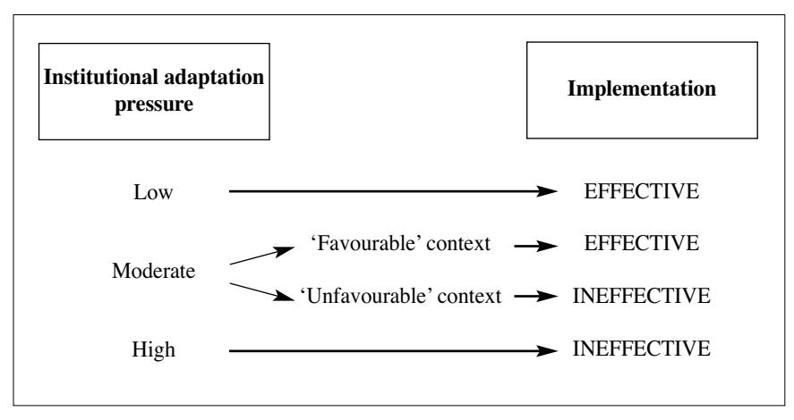

<!-- A2.R50 | source: papers_json/A2.R50/ -->

## **Implementation **

## Reader's guide

في الفصل الثاني قلنا إن السياسة العامة تهدف إلى حل مشكلة اجتماعية معينة وصلت إلى جدول الأعمال المؤسسي. وكقاعدة عامة، لا يمكن حل المشكلة التي أطلقت عملية صنع السياسة بفعالية إلا إذا وُضعت السياسة المعتمدة موضع التنفيذ بشكل سليم. فإذا أُدخلت سياسة معينة لكنها نُفِّذت بشكل غير كافٍ، فمن الممكن أن تكون النتيجة النهائية أقل مرغوبية من الحالة السابقة. ورغم أهمية هذا الجانب، ظل هناك لفترة طويلة افتراض (ضمني) بأنه بمجرد اعتماد سياسة ما، فسوف تُنفَّذ ثم تُنتج النتائج المرجوة. ويستند هذا التوقع إلى عدد من الشروط التي قد لا تتوفر في جميع الأنظمة السياسية. بل إن بحوث التنفيذ أثبتت أن وضع السياسات العامة موضع التطبيق ليس مهمة بسيطة على الإطلاق. والأهم من ذلك أن المصالح الخاصة للفاعلين من المرجح أن تؤثر في النتائج. وفي هذا الفصل، يكون التركيز الأساسي على ما يُسمى بسياسات "ما بعد القرار". وسنتناول تنفيذ السياسة العامة من زوايا تحليلية مختلفة، تشمل توضيح من هم الفاعلون الذين ينفذون السياسة العامة، وعرض المنظورات النظرية الرئيسية حول أنشطة التنفيذ (والتي يمكن أن تجمع بين منهجي "من أعلى إلى أسفل" و"من أسفل إلى أعلى"). ثم نقترح فئات لتقييم درجة إمكانية تنفيذ سياسة ما بفعالية، ونحدد العوامل التي قد تعيق هذا التنفيذ. وتشمل هذه العوامل الأخيرة أيضاً اعتبارات حول تصميم السياسات العامة، مما يبرز الترابط بين صنع القرار والتنفيذ.

<!-- page 2 -->

تنفيذ السياسة هو المرحلة في عملية صنع السياسة التي تُوضَع فيها السياسة موضع التنفيذ من قِبل الأجهزة البيروقراطية المسؤولة. إذن التنفيذ هو المرحلة في دورة السياسة التي يوجد فيها ارتباط بين صانعي السياسة والمخاطَبين بها، بوساطة المنفِّذين. وبعبارة أكثر تقنية، يتضمن التنفيذ تحويل مخرجات السياسة إلى نتائج السياسة. وتحقيق نتيجة السياسة المقصودة شرط ضروري لإحداث الأثر المرغوب للسياسة. غير أنه ينبغي أن يُؤخَذ بعين الاعتبار أن المنفِّذين لا يمكنهم التأثير مباشرة إلا في نتيجة السياسة وليس في أثرها، لأن هذا الأخير قد تتأثر به أيضاً عوامل إضافية. لذلك، فإن جميع الحجج المطروحة في هذا الفصل تتعلق فقط بعملية تحويل مخرجات السياسة إلى نتائجها، تاركة جانباً تماماً الاعتبارات المتعلقة بآثار السياسة.

ماذا يحدث لسياسة أو برنامج سياسي بعد إقراره رسمياً من قِبل الحكومة أو الهيئة التشريعية؟ كيف يتشكل النقل الرسمي والتطبيق العملي للتشريعات؟ وما المشكلات والانحرافات عن الأهداف الأولية التي يمكن ملاحظتها؟ للوهلة الأولى، قد يُفترَض أن أسئلة كهذه بسيطة نسبياً. فلماذا تظهر لاحقاً مشكلات في تنفيذ إجراء يبدو مُحكَم الصياغة وقُبل من قِبل مجلس الوزراء و/أو البرلمان؟ عملياً، تحدث بشكل روتيني مشكلات عديدة مع التنفيذ. وفي هذا الفصل سنُظهر أن دراسة التنفيذ متعددة الأوجه وتتطلب جهداً كبيراً من الناحيتين التجريبية والنظرية.

يتضمن تحليل تنفيذ السياسة دائماً حكماً بشأن نتائج السياسة المقصودة وتلك المحقَّقة فعلياً. لذلك، تقيّم معظم مناهج التنفيذ ما إذا كان هناك فرق بين النتائج المتوقعة والنتائج المحقَّقة. ويرتبط بذلك الافتراض الضمني غالباً بوجود "مشكلات تنفيذ"، أي أن السياسة لا يمكن وضعها موضع التطبيق كما قصد صانعو السياسة بسبب فشل المنفِّذين في تجاوز العقبات. ويشير Hogwood and Gunn (1984: 197) إلى مثل هذه الحالات باسم "عدم التنفيذ"؛ ويقدمان نوعاً ثانياً من مشكلات التنفيذ، أي "التنفيذ غير الناجح"، الذي يُعتبَر أنه يحدث عندما تفشل سياسة عامة في إنتاج النتيجة المقصودة رغم تنفيذها بشكل كامل. وبينما نشير في هذا الفصل فقط إلى مشكلات التنفيذ بمعنى عدم التنفيذ، فإن الفئة الثانية لدى Hogwood and Gunn توحي بأن دراسة تنفيذ السياسة ترتبط ارتباطاً وثيقاً ببحث التقييم. وبالفعل، اعتبر Pressman and Wildavsky (1973) تنفيذ السياسة "الحلقة المفقودة" بين صنع السياسة والتقييم.

<!-- page 3 -->

## Who is involved in policy implementation?

في معظم الأنظمة السياسية، يُنفَّذ تنفيذ السياسة بشكل أساسي من قِبل مستويات مختلفة من البيروقراطية. فعلى المستوى المركزي، توجد الوزارات الوطنية المختلفة (التعليم، الدفاع، التجارة، إلخ)، التي تشكل نواة السلطة التنفيذية. كما توجد على المستوى المركزي أيضاً وكالات مستقلة تقع خارج الوزارات مُكلَّفة بتنفيذ السياسة العامة. وقد أُنشئت هذه الوكالات بخبرة متخصصة للتعامل مع مجالات سياسة معقدة أو جديدة. لذلك، أسست حكومة الولايات المتحدة عام 1970 وكالة حماية البيئة، المسؤولة عن تنفيذ السياسة البيئية. وحذت دول عديدة، مثل أيرلندا أو المملكة المتحدة، حذو الولايات المتحدة وأنشأت وكالات كهذه.

يستند هذا الاتجاه الدولي لتفويض صلاحيات التنفيذ - وغالباً أيضاً صياغة السياسة - إلى وكالات مستقلة إلى افتراض أن ذلك سيُحسِّن أداء التنفيذ العام والكفاءة (Bouckaert and Peters 2004). ويرتبط هذا أيضاً بفكرة فصل السياسة عن الإدارة وعزل بعض القرارات عن الاعتبارات السياسية، الأمر الذي يُتوقَّع أن يُقلِّل الانحرافات عن النوايا الأصلية لصانعي السياسة ويمنع التأخير (انظر Pollitt and Talbot 2004؛ Pollitt *et al.* 2004). والوكالات التنظيمية هي مجموعة فرعية من هذه الوكالات المستقلة، وإحدى مهامها الرئيسية تنفيذ السياسة العامة في المجالات ذات الصلة بالسوق، مثل الكهرباء أو الاتصالات أو إمدادات المياه. وتمارس هذه الهيئات التنظيم باستخدام صلاحياتها ومواردها ومسؤولياتها المفوَّضة إليها (انظر Gilardi 2008).

بينما تلعب الوزارات المركزية والوكالات المستقلة دوراً مهماً في تنفيذ السياسة، تُنفَّذ السياسة الوطنية أيضاً من قِبل كيانات عامة على المستوى المحلي. وعادة ما تُنفَّذ سياسة التوظيف، وإلى حد ما السياسة الاجتماعية، من قِبل وكالات التوظيف المحلية. ففي ألمانيا، على سبيل المثال، لا تقتصر وكالات التوظيف على مساعدة الباحثين عن عمل في إيجاد صاحب عمل، بل هي مسؤولة أيضاً عن معالجة طلبات أنواع عديدة من المزايا الاجتماعية، بما فيها إعانات الأطفال، وإعانات بدء الأعمال والعمل بدوام جزئي، وإعانات البطالة، ومدفوعات الإعسار، وتوفير التدريب المهني والتدريب الإضافي، ودمج كبار السن وذوي الإعاقة في سوق العمل. وبالمثل، فإن مجالس الصحة المحلية العشرين في نيوزيلندا مسؤولة عن تنفيذ سياسة الصحة الوطنية من خلال تقديم أو تمويل تقديم خدمات الرعاية الصحية.

توجد أيضاً سياسات عامة تُنفَّذ من قِبل منظمات متعددة، قد تقع حتى في مستويات مختلفة من الحكومة. وفي حالة كهذه، يتضمن التنفيذ جهوداً تعاونية ويبرز العلاقات بين المؤسسات. وقد أشارت دراسات تجريبية حديثة إلى أن نسبة كبيرة من التشريعات تتطلب هياكل متعددة المؤسسات (انظر Hall and O'Toole 2000). وفي هذا السياق،

<!-- page 4 -->

جرى التشديد على دور الشبكات بين المؤسسات باعتبارها يمكن أن توفر وسيلة فعالة للتنسيق. وهذه الشبكات هياكل مستقرة نسبياً يعمل الأفراد والمنظمات من خلالها في حالات يعتمدون فيها على مساهمات الآخرين (Hanf and O'Toole 1992). وسياسة المخدرات مجال يتطلب عادة جهوداً تعاونية من وزارات ووكالات مختلفة لتنفيذه بشكل سليم بسبب طابعه الشامل لعدة قطاعات، والذي قد يشمل وزارة الصحة والمكاتب الصحية المحلية إضافة إلى وزارات و/أو وكالات أخرى تعمل في مجالات التعليم والمالية والاقتصاد والتجارة والشؤون الخارجية والعدالة الجنائية.

اعتماداً على السياسة المحددة المراد تنفيذها، يمكن أن يكون للأجهزة البيروقراطية درجة أكبر أو أقل من السلطة التقديرية في القرار. فعلى سبيل المثال، في حالة إعانات البطالة، تُحدَّد شروط معينة للأهلية، ومستويات الإعانات، ومدة دفعها. لذلك، تتضمن معظم القرارات البيروقراطية بشأن تنفيذ هذه الإعانات تطبيق الشروط المحددة في التشريع على وقائع الحالة المطروحة. غير أن الأجهزة البيروقراطية قد يكون لديها مساحة أكبر في تفسير مخرجات السياسة إذا اتسمت هذه بمحتويات أو أهداف غامضة. ومن الأمثلة على هدف سياسة يصعب تحديده تحقيق التنمية المستدامة، وهو مفهوم واسع جداً يشمل بُعداً بيئياً واجتماعياً واقتصادياً. وفي حالات كهذه، يمكن للجهاز البيروقراطي بالتأكيد أن يشكِّل السياسة العامة من خلال تقديم تعريف إجرائي لأهداف السياسة الغامضة. وكما سنوضح لاحقاً في هذا الفصل، فإن مخرجات السياسة التي تتسم بالغموض وعدم الاتساق والتعقيد لديها فرص أكبر لأن تُنفَّذ بشكل غير متسق.

بشكل عام، تنفيذ السياسة أبعد ما يكون عن نشاط بسيط. فهو يشمل فاعلين متعددين يقعون في كيانات عامة مختلفة قد تكون لديهم أو لا تكون لديهم نفس التفضيلات بشأن الطريقة التي ينبغي أن تُنفَّذ بها سياسة معينة. وهكذا، عند النظر في كيفية إجراء التنفيذ، ليس من المستغرب أن تركز معظم الدراسات على الانحرافات عن التشريع. غير أنه، كما سنوضح في القسم التالي، لا يُنظَر دائماً إلى هذه الانحرافات باعتبارها إشكالية.

## Key points

- ☐ يُنفَّذ تنفيذ السياسة في المقام الأول من قِبل فاعلين بيروقراطيين.
- ☐ يمكن أن يكون هؤلاء وزارات أو وكالات مستقلة تقع على المستوى المركزي أو المحلي.
- ☐ يوجد اتجاه دولي لتحويل صلاحيات التنفيذ إلى وكالات مستقلة، مدفوعاً بفكرة أن بإمكانها إنجاز هذه المهام بطرق أكثر كفاءة.

<!-- page 5 -->

## Analytical perspectives in implementation research

على المستوى الأساسي، يتعلق التنفيذ بوضع سياسة عامة جديدة موضع التطبيق. ورغم أن هذا التعريف يبدو بسيطاً للوهلة الأولى، فإن التحليل التجريبي معقد لأنه يشمل أفعالاً متنوعة من قِبل فاعلين عامين وخاصين موجَّهة نحو تحقيق أهداف معينة محدَّدة من حيث مخرجاتها السياسية (Van Meter and Van Horn 1975: 447). ولتوضيح هذه النقطة، لنفترض أن حكومة اعتمدت سياسة تتطلب وضع بطاقات بيانات على المنتجات الغذائية بطريقة شفافة وسهلة الفهم من أجل زيادة ثقة المستهلك (أي هدف السياسة). وقد لا تلتزم صناعة الأغذية (أي الفئة المستهدفة) بالمتطلبات ما لم تخضع منتجاتها للتدقيق من قِبل الجهة الإدارية المسؤولة (مثل هيئة معايير الأغذية). وهكذا، لتحقيق نتيجة السياسة المقصودة، يجب مراقبة الالتزام بالسياسة ذات الصلة. غير أنه يمكن للسياسة، من حيث المبدأ، أن تطالب أيضاً بإنشاء موقع إلكتروني محدد يمكن للمستهلكين من خلاله تقديم شكاوى بشأن المنتجات الغذائية غير الموسومة بشكل كافٍ. ومرة أخرى، ستكون الفئة المستهدفة من السياسة هي صناعة الأغذية، ونتيجة السياسة هي تعديل بطاقات بيانات المنتج. لكن هذه المرة، سيتضمن نشاط المنفِّذين إنشاء وصيانة الموقع الإلكتروني المطلوب. يمكن تقديم أمثلة أكثر بكثير هنا، لكن المهم أنه لا توجد طريقة واحدة فقط لتنفيذ مخرجات السياسة، وغالباً ما يتطلب التنفيذ إجراءات متعددة، مما يزيد من تعقيد التحليل.

ينعكس تنوع الأنشطة في المنظورات النظرية المعتمَدة لوصف تنفيذ السياسة وتفسيره. ويتميز المنهج التقليدي بمنظور من أعلى إلى أسفل، يركز على مخرجات السياسة ويبحث في مدى تحقيق الأهداف المقصودة عبر الزمن وأسباب ذلك. وفي أواخر السبعينيات وأوائل الثمانينيات، ظهر منظور من أسفل إلى أعلى. ويحلل هذا المنظور تعدد الفاعلين الذين يتفاعلون على المستوى التشغيلي لقضية سياسة معينة. وعادة ما تشدد نماذج من أسفل إلى أعلى على الترابط القوي بين مراحل صياغة السياسة وتنفيذها وإعادة صياغتها (Sabatier 1986: 22). وفي الآونة الأخيرة، طُرحت نماذج هجينة للتنفيذ، تسعى إلى تجاوز الانقسام بين المنهجين الآخرين من خلال دمج عناصر من نماذج من أعلى إلى أسفل ومن أسفل إلى أعلى ونماذج نظرية أخرى (Pülzl and Treib 2007: 90). وفي هذا القسم، نعرض الخصائص الرئيسية لهذه المناهج الثلاثة.

## Top-down models of policy implementation

في دراستهما الرائدة عن تنفيذ السياسة، أظهر Pressman and Wildavsky (1973) أن انحرافات وتحولات كبيرة في أهداف السياسة

<!-- page 6 -->

يمكن أن تحدث خلال مرحلة التنفيذ. ويلخص العنوان الفرعي لكتابهما بإيجاز النتيجة المركزية للتحليل: "كيف تتبدد التوقعات الكبيرة في واشنطن في أوكلاند؛ أو، لماذا من المدهش أن تعمل البرامج الفيدرالية على الإطلاق". ووفقاً للمؤلفَين، من المرجح حدوث انحرافات في أهداف السياسة إذا اعتمد الفعل على عدد من الفاعلين المطلوب منهم التعاون. ومن هنا، كلما طالت سلسلة التنفيذ وزاد عدد الفاعلين المشاركين في العملية، أصبح التنفيذ أصعب.

يتوافق منهج Pressman and Wildavsky مع نظريات الاختيار العقلاني إذ يتصوران التنفيذ كفعل هادف من قِبل مجموعات مختلفة من الفاعلين ذوي التفضيلات المختلفة. وبما أن نجاح التنفيذ يعتمد على تعاون الفاعلين، فهناك احتمال مرتفع نسبياً لحدوث مشكلات، مما يعني عدم تطابق بين أهداف السياسة المقصودة والنتائج الفعلية. وبهذه الصياغة، يمكن تحليل التنفيذ بواسطة نظرية الألعاب، كما هو موضح في الفصل الرابع. لذا يمكن تصميم التنفيذ كلعبة "لمرة واحدة" أو لعبة متكررة (انظر أيضاً Bardach 1977). والاستدلال حول أهمية عدد الفاعلين المشاركين في عملية التنفيذ، أي طول سلسلة التنفيذ، يشبه الحجة الكامنة وراء نظريات نقاط الفيتو وفاعلي الفيتو المعروضة في الفصل السادس. وفي كلتا الحالتين، أي أثناء صنع القرار والتنفيذ، يمكن أن يؤدي عدد أكبر من الفاعلين إلى نزاع حول أهداف السياسة إضافة إلى تأخيرات وانحرافات عما قصده صانعو السياسة أصلاً.

ترتبط النتيجة المركزية لـ Pressman and Wildavsky، وهي أن التحولات في أهداف السياسة يمكن ملاحظتها بشكل متكرر خلال مرحلة التنفيذ، ارتباطاً وثيقاً بمنهج من أعلى إلى أسفل (انظر Smith 1973؛ Van Meter and Van Horn 1975؛ Hood 1976؛ Sabatier and Mazmanian 1980؛ Mazmanian and Sabatier 1983؛ Hogwood and Gunn 1984؛ Sabatier 1986). والأهم من ذلك أن هذا المنظور يميز بوضوح بين مرحلتي صياغة السياسة والتنفيذ (Hill 2009: 196). وعلى هذا الأساس فقط تصبح مقارنة فعلية بين متطلبات السياسة ودرجة تنفيذها الفعلي ممكنة. وتُستخدَم درجة تحقيق الهدف مؤشراً على نجاح التنفيذ؛ ويتوافق التنفيذ الفعال مع تطابق بين أهداف السياسة ونتائجها. فإذا كان هدف التشريع الوطني، على سبيل المثال، تحديد معيار معين لانبعاثات الهواء الصناعية، يتحقق التنفيذ الفعال بمجرد أن تلتزم الصناعة بمستويات الانبعاثات المحدَّدة. وبالمثل، يتطلب التنفيذ الفعال لحظر التدخين في المباني العامة اتخاذ السلطات في هذه المباني خطوات مناسبة للتأكد من عدم قيام أحد بالتدخين بداخلها. ويمكن تحقيق ذلك من خلال لافتات منع التدخين، وإزالة المنافض، والمراقبة، والإعلان عن العقوبات.

<!-- page 7 -->

في هذا السياق، طرح Van Meter and Van Horn (1975) نموذجاً يجمعان فيه بين خصائص السياسة المراد تنفيذها، والخصائص المؤسسية لوكالات التنفيذ، وكيفية ارتباطها بمنظمات أخرى ذات صلة، والعوامل السياقية (بما فيها البيئة الاقتصادية والاجتماعية والسياسية)، واستجابة المنفِّذين لكل هذه العوامل. واستناداً إلى هذا النموذج، يفترض المؤلفان أن التنفيذ سيكون أكثر نجاحاً عندما تتطلب مخرجات السياسة تغييرات هامشية فقط مقارنة بالوضع الراهن، وعندما يكون توافق الآراء حول الهدف بين الفاعلين العامين والخاصين المعنيين مرتفعاً.

يتضح منطق منظور من أعلى إلى أسفل أيضاً بشكل جيد من خلال النموذج ذي الخطوات الأربع الذي اقترحه Sabatier and Mazmanian (1980). فالنموذج يتناول أولاً مدى اتساق أفعال المسؤولين المنفِّذين والفئات المستهدفة مع الأهداف والإجراءات الموضحة في سياسة عامة. ثم يركزان على مدى تحقيق الأهداف عبر الزمن. ثالثاً، يقيّمان العوامل الرئيسية المؤثرة في نتائج السياسة. وأخيراً، يقترحان تحليل ما إذا كانت السياسة قد أُعيدت صياغتها بناءً على التجربة وكيفية ذلك. ورغم أن الخصائص الرئيسية لتقييم السياسة لن تُعرَض إلا في الفصل الثامن، فمن الواضح أن المنظور التحليلي الذي طرحه Sabatier and Mazmanian "تقييمي" في طابعه (انظر Laws and Hajer 2008: 411)، خاصة عند النظر إلى الخطوة الرابعة التي تشير إلى عملية تغذية راجعة (Hill and Hupe 2009: 49). وتصح هذه الملاحظة بشكل أعم بالنسبة لمختلف نماذج من أعلى إلى أسفل، إذ تقارن جميعها بين النتائج الفعلية والمتوقعة للسياسة من أجل تقييم درجة توافقها.

ورغم أن منظور من أعلى إلى أسفل أنتج رؤى مثيرة للاهتمام حول عمليات التنفيذ، فقد قوبل أيضاً بثلاث مجموعات من الانتقادات (Matland 1995: 147-8). أولاً، يتخذ هذا المنظور مخرجات السياسة نقطة انطلاق للتحليل ويتجاهل الأفعال التي اتُّخذت في وقت سابق من العملية، خاصة أثناء صياغة السياسة. ثانياً، تميل نماذج من أعلى إلى أسفل إلى النظر إلى التنفيذ كعملية إدارية بحتة تتجاهل الجوانب السياسية. غير أنه، كما نوقش من قبل في الفصل الرابع، قد لا يكون الفاعلون البيروقراطيون "فيبريين" في طبيعتهم ولا يتخذون دائماً قرارات مستقلة استناداً إلى معايير تقنية، بل قد يسعون أيضاً وراء مصالحهم الخاصة وفقاً للحجة التي طرحها Niskanen (1971) ومنظرون آخرون في الخيار العام (للاطلاع على نظرة عامة، انظر Mueller 2003). ثالثاً، انتُقدت نماذج من أعلى إلى أسفل لعدم أخذها بعين الاعتبار الفاعلين المحليين والظروف الخاصة بتنفيذ السياسة على "مستوى الشارع". وقد مهدت نقاط الانتقاد هذه الطريق أمام نماذج من أسفل إلى أعلى لتنفيذ السياسة.

<!-- page 8 -->

## Bottom-up models of policy implementation

تنظر نماذج من أسفل إلى أعلى إلى التنفيذ الفعال بطريقة موجَّهة نحو العملية تتخلى عن الفصل بين صياغة السياسة وتنفيذها (انظر Berman 1978؛ Lipsky 1980؛ Hjern and Porter 1981؛ Hjern 1982؛ Hjern and Hull 1982). ولم تعد أهداف وأدوات السياسة تُعرَّف كمعايير مرجعية يجب الوصول إليها؛ بل يُتوقَّع أن تخضع لتعديلات أثناء عملية التنفيذ. ولدى المنفِّذين مرونة واستقلالية لتعديل السياسة في ضوء المتطلبات المحلية الخاصة والتغيرات في تصور أو تشكيل مشكلات السياسة، إضافة إلى الأدلة العلمية الجديدة حول العلاقات السببية بين الوسائل والغايات. ومن هنا، لا يُقاس التنفيذ الفعال بتحقيق هدف معين محدَّد مركزياً، بل يُحكَم عليه من خلال مدى تطابق النتائج المتصوَّرة مع تفضيلات الفاعلين المعنيين. والسؤال الحاسم لتقييم نجاح التنفيذ هو إلى أي مدى سمحت سياسة معينة بعمليات التعلم وبناء القدرات وبناء الدعم من أجل معالجة المشكلات المرتبطة بها بطريقة لامركزية، تتوافق مع مصالح الفاعلين المعنيين (انظر Wilson 1989؛ Schneider and Ingram 1997).

من المهم ملاحظة أن تنفيذ السياسة يحدث على مستويين. أولاً، هناك مستوى التنفيذ الكلي الذي يضم الفاعلين المركزيين الذين يصممون مخرج السياسة. ثانياً، يستجيب الفاعلون المحليون على مستوى التنفيذ الجزئي للسياسات على المستوى الكلي ويطورون برامجهم الخاصة وينفذونها. ووفقاً لـ Berman، تنبع مشكلات التنفيذ من كون مستوى التنفيذ الكلي لا يمكنه التأثير في المنفِّذين على المستوى الجزئي، مما يؤدي إلى تباين في كيفية تنفيذ السياسة الوطنية نفسها على المستوى المحلي (Matland 1995: 148). ويتوافق هذا مع منطق مشكلة الأصيل-الوكيل التي أوضحناها في الفصل السادس: قد يميل الوكيل (هنا، المنفِّذون المحليون) إلى الانحراف عن الأصيل (هنا، الفاعلون المركزيون). وسنعود إلى هذه النقطة لاحقاً في هذا الفصل، إذ تمثل مشكلات الوكالة مصدراً مهماً للتنفيذ غير الكامل.

وفي هذا الصدد، يرى Lipsky (1980) أن احتمالية انحراف المنفِّذين المحليين أو البيروقراطيين على مستوى الشارع عن أهداف السياسة المحدَّدة مركزياً تنبع من الضغوط المفروضة عليهم وكيفية تعاملهم معها. فهم يطورون طرقاً لتقديم خدمة بشكل روتيني نسبياً. ويخضع هؤلاء المنفِّذون المحليون لضغط البيروقراطية التي يعملون في إطارها، ومع ذلك يمتلكون حرية تقديرية واستقلالية. وفي ضوء هذه الخلفية، يتخذ بيروقراطيو مستوى الشارع خيارات بشأن استخدام الموارد الشحيحة تحت الضغط. لذا، فإن زيادة مراقبة المنفِّذين المحليين لن تقلل من احتمالية التنفيذ غير الكامل بل ستزيد من الميل إلى تقديم خدمات روتينية وتباينات على المستوى المحلي، إذ قد تختلف الروتينات

<!-- page 9 -->

من وحدة محلية إلى أخرى (انظر Hill and Hupe 2009: 52–3). لذلك، يقترح Hjern and Porter (1981)، وHjern (1982)، وHjern and Hull (1982) أن دراسات من أسفل إلى أعلى للتنفيذ ستكون ذات فائدة خاصة إذا ركزت على المنفِّذين على المستوى الجزئي وأهدافهم وتفضيلاتهم إضافة إلى القيود التي يواجهونها.

يتحدى هذا التصور الافتراضات المبسِّطة لمنظور من أعلى إلى أسفل ويحاول أخذ تعقيد عمليات التنفيذ بعين الاعتبار. وهكذا، يُشدَّد على أن صياغة أهداف واضحة كثيراً ما تتعارض مع مصالح السياسيين الذين يفضلون أهدافاً غامضة ومبهمة لتسهيل تقييم إيجابي لاحقاً وجعل اكتشاف الإخفاقات المحتملة أصعب. بالإضافة إلى ذلك، يأخذ منظور من أسفل إلى أعلى بعين الاعتبار حقيقة أن عمليات التنفيذ نادراً ما تتسم بتحديد واضح للصلاحيات بين الفاعلين السياسيين والإداريين المعنيين على مستويات مؤسسية مختلفة. ومن هنا، يستند التنفيذ بشكل أقل إلى متطلبات محدَّدة ومراقَبة هرمياً، بل يمكن فهمه كمساومة بين عدد كبير من الفاعلين العامين والخاصين والوكالات الإدارية المشاركة في عملية التنفيذ.

يطرح التصوير الدقيق لتعقيدات عملية التنفيذ الكامنة في منهج من أسفل إلى أعلى أيضاً مشكلات فيما يتعلق بقياس النجاح. وبما أن التنفيذ الفعال لا يُقاس على أساس مقارنة بين الأهداف الأولية والإنجازات الفعلية، بل من حيث مدى تحقيق الأهداف مع أخذ الظروف المحددة "على أرض الواقع" بعين الاعتبار، فإن التقييمات العامة والمقارِنة للفعالية صعبة (Knill and Lenschow 2000). بالإضافة إلى ذلك، هناك انتقادان آخران يُطرحان بشكل متكرر لنماذج من أسفل إلى أعلى (Matland 1995: 149–50). أولاً، هناك الانتقاد المعياري بأنه في الأنظمة الديمقراطية، ينبغي أن يخضع المنفِّذون المحليون لرقابة مركزية. ثانياً، تميل نماذج من أسفل إلى أعلى إلى المبالغة في التركيز على مستوى الاستقلالية المحلية، إذ غالباً ما تكون السياسة نفسها هي التي تحدد كيفية تنفيذها.

## Hybrid models of policy implementation

في ضوء المشكلات الخاصة بكل من نماذج من أعلى إلى أسفل ومن أسفل إلى أعلى، تزايدت الجهود لدمج المنظورين وإثرائهما بمناهج نظرية إضافية (انظر Mayntz 1979؛ Windhoff-Héritier 1980؛ Elmore 1985؛ Sabatier 1986؛ Matland 1995؛ Winter 2003؛ O'Toole 2003). وكقاعدة عامة، تسعى النماذج الهجينة إلى دمج "العالم الكلي" لصانعي السياسة مع "العالم الجزئي" للمنفِّذين (McLaughlin, 1987: 177). وإحدى الإمكانيات هي دمج المنهجين في نموذج واحد (انظر Goggin *et al.* 1990؛ Winter 2003). ويحدد مؤلفون آخرون (انظر Sabatier 1986؛ Matland 1995) شروطاً

<!-- page 10 -->

نطاق إضافية تجعل في تشكيلة معينة منهجاً مميزاً أكثر أو أقل جدوى أو ملاءمة تحليلياً. وتشمل هذه الشروط غموض الأهداف السياسية، ومستوى النزاع السياسي المحيط بقرار سياسي، وتعقيد شبكات السياسة، وقدرة الحكومة (انظر Linder and Peters 1989؛ Knill and Lenschow 2000؛ Pülzl and Treib 2007).

من المفيد بشكل خاص النموذج الهجين لتنفيذ السياسة الذي طرحه Matland (1995)، والذي يحلل مستويات الغموض والنزاع في السياسات لتحديد ما إذا كان منهج من أعلى إلى أسفل أو من أسفل إلى أعلى أكثر ملاءمة لتفسير عملية تنفيذ معينة. ويشير غموض السياسة إلى نقص الوضوح في الأهداف و/أو وسائل تحقيقها. أما نزاع السياسة فهو الفرق بين النتيجة الأكثر تفضيلاً لدى وكالة التنفيذ والمخرج الذي يتعين على الوكالة تنفيذه. ويؤدي تصور هذين البعدين كمرتفعَين أو منخفضَين إلى أربع عمليات تنفيذ نموذجية: إدارية، وسياسية، وتجريبية، ورمزية.

يتضمن التنفيذ الإداري غموضاً منخفضاً للسياسة ونزاعاً منخفضاً حولها. وتُحدَّد نتائج السياسة بالموارد، وتُقارَن العملية بآلة، وهي السلطة المركزية لصنع السياسة. وبشكل عام، يتوافق التنفيذ الإداري مع النموذج من أعلى إلى أسفل.

يتضمن التنفيذ السياسي غموضاً منخفضاً للسياسة ونزاعاً مرتفعاً حولها. وفي مثل هذه التشكيلات، تكون لدى الفاعلين أهداف محددة بوضوح، رغم وجود خلاف عندما تكون غير متوافقة أو يحدث نزاع حول وسائل تحقيقها. لذلك، تُحدَّد نتائج السياسة بالقوة أو المساومة، مما يشير بوضوح إلى منطق من أعلى إلى أسفل الكامن وراء عملية التنفيذ هذه.

تبنى عمليتا التنفيذ المتبقيتان على منهج من أسفل إلى أعلى. ويشير التنفيذ التجريبي إلى حالة من غموض مرتفع للسياسة ونزاع منخفض حولها. وبحسب هذا النموذج، تعتمد نتائج السياسة على الموارد والفاعلين الموجودين على مستوى التنفيذ الجزئي، والتي من المرجح أن تتفاوت من سياق إلى آخر. وبما أن عملية التنفيذ هذه تشدد على أهمية الظروف السياقية ودور الصدفة، فإنها تشابه نموذج سلة المهملات (Cohen *et al.* 1972) ومنهج المسارات المتعددة (Kingdon 2003). ويترتب على ذلك أن نتائج السياسة يصعب التنبؤ بها.

يتضمن التنفيذ الرمزي حالة يكون فيها غموض السياسة مرتفعاً ونزاعها مرتفعاً أيضاً. والمبدأ المركزي هو وجود ائتلافات من الفاعلين على المستوى المحلي تتحكم في الموارد المتاحة. غير أن قوة ائتلافات الفاعلين المختلفة تتحدد أيضاً بالظروف السياقية. ومن المرجح أن تستند تفضيلات مجموعات الفاعلين إلى تدريبهم المهني. وبين المجموعات المدرَّبة بطرق مختلفة، سيكون هناك خلاف حول مقترحات تنفيذ السياسة، مما يؤدي إلى معارك طويلة وتأخيرات كبيرة في تحقيق النتائج.

<!-- page 11 -->

## Key points

- ☐ There are three types of implementation models: top-down, bottom-up and hybrid.
- ☐ Top-down models primarily emphasize the ability of policy-makers to produce specific policy outcomes; most are characterized by an 'evaluative' strategy for analysis.
- ☐ Bottom-up models stress the characteristics of the actors implementing policy outputs; (local) implementers make ongoing choices themselves about the appropriate courses of action in specific contexts.
- Hybrid models integrate elements of both the above models and other theoretical models.

## Implementation success: criteria and determinants

في هذا القسم نوضح أولاً كيف يمكن تقييم فعالية التنفيذ تجريبياً. والمعايير التي نقترحها تهدف إلى تقديم فهم أفضل للأنشطة المختلفة المرتبطة بتنفيذ السياسة. ثم نقدم بعض التفسيرات للتباينات المحتملة في فعالية التنفيذ.

## Criteria of implementation success

لا يتأثر تقييم التنفيذ بالمنظور التحليلي المعتمَد فقط، بل أيضاً بالمعايير المطبَّقة (لقياس النجاح أو الكمال). واستناداً إلى منطق نماذج من أعلى إلى أسفل، نقترح التمييز بين النقل الرسمي والتطبيق العملي (انظر Knill and Lenschow 1998؛ Weale *et al.* 2000؛ Winter 2003؛ Knill 2006؛ Hartlapp and Falkner 2009؛ Robichau and Lynn 2009). ورغم وجود بعض نقاط النقد الصالحة بشأن منطق من أعلى إلى أسفل الذي أوضحناه أعلاه، فهو بوضوح أكثر ملاءمة لتوفير قياس للتنفيذ.

يركز النقل الرسمي على مجمل الأحكام المحددة لسياسة عامة معينة ودمجها في النظام القانوني والإداري القائم. وفي هذا الصدد، على البيروقراطيين ضمان أن يتم ذلك بشكل كامل وضمن الإطار الزمني المحدَّد بموجب النص القانوني الذي اعتُمدت السياسة بموجبه. وبعبارة أخرى، تتعلق هذه المرحلة بالخطوات الضرورية لجعل السياسة "قابلة للتنفيذ" بحيث يمكن وضعها موضع التطبيق فعلياً. وفي بعض الأنظمة السياسية، يعتمد صانعو السياسة

<!-- page 12 -->

قوانين مفصَّلة ومحددة، بينما يعتمدون في أنظمة أخرى قوانين عامة وغامضة تترك للبيروقراطيين سلطة تقديرية كبيرة لملء تفاصيل السياسة (Huber and Shipan 2002).

ورغم أن النقل الرسمي غير إشكالي في معظمه، فإنه قد يكون أحياناً مهمة صعبة. وينطبق هذا بشكل خاص على الدول الفيدرالية عندما يتطلب تنفيذ سياسة فيدرالية جديدة أن تُجري الوحدات المكوِّنة تعديلات على ترتيباتها السياسية الخاصة (انظر Haider-Markel 1998؛ Huque and Watton 2010). ويمكن أن يكون النقل الرسمي صعباً أيضاً عندما يرتبط باتفاقيات دولية، مثل اتفاقية الأمم المتحدة الإطارية بشأن تغير المناخ، أو القانون فوق الوطني. والنقل الرسمي صعب بشكل خاص في سياق الاتحاد الأوروبي. وقد شرحنا في الفصل الثالث أن الاتحاد الأوروبي يمثل واحدة من المنظمات القليلة التي تسن سياسات فوق وطنية يجب على دوله الأعضاء نقلها. ورغم أننا سنناقش دور الاتحاد الأوروبي في صنع السياسة عبر الحدود الوطنية بالتفصيل في الفصل العاشر، نود هنا أن نشير إلى وجود أدبيات كبيرة تعترف بأن نقل سياسات الاتحاد الأوروبي من قِبل الدول الأعضاء يتسم بأوجه قصور مستمرة (انظر Knill and Lenschow 1998؛ Weale et al. 2000؛ Knill 2001, 2006؛ Falkner et al. 2005؛ Steunenberg and Toshkov 2009؛ Thomson 2009).

يتوافق التطبيق العملي مع الوضع الفعلي للسياسة موضع التنفيذ. واعتماداً على محتوى السياسة، يشمل التطبيق العملي أنشطة مختلفة. فقد يشير إلى تقديم الخدمات المحددة بموجب التشريع، مثل المزايا الاجتماعية التي تُمنَح لمن يستحقونها. وبالمثل، فإن التقديم الفعلي للتعليم أو الرعاية الصحية أو البنية التحتية أو تكافؤ الفرص لمتقدمي طلبات العمل هو نتيجة التطبيق العملي للسياسات العامة المقابلة. غير أن هذا البُعد ليس الجانب الوحيد للتطبيق العملي.

في معظم الحالات، يستلزم تنفيذ سياسة ما أن يعدِّل المخاطَبون بالسياسة سلوكهم بطرق تتوافق تماماً مع الالتزامات النابعة من سياسة عامة. وستكون النتيجة المثالية للتطبيق العملي هي أن تُظهر المنظمات والأفراد المستهدفون بالتشريع طوعاً السلوك المطابق للتشريع المعني، أي أنهم يلتزمون به. غير أنه، بما أن عدم الالتزام قد يحدث، تكون هناك حاجة إلى إجراءات لإنفاذ السياسة.

توجد مجموعة واسعة من التدابير غير القسرية لتحقيق الالتزام. فيمكن للحكومات، على سبيل المثال، توجيه نداءات إلى المخاطَبين بالسياسة للالتزام من خلال التأكيد على منافع السياسة المعنية. وبالمثل، يمكن للمنفِّذين تقديم معلومات حول سياسة ما. وبشكل أعم، فإن تصور المخاطَبين بالسياسة لمشروعيتها هو ما يحدد الالتزام. وبالتالي، كقاعدة عامة، من المرجح أن يكون الالتزام أعلى عندما يُنظَر إلى عدم الالتزام على نطاق واسع باعتباره غير مقبول اجتماعياً. غير أنه في معظم الحالات، وخاصة عند استخدام سياسات

<!-- page 13 -->

من نوع الأمر والسيطرة، يتضمن التطبيق العملي أنشطة مراقبة وإنفاذ.

تتعلق المراقبة بالإشراف وزيادة الشفافية وجمع المعلومات حول مدى التزام الفئة المستهدفة فعلياً بمتطلبات سياسة عامة معينة. ويمكن تحقيق ذلك بطرق مختلفة عديدة، مثل طلب تقارير الالتزام أو إجراء عمليات تفتيش ميدانية معلَنة أو غير معلَنة. ومن أنشطة المراقبة الواسعة الانتشار، على سبيل المثال، ضبط السرعة على الطرق السريعة أو مراقبة تركيز الكحول في دم السائقين. وإذا كشفت هذه الأنشطة عن عدم التزام، فإن الخطوة التالية هي الإنفاذ لضمان توقف عدم الالتزام واتخاذ إجراءات علاجية. وتشمل صلاحيات الإنفاذ المتاحة للمنفِّذين إشعارات الحظر، وتعليق التراخيص التشغيلية، وأوامر الامتناع، وإجراء أعمال علاجية. فعلى سبيل المثال، قد يُعاقَب سائق يتجاوز حدود السرعة على الطريق أو يُضبَط وهو يقود تحت تأثير الكحول بغرامة أو بفقدان رخصة القيادة مؤقتاً أو حتى دائماً (انظر الجدول 7.1).

ولتقييم نجاح التنفيذ بفعالية، يمكن استخدام أي من هذين البُعدين. وفيما يتعلق بالرؤى التحليلية، فإن التركيز على النقل الرسمي واعد بشكل خاص للسياسات الشاملة لعدة قطاعات والتي تتطلب جهوداً تعاونية من منظمات مختلفة عديدة، وقد يقدم رؤى مثيرة للاهتمام في الدول الفيدرالية. وفيما يتعلق بالتطبيق العملي، فإن دراسة هذا البُعد تمنح بالتأكيد فهماً أفضل للجوانب الجوهرية الأكثر للسياسة العامة والتي تتجاوز ما هو مكتوب في نص القانون، رغم أنه أكثر تعقيداً في التقييم بسبب أنواع الأنشطة المتنوعة المرتبطة به. لذلك، من المرجح أن تولِّد الدراسات التجريبية رؤى مهمة إذا

<!-- page 14 -->

ركزت على جوانب محددة من التطبيق العملي، أي إما على مدى جودة تقديم المنفِّذين لخدمة معينة، أو الوسائل التي يسعون من خلالها إلى دفع الفئة المستهدفة لتغيير سلوكها.

## Determinants of implementation success

ننتقل الآن إلى أهم العوامل التي تفسر التباين في فعالية التنفيذ، بدءاً بتلك العوامل المتعلقة بخصائص مخرجات السياسة، ثم الانتقال إلى العوامل المؤسسية واستراتيجيات زيادة القبول الاجتماعي لها.

## Choice of policy instruments

يتمحور نقاش نظري مهم حول ما إذا كان اختيار أدوات السياسة يُحدث فرقاً فيما يتعلق بالتنفيذ الفعال (Mayntz 1979؛ Bressers and Klok 1988؛ Linder and Peters 1989؛ Howlett 1991؛ Knill and Lenschow 2000؛ May 2003). ولتوضيح هذه الحجة، نعرض نموذج تفضيلات الأدوات الذي طرحه Howlett *et al.* (2009: 173–5). والافتراض الكامن وراء النموذج هو أن بعض أدوات السياسة أكثر ملاءمة من غيرها لإحداث النتائج المقصودة للسياسة لأنها أسهل في التنفيذ.

ووفقاً لـ Howlett et al.، تعتمد ملاءمة اختيار أدوات السياسة على بُعدين: تعقيد بيئة السياسة، المعروفة أيضاً بـ"النظام الفرعي للسياسة"، وقدرة الدولة على إحداث تغييرات في ضوء القيود المؤسسية. والحكومات ذات القدرة العالية على مواجهة بيئات سياسة معقدة قادرة على استخدام أدوات توجيهية، بما فيها تدابير مثل إعادة تنظيم حكومي من أجل إنشاء أو تعديل الأنظمة الفرعية للسياسة. وتشير التشكيلة التالية إلى حكومات عالية القدرة تواجه بيئات سياسة بسيطة؛ ويمكن لهذه أن تحقق تنفيذاً فعالاً باستخدام أدوات ذات سلطة، تشمل إنشاء لجان تنظيمية مستقلة متخصصة أو لجان استشارية، تساعد على تنمية أفكار تفضِّل الالتزام بالسياسة العامة. وفي المقابل، يمكن للحكومات ذات القدرة المنخفضة على التعامل مع بيئات سياسة معقدة أن تعتمد على أدوات الدعم مثل المنح أو مخططات التمويل المحددة لدفع المخاطَبين بالسياسة إلى الالتزام بأحكامها. غير أنه عندما تواجه الحكومات منخفضة القدرة بيئات سياسة بسيطة، يمكنها استخدام أدوات إعلامية، مثل الحملات أو الكشف عن المعلومات، لدفع الالتزام (انظر الجدول 7.2).

والنتيجة المنطقية لهذا النموذج هي أن مشكلات التنفيذ تنبع من اختيار "الأداة الخاطئة" من قِبل صانعي السياسة المقيَّدين بقدرة الحكومات وخصائص بيئة السياسة. ويترتب على ذلك أن الحكومة التي تفشل في التقييم الصحيح لقدرتها أو خصائص

<!-- page 15 -->

*Complexity policy environment

High Low

Capacity of the state | High Low

Directive instruments Subsidy instruments Informative instruments

Source: Adapted from Howlett et al. (2009: 175).*

*Table 7.2 Instrument choices in the light of capacity and subsystem characteristics*

النظام الفرعي للسياسة من المرجح أن تواجه مشكلات في تحقيق الالتزام.

## Precision and clarity of policy design

التفسير الثاني المتعلق بالسياسة لمشكلات التنفيذ يتعلق بصياغة سياسة قاصرة. ويمكن أن تكون مشكلات تصميم السياسة هذه أولاً نتيجة أهداف ومتطلبات سياسة غامضة ومبهمة. فعلى سبيل المثال، سنَّت ولاية مونتانا الأمريكية عام 2004 قانوناً لتقنين الماريجوانا الطبية، لكنه صيغ بشكل غامض جداً بحيث يتعذر إنفاذه (Hausen 2010).

وغالباً ما لا يكون اعتماد سياسة ممكناً على الإطلاق إلا استناداً إلى صياغات غير دقيقة كهذه. وتُفضِّل درجات عالية من النزاع التوزيعي والتسييس سياقاً تفاوضياً يهيمن عليه التفاوض وليس حل المشكلات، أي أن الفاعلين المعنيين مهتمون أساساً بالخسائر والمكاسب المحتملة أكثر من تحليل أعمق لمدى وجود علاقة سببية سليمة فعلياً بين أهداف السياسة والأدوات المقترحة. ونتيجة لذلك، قد تؤدي النزاعات التوزيعية إلى صياغة سياسات سيئة التصميم تتسم بافتراضات غير دقيقة حول العلاقة السببية بين مشكلات السياسة والحلول المعتمَدة سياسياً. وقد أقرَّ Bardach (1977) بهذه العلاقة بين السياسة وعملية التنفيذ منذ وقت طويل، إذ رأى أن النزاعات التي لا تُحلّ بشكل كافٍ أثناء مرحلة الصياغة تحمل خطراً عالياً في الظهور مجدداً أثناء عملية التنفيذ، حيث تحمل أوجه قصور بعيدة المدى (انظر أيضاً Winter 2003؛ Knill 2006).

ولا تتأثر احتمالية وجود تصاميم سياسة قاصرة بدرجة النزاعات التوزيعية التي تميز مجال سياسة معين فحسب. بل تتفاوت أيضاً حسب عدد الفاعلين المشاركين في عملية صنع القرار. وكما أُوضح في الفصل السادس، كلما زاد عدد الفاعلين ذوي إمكانية الفيتو وزاد تعقيد بنية صنع القرار العامة، زاد احتمال التوصل إلى حلول وسط تستند إلى صياغات فضفاضة وتناقضات في تصميم السياسة. ومن الأمثلة على ذلك

<!-- page 16 -->

أوجه القصور المستمرة في تنفيذ سياسات دمج النوع الاجتماعي. ففي هولندا - وهي بلد تحكمه عادة حكومات ائتلافية متعددة الأحزاب - أدت الصياغات الغامضة بشأن تحديد المسؤولية الرسمية عن دمج النوع الاجتماعي على المستوى المحلي إلى إعاقة تنفيذ السياسة بشكل جدي. فقد استلزمت صياغة أن يُدمَج تحقيق المساواة بين الجنسين "في كل مكان" إغلاق العديد من مكاتب المساواة بين الجنسين لأن هذه المساواة اعتُبرت "مسؤولية الجميع" (Verloo 2001: 8).

## Control structures

تشكِّل نظريات الأصيل-الوكيل نقطة انطلاق مهمة لتفسير أوجه قصور التنفيذ. وتفترض هذه النظريات أن مشكلات التنفيذ تنتج عن الفروق بين أهداف السياسة وتنفيذها الفعلي من خلال الأجهزة الإدارية المسؤولة. ويُنظَر إلى هذا الفرق باعتباره نتيجة حتمية ناشئة عن تشكيل الأنظمة السياسية-الإدارية الحديثة التي تتسم بتفويض الصلاحيات إلى سلطات إدارية تابعة. ويكتسب هذا التفويض أهمية خاصة فيما يتعلق بالتمييز بين مهام صياغة السياسة (التي تجري عادة داخل الوزارات المركزية) وتنفيذ هذه السياسات (الذي يُفوَّض غالباً إلى وكالات على المستوى دون الوطني أو المحلي) (Howlett et al. 2009: 160-3).

يستلزم التفويض مشكلة الانحراف البيروقراطي، وهي مشكلة كامنة في تشكيل الأنظمة السياسية-الإدارية، تتفاقم بفعل عاملين. فمن ناحية، قد يزيد التعقيد التنظيمي المرتفع من عدد الوكلاء ومستويات الحكومة المشاركة في عملية التنفيذ ومن ثم يزيد من احتمالية الانحراف البيروقراطي. ويُظهر Schnapp (2000) أن الانحراف البيروقراطي محتمل في البلدان ذات الحكومات الائتلافية التي تضم عدداً كبيراً من الأحزاب الائتلافية، وهي فنلندا وسويسرا وبلجيكا واليابان. وفي المقابل، يبدو أقل احتمالاً في إسبانيا وكندا ونيوزيلندا واليونان والمملكة المتحدة، إذ تتكون حكوماتها عادة من حزب واحد فقط. ويُفتَرض أن يكون حدوث الانحراف البيروقراطي أثناء التنفيذ في الحكومات المكوَّنة من عدة أحزاب أكثر احتمالاً، إذ إن أحد شركاء الائتلاف الذي لم يتمكن من تحقيق تفضيلاته أثناء صياغة السياسة قد يكون على استعداد لقبول تغيير السياسة إذا عرف أنه يمكنه محاولة تعديل نتائج السياسة أثناء مرحلة التنفيذ (Hammond and Knott 1996). ومن ناحية أخرى، ستزيد درجة عالية من التعقيد العلمي أو التكنولوجي لمشكلة السياسة الكامنة من فرص التفسيرات المختلفة لأهداف السياسة من قِبل الأصلاء والوكلاء. وكلما زادت المعرفة المتخصصة اللازمة لتنفيذ سياسة عامة، زاد احتمال امتلاك المنفِّذ ميزة معلوماتية مقارنة بصانعي السياسة، مما يسهل الانحرافات عن إرشادات السياسة الأصلية.

<!-- page 17 -->

هناك طريقتان يمكن للسياسيين من خلالهما مراقبة البيروقراطية وطريقة تنفيذها للسياسة العامة. الشكل الأول هو الرقابة الرسمية، التي يراقب فيها البرلمان مباشرة سلوك الوكالة للحصول على المعلومات اللازمة لتصحيح السلوك غير المرغوب فيه (انظر Aberbach 1990). ويحدث هذا أساساً من خلال جلسات استماع اللجان والتحقيقات (انظر Meier 2000). ففي الولايات المتحدة والمملكة المتحدة، على سبيل المثال، غالباً ما يشارك أعضاء الكونغرس أو البرلمان في "عمل الحالات"، الذي يتعلق بمعالجة المشكلات التي يواجهها المواطنون أثناء مرحلة تنفيذ السياسة. وعادة ما تشمل هذه الحالات تأخيرات في تقديم أنواع مختلفة من المزايا الاجتماعية أو تقديماً غير مُرضٍ لخدمات و/أو بنية تحتية معينة. ويكرِّس أعضاء الكونغرس والبرلمان مواردهم لهذا العمل لأنه بهذه الطريقة يمكنهم إظهار استجابتهم لاحتياجات ومشكلات ناخبيهم، مما يُتوقَّع أن يزيد فرصهم في إعادة الانتخاب (Anderson 2010: 219).

الشكل الثاني هو الرقابة القانونية، التي تصمم فيها السلطة التنفيذية أو التشريعية بنية الوكالة وعملياتها لصالح سياسات معينة دون أخرى. فبينما تحدث الرقابة بعد أن يكون الفاعلون البيروقراطيون قد نفذوا سياسة ما، تُوضَع الضوابط القانونية قبل تصرفهم (Bawn 1997: 102). وهناك شكلان من الضوابط القانونية: تلك المصمَّمة حول "أجراس الإنذار" وتلك المصمَّمة حول "الأوراق المرتَّبة". و"أجراس الإنذار" تُعرَّف كنظام يضع فيه البرلمان قواعد وممارسات غير رسمية تمكّن المواطنين الأفراد وجماعات المصالح من فحص القرارات الإدارية و"إطلاق الإنذار" إذا اختلفوا بشدة مع قرارات محددة (McCubbins and Schwartz 1984: 427). وبدلاً من ذلك، قد يحدد تشريع يفوِّض قرارات السياسة إلى وكالة بتفصيل كبير كيفية اتخاذ قرارات الوكالة. وقد جادل McCubbins et al. (1987) بأن هذه القضايا المتعلقة ببنية الوكالة وعملياتها يمكن أن يصممها المشرِّعون استراتيجياً لـ"ترتيب الأوراق" لصالح المجموعات التي يريد المشرِّعون مساعدتها. بالإضافة إلى ذلك، يمكن للمحاكم أن تلعب دوراً مهماً في ضمان عدم استغلال الوكالات الإدارية لصلاحيات التنفيذ الخاصة بها.

حتى الآن، ركزنا فقط على طرق مراقبة الوكالات الإدارية. غير أن Newton and van Deth (2010: 124–5) يشيران إلى إمكانيات إضافية للحد من خطر الانحراف البيروقراطي. أولاً، يمكن للسياسيين تعيين بيروقراطيين على أسس اعتبارات سياسية مثل قربهم الأيديولوجي من الحزب أو الأحزاب التي تنتمي إليها الحكومة و/أو الأغلبية البرلمانية. ثانياً، يمكن تقليل احتمالية الانحراف البيروقراطي من خلال تدريب البيروقراطيين بطريقة تنمِّي روحاً مهنية للخدمة العامة. ثالثاً، يمكن استخدام الضوابط المالية كشكل من أشكال الرقابة. رابعاً، قد تساعد زيادة نصيب الحكومة المفتوحة في تقليل مشكلات التفويض. ويقترح المؤلفان استخدام "قوانين الشفافية"، وهي نوع من القوانين يُلزم الوكالات الإدارية

<!-- page 18 -->

## Box 7.1 Delivery units for improving implementation

التنفيذ غير الكامل للسياسة واسع الانتشار، ولذلك تبحث الحكومات في جميع أنحاء العالم باستمرار عن أدوات لتحسين العملية. وقد أنشأت عدة حكومات (مثل أستراليا والهند وإندونيسيا وماليزيا وجنوب أفريقيا) مؤخراً وحدات تسليم في مركز الحكومة لدفع تحسينات التنفيذ. وأول منظمة من هذا النوع مُكلَّفة بتحسين التنفيذ، ويمكن اعتبارها نموذجاً لوحدات التسليم الأحدث، هي وحدة تسليم رئيس وزراء المملكة المتحدة، التي أنشأها Tony Blair عام 2001 واستمرت حتى أكتوبر 2010. وقد راقبت هذه الوحدة وأبلغت عن التقدم فيما يتعلق بأولويات التسليم والإصلاح العليا لرئيس الوزراء في مجالات تغير المناخ والتعليم والصحة ومكافحة الجريمة والإقصاء الاجتماعي وسياسة النقل. والآن بعد إلغاء وحدة التسليم هذه، سيكون من المثير للاهتمام رؤية ما إذا كانت الدول التي حاكت المملكة المتحدة في إنشاء منظمات مماثلة ستحذو حذوها أيضاً في إنهائها في المستقبل القريب.

على القيام بعملها علناً من خلال اجتماعات مفتوحة. وأخيراً، قد يُقلَّل سوء الإدارة من خلال وجود أمناء مظالم.

وينبغي ملاحظة أن معظم النقاط المذكورة أعلاه تتضمن افتراضات حول سلوك البيروقراطيين تتوافق مع منظور Niskanen أكثر من منظور Weber. فوفقاً لـ Weber، ينبغي أن يسترشد البيروقراطيون بروحهم المهنية وبالتالي يتصرفون بطرق تخدم رؤساءهم السياسيين. وفي المقابل، يشدد المنظور الذي طرحه Niskanen على المصالح الذاتية للبيروقراطيين وهدفهم في تعظيمها. غير أن الاقتراح الثاني لـ Newton and van Deth يقترب أساساً من المثال الفيبري للبيروقراطي.

## Institutional Design

باستثناء حالات نادرة جداً تكون فيها السياسات إلى حد ما "ذاتية التنفيذ"، أي أن إعلان السياسة لا يتطلب أي إجراءات إضافية لإحداث نتائج السياسة المرغوبة، يتطلب تنفيذ السياسات عموماً هياكل وترتيبات مؤسسية (O'Toole 2003: 234). وبعبارة أخرى، عادة ما تكون للسياسات آثار مؤسسية، أي متطلبات لإنشاء هياكل وإجراءات مناسبة لتنفيذها السليم. ويمكن التمييز بين السياسات التي يمكن تنفيذها من قِبل منظمات أو سلطات مفردة (Torenvlied 1996)، والتدابير التي يستلزم تنفيذها السليم تنسيقاً أفقياً وعمودياً عبر عدة وحدات ومستويات إدارية (Hiern and Porter 1981). ومن الواضح أن الحالة الأخيرة تنطوي على تحديات أكبر بكثير للتنفيذ الفعال مقارنة بحالة بنية تنفيذ متكاملة: "بين المنظمات أو فيما بينها، تعني الروتينات واللغات المتخصصة المختلفة،

<!-- page 19 -->

ناهيك عن طرق النظر المتباينة إلى العالم، أن التنفيذ بين المؤسسات يطرح تحديات مروِّعة بشكل خاص" (O'Toole 2003: 235).

تستند هذه التحديات إلى حقيقة أن تنفيذ سياسة بهذه الطريقة يتطلب تغييرات كبيرة في الهياكل المؤسسية القائمة. ولهذا الجانب أهمية تجريبية فيما يتعلق بالتنفيذ في الأنظمة السياسية الفيدرالية. فعلى سبيل المثال، تمتلك كندا واحداً من أكثر الأطر لامركزية لتنفيذ السياسة البيئية في العالم. فللمقاطعات سيادة على معظم الشؤون البيئية وهي حرة نسبياً في وضع معاييرها الخاصة وتنفيذ أنشطة التنفيذ (Huque and Watton 2010: 77–8). ونتيجة للصلاحيات المتطورة جيداً للمقاطعات وصعوبات تحقيق التعاون المؤسسي عبر المستويات المختلفة للحكومة، واجهت الحكومة الفيدرالية مشكلات في التنفيذ الوطني للسياسة البيئية. لذلك، يُنفَّذ تنفيذ هذه السياسة أساساً من قِبل المقاطعات، بينما تحدد السياسة الفيدرالية فقط تدابير بيئية "ناعمة" يمكن تنفيذها دون جهود تنسيقية.

الحجة المركزية هنا هي أن ما يؤثر في نجاح تنفيذ السياسات ليس اختيار الأداة في حد ذاته بقدر ما هو مدى التعديلات المؤسسية الضرورية الناشئة عن السياسة العامة (انظر Knill and Lenschow 1998؛ Knill 2001). ويستند هذا المنظور المؤسسي إلى افتراضين مركزيين: أولاً، أن التنفيذ الفعال هو عموماً مسألة تكيف مؤسسي فعال؛ ثانياً، أن مدى التغيير المؤسسي محدود بالترتيبات المؤسسية القائمة.

ورغم أن السياسات توجَّه عموماً نحو تحديد محتويات السياسة وأدواتها أكثر من الترتيبات المؤسسية، غالباً ما يوجد ارتباط وثيق بين محتوى السياسة والمتطلبات المقابلة للتنفيذ المؤسسي. لذلك، تستلزم القرارات بشأن الأدوات دائماً إلى حد ما قرارات بشأن الترتيبات المؤسسية المقابلة لتطبيقها السليم. وبالتالي، يمكن تصور مشكلات التنفيذ كمشكلات تغيير مؤسسي (Knill and Lenschow 1998).

اعتُرف بدور المؤسسات منذ فترة طويلة في أدبيات التنفيذ. غير أن المؤسسات حُلِّلت في البداية أساساً من منظور التصميم المؤسسي الملائم. وطوَّر محللون قادمون من منظور من أعلى إلى أسفل ترتيبات هيكلية وتنظيمية مثلى من شأنها أن تسمح بتنفيذ فعال لسياسة معينة (انظر Pressmann and Wildavsky 1973). ويعتمد هذا الاستدلال على الافتراض الضمني بأن المؤسسات القائمة ستتكيف بسهولة مع البنية "النموذجية" المقترحة. وقد تم تجاهل مشكلات التغيير المؤسسي. ويفترض منظور من أسفل إلى أعلى قابلية تشكيل مشابهة للعوامل المؤسسية القائمة. وهنا، يهتم المحللون بأثر تصاميم مؤسسية متفاوتة على مهارات وموارد

<!-- page 20 -->

وقدرات الفاعلين المعنيين. وهم مهتمون بالتصميم المثالي الذي يخدم تزويد السلطات المنفِّذة بموارد مالية وقانونية وبشرية كافية.

ودون إنكار أهمية التصميم المؤسسي الملائم، يظل منظور كهذا ناقصاً طالما يتجاهل المشكلات المرتبطة بعملية تعديل الترتيبات المؤسسية القائمة لتتوافق مع الترتيبات "المثالية" المحدَّدة. ويجعل هذا الجانب الأخير بالتحديد، وبدرجة أقل الفجوات في المعرفة حول التصميم المؤسسي الملائم، تنفيذ السياسات العامة إشكالياً.

يقودنا هذا إلى الافتراض الأساسي الثاني للمنظور المؤسسي: لا يمكن توقع تكيف مؤسسي فعال مع المتطلبات الخارجية إلا ضمن حدود معينة. وهذا من النتائج القليلة المقبولة عموماً في الأدبيات البحثية المتنوعة في جوانب أخرى، وهي أن التغيير المؤسسي، بغض النظر عما إذا كان مطلوباً صراحة أو ضمناً، نادراً ما يحدث بطريقة سلسة وغير إشكالية. فالمؤسسات القائمة "مهمة" وهي تكون كذلك أساساً من خلال تقييد خيارات التغيير والتكيف المستقبلية (انظر الصفحات 78-82).

غير أن التأكيد على الاستقرار والاستمرارية المؤسسية لا يعني فهماً ثابتاً بالكامل للتطور المؤسسي. بل غالباً ما تجد المؤسسات نفسها في عملية تكيف دائمة مع بيئتها. غير أن نطاق هذه التكيفات مقيَّد بالآثار البنيوية للترتيبات المؤسسية القائمة. لذلك، غالباً ما يقتصر التغيير المؤسسي على جوانب لا تشكك في "هوية" المؤسسة (March and Olsen 1989؛ Thelen and Steinmo 1992).

هذه الحجة المجرَّدة ذات قيمة تفسيرية محدودة طالما لا تتوفر لدينا معايير للحكم على أي المتطلبات المؤسسية الناشئة عن السياسة العامة من المرجح أن تتجاوز قدرة التكيف لدى المؤسسات القائمة ومتى لا تتجاوزها. ولمعالجة هذه المشكلة، يقترح Knill and Lenschow (1998) التمييز بين ثلاثة مستويات لضغط التكيف، يرتبط كل منها بتوقعات مختلفة فيما يتعلق بفعالية التنفيذ. ويستند هذا التمييز إلى فهم أن الهياكل والروتينات المتطورة مؤسسياً تمنع التعديل السهل للترتيبات المؤسسية (March and Olsen 1989؛ DiMaggio and Powell 1991). ومن هنا، يبدو التكيف المؤسسي أكثر احتمالاً في الحالات التي تعني فيها السياسات الجديدة انحرافات تدريجية وليست جذرية عن الترتيبات القائمة.

يشير السيناريو الأول إلى تشكيلات يكون فيها ضغط التكيف المؤسسي منخفضاً. وفي هذه الحالة، تتوافق الآثار المؤسسية للسياسات الجديدة تماماً مع الترتيبات القائمة، أي لا تُطلَب تغييرات على الإطلاق أو تُطلَب تغييرات هامشية فقط. لذلك، يُتوقَّع أن يكون التنفيذ غير إشكالي نسبياً، إذ إن متطلبات التعديل محدودة جداً أو منعدمة تماماً. وفي السيناريو الثاني لضغط التكيف المرتفع، تتجاوز المتطلبات الجديدة قدرات التعديل لدى

<!-- page 21 -->

المؤسسات القائمة. والنتيجة المحتملة هي تنفيذ غير فعال. ويمكن توقع تشكيلات كهذه، على سبيل المثال، عندما تتعارض المتطلبات الجديدة مع العناصر المؤسسية الراسخة بقوة لترتيبات السياسة. وفي هذا الصدد، يميز Krasner (1988) بين بُعدَين للترسخ المؤسسي: "العمق المؤسسي"، الذي يشير إلى مدى ترسخ الترتيبات المؤسسية في التوجهات المعيارية وأنظمة المعتقدات السائدة؛ و"الاتساع المؤسسي"، الذي يشير إلى مدى ترابط الترتيبات المؤسسية مع بيئتها.

يشير السيناريو الثالث لضغط التكيف المعتدل إلى تشكيلات تتطلب فيها السياسات الجديدة تعديلات جوهرية للمؤسسات القائمة، وإن كان ذلك دون تحدي الأنماط الأساسية الراسخة جيداً في النظام السياسي والقانوني والإداري. وبينما يوجد في حالات كهذه احتمال أعلى لتنفيذ فعال للسياسات، لا يمكن اعتبار ذلك أمراً مسلَّماً به. وخلافاً للسيناريوهين الآخرين، لا يكفي المنظور المؤسسي لوضع فرضيات حول الأداء المتوقع للتنفيذ (من حيث التعديلات المؤسسية للمتطلبات الجديدة). وللإجابة عن هذا السؤال يتعين علينا استكمال تحليلنا بخطوة تفسيرية ثانية تأخذ بعين الاعتبار تشكيلة المصالح المحددة وبنى الفرصة المؤسسية. فإلى أي مدى يوجد دعم عام كافٍ للتكيف مع المتطلبات الجديدة؟ وإلى أي مدى يمتلك الفاعلون الداعمون للتغيير التنظيمي صلاحيات وموارد كافية لتحقيق مصالحهم؟ وكما يُظهر الشكل 7.1، لا يمكن توقع التكيف المؤسسي وبالتالي التنفيذ الفعال إلا إذا سهَّلتهما سياقات مواتية (Knill and Lenschow 1998؛ Knill and Lehmkuhl 2002a).

*Figure 7.1 Institutional adaptation pressure and implementation effectiveness*

Source: Knill and Lehmkuhl (2002a).

<!-- page 22 -->

## Box 7.2 Implementation of Mexican environmental policy

حاكت المكسيك معايير حماية بيئية متنوعة للولايات المتحدة. وكان هذا النقل للسياسات مدفوعاً أساساً برغبة البلد في أن تصبح عضواً في اتفاقية أمريكا الشمالية للتجارة الحرة (NAFTA). ولتجنب انتقادات الرأي العام الأمريكي بشأن القضايا البيئية، بذلت الحكومة المكسيكية جهوداً ملحوظة لجعل تشريعاتها متوافقة مع تشريعات جارتها الشمالية. ورغم الإصلاحات القانونية، لا يزال التدهور البيئي يحدث في المكسيك بسبب عدم كفاية تنفيذ السياسة. وبالطبع، توجد أسباب عديدة تجعل السلطات تواجه مشكلات تنفيذ كهذه. وأحد الأسباب الرئيسية هو أن نقل معايير حماية البيئة الأمريكية تبيَّن أنه اختيار خاطئ لأنها متطلبة تقنياً أكثر من اللازم بالنسبة للبلد. وتتضح هذه النقطة بشكل أفضل في معايير مياه الصرف المكسيكية، التي كانت في الأصل خاصة بكل قطاع كما هو الحال في الولايات المتحدة. غير أنه بما أنه أصبح واضحاً أن السلطات المكسيكية تفتقر إلى البنية التحتية المؤسسية اللازمة لمراقبة نهج تنظيمي متطور كهذا، عُدِّلت معايير مياه الصرف بطريقة تجعلها "قابلة للتنفيذ" (Knill et al. 2008a). وقد استلزم ذلك إلغاء المعايير الأولية الطموحة وإنشاء نظام تنظيمي جديد لا يميز بين القطاعات الصناعية. وقلَّل تعديل النهج التنظيمي من حجم عدم الالتزام، لكن الحالة العامة للالتزام لا تزال بعيدة عن الكمال.

## Administrative capacities

بينما تركز العوامل التي نوقشت حتى الآن بشكل خاص على استعداد الفاعلين لتحقيق تنفيذ فعال، ينطوي التركيز على القدرات الإدارية على منظور مختلف يهتم بالقدرة وليس الاستعداد للالتزام بمتطلبات السياسة المحدَّدة. وبعبارة أخرى: يمكن أيضاً تفسير تباين فعالية التنفيذ بقدرات مختلفة، تؤثر في الفرص المتاحة للتنفيذ الرسمي والعملي الفعال. وكما ذُكر سابقاً، يُنفَّذ التنفيذ عموماً من قِبل وكالة حكومية مخصَّصة مسؤولة عن إجراء السياسة الجديد. ونظرياً، ينبغي أن تكون الوكالة المسؤولة مزوَّدة بالموارد اللازمة لضمان تنفيذ السياسة كما هو مقصود، رغم أن هذا لا يحدث دائماً في الواقع. ولتحقيق تنفيذ ناجح، يجب أن يمتلك الكيان المعني موارد كافية ليتمكن من ترجمة أهداف السياسة إلى إطار تشغيلي. ويُوضَع تركيز خاص على القدرة البشرية (الخبرة الإدارية والتقنية) إضافة إلى الموارد المالية والتقنية والتنظيمية (انظر Gerston 2004: 103). وكلما قلَّ تطور هذه القدرات، ازدادت أهمية تخصيص الموارد المتاحة في ضوء الأولويات السياسية.

<!-- page 23 -->

## Box 7.3 Alcohol control in Russia

كان استهلاك المشروبات الكحولية من أهم مشكلات الصحة العامة في روسيا منذ عقود عديدة. ولفترة طويلة، حاولت الحكومة إخفاء خطورة هذه المشكلات والوفيات المرتبطة باستهلاك الكحول. وقد باءت المحاولات السابقة للسيطرة على استهلاكه بالفشل، ويعود ذلك جزئياً إلى اعتماد الحكومة على إيرادات الكحول وعدم قدرتها على تنفيذ حلول إبداعية وقابلة للإدارة. وفي هذا السياق، يفحص Levintova (2007) تنفيذ قانون مراقبة الكحول الفيدرالي لعام 2005 في الاتحاد الروسي. وتجد أن ضعف القدرات التنظيمية قبل التنفيذ كان عائقاً رئيسياً أمام تحقيقه. وتحديداً، اعتباراً من 1 يناير 2006، كان من المفترض أن تُلصَق طوابع رسوم على المشروبات الكحولية المستوردة. غير أن الحكومة الروسية أصدرت في منتصف يناير تمديداً لمدة ستة أشهر استجابة لنقص حاد في طوابع الرسوم. ورغم أن هذا التمديد سمح بطباعة طوابع إضافية، اختفى معظم الكحول بسرعة من رفوف المتاجر، وتحوَّل كثير من المستهلكين إلى مصادر غير مشروعة. ونتيجة لذلك، توفي في خريف عام 2006 نحو 200 روسي وأُدخل الآلاف إلى المستشفيات بسبب التسمم الناجم عن الكحول، حسبما ذُكر بسبب شرب كحول ملوَّث بمواد كحولية صناعية. وبشكل أعم، غالباً ما تتجاهل نماذج مراقبة الكحول التي يدعو إليها المستشارون "الغربيون" في مجال السياسة انتشار الكحول محلي الصنع. وفي ظل ظروف كهذه، من المرجح أن يكون لفرض ضريبة على الكحول أثر ضئيل - وقد يكون له أثر عكسي.

## Social acceptance

كما أُوضح أعلاه، الغرض الرئيسي من تنفيذ السياسة هو تعديل سلوك المخاطَبين بها. ورغم وجود عوامل عديدة خاصة بالسياسة وعوامل مؤسسية قد تعيق تحقيق هذا الهدف، فإن القبول الاجتماعي للسياسة العامة هو في النهاية ما يهم لنجاح التنفيذ. وبالتأكيد توجد بعض تدابير السياسة التي يرحب بها المخاطَبون بها، مثل زيادات في مستويات المزايا الاجتماعية. وبالمثل، توجد تشريعات تُستقبَل بشكل أقل جيداً إما لأنها تفرض تكاليف على الفئة المستهدفة أو لأن آثارها غير مفهومة جيداً. وفي حالات كهذه، قد يتوجه المنفِّذون إلى جماعات المصالح لطلب دعمها بفعالية لتدبير السياسة المعني (Anderson 2010: 227). ويمكن لجماعات المصالح توصيل المحتوى الدقيق للقانون إلى أعضائها وإقناعهم بالمزايا التي ينطوي عليها.

غير أن إشراك جماعات المصالح في تنفيذ السياسة استراتيجية ذات وجهين. فمن ناحية، كانت هناك حالات فشلت فيها سياسات بسبب غياب دعم جماعات المصالح. ففي عام 2011، قدَّمت الحكومة الألمانية وقود E10 (المنتَج بمحتوى إيثانول يصل إلى 10 بالمئة) كأحد عدة تدابير لاستبدال الوقود الأحفوري بالطاقة المتجددة. وقد رفض المستهلكون الألمان

<!-- page 24 -->

شراء هذا المنتج، بحيث تراكمت عند محطات الوقود احتياطيات كبيرة منه بينما البنزين الخالي من الإيثانول أصبح نادراً. ومن بين الحجج المتنوعة المطروحة لتفسير الرفض الواسع لوقود E10، توجد حجة مفادها أن الحكومة فشلت في ضمان دعم النادي الألماني للسيارات، الذي يتمتع بنفوذ كبير في تشكيل تفضيلات أعضائه بشأن سياسة المرور. ومن ناحية أخرى، قد تميل جماعات المصالح إلى المطالبة بـ"تصحيحات" للسياسة العامة في مرحلة التنفيذ مقابل دعمها.

ورغم وجود هذا التناقض بشأن مشاركة جماعات المصالح في تنفيذ السياسة، توجد حالات لا يملك فيها صانعو القرار خياراً سوى إشراكها. ومن المرجح أن تتطلب قضايا السياسة المثيرة للجدل بشكل خاص والتي يبدو أنه من غير المرجح أن يقبلها الجمهور دعماً واسعاً من جماعات المصالح وفاعلين خاصين آخرين مثل الحركات الاجتماعية (انظر Haider-Markel 2001).

## Key points

- ☐ عند قياس فعالية التنفيذ، من المفيد التمييز بين النقل الرسمي والتطبيق العملي.
- ☐ يتعلق النقل الرسمي باتخاذ الخطوات اللازمة لدمج سياسة ما في النظام القانوني والإداري بحيث تصبح "قابلة للتنفيذ".
- ☐ يشير التطبيق العملي عادةً إلى ما يُفهَم من مصطلح تنفيذ السياسة نفسه. ويشمل من جهة تقديم الخدمات، ومن جهة أخرى أنشطة المراقبة والإنفاذ.
- ☐ توجد ستة عوامل رئيسية تؤثر في فعالية التنفيذ: اختيار أدوات السياسة، وتصميم السياسة، وبنية الرقابة، والتصميم المؤسسي، والقدرة الإدارية، والقبول الاجتماعي.

## Conclusions

بمجرد أن تتخذ الحكومة قراراً بشأن سياسة عامة، يجب وضع أحكام تلك السياسة موضع التنفيذ لإحداث التغييرات السلوكية التي قصدها صانعو السياسة. لذلك، ما لم تُنفَّذ فعلياً أحكام سياسة معينة، ستستمر المشكلة التي أطلقت أصلاً عملية السياسة. للوهلة الأولى، يبدو التنفيذ استمراراً تلقائياً لعملية صنع السياسة. ومع ذلك، غالباً ما توجد فجوة كبيرة بين إقرار تشريع جديد

<!-- page 25 -->

وتطبيقه، وهو ما يعالجه بحث التنفيذ. وتُفوَّض للبيروقراطية درجة كبيرة من السلطة أثناء مرحلة تنفيذ عملية السياسة بسبب سلطتها التقديرية في تفسير النية الفعلية وطريقة ونطاق قرار السياسة. وأثناء التنفيذ، لا تتبع الأجهزة الإدارية دائماً وبشكل مطلق التوجيهات السياسية، وحتى إن فعلت ذلك، تنحرف النتائج في بعض الحالات بشكل ملحوظ عن التوقعات السياسية. ويكشف دور البيروقراطية أثناء التنفيذ صورة متناقضة مثيرة للاهتمام. فمن ناحية، البيروقراطيات ضرورية لإنجاح السياسات؛ لكن من ناحية أخرى، غالباً ما يكون كبار البيروقراطيين أكثر خبرة وتدريباً من رؤسائهم السياسيين، مما يمهد الطريق للانحراف البيروقراطي.

أوضحت الاعتبارات السابقة أن كلاً من النقل الرسمي والتطبيق العملي لسياسة ما يستندان عموماً إلى عمليات معقدة. ويمكن تحليل هذه العمليات من منظورات مختلفة (من أعلى إلى أسفل مقابل من أسفل إلى أعلى) ومن خلال تسليط الضوء على عوامل متنوعة يُتوقَّع أن تؤثر في فعالية التنفيذ. ومرحلة التنفيذ في عملية السياسة هي بحكم تعريفها مرحلة تشغيلية تُترجَم فيها السياسة فعلياً إلى فعل بغية حل مشكلة عامة ما. وقد حددنا ستة تحديات رئيسية نعتقد أنها يمكن أن تعيق بشكل روتيني التنفيذ الفعال للسياسة العامة. وفي هذا السياق، لا يمكن الإجابة عن سؤال ما إذا كان تنفيذ السياسات يمكن وصفه بأنه فعال أو غير فعال، وفي ظل أي ظروف، من حيث سبب واحد، بل يتطلب أن تؤخَذ جوانب مختلفة بعين الاعتبار.

<!-- page 26 -->

## Web links

- www.inece.org. This is the website of the International Network for Environmental Compliance and Enforcement. It is a valuable source of information about the implementation of environmental policy.
- www.eif.oeaw.ac.at/compliance. This database provides an overview of qualitative academic research on the application and transposition of EU law in the member states.
- www.eif.oeaw.ac.at/implementation. This website complements the previous one by providing an overview of quantitative academic research on the application and transposition of EU law in the member states.
- www.healthpolicyinitiative.com/policyimplementation. This is a useful tool for training people in how to interview policy-makers about influences on health policy implementation.
- www.apsc.gov.au/publications09/devolvedgovernment.htm. Here a link is given to an electronic book that gives an overview of challenges regarding policy implementation through the federal government in Australia.

## Further reading

- Bardach, E. (1977) *The Implementation Game: What Happens After a Bill Becomes a Law*. Boston: MIT Press. A classic book about the complex process of policy implementation.
- Dyer, C. (2001) Operation Blackboard: Policy Implementation in Indian Elementary Education. Oxford: Symposium Books. This book examines the failure to establish a minimum norm of essential facilities for primary schools in India
- Falkner, G., O. Treib, M. Hartlapp and S. Leiber (2005) *Complying with Europe: EU Harmonisation and Soft Law in the Member States*. Cambridge: Cambridge University Press. This book provides one of the few accounts of the implementation of EU policies beyond formal transposition.
- Hill, M. and P. Hupe (2009) *Implementing Public Policy: An Introduction to the Study of Operational Governance*. Thousand Oaks, CA: Sage. This book is a very comprehensive treatise on all aspects related to policy implementation.
- Lipsky, M. (1980) *Street-level Bureaucracy*. New York: Russell Sage Foundation. This is another classic book that we recommend for further reading.
- Pressman, J. and A. Wildavsky (1973) *Implementation*. Berkeley, CA: University of California Press. An influential book with respect to policy implementation that is helpful in understanding how implementation actually works.
