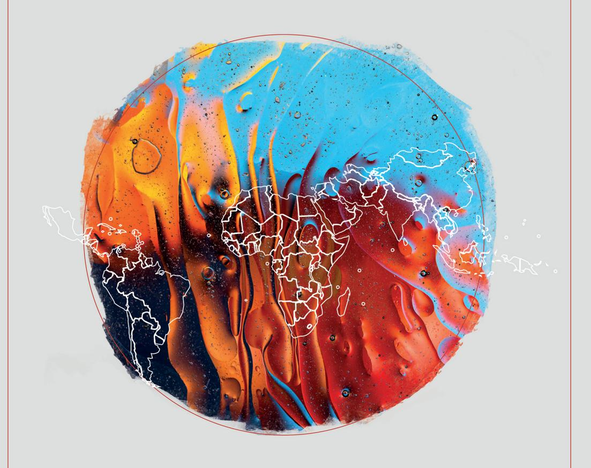
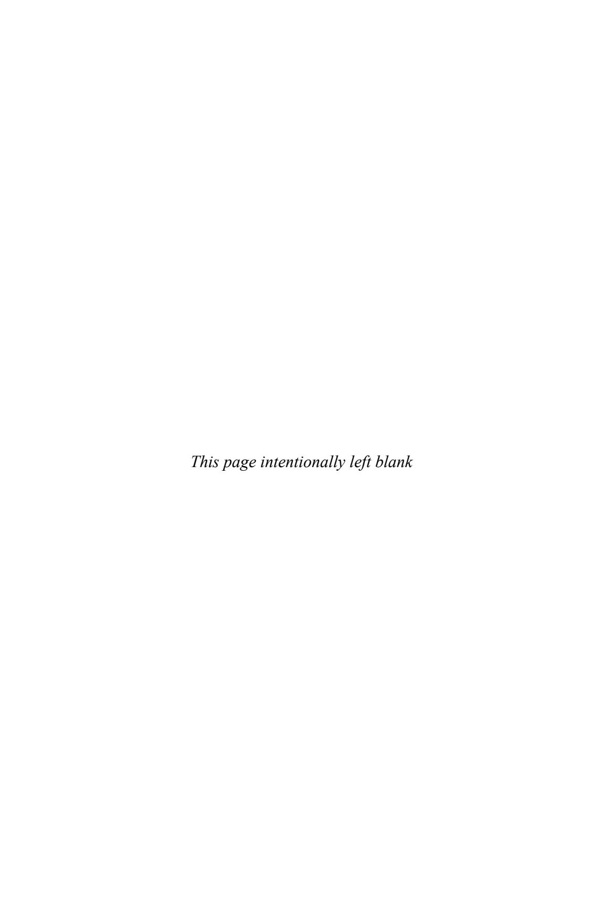
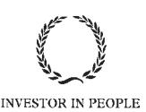

<!-- A2.R56 | source: papers_json/A2.R56/ -->

DIVERSE PERSPECTIVES ON CREATING A FAIRER SOCIETY

## CRITICAL
REFLECTIONS ON THE
INTERNATIONALISATION
OF HIGHER EDUCATION
IN THE GLOBAL SOUTH

Edited by

EMNET TADESSE WOLDEGIORGIS AND CHERYL QIUMEI YU

<!-- page 2 -->

## **Critical Reflections on the ** **Internationalisation of Higher ** **Education in the Global South**

<!-- page 3 -->

## **DIVERSE PERSPECTIVES ON CREATING A ** **FAIRER SOCIETY**

المجتمع العادل هو مجتمع منصف وشامل يستوعب الجميع دون أي عوائق أمام المشاركة على أساس الجنس أو الميل الجنسي أو الدين أو المعتقد أو العرق أو العمر أو الطبقة أو القدرة أو أي اختلاف اجتماعي آخر. وهو مجتمع تتوافر فيه إمكانية الحصول على الرعاية الصحية والتعليم والتقنية والعدالة، ومؤسسات قوية، وسلام وأمن، وحماية اجتماعية، وعمل لائق وسكن. لكن كيف يمكن للبحث العلمي أن يسهم حقا في تحقيق العدالة والتنوع العالميين دون إبراز أصوات متنوعة غير ممثَّلة تمثيلا كافيا في الأوساط الأكاديمية، أو دون إيلاء اهتمام خاص لدول الجنوب العالمي؟

تضم سلسلة *Diverse Perspectives on Creating a Fairer Society* كتبا تتناول التحديات والقضايا الرئيسية في العلوم الاجتماعية، وهي قضايا أساسية لبناء مجتمع أكثر عدلا للجميع مع إشارة خاصة إلى دول الجنوب العالمي، وتُبرز السلسلة الأصوات غير الممثَّلة تمثيلا كافيا، بما فيها أصوات السود والآسيويين والأقليات العرقية، ومؤلفين من دول الجنوب العالمي، وأكاديميين يعملون على إبراز الأصوات المتنوعة.

وبهدف رئيسي يتمثل في إبراز التأليف والأصوات من خارج دول الشمال العالمي، ترحّب السلسلة بمساهمات من مؤلفين راسخين ومبتدئين حول بحوث متقدمة ورائدة في مواضيع رئيسية تظهر في الأخبار العالمية والنقاش العام، وتحديدا من وعن دول الجنوب العالمي في سياقات وطنية ودولية. وباستثمار بحوث تغطي طيفا متنوعا من الأشخاص والأماكن لإنتاج رؤى لم يُستمع إليها من قبل، تقدم السلسلة منظورا عالميا حقيقيا للنقاشات المجتمعية الراهنة في القرن الحادي والعشرين، وتُبرز النقاش المعاصر في العلوم الاجتماعية من أصوات متنوعة.

## **Previous Titles**

- ⦁ *Disaster, Displacement and Resilient Livelihoods: Perspectives from South Asia* edited by M. Rezaul Islam
- ⦁ *Pandemic, Politics, and a Fairer Society in Southeast Asia: A Malaysian Per**spective* edited by Syaza Shukri
- ⦁ *Empowering Female Climate Change Activists in the Global South: The Path * *Toward Environmental Social Justice* by Peggy Ann Spitzer
- ⦁ *Gendered Perspectives of Restorative Justice, Violence and Resilience: An Inter**national Framework* edited by Bev Orton
- ⦁ *Social Sector Development and Inclusive Growth in India* by Ishu Chadda
- ⦁ *The Socially Constructed and Reproduced Youth Delinquency in Southeast Asia: * *Advancing Positive Youth Involvement in Sustainable Futures* by Jason Hung
- ⦁ *Youth Development in South Africa: Harnessing the Demographic Dividend* edited by Botshabelo Maja and Busani Ngcaweni
- ⦁ *Debt Crisis and Popular Social Protest in Sri Lanka: Citizenship, Development * *and Democracy Within Global North-South Dynamics* by S. Janaka Biyanwila

<!-- page 4 -->

- ⦁ *Building Strong Communities: Ethical Approaches to Inclusive Development* by Ifzal Ahmad and M. Rezaul Islam
- ⦁ *Family Planning and Sustainable Development in Bangladesh: Empowering * *Marginalized Communities in Asian Contexts* by M. Rezaul Islam

## **Forthcoming Titles**

- ⦁ *'Natural' Disasters and Everyday Lives: Floods, Climate Justice and Marginali**sation in India* by Suddhabrata Deb Roy
- ⦁ *Social Constructions of Migration in Nigeria and Zimbabwe: Discourse, Rheto**ric, and Identity* by Kunle Oparinde and Rodwell Makombe
- ⦁ *Neoliberal Subjectivity at Work: Conduct, Contradictions, Commitments and * *Contestations* by Muneeb Ul Lateef Banday
- ⦁ *Unearthing the Institutionalised Social Exclusion of Black Youth in Contempo**rary South Africa: The Burden of Being Born Free* by Khosi Kubeka

<!-- page 5 -->

<!-- page 6 -->

## **Critical Reflections on the ** **Internationalisation of Higher ** **Education in the Global South**

## EDITED BY

## **EMNET TADESSE WOLDEGIORGIS**

*University of Johannesburg, South Africa*

and

## **CHERYL QIUMEI YU**

*University for the Creative Arts, UK*

<!-- page 7 -->

Emerald Publishing Limited Emerald Publishing, Floor 5, Northspring, 21-23 Wellington Street, Leeds LS1 4DL.

First edition 2024

Editorial matter and selection © 2024 Emnet Tadesse Woldegiorgis and Cheryl Qiumei Yu. Individual chapters © 2024 The authors.

Published under exclusive licence by Emerald Publishing Limited.

## **Reprints and permissions service**

Contact: www.copyright.com

No part of this book may be reproduced, stored in a retrieval system, transmitted in any form or by any means electronic, mechanical, photocopying, recording or otherwise without either the prior written permission of the publisher or a licence permitting restricted copying issued in the UK by The Copyright Licensing Agency and in the USA by The Copyright Clearance Center. Any opinions expressed in the chapters are those of the authors. Whilst Emerald makes every effort to ensure the quality and accuracy of its content, Emerald makes no representation implied or otherwise, as to the chapters' suitability and application and disclaims any warranties, express or implied, to their use.

## **British Library Cataloguing in Publication Data**

A catalogue record for this book is available from the British Library

ISBN: 978-1-80455-779-2 (Print) ISBN: 978-1-80455-778-5 (Online) ISBN: 978-1-80455-780-8 (Epub)

<!-- page 8 -->

## **Contents**

List of Acronyms and AbbreviationsixAbout the AuthorsxiForeword: Ecosystems of InternationalisationxviiPrefacexxi**Chapter 1 Introduction**
*Emnet Tadesse Woldegiorgis and Cheryl Qiumei Yu*1**Chapter 2 Internationalisation of Higher Education Under
Neoliberal Imperatives: The Political Economy of Student
Mobility in Africa**
*Emnet Tadesse Woldegiorgis*13**Chapter 3 Perspectives and Challenges of Internationalising
Higher Education from and for the Global South**
*Fernanda Leal, Kyria Rebeca Finardi and Maria Julieta Abba*33**Chapter 4 'You Look International': Scale and
Global Performativity**
*César Augusto Ferrari Martinez*49**Chapter 5 Internationalisation of Higher Education in Brazil:
Advances and Challenges**
*Anthony L. Wagner V and Erich Dietrich*67**Chapter 6 Transnational Education in South/Southeast Asia:
Thoughts and Reflections from a Higher Education Partner
University in the United Kingdom**
*Panchalingam Suntharalingam*101**Chapter 7 Towards Emplacing Internationalisation in
Thai Higher Education**
*Matthew Robert Ferguson and James Burford*121**Chapter 8 On a (More) Equal Footing: Bridging
'the West' & 'the Arab World' Through Virtual Exchange**
*Roger W. Anderson*141**Chapter 9 A Critical Exploration of the Drivers and
Strategies of University Internationalisation in Ghanaian
Higher Education**
*Emmanuel Intsiful and Ato Essuman*163**Chapter 10 The 'Quest for Relevance': Reconceptualising and
Redefining Internationalisation of Higher Education in
South Africa**
*Savo Heleta*183**Chapter 11 Rethinking the Internationalisation of Higher
Education in South Africa in the Post-Pandemic Era: Towards a
Blended Future**
*Emnet Tadesse Woldegiorgis*201**Chapter 12 Assisting International Students Through Student
Support Services in Uganda**
*Kanyesigye Rullonga Monicah*223**Chapter 13 Conclusion**
*Emnet Tadesse Woldegiorgis and Cheryl Qiumei Yu*243**Index**251

<!-- page 9 -->

<!-- page 10 -->

## **List of Acronyms and Abbreviations**

ASEAN Association of Southeast Asian Nations

CAPES Coordenação De Aperfeiçoamento de Pessoal de Nível Supe-

rior [Coordination for the Improvement of Higher Education

Personnel]

CsF Ciência Sem Fronteiras [Science without Borders]

CHE Council on Higher Education

DHET Department of Higher Education and Training

DRI Diretoria de Relações Internacionais [Office of International

Affairs]

FAUBAI Forum of Advisory Councils for Brazilian Higher Education

Institutions

HEI higher education institution HBI historically black institution

HUST Huazhong University of Science and Technology

HWI historically white institutions/universities

ICEF International Consultants for Education and Fairs ICT information and communication technology IHE internationalisation of higher education

IA internationalisation abroad IaD internationalisation at a distance IaH internationalisation at home IMF International Monetary Fund

IP intellectual property

IsF Idiomas Sem Fronteiras [Languages without Borders]

KTP knowledge transfer partnership

LGBTQI lesbian, gay, bisexual, transgender, queer (or questioning), and

intersex

MENA Middle East/North Africa

MUIC Mahidol University International College NAFSA NAFSA: Association of International Educators

NLMM neoliberal market model NPM new public management

NSFAS National Student Financial Aid Scheme

NYU New York University

OECD Organisation for Economic Co-operation and Development

SADC Southern Africa Development Community

SSC South–South cooperation

<!-- page 11 -->

## *x* *List of Acronyms and Abbreviations*

STEM science, technology, engineering, and mathematics

TNE transnational education

TSUIC Taksin University International College UFES Federal University of Espirito Santo UFMG Universidade Federal de Minas Gerais

UK United Kingdom

UNESCO United Nations Educational, Scientific and Cultural

Organization

UoA University of Alpha WCU world-class university WTO World Trade Organization

<!-- page 12 -->

## **About the Authors**

**Prof Maria Julieta Abba** أستاذة مساعدة في كلية العلوم الإنسانية وباحثة في برنامج الدراسات العليا للتعليم بجامعة Unisinos في ريو غراندي دو سول، البرازيل، حيث تنسّق أيضا مركز الدراسات الدولية في التعليم. وهي المؤسِّسة المشاركة لشبكة أمريكا اللاتينية للباحثين والمديرين في تدويل التعليم العالي، والمنسِّقة المشاركة لكرسي UNESCO (منظمة الأمم المتحدة للتربية والعلم والثقافة) في التعليم من أجل المواطنة العالمية والعدالة الاجتماعية-البيئية.

**Prof Roger W. Anderson** أستاذ مساعد حاليا في اللغات والثقافات الدولية في Central State University، وهي الجامعة العامة الوحيدة التاريخية للسود في ولاية أوهايو. ويدرّس روجر مقررات في اللغة الفرنسية والعربية ومقررات ذات طابع عالمي. حصل على درجة الدكتوراه في تعليم اللغة الأجنبية/الثانية من Ohio State University، ودرجتي ماجستير في الدراسات الأفريقية واللغة الفرنسية من Ohio University وفي تدريس اللغة العربية كلغة أجنبية من Middlebury College. ويركز بحثه على اكتساب اللغة الثانية، وla Francophonie، وتعليم اللغة العربية، والتعليم بين الثقافات والتعليم العالمي. ويعتقد روجر أن التعليم العالمي يجب أن يشمل دراسة اللغات الدولية والكفاءة بين الثقافات. كما يراجع مجلات أكاديمية وجوائز تنافسية (وتحديدا جوائز Boren للمعرفة اللغوية والثقافية للراغبين في العمل بالحكومة الفيدرالية الأمريكية، ومنح Critical Language Scholarships التي تهدف إلى تعزيز الانخراط الدولي الأمريكي). وهو عضو نشط في World Council on Intercultural and Global Competence، وOhio Foreign Language Association، وAmerican Council on the Teaching of Foreign Languages. وخارج الحرم الجامعي، يستمتع بتعلم لغات عالمية جديدة، والمشي لمسافات طويلة، والترحيب بالقادمين الجدد إلى أوهايو.

**Ronald Barnett** أستاذ فخري للتعليم العالي في كلية التعليم والمجتمع بجامعة University College London، حيث شغل منصب نائب مدير وعميد. وقد كرّس حياته لتطوير فلسفة التعليم العالي كحقل دراسي، وهو أول رئيس لـ *Philosophy and Theory of Higher Education Society*. ومُنح الجائزة الافتتاحية من European Association for Educational Research تقديرا لـ "إسهامه المتميز في بحوث التعليم العالي وسياساته وممارساته"، وحصل على دكتوراه عليا مكتسبة ودكتوراه فخرية. وتُرجمت أكثر من 35 كتابا من كتبه إلى لغات عديدة، وألقى 150 محاضرة رئيسية في أكثر من 40 دولة. واستُشهد بأعماله في الأدبيات الأكاديمية نحو 30,000 مرة.

<!-- page 13 -->

**Prof James Burford** أستاذ مشارك في قسم دراسات التعليم بجامعة University of Warwick، حيث يقود برنامج ماجستير الآداب في التعليم العالمي والتنمية الدولية. وبعد تجارب مهنية في العمل مع الشباب والتنمية المجتمعية في نيوزيلندا، أجرى جيمس دراسته للدكتوراه في University of Auckland حيث فازت أطروحته عام 2017 بجائزة Sutton-Smith Doctoral Award. ويأتي منصب جيمس في Warwick بعد تعيينات أكاديمية في كلية علوم التعلم والتعليم بجامعة Thammasat University في تايلاند، ومدرسة البحوث العليا بجامعة La Trobe University في أستراليا. كما شغل جيمس مناصب بحثية زائرة في مركز التعليم التأملي بجامعة Mahidol University (2013-2014) ومعهد بحوث التعليم العالي بجامعة Hiroshima University (2017-2019). وباعتباره باحثا في الدراسات الجامعية النقدية، يهتم جيمس بتعليم الدراسات العليا والمهنة الأكاديمية. ويركز بشكل خاص على النوع الاجتماعي والميل الجنسي، والتنقل الأكاديمي، والمؤتمرات الأكاديمية، والكتابة الأكاديمية والتواصل، والنظريات الكويرية في التعليم العالي. ويهتم جيمس بالابتكار المنهجي، بما في ذلك المناهج البصرية. ومن أعماله الحديثة كتاب مشترك التحرير بعنوان *Re-Imagining Doctoral Writing* (University Press of Colorado)، وكتاب قادم مشترك التأليف بعنوان *Making Sense of Academic Conferences: Presenting, Participating, and Organising* (Routledge). وشملت مشاريع جيمس السابقة دراسة تدخلات تعليم التنوع في المدارس الثانوية في نيوزيلندا، والهجرة الأكاديمية إلى تايلاند، ومشاريع متنوعة حول إقصاء المثليات والمثليين ومزدوجي الميل الجنسي ومغايري الهوية الجنسانية والكوير (أو المتسائلين) وحاملي صفات الجنسين (LGBTQI) في تايلاند. وتركز مشاريعه الحالية على تعليم الدكتوراه، بما في ذلك دراسة ممولة من Research England تبحث في آليات الحراسة عند قبول طلبات الدكتوراه في مرحلة ما قبل التقديم. كما يجري جيمس دراسة دولية مستمرة تبحث في تجارب متعلمي الدكتوراه الدارسين عبر مسارات التعلم عن بعد. وجيمس محرر مشارك في مجلة Higher Education Research and Development، وعضو في لجنة شبكة بحوث تعليم الدكتوراه الدولية. ومنذ عام 2017، يشارك جيمس في تحرير المدونة الأكاديمية *Conference Inference*، ويغرد عبر '@jiaburford'.

**Dr. Erich Dietrich** أستاذ التعليم العالي والتعليم الدولي في New York University (NYU). ويركز بحثه على العمل الإيجابي في سياق دولي مقارَن، والأيديولوجيات المقارَنة للعرق، وتقييم مخرجات التعلم للدراسة في الخارج. وهو المدير المشارك لمشروع بحوث الدراسة في الخارج والتعليم العالمي في NYU. ومن عام 2009 إلى 2019، شغل ديتريش منصب نائب مساعد رئيس برامج NYU العالمية وعميد مساعد للشؤون العالمية في NYU Steinhardt. ويحمل درجة الدكتوراه من NYU، وماجستير من University of Wisconsin-Madison، وبكالوريوس بامتياز مع مرتبة الشرف من Carleton College. وهو مؤلف فصل بعنوان 'Ambition with Resistance: Affirmative Action in Brazil's Public Universities'، في كتاب *Race, Politics and Education in Brazil* (بتحرير Rosana Heringer وOllie Johnson ونشرته Palgrave عام 2015).

**Prof Ato Essuman** أستاذ التعليم والتنمية في Methodist University في غانا. وبعد أن شغل لفترة منصب الأمين الدائم

<!-- page 14 -->

لوزارة التعليم في غانا، يهتم بشكل خاص بالتعليم من حيث صلته بالسياسات والإصلاح والتمويل والإدارة والممارسة. وهو حاليا عميد مدرسة البحوث والدراسات العليا في Methodist University. وقد شغل مناصب رئيسية في القطاعين الخاص والعام على مدى أكثر من أربعة عقود؛ وخلال هذه الفترة عمل مع هيئات شركات مثل Nestlé وPriceWaterhouseCoopers وTechnoServe Incorporated، فضلا عن مؤسسات ثنائية ومتعددة الأطراف. وقد أنتج البروفيسور Essuman عملا ذا جودة رفيعة، كما يتضح من نطاق وجودة منشوراته في المجلات الأكاديمية والكتب المحرَّرة وإصدارات كتب أخرى. وقد أدت إنجازاته العلمية إلى دعوته كمتحدث رئيسي (محليا ودوليا) ومراجع لمجلات دولية مرموقة. وهو حاليا رئيس المجلس الغربي الأفريقي للامتحانات.

**Dr Matthew Robert Ferguson** أستاذ مساعد في التعليم ويدرّس في شعبة العلوم الإنسانية واللغات في Mahidol University International College (MUIC) في بانكوك، تايلاند. وهو من مقاطعة British Columbia الكندية أصلا، وعمل ماثيو في التعليم العالي التايلاندي لمدة 20 عاما. وقضى عدة سنوات في تدريس اللغة الإنجليزية كلغة أجنبية في شمال تايلاند قبل أن يستقر في MUIC عام 2010، حيث يدرّس في برنامج الدراسات بين الثقافات واللغات. وباتباعه تقليد العالم الممارس، يبحث في التفاعل بين الممارسة الصفية والحركات الأوسع التي تحدث حول الجامعة. ويتركز اهتمام ماثيو بشكل خاص على الشكل الفريد الذي يتخذه التدويل في التعليم العالي التايلاندي، وكيف يوفّق فاعلون مثله بين موقعهم فيه. ولهذا الغرض، أمضى أكثر من عقد في العمل مع البحث السردي، بوصفه ظاهرة ومنهجا في آن واحد، لفهم كيفية استيعاب أصحاب المصلحة للتغير السريع الذي تجلبه العولمة إلى تايلاند، وكيف ينظرون إلى دورهم في تنمية البلاد. ونظرا لحبه العميق للحواس، يقضي وقته في التجديف في القنوات الأكثر هدوءا وتاريخية بالقرب من منزله في بانكوك، منغمسا في الحياة النهرية من قاربه، في استراحة من شوارع السطح. وتشكل هذه اللحظات جزءا من نسيج التجارب المعاشة، وتعمل على تفسير الحاضر، بين الماضي واللاحق. وهذه هي الحساسيات التي يطبّقها في عمله كباحث وكاتب ومعلم في الفصل.

**Dr Kyria Rebeca Finardi** محاضرة أولى في قسم اللغات والثقافة والتعليم وباحثة في برنامج الدراسات العليا للتعليم بجامعة Federal University of Espirito Santo (UFES) في فيتوريا، البرازيل. وتعمل أيضا عضوا في مجلس التدويل هناك، وقد أسست ونسّقت شعبة اللغات في المكتب الدولي بجامعة UFES بين عامي 2012 و2020. وكانت الدكتورة Finardi رئيسة الرابطة البرازيلية لعلم اللغة التطبيقي للفترة 2018-2019، وهي المؤسِّسة المشاركة والمنسِّقة المشاركة لرابطة أمريكا اللاتينية الأيبيرية لعلم اللغة التطبيقي. وهي حاليا نائبة رئيس الرابطة الدولية لعلم اللغة التطبيقي، حيث ستتولى رئاستها للفترة 2024-2027. ولديها قائمة واسعة من المنشورات (أكثر من 200)، وأكثر من 1,600 استشهاد.

<!-- page 15 -->

**Dr Savo Heleta** باحث ومعلم لديه أكثر من 10 سنوات من الخبرة في التعليم العالي والبحث الأكاديمي وتطوير المناهج والتدريس والإشراف البحثي والتدويل في جنوب أفريقيا. ويركز بحثه على إنهاء استعمار المعرفة، وتدويل التعليم العالي، والتعاون البحثي الدولي، والعدالة المناخية، والدعوة والنشاط من أجل العدالة الاجتماعية. وباعتباره أحد الناجين من الحرب البوسنية، فهو مؤلف كتاب *Not My Turn to Die: Memoirs of a Broken Childhood in Bosnia*، الذي نشرته AMACOM Books عام 2008. ويعمل سافو باحثا وأخصائي تدويل في Durban University of Technology في جنوب أفريقيا.

**Dr Emmanuel Intsiful** لديه 10 سنوات من الخبرة في التدريس في قطاع التعليم العالي في دول مختلفة. وفي عام 2019، اختير للمشاركة في مؤتمر الباحثين الشباب خلال المؤتمر الثاني والأربعين لـ Comparative International Education Society في سان فرانسيسكو، الولايات المتحدة الأمريكية. ويحمل إيمانويل درجة ثالثة في القيادة التربوية والسياسات. ويعمل إيمانويل عبر سياقات لغوية وجغرافية متنوعة عند تقاطع العلوم الإنسانية والاجتماعية على مجموعة واسعة من القضايا التعليمية. وتحديدا، تنصب اهتمامات إيمانويل البحثية على علم الاجتماع النقدي للتعليم العالي، وسياسات التعليم العالي، والتربية النقدية، والدراسات الفوكوية، وما بعد الاستعمار، وما بعد البنيوية، والقيادة التربوية والإدارة والحوكمة. وقد اكتسب إيمانويل خبرة في التدريس في غانا والصين وأستراليا، وهو حاليا زميل بحث ما بعد الدكتوراه في مركز Ali Mazuri للدراسات العليا للتعليم العالي بجامعة Johannesburg.

**Dr Fernanda Leal** مديرة العلاقات الدولية في Universidade Federal de Santa Catarina، البرازيل. وتحمل درجة الدكتوراه في الإدارة من Universidade do Estado de Santa Catarina، البرازيل، وكانت باحثة زائرة في مركز التعليم العالي الدولي، Boston College، الولايات المتحدة الأمريكية (2018-2020). وهي مؤلفة عدة مقالات وفصول كتب حول تدويل التعليم العالي من منظور نقدي/لا استعماري. وهي أيضا قائدة المجال الموضوعي 'الجامعة والمجتمع والدولة في العصر الحاضر' في شعبة الدراسات التنظيمية التابعة للرابطة الوطنية للبحث في الإدارة.

**Dr César Augusto Ferrari Martinez** يحمل درجة الدكتوراه في التعليم من Pontificia Universidad Católica de Chile. ودرس العلاقة بين المكان والمعرفة، وركز على الجغرافيا السياسية المجسَّدة والمقاييس. ويحلل عمله الدلالة السياسية للخطابات والسياسات والممارسات المتعلقة بالتعليم الدولي في سياقات أمريكا اللاتينية. ومُوِّل هذا العمل من قبل اللجنة التشيلية للبحث العلمي والتقني بموجب المنحة رقم 21160217.

**Dr Kanyesigye Rullonga Monicah** لديها أكثر من 20 عاما من الخبرة العملية في إدارة وتنظيم التعليم العالي، اكتسبتها أثناء عملها في قطاع التعليم في أوغندا. وتحمل خلفية في العلوم الاجتماعية، ودرجة ماجستير في إدارة الموارد البشرية للتعليم، ودرجة الدكتوراه في الإدارة العامة والتنظيم مع تخصص في الحوكمة و

<!-- page 16 -->

القيادة المؤسسية. وتغطي اهتماماتها البحثية إدارة وتنظيم التعليم العالي، وتدويل التعليم العالي، وإدارة الموارد البشرية للتعليم. وتتميز في إشراك أصحاب المصلحة، وإدارة المنح والمساءلة، وتطوير الموظفين، وإدارة المخاطر، والتطوير التنظيمي. وهي حاليا زميلة بحث ما بعد الدكتوراه في مركز Ali Mazrui للتعليم العالي بجامعة Johannesburg، حيث ينصب تركيز بحثها على إدارة التعليم العالي.

**Dr Panchalingam Suntharalingam** أستاذ مشارك للتعليم عن بعد والتعليم عبر الحدود الوطنية في كلية العمارة والتصميم بجامعة Birmingham City University. وهو أيضا مدير مقرر ماجستير الآداب في التصميم والتصوير المرئي في Birmingham City University. ويدرّس مقررات البكالوريوس والدراسات العليا في التصميم والتصوير المرئي، وتصميم المنتجات الهندسية، والعمارة الداخلية والتصميم في المملكة المتحدة والهند وهونغ كونغ والصين. وإلى جانب مجالات الخبرة والاهتمام المذكورة، تشمل مجالات تركيز الدكتور Suntharalingam المعرفة متعددة التخصصات والعلمية، وبرامج شراكة نقل المعرفة (KTP)، وبرمجة الحاسوب، وتصميم المنتجات الطبية، والمنتجات الداخلية، والبحث التطبيقي، والنمذجة الأولية السريعة، والتصميم بمساعدة الحاسوب. ويستكشف أحدث فصل من كتبه، الذي نُشر في الهند وهو في سن الخامسة والسبعين، بعنوان *Thoughts and Reflections* (أبريل 2023)، نمو التعليم العالي الخاص في الهند منذ الاستقلال عام 1947. ويبحث الفصل في سبب كون التعليم عبر الحدود الوطنية متطلبا تعاونيا مهما للجامعات الهندية. ويحمل الدكتور Suntharalingam براءة اختراع لمنتج طبي حقق أكثر من 50,000 عملية بيع في الولايات المتحدة الأمريكية وأكثر من 8,000 في المملكة المتحدة، وله أوراق دولية عديدة حول المنتجات الطبية. وهو معروف جيدا بفتح تتابعات عناوين الصور المولّدة بالحاسوب التي ظهرت في برامج شبكتي BBC وITV مثل *Top Gear*. وتشمل خبرته الواسعة مع الصناعة التحويلية 19 شراكة نقل معرفة (KTP) مع شركات كبرى مثل AGA Rangemaster، وقد حصل على 4 جوائز تميز من Innovate UK إنجازا للابتكار. وفي عام 2020، وصلت إحدى شراكاته للقائمة المختصرة لأفضل شراكات نقل المعرفة في المملكة المتحدة. وهو أيضا ممتحن خارجي في جامعات وطنية ودولية متنوعة على مستويات البكالوريوس والدراسات العليا والدكتوراه.

**Anthony L. Wagner V** طالب دكتوراه في برنامج التعليم الدولي بجامعة NYU. وتركز اهتماماته البحثية على الأغراض العامة للتعليم العالي وتدويل التعليم العالي في البرازيل. وهو المدير المشارك لـ Transform Mid-Atlantic، وهي رابطة كليات وجامعات في ماريلاند وواشنطن العاصمة وديلاوير تعزز المشاركة العادلة بين الحرم الجامعي والمجتمع. وكان واغنر منحة Fulbright من عام 2018 إلى 2019 في Universidade Federal de São João del-Rei في Minas Gerais، البرازيل. وأتمّ درجة الماجستير في مدرسة الدراسات العليا للتعليم بجامعة University of Pennsylvania، وبكالوريوس بأعلى مرتبة الشرف من Gettysburg College.

**Prof Emnet Tadesse Woldegiorgis** أستاذ مشارك ومدير مركز Ali Mazrui للدراسات العليا للتعليم العالي بجامعة Johannesburg. ويحمل درجة الدكتوراه من University of Bayreuth، ألمانيا، حيث عمل أيضا

<!-- page 17 -->

باحثا بين عامي 2015 و2019. وحصل إمنت على درجة ماجستير مشتركة في دراسات التعليم العالي من Oslo University (النرويج) وTampere University (فنلندا) وAveiro University (البرتغال). وهو باحث مصنَّف من قبل NRF وله منشورات أكاديمية محكّمة عديدة تركز على التعليم العالي في أفريقيا. وحصل على شهادة في هولندا بمؤهلين تدريبيين بحثيين متقدمين في التعليم العالي (من مركز التعاون المؤسسي بجامعة Vrije Universiteit [أمستردام] وتدريب Maastricht School of Management في القيادة والإدارة على التوالي). وقبل حصوله على الدكتوراه، عمل رئيسا لمكتب ضمان الجودة، ورئيس قسم، وقائد فريق في Mekelle University، إثيوبيا. وقد بحث في التعليم العالي في أفريقيا على مدى السنوات العشر الماضية، ونشر خلال هذه الفترة عدة أعمال أكاديمية محكّمة حول نظريات الإقليمية والتدويل والتنقل الأكاديمي واقتصاديات التعليم العالي ونماذج الشراكة ونقاشات إنهاء الاستعمار واستراتيجيات المواءمة في التعليم العالي.

**Dr Cheryl Qiumei Yu** لديها أكثر من 16 عاما من الخبرة العملية في التعليم العالي الدولي، تشمل تجنيد الطلاب وتنقلهم عالميا، والتعليم عبر الحدود الوطنية، وتدريس وتعلم الطلاب الدوليين. وتعمل حاليا مديرة لـ International Jimmy Choo Academy. وركز بحثها في الدكتوراه على *Inequality in Chinese Higher Education and Its Relation to Students' Internal Mobility: A Case Study of Internal Movement of Art and Design University Students*. وتركز اهتماماتها البحثية على الدراسة المقارَنة للتعليم العالي بين الصين والمملكة المتحدة، وتدويل التعليم العالي، وأساليب التدريس، والنظريات النقدية. وأشرفت على طلاب دكتوراه في مجموعة واسعة من المواضيع، بما فيها التعليم الدولي، وفنون الألياف، وإدارة الفنون، والنسوية اللااستعمارية، مع التركيز على سياق الصين. وباعتبارها مديرة فنية، نظّمت أيضا عدة معارض فنية دولية في المملكة المتحدة والصين.

<!-- page 18 -->

## **Foreword: Ecosystems of ** **Internationalisation**

*Ronald Barnett*

ماذا يعني أن يكون التعليم العالي دوليا؟ وما معنى الانخراط في عملية تدويل؟ وماذا يعني تكوين تأملات نقدية حول هذه المسائل؟ من جمال هذا المجلَّد - الذي حرّره ونسّقه ببراعة إمنت تاديسي ولديغيورغيس وشيريل كيوماي يو - أنه يفعل بالضبط ما يقوله ويلمّح إليه عنوانه. وهنا، نتلقى رؤى جديدة عما يعنيه أن نكون دوليين، وبعض التأملات النقدية شديدة الدقة عن حالة النقاش الراهن حول هذه المسألة. وعلاوة على ذلك، يأخذنا المجلَّد إلى ما هو أبعد، إذ يقدم لنا أيضا مجموعة من المقترحات حول كيفية دفع الممارسات إلى الأمام، ليس أقلها دراسات الحالة الرائعة من مختلف أنحاء العالم. وبما أن هذا المجلَّد ينجز كل ذلك ببراعة، فإن كل ما يمكنني القيام به هنا في مقدمة، على ما أعتقد، هو أن أخاطر وأشارك - استعارة من عنوان الكتاب - بعض *التأملات النقدية حول تدويل التعليم العالي في دول الجنوب العالمي* الخاصة بي، على سبيل التخمين.

فكرة التدويل مثيرة للاهتمام بحد ذاتها. ما معنى أن نكون *دوليين*؟ فبانقسام المفهوم على هذا النحو، يصبح مفتوحا - وباستخدام مصطلح شائع - ناشئا. وهو يوحي ليس فقط بحركة ثنائية الاتجاه بين الدول، بل أيضا بنوع من التكافؤ؛ نوع من التماثل في المساهمات ضمن مجموعة معقدة من العلاقات (بصيغة الجمع). لكن كلمة 'inter' توحي أيضا بالتفاعلات والديناميكية. فالأطراف في العلاقة تتمتع بمستوى من الفاعلية وتمارسها. وعلاوة على ذلك، عند استخدامها في سياق نظام عالمي ضخم مثل التعليم العالي، تتضاعف تلك التفاعلات مع استجابات وردود فعل مضادة تحدث باستمرار. ويصبح التدويل مسرحا لأفعال ولقاءات وردود أفعال متلألئة. فالدولة x تستقبل طلابا من الدولة y، ثم يليها وضع جديد تقدم فيه الدولة z عرضا جديدا (تلغي شرط التأشيرة و/أو تخفض رسومها) فتكسب بعض (إن لم يكن كل) هؤلاء الطلاب وأكثر.

هذا إذن سياق يشوبه بعض الاضطراب. فقد أصبح التدويل ساحة للتنافسية العالمية. وعلاوة على ذلك، لم تعد التنافسية مؤسسية فقط (بين مؤسسات التعليم العالي)، بل أصبحت الآن جيوسياسية أيضا. فالطلاب الدوليون ليسوا فقط حاملين لإمكانات أسواق التصدير، بل يحملون ثقلا جيوسياسيا أيضا. وعلاوة على ذلك، وكما يوضح هذا المجلَّد بقوة، فإن المنصات التي يجري عليها التدويل بعيدة كل البعد عن أن تكون

<!-- page 19 -->

متكافئة: بل إن العلاقات بين المؤسسات غالبا ما تكون *غير متماثلة*، حيث تمارس الجامعة x نفوذا معرفيا ومكانيا أكبر من الجامعة y (التي تسعى الجامعة x لبناء نوع من الترابط معها). وهذا اللاتماثل يظهر في أشكال عديدة - القوة المعرفية، والقوة الجيوسياسية، واللغة، ورأس المال الثقافي، والموارد المالية.

وبناء على ذلك، توجد مجموعة كبيرة من أنواع مختلفة من العلاقات التي تندرج تحت مظلة التدويل. وأنا لا أقصد فقط الأنشطة التي تحمل رايات 'البحث' أو 'الطلاب'، بل أيضا الأنشطة الصغرى التي تندرج تحت تلك الفئات الواسعة. فمثلا، *العلاقة التربوية* التي تشمل الطلاب الدوليين تنطوي على أفعال وتفاعلات ومشاعر وقيم ومسبقات وتوجهات كثيرة ذات صلة، فيما يتعلق بكيفية فهم العلاقة التربوية وممارستها من قبل المعلمين والطلاب على حد سواء؛ وتمتد هذه الأبعاد عميقا. فعلى سبيل المثال، كيف تُفهم النماذج البيروقراطية الإلكترونية لتسجيل الطلاب من قبل مختلف الأطراف؟ فما يبدو واضحا ومباشرا لدى المؤسسة المضيفة قد يبدو مرهقا أو غريبا أو غامضا أو حتى مهددا لطالب دولي صغير السن في الجانب الآخر من العالم وفي ثقافة بعيدة.

لكن عند الحديث عن مجموعة من العلاقات المختلفة بين المؤسسات، أقصد ما هو أكثر من ذلك. فقد يُحكم على المؤسسات بأن لها توجهات *مقصودة* وأخرى *غير* دولية في علاقة دولية بين المؤسسات. فقد تعمل المؤسسة x (في دولة ما) مع المؤسسة y (في دولة أخرى) لإنشاء برنامج دراسي مشترك، أو قد ترسل مبعوثيها إلى المؤسسة y في محاولة لاستقطاب طلاب محتملين. وقد تكون الجامعة x قد قررت أيضا، كجزء من استراتيجية بحثية جديدة، تشجيع موظفيها على تنظيم مشاريع مشتركة مع الجامعة y. (ومدى كون هذه الأنشطة مشتركة حقا، كما هو مذكور، مسألة أخرى.) والمقصد هو أن مثل هذه المشاريع أمثلة على أشكال *مقصودة* من التدويل.

ومع ذلك، فإن المؤسسات (على الأقل في المجموع) - في دول الشمال العالمي مثلا - قد تمارس، وتمارس فعلا، ترابطات *غير* مقصودة مع مؤسسات في دول الجنوب العالمي. وعند النظر إلى الصورة الكاملة، قد يُحكم على تلك الترابطات بأنها تُظهر فروقا في القوة. فالتصنيفات العالمية ليست مجرد أوصاف لحالات قائمة، بل تمارس تأثيرا كبيرا، وفي حالات تتسم بتفاوتات كبيرة. وقد يذهب البعض إلى القول بوجود شكل جديد من الاستعمار حاضر هنا؛ ولنسمِّه *الاستعمار المعرفي*. وأيا كان الأمر، ففي عالم رأسمالية المعرفة - الذي يشمل أنواعا من التنافس بين المؤسسات - تقف المؤسسات في علاقة مع بعضها بعضا بجميع *درجات القصدية*.

في هذه التأملات الموجزة، لدينا خيوط عديدة تتحرك، تدل على مصالح وقوى وأنماط وصراعات نفوذ متعددة تعمل في الخفاء. وهذه المتجهات معرفية وتعليمية ووطنية وسياسية وثقافية وهوياتية الطابع بأشكال مختلفة. كما يمكن العثور عليها في معظم (إن لم يكن كل) أنشطة الجامعات وممارساتها (بما فيها قبول الطلاب، ومحتويات برامج الدراسة، والعلاقة التربوية، ولغات التدريس والتواصل، وأسلوب الأوراق البحثية في المجلات، وتمويل المشاريع البحثية عبر الوطنية، وبناء المشاريع عبر الوطنية).

وفي تسليط الضوء على كل هذه الحركات والأنماط، قد نميل إلى استحضار فكرة (خاصة من Félix Guattari) 'خطوط الهروب'. وقد يُقال إن ما هو حاضر هنا

<!-- page 20 -->

هو خطوط هروب متعددة، تسير في اتجاهات لا حصر لها. فقد تشارك مؤسسة واحدة في مشاريع ومواقف تدويل تتقاطع مع بعضها بعضا. فمن ناحية، قد يُشجَّع الموظفون على السعي لفهم شيء من الخلفيات الثقافية والتصورات المسبقة للتدريس والتعلم لدى طلابهم الدوليين. ومن ناحية أخرى، قد يقلل هؤلاء الموظفون أنفسهم - عند مراجعة أوراق للمجلات الأكاديمية مثلا - دون قصد من قيمة نصوص من الدول الأم لهؤلاء الطلاب أنفسهم، تعكس تصورات بديلة للعمل الأكاديمي الأصيل.

لكن في نهاية المطاف، فإن مقاربة 'خطوط الهروب' غير كافية، لأن القوى العاملة لا تسير في اتجاهات محددة، بل هي أكثر عشوائية بكثير. وفي السياقات التي يمكن تصورها كفضاءات للتدويل، تُعد الاستعارة الأقوى هي استعارة النظام البيئي. فما نشهده هو مجموعة من الأنظمة البيئية الضخمة تتحرك داخل وخارج بعضها بعضا، مثل سحب عملاقة. وتشمل هذه الأنظمة البيئية أنظمة المعرفة والتعلم والاقتصاد والسياسة والأفراد وهويتهم والثقافة والأنظمة المجتمعية. وتتدفق هذه الأنظمة البيئية داخل بعضها بعضا، ويتدفق التدويل عبرها جميعا وهي تتدفق فيه.

ورؤية التدويل بهذه الطريقة (كتدفقات داخل وعبر تدفقات أكبر منها) توحي بأن التدويل يخضع لقوى هائلة تأتيه من العدم (فالسحب تتحرك باستمرار)، وأن له في الوقت نفسه بعض الإمكانات الخاصة به - ولو على نحو هامشي - لتشكيل الأمور. وقد تستمر الخيارات في الظهور لدى المعنيين بالتدويل (أفرادا ومؤسسات ودولا). وهنا يبرع هذا المجلَّد كثيرا، بإجرائه نقاشاته على نطاق واسع، إذ يفتح نوافذ لإمكانات جديدة في توسيع التنوع وتقليل أوجه عدم المساواة - وحتى على المستويات العالمية.

وقد ذكرتُ للتو سبعة أنظمة بيئية كبرى يتداخل معها التدويل - المعرفة، والتعلم، والاقتصاد، والسياسة الوطنية والعالمية، والأفراد (كل منهم نظام بيئي معقد)، والمؤسسات الاجتماعية، والثقافة. وهذه بالتأكيد الأنظمة البيئية الأكثر حضورا في النقاشات ذات الصلة. ومع ذلك، فإن تحديد الأنظمة البيئية العاملة على هذا النحو يثير سؤالا حول ما إذا كان هناك أي نظام بيئي رئيسي آخر قد يدخل في الحسبان فيما يتعلق بالتدويل. أليس الوقت قد حان، مثلا، لأن تدخل الطبيعة - كنظام بيئي - إلى المشهد؟

من الواضح أن التدويل يؤثر على الطبيعة في استخدامه للوقود الأحفوري وتأثيراته البيئية الأوسع. لكن هناك بالتأكيد طبقات أوسع وأكثر انتشارا تعمل في الخفاء، تتجلى في غياب الطبيعة نفسه عن نقاش التدويل. وهناك عتمة هنا، إذ يُستقطب طلاب وموظفو كثير من الجامعات من دول عبر العالم، بما فيها دول الجنوب العالمي (وما وراءها أيضا). وفي أعماق ثقافات الطلاب والموظفين توجد أفكار متباينة عن علاقات الإنسان بالطبيعة. ويمكن إبراز هذه الأفكار، لتعزيز ثقافة الجامعات وللمساعدة في ازدهار أساليب التدريس والمناهج الدراسية.

من نقاط القوة الكبرى لهذا المجلَّد أن اتساعه ورؤاه المبتكرة توحي بلطف بأن نقاشات التدويل يمكن، بل ينبغي، أن تستمر في التوسع أكثر فأكثر. فالتدويل كظاهرة في العالم يمتلك طابعا مفتوحا، دائم التوسع في عناصره وتياراته المتقاطعة.

<!-- page 21 -->

## *xx* *Foreword: Ecosystems of Internationalisation*

وفي هذه العملية، تظل مفاهيمنا وأطرنا - ونقودنا - المتعلقة بالتدويل عرضة دائما للتوسع برؤى وأطر جديدة. ولذلك، لا يمكن منح هذا المجلَّد تقديرا أكبر من القول إنه تمهيد لمزيد من الدراسة وإنشاء أطر إضافية يمكننا من خلالها فهم التدويل واستشراف سبل تطوير الممارسات من جديد.

Ronald Barnett London, November 2023

<!-- page 22 -->

## **Preface**

في عصر يتميز بالتوسع المستمر لتبادل المعرفة وشبكات البحث على المستوى العالمي، يبرز تدويل التعليم العالي كموضوع محوري للبحث والدراسة العلمية. ويشرع هذا الكتاب في رحلة لفحص تدويل التعليم العالي فحصا نقديا، متبنيا منظورا متجذرا في العلوم الاجتماعية. ويسعى إلى زعزعة النموذج الأوروبي المركزي السائد للتدويل، ويطرح مجموعة من الأسئلة المثيرة للتفكير. ومن الضروري تفكيك الدوافع الكامنة وراء عمليات التدويل والقوى التي تحركها. وبدفع من زحف الرأسمالية العالمية المتواصل، أدى تسلل قوى السوق إلى تسليع المعرفة وتحريرها. وفي هذا النموذج، غالبا ما يُنظر إلى الطلاب كعملاء، وكثيرا ما يُعطى الربح الأولوية على الغرض الأساسي للتعليم. فهل يمكن للتدويل أن يستوعب فعليا الضرورات المحلية إلى جانب التأثيرات النيوليبرالية العالمية؟ إن الموازنة بين المصالح المحلية والعالمية في عمليات التدويل مهمة معقدة، لأنه - مع الالتزام بالمعايير الدولية لتحقيق التنافسية العالمية - يشكل الحفاظ على الأهمية المحلية للمؤسسات تحديا كبيرا. وهذه هي القضايا التي يلتزم الكتاب بمناقشتها ومعالجتها.

يمتد منظورنا للتدويل إلى ما هو أبعد من مجرد تنقل الطلاب أو تنفيذ برامج أو بحوث مشتركة؛ فهو يشمل موضعة متنوعة لكن متساوية للمعرفة والتدريس والتعلم واللغة والثقافة والقيم. وتُعد الشراكات في التعليم العالي، بشكل خاص، أدوات للمأسسة، وكذلك وسائل حيوية لإدخال أصوات ووجهات نظر جديدة إلى النقاش داخل الجامعات. ويدفع هذا الكتاب فضول لمعالجة وتفكيك النماذج والمقاربات التي تقوم عليها شراكات التعليم العالي الدولية ذات المغزى. ويدافع الكتاب عن مقاربة تعاونية تحتضن التنوع وتعترف بالمساهمات الفريدة لكل نظام تعليم عالٍ. وبالتشكيك في مفهوم المنافسة، يبرز الكتاب كيف تديم المنافسة الهيمنة وتعزز عدم عدالة ميدان العولمة. وفي المقابل، تخلق المقاربة التعاونية فضاء مشتركا يمكن فيه للمؤسسات أن تتعاون وتتبادل الابتكارات وتتشارك المعرفة دون فرض تراتبيات القوة. ويعزز هذا الإطار التعاوني عملية تدويل أكثر شمولا وإنصافا، تعترف بوجهات النظر ونقاط القوة المتنوعة لجميع المشاركين وتقدرها.

وباستخدام دراسات حالة من دول متنوعة، يفحص هذا الكتاب بدقة تعقيدات التدويل من منظور دول الجنوب العالمي. وتُعقد مقارنات مع الممارسات والافتراضات السائدة في

<!-- page 23 -->

دول الشمال العالمي. ويتساءل المجلَّد عما إذا كان المفهوم الشائع للتدويل قابلا للتطبيق عالميا. ويناقش تداعيات هجرة الأدمغة والاقتصاد السياسي للرسوم الدراسية على تنقل الطلاب من دول الجنوب العالمي إلى دول الشمال العالمي. ويتحدى الخطاب السائد الذي يصور التدويل باعتباره فقط عملية تسترشد بمفاهيم نيوليبرالية للمنافسة والإمبريالية التعليمية. وقد أدى هذا الخطاب في كثير من الأحيان إلى تهميش دول الجنوب العالمي. وفي بعض الحالات، يُستخدم الطلاب الدوليون (من دول الجنوب العالمي) في جامعات دول الشمال العالمي لتعويض التحديات المالية الناجمة عن تراجع التمويل الحكومي وتحديد سقف الرسوم الدراسية للطلاب المحليين. وعلاوة على ذلك، يشرع الكتاب في استكشاف تأملي للنقاش الدائر حول التصنيفات والمكانة ومفهوم الجودة 'الأصيلة' كأداة تسويقية للشهادات الدولية، وهو ما يترك في كثير من الأحيان المؤسسات المحلية بشعور بالتقليل من قيمتها والدونية. وبذلك، يفحص هذا الكتاب التدويل فحصا نقديا باستخدام نظريات تشدد على ديناميكيات القوة وأوجه عدم المساواة الاجتماعية داخل أنظمة التعليم العالي. ويرى الكتاب أن التدويل فضاء متنازع عليه، تديم فيه جهات فاعلة متعددة ذات مصالح متباينة أوجه عدم المساواة العالمية، لا سيما بين دول الشمال العالمي ودول الجنوب العالمي.

هدفنا هو تقديم منظورات جديدة حول اتجاهات وتحديات وآفاق تدويل التعليم العالي في دول الجنوب العالمي. ويهدف الكتاب إلى توليد تأمل نقدي في ممارسات التدويل وبناء الثقة في المعرفة والتعليم المحليين في دول الجنوب العالمي. ومن خلال سلسلة من الفصول المرتبة منطقيا، نتعمق في الجوانب النقدية لهذه الظاهرة المعقدة. ونتحدى الافتراضات والممارسات والفلسفات والأيديولوجيات السائدة، ونقترح مسارا بديلا لتدويل التعليم العالي في دول الجنوب العالمي. وعلاوة على ذلك، يشدد هذا الكتاب على أهمية الاستدامة وإنهاء الاستعمار في جهود التدويل. ويدعو إلى الابتعاد عن الممارسات الاستغلالية نحو مقاربة أكثر استدامة وعدالة تفكك الموروثات الاستعمارية واختلالات القوة. وفي نهاية المطاف، يحث على التحول نحو التعددية الكونية، والتواصل بين الثقافات، والاستدامة، والعدالة الاجتماعية العالمية في مستقبل العلاقات الدولية في التعليم العالي.

هذا الكتاب ليس شاملا، لكنه يطمح إلى الإسهام في النقاش الجاري حول التدويل من خلال تقديم تحليل نقدي لتداعياته على المجتمع. وبفحص التدويل من منظور ديناميكيات القوة وأوجه عدم المساواة الاجتماعية، نهدف إلى تعزيز مقاربة أكثر إنصافا وشمولا لهذا الجانب الحيوي من التعليم العالي في دول الجنوب العالمي.
