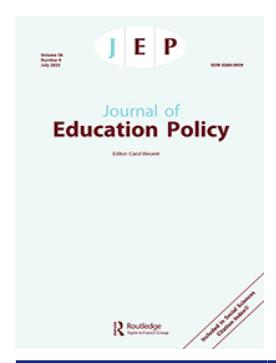
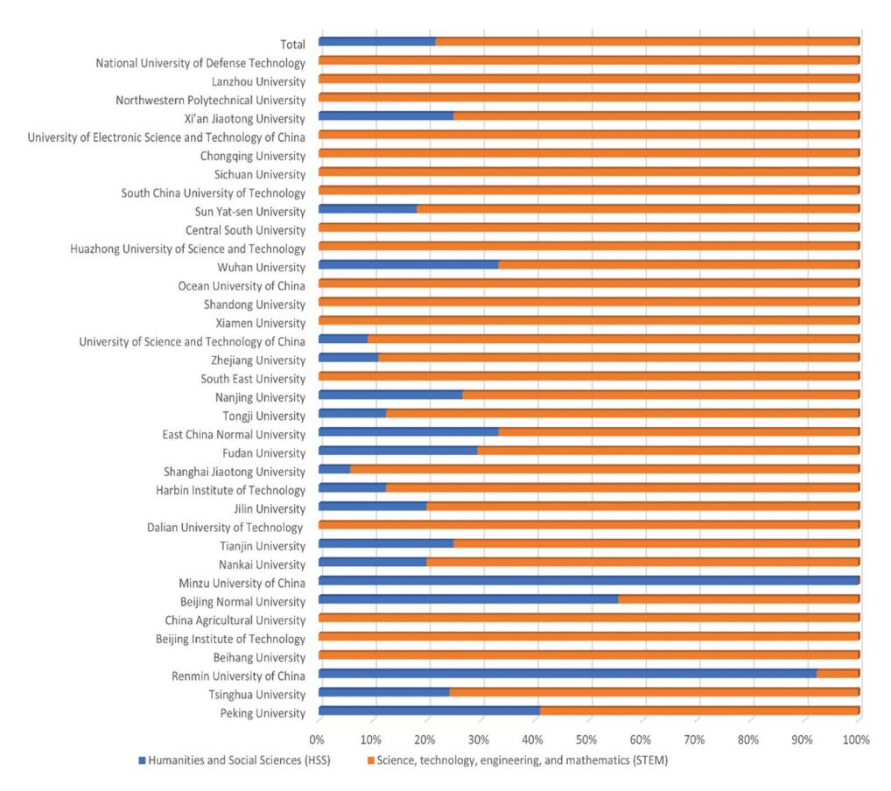
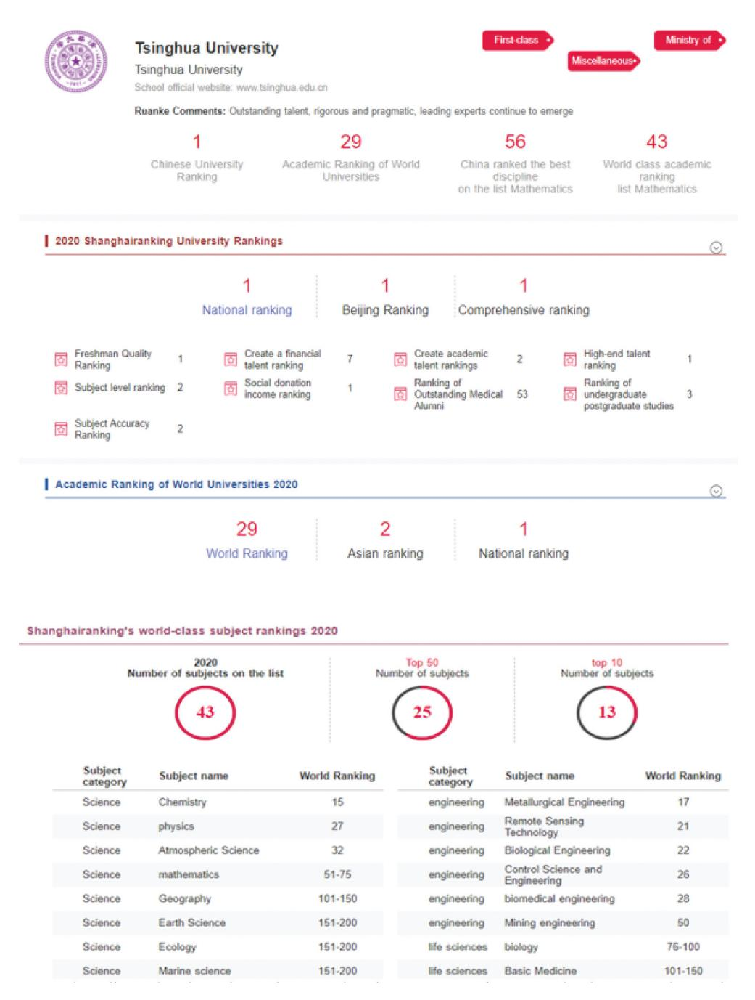

<!-- A2.R57 | source: papers_json/A2.R57/ -->

## **Journal of Education Policy**

**ISSN: (Print) (Online) Journal homepage:****[ www.tandfonline.com/journals/tedp20](https://www.tandfonline.com/journals/tedp20?src=pdf)**

## **What is the problem represented to be in China's** **world-class university policy? A poststructural** **analysis**

## **Etienne Woo**

**To cite this article:** Etienne Woo (2023) What is the problem represented to be in China's world-class university policy? A poststructural analysis, Journal of Education Policy, 38:4, 644-664, DOI: [10.1080/02680939.2022.2045038](https://www.tandfonline.com/action/showCitFormats?doi=10.1080/02680939.2022.2045038)

**To link to this article: **[https://doi.org/10.1080/02680939.2022.2045038](https://doi.org/10.1080/02680939.2022.2045038)

| Image: Open access symbol | © 2022 The Author(s). Published by Informa UK Limited, trading as Taylor & Francis Group. |
| --- | --- |
| Image: Calendar icon | Published online: 28 Feb 2022. |
| Image: Pencil icon | Submit your article to this journal Image: External link icon |
| Image: Bar chart icon | Article views: 3739 |
| Image: Magnifying glass on document icon | View related articles Image: External link icon |
| Image: CrossMark logo | View Crossmark data Image: External link icon |
| Image: Two documents icon | Citing articles: 7 View citing articles Image: External link icon |

<!-- page 2 -->

## **What is the problem represented to be in China's world-class ** **university policy? A poststructural analysis**

Etienne Woo

Faculty of Education, University of Cambridge, Cambridge, UK

## **ABSTRACT**

تتضمن الأبحاث الحالية عن سياسة الجامعة العالمية المستوى (WCU) في الصين محاور تحليلية تفضّل فاعلية الجهات الاجتماعية والمقاربة القائمة على حل المشكلات في تحليل السياسات. ويلفت أنصار ما بعد البنيوية المتأثرون بفوكو انتباهنا إلى وثيقة السياسة، التي تُعامَل كخطاب ينظم المجتمع ويديره. وباستلهام من فوكو، ينظر منهج كارول باتشي "ما المشكلة التي تُمثَّل بها؟" (WPR) إلى وثيقة السياسة كتقنية للحوكمة (governmentality). وبوصف نص السياسة حلولاً مقترحة لمشكلة، فإنه يُنتج بذاته المشكلة التي يسعى لمعالجتها. وتوجه كارول باتشي انتباهنا التحليلي إلى العقلانيات وتقنيات الحكم وآثار التذوّت (subjectification) التي تولّدها تمثيلات مشكلة معينة في سياسة WCU. وباستخدام WPR، تُظهر هذه الورقة أن WCU تُمثَّل مجرد مشكلة تقنية وإدارية وتنظيمية. وتُجسّد هذه التمثيلات WCU بشكل طبيعي في صورة مادية، مثل الإنتاج البحثي، وفي صورة زمنية من التخطيط الحكومي. ومن الناحية الجينالوجية، يمكن تتبع جذور WCU إلى الحركة النيوليبرالية لاقتصاد المعرفة. غير أن تصنيف شنغهاي قلب هذا المشهد المركز-الأطراف في نشر مفهوم WCU. ويعني نظام الحزب الواحد في الصين أن WCU يُسعى إليه على حساب التضحية بالعلوم الاجتماعية وإخضاع الأكاديميين والطلاب ليصبحوا "خبراء حمر".

## **ARTICLE HISTORY **

Received 20 August 2021 Accepted 16 February 2022

## **KEYWORDS **

Chinese higher education; Chinese world-class universities; poststructural discourse analysis; WPR approach

## **Introduction**

كتب Altbach (2004، 20): "الجميع يريد جامعة عالمية المستوى. لا تشعر أي دولة أنها تستطيع الاستغناء عنها." وقد تمكنت الصين في نهاية المطاف من امتلاك واحدة. ففي 18 سبتمبر 2020 أعلنت لجنة خبراء بالإجماع أن: "جامعة تسينغهوا أتمت بشكل شامل مهمة بناء جامعة مزدوجة الطراز الأول (جامعة عالمية الطراز الأول وتخصصات عالمية الطراز الأول) عالية الجودة؛ وأن جودة التعليم الذي تقدمه وأثرها في المجتمع وسمعتها الدولية ترتفع باستمرار، وبذلك أصبحت جامعة عالمية المستوى بكل معنى الكلمة" (Tsinghua University News 2020). وتخبرنا هذه الشهادة الذاتية بمعلومتين مثيرتين للاهتمام: 1) عدم كونها جامعة عالمية المستوى (يُشار إليها فيما يلي بـWCU) كان "مشكلة" لجامعة تسينغهوا (وبالطبع للصين أيضاً)؛ 2) "المشكلة" حُلّت الآن.

<!-- page 3 -->

سعي الصين نحو WCU سياسة وطنية مصممة من الأعلى، ممولة بسخاء من الحكومتين المركزية والإقليمية (Huang 2015، 213). وأطلقت الحكومة الصينية مشروعَي "211" و"985" عامَي 1995 و1998، على التوالي. وهدف الأول إلى تطوير 100 جامعة رائدة محلياً بحلول أوائل القرن الحادي والعشرين، وهدف الثاني إلى تعزيز تطور سمعة التعليم العالي الصيني برفع بعض الجامعات النخبوية إلى مكانة عالمية المستوى في القرن الحادي والعشرين. وكانت خطة عمل تنشيط التعليم للفترة 2003-2007 الصادرة عن مجلس الدولة قد رحّبت بالفعل ببناء WCU بوصفه استراتيجية "لتعزيز القوة الشاملة للتعليم العالي وتحسين التنافسية الدولية للصين" (وزارة التعليم [يُشار إليها فيما يلي بـMOE]، 2004، المادة الثانية). وفي نهاية المطاف، كشفت الصين عام 2015 عن أشمل سياسة WCU لديها، المعروفة بخطة بناء الجامعة العالمية الطراز الأول والتخصص الأكاديمي الطراز الأول (المعروفة عادة بخطة الطرازين الأولين المزدوجة). ومن أصل 3005 مؤسسة تعليم عالٍ في الصين، صُنِّفت 42 جامعة إجمالاً بوصفها جامعات WCU مرتقبة في خطة الصين للطرازين الأولين المزدوجة.2 (صُنِّفت 36 جامعة ضمن الفئة أ، بينما صُنِّفت ست جامعات ضمن الفئة ب الأقل مكانة.)

صيغت سياسات WCU الصينية بغرض موحّد مشترك هو حل مشكلة مفترَضة - نقص جامعات WCU في الصين. وتعكس هذه المقاربة القائمة على حل المشكلات التفكير العام السائد في بحوث WCU. ويُعتقد أن هناك صيغة لجامعة عالمية المستوى إذا تحققت "المكونات" الصحيحة (Crew 2019) أو نُفّذت خارطة طريق (Tayeb, Zahed, and Ritzen 2016) بشكل جيد لاكتساب الخصائص الصحيحة لـWCU (Salmi 2009). وتتحدى هذه الدراسة رؤية حل المشكلات في بحوث السياسات.

نحن بحاجة إلى التفكر في مصدر التفكير الذي ينطوي على حل المشكلات والانعكاسات السياسية لنموذج معين من تفكير حل المشكلات (Bacchi 2020). وينظر تحليل ما بعد بنيوي مستلهَم من فوكو إلى حل المشكلات بوصفه "معرفة حاكمة" تنظم مجتمعنا وتديره (Bacchi 2020، 84). ويقترح أنصار ما بعد البنيوية الابتعاد عن تحليل حل المشكلات في صنع السياسات للتركيز على كيفية حوكمة المجتمع بواسطة المشكلات ذاتها التي تسعى السياسات لحلها. ويمثل ذلك تحولاً في التركيز التحليلي من الحوكمة (governing) إلى الحوكمانية (governmentality). ومنهج كارول باتشي "ما المشكلة التي تُمثَّل بها؟" (WPR) أداة لتحليل الخطاب ما بعد البنيوي مستلهَمة من فوكو لتحليل السياسات. وينظر WPR إلى وثائق السياسة بوصفها "روافع" "تفتح تأملات في أشكال الحوكمة والآثار المرتبطة بها، المؤسسة من خلال طريقة معينة لتشكيل 'مشكلة'" (Bacchi and Goodwin 2016، 18). واعتماد مقاربة WPR للتحقيق في سياسة WCU يشجع الباحثين ليس فقط على الابتعاد عن "النماذج الوظيفية والعقلانية والعلمية" التي مالت إلى "العمل ضمن نموذج تقليدي (أي وضعي)" (Diem et al. 2014، 1068)، بل يتيح لهم أيضاً التفكر في لماذا وكيف تصل جوانب معينة من سياسة WCU إلى الأجندة السياسية، وفي الطرق التي تُمثَّل بها "المشكلات" وبالتالي تُنتَج في السياسة. وباستخدام WPR أداةً لتحليل السياسات، تهدف هذه الدراسة إلى الإجابة عن السؤال العام والمتشعب التالي: كيف تُبنى "مشكلة" WCU - من حيث العقلانيات وتقنيات السلطة وآثار التذوّت - في نص السياسة؟

<!-- page 4 -->

## **Education policymaking in China**

سياسة WCU الصينية هي تتويج لسنوات عديدة من الجهود المستمرة التي تقودها الدولة لتدويل التعليم العالي. وبوضع سياسة WCU في السياق الأوسع للتدويل، تسعى هذه المراجعة إلى تحديد موجز لتطور صنع سياسة WCU في سياق تدويل التعليم العالي الصيني، الذي جسّد عمليات التفكير القائمة على حل المشكلات.

## *State perspective: antidotes to backward development and lack of international * *status*

بتحليل سياسات التدويل الواسعة منذ 1949، قسّم Zheng and Kapoor تطور التعليم العالي إلى ثلاث فترات (1949-1976، 1997-2002، 2003-2019) وأظهرا أن التدويل يمكن فهمه كجزء من عملية مستمرة لتشكيل الدولة، فيما يتعلق بالتطورات الوطنية والعالمية خلال مراحل رئيسية من تطور الصين (Zheng and Kapoor 2021). وبالمثل، وبعد تتبع السياسات التعليمية الصينية من 2001 إلى 2017، حُدِّدت ثلاثة مبررات لتدويل الجامعات الصينية: التحديث الاقتصادي، وبناء رأس المال البشري، واللحاق بالغرب (Li 2017). وفي حقبة ما قبل الإصلاح (1949-1978)، اتخذ التدويل شكل السوفتة (Sovietization) في التعليم العالي الصيني، مما أسس جامعات تقنية كانت معاهد بحثية متخصصة تشرف عليها الوزارات. ومن 1978، حين قدّمت الصين الإصلاح الاقتصادي، حتى أواخر التسعينيات، انصبّ تركيز التدويل على التعلم من الغرب في صورة رأس مال بشري - سواء بإرسال طلاب برعاية حكومية إلى الخارج أو بإنشاء برامج درجات مشتركة بين الجامعات الصينية والأجنبية داخل الصين. ومنذ أواخر التسعينيات، برز أيضاً تحول خفي من التعلم من الغرب إلى تعزيز القدرة البحثية للجامعات النخبوية المحلية من أجل مزيد من التطور الاقتصادي في اقتصاد عالمي متزايد التكامل. وبعد أن تجاوزت الصين اليابان وأصبحت ثاني أكبر اقتصاد عام 2010، لم يكن امتلاك عدد من الجامعات العالمية المستوى متناسباً فقط مع القوة الاقتصادية والنفوذ الجيوسياسي المتنامي للصين، بل انسجم أيضاً جيداً مع سردية تحويل البلاد إلى "أمة اشتراكية حديثة" بحلول 2031 وأمة "مزدهرة" و"قوية" - قائدة عالمية على قدم المساواة مع الولايات المتحدة - بحلول 2049 (Nakazawa 2017). ويبدو أن تقسيم سياسات التعليم العالي إلى فترات يشير ليس فقط إلى أن هناك حلاً لمشكلة مُحدَّدة مسبقاً في سياسة لمراحل مختلفة من تحولات الصين، بل أيضاً إلى أن تغيرات السياسة مدفوعة بتغيرات في السياقات المحلية والعالمية. وينبغي إيلاء مزيد من الاهتمام لطرق خلق المشكلات في سياسة وكيف تصبح السياسة بذلك أداة لحوكمة السكان الذاتية. ومع أن كلاً من السوفتة وWCU محاكاة تهدف إلى تغذية النمو الاقتصادي الصيني، تنتج الأولى المشكلة على أنها نقص الموارد وتشتت الكوادر في التعليم العالي، بينما تنتج الثانية المشكلة على أنها اللحاق بالجامعات كثيفة البحث في الغرب. وبدورهم، كان أفراد قطاع التعليم العالي يُحكمون بدافع لتحقيق غاية غائية خلال السوفتة، في حين ينتشر التوجيه من الدولة والحكم الذاتي للأفراد في السعي نحو WCU.

<!-- page 5 -->

## *Institutional perspective: not Western enough as a 'problem'*

استوعبت الجامعات الصينية الرائدة بوعي وطواعية نموذج الجامعة النخبوية الغربية (الأنجلوسكسوني في الغالب) كمرجع في صنع سياساتها المؤسسية حين دُفعت إلى المشهد العالمي للتعليم العالي (Pan 2006). ومنذ منتصف التسعينيات، بدأت الجامعات الصينية النخبوية باعتماد الخصائص الثماني للنموذج العالمي الناشئ للجامعات البحثية: تجاوز الحدود الوطنية، وكثافة البحث، وأدوار جديدة لأعضاء هيئة التدريس، والتوظيف العالمي للموظفين والطلاب، وتنويع مصادر التمويل، والتعاون العالمي، وأشكال جديدة من العلاقات مع أصحاب المصلحة، وتعقيد داخلي أكبر (Mohrman, Ma, and Baker 2008، 7). وعكس صنع السياسات على المستوى المؤسسي بشكل وثيق الصعود العالمي للنيوليبرالية في التعليم العالي، الذي يُقدِّر "الكفاءة والقدرة على الإنجاز والأداء، ويشجع المنافسة والتميز ومعدلات العائد المرتفعة" (Zhang 2018، ص. i). وكانت الاستراتيجيتان اللتان اعتمدتهما جامعة تسينغهوا للتدويل هما "حقن بُعد دولي في تجربة الحرم الجامعي" و"إبراز نفسها في العالم" (Wang and Seddon 2014، 33). وقدّمت الجامعات الصينية متطلبات أو حوافز للأكاديميين للنشر في مجلات معروفة باللغة الإنجليزية لأن صانعي السياسات المؤسسية يعتقدون أن هذه المنشورات يمكن أن تزيد التعرض الدولي للجامعات وتوسع التعاون والتبادل الدوليين أيضاً (Xu 2020). والمعايير الدولية في التميز البحثي، وتوظيف أعضاء هيئة تدريس دوليين، واستقطاب الطلاب، والتعاون عبر الحدود، ونقل التقنية المحلية من بين أبرز تغيرات السياسة التي اعتمدتها الجامعات الصينية الرائدة الطموحة (Yang and Welch 2012). وبتأثير السياسات التي تهدف إلى نقل الصين من الأطراف إلى مركز التعليم العالي العالمي، يتعين على أعضاء هيئة التدريس أيضاً تعديل روتين عملهم اليومي، وإدراكهم للمنحة البحثية، وطرق تدريسهم (كاستخدام الإنجليزية لغة تدريس)، وعلاقتهم بإداريي الجامعة بناءً على ذلك (Kim et al. 2018). ومع أن التوجيه النيوليبرالي يدفع الجامعات الصينية النخبوية نحو نظيراتها الغربية من حيث الإنتاج البحثي والمكانة الدولية، ينشأ تناقض يصعب التوفيق بينه بين الحرية الأكاديمية التي تدعم نجاح الجامعات الغربية والرقابة الأيديولوجية الصارمة للصين. لذلك، نحتاج إلى استقصاء كيفية محاولة سياسة WCU تحقيق توازن بين "عدم الغربية بما يكفي" وخطر "أن تصبح غربية أكثر من اللازم".

## *What can WPR offer?*

يتردد صدى صنع السياسات على مستوى الدولة والمؤسسات المذكور أعلاه بقوة مع استخدام Yu لنظرية "الآثار العابرة للمجالات" لتفسير كيف تتضافر التأثيرات من المجالات الاقتصادية والسياسية وغيرها من مجالات السياسة العامة لتُحدث تغييرات في مجال السياسة التعليمية (Yu 2018). ويجادل Lingard وRawolle وTaylor أيضاً بأن السياسات علائقية بمعنى أن تشكيل مجال سياسة تعليمية عالمي، الذي يُنظر إليه بوصفه "موقعاً للتنازع بين البيروقراطيين ومستشاري السياسات والسياسيين و'الملمِّعين الإعلاميين'"، هو نتيجة انتشار منطق الممارسة من مجالات سياسة أخرى (Lingard, Rawolle, and Taylor 2005، 11). ومن هذا المنظور، تُعد سياسات تدويل التعليم العالي الصيني آثاراً منتشرة من مجالات سياسة أخرى، وتُستخدم بالتالي استراتيجيات لتعزيز التطور الاقتصادي وتحسين التنافسية الوطنية وزيادة القوة الناعمة الدولية. ويتجاوز هذا الرأي التحقيق في كيفية اكتساب مفاهيم رئيسية، مثل WCU،

<!-- page 6 -->

منطقها الخاص في إنتاج "مشكلات" بوصفها مشكلات من نوع معين (Bacchi and Goodwin 2016). علاوة على ذلك، تُفضّل هذه النظريات - الضمنية في نظرية المجال العابر والصريحة في نظرية مجال السياسة - دور رواد السياسات والمصالح المتنافسة لصانعي السياسات عبر ساحات السياسة على أهمية نص السياسة، الذي بوصفه "'أدوات وآثار' للخطاب" (Ball 2015، 2)، يحدد نظام إمكانيات مفاهيمية نبحث ضمنه.

ويطرح Han and Ye (2017) رأياً مفاده أن صنع سياسة التعليم العالي في الصين ينبغي دراسته من منظور شبكة سياسة، يسهم فيه صانعو السياسات والجامعات والمجموعات المهنية غير الحكومية جميعاً في العملية. وادعاؤهما المركزي أن مجموعات المصالح المهنية أصبحت على مر السنين صانعي سياسات مهمين للتعليم العالي في الصين. ومرة أخرى، يقلّصان دور السياسة إلى إجراءات تعالج مشكلات ثابتة معينة، مؤكدَين بذلك على دور فاعلية الجهات الفاعلة في السياسة. وهذا ادعاء لا يصمد أمام اختبار الزمن. ففي السنوات القليلة الماضية، تقلصت استقلالية الجامعات ومجموعات المصالح المهنية بشكل كبير. ويعود هذا الانقلاب بالضبط إلى الطابع الفريد للنظام السياسي الصيني الذي يذكرانه - دولة الحزب الواحد. وبدلاً من دراسة فاعلية الجهات الفاعلة المتغيرة باستمرار، قد يكون من الأجدى استقصاء صنع السياسة من منظور الحوكمانية، الذي يتضمن فهم كيفية إدارة سياسة التدويل وكيفية إنتاج أنماط ذاتية معينة (مثل "المجموعة المهنية").

تهدف هذه الدراسة إلى تقديم منظور جديد لدراسة سياسة WCU الصينية بالطرق التالية:

- (1) ينتقل موضوع تحليل السياسة من الجهات الفاعلة في السياسة إلى وثائق السياسة، التي تُعامَل كخطابات.
- (2) يدور منطق التحقيق الموجه لتحليل السياسة حول تمثيلات المشكلات في وثائق السياسة، إذ تخلق هذه النصوص مشكلات سياسة محددة بمعانٍ خاصة.
- (3) ينتقل المنطق المفاهيمي الذي يقوم عليه تحليل السياسة من الحوكمة إلى الحوكمانية. تعني الحوكمة أن الجهات الفاعلة تمتلك السلطة للتفاوض والتوجيه والتنظيم من أجل تحقيق نتيجة، في حين ترى الحوكمانية أن السلطة تُستدام من خلال عمليات وممارسات الإدارة.

## **Methodology**

## *WPR policy analysis*

في سعيهم إلى البحث الاجتماعي، لا يبحث أنصار ما بعد البنيوية عن "حقيقة" ثابتة، بل يسعون إلى فهم كيفية تشكّل الأشياء وكيفية خلق الذوات (subjectivities) بذلك من خلال الممارسات الخطابية. وتجدر الإشارة إلى أن نظريات ما بعد البنيوية تؤكد على الحقائق المتعددة والمُشكَّلة خطابياً التي تُنتَج باستمرار في سياق لجمهور معين وفي مكان معين. وبالتالي، لا يمكننا أبداً معرفة عالمنا خارج مفاهيمنا ومعرفتنا وخطابنا الحالي (Larsson 2018، 328). وبناءً على ذلك، بوصفه شكلاً من المعرفة منتَجاً اجتماعياً، ينتج الخطاب ويرسخ ويضع حدوداً لما هو ممكن التفكير فيه والحديث عنه وكتابته. ونتيجة لذلك، ندرك عالمنا ونعيشه من خلال عدسة الخطاب.

<!-- page 7 -->

وبحسب WPR، فإن تشكيل مشكلة وحلولها المقترحة سمات متأصلة في خطابات السياسة (Bacchi 2009). وبدلاً من الانخراط في كيفية تقديم صانعي السياسات وأصحاب المصلحة أو إدراكهم لتفسير مشكلة، "ينصب التركيز التحليلي على الأسس المفاهيمية لمشكلة حكومية مُحدَّدة أو أشكال المشكلة في وثائق السياسة" (Bacchi 2015، 3). ويفحص WPR بشكل نقدي طرق تقديم المشكلات في السياسات. ويشكك في الرأي التقليدي القائل بأن السياسات استجابات أو ردود فعل لمشكلات تقع خارج السياسة. وبدلاً من ذلك، يتبنى WPR رؤية أنطولوجية مفادها أن الحقائق تُنتَج في الممارسات، حيث الممارسات هي الأداءات المبنية على الخطابات والممارَسة ضمنها. ويقوم WPR على فرضية أن السياسة بوصفها حلولاً مقترحة تحتوي على تمثيلات مشكلة ضمنية، أي ما تُعتبر المشكلة عليه. وتشير الطريقة التي تُصاغ بها المشكلات والحلول وتُمثَّل إلى منطق الحوكمة (Miller and Rose 2008). وتتضمن الحكومة تحويل القضايا إلى "مشكلات"، حيث يعني هذا التحويل، بالنسبة لأنصار ما بعد البنيوية، طرق تفكير تنبثق من مقترحات السياسة لا من الأفراد بوصفهم فاعلين (Bacchi 2012، 3). ويعني تحويل الشيء إلى مشكلة أن بعض الفرضيات والافتراضات والتمثيلات تُختار على حساب أخرى بينما تُسكت تمثيلات أخرى. وهدف تحليل WPR هو استكشاف عمليات تحويل الأشياء إلى مشكلات هذه، وبذلك توفير إطار لفحص تمثيل المشكلة بوصفه أشكالاً محددة من الحوكمانية (Bacchi and Goodwin 2016، 28-29). وهي طريقة مفيدة لسؤال كيف حدث تصوير الأشياء على أنها مشكلة وتسمية هذا الاستقصاء عملية (Miller and Rose 2008، 14). ويقود التحول ما بعد البنيوي لباتشي في تحليل السياسة الباحثين إلى استجواب وإعادة التفكير في الأشكال الشائعة لتحويل الأشياء إلى مشكلات في مقترحات السياسة (Bacchi 2012، 8).

وبالنسبة لـWPR، تُعامَل وثيقة السياسة كخطاب، وهو نظام معرفي يتألف من افتراضات وفرضيات وقيم وموضوعات معينة وذوات. ونحن مَحكومون بالخطاب. وبهذا المعنى، السياسة تقنية للحوكمانية. ودور محللي السياسات هو تفكيك عمليات تحويل الأشياء إلى مشكلات من خلال تحليل تمثيلات المشكلة الواردة في وثائق السياسة، وفحص الفرضيات والجينالوجيا وقناة النشر وآثار التذوّت لهذه التمثيلات (Bacchi 2009).

ويحدد تحليل سياسة WPR ستة أسئلة مترابطة في [الجدول 1](#page-6-0). وهذه الأسئلة توجيهية للتحليل فقط. ويمكن للباحثين اختيار السؤال (الأسئلة) للتحقيق فيها، وترتيب التحقيق، أو صيغة التحقيق - سؤالاً تلو الآخر أو تحليلاً متكاملاً. وبالنسبة لهذه الدراسة، سأجري التحليل بالترتيب التالي: أسئلة WPR 1 و2 و3 و6 يليها السؤالان 4 و5. وسبب وضع السؤال 6 بعد السؤال 3 أن هذين السؤالين مرتبطان بالسياق العالمي لتطور WCU بينما يركز السؤالان 4 و5 أساساً على السياق الصيني.

## **Table 1. **WPR's six questions for analyzing policy documents.

Question 1 What is the problem represented to be in a specific policy or policies?

Question 2 What deep-seated presuppositions or assumptions underlie this representation of the 'problem' (problem representation)?

Question 3 How has this representation of the 'problem' come about?

Question 4 What is left unproblematic in this problem representation? Where are the silences? Can the 'problem' be conceptualized differently?

Question 5 What effects (discursive, subjectification, lived) are produced by this representation of the 'problem'? Question 6 How and where has this representation of the 'problem' been produced, disseminated, and defended? How has it been and/or how can it be disrupted and replaced?

<!-- page 8 -->

## *Practical texts*

يُسمّي فوكو اللوائح والمراسيم الحكومية "نصوصاً عملية"، أو "نصوصاً وصفية"، "كُتبت لتقديم قواعد وآراء ونصائح حول كيفية التصرف كما ينبغي" (1986، 12-13، مُقتبَس في Bacchi 2012، 2). ويُنظّم WPR اقتراح فوكو بأن نركز على "النصوص العملية" التي "صنعت السياسة ومارست السلطة" (Rabinow 2003، 49). وبالنسبة لـWPR، نصوص السياسة نصوص عملية لأنها تخلق فهماً معيناً لـ"المشكلات"، وبذلك توفر طرقاً "للتفكير والحديث عن ذواتنا المؤسسية، لأنفسنا وللآخرين" (Ball 2015، 2)، ووضع حد لما هو ممكن قوله أو التفكير فيه.

اختيرت ثلاث وثائق سياسة3 بوصفها نصوصاً عملية. وWCU سياسة من الأعلى إلى الأسفل أساساً. ويظل هيكل صنع السياسات في الصين هرمياً بشكل جوهري، ويظل "إقليم" صنع السياسات بيد الدولة بحزم. و"ما المشكلة التي تُمثَّل بها" في نظر الحكومة الوطنية يحدد "ما المشكلة التي تُمثَّل بها" لجميع الجهات الفاعلة الأخرى. لذلك، اختيرت سياستان من الحكومة المركزية ووزاراتها اللتين دشّنتا هذه المبادرة رسمياً. كما أُدرجت سياسة من جامعة تسينغهوا لأنها الجامعة الأولى والوحيدة في الصين التي "حققت" مكانة WCU بعد خمس سنوات من "البناء"، في 18 سبتمبر 2020. وبناءً على ذلك، فإن إضافة وثيقة تسينغهوا إلى التحليل ذات صلة بفهم تمثيلات WCU. وتُعد هذه الوثائق نصوصاً عملية لأنها وصفية في تقديم قواعد حول ما يمكن أو ينبغي للجامعات والأفراد فعله سعياً وراء WCU. علاوة على ذلك، تُستخدم هذه السياسات روافع لقراءة سياسات أخرى ذات صلة، لم تُدرَج هنا بسبب ضيق المساحة.

عنوان هذه الوثائق وسنة إصدارها كما يلي:

- Notice of the State Council on the Overall Plan for Promoting the Construction of World First-Class Universities and First-Class Disciplines, 2015 (hereafter, WCU Plan, 2015) [国务院:《统筹推进世界一流大学和一流学科建设总体方案的通知》]
- Notice of the Ministry of Education, the Ministry of Finance, and the National Development and Reform Commission on Printing and Distributing the Implementation Measures for Promoting the Construction of World First-Class Universities and First-Class Disciplines (Provisional), 2017 (hereafter, *WCU * Implementation Plan, 2017) [教育部, 财政部, 国家发展改革委:《统筹推进世界 一流大学和一流学科建设实施办法 (暂行) 的通知》]
- Tsinghua University World-Class University Construction Plan, 2017 (hereafter, Tsinghua Plan, 2017) [清华大学:《清华大学一流大学建设高校建设方案》]

## **Analysis**

## *What is the problem represented to be in Chinese WCU (WPR's Question 1)*

يبدأ المدخل الأول لتحليل WPR بالحلول المفترَضة التي نعمل من خلالها بشكل عكسي عبر نصوص السياسة لفحص تمثيلات المشكلة الضمنية، وكيف تُنتج الحلول المقترحة "المشكلات" في مقترحات السياسة. ويبدو أن أبرز مشكلة هي أن العدد غير الكافي من جامعات WCU والتخصصات عالمية المستوى داخل الجامعات يعيق "التنافسية الوطنية الأساسية للصين" و"أساس التنمية طويلة الأجل" ويعرقل "القفزة التاريخية من دولة كبيرة في التعليم العالي إلى دولة قوية في التعليم العالي" (WCU Plan 2015،

<!-- page 9 -->

Introduction). والحلول الموصوفة لتحقيق WCU مباشرة في وثائق السياسة ويمكن تلخيصها بشكل عام في تحسينات في المجالات التالية: 1) المواهب: أعضاء هيئة تدريس عالميو المستوى وطلاب مبتكرون؛ 2) بحث عالي المستوى وتسويقه؛ 3) أبعاد دولية: تبادلات وتعاون؛ 4) تمويل مرتبط بالأداء للجامعات؛ و5) دورات خطة خمسية لبناء WCU تبدأ عام 2016 (WCU Plan 2015، 'مهام البناء'4، 'مهام الإصلاح'، 'تدابير الدعم').

لذلك، تُمثَّل المشكلة بوصفها مشكلة تقنية وإدارية - توظيف الموارد البشرية، وتمويل الإنتاج البحثي، واستراتيجيات التدويل - وكذلك مشكلة تنظيمية من الأعلى إلى الأسفل، وهي التخطيط المركزي الذي تقوده الدولة. وهذه التمثيلات للمشكلة ليست جديدة تماماً بل استمرار لتمثيلات سياسة سابقة. فمثلاً، ضخّت الحكومتان المركزية والإقليمية نحو 10 مليارات دولار أمريكي إجمالاً في المرحلتين الأولى والثانية من مشروع "985" (1999-2003 و2004-نحو 2011)، اللتين استفادت منهما 34 و39 جامعة، على التوالي (Huang 2015، 208). وفي وقت مبكر يعود إلى 2008، أسست الحكومة الصينية خطة الألف موهبة التي تهدف إلى استقطاب كبار العلماء والأكاديميين ورواد الأعمال الصينيين في الغرب للعودة إلى الصين بحزم تعويضات سخية وفرص تقدم وظيفي واعدة (Barry and Kolata 2021). ومن هذا المنظور، تعمل سياسة WCU فعلياً على "وضع نبيذ جديد في زجاجات قديمة"، وهو استعارة صينية، تصف في هذه الحالة سياسة جديدة (سياسة WCU) تُنفَّذ بأشكال قديمة. ومن اللافت أيضاً أن تطور طموحات الصين لـWCU من "211" إلى "985" إلى خطة WCU لم يُحدث توضيحاً مفاهيمياً تدريجياً لمعنى "عالمي المستوى". وفي جميع وثائق السياسة، لا يوجد حتى تعريف عام لعالمية المستوى. وليس من قبيل المبالغة القول إن تمثيلات المشكلة في سعي الصين نحو WCU منذ التسعينيات كانت في حالة ركود.

وبشكل متناقض، لا بد أن تكون "عالمية المستوى" صينية بالكامل. ولتوجيه بلوغ WCU، تُحدَّد أيضاً مبادئ سياسية في السياسات، تشمل "التنفيذ الشامل لسياسة الحزب التعليمية، والالتزام بالتوجه الاشتراكي في إدارة المدارس، وتعزيز قيادة الحزب على الكليات والجامعات ... تدريب خلفاء القضية الاشتراكية وخدمة التحديث الاشتراكي بشكل أفضل" (WCU Plan 2015، 'المبادئ العامة'). إضافة إلى ذلك، يجب أن تكون جامعات WCU الصينية حاملة وموروثة لـ"الثقافة الصينية الممتازة" و"القيم الاشتراكية الأساسية" (WCU Plan 2015، 'مهام البناء'). وبهذا المعنى، يتمثل جانب آخر من تمثيل مشكلة WCU في أن WCU الصينية يجب أن تكون "صينية"، أي شبيهة بالغرب. وسيتناول القسم أدناه عن آثار تمثيل المشكلة (WPR Question 5) هذه المبادئ.

## *The Reification of WCU (WPR's Question 2)*

يسأل السؤال 2 عن الفرضيات أو الافتراضات التي تقوم عليها تمثيل المشكلة المحدد. وهذا هو الحال مع مفهوم عالمية المستوى. وتركز طموحات الصين لـWCU على الجوانب الملموسة والقابلة للقياس من "التميز"، التي تشمل أساساً منشآت متميزة، وأكاديميين معروفين، وإنتاجاً بحثياً عالي التصنيف، واعترافاً يتجاوز الحدود الوطنية (Douglass 2016). ومحركات تحقيق التميز هي المنافسة والروح الريادية والتمويل الحكومي المرتبط بالأداء. وتوصيفات WCU نمطية وضيقة الأفق، وتبسّط

<!-- page 10 -->

الطبيعة المتشعبة والمعقدة لمفهوم عالمية المستوى إلى بضعة مقاييس أساسية، بينما تغض الطرف عن التاريخية والجذور والصفات الأخرى الصعبة القياس. وقد نُوقشت هذه التمثيلات بالتفصيل في الأدبيات. وسأخصص مساحة أكبر لتمثيل قابلية تحقيق WCU من خلال التخطيط من الأعلى إلى الأسفل.

تنتج الخطط الخمسية عن الفهم المبسط لـWCU وعادة الدولة الصينية في التخطيط. فحين أسس الحزب الشيوعي الصيني (الحزب) جمهورية الصين الشعبية عام 1949، تبنت الصين نموذج الاتحاد السوفيتي للاقتصاد الموجَّه مركزياً. وأحد السمات المميزة لهذا النموذج خطته الخمسية، التي يُستخدم فيها تحليل المدخلات والمخرجات لحساب أهداف كل صناعة عبر خمس خطط سنوية (Perkins 2015، 43). وبعد الانتقال من اقتصاد موجَّه بالكامل إلى اقتصاد سوق بخصائص صينية، لا تزال الخطط الخمسية تُوضع، وإن كان ذلك فقط لـ"التوجه العام لسياسة الحكومة وبرنامج الاستثمار الحكومي" (Perkins 2015، 53). وWCU خطة وطنية من هذا النوع تُظهر منطق تحقيق هدف استراتيجي وطني من خلال تصميم سياسة من الأعلى إلى الأسفل وتنفيذ موجَّه بتخصيص موارد سخي. وتنص المادة 155 من WCU Implementation Plan (2017) على أن تمويل بناء جامعات WCU مدعوم من الحكومة المركزية. وفي 2019، سجلت 30 من أغنى الجامعات النخبوية الصينية إنفاقاً سنوياً يتجاوز مليار دولار أمريكي - رقم لم يتجاوزه سوى في الولايات المتحدة (Hartley and Jarvis 2021، 9).

وكما هو الحال مع كل التخطيط المركزي، تُحدَّد الأهداف بوضوح منذ البداية: بحلول 2020، ستصبح بعض الجامعات والتخصصات عالمية المستوى وستصبح بعض التخصصات رائدة عالمياً، وبحلول 2030، ستصبح جامعات وتخصصات أكثر عالمية المستوى ورائدة عالمياً، مع زيادة ملحوظة في الجودة الشاملة للتعليم العالي (WCU Plan 2015، قسم 'الأهداف العامة'). وتُظهر مكانة WCU التي شهدتها جامعة تسينغهوا لنفسها أثر النبوءة المحققة لذاتها للتخطيط الوطني. ولو لم تصبح (أو جامعة أخرى) عالمية المستوى عام 2020، لكان ذلك يعني أن التخطيط قد فشل.

## *Linking economic neoliberalism and knowledge-based economy to WCU (WPR's * *Question 3)*

هدف السؤال 3 هو "التفكر في التطورات والقرارات المحددة (الممارسات غير الخطابية) التي تسهم في تشكيل تمثيلات المشكلة المحددة" (Bacchi 2009، 10). والجينالوجيا في WPR ليست تاريخاً زمنياً مفصلاً للأصول. وسأستقصي تحديداً حركة عالمية للأسباب التالية:

- (1) WCU متموضعة أصلاً ضمن سياق أوسع من العولمة وانتشار النيوليبرالية العالمية.
- (2) تمثل حركة WCU اتجاهاً عالمياً نحو التماثل (isomorphism)، وبالتالي "ينبغي ألا تُدرس من منظور وطني بحت بل يجب أن تشمل إمكانية المجالات التنظيمية عبر الوطنية والضغوط الدولية للتقارب مع تلك المجالات. نحتاج إلى تحديد العوامل الدولية التي تخلق ضغوطاً للتوافق وتشجع اعتماد الأنماط العالمية" (Beerkens 2008، 24).

<!-- page 11 -->

(3) WCU ليس مفهوماً صينياً أصيلاً. بل على العكس، هو مفهوم طُوِّر في الغرب واستُلهم من الجامعات النخبوية الغربية. لذلك، من الضروري سد الفجوة بين نشأته في الغرب وإنباته في الصين.

مثّل الإصلاح والانفتاح6 اللذان قادهما دنغ شياو بينغ "بناء نوع معين من اقتصاد السوق يدمج بشكل متزايد عناصر نيوليبرالية متشابكة مع سيطرة مركزية استبدادية" (Harvey 2007، 120). وفي بحثها عن بديل لنموذج التعليم العالي السوفيتي، اتجهت الصين نحو الولايات المتحدة، التي وفّرت نموذجاً وتبريراً نيوليبرالياً (Zhao and Zhu 2010، 118). وبدأت فكرة WCU بالظهور في السياسات الصينية في أوائل الألفينيات، حين ارتبط دور تدويل التعليم العالي الصيني بشكل متزايد بالتنافسية الاقتصادية الصينية في السوق العالمية (Wang and Seddon 2014).

وضمن التعليم العالي الصيني، نبت مفهوم WCU في سياق اقتصاد المعرفة (KBE). واقترح تقرير التنمية العالمية للبنك الدولي 1998/99: المعرفة من أجل التنمية (World Bank 1999) اقتصاد المعرفة إطاراً تنموياً للدول النامية للحاق بالاقتصادات المتقدمة. وبناءً على طلب الحكومة الصينية، سعى البنك الدولي لمعالجة كيفية ضمان الصين تطورها الاقتصادي المستدام في القرن الحادي والعشرين وتقدم موقعها في الثورة المعرفية العالمية من خلال ترقية الإصلاحات المؤسسية والتعليم والبحث والتطوير (Dahlman and Aubert 2001). وبحسب تقرير البنك الدولي الصين واقتصاد المعرفة: اغتنام القرن الحادي والعشرين، ينبغي أن تكون الجامعات الصينية الرائدة الجهات الفاعلة الرئيسية في تحول الصين إلى اقتصاد معرفة، تدرّب المفكرين والقادة المستقبليين وتظل منخرطة بنشاط ومباشرة في توليد المعرفة وتطبيقها من أجل النمو الاقتصادي (Dahlman and Aubert 2001، 132). وبحسب هو أنغانغ، مدير معهد دراسات الصين المعاصرة في جامعة تسينغهوا، أُدرجت أفكار كثيرة من التقرير في الخطة الخمسية الوطنية العاشرة للصين وتخطيط مشروع التطوير الخاص الخمسي العاشر في التعليم والعلوم والتقنية (Hu 2002، 4). وظهرت عوامل تمكين اقتصاد المعرفة أيضاً في ورقة عمل سياسة البنك الدولي لعام 2007، الصين واقتصاد المعرفة: التحديات والفرص (Zeng and Wang 2007)، التي حددت "ضعف القدرة الابتكارية المحلية، وتدني جودة التعليم العالي، وعدم ملاءمته الكافية للسوق"، و"الروابط الضعيفة" بين معاهد البحث والتطوير الحكومية والأعمال والجامعات عوائق أمام اقتصاد المعرفة (Zeng and Wang 2007، 20-21).

وفي الغرب، مفهوم اقتصاد المعرفة "وصف تجريبي" و"معيار شبه مرجعي للسمات المركزية للاقتصادات القائمة"، يمكن أن يعزز تسخيره وتحسينه التنافسية (Jessop 2008، 25). وفي المقابل، طمحت الصين في الألفينيات إلى بناء اقتصاد معرفة يمكن أن يدعم النمو الاقتصادي المستدام محلياً ويدمجها في الشبكة الاقتصادية العالمية.

كما لاحظ Yang أنه في التسعينيات وأوائل الألفينيات، "أعارت" منظمات دولية أخرى، مثل منظمة التجارة العالمية، أيديولوجيتها للأصولية السوقية في صورة "مستشارين خبراء لقطاع التعليم العالي الصيني" (Yang 2010). واقتصاد المعرفة لا ينفصل عن المتخيَّل النيوليبرالي، حيث تُعتبر المعرفة شكلاً جديداً من رأس المال التنافسي يرتبط إنتاجه بالأساسيات الاقتصادية. ولإطلاق الإمكانات التنافسية، تدعو النزعة التنموية النيوليبرالية إلى نظام اقتصادي عالمي، وإعادة توجيه استراتيجية وطنية للتعليم العالي، و

<!-- page 12 -->

تنظيم ذاتي مؤسسي وفردي مرتبط بالأداء. وفي الفترة نفسها تقريباً، حدث التسويق واللامركزية إلى جانب تعميم التعليم العالي في الصين. وشملت بعض الإصلاحات الفارقة فرض رسوم دراسية جامعية على الطلاب، وإنشاء آليات منافسة داخلية داخل الجامعات وبينها، وإنشاء مساقات ودرجات مولّدة للرسوم (Mok 2000). ومهّدت الطريق لظهور مشروع WCU.

وتُعتبر سياسة WCU تصحيحاً للمشكلات المتأصلة في سابقيها - مشروعَي "211" و"985". وكان أحد عيوبهما "تصلب الهوية" (طريقة أخرى للقول إن الجامعات النخبوية ينبغي ألا تستقر على مكانتها المرموقة وينبغي أن تسعى إلى مزيد من المنافسة)، وكذلك "نقص المنافسة والازدواجية والتداخل في البحث"؛ ولذلك يُؤمَل أن تتمكن جامعات WCU من "توحيد الموارد والابتكار" (WCU Plan 2015، 'المقدمة'). والترياق الموصى به هو "إنشاء وتحسين آلية تقييم الأداء واعتماد التقييم بواسطة طرف ثالث بفعالية" لأن هذه التدابير يمكن أن تحسّن "علمية ومصداقية" نظام ضمان الجودة (WCU Plan 2015، 'تعزيز الأداء، الدعم الديناميكي'). علاوة على ذلك، يمكن للتمويل القائم على التقييم أن يعزز كفاءة جامعات WCU المحتملة (WCU Plan 2015، 'تعزيز الأداء، الدعم الديناميكي').

## *University ranking: movers and shakers of WCU (WPR's Question 6)*

يشير السؤال 6 إلى نشر تمثيلات مشكلة معينة وإنتاجها. والتصنيفات العالمية هي معيار مكانة عالمية المستوى رغم أن "التصنيفات أرست تجانساً عالمياً حاداً بمحركات واضحة لسياسة واستراتيجية مؤسسية" (Marginson 2018، 32-35). وتقدم التصنيفات ذريعة كاذبة بأن "تميز" WCU يمكن إثباته ببعض الإحصاءات. وتُستمَد قوة التصنيفات من التكافؤ الخاطئ بين مرتبة جامعة في التصنيفات ومقياس "قابل للقياس" لتميزها.

ولن تكتمل دراسة عن WCU دون فحص التصنيف الأكاديمي للجامعات العالمية (ARWU)، وهو من ابتكار مركز الجامعات العالمية المستوى (CWCU) في جامعة شنغهاي جياو تونغ، الذي أُسس عام 2002.7 وعُيِّن CWCU بوصفه وحدة بحثية استراتيجية من قِبل وزارة التعليم الصينية عام 2005 اعترافاً بـ"تقليده الطويل في تقديم تقارير استشارية عالية الجودة للحكومة الصينية بشأن استراتيجيات بناء جامعات عالمية المستوى وسياسات علمية وتقنية أخرى" (MOE 2005). وذكر Liu، مؤسس ومدير CWCU، صراحةً أنه "لتحليل موقع الجامعات الصينية كمياً في النظام الجامعي العالمي واكتشاف الفجوة بينها وبين الجامعات عالمية المستوى، من الضروري المقارنة الكمية والتصنيف بناءً على مؤشرات قابلة للمقارنة دولياً" (Liu, Cheng, and Liu 2005، 10). وقدّم ARWU للحكومات والجامعات الصينية خارطة طريق نحو "التميز"، مغيّراً بشكل كبير اتجاه صنع سياسة التعليم العالي من حيث الأدوات والغرض والنتيجة. ويُنظر إلى التصنيف بوصفه "أداة سياسة" (Salmi and Saroyan 2007) يمكن أن تساعد جامعات الصين النخبوية على أن تصبح رائدة عالمياً.

وينظم CWCU مؤتمرات كل عامين حول مواضيع متنوعة لمفهوم WCU منذ 2005 في شنغهاي. وجمعت المؤتمرات أكاديميين بارزين ورؤساء جامعات وصانعي سياسات ومسؤولين حكوميين ومديرين تنفيذيين لشركات تجارية في التعليم العالي. وشملت القوائم Simon Marginson (جامعة أكسفورد)، وMarijk van der Wende (جامعة أوترخت)، وWilliam Kirby

<!-- page 13 -->

(جامعة هارفارد)، ورئيسَي جامعة لودفيغ-ماكسيميليان في ميونخ بألمانيا وجامعة فرجينيا في الولايات المتحدة، ومستشار سياسات البنك الدولي السابق Jamil Salmi، ومدير المركز الأوروبي للتعليم العالي، والرئيس التنفيذي لمجلس تمويل التعليم العالي لإنجلترا، على سبيل المثال لا الحصر. وهؤلاء الأفراد من أبرز مؤثري الحركة العالمية لـWCU. وتشكل مشاركتهم وأفكارهم صيغة مفهوم WCU ومحتواه واتجاهه. ويسرد [الجدول 2](#page-12-0) مواضيع المؤتمرات السابقة. ومن 2005 إلى 2019، شهدنا تجسيداً تدريجياً لتعريفات WCU وأبعادها المفاهيمية كمفهوم، تتراوح بين خصائص WCU وأهدافها، والاستراتيجيات الوطنية لتحقيق WCU، إلى أثر WCU في الصالح العام العالمي والعولمة.

وبعد ترسيخ نفسه بقوة كواحد من المرجعيات العالمية في التصنيفات الدولية، أطلق ARWU تصنيف أفضل الجامعات الصينية وتصنيف أفضل التخصصات الصينية عامَي 2015 و2017، على التوالي. ومع نشر هذين التصنيفين، نرى تصنيفاً عالمياً، إلى جانب مقاييسه، يُسقَط على التعليم العالي المحلي. وبالنسبة للتصنيفات المحلية، تُعرض التصنيفات الوطنية والآسيوية والعالمية جنباً إلى جنب في الملف المؤسسي للجامعة، كما يُظهر [الشكل 1](#page-14-0)، مما يتيح للمستخدمين اكتشاف مرتبة جامعة في كل فئة تصنيف على الفور، وكذلك إمكانية التحسين. وفي أسفل الملف، تُدرَج مراتب جميع تخصصات الجامعة المذكورة في التصنيف العالمي للتخصص. وتقيس هذه الخطوات الجامعات الصينية بشكل مباشر مقابل مكانتها العالمية ومكانة نظيراتها. وحين وُضع ARWU للمرة الأولى، كانت WCU هدفاً بعيداً للصين. غير أنه في أقل من عقدين، بدأت الجامعات الصينية الرائدة بالانتقال من الأطراف إلى مركز التعليم العالي العالمي. ونجح ARWU في جهده لترسيخ مفهوم WCU محلياً وطبعه على الجامعات الصينية.

Source: Source: Partially compiled from information obtained from the Graduate School of Education, Shanghai Jiaotong University, [http://gse.sjtu.edu.cn/En/News/72](http://gse.sjtu.edu.cn/En/News/72)

<!-- page 14 -->

## *Silenced knowledge in Chinese WCU (WPR's Question 4)*

يمكن اعتبار تهميش تمثيل معين في نص السياسة أيضاً إسكاتاً لأنه لا يحصل على الصوت الذي يستحقه. وفي الوثيقتين المركزيتين، ظهرت كلمة "العلم" (بمعنى التقنية أو العلوم "الصلبة") 29 مرة، بينما لم تظهر "الإنسانيات" على الإطلاق وظهرت "العلوم الاجتماعية" ثلاث مرات، مرتان منها كانتا "نظام الفلسفة والعلوم الاجتماعية الصيني" (WCU Plan 2015، 'مهام البناء' وWCU Implementation Plan 2017، المادة 5) ومرة واحدة كانت عن "بحث الفلسفة والعلوم الاجتماعية الذي يوفر دعماً فعالاً لحل المشكلات النظرية والعملية الرئيسية في التطور الاقتصادي والاجتماعي" (WCU Implementation Plan 2017، المادة 7). وفي وثيقة تسينغهوا، ظهر "العلم" 37 مرة، بينما ظهرت "الإنسانيات" و"العلوم الاجتماعية" ثماني مرات لكل منهما. وتهميش الإنسانيات والعلوم الاجتماعية (HSS) في خطاب السياسة جدير بالملاحظة.

وبما أن ملف WCU مُعيَّر بالتصنيفات العالمية، تُشكِّل المؤسسات استراتيجياتها لتعظيم تصنيفاتها في العلوم الفيزيائية/الهندسة والعلوم الحياتية/الطب - وهما المجالان اللذان تُقدِّرهما التصنيفات أكثر من غيرهما (Marginson 2018، 32). علاوة على ذلك، أصبحت تخصصات العلوم والتقنية والهندسة والرياضيات (STEM) بشكل متزايد مسعى تعاونياً عبر وطني بعد التسعينيات (Marginson 2021a، 9). ونتيجة لذلك، تنطوي تخصصات STEM، خلافاً لـHSS، على مزيد من التعاون الدولي والإنتاج في الساحة الدولية. ويعني ذلك ظهوراً وتأثيراً أكبر. وكما يُظهر [الشكل 2](#page-15-0)، في تطور WCU الصيني، يعكس التركيز الأحادي اللون على تطور تخصصات STEM ترديداً واسعاً لمُسلَّمة تُعادل الإنجازات في STEM بمكانة عالمية المستوى.

ومن المثير للاهتمام أن نجاح سعي الصين الحصري لتخصصات STEM، كما يتجلى في الصعود المستمر لجامعاتها الرائدة في التصنيفات، عزز، بدلاً من زعزعة، تمثيلات مشكلة WCU، مثل إمكانية تحقيق WCU والأهمية القصوى لـSTEM. وبفضل التأثيرات المجتمعة للتمويل الوطني للعلوم، والتركيز الاستراتيجي على بعض التخصصات العلمية، واستراتيجية التدويل القائمة على التعاون مع الشركاء العالميين، أصبحت الصين الآن أكبر منتج للأوراق البحثية ورقم واحد في أجزاء من العلوم الفيزيائية ضمن STEM (Marginson 2021b). وإذا اعتُبر عدد الأوراق عالية الاستشهاد في العلوم العالمية مقياساً للتميز، فقد حققت الجامعات الصينية الرائدة مكانة عالمية المستوى بشكل قاطع (Marginson 2021b)؛ وكما أُشير في وثيقة تسينغهوا، ينتج الصعود المستمر لتسينغهوا في التصنيفات عن التحسن المستمر في "قوتها الشاملة وتأثيرها الدولي" (Tsinghua Plan 2017، الفصل 1، القسم 2). وإذا نظرنا من هذا المنظور غير المتوازن، يبدو أن شهادة تسينغهوا الذاتية لـWCU مبررة.

وإهمال HSS في سياسة WCU الصينية يُعزى جزئياً فقط إلى أولوية الصين في اللحاق بتخصصات STEM أو حاجز اللغة الإنجليزية الذي يواجهه العديد من أكاديميي HSS الصينيين. ويتعلق السبب الجوهري للتهميش بالقيود الأيديولوجية للنظام السياسي الصيني، التي تملي ما يمكن أو ينبغي بحثه. ويمكن لباحثي STEM إجراء بحث غير مقيد، بينما يتعين على باحثي HSS "الرقص داخل القفص" (Yang, Vidovich, and Currie 2007). ويُظهر فحص وثائق السياسة أن HSS تُصاغ دائماً في سياق الأيديولوجيا الاشتراكية أو ما يُسمى النظام الخاص لـHSS ذي الخصائص الصينية. بعبارة أخرى، تملي هذه السياسات أن يكون العلم عالمياً، لكن HSS الصينية صينية حصرياً.

<!-- page 15 -->

***Figure 1. **Imbrication of domestic and international ranking: Tsinghua example. *Source*: *[https://www.](https://www.shanghairanking.cn/institution/tsinghua-university)** * *[shanghairanking.cn/institution/tsinghua-university ](https://www.shanghairanking.cn/institution/tsinghua-university)**web page translated using Google Translate.**

<!-- page 16 -->

***Figure 2. **The overwhelming share of STEM subjects in WCU policy. Source*: Compiled from MOE's * *'Double Firsts' Subjects Construction List issued in 2017. Marxist Theory is excluded because it is ideology * *rather than a social science discipline. Geography is also excluded because I cannot distinguish between * *human and physical geography. Business management and urban planning are counted as HSS.**

ونتيجة لذلك، تحدث "القفزة الكبرى إلى الأمام" لـHSS الصينية بشكل رئيسي على الصعيد المحلي وتماشياً مع الأيديولوجيا الموالية للحزب. وأدخل شي جين بينغ حقبة جديدة من الرقابة الأيديولوجية حين وصل إلى السلطة عام 2012. وتوجد حالياً 18 مركزاً - بما فيها مركز في تسينغهوا - مخصصة لدراسة فكر شي جين بينغ. وشهدت ثلاثة مجالات من أصل 23 تخصصاً في العلوم الاجتماعية ممولة من الصندوق الوطني للعلوم الاجتماعية زيادة ملحوظة في التمويل على حساب تخصصات مثل الاقتصاد والقانون والأدب والفلسفة. وهذه التخصصات الثلاثة هي 1) الماركسية والاشتراكية العلمية؛ 2) الدراسات العرقية؛ و3) تاريخ الحزب وبناء الحزب (Thomas 2020).

ونمو بحث الصين العلمي العالمي وبحث HSS المحلي المدفوع بالأيديولوجيا وجهان لعملة WCU نفسها. وعلى الصعيد العالمي، طغى الصعود الصاروخي للقدرة الصينية في العلوم على الأداء الباهت في HSS، إن لم يُضفِ عليه الشرعية. والصين مصممة على تكرار نجاح الجامعات النخبوية الغربية في تخصصات STEM. وفي الوقت نفسه، تريد توظيف هذا النجاح لدعم نظام تعليم عالٍ تسنده أيديولوجيا. وربما قدمت الصين مثالاً سيئاً للجامعات الطموحة في الدول النامية بتقديم تمثيل مشوَّه لما

<!-- page 17 -->

يمكن أن تبدو عليه جامعات WCU. علاوة على ذلك، نعيش في عالم تُتحدى فيه الأسس الديمقراطية للمجتمعات بشكل متزايد، إن لم تكن مهددة، وحيث يصبح مستقبلنا غير مؤكد بسبب عوامل مثل تغير المناخ وجائحة كوفيد-19؛ وتهميش HSS ذات العقلية العالمية يضر بقدرتنا الجماعية على مواجهة هذه التحديات.

## *Effects of WCU representations (WPR's Question 5)*

يستقصي السؤال 5 الآثار الناتجة عن تمثيلات مشكلة معينة. وتُنتج تمثيلات المشكلة المحددة آثار تذوّت معينة في المؤسسات والأفراد (Bacchi 2009، 15). ويتأثر الأفراد في الجامعات الصينية بـWCU على جبهتين. فهم يشتركون مع نظرائهم الغربيين في نوع مماثل من الآثار الخطابية والمعيشة والذاتية التي يحدثها التمثيل النيوليبرالي لـWCU. فمثلاً، يعني الأثر المعيش للتعليم العالي النيوليبرالي أن على الأكاديميين مواءمة عملهم مع الاقتصاد وجعل التعليم قطاع خدمات فعالاً وتنافسياً. ونتيجة لذلك، يخضعون للأدائية والمساءلة والمسؤولية الذاتية.

ويرتكز سعي الصين نحو WCU على نظامها السياسي ويتميز به - دولة الحزب الواحد الماركسية اللينينية. ونعود الآن إلى المبادئ المحددة في البداية (في الجزء الثاني من السؤال 1). وتُلزَم جامعات WCU الصينية المُعيَّنة بأن تكون "وريثة للثقافة الصينية التقليدية" (WCU Implementation Plan 2017، المادة 7)، و"تطيع قيادة الحزب" (WCU Implementation Plan 2017، المادة 25). وواجبها الأول "تعزيز البحث الذي يعزز المصالح الوطنية" (WCU Implementation Plan 2017، المادة 5). وخطابياً، تولّد وثائق السياسة هذه "نظام حقيقة" تصبح فيه ثنائية الولاء للحزب/عدم الولاء له والثقافة التقليدية/الغربية متعارضة وغير قابلة للتوفيق. ويصبح الولاء السياسي والالتزام بـ"الثقافة التقليدية" حقائق لا جدال فيها رغم أن هذه المفاهيم الرئيسية غامضة للغاية.

وإلى جانب تعريف أنفسهم بوصفهم باحثين ومتعلمين، يصبح أعضاء هيئة التدريس والطلاب أيضاً ذوات سياسية من خلال "استحضار سلوكيات ومشاعر وآراء معينة" (Bacchi 2009، 93)، مثل الالتزام الصارم بالخط الأيديولوجي للحزب (Tsinghua Plan 2017، الفصل 1، القسم 2)، أو الالتزام بالقيم الاشتراكية الأساسية والسعي لأن يصبحوا محترفين "حمراً" يدعمون الاشتراكية ويخدمون المصالح الوطنية، مثل التحديث الاشتراكي (Tsinghua Plan 2017، الفصل 1، القسم 2). ويتناقض هذا التذوّت بشكل حاد مع الذوات النيوليبرالية المذكورة أعلاه. وكان "الأحمر والخبير" بوصفه مفهوماً يبرر خضوع المثقفين لأيديولوجيا الحزب شائعاً منذ الحقبة الماوية، ويبدو أن سياسة WCU تعزز هذا التذوّت.

والآثار المعيشة عواقب مادية يواجهها الأفراد في حياتهم اليومية. والتعليم الأيديولوجي جزء لا غنى عنه من "المعرفة" في الجامعات الصينية، إذ يمثل 10% من منهج البكالوريوس (Jiang 2018). وفي ديسمبر 2017، أصدرت وزارة التعليم وثيقة سياسة تنص على أن "الأداء الأيديولوجي والسياسي" سيكون المعيار الأثقل وزناً منفرداً في تقييم أعضاء هيئة التدريس. ولا يحدث تذوّت الأفراد على المستوى السياسي فقط. ويمنح تعيين الأفراد وريثين للثقافة الصينية أو خلفاء للتحديث الاشتراكي والقيم الاشتراكية الأساسية إحساساً زائفاً بالاستحقاق والغاية والفاعلية بل والتحرر. ويصوّر تضبيب هذه المفاهيم، بمساعدة التكرار المتواصل و

<!-- page 18 -->

الترسيخ، حسّاً مشتركاً بديهياً، يُخضع فيه الأفراد أنفسهم طواعية ليمنحوا ولاءهم لمشروع الدولة المهيمن (Gramsci 1971).

## **Conclusion**

اتبع تحليل السياسات تقليدياً تقليداً تفسيرياً يُؤكَّد فيه على فاعلية الأفراد. وعلى مستوى صياغة السياسة، يحاول باحثو سياسة التعليم الصيني فهم مبررات السياسة وأجنداتها أو تنسيق المصالح بين الجهات الفاعلة في السياسة (مثلاً Han and Ye 2017). وعلى المستوى المؤسسي، يركز الباحثون على الاستراتيجيات التي تعتمدها إدارة الجامعات في استجاباتها لدعوات بناء WCU (مثلاً Pan 2016). وتُجرى دراسات إثنوغرافية لاستكشاف أثر الأبعاد النيوليبرالية لسياسة WCU في أعضاء هيئة التدريس والطلاب، مثل ضغط النشر في المجلات الدولية (مثلاً Xu 2020). بعبارة أخرى، ينصب تركيز هذه التحليلات على كيفية انخراط الأفراد مع السياسات وتفسيرهم لها. وفي المقابل، في ما بعد البنيوية المتأثرة بفوكو، "ينصب التركيز التحليلي على الأسس المفاهيمية لمشكلات حكومية محددة ... بدلاً من الجهات الاجتماعية الفاعلة بوصفها مُحوِّلة إلى مشكلات" (Bacchi 2015، 3). ويوجه ذلك انتباه الباحثين بعيداً عن الجهات الاجتماعية الفاعلة الهادفة والفاعلة إلى "الاستجواب النقدي لعمليات تحويل الأشياء إلى مشكلات ضمن السياسات القائمة" (Bacchi 2015، 4). وبوصفه شكلاً من تحليل الخطاب ما بعد البنيوي، ينظر WPR إلى وثيقة السياسة كخطاب سياسة يُنتج ذات المشكلة التي يُفترض أن يحلها لأن السياسة اقتراح لما يجب فعله بشأن "مشكلة". لذلك، تحتوي السياسة على تمثيلات مشكلة ضمنية. ويهدف WPR إلى استكشاف هذه التمثيلات وفتح التحليل لنقد فرضياتها وموقع نشرها وآثارها.

وتسعى هذه الدراسة لتكميل العمل الأكاديمي القائم عن WCU الصيني بتقديم منظور حوكماني. ويعني تحليل سياسة WCU من زاوية حوكمانية إيلاء اهتمام للممارسات المحددة المتضمنة في حوكمة WCU وطرق ترسيخ هذه الممارسات لعقلانية معينة وتشكيلها لأنواع معينة من الذوات. ومع أن معنى WCU لا يُصاغ بوضوح مطلقاً، فهو، بوصفه أداة سياسة، يحوّل إقليم سياسته إلى مشكلة باقتراح ما ينبغي أن تبدو عليه WCU الصينية وما يمكن فعله لتحقيقها. وتُظهر هذه الورقة أن WCU تُمثَّل قضية تقنية وإدارية وتنظيمية. وتقوم هذه العروض بشكل متأصل وضمني على المفهوم الضيق لما يُشكِّل WCU، وبذلك تُشيِّئها من حيث الإنتاج البحثي والتدويل من بين أمور أخرى. وبالاقتران مع تقليد الصين وعقليتها في التخطيط المركزي، يُوجَّه هذا التشيؤ بمظهر من إمكانية التحقق ضمن إطار زمني محدد مسبقاً. ولا تظهر تمثيلات المشكلة من فراغ. بل لها تاريخ. وينبغي أولاً وضع سعي الصين نحو WCU في سياق الحركة العالمية للتعليم العالي النيوليبرالي.

كما توجه هذه المقالة الانتباه إلى الدور المركزي الذي يلعبه تصنيف شنغهاي بوصفه أداة معيارية ومقياساً لنشر فكرة أن WCU قابلة للقياس وأنها، بالمكونات الصحيحة، يمكن تحقيقها. ويشكك تصنيف شنغهاي في الافتراض القائل بأن الجامعات الصينية أطراف التعليم العالي العالمي (Xu 2020). ويمكن لدولة في الأطراف أن تُطلق مخططاً يتعين على من في المركز أيضاً المشاركة فيه. وكما ذُكر أعلاه، عادة ما يُبحث تذوّت الأكاديميين

<!-- page 19 -->

ضمن إطار نيوليبرالي. وتسلط هذه الورقة الضوء على الآثار الخطابية والذاتية والمعيشة للأكاديميين والطلاب الصينيين الذين بحثوا ودرسوا "ضمن كامل المشهد الأخلاقي للأمة والمجتمع" ضمن الحدود التي يعتبرها الحزب مقبولة (Lin and Trevaskes 2019، 45). وباختصار، يذكّرنا WPR، نحن الباحثين، بالتساؤل عن كيفية إنتاج سياسة للمشكلات بدلاً من حلها. وينبغي أن نتساءل نقدياً بدلاً من تبني ما يُمثَّل في سياسة.

## **Notes**

- 1. China in this paper refers specifically to mainland China.
- 2. There are an additional 95 universities tasked with creating world-class disciplines.
- 3. This paper is not a detailed or systematic analysis of these texts. They form the basis for a WPR analysis. Moreover, in these documents, The WCU plan and world-class academic discipline plan are often lumped together as a single concept of world-class. This paper aims only to probe the WCU plan.
- 4. For web-based documents without page numbers, a section heading is used for referencing.
- 5. This article also mentioned funding for world-class disciplines. All Category A universities are central universities as they are under the jurisdiction of various ministries (mostly the Ministry of Education) and not provincial governments.
- 6. 1949 to 1977 is known as pre-reform era; the era beginning in 1978 until now is the post-Mao or reform era.
- 7. Since 2009, Shanghai Ranking has been published and copyrighted annually by Shanghai Ranking Consultancy, an independent organization focusing on higher education – a spinoff of Shanghai Jiaotong University.

## **Disclosure statement**

No potential conflict of interest was reported by the author(s).

## **Notes on contributor**

*Etienne Woo *is a Ph.D. candidate at Cambridge University, researching Chinese higher education internationalization policies. He is particularly interested in critical policy analytical methods, such as critical discourse analysis and poststructural analysis.

## **ORCID**

Etienne Woo http://orcid.org/0000-0002-2297-3335

## **References**

Altbach, P. G. [2004.](#page-1-0) "The Costs and Benefits of World-class Universities." *Academe *90 (1): 2023. doi:[10.2307/40252583.](https://doi.org/10.2307/40252583)

Bacchi, C. [2009](#page-6-1). *Analyzing Policy: What's the Problem Represented to Be? *Frenchs Forest, NSW: Pearson.

Bacchi, C.[ 2012](#page-6-2). "Why Study Problematizations? Making Politics Visible." *Open Journal of Political * *Science *2 (1): 1–8. doi:[10.4236/ojps.2012.21001](https://doi.org/10.4236/ojps.2012.21001).

<!-- page 20 -->

- Bacchi, C. [2015.](#page-6-3) "The Turn to Problematization: Political Implications of Contrasting Interpretive and Poststructural Adaptations." *Open Journal of Political Science *5: 1–12. doi:[10.4236/](https://doi.org/10.4236/ojps.2015.51001) [ojps.2015.51001](https://doi.org/10.4236/ojps.2015.51001).
- Bacchi, C. [2020.](#page-2-0) "Problem-solving as a Governing Knowledge: "Skills"-testing in PISA and PIAAC." *Open Journal of Political Science *10: 82–105. doi:[10.4236/ojps.2020.101007.](https://doi.org/10.4236/ojps.2020.101007)
- Bacchi, C., and S. Goodwin. [2016](#page-2-1). *Poststructural Policy Analysis: A Guide to Practice*. New York: Palgrave Macmillan.
- Ball, S.[ 2015.](#page-5-0) "What Is Policy? 21 Years Later: Reflections on the Possibilities of Policy Research." *Discourse: Studies in the Cultural Politics of Education*. 36 (3): 306–313. doi:[10.1080/](https://doi.org/10.1080/01596306.2015.1015279) [01596306.2015.1015279.](https://doi.org/10.1080/01596306.2015.1015279)
- Barry, E., and G. Kolata [(2021](#page-8-0), Feb. 7). China's Lavish Funds Lured U.S. Scientists. What Did It Get in Return? *The New York Times*.
- Beerkens, E. [2008](#page-9-0). "University Policies for the Knowledge Society: Global Standardization, Local Reinvention." *Perspectives on Global Development and Technology *7 (1): 1536. doi:[10.1163/](https://doi.org/10.1163/156914907X253242) [156914907X253242.](https://doi.org/10.1163/156914907X253242)
- Crew, B.[ 2019.](#page-2-2) "To Make a World-class University, Start with These Ingredients." *Nature *573: S53. doi:[10.1038/d41586-019-03175-2](https://doi.org/10.1038/d41586-019-03175-2).
- Dahlman, C. J., and J-E. Aubert. [2001.](#page-10-0) *China and the Knowledge Economy: Seizing the * *21**stCcentury*. Washington, D.C: World Bank Publications.
- Diem, S., M. D. Young, A. D. Welton, K. C. Mansfield, and P. L. Lee. [2014](#page-2-3). "The Intellectual Landscape of Critical Policy Analysis." *International Journal of Qualitative Studies in Education * 27 (9): 1068–1090. doi:[10.1080/09518398.2014.916007.](https://doi.org/10.1080/09518398.2014.916007)
- Douglass, J.A., Ed. [2016](#page-8-1). *The New Flagship University: Changing the Paradigm from Global * *Rankings to National Relevancy*. London: Palgrave Macmillan.
- Foucault, M. [1986.](#page-7-0) *The Use of Pleasure: The History of Sexuality*. Vol. 2. New York: Vintage.
- Gramsci, A.[ 1971](#page-17-0). *Selections from the Prison Notebooks of Antonio Gramsci*. London: Lawrence and Wishart.
- Han, S., and F. Ye. [2017.](#page-5-1) "China's Education Policymaking: A Policy Network Perspective." *Journal of Education Policy *32 (4): 389–413. doi:[10.1080/02680939.2017.1291998.](https://doi.org/10.1080/02680939.2017.1291998)
- Hartley, K., and D. S. L. Jarvis. [2021](#page-9-1). "Let Nine Universities Blossom: Opportunities and Constraints on the Development of Higher Education in China." *Higher Education Research * *& Development *1–15. doi:[10.1080/07294360.2021.1915963](https://doi.org/10.1080/07294360.2021.1915963).
- Harvey, D. [2007.](#page-10-1) *A Brief History of Neoliberalism*. Oxford: Oxford University Press.
- Hu, A. G. [2002](#page-10-2). "Jianli Zhishi Jingji Jichu, Cujin Zhongguo Shehui Zhuanxing [Establish the Foundation of Knowledge Economy, Promote China's Social Transformation]." *Zhongguo * *Ruankexue *6: 4–8.
- Huang, F.[ 2015.](#page-2-4) "Building the World-class Research Universities: A Case Study of China." *Higher * *Education *70: 203–215. doi:[10.1007/s10734-015-9876-8](https://doi.org/10.1007/s10734-015-9876-8).
- Jessop, B.[ 2008](#page-10-3). "A Cultural Political Economy of Competitiveness and Its Implications for Higher Education." In *Education and the Knowledge-based Economy in Europe*, edited by B. Jessop, N. Fairclough, and R. Wodak, 13–39, Rotterdam/Taipei: Sense Publisher.
- Jiang, H. B. [(2018](#page-16-0), January 10). Sizhengke Jiaoren Zenneng Buaiting [How Can One Not Love Political Thought Education]. *Renmin Wang*. Accessed11 07 2021. [http://edu.people.com.cn/](http://edu.people.com.cn/n1/2018/0110/c1053-29755973.html) [n1/2018/0110/c1053-29755973.html](http://edu.people.com.cn/n1/2018/0110/c1053-29755973.html)
- Kim, D., Q. Song, J. Liu, and A. Grimm . [2018.](#page-4-0) "Building World Class Universities in China: Exploring Faculty's Perceptions, Interpretations of and Struggles with Global Forces in Higher Education." *Compare: A Journal of Comparative and International Education *48 (1): 92–109. doi:[10.1080/03057925.2017.1292846](https://doi.org/10.1080/03057925.2017.1292846).
- Larsson, O. [2018.](#page-5-2) "Advancing Post-structural Institutionalism: Discourses, Subjects, Power Asymmetries, and Institutional Change." *Critical Review: A Journal of Politics and Society * 30 (3–4): 325–346. doi:[10.1080/08913811.2018.1567982.](https://doi.org/10.1080/08913811.2018.1567982)
- Li, J. [2017.](#page-3-0) "Educational Policy Development in China for the 21st Century: Rationality and Challenges in a Globalizing Age." *Chinese Education & Society *50 (3): 133–141. doi:[10.1080/](https://doi.org/10.1080/10611932.2017.1330992) [10611932.2017.1330992.](https://doi.org/10.1080/10611932.2017.1330992)

<!-- page 21 -->

- Lin, D., and S. Trevaskes.[ 2019.](#page-18-10) "Creating a Virtuous Leviathan: The Party, Law, and Socialist Core Values." *Asian Journal of Law and Society *6: 41–66. doi:[10.1017/als.2018.41](https://doi.org/10.1017/als.2018.41).
- Lingard, B., S. Rawolle, and S. Taylor. [2005](#page-4-1). "Globalising Policy Sociology in Education: Working with Bourdieu." *Journal of Education Policy *20 (6): 759–777. doi:[10.1080/](https://doi.org/10.1080/02680930500238945) [02680930500238945](https://doi.org/10.1080/02680930500238945).
- Liu, N.C., Y. Cheng, and L. Liu. [2005.](#page-11-0) "Shijie Daxue Xueshu Paiming de Xianzhuang Yu Weilai [The Present and Future of Academic Ranking of Universities in the World]." *Qinghua Daxue * *JiaoYu Yanjiu *26 (3): 8–15.
- Marginson, S. [(2018)](#page-11-1). *The Bew Geo-politics of Higher Education: Global Cooperation, National * *Competition and Social Inequality in the World-class University (WCU) Sector*, Working Paper No. 34, Centre for Global Higher Education working paper series. [https://www.researchcghe.](https://www.researchcghe.org/publications/working-paper/the-new-geo-politics-of-higher-education/) [org/publications/working-paper/the-new-geo-politics-of-higher-education/](https://www.researchcghe.org/publications/working-paper/the-new-geo-politics-of-higher-education/)
- Marginson, M. [2021a.](#page-13-0) "National Modernization and Global Science in China." *International * *Journal of Educational Development *84: 1–12. doi:[10.1016/j.ijedudev.2021.102407](https://doi.org/10.1016/j.ijedudev.2021.102407).
- Marginson, S. [2021b](#page-13-1). "'All Things are in Flux': China in Global Science." *High Education*. doi:[10.1007/s10734-021-00712-9.](https://doi.org/10.1007/s10734-021-00712-9)
- Miller, P., and N. Rose.[ 2008.](#page-6-4) *Governing the Present: Administering Economic, Social and Personal * *Life*. Cambridge: Polity Press.
- MOE. (2004). *2003-2007nian Jiaoyu Zhenxing Xingdong Jihua *[2003-2007 Education Revitalization Action Plan]. Accessed05 02 2021. [http://www.moe.gov.cn/jyb_sjzl/moe_177/](http://www.moe.gov.cn/jyb_sjzl/moe_177/201003/t20100304_2488.htmlhttp://www.moe.gov.cn/jyb_sjzl/moe_177/201003/t20100304_2488.html) [201003/t20100304_2488.htmlhttp://www.moe.gov.cn/jyb_sjzl/moe_177/201003/t20100304_](http://www.moe.gov.cn/jyb_sjzl/moe_177/201003/t20100304_2488.htmlhttp://www.moe.gov.cn/jyb_sjzl/moe_177/201003/t20100304_2488.html) [2488.html ](http://www.moe.gov.cn/jyb_sjzl/moe_177/201003/t20100304_2488.htmlhttp://www.moe.gov.cn/jyb_sjzl/moe_177/201003/t20100304_2488.html).
- MOE. ([2005)](#page-11-2). *Jiaoyubu Zhanlue Yanjiu Jidi: 'Shijie Yiliu Daxue Yanjiu Zhongxin' Jiepai Yishi 4yue * *9ri zai Shanghai Jiaotong Daxue Juxing *Accessed01 06 2021. [Moe's Strategic Research Base: The Unveiling Ceremony of 'World-class University Research Center' Was Held at Shanghai Jiaotong University on April 19]. [http://www.moe.gov.cn/s78/A16/s3719/s3794/201006/](http://www.moe.gov.cn/s78/A16/s3719/s3794/201006/t20100629_90534.html) [t20100629_90534.html](http://www.moe.gov.cn/s78/A16/s3719/s3794/201006/t20100629_90534.html)
- MOE. (2020). *Quanguo Gaodeng Xuexiao Mingdan *[Lists of national higher education institutions] Accessed10 06 2011. [http://www.moe.gov.cn/jyb_xxgk/s5743/s5744/202007/t20200709_](http://www.moe.gov.cn/jyb_xxgk/s5743/s5744/202007/t20200709_470937.html) [470937.html ](http://www.moe.gov.cn/jyb_xxgk/s5743/s5744/202007/t20200709_470937.html)
- Mohrman, K., W. Ma, and D. Baker. [2008.](#page-4-2) "The Research University in Transition: The Emerging Global Model." *Higher Education Policy *21 (1): 5–27. doi:[10.1057/palgrave.hep.8300175](https://doi.org/10.1057/palgrave.hep.8300175).
- Mok, K. H. [2000](#page-11-3). "Marketizing Higher Education in post-Mao China." *International Journal of * *Educational Development *20: 109–126. doi:[10.1016/S0738-0593(99)00062-0](https://doi.org/10.1016/S0738-0593(99)00062-0).
- Nakazawa, K. [(2017](#page-3-1), Nov. 1). No Successor Needed: Xi Jinping's Dream Extends to 2035. *Nikkei*. [https://asia.nikkei.com/Politics/No-successor-needed-Xi-Jinping-s-dream-extends-to-2035](https://asia.nikkei.com/Politics/No-successor-needed-Xi-Jinping-s-dream-extends-to-2035) Accessed 10 Nov 2021.
- Pan, S. Y. [2006](#page-4-3). "Economic Globalization, Politico-cultural Identity and University Autonomy: The Struggle of Tsinghua University in China." *Journal of Education Policy *21 (3): 245–266. doi:[10.1080/02680930600600242.](https://doi.org/10.1080/02680930600600242)
- Perkins, D. H.[ 2015.](#page-9-2) "The Centrally Planned Economy (1949-1984)." In *Routledge Handbook of the * *Chinese Economy*, edited by G. C. Chow, and D. H. Perkins, 41–54, London: Routledge.
- Rabinow, P. [2003.](#page-7-1) *Anthropos Today: Reflections on Modern Equipment*. Princeton, NJ: Princeton University Press.
- Salmi, J. [2009.](#page-2-5) *The Challenge of Establishing World-class Universities*. Washington, D.C.: World Bank.
- Salmi, J., and A. Saroyan. [2007.](#page-11-4) "League Tables as Policy Instruments." *Journal of Higher Education * *Policy and Management *19 (2): 1–38. doi:[10.1787/hemp-v19-art10-en.](https://doi.org/10.1787/hemp-v19-art10-en)
- Sohu News. (2018, January 15). Guanyu Liange Yibainian Fendou Mubiao de Zhanlue Bushu [On the Strategic Deployment of the Two Centennial Goals], *Sohu Xinwen *Accessed10 03 2021 [https://www.sohu.com/a/214822716_100001526](https://www.sohu.com/a/214822716_100001526) .
- Tayeb, O., A. Zahed, and J. Ritzen, Eds. [2016.](#page-2-6) *Becoming a World-Class University: The Case of King * *Abdulaziz University*. New York: Springer Open.

<!-- page 22 -->

- Thomas, N. ([2020)](#page-15-1). More Money for Marxism in China's Social Science Research. *Marco Polo*. Accessed 20 August 2021 [https://macropolo.org/china-marxist-ideology-research-funding/?](https://macropolo.org/china-marxist-ideology-research-funding/?rp=e) [rp=e](https://macropolo.org/china-marxist-ideology-research-funding/?rp=e) .
- Times Higher Education. (2015). The Formula for a World-class University Revealed. *Times * *Higher Education *Accessed 30 12 2020. [https://www.timeshighereducation.com/world](https://www.timeshighereducation.com/world-university-rankings/news/the-formula-for-a-world-class-university-revealed)[university-rankings/news/the-formula-for-a-world-class-university-revealed](https://www.timeshighereducation.com/world-university-rankings/news/the-formula-for-a-world-class-university-revealed)
- Tsinghua University News [(2020](#page-1-1)). 'Shuangyiliu' Zhuanjia Pingyihui: Qinghua Daxue Quanmian Jianchengwei Shijie Yiliu Daxue ['double Firsts' Expert Panel: Tsinghua University Has Comprehensively Become a World-class University]. *Qinghua News *Accessed 21 09 2020 [https://news.tsinghua.edu.cn/info/1002/81987.htm](https://news.tsinghua.edu.cn/info/1002/81987.htm) .
- Wang, X., and T. Seddon. [2014.](#page-4-4) "Globalization and Academic's Workplace Learning." *European * *Education *46 (4): 25–42. doi:[10.1080/10564934.2014.995537.](https://doi.org/10.1080/10564934.2014.995537)
- World Bank. [(1999](#page-10-4)). *The 1998/99 World Development Report: Knowledge for Development*. New York: Oxford University Press .
- Xu, X. [2020.](#page-4-5) "China 'Goes Out' in a Centre–periphery World: Incentivizing International Publications in the Humanities and Social Sciences." *Higher Education *80: 157–172. doi:[10.1007/s10734-019-00470-9.](https://doi.org/10.1007/s10734-019-00470-9)
- Yang, R. [2010.](#page-10-5) "International Organizations, Changing Governance and China's Policy Making in Higher Education: An Analysis of the World Bank and the World Trade Organization." *Asia * *Pacific Journal of Education *30 (4): 419–431. doi:[10.1080/02188791.2010.519692.](https://doi.org/10.1080/02188791.2010.519692)
- Yang, R., L. Vidovich, and J. Currie. [2007.](#page-13-2) "Dancing in a Cage": Changing Autonomy in Chinese Higher Education." *Higher Education *54: 575–592. doi:[10.1007/s10734-006-9009-5](https://doi.org/10.1007/s10734-006-9009-5).
- Yang, R., and A. Welch. [2012.](#page-4-6) "A World-class University in China? the Case of Tsinghua." *Higher * *Education *63: 645–666. doi:[10.1007/s10734-011-9465-4](https://doi.org/10.1007/s10734-011-9465-4).
- Yu, H. [2018](#page-4-7). "Shaping the Educational Policy Field: 'Cross-field Effects' in the Chinese Context." *Journal of Education Policy *33 (1): 43–61. doi:[10.1080/02680939.2017.1310931.](https://doi.org/10.1080/02680939.2017.1310931)
- Zeng, D. Z., and S. Wang ([2007](#page-10-6)). World Bank Policy Research Working Paper 4223 Accessed 10 01 2021 [https://openknowledge.worldbank.org/bitstream/handle/10986/7088/wps4223.pdf;jsessio](https://openknowledge.worldbank.org/bitstream/handle/10986/7088/wps4223.pdf;jsessionid=CA27A35C2C48D7C9FEB67A1F318CDC50?sequence=1) [nid=CA27A35C2C48D7C9FEB67A1F318CDC50?sequence=1 .](https://openknowledge.worldbank.org/bitstream/handle/10986/7088/wps4223.pdf;jsessionid=CA27A35C2C48D7C9FEB67A1F318CDC50?sequence=1)
- Zhang, B. ([2018 ](#page-4-8)Accessed01 10 2021). *The Quest for World-class Universities in China: Examining * *Faculty Members' Subjectivities Under the Logics of Neoliberal Globalization*. Electronic Thesis and Dissertation Repository 5368. [https://ir.lib.uwo.ca/etd/5368 ](https://ir.lib.uwo.ca/etd/5368)
- Zhao, L., and J. Zhu. [2010.](#page-10-7) "China's Higher Education Reform: What Has Not Changed." *East * *Asian Policy *2 (4): 115–125.
- Zheng, J., and D. Kapoor. [2021](#page-3-2). "State Formation and Higher Education (HE) Policy: An Analytical Review of Policy Shifts and the Internationalization of Higher Education (IHE) in China between 1949 and 2019." *High Education *81: 179–195. doi:[10.1007/s10734-020-00517-2](https://doi.org/10.1007/s10734-020-00517-2).
