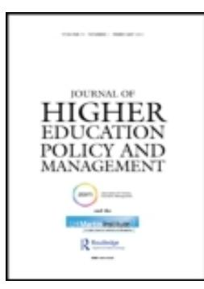
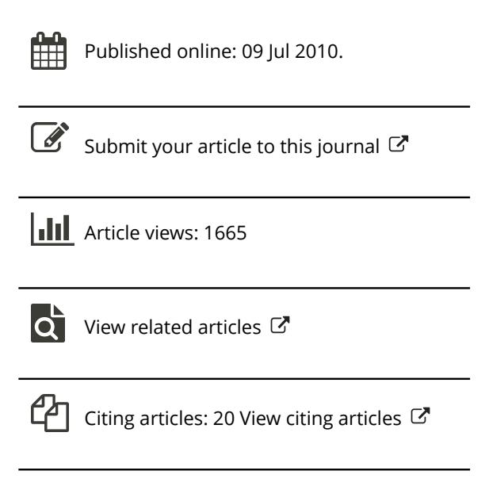

<!-- A2.R58 | source: papers_json/A2.R58/ -->

## **Journal of Higher Education Policy and Management**

**ISSN: 1360-080X (Print) 1469-9508 (Online) Journal homepage: ****[www.tandfonline.com/journals/cjhe20](https://www.tandfonline.com/journals/cjhe20?src=pdf)**

## **Higher** **education** **in** **the** **United** **Arab** **Emirates:** **an** **analysis** **of** **the** **outcomes** **of** **significant** **increases** **in** **supply and competition**

## **Stephen Wilkins**

**To** **cite** **this** **article:** Stephen Wilkins (2010) Higher education in the United Arab Emirates: an analysis of the outcomes of significant increases in supply and competition, Journal of Higher Education Policy and Management, 32:4, 389-400, DOI:[ 10.1080/1360080X.2010.491112](https://www.tandfonline.com/action/showCitFormats?doi=10.1080/1360080X.2010.491112)

**To** **link** **to** **this** **article:** [https://doi.org/10.1080/1360080X.2010.491112](https://doi.org/10.1080/1360080X.2010.491112)

<!-- page 2 -->

## CJHE 1360-080X 1469-9508Journal of Higher Education Policy and Management, Vol. 32, No. 4, May 2010: pp. 0–0 Management **Higher education in the United Arab Emirates: an analysis ** **of the outcomes of significant increases in supply and competition**

Journal of Higher Education Policy and Management S. Wilkins Stephen Wilkins*

*International Centre for Higher Education Management, School of Management, University * *of Bath, UK*

خلال العقد الماضي، أنشأت عدة دول في الشرق الأوسط والشرق الأقصى مراكز إقليمية للتعليم العالي، ونما بعضها بسرعة من خلال استقطاب جامعات أجنبية لإقامة فروع دولية لها. وتُعد الإمارات العربية المتحدة (UAE) أكبر مضيف عالمي للفروع الجامعية الدولية، حيث بلغ عدد مزوديها أكثر من 40 مزودًا بنهاية عام 2009. وأصبح سوق التعليم العالي في الإمارات شديد التنافسية، وفي القطاع الخاص يفوق العرض الطلب حاليًا. تستكشف هذه الورقة وتحلل نتائج وآثار هذا الوضع السوقي على استقطاب الطلاب، وتجربة الطالب، والجودة، واستراتيجيات المؤسسات. كما يُنظر في مدى استمرارية الفروع الجامعية الدولية في الإمارات على المدى الطويل، في سياق القضايا السياسية والاجتماعية المحلية.

**Keywords: **competition; higher education hub; international branch campuses; quality assurance; United Arab Emirates (UAE)

## **Introduction**

يبلغ عدد سكان الإمارات العربية المتحدة (UAE) ما يقارب 5.07 مليون نسمة (UAE Interact, 2009)، وتضم أكثر من 60 جامعة وكلية للتعليم العالي (National Media Council, 2009). وقد أشارت وسائل الإعلام المحلية إلى أن عرض المقاعد في التعليم العالي بالإمارات يفوق بالفعل الطلب (Moussly, 2010). ومع ذلك، فإن نسبة عدد الكليات أو المقاعد الجامعية إلى عدد السكان وحدها لا تشير بالضرورة إلى مشكلة محتملة للمؤسسات العاملة بالفعل في الإمارات. فالمنطقة الحضرية لبوسطن، ماساتشوستس، التي يزيد عدد سكانها بقليل عن أربعة ملايين نسمة، تضم أكثر من 100 كلية وجامعة. ويمكن اعتبار بوسطن مركزًا تعليميًا، يستقطب طلابًا ليس فقط من جميع أنحاء الولايات المتحدة بل من جميع أنحاء العالم. وتسعى الإمارات إلى تحقيق أمر مماثل، على الأقل على المستوى الإقليمي. غير أن الإمارات ليست وحدها في هذا الطموح. فخلال العقد الماضي، ظهرت مراكز جديدة للتعليم العالي في عدد من الدول، منها قطر، الدولة المجاورة في الخليج العربي، وسنغافورة وماليزيا في الشرق الأقصى.

نمت مراكز التعليم العالي الجديدة بسرعة، إلى حد كبير من خلال استقطاب جامعات من دول ذات قطاعات تعليم عالٍ راسخة لإقامة فروع لها. فقد أُنشئ ما لا يقل عن 49 فرعًا جامعيًا دوليًا خلال السنوات الثلاث الماضية، ويوجد الآن ما لا يقل عن 162 فرعًا على مستوى العالم (Becker, 2009). واستفادت الجامعات الأمريكية والأسترالية والبريطانية بشكل خاص من عملية العولمة التي شهدها التعليم العالي، إذ إن الدول التي تنتمي إليها تتمتع عمومًا بأنظمة

L H Martin Institute for Higher Education Leadership and Management DOI: 10.1080/1360080X.2010.491112 http://www.informaworld.com

> ^*^Email: sjkw20@bath.ac.uk

<!-- page 3 -->

تعليم عالٍ ذات سمعة جيدة، ولأن اللغة الإنجليزية أصبحت *لغة التواصل المشتركة* في التعليم العالي الدولي. وقد وجدت دراسة استقصائية شملت طلابًا يدرسون مؤهلًا بريطانيًا في مؤسستين بالإمارات وسلطنة عُمان أن 62 في المائة من العينة يعتقدون أن المملكة المتحدة تقدم أفضل تعليم عالٍ في العالم (Wilkins, 2001). وهناك عدد من الطرق التي يمكن من خلالها للجامعات أن تحقق حضورًا في دول أجنبية، منها تشغيل مراكز دراسية، ومنح تراخيص للبرامج لمزودين محليين، وتقديم برامج التعلم عن بُعد، وإنشاء فروع جامعية دولية.

يوحي مصطلح "الفرع الجامعي الدولي" بنهج مادي ملموس، حيث يكون للمؤسسة حضور فعلي في دولة أجنبية. ويتلقى الطلاب تعليمهم في مبانٍ مملوكة أو مستأجرة من قِبل المؤسسة الأجنبية، سواء بمفردها أو بالشراكة مع طرف محلي، وإلى جانب قاعات التدريس، قد يضم الفرع الجامعي عادة مكتبة، ومطعمًا، ومرافق ترفيهية، وسكنًا طلابيًا. ويستخدم الفرع الجامعي دائمًا اسم المؤسسة الأجنبية ويقدم برامج بكالوريوس و/أو دراسات عليا كاملة، عادة في عدد من التخصصات المختلفة. ويُستقطب الطلاب من المناطق المحلية أو المجاورة. ويتبعون البرامج نفسها، أو على الأقل برامج مشابهة جدًا لتلك المقدمة في الحرم الجامعي الرئيسي، وعند إتمام دراستهم يُمنح الطلاب درجة علمية من الجامعة الأجنبية.

يُعيَّن موظفو الفروع الجامعية الدولية بعدة طرق؛ فقد يُنقل المحاضرون من الحرم الرئيسي بصفة دائمة أو بعقد محدد المدة، أو بدلًا من ذلك، يمكن أن يسافروا من الحرم الرئيسي لفترات قصيرة. وقد يُستقدم أكاديميون جدد خصيصًا للفرع الجامعي، بدوام كامل دائم أو محدد المدة، أو بدوام جزئي. ولكل طريقة من هذه الطرق مزاياها وعيوبها، وسيأتي الحديث عنها لاحقًا. ويسهل الخلط بين الفرع الجامعي الدولي وأنواع أخرى من مزودي التعليم العالي في الخارج، مثل الأحرام الجامعية التابعة، والمراكز الدراسية، والدورات المرخصة التي تقدمها مؤسسات محلية فقط، إلا أنه لا يوجد بعد إجماع عالمي على تعريف موجز لهذا المصطلح. والواقع أن Altbach (2010) يرى أن معظم الفروع الجامعية الدولية ليست أحرامًا جامعية بالمعنى الحقيقي، لأنها صغيرة ومتخصصة وتقدم نطاقًا محدودًا من البرامج الأكاديمية.

وقد تبنّت الدول المضيفة، والجامعات من دول مثل الولايات المتحدة وأستراليا والمملكة المتحدة وكندا، نموذج الفرع الجامعي الدولي بحماس. ولاحظ Al-Lamki (2002) الانتشار السريع للكليات الخاصة ذات السنتين في سلطنة عُمان بعد صدور مرسوم سلطاني عام 1996 سمح بإنشاء كليات خاصة. وقد اعتُمد بشكل كبير على مزودي القطاع الخاص لزيادة الطاقة الاستيعابية للتعليم العالي في عدة دول خليجية. ففي عام 2006، كانت ثلاث من أصل أربع جامعات في سلطنة عُمان مملوكة للقطاع الخاص (Mazawi, 2008). أما الإمارات، فهي أكبر مضيف عالمي للفروع الجامعية الدولية بفارق كبير، بأكثر من 40 مزودًا في عام 2009 (Becker, 2009).

## **Aims and methodology**

تمثل مراكز التعليم العالي، المكوّنة من عدد من الفروع الجامعية الدولية، نموذجًا تعليميًا جديدًا لم يُختبر بعد. ولم نبدأ إلا مؤخرًا في رؤية آثار ونتائج هذا النموذج، الذي يهدف إلى زيادة الطاقة الاستيعابية للتعليم العالي في الدول الأقل نموًا أو ذات القطاع التعليمي العالي الأقل تطورًا. تحلل هذه الورقة هذه الآثار والنتائج، وانعكاساتها على المزودين الأجانب العاملين بالفعل في الإمارات، أو أولئك الذين لا يزالون يفكرون في التأسيس بالبلاد. وتُعد الإمارات دراسة حالة مثيرة للاهتمام بشكل خاص، لأنها أكبر مركز عالمي للفروع الجامعية الدولية، وبسبب السرعة التي تسابقت بها المؤسسات الأجنبية للتأسيس في البلاد.

<!-- page 4 -->

يحتاج أي سوق فعال إلى التوازن "الصحيح" بين العرض والطلب، لكن من الواضح في بداية عام 2010 أن قطاعي التعليم العالي، العام والخاص، في الإمارات لا يحققان هذا التوازن "الصحيح". ويمكن لهذا الفشل السوقي أن يضر بالطلاب والشركات ومزودي التعليم أنفسهم والمجتمع الإماراتي بشكل عام. ومن خلال مراجعة الأدبيات، حددت هذه الدراسة بعض النتائج الرئيسية لهذه الاختلالات السوقية. ولدى عدة أطراف معنية مصلحة في جودة التعليم العالي بالإمارات، منهم الطلاب وأولياء الأمور وأصحاب العمل والحكومة الإماراتية. وإذا لم تحقق الفروع الجامعية الدولية مستويات جودة مماثلة لتلك التي تحققها الأحرام الجامعية الأصلية، فمن المحتمل جدًا ألا تنجح هذه الفروع في استقطاب أعداد كافية من الطلاب تضمن استمراريتها. ولهذا السبب، جرى فحص قضايا ضمان الجودة بمزيد من التفصيل.

## **Development and structure of higher education in the UAE**

تأسست الإمارات العربية المتحدة كدولة اتحادية عام 1971 باتفاق حكام الإمارات السبع التي تشكل الإمارات اليوم. وفي ذلك الوقت، كان التعليم في البلاد يُقدَّم من خلال 74 مدرسة. ولم تكن هناك أي جامعة. وبعد تأسيس الإمارات، تطور نظام التعليم في البلاد استنادًا إلى النموذج البريطاني (Kirk & Napier, 2009)، رغم أن جوانب من النظام الأمريكي اعتُمدت مؤخرًا. فعلى سبيل المثال، تستند معايير ضمان الجودة المطبقة على المستوى الاتحادي إلى نموذج أمريكي. وكانت جامعة الإمارات العربية المتحدة، التي تأسست عام 1977 في العين، أول مؤسسة للتعليم العالي تُنشأ في الإمارات. ثم، في عام 1988، أُنشئت كليات التقنية العليا (HCT) لتقديم برامج مهنية وتقنية بشكل أساسي، رغم أنها تقدم الآن مجموعة واسعة من البرامج تشمل درجات البكالوريوس والدراسات العليا. وتضم كليات التقنية العليا حاليًا شبكة من 16 حرمًا جامعيًا في أنحاء البلاد، بكليات منفصلة للذكور والإناث. وكانت جامعة زايد، التي تأسست عام 1998 وتضم فروعًا في أبوظبي ودبي، ثالث ورابع مؤسسة تُنشئها الحكومة الاتحادية. وتُعرف مؤسسات التعليم العالي الثلاث التي تسيطر عليها الدولة الاتحادية بالمؤسسات "العامة" أو "الاتحادية"، بينما تُعرف كل المؤسسات الأخرى بالمؤسسات "الخاصة".

تُقرّ المادة 23 من دستور الإمارات بدور التعليم في التنمية الوطنية، وقد تعهدت الحكومة الاتحادية بتقديم التعليم مجانًا لمواطني الإمارات في جميع المراحل. ونتيجة لذلك، يحق لجميع خريجي المدارس الإماراتيين الالتحاق بإحدى المؤسسات الاتحادية الثلاث إذا استوفوا شروط القبول. وقد تجلى التزام الحكومة بالتعليم عام 2001 عندما كان أكبر تخصيص فردي للأموال الاتحادية موجهًا لتوفير التعليم لمواطني الإمارات (Godwin, 2006). ومع ذلك، ظلت المنح المقدمة للمؤسسات الاتحادية الثلاث ثابتة في كثير من السنوات منذ ذلك الحين.

تنقسم الجامعات الخاصة إلى فئتين: إما أنها مملوكة ومُدارة محليًا، من قِبل إمارات فردية أو منظمات محلية، أو من الخارج، من قِبل مؤسسات تعليم عالٍ أجنبية أسست فروعًا جامعية. ومن أمثلة الجامعات الخاصة المملوكة محليًا الجامعة الأمريكية في الشارقة، التي أسسها حاكم الشارقة عام 1997؛ وجامعة دبي، التي تأسست باسم "دبي بوليتكنيك" من قِبل غرفة تجارة وصناعة دبي عام 1997؛ وجامعة باريس السوربون أبوظبي، التي أسسها مجلس أبوظبي للتعليم عام 2006؛ وجامعة الغرير، المملوكة لمجموعة الغرير، وهي شركة ذات مصالح متنوعة تشمل بنكًا ومركزًا تجاريًا وشركة أسمنت.

تأسس أول فرع جامعي دولي في دبي عام 1993 من قِبل جامعة ولونغونغ، وهي جامعة أسترالية ذات سمعة جيدة. وافتتحت جامعات أخرى كثيرة فروعًا لها منذ ذلك الحين، منها جامعة ميدلسكس وجامعة هيريوت وات من المملكة المتحدة، و

<!-- page 5 -->

جامعة بونا، إحدى أفضل الجامعات الحكومية تصنيفًا في الهند، التي أسست حرمًا جامعيًا في المنطقة الحرة بإمارة رأس الخيمة عام 2009. وفي وقت أحدث، أقامت جامعة نيويورك وحكومة أبوظبي شراكة لإنشاء جامعة نيويورك أبوظبي، حيث سيبدأ التدريس في سبتمبر 2010. وستموّل حكومة أبوظبي المؤسسة الإماراتية، بحيث لا تُحوَّل الموارد المالية من حرم الجامعة في نيويورك.

## **Supply and demand for higher education in the UAE**

من بين سكان الإمارات البالغ عددهم 5.07 مليون نسمة، يشكل المواطنون الإماراتيون أقل من 20 في المائة؛ والباقي من الوافدين (UAE Interact, 2009). وأكبر الدول المصدرة للوافدين هي الهند (1.75 مليون) وباكستان (1.25 مليون). ويُقدَّر عدد المقيمين "الغربيين" من أستراليا وأوروبا وأمريكا الشمالية بحوالي 500,000 نسمة. وقُدِّر أن عدد سكان الإمارات ازداد بنسبة 6.3 في المائة عام 2009 (UAE Interact, 2009). ورغم أن الوافدين شكّلوا نسبة أكبر من هذه الزيادة مقارنة بالمواطنين، فإن عدد المواطنين ارتفع بنحو 4 في المائة أيضًا. وتُبقي المؤثرات الثقافية والدينية معدل المواليد في الإمارات مرتفعًا نسبيًا، رغم أنه أصبح الآن أقل بكثير من معدلات النمو السنوية التي بلغت 10-15 في المائة في السبعينيات وأوائل الثمانينيات. وقد أدى ارتفاع معدلات المواليد بين المواطنين الإماراتيين في السبعينيات والثمانينيات، مقترنًا بزيادة الوعي بقيمة التعليم العالي، إلى زيادة كبيرة في طلب المواطنين على التعليم العالي منذ أوائل التسعينيات. وقد قبلت جامعة الإمارات العربية المتحدة 400 طالب عام 1977 عند تأسيسها (Hijazi, Zoubeidi, Abdalla, & Harb, 2008)؛ وهي الآن تضم أكثر من 12,000 طالب.

وقد فرض تعهد حكومة الإمارات بضمان مقعد لكل خريج مدرسة إماراتي يستوفي شروط القبول في المؤسسات الاتحادية الثلاث ضغطًا هائلًا على هذه المؤسسات لتوسيع طاقتها الاستيعابية. فبين عامي 2003 و2008، على سبيل المثال، ارتفع عدد الطلاب المسجلين في جامعة زايد بنسبة 52 في المائة، بينما ظل التمويل المُقدَّم من الحكومة الاتحادية شبه ثابت كل عام خلال الفترة نفسها (National Media Council, 2009). ولم يتوسع قطاع التعليم العالي (HE) العام بالسرعة الكافية، ونتيجة لذلك، يُعتقد أن آلاف المواطنين الإماراتيين حُرموا من مقاعد في الجامعات الاتحادية في السنوات الأخيرة (Bardsley, 2009). ولا يُقبل في مؤسسات التعليم العالي العامة سوى عدد محدود نسبيًا من الوافدين.

وقد أظهرت الجامعات الرائدة في الإمارات تصميمًا أكبر خلال السنوات القليلة الماضية على إنتاج أبحاث عالية الجودة وعالمية المستوى. فجامعة الإمارات العربية المتحدة، على سبيل المثال، تهدف إلى تحقيق تحسن كبير في ترتيبها في جداول التصنيف الإقليمي للأبحاث والتصنيف العالمي للجامعات خلال السنوات الخمس المقبلة. غير أنها غير قادرة على استثمار المزيد في مشاريع البحث وتطوير برامج دكتوراه جديدة، إضافة إلى زيادة طاقة برامج البكالوريوس، دون زيادة التمويل الحكومي. وقد هدد نائب رئيس جامعة الإمارات العربية المتحدة مؤخرًا بخفض القوى العاملة بالجامعة بنسبة 7 في المائة (200 وظيفة) كحل لمعضلة التمويل (Bardsley, 2010c). وستشمل التخفيضات الوظيفية، إن نُفذت، الأدوار الأكاديمية والإدارية على حد سواء. كما علّقت جامعة زايد مؤخرًا إطلاق مركز بحثي جديد. وتواجه الفروع الجامعية الدولية العاملة في مراكز التعليم الجديدة عبر الشرق الأوسط والشرق الأقصى ضغطًا متزايدًا من شركائها والحكومات المحلية لزيادة أنشطتها البحثية. فعلى سبيل المثال، طلب الشركاء الصينيون لجامعة ليفربول مؤخرًا أن يصبح حرمها في الصين أكثر تركيزًا على البحث، لأن جامعة ليفربول جامعة رائدة في البحث بالمملكة المتحدة (Altbach, 2010).

من الواضح أن الطلب على المقاعد في المؤسسات العامة/الاتحادية يفوق العرض بشكل كبير. ولاحظ Edwards (2008) الآثار الاجتماعية السلبية التي يمكن أن تنتج عندما

<!-- page 6 -->

يتخلف عرض مقاعد التعليم العالي عن الطلب. فعلى سبيل المثال، كشفت دراسته أن الشباب من الفئات الاجتماعية والاقتصادية الأدنى أصبحوا أكثر تضررًا بشكل متزايد. وإذا تعذر على المواطنين الإماراتيين من الخلفيات الأكثر فقرًا، أو المقيمين في المناطق الريفية، المشاركة في التعليم العالي، فمن المحتمل أيضًا أن تقل فرصهم في المشاركة في سوق العمل. وفي النهاية، قد يؤدي هذا الوضع إلى اضطرابات اجتماعية. وبما أن الإمارات لا تزال تعتمد بشكل كبير على العمالة الوافدة، فقد كان من الأهداف الحكومية الرئيسية منذ سنوات عديدة زيادة مشاركة المواطنين في سوق العمل.

تحقق الإمارات معدلات مشاركة مرتفعة جدًا في التعليم العالي. فنحو 95 في المائة من جميع النساء و80 في المائة من جميع الرجال ممن أكملوا السنة الأخيرة من المرحلة الثانوية يتقدمون للالتحاق بالتعليم العالي (National Media Council, 2009). وفي الفترة 2008-2009، قبلت جامعة الإمارات العربية المتحدة 3,355 طالبًا جديدًا؛ وقبلت كليات التقنية العليا 7,902 طالب؛ وقبلت جامعة زايد 1,558 طالبًا (National Media Council, 2009). ومن بين الطلاب المواطنين الذين تخرجوا عام 2006، كانت نسبة 66.8 في المائة منهم من النساء (Hijazi et al., 2008). ويفضل كثير من الرجال الانضمام إلى القوات المسلحة أو العمل في الأعمال التجارية العائلية أو في وظائف إدارية جيدة الأجر نسبيًا في القطاع العام. وحتى مع وجود نقص في المقاعد بمؤسسات التعليم العالي العامة، لا يحضر كل عام كثير من خريجي المدارس الذكور الذين يُعرض عليهم مقاعد فيها للتسجيل في بداية العام الدراسي.

وقد انخفض مستوى التمويل الاتحادي لكل طالب في مؤسسة تعليم عالٍ عامة الآن دون المعايير الدولية (Fox, 2008). ومن الواضح أن مؤسسات التعليم العالي العامة تحتاج إلى زيادات في التمويل من الحكومة الاتحادية حتى تتمكن من زيادة عدد المقاعد في برامج البكالوريوس لديها. كما يلزم مزيد من التمويل لتطوير وتوسيع برامج الدراسات العليا، بما في ذلك برامج الدكتوراه، ولدعم تطوير مزيد من النشاط البحثي. وقد قدّمت الإمارات الفردية حوافز متنوعة، مثل إنشاء مناطق حرة ومناطق تعليمية، لاستقطاب المؤسسات الأجنبية للتأسيس في الإمارات. وبما أن ما لا يقل عن 57 مؤسسة خاصة تعمل الآن في البلاد، يبدو أن الحكومات المحلية نجحت في تبني هذه الاستراتيجية كوسيلة لزيادة عرض المقاعد في التعليم العالي. ففي عام 2001، بلغت نسبة الدرجات العلمية الممنوحة من مؤسسات خاصة 26.9 في المائة (Hijazi et al., 2008)؛ وفي عام 2006، ارتفع هذا الرقم إلى 54.6 في المائة.

وقد تأسست معظم المؤسسات الخاصة الجديدة في دبي وأبوظبي، الإمارتين الأكثر سكانًا. وتُعد رأس الخيمة إمارة أخرى حققت بعض النجاح في استقطاب مؤسسات أجنبية. ونظام التعليم الخاص مفتوح لجميع سكان الإمارات، لكن يُتوقع من المواطنين الإماراتيين والوافدين على حد سواء دفع الرسوم الدراسية كاملة، وهي مرتفعة نسبيًا ولا تتحملها كثير من الأسر. ولم يُتَح سوى عدد محدود من المنح الدراسية للدراسة في المؤسسات الخاصة، سواء من الحكومة أو من المؤسسات نفسها. ويدرس حاليًا نحو ثلث طلاب البكالوريوس الإماراتيين في مؤسسة خاصة بدلًا من إحدى المؤسسات الاتحادية الثلاث. وبالنسبة لبعض الطلاب، كان هذا خيارًا مفروضًا لأنهم لم يحققوا شروط القبول في المؤسسات الاتحادية. وفي هذه الحالة، تشترط المؤسسات الخاصة الأجنبية عادة أن يجتاز الطالب برنامجًا تأسيسيًا أو لغويًا من نوع ما قبل التسجيل في درجة البكالوريوس. فعلى سبيل المثال، من أصل 3,565 طالبًا مسجلين في حرم جامعة ولونغونغ بدبي بنهاية عام 2009، كان 753 طالبًا يدرسون في مركزها للغة والثقافة في مقررات دون مستوى البكالوريوس.

ولدى المواطنين الإماراتيين مجموعة من الدوافع الأخرى للدراسة في مؤسسة خاصة، منها فرصة دراسة تخصصات لا تقدمها المؤسسات الاتحادية، وإمكانية الحصول على درجة أكثر احترامًا من الخارج، مما قد يعزز آفاقهم المهنية في سوق العمل الدولي، أو ببساطة لأن المؤسسة التي اختاروها تقع في موقع أكثر ملاءمة. وهناك عدد متزايد من المواطنين الناضجين العاملين

<!-- page 7 -->

الذين يختارون الدراسة بدوام جزئي. ففي الفترة 2001-2002، كان نحو ثلثي الطلاب الإماراتيين في "دبي بوليتكنيك" (التي غُيّر اسمها لاحقًا إلى جامعة دبي) طلابًا مسائيين بدوام جزئي.

## **Current problems and issues**

تأسس ما لا يقل عن ثلثي المؤسسات الخاصة العاملة حاليًا في الإمارات بعد عام 2005. وقد وُصفت السرعة التي جاءت بها المؤسسات الأجنبية إلى الإمارات في وسائل الإعلام بـ"طفرة التعليم الذهبية" (Lewin, 2008). ولا شك أن بعض الجامعات الأجنبية أُغريت باحتمال تحقيق إيرادات سهلة في بلد ثري (Altbach & Knight, 2007; Naidoo, 2010)، وربما اتخذ بعضها قرار التأسيس في الإمارات دون إجراء بحث سوقي كافٍ. وليس من السهل تحديد الدوافع الدقيقة للجامعات الأجنبية لإنشاء أحرام جامعية في الإمارات. ويرى Knight (2006) أن الجامعات غير الهادفة للربح تُحفَّز عادة بالرغبة في تعزيز القدرات البحثية والمعرفية، وزيادة الفهم الثقافي. وتقدم معظم الفروع الجامعية في الإمارات نطاقًا ضيقًا من المقررات، وقد قرر كثير منها التخصص في التخصصات نفسها، مثل الأعمال/الإدارة وتقنية المعلومات، وهي تخصصات رخيصة نسبيًا للتأسيس ويمكن أن تستوعب بسهولة أعدادًا كبيرة من الطلاب.

ومن المعروف أن بعض المؤسسات فشلت في تحقيق أهداف الاستقطاب الخاصة بها. ففي مايو 2009، أغلقت جامعة جورج ميسون، وهي مؤسسة أمريكية مقرها فيرجينيا، حرمها الجامعي في رأس الخيمة، بعد أقل من ثلاث سنوات من افتتاحه. ولم تتمكن سوى من تسجيل 180 طالب بكالوريوس. وبنهاية عام 2008، أقرّ المدير العام لهيئة المعرفة والتنمية البشرية (KHDA)، الجهة المسؤولة عن ترخيص مؤسسات التعليم العالي الخاصة في إمارة دبي، علنًا بأن توازن العرض والطلب "يعمل لصالح الطلاب" من خلال إبقاء الرسوم الدراسية منخفضة (Bardsley, 2008). ومن المعروف أن بعض الجامعات الخاصة الأجنبية القائمة بالفعل في الإمارات طالبت السلطات بأداء دور أكثر فاعلية في توفير بيئة تنظيمية تضمن أن عدد مزودي التعليم العالي "صحيح".

وفي ديسمبر 2009، ذكرت صحيفة *نيويورك تايمز* أن الفروع الجامعية الدولية في دبي تعاني بعد انهيار الاقتصاد المفرط النشاط في الإمارة (Lewin, 2009). وكان لدى جامعة ولاية ميشيغان، التي بدأت الدراسة في أغسطس 2008، 85 طالب بكالوريوس فقط بنهاية عام 2009، وكان لدى معهد روتشستر للتقنية، الذي بدأ عملياته أيضًا في أغسطس 2008، 50 طالبًا فقط. وأقرّت جامعة مردوخ، ومقرها بيرث، غرب أستراليا، والتي بدأت عملياتها في دبي في صيف 2008، بأن عدد طلابها في السنة الثانية كان أقل بنحو 30 في المائة من هدفها. وستستغرق بعض المؤسسات وقتًا أطول بكثير مما خططت له لتحقيق نقطة التعادل، وقد لا تصل بعضها إلى تلك النقطة أبدًا. وقد أجّلت جامعة ولاية ميشيغان بالفعل هدف تحقيق التعادل من ثلاث سنوات إلى خمس سنوات.

وتجد المؤسسات صعوبة في تمييز نفسها في سوق مزدحم، ولم يكن التنافس على السعر أمرًا توقعه كثير منها سابقًا. وكانت جامعة ولاية ميشيغان تأمل في استقطاب 100 طالب من جامعات أخرى في النصف الثاني من عام 2009 من خلال تقديم رسوم دراسية بنصف السعر. وحتى هذه الاستراتيجية لم تنجح، إذ بحلول منتصف يناير 2010، لم يُقبل سوى عشرين طالبًا (Bardsley, 2010b). ورغم استلام نحو 200 طلب للحصول على 100 مقعد بنصف السعر، فإن 10 في المائة فقط من المتقدمين استوفوا معايير القبول القياسية للجامعة. وادعت الجامعة أن رفض 180 متقدمًا أثبت أنها لن تتنازل عن معايير الجودة الأكاديمية. وثمة مشكلة محتملة لمؤسسات التعليم العالي في

<!-- page 8 -->

الإمارات هي أن أفضل الطلاب من حيث الجودة يختارون الدراسة في الجامعات الكبرى في دول مثل الولايات المتحدة وأستراليا والمملكة المتحدة.

يرى Sutton and Tse (1997) أن المديرين التعليميين يجب أن يولوا اهتمامًا عاجلًا للجودة خلال فترات التوسع السريع، لأن الكمية غالبًا ما تُحقق على حساب الجودة. وقد عانت بعض أوائل الدفعات في "دبي بوليتكنيك" من معدلات تسرب ورسوب بلغت 50 في المائة على الأقل (Wilkins, 2002). ووجد الطلاب المعتادون على التعليم الثانوي التلقيني المتمركز حول المعلم صعوبة في التكيف مع التعلم المتمركز حول الطالب والمستقل الذي يتطلبه النظام البريطاني للتعليم العالي. كما تبين أن نسبة كبيرة من الطلاب لديهم مهارات كتابية غير مرضية في اللغة الإنجليزية.

## **Some institutions are doing better than others**

ليست جميع مؤسسات التعليم العالي في الإمارات تعاني. فقد سجّلت جامعة هيريوت وات، ومقرها إدنبرة، اسكتلندا، 800 طالب جديد في حرمها بدبي عام 2009، ليصل إجمالي طلابها إلى أكثر من 1,500. وتزعم الجامعة أنها تقدم تعليمًا عالي الجودة بأسعار تنافسية. وإدارة الجامعة راضية جدًا عن تقدمها حتى الآن، وستشمل المرحلة التالية من تطويرها بناء حرم جامعي أكبر جديد في مدينة دبي الأكاديمية الدولية (DIAC). كما ستوسّع الجامعة برامجها الأكاديمية لتشمل مجموعة من برامج الدكتوراه والمقررات ذات الصلة بالإمارات، والتي تقع ضمن مجال خبرتها، مثل هندسة البترول.

وتُعد جامعة ولونغونغ حاليًا أكبر فرع جامعي مملوك لجهة أجنبية في الإمارات يعمل تحت الاسم نفسه لحرمه الرئيسي. وبعد وجودها في دبي منذ عام 1993، استفادت جامعة ولونغونغ بوضوح من ميزة الريادة، وكان لديها 2,812 طالبًا مسجلين في برامج البكالوريوس أو الدراسات العليا بنهاية عام 2009. ولديها توازن متساوٍ بين طلاب البكالوريوس والدراسات العليا، وتُستقطب الغالبية العظمى من الطلاب من المجتمعات المحلية للوافدين، حيث يشكل الهنود نحو ربع إجمالي التسجيلات، يليهم الإيرانيون (15 في المائة). ويشكل المواطنون الإماراتيون نحو 13.4 في المائة من الطلاب.

ويُعتقد أن جامعات مرموقة مثل جامعة باريس السوربون أبوظبي وجامعة نيويورك أبوظبي تحقق أهدافها في استقطاب الطلاب. ومع تطور هذه المؤسسات وتوسعها، يبدو واضحًا أن الجامعات الأقل تصنيفًا ستُجبر على التنافس على السعر أو من خلال تقديم تخصصات غير متاحة في أماكن أخرى. ومن الواضح أيضًا أنه بينما يفوق الطلب على المقاعد في المؤسسات الاتحادية الثلاث العرض، فإن العرض في قطاع التعليم العالي الخاص، في بداية عام 2010، يفوق الطلب بشكل كبير. ومن المرجح أن تحدث عملية من النوع الداروني في سوق التعليم العالي بالإمارات خلال السنوات الخمس إلى العشر المقبلة، حيث ستزدهر وتنمو الجامعات الكبرى بينما تتقلص أو تنسحب الجامعات الأضعف من الإمارات.

## **Quality of higher education in the UAE**

من المحتمل أن يكون للعدد الكبير من مزودي التعليم العالي في الإمارات أثر إيجابي على الجودة، لأن المؤسسات تُجبر على التنافس من خلال تحسين برامجها وقابلية توظيف خريجيها. ومع ذلك، لا يمكن الاعتماد على قوى السوق وحدها لضمان جودة برامج التعليم العالي المقدمة في الإمارات. ويكشف فحص منتديات إلكترونية مثل www.dubaifaqs.com/universities وwww.desertspeak.com أن كثيرًا من الطلاب قلقون بشأن جودة التعليم العالي في الإمارات. وقد أعرب الطلاب عن مخاوف تتعلق بجودة الأكاديميين العاملين في الجامعات، وارتفاع معدل دوران العمالة في بعض المؤسسات، وجودة موارد ومعدات التعلم، وعدم تقديم المقررات الاختيارية المعلن عنها.

<!-- page 9 -->

وتتولى وزارة التعليم العالي والبحث العلمي (MHESR)، من خلال إداراتها المختلفة، مسؤولية تخطيط التعليم العالي، وتطوير السياسات وتنفيذها، وإدارة الجودة، وجمع البيانات وتحليلها، وتقديم خدمات القبول للمؤسسات الاتحادية، ومنح المنح الدراسية للمواطنين الإماراتيين. وتخضع المؤسسات الاتحادية الثلاث لعملية ضمان الجودة التابعة لمجلس التعليم العالي (أحد أقسام وزارة التعليم العالي والبحث العلمي). بالإضافة إلى ذلك، سعت المؤسسات الاتحادية الثلاث جميعها للحصول على اعتماد دولي، بشكل أساسي من هيئات الاعتماد الإقليمية الأمريكية.

ويُطلب من مؤسسات التعليم العالي الخاصة في الإمارات الحصول على ترخيص من هيئة الاعتماد الأكاديمي (CAA)، ثم اعتماد كل برنامج أكاديمي على حدة. وتستند معايير هيئة الاعتماد الأكاديمي إلى نموذج أمريكي، لكنها عُدّلت لتناسب الإمارات. وتغطي هذه المعايير جميع الأنشطة الرئيسية للمؤسسة التعليمية. ويمكن للمؤسسات الأجنبية أن تتجنب متطلبات هيئة الاعتماد الأكاديمي من خلال التمركز في مناطق حرة معينة منتشرة عبر البلاد. غير أنها ستظل ملزمة باستيفاء متطلبات الإمارات الفردية؛ فعلى سبيل المثال، في دبي، يجب على المؤسسات استيفاء معايير الترخيص الخاصة بهيئة المعرفة والتنمية البشرية (KHDA). ويُتوقع من مزودي التعليم الخاص الأجانب، سواء كانوا في مناطق حرة أو لا، الالتزام بمعايير مؤسساتهم الأم والسياسات واللوائح المعمول بها في بلدانهم الأصلية. وبما أن كثيرًا من الجامعات الأجنبية في الإمارات موجودة على الأرجح بشكل أساسي لتحقيق الربح، فإن الاعتماد على التنظيم الذاتي قد لا يكون طريقة موثوقة لضمان الحد الأدنى من معايير الجودة. والمواطنون الإماراتيون أقل ميلًا للانجذاب إلى برامج غير معتمدة من هيئة الاعتماد الأكاديمي، لأن مثل هذه البرامج لا تعترف بها الجهات الحكومية. ومن الناحية العملية، يعني هذا أن المواطنين الإماراتيين الحاصلين على درجات غير معتمدة لا يستطيعون الحصول على وظائف في القطاع العام (Wilkins, 2002)، وهو المكان الذي يفضل معظم المواطنين العمل فيه بسبب مستويات الرواتب الأعلى وظروف العمل الأفضل مقارنة بالقطاع الخاص.

كما أنشأت الإمارات الفردية منظماتها الخاصة المسؤولة عن وضع وإنفاذ السياسات واللوائح المتعلقة بالجودة في مؤسسات التعليم العالي الأجنبية. ففي عام 2009، أنشأت إمارة دبي المجلس الدولي لضمان جودة الجامعات (UQAIB). وفي يناير 2010، كان المجلس قد أتم تقييم نصف المؤسسات الـ24 العاملة في المناطق الحرة. وأعلن المجلس من خلال بيان صحفي أن لديه صلاحية إلغاء ترخيص أي فرع جامعي دولي لا يستوفي متطلباته (Bardsley, 2010a). وألمح رئيس المجلس إلى إمكانية إلغاء تراخيص المؤسسات دون المستوى المطلوب بنهاية عام 2010. ومن اللافت أن المجلس لا يقتصر على تقييم المؤسسات فحسب، بل يُجري أيضًا مراجعة لمدى نجاح نموذج الفرع الجامعي الدولي.

## **Brand reputation and human resource issues**

في عام 2008، أعلنت جامعة بنسلفانيا وجامعة ييل أنهما لن تفتحا فروعًا جامعية دولية في المستقبل المنظور. وكان ما يشغل بال المؤسستين هو السيطرة على سمعة علامتهما التجارية وقضايا ضمان الجودة، لا سيما قدرتهما على استقطاب أكاديميين بمستوى يضمن المعايير الأكاديمية (Olds, 2008). وعادة ما يتردد الأكاديميون الأقدم النشطون بحثيًا في ترك عملهم في الحرم الرئيسي، بينما يخشى الأكاديميون الأصغر سنًا أن يحد العمل في الخارج من فرص ترقيتهم. وغالبًا ما تستقطب الفروع الجامعية الدولية أكاديميين لا ارتباط لهم بالحرم الرئيسي (Altbach, 2010)، وأحيانًا تستعين حتى بأكاديميين ليس لديهم أي خبرة في التدريس أو التعليم في البلد الأصلي. وتوظف بعض الفروع الجامعية الأصغر نسبًا مرتفعة نسبيًا من الأكاديميين بدوام جزئي، وقد يمثل هذا وسيلة فعالة لتقليل التكاليف، لكنه

<!-- page 10 -->

ليس وسيلة لتحقيق التزام الموظفين وجودة عالية في التدريس والبحث. وفي الختام، فبينما قد يبدو إنشاء فروع جامعية دولية في الإمارات، أو في أي من مراكز التعليم الجديدة الأخرى، جذابًا للمؤسسات الراغبة في زيادة عائداتها ومكانتها الدولية، يبدو أن بعض أعرق الجامعات في العالم لا تزال غير مقتنعة بأن المكاسب تفوق المخاطر والتكاليف المحتملة.

ويدفع نقص طلبات الالتحاق بعض مؤسسات التعليم العالي الخاصة بوضوح إلى التحلي بـ"المرونة" فيما يتعلق بشروط القبول. ويدرس في الفروع الجامعية الدولية بالإمارات طلاب لم يكونوا ليُقبلوا على الأرجح في البرنامج نفسه في الحرم الرئيسي للمؤسسة (Altbach, 2010). وبمجرد التسجيل، يوجد ضغط كبير على الأكاديميين لإرضاء الطلاب، إذ باتوا يُعتبرون أشبه بمستهلكين لا مجرد متلقين للتعليم. وهذا لا يختلف عن الوضع القائم في كثير من دول العالم، والذي يعتبره كثيرون نتيجة لتسليع التعليم العالي. وكشفت دراسة استقصائية أُجريت في الإمارات أن كثيرًا من الأساتذة يعتقدون أن مستوى طلابهم في الرياضيات والكتابة باللغة الإنجليزية متوسط أو دون المتوسط. كما أقرّوا بأن الطلاب يُمنحون درجات أعلى مما يستحقون (Gerson, 2010). ومن الشائع أن يتوسل الطلاب في الإمارات للحصول على درجات أعلى، غالبًا تحت ضغط الأهل أو الأقران. وحدد الأساتذة في الدراسة الاستقصائية تقييمات المقررات الضعيفة، وشكاوى الطلاب، والمخاوف بشأن الأمان الوظيفي، بوصفها بعض أسباب تضخم الدرجات. وليس من غير المألوف أن يُنهى عقد أكاديميين في مؤسسات التعليم العالي بالإمارات بسبب تقييمات مقررات ضعيفة. وتستخدم جامعة الإمارات العربية المتحدة تقييمات الطلاب للتدريس كعامل في تحديد الترقيات والمكافآت التقديرية والعقود طويلة الأمد وتجديد العقود (Badri, Abdulla, Kamali, & Dodeen, 2006). ويقترح Pounder (2007) أن تطور المؤسسات التعليمية وتجرب أساليب جديدة لتقييم جودة التدريس وديناميكيات الفصل الدراسي.

وقد جلب التوازن الحالي بين العرض والطلب في قطاع التعليم العالي الخاص بالإمارات مزايا وعيوبًا على حد سواء للطلاب. وتشمل العيوب والمخاطر المحتملة توفر نطاق ضيق من التخصصات والخيارات، ومقررات لا تُقدَّم بسبب عدد غير كافٍ من الطلاب المسجلين فيها، ونقص الاستثمار في الموارد والمعدات، ونطاق محدود من الأنشطة اللامنهجية، وخطر إغلاق المؤسسات وتخليها عن طلابها المسجلين قبل إتمام برامجهم. وتشمل المزايا المحتملة للطلاب في الوضع السوقي الحالي الحصول على تعليم عالٍ ربما كان يتعذر الوصول إليه بخلاف ذلك، والقدرة على الحصول على درجة من جامعة غربية مرموقة دون الحاجة إلى السفر إلى البلد الذي توجد فيه، وحجم فصول أصغر، وعدم قدرة المؤسسات على زيادة الرسوم الدراسية.

## **Discussion and conclusions**

لا يزال مفهوم مركز التعليم العالي، الذي تأسس مؤخرًا في عدة دول بالشرق الأوسط والشرق الأقصى، نموذجًا لم يُثبت جدواه بعد. وبينما نجحت جامعة ولونغونغ في الاستمرار بالإمارات لسنوات عديدة، لم يتضح بعد كيف ستتعامل مع السوق المتزايد التنافسية الناتجة عن هدف الحكومة المتمثل في تأسيس الإمارات كمركز إقليمي للتعليم العالي. ومع ذلك، أتاحت الفروع الجامعية الدولية بالفعل التعليم العالي لآلاف الطلاب الذين ربما لم يكن بإمكانهم الوصول إليه بخلاف ذلك. ومن المرجح أن تزدهر بعض المؤسسات وتنمو بينما تفشل أخرى. ولا يمكن للجامعات الأجنبية أن تستمر في افتتاح فروع تقدم فقط برامج مماثلة في الأعمال/الإدارة وتقنية المعلومات؛ إذ يوجد بالفعل فائض في العرض من هذه البرامج في عدة مواقع، ونتيجة لذلك تعمل كثير من المؤسسات دون طاقتها الكاملة. ولم يتضح بعد كيف ستتصرف الجامعات الأجنبية

<!-- page 11 -->

عندما تفشل فروعها الجامعية الدولية في تحقيق أهداف التسجيل والربح مستقبلًا. وسيتخلى بعضها على الأرجح عن المحاولة ويغلق أبوابه، كما فعلت جامعة جورج ميسون في إمارة رأس الخيمة وكما فعلت جامعة نيو ساوث ويلز في سنغافورة. ومع ذلك، وفي الوقت نفسه الذي أعلنت فيه جامعة جورج ميسون قرارها بالانسحاب من رأس الخيمة، كانت مؤسستان أخريان في طور الانتقال إليها: المدرسة البوليتكنيكية الفدرالية بلوزان (EPFL)، ومقرها سويسرا، وجامعة بونا المرموقة من الهند. وبينما شملت أولى البرامج التي قدمتها جامعة بونا إدارة الأعمال وتقنية المعلومات، تتخصص EPFL في العلوم وتخطط لتقديم برامج في مجالات مثل الهندسة وإمدادات الطاقة.

لا تزال مراكز التعليم العالي الجديدة في الشرق الأوسط والشرق الأقصى، والفروع الجامعية الدولية الموجودة فيها، في مراحلها المبكرة من التطور. ومن المرجح أن تنجو أعرق المؤسسات الدولية، مثل جامعة نيويورك وجامعة باريس السوربون، الموجودتين في أبوظبي، على الأقل في المدى المتوسط، من خلال الاستفادة من علاماتها التجارية القوية لاستقطاب الطلاب، وكذلك من خلال الاعتماد، عند الحاجة، على تمويل مضمون من حكومة أبوظبي. وعلى المدى الأطول، تواجه حتى هذه المؤسسات تحديات كبيرة. ويلاحظ Witte (2010) أن جامعة نيويورك أبوظبي تعتزم فرض شروط قبول صارمة، وأنه من المتوقع أن يشكل الأمريكيون نحو 40-50 في المائة من عدد الطلاب بينما يشكل المواطنون الإماراتيون نسبة صغيرة جدًا فقط. ولن يساعد غياب برنامج سنة تأسيسية على استقطاب مزيد من المواطنين الإماراتيين مستقبلًا. ومن غير المعروف ما إذا كانت حكومة أبوظبي ستكون راضية عن تمويل الجامعة على المدى الأطول إذا لم يُقبل مزيد من المواطنين الإماراتيين. وتُقدَّم حاليًا حزم مساعدات مالية سخية للطلاب الملتحقين بجامعة نيويورك أبوظبي، لكن إذا خُفضت هذه الحزم أو أُلغيت، فقد تمنع الرسوم الدراسية المرتفعة جدًا كثيرًا من الطلاب من التقديم.

وهناك عدد من القضايا السياسية الأخرى التي تمثل مخاطر على الفروع الجامعية الدولية. فعملية توطين العمالة، المعروفة بالتوطين (Emiratisation)، قوية بالفعل في عدة صناعات إماراتية، مثل المصرفية والتمويل، حيث تُلزم التشريعات الشركات بتوظيف حصص معينة من المواطنين. وموظفو وأكاديميو الفروع الجامعية الدولية حاليًا جلّهم من الوافدين تقريبًا، لكن ستظهر قريبًا رغبة في رؤية مزيد من المواطنين الإماراتيين يعملون كمديرين وأكاديميين على حد سواء. وسيساعد الإدخال الحديث لبرامج الدكتوراه في عدة جامعات إماراتية على تعزيز عملية التوطين في التعليم العالي. وما إذا كانت البرامج الأجنبية تُعدَّل لتناسب الإمارات أم لا فمسألة أخرى مثيرة للجدل. ويعتقد بعض الأشخاص أن المؤسسات الأجنبية ينبغي أن تقدم في الإمارات ما تقدمه بالضبط في حرمها الرئيسي؛ بينما يرى آخرون أن القيام بذلك وتجاهل الثقافة والسياقات والقضايا المحلية أمر عديم الجدوى. وقد قيل إن الأبحاث عالية الجودة، لا سيما في العلوم الإنسانية والاجتماعية، أقل احتمالًا أن تُنتج في بيئات محافظة وسلطوية للغاية (Romani, 2009). وحتى الآن، يشعر بعض الباحثين أن البحث في الإمارات حول القضايا الاجتماعية والدينية والثقافية والأخلاقية مقيد بشدة. وقد يعيق هذا تقدم المؤسسات الساعية إلى الاعتراف بها دوليًا لناتجها البحثي.

وبما أن كثيرًا من مؤسسات التعليم العالي في الإمارات تعمل حاليًا دون طاقتها الكاملة، وبما أنه لا يوجد حاليًا سوى طلب إضافي محدود داخل الإمارات نفسها، ينبغي أن تهدف المؤسسات إلى استقطاب مزيد من الطلاب من الخارج. وستحتاج هذه الاستراتيجية إلى تعاون الحكومة الإماراتية في إصدار تأشيرات الطلاب بسرعة وكفاءة وبتكلفة معقولة. علاوة على ذلك، قد يؤدي اندلاع حرب أو نزاع عسكري مستقبلي في الشرق الأوسط إلى ردع الطلاب الدوليين عن الدراسة في المنطقة. وتحتاج المؤسسات إلى وضع خطط طوارئ للتعامل مع مثل هذه الحالات. كما ينبغي أن تُدخل نطاقًا أوسع من البرامج بعد إجراء بحث سوقي شامل، لتحديد التخصصات التي يريدها الطلاب و

<!-- page 12 -->

التي تحتاجها الاقتصادات المحلية والإقليمية. كما ينبغي للمؤسسات أن تستثمر أكثر في مواردها المادية والبشرية. وسيتوقع الطلاب بشكل متزايد الحصول على تجارب تعلم واجتماعية وثقافية أقرب إلى ما كانوا سيحصلون عليه في الحرم الرئيسي. ويجب أن تتصرف المؤسسات بشكل أشبه بالشركات إذا أرادت البقاء في سوق التعليم العالي التنافسي والمزدحم. ويجب أن تطور علاماتها التجارية وتحميها وتسوّقها بفعالية (Hemsley-Brown & Goonawardana, 2007). ويجب أن تطور وتنفذ استراتيجيات تمنحها ميزة تنافسية (Mazzarol & Soutar, 1999). ويجب أن تحقق الجودة في جميع مجالات عملياتها. وأخيرًا، وربما الأهم من ذلك، يجب أن تُرضي عملاءها من خلال تزويدهم بالمعرفة والمهارات والخبرات التي تمكّنهم من تحقيق أهدافهم الشخصية وأن يكونوا منتجين في أسواق العمل المحلية والدولية.

## **References**

- Al-Lamki, S M. (2002). Higher education in the Sultanate of Oman: The challenge of access, equity and privatisation. *Journal of Higher Education Policy and Management*, *24*(1), 75–86.
- Altbach, P.G. (2010, No. 58, Winter). Why branch campuses may be unsustainable. *International* *Higher Education*. Retrieved February 13 2010, from http://www.bc.edu/bc_org/avp/soe/cihe/ newsletter/Number58/p2_Altbach.htm.
- Altbach, P.G., & Knight, J. (2007). The internationalisation of higher education: Motivations and realities. *Journal of Studies in International Education*, *11*(3/4), 290–305.
- Badri, M.A., Abdulla, M., Kamali, M.A., & Dodeen, H. (2006). Identifying potential biasing variables in student evaluation of teaching in a newly accredited business program in the UAE. *Interna**tional Journal of Educational Management*, *20*(1), 43–59.
- Bardsley, D. (2008, December 7). Tuition fees checked by universities' expansion. *The National*. Retrieved March 6 2009, from http://www.thenational.ae/article/20081207/NATIONAL/ 640032666/1010.
- Bardsley, D. (2009, December 24). Universities 'desperate' as funding plan is delayed. *The* *National*. Retrieved February 11 2010, from http://www.thenational.ae/apps/pbcs.d11/article? AID=/20091225/NATIONAL/712249867&SearchID=73381447367283.
- Bardsley, D. (2010a, January 11). Dubai may revoke university licences. *The National*. Retrieved February 11 2010, from http://www.thenational.ae/apps/pbcs.d11/article?AID=20100112/ NATIONAL/701119876&SearchID=73381447367283.
- Bardsley, D. (2010b, January 22). University's half-price tuition scheme gets disappointing pass rate. *The National*. Retrieved February 11 2010, from http://www.thenational.ae/apps/pbcs.d11/ article?AID=/20100122/NATIONAL/701219866&SearchID=73381447367283.
- Bardsley, D. (2010c, February 9). Threat of 200 job cuts to fund university research. *The National*. Retrieved February 11 2010, from http://www.thenational.ae/apps/pbcs.d11/article?AID=/ 20100209/NATIONAL/702089829&SearchID=73381447367283.
- Becker, R.F.J. (2009). *International branch campuses: markets and strategies*. London: The Observatory on Borderless Higher Education.
- Edwards, D. (2008). What happens when supply lags behind demand? Disadvantaged students and the ever increasing competition for university places. *Journal of Higher Education Policy and* *Management*, *30*(1), 3–13.
- Fox, W.H. (2008). The United Arab Emirates and policy priorities for higher education. In C. Davidson & P. Mackenzie Smith (Eds), *Higher education in the Gulf States: shaping economies, politics* *and culture* (pp. 110–125). London: Saqi, in association with the London Middle East Institute at SOAS.
- Gerson, J. (2010, January 23). Inflation of grades is widespread, study says. *The National*. Retrieved February 11 2010, from http://www.thenational.ae/apps/pbcs.d11/article?AID=/20100124/ NATIONAL/701239914&SearchID=73381447367283.
- Godwin, S.M. (2006). Globalisation, education and emiratisation: a study of the United Arab Emirates. *The Electronic Journal on Information Systems in Developing Countries*, *27*(1), 1–14.
- Hemsley-Brown, J., & Goonawardana, S. (2007). Brand harmonization in the international higher education market. *Journal of Business Research*, *60*(9), 942–948.

<!-- page 13 -->

- Hijazi, R., Zoubeidi, T., Abdalla, I., & Harb, N. (2008). A study of the UAE Higher education sector in light of Dubai's strategic objectives. *Journal of Economic & Administrative Sciences*, *24*(1), 68–81.
- Kirk, D., & Napier, D. (2009). The transformation of higher education in the United Arab Emirates: Issues, implications, and intercultural dimensions. In J. Zajda, H. Daun & L. J. Saha (Eds.), *Nation-building, identity and citizenship education: Cross cultural perspectives* (pp. 131–142). Springer Science + Business Media B.V.
- Knight, J. (2006). *Internationalization of higher education: new directions, new challenges. The* *2005 IAU global survey report*. Paris: International Association of Universities.
- Lewin, T. (2008, February 10). U.S. universities rush to set up outposts abroad. *The New York Times*. Retrieved October 28 2009, from http://www.nytimes.com/2008/02/10/education/10global.html.
- Lewin, T. (2009, December 28). University branches in Dubai are struggling. *The New York Times*. Retrieved January 9 2010, from http://www.nytimes.com/2009/12/28/education/28dubai.html.
- Mazawi, A.E. (2008). Policy politics of higher education in the Gulf Cooperation Council member states: Intersections of globality, regionalism and locality. In C. Davidson & P. Mackenzie Smith (Eds.), *Higher education in the Gulf States: Shaping economies, politics and culture* (pp. 59–72). London: Saqi, in association with the London Middle East Institute at SOAS.
- Mazzarol, T., & Soutar, G.N. (1999). Sustainable competitive advantage for educational institutions: A suggested model. *The International Journal of Educational Management*, *13*(6), 287–300.
- Moussly, R. (2010, January 3). Universities face shrinking classes. *Gulf News*. Retrieved January 13 2010, from http://gulfnews.com/news/gulf/uae/education/universities-face-shrinking-classes-1.561224.
- Naidoo, V. (2010, No. 58, Winter). Transnational higher education: why it happens and who benefits? *International Higher Education*. Retrieved February 13 2010, from http://www.bc. edu/bc_org/avp/soe/cihe/newsletter/Number58/p6_Naidoo.htm.
- National Media Council. (2009). *United Arab Emirates yearbook 2009*. Abu Dhabi: National Media Council.
- Olds, K. (2008, April 23). Just saying 'no' to overseas branch campuses and programs: Ivy League vs UK logics. *Globalhighered*. Retrieved October 28 2009, from http://globalhighered.wordpress.com/ 2008/04/23/no-overseas-campuses/.
- Pounder, J.S. (2007). Is student evaluation of teaching worthwhile? An analytical framework for answering the question. *Quality Assurance in Education*, *15*(2), 178–191.
- Romani. V. (2009). The politics of higher education in the Middle East: Problems and prospects. *Middle East Brief, No. 36*. Waltham, MA: Crown Center for Middle East Studies, Brandeis University.
- Sutton, J., & Tse, P. (1997). Curriculum issues in the relationship between language, culture and learning: The case of food and beverage management teaching. *Journal of Vocational Education &* *Training*, *49*(3), 367–384.
- *UAE Interact.* (2009). *UAE population likely to cross 5m*. Retrieved February 12 2010, from http:// www.uaeinteract.com/docs/UAE_population_likely_to_cross_5m/37283.htm.
- Wilkins, S. (2001). Student and employer perceptions of British higher education in the Arabian Gulf region. *Research in Post-Compulsory Education*, *6*(2), 157–174.
- Wilkins, S. (2002). Human resource development through vocational education in the United Arab Emirates: The case of Dubai Polytechnic. *Journal of Vocational Education & Training*, *54*(1), 5–26.
- Witte, S. (2010, No. 58, Winter). Gulf state branch campuses: global student recruitment. *Interna**tional Higher Education*. Retrieved February 13 2010, from http://www.bc.edu/bc_org/avp/soe/ cihe/newsletter/Number58/p5_Witte.htm.
