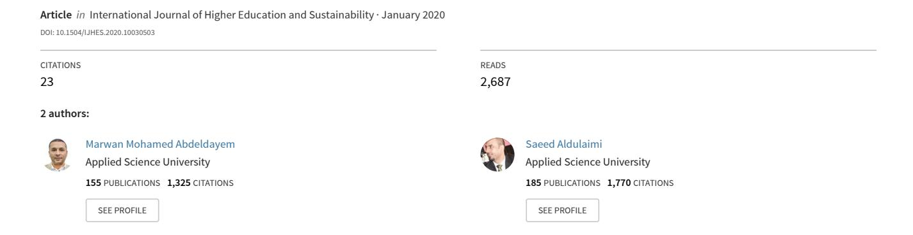
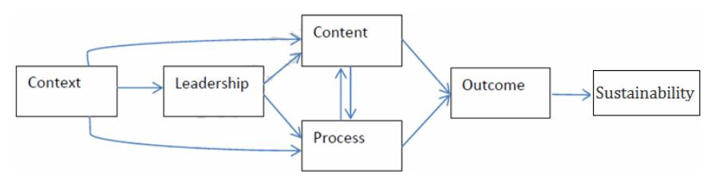
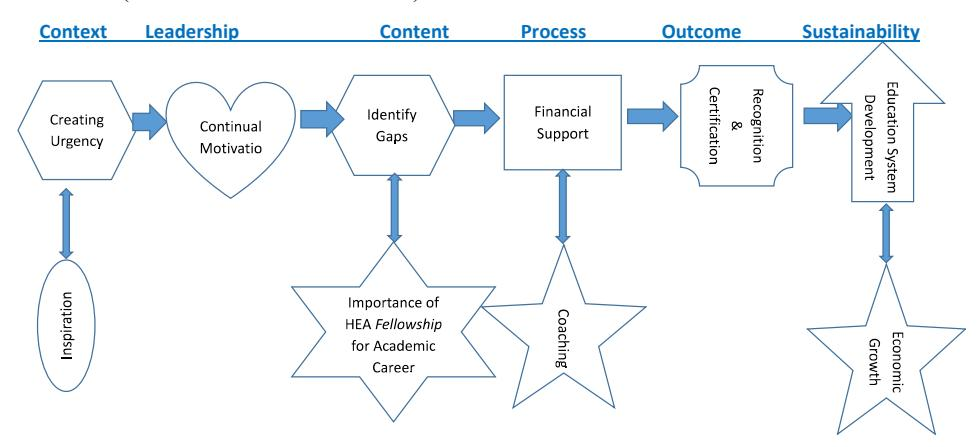

<!-- A3.R01 | source: papers_json/A3.R01/ -->

## [تحليل موضوعي لسلوكيات القيادة وإدارة التغيير في](https://www.researchgate.net/publication/342862309_A_thematic_analysis_of_leadership_behaviours_and_change_management_in_higher_education_to_boost_sustainability?enrichId=rgreq-20eba2d6911f82930cb0955afa64e097-XXX&enrichSource=Y292ZXJQYWdlOzM0Mjg2MjMwOTtBUzoxMTM3NzY4NjQ2MzYxMDg5QDE2NDgyNzY1OTI4MjQ%3D&el=1_x_3&_esc=publicationCoverPdf) التعليم العالي لتعزيز الاستدامة

<!-- page 2 -->

## **تحليل موضوعي لسلوكيات القيادة و** **إدارة التغيير في التعليم العالي لتعزيز ** **الاستدامة **

## Saeed Hameed Aldulaimi* and Marwan Mohamed Abdeldayem

College of Administrative Sciences, Applied Science University (ASU), Kingdom of Bahrain

Email: Saeed.aldulaimi@asu.edu.bh Email: Marwan.abdeldayem@asu.edu.bh

*Corresponding author

**الملخص:** يهدف هذا البحث إلى دراسة تأثير سلوك القيادة على إدارة التغيير في التعليم العالي في مملكة البحرين. كما يهدف إلى اقتراح واختبار إطار عمل لتأثير القيادة على إدارة التغيير من أجل تحقيق الاستدامة في التعليم العالي. استخدمت الدراسة منهجاً نوعياً من خلال مقابلات معمقة مع عشرة أعضاء هيئة تدريس من أربع جامعات مختلفة مروا بتغييرات كبيرة عبر تحقيق زمالة HEA في المملكة المتحدة. تكشف النتائج أن الإطار المقترح صالح لدراسة تأثير القيادة على إدارة التغيير. كما أكد المشاركون على 19 موضوعاً مهماً لسلوك القيادة تُعد أساسية في قيادة إدارة التغيير في التعليم العالي. توفر الدراسة أيضاً خريطة عملية لأهم سلوكيات القيادة التي تُعتبر ضرورية لتحقيق خطط التغيير بفعالية في التعليم العالي.

**Keywords:** change management; leadership; sustainability; thematic analysis; Kingdom of Bahrain; HEA; professional recognition.

**Reference** to this paper should be made as follows: Aldulaimi, S.H. and Abdeldayem, M.M. (2020) 'A thematic analysis of leadership behaviours and change management in higher education to boost sustainability', *Int. J. Higher * *Education and Sustainability*, Vol. 3, No. 1, pp.34–51.

**Biographical notes:** Saeed Hameed Aldulaimi is a Professor of Business Administration in the College of Administration Science, Applied Science University in Kingdom of Bahrain. He acquired the Senior Fellowship of Higher Education Academy in UK in 2018. He is interested to research in different disciplines such as organisational culture, work ethics, leadership, organisational commitment and change management.

Marwan Mohamed Abdeldayem is a Professor of Business and Finance and Senior Fellow of the Higher Education Academy (SFHEA), UK. His research focuses on issues in finance, empirical asset pricing, Islamic finance and behavioural finance. He has published one book and more than 30 articles in peer reviewed journals such as the *Business Review*, *Cambridge Journal*; *The * *Journal of American Academy of Business*, Cambridge; and *International * *Research Journal of Finance and Economics*.

<!-- page 3 -->

## **1 مقدمة **

توجه الدراسات الحديثة في إدارة التغيير قدراً كبيراً من الاهتمام إلى الطريقة التي يتعامل بها القادة مع الموظفين ويشركونهم أثناء التغيير، وقد ثبت أن هذا محدد فعال لردود فعل الأفراد تجاه التغييرات التنظيمية. لا يمكن عادة التعامل مع التغيير التنظيمي بشكل كامل دون قائد تغيير أو وكيل تغيير، في حين يرى Beer and Nohria (2000) أن نقص الوعي وعدم الرغبة في تقبل إلحاح التغيير كثيراً ما يعيقان عملية ضبط التغيير. ومع ذلك، ولتحقيق نتائج جيدة ومقصودة، يجب أن يكون التغيير فعالاً ومستداماً (Lanning, 2001).

تسعى مملكة البحرين إلى تعزيز مستوى تنافسيتها من خلال تحسين النظام التعليمي. كذلك، بسبب تغير السوق والتكنولوجيا، أصبح التغيير في التعليم العالي أمراً ضرورياً. إضافة إلى ذلك، يواجه التعليم العالي عدداً من التحديات، أبرزها تكثيف المنافسة الداخلية والتطور التكنولوجي في ظل ما يُعرف الآن بالعولمة، الأمر الذي يتطلب قيادة إدارية قادرة على مواجهة هذه التحديات ولديها الكفاءة اللازمة لقيادة عملية التغيير.

من أجل زيادة الكفاءة في جامعات مملكة البحرين، حثت الجامعات أعضاء هيئة التدريس على تعزيز التطور الشخصي وتطوير الممارسة المهنية في المسار الوظيفي للتعليم العالي. علاوة على ذلك، إظهار الالتزام بالتدريب والتعلم وتجربة الطلاب، من خلال المشاركة في نظام واقعي يشجع على البحث والتأمل والتطوير. لهذا السبب، يوصون بأن يسعى كل عضو هيئة تدريس للحصول على زمالة الأكاديمية الوطنية للتعليم العالي (FHEA) في المملكة المتحدة لتوفير ضمان مؤسسي بأن الزمالات مؤشر أساسي للتطور الأكاديمي في التعليم العالي (Abdeldayem, 2018).

يعتمد تحقيق أهداف الجامعة على توفر كوادر أكاديمية مؤهلة لقيادة وإدارة جامعاتها بأفضل طريقة ممكنة، تتميز بحس فكاهة متوازن وقدرة على التأثير في الآخرين وتوجيه أفكارهم ومواقفهم نحو تحقيق تلك الأهداف. لذلك، يتحمل القائد الإداري مسؤولية تطوير التفاعل بين الجامعة والحفاظ على أهدافها ومبادراتها لحل المشكلات الناتجة عن هذا التفاعل (Aldulaimi, 2016). تؤدي القيادة إلى تفاعل متبادل ومؤثر بين طلاب الجامعة، مما يؤدي إلى تطور اتجاهات ومناهج إيجابية لتحقيق الأهداف (Ivancevich and Matteson, 2002).

تشير قيادة التغيير إلى "اللحظة الآنية، مع التركيز على التغيير المحدد قيد التنفيذ وكيفية تعامل القائد معه من منظور تكتيكي" (House and Adita, 1997). يصف Kurt Lewin (1947) أهم مفهوم لأسلوب التغيير الذي يتكون من ثلاث مراحل: إذابة الجمود، والتحرك، وإعادة التجميد. انطلاقاً من ذلك، ركز الباحثون والممارسون على أهمية أساليب تنفيذ التغيير في تشكيل مواقف وسلوكيات الموظفين أثناء مسار التغيير. ومن المثير للاهتمام ملاحظة أن مفاهيم القيادة التحويلية المتعلقة بالإيمان عبر الرؤية، والتمكين من خلال المشاركة، والحساسية تجاه رغبات الأتباع، تُعد أيضاً عوامل رئيسية في هذه المؤشرات (e.g., Kotter, 1996). تتحدث قيادة التغيير عن الاهتمام بالآخرين من أجل تحسين معرفتهم وامتلاكهم لمبادرة التغيير الفريدة، مما يعزز دافعيتهم لتنفيذ التغيير. وترتبط سلوكيات ضبط التغيير هذه بالالتزام أو الدعم المقدم للتغيير (Burke, 2002; Kotter, 1996).

<!-- page 4 -->

اتخذت مملكة البحرين خطوات عديدة لتبني أهداف التنمية المستدامة 2030. وقد أولت اهتماماً كبيراً لهذه الطموحات والتزاماً بتحقيقها منذ تبنيها في عام 2000. تضمن الرؤية أن التعليم الجيد هو أساس تحسين حياة الناس وتحقيق التنمية المستدامة. تحقق تقدم كبير في مسار زيادة فرص الوصول إلى التعليم على جميع المستويات وزيادة معدلات الالتحاق، خصوصاً للفتيات. تحسنت مهارات التحليل والكتابة بشكل كبير، لكن لا تزال هناك حاجة لبذل جهود إضافية لتحقيق الأهداف العالمية للتعليم. أوضحت البحرين بالفعل أن وزارة التربية والتعليم مسؤولة عن تحقيق هذا الهدف. يبدأ تميز التعليم من تمكين المعلمين في الجامعات بشكل رئيسي (Abdeldayem and Aldulaimi, 2018).

ركزت التنمية المستدامة للتعليم العالي في البحرين على زيادة عدد المعلمين المؤهلين، بما في ذلك من خلال التعاون مع الهيئات الدولية. إضافة إلى ذلك، تطبيق اعتماد المؤسسات الأكاديمية وفقاً للمعايير الدولية المعترف بها من قبل الرابطة الأوروبية لضمان جودة التعليم. علاوة على ذلك، أكدت الخطة أهمية تطوير قدرات أعضاء هيئة التدريس ومنحهم شهادة ممارسة المهنة بالتعاون مع أكاديمية التعليم العالي في المملكة المتحدة.

تبحث هذه الورقة في كيفية أداء سلوك القيادة لدور حيوي في إدارة التغيير في قطاع التعليم العالي بمملكة البحرين. الهدف الرئيسي للدراسة هو استكشاف تأثير سلوك القيادة على إدارة التغيير في مؤسسات أكاديمية محددة. ثم فحص كيف يمكن لسلوك القيادة أن يتوافق مع عملية التغيير للوصول إلى تحقيق هدف الاستدامة.

## **2 مراجعة الأدبيات **

من المفهوم أن القيادة مجموعة من السلوكيات المتوفرة لدى الشخص وتهدف إلى تشجيع الأفراد على التعاون من أجل تحقيق أهداف العمل المحددة. لذا، تصبح وظيفة القيادة وسيلة لتحقيق الأهداف التنظيمية. قيادة التغيير هي جوهر عملية التطوير الإداري بأبعادها المختلفة. تعني قيادة التغيير قيادة الجهد المخطط والمنظم للوصول إلى أهداف التغيير المرجوة من خلال التوظيف العلمي السليم للموارد البشرية والموارد المادية والتقنية المتاحة للمؤسسة التعليمية. يرى Cameron et al. (2006) أن "التغيير يُنظمه قائد المؤسسة، أو وكلاء التغيير المكلفون بتيسيره، وهو عرضة لمقاومة كبيرة من الموظفين".

تتفق حجة Kin et al. (2014) مع Griffith-Cooper and King (2007)، اللذين يريان أن قيادة التغيير تشير إلى مجموعة من الأفكار أو الاستراتيجيات أو الأنشطة المطبقة على الجوانب الإنسانية للتغيير. يمكن لقيادة التغيير أن تؤثر على جاذبية التغيير وتقلل من مقاومة الموظفين له، مما يؤدي إلى تعاون بين القادة والموظفين بحيث يُبنى التغيير معاً (Griffith-Cooper and King, 2007). ومع ذلك، طور Blake and Mouton (1964) نظرية الشبكة الإدارية التي استخدمت بُعدين كـ"سر" للقيادة الناجحة؛ هما التوجه نحو المهمة والتوجه نحو الأفراد.

عرّف Sashkm and Burke (1990) سلوك القيادة من منظور رؤية القيادة بأنها "الطريقة التنظيمية التي تتعامل مع كيفية

<!-- page 5 -->

مساعدة القائد للموظفين على الشعور بمزيد من التكيف وتحقيق أهدافهم والعمل معاً عندما يحتفظون بمجموعة من القيم والمعتقدات".

جرى الاعتراف بأنماط القيادة كأحد أهم الجوانب المؤثرة على الابتكار، إذ يلعب القادة دوراً بارزاً وفعالاً في إنتاج الأفكار وتحديد الأهداف وخلق ثقافة للابتكار (Elrehail et al., 2018). علاوة على ذلك، يمكن للقيادة وسلوكها أن تبني مناخاً من الثقة يعزز الابتكار في كل أرجاء المؤسسة (Al-Husseini and Elbeltagi, 2016). وجد Vaccaro et al. (2012) أن أنماط القيادة التحويلية قادرة على تغيير الثقافة التنظيمية وتشجيع الابتكار في العمليات والمنتجات، مع تعزيز إبداع الموظفين. تقوم القيادة التحويلية على تحفيز الأفراد لتحسين أدائهم وتطوير حلول مبتكرة لمشكلاتهم. كذلك، يستطيع القادة تطوير رؤية حول هدف التغيير والعمل على تعزيز القيم التنظيمية الداعمة لتطوير اتجاهات نحو العمل الابتكاري، والالتزام التنظيمي، وتدريب أعضاء الطاقم. والاستثمار في قدراتهم لمساعدتهم على إدراك أهمية وقيمة النتائج المتوقعة للتغيير (Bass and Riggio, 1997).

يحتاج القادة في وقت التغيير إلى تصور خطة تطوير شاملة من خلال التركيز على زيادة فعالية مجموعات العمل ومساعدة عنصر خارجي يعمل كوكيل تغيير يروج لأفكار جديدة بين أعضاء المؤسسة. وفقاً لـ Nazim et al. (2014)، "وكيل التغيير هو شخص يقدم مفهوماً أو فكرة أو ابتكاراً يؤدي إلى بيئة مناسبة للتغيير، ويسهل تنفيذ التغيير ويقيّم أثره".

أظهرت الدراسات في إدارة التغيير أن قادة التغيير، لكي يكونوا فعالين، يجب أن يعززوا مهاراتهم وسلوكياتهم وقدراتهم اللينة (Luscher and Lewis, 2008). كشفت الدراسات أيضاً أن قادة التغيير يجب أن يمتلكوا قدرات تشمل الكفاءات الإنسانية والتقنية والمفاهيمية (Northouse, 2013). كذلك، يوضح Miller (2010) أن مُثُل القيادة مهمة لعملية إدارة التغيير، وبالتالي فإن الإدارة القوية أساسية لنجاح التغيير الرئيسي. يكتشف Higgs and Rowland (2007) سلوكيات القيادة المهمة لإدارة التغيير. ومع ذلك، تقصر الأدبيات السائدة في تفسير كيفية تعامل الإدارة في المجموعة الأكاديمية مع الأفراد ذوي المعرفة، الأمر الذي يمكّنها من إحداث التأثيرات الحيوية لإدارة عملية التغيير بكفاءة.

من زاوية أخرى، كشفت عدة دراسات أن سلوك القيادة أساسي في تحقيق الاستدامة. يشير Burnes and By (2012) إلى أنه إذا اختار القادة تطبيق منهجية أخلاقية تنسجم مع جميع الأطراف المعنية في المؤسسة وليس فقط احتياجاتهم الفردية، فإن ذلك سيخلق إمكانية حقيقية لتغيير مستدام وفعال في المؤسسة. يرى Arvey et al. (2006) أن القيادة تتأثر تماماً بالتطور. لذا فإن دور القيادة عامل مهم داخل المؤسسة لخلق الاستدامة. يزعم De Jong and Den Hartog (2007) أنه إذا سمح القادة بأن تكون ممارسات المجموعات في التغييرات التنظيمية مفتوحة، فسيوفر ذلك كفاءة في الإدارات وتحسناً في إجراءات العمل نتيجة التعلم الابتكاري الذي تقدمه المجموعة داخل المؤسسة، بينما ستكون نتيجة ذلك أداءً موسعاً واستدامة للتعديلات في المؤسسة.

يؤكد Burgoyne et al. (2009) من خلال نتائج دراساتهم حول القيادة في مؤسسات التعليم العالي في المملكة المتحدة أن 78% من كبار المسؤولين الأكاديميين يتفقون على أن التمويل في تطوير القيادة يوفر قيمة مقابل المال. وبالتالي، من الضروري للتنمية المستدامة اكتشاف نمط القيادة المناسب الذي

<!-- page 6 -->

يجعل التعليم العالي في العالم العربي يتكيف مع التغييرات الجديدة والمستمرة كضرورة ملحة رغم صعوبتها وتعقيدها. خصوصاً في ظل وجود العديد من نظريات القيادة التقليدية والممارسة الحديثة في المؤسسات وغير الربحية، إضافة إلى تداخل الممارسات الأكاديمية والإدارية في مؤسسات التعليم العالي (HEI) في العالم العربي.

يُعد تطوير القيادة وتعليم الإدارة الواعية في التعليم العالي للوصول إلى المعايير أمراً مهماً من حيث تطور المجتمع (Annan-Diab and Molinari, 2017; Avelar et al., 2019; Waltner et al., 2018). تدرك شبكة الأعمال أهمية تعليم الإدارة الواعية لإعداد الرواد الذين يمارسون الإدارة المستدامة، وقد دفعت الشبكة الأكاديمية فكرة المناهج التعليمية التي تدرب الطلاب على اتخاذ قرارات مبنية على مسؤوليات اجتماعية وبيئية، إضافة إلى الاعتبارات المالية (Wade and Parker, 2008).

رغم التقدم الكبير، لا تزال الكتابات المتعلقة بدمج وتناول الاستدامة في مؤسسات التعليم العالي عموماً تسيطر عليها دراسات وصفية ومحددة عن منهجيات وأنظمة وأنشطة معينة (Ramísio et al., 2019). وبسبب هذا التحدي الثقافي، بدأت مؤسسات التعليم العالي العالمية في تكييف ممارساتها الاستراتيجية الحالية لدمج الاستدامة كموضوع أساسي في نشاطها (Stephens and Graham, 2010).

علاوة على ذلك، ترتبط قيادة التغيير أيضاً بالحوكمة في التعليم العالي. الحوكمة أساسية كلما اجتمعت مجموعة من الأفراد لتحقيق هدف. يُعد سياق التعليم العالي مثالاً واضحاً على ذلك. ولكي تدعم الكليات دورها بنجاح، تحتاج إلى إدارة. يمكن ترجمة إدارة الكلية من حيث بنية القواعد والممارسات التي يضمن من خلالها المجلس المساءلة والعدالة والشفافية في علاقة المؤسسة بجميع أصحاب المصلحة، مثل هيئات التنظيم والطلاب وأعضاء هيئة التدريس. تتكون هذه البنية من اتفاقيات بين الكلية وأصحاب المصلحة فيها لتوزيع المسؤوليات والحقوق والمكافآت؛ وأساليب تسوية المصالح المتعارضة أحياناً بين أصحاب المصلحة وفق التزاماتهم ومنافعهم وأدوارهم؛ واستراتيجيات الإشراف القانوني والرقابة وتدفقات البيانات لتعمل كنظام حوكمة متوازن (Abdeldayem and Aldulaimi, 2018).

## **3 زمالات HEA والاعتراف المهني **

شغّلت HEA نظام اعتراف مهني لأساتذة الجامعات الذين أثبتوا أن ممارساتهم التدريسية متوافقة بشكل جيد مع الإطار المهني للتعليم العالي في المملكة المتحدة (UKPSF). يهدف هذا إلى تشجيع التميز في التدريس، وكذلك تزويد الأكاديميين بمؤهل قابل للنقل بين الجامعات. توجد أربع درجات:

- *AFHEA:* 'Associate Fellow of the Higher Education Academy'.
- *FHEA:* 'Fellow of the Higher Education Academy'.
- *SFHEA:* 'Senior Fellow of the Higher Education Academy'.
- *PFHEA:* 'Principal Fellow of the Higher Education Academy'.

تمثل درجة Associate Fellow الحد الأدنى من الكفاءة المتوقع من أي أستاذ جامعي، بينما تمثل درجة Fellow المستوى المطلوب عادة في منصب

<!-- page 7 -->

أكاديمي راسخ. يمكن منح هذه الدرجات بناءً على ملف إنجاز مُقيّم أو إتمام دورة معتمدة مثل PGCHE أو PGCAP. تمثل الدرجتان الأعلى، Senior Fellow وPrincipal Fellow، قيادة كبيرة في تعزيز التميز التدريسي، ولا تُمنحان إلا بناءً على ملف إنجاز مُقيّم.

## **4 إطار البحث **

من الواضح أن القيادة تعمل على تسهيل طريقة فرض مبادرات التغيير. استناداً إلى مراجعة الأدبيات، توجد دراسات عديدة تقترح أن القيادة تؤثر على تنفيذ التغيير بجوانب مختلفة. على سبيل المثال، النموذج الظرفي (Fiedler, 1967)، شبكة القيادة (Blake and Mouton, 1964)، والقيادة التحويلية والتبادلية (Bass et al., 2003).

يستند إطار هذه الدراسة إلى مفهوم أن القيادة تلعب دوراً مهماً في فرض التغيير في سياق تحسين المؤسسات التعليمية. كذلك، يتضمن تنفيذ التغيير عدة خطوات منطقية متسلسلة. على سبيل المثال، يشير Lewin (1951) إلى أن التغيير يتضمن ثلاث مراحل متسلسلة: إذابة الجمود (التحضير للتغيير من خلال تنظيم التوازن)، والتغيير (تصميم وتنفيذ التغيير)، وإعادة التجميد (ترسيخ حالة توازن جديدة).

لذلك، ومن أجل تحقيق هدف هذه الدراسة، طورنا وعدّلنا نموذج Kuipers et al. (2014) بإضافة متغير 'الاستدامة' إلى المتغيرات الخمسة الموجودة في هذا النموذج (السياق، القيادة، المحتوى، العملية، النتيجة) كما هو موضح في الشكل 1. يتضمن أداء قيادة التغيير فهم الغرض الرئيسي ونقل هذا الفهم إلى الموظفين، ثم خلق الشغف اللازم لاستيعاب التغيير ودعمه.

أولاً، يشير السياق إلى 'البيئات الخارجية والداخلية للمؤسسة' [Kuipers et al., (2014), p.2]. يتمثل السياق، كظرف خارجي، في حث وزارة التربية والتعليم في البحرين لمؤسسات التعليم العالي على تسهيل عملية تشجيع الطاقم الأكاديمي على الحصول على زمالة HEA من المملكة المتحدة بمستوياتها المختلفة (AFHEA، FHEA، SFHEA، PFHEA) ووضع خطة محددة لهذا المشروع. بينما تمثل السياق الداخلي في استجابة مؤسسات التعليم العالي الإيجابية لهذه التوصية. يشمل السياق أيضاً تفاصيل الخطة وإطارها الزمني لتحقيقها، إضافة إلى الجوانب المالية واللوجستية اللازمة لهذه المسألة. يُعد ضمان وجود حاجة للتغيير شرطاً مهماً، إذ يميل الأفراد أكثر للامتثال للتغيير عندما يكون واضحاً لماذا هو ضروري (Kotter, 1996).

ثانياً، تستطيع المؤسسات ذات القيادة المهنية أن تقود بصدق وتكتشف بيئة متكيفة مع التغيير وترعاها. يمكن لسلوك القيادة أن يخلق الشغف بالتغيير ويسهل الطريق لتحقيقه، ثم يلهم الأتباع لتنفيذه بنجاح [Heskett and Kotler, (1992), p.146]. تُبنى سلوكيات قيادة التغيير من أدبيات التطوير التنظيمي المتعلقة بقيادة التغيير (e.g., Kotter, 1996)، وتصف ما يحتاج القادة إلى فعله لتنفيذ تغيير معين بفعالية. يمكن تحديد سلوك قيادة التغيير في: تطوير رؤية واضحة، وتقديم مبرر لإلحاح هذا التغيير قبل تنفيذه، وبناء تحالف واسع مسبقاً لدعم التغيير، وتمكين الأفراد، والتواصل حول تقدم تنفيذ التغيير.

ثالثاً، يشمل محتوى التغيير عدة جوانب مثل: ما هو التغيير، ولماذا هو ضروري وإلى أي مدى هو لازم للمؤسسة، ثم كيف

<!-- page 8 -->

يكون مهماً لاستراتيجية المؤسسة. تسعى مبادرات التغيير عادة إلى تعزيز كفاءة الطاقم الأكاديمي وتحقيق أهداف التعلم بفعالية.

رابعاً وخامساً، متغيرا النموذج هما عملية التغيير ونتائجه. تشرح هذه المتغيرات بشكل متكامل *أسلوب وخطوات نقل تنفيذ * *التغيير*، بينما تشير النتائج إلى عواقب التنفيذ الناجح للتغيير [Kuipers et al., (2014), p.12].

***Figure 1** A framework for the influence of leadership on change management (see online version for colours)*

الخطوة الأخيرة في النموذج هي اختبار مساهمة برنامج التغيير الذي يهدف إلى تطوير المؤسسات الأكاديمية بناءً على الرؤية الوطنية للبحرين 2030، في تحقيق مبادئ التنمية المستدامة التي تُمكّن المجتمع من تحمل مسؤولياته في استمرار الرفاهية للأجيال القادمة.

انطلاقاً من هذه الخلفية، ستدرس هذه الورقة نمط السلوك المُفترض أن يعمل بفعالية في البيئة الأكاديمية العربية ويساعد على تحسين أدائها. وبناءً على مراجعة الأدبيات المذكورة أعلاه، خاصة Nazim et al. (2014)، وNorthouse (2013)، وMiller (2010)، وHiggs and Rowland (2007)، واستناداً إلى النموذج المعدّل لسلوك القيادة الذي طوره Kuipers et al. (2014).

## **5 منهجية البحث **

استخدمت هذه الدراسة المنهج النوعي من أجل تحقيق أهداف البحث. يُستخدم هذا المنهج عادة في العلوم الاجتماعية والسلوكية مثل علم النفس والأنثروبولوجيا وعلم الاجتماع. البحث النوعي هو أحد أساليب البحث العلمي المصمم للكشف عن شريحة محددة من الجمهور المستهدف من حيث السلوك والتصورات المتعلقة بمواضيع معينة. يعتمد هذا النوع من البحث على استخدام دراسات معمقة تُطبق على مجموعات صغيرة لتوجيه فرضيات محددة بناءً على نتائج وصفية وغير تنبؤية.

يؤكد Garman (1994, pp.8–9) أن "العبارات النوعية يُفترض بها أن توضح، وتقدم تفسيراً، وتُفسّر، ولا أن تُثبت" وأن نمط الاستقصاء الحرج للبحث النوعي هو لتصوير معرفة أعمق وليس للتحقق من الظاهرة قيد الملاحظة. تكمن أهمية الدراسة النوعية "ليس فقط في الفهم الذي يمكن أن ينبع منها، بل هي وسيلة لتقديم استراتيجيات البحث والتعامل معها ككيانات حية تقاوم التصنيف البسيط، ويمكن أن تؤدي إلى بناء معنى ونتائج ثابتة" [Sandelowski, (2010), p.11].

في ضوء مراجعة الأدبيات المذكورة أعلاه، يمكننا استنتاج الفرضية الأولى للدراسة كما يلي:

<!-- page 9 -->

H1 لسلوك القيادة تأثير إيجابي على إدارة التغيير في مؤسسات التعليم العالي في مملكة البحرين.

كذلك، في ضوء الرؤية الوطنية للبحرين، يمكن تحقيق التنمية المستدامة للتعليم العالي عبر زيادة عدد أعضاء هيئة التدريس المؤهلين في التعليم العالي. وقد دعمت مراجعة الأدبيات السابقة هذا الرأي (Burnes and By, 2012; Arvey et al., 2006; De Jong and Den Hartog, 2007). لذلك، يمكن صياغة الفرضية الثانية للدراسة كالتالي:

H2 سلوك القيادة في تنفيذ إدارة التغيير يعزز استدامة التعليم العالي في مملكة البحرين.

لجمع البيانات المطلوبة، استخدمت هذه الدراسة المقابلة كأداة مناسبة لتحديد الظاهرة واختبار فرضيات هذا الجهد البحثي. وبما أن الباحثين بحاجة لتحليل نتائج المقابلات لاستخدامها في معالجة مشكلة البحث، فقد استُخدمت المقابلات المعمقة مع عشرة أعضاء أكاديميين حققوا وضع زمالة HEA (FHEA) وزمالة كبيرة (SFHEA) من أربع جامعات مختلفة في مملكة البحرين. اختيرت هذه الجامعات الأربع بناءً على إمكانية الوصول لإجراء مقابلات مع أعضاء هيئة التدريس في البحرين. كانت النية إجراء مقابلات مع جميع أعضاء هيئة التدريس من جميع الجامعات في البحرين المشاركين في مختلف مستويات زمالة HEA. ومن أصل 11 جامعة، شاركت أربع جامعات فقط في هذه الزمالة. تهدف هذه المقابلات إلى التواصل مع الأفراد للحصول على كمية كبيرة من المعلومات المتعلقة بالبيانات الشخصية والخبرات ووجهات النظر، في محاولة لاستكشاف آرائهم حول قضية حساسة. اختير المُستجوَبون ممن شاركوا في برنامج الحصول على زمالة HEA قبل إجراء المقابلة.

لتحليل البيانات، وُجد أن التحليل الموضوعي هو الأسلوب المناسب لتقييم البيانات عبر تقسيم النص إلى وحدات أو موضوعات صغيرة للغاية. بعد ذلك، حددنا النقاط الرئيسية التي حصلت على التعداد الأكبر من المستجيبين والتي تعكس وجهات نظرهم بخصوص زمالة HEA، وأخضعناها للمعالجة الوصفية (Sparker, 2005). كذلك، اتبعنا عملية تحليل البيانات وفق التحليل الموضوعي كما لخصه Braun and Clarke (2006) في خمس خطوات كما هو موضح في الجدول 1.

*Source:* Braun and Clarke (2006, p.87)

لذلك، في الخطوة (1)، 'التعرف على البيانات'، التقينا وجهاً لوجه مع كل مُستجوَب وعرّفناهم بأهداف الدراسة والإطار المقترح لتأثير القيادة على إدارة التغيير. عندها بدأوا بالتعبير عن آرائهم ودلالاتهم حول دور القادة في تحقيق التغيير عبر

<!-- page 10 -->

تحقيق المستويات المختلفة لزمالة HEA. خلال المقابلة، سجّلنا جميع المعلومات المقدمة من المستجيبين ودوّناها تمهيداً لعملية الترميز (الخطوة 2). الرموز هي "علامات أو تسميات لتخصيص وحدات معنى للمعلومات الوصفية أو الاستدلالية التي جُمعت أثناء الدراسة" [Miles, (1994), p.56]. بعد ذلك، بدأنا القراءة والفحص وتحليل البيانات للتوصل إلى الموضوعات الأكثر تكراراً المتعلقة بالمتغيرات الرئيسية للدراسة (الخطوة 3). في الخطوة (4)، 'مراجعة الموضوعات'، راجعنا جميع الموضوعات التي بدت مرتبطة ومتسقة مع إطار الدراسة. أخيراً، في الخطوة (5)، حددنا عدداً معيناً من الموضوعات التي تُعرّف دور القيادة في إدارة التغيير بمؤسسات التعليم العالي في مملكة البحرين.

أدى إجراء التحليل الموضوعي وفق العملية أعلاه إلى نصوص مكتوبة بالإنجليزية بلغ إجمالي عدد صفحاتها 24 صفحة من الملاحظات. بعد ذلك، أُدخلت النصوص وحُفظت في الحاسوب باستخدام برنامج Excel. صُنّفت الملاحظات وفق مراحل الإطار، ولكل مرحلة عدة موضوعات. تتضمن عملية الترميز إعطاء رموز محددة لكل موضوع. وباستخدام ورقة Excel، حُسبت التكرارات لمعرفة أكثر الموضوعات اختياراً وترشيحاً من قبل المشاركين.

## **6 نتائج البحث والمناقشة **

في هذه الدراسة، تناولنا سلوك القيادة وكيف يلعب دوراً حيوياً في إدارة التغيير في سياق التعليم العالي. كان الهدف الرئيسي من الدراسة هو دراسة تأثير سلوك القيادة على إدارة التغيير في المؤسسات الأكاديمية بمملكة البحرين، وفحص كيف يمكن لسلوك القيادة أن يتوافق مع عملية التغيير للوصول إلى تحقيق الاستدامة في التعليم العالي.

| Table 2 | Results of framework phases and themes frequencies |
| --- | --- |
|  |  |

| No. | Phase/description | Theme | Significant statement | Code | Freq. | % |
| --- | --- | --- | --- | --- | --- | --- |
| 1 | Context 'organisation's external & internal environments' | Creating urgency | Highlighting the urgent need of HEA fellowship | CX1 | 7 | 5.6 |
|  | Planning | Set a certain plan for this project | CX2 | 4 | 3.2 |  |
|  | Inspiration | Academic felt they are inspired to pursue implementing the change plan | CX3 | 6 | 4.8 |  |
| 2 | Leadership 'making the positive influence' | Continual motivation | The daily attendance and psychological support. | LED1 | 10 | 8 |
|  | Reinforcement | Actions and behaviour lead to strengthen followers | LED2 | 8 | 6.4 |  |
|  | Cooperation | The power of working together | LED3 | 6 | 4.8 |  |
|  | Openness to experience | Enjoy and inspire others to try new practices | LED4 | 7 | 5.6 |  |
| No. | Phase/description | Theme | Significant statement | Code | Freq. | % |
| 3 | Content 'what is change, and why change is needed' | Identify the gap | What is the gap between what they do and what they should do to cope with UKPSF | CON1 | 4 | 3.2 |
|  |  | Introduction to the change | Introduction of the opportunity by the leaders and explain the UKPSF | CON2 | 3 |  |
|  |  | Supportive infrastructure | Provide teaching technologies e.g. online learning system, smart boards | CON3 | 3 |  |
|  |  | The HEA fellowship Importance to academic career | Fellowship is crucial and important to the academic's career | CON4 | 6 |  |
| 4 | Process | Coaching | Sponsoring to release people's potentials | PRC1 | 8 | 6.4 |
|  |  | Developing self-efficacy | Developing people's confidence & abilities to do it, how well they can? | PRC2 | 5 |  |
|  |  | Financial support | The payments and purchases | PRC3 | 9 |  |
| 5 | Outcome | Fostering teamwork | Teams building help staff to exchange views and practices. | OTC1 | 8 | 6.4 |
|  |  | Stabilisation | Stabilise the organisation at a brand new without regression | OTC2 | 4 |  |
|  |  | Cultural transformation | Institution's values, norms, rules and practices modified with behaviour | OTC3 | 5 |  |
|  |  | Recognition and certification | Each academic member get Recognition and certification from HEA | OTC4 | 10 |  |
| 6 | Sustainability 'meets today's generation needs with saving opportunity and ability for future generations' | education system development | Improve the national education institutions and accreditation to promote the quality of outcomes | SUS1 | 7 | 5.6 |
|  |  | economic growth | The contribution of education outcomes in fostering and welfare the society | SUS2 | 5 |  |
|  | Total |  |  |  | 125 | 100% |

<!-- page 11 -->

<!-- page 12 -->

يناقش هذا الجزء من الدراسة نتائج تنفيذ التغيير في التعليم العالي باعتباره أكثر الظواهر تعقيداً في قيادة مؤسسات التعليم العالي بمملكة البحرين. وبناءً على ذلك، بُني تصميم البحث على عدة مراحل كما جرى شرحه سابقاً، مما يساعد في تلخيص استراتيجيات التغيير. تعرّض المشاركون في الدراسة لهذه المراحل ليكونوا على دراية بخطة الدراسة، مما أتاح لهم حرية تقديم معلوماتهم بما يتماشى مع إطار الدراسة ومراحله الست. يُظهر الجدول 2 المراحل الست لإطار تنفيذ التغيير المقترح إلى جانب الموضوعات التسعة عشر الناتجة عن التحليل الموضوعي وتكرارها.

يمكن ملاحظة من الجدول 2 أن المرحلة 1 (السياق) تحتوي على 3 موضوعات رئيسية. أعطى المستجيبون أعلى تكرار لموضوع 'خلق الإلحاح' (5.6%). يشير السياق إلى *"البيئات الخارجية والداخلية للمؤسسة"*، وذكر المشاركون أن قيادة مؤسساتهم أوضحت أن وزارة التربية والتعليم في البحرين حثت جميع مؤسسات التعليم العالي على تسليط الضوء على الحاجة الملحة للطاقم الأكاديمي للحصول على زمالة HEA ووضع خطة محددة لهذا المشروع. بينما تمثل السياق الداخلي في استجابة مؤسسات التعليم العالي الإيجابية لهذه التوصية. يشمل السياق أيضاً تفاصيل الخطة وإطارها الزمني لتحقيقها، إضافة إلى الجوانب المالية واللوجستية اللازمة لتنفيذ هذا التغيير. يُعد ضمان وجود حاجة للتغيير شرطاً مهماً، إذ يميل الموظفون أكثر للامتثال للتغيير عندما يكون واضحاً لماذا هو ضروري. في هذه المرحلة، من المهم جداً إظهار أن الطاقم الأكاديمي لم يشعر بأنه مُجبر على قبول التغيير أو مهدد بالنقل تجنباً لإجراءات تأديبية صارمة. بدلاً من ذلك، كشف المشاركون أن الطاقم الأكاديمي وافق بحرية على المشاركة في عملية التغيير هذه، وأن سلوك قيادتهم ألهمهم لمتابعة تنفيذ التغيير والمشاركة في برنامج زمالة HEA.

ذكر المشاركون أنه خلال تطبيق عملية التغيير، أدركوا وتخيلوا رؤية الجامعة. تخيلوا صورة المؤسسة في المستقبل كما تصورها قادتهم، وتشمل هذه الصورة مكانة الجامعة في البلاد من حيث التقسيم والسمعة والإنتاج والخدمات. وبالطبع، لا يمكن تحديد الشكل المثالي للمؤسسة إلا في ضوء استغلال نقاط قوتها وقدرتها على التحرك في هذا المستقبل لتحقيق قيم ومُثُل جديدة لنفسها وللمجتمع.

ذكر المشاركون أن خطة التغيير أُوضحت لهم عبر *القيادة* وأنهم أدركوا أهمية تنقيح أنشطة التدريس والتعلم لديهم للتوافق مع UKPFS. علاوة على ذلك، كشفت ملاحظات المشاركين عن دور القيادة في تمهيد الطريق لتسهيل تبني المعايير المهنية الجديدة في مؤسسات التعليم العالي. مثّلت تقنيات التدريس ونظام التعلم عبر الإنترنت والمكتبة واللوحات الذكية والحاسوب والمرافق الجديدة في مبنى أنيق بنية تحتية داعمة. جعل هذا تطبيق أنشطة التدريس والتعلم الجديدة سهلاً نسبياً بفضل التدريب الداخلي الذي جرى داخل الجامعة لمنع الخلط بين التدريس والتدريب.

يكشف الجدول 2 أيضاً أن المرحلة 2 (القيادة) تحتوي على أربعة موضوعات رئيسية، سجّل فيها موضوع 'الدافعية المستمرة' أعلى تكرار كما أفاد المُستجوَبون (8%). أقر المشاركون بعدة أنواع من الدعم القيادي. تعزز القيادة التحويلية عملية الدعم النفسي أثناء تطبيق التغيير. علاوة على ذلك، برز تعاون القيادة مع الطاقم الأكاديمي بشكل بارز في تقليل الخوف من المجهول، ومنح الثقة للتغلب على نقص مهارات الحاسوب، والوضع الراهن، والمصلحة الشخصية والذاتية، إضافة إلى كل الدعم لإبقائهم بعيدين نفسياً عن أسباب المقاومة (Aldulaimi, 2018a). كذلك، من المرجح أن يراقب القادة الذين يتمتعون بانفتاح مفرط على التجربة

<!-- page 13 -->

محيطهم، ويتفحصوا الافتراضات، ويدركوا التداعيات المحتملة للقوى الخارجية، ثم يتدخلوا بالشكل المناسب. وبعد ذلك، من المرجح أن يظل القادة المستقرون عاطفياً هادئين. سلوك القائد هو المؤشر الأفضل لتأثيرات القيادة، وبالتالي فهو المحدد النوعي لتحقيقه الإداري. أظهرت النظريات السلوكية أن القيادة، بدلاً من أن تُبنى فقط على سمات محددة، تُبنى فعلياً على سلوك يمكن تعريفه وتعلمه بوضوح. كما أكد المفهوم السلوكي أن القادة يمتلكون نوعين من السلوك تحديداً.

تشير نتائجنا إلى أن سلوكيات القائد تميل إلى التنبؤ بتباين أكبر عبر مجموعة من معايير الفعالية أكثر مما تفعله سمات القائد، وهذا يوجه أيضاً الباحثين المستقبليين. وبالتالي، يمكن تعلم السلوكيات وتطويرها، وهذا الاكتشاف يبرز الحاجة إلى مزيد من الدراسات حول ما يمكن للأفراد والشركات فعله لزيادة قدرة القادة على إظهار مثل هذه السلوكيات (e.g., Day, 2000; DeRue and Wellman, 2009). وعلى وجه الخصوص، تشير نتائجنا إلى أن طبيعة معايير فعالية القيادة تلعب دوراً حاسماً في تحديد أي الاتجاهات والسلوكيات هي الأكثر أهمية.

كذلك، يكشف الجدول 2 أن المرحلة 3 (*المحتوى*) تحتوي على أربعة موضوعات رئيسية، سجّل فيها موضوع 'أهمية زمالة HEA للمسار المهني الأكاديمي' أعلى تكرار كما أفاد المُستجوَبون (4.8%). يشير محتوى التغيير إلى الإجابة عن أسئلة: ما هو التغيير، ولماذا هو ضروري، وإلى أي مدى هو لازم للمؤسسة، وعند تلك النقطة، كيف يكون مهماً لاستراتيجية المؤسسة. تسعى مبادرات التغيير عادة إلى تعزيز كفاءة الطاقم الأكاديمي وتحقيق أهداف التعلم بفعالية. هذا يُظهر أن قادة التغيير يتحملون مسؤوليات محددة لتنفيذ إدارة التغيير. على سبيل المثال، أوضح Hudescu and Ilies (2011) أن القادة بحاجة للتحدث بمعرفة أوسع حول المفاهيم الأساسية المحيطة بعملية التغيير. أشارت ملاحظات المُستجوَبين إلى أنه قبل الشروع في عملية التغيير، اتُّبعت عدة إجراءات لضمان استعداد الطاقم الأكاديمي لتنفيذ مبادرة التغيير. تقديم الفرصة من قبل القادة وشرح UKPSF. إلى جانب تقديم HEA وإكساب المتقدمين شعوراً بأن زمالة HEA أساسية ومهمة لمسارهم المهني الأكاديمي وللجامعة.

يمكن ملاحظة من الجدول 2 أن المرحلة 4 (*العملية*) تحتوي على ثلاثة موضوعات رئيسية، سجّل فيها موضوع 'الدعم المالي' أعلى تكرار كما أفاد المُستجوَبون (7.2%). علاوة على ذلك، كان الدعم المادي بما في ذلك عملية التدريب والتوجيه ضرورياً للغاية. استقدمت الجامعة خبراء لتدريب أساليب التدريس الجديدة، ولم تترك الموظفين يعملون بمفردهم، بل وفّرت توجيهاً مهنياً بوجود خبراء في كل مرحلة، مما جعل تطبيق عملية التدريس الجديدة سهلاً وقابلاً للتطبيق. برز التوجيه المستمر والتغذية الراجعة الفورية عندما احتاج المتقدمون لتحديد وتقديم أدلة على إنجازهم لإقناع لجنة HEA بأنهم يستوفون المعايير. ومع ذلك، اختلف أسلوب التنفيذ، إذ كان التغيير مفروضاً بدلاً من كونه تثقيفياً، وكان من الأعلى إلى الأسفل بدلاً من العكس، ولم يُبلَّغ عنه أو يُعلَن عنه لأنه لم يكن مبادرة من المؤسسة بل مفروضاً من الحكومة.

كشفت النتائج أهمية الأفراد في تحقيق التغيير، إذ يلعبون دوراً بارزاً في فهم الأفكار والحلول وتشكيلها. فهم إيجابيون وفعالون ولديهم خبراتهم وأفكارهم وتعاليمهم. يبدأ التوجيه من استثمار ما يملكه الأفراد في البداية قبل إضافة أي شيء جديد. تعتبر الجامعة

<!-- page 14 -->

أنهم يمتلكون الموارد اللازمة لإحداث التغيير. التوجيه هو ميسّر ومدير لحوار تعاوني يساعدهم على الوصول إلى الحلول المناسبة لمواردهم وسياقهم. التوجيه نشاط اجتماعي يستفيد من المهارات التفاعلية ويظل في الوقت نفسه موجهاً نحو الهدف، مركّزاً على إحداث التغيير، وعادة تحسين الأداء، لأن الغرض العام من التوجيه هو تغيير السلوك (Grant, 2012). خلصنا إلى وجود حاجة للجمع بين مهارات الإدارة والقيادة لمعالجة التحديات الرئيسية للتعليم العالي في العالم العربي، لأن الفصل بينهما سينعكس على الأداء المؤسسي في أداة التأمل الذاتي التمكينية للعمل (ASERT). يمكن للأفراد التعلم من خلال التجارب المباشرة، والحوار الإنساني والتفاعل، والملاحظة. تقترح نظرية التعلم الاجتماعي، التي أُعيدت تسميتها لاحقاً بالنظرية المعرفية الاجتماعية، أن تغيير السلوك يتأثر بالمؤثرات البيئية، والعوامل الشخصية، وسمات السلوك نفسه (Robbins 46–47).

يمكن أيضاً ملاحظة من الجدول 2 أن المرحلة 5 (*النتائج*) تحتوي على أربعة موضوعات رئيسية، سجّل فيها موضوع 'الاعتراف والاعتماد' أعلى تكرار كما أفاد المُستجوَبون (8%). تشير نتائج التغيير إلى عواقب التنفيذ الناجح للتغيير [Kuipers et al., (2014), p.12]. كانت أهم النتائج بناء الفرق أثناء تنفيذ عملية التغيير. ذكر المشاركون أن تشكيل الفريق كان فكرة رائعة ساعدت الطاقم الأكاديمي على تبادل الآراء وأفضل الممارسات.

حصلت الغالبية العظمى من الطاقم الأكاديمي الذي تقدّم للحصول على زمالة HEA على هذه الشهادة، وأصبحوا مؤهلين للادعاء بأن أساليب وفلسفة التدريس والتعلم لديهم منسجمة مع نظام UKPSF. يتطلب نجاح المؤسسة تدخل عدة عوامل، والثقافة التنظيمية أحد المحددات الرئيسية لتفوق مؤسسات الأعمال الناجحة، إذ إن الثقافة التنظيمية نظام من القيم والقواعد المشتركة بين أعضاء المؤسسة تعتمدها المؤسسة لتوجيه أفعالها وممارساتها (Aldulaimi, 2018b).

كذلك، حدد المشاركون أن اعتراف الجامعة عبر القيادة العليا مثّل مكافآت كبيرة لجهودهم والوقت الذي أنفقوه على مدى أشهر من العمل. كان له أثر مفيد في مواصلة بذل مزيد من الجهد لتحقيق أهداف الاستراتيجية وتحقيق نجاحات إضافية. إضافة إلى ذلك، أحدث الاحتفال والحفل الذي أعدته الجامعة أثراً كبيراً في معنويات الأفراد، سواء متقدمي HEA أو غيرهم من الطاقم الأكاديمي، لتحفيزهم على مزيد من الإنجازات.

أخيراً، يشير الجدول 2 إلى أن المرحلة 6 (الاستدامة) تحتوي على موضوعين رئيسيين، سجّل فيهما موضوع 'تطوير نظام التعليم (ESD)' أعلى تكرار كما أفاد المُستجوَبون (8%). المرحلة الأخيرة في نموذج الدراسة هي الاستدامة لأنها مرتبطة برؤية البلاد لإظهار أن تطبيق برنامج التطوير مرتبط بالاستراتيجية الرئيسية للتعليم في البلاد. عُرّفت الاستدامة على أنها التنمية الاقتصادية التي تلبي احتياجات الجيل الحالي دون المساس بفرصة وقدرة الأجيال القادمة (Brundtland et al., 1987).

كشفت نتائج الدراسة الحالية أن أحد الأهداف الاستراتيجية الرئيسية للاستدامة في البحرين هو التركيز على حياة الأجيال القادمة وجودة الحياة، مما يخلق مجتمعاً قادراً على فهم موارده الطبيعية والتصرف لحمايتها. تتطلب متطلبات الاستدامة تعليم الجيل الشاب بطريقة تمكّنه من لعب دور قيادي في الحفاظ على استراتيجية الاستدامة. يتطلب تنفيذ ESD استراتيجية محلية واضحة وهو جزء من الشبكة العالمية التي تساعد على تحقيق هذا الهدف. توجد عدد كبير من التجارب التي يمكن استخدامها لتحسين إمكانات التعليم لخلق جيل شاب مستعد لبناء

<!-- page 15 -->

قدرة معرفية عالية في مجال الاستدامة، ودعم ثقافة الاستدامة المحلية. حوّلت التنمية المستدامة تركيز السياسات الاقتصادية من مجرد النمو الاقتصادي — المُمثَّل بنمو الناتج المحلي الإجمالي — إلى التنمية بمعناها الواسع، الذي يأخذ في الاعتبار الحفاظ على الموارد الطبيعية والبيئة. تهدف التنمية المستدامة إلى تحقيق العدالة الاجتماعية، ليس ضمن جيل واحد بل بين الأجيال المتعاقبة.

تأكد المشاركون من أن سياسة حكومة البحرين المتمثلة في تخصيص 3% من ميزانية الجامعة للبحث العلمي خطوة جيدة لسد الفجوة القائمة على المعرفة لتشجيع البحث العلمي واكتساب التقنيات المتقدمة المهمة لتوظيف هذه الميزانيات في الجامعات لخدمة التنمية المستدامة وتفعيل الشراكة بين القطاعين العام والخاص والمجتمع المدني وتبادل الخبرات، وأن هناك فرصاً لدراسات متعلقة بأجندة التنمية المستدامة 2030 وكيفية مواءمتها والتجارب العملية. لذلك، من الضروري في هذه المرحلة مواءمة أهداف وغايات التنمية المستدامة 2030 ضمن مختلف مراحل التعليم.

## **7 الآثار المترتبة على البحث والخاتمة **

تسهم هذه الدراسة في المعرفة من خلال ملاحظة تجربة مثمرة في إدارة التغيير تهدف إلى إصلاح وتطوير النظام التعليمي في الدول النامية عبر التركيز على تنفيذ مبادرة تغيير تنظيمي. إضافة إلى ذلك، اعتمد المنهج النوعي لهذه الدراسة على السرديات لدراسة مفهوم التغيير التنظيمي بعمق وتفصيل، على عكس غالبية الدراسات في المجال نفسه التي اعتمدت على استقصاء عام.

توفر مساهمة هذا البحث في منهجية البحث واختيار المؤسسة نموذجاً جديداً لتنفيذ ومراقبة إدارة التغيير من خلال توضيح الخريطة العملية بخطوات واضحة لتحقيق التغيير بفعالية في التعليم العالي بشكل خاص. علاوة على ذلك، تساعد التجارب الحقيقية للطاقم الأكاديمي في فهم عملية التغيير بدءاً من السياق إلى المحتوى والقيادة وصولاً إلى النتائج التي بُنيت عليها هذه الدراسة.

***Figure 2** Conceptualising the idealistic map for implementing change in higher education (see online version for colours)*

<!-- page 16 -->

تفيد نتائج هذا البحث في تحديد الخطوات والخريطة الناجحة والعوامل القيمة التي يجب مراعاتها عند تنفيذ خطط التغيير في مؤسسات التعليم العالي. إضافة إلى ذلك، كُرّست هذه الدراسة لدراسة حالة حقيقية للتغيير في الثقافة العربية، وتُعد دراسة فريدة في هذا المجال خصوصاً في صناعة التعليم. تستجيب هذه الملاحظة مباشرة للحاجة إلى عمليات تكاملية أكبر في دراسة القيادة (Avolio, 2007). وبالتالي، مكّنتنا عملية تحليل البيانات القائمة على التحليل الموضوعي، إلى جانب نتائج مراحل الإطار وتكرار الموضوعات الموضحة في الجدولين 1 و2 والتي نوقشت سابقاً، من استنتاج ورسم الخريطة المثالية لتنفيذ التغيير في التعليم العالي بمملكة البحرين كما هو موضح في الشكل 2.

من حيث الآثار الواقعية، تقترح نتائج هذه الدراسة أن سلوك القيادة يجب أن يؤكد على أهمية شغل الوظيفة القيادية بنشاط وحزم. يجب على قادة التغيير الأقوياء أن يتناولوا الأبعاد الثلاثة لسلوك القيادة: التحدي، والعلاقات، والتغيير، وأن يخططوا وينظموا العمل بكفاءة (السلوكيات الموجهة نحو المهمة)، ويساعدوا ويدعموا أتباعهم.

علاوة على ذلك، تُعد القيادة مهمة جداً لجميع المؤسسات والمنظمات التعليمية دون استثناء. لكن مؤسسات التعليم العالي تختلف عن كثير من المنظمات الأكاديمية لأن القيادة فيها ظاهرة أكثر تشاركية مقارنة بمعظم المؤسسات الخاضعة لسيطرة الربح، إذ يُعد التعليم العالي المحرك المركزي في السعي نحو التميز الأكاديمي والمكانة المؤسسية المرموقة. تتولى القيادة أيضاً إدارة جميع مستويات التعليم العالي، ولا ينبغي اعتبار المديرين في المستويات العليا وحدهم المسؤولين عن الحفاظ عليها. يعتمد مستقبل المؤسسات الأكاديمية على تطوير مهارات القيادة الفعالة على جميع المستويات التنظيمية.

كما ذُكر سابقاً، أُجريت هذه الدراسة في الثقافة العربية، لذلك تُوضَّح من خلال ربط أبعاد الثقافة. لذا فإن التخطيط الكامل أو تنفيذ استراتيجيات إدارة التغيير يضمن نجاحه من خلال معرفة البنية السلوكية السائدة التي تعبّر عن الثقافة التنظيمية السائدة، وإغفال هذا الجانب يجعل إدارة التغيير بعيدة عن التنفيذ وتحقيق الأهداف من الأساس.

استناداً إلى نتائج هذه الدراسة، فإن سلوكيات القيادة التقليدية ليست في الواقع مؤشراً تنبؤياً قوياً لنتائج معينة في تنفيذ خطط التغيير. بالمقارنة، كانت القيادة التحويلية مؤشراً تنبؤياً قوياً نسبياً عبر جميع مراحل تحقيق خطة التغيير. لذلك، نحث الباحثين في مجال الإدارة على متابعة اكتشاف الآثار السلبية للنظرة التقليدية الهرمية للقيادة في عمليات التغيير في المؤسسات. يعاني تعميم نتائج هذه الدراسة من قصور لأنها أُجريت في الثقافة العربية، وربما توجد اختلافات في التطبيق ضمن بيئات أخرى.

نشجع الباحثين في مجال القيادة على مواصلة متابعة هذا الخط من البحث للتحرك نحو فهم تكاملي لعمليات القيادة في المجموعات. يعاني تعميم نتائج هذه الدراسة من قصور لأنها أُجريت في الثقافة العربية، وربما توجد اختلافات في التطبيق ضمن بيئات أخرى.

في الختام، تؤثر القيادة بشكل أساسي وملحوظ تأثيراً إيجابياً على إدارة التغيير. علاوة على ذلك، تحدد الدراسة أن سلوك القيادة يؤدي إلى تعزيز الاستدامة في البحرين. إضافة إلى ذلك، بناءً على نتائج الدراسة الحالية، نقترح أن تهتم الجامعات الساعية لتنفيذ برامج التحسين باحترافية القائد لتحقيق الرؤية التنظيمية بشكل كافٍ.

تتماشى هذه الدراسة مع أفكار Bolden et al. (2008) بخصوص الإدارة والقيادة الأكاديمية، حيث طوّر فكرة القيادة باعتبارها

<!-- page 17 -->

مسؤولية مشتركة بين الطاقم الأكاديمي والطاقم المستقل أكاديمياً، على عكس النموذج التقليدي الذي يفصل بين الممارستين. وهو ما أصبح رؤيته للجامعة كمجتمع من العلماء يعملون ضمن درجة عالية من الديمقراطية واللامركزية في اتخاذ القرار، مع استخدام أساليب القيادة في الأعمال التي تُقاد بشكل متزايد نحو إدارة الجامعات. يضيف Bolden et al. (2008) أن الدوافع الفردية يمكن أن تتغير بمرور الوقت، بسبب توتر العمل، وبالتالي يرى أن الفكر الحالي حول القيادة يجب أن ينتقل من فكرة القيادة كإحدى السمات الفطرية للفرد إلى فكرة القيادة كمعاملات، وتحولات قريبة أو بعيدة في سياق تغيير البيئة الأكاديمية. وهذا ما أدى إلى التأمل في استخدام أساليب قيادية جديدة في التعليم العالي. لذلك، شاركت هذه الدراسة في الدعوة إلى تحقيق التفاعل بين ثلاثة مفاهيم (الإدارة، القيادة الأكاديمية، القيادة الذاتية) المرتبطة أساساً بالمهام والعمليات الأكاديمية والدعوة والهوية الأكاديمية التي تعمل تحت التغيير، لتحقيق جودة تعليمية عالية.

## **References **

- Abdeldayem, M.M. (2018) 'Teaching philosophy and learning support in higher education as inspired from the senior fellowship of the higher education academy, UK: a case study from Bahrain', *Social Science Learning Education Journal*, Vol. 3, No. 6, pp.77–84.
- Abdeldayem, M.M. and Aldulaimi, S. (2018) 'Corporate governance practices in higher education institutions: the UK vs. Bahrain', *International Journal of Learning and Development*, Vol. 8, No. 4, pp.22–36.
- Aldulaimi, S. (2016) 'Relationship between personal values and innovation in academic sector in Iraq', *European Journal of Business, Economics and Accountancy*, Vol. 4, No. 8, pp.2056–6018.
- Aldulaimi, S.H. (2018a) 'Leadership soft skills in higher education institutions', *Social Science * *Learning Education Journal*, Vol. 3, No. 7, pp.1–8.
- Aldulaimi, S.H. (2018b) 'The influence of national culture on commitment that produce behavioral support for change initiative', *International Journal of Applied Economics, Finance and * *Accounting*, Vol. 3, No. 2, pp.64–73, DOI: 10.33094/8.2018.32.64.73.
- Al-Husseini, S. and Elbeltagi, I. (2016) 'Transformational leadership and innovation: a comparison study between Iraq's public and private higher education', *Stud. Higher Educ.*, Vol. 41, No. 1, pp.159–181, http://dx.doi.org/10.1080/03075079.2014.927848.
- Annan-Diab, F. and Molinari, C. (2017) 'Interdisciplinarity: practical approach to advancing education for sustainability and for the sustainable development goals', *International Journal * *of Management in Education*, Vol. 15, No. 2, pp.73–83, https://doi.org/10.1016/ j.ijme.2017.03.006.
- Arvey, R.D., Rotundo, M., Johnson, W., Zhang, Z. and McGue, M. (2006) 'The determinants of leadership role occupancy: genetic and personality factors', *The Leadership Quarterly*, Vol. 17, No. 1, pp.1–20.
- Avelar, A.B.A., da Silva-Oliveira, K.D. and da Silva Pereira, R. (2019) 'Education for advancing the implementation of the sustainable development goals: a systematic approach', *The * *International Journal of Management Education*, Vol. 17, No. 3, p.100322.
- Avolio, B.J. (2007) 'Promoting more integrative strategies for leadership theory-building', *American Psychologist*, Vol. 62, No. 1, pp.25–33.
- Bass, B.M. and Riggio, R.E. (1997) *Transformational Leadership: Industrial, Military, and * *Educational Impact*, Library of Congress Cataloging in Publication Data, New Jersey.

<!-- page 18 -->

- Bass, B.M., Avolio, B.J., Jung, D.I. and Berson, Y. (2003) 'Predicting unit performance by assessing transformational and transactional leadership', *Journal of Applied Psychology*, Vol. 88, No. 2, p.207.
- Beer, M. and Nohria, N. (2000) *Breaking the Code of Change*, Harvard Business School Press, Boston, MA.
- Blake, R.R. and Mouton, J.S. (1964) *The Managerial Grid*, Gulf, Houston, TX.
- Bolden, R., Petrov, G. and Gosling, J. (2008) *Developing Collective Leadership in Higher * *Education*, Leadership Foundation for Higher Education.
- Braun, V. and Clarke, V. (2006) 'Using thematic analysis in psychology', *Qualitative Research in * *Psychology*, Vol. 3, No. 2, pp.77–101.
- Brundtland, G.H., Khalid, M., Agnelli, S., Al-Athel, S. and Chidzero, B. (1987) *Our Common * *Future*, New York.
- Burgoyne, J., Mackness, J. and Williams, S. (2009) *Baseline Study of Leadership Development in * *Higher Education*, Final Report, Research & Development Series. Leadership Foundation for Higher Education, London.
- Burke, W.W. (2002) *Organization Change: Theory and Practice*, Sage Publications, Thousand Oaks, CA.
- Burnes, B. and By, R.T. (2012) 'Leadership and change: the case for greater ethical clarity', *Journal of Business Ethics*, Vol. 108, No. 2, pp.239–252.
- Cameron, K.S., Quinn, R.E., DeGraff, J. and Thakor, A.V. (2006) *Competing Values Leadership: * *Creating Value in Organizations*, Elgar, Northampton, MA.
- Day, D.V. (2000) 'Leadership development: a review in context', *Leadership Quarterly*, Vol. 11, No. 4, pp.581–613.
- De Jong, J.P. and Den Hartog, D.N. (2007) 'How leaders influence employees' innovative behaviour', *European Journal of Innovation Management*, Vol. 10, No. 1, pp.41–64.
- DeRue, D.S. and Wellman, N. (2009) 'Developing leaders via experience: the role of developmental challenge, learning orientation, and feedback availability', *Journal of Applied * *Psychology*, Vol. 94, No. 4, pp.859–875.
- Elrehail, H., Emeagwali, O.L., Alsaad, A. and Alzghoul, A. (2018) 'The impact of transformational and authentic leadership on innovation in higher education: the contingent role of knowledge sharing', *Telematics and Informatics*, Vol. 35, No. 1, pp.55–67.
- Fiedler, F.E. (1967) *A Theory of Leadership Effectiveness*, McGraw-Hill Series in Management.
- Garman, N. (1994) 'Qualitative inquiry: meaning and menace for educational researchers', in Smyth, J. (Ed.): *Conference Proceedings for the Mini-Conference: Qualitative Approaches in * *Educational Research*, pp.3–14, Flinders University Press, Adelaide.
- Grant, A.M. (2012) 'An integrated model of goal-focused coaching: an evidence-based framework for teaching and practice', *International Coaching Psychology Review*, Vol. 7, No. 2, pp.146–165.
- Griffith-Cooper, B. and King, K. (2007) 'The partnership between project management and organisational change: integrating change management with change leadership', *Performance * *Improvement*, Vol. 46, No. 1, p.14.
- Heskett, J.L. and Kotter, J.P. (1992) 'Corporate culture and performance', *Business Review*, Vol. 2, No. 5, pp.83–93.
- Higgs, M. and Rowland, D. (2007) 'All changes great and small: exploring approaches to change and its leadership', *Journal of Change Management*, Vol. 5, No. 2, pp.121–151.
- House, R.J. and Adita, R.N. (1997) 'The social scientific study of leadership: Quo vadis?', *Journal * *of Management*, Vol. 23, pp.409–473.
- Hudescu, L. and Ilies, L. (2011) 'Challenges in choosing an effective change management approach', *Managerial Challenges of the Contemporary Society*, Vol. 2, No. 2, pp.125–129.
- Ivancevich, M.J. and Matteson, T.M. (2002) *Organisational Behaviour and Management*, McGraw-Hill, London, England.

<!-- page 19 -->

- Kin, T.M., Omar, A.K., Nordin, M.S. and Bing, K.W. (2014) 'The development of a principal change leadership competency model: a structural equation modelling (SEM) approach', *International Studies in Educational Administration*, Vol. 42, No. 2, pp.3–43.
- Kotter, J.P. (1996) *Leading Change*, Harvard Business School Press, Boston.
- Kuipers, B.S., Higgs, M., Kickert, W., Tummers, L., Grandia, J. and Van der Voet, J. (2014) 'The management of change in public organizations: a literature review', *Public Administration*, Vol. 92, No. 1, pp.1–20.
- Lanning, H. (2001) *Planning and Implementing Change in Organisations: A Construct for * *Managing Chance Projects*, Helsinki University of Technology, Helsinki.
- Lewin, K. (1947) 'Frontiers in group dynamics', in Cartwright, D. (Ed.): *Field Theory in Social * *Science*, Social Science Paperbacks, London.
- Lewin, K. (1951) *Field Theory and Social Science*, Harper and Brothers, New York.
- Luscher, L.S. and Lewis, M.W. (2008) 'Organizational change and managerial sensemaking: working through paradox', *Academy of Management Journal*, Vol. 51, No. 2, pp.221–240.
- Miles, M. (1994) *Miles and Huberman Chapter 2. Qualitative Data Analysis*, pp.50–72.
- Miller, D. (2010) 'Successful change leaders: what makes them? What do they do that is different?', *Journal of Change Management*, Vol. 2, No. 4, pp.359–368.
- Nazim, A., Shahid, A., Anjum, A., Wali, R. and Shahid, J. (2014) 'Effects of leadership styles on job satisfaction, organizational citizenship behaviour, commitment and turnover intention (empirical study of private sector schools' teachers)', *Journal of Life Science*, Vol. 11, No. 3, pp.175–183.
- Northouse, P.G. (2013) *Leadership: Theory and Practice*, 6th ed., Sage, Thousand Oaks, CA.
- Ramísio, P.J., Pinto, L.M.C., Gouveia, N., Costa, H. and Arezes, D. (2019) 'Sustainability strategy in higher education institutions: lessons learned from a nine-year case study', *Journal of * *Cleaner Production*, Vol. 222, No. 1, pp.300–309.
- Sandelowski, M. (2010) 'What's in a name? Qualitative description revisited', *Research in Nursing * *& Health*, Vol. 33, No. 1, pp.77–84.
- Sashkm, M. and Burke, W.W. (1990) 'Understanding and assessing organizational leadership', in Clark, K.E. and Clark, M.B. (Eds.): *Measures of Leadership*, pp.297–325, Center for Creative Leadership, Greensboro, NC.
- Sparker, A. (2005) 'Narrative analysis: exploring the whats and hows of personal stories', in Holloway, I. (Ed.): *Qualitative Research in Health Care*, 1st ed., Open University Press, Berkshire, pp.191–208.
- Stephens, J.C. and Graham, A.C. (2010) 'Toward an empirical research agenda for sustainability in higher education: exploring the transition management framework', *J. Clean. Prod.*, Vol. 18, No. 7, p.611e618.
- Vaccaro, I.G., Jansen, J.J.P., Van Den Bosch, F.A.J. and Volberda, H.W. (2012) 'Management innovation and leadership: the moderating role of organizational size'.
- Wade, R. and Parker, J. (2008) *EFA-ESD Dialogue: Educating for a Sustainable World*, UNESCO [online] http://unesdoc.unesco.org/images/0017/001780/ 178044e.pdf (accessed November 2018).
- Waltner, E.M., Rieß, W. and Brock, A. (2018) 'Development of an ESD indicator for teacher training and the national monitoring for ESD implementation in Germany', *Sustainability*, Vol. 10, No. 7, p.2508, https://doi.org/10.3390/su10072508.
