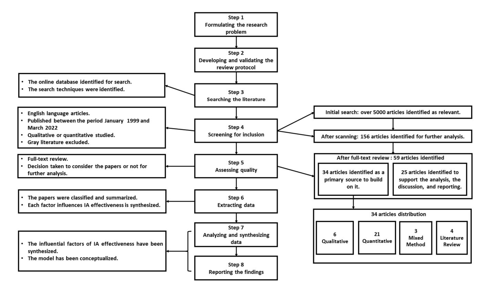
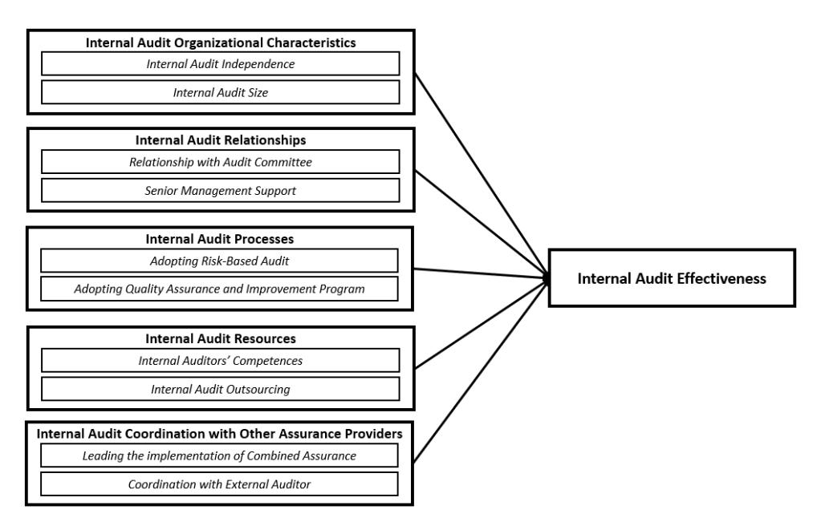

<!-- A3.R02 | source: papers_json/A3.R02/ -->

*ورقة مفاهيمية*

## **العوامل المؤثرة في فعالية التدقيق الداخلي:** **نموذج مفاهيمي**

**Ayman Abdelrahim** **and Husam-Aldin N. Al-Malkawi ***

Faculty of Business and Law, The British University in Dubai, Dubai P.O. Box 345015, United Arab Emirates ***** Correspondence: husam.almalkawi@buid.ac.ae or h.almalkawi@gmail.com

**الملخص:** الهدف من هذه الورقة هو مراجعة الأدبيات بشكل منهجي حول العوامل المؤثرة في فعالية التدقيق الداخلي وصياغة هذه العوامل في نموذج مفاهيمي. أُجريت مراجعة أدبيات منهجية (SLR) لتحديد العوامل المؤثرة في فعالية التدقيق الداخلي؛ وتمت مراجعة الدراسات ذات الصلة في الفترة بين يناير 1999 ومارس 2022 من خلال منظور يركز على العوامل الرئيسية لفعالية التدقيق الداخلي. بالإضافة إلى ذلك، أخذت مراجعتنا في الاعتبار ما ورد في إطار الممارسات المهنية الدولية للتدقيق الداخلي (IPPF). تم تحديد خمسة عوامل لفعالية التدقيق الداخلي وأبعادها ودمجها في نموذج مفاهيمي، وهذه العوامل هي: الخصائص التنظيمية للتدقيق الداخلي، وعلاقات التدقيق الداخلي، وعمليات التدقيق الداخلي، وموارد التدقيق الداخلي، وتنسيق التدقيق الداخلي مع مقدمي الضمان الآخرين. تزوّد هذه الورقة ممارسي التدقيق الداخلي ولجان التدقيق والإدارة العليا في المؤسسات بفهم واسع ونظرة شاملة للعوامل الرئيسية التي ينبغي مراعاتها لجعل وظائف التدقيق الداخلي أكثر فعالية. تقترح هذه الورقة نموذجاً مفاهيمياً يوفر نظرة شاملة للعوامل المؤثرة في فعالية التدقيق الداخلي ويحدد بوضوح أبعاد هذه العوامل. كما يتيح فرصة للبحوث المستقبلية لاختبار النموذج والبناء عليه.

**Keywords:** internal audit; effectiveness; the influential factors; systematic literature review; conceptual model

**Citation:** Abdelrahim, Ayman, and Husam-Aldin N. Al-Malkawi. 2022. The Influential Factors of Internal Audit Effectiveness: A Conceptual Model. *International Journal of* *Financial Studies* 10: 71. [https://](https://doi.org/10.3390/ijfs10030071) [doi.org/10.3390/ijfs10030071](https://doi.org/10.3390/ijfs10030071)

Received: 18 July 2022 Accepted: 11 August 2022 Published: 19 August 2022

**Publisher's Note:** MDPI stays neutral with regard to jurisdictional claims in published maps and institutional affiliations.

**Copyright:** © 2022 by the authors. Licensee MDPI, Basel, Switzerland. This article is an open access article distributed under the terms and conditions of the Creative Commons Attribution (CC BY) license [(https://](https://creativecommons.org/licenses/by/4.0/) [creativecommons.org/licenses/by/](https://creativecommons.org/licenses/by/4.0/) 4.0/).

## **1. المقدمة**

تلعب وظائف التدقيق الداخلي (IA) دوراً حاسماً في مساعدة المؤسسات على تحقيق أهدافها وحماية أصولها [(Alqudah et al.](#page-20-0) [2019)](#page-20-0). كما أصبح التدقيق الداخلي أداة إدارية حيوية لتحقيق رقابة فعالة في المؤسسات [(Behrend and](#page-20-1) [Eulerich](#page-20-1) [2019;](#page-20-1) [Endaya and Hanefah](#page-21-0) [2016)](#page-21-0). امتلاك وظيفة تدقيق داخلي فعالة أمر مهم للمؤسسات؛ فالدور الفعال، كما فسّره إطار الممارسات المهنية الدولية للتدقيق الداخلي (IPPF)، سيسهم في نهاية المطاف إسهاماً كبيراً في تحسين فعالية إدارة المخاطر والرقابة الداخلية وعمليات الحوكمة في المؤسسة [(The Institute of Internal Auditors](#page-22-0) [2017)](#page-22-0). يُعرّف معهد المدققين الداخليين (IIA) التدقيق الداخلي بأنه "نشاط ضمان وتقديم استشارات مستقل وموضوعي مصمم لإضافة قيمة وتحسين عمليات المؤسسة. يساعد المؤسسة على تحقيق أهدافها من خلال اتباع منهج منظم ومنضبط لتقييم وتحسين فعالية إدارة المخاطر والرقابة وعمليات الحوكمة." [(The Institute of Internal Auditors](#page-22-0) [2017,](#page-22-0) p. 29) علاوة على ذلك، يُعد التدقيق الداخلي الفعال مهماً للجنة التدقيق والإدارة العليا والمدقق الخارجي في المؤسسة. يزوّد التدقيق الداخلي لجنة التدقيق والإدارة العليا بتقييم موضوعي لعمليات المؤسسة وأنشطتها وأدائها ككل [(The Insti](#page-22-0)[tute of Internal Auditors](#page-22-0) [2017)](#page-22-0). تعتمد الإدارة العليا على التدقيق الداخلي لتعزيز الضوابط وتقليل المخاطر وتحسين عملياتها، بينما تعتمد لجنة التدقيق على التدقيق الداخلي لتحقيق ضوابط داخلية قوية وبلوغ جودة في التقارير المالية والحفاظ على الامتثال للأنظمة [(Eulerich et al.](#page-21-1) [2019)](#page-21-1). من جهة أخرى،

<!-- page 2 -->

*Int. J. Financial Stud.* **2022**, *10*, 71 2 of 23

تؤثر فعالية التدقيق الداخلي على قرار المدقق الخارجي بالاعتماد على عمل التدقيق الداخلي [(Lenz and](#page-21-2) [Hahn](#page-21-2) [2015)](#page-21-2). ورغم استثمار المؤسسات في إنشاء وظائف التدقيق الداخلي، يُنفَّذ التدقيق الداخلي في العديد من المؤسسات رغم تفاوت هذه المؤسسات في أهدافها وحجمها وهيكلها وتعقيدها [(The Institute of Internal Auditors](#page-22-0) [2017)](#page-22-0). لذلك، فإن معرفة العوامل التي تؤثر في فعالية التدقيق الداخلي أمر مهم لفهم المحركات الخفية لفعاليته. غير أن العوامل المؤثرة في فعالية التدقيق الداخلي كانت محل جدل في الأدبيات، وأكدت العديد من الدراسات أن فعالية التدقيق الداخلي تتأثر بعوامل عدة. ومع ذلك، لا يوجد حتى الآن إجماع بين الباحثين حول الإطار الأمثل لفعالية التدقيق الداخلي؛ وقد يعود ذلك إلى غياب نموذج مفاهيمي شامل يجمع العوامل الرئيسية لفعالية التدقيق الداخلي. ورغم تزايد اهتمام الباحثين بفعالية التدقيق الداخلي، فإن معظم الأبحاث في هذا المجال ركزت فقط على تحديد واختبار عوامل مختلفة تؤثر على فعالية التدقيق الداخلي بعناية أعمق محدودة جداً على هذه العوامل وأبعادها. علاوة على ذلك، يدرس الباحثون عوامل مختلفة بشكل منفرد استناداً إلى اهتمام كل باحث والأدبيات المتاحة، مثل استقلالية التدقيق الداخلي وحجمه وكفاءاته وجودته وعلاقته بلجنة التدقيق وعلاقته بالمدقق الخارجي ودعم الإدارة العليا والاستعانة بمصادر خارجية للتدقيق الداخلي [(Alhajri](#page-20-2) [2017;](#page-20-2) [Alqudah et al.](#page-20-0) [2019;](#page-20-0) [Al-Shbail and Turki](#page-20-3) [2017;](#page-20-3) [Alzeban](#page-20-4) [and Gwilliam](#page-20-4) [2014;](#page-20-4) [Ashfaq et al.](#page-20-5) [2021;](#page-20-5) [Arena and Azzone](#page-20-6) [2009;](#page-20-6) [Bednarek](#page-20-7) [2018;](#page-20-7) [Christopher](#page-20-8) [et al.](#page-20-8) [2009;](#page-20-8) [Cohen and Sayag](#page-20-9) [2010;](#page-20-9) [D'Onza et al.](#page-21-3) [2015;](#page-21-3) [Dellai and Omri](#page-21-4) [2016;](#page-21-4) [George et al.](#page-21-5) [2015;](#page-21-5) [Mahyoro and Kasoga](#page-21-6) [2021;](#page-21-6) [Mihret and Yismaw](#page-21-7) [2007;](#page-21-7) [Onay](#page-21-8) [2021;](#page-21-8) [Onumah and Krah](#page-21-9) [2012;](#page-21-9) [Oussii and Boulila](#page-21-10) [2021;](#page-21-10) [Salehi](#page-22-1) [2016;](#page-22-1) [Soh and Martinov-Bennie](#page-22-2) [2011;](#page-22-2) [Ta and Doan](#page-22-3) [2022;](#page-22-3) [Turetken et al.](#page-22-4) [2019)](#page-22-4).

كذلك، لم يُعطَ اهتمام كبير لأي نموذج مفاهيمي هو الأمثل لاختبار تأثيره على فعالية التدقيق الداخلي أو لدراسة العلاقة بين العوامل. يشير [Turetken et al.](#page-22-4) [(2019)](#page-22-4) إلى وجود حاجة لدراسات تبحث في العوامل المؤثرة على فعالية التدقيق الداخلي وتقدم فهماً لفعالية التدقيق الداخلي وعوامله المؤثرة. ورغم أن للأدبيات الحالية قيمتها الخاصة، فإن مسعانا هو تصوّر العوامل المؤثرة في فعالية التدقيق الداخلي ضمن نموذج واحد وتحديد أبعاد هذه العوامل بوضوح وربطها بفعالية التدقيق الداخلي. نعتقد أن هذا ضروري لإثراء المعرفة في مجال التدقيق الداخلي من خلال تقديم نظرة شاملة للعوامل المؤثرة التي تمس فعالية التدقيق الداخلي.

تحاول هذه الورقة صياغة نموذج مفاهيمي مستند إلى الأدبيات. كما أن دافعنا لهذه الورقة هو الإجابة على السؤال التالي: هل يمكننا تصوّر نموذج يتضمن العوامل المؤثرة في فعالية التدقيق الداخلي بناءً على ما تقوله الأدبيات؟ تستجيب هذه الورقة لهذا السؤال بالبناء على أدبيات التدقيق الداخلي وحججها حول العوامل المؤثرة في فعالية التدقيق الداخلي وأبعادها. أُجريت مراجعة أدبيات منهجية لتوليف العوامل التي تؤثر في فعالية التدقيق الداخلي. استخدمنا في هذه الورقة مصطلح "العوامل المؤثرة" للإشارة إلى مفاتيح وظيفة التدقيق الداخلي الفعالة. عرّف قاموس Cambridge كلمة "مؤثر" بأنها "لها تأثير كبير على شخص/شيء ما"، بينما عرّف القاموس فعل "يؤثر" بأنه "يغيّر طريقة تفكير شخص ما أو طريقة تطور شيء ما"، في حين عُرّف اسم "التأثير" بأنه "القدرة على تغيير الناس أو الأشياء" [(Cambridge University](#page-20-10) [2022)](#page-20-10). عرّفنا في هذه الورقة "العوامل المؤثرة" بأنها "تلك العوامل الجوهرية لوظيفة التدقيق الداخلي والمهمة لفعاليته والتي قد تؤثر فيه." بالإضافة إلى ذلك، تجادل هذه الورقة بأن وظيفة التدقيق الداخلي ينبغي أن تنظر إلى مجموعة من العوامل المؤثرة من أجل فهم فعاليتها؛ فبدون هذا الاعتبار، قد تتأثر فعاليتها. يدمج النموذج المفاهيمي المقترح لفعالية التدقيق الداخلي خمسة عوامل وأبعادها. وهذه العوامل هي: الخصائص التنظيمية للتدقيق الداخلي، وعلاقات التدقيق الداخلي، وعمليات التدقيق الداخلي، وموارد التدقيق الداخلي، وتنسيق التدقيق الداخلي مع مقدمي الضمان الآخرين.

هيكل هذه الورقة منظم على النحو التالي. يقدم القسم التالي خلفية عن فعالية التدقيق الداخلي. يصف القسم الثالث المنهجية المستخدمة. يستعرض القسم الرابع الأدبيات بشكل منهجي حول العوامل المؤثرة. يعرض القسم الخامس النموذج المفاهيمي استناداً إلى ما نوقش حول العوامل المؤثرة. أما القسم الأخير

<!-- page 3 -->

*Int. J. Financial Stud.* **2022**, *10*, 71 3 of 23

فيختتم الورقة ويقدم دلالات وتوصيات للبحوث المستقبلية.

## **2. فعالية التدقيق الداخلي**

يُبرز [Ridley](#page-21-11) [(2008)](#page-21-11) أن التدقيق الداخلي بُني على مبادئ الفعالية والكفاءة والاقتصاد الثلاثة (Es)، حيث تُعد الفعالية أهم "E." فالكفاءة والاقتصاد لا قيمة لهما إذا كان التدقيق الداخلي غير فعال [(Dittenhofer](#page-21-12) [2001;](#page-21-12) [Lenz and Hahn](#page-21-2) [2015)](#page-21-2). ينظر الباحثون إلى فعالية التدقيق الداخلي من زوايا مختلفة؛ إلا أنهم يشتركون في الرأي القائل بأن الفعالية تتحقق عند بلوغ الأهداف والغايات المحددة للتدقيق الداخلي [(Ahmad](#page-20-11) [et al.](#page-20-11) [2009;](#page-20-11) [Badara and Saidin](#page-20-12) [2013,](#page-20-12) [2014;](#page-20-13) [Dittenhofer](#page-21-12) [2001;](#page-21-12) [Mihret and Yismaw](#page-21-7) [2007)](#page-21-7). ووفقاً لـ [Badara and Saidin](#page-20-12) [(2013)](#page-20-12)، فإن فعالية التدقيق الداخلي هي القدرة على بلوغ أهداف التدقيق الداخلي المحددة مسبقاً، بينما يشير [Dittenhofer](#page-21-12) [(2001)](#page-21-12) إلى ضرورة صياغة هذه الأهداف بعبارات واضحة لتحقيقها. من ناحية أخرى، ورغم أن تعريف التدقيق الداخلي ينص بوضوح على أنه مصمم لإضافة قيمة وتحسين عمليات المؤسسة وكذلك تقييم وتحسين فعالية إدارة المخاطر والرقابة وعمليات الحوكمة، فإن دور التدقيق الداخلي في المؤسسات متنوع ويختلف من مؤسسة إلى أخرى [(Rupšys and Boguslauskas](#page-22-5) [2007)](#page-22-5). كما يتفاوت مستوى الفعالية بين عمليات المؤسسات المختلفة [(Al-Twaijry et al.](#page-20-14) [2003)](#page-20-14). التدقيق الداخلي عملية معقدة؛ فهو جزء من نظام الرقابة الداخلية في المؤسسة ويعتمد على فعاليته [(Badara and Saidin](#page-20-13) [2014)](#page-20-13). تشمل هذه العملية المعقدة تخطيط التدقيق وإجراء مهام التدقيق ومطابقة نتائج التدقيق ومتابعة النتائج للتأكد من اتخاذ الإجراءات المناسبة وتطوير الموظفين لضمان امتلاكهم المعرفة والمهارات الكافية لتنفيذ مهام التدقيق؛ ومع ذلك، فإن فعالية التدقيق الداخلي لا تقتصر على تقييم الجوانب المذكورة أعلاه لضمان قدرة التدقيق الداخلي على تحقيق أهدافه [(Dittenhofer](#page-21-12) [2001)](#page-21-12).

علاوة على ذلك، نظر [Lenz and Hahn](#page-21-2) [(2015)](#page-21-2) إلى فعالية التدقيق الداخلي من منظور نظرية المؤسسية وأشارا إلى وجود عوامل كلية وجزئية مختلفة تؤثر في فعالية التدقيق الداخلي. تتمثل العوامل الكلية بالقوى الإلزامية والمعيارية والتقليدية؛ حيث تُفسَّر القوى الإلزامية بالامتثال للأنظمة التي تؤثر على دور التدقيق الداخلي في المؤسسة، وتُفسَّر القوى المعيارية بدرجة الالتزام بمعايير التدقيق الداخلي، وتُفسَّر القوى التقليدية بميل المؤسسات إلى محاكاة والمقارنة مع تدقيق داخلي ناجح في مؤسسات أخرى. في المقابل، تُفسَّر العوامل الجزئية بالعوامل المرتبطة بالمؤسسة والعوامل المرتبطة بالموارد والعمليات والعلاقات الداخلية. من منظور آخر، يفحص [Azzali and Mazza](#page-20-15) [(2018)](#page-20-15) فعالية التدقيق الداخلي من منظور نظرية الوكالة. ويريان أن التدقيق الداخلي وكيل لمجلس الإدارة والإدارة وسيكون فعالاً عند أداء دوره لمصلحتهما؛ وهذا الرأي يتوافق مع تعريف التدقيق الداخلي، الذي يركز على مساعدة المؤسسة على تحقيق أهدافها.

من ناحية أخرى، يشير بعض الباحثين إلى أن فعالية التدقيق الداخلي تتحقق استناداً إلى عوامل عدة. على سبيل المثال، تكامل دعم الإدارة للتدقيق الداخلي مع عمل التدقيق الداخلي وكفاءات المدققين الداخليين [(Badara and Saidin](#page-20-12) [2013)](#page-20-12)؛ والامتثال لمعايير التدقيق الداخلي [(Cohen and Sayag](#page-20-9) [2010)](#page-20-9)؛ وجودة إجراءات التدقيق الداخلي [(Dittenhofer](#page-21-12) [2001)](#page-21-12). وفيما يقدم التدقيق الداخلي توصيات لتحسين عمليات المؤسسة، ينظر بعض الباحثين، لفهم فعالية التدقيق الداخلي، إلى معدل تنفيذ توصيات التدقيق الداخلي [(Arena and Azzone](#page-20-6) [2009;](#page-20-6) [Bednarek](#page-20-7) [2018;](#page-20-7) [Erasmus and Coetzee](#page-21-13) [2018;](#page-21-13) [Soh and Martinov-Bennie](#page-22-2) [2011)](#page-22-2). كذلك، تنظر بعض الدراسات إلى وجهتي الطلب والعرض لفعالية التدقيق الداخلي، حيث تستند وجهة الطلب إلى رضا إدارة المؤسسة والجهة المدقَّقة عن التدقيق الداخلي، بينما تستند وجهة العرض إلى رأي المدققين حول فعالية التدقيق الداخلي [(Alzeban and Gwilliam](#page-20-4) [2014;](#page-20-4) [Cohen and Sayag](#page-20-9) [2010;](#page-20-9) [Erasmus and Coetzee](#page-21-13) [2018;](#page-21-13) [Yee et al.](#page-22-6) [2008)](#page-22-6). ينظر [Alzeban and Gwilliam](#page-20-4) [(2014)](#page-20-4) إلى فعالية التدقيق الداخلي من زاوية المدققين الداخليين والجهات المدقَّقة، ويدرسان فعالية التدقيق الداخلي استناداً إلى قدرة التدقيق الداخلي على التخطيط؛ وتحسين إنتاجية المؤسسة؛ وتقييم وتحسين الرقابة الداخلية للمؤسسة وإدارة المخاطر؛ وتنفيذ توصيات التدقيق الداخلي. تساعد وجهة الطلب لفعالية التدقيق الداخلي على فهم كيفية إدراك

<!-- page 4 -->

*Int. J. Financial Stud.* **2022**, *10*, 71 4 of 23

عمل التدقيق؛ إلا أن وجهة العرض تساعد على فهم العوامل التي تؤثر في الفعالية [(Lenz and Hahn](#page-21-2) [2015)](#page-21-2).

علاوة على ذلك، فبينما يتسع نطاق التدقيق الداخلي ليشمل جوانب مختلفة من المؤسسة، فإنه يجري نطاقاً واسعاً من التقييمات المستقلة [(Alqudah et al.](#page-20-0) [2019;](#page-20-0) [Al-Twaijry](#page-20-14) [et al.](#page-20-14) [2003;](#page-20-14) [Arena and Azzone](#page-20-6) [2009;](#page-20-6) [Cohen and Sayag](#page-20-9) [2010;](#page-20-9) [Rupšys and Boguslauskas](#page-22-5) [2007;](#page-22-5) [Mihret and Yismaw](#page-21-7) [2007)](#page-21-7). ولتحقيق الفعالية، يجب على التدقيق الداخلي أداء مجموعة متنوعة من الأمور، إلا أن للباحثين وجهات نظر مختلفة حول ما ينبغي أن يقوم به التدقيق الداخلي الفعال. فعلى سبيل المثال، ينبغي للتدقيق الداخلي الفعال مساعدة المؤسسة على تحقيق أهدافها وحماية أصولها [(Alqudah et al.](#page-20-0) [2019;](#page-20-0) [Azzali and Mazza](#page-20-15) [2018)](#page-20-15)؛ وتقييم نظام الرقابة الداخلية للمؤسسة وتحسين فعاليته [(Lenz and Hahn](#page-21-2) [2015)](#page-21-2)؛ وتقييم إدارة مخاطر المؤسسة وتحسين فعاليتها [(Chambers and Odar](#page-20-16) [2015;](#page-20-16) [Cohen](#page-20-9) [and Sayag](#page-20-9) [2010;](#page-20-9) [Goodwin-Stewart and Kent](#page-21-14) [2006)](#page-21-14)؛ وتقييم امتثال المؤسسة للقوانين والأنظمة [(Eulerich et al.](#page-21-1) [2019)](#page-21-1)؛ ودعم الإدارة لمنع الاحتيال [(Alqudah et al.](#page-20-0) [2019)](#page-20-0)؛ وتحسين عمليات المؤسسة [(Ahmad et al.](#page-20-11) [2009)](#page-20-11) وتحسين أدائها [(Alzeban](#page-20-17) [2020;](#page-20-17) [Coetzee and Erasmus](#page-20-18) [2017)](#page-20-18)؛ وتقديم توصيات لتحسين جوانب مختلفة من المؤسسة [(Alqudah et al.](#page-20-0) [2019;](#page-20-0) [Al-Twaijry et al.](#page-20-14) [2003;](#page-20-14) [Arena and Azzone](#page-20-6) [2009;](#page-20-6) [Cohen and Sayag](#page-20-9) [2010;](#page-20-9) [Mihret and Yismaw](#page-21-7) [2007)](#page-21-7). علاوة على ذلك، ذكر [Onay](#page-21-8) [(2021)](#page-21-8) أن "فعالية التدقيق الداخلي من أبرز القضايا التي ينبغي أن يأخذها المدققون الداخليون بعين الاعتبار من أجل إرساء حوكمة جيدة من حيث وظائفهم ومؤسساتهم" (ص. 1). لذلك، فإن معرفة العوامل المؤثرة في فعالية التدقيق الداخلي أمر مهم لوظائف التدقيق الداخلي ومؤسساتها.

## **3. المنهجية**

استناداً إلى هدف البحث والسؤال المرتبط به المحدد في المقدمة، اعتمدت هذه الورقة مراجعة الأدبيات المنهجية (SLR). اتبعت هذه الورقة الدليل الذي وضعه [Xiao and Watson](#page-22-7) [(2019)](#page-22-7)، اللذان حددا ثماني خطوات لإجراء مراجعة الأدبيات المنهجية: (1) صياغة مشكلة البحث؛ (2) وضع بروتوكول المراجعة والتحقق منه؛ (3) البحث في الأدبيات؛ (4) الفرز للاختيار؛ (5) تقييم الجودة؛ (6) استخلاص البيانات؛ (7) تحليل البيانات وتوليفها؛ و(8) عرض النتائج. تُغطّى الخطوة الأولى في قسم المقدمة من هذه الدراسة حيث صيغت مشكلة البحث. اتباعاً للدليل، تتمثل الخطوة الثانية في وضع بروتوكول المراجعة والتحقق منه، والذي يشمل غرض الدراسة وسؤال البحث ومعايير الإدراج واستراتيجيات البحث ومعايير تقييم الجودة وإجراءات الفرز واستراتيجيات استخلاص البيانات وتوليفها وعرضها. غرض هذه الدراسة وسؤالها البحثي، كما شُرح في قسم المقدمة، يركزان على فهم وتحديد العوامل المؤثرة في فعالية التدقيق الداخلي وصياغتها في نموذج. البحث في الأدبيات هو الخطوة الثالثة؛ واستند البحث إلى قواعد بيانات إلكترونية موثوقة لتحديد الأدبيات ذات الصلة، شملت Scopus وWeb of Science وEmerald Insight وScience Direct وSpringerLink وIEEE Xplore وWorldCat Digital Library. أهمية استخدام مجموعة من قواعد البيانات الإلكترونية هي ضمان تغطية واسعة للأدبيات المتاحة وتعظيم التغطية في البحث [(Saunders et al.](#page-22-8) [2019)](#page-22-8). استُخدم مزيج من الكلمات المفتاحية التالية أثناء البحث الإلكتروني. جمعنا كلمة "internal audit" مع كل كلمة من الكلمات التالية: effectiveness، quality، performance، efficiency، add value، factors، relationship، affect، influence، association، case study، empirical، examination، drivers، evaluation، measurement، assessment، وframework.

في الخطوة الرابعة، اختيرت الأدبيات استناداً إلى تخصصات مختلفة متوافقة مع تعريف التدقيق الداخلي وفقاً لإطار IPPF لمعهد IIA، وتشمل التخصصات فعالية التدقيق الداخلي وأداءه وكفاءته وجودته وإضافته للقيمة، إذ استخدمت الأدبيات هذه المصطلحات للإشارة إلى مدى تحقيق أهداف التدقيق الداخلي المحددة. علاوة على ذلك، الأوراق المختارة هي باللغة الإنجليزية، ونُشرت في الفترة بين يناير 1999 ومارس 2022، وشملت مراجعات نظرية ودراسات تجريبية، نوعية وكمية على حد سواء. أُعطي اهتمام أكبر للأدبيات التي تناولت العوامل المؤثرة في فعالية التدقيق الداخلي ودرست علاقتها بفعالية التدقيق الداخلي. واستُبعدت الأدبيات الرمادية والأوراق التي لا تتناول موضوع

<!-- page 5 -->

Int. I. Financial Stud. 2022, 10,71 5 of 23

العوامل المؤثرة في فعالية التدقيق الداخلي. في هذه الخطوة، أظهر البحث الأولي أن أكثر من 5000 ورقة ذات صلة بهذه الدراسة. أُجري فرز للعنوان والملخص والكلمات المفتاحية لأول 150 ورقة في كل نوع من أنواع البحث، إذ أظهرت بقية الأوراق في كل بحث أنها ليست ذات صلة مباشرة بموضوع هذه الدراسة. أدى هذا الفرز إلى تحديد 156 ورقة اعتُبرت للمراجعة الإضافية. بعد خطوة الفرز للاختيار، تتمثل الخطوة الخامسة في تقييم جودة الأوراق المختارة استناداً إلى مراجعة النص الكامل؛ وفي هذه الخطوة، تُتحقَّق صحة الأوراق المختارة استناداً إلى استيفائها للمعايير الموضوعة في الخطوة الرابعة، ويُتخذ قرار باعتبار الأوراق المختارة أو عدم اعتبارها للتحليل الإضافي في الخطوة التالية. ونتيجة لذلك، اختيرت 34 ورقة؛ تناولت هذه الأوراق مباشرة العوامل المؤثرة في فعالية التدقيق الداخلي (انظر الجدول A1 في الملحق A)، وبالإضافة إلى ذلك، تُعد هذه الأوراق المصدر الأساسي لفهم العوامل المؤثرة والبناء عليها. علاوة على ذلك، أدى تقييم النص الكامل إلى 25 ورقة إضافية اعتُبرت مصدراً لدعم التحليل ومناقشة النتائج في القسم الرابع من هذه الدراسة، وأُدرجت في قائمة المراجع. في الخطوة السادسة، صُنّفت الأوراق المختارة استناداً إلى المؤلفين والسنوات ومنهج البحث والعوامل المستخدمة لدراسة فعالية التدقيق الداخلي، ولُخّصت الأوراق، وجرى توليف كل عامل مؤثر في فعالية التدقيق الداخلي. حُلّلت وتُوّفت الأوراق المختارة لمزيد من التحليل في الخطوة السادسة في الخطوة السابعة، وأُخذت معايير الإدراج والاستبعاد في الاعتبار مجدداً خلال هذه الخطوة. في الخطوة الثامنة، عُرضت العوامل المؤثرة في فعالية التدقيق الداخلي بطريقة موحّدة تُظهر أهمية كل عامل، كما هو موضح في القسم الرابع من هذه الورقة استناداً إلى الأدبيات ذات الصلة، وصيغ نموذجنا كما هو مبيّن في القسم الخامس من هذه الورقة. علاوة على ذلك، أخذنا في اعتبارنا ما ورد في إطار IPPF لمعهد IIA وربطناه بكل عامل لدعم التحليل والمناقشة والعرض. يلخص الشكل 1 أدناه عملية مراجعة الأدبيات المنهجية.

*Figure 1. Summary of the SLR process and the search results.*

## 4. العوامل المؤثرة

لا يزال التدقيق الداخلي مهنة ناشئة. ولفهم هذه المهنة، ينبغي إيلاء مزيد من الاهتمام للعوامل التي تجعل التدقيق الداخلي فعالاً (Lenz et al. 2018)،

<!-- page 6 -->

*Int. J. Financial Stud.* **2022**, *10*, 71 6 of 23

وينبغي إجراء مزيد من الدراسات حول محركات فعالية التدقيق الداخلي [(Erasmus and](#page-21-13) [Coetzee](#page-21-13) [2018)](#page-21-13). ولتقديم نظرة شاملة للعوامل المؤثرة في فعالية التدقيق الداخلي، نستخدم نظرية المؤسسية كنظرية أساسية لفهم العوامل المؤثرة. تُستخدم نظرية المؤسسية كمنصة مفيدة لفهم الجوانب التي تحدد فعالية التدقيق الداخلي والعوامل المؤثرة فيها [(Lenz and Hahn](#page-21-2) [2015)](#page-21-2). استخدمت دراسات عديدة نظرية المؤسسية كإطار نظري لتفسير العوامل الناشئة عن كل قوة مؤسسية، وكيف تنظر نظرية المؤسسية إلى تغيرات التدقيق الداخلي كاستجابة للقوى المؤسسية الثلاث: القوى الإلزامية والقوى المعيارية والقوى التقليدية. ترتبط القوى الإلزامية بتأثير الامتثال للقوانين والأنظمة؛ وترتبط القوى المعيارية بتأثير درجة الالتزام بمعايير التدقيق الداخلي؛ وترتبط القوى التقليدية بتأثير ميل المؤسسات إلى محاكاة والمقارنة استناداً إلى أنواع مماثلة من المؤسسات تُعتبر ناجحة [(Al-Twaijry et al.](#page-20-14) [2003;](#page-20-14) [Christopher et al.](#page-20-8) [2009;](#page-20-8) [Lenz and Hahn](#page-21-2) [2015;](#page-21-2) [Lenz et al.](#page-21-15) [2018)](#page-21-15). ومع ذلك، يفرّق [Lenz and Hahn](#page-21-2) [(2015)](#page-21-2) بين العوامل الكلية والعوامل الجزئية، حيث تستند العوامل الكلية إلى القوى المؤسسية؛ كما يبرزان وجود قيد على دراسة العوامل الكلية بسبب احتمال التقليل من قيمة أو إغفال محركات خارجية مهمة مثل الاتجاهات الكبرى السياسية والاقتصادية والمجتمعية والتكنولوجية والقانونية والبيئية. علاوة على ذلك، يبرزان أن العوامل الجزئية أعلى شأناً من العوامل الكلية لأن وظيفة التدقيق الداخلي آلية رقابة داخلية لأصحاب المصلحة الداخليين؛ ومن منظورهما، تشمل العوامل الجزئية الخصائص التنظيمية وموارد التدقيق الداخلي وعملياته وعلاقاته.

بالإضافة إلى ذلك، اقترح [Lenz et al.](#page-21-16) [(2014)](#page-21-16) أربعة عوامل رئيسية كـ"لبنات بناء" شكّلت فعالية التدقيق الداخلي. وهذه العوامل هي الخصائص التنظيمية وموارد التدقيق الداخلي وعملياته وعلاقاته. علاوة على ذلك، بنى [Roussy](#page-21-17) [et al.](#page-21-17) [(2020)](#page-21-17)، في دراسة نوعية حديثة، نماذج تحاول فهم العلاقات بين "لبنات البناء" الأربع الرئيسية، فضلاً عن اعتبار أي عوامل أخرى كأحد أبعاد هذه العوامل دون تحديد واضح لأبعادها. غير أن هذه النماذج أغفلت رؤية جديدة تتعلق بدور التدقيق الداخلي في قيادة الضمان المشترك في المؤسسة وتنسيقه مع مقدمي الضمان الآخرين، إذ يُعد هذا الدور ظاهرة جديدة [(Kurnia and Yulian](#page-21-18) [2018)](#page-21-18). تبني هذه الورقة على نماذج [Lenz et al.](#page-21-16) [(2014)](#page-21-16) و[Roussy et al.](#page-21-17) [(2020)](#page-21-17) وتوسّعها، مع التركيز بدقة على العوامل المؤثرة في التدقيق الداخلي وأبعادها من أجل توفير نظرة شاملة للعوامل الرئيسية لفعالية التدقيق الداخلي.

في هذه الورقة، يستند نموذجنا إلى خمسة عوامل رئيسية تشمل عشرة أبعاد، وهذه العوامل الرئيسية هي الخصائص التنظيمية للتدقيق الداخلي، وعلاقاته، وعملياته، وموارده، وتنسيقه مع مقدمي الضمان الآخرين. أبعاد هذه العوامل هي حجم التدقيق الداخلي، واستقلاليته، وعلاقته بلجنة التدقيق، ودعم الإدارة العليا له، واعتماد التدقيق القائم على المخاطر، واعتماد برنامج ضمان وتحسين الجودة، وكفاءات التدقيق الداخلي، والاستعانة بمصادر خارجية للتدقيق الداخلي، وقيادة تنفيذ الضمان المشترك، والتعاون مع التدقيق الخارجي. ستُبرز الأقسام التالية ما تقوله الأدبيات حول هذه العوامل.

## *4.1. الخصائص التنظيمية للتدقيق الداخلي*

وظيفة التدقيق الداخلي جزء من المؤسسة، والسياق الذي يؤدي فيه التدقيق الداخلي مهامه والإعداد التنظيمي يُمثَّلان بالخصائص التنظيمية للتدقيق الداخلي [(Roussy et al.](#page-21-17) [2020)](#page-21-17). يجادل الباحثون بأن الخصائص التنظيمية للتدقيق الداخلي تشمل عوامل عديدة تؤثر في فعاليته؛ فعلى سبيل المثال، يشير [Mihret and Yismaw](#page-21-7) [(2007)](#page-21-7) إلى أن الإعداد التنظيمي للتدقيق الداخلي يشمل وضعه التنظيمي ونزاهته وسياساته وإجراءاته التي تُمكّنه من تحقيق نتائج تدقيق مفيدة. غير أن [Turetken et al.](#page-22-4) [(2019)](#page-22-4) يذكران أن الإعداد التنظيمي للتدقيق الداخلي لا يرتبط فقط بالسياسات والإجراءات التي توجّه عملية التدقيق بل يشمل أيضاً وضعه في المؤسسة وملفه التنظيمي، بينما يشير [Karagiorgos et al.](#page-21-19) [(2011)](#page-21-19) إلى أن الإعداد التنظيمي يُمثَّل بموقع التدقيق الداخلي في الهيكل التنظيمي واستقلاليته، وهو أمر مهم

<!-- page 7 -->

*Int. J. Financial Stud.* **2022**, *10*, 71 7 of 23

لتحديد الفصل بين المهام والحفاظ عليه. استخدمنا في هذه الورقة استقلالية التدقيق الداخلي وحجمه كأبعاد للخصائص التنظيمية للتدقيق الداخلي، إذ تتضمن هذه الأبعاد ضمنياً أبعاداً أخرى مثل السياسات والإجراءات والنزاهة. فوظيفة التدقيق الداخلي لا يمكنها الحفاظ على نزاهتها دون استقلاليتها، كما تتأثر سياساتها وإجراءاتها بدورها باستقلاليتها وحجمها، إذ توضح معايير الممارسة المهنية الدولية للتدقيق الداخلي (معايير التدقيق الداخلي) (المعيار 2040- السياسات والإجراءات) أن شكل ومحتوى السياسات والإجراءات يعتمدان على حجم وهيكل نشاط التدقيق الداخلي وتعقيد عمله.

## 4.1.1. استقلالية التدقيق الداخلي

رغم أن المدققين الداخليين عادةً ما يكونون موظفين في المؤسسات، فإن الهيئات المهنية تشدد بشكل متزايد على ضرورة استقلالية التدقيق الداخلي [(Alzeban and Gwilliam](#page-20-4) [2014)](#page-20-4). استقلالية التدقيق الداخلي هي "التحرر من الظروف التي تهدد قدرة نشاط التدقيق الداخلي على تنفيذ مسؤولياته بطريقة غير متحيزة" [(The Institute of Internal Au](#page-22-0)[ditors](#page-22-0) [2017,](#page-22-0) p. 23). بالإضافة إلى ذلك، شددت معايير التدقيق الداخلي (المعيار 1100- الاستقلالية التنظيمية) على أهمية الحفاظ على الوضع التنظيمي واستقلالية وظيفة التدقيق الداخلي، والتي يمكن اكتسابها من خلال رفع التقارير إلى مستوى داخل المؤسسة يسمح للتدقيق الداخلي بأداء مهامه دون تدخل في تحديد نطاق العمل وأداء التدقيق وإبلاغ نتائجه، بالإضافة إلى امتلاك خط تقرير مزدوج إلى لجنة التدقيق والرئيس التنفيذي (CEO) للمؤسسة [(The Institute of Internal Auditors](#page-22-0) [2017)](#page-22-0). ورفع التقارير إلى لجنة التدقيق يساعد في جعل التدقيق الداخلي فعالاً بمنع إدارة المؤسسة من التدخل في نطاق التدقيق الداخلي والسيطرة على عمله، بينما يساعد رفع التقارير إلى الرئيس التنفيذي التدقيق الداخلي في تنفيذ مسؤولياته دون عوائق ومعالجة القضايا الصعبة مع قادة كبار آخرين [(The Institute of Internal Auditors](#page-22-9) [2019)](#page-22-9).

علاوة على ذلك، شددت الدراسات السابقة على أهمية استقلالية التدقيق الداخلي لفعاليته؛ كما تُعد الاستقلالية مهمة لتمكين تواصل أفضل مع الإدارة العليا من خلال التشديد على استقلالية الجهة المدقَّقة وكذلك خلق بيئة موضوعية تساعد على إيصال نتائج التدقيق دون تأثير من الجهة المدقَّقة [(Mihret and Yismaw](#page-21-7) [2007)](#page-21-7). بالإضافة إلى ذلك، تخلق الاستقلالية بيئة داعمة تساعد التدقيق الداخلي على أداء عمله دون ضغوط وتجعل المدققين الداخليين أكثر موضوعية وتُوصل رسالة للموظفين في المؤسسة بأنه يمكنهم الاعتماد على نتائج التدقيق الداخلي [(Cohen and Sayag](#page-20-9) [2010)](#page-20-9). وبالمثل، شدد [D'Onza et al.](#page-21-3) [(2015)](#page-21-3) على أن استقلالية التدقيق الداخلي أساسية لضمان موثوقية خدمات التدقيق الداخلي. علاوة على ذلك، فإن نقص استقلالية التدقيق الداخلي يؤثر في قدرته على تقديم الضمان للجنة التدقيق، مما يؤثر في قدرة اللجنة على أداء دورها في الحوكمة المؤسسية بفعالية [(Christopher et al.](#page-20-8) [2009;](#page-20-8) [D'Onza et al.](#page-21-3) [2015)](#page-21-3). ومع ذلك، تؤثر بعض التهديدات في هذه الاستقلالية، مثل استخدام وظيفة التدقيق الداخلي كأرضية تدريب لمنصب إداري مستقبلي داخل المؤسسة؛ وعندما يوافق الرئيس التنفيذي (CEO) أو المدير المالي التنفيذي (CFO) على ميزانية التدقيق الداخلي، إذ يُعد هذا أداة قوية لفرض قيود على الميزانية قد تقلل النطاق وتؤثر في فعالية التدقيق الداخلي؛ وعندما تنخرط الإدارة العليا بشكل كبير في وضع خطة التدقيق الداخلي؛ وعندما يؤدي التدقيق الداخلي دوراً استشارياً وتنظر إليه الإدارة العليا كشريك يؤدي دوراً إدارياً تابعاً [(Christopher et al.](#page-20-8) [2009)](#page-20-8).

## 4.1.2. حجم التدقيق الداخلي

يلعب حجم وظيفة التدقيق الداخلي دوراً أساسياً في فعاليتها. ولتنفيذ مسؤوليات التدقيق الداخلي بشكل صحيح، تحتاج وظيفة التدقيق الداخلي إلى موارد كافية [(Alzeban and](#page-20-4) [Gwilliam](#page-20-4) [2014)](#page-20-4). يشدد معيار التدقيق الداخلي (2030- إدارة الموارد) على أهمية امتلاك موارد كافية لتنفيذ خطة التدقيق الداخلي ونشر الموارد بفعالية لتحسين تحقيق الخطة [(The Institute of Internal](#page-22-0) [Auditors](#page-22-0) [2017)](#page-22-0). تُبرر نظرية الوكالة الحجم الأكبر لوظيفة التدقيق الداخلي حيث يمتلك الوكلاء معلومات أكثر من الموكِّلين. تؤثر عدم تماثل المعلومات هذه في قدرة الموكِّلين على مراقبة ما إذا كانت مصالحهم مخدومة بشكل صحيح من قبل الوكلاء؛

<!-- page 8 -->

*Int. J. Financial Stud.* **2022**, *10*, 71 8 of 23

وهذا يبرر الحجم الأكبر لوظيفة التدقيق الداخلي لمراقبة أنشطة الوكلاء عن كثب وحماية مصالح الموكِّلين [(Sarens and Abdolmohammadi](#page-22-10) [2011)](#page-22-10). علاوة على ذلك، يسمح الحجم الكبير لوظيفة التدقيق الداخلي بتناوب المدققين الداخليين، ويؤدي هذا التناوب إلى زيادة الموضوعية [(Arena and Azzone](#page-20-6) [2009;](#page-20-6) [Turetken et al.](#page-22-4) [2019)](#page-22-4).

تجادل بعض الدراسات بوجود علاقة بين حجم التدقيق الداخلي وفعاليته. فعلى سبيل المثال، يجد [Alzeban and Gwilliam](#page-20-4) [(2014)](#page-20-4) أن حجم التدقيق الداخلي يرتبط ارتباطاً إيجابياً وذا دلالة إحصائية بفعاليته. كما يذكران أن توافر موارد التدقيق الداخلي يؤثر في نسبة الإجراءات التي تتخذها الجهات المدقَّقة بناءً على نتائج التدقيق، بينما يوضح [Al-Twaijry et al.](#page-20-14) [(2003)](#page-20-14) أن الحجم الصغير لوظيفة التدقيق الداخلي يحد من نطاق العمل ويؤثر سلباً في القدرة على تحقيق أهداف التدقيق الداخلي والوفاء بواجباتها ومسؤولياتها بنجاح. ويعزوان عدم توفر الموارد الكافية إلى نقص الميزانية. في دراسة أخرى، يكشف [Ahmad et al.](#page-20-11) [(2009)](#page-20-11) أن المدققين الداخليين يصنفون نقص الموظفين في وظائف التدقيق الداخلي كأول مشكلة من بين عشر مشكلات رئيسية تواجه وظائف التدقيق الداخلي وعائقاً رئيسياً يمكن أن يحد من فعالية التدقيق الداخلي. لذلك، ينبغي أن تأخذ لجان التدقيق والإدارة العليا في المؤسسات حجم التدقيق الداخلي بعين الاعتبار عندما تحتاج إلى تحسين فعاليته.

## *4.2. علاقات التدقيق الداخلي*

العلاقات مهمة لأي وظيفة تدقيق داخلي من أجل فعاليتها. شدد إطار IPPF لمعهد IIA على أهمية علاقات التقرير المزدوج مع لجنة التدقيق والإدارة العليا، حيث يتمثل خط التقرير الأول في رفع التقارير وظيفياً إلى لجنة التدقيق، مما يساعد في جعل التدقيق الداخلي فعالاً من خلال تمكين وصوله إلى المسائل الحساسة، وضمان وضع تنظيمي كافٍ له، ومنع إدارة المؤسسة من التدخل للسيطرة على عمله وضمان أعلى مستوى من الحوكمة على عمله [(The Institute of Internal Auditors](#page-22-9) [2019)](#page-22-9). في المقابل، يتمثل خط التقرير الثاني في رفع التقارير إدارياً إلى الإدارة العليا—وتحديداً إلى الرئيس التنفيذي (CEO)—وهو أمر مهم لدعم فعالية التدقيق الداخلي من خلال تزويد وظيفته بالسلطة والميزانية المناسبتين، فضلاً عن تسهيل عمله لتنفيذ مسؤولياته دون عوائق والتعامل مع قضايا صعبة مع قادة كبار آخرين [(The Institute of Internal Auditors](#page-22-9) [2019)](#page-22-9).

يشير [Roussy et al.](#page-21-17) [(2020)](#page-21-17) إلى أن العلاقات الشفافة والقائمة على الثقة بين الرئيس التنفيذي للتدقيق (CAE) ولجنة التدقيق والرئيس التنفيذي (CEO) مهمة لفعالية التدقيق الداخلي. علاوة على ذلك، يشيرون إلى أن جودة العلاقات مرتبطة بتكرار الاجتماعات ورسمية التواصل، وهما مهمان لتحسين الشفافية والثقة. استخدمنا في هذه الورقة علاقة التدقيق الداخلي بلجنة التدقيق ودعم الإدارة العليا كأبعاد لعلاقات التدقيق الداخلي، إذ تُمثِّل لجنة التدقيق والإدارة العليا أصحاب المصلحة الرئيسيين لوظيفة التدقيق الداخلي. لا يمكن لوظيفة التدقيق الداخلي أن تكون فعالة دون علاقة إيجابية مع لجنة التدقيق ودعم مناسب من الإدارة العليا [(Soh and Martinov-](#page-22-2)[Bennie](#page-22-2) [2011)](#page-22-2).

## 4.2.1. العلاقة مع لجنة التدقيق

رغم أن وظيفة التدقيق الداخلي ولجنة التدقيق هيئتا رقابة منفصلتان، فإنهما تشتركان في أهداف مماثلة من حيث مراقبة نظام الرقابة الداخلية لمؤسستهما وتقييمه [(Arena and Azzone](#page-20-6) [2009)](#page-20-6). ومع ذلك، تعتمد لجنة التدقيق على العمل الذي تؤديه وظيفة التدقيق الداخلي للوفاء بمسؤولياتها [(Brender et al.](#page-20-19) [2015)](#page-20-19) فضلاً عن اعتبار التدقيق الداخلي مصدر معلومات يساعدها على أداء واجباتها [(D'Onza et al.](#page-21-3) [2015)](#page-21-3). لذلك، من المهم للجنة التدقيق أن تجعل وظيفة التدقيق الداخلي فعالة. تُشرف لجنة التدقيق على وظيفة التدقيق الداخلي، حيث يُمثَّل التدقيق الداخلي بالرئيس التنفيذي للتدقيق (CAE) الذي يرفع تقاريره إلى لجنة التدقيق. العلاقة بين التدقيق الداخلي ولجنة التدقيق حاسمة لفعالية التدقيق الداخلي، فعندما تتألف لجنة التدقيق من مديرين مستقلين ذوي خبرة مالية ومحاسبية، تلعب لجنة التدقيق دوراً نشطاً في الإشراف على وظيفة التدقيق الداخلي مع احتمال اجتماعات أكثر تكراراً ووصول غير رسمي من الرئيس التنفيذي للتدقيق [(Lenz and Hahn](#page-21-2) [2015)](#page-21-2). تكرار الاجتماعات

<!-- page 9 -->

*Int. J. Financial Stud.* **2022**, *10*, 71 9 of 23

ومستوى الرسمية ومستوى الثقة بين الرئيس التنفيذي للتدقيق وأعضاء لجنة التدقيق تحدد العلاقة وتؤثر في فعالية التدقيق الداخلي [(Roussy et al.](#page-21-17) [2020;](#page-21-17) [Sarens](#page-22-11) [et al.](#page-22-11) [2009;](#page-22-11) [Soh and Martinov-Bennie](#page-22-2) [2011)](#page-22-2). العلاقة الإيجابية بين وظيفة التدقيق الداخلي ولجنة التدقيق تسهّل دور التدقيق الداخلي وتزوده بدعم كافٍ للوفاء بمسؤولياته.

يساعد إشراف لجنة التدقيق على وظيفة التدقيق الداخلي في تحديد المشكلات داخل التدقيق الداخلي نفسه ويتيح فرصاً للتحسين [(Arena and Azzone](#page-20-6) [2009)](#page-20-6). علاوة على ذلك، تعمل لجان التدقيق كحافظ لاستقلالية التدقيق الداخلي التنظيمية وتعزز قدرة التدقيق الداخلي على تجاوز ضغوط غير مبررة من الإدارة العليا [(Ahmad](#page-20-11) [et al.](#page-20-11) [2009;](#page-20-11) [D'Onza et al.](#page-21-3) [2015;](#page-21-3) [Soh and Martinov-Bennie](#page-22-2) [2011)](#page-22-2). علاوة على ذلك، يُتوقع أن تعزز العلاقة العملية المكثفة بين التدقيق الداخلي ولجنة التدقيق موضوعية التدقيق الداخلي واستقلاليته [(Lenz and Hahn](#page-21-2) [2015)](#page-21-2). كذلك، يتيح الوصول المنتظم من الرئيس التنفيذي للتدقيق إلى لجنة التدقيق فرصة لمعالجة المخاوف المثارة في تقارير التدقيق الداخلي والحصول على دعم لمعالجة نقاط الضعف المُبلَّغ عنها [(D'Onza et al.](#page-21-3) [2015)](#page-21-3). وبالمثل، تعزز التفاعلات المتكررة بين الرئيس التنفيذي للتدقيق ولجنة التدقيق عملية التواصل وتتيح للتدقيق الداخلي معالجة مخاوفه والحصول على المشورة والدعم ليصبح أكثر فعالية في تحسين إدارة مخاطر المؤسسة ورقابتها الداخلية وعمليات الحوكمة [(Abbott et al.](#page-20-20) [2007;](#page-20-20) [D'Onza et al.](#page-21-3) [2015;](#page-21-3) [Goodwin-Stewart and](#page-21-14) [Kent](#page-21-14) [2006)](#page-21-14). تُمكّن لجنة التدقيق التدقيق الداخلي من تصعيد القضايا العالقة مع الإدارة والموافقة على الخطة والموارد المطلوبة [(Soh and Martinov-Bennie](#page-22-2) [2011)](#page-22-2)، إذ تُعد العلاقة القائمة على الثقة والشفافية بين لجنة التدقيق والرئيس التنفيذي للتدقيق مهمة لحل أي مخاوف فعلية يثيرها التدقيق الداخلي [(Roussy et al.](#page-21-17) [2020)](#page-21-17). يخلص [Arena](#page-20-6) [and Azzone](#page-20-6) [(2009)](#page-20-6) إلى أن انخراط لجنة التدقيق في أنشطة التدقيق الداخلي يبعث برسالة مفادها أن المؤسسة ملتزمة بزيادة مصداقية التدقيق الداخلي وتشجع مديري الخطوط على أن يكونوا أكثر نشاطاً في تنفيذ توصياته.

## 4.2.2. دعم الإدارة العليا

العلاقة بين وظيفة التدقيق الداخلي، ممثلة بالرئيس التنفيذي للتدقيق، والإدارة العليا حاسمة لفعالية التدقيق الداخلي. تريد الإدارة العليا من وظيفة التدقيق الداخلي تحمل مزيد من المسؤولية لتعزيز الرقابة الداخلية للمؤسسة وإدارة المخاطر، بينما تتوقع وظيفة التدقيق الداخلي من الإدارة العليا دعمها في الوفاء بمسؤولياتها [(Sarens and De Beelde](#page-22-12) [2006b)](#page-22-12). تشدد معايير التدقيق الداخلي على أهمية هذه العلاقة لدعم استقلالية التدقيق الداخلي وموضوعية المدققين الداخليين (المعيار 1100- الاستقلالية والموضوعية)؛ كما أنها مهمة لدعم تحسين جودة التدقيق الداخلي من خلال إبلاغ نتائج برنامج ضمان الجودة وتحسينها إلى الإدارة العليا (المعيار 1320- إبلاغ نتائج برنامج ضمان الجودة وتحسينها)؛ بالإضافة إلى أهميتها لدعم وتسهيل دور التدقيق الداخلي من خلال إبلاغ متطلباته (المعيار 2060- إبلاغ الإدارة العليا والمجلس). علاوة على ذلك، تشدد المعايير على أهمية دعم الإدارة العليا من خلال انخراطها في وضع خطة التدقيق الداخلي (المعيار 2010.A1- التخطيط) [(The Institute of Internal Auditors](#page-22-0) [2017)](#page-22-0). تُظهر الدراسات السابقة أن دعم الإدارة العليا مهم لفعالية التدقيق الداخلي. يُمكّن هذا الدعم التدقيق الداخلي من الحفاظ على استقلاليته [(Alzeban and Gwilliam](#page-20-4) [2014)](#page-20-4)؛ وتزويده بميزانية وموارد كافية للوفاء بمسؤولياته بفعالية [(Ahmad et al.](#page-20-11) [2009;](#page-20-11) [Alqudah et al.](#page-20-0) [2019;](#page-20-0) [Alzeban and Gwilliam](#page-20-4) [2014;](#page-20-4) [Ta and Doan](#page-22-3) [2022)](#page-22-3)؛ وتزويده بأدوات مناسبة تساعد على إتمام مهام التدقيق [(Alzeban and](#page-20-4) [Gwilliam](#page-20-4) [2014;](#page-20-4) [Cohen and Sayag](#page-20-9) [2010)](#page-20-9)؛ وتزويده بالعدد المناسب من الموظفين واستقطاب موظفين مهرة وذوي خبرة [(Ahmad et al.](#page-20-11) [2009;](#page-20-11) [Alzeban and Gwilliam](#page-20-4) [2014;](#page-20-4) [Cohen and Sayag](#page-20-9) [2010;](#page-20-9) [Ta and Doan](#page-22-3) [2022)](#page-22-3)؛ وضمان برامج تدريب وتطوير كافية ومحدَّثة [(Alzeban and Gwilliam](#page-20-4) [2014;](#page-20-4) [Cohen and Sayag](#page-20-9) [2010)](#page-20-9)؛ وتوفير الموارد والالتزام بتنفيذ توصيات التدقيق الداخلي، وهو ما يُعد مؤشراً على تحقيق فعالية التدقيق الداخلي [(Mihret and Yismaw](#page-21-7) [2007)](#page-21-7).

من ناحية أخرى، يؤثر نقص دعم الإدارة سلباً في مستوى تعاون الجهة المدقَّقة مع التدقيق الداخلي ويخلق موقفاً غير مواتٍ تجاه التدقيق الداخلي من قبل الجهة المدقَّقة

<!-- page 10 -->

*Int. J. Financial Stud.* **2022**, *10*, 71 10 of 23

فضلاً عن إدراك الجهة المدقَّقة للتدقيق الداخلي على أنه غير مهم لأن الإدارة العليا تعتبره كذلك [(Mihret and Yismaw](#page-21-7) [2007)](#page-21-7). سيكون من الصعب على التدقيق الداخلي الوصول الكامل إلى جميع الأنشطة والسجلات والأصول دون تعاون كامل من الجهة المدقَّقة [(Ahmad et al.](#page-20-11) [2009)](#page-20-11). يتصرف الموظفون وفقاً لما يتوقعه منهم مديروهم؛ وبناءً عليه، عندما يدرك الموظفون أن الإدارة العليا تعترف بأهمية التدقيق الداخلي بالنسبة لها، فإنهم سيقدّرون عمله ويتقبلونه فضلاً عن التعاون معه ودعمه [(Cohen and Sayag](#page-20-9) [2010;](#page-20-9) [Sarens and De Beelde](#page-22-12) [2006b)](#page-22-12).

## *4.3. عمليات التدقيق الداخلي*

عمليات التدقيق الداخلي مهمة لفعاليته، إذ إن التدقيق الداخلي سيتمكن من خلال العمليات من تحقيق أهدافه؛ إلا أن عمليات التدقيق الداخلي تتشكل من خلال اعتماد نهج تدقيق قائم على المخاطر وبرنامج ضمان الجودة وتحسينها. ربط الباحثون عمليات التدقيق الداخلي باعتماد نهج تدقيق قائم على المخاطر [(Castanheira et al.](#page-20-21) [2010;](#page-20-21) [Coetzee](#page-20-22) [and Lubbe](#page-20-22) [2013;](#page-20-22) [Sarens and De Beelde](#page-22-13) [2006a;](#page-22-13) [Soh and Martinov-Bennie](#page-22-2) [2011)](#page-22-2) واعتماد برنامج ضمان الجودة وتحسينها [(Arena and Azzone](#page-20-6) [2009;](#page-20-6) [Castanheira et al.](#page-20-21) [2010;](#page-20-21) [Coetzee and Lubbe](#page-20-22) [2013;](#page-20-22) [Cohen and Sayag](#page-20-9) [2010;](#page-20-9) [D'Onza et al.](#page-21-3) [2015;](#page-21-3) [Lenz and Hahn](#page-21-2) [2015;](#page-21-2) [Mihret and Yismaw](#page-21-7) [2007;](#page-21-7) [Rupšys and Boguslauskas](#page-22-5) [2007;](#page-22-5) [Sarens and De Beelde](#page-22-13) [2006a;](#page-22-13) [Soh and Martinov-Bennie](#page-22-2) [2011;](#page-22-2) [Turetken et al.](#page-22-4) [2019)](#page-22-4). يؤثر نهج التدقيق القائم على المخاطر في أولويات التدقيق والمجالات التي ستُؤخذ بعين الاعتبار أثناء التدقيق وكذلك الموارد اللازمة لإجراء التدقيق وأدوات وتقنيات التدقيق المستخدمة لتحقيق أهداف مهام التدقيق [(The Institute of Internal Auditors](#page-22-9) [2019)](#page-22-9). في المقابل، صُمم برنامج ضمان الجودة وتحسينها لتمكين التدقيق الداخلي من الالتزام بمعايير التدقيق الداخلي وميثاق الأخلاقيات؛ وضمان كفاءة التدقيق الداخلي وفعاليته؛ وتوفير فرصة للتحسين [(The Institute](#page-22-9) [of Internal Auditors](#page-22-9) [2019)](#page-22-9). بالإضافة إلى ذلك، ينبغي تطوير برنامج ضمان الجودة وتحسينها بطريقة تساعد التدقيق الداخلي على إضافة قيمة للمؤسسة وتحسين عملياتها [(Marais](#page-21-20) [2004)](#page-21-20)، ويشكّل برنامج ضمان الجودة وتحسينها العمليات من خلال الاستجابات والتغذية الراجعة من المدققين الداخليين والجهات المدقَّقة [(The](#page-22-9) [Institute of Internal Auditors](#page-22-9) [2019)](#page-22-9). استُخدم في هذه الورقة اعتماد التدقيق القائم على المخاطر وبرنامج ضمان الجودة وتحسينها كأبعاد لعمليات التدقيق الداخلي إذ إنهما أهم العوامل التي شكّلت عمليات التدقيق الداخلي.

## 4.3.1. اعتماد التدقيق القائم على المخاطر

يُنظر إلى التدقيق القائم على المخاطر كنهج حديث يساعد المؤسسات على تحديد المخاطر التي تحد من قدرتها على تحقيق أهدافها [(Arena and Azzone](#page-20-6) [2009;](#page-20-6) [Lenz and Hahn](#page-21-2) [2015)](#page-21-2). تتطلب معايير التدقيق الداخلي تدقيقاً قائماً على المخاطر، وينص المعيار 2010- التخطيط على أن "يجب على الرئيس التنفيذي للتدقيق وضع خطة قائمة على المخاطر لتحديد أولويات نشاط التدقيق الداخلي، بما يتسق مع أهداف المؤسسة" [(The Institute of](#page-22-0) [Internal Auditors](#page-22-0) [2017,](#page-22-0) p. 10). عادةً ما يُنظر إلى التخطيط كنشاط تدقيق رئيسي، ويشمل إعداد خطة استراتيجية وخطة سنوية وبرامج لمهام تدقيق فردية، كما يتيح التخطيط السليم إجراء عدد كبير من عمليات التدقيق خلال إطار زمني معين من خلال تحسين الكفاءة [(Mihret and Yismaw](#page-21-7) [2007)](#page-21-7). ومن منظور نظرية الوكالة، يبرز [Zainal Abidin](#page-22-14) [(2017)](#page-22-14) أن مفهوم نظرية الوكالة تطور من الفصل بين الملكية (المجلس) والوكيل (الإدارة)، مع نظام رقابة وإشراف مصمم بعناية يهدف إلى تعظيم المنفعة لجميع الأطراف. من هذا المنظور، يتمثل دور التدقيق الداخلي في مراقبة الإجراءات والقرارات المتخذة لتنفيذ الاستراتيجيات من أجل تحقيق الأهداف؛ وبالتالي، اعتمد التدقيق الداخلي نهج تدقيق قائم على المخاطر لضمان تحديد المخاطر المرتبطة بالاستراتيجيات وتخفيفها بشكل مناسب وتصرف الإدارة وفقاً لتوقعات المالك.

اعتمد التدقيق الداخلي نهج التدقيق القائم على المخاطر لتحقيق فعاليته، إذ يتيح هذا النهج استخداماً فعالاً للموارد ويتيح التركيز على المسائل المهمة [(Azzali and](#page-20-15) [Mazza](#page-20-15) [2018)](#page-20-15). يتجاوز نهج التدقيق القائم على المخاطر الامتثال ويتيح للتدقيق الداخلي تقديم ضمان بشأن فعالية إدارة المخاطر والرقابة الداخلية [(Lois](#page-21-21) [et al.](#page-21-21) [2021)](#page-21-21). بالإضافة إلى ذلك، عندما يرتبط التدقيق الداخلي بإدارة المخاطر، يُمكّن ذلك التدقيق الداخلي

<!-- page 11 -->

*Int. J. Financial Stud.* **2022**, *10*, 71 11 of 23

من مساعدة مدير المؤسسة على فهم نقاط ضعف الرقابة الداخلية فضلاً عن تعزيز التواصل بين المدققين الداخليين والجهات المدقَّقة [(Arena](#page-20-6) [and Azzone](#page-20-6) [2009;](#page-20-6) [D'Onza et al.](#page-21-3) [2015)](#page-21-3). تحدد المؤسسات ضوابط لتخفيف مخاطرها، مما يجعل إدارة المخاطر أساسية لفعالية التدقيق الداخلي [(Turetken et al.](#page-22-4) [2019)](#page-22-4). تزداد القيمة التي يقدمها التدقيق الداخلي عندما يسهم في تحسين فعالية إدارة المخاطر، وتزداد هذه المساهمة عندما يستخدم التدقيق الداخلي نهجاً منهجياً عند إجراء تقييم إدارة المخاطر [(D'Onza et al.](#page-21-3) [2015)](#page-21-3). يقيّم التدقيق الداخلي الفعال المخاطر التي تواجه المؤسسة ويضع خطة تدقيق لمعالجتها، إلا أن عملية تقييم المخاطر يجب أن تكون ديناميكية وأن تربط التغيرات في ملف مخاطر الشركة بالتغيرات في خطة التدقيق [(Feizizadeh](#page-21-22) [2012)](#page-21-22). يُمكّن انخراط التدقيق الداخلي في إدارة المخاطر من تحديث خطة التدقيق استناداً إلى المخاطر المحدَّثة؛ ومع ذلك، يشعر المدققون الداخليون بالقلق حيال قدرتهم على أداء دور رئيسي في إدارة المخاطر [(Sarens and De Beelde](#page-22-13) [2006a)](#page-22-13).

## 4.3.2. اعتماد برنامج ضمان الجودة وتحسينها

يلعب برنامج ضمان الجودة وتحسينها دوراً رئيسياً في فعالية التدقيق الداخلي. ولإثبات أن التدقيق الداخلي ذو قيمة للمؤسسة وله سمعة جيدة داخلها، يجب على التدقيق الداخلي تقييم أدائه باستمرار وتحسين جودة خدمته [(Mihret and Yismaw](#page-21-7) [2007)](#page-21-7). إلا أن جودة عمل التدقيق تشير إلى جودة أنشطة التدقيق الداخلي [(Endaya and Hanefah](#page-21-23) [2013;](#page-21-23) [Mihret and Yismaw](#page-21-7) [2007)](#page-21-7). تُحدَّد جودة التدقيق الداخلي من خلال القدرة الداخلية على تقديم نتائج وتوصيات قيّمة ومفيدة؛ وتُعد جودة التدقيق الداخلي مؤشراً على مستوى كفاءات الموظفين ونطاق العمل المقدَّم ومدى التخطيط والتنفيذ والإبلاغ الملائم للتدقيق [(Mihret and Yismaw](#page-21-7) [2007)](#page-21-7). علاوة على ذلك، تشير جودة التدقيق الداخلي إلى مجموعة من أنشطة التدقيق الداخلي: تشمل هذه الأنشطة التخطيط والإشراف والعمل الميداني وإبلاغ النتائج والتوصيات فضلاً عن خطط عمل المتابعة على التوصيات [(Endaya](#page-21-23) [and Hanefah](#page-21-23) [2013)](#page-21-23). كذلك، تشير جودة التدقيق الداخلي إلى الالتزام بمعايير التدقيق الداخلي [(Arena and Azzone](#page-20-6) [2009;](#page-20-6) [Cohen and Sayag](#page-20-9) [2010;](#page-20-9) [Rupšys and Boguslauskas](#page-22-5) [2007;](#page-22-5) [Turetken et al.](#page-22-4) [2019)](#page-22-4). يحسّن ارتفاع مستوى جودة عمل التدقيق الداخلي فعاليته، حيث تُفهم جودة التدقيق الداخلي من حيث الالتزام بمعايير التدقيق الداخلي ومستوى عالٍ من التخطيط والتنفيذ [(Cohen and Sayag](#page-20-9) [2010)](#page-20-9). لذلك، فإن إجراء التدقيق وفقاً لمعايير التدقيق الداخلي سيسهم في فعالية التدقيق الداخلي [(Turetken et al.](#page-22-4) [2019)](#page-22-4). يؤثر الالتزام بمعايير التدقيق الداخلي في فعاليته وقدرته على إضافة قيمة إذ توفر المعايير إطاراً للأداء ومجموعة من الأنشطة المضيفة للقيمة [(D'Onza et al.](#page-21-3) [2015)](#page-21-3). تشدد معايير التدقيق الداخلي على أهمية الحفاظ على برنامج ضمان الجودة وتحسينها الذي يغطي جميع جوانب أنشطة التدقيق الداخلي ويراقب فعاليته باستمرار (المعيار 1300- برنامج ضمان الجودة وتحسينها). يشمل برنامج ضمان الجودة وتحسينها تقييماً داخلياً وتقييماً خارجياً. صُممت هذه التقييمات لتمكين تقييم التزام التدقيق الداخلي بمعايير التدقيق الداخلي وميثاق الأخلاقيات؛ وتقييم كفاءته وفعاليته؛ وتوفير فرصة للتحسين [(The Institute of Internal Auditors](#page-22-0) [2017;](#page-22-0) [Soh](#page-22-2) [and Martinov-Bennie](#page-22-2) [2011)](#page-22-2).

يوفر التقييم الداخلي مراجعة مستمرة لأداء التدقيق الداخلي، ويُجري تقييماً ذاتياً دورياً شخص داخل المؤسسة يمتلك معرفة كافية بمعايير التدقيق الداخلي وممارساته. يوفر التقييم الخارجي ضماناً بأن عمل التدقيق الداخلي يتوافق مع معايير التدقيق الداخلي، ويُجري هذا التقييم مقيّم مستقل من خارج المؤسسة [(The Institute](#page-22-0) [of Internal Auditors](#page-22-0) [2017)](#page-22-0). وبمجرد تحسن جودة التدقيق الداخلي إلى درجة تلبي مصلحة الإدارة، فإن دعم الإدارة والتزامها بتنفيذ توصيات التدقيق الداخلي سيكون نتيجة طبيعية إذ تدرك الإدارة قيمة التدقيق الداخلي وإسهامه في تحقيق أهداف المؤسسة؛ وفي نهاية المطاف، سيعزز ذلك فعالية التدقيق الداخلي بشكل إيجابي [(Mihret and Yismaw](#page-21-7) [2007)](#page-21-7).

<!-- page 12 -->

*Int. J. Financial Stud.* **2022**, *10*, 71 12 of 23

## *4.4. موارد التدقيق الداخلي*

موارد التدقيق الداخلي جزء لا يتجزأ من نجاحه، وهي تتمثل بالرئيس التنفيذي للتدقيق وموظفي التدقيق الداخلي [(Lenz and Hahn](#page-21-2) [2015)](#page-21-2). يتطلب عمل التدقيق الداخلي موظفين محترفين ذوي خبرة للاضطلاع بنطاق واسع من عمليات التدقيق، كما ينبغي أن يمتلك الموظفون التعليم والمؤهلات المهنية والتدريب المناسب اللازم [(Al-Twaijry et al.](#page-20-14) [2003;](#page-20-14) [Cohen and Sayag](#page-20-9) [2010)](#page-20-9). ربطت بعض الدراسات موارد التدقيق الداخلي بكفاءات المدققين الداخليين [(Ahmad](#page-20-11) [et al.](#page-20-11) [2009;](#page-20-11) [Arena and Azzone](#page-20-6) [2009;](#page-20-6) [Bednarek](#page-20-7) [2018;](#page-20-7) [Cohen and Sayag](#page-20-9) [2010;](#page-20-9) [Dellai and](#page-21-4) [Omri](#page-21-4) [2016;](#page-21-4) [George et al.](#page-21-5) [2015;](#page-21-5) [Lenz and Hahn](#page-21-2) [2015;](#page-21-2) [Mihret and Yismaw](#page-21-7) [2007;](#page-21-7) [Roussy et al.](#page-21-17) [2020)](#page-21-17)، بينما ربطت دراسات أخرى موارد التدقيق الداخلي بالاستعانة بمصادر خارجية للتدقيق الداخلي [(Coram et al.](#page-20-23) [2008;](#page-20-23) [Dellai and Omri](#page-21-4) [2016;](#page-21-4) [Sharma and Subramaniam](#page-22-15) [2005;](#page-22-15) [Soh and Martinov-Bennie](#page-22-2) [2011)](#page-22-2). تشمل كفاءات المدققين الداخليين خبرة تشغيلية كبيرة خاصة بالمؤسسة؛ وكفاءات تقنية معلومات؛ وكفاءات أخرى محددة مثل الحكم والقدرة على التكيف ومهارات الاستماع والإقناع وقوة الشخصية [(Roussy et al.](#page-21-17) [2020)](#page-21-17). في المقابل، توفر الاستعانة بمصادر خارجية للتدقيق الداخلي موارد ذات مهارات متخصصة وذات خبرة وتعزز أيضاً موضوعية المدققين الداخليين واستقلالية التدقيق الداخلي [(Dellai and Omri](#page-21-4) [2016)](#page-21-4). استُخدمت في هذه الورقة كفاءات المدققين الداخليين والاستعانة بمصادر خارجية للتدقيق الداخلي كأبعاد لموارد التدقيق الداخلي إذ إنهما أهم العوامل التي شكّلت موارد التدقيق الداخلي.

## 4.4.1. كفاءات المدققين الداخليين

كفاءات المدققين الداخليين حاسمة لفعالية التدقيق الداخلي [(Al-Twaijry et al.](#page-20-14) [2003;](#page-20-14) [Alzeban and Gwilliam](#page-20-4) [2014;](#page-20-4) [Dellai and Omri](#page-21-4) [2016;](#page-21-4) [George et al.](#page-21-5) [2015;](#page-21-5) [Ta and Doan](#page-22-3) [2022)](#page-22-3). يمكن أن تعزز كفاءات المدققين الداخليين فعالية التدقيق الداخلي من خلال تحسين إدراك دوره والاعتراف به داخل المؤسسة [(Arena and Azzone](#page-20-6) [2009)](#page-20-6). شددت معايير التدقيق الداخلي (المعيار 1200- الكفاءة والعناية المهنية الواجبة) على أنه يجب على المدققين الداخليين امتلاك المعرفة والمهارات والكفاءات الأخرى اللازمة لأداء مسؤولياتهم الفردية [(The Institute of Internal](#page-22-0) [Auditors](#page-22-0) [2017)](#page-22-0). يجب أن يمتلك المدققون الداخليون المعرفة والمهارات والكفاءات الأخرى اللازمة لأداء مسؤولياتهم المتعلقة بالكفاءة والعناية المهنية الواجبة [(Endaya and Hanefah](#page-21-23) [2013)](#page-21-23). المدقق الماهر أكثر قدرة على إتمام عمليات التدقيق وتقديم المشورة حول كيفية تحسين نظام الرقابة الداخلية وتحديد الحلول المناسبة استناداً إلى خبرته السابقة والتعامل مع النزاعات والمواقف المعقدة [(Arena and Azzone](#page-20-6) [2009)](#page-20-6).

يستخدم المدققون الداخليون معرفتهم لتقييم هدف مهام التدقيق ونطاقها من أجل تحديد كيفية إتمامها بفعالية [(The Institute of Internal Auditors](#page-22-9) [2019)](#page-22-9). ومع ذلك، ورغم أهمية كفاءة المدقق الداخلي، تميل معظم المؤسسات إلى التركيز على إنشاء وظائف التدقيق الداخلي من أجل الامتثال للأنظمة دون النظر إلى الموارد المتاحة وتدريب المدققين وتعليمهم ومؤهلاتهم [(Elmghaamez and Ntim](#page-21-24) [2016)](#page-21-24). يؤدي المدققون الداخليون مجموعة واسعة من مهام التدقيق داخل المؤسسة [(Cohen](#page-20-9) [and Sayag](#page-20-9) [2010)](#page-20-9). لذلك، من الضروري توظيف مدققين داخليين يمتلكون خبرة ومهارات مهنية ومعرفة بنطاق واسع من العمليات والأنظمة، فضلاً عن أهمية تحسين مهاراتهم من خلال التدريب والتطوير المستمرين [(Mihret](#page-21-7) [and Yismaw](#page-21-7) [2007)](#page-21-7). يُعد تطوير المدققين الداخليين وتدريبهم مهماً جداً لنجاح التدقيق الداخلي [(Al-Twaijry et al.](#page-20-14) [2003)](#page-20-14).

## 4.4.2. الاستعانة بمصادر خارجية للتدقيق الداخلي

يمكن أن يُنفَّذ التدقيق الداخلي بواسطة فريق داخلي من المؤسسة أو يُستعان فيه بأطراف ثالثة [(Dellai and Omri](#page-21-4) [2016;](#page-21-4) [Turetken et al.](#page-22-4) [2019)](#page-22-4). تجادل الدراسات السابقة بأن الاستعانة بمصادر خارجية للتدقيق الداخلي لها مزايا وعيوب على فعاليته. ورغم أن الاستعانة بمصادر خارجية للتدقيق الداخلي تعزز موضوعية المدقق واستقلالية التدقيق الداخلي [(Dellai and Omri](#page-21-4) [2016)](#page-21-4)، فإن الاستعانة بمصادر خارجية لمهام التدقيق الداخلي الروتينية تهدد استقلاليته وجودته [(Abbott et al.](#page-20-20) [2007;](#page-20-20) [Selim and Yiannakas](#page-22-16) [2000)](#page-22-16). تتيح الاستعانة بمصادر خارجية للتدقيق الداخلي تشكيل فريق ذي مهارات متخصصة وتقليل تكلفة التوظيف

<!-- page 13 -->

*Int. J. Financial Stud.* **2022**, *10*, 71 13 of 23

وتدريب الفريق الداخلي. ومع ذلك، لا يمتلك المدققون الداخليون الخارجيون الصورة الكاملة لبيئة المؤسسة وثقافتها، كما يواجهون بعض المقاومة من الجهة المدقَّقة في تزويدهم بالوصول إلى المعلومات اللازمة وتحديد القضايا الحرجة [(Dellai and Omri](#page-21-4) [2016)](#page-21-4). ورغم أن الاستعانة بمصادر خارجية للتدقيق الداخلي تحسّن فعاليته ولها تأثير إيجابي على أداء المؤسسة من خلال تقليل المخاطر وتكاليف التشغيل [(Sudsomboon](#page-22-17) [2011;](#page-22-17) [Prawitt et al.](#page-21-25) [2012)](#page-21-25)، فإن الفريق الداخلي أكثر قدرة على اكتشاف الاحتيال مقارنة بالتدقيق الداخلي المستعان به خارجياً [(Abbott et al.](#page-20-20) [2007;](#page-20-20) [Coram et al.](#page-20-23) [2008;](#page-20-23) [Selim and](#page-22-16) [Yiannakas](#page-22-16) [2000)](#page-22-16). علاوة على ذلك، قد تلعب اعتبارات مثل المعرفة التقنية للتدقيق الداخلي وجودة خدمات التدقيق الداخلي المقدَّمة وقضايا التواصل والتنسيق دوراً في القرار الإداري بالاستعانة بمصادر خارجية للتدقيق الداخلي؛ إلا أن اعتبارات مثل الرغبة في حماية معلومات الشركة وتحسين الأداء التنظيمي مهمة لقرار الإبقاء على التدقيق الداخلي داخلياً مقارنة بقرار الاستعانة بمصادر خارجية [(Sharma and Subramaniam](#page-22-15) [2005)](#page-22-15). من منظور المدقق الخارجي، يُعد التدقيق الداخلي المستعان به خارجياً أكثر موثوقية من فريق التدقيق الداخلي، إذ إن الاستعانة بمصادر خارجية للتدقيق الداخلي أكثر كفاءة وموضوعية من الفريق الداخلي [(Ahlawat and Lowe](#page-20-24) [2004;](#page-20-24) [Davidson et al.](#page-20-25) [2013)](#page-20-25)؛ إلا أن هذا الاعتماد يقل عندما يقدم الفريق المستعان به خارجياً خدمات إضافية مثل الخدمات الضريبية والاستشارية [(Desai et al.](#page-21-26) [2011)](#page-21-26).

## *4.5. التنسيق مع مقدمي الضمان الآخرين*

تدفع زيادة متطلبات الامتثال وتعقيد الأعمال المؤسسات إلى إنشاء العديد من مقدمي الضمان الداخليين والاعتماد على مقدمي ضمان خارجيين. تُكلَّف جهات تقديم الضمان هذه بقياس المخاطر والإبلاغ عنها، وتحديد ثغرات الرقابة، وتتبع الإصلاح، والخلوص إلى ما إذا كانت عمليات الرقابة تعمل بفعالية في مجالات محددة، فضلاً عن تقديم ضمان بشأن المجالات التي قيّمتها وتقديم توصيات لتعزيز الضوابط ذات الصلة والتي غالباً ما تكون ضمن نطاق عمل التدقيق الداخلي [(The Institute of Internal Auditors](#page-22-18) [2011)](#page-22-18). في حين يمثل مقدمو الضمان الداخليون وظائف الإشراف التي تُعد جزءاً من الإدارة العليا أو ترفع تقاريرها إليها، فإن مقدمي الضمان الخارجيين هم أنشطة ضمان تؤديها أطراف من خارج المؤسسة وقد ترفع تقاريرها إلى الإدارة العليا أو أصحاب مصلحة خارجيين مثل المدقق الخارجي والمدقق القانوني [(The Institute of Internal](#page-22-18) [Auditors](#page-22-18) [2011,](#page-22-18) [2019)](#page-22-9). تستخدم المؤسسات مجموعة متنوعة من مقدمي الضمان الداخليين والخارجيين لمساعدة مجلس الإدارة على أداء مسؤوليته الإشرافية وتنفيذ ممارسات حوكمة فعالة، ويشمل بعض مقدمي الضمان هؤلاء الوظائف المسؤولة عن الامتثال والشؤون القانونية وضمان الجودة والصحة والسلامة والمسؤولية الاجتماعية للشركات والتدقيق الداخلي، وخارج المؤسسة، بما في ذلك المدققون الخارجيون [(Decaux and Sarens](#page-21-27) [2015)](#page-21-27).

علاوة على ذلك، يلعب تنسيق التدقيق الداخلي مع مقدمي الضمان الداخليين والخارجيين دوراً مهماً في فعالية التدقيق الداخلي. تشدد معايير التدقيق الداخلي على دور التنسيق الفعال للرئيس التنفيذي للتدقيق مع مقدمي الضمان الآخرين؛ ومشاركة المعلومات فيما بينهم؛ والنظر في الاعتماد عليهم لضمان تغطية مناسبة وتقليل ازدواجية الجهود (المعيار 2050- التنسيق والاعتماد)؛ والنظر في الاعتماد على نتائجهم أثناء إبلاغ الرأي العام للتدقيق الداخلي (المعيار 2450- الآراء العامة). كما تشدد معايير التدقيق الداخلي على الدور المهم للتدقيق الداخلي في تقديم توصيات لتحسين عمليات حوكمة المؤسسة لتنسيق الأنشطة وإبلاغ المعلومات بين المجلس والمدقق الخارجي والتدقيق الداخلي ومقدمي الضمان الآخرين والإدارة (المعيار 2110- الحوكمة) [(The Institute of Internal Auditors](#page-22-0) [2017)](#page-22-0). ومع ذلك، تختلف عملية التنسيق بين المؤسسات. ففي المؤسسات الصغيرة، يمكن أن توجد عمليات غير رسمية، بينما قد يكون التنسيق في المؤسسات الكبيرة معقداً ورسمياً [(The Institute of Internal](#page-22-9) [Auditors](#page-22-9) [2019)](#page-22-9). يتم التنسيق مع مقدمي الضمان الآخرين من خلال تنفيذ الضمان المشترك، حيث يلعب التدقيق الداخلي دوراً مهماً في قيادة هذا التنفيذ [(The Institute of Internal Auditors](#page-22-9) [2019)](#page-22-9). بالإضافة إلى ذلك، يُعد المدقق الخارجي عادةً مقدم الضمان الخارجي الرئيسي، إذ تركز معظم الدراسات السابقة عليه فقط لأن المدقق الخارجي إلزامي لمعظم المؤسسات، بينما تتفاوت جهات الضمان الخارجية الأخرى

<!-- page 14 -->

*Int. J. Financial Stud.* **2022**, *10*, 71 14 of 23

وتعتمد على طبيعة المؤسسات [(Alqudah et al.](#page-20-0) [2019;](#page-20-0) [Alzeban](#page-20-4) [and Gwilliam](#page-20-4) [2014;](#page-20-4) [Badara and Saidin](#page-20-13) [2014;](#page-20-13) [Alzeban and Gwilliam](#page-20-4) [2014)](#page-20-4). استُخدم في هذه الورقة الدور القيادي للتدقيق الداخلي في تنفيذ الضمان المشترك وتنسيق التدقيق الداخلي مع المدققين الخارجيين كأبعاد للتنسيق مع مقدمي الضمان الآخرين، إذ إنهما أهم العوامل التي تشكّل دور التدقيق الداخلي في تنسيقه مع مقدمي الضمان الآخرين.

## 4.5.1. قيادة تنفيذ الضمان المشترك

تبنى معهد IIA مفهوم الضمان المشترك كمسؤولية للتدقيق الداخلي للتنسيق بفعالية مع مقدمي الضمان الآخرين لضمان تغطية مناسبة لمخاطر المؤسسة [(The Institute of Internal Auditors](#page-22-9) [2019)](#page-22-9). الضمان المشترك مفهوم جديد تنفذه المؤسسات. ويهدف إلى إرضاء لجان التدقيق من خلال منحها ثقة بأن الجهود المشتركة لجميع مقدمي الضمان كافية لتوفير ضمان بأن جميع مجالات المخاطر الجوهرية عُولجت بشكل كافٍ وأن بعض الضوابط موجودة لتخفيف هذه المخاطر [(Schreurs and Marais](#page-22-19) [2015)](#page-22-19). ومن منظور نظرية الوكالة، يُنظر إلى التدقيق الداخلي كوكيل لمجلس الإدارة ولجنة التدقيق (الموكِّلين)، وتنشأ مشكلة الوكالة عندما يأتمن الموكِّلون الوكيل؛ لذلك، يتصرف التدقيق الداخلي ويقود تنفيذ الضمان المشترك الذي يهدف إلى توفير تغطية شاملة لمخاطر أعمال المؤسسة [(Rossouw](#page-21-28) [2015)](#page-21-28). الضمان المشترك وسيلة للتدقيق الداخلي لتنسيق جهود الضمان مع مقدمي الضمان الآخرين حيث يحسّن هذا التنسيق فعالية التدقيق الداخلي من خلال تقليل تكرار عمله وازدواجيته [(The Institute of Internal Auditors](#page-22-9) [2019)](#page-22-9). يؤدي كل مقدم ضمان دوره في عزلة ويُبلغ عن نتائجه بشكل منفصل [(Schreurs and](#page-22-19) [Marais](#page-22-19) [2015)](#page-22-19)؛ وهذا يؤدي إلى نقص الاتساق والشفافية في خدمات الضمان وعدم كفاءة في إدارة المخاطر [(Sarens et al.](#page-22-20) [2012;](#page-22-20) [Schreurs and Marais](#page-22-19) [2015)](#page-22-19) فضلاً عن وضع الجهة المدقَّقة والإدارة تحت ضغط إرهاق الضمان وفجوات الضمان [(Decaux and Sarens](#page-21-27) [2015)](#page-21-27).

من ناحية أخرى، يؤدي العمل المنعزل لكل مقدم ضمان إلى تزويد المجلس ولجنة التدقيق بوجهات نظر متعددة؛ لذلك، لن يكون المجلس في موقع جيد لأداء دوره الرقابي، وهذا يؤثر سلباً في الحوكمة [(Sarens](#page-22-20) [et al.](#page-22-20) [2012;](#page-22-20) [Decaux and Sarens](#page-21-27) [2015;](#page-21-27) [The Institute of Internal Auditors](#page-22-9) [2019;](#page-22-9) [Kurnia and](#page-21-18) [Yulian](#page-21-18) [2018)](#page-21-18). وبناءً على ذلك، يُعد التنسيق مهماً بين مقدمي الضمان هؤلاء [(Decaux and Sarens](#page-21-27) [2015;](#page-21-27) [Schreurs and Marais](#page-22-19) [2015)](#page-22-19). وجدت بعض الدراسات أن التدقيق الداخلي في وضع مثالي لقيادة تنفيذ الضمان المشترك وكذلك إبلاغ النتائج المشتركة لمقدمي الضمان الآخرين لأن لديه نظرة شاملة لمخاطر المؤسسة وبيئة الرقابة فيها [(Decaux and Sarens](#page-21-27) [2015;](#page-21-27) [Kurnia and Yulian](#page-21-18) [2018;](#page-21-18) [Schreurs and Marais](#page-22-19) [2015)](#page-22-19). ستُحسّن قيادة تنفيذ الضمان المشترك مكانة التدقيق الداخلي في المؤسسة وتساعده أيضاً على أن يصبح أكثر فعالية من خلال معالجة المجالات التي لم تُغطَّ من قبل مقدمي الضمان الآخرين وتسهيل تعاون الجهة المدقَّقة مع التدقيق الداخلي ومساعدتها في تخطيط الموارد من أجل تسهيل عمل الضمان [(Kurnia and Yulian](#page-21-18) [2018)](#page-21-18). ومع ذلك، يُساء فهم قيادة تنفيذ التدقيق الداخلي على أنها استغلال منه بدلاً من التعاون مع مقدمي الضمان الآخرين [(Decaux and Sarens](#page-21-27) [2015;](#page-21-27) [Rossouw](#page-21-28) [2015)](#page-21-28) وقد يسبب أيضاً تضارب مصالح ويؤثر في استقلالية التدقيق الداخلي [(Schreurs and Marais](#page-22-19) [2015)](#page-22-19).

## 4.5.2. تنسيق التدقيق الداخلي مع المدقق الخارجي

رغم أن نطاق عمل المدقق الخارجي يُؤخذ بعين الاعتبار أثناء تنفيذ الضمان المشترك، فإن هذا الاعتبار يُستخدم فقط لضمان وجود تغطية شاملة لمخاطر أعمال المؤسسة. ومع ذلك، حتى إذا نُفذ الضمان المشترك بفعالية، لا يمكن تجاهل تنسيق التدقيق الداخلي مع المدقق الخارجي لتحقيق فعالية التدقيق الداخلي. بالإضافة إلى ذلك، ورغم أن التدقيق الداخلي والخارجي يؤديان أدواراً مختلفة، فإنهما يكملان بعضهما بعضاً. فبينما يُعنى التدقيق الخارجي بعدم الدقة والأخطاء التي تؤثر في المعلومات المالية، يُعنى التدقيق الداخلي أكثر بالمعلومات غير المالية المتعلقة بالحوكمة وإدارة المخاطر والرقابة الداخلية [(Chartered](#page-20-26)

<!-- page 15 -->

*Int. J. Financial Stud.* **2022**, *10*, 71 [15 of 23](#page-20-26)

[Institute of Internal Auditors](#page-20-26) [2020)](#page-20-26). ارتفاع جودة التدقيق الخارجي يعزز قيمة الضمان، مما يقلل من التحيز في تقارير الإدارة ويضيف مصداقية للبيانات المالية للشركة [(Boubaker et al.](#page-20-27) [2018)](#page-20-27). لذلك، فإن التعاون الفعال بين التدقيق الداخلي والخارجي سيكون مفيداً لكليهما وللمؤسسة التي يخدمانها [(Endaya](#page-21-29) [2014)](#page-21-29). ومع ذلك، رغم وجود علاقة جيدة بين التدقيق الداخلي والمدققين الخارجيين، فإن مستويات الاعتماد المتبادل بينهما تتفاوت [(Soh and Martinov-Bennie](#page-22-2) [2011)](#page-22-2). تُظهر بعض الدراسات أن علاقة أوثق بين التدقيق الداخلي والخارجي ترتبط ارتباطاً إيجابياً وذا دلالة إحصائية بفعالية التدقيق الداخلي؛ وأن تنسيق التدقيق الداخلي مع المدقق الخارجي ضروري لفعاليته من خلال الحفاظ على تنسيق وتعاون جيدين يؤديان إلى علاقة جيدة؛ ومشاركة معلومات وآراء قيّمة؛ والتخطيط المشترك وتبادل الخطط؛ ومنع ازدواجية العمل غير الضرورية؛ وتبادل مواد مهمة لتسهيل عمليات تدقيق أعلى جودة [(Alqudah et al.](#page-20-0) [2019;](#page-20-0) [Alzeban and Gwilliam](#page-20-4) [2014;](#page-20-4) [Badara and Saidin](#page-20-13) [2014)](#page-20-13). علاوة على ذلك، يوفر التعاون بين التدقيق الداخلي والخارجي وسيلة لاكتشاف أسرع للاحتيال [(Alqudah et al.](#page-20-0) [2019;](#page-20-0) [Endaya](#page-21-29) [2014)](#page-21-29). كذلك، فإن العلاقة البناءة القائمة على التواصل المنتظم وتبادل المعلومات تفيد المؤسسة التي يخدمانها، كما أن العلاقة الوثيقة والبناءة تؤدي أيضاً إلى استخدام أكثر كفاءة للموارد [(Chartered Institute of Internal Auditors](#page-20-26) [2020)](#page-20-26). بالإضافة إلى ذلك، تخلق العلاقة التعاونية علاقة قوية قائمة على المساءلة حيث يصبح التدقيق الداخلي أكثر فعالية عندما تكون العلاقة قوية [(Alqudah et al.](#page-20-0) [2019)](#page-20-0).

## **5. النموذج المفاهيمي**

تحاول هذه الورقة صياغة نموذج مفاهيمي استناداً إلى الأدبيات السابقة. وفّر تحليل الأدبيات أعلاه الأساس النظري لتطوير النموذج. استناداً إلى مراجعة الأدبيات، ناقشت هذه الورقة العوامل المؤثرة في فعالية التدقيق الداخلي؛ واستناداً إلى هذه المناقشة، نقترح نموذجاً مفاهيمياً يفسر العلاقة بين العوامل المؤثرة وفعالية التدقيق الداخلي، كما هو موضح في الشكل [2.](#page-15-0) يُظهر تحليل الأدبيات أن عوامل عديدة تؤثر في فعالية التدقيق الداخلي، ويُظهر النموذج المفاهيمي بوضوح أبعاد الخصائص التنظيمية للتدقيق الداخلي وعلاقاته وعملياته وموارده وتنسيقه مع مقدمي الضمان الآخرين. كشف تحليل الأدبيات أن الخصائص التنظيمية للتدقيق الداخلي جزء من سياق المؤسسة، حيث يتشكل وضع التدقيق الداخلي، وتُكتسب استقلاليته من خلال رفع التقارير إلى المستوى المناسب داخل المؤسسة الذي يتيح له الأداء دون عوائق ويساعده على إبلاغ نتائج التدقيق الداخلي بموضوعية دون تأثير من الجهة المدقَّقة والإدارة. بالإضافة إلى ذلك، حجم التدقيق الداخلي جزء من الخصائص التنظيمية للتدقيق الداخلي، حيث ينبغي تزويده بموارد كافية لتحسين تحقيق خطة التدقيق الداخلي ومساعدته على تناوب المدققين لزيادة موضوعيتهم فضلاً عن تحقيق أهداف التدقيق الداخلي بنجاح.

علاوة على ذلك، كشف تحليل الأدبيات أن علاقات التدقيق الداخلي تُمثَّل بعلاقات التقرير المزدوج، برفع التقارير وظيفياً إلى لجنة التدقيق وإدارياً إلى مستوى داخل المؤسسة يتيح للتدقيق الداخلي الوفاء بمسؤولياته. العلاقة الإيجابية مع لجنة التدقيق تسهّل دور التدقيق الداخلي وتدعمه لمعالجة مخاوفه وأن يصبح أكثر فعالية في تحسين المؤسسة. بالإضافة إلى ذلك، العلاقة مع الإدارة العليا مهمة جداً لدعم دور التدقيق الداخلي. دعم الإدارة العليا أساسي لفعالية التدقيق الداخلي، وهو أيضاً حاسم للحفاظ على استقلاليته وتسهيل إبلاغ متطلباته وتزويده بالميزانية والموارد المناسبة، كما أنه مهم لالتزام الإدارة العليا بتنفيذ توصيات التدقيق الداخلي. علاوة على ذلك، واستناداً إلى الأدبيات، فإن عمليات التدقيق الداخلي حاسمة لفعاليته، وتتشكل عمليات التدقيق الداخلي من خلال اعتماد نهج تدقيق قائم على المخاطر واعتماد برنامج ضمان الجودة وتحسينها. يؤثر التدقيق القائم على المخاطر في أولويات التدقيق والمجالات التي ستُؤخذ بعين الاعتبار أثناء التدقيق والموارد اللازمة وأدوات وتقنيات التدقيق المستخدمة، بينما صُمم اعتماد برنامج ضمان الجودة وتحسينها لضمان التزام التدقيق الداخلي بمعايير التدقيق الداخلي، حيث إن إجراء عمل التدقيق وفقاً لمعايير التدقيق الداخلي سيسهم في فعالية التدقيق الداخلي.

<!-- page 16 -->

Int. J. Financial Stud. 2022, 10, 71 16 of 23

*Figure 2. The Conceptual Model.*

من ناحية أخرى، حُلِّلت موارد التدقيق الداخلي في الأدبيات، وكفاءات التدقيق الداخلي مهمة لأداء مسؤولياته بفعالية، وينبغي أن يمتلك موظفو التدقيق الداخلي التعليم والمهارات والتدريب اللازمين للعمل بفعالية. علاوة على ذلك، البُعد الآخر لموارد التدقيق الداخلي هو الاستعانة بمصادر خارجية، وهي تعزز استقلالية وظيفة التدقيق الداخلي وموضوعية المدققين الداخليين فضلاً عن تزويد التدقيق الداخلي بموارد ذات خبرة ومهارات متخصصة. وأخيراً، أظهر تحليل الأدبيات أنه ينبغي للتدقيق الداخلي مراعاة التنسيق مع مقدمي الضمان الآخرين، ويمكن أن يتم ذلك من خلال قيادة تنفيذ الضمان المشترك والتنسيق مع المدقق الخارجي. تتأثر فعالية التدقيق الداخلي بتنفيذ الضمان المشترك، ومن خلال تنفيذ الضمان المشترك يمكن للتدقيق الداخلي تقليل تكرار عمله وازدواجيته. بالإضافة إلى ذلك، يسهّل التنسيق مع المدقق الخارجي مشاركة معلومات وآراء قيّمة، والتخطيط المشترك وتبادل الخطط؛ ومنع ازدواجية العمل غير الضرورية؛ وتبادل مواد مهمة لتسهيل عمليات تدقيق أعلى جودة. وعموماً، جميع العوامل المذكورة أعلاه مؤثرة في فعالية التدقيق الداخلي.

## 6. الاستنتاجات

لخصت هذه الورقة العوامل المؤثرة في فعالية التدقيق الداخلي استناداً إلى مراجعة أدبيات موسعة، وجادلت بأن هذا المجال المعرفي يحتاج إلى نموذج يوفر نظرة شاملة ويُظهر العلاقة بين العوامل المؤثرة وفعالية التدقيق الداخلي. استناداً إلى مراجعة أدبيات منهجية (SLR) تغطي الفترة من يناير 1999 إلى مارس 2022، يوسّع بحثنا المعرفة في مجال التدقيق الداخلي من خلال محاولة تجميع العوامل المؤثرة في فعالية التدقيق الداخلي ضمن نموذج مفاهيمي واحد. تركز الأدبيات الحالية حول العوامل المؤثرة في فعالية التدقيق الداخلي بشكل أساسي على تحديد العوامل الرئيسية المؤثرة فيها، دون إيلاء اهتمام كبير لأي نموذج مفاهيمي مناسب من أجل إثراء نظرية التدقيق الداخلي؛ كما لا يوجد إجماع بين الباحثين حول النموذج الأمثل لفعالية التدقيق الداخلي.

بالإضافة إلى ذلك، بحث معظم الباحثين عوامل مختلفة بشكل منفرد استناداً إلى أهداف بحوثهم دون تبرير عدم إدراج عوامل أخرى في دراساتهم. كانت هناك حاجة واضحة لتطوير نموذج لفعالية التدقيق الداخلي يدمج جميع العوامل المؤثرة وأبعادها. ناقشت هذه الورقة أولاً مفهوم فعالية التدقيق الداخلي استناداً إلى الأدبيات الحالية للوصول إلى فهم لمعنى فعالية التدقيق الداخلي. بعد ذلك، ناقشنا العوامل المؤثرة في فعالية التدقيق الداخلي وأبعادها. وبعد ذلك، اقترحنا نموذجاً مفاهيمياً استناداً إلى ما تقوله الأدبيات، ويُبنى النموذج على نموذجي Lenz et al. (2014) وRoussy et al. (2020) ويوسّعهما

<!-- page 17 -->

*Int. J. Financial Stud.* **2022**, *10*, 71 17 of 23

. يتعلق إسهام هذه الورقة بأن النموذج المقترح يتضمن نظرة شاملة للعوامل المؤثرة، وأن أبعادها محددة بوضوح في النموذج، ويأخذ النموذج بعين الاعتبار بوضوح دور التدقيق الداخلي في قيادة تنفيذ الضمان المشترك إذ إن هذا الدور ظاهرة جديدة وينبغي اعتباره عاملاً من عوامل فعالية التدقيق الداخلي. سيدفع النموذج المقترح الدراسات المستقبلية لاختباره والبناء عليه أيضاً. علاوة على ذلك، يحتاج النموذج المقترح في هذه الورقة إلى تحقق تجريبي لاستخلاص أهم محددات فعالية التدقيق الداخلي وأهم العوامل ذات الدلالة. كذلك، يوفر النموذج المقترح فرصة لدراسة العلاقات بين العوامل المؤثرة، ويمكن أن يتحقق ذلك من خلال دراسة تجريبية أو فهم هذه العلاقات من خلال دراسات حالة تأخذ في الاعتبار نظرية الوكالة ونظرية المؤسسية. بالإضافة إلى ذلك، استناداً إلى النموذج المقترح، ستوفر الدراسات المقارنة بين وظائف التدقيق الداخلي الموجودة في صناعات أو دول مختلفة رؤى حول العوامل الرئيسية المرتبطة بفعالية التدقيق الداخلي.

علاوة على ذلك، دُرست فعالية التدقيق الداخلي تقليدياً من قبل الباحثين كمتغير أحادي البعد عبر سياقات مختلفة [(Alqudah et al.](#page-20-0) [2019;](#page-20-0) [Al-Shbail and Turki](#page-20-3) [2017;](#page-20-3) [Al-Twaijry et al.](#page-20-14) [2003;](#page-20-14) [Alzeban and Gwilliam](#page-20-4) [2014;](#page-20-4) [Alzeban](#page-20-28) [2010;](#page-20-28) [Badara and Saidin](#page-20-13) [2014;](#page-20-13) [Bednarek](#page-20-7) [2018;](#page-20-7) [Cohen and Sayag](#page-20-9) [2010;](#page-20-9) [Dellai and Omri](#page-21-4) [2016;](#page-21-4) [Endaya and Hanefah](#page-21-0) [2016;](#page-21-0) [George et al.](#page-21-5) [2015;](#page-21-5) [Onay](#page-21-8) [2021;](#page-21-8) [Salehi](#page-22-1) [2016;](#page-22-1) [Ta and Doan](#page-22-3) [2022)](#page-22-3)؛ لذلك، هناك فرصة للبحث النوعي للنظر بعمق أكبر في فعالية التدقيق الداخلي وتحديد أبعادها، وهذا لن يكون ممكناً دون مراعاة الهدف الرئيسي لمهنة التدقيق الداخلي. من الناحية العملية، يزوّد النموذج المقترح ممارسي التدقيق الداخلي ولجان التدقيق والإدارة العليا بفهم واسع ونظرة شاملة للعوامل الرئيسية التي ينبغي مراعاتها عندما يرغبون في جعل وظائف التدقيق الداخلي أكثر فعالية وتعزيز دورها في مؤسساتهم. علاوة على ذلك، توفر هذه الورقة رؤى وفرصاً لصانعي السياسات والمنظمين لمراعاة العوامل الرئيسية لفعالية التدقيق الداخلي أثناء تحسين تشريعات الحوكمة المؤسسية لديهم. وأخيراً، لا تخلو هذه الورقة من محدودية. من المحدوديات المحتملة أن الأدبيات التي راجعتها هذه الدراسة تقتصر على الدراسات الأكاديمية؛ لذلك، قد تنظر البحوث المستقبلية في الأدبيات الرمادية لتوسيع هذه الدراسة وتقديم مزيد من الرؤى حول العوامل المؤثرة في فعالية التدقيق الداخلي.

**Author Contributions:** Conceptualization, A.A.; methodology, A.A. and H.-A.N.A.-M.; resource validation, A.A. and H.-A.N.A.-M.; data curation A.A. and H.-A.N.A.-M.; formal analysis, A.A. and H.-A.N.A.-M.; writing—original draft preparation, A.A.; writing—review and editing, H.-A.N.A.-M.; visualization, A.A. and H.-A.N.A.-M. All authors have read and agreed to the published version of the manuscript.

**Funding:** This research received no external funding.

**Institutional Review Board Statement:** Not applicable.

**Informed Consent Statement:** Not applicable.

**Data Availability Statement:** The datasets used and/or analyzed during the current study are available from corresponding author on reasonable request.

**Acknowledgments:** The authors would like to thank the Editor and three anonymous reviewers for their insightful comments and constructive feedback.

**Conflicts of Interest:** The authors declare no conflict of interest.

<!-- page 18 -->

*Int. J. Financial Stud.* **2022**, *10*, 71 18 of 23

## **الملحق A**

<!-- page 19 -->

*Int. J. Financial Stud.* **2022**, *10*, 71 19 of 23

<!-- page 20 -->

*Int. J. Financial Stud.* **2022**, *10*, 71 20 of 23

IA, Internal Audit; IAF, Internal Audit Function; CAE, Chief Audit Executive; AC, Audit Committee; EA, External Auditor.

<!-- page 21 -->

*Int. J. Financial Stud.* **2022**, *10*, 71 21 of 23

## **References**

Abbott, Lawrence, Susan Parker, Gary Peters, and Dasaratha Rama. 2007. Corporate governance, audit quality, and the Sarbanes-Oxley Act: Evidence from internal audit outsourcing. *The Accounting Review* 82: 803–35. [[CrossRef]](http://doi.org/10.2308/accr.2007.82.4.803)

- Ahlawat, Sunita S., and D. Jordan Lowe. 2004. An Examination of Internal Auditor Objectivity: In-House versus Outsourcing. *Auditing:* *A Journal of Practice and Theory* 23: 147–58. [[CrossRef]](http://doi.org/10.2308/aud.2004.23.2.147)
- Ahmad, Nasibah, Radiah Othman, Rohana Othman, and Kamaruzaman Jusoff. 2009. The effectiveness of internal audit in Malaysian public sector. *Journal of Modern Accounting and Auditing* 5: 53–62.
- Alhajri, Meshari O. 2017. Factors associated with the size of internal audit functions: Evidence from Kuwait. *Managerial Auditing* *Journal* 32: 75–89. [[CrossRef]](http://doi.org/10.1108/MAJ-12-2015-1289)
- Alqudah, Hamza, Noor Amran, and Haslinda Hassan. 2019. Factors affecting the internal auditors' effectiveness in the Jordanian public sector. *EuroMed Journal of Business* 14: 251–73. [[CrossRef]](http://doi.org/10.1108/EMJB-03-2019-0049)
- Al-Shbail, Awn, and Turki Turki. 2017. A theoretical discussion of internal audit effectiveness in Kuwaiti industrial SMEs. *International* *Journal of Academic Research in Accounting, Finance and Management Sciences* 7: 107–16.
- Al-Twaijry, Abdulrahman A. M., John A. Brierley, and David R. Gwilliam. 2003. The development of internal audit in Saudi Arabia: An institutional theory perspective. *Critical Perspective on Accounting* 14: 507–31. [[CrossRef]](http://doi.org/10.1016/S1045-2354(02)00158-2)
- Alzeban, Abdulaziz. 2010. The Effectivness of Internal Audit in The Saudi Public Sector. Ph.D. thesis, University of Exeter, Exeter, UK. Alzeban, Abdulaziz. 2020. The relationship between the audit committee, internal audit and firm performance. *Journal of Applied* *Accounting Research* 21: 437–54. [[CrossRef]](http://doi.org/10.1108/JAAR-03-2019-0054)
- Alzeban, Abdulaziz, and David Gwilliam. 2014. Factors affecting the internal audit effectiveness: A survey of the Saudi public sector. *Journal of International Accounting, Auditing and Taxation* 23: 74–86. [[CrossRef]](http://doi.org/10.1016/j.intaccaudtax.2014.06.001)
- Arena, Marika, and Giovanni Azzone. 2009. Identifying organizational drivers of internal audit effectiveness. *International Journal of* *Auditing* 13: 43–60. [[CrossRef]](http://doi.org/10.1111/j.1099-1123.2008.00392.x)
- Ashfaq, Khurram, Shafique Ur Rehman, Moeez Ul Haq, and Muhammad Usman. 2021. Factors influencing stakeholder's judgment on internal audit function's effectiveness and reliance. *Journal of Financial Reporting and Accounting*. *Ahead-of-print*. [[CrossRef]](http://doi.org/10.1108/JFRA-12-2020-0371)
- Azzali, Stefano, and Tatiana Mazza. 2018. The Internal Audit Effectiveness Evaluated with an Organizational, Process and Relationship Perspective. *International Journal of Business and Management* 13: 238–54. [[CrossRef]](http://doi.org/10.5539/ijbm.v13n6p238)
- Badara, Mu'azu, and Siti Zabedah Saidin. 2013. The journey so far on internal audit effectiveness: A calling for expansion. *International* *Journal of Academic Research in Accounting, Finance and Management Sciences* 3: 340–51. [[CrossRef]](http://doi.org/10.6007/IJARAFMS/v3-i3/225)
- Badara, Mu'azu, and Siti Zabedah Saidin. 2014. Empirical evidence of antecedents of internal audit effectiveness from Nigerian perspective. *Middle-East Journal of Scientific Research* 19: 460–71.
- Bednarek, Piotr. 2018. Factors affecting the internal audit effectiveness: A survey of the polish private and public sectors. In *Efficiency* *in Business and Economics. Springer Proceedings in Business and Economics*. Edited by Tadeusz Dudycz, Grazyna Osbert-Pociecha ˙ and Bogumiła Brycz. Cham: Springer, pp. 1–16.
- Behrend, Joel, and Marc Eulerich. 2019. The evolution of internal audit research: A bibliometric analysis of published documents (1926–2016). *Accounting History Review* 29: 103–39. [[CrossRef]](http://doi.org/10.1080/21552851.2019.1606721)
- Boubaker, Sabri, Asma Houcine, Zied Ftiti, and Hatem Masri. 2018. Does audit quality affect firms' investment efficiency? *Journal of the* *Operational Research Society* 69: 1688–99.
- Brender, Nathalie, Bledi Yzeiraj, and Emmanuel Fragniere. 2015. The management audit as a tool to foster corporate governance: An inquiry in Switzerland. *Managerial Auditing Journal* 30: 785–811. [[CrossRef]](http://doi.org/10.1108/MAJ-03-2014-1013)
- Cambridge University. 2022. Cambridge Dictionary. Available online: [https://dictionary.cambridge.org/dictionary/english/](https://dictionary.cambridge.org/dictionary/english/influential) [influential](https://dictionary.cambridge.org/dictionary/english/influential) (accessed on 21 February 2022).
- Castanheira, Nuno, Lu'cia Rodrigues, and Russell Craig. 2010. Factors associated with the adoption of risk-based internal auditing. *Managerial Auditing Journal* 25: 79–98.
- Chambers, Andrew D., and Marjan Odar. 2015. A new vision for internal audit. *Managerial Auditing Journal* 30: 34–55. [[CrossRef]](http://doi.org/10.1108/MAJ-08-2014-1073)
- Chartered Institute of Internal Auditors, UK and Ireland. 2020. *Position Paper: Internal Audit's Relationship with External Audit*. London: Chartered Institute of Internal Auditors in UK and Ireland.
- Christopher, Joe, Gerrit Sarens, and Philomena Leung. 2009. A critical analysis of the independence of the internal audit function: Evidence from Australia. *Accounting, Auditing and Accountability Journal* 22: 200–20. [[CrossRef]](http://doi.org/10.1108/09513570910933942)
- Coetzee, Philna, and Dave Lubbe. 2013. Improving the efficiency and effectiveness of risk-based internal audit engagements. *International Journal of Auditing* 18: 115–25. [[CrossRef]](http://doi.org/10.1111/ijau.12016)
- Coetzee, Philna, and Lourens J. Erasmus. 2017. What drives and measures public sector internal audit effectiveness? Dependent and independent variables. *International Journal of Auditing* 21: 237–48. [[CrossRef]](http://doi.org/10.1111/ijau.12097)
- Cohen, Aaron, and Gabriel Sayag. 2010. The effectiveness of internal auditing: An empirical examination of its determinants in Israeli organisations. *Australian Accounting Review* 20: 296–307. [[CrossRef]](http://doi.org/10.1111/j.1835-2561.2010.00092.x)
- Coram, Paul, Colin Ferguson, and Robyn Moroney. 2008. Internal audit, alternative internal audit structures and the level of misappropriation of assets fraud. *Accounting and Finance* 48: 543–59. [[CrossRef]](http://doi.org/10.1111/j.1467-629X.2007.00247.x)
- Davidson, Bruce, Naman Desai, and Gerory Gerard. 2013. The effect of continuous auditing on the relationship between internal audit sourcing and the external auditor's reliance on the internal audit function. *Journal of Information Systems* 27: 41–59. [[CrossRef]](http://doi.org/10.2308/isys-50430)

<!-- page 22 -->

*Int. J. Financial Stud.* **2022**, *10*, 71 22 of 23

Desai, Naman, Gerory Gerard, and Arindam Tripathy. 2011. Internal audit sourcing arrangements and reliance by external auditors. *Auditing: A Journal of Practice & Theory* 30: 149–71.

- D'Onza, Giuseppe, Georges M. Selim, Rob Melville, and Marco Allegrini. 2015. A Study on Internal Auditor Perceptions of the Function Ability to Add Value. *International Journal of Auditing* 19: 182–94. [[CrossRef]](http://doi.org/10.1111/ijau.12048)
- Decaux, Loïc, and Gerrit Sarens. 2015. Implementing combined assurance: Insights from multiple case studies. *Managerial Auditing* *Journal* 30: 56–79. [[CrossRef]](http://doi.org/10.1108/MAJ-08-2014-1074)
- Dellai, Hella, and Mohamed Ali Brahim Omri. 2016. Factors affecting the internal audit effectiveness in Tunisian organizations. *Research* *Journal of Finance and Accounting* 16: 208–21.
- Dittenhofer, Mort. 2001. Internal auditing effectiveness: An expansion of present methods. *Managerial Auditing Journal* 16: 443–50. [[CrossRef]](http://doi.org/10.1108/EUM0000000006064)
- Elmghaamez, Ibrahim, and Collins Ntim. 2016. Assessing the effectiveness of internal governance controls: The case of internal auditors skills and challenges in Libya. *Corporate Ownership and Control Journal* 13: 46–59. [[CrossRef]](http://doi.org/10.22495/cocv13i3p4)
- Endaya, Khaled Ali. 2014. Coordination and cooperation between internal and external auditors. *Research Journal of Finance and* *Accounting* 5: 76–80.
- Endaya, Khaled, and Mustafa Hanefah. 2013. Internal audit effectiveness: An approach proposition to develop the theoretical framework. *Research Journal of Finance and Accounting* 4: 92–102.
- Endaya, Khaled, and Mustafa Hanefah. 2016. Internal auditor characteristics, internal audit effectiveness, and moderating effect of senior management. *Journal of Economic and Administrative Sciences* 32: 160–76. [[CrossRef]](http://doi.org/10.1108/JEAS-07-2015-0023)
- Erasmus, Lourens, and Philna Coetzee. 2018. Drivers of stakeholders' view of internal audit effectiveness: Management versus audit committee. *Managerial Auditing Journal* 33: 90–114. [[CrossRef]](http://doi.org/10.1108/MAJ-05-2017-1558)
- Eulerich, Marc, Joleen Kremin, and David A. Wood. 2019. Factors that influence the perceived use of the internal audit function's work by executive management and audit committee. *Advances in Accounting* 45: 100410. [[CrossRef]](http://doi.org/10.1016/j.adiac.2019.01.001)
- Feizizadeh, Ahmad. 2012. Strengthening internal audit effectiveness. *Indian Journal of Science and Technology* 5: 2777–78. [[CrossRef]](http://doi.org/10.17485/ijst/2012/v5i5.18)
- George, Drogalas, Karagiorgos Theofanis, and Arampatzis Konstantinos. 2015. Factors associated with internal audit effectiveness: Evidence from Greece. *Journal of Accounting and Taxation* 7: 113–22.
- Goodwin-Stewart, Jenny, and Pamela Kent. 2006. The use of internal audit by Australian companies. *Managerial Auditing Journal* 21: 81–101. [[CrossRef]](http://doi.org/10.1108/02686900610634775)
- Karagiorgos, Theofanis, George Drogalas, and Nikolaos Giovanis. 2011. Evaluation of the effectiveness of internal audit in Greek Hotel Business. *International Journal of Economic Sciences and Applied Research* 4: 19–34.
- Kurnia, Rama, and Lufti Yulian. 2018. Internal audit's role as a coordinator of combined assurance implementation. In *Competition and* *Cooperation in Economics and Business*. London: Taylor and Francis Group, Routledge, pp. 41–46.
- Lenz, Rainer, and Ulrich Hahn. 2015. A synthesis of empirical internal audit effectiveness literature pointing to new research opportunities. *Managerial Auditing Journal* 30: 5–33. [[CrossRef]](http://doi.org/10.1108/MAJ-08-2014-1072)
- Lenz, Rainer, Gerrit Sarens, and Kenneth D'Silva. 2014. Probing the discriminatory power of characteristics of internal audit functions: Sorting the wheat from the chaff. *International Journal of Auditing* 18: 126–38. [[CrossRef]](http://doi.org/10.1111/ijau.12017)
- Lenz, Rainer, Gerrit Sarens, and Kim Jeppesen. 2018. In search of a measure of effectiveness for internal audit functions: An institutional perspective. *EDPACS* 58: 1–36. [[CrossRef]](http://doi.org/10.1080/07366981.2018.1511324)
- Lois, Petros, George Drogalas, Michail Nerantzidis, Ifigenia Georgiou, and Eleni Gkampeta. 2021. Risk-based internal audit: Factors related to its implementation. *Corporate Governance* 21: 645–62. [[CrossRef]](http://doi.org/10.1108/CG-08-2020-0316)
- Mahyoro, Kalokola, and Pendo Kasoga. 2021. Attributes of the internal audit function and effectiveness of internal audit services: Evidence from local government authorities in Tanzania. *Managerial Auditing Journal* 36: 999–1023. [[CrossRef]](http://doi.org/10.1108/MAJ-12-2020-2929)
- Marais, M. 2004. Quality assurance in internal auditing: An analysis of the standards and guidelines implemented by the Institute of Internal Auditors (IIA). *Meditari Accountancy Research* 12: 85–107. [[CrossRef]](http://doi.org/10.1108/10222529200400017)
- Mihret, Dessalegn Getie, and Aderajew Wondim Yismaw. 2007. Internal audit effectiveness: An Ethiopian public sector case study. *Managerial Auditing Journal* 22: 470–84. [[CrossRef]](http://doi.org/10.1108/02686900710750757)
- Onay, Ahmet. 2021. Factors affecting the internal audit effectiveness: A research of the Turkish private sector organizations. *Ege* *Academic Review* 21: 1–15. [[CrossRef]](http://doi.org/10.21121/eab.873867)
- Onumah, Joseph M., and Redeemer Yao Krah. 2012. Barriers and catalysts to effective internal audit in the Ghanaian public sector. *Accounting in Africa* 12: 177–207.
- Oussii, Atef, and Neila Boulila. 2021. Evidence on the relation between audit committee financial expertise and internal audit function effectiveness. *Journal of Economic and Administrative Sciences* 37: 659–76. [[CrossRef]](http://doi.org/10.1108/JEAS-04-2020-0041)
- Prawitt, Douglas, Nathan Sharp, and David Wood. 2012. Internal audit outsourcing and the risk of misleading or fraudulent financial reporting: Did Sarbanes-Oxley get it wrong? *Contemporary Accounting Research* 29: 1109–36. [[CrossRef]](http://doi.org/10.1111/j.1911-3846.2012.01141.x)
- Ridley, Jeffery. 2008. *Cutting Edge Internal Auditing*. West Sussex: John Wiley and Sons.
- Rossouw, Duane. 2015. The Impact of Combined Assurance on the Internal Audit Function. Mater's thesis, University of Pretoria, Northen Sotho, South Africa.
- Roussy, Mélanie, Odile Barbe, and Sophie Raimbault. 2020. Internal audit: From effectiveness to organizational significance. *Managerial* *Auditing Journal* 35: 322–42. [[CrossRef]](http://doi.org/10.1108/MAJ-01-2019-2162)

<!-- page 23 -->

*Int. J. Financial Stud.* **2022**, *10*, 71 23 of 23

Rupšys, Rolandas, and Vytautas Boguslauskas. 2007. Measuring performance of internal auditing: Empirical evidence. *Engineering* *Economics* 55: 9–15.

- Salehi, Tabandeh. 2016. Investigation factors affecting the effectiveness of internal auditors in the company: Case study Iran. *Review of* *European Studies* 8: 224–35. [[CrossRef]](http://doi.org/10.5539/res.v8n2p224)
- Sarens, Gerrit, and Ignace De Beelde. 2006a. Internal auditors' perception about their role in risk management. *Managerial Auditing* *Journal* 21: 63–80. [[CrossRef]](http://doi.org/10.1108/02686900610634766)
- Sarens, Gerrit, and Ignace De Beelde. 2006b. The relationship between internal audit and senior management: A qualitative analysis of expectations and perceptions. *International Journal of Auditing* 10: 219–41. [[CrossRef]](http://doi.org/10.1111/j.1099-1123.2006.00351.x)
- Sarens, Gerrit, and Mohammad J. Abdolmohammadi. 2011. Monitoring effects of the internal audit function: Agency theory versus other explanatory variables. *International Journal of Auditing* 15: 1–20. [[CrossRef]](http://doi.org/10.1111/j.1099-1123.2010.00419.x)
- Sarens, Gerrit, Ignace De Beelde, and Patricia Everaert. 2009. Internal audit: A comfort provider to the audit committee. *The British* *Accounting Review* 41: 90–106. [[CrossRef]](http://doi.org/10.1016/j.bar.2009.02.002)
- Sarens, Gerrit, Loïc Decaux, and Rainer Lenz. 2012. *Combined Assurance, Case Studies on a Holistic Approach to Organizational Governance*. Altamonte Springs: The Institute of Internal Auditors Research Foundation.
- Saunders, Mark, Philip Lewis, and Adrian Thornhill. 2019. *Research Methods for Business Students*, 8th ed. Essex: Pearson Education Limited.
- Schreurs, H. K., and Marinda Marais. 2015. Perspectives of chief audit executives on the implementation of combined assurance. *Southern African Journal of Accountability and Auditing Research* 17: 73–86.
- Selim, Georges, and Aristodemos Yiannakas. 2000. Outsourcing the internal audit function: A survey of the UK public and private sectors. *International Journal of Auditing* 4: 213–26. [[CrossRef]](http://doi.org/10.1111/1099-1123.00314)
- Sharma, Divesh, and Nava Subramaniam. 2005. Outsourcing of internal audit services in Australian firms: Some preliminary evidence. *Asian Academy of Management Journal of Accounting and Finance* 1: 33–52.
- Soh, Dominic S. B., and Nonna Martinov-Bennie. 2011. The internal audit function: Perceptions of internal audit roles, effectiveness and evaluation. *Managerial Auditing Journal* 26: 605–22. [[CrossRef]](http://doi.org/10.1108/02686901111151332)
- Sudsomboon, Seerungrat. 2011. The effects of internal audit outsourcing effectiveness on firm sustainability: An empirical research of ISO 9001 business in Thailand. *International Journal of Business Research* 11: 217–25.
- Ta, Thu Trang, and Thanh Nga Doan. 2022. Factors Affecting Internal Audit Effectiveness: Empirical Evidence from Vietnam. *International Journal of Financial Studies* 10: 37. [[CrossRef]](http://doi.org/10.3390/ijfs10020037)
- The Institute of Internal Auditors, IIA. 2011. *Practices Guide: Reliance by Internal Audit on Other Assurance Providers*. Altamonte Springs: The Institute of Internal Auditors Research Foundation.
- The Institute of Internal Auditors, IIA. 2017. *International Professional Practices Framework (IPPF)*. Altamonte Springs: The Institute of Internal Auditors Research Foundation.
- The Institute of Internal Auditors, IIA. 2019. *Implementations Guidance for the IIA's Code of Ethics and the in International Standards for the* *Professional Practices of Internal Auditing*. Altamonte Springs: The Institute of Internal Auditors Research Foundation.
- Turetken, Oktay, Stevens Jethefer, and Baris Ozkan. 2019. Internal audit effectiveness: Operationalization and influencing factors. *Managerial Auditing Journal* 35: 238–71. [[CrossRef]](http://doi.org/10.1108/MAJ-08-2018-1980)
- Xiao, Yu, and Maria Watson. 2019. Guidance on conducting a systematic literature review. *Journal of Planning Education and Research* 39: 93–112. [[CrossRef]](http://doi.org/10.1177/0739456X17723971)
- Yee, Cassandra S. L., Ahmad Sujan, Kieran James, and Jenny K. S. Leung. 2008. The perception of the Singaporean internal audit customers regarding the role and effectiveness of internal audit. *Asian Journal of Business and Accounting* 1: 147–74.
- Zainal Abidin, Nor. 2017. Factors influencing the implementation of risk-based auditing. *Asian Review of Accounting* 25: 361–75. [[CrossRef]](http://doi.org/10.1108/ARA-10-2016-0118)
