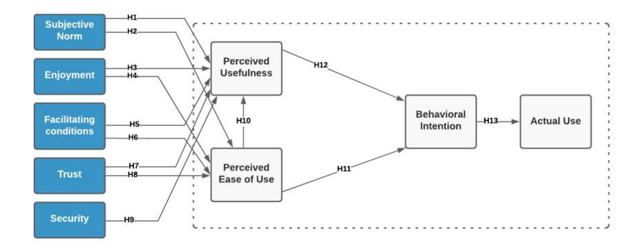
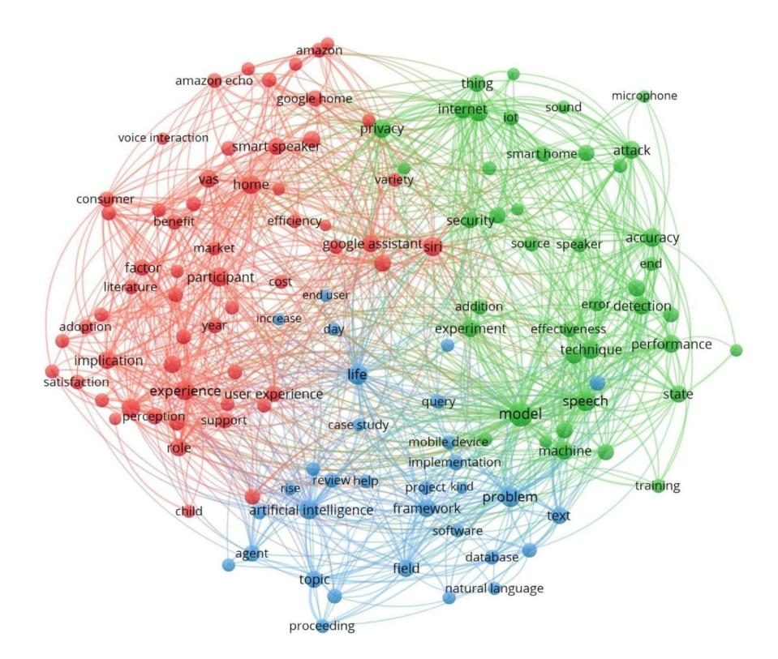

<!-- A3.R05 | source: papers_json/A3.R05/ -->

## **فهم العوامل الرئيسية التي ** **تؤثر في استخدام الطلاب للمساعدات الصوتية القائمة على الذكاء الاصطناعي**

**Jawaher Hamad Al Shamsi1** ** · Mostafa Al-Emran****[1](http://orcid.org/0000-0002-5269-5380)** ** · Khaled Shaalan1**

Received: 29 September 2021 / Accepted: 6 February 2022 / Published online: 1 March 2022 © The Author(s), under exclusive licence to Springer Science+Business Media, LLC, part of Springer Nature 2022

## **الملخص**

أصبحت المساعدات الصوتية القائمة على الذكاء الاصطناعي (AI) جزءاً أساسياً من حياتنا اليومية. ومع ذلك، لا يُعرف الكثير عما يحفّز الطلاب على استخدامها في الأنشطة التعليمية. لذلك، يطوّر هذا البحث نموذجاً نظرياً من خلال توسيع نموذج قبول التقنية (TAM) بإضافة المعيار الذاتي، والمتعة، والظروف الميسّرة، والثقة، والأمان، لدراسة استخدام الطلاب للمساعدات الصوتية القائمة على AI لأغراض تعليمية. تم بعد ذلك التحقق من صحة النموذج المطوَّر بالاعتماد على بيانات جُمعت من 300 طالب جامعي باستخدام تقنية PLS-SEM. أيّدت النتائج دور المتعة والثقة وسهولة الاستخدام المدركة (PEOU) في التأثير على الفائدة المدركة (PU) للمساعدات الصوتية. كما أظهرت النتائج التجريبية أن الظروف الميسّرة والثقة في التقنية تؤثران بقوة على PEOU. وخلافاً لما جاء في الأدبيات السابقة، أشارت النتائج إلى أن المعيار الذاتي والظروف الميسّرة والأمان لم تؤثر على PU. وبالمثل، لم يؤثر المعيار الذاتي ولا المتعة على PEOU. يُعتقد أن هذا البحث يضيف فهماً شاملاً للعوامل الرئيسية التي تؤثر في استخدام الطلاب للمساعدات الصوتية لأغراض تعليمية. كما يقدّم عدة إسهامات نظرية وتطبيقات عملية حول كيفية توظيف هذه المساعدات بنجاح.

**الكلمات المفتاحية** الذكاء الاصطناعي · المساعد الصوتي · التفاعل بين الإنسان والذكاء الاصطناعي · قبول التقنية · العوامل المحفزة · التعليم

> ^ ^ Mostafa Al-Emran mustafa.n.alemran@gmail.com Jawaher Hamad Al Shamsi joojyskj@gmail.com Khaled Shaalan khaled.shaalan@buid.ac.ae

> ^1^ Faculty of Engineering & IT, The British University in Dubai, Dubai, UAE

<!-- page 2 -->

## **1** **مقدمة**

يتيح انتشار تطبيقات الذكاء الاصطناعي (AI) في عصرنا الحالي للأفراد التفاعل والتواصل مع عناصر جديدة غير بشرية، مثل المساعدات الصوتية والروبوتات. شهدت الأدبيات اهتماماً متزايداً بالمساعدات الصوتية القائمة على AI، خاصة في السنوات الأخيرة. تُعد Siri (من Apple)، وCortana (من Microsoft)، وAlexa (من Amazon)، وBixby (من Samsung)، وGoogle Assistant (من Google) من أكثر المساعدات الصوتية القائمة على AI استخداماً، وهي مدمجة في الهواتف الذكية أو مكبرات الصوت الذكية (McLean & Osei-Frimpong, 2019). غيّرت هذه المساعدات الطريقة التي يبحث بها المستخدمون عن المعلومات، ويستخدمون بها المحتوى، ويديرون بها أجهزة أتمتة المنزل، ويشترون بها المنتجات، وينجزون بها المهام، وذلك من خلال جعل الصوت هو الواجهة الأساسية (Al-Kaisi et al., 2021). فمن خلال الاعتماد على خوارزميات AI، تسجّل المساعدات الصوتية كلام الإنسان، وترفعه إلى السحابة، وتحلّل التسجيل إلى أوامر، ثم ترسل النتيجة إلى المستخدم عبر رسالة يولّدها الحاسوب (Gouda et al., 2021). يشير تقرير حديث إلى أن 27% من مستخدمي الإنترنت حول العالم يستخدمون المساعدات الصوتية على أجهزتهم المحمولة الذكية (McCue, 2018). ومن المتوقع أن تحل هذه المساعدات الصوتية محل دور

***الشكل 1** محور تركيز دراسات المساعد الصوتي*

<!-- page 3 -->

تقنيات أخرى، مثل أجهزة الحاسوب المحمولة وأجهزة الكمبيوتر الشخصية، وتحديداً في الأنشطة النفعية (Gartner, 2016).

في مجال التعليم، توفّر المساعدات الصوتية القائمة على AI إمكانات تعليمية واسعة لتعزيز التعلّم الذاتي للطلاب. فعلى سبيل المثال، يمكن للطلاب طرح الأسئلة والحصول على إجابات فورية من خلال الوصول إلى كمّ كبير من البيانات عبر الإنترنت. وفي الفصول الدراسية، يمكن للطلاب أن يطلبوا من المساعدات الصوتية المدمجة في مكبرات الصوت الذكية قراءة الكتب لهم من خلال الوصول إلى آلاف الكتب الصوتية عبر الإنترنت. من جهة أخرى، يمكن للمدرسين استخدام هذه المساعدات في تصميم تفاعلات محددة لأنشطة صفية متنوعة، مثل الاختبارات والاختبارات القصيرة المخصصة. تعزّز المساعدات الصوتية مفهوم "التعلّم المعاصر"، حيث يمكن للمدرسين تسجيل محاضراتهم ورفعها كبودكاست. ويستطيع الطلاب أن يطلبوا من المساعدات الصوتية تنزيل المحاضرات في أي وقت وفي أي مكان (Shah, 2020).

ولتحديد الفجوة البحثية في الأدبيات القائمة، أجرى هذا البحث تحليلاً ببليومترياً على الدراسات المنشورة حول المساعدات الصوتية باستخدام أداة VOSviewer (Van Eck & Waltman, 2010). وقد نُفّذ ذلك في أغسطس 2021 من خلال البحث في قاعدة بيانات Scopus. يوضّح الشكل 1 نتائج التحليل الببليومتري، ويُظهر بوضوح أن دراسات المساعد الصوتي ركّزت بشكل رئيسي على ثلاثة محاور رئيسية. ومن خلال فحص دراسات كل محور (عنقود)، لوحظ أن تركيز الدراسات ضمن العنقودين الأول والثاني (الأخضر والأزرق) كان تقنياً بشكل أساسي. حيث ركّز العنقود الأخضر على الدراسات المتعلقة باستخدام خوارزميات التعلّم الآلي في تدريب واختبار البيانات المستلمة عبر المساعدات الصوتية. كما شمل العنقود دراسات تفحص إجراءات الأمان والهجمات الصوتية على المساعدات الصوتية. أما الدراسات ضمن العنقود الأزرق فقد ركّزت على تطبيق المساعدات الصوتية ومعالجة اللغة الطبيعية للبيانات النصية المجموعة عبر تلك المساعدات. وركّزت الدراسات ضمن العنقود الأحمر على جانب التفاعل بين الإنسان والحاسوب، حيث قِيست تجربة المستخدمين وتصوراتهم وتبنّيهم للمساعد الصوتي.

في حين شهدت الأدبيات القائمة عدداً متزايداً من الدراسات حول المساعدات الصوتية (Kendall et al., 2020)، فإن نتائج التحليل الببليومتري كشفت بوضوح عن عدة فجوات بحثية. أولاً، لا يزال فهم ما يؤثر على الاستخدام الفعلي للمساعدات الصوتية في مرحلة أولية ويتطلب جهوداً بحثية موسّعة (Ostrom et al., 2019). ثانياً، ركّزت معظم دراسات التبني السابقة على استخدام المستهلكين للمساعدات الصوتية في الخدمات النفعية (Ostrom et al., 2019؛ Vimalkumar et al., 2021)، وأهملت ما يؤثر على استخدامها لأغراض تعليمية. ثالثاً، في حين نُوقش دور المعيار الذاتي والمتعة والظروف الميسّرة والثقة والأمان في دراسة تبني المساعدات الصوتية في بعض المجتمعات الفردانية سابقاً، فإن هناك ندرة في المعرفة حول تأثيرها في السياقات الجمعية.

ولسدّ هذه الفجوات البحثية المذكورة، تمضي هذه الدراسة خطوة أبعد من خلال تطوير نموذج بحثي نظري لفهم الاستخدام الفعلي للطلاب للمساعدات الصوتية لأغراض تعليمية في سياق جمعي جديد. يوسّع النموذج المطوَّر نموذج قبول التقنية (TAM) (Davis, 1989) بإضافة متغيرات خارجية أخرى، تشمل المعيار الذاتي، والمتعة، والظروف الميسّرة، والثقة، والأمان. وتُعد هذه العوامل الخارجية محورية في استخدام المساعدات الصوتية في المجتمعات الجمعية، ويُعد استكشافها ضرورياً لفهم

<!-- page 4 -->

مواطن قوة التقنية وضعفها. وبناءً على ذلك، يهدف هذا البحث إلى تحقيق الأهداف التالية:

- تطوير نموذج نظري من خلال توسيع نموذج TAM بعوامل خارجية أخرى، تشمل المعيار الذاتي، والمتعة، والظروف الميسّرة، والثقة، والأمان، لدراسة استخدام المساعدات الصوتية القائمة على AI لأغراض تعليمية.
- تقييم النموذج النظري المطوَّر باستخدام تقنية PLS-SEM.

## **2** **الإطار النظري والفرضيات البحثية**

من خلال تحليل الأدبيات القائمة حول المساعدات الصوتية القائمة على AI، لوحظ وجود ندرة في المعرفة حول ما يؤثر على استخدام هذه التقنيات لأغراض تعليمية. لذلك، يطوّر هذا البحث نموذجاً بحثياً مبنياً على نموذج قبول التقنية (TAM) وموسَّعاً بعدة عوامل يُعتقد أنها تؤثر على استخدام الطلاب للمساعدات الصوتية في الأنشطة التعليمية. ويعود اختيار TAM كأساس في هذا البحث إلى عدة أسباب. أولاً، رغم أنه طُوِّر عام 1989 (Davis, 1989)، أظهرت دراسة حديثة أن النموذج لا يزال صالحاً وأن عدد الدراسات القائمة على TAM لا يزال في تزايد سنوي (Al-Emran & Granić, 2021). ثانياً، هناك دعم تجريبي محدود حول كيفية توظيف TAM لتقييم استخدام المساعدات الصوتية القائمة على AI.

يوضّح الشكل 2 النموذج البحثي المطوَّر. ويُقترح أن الفائدة المدركة (PU) وسهولة الاستخدام المدركة (PEOU) تتأثران بالمعيار الذاتي، والمتعة، والظروف الميسّرة، والثقة. كما يُتوقّع أن تتأثر PU بالأمان وPEOU. وتتأثر النية السلوكية (BI) لاستخدام المساعدات الصوتية بكل من PU وPEOU، والتي تؤثر بدورها على الاستخدام الفعلي للطلاب لتلك المساعدات في التعليم العالي.

***الشكل 2** النموذج البحثي*

<!-- page 5 -->

## **2.1** **المعيار الذاتي**

يشير المعيار الذاتي (SN) إلى "تصوّر الفرد لمدى رغبة أو توقّع الآخرين المهمين في بيئته الاجتماعية منه أن يتصرف بطريقة معينة" (Moan & Rise, 2006). ويُستخدم تعريف المعيار الذاتي أيضاً للتعبير عن التأثير الاجتماعي (Bloemendaal, 2018). وقد أشارت أبحاث سابقة إلى أن المعيار الذاتي يؤثر على الفائدة المدركة وسهولة استخدام المساعدات الصوتية (Moriuchi, 2019؛ Song, 2019). وبناءً على ذلك، تُطرح الفرضيات التالية:

**H1** يؤثر المعيار الذاتي إيجابياً على الفائدة المدركة لتقنية المساعد الصوتي.

**H2** يؤثر المعيار الذاتي إيجابياً على سهولة الاستخدام المدركة لتقنية المساعد الصوتي.

## **2.2** **المتعة**

تُعرَّف المتعة بأنها "إدراك أن نشاط استخدام نظام معين ممتع في حد ذاته، بمعزل عن أي نتائج أداء ناتجة عن استخدام النظام" (Venkatesh, 2000). فعندما يشعر المستخدم بأن استخدام جهاز معين ممتع، فإنه يكوّن مشاعر إيجابية تجاه ذلك الجهاز، ويصبح أكثر ميلاً لاستخدامه (Basak et al., 2015). كما أن بساطة بدء تشغيل النظام أو مدى فاعلية التقنية الصوتية في تقديم إجابات بسيطة يعزّز شعور المستخدم بالمتعة (Sorensen, 2019). وقد أظهرت الأدبيات القائمة أن المتعة عامل تنبؤي قوي للفائدة المدركة وسهولة الاستخدام (Al-Qaysi et al., 2021؛ Chu, 2019؛ Liu et al., 2021). لذلك، تُقترح الفرضيات التالية:

**H3** تؤثر المتعة إيجابياً على الفائدة المدركة لتقنية المساعد الصوتي.

**H4** تؤثر المتعة إيجابياً على سهولة الاستخدام المدركة لتقنية المساعد الصوتي.

## **2.3** **الظروف الميسّرة**

تشير الظروف الميسّرة (FC) إلى "الدرجة التي يعتقد بها الفرد أن هناك بنية تنظيمية وتقنية موجودة لدعم استخدام النظام" (Venkatesh et al., 2003). ويتطلب استخدام أي تقنية موارد ومهارات وبنية تحتية محددة (Albanna et al., 2022). وفي هذا السياق، تشير FC إلى سمات مثل إمكانية الوصول وكفاءة الهواتف الذكية والتقنيات الداعمة الأخرى التي تؤثر على استخدام المساعدات الصوتية. وقد أيّدت أبحاث سابقة دور FC في التأثير على الفائدة المدركة وسهولة الاستخدام المدركة (Bloemendaal, 2018؛ Li et al., 2021). وبناءً على ذلك، تُطرح الفرضيات التالية:

<!-- page 6 -->

**H5** تؤثر الظروف الميسّرة إيجابياً على الفائدة المدركة لتقنية المساعد الصوتي.

**H6** تؤثر الظروف الميسّرة إيجابياً على سهولة الاستخدام المدركة لتقنية المساعد الصوتي.

## **2.4** **الثقة**

تُوصف الثقة بأنها "حالة نفسية تتضمن نية القبول بالضعف بناءً على توقعات إيجابية لنوايا أو سلوك طرف آخر" (Rousseau et al., 1998). وفي هذا السياق، يُنظر إلى الثقة على أنها اعتقاد المستخدمين بمدى أمان المساعدات الصوتية في حماية بياناتهم الشخصية (Chu, 2019). وقد أظهرت الأدبيات القائمة أن الثقة تؤثر إيجابياً على الفائدة المدركة وسهولة استخدام المساعدات الصوتية (Alharithi, 2019؛ Chu, 2019؛ Zeng, 2020). لذلك، تُقترح الفرضيات التالية:

**H7** تؤثر الثقة إيجابياً على الفائدة المدركة لتقنية المساعد الصوتي.

**H8** تؤثر الثقة إيجابياً على سهولة الاستخدام المدركة لتقنية المساعد الصوتي.

## **2.5** **الأمان**

يشير الأمان (SE) إلى "تصورات المستخدمين حول مستوى الحماية من التهديدات المحتملة" (Park et al., 2017). ويُعتقد أن الأمان عامل مهم في التأثير على استخدام المساعدات الصوتية. وينبع ذلك من كون هذه التقنيات تجمع عادة معلومات من مستخدميها، مثل أسمائهم وأعمارهم وأجناسهم وتسجيلاتهم الصوتية، لتقديم أفضل تجربة استخدام لهم. وقد أظهرت دراسات سابقة أن الأمان يؤثر بشكل كبير على الفائدة المدركة (Chu, 2019؛ Neumann, 2018). لذلك، تُصاغ الفرضية التالية:

**H9** يؤثر الأمان إيجابياً على الفائدة المدركة لتقنية المساعد الصوتي.

## **2.6** **سهولة الاستخدام المدركة**

تُعرَّف سهولة الاستخدام المدركة (PEOU) بأنها "الدرجة التي يعتقد بها الشخص أن استخدام نظام معين سيكون خالياً من الجهد" (Davis, 1989). ويجب أن يكوّن المستخدمون انطباعاً بأن الابتكارات التقنية في مكان عملهم بسيطة التشغيل (Chu, 2019) وخالية من الجهد في أداء المهام المقصودة (Lin & Chen, 2015). وتبيّن أن PEOU هي العنصر الأساسي الذي يؤثر على الفائدة المدركة والنية السلوكية لاستخدام المساعدات الصوتية (Moriuchi, 2019؛ Song, 2019؛ Sorensen, 2019). لذلك، تُقترح الفرضيات التالية:

<!-- page 7 -->

**H10** تؤثر سهولة الاستخدام المدركة إيجابياً على الفائدة المدركة لتقنية المساعد الصوتي.

**H11** تؤثر سهولة الاستخدام المدركة إيجابياً على النية السلوكية لاستخدام تقنية المساعد الصوتي.

## **2.7** **الفائدة المدركة**

تشير الفائدة المدركة (PU) إلى "الدرجة التي يعتقد بها الشخص أن استخدام نظام معين سيعزّز أداءه الوظيفي" (Davis, 1989). وتُعد PU العامل الأكثر تحفيزاً في تبني تقنية المعلومات (Basak et al., 2015). فعندما ينوي المستخدم استخدام تقنية جديدة، يتبيّن أن نيته تتأثر بمدى فائدة تلك التقنية (Cacho-Elizondo et al., 2012؛ Chu, 2019). وقد أيّدت الأدبيات القائمة العلاقة بين PU والنية السلوكية للمستخدمين (Chai et al., 2020؛ Elfeky & Elbyaly, 2021؛ Liu et al., 2021). لذلك، تُقترح الفرضية التالية:

**H12** تؤثر الفائدة المدركة إيجابياً على النية السلوكية لاستخدام تقنية المساعد الصوتي.

## **2.8** **النية السلوكية**

تشير النية السلوكية (BI) إلى درجة قوة نية المستخدمين لأداء سلوك معين (Davis, 1989). ويكوّن مستخدمو المساعدات الصوتية سلوكاً متفائلاً إذا تعرّف المساعد على أصواتهم وردّ بدقة على طلباتهم (Sorensen, 2019). وقد أظهرت أبحاث سابقة وجود ارتباط قوي بين النية السلوكية والاستخدام الفعلي لتقنية معينة (Afonso, 2019؛ Mohammadi, 2015). وبناءً على ذلك، تُصاغ الفرضية التالية:

**H13** تؤثر النية السلوكية إيجابياً على الاستخدام الفعلي لتقنية المساعد الصوتي.

## **3** **المنهجية**

لدراسة استخدام الطلاب للمساعدات الصوتية القائمة على AI، جمعنا بيانات من طلاب يدرسون في أربع جامعات خاصة وحكومية في دولة الإمارات العربية المتحدة (UAE) باستخدام استبيانات عبر الإنترنت. والمشاركون المستهدفون هم من تبنّوا تقنية المساعد الصوتي بالفعل. وأُضيف سؤال تصفية إلزامي في بداية الاستبيان ليُحدَّد به مستخدمو المساعدات الصوتية الفعليون لأغراض تعليمية. ولأنه لا يوجد إطار عيّنة لهذا النوع من المستخدمين، استخدمنا أسلوب العيّنة القصدية لجمع الاستجابات من تلك الجامعات. وسبب اختيار الجامعات الأربع أن معظم

<!-- page 8 -->

طلابها مستخدمون فعليون للمساعدات الصوتية. ومن المهم الإشارة إلى أن المشاركين استخدموا المساعدات الصوتية من خلال طرح الأسئلة عليها والحصول على إجابات عبر الوصول إلى كمّ كبير من البيانات عبر الإنترنت. كما استخدموا هذه المساعدات لطلب تنزيل مواد تعليمية، تشمل ملاحظات المحاضرات، والكتب الإلكترونية، و

<!-- page 9 -->

الدروس التعليمية. وبما أن لغة التدريس داخل الجامعات المستهدفة هي الإنجليزية، وبما أن المساعدات الصوتية لا تدعم اللغة العربية (أي اللغة الأم للمشاركين)، فقد تفاعل الطلاب وتواصلوا مع هذه المساعدات باللغة الإنجليزية. وعُرِّف المشاركون بهدف البحث، وأُبلغوا بأن مشاركتهم طوعية وأن إجاباتهم ستُستخدم لأغراض بحثية فقط. وتم جمع 300 استجابة صالحة.

تألّف الاستبيان من 27 عنصراً استُخدمت لقياس التسعة مكونات في النموذج البحثي المقترح. واستُمدَّت العناصر من الأدبيات السابقة ذات الصلة ونُقِّحت لتعكس هدف الدراسة وأهدافها. ويرد وصف العناصر مع مصادرها في الجدول 1.

ولتقييم الفرضيات المقترحة في هذا البحث، استُخدم نمذجة المعادلات البنائية بطريقة المربعات الصغرى الجزئية (PLS-SEM) عبر برنامج SmartPLS (Ringle et al., 2015). ويُعزى سبب استخدام PLS-SEM (النمذجة البنائية القائمة على التباين) بدلاً من النمذجة القائمة على التغاير (CB-SEM) إلى نقطتين رئيسيتين. أولاً، يعمل PLS-SEM بشكل أفضل من CB-SEM إذا كان هدف البحث تطوير نظرية قائمة (Hair et al., 2011)، وهو ما ينطبق على سيناريو هذه الدراسة. ثانياً، بما أن هذا البحث يركّز أكثر على استكشاف محددات استخدام المساعدات الصوتية بدلاً من تأكيدها، فإن PLS-SEM يُعد التقنية المناسبة في مثل هذه الحالات (Hair et al., 2011).

***الجدول 2** البيانات الديموغرافية للمشاركين*

| Characteristics | Items | Frequency | Percentage |
| --- | --- | --- | --- |
| Gender | Female | 243 | 81% |
| Male | 57 | 19% |  |
| Age | 18 - 21 | 171 | 57% |
| 22 - 26 | 100 | 33.3% |  |
| 27 - 30 | 11 | 3.7% |  |
| 31 - 35 | 10 | 3.3% |  |
| 36 - 40 | 4 | 1.3% |  |
| Above 40 | 4 | 1.3% |  |
| Level of education | Diploma | 20 | 6.7% |
| Higher diploma | 19 | 6.3% |  |
| Bachelor | 240 | 80% |  |
| Master | 20 | 6.7% |  |
| Doctorate | 1 | 0.3% |  |
| Voice assistant types | Siri (Apple) | 134 | 44.7% |
| Google | 140 | 46.7% |  |
| Cortana (Microsoft) | 2 | 0.7% |  |
| Alexa (Amazon) | 13 | 4.3% |  |
| Others | 11 | 3.7% |  |

<!-- page 10 -->

## **4** **النتائج**

## **4.1** **البيانات الديموغرافية للمشاركين**

تُعرض الخصائص الديموغرافية للمشاركين في الجدول 2. ويتبيّن أن 81% منهم إناث، بينما 19% ذكور. ومن المهم الإشارة إلى أن الإناث يمثّلن الغالبية العظمى من الطلاب في الجامعات الأربع المستهدفة. وكانت غالبية المشاركين ضمن الفئة العمرية 18-21، بنسبة 57%. أما بالنسبة للمستوى التعليمي، فكان 240 (80%) من طلاب البكالوريوس، يليهم 20 (6.7%) من طلاب الدبلوم والماجستير، و19 (6.3%) من طلاب الدبلوم العالي، وطالب واحد (0.3%) من طلاب الدكتوراه. وفيما يتعلق بنوع المساعد الصوتي، يستخدم 46.7% من الطلاب Google كمساعدهم الصوتي. يليه 44.7% يستخدمون Siri، و4.3% يستخدمون Alexa، و3.7% يستخدمون مساعدات أخرى، و0.7% يستخدمون Cortana.

## **4.2** **التحيّز المنهجي المشترك**

للتأكد من أن البيانات المجموعة لا تحتوي على تحيّز منهجي مشترك (CMB)، أُجري اختبار Harman للعامل الواحد بتسعة متغيرات (المعيار الذاتي، والمتعة، والظروف الميسّرة، والثقة، والأمان، والفائدة المدركة، وسهولة الاستخدام المدركة، والنية السلوكية، والاستخدام الفعلي) (Podsakof et al., 2003). وحُمِّلت المتغيرات التسعة في متغير واحد. وأظهرت نتائج التحليل أن أكبر تباين يفسّره المتغير الواحد بلغ 21.39%، وهو أقل من القيمة الحدّية البالغة 50% (Podsakof et al., 2003). وهذا يشير إلى أن البيانات المجموعة لا تثير أي مشكلات تتعلق بـ CMB.

## **4.3** **تقييم نموذج القياس**

لتقييم نموذج القياس، يجب اختبار الموثوقية والصلاحية. ويمكن قياس موثوقية المتغيرات باستخدام معامل ألفا كرونباخ والموثوقية المركّبة (CR)، بينما يمكن قياس الصلاحية من خلال الصلاحية التقاربية والصلاحية التمييزية. وكما تُظهر النتائج في الجدول 3، تتراوح قيم ألفا كرونباخ بين 0.821 و0.899، مما يشير إلى أن جميع القيم أعلى من 0.7 (Hair et al., 2019). كما تكشف النتائج في الجدول 3 أن قيم CR تتراوح بين 0.894 و0.937، وهو ما يتجاوز القيمة الحدّية البالغة 0.7 (Hair et al., 2020). لذلك، يمكن القول إن الموثوقية مؤكَّدة.

وتُقاس الصلاحية التقاربية من خلال اختبار تحميلات العوامل ومتوسط التباين المستخرَج (AVE) (Hair et al., 2019). وكما تُظهر القراءات في الجدول 3، فإن قيم جميع تحميلات العوامل أكبر من القيمة المقترحة البالغة 0.7. علاوة على ذلك، تتراوح قيم AVE بين 0.736 و0.864، وهو ما يتجاوز القيمة الحدّية البالغة 0.5. وهذا يشير إلى أن الصلاحية التقاربية مؤكَّدة. أما الصلاحية التمييزية فتقيس مدى اختلاف أحد المكونات عن غيره من المكونات في الإطار النظري (Chin, 1998). ويُقيَّم هذا النوع من الصلاحية من خلال فحص معيار Fornell-Larcker، والتحميلات المتقاطعة، ونسبة Heterotrait-Monotrait (HTMT). ويُعرض تحليل معيار Fornell-Larcker في الجدول 4. ويتضح أن الجذور التربيعية لقيم AVE (أي القيم القطرية الغامقة) أكبر من الارتباطات بين المتغيرات الكامنة (أي القيم غير القطرية) في جميع الأعمدة و

<!-- page 11 -->

|  | AU | BI | ENJ | FC | PEU | PU | SE | SN | TR |
| --- | --- | --- | --- | --- | --- | --- | --- | --- | --- |
| AU | **0.929** |  |  |  |  |  |  |  |  |
| BI | 0.799 | **0.905** |  |  |  |  |  |  |  |
| ENJ | 0.679 | 0.748 | **0.909** |  |  |  |  |  |  |
| FC | 0.616 | 0.737 | 0.748 | **0.860** |  |  |  |  |  |
| PEU | 0.660 | 0.808 | 0.666 | 0.785 | **0.912** |  |  |  |  |
| PU | 0.707 | 0.818 | 0.732 | 0.667 | 0.732 | **0.858** |  |  |  |
| SE | 0.433 | 0.429 | 0.463 | 0.466 | 0.413 | 0.448 | **0.891** |  |  |
| SN | 0.748 | 0.703 | 0.650 | 0.657 | 0.579 | 0.607 | 0.383 | **0.901** |  |
| TR | 0.688 | 0.732 | 0.693 | 0.706 | 0.666 | 0.678 | 0.444 | 0.668 | **0.892** |

الصفوف (Fornell & Larcker, 1981). أما فيما يخص التحميلات المتقاطعة، فيتبيّن من الجدول 5 أن تحميلات العوامل الخاصة بكل مكوّن أكبر من تحميلات المكونات المقابلة له. وفيما يتعلق بـ HTMT، يُظهر الجدول 6 أن جميع قيم HTMT أقل من القيمة الحدّية البالغة 0.85، باستثناء 7 قيم. وبما أن الموثوقية والصلاحية التقاربية تأكّدتا (Al-Emran et al., 2020)، فإن هذه

<!-- page 12 -->

|  | AU | BI | ENJ | FC | PEU | PU | SE | SN | TR |
| --- | --- | --- | --- | --- | --- | --- | --- | --- | --- |
| AU |  |  |  |  |  |  |  |  |  |
| BI | 0.919 |  |  |  |  |  |  |  |  |
| ENJ | 0.776 | 0.838 |  |  |  |  |  |  |  |
| FC | 0.741 | 0.864 | 0.871 |  |  |  |  |  |  |
| PEU | 0.754 | 0.902 | 0.738 | 0.912 |  |  |  |  |  |
| PU | 0.811 | 0.922 | 0.824 | 0.785 | 0.818 |  |  |  |  |
| SE | 0.500 | 0.488 | 0.526 | 0.556 | 0.465 | 0.509 |  |  |  |
| SN | 0.868 | 0.794 | 0.732 | 0.774 | 0.648 | 0.686 | 0.437 |  |  |
| TR | 0.794 | 0.829 | 0.786 | 0.841 | 0.749 | 0.769 | 0.507 | 0.760 |  |

القيم لا تثير أي مشكلات تتعلق بالصلاحية التمييزية. وبالتالي، يمكن القول إنه لا توجد مشكلات فيما يتعلق بالصلاحية التمييزية في هذه الدراسة.

<!-- page 13 -->

## **4.4** **تقييم النموذج البنائي**

اختبرنا التداخل الخطي بين العوامل قبل تقييم النموذج البنائي للتأكد من عدم وجود مشكلات تداخل خطي جانبي (Ramayah et al., 2018). ويُعد معامل تضخم التباين (VIF) أحد المقاييس القياسية المستخدمة لتقييم التداخل الخطي. وكما تُظهر القراءات في الجدول 7، فإن جميع قيم VIF أقل من 5 (Hair et al., 2011)، مما يشير إلى عدم وجود تعدد خطية. ويُنفَّذ تقييم النموذج البنائي من خلال إجراء إعادة أخذ عينات (bootstrapping) بـ 5000 عملية إعادة أخذ عينة، وذلك من خلال قياس قيم *t*، ومعامل بيتا المعياري (*β*)، ومعامل التحديد (R^2^)، وحجم الأثر (*f* 2)، والصلة التنبؤية (*Q*^2^) (Hair et al., 2017). ويُعد R^2^ مؤشراً شائعاً لقياس النموذج البنائي وعاملاً تنبؤياً لجميع المتغيرات الداخلية في النموذج البحثي. وقد أُشير إلى أن قيم R^2^ التي تفوق 0.67 تُصنَّف على أنها "مرتفعة"، وأن القيم بين 0.33 و0.67 تُصنَّف على أنها "متوسطة"، وأن القيم بين 0.19 و0.33 تُصنَّف على أنها "ضعيفة" (Chin, 1998). وأشارت النتائج إلى أن قيم R^2^ للاستخدام الفعلي (0.638)، وسهولة الاستخدام المدركة (0.645)، والفائدة المدركة (0.667) تقع ضمن نطاق 0.33 و0.67، مما يعني أن القدرة التنبؤية للمتغيرات "متوسطة". علاوة على ذلك، وُجد أن قيمة R^2^ للنية السلوكية لاستخدام المساعدات الصوتية القائمة على AI بلغت 0.763، مما يعني أن القدرة التنبؤية للمتغير "مرتفعة".

يُظهر الجدول 7 نتائج معاملات المسار لجميع الفرضيات المقترحة في النموذج المفاهيمي. وبحسب تحليل البيانات، تأيّدت 8 من أصل 13 فرضية في هذا البحث، بينما لم تُقبل البقية بناءً على البيانات التجريبية. حيث أظهرت النتائج أن المعيار الذاتي له تأثير إيجابي غير دال إحصائياً على الفائدة المدركة (*β*=0.090، *t*=1.387) وسهولة الاستخدام المدركة (*β*=0.017، *t*=0.315) للمساعدات الصوتية. لذلك، رُفضت H1 وH2. وأظهرت النتائج أن للمتعة تأثيراً إيجابياً دالاً إحصائياً على الفائدة المدركة (*β*=0.350، *t*=5.780)، بينما لها تأثير إيجابي غير دال إحصائياً على سهولة الاستخدام المدركة (*β*=0.104، *t*=1.127). وبذلك، قُبلت H3، ورُفضت H4.

وأشارت النتائج إلى أن الظروف الميسّرة لها تأثير غير دال إحصائياً على الفائدة المدركة (*β*=-0.109، *t*=1.156)، بينما لها تأثير إيجابي دال إحصائياً على سهولة الاستخدام المدركة (*β*=0.567، *t*=8.124). وهذا يعني رفض H5 وقبول H6. وتبيّن أن للثقة تأثيراً إيجابياً دالاً إحصائياً على الفائدة المدركة (*β*=0.155، *t*=2.574) وسهولة الاستخدام المدركة (*β*=0.183، *t*=2.397). لذلك، قُبلت H7 وH8. وكشفت النتائج أن للأمان ارتباطاً إيجابياً غير دال إحصائياً بالفائدة المدركة (*β*=0.068، *t*=1.553)، مما يشير إلى رفض H9.

كما أشارت النتائج إلى أن سهولة الاستخدام المدركة لها ارتباط إيجابي بالفائدة المدركة (*β*=0.401، *t*=6.051) وبالنية السلوكية (*β*=0.450، *t*=9.614)، مما يعني قبول H10 وH11. علاوة على ذلك، للفائدة المدركة ارتباط إيجابي قوي بالنية السلوكية للاستخدام (*β*=0.488، *t*=10.772)، مما يُظهر قبول H12. كذلك أشارت النتائج إلى أن للنية السلوكية تأثيراً إيجابياً دالاً إحصائياً على الاستخدام الفعلي للطلاب للمساعدات الصوتية (*β*=0.799، *t*=29.279). وبذلك، قُبلت H13.

كما اختبرنا أحجام الأثر (*f* 2)، كما يظهر في الجدول 7، باتباع توصيات Cohen (1988). حيث تشير القيم 0.02 و0.15 و0.35 إلى أحجام أثر صغيرة ومتوسطة وكبيرة على التوالي (Cohen, 1988). ويُظهر التحليل أن معيار الا-

<!-- page 14 -->

| Hypothesis | Relationship | Std. Beta | t-value | p-value | f2 | VIF | Decision |
| --- | --- | --- | --- | --- | --- | --- | --- |
| H1 | SN → PU | 0.090 | 1.387 | 0.166 | 0.011 | 2.157 | Not Supported |
| H2 | SN → PEU | 0.017 | 0.315 | 0.753 | 0.000 | 2.155 | Not Supported |
| H3 | ENJ → PU | 0.350 | 5.780 | 0.000 | 0.132 | 2.787 | Supported |
| H4 | ENJ → PEU | 0.104 | 1.127 | 0.260 | 0.011 | 2.709 | Not Supported |
| H5 | FC → PU | -0.109 | 1.156 | 0.248 | 0.009 | 3.762 | Not Supported |
| H6 | FC → PEU | 0.567 | 8.124 | 0.000 | 0.322 | 2.816 | Supported |
| H7 | TR → PU | 0.155 | 2.574 | 0.010 | 0.027 | 2.630 | Supported |
| H8 | TR → PEU | 0.183 | 2.397 | 0.017 | 0.038 | 2.506 | Supported |
| H9 | SE → PU | 0.068 | 1.553 | 0.121 | 0.010 | 1.351 | Not Supported |
| H10 | PEU → PU | 0.401 | 6.051 | 0.000 | 0.171 | 2.822 | Supported |
| H11 | PEU → BI | 0.450 | 9.614 | 0.000 | 0.397 | 2.152 | Supported |
| H12 | PU → BI | 0.488 | 10.772 | 0.000 | 0.468 | 2.152 | Supported |
| H13 | BI → AU | 0.799 | 29.279 | 0.000 | 1.759 | 1.000 | Supported |

**الجدول 7** نتائج اختبار الفرضيات

جتماعي معيار ذي حجم أثر صغير على الفائدة المدركة وسهولة الاستخدام المدركة بقيمتَي 0.011 و0.000 على التوالي. وللمتعة المدركة حجم أثر صغير على الفائدة المدركة وسهولة الاستخدام المدركة بقيمتَي 0.132 و0.011 على التوالي. وللظروف الميسّرة حجم أثر صغير على الفائدة المدركة (*f* ^2^=0.009)، لكن لها أثر متوسط على سهولة الاستخدام المدركة (*f* ^2^=0.322). وللثقة حجم أثر صغير على الفائدة المدركة وسهولة الاستخدام المدركة بقيمتَي 0.027 و0.038 على التوالي. وللأمان المدرك حجم أثر صغير على الفائدة المدركة بقيمة 0.010. ولسهولة الاستخدام المدركة حجم أثر متوسط على الفائدة المدركة (*f* ^2^=0.171)، لكن لها أثر كبير على النية السلوكية (*f* ^2^=0.397). وللفائدة المدركة حجم أثر كبير على النية السلوكية بقيمة 0.468. وللنية السلوكية حجم أثر كبير على الاستخدام الفعلي بقيمة 1.759.

وفيما يتعلق بالصلة التنبؤية (*Q*^2^)، فإن قيم *Q*^2^ الأكبر من 0 تشير إلى أن المتغيرات الخارجية لها صلة تنبؤية بالمتغير الداخلي قيد الدراسة (Hair et al., 2016). ويكشف التحليل أن جميع قيم *Q*^2^ كانت أكبر من 0 (الاستخدام الفعلي *Q*^2^=0.541، والنية السلوكية *Q*^2^=0.618، وسهولة الاستخدام المدركة *Q*^2^=0.529، والفائدة المدركة *Q*^2^=0.480).

## **5** **المناقشة**

غيّر النمو السريع لتقنيات المعلومات الطريقة التي يتواصل بها الطلاب في "أي وقت وأي مكان" (Al-Emran et al., 2018؛ Alshurideh et al., 2020). وقد أظهرت المساعدات الصوتية القائمة على AI تقدماً ملحوظاً، وإمكاناتها في تحسّن مستمر. وفي حين شهدت الأدبيات القائمة عدة دراسات حول تطبيقات المساعدات الصوتية في أنشطة تعليمية مختلفة، لا يُعرف الكثير عن المحددات التي تؤثر على استخدام الطلاب لتلك المساعدات (Kim et al., 2020). لذلك، هدفت هذه الدراسة إلى دراسة العوامل الرئيسية التي يُعتقد أنها تؤثر على استخدام الطلاب للمساعدات الصوتية القائمة على AI في الأنشطة التعليمية. وفي هذا الإطار، طوّرنا نموذجاً بحثياً بتوسيع TAM بعوامل خارجية أخرى، تشمل المعيار الذاتي، والمتعة، والظروف الميسّرة، والثقة، والأمان.

<!-- page 15 -->

أظهرت نتائج البحث أن المعيار الذاتي له تأثير غير دال إحصائياً على الفائدة المدركة وسهولة استخدام المساعدات الصوتية. غير أن هذا يتعارض مع النتائج التي توصّلت إليها أبحاث سابقة (Moriuchi, 2019؛ Song, 2019). وقد يعود ذلك إلى تأثير الأشخاص المحيطين بالطلاب، الذين يجدون التقنية صعبة الاستخدام، أو غير المطّلعين على المساعدات الصوتية تحديداً في أنشطة التعلّم. علاوة على ذلك، كشفت النتائج أن للمتعة تأثيراً إيجابياً دالاً إحصائياً على الفائدة المدركة للمساعدات الصوتية، وهو ما يؤكّد النتائج التي لوحظت في أبحاث سابقة (Al-Qaysi et al., 2021؛ Chu, 2019؛ Liu et al., 2021). وهذا يشير إلى أن الطلاب يجدون المساعد الصوتي أداة ممتعة، تعزّز أداءهم التعليمي.

في حين أيّدت الأدبيات السابقة العلاقة بين المتعة وسهولة الاستخدام المدركة (Al-Qaysi et al., 2021؛ Chu, 2019؛ Liu et al., 2021)، أظهرت نتائج هذا البحث أن للمتعة تأثيراً غير دال إحصائياً على سهولة استخدام المساعدات الصوتية. وهذا يُظهر أن الطلاب يجدون المساعدات الصوتية صعبة الاستخدام بسبب تعقيدها. لذلك، يمكن القول إن الطلاب لم يجدوا أي متعة أثناء استخدام النظام في عملية تعلّمهم. وخلافاً لما لوحظ في الأدبيات القائمة (Bloemendaal, 2018؛ Li et al., 2021)، لم تدعم نتائج هذه الدراسة العلاقة بين الظروف الميسّرة والفائدة المدركة. وقد يُعزى ذلك إلى أن الطلاب لديهم معرفة ومهارات محدودة في استخدام المساعدات الصوتية في أنشطتهم التعليمية، مما يحدّ من فائدة هذه الأدوات في تلك الأنشطة. ومع ذلك، أظهرت النتائج أن للظروف الميسّرة تأثيراً إيجابياً على سهولة استخدام المساعدات الصوتية المدركة، وهو ما يتفق مع النتائج السابقة (Bloemendaal, 2018؛ Li et al., 2021). وهذا يشير إلى أن الحصول على مساعدة من الآخرين فيما يخص استخدام المساعدات الصوتية يسهّل استخدام تلك المساعدات في الأنشطة التعليمية.

وفي حين أن 41% من مستخدمي المساعد الصوتي لديهم مخاوف بشأن الثقة (Perez, 2019)، وجدت نتائج البحث أن للثقة تأثيراً إيجابياً على الفائدة المدركة وسهولة الاستخدام المدركة للمساعدات الصوتية في أنشطة التعلّم. وهذا يؤكّد النتائج التي توصّلت إليها دراسات سابقة (Alharithi, 2019؛ Chu, 2019؛ Zeng, 2020). وهذا يشير إلى أن المساعدات الصوتية ستكون مفيدة وسهلة الاستخدام إذا وجدها الطلاب موثوقة أثناء البحث عن المعلومات المتعلقة بدراستهم وجمعها. علاوة على ذلك، أظهرت النتائج أن الأمان ليس له تأثير دال إحصائياً على الفائدة المدركة للمساعدات الصوتية، وهو ما يتعارض مع النتائج التي لوحظت في دراسات سابقة (Chu, 2019؛ Neumann, 2018). وهذا يعني أن الطلاب قد يعتبرون المساعدات الصوتية عديمة الفائدة إذا كشفت معلوماتهم الشخصية دون إذن وهدّدت خصوصيتهم.

وتماشياً مع افتراضات TAM (Davis, 1989) والاستنتاجات التي توصّلت إليها دراسات سابقة (Moriuchi, 2019؛ Song, 2019؛ Sorensen, 2019)، وجدت النتائج أن لسهولة الاستخدام المدركة تأثيراً إيجابياً دالاً إحصائياً على الفائدة المدركة والنية السلوكية لاستخدام تقنيات المساعد الصوتي. وهذا يشير إلى أنه كلما زادت سهولة المساعدات الصوتية، زادت فرصة لفت انتباه الطلاب لإدراك فائدة تلك المساعدات في أداء الأنشطة التعليمية ونيتهم في استخدامها مستقبلاً. كما أظهرت نتائج البحث أن للفائدة المدركة ارتباطاً إيجابياً دالاً إحصائياً بالنية السلوكية لاستخدام المساعدات الصوتية، وهو ما يتماشى مع الاستنتاجات التي توصّلت إليها دراسات سابقة (Chai et al., 2020؛ Elfeky & Elbyaly, 2021؛ Liu et al., 2021). وهذا يُظهر

<!-- page 16 -->

أن النية السلوكية للطلاب تزداد لدى من وجدوا التقنية مفيدة في أنشطتهم التعليمية. وأظهرت النتائج أن النية السلوكية تؤثر بقوة على الاستخدام الفعلي للمساعدات الصوتية، وهو ما يدعم النتائج التي توصّلت إليها دراسات سابقة (Afonso, 2019؛ Mohammadi, 2015). وهذا يشير إلى أن الاستخدام الفعلي للمساعدات الصوتية لأغراض تعليمية سيزداد إذا أظهر الطلاب نوايا إيجابية أقوى تجاه تلك المساعدات.

## **6** **الاستنتاجات**

## **6.1** **الإسهامات النظرية**

انطلاقاً من التحليل التجريبي للبيانات، يقدّم هذا البحث أربعة إسهامات نظرية. أولاً، طوّر هذا البحث نموذجاً نظرياً متكاملاً بتوسيع TAM بعدة عوامل خارجية يُعتقد أنها تؤثر على استخدام الطلاب للمساعدات الصوتية القائمة على AI لأغراض تعليمية. وخلافاً للدراسات السابقة التي درست بشكل رئيسي استخدام المساعدات الصوتية في السياقات الفردانية الغربية (مثل (Fernandes & Oliveira, 2021؛ Pitardi & Marriott, 2021))، اختُبر النموذج المطوَّر في مجتمع جمعي مثل UAE. ويُعتقد أن هذا يضيف فهماً متعمقاً لمحددات استخدام المساعدات الصوتية في سياقات لم تُستكشف من قبل، مثل UAE، ويفتح المجال لمزيد من الأبحاث في هذا الحقل. ثانياً، يسهم هذا البحث في الأدبيات القائمة حول المساعدات الصوتية القائمة على AI بشكل عام والقطاع التعليمي بشكل خاص، والذي لا يزال في مرحلة أولية. وفي حين استخدمت الدراسة TAM، الذي استُخدم على نطاق واسع في الماضي، يُعتقد أن فهم مكونات TAM الأساسية والعوامل الخارجية الأخرى في دراسة استخدام المساعدات الصوتية لأغراض التعلّم يضيف قيمة كبيرة إلى TAM من جهة، وإلى مجال أبحاث المساعدات الصوتية من جهة أخرى.

ثالثاً، ركّزت معظم الدراسات التجريبية القائمة على استخدام المستهلكين للمساعدات الصوتية (مثل (Fernandes & Oliveira, 2021؛ Vimalkumar et al., 2021)) وأهملت دورها في الأنشطة التعليمية. لذلك، يُعتقد أن إشراك الطلاب في هذا البحث وفهم العوامل التي تؤثر على استخدامهم للمساعدات الصوتية يضيف قيمة إلى أدبيات التقنية التعليمية. رابعاً، فسّر النموذج المطوَّر 63.8% من التباين في الاستخدام الفعلي للمساعدات الصوتية، مما يثبت أن النموذج مناسب للسياقات الجمعية الجديدة مثل UAE.

## **6.2** **التطبيقات العملية**

يقدّم هذا البحث عدة تطبيقات عملية. أولاً، يمكن لصنّاع القرار الاعتماد على نتائج هذا البحث لفهم أفضل للمحددات التي تؤثر على استخدام الطلاب للمساعدات الصوتية من أجل استخدام هذه التقنيات بفاعلية لأغراض التعلّم. ثانياً، نظراً للدور غير الدال إحصائياً للمعيار الذاتي في التأثير على فائدة وسهولة استخدام المساعدات الصوتية، يحتاج صنّاع القرار إلى تنظيم حملات توعية ودورات تدريبية لتوجيه الطلاب حول كيفية استخدام تلك المساعدات في الأنشطة التعليمية. فضمان وضع إرشادات محددة لاستخدام تلك المساعدات والحفاظ عليها من شأنه إيصال فوائدها اجتماعياً بين الطلاب.

<!-- page 17 -->

ثالثاً، لم تدعم النتائج التجريبية دور الأمان في التأثير على فائدة المساعدات الصوتية لدى الطلاب. ويعود ذلك أساساً إلى أن تلك المساعدات تحتاج إلى جمع كمّ هائل من بيانات المستخدمين لتعمل بكفاءة وتقدّم أفضل تجربة استخدام. ولا يكشف الطلاب معلوماتهم الشخصية إلا عندما يشعرون أن المعلومات آمنة وأن مزوّد الخدمة جدير بالثقة. لذلك، يحتاج مزوّدو الخدمة إلى الشفافية حول كيفية جمع البيانات واستخدامها. علاوة على ذلك، يحتاج الممارسون إلى توعية الطلاب حول خصوصيتهم وكيفية حماية معلوماتهم الشخصية. رابعاً، وانطلاقاً من طبيعة المساعدات الصوتية في جمع بيانات المستخدمين، تحتاج المؤسسات التعليمية إلى سياسات وإجراءات قوية للتعامل مع خروقات بيانات الطلاب.

## **6.3** **القيود وأعمال مستقبلية**

تتسم هذه الدراسة بعدة قيود. أولاً، اختُبر النموذج المطوَّر على بيانات جُمعت من طلاب جامعيين فقط، دون مراعاة استجابات المدرسين. وقد تبحث دراسات مستقبلية في المحددات التي تؤثر على استخدام المساعدات الصوتية من منظور المدرسين. ثانياً، بُني النموذج المطوَّر على توسيع TAM بعوامل خارجية ولم يراعِ دور المتغيرات المعدِّلة، مثل الجنس والعمر، في دراسة استخدام المساعدات الصوتية. ويُعتقد أن دراسة دور المتغيرات المعدِّلة تضيف قيمة كبيرة للأعمال المستقبلية المحتملة. ثالثاً، اعتمد هذا البحث على منهج كمّي من خلال استخدام استبيانات، وهو ما لا يسمح باستكشاف متعمق لاستخدام الطلاب للمساعدات الصوتية. ويُشجَّع الباحثون مستقبلاً على استخدام منهج مختلط متعمق للوصول إلى استكشاف أفضل وأعمق للموضوع.

رابعاً، هذه الدراسة مقطعية، ولذلك يُقترح استخدام منهج بحثي زمني لمعرفة ما إذا كانت استجابات مشاركين مختلفين من نفس الفئة العمرية في نقاط زمنية مختلفة ستتغيّر أم لا. خامساً، لم تشمل هذه الدراسة المقرر الدراسي الذي استُخدمت من خلاله المساعدات الصوتية، ويعود ذلك إلى طبيعة الدراسة في دراسة الأغراض التعليمية العامة لتلك المساعدات. لذلك، يُقترح دراسة دور المقرر الدراسي في دراسات مستقبلية لفهم كيفية استخدام المساعدات الصوتية عبر مقررات مختلفة. سادساً، كان اختيار المشاركين من حيث المستوى التعليمي غير متكافئ. لذلك، ينبغي لدراسات مستقبلية مراعاة هذه المسألة للوصول إلى عيّنات محايدة من مستويات تعليمية متنوعة.

**Acknowledgements** This work is a part of a research study submitted to The British University in Dubai.

**Funding** There is no funding received for this study.

## **Declarations**

**Confict of interest** The authors declare that they have no confict of interest.

<!-- page 18 -->

## **References**

- Afonso, G. F. M. (2019). *Understanding smart-speakers adoption in Portugal: a unifed theory of accep****tance and use of technology applied in the Portuguese consumer market*. University Institute of Lisbon
- Al-Emran, M., Al-Maroof, R., Al-Sharaf, M. A., & Arpaci, I. (2020). What impacts learning with wearables? An integrated theoretical model. *Interactive Learning Environments*. [https://doi.org/10.1080/](http://dx.doi.org/10.1080/10494820.2020.1753216) [10494820.2020.1753216](http://dx.doi.org/10.1080/10494820.2020.1753216)
- Al-Emran, M., & Granić, A. (2021). Is It Still Valid or Outdated? A Bibliometric Analysis of the Technology Acceptance Model and Its Applications From 2010 to 2020. In *Recent Advances in Technology * *Acceptance Models and Theories*.[ https://doi.org/10.1007/978-3-030-64987-6_1](http://dx.doi.org/10.1007/978-3-030-64987-6_1)
- Al-Emran, M., Mezhuyev, V., Kamaludin, A., & AlSinani, M. (2018). Development of M-learning Application based on Knowledge Management Processes. *2018 7th International Conference on Software * *and Computer Applications (ICSCA 2018)*, 248–253
- Al-Kaisi, A. N., Arkhangelskaya, A. L., & Rudenko-Morgun, O. I. (2021). The didactic potential of the voice assistant "Alice" for students of a foreign language at a university. *Education and Information * *Technologies*, 26, 715–732. [https://doi.org/10.1007/S10639-020-10277-2](http://dx.doi.org/10.1007/S10639-020-10277-2)
- Al-Qaysi, N., Mohamad-Nordin, N., & Al-Emran, M. (2021). Developing a comprehensive theoretical model for adopting social media in higher education. *Interactive Learning Environments*.[ https://doi.](http://dx.doi.org/10.1080/10494820.2021.1961809) [org/10.1080/10494820.2021.1961809](http://dx.doi.org/10.1080/10494820.2021.1961809)
- Albanna, H., Alalwan, A. A., & Al-Emran, M. (2022). An integrated model for using social media applications in non-proft organizations. *International Journal of Information Management*, 63, 102452. [https://doi.org/10.1016/J.IJINFOMGT.2021.102452](http://dx.doi.org/10.1016/J.IJINFOMGT.2021.102452)
- Alharithi, F. (2019). *Detecting Conficts among Autonomous Devices in Smart Home*. Florida Institute of Technology
- Alshurideh, M., Al Kurdi, B., Salloum, S. A., Arpaci, I., & Al-Emran, M. (2020). Predicting the actual use of m-learning systems: a comparative approach using PLS-SEM and machine learning algorithms. *Interactive Learning Environments*.[ https://doi.org/10.1080/10494820.2020.1826982](http://dx.doi.org/10.1080/10494820.2020.1826982)
- Basak, E., Gumussoy, C. A., & Calisir, F. (2015). Examining the factors afecting PDA acceptance among physicians: an extended technology acceptance model. *Journal of Healthcare Engineering*, 6(3), 399–418.[ https://doi.org/10.1260/2040-2295.6.3.399](http://dx.doi.org/10.1260/2040-2295.6.3.399)
- Bloemendaal, R. H. (2018). The Internet of Things in home environments: Building customer relationships: a study of customer attitude and intention to use in the context of IoT in home environments. *Master's Thesis, University of Twente*
- Cacho-Elizondo, S., Shahidi, N., & Tossan, V. (2012). *Educational Mobile Coaching: Exploring Adoption * *Patterns and Barriers*
- Chai, C. S., Wang, X., & Xu, C. (2020). An extended theory of planned behavior for the modelling of chinese secondary school students' intention to learn artifcial intelligence. *Mathematics*, 8(11), 1–18. [https://doi.org/10.3390/math8112089](http://dx.doi.org/10.3390/math8112089)
- Chin, W. W. (1998). The partial least squares approach to structural equation modeling. *Modern Methods * *for Business Research*, 295(2), 295–336
- Chowdhury, S. (2018). *Avoidance Attitudes towards Virtual Assistants*. Coventry University
- Chu, L. (2019). *Why would I adopt a smart speaker?: Consumers' intention to adopt smart speakers in * *smart home environment*. Master's thesis, University of Twente
- Cohen, J. (1988). Statistical power analysis for the behavioral sciences. In *NJ: Lawrence Earlbaum Asso****ciates*. Hilsdale.[ https://doi.org/10.1234/12345678](http://dx.doi.org/10.1234/12345678)
- Davis, F. (1989). Perceived usefulness, perceived ease of use, and user acceptance of information technology. *MIS Quarterly*, 13(3), 319–340. [https://doi.org/10.2307/249008](http://dx.doi.org/10.2307/249008)
- Easwara Moorthy, A., & Vu, K. P. L. (2015). Privacy Concerns for Use of Voice Activated Personal Assistant in the Public Space. *International Journal of Human-Computer Interaction*, 31(4), 307–335. [https://doi.org/10.1080/10447318.2014.986642](http://dx.doi.org/10.1080/10447318.2014.986642)
- Elfeky, A. I. M., & Elbyaly, M. Y. H. (2021). The use of data analytics technique in learning management system to develop fashion design skills and technology acceptance. *Interactive Learning Environ****ments*, 1–18. [https://doi.org/10.1080/10494820.2021.1943688](http://dx.doi.org/10.1080/10494820.2021.1943688)
- Fernandes, T., & Oliveira, E. (2021). Understanding consumers' acceptance of automated technologies in service encounters: Drivers of digital voice assistants adoption. *Journal of Business Research*, 122, 180–191.[ https://doi.org/10.1016/J.JBUSRES.2020.08.058](http://dx.doi.org/10.1016/J.JBUSRES.2020.08.058)

<!-- page 19 -->

- Fornell, C., & Larcker, D. F. (1981). Evaluating Structural Equation Models With Unobservable Variables and Measurement Error. *Journal of Marketing Research*, 18(1), 39–50. [https://doi.](http://dx.doi.org/10.2307/3151312) [org/10.2307/3151312](http://dx.doi.org/10.2307/3151312)
- Gartner (2016). *Gartner Says Digital Assistants Will Serve as the Primary Interface to the Connected * *Home*. Gartner. [https://www.gartner.com/en/newsroom/press-releases/2016-06-20-gartner-says-dig](https://www.gartner.com/en/newsroom/press-releases/2016-06-20-gartner-says-digital-assistants-will-serve-as-the-primary-interface-to-the-connected-home)[ital-assistants-will-serve-as-the-primary-interface-to-the-connected-home](https://www.gartner.com/en/newsroom/press-releases/2016-06-20-gartner-says-digital-assistants-will-serve-as-the-primary-interface-to-the-connected-home)
- Gouda, P., Ganni, E., Chung, P., Randhawa, V. K., Marquis-Gravel, G., Avram, R. … Sharma, A. (2021). Feasibility of Incorporating Voice Technology and Virtual Assistants in Cardiovascular Care and Clinical Trials. *Current Cardiovascular Risk Reports*, 15, 1–8. [https://doi.org/10.1007/](http://dx.doi.org/10.1007/S12170-021-00673-9) [S12170-021-00673-9](http://dx.doi.org/10.1007/S12170-021-00673-9)
- Hair, J. F., Howard, M. C., & Nitzl, C. (2020). Assessing measurement model quality in PLS-SEM using confrmatory composite analysis. *Journal of Business Research*, 109, 101–110. [https://doi.](http://dx.doi.org/10.1016/J.JBUSRES.2019.11.069) [org/10.1016/J.JBUSRES.2019.11.069](http://dx.doi.org/10.1016/J.JBUSRES.2019.11.069)
- Hair, J. F., Hult, G. T. M., Ringle, C., & Sarstedt, M. (2016). *A primer on partial least squares structural * *equation modeling (PLS-SEM)*. Sage Publications
- Hair, J. F., Ringle, C. M., & Sarstedt, M. (2011). PLS-SEM: Indeed a silver bullet. *Journal of Marketing * *Theory and Practice*, 19(2), 139–152.[ https://doi.org/10.2753/MTP1069-6679190202](http://dx.doi.org/10.2753/MTP1069-6679190202)
- Hair, J. F., Risher, J. J., Sarstedt, M., & Ringle, C. M. (2019). When to use and how to report the results of PLS-SEM. *European Business Review*, 31(1), 2–24.[ https://doi.org/10.1108/EBR-11-2018-0203](http://dx.doi.org/10.1108/EBR-11-2018-0203)
- Hair, J., Hollingsworth, C. L., Randolph, A. B., & Chong, A. Y. L. (2017). An updated and expanded assessment of PLS-SEM in information systems research. *Industrial Management & Data Systems*, 117(3), 442–458.[ https://doi.org/10.1108/IMDS-04-2016-0130](http://dx.doi.org/10.1108/IMDS-04-2016-0130)
- Jennifer, P., & Sofroniev, G. (2020). *Exploring Voice-Controlled System: Services and Consumer Prefer****ences towards future usage within the Food Industry*. Jönköping University
- Kendall, L., Chaudhuri, B., & Bhalla, A. (2020). Understanding technology as situated practice: everyday use of voice user interfaces among diverse groups of users in urban India. *Information Systems Fron****tiers*, 22, 585–605.[ https://doi.org/10.1007/s10796-020-10015-6](http://dx.doi.org/10.1007/s10796-020-10015-6)
- Kim, J., Merrill, K., Xu, K., & Sellnow, D. D. (2020). My Teacher Is a Machine: Understanding Students' Perceptions of AI Teaching Assistants in Online Education. *International Journal of Human–Com****puter Interaction*, 36(20), 1902–1911.[ https://doi.org/10.1080/10447318.2020.1801227](http://dx.doi.org/10.1080/10447318.2020.1801227)
- Lee, S. Y., & Choi, J. (2017). Enhancing user experience with conversational agent for movie recommendation: Efects of self-disclosure and reciprocity. *International Journal of Human Computer Studies*, 103(January), 95–105.[ https://doi.org/10.1016/j.ijhcs.2017.02.005](http://dx.doi.org/10.1016/j.ijhcs.2017.02.005)
- Li, L., Paudel, K. P., & Guo, J. (2021). Understanding Chinese farmers' participation behavior regarding vegetable traceability systems. *Food Control*, *130*. [https://doi.org/10.1016/J.FOODCONT.2021.108325](http://dx.doi.org/10.1016/J.FOODCONT.2021.108325)
- Lin, H. F., & Chen, C. H. (2015). Design and application of augmented reality query-answering system in mobile phone information navigation. *Expert Systems with Applications*, 42(2), 810–820.[ https://doi.](http://dx.doi.org/10.1016/j.eswa.2014.07.050) [org/10.1016/j.eswa.2014.07.050](http://dx.doi.org/10.1016/j.eswa.2014.07.050)
- Liu, Y., Sun, J. C., & Chen, S. (2021). Comparing technology acceptance of AR-based and 3D map-based mobile library applications: a multigroup SEM analysis. *Interactive Learning Environments*, 1–15. [https://doi.org/10.1080/10494820.2021.1955271](http://dx.doi.org/10.1080/10494820.2021.1955271)
- McCue, T. (2018). *Okay Google: Voice Search Technology And The Rise Of Voice * *Commerce*. Forbes. [https://www.forbes.com/sites/tjmccue/2018/08/28/](https://www.forbes.com/sites/tjmccue/2018/08/28/okay-google-voice-search-technology-and-the-rise-of-voice-commerce/?sh=25a6a2ec4e29) [okay-google-voice-search-technology-and-the-rise-of-voice-commerce/?sh](https://www.forbes.com/sites/tjmccue/2018/08/28/okay-google-voice-search-technology-and-the-rise-of-voice-commerce/?sh=25a6a2ec4e29)=25a6a2ec4e29
- McLean, G., & Osei-Frimpong, K. (2019). Hey Alexa … examine the variables infuencing the use of artifcial intelligent in-home voice assistants. *Computers in Human Behavior*, 99, 28–37. [https://doi.](http://dx.doi.org/10.1016/J.CHB.2019.05.009) [org/10.1016/J.CHB.2019.05.009](http://dx.doi.org/10.1016/J.CHB.2019.05.009)
- Moan, I. S. V., & Rise, J. (2006). Predicting smoking reduction among adolescents using an extended version of the theory of planned behaviour. *Psychology and Health*, 21(6), 717–738. [https://doi.](http://dx.doi.org/10.1080/14768320600603448) [org/10.1080/14768320600603448](http://dx.doi.org/10.1080/14768320600603448)
- Mohammadi, H. (2015). Social and individual antecedents of m-learning adoption in Iran. *Computers in * *Human Behavior*, 49, 191–207. [https://doi.org/10.1016/j.chb.2015.03.006](http://dx.doi.org/10.1016/j.chb.2015.03.006)
- Moriuchi, E. (2019). Okay, Google!: An empirical study on voice assistants on consumer engagement and loyalty. *Psychology and Marketing*, 36(5), 489–501.[ https://doi.org/10.1002/mar.21192](http://dx.doi.org/10.1002/mar.21192)
- Neumann, N. (2018). *The Acceptance of Smart Home Technology* [University of Twente]. [https://doi.](http://dx.doi.org/10.1007/978-3-030-61140-8_1) [org/10.1007/978-3-030-61140-8_1](http://dx.doi.org/10.1007/978-3-030-61140-8_1)

<!-- page 20 -->

- Ostrom, A. L., Fotheringham, D., & Bitner, M. J. (2019). Customer Acceptance of AI in Service Encounters: Understanding Antecedents and Consequences. *Handbook of Service Science, Volume II* (pp. 77–103). Cham: Springer.[ https://doi.org/10.1007/978-3-319-98512-1_5](http://dx.doi.org/10.1007/978-3-319-98512-1_5)
- Pal, D., Arpnikanondt, C., Funilkul, S., & Chutimaskul, W. (2020). The Adoption Analysis of Voice-Based Smart IoT Products. *IEEE Internet of Things Journal*, 7(11), 10852–10867.[ https://doi.org/10.1109/](http://dx.doi.org/10.1109/JIOT.2020.2991791) [JIOT.2020.2991791](http://dx.doi.org/10.1109/JIOT.2020.2991791)
- Pal, D., Arpnikanondt, C., Funilkul, S., & Razzaque, M. A. (2020). Analyzing the adoption and difusion of voice-enabled smart-home systems: empirical evidence from Thailand. *Universal Access in the * *Information Society*, *0123456789*.[ https://doi.org/10.1007/s10209-020-00754-3](http://dx.doi.org/10.1007/s10209-020-00754-3)
- Pal, D., & Patra, S. (2020). University Students' Perception of Video-Based Learning in Times of COVID-19: A TAM/TTF Perspective. *International Journal of Human-Computer Interaction*, 00(00), 1–19. [https://doi.org/10.1080/10447318.2020.1848164](http://dx.doi.org/10.1080/10447318.2020.1848164)
- Park, E., Hwang, B., Ko, K., & Kim, D. (2017). Consumer Acceptance Analysis of the Home Energy Management System. *Sustainability*, 9(12), 1–15. [https://doi.org/10.3390/SU9122351](http://dx.doi.org/10.3390/SU9122351)
- Perez, S. (2019). *41% of voice assistant users have concerns about trust and privacy, report fnds*. Tech-Crunch. [https://techcrunch.com/2019/04/24/41-of-voice-assistant-users-have-concerns-about-trust](https://techcrunch.com/2019/04/24/41-of-voice-assistant-users-have-concerns-about-trust-and-privacy-report-finds/)[and-privacy-report-fnds/](https://techcrunch.com/2019/04/24/41-of-voice-assistant-users-have-concerns-about-trust-and-privacy-report-finds/)
- Pitardi, V., & Marriott, H. R. (2021). Alexa, she's not human but… Unveiling the drivers of consumers' trust in voice-based artifcial intelligence. *Psychology & Marketing*, 38(4), 626–642. [https://doi.](http://dx.doi.org/10.1002/MAR.21457) [org/10.1002/MAR.21457](http://dx.doi.org/10.1002/MAR.21457)
- Podsakof, P. M., MacKenzie, S. B., Lee, J. Y., & Podsakof, N. P. (2003). Common method biases in behavioral research: A critical review of the literature and recommended remedies. *Journal of * *Applied Psychology*, 88(5), 879–903.[ https://doi.org/10.1037/0021-9010.88.5.879](http://dx.doi.org/10.1037/0021-9010.88.5.879)
- Ramayah, T., Cheah, J., Chuah, F., Ting, H., & Memon, M. A. (2018). *Partial Least Squares Structural * *Equation Modeling (PLS-SEM) using SmartPLS 3.0: An Updated Guide and Practical Guide to * *Statistical Analysis (2nd Edition)* (2nd ed.). Kuala Lumpur, Malaysia: Pearson
- Ringle, C. M., Wende, S., & Becker, J. (2015). *SmartPLS 3. Bönningstedt: SmartPLS*. [http://www.smart](http://www.smartpls.com)[pls.com](http://www.smartpls.com)
- Rousseau, D. M., Sitkin, S. B., Burt, R. S., & Camerer, C. (1998). Not So Diferent After All: A Cross-Discipline View Of Trust. *Academy of Management Review*, 23(3), 393–404.[ https://doi.org/10.5465/](http://dx.doi.org/10.5465/AMR.1998.926617) [AMR.1998.926617](http://dx.doi.org/10.5465/AMR.1998.926617)
- Schudzich, T. (2019). *Music Consumers' Adoption of Smart Speakers in the Field of Music: How do music * *consumers adopt towards (musical) smart speakers with reference to music marketing?*. University of Twente
- Shah, K. (2020). *7 Super Smart Ways of Using Voice Technology in The Classroom*. Thirdrocktechkno.[ https://](https://www.thirdrocktechkno.com/blog/7-super-smart-ways-of-using-voice-technology-in-the-classroom/) [www.thirdrocktechkno.com/blog/7-super-smart-ways-of-using-voice-technology-in-the-classroom/](https://www.thirdrocktechkno.com/blog/7-super-smart-ways-of-using-voice-technology-in-the-classroom/)
- Song, Y. W. (2019). *User acceptance of an artifcial intelligence (AI) virtual assistant: an extension of the * *technology acceptance model*. The University of Texas at Austin
- Sorensen, K. N. (2019). *Millennials' Acceptance of Voice Activated Shopping*. University of Nebraska - Lincoln
- Teo, T., & Zhou, M. (2014). Explaining the intention to use technology among university students: A structural equation modeling approach. *Journal of Computing in Higher Education*, 26(2), 124–142. [https://doi.org/10.1007/s12528-014-9080-3](http://dx.doi.org/10.1007/s12528-014-9080-3)
- Van Eck, N. J., & Waltman, L. (2010). Software survey: VOSviewer, a computer program for bibliometric mapping. *Scientometrics*, 84(2), 523–538.[ https://doi.org/10.1007/s11192-009-0146-3](http://dx.doi.org/10.1007/s11192-009-0146-3)
- Venkatesh, V. (2000). Determinants of perceived ease of use: Integrating control, intrinsic motivation, and emotion into the technology acceptance model. *Information Systems Research*, 11(4), 342–365. [https://doi.org/10.1287/isre.11.4.342.11872](http://dx.doi.org/10.1287/isre.11.4.342.11872)
- Venkatesh, V., Morris, M., Davis, G., & Davis, F. (2003). User acceptance of information technology: Toward a unifed view. *MIS Quarterly*, 27(3), 425–478.[ https://doi.org/10.2307/30036540](http://dx.doi.org/10.2307/30036540)
- Vimalkumar, M., Sharma, S. K., Singh, J. B., & Dwivedi, Y. K. (2021). 'Okay google, what about my privacy?': User's privacy perceptions and acceptance of voice based digital assistants. *Computers in * *Human Behavior*, *120*. [https://doi.org/10.1016/J.CHB.2021.106763](http://dx.doi.org/10.1016/J.CHB.2021.106763)
- Wagner, K., Nimmermann, F., & Schramm-Klein, H. (2019). Is It Human? The Role of Anthropomorphism as a Driver for the Successful Acceptance of Digital Voice Assistants. *Proceedings of the * *52nd Hawaii International Conference on System Sciences*, 1386–1395. [https://doi.org/10.24251/](http://dx.doi.org/10.24251/hicss.2019.169) [hicss.2019.169](http://dx.doi.org/10.24251/hicss.2019.169)

<!-- page 21 -->

Zeng, D. (2020). *An Investigation of Mature Travelers'Usage Intention of Intelligent Voice Assistants in * *Hotels*. Purdue University

**Publisher's note** Springer Nature remains neutral with regard to jurisdictional claims in published maps and institutional afliations.

