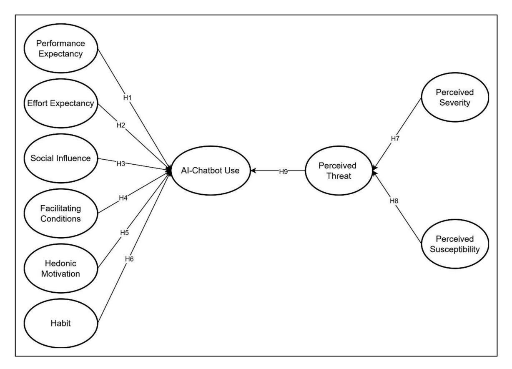

<!-- A3.R10 | source: papers_json/A3.R10/ -->

## محددات استخدام روبوتات الدردشة القائمة على الذكاء الاصطناعي لمشاركة المعرفة: أدلة من PLS-SEM والمجموعات الضبابية (fsQCA)

Mostafa Al-Emran®, Adi Ahmad AlQudah®, Ghazanfar Ali Abbasi®, Mohammed A. Al-Sharafi®, and Mohammad Iranmanesh®

ملخص—على الرغم من أن تبني روبوتات الدردشة المدعومة بالذكاء الاصطناعي (AI) يمكن أن يعزز مشاركة المعرفة، إلا أنه يسبب أيضاً تحديات بسبب "الجانب المظلم" لهذه العناصر. ومع ذلك، فإن البحث في العوامل المؤثرة في استخدام روبوتات الدردشة لمشاركة المعرفة لا يزال قليلاً. لسد هذه الفجوة، طورنا نموذج القبول-التجنب المتكامل لروبوتات الدردشة (integrated chatbot acceptance-avoidance model)، الذي ينظر في المحددات الإيجابية والسلبية لاستخدام روبوتات الدردشة لمشاركة المعرفة. من خلال استبيان شامل شمل 447 طالباً، تم تقييم نموذج البحث باستخدام نمذجة المعادلات البنائية بطريقة المربعات الصغرى الجزئية (PLS-SEM)، وهي طريقة تماثلية، وتحليل المجموعات الضبابية المقارن النوعي (fsQCA) كطريقة لا تماثلية. أظهرت نتائج PLS-SEM الدور الإيجابي لتوقع الأداء وتوقع الجهد والعادة، والدور السلبي للتهديدات المدركة في التأثير على استخدام روبوتات الدردشة لمشاركة المعرفة. وعلى الرغم من أن نتائج PLS-SEM أظهرت أن التأثير الاجتماعي والظروف الميسرة والدافعية اللذيذة (hedonic motivation) ليس لها تأثير على استخدام روبوتات الدردشة، أظهر تحليل fsQCA أن جميع العوامل قد تلعب دوراً في تشكيل استخدام روبوتات الدردشة. بالإضافة إلى المساهمات النظرية، توفر النتائج عدة تضمينات إدارية للجامعات والمدرسين ومطوري روبوتات الدردشة لمساعدتهم على اتخاذ قرارات مستنيرة وتعزيز استخدام روبوتات الدردشة.

Manuscript received 1 November 2022; revised 23 December 2022; accepted 9 January 2023. Date of publication 31 January 2023; date of current version 16 February 2024. Review of this manuscript was arranged by Department Editor D. Cetindamar. (Corresponding author: Mostafa Al-Emran.)

This work involved human subjects or animals in its research. Approval of all ethical and experimental procedures and protocols was granted by Universiti Teknologi Malaysia Ethics Committee.

Mostafa Al-Emran is with the Faculty of Engineering and IT, The British University in Dubai, Dubai 345015, United Arab Emirates, and also with the Department of Computer Techniques Engineering, Dijlah University College, Baghdad 00964, Iraq (e-mail: mustafa.n.alemran@gmail.com).

Adi Ahmad AlQudah is with the Faculty of Engineering and IT, The British University in Dubai, Dubai 345015, United Arab Emirates (e-mail: adi.qudah@gmail.com).

Ghazanfar Ali Abbasi is with the Department of Management and Marketing, King Fahd University of Petroleum and Minerals, Dhahran 31261, Saudi Arabia, and also with the Interdisciplinary Research Center for Finance and Digital Economy, KFUPM Business School, King Fahd University of Petroleum and Minerals, Dhahran 31261, Saudi Arabia (e-mail: ghazanfar.abbasi@hotmail.co.uk).

Mohammed A. Al-Sharafi is with the Department of Information Systems, Universiti Teknologi Malaysia, Skudai 81310, Malaysia, and also with the Department of Business Analytics, Sunway University, Bandar Sunway 47500, Malaysia (e-mail: alsharafi@ieee.org).

Mohammad Iranmanesh is with the School of Business and Law, Edith Cowan University, Joondalup, WA 6027, Australia (e-mail: m.iranmanesh@ecu.edu.au).

Color versions of one or more figures in this article are available at https://doi.org/10.1109/TEM.2023.3237789.

Digital Object Identifier 10.1109/TEM.2023.3237789

*Index Terms*—Chatbot, fuzzy set qualitative comparative analysis (fsQCA), knowledge sharing, partial least squaresstructural equation modeling (PLS-SEM), technology adoption.

## I. المقدمة

مع تطور تقنيات الذكاء الاصطناعي (AI)، بما في ذلك التعلم الآلي والتعلم العميق، نمت روبوتات الدردشة أو العناصر المحادثية التي تعتمد بشكل أساسي على معالجة اللغة الطبيعية نمواً كبيراً. روبوتات الدردشة هي برامج حاسوبية تتحدث وتتفاعل مع البشر لتنفيذ مهام محددة باستخدام لغة طبيعية [1]. أرست ولادة الروبوتات في عام 1921 أسس صناعة روبوتات الدردشة اليوم [2]. اكتسبت فكرة روبوتات الدردشة زخماً إضافياً مع إطلاق Siri من Apple، التي تعتمد بشكل أساسي على تقنيات روبوتات الدردشة. تسمح خوارزميات الذكاء الاصطناعي لروبوتات الدردشة بتحديد المعلومات بدقة والتعلم من بياناتها من خلال التنبؤ بالنتائج. يجري الآن تخصيص روبوتات الدردشة المدعومة بالذكاء الاصطناعي بشكل أكبر لفهم التفاعلات البشرية بشكل أفضل والرد عليها بلغة طبيعية مشابهة لما يفهمه البشر لو كانوا هم من يتفاعل [2].

يتواصل المستخدمون مع روبوتات الدردشة للحصول على معلومات فورية حول المنتجات أو الخدمات [3]. بحلول عام 2023، من المتوقع أن توفر الشركات 2.5 مليار ساعة بفضل روبوتات الدردشة [4]. من المتوقع أن تصل إيرادات روبوتات الدردشة العالمية إلى 455 مليون دولار بحلول عام 2027 [5]. نتيجة لذلك، استُخدمت روبوتات الدردشة في مجموعة متنوعة من الصناعات لتقديم معلومات مخصصة عن المنتجات، والتعامل مع استفسارات خدمة العملاء، ومساعدة العملاء في تقديم الطلبات [6]. وتحديداً، في مجال التعليم، يتزايد استخدام روبوتات الدردشة لأنها تسهّل الردود الفورية والمخصصة [7]. تساعد روبوتات الدردشة في تعزيز تفاعل الطلاب، وتقوية التواصل بين الأقران ومع المحتوى والبيئة، وتحسين الأداء التعليمي، وتشجيع التعلم التعاوني [8]. كما استُخدمت هذه العناصر المحادثية لدعم المهام الإدارية، والتدريس والتعلم، والبحث والتطوير، وتقييم الطلاب. وفيما يتعلق بدعم أنشطة التعلم، يمكن لروبوتات الدردشة مساعدة الطلاب في معالجة مواضيع مختلفة وتشجيع التأمل استجابةً لاستفساراتهم الأولية [9].

من بين عدة عوامل إدارة المعرفة، أظهرت دراسة حديثة أن مشاركة المعرفة تساهم في 19% فقط من تبني الطلاب لروبوتات الدردشة في البيئات التعليمية [10]. وفقاً لنظرية تجنب تهديد التكنولوجيا (TTAT)، فإن إدراك الأشخاص لتعرضهم وشدة تهديدات التكنولوجيا يؤثر على وعيهم بتلك التهديدات،

0018-9391 © 2023 IEEE. Personal use is permitted, but republication/redistribution requires IEEE permission. See https://www.ieee.org/publications/rights/index.html for more information.

<!-- page 2 -->

ما يؤثر بدوره على دافعيتهم للامتناع عن مشاركة المعلومات عبر هذه العناصر المحادثية[[11].](#page-11-0) قد يخشى الطلاب أيضاً الاعتماد على روبوتات الدردشة لمشاركة معلومات متعلقة بدراستهم، إذ قد تقدم هذه العناصر معلومات خاطئة أو غير دقيقة، ما يؤدي إلى قرارات سيئة. وفي الوقت نفسه، لا يزال فهم ما يؤثر في تبني روبوتات الدردشة بشكل عام [[12]](#page-11-0) واستخدامها لأغراض تعليمية [[10]](#page-11-0) يحتاج إلى مزيد من الاستكشاف. علاوة على ذلك، ركزت الدراسات السابقة على تبني المستهلكين لروبوتات الدردشة في الخدمات التجارية [[13]](#page-11-0) وأهملت استخدامها في أنشطة التعلم. كانت البيئات الاجتماعية-التقنية الفردية هي التركيز الرئيسي للدراسات السابقة، بينما لم تحظَ السياقات الجماعية إلا باهتمام محدود [[10].](#page-11-0)

نتيجة لذلك، من المرجح أن يتأثر استخدام الطلاب لروبوتات الدردشة لمشاركة المعرفة بكل من المخاطر والفوائد الناتجة عن استخدام هذه العناصر. ومع ذلك، لا توجد نماذج تشرح وتتنبأ بتبني تقنية المعلومات مع الأخذ في الاعتبار الفوائد والمخاوف في آن واحد [[14].](#page-11-0) وعلى الرغم من أن دراسة حديثة عالجت ذلك من خلال دمج النظرية الموحدة لقبول واستخدام التكنولوجيا (UTAUT) مع TTAT لتفسير تبني الذكاء الاصطناعي في اتخاذ القرار [[15],](#page-11-0)، فإن معظم العوامل المفيدة في UTAUT، مثل توقع الأداء وتوقع الجهد والظروف الميسرة، لم تدعم نية استخدام الذكاء الاصطناعي على مستوى المنظمة. لسد الفجوات البحثية المذكورة أعلاه، تعتمد دراستنا على UTAUT2 وTTAT لتطوير نموذج القبول-التجنب المتكامل لروبوتات الدردشة (ICAAM) بهدف استقصاء العوامل المفيدة والمحفوفة بالمخاطر التي تؤثر في استخدام روبوتات الدردشة لمشاركة المعرفة بين طلاب الجامعات، بمساهمة على المستوى الفردي.

من الجدير بالذكر أن الأدبيات الحالية تعتمد فقط على منهج تماثلي، وهو نمذجة المعادلات البنائية (SEM)، القائم بشكل أساسي على نمذجة صافي الأثر. إن استخدام النمذجة اللاتماثلية كمنهج رئيسي في تبني التكنولوجيا، وتحديداً في استخدام روبوتات الدردشة، نادر، وإغفال المتغيرات المرتبطة سببياً أمر جدير بالملاحظة [[16].](#page-11-0) باستخدام تحليل المجموعات الضبابية المقارن النوعي (fsQCA)، يمكن الكشف عن آليات كانت ستُفوَّت من قبل الطرق التماثلية [[17].](#page-11-0) ونتيجة لذلك، ولتقديم نتيجة أفضل، ستساعد نتائج fsQCA في وضع تنبؤات أكثر دقة من خلال توضيح النماذج السببية. للتحقيق في وتحديد الشروط "الكافية" و"الضرورية" لمختلف المحددات التي تؤثر في استخدام الأفراد لروبوتات الدردشة لمشاركة المعرفة، تستخدم هذه الدراسة نهجاً هجيناً يجمع بين التحليل التماثلي واللاتماثلي عبر PLS-SEM وfsQCA.

## II. مراجعة الأدبيات

## *A. تبني روبوتات الدردشة في التعليم*

روبوت الدردشة هو مصطلح يصف عنصراً محادثياً يشير إلى أي تطبيق برمجي يشارك في محادثة مع إنسان عبر لغة طبيعية [[18].](#page-11-0) تم استكشاف قبول روبوتات الدردشة وأهميتها لنجاح التبني عبر سياقات متعددة. في التعليم، على سبيل المثال، سلّط Chatterjee وBhattacharjee [[19]](#page-11-0) الضوء على دور روبوتات الدردشة القائمة على الذكاء الاصطناعي في تقديم ردود دقيقة وسريعة على استفسارات الدراسة، مثل الاستفسارات المتعلقة بالقبول. واستناداً إلى نموذج قبول التكنولوجيا، استكشف Chen وآخرون [[20]](#page-11-0) الدور الحاسم لروبوتات الدردشة في تعلم المفردات الصينية

وأجريت الدراسة مع 58 طالباً قُسِّموا إلى مجموعتين مستقلتين (فصل واحد لكثيرين كمجموعة ضابطة، وجلسات مدرِّس فردية كمجموعة تجريبية). أكدت الدراسة أن روبوتات الدردشة يمكن أن تعزز منحنيات تعلم الطلاب وإنجازاتهم في تعلم اللغة الصينية. أظهرت البيئة الفردية نتائج أفضل مقارنة ببيئة الفصل. كما كشفت النتائج أن الفائدة المدركة لها تأثير كبير على النية السلوكية للطلاب لاستخدام روبوتات الدردشة. وبالاعتماد على نموذج UTAUT2، استخدم Almahri وآخرون [[21]](#page-11-0) نهجاً تجريبياً لدراسة العوامل المؤثرة التي قد تسهّل أو تعيق تبني الطلاب لروبوتات الدردشة في مؤسسات التعليم العالي. أظهرت نتائج التحليل التجريبي أن توقع الأداء وتوقع الجهد والعادة كانت عوامل حاسمة في التنبؤ بشكل كبير بالنية السلوكية للطلاب لاستخدام روبوتات الدردشة.

درس Huang وآخرون [[22]](#page-11-0) استخدام روبوتات الدردشة كأداة لتعلم اللغة من خلال مراجعة أدبيات منهجية لمعرفة الإمكانات التقنية والتربوية والاجتماعية التي يمكن أن تتيحها روبوتات الدردشة لتعلم اللغة الأولى والثانية والأجنبية. ركزت المراجعة بشكل أساسي على الدراسات التجريبية التي قيّمت استخدام روبوتات الدردشة في تعلم اللغة. أظهرت النتائج الرئيسية أن التوقيت المناسب وسهولة الاستخدام والتخصيص كانت العوامل التقنية الرئيسية في استخدام روبوتات الدردشة لتعلم اللغة. يعني التوقيت المناسب أن بإمكان الطلاب التفاعل مع روبوتات الدردشة في الوقت الفعلي في أي وقت، وهذا يمكن أن يلبي حاجتهم لوتيرة التعلم الذاتي [[20].](#page-11-0) كما أن سهولة استخدام روبوتات الدردشة (مثل الواجهة التفاعلية) لها تأثير إيجابي كبير على الفوائد المتوقعة للطلاب من تعلم اللغة [[23].](#page-12-0) كما تتيح سهولة الاستخدام للمستخدمين الوصول إلى روبوتات الدردشة بسهولة عبر صفحات الويب أو التطبيقات الجوّالة، وممارسة التحدث مع روبوتات الدردشة هذه بإرسال رسائل نصية أو صوتية [[22].](#page-11-0)

## *B. روبوتات الدردشة لمشاركة المعرفة*

يُستخدم نقل المعرفة ومشاركة المعرفة أحياناً بالتبادل [[24],](#page-12-0) في حين ميّز Paulin وSuneson [[25]](#page-12-0) بوضوح بين المصطلحين كمفهومين مختلفين. يتعلق نقل المعرفة بتوزيع المعلومات من مجموعة من الأشخاص إلى أخرى، بينما تتعلق مشاركة المعرفة بالعملية التي تُتبادل فيها المعلومات داخل مجموعة محددة. بشكل عام، تُعد مشاركة المعرفة أمراً حيوياً لتحسين عملية التعلم والمساهمة في بناء القوى العاملة المعرفية، خاصة في مجال تقنية المعلومات [[26].](#page-12-0) فيما يتعلق بروبوتات الدردشة، وصفها Mleczko [[27]](#page-12-0) بأنها مساعدات افتراضية يمكنها مشاركة معرفة مخصصة لدعم أنشطة متكررة ومهام إصلاح مختلفة. تُعد روبوتات الدردشة مفيدة بشكل كبير لمشاركة المعرفة، خاصة فيما يتعلق بممارسات الأعمال اليومية والتدريب المؤسسي [[28].](#page-12-0)

نُشرت روبوتات الدردشة لمشاركة المعرفة بنجاح في مجالات متنوعة. على سبيل المثال، درس Bodea وآخرون [[28]](#page-12-0) دور روبوتات الدردشة وتطبيقاتها في تبادل المعرفة المتعلقة بمختلف عمليات إدارة المشاريع، بما في ذلك التعاون وإدارة المهام وقابلية الاستخدام. وضحت الدراسة كيف تضمن روبوتات الدردشة اتساق البيانات فيما يتعلق بسجلات الوقت والتنبؤ بالمخاطر. كما أظهرت الدراسة كيف يمكن لفريق أن يتخلص من سلسلة طويلة من الرسائل الإلكترونية ويتعاون

<!-- page 3 -->

بشكل مناسب مع الجداول التلقائية وتذكيرات سجلات الوقت التي تدعمها روبوتات الدردشة. بالإضافة إلى ذلك، صمم Ong وآخرون [[24]](#page-12-0) تطبيق روبوت دردشة ضمن منصة نظام إدارة معرفة ديناميكية قائمة على الويب لمشاركة المعرفة في الزراعة. تهدف المنصة المطورة إلى بناء شبكة بين المزارعين والمهنيين ذوي الصلة لمشاركة المعرفة ومساعدة المزارعين الشباب الذين بدأوا للتو أعمالهم الزراعية. أكدت النتائج أن مشاركة المعرفة عبر روبوتات الدردشة ستكون مفيدة في تعزيز كميات المنتجات ومستويات جودتها.

تُعد البيئات التعليمية مجالات جذابة لاستخدام روبوتات الدردشة، حيث يُنظر إليها كمساعدات افتراضية لأحداث متنوعة، بما في ذلك التدريب والمهام الإدارية[[28].](#page-12-0) بعيداً عن تعلم اللغات [[20],](#page-11-0) [[22],](#page-11-0)، يمكن استخدام روبوتات الدردشة في البيئات التعليمية لمشاركة أنواع مختلفة من المعلومات بين الطلاب. على سبيل المثال، ناقش De Nieva وآخرون [[29]](#page-12-0) كيف يمكن للطلاب استخدام روبوتات الدردشة للتخلص من الآثار السلبية للوصمة المجتمعية من خلال مشاركة خالية من القيود للمواقف الضاغطة التي قد يمرون بها بسبب الحمل الأكاديمي الهائل. مثال آخر هو استخدام روبوتات الدردشة في التعليم الطبي [[30],](#page-12-0)، حيث يُنظر إلى روبوتات الدردشة كمرضى افتراضيين [[31]](#page-12-0) يساعدون الممارسين الصحيين على محاكاة ومشاركة حالات صحية مختلفة. يساعد هذا في تبادل المعرفة بين الطلاب لتعزيز التعلم ومساعدتهم في العثور بسرعة على المعلومات المطلوبة. ومع ذلك، وحسب علمنا، هناك نقص في الدراسات حول ما يؤثر في استخدام روبوتات الدردشة لمشاركة المعرفة، خاصة في البيئات التعليمية.

## III. نموذج البحث وتطوير الفرضيات

لتحقيق أهداف هذه الدراسة، طُوِّر نموذج نظري لفهم العوامل وتأثيرها على استخدام الطلاب لروبوتات الدردشة لمشاركة المعرفة. من المتوقع أن يواجه استخدام روبوتات الدردشة لمشاركة المعرفة تأثيرات إيجابية وسلبية، لكن مراجعة سريعة للأدبيات أظهرت أن كلا التأثيرين لم يُستكشفا من خلال نماذج مناسبة للتنبؤ بالاستخدام الفعلي لتقنيات المعلومات [[14],](#page-11-0) [[15].](#page-11-0)

اقتُرحت UTAUT في الأصل لفهم السياقات المؤسسية وموظفيها [[32],](#page-12-0)، مع قيود في استكشاف الاستخدام الطوعي [[33].](#page-12-0) سلوكيات المستهلكين طوعية، لذا اقترح Venkatesh وآخرون [[34]](#page-12-0) الجيل الثاني (UTAUT2) خصيصاً لتفسير قبول التكنولوجيا من منظور المستهلكين. تشمل UTAUT2 تقريباً جميع العوامل التي يمكن أن تفسر الاستخدام الفعلي لحلول روبوتات الدردشة لمشاركة المعرفة. لذلك، اختيرت كنموذج أساسي لاقتراح النموذج النظري في هذا البحث. من ناحية أخرى، على الرغم من أن UTAUT2 استُخدمت على نطاق واسع لاستكشاف النية السلوكية والاستخدام الفعلي لتقنيات المعلومات، إلا أنها لا تأخذ في الاعتبار مخاوف المستخدمين وأفكارهم السلبية. علاوة على ذلك، لم تُصمَّم نظريات القبول لتقنيات المعلومات لاستكشاف سلوك التجنب[[35].](#page-12-0) ركزت العديد من الدراسات على أهمية اكتشاف "الجانب المظلم" لاستخدام التكنولوجيا وعوامله المرتبطة برهاب التكنولوجيا والتوتر التقني والقلق [[15],](#page-11-0) [[36].](#page-12-0)

استناداً إلى الأدبيات وخصوصية استخدام الطلاب لروبوتات الدردشة لمشاركة المعرفة، يُقدم نموذج البحث في الشكل [1](#page-3-0) نموذج ICAAM. استُلهم ICAAM ودُعِّم بأعمال Cao

وآخرون [[15],](#page-11-0)، إلى جانب المكونات الرئيسية لـ UTAUT2. من المهم التنويه بأن ICAAM لم يشمل مكوّن النية السلوكية، لأن هذه الدراسة تركز على المستخدمين الفعليين لروبوتات الدردشة [[37].](#page-12-0) علاوة على ذلك، يرتبط مكوّن "قيمة السعر" بالسعر الذي سيدفعه المستهلك لاستخدام سلعة محددة [[38],](#page-12-0)، وهو أمر لا يتوافق مع حالة هذه الدراسة لأن الطلاب لن يدفعوا مقابل الخدمة. لذلك، أُسقط عامل قيمة السعر من النموذج المقترح لأنه غير ذي صلة بالسياق الحالي [[21],](#page-11-0) [[38].](#page-12-0) من المهم أيضاً الإشارة إلى أن المتغيرات المعدِّلة (مثل الجنس والعمر والخبرة) استُبعدت من نموذج ICAAM المقترح. سبب هذا الاستبعاد هو بناء نموذج عام السياق يمكن أن يفحص مباشرة العلاقات بين مكوناته [[39],](#page-12-0) [[40],](#page-12-0)، واحتمال ألا تؤثر المتغيرات المعدِّلة على استخدام التكنولوجيا في جميع السياقات [[41].](#page-12-0)

## *A. توقع الأداء*

كما عرّفه Venkatesh وآخرون [[34],](#page-12-0)، توقع الأداء هو المدى الذي يعتقد فيه الشخص أن تقنية معينة مفيدة للحصول على مكاسب أفضل في الأداء الوظيفي. يكون الأشخاص أكثر دافعية لاستخدام تقنية معينة إذا شعروا أنها أكثر فائدة لإنجاز مهامهم [[42].](#page-12-0) أكدت عدة دراسات أن توقع الأداء له التأثير الأكبر على قبول واستخدام التقنيات [[37],](#page-12-0) [[43].](#page-12-0) وبشكل أكثر تحديداً، أكد Sugumar وChandra [[38]](#page-12-0) أن توقع الأداء له تأثير كبير على تبني روبوتات الدردشة للخدمات المالية. كما وجد Alt وآخرون [[44]](#page-12-0) أن توقع الأداء له تأثير كبير على نية العملاء لاستخدام روبوتات الدردشة في الخدمات المصرفية. علاوة على ذلك، دعم Almahri وآخرون [[21]](#page-11-0) التأثير الكبير لتوقع الأداء على نية الطلاب لقبول واستخدام روبوتات الدردشة في جامعات المملكة المتحدة. وبالتالي، تُقترح الفرضية التالية:

*H1:* لتوقع الأداء تأثير إيجابي كبير على استخدام روبوت الدردشة القائم على الذكاء الاصطناعي.

## *B. توقع الجهد*

يشير توقع الجهد إلى "درجة السهولة المرتبطة باستخدام النظام" [[32].](#page-12-0) تلعب جهود المستخدم لاستخدام تقنية معلومات معينة دوراً كبيراً في استخدام وقبول تلك التقنية [[45],](#page-12-0) [[46].](#page-12-0) في سياق روبوتات الدردشة، أكد Rodríguez Cardona وآخرون[[45]](#page-12-0) التأثير الكبير لتوقع الجهد على النية السلوكية لاستخدام وقبول روبوتات الدردشة في قطاع التأمين. وبالمثل، وجد Almahri وآخرون [[21]](#page-11-0) أن توقع الجهد له تأثير إيجابي كبير على النية السلوكية للطلاب لاستخدام روبوتات الدردشة. تشير هذه الملاحظات إلى أن الطلاب سيكونون مهتمين باستخدام روبوتات الدردشة لمشاركة المعرفة إذا وجدوها سهلة وسهلة الاستخدام. لذلك، تُقترح الفرضية التالية:

*H2:* لتوقع الجهد تأثير إيجابي كبير على استخدام روبوت الدردشة القائم على الذكاء الاصطناعي.

## *C. التأثير الاجتماعي*

يشير التأثير الاجتماعي إلى "المدى الذي يدرك فيه الفرد أن أشخاصاً مهمين يعتقدون أنه ينبغي عليه تطبيق

<!-- page 4 -->

*Fig. 1. Proposed integrated chatbot acceptance-avoidance model (ICAAM).*

النظام الجديد" [[32].](#page-12-0) فيما يتعلق بتبني التكنولوجيا، يُعد التأثير الاجتماعي هو المعيار الذاتي الذي يشبه اتفاقاً غير رسمي بين المستخدم ومجموعة أقرانه [[47].](#page-12-0) في هذه الدراسة، يمكن تعريف التأثير الاجتماعي بأنه تأثير البيئة الاجتماعية المباشرة، مثل زملاء الدراسة والمدرسين والموظفين الإداريين، على استخدام الطلاب لروبوتات الدردشة. بالإضافة إلى ذلك، يعتمد نجاح تبني روبوتات الدردشة على استخدام المجتمع بدلاً من الاستخدام من منظور فردي أو ذاتي. في دراستهم، أكد Kim وآخرون [[48]](#page-12-0) أهمية التأثير الاجتماعي في التنبؤ بقبول روبوتات الدردشة لمشاركة المعرفة لدى الأشخاص المعرضين لمرض السل في كوريا الجنوبية. وتماشياً مع ذلك، يُقال إنه كلما كان تأثير مجموعات الأقران أقوى، كانت النية السلوكية لاستخدام روبوتات الدردشة أقوى [[47].](#page-12-0) وبالتالي، تُقترح الفرضية التالية:

*H3:* للتأثير الاجتماعي تأثير إيجابي كبير على استخدام روبوت الدردشة القائم على الذكاء الاصطناعي.

## *D. الظروف الميسرة*

تشير الظروف الميسرة إلى "الدرجة التي يعتقد فيها الفرد بوجود بنية تحتية تنظيمية وتقنية لدعم استخدام النظام" [[32].](#page-12-0) وجود المساعدة، مثل الإدارة العليا والتعليمات والأدلة الإرشادية لاستخدام تقنية المعلومات، يُعد أولوية للظروف الميسرة [[49].](#page-12-0) بشكل عام، يحتاج استخدام التقنيات إلى مستوى معين من المهارات والبنية التحتية (مثل أجهزة الحاسوب المحمولة

واتصال إنترنت مناسب). لذا، من المنطقي أن يشجع توفر إعداد مناسب الطلاب على استخدام روبوتات الدردشة لمشاركة المعرفة. تحقق التأثير الإيجابي الكبير للظروف الميسرة على النية السلوكية والاستخدام الفعلي لتقنيات المعلومات في العديد من الدراسات عبر سياقات مختلفة [[37],](#page-12-0) [[49],](#page-12-0) [[50].](#page-12-0) لذلك، تُقترح الفرضية التالية:

*H4:* للظروف الميسرة تأثير إيجابي كبير على استخدام روبوت الدردشة القائم على الذكاء الاصطناعي.

## *E. الدافعية اللذيذة*

تشير الدافعية اللذيذة إلى الدرجة التي يستمتع فيها الفرد باستخدام نظام معلومات [[34].](#page-12-0) اعتُبرت الدافعية اللذيذة عنصراً رئيسياً في سياقات متنوعة، مثل التسوق، وهو ما يفسر سبب نية الأشخاص للشراء [[51].](#page-12-0) في سياق التكنولوجيا، تشير الدافعية اللذيذة إلى المتعة التي يختبرها الأفراد أثناء التفاعل مع تقنية المعلومات [[52],](#page-12-0) [[53].](#page-12-0) وفقاً للأدبيات، كانت الدافعية اللذيذة ثاني أقوى عامل يؤثر في قبول الطلاب للتعلم الجوّال في ماليزيا [[54].](#page-12-0) وقد تأكد التأثير الإيجابي للدافعية اللذيذة على تبني روبوتات الدردشة وحلول تقنية أخرى للأغراض التعليمية في عدة دراسات [[55],](#page-12-0) [[56].](#page-12-0) وبالتالي، تُقترح الفرضية التالية:

*H5:* للدافعية اللذيذة تأثير إيجابي كبير على استخدام روبوت الدردشة القائم على الذكاء الاصطناعي.

<!-- page 5 -->

## *F. العادة*

تشير العادة إلى المدى الذي يتصرف فيه الأفراد تلقائياً بسبب تعلمهم [[57].](#page-12-0) يعالج هذا المنظور ما إذا كانت عادة الطلاب ستؤثر على استخدامهم لروبوتات الدردشة لمشاركة المعرفة. أثبتت عدة دراسات أهمية العادات في التأثير على ميل الأفراد لاستخدام حلول تقنية مختلفة [[58],](#page-12-0) [[59].](#page-12-0) في دراستهم للتحقيق في محددات استخدام الشبكات الاجتماعية، أكد Abu Gharrah وAljaafreh [[57]](#page-12-0) التأثير الإيجابي للعادة على الاستخدام الفعلي للشبكات الاجتماعية لأغراض أكاديمية في الجامعات الأردنية. كما وجد Sugumar وChandra [[38]](#page-12-0) أن العادة تؤثر إيجابياً في تبني روبوتات الدردشة للخدمات المالية. لذلك، تُقترح الفرضية التالية:

*H6:* للعادة تأثير إيجابي كبير على استخدام روبوت الدردشة القائم على الذكاء الاصطناعي.

## *G. نظرية تجنب تهديد التكنولوجيا*

تشرح TTAT سلوك التجنب الذي أغفلته النظريات السابقة الأخرى [[35],](#page-12-0)، حيث يتحكم في التهديد المدرك لتقنية معينة كل من الشدة المدركة والتعرض المدرك لاستخدام تلك التقنية. يمكن تعريف الأول بأنه إدراك الفرد لدرجة الضرر المحتمل أو النتائج السلبية من استخدام التكنولوجيا، بينما يمكن وصف الثاني بأنه اعتقاد المستخدمين بشأن احتمالية اتخاذ قرارات سيئة بسبب استخدامهم للتكنولوجيا [[15],](#page-11-0) [[35],](#page-12-0) [[60].](#page-12-0)

على الرغم من أن البحث في تهديدات تقنية المعلومات لا يزال في مراحله المبكرة، استُخدمت TTAT في سياقات متنوعة لفهم العوامل التي تشجع المستخدمين على تجنب تهديدات استخدام التكنولوجيا [[11],](#page-11-0) [[15],](#page-11-0) [[61],](#page-12-0) [[62],](#page-12-0) [[63].](#page-13-0) على سبيل المثال، ادّعى Cao وآخرون [[15]](#page-11-0) أن الشدة المدركة والتعرض المدرك لهما تأثير إيجابي على التهديد المدرك، وهو ما أكده أيضاً Carpenter وآخرون [[11].](#page-11-0) وبناءً على ذلك، تُقترح الفرضيتان التاليتان:

*H7:* للشدة المدركة تأثير إيجابي كبير على التهديد المدرك.

*H8:* للتعرض المدرك تأثير إيجابي كبير على التهديد المدرك.

تشير TTAT إلى أن التهديد المدرك للتكنولوجيا يؤثر سلباً على تبني التكنولوجيا ويتجنب استخدامها [[14],](#page-11-0) [[15],](#page-11-0) [[62],](#page-12-0) [[64].](#page-13-0) أكد Warkentin وآخرون [[64]](#page-13-0) أن معتقدات خصوصية المعلومات والمخاطر لها تأثير سلبي كبير على استخدام تقنية القياس الذكي. كما درس Breward وآخرون [[14]](#page-11-0) تبني المصادقة البيومترية للهوية في القطاع المصرفي وتحقق من التأثير السلبي الكبير لمخاوف الخصوصية والأمان على نية استخدام الحل المقترح. علاوة على ذلك، افتُرض في الأدبيات الحالية التأثير السلبي للتهديدات المدركة على استخدام منصات التواصل الاجتماعي التعليمية من قبل الطلاب [[62]](#page-12-0) والذكاء الاصطناعي من قبل المديرين [[15]](#page-11-0)، لكن النتائج التجريبية كانت غير دالة إحصائياً. لذلك، تهدف هذه الدراسة إلى تقييم هذا الجدل المستمر حول التأثير الكبير للتهديدات المتوقعة على تبني التكنولوجيا وسد الفجوة وفقاً لذلك. وبالتالي، تُقترح الفرضية التالية:

*H9:* للتهديد المدرك تأثير سلبي كبير على استخدام روبوت الدردشة القائم على الذكاء الاصطناعي.

## IV. منهجية البحث

## *A. جمع البيانات وأداة البحث*

تستخدم هذه الدراسة منهجية استبيان كمي لقياس المتغيرات الكامنة وراء نموذج ICAAM المقترح. هذه الطريقة مناسبة في الدراسات التي تستخدم مقاييس صالحة لقياس المتغيرات. اعتُمدت في هذه الدراسة تقنية أخذ العينات الميسرة غير الاحتمالية لأنها ميسورة التكلفة وفعالة وسهلة الاستخدام وعملية لجمع بيانات عالية الجودة. جعل الإغلاق الناتج عن جائحة كوفيد-19 التفاعلات وجهاً لوجه مع المشاركين صعبة، لذا كان الاستبيان عبر الإنترنت باستخدام Google Forms الطريقة الأكثر كفاءة لجمع البيانات. وُزِّعت استبيانات المسح بين طلاب الجامعات الدارسين في جامعتين مختلفتين في ماليزيا. أكد المشاركون أنهم جميعاً مستخدمون فعليون لروبوتات الدردشة. حُصِل على الموافقة إلكترونياً من المستجيبين بالموافقة على المشاركة في الدراسة في بداية الاستبيان. ولتجنب مشاكل البيانات المفقودة، جُعِلت جميع الأسئلة إلزامية. دُعي ألف طالب إجمالاً للمشاركة في الاستبيان. قدّم إجمالي 447 مستجيباً — بمعدل استجابة 44.7% — إجابات كاملة على أسئلة الاستبيان وأُدرجوا بالتالي في البحث. يوضح الجدول [I](#page-5-0) الملف الديموغرافي للمستجيبين.

استُخدم مقياس ليكرت من خمس نقاط يتراوح من (1 = "غير موافق بشدة") إلى (5 = "موافق بشدة") لقياس بنود كل مكوّن. اعتُمدت بنود توقع الأداء وتوقع الجهد والتأثير الاجتماعي والظروف الميسرة والدافعية اللذيذة والعادة من [[34].](#page-12-0) اعتُمدت بنود الشدة المدركة من [[65].](#page-13-0) اعتُمدت بنود التعرض المدرك والتهديد المدرك من [[15],](#page-11-0)، بينما اعتُمدت بنود استخدام روبوت الدردشة من [[37].](#page-12-0)

## *B. الإجراءات التحليلية*

استُخدمت الحزمة الإحصائية للعلوم الاجتماعية (SPSS) إصدار 25 للتحليل الوصفي وتحيز الطريقة المشتركة (CMB). ثانياً، استُخدمت تقنية PLS-SEM عبر SmartPLS لفحص العلاقات المقترحة في ICAAM. تُقيّم تقنية PLS-SEM صلاحية وموثوقية المكونات والمؤشرات. يتحقق ذلك بتقييم نموذج القياس الخارجي كخطوة أولية لتقييم النموذج البنائي الداخلي. ثم قيّمنا النموذج التشكيلي للدراسة باستخدام fsQCA [[66],[67],[68].](#page-13-0) يمكن اكتشاف آليات كانت ستُغفلها التقنيات التماثلية باستخدام fsQCA [[17].](#page-11-0)

fsQCA هي طريقة لإجراء تحليل تشكيلي من الجيل الثاني يدمج القواعد الضبابية والمبادئ المنطقية في عملية التحليل المقارن النوعي (QCA) [[66].](#page-13-0) صُمِّمت في الأصل للعلوم الإنسانية، لكن بسبب وظيفتها في الفهم الكامل للترابطات البشرية المعقدة، جرى تكييفها للاستخدام في مجالات أخرى، مثل التسويق [[69],](#page-13-0)، والسياحة [[70],](#page-13-0)، وتبني التكنولوجيا [[67].](#page-13-0) من خلال استخدام fsQCA، يمكن للباحثين تحليل عدة أمثلة تُلقي الضوء على حدث معين في وضع

<!-- page 6 -->

معقد [[69].](#page-13-0) تدمج هذه التقنية تقنيات رياضية أكثر تقليدية، غير كافية لشرح التعقيد السببي بين المتغيرات، وهو عنصر أساسي في الامتثال العلمي الحديث [[71].](#page-13-0) يتضمن التقييم الشامل الذي تجريه fsQCA ثلاث خطوات رئيسية: المعايرة، وتحليل جدول الحقيقة (تحليل الكفاية)، وتحليل الشرط الضروري (NCA)، والتي تُفصَّل في الأقسام التالية.

*1) المعايرة:* في fsQCA، يُمثَّل كل محدد كمجموعة ضبابية بقيم عضوية متفاوتة [[66].](#page-13-0) المرحلة الأولى من fsQCA هي معايرة جميع بيانات الاستبيان. في هذه الحالة، تُحوَّل القيم الممتدة من (5 = "موافق بشدة") إلى (1 = "غير موافق بشدة") إلى معانٍ للمجموعة الضبابية. هناك طريقتان للمعايرة: بشكل غير مباشر (بفحص الحالات نوعياً وإعادة تحجيم المقاييس الأصلية) أو بشكل مباشر (بتحديد ثلاثة مواضع مميزة للعضوية في مجموعة: عدم العضوية الكاملة، ونقطة التقاطع، والعضوية الكاملة) [[66],](#page-13-0) [[69].](#page-13-0) عند التعامل مع الملاحظات التجريبية، مثل مقياس ليكرت، يُوصى باستخدام تقنية المعايرة المباشرة. تتطلب هذه الطريقة تحديد نقاط العضوية الثلاث للمقياس. تطلب المقياس المستخدم في هذه الدراسة استخدام تقنية معايرة مباشرة بثلاث نقاط ارتكاز: صُنِّفت الاستجابات التي درجة عضويتها 0 كأعضاء غير كاملين تماماً، وكانت 1 هي الحد الأدنى للعضوية الكاملة، وكانت 0.5 هي نقطة التقاطع [[72].](#page-13-0) حُوِّلت جميع القيم الممكنة لعناصر المجموعة الضبابية باستخدام دالة لوجستية تدريجية غير خطية مدمجة في برنامج fsQCA بعد تحديد الحدود المناسبة لكل مكوّن [[66],](#page-13-0) [[69].](#page-13-0)

*2) تحليل الكفاية:* التحقيق في العلاقات بين التشكيلات، أو التوليفات، من الشروط السببية (أي العوامل)، والنتيجة (أي المتغير التابع) هو الخطوة الثانية في تقييم fsQCA. تُستخدم الجبر البولياني لبناء مجموعة من الظروف المناسبة، التي تُعرف غالباً بالتشكيلات، أو النماذج السببية، أو الوصفات [[69].](#page-13-0) تُحدَّد بعد ذلك

دلالة البيانات من خلال التحليل الكافي، المعروف أيضاً باسم تقييم جدول الحقيقة، باستخدام متغيرين: مستويات اتساق وتغطية بلغت 0.8 و0.2 على التوالي. تشبه التغطية معامل التحديد (*R*2)، الذي يقيس مدى تأثير كل تفسير سببي في النتيجة. من 0 إلى 1، توجد عدة مستويات للتغطية؛ حيث تدل القيمة الأكبر على تغطية أكثر شمولاً. مثل معامل الارتباط (β)، يُقيّم الاتساق مدى مساهمة شرط سببي في النتيجة الملاحظة. [[66].](#page-13-0) تُنتَج ثلاثة حلول عند تحليل جداول الحقيقة باستخدام برنامج fsQCA: معقد، ووسيط، ومقتصد. استخدمنا الحل الوسيط، وهو مجموعة فرعية من الحلول المعقدة التي تحتوي على إجابات مقتصدة [[69].](#page-13-0)

*3) تحليل الشرط الضروري (NCA):* الخطوة الأخيرة في تحليل fsQCA هي تحديد الشروط المطلوبة. يُسمى هذا NCA، الذي يشير إلى دراسة ما إذا كانت الآثار الفريدة لكل شرط سابق ضرورية للنتيجة. تشير الأدبيات إلى أن الشرط موجود عندما تكون النتيجة واضحة تقريباً دائماً [[66],](#page-13-0) [[67].](#page-13-0) إذا كانت درجات اتساق المكوّن الضروري أعلى من 0.90، يمكن تأكيد أن الأمر كذلك فعلاً [[66],](#page-13-0) [[73].](#page-13-0)

## V. النتائج

## *A. عدم الاستجابة وتحيز الطريقة المشتركة*

لفحص احتمالية تحيز عدم الاستجابة، استُخدم اختبار تجانس التباين لـ Levene [[74].](#page-13-0) وفقاً لنتائج تحليل التباين أحادي الاتجاه (ANOVA)، لا يُعد تحيز عدم الاستجابة مشكلة للدراسة. لم توجد فروق دالة إحصائياً بين المستجيبين المبكرين والمتأخرين. بالإضافة إلى ذلك، يمكن لـ CMB في استبيانات التقرير الذاتي أن تقلل من إمكانية تأكيد المفاهيم والعلاقات المقترحة داخل إطار نظري [[75].](#page-13-0) قللنا وقسّمنا انتشار CMB باستخدام مزيج من المعالجات الإجرائية والعددية. أُجريت التدابير الإجرائية للحفاظ على إيجاز البنود والتخلص من غموضها [[76].](#page-13-0) أُجري تحليل شامل

<!-- page 7 -->

باستخدام مجموعة من التقنيات الإحصائية. بدأنا بتطبيق اختبار العامل الواحد لـ Harman. يمثل اختبار العامل الواحد 31.431% من إجمالي التباين، وهي نسبة أقل من قيمة العتبة البالغة 50% [[76].](#page-13-0) على الرغم من الاستخدام الواسع لاختبار العامل الواحد لـ Harman، يُقال إن التعامل مع CMB أحياناً غير واقعي. لذلك، أوصى Bagozzi وآخرون [[77]](#page-13-0) بتطبيق مصفوفة ارتباط للتحقق الإضافي من CMB. كشف تحليل مصفوفة الارتباط عن عدم وجود قيمة أعلى من 0.90 بين المكونات، ما يُظهر أن CMB ليست مشكلة خطيرة.

## *B. تقييم نموذج القياس*

يُعد تقييم نموذج القياس خطوة أولية قبل تقييم النموذج البنائي وfsQCA. لمعالجة ذلك، نحتاج إلى تقييم موثوقية الاتساق الداخلي [ألفا كرونباخ (α) والموثوقية المركّبة (CR)] والصلاحية التقاربية والتمييزية. كما هو موضح في الجدول II، فإن قيم α وCR لجميع المكونات أعلى من المستوى المقبول البالغ 0.7 [[78],](#page-13-0)، ما يشير إلى موثوقية كافية. بالإضافة إلى ذلك، تُقاس معاملات التحميل والتباين المتوسط المستخرج (AVE)

<!-- page 8 -->

لتقييم الصلاحية التقاربية. يُظهر الجدول [II](#page-6-0) أن كلا المقياسين مؤكدان، إذ إن قيم معاملات التحميل أعلى من 0.7، وقيم AVE أكبر من 0.5 [[78].](#page-13-0) بالنسبة للتمييز، اقترح Henseler وآخرون [[79]](#page-13-0) فحص نسبة Heterotrait–Monotrait (HTMT) كوسيلة لتحديد الصلاحية التمييزية. وبما أن كل قيمة من نتائج HTMT أصغر من قيمة العتبة البالغة 0.85، كما هو موضح في الجدول III، لا توجد مخاوف بشأن الصلاحية التمييزية. بشكل عام، تشير هذه النتائج إلى أن نموذج القياس مُتحقَّق منه.

## *C. تقييم النموذج البنائي*

بعد تقييم نموذج القياس، الخطوة التالية هي التحليل التماثلي، الذي يتطلب فحص الفرضيات المقترحة. باستخدام طريقة إعادة أخذ العينات bootstrap (5000 إعادة أخذ عينات)، حُسبت معاملات المسار لإنتاج قيم *t* المرتبطة بين المتغيرات الكامنة وتقييم درجة دلالتها (قيم *p*). تشير النتائج في الجدول IV إلى أن جميع الفرضيات المقترحة كانت مدعومة، باستثناء ثلاث رُفضت. التأثير الاجتماعي (β = 0.015، *p* > 0.05)، والظروف الميسرة (β = 0.001، *p* > 0.05)، والدافعية اللذيذة (β = 0.072، *p* > 0.05) لها تأثير إيجابي غير دالّ على استخدام روبوتات الدردشة لمشاركة المعرفة.

يتضمن فحص النماذج البنائية أيضاً قياس معامل التحديد (*R*2) [[78].](#page-13-0) يقيس هذا المقياس مدى قدرة العوامل الخارجية على تفسير التباين في المكونات الداخلية. في هذا البحث، المكونان الداخليان هما التهديد المدرك واستخدام روبوت الدردشة. أظهرت

النتائج أن قيم *R*^2^ للتهديد المدرك واستخدام روبوت الدردشة كانتا 0.187 و0.570 على التوالي. بالإضافة إلى ذلك، يتيح التعمية (blindfolding) حساب قيمة Stone–Geisser *Q*^2^، التي تُعد معياراً لتقييم الدلالة التنبؤية المتقاطعة الصلاحية لنموذج مسار PLS. أشارت النتائج إلى أن قيمة *Q*^2^ للتهديد المدرك هي 0.14 واستخدام روبوت الدردشة هي 0.428، وكلتاهما أكبر من 0، ما يعزز الملاءمة التنبؤية للنموذج المقترح للمتغيرات الكامنة الداخلية الانعكاسية.

## *D. نتائج النمذجة اللاتماثلية*

قدمت نتائج fsQCA توصيات لوصفات سببية كافية للتنبؤ بالمتغير المستهدف، وهو استخدام روبوتات الدردشة لمشاركة المعرفة. أدت ملاحظات fsQCA إلى تطوير ثلاثة حلول محتملة. اتبعنا توصية الدراسات السابقة لتقييم الحل الوسيط بسبب التوقعات الأبسط والاستدلال السببي المحسّن الناتج عن استخدام النهج البولياني [[67],](#page-13-0) [[80].](#page-13-0) يُنصَح بتحديد وتقرير المتغيرات الأساسية والهامشية في كل تشكيلة للحصول على مستويات فهم أكبر [[69].](#page-13-0) وفقاً للقراءات في الجدول [V،](#page-8-0) يُشار إلى وجود حدث سببي بدائرة سوداء (•)، بينما يُمثَّل غياب الشرط بدائرة تحمل علامة X (-). تُشار الظروف التي تُعتبر "لا يهم" بمساحات فارغة. تُشار الظروف الأساسية بدوائر كبيرة، وتُمثَّل الظروف الهامشية بدوائر صغيرة، وتُفسَّر الظروف "لا يهم" بمسافات كبيرة بين الدوائر.

<!-- page 9 -->

Note: ⊗: Absence of condition; • : Presence of condition.

وفقاً لتقييم توليفة معقدة من تسعة عوامل تشير إلى استخدام روبوتات الدردشة لمشاركة المعرفة، الموضحة في الجدول V، تُظهر نتائج fsQCA أن التشكيلات كانت كافية للتنبؤ بالدرجات العالية والمنخفضة بناءً على بيانات الاستبيان. المتغيران المستخدمان في كل حل كانا التغطية والاتساق، بقيمة عتبة مقبولة تبلغ ≥0.2 و≥0.8، ما يمثل معامل التحديد والارتباط على التوالي [[66],](#page-13-0) [[67],](#page-13-0) [[68].](#page-13-0) يبلغ اتساق الحل الإجمالي للاستخدام العالي قيمة 0.916، ما يوضح كيف يؤدي توليف تسعة عوامل سببية إلى الكمية العالية من استخدام روبوت الدردشة. بالإضافة إلى ذلك، تبلغ تغطية الحل الإجمالي 0.705، ما يمثل احتمال أن تتنبأ الوصفات السببية الأربع بدقة بدرجة عالية من استخدام روبوت الدردشة. فيما يتعلق بالوصفات السببية المقدمة في fsQCA، اكتُشف أن استخدام روبوت الدردشة قد يحدث إما في غياب أو وجود توليفة معينة من المحددات.

يُظهر الجدول V أن المستخدمين لديهم نتيجة أعلى (أي استخدام روبوت الدردشة) من خلال وجود EE وSI وHM وPSEV، وغياب FC وHBT وPSUS وPT (انظر النموذج 1). يُظهر النموذج 2 أن وجود EE وSI وHM وPE، وغياب FC وHBT وPSUS وPT يزيد استخدام روبوت الدردشة. يكشف النموذج 3 أن استخدام روبوت الدردشة يكون أعلى عندما يدرك المستخدمون وجود EE وSI وHM وPE، وغياب FC وHBT وPT. يُظهر النموذج 4 أن استخدام روبوت الدردشة يكون عالياً عندما تكون EE وSI وHM وPE غائبة وتكون FC وHBT وPSEV وPSUS وPT حاضرة. تتوافق هذه البيانات مع نتائجنا التماثلية، التي تُبرز أهمية المتغيرات المدروسة في استخدام روبوت الدردشة. كما كشف التحليل التماثلي، لم يكن لـ HM تأثير على استخدام الطلاب لروبوتات الدردشة لمشاركة المعرفة.

بعد نتائج التحقيق التماثلي، لم يجد التحليل اللاتماثلي أي تطابقات بين نماذج المسارات السببية التي أدت إلى مستويات استخدام منخفضة ونماذج المسارات السببية التي أدت إلى مستويات استخدام عالية. استناداً إلى

البيانات، يُقدم الجدول V أيضاً ثلاثة أسباب محتملة لمستوى الاستخدام المنخفض (التغطية: 0.718؛ الاتساق: 0.797). تُعتبر هذه المسارات الثلاثة ظروفاً ضرورية تؤدي إلى مستوى استخدام منخفض. وفقاً للنموذج 1، يمكن تفسير استخدام روبوت الدردشة المنخفض بغياب FC وHBT وPSUS وPT وPE، ووجود EE وSI وHM وPSEV. يفسر النموذج 2 مستوى استخدام روبوت الدردشة المنخفض من خلال غياب EE وSI وHM وPE مع وجود FC وHBT وPSEV وPSUS وPT. يقترح النموذج الثالث أن الاستخدام المنخفض لروبوتات الدردشة يمكن أن ينتج عن غياب FC وHBT وPT ووجود EE وSI وHM وPSEV وPSUS وPE. أثبتت الدراسات أن fsQCA إطار عملي قائم على نظرية المجموعات لاستخلاص الأفكار[[80],](#page-13-0) [[81].](#page-13-0) قدمت هذه الملاحظات دليلاً على الحضور الديناميكي لاستخدام روبوت الدردشة بين طلاب الجامعات والعلاقات المتنوعة بين العوامل المؤثرة في استخدام روبوت الدردشة لمشاركة المعرفة.

## *E. تحليل الشروط الضرورية*

يُجرى NCA لتقييم ما إذا كان التأثير الفردي لكل شرط سابق ضرورياً للهدف المحدد أم لا. "الشرط الضروري" هو نوع من الظروف السببية التي تظل موجودة عندما تُحدَّد النتيجة. ينبغي أن يكون للمكوّن الضروري تقديرات اتساق أعلى من 0.90 وتغطية أعلى من 0.5 [[81],](#page-13-0) [[82].](#page-13-0) يكشف الدليل المقدم في الجدول [VI](#page-9-0) أن EE فقط ضروري لتحقيق مستوى أعلى من استخدام روبوت الدردشة لمشاركة المعرفة. تشير هذه الملاحظة إلى أنه إذا لم تُلبَّ توقعات جهد الطلاب، المعروفة أيضاً بسهولة الاستخدام، فسيمنعهم ذلك من تحقيق هدفهم في استخدام روبوتات الدردشة لأغراض مشاركة المعرفة.

## VI. المناقشة

وفقاً للنتائج التماثلية، من بين 7 محددات مقترحة لاستخدام روبوت الدردشة القائم على الذكاء الاصطناعي، توقع الأداء وتوقع

<!-- page 10 -->

| TABLE VI |
| --- |
| NCA ANALYSIS |

| Conditions | Consistency | Coverage |
| --- | --- | --- |
| PE | 0.835 | 0.919 |
| ~PE | 0.595 | 0.777 |
| **EE** | **0.923** | **0.853** |
| ~EE | 0.476 | 0.804 |
| SI | 0.828 | 0.891 |
| ~SI | 0.598 | 0.803 |
| FC | 0.520 | 0.781 |
| ~FC | 0.892 | 0.885 |
| HM | 0.887 | 0.897 |
| ~HM | 0.549 | 0.801 |
| HBT | 0.398 | 0.777 |
| ~HBT | 0.831 | 0.777 |
| PSEV | 0.827 | 0.706 |
| ~PSEV | 0.472 | 0.939 |
| PSUS | 0.528 | 0.775 |
| ~PSUS | 0.472 | 0.939 |
| PT | 0.580 | 0.782 |
| ~PT | 0.867 | 0.931 |

الجهد والعادة والتهديد المدرك لها تأثير كبير. لم تُدعم تأثيرات التأثير الاجتماعي والظروف الميسرة والدافعية اللذيذة. وجدت الدراسة أيضاً أن الشدة المدركة والتعرض المدرك محركان كبيران للتهديد المدرك.

تتوافق التأثيرات الإيجابية لتوقع الأداء وتوقع الجهد على استخدام روبوت الدردشة القائم على الذكاء الاصطناعي مع نتائج Almahri وآخرون [[21],](#page-11-0)، الذين وجدوا هذين العاملين كمحركين لنية الطلاب لاستخدام روبوتات الدردشة. تشير هذه النتيجة إلى أن الطلاب أكثر عرضة لاستخدام روبوتات الدردشة القائمة على الذكاء الاصطناعي إذا وجدوها مفيدة لمشاركة المعرفة وسهلة الاستخدام. لذا، ينبغي أن يولي المطورون اهتماماً خاصاً بوظائف روبوتات الدردشة القائمة على الذكاء الاصطناعي وسهولة استخدامها. علاوة على ذلك، يُطلب من الجامعات تقديم تدريب للطلاب حول كيفية استخدام روبوتات الدردشة القائمة على الذكاء الاصطناعي وكيف يمكنها تعزيز إنتاجية الطلاب ومساعدتهم في إنجاز مهامهم.

لم تُدعم العلاقة بين التأثير الاجتماعي واستخدام روبوت الدردشة القائم على الذكاء الاصطناعي. لا تتوافق هذه النتيجة مع الدراسات السابقة [[47],](#page-12-0) [[48],](#page-12-0)، التي وجدت أن التأثير الاجتماعي محرك كبير لنية استخدام روبوتات الدردشة. هذه النتيجة مفاجئة نوعاً ما، إذ يميل المستهلكون في البلدان الجماعية إلى الامتثال للمعايير الاجتماعية. هناك تفسيران محتملان لهذه العلاقة غير الدالة. أولاً، بما أن روبوتات الدردشة في مراحلها المبكرة من التطور، سيستغرق الأمر وقتاً لتصبح معايير اجتماعية. أظهرت دراسات سابقة أن التأثير الاجتماعي لا يؤثر في تبني المنتجات الجديدة التي لم تخترق بعد السوق الجماهيري [[83].](#page-13-0) ثانياً، يشكّل الطلاب عينة الدراسة. الأشخاص المتعلمون أقل عرضة للتأثر بالمعايير الاجتماعية ويميلون إلى تقييم الأنظمة وفقاً لتجاربهم الخاصة بدلاً من التأثر بالآخرين [[84].](#page-13-0)

لم يُدعم تأثير الظروف الميسرة على استخدام روبوت الدردشة القائم على الذكاء الاصطناعي، وهو ما يتعارض مع الملاحظات السابقة[[37],](#page-12-0) [[49].](#page-12-0) تشير الظروف الميسرة إلى معرفة كيفية استخدام روبوتات الدردشة أو القدرة على الحصول على الدعم عند الحاجة.

أحد التفسيرات المحتملة لهذه العلاقة غير الدالة هو أن الطلاب يعرفون كيفية إيجاد الموارد التعليمية إذا واجهوا صعوبات أثناء استخدام روبوتات الدردشة. على سبيل المثال، هم معتادون على استخدام YouTube لفهم روبوتات الدردشة. لذلك، لا يؤثر وجود الدعم على قرارهم باستخدام روبوتات الدردشة. يمكن تفسير هذه النتيجة أيضاً بالكفاءة التكنولوجية. بما أن الطلاب على دراية عالية باستخدام التكنولوجيا، لا تُعد الظروف الميسرة عاملاً كبيراً في قرارهم استخدام روبوتات الدردشة [[85].](#page-13-0)

أظهرت النتائج أيضاً علاقة غير دالة بين الدافعية اللذيذة واستخدام روبوت الدردشة القائم على الذكاء الاصطناعي. لا تتفق هذه النتيجة مع نتائج البحث السابق [[55].](#page-12-0) يعني هذا أن الطلاب لا يستخدمون روبوتات الدردشة القائمة على الذكاء الاصطناعي للمتعة أو الترفيه. هذه النتيجة منطقية بالنظر إلى القيمة النفعية لاستخدام روبوتات الدردشة لمشاركة المعرفة. وجدت نتائج سابقة أن الدافعية اللذيذة ليس لها تأثير على استخدام الأنظمة النفعية [[86].](#page-13-0) يستخدم الطلاب روبوتات الدردشة لإنجاز مهامهم بكفاءة وفعالية أكبر بدلاً من الترفيه والمتعة.

أكدت الدراسة تأثير العادة على استخدام روبوت الدردشة القائم على الذكاء الاصطناعي. تتوافق هذه النتيجة مع نتائج البحث السابقة [[38],](#page-12-0) [[57].](#page-12-0) يدعم هذا كذلك الحجة القائلة إن العادة محرك للسلوك. يمكن للمحاضرين تقديم عروض توضيحية عملية وتشجيع الطلاب على استخدام روبوتات الدردشة في الفصل لخلق عادة استخدامها. علاوة على ذلك، عندما يطرح الطلاب أسئلة يمكن لروبوتات الدردشة الإجابة عنها، قد ينصحهم المدرسون باستخدام روبوتات الدردشة للحصول على المعلومات اللازمة.

تماشياً مع النتائج السابقة [[15],](#page-11-0) [[62],](#page-12-0)، حددت النتائج التماثلية التهديد المدرك كمحرك سلبي لاستخدام روبوت الدردشة القائم على الذكاء الاصطناعي. يعني هذا أن الطلاب قد يتجنبون استخدام روبوتات الدردشة القائمة على الذكاء الاصطناعي بسبب مخاوفهم المتعلقة بالخصوصية والأمان. وجدت الدراسة أيضاً أن الشدة والتعرض المدركين عاملان رئيسيان مرتبطان بالتهديد المدرك. لذلك، ينبغي على الجامعات معالجة مخاوف الطلاب بشأن التعرض لحوادث الأمان

<!-- page 11 -->

وحماية البيانات والحصول على معلومات خاطئة وغير دقيقة. علاوة على ذلك، ينبغي على الجامعات وضع لوائح تدعم أمان مشاركة المعرفة عبر روبوتات الدردشة. ينبغي على الجامعات أيضاً تقديم تعليمات للطلاب حتى يتمكنوا من التعرف أكثر على روبوتات الدردشة وأنواع الاستفسارات التي يمكنهم طرحها عليها. ينبغي على مطوري روبوتات الدردشة أيضاً تحسين موثوقية وأمان روبوتات الدردشة باستمرار ومعالجة أخطائها. ينبغي أن تكون روبوتات الدردشة قادرة على ربط الطلاب بمكاتب المساعدة إذا احتاجوا معلومات إضافية أو لم يكونوا متأكدين من دقة المعلومات المقدمة.

حدد fsQCA أربع توليفات من العوامل تفسر الاستخدام العالي لروبوت الدردشة (انظر حلول الاستخدام العالي في الجدول [V)](#page-8-0) وثلاث توليفات تفسر الاستخدام المنخفض (انظر حلول الاستخدام المنخفض في الجدول [V).](#page-8-0) كانت التغطية الإجمالية لـ fsQCA 0.705، وهي أعلى من القدرة التفسيرية لـ PLS (0.570). من الواضح من هذه النتائج أن حلاً واحداً لا يقدم أفضل تفسير لاستخدام الطلاب لروبوتات الدردشة. الطلاب متباينون ولديهم تصورات واحتياجات مختلفة، لذا قد تحفزهم أو تُثبطهم عوامل مختلفة عن استخدام روبوتات الدردشة. تعتمد أهمية العوامل على عوامل شخصية (مثل الكفاءة التكنولوجية) وظرفية (مثل مرحلة التبني). ومن المثير للاهتمام أنه في M2 وM3، أفاد الطلاب الذين يستخدمون روبوتات الدردشة بشكل متكرر بتوقع جهد عالٍ وتأثير اجتماعي ودافعية لذيذة وتوقع أداء عالٍ، إلى جانب ظروف ميسرة منخفضة وعادات وتهديدات مدركة منخفضة. نتائج النموذج 4 معاكسة، إذ أفاد الطلاب الذين يستخدمون روبوتات الدردشة بكثرة بظروف ميسرة عالية وعادة وتهديد مدرك عالٍ وتوقع جهد وتأثير اجتماعي ودافعية لذيذة وتوقع أداء منخفض. تشير هذه النتائج إلى أنه في المراحل المبكرة من تبني روبوت الدردشة، عندما لا يكون استخدامه عادة، من المرجح أن يستخدم الطلاب روبوتات الدردشة إذا وجدوا استخدامها ممتعاً وسهلاً ومفيداً وخالياً من المخاطر ومدعوماً من الآخرين. ومع ذلك، مع أن استخدام روبوتات الدردشة يصبح اعتيادياً، من الضروري ضمان توفر الظروف الميسرة.

على الرغم من أنه وفقاً لنتائج PLS-SEM، كان التهديد المدرك هو العامل الأكثر تأثيراً وينبغي أن يحظى بأعلى اهتمام، تكشف fsQCA أن توقع الجهد هو العامل الضروري الوحيد لاستخدام روبوت الدردشة القائم على الذكاء الاصطناعي. يوضح هذا تعقيد السلوكيات البشرية واعتمادها على الخصائص الظرفية والشخصية. لذلك، لا يمكن لنموذج واحد أن يقدم رؤية شاملة لاستخدام روبوت الدردشة القائم على الذكاء الاصطناعي. حالياً، لا يزال استخدام روبوتات الدردشة في مراحله الأولى ولم يصبح بعد اعتيادياً بين معظم الطلاب (النماذج 1-3). توقع الجهد عامل ضروري ينبغي إيلاؤه اهتماماً خاصاً. جادلت دراسات سابقة بأن fsQCA توفر توضيحاً أكثر قوة لسلوك الأفراد مقارنة بـ PLS [[67],](#page-13-0) [[69].](#page-13-0) توضح دراستنا قيمة التحليل اللاتماثلي ومخاطر الاعتماد فقط على التحليل التماثلي.

## VII. الخاتمة

## *A. المساهمات النظرية*

توسع الدراسة الأدبيات حول روبوتات الدردشة القائمة على الذكاء الاصطناعي بطرق متعددة. أولاً، توسع الدراسة UTAUT2 بدمج عوامل TTAT. أكدت النتائج أن التهديدات المدركة تؤثر سلباً على تبني روبوت الدردشة القائم على الذكاء الاصطناعي. إلى جانب العوامل المفيدة، مثل توقع الأداء وتوقع الجهد، تلعب عوامل المخاطرة (التهديدات المدركة) دوراً أساسياً في تشكيل مدى استخدام روبوت الدردشة. يعزز النموذج المقترح القدرة التفسيرية لـ UTAUT2 في سياق روبوت الدردشة. ثانياً، على عكس الدراسات السابقة التي استقصت محددات استخدام روبوت الدردشة باستخدام نهج تماثلي [[15],](#page-11-0) [[48],](#page-12-0)، استخدمت هذه الدراسة نهجاً لاتماثلياً (fsQCA) كنهج تحليل تكميلي. التغطية الإجمالية لأربع توليفات من العوامل لتفسير استخدام روبوت الدردشة التي اقترحها fsQCA هي 0.705، وهي أعلى من القدرة التفسيرية لـ PLS (0.570). يُظهر هذا أن سلوكيات الطلاب تجاه روبوتات الدردشة معقدة، ومحددات سلوكياتهم مختلفة. لا توجد مجموعة أفضل واحدة من العوامل، ويعتمد تأثير العوامل على عوامل ظرفية وشخصية. من بين 4 مجموعات من العوامل التي تفسر الاستخدام العالي لروبوت الدردشة، أظهرت M1-M3 العوامل التي تؤثر في استخدام روبوت الدردشة في المرحلة المبكرة من التبني، إذ أفاد أعضاء هذه الحلول الثلاثة بمستوى منخفض من الاستخدام الاعتيادي لروبوتات الدردشة. ومع ذلك، يفسر M4 سلوكيات الطلاب الذين يستخدمون روبوتات الدردشة بشكل اعتيادي. وبالتالي، تلعب مرحلة التبني دوراً حيوياً في مدى تأثير العامل على استخدام روبوت الدردشة، ولا يمكن لنموذج واحد أن يفسر محركات روبوتات الدردشة في مرحلتي ما قبل التبني وما بعده.

على الرغم من أن توقع الجهد والتأثير الاجتماعي والدافعية اللذيذة مرتفعة بين أعضاء M1-M4، وأن الظروف الميسرة والعادة والتهديد المدرك منخفضة، فإن مستوى العوامل الأخرى (الشدة المدركة والتعرض المدرك وتوقع الأداء) مختلف بينهم. يوضح هذا التباين في احتياجات المستخدمين. لذلك، بخلاف مرحلة التبني، قد تؤثر العوامل الشخصية في أهمية المحددات بين الطلاب. وبناءً على ذلك، لا يمكن لنتائج النهج التماثلي أن تقدم صورة واقعية لكيفية تأثير العوامل في استخدام روبوت الدردشة القائم على الذكاء الاصطناعي. من الجدير بالذكر أنه على الرغم من أن النتائج التماثلية تشير إلى أن التأثير الاجتماعي والظروف الميسرة والدافعية اللذيذة ليس لها تأثير على استخدام روبوت الدردشة القائم على الذكاء الاصطناعي، يكشف النهج اللاتماثلي أن جميع العوامل قد تلعب دوراً في تشكيل روبوت الدردشة القائم على الذكاء الاصطناعي، وينبغي مراعاة مرحلة التبني وتباين الطلاب. وعلى النقيض من نتائج PLS التي وجدت أن التهديد المدرك هو المحدد الأكثر تأثيراً لاستخدام روبوت الدردشة، وجدت نتائج fsQCA أن توقع الجهد فقط هو العامل الضروري لاستخدام روبوت الدردشة.

## *B. التضمينات العملية*

عملياً، تتيح النتائج للجامعات والمدرسين ومطوري روبوتات الدردشة اتخاذ قرارات مستنيرة وتعزيز استخدام روبوتات الدردشة القائمة على الذكاء الاصطناعي بنجاح. ينبغي إيلاء تركيز خاص لسهولة الاستخدام لزيادة انتشار روبوت الدردشة بين الطلاب. ينبغي على مطوري روبوتات الدردشة تصميم روبوت دردشة سهل الاستخدام. بما أن العديد من العلامات التجارية والوكالات الحكومية تقدم خدمات روبوتات الدردشة ولدى العديد من الطلاب خبرة في التعامل معها، ينبغي أن يشارك روبوت الدردشة لمشاركة المعرفة واجهة مماثلة لروبوتات الدردشة الأخرى المألوفة لدى الطلاب لتعزيز سهولة الاستخدام. ينبغي أن يكون توقع الجهد وتوقع الأداء والتأثير الاجتماعي والدافعية اللذيذة كلها قوية في المراحل المبكرة من تبني روبوت الدردشة عندما لا يكون الاستخدام اعتيادياً. وبناءً على ذلك، ينبغي على الجامعات تقديم تدريب لتوضيح وظائف روبوتات الدردشة وجعل

<!-- page 12 -->

من الممكن للطلاب استخدام روبوتات الدردشة بكفاءة وفعالية أكبر.

بالنظر إلى أهمية التأثير الاجتماعي، ينبغي على المدرسين، بصفتهم مؤثرين مهمين للطلاب، إظهار دعمهم لاستخدام روبوتات الدردشة لمشاركة المعلومات. علاوة على ذلك، قد توفر الجامعات منصة يشارك فيها الطلاب تجاربهم مع روبوتات الدردشة ويحفزون الآخرين على استخدامها. كما وجدت الدراسة أن الدافعية اللذيذة محرك مهم لاستخدام روبوتات الدردشة في المراحل المبكرة. لذلك، قد يقدم مدربو روبوتات الدردشة روبوتات الدردشة كأداة ترفيهية لمشاركة المعرفة. ينبغي أيضاً أن يكون مدى التهديد المدرك منخفضاً في المرحلة المبكرة من تبني روبوت الدردشة. لتحفيز الطلاب على استخدام روبوتات الدردشة، من المهم معالجة مخاوفهم بشأن مخاطر تلقي معلومات غير صحيحة وكذلك حوادث الأمان وحماية البيانات.

ينبغي على مطوري روبوتات الدردشة تحسين أمان وموثوقية روبوتات الدردشة باستمرار وحل أي أخطاء تنشأ. ينبغي على الجامعات وضع سياسات وإجراءات لضمان أمان مشاركة المعرفة باستخدام روبوتات الدردشة. ينبغي على المدرسين أيضاً طمأنة الطلاب بأن روبوتات الدردشة آمنة. ومن المثير للاهتمام أن النتائج أظهرت أن الظروف الميسرة تلعب دوراً مهماً في استخدام روبوت الدردشة في مرحلة ما بعد التبني (العادة العالية). لذلك، ينبغي على الجامعات إنشاء مكتب مساعدة يمكن للطلاب من خلاله طلب المساعدة إذا واجهوا صعوبات أثناء العمل مع روبوتات الدردشة.

## *C. القيود والعمل المستقبلي*

للدراسة بعض القيود، التي تقدم اقتراحات للبحث المستقبلي. أولاً، اقتصرت عينة الدراسة على طلاب في ماليزيا. يمكن للدراسات المستقبلية اختبار نموذج هذه الدراسة في مواقع جغرافية أخرى لتعزيز قابلية تعميم النتائج. ثانياً، صنّفت نتائج النهج اللاتماثلي المحددات المؤثرة لاستخدام روبوت الدردشة القائم على الذكاء الاصطناعي إلى ثلاث مجموعات (M1–M3) في المرحلة المبكرة من التبني (العادة المنخفضة). وعلى الرغم من أن مدى معظم العوامل (توقع الجهد والتأثير الاجتماعي والدافعية اللذيذة والظروف الميسرة والتهديدات المدركة) متشابه بينهم، فإن أهمية توقع الأداء والشدة المدركة والتعرض المدرك مختلفة بينهم. وبناءً على ذلك، يُوصى بأن تشمل الدراسات المستقبلية عوامل مرتبطة بالشخصية مثل الابتكارية والكفاءة التكنولوجية وتقدير الذات والفعالية الذاتية للتمييز بين هذه الأنواع الثلاثة من الطلاب. أخيراً، قيّمت الدراسة محددات استخدام روبوت الدردشة القائم على الذكاء الاصطناعي، استناداً إلى UTAUT2 وTTAT. يُوصى بأن تستقصي الدراسات المستقبلية العوامل المؤثرة من منظورات نظرية أخرى، مثل نظرية الدافعية للحماية، ونشر الابتكار، وملاءمة المهمة-التكنولوجيا.

## REFERENCES

- [1] B. A. Shawar and E. Atwell, "Chatbots: Are they really useful?," *J. Lang.* *Technol. Comput. Linguistics*, vol. 22, no. 1, pp. 29–49, 2007.
- [2] L. Li, K. Y. Lee, E. Emokpae, and S. B. Yang, "What makes you continuously use chatbot services? Evidence from Chinese online travel agencies," *Electron. Markets*, vol. 31, no. 3, pp. 575–599, Sep. 2021, doi: [10.1007/S12525-020-00454-Z/TABLES/3.](https://dx.doi.org/10.1007/S12525-020-00454-Z/TABLES/3)

- [3] X. Luo, S. Tong, Z. Fang, and Z. Qu, "Frontiers: Machines vs. humans: The impact of artificial intelligence chatbot disclosure on customer purchases," *Marketing Sci.*, vol. 38, no. 6, pp. 937–947, 2019, doi: [10.1287/mksc.2019.1192.](https://dx.doi.org/10.1287/mksc.2019.1192)
- [4] Juniper, "Chatbots to deliver $11bn in annual cost savings for retail, banking & healthcare sectors by 2023," Juniper Res. Ltd., Basingstoke, UK, 2018, Accessed: Aug. 1, 2022. [Online]. Available:[ https://www.](https://www.juniperresearch.com/press/chatbots-to-deliver-11bn-cost-savings-2023) [juniperresearch.com/press/chatbots-to-deliver-11bn-cost-savings-2023](https://www.juniperresearch.com/press/chatbots-to-deliver-11bn-cost-savings-2023)
- [5] J. R. Mcaulay, "15 chatbot statistics in 2022 you need to know," Kindly, Oslo, Norway, 2021, Accessed: Aug. 1, 2022. [Online]. Available:[ https:](https://www.kindly.ai/blog/chatbot-statistics-2022) [//www.kindly.ai/blog/chatbot-statistics-2022](https://www.kindly.ai/blog/chatbot-statistics-2022)
- [6] U. Gnewuch, S. Morana, M. T. P. Adam, and A. Maedche, "Opposing effects of response time in human–chatbot interaction," *Bus. Inf. Syst. Eng.*, vol. 64, pp. 773–791, May 2022, doi: [10.1007/S12599-022-00755-X.](https://dx.doi.org/10.1007/S12599-022-00755-X)
- [7] C. W. Okonkwo and A. Ade-Ibijola, "Chatbots applications in education: A systematic review," *Comput. Educ. Artif. Intell.*, vol. 2, Jan. 2021, Art. no. 100033, doi: [10.1016/J.CAEAI.2021.100033.](https://dx.doi.org/10.1016/J.CAEAI.2021.100033)
- [8] H. Yildiz Durak, "Conversational agent-based guidance: Examining the effect of chatbot usage frequency and satisfaction on visual design selfefficacy, engagement, satisfaction, and learner autonomy," *Educ. Inf. Tech**nol.*, pp. 1–18, Jul. 2022, doi: [10.1007/S10639-022-11149-7.](https://dx.doi.org/10.1007/S10639-022-11149-7)
- [9] E. Durall Gazulla, L. Martins, and M. Fernández-Ferrer, "Designing learning technology collaboratively: Analysis of a chatbot co-design,"*Educ. Inf.* *Technol.*, pp. 1–26, Jun. 2022, doi: [10.1007/S10639-022-11162-W.](https://dx.doi.org/10.1007/S10639-022-11162-W)
- [10] M. A. Al-Sharafi, M. Al-Emran, M. Iranmanesh, N. Al-Qaysi, N. A. Iahad, and I. Arpaci, "Understanding the impact of knowledge management factors on the sustainable use of AI-based chatbots for educational purposes using a hybrid SEM-ANN approach," *Interact. Learn. Environ.*, pp. 1–20, May 2022, doi: [10.1080/10494820.2022.2075014.](https://dx.doi.org/10.1080/10494820.2022.2075014)
- [11] D. Carpenter, D. K. Young, P. Barrett, and A. J. McLeod, "Refining technology threat avoidance theory," *Commun. Assoc. Inf. Syst.*, vol. 44, no. 1, pp. 380–407, 2019, doi: [10.17705/1CAIS.04422.](https://dx.doi.org/10.17705/1CAIS.04422)
- [12] R. M. Schuetzler, G. M. Grimes, and J. Scott Giboney, "The impact of chatbot conversational skill on engagement and perceived humanness," *J. Manage. Inf. Syst.*, vol. 37, no. 3, pp. 875–900, Jul. 2020, doi: [10.1080/07421222.2020.1790204.](https://dx.doi.org/10.1080/07421222.2020.1790204)
- [13] M. A. Selamat and N. A. Windasari, "Chatbot for SMEs: Integrating customer and business owner perspectives," *Technol. Soc.*, vol. 66, Aug. 2021, Art. no. 101685, doi: [10.1016/J.TECHSOC.2021.101685.](https://dx.doi.org/10.1016/J.TECHSOC.2021.101685)
- [14] M. Breward, K. Hassanein, and M. Head, "Understanding consumers' attitudes toward controversial information technologies: A contextualization approach," *Inf. Syst. Res.*, vol. 28, no. 4, pp. 760–774, Dec. 2017, doi: [10.1287/isre.2017.0706.](https://dx.doi.org/10.1287/isre.2017.0706)
- [15] G. Cao, Y. Duan, J. S. Edwards, and Y. K. Dwivedi, "Understanding managers' attitudes and behavioral intentions towards using artificial intelligence for organizational decisionmaking," *Technovation*, vol. 106, Aug. 2021, Art. no. 102312, doi: [10.1016/J.TECHNOVATION.2021.102312.](https://dx.doi.org/10.1016/J.TECHNOVATION.2021.102312)
- [16] G. A. Abbasi, K. Q. Chee Keong, K. M. Kumar, and M. Iranmanesh, "Asymmetrical modelling to understand purchase intention towards remanufactured products in the circular economy and a closed-loop supply chain: An empirical study in Malaysia," *J. Cleaner Prod.*, vol. 359, Jul. 2022, Art. no. 132137, doi: [10.1016/J.JCLEPRO.2022.132137.](https://dx.doi.org/10.1016/J.JCLEPRO.2022.132137)
- [17] E. Douglas and C. Prentice, "Innovation and profit motivations for social entrepreneurship: A fuzzy-set analysis," *J. Bus. Res.*, vol. 99, pp. 69–79, Jun. 2019, doi: [10.1016/J.JBUSRES.2019.02.031.](https://dx.doi.org/10.1016/J.JBUSRES.2019.02.031)
- [18] A. Rese, L. Ganster, and D. Baier, "Chatbots in retailers' customer communication: How to measure their acceptance?," *J. Re**tailing Consum. Serv.*, vol. 56, Sep. 2020, Art. no. 102176, doi: [10.1016/J.JRETCONSER.2020.102176.](https://dx.doi.org/10.1016/J.JRETCONSER.2020.102176)
- [19] S. Chatterjee and K. K. Bhattacharjee, "Adoption of artificial intelligence in higher education: A quantitative analysis using structural equation modelling," *Educ. Inf. Technol.*, vol. 25, no. 5, pp. 3443–3463, Sep. 2020, doi: [10.1007/s10639-020-10159-7.](https://dx.doi.org/10.1007/s10639-020-10159-7)
- [20] H.-L. Chen, G. V. Widarso, and H. Sutrisno, "A chatbot for learning Chinese: Learning achievement and technology acceptance," *J.* *Educ. Comput. Res.*, vol. 58, no. 6, pp. 1161–1189, Oct. 2020, doi: [10.1177/0735633120929622.](https://dx.doi.org/10.1177/0735633120929622)
- [21] F. A. J. Almahri, D. Bell, and M. Merhi, "Understanding student acceptance and use of chatbots in the United Kingdom universities: A structural equation modelling approach," in *Proc. 6th Int. Conf. Inf. Manage.*, Mar. 2020, pp. 284–288, doi: [10.1109/ICIM49319.2020.244712.](https://dx.doi.org/10.1109/ICIM49319.2020.244712)
- [22] W. Huang, K. F. Hew, and L. K. Fryer, "Chatbots for language learning— Are they really useful? A systematic review of chatbot-supported language learning," *J. Comput. Assist. Learn.*, vol. 38, no. 1, pp. 237–257, Feb. 2022, doi: [10.1111/jcal.12610.](https://dx.doi.org/10.1111/jcal.12610)

<!-- page 13 -->

- [23] S. Tegos, S. Demetriadis, and T. Tsiatsos, "A configurable conversational agent to trigger students' productive dialogue: A pilot study in the CALL domain," *Int. J. Artif. Intell. Educ.*, vol. 24, no. 1, pp. 62–91, Jan. 2014, doi: [10.1007/s40593-013-0007-3.](https://dx.doi.org/10.1007/s40593-013-0007-3)
- [24] R. J. Ong, R. A. A. Raof, S. Sudin, and K. Y. Choong, "A review of chatbot development for dynamic web-based knowledge management system (KMS) in small scale agriculture," *J. Phys. Conf. Ser.*, vol. 1755, no. 1, Feb. 2021, Art. no. 012051, doi: [10.1088/1742-6596/1755/1/012051.](https://dx.doi.org/10.1088/1742-6596/1755/1/012051)
- [25] D. Paulin and K. Suneson, "Knowledge transfer, knowledge sharing and knowledge barriers-three blurry terms in KM," in *Proc. Eur. Conf. Knowl.* *Manage.*, vol. 2, no. 1, pp. 752–760, 2011.
- [26] S. Jantavongso and C. Nuansomsri, "Factors influencing knowledge sharing among Thai ICT undergraduate students," *J. Technol. Innov. Tertiary* *Educ.*, vol. 2, no. 1, pp. 1–10, 2019, doi: [10.14456/jti.2019.1.](https://dx.doi.org/10.14456/jti.2019.1)
- [27] K. Mleczko, "Chatbot as a tool for knowledge sharing in the maintenance and repair processes," *Multidisciplinary Aspects Prod. Eng.*, vol. 4, no. 1, pp. 499–508, Sep. 2021, doi: [10.2478/mape-2021-0045.](https://dx.doi.org/10.2478/mape-2021-0045)
- [28] C. N. Bodea, M. I. Dascalu, and A. Hang, "Chatbot-based training for project management: Another way of corporate training or a must-have tool for sustainable education?," in *Research on Project, Programme and* *Portfolio Management*. New York, NY, USA: Springer, 2021, pp. 249–259.
- [29] J. O. De Nieva, J. A. Joaquin, C. B. Tan, R. K. Marc Te, and E. Ong, "Investigating students' use of a mental health chatbot to alleviate academic stress," in *Proc. 6th Int. ACM In-Cooperation HCI UX Conf.*, Oct. 2020, pp. 1–10, doi: [10.1145/3431656.3431657.](https://dx.doi.org/10.1145/3431656.3431657)
- [30] F. Frangoudes, M. Hadjiaros, E. C. Schiza, M. Matsangidou, O. Tsivitanidou, and K. Neokleous, "An overview of the use of chatbots in medical and healthcare education," in *Proc. Int. Conf. Hum.-Comput. Interact.*, 2021, pp. 170–184, doi: [10.1007/978-3-030-77943-6_11.](https://dx.doi.org/10.1007/978-3-030-77943-6_11)
- [31] F. A. A. Laleye, A. Blanié, A. Brouquet, D. Behnamou, and G. de Chalendar, "Semantic similarity to improve question understanding in a virtual patient," in *Proc. 35th Annu. ACM Symp. Appl. Comput.*, Mar. 2020, pp. 859–866, doi: [10.1145/3341105.3373936.](https://dx.doi.org/10.1145/3341105.3373936)
- [32] V. Venkatesh, M. Morris, G. Davis, and F. Davis, "User acceptance of information technology: Toward a unified view," *MIS Quart.*, vol. 27, no. 3, pp. 425–478, 2003, doi: [10.2307/30036540.](https://dx.doi.org/10.2307/30036540)
- [33] W. Boonsiritomachai and K. Pitchayadejanant, "Determinants affecting mobile banking adoption by generation Y based on the unified theory of acceptance and use of technology model modified by the technology acceptance model concept," *Kasetsart J. Soc. Sci.*, vol. 40, no. 2, pp. 349–358, 2017, doi: [10.1016/j.kjss.2017.10.005.](https://dx.doi.org/10.1016/j.kjss.2017.10.005)
- [34] V. Venkatesh, J. Thong, and X. Xu, "Consumer acceptance and user of information technology: Extending the unified theory of acceptance and use of technology," *MIS Quart.*, vol. 36, no. 1, pp. 157–178, 2012, doi: [10.1111/j.1365-2729.2006.00163.x.](https://dx.doi.org/10.1111/j.1365-2729.2006.00163.x)
- [35] H. Liang and Y. Xue, "Avoidance of information technology threats: A theoretical perspective," *MIS Quart.*, vol. 33, no. 1, pp. 71–90, 2009, doi: [10.2307/20650279.](https://dx.doi.org/10.2307/20650279)
- [36] D. Agogo and T. J. Hess, "'How does tech make you feel?' A review and examination of negative affective responses to technology use," *Eur. J. Inf. Syst.*, vol. 27, no. 5, pp. 570–599, Sep. 2018, doi: [10.1080/0960085X.2018.1435230.](https://dx.doi.org/10.1080/0960085X.2018.1435230)
- [37] H. Albanna, A. A. Alalwan, and M. Al-Emran, "An integrated model for using social media applications in non-profit organizations," *Int. J. Inf. Manage.*, vol. 63, Apr. 2022, Art. no. 102452, doi: [10.1016/J.IJINFOMGT.2021.102452.](https://dx.doi.org/10.1016/J.IJINFOMGT.2021.102452)
- [38] M. Sugumar and S. Chandra, "Do I desire chatbots to be like humans? Exploring factors for adoption of chatbots for financial services," *J. Int.* *Technol. Inf. Manage.*, vol. 30, no. 3, 2020, Art. no. 3.
- [39] Y. K. Dwivedi, N. P. Rana, K. Tamilmani, and R. Raman, "A meta-analysis based modified unified theory of acceptance and use of technology (meta-UTAUT): A review of emerging literature," *Curr. Opin. Psychol.*, vol. 36, pp. 13–18, Dec. 2020, doi: [10.1016/J.COPSYC.2020.03.008.](https://dx.doi.org/10.1016/J.COPSYC.2020.03.008)
- [40] Y. K. Dwivedi, N. P. Rana, M. Janssen, B. Lal, M. D. Williams, and M. Clement, "An empirical validation of a unified model of electronic government adoption (UMEGA)," *Gov. Inf. Quart.*, vol. 34, no. 2, pp. 211–230, Apr. 2017, doi: [10.1016/J.GIQ.2017.03.001.](https://dx.doi.org/10.1016/J.GIQ.2017.03.001)
- [41] Y. K. Dwivedi, N. P. Rana, A. Jeyaraj, M. Clement, and M. D. Williams, "Re-examining the unified theory of acceptance and use of technology (UTAUT): Towards a revised theoretical model," *Inf. Syst. Front.*, vol. 21, pp. 719–734, Jun. 2019, doi: [10.1007/S10796-017-9774-Y.](https://dx.doi.org/10.1007/S10796-017-9774-Y)
- [42] G. T. Pagaling, A. I. Espiritu, M. A. A. Dellosa, C. F. D. Leochico, and P. M. D. Pasco, "The practice of teleneurology in the Philippines during the COVID-19 pandemic," *Neurol. Sci.*, vol. 43, no. 2, pp. 811–819, Nov. 2022, doi: [10.1007/s10072-021-05705-1.](https://dx.doi.org/10.1007/s10072-021-05705-1)

- [43] I. Arpaci, K. Karatas, I. Kusci, and M. Al-Emran, "Understanding the social sustainability of the metaverse by integrating UTAUT2 and big five personality traits: A hybrid SEM-ANN approach," *Technol. Soc.*, vol. 71, Nov. 2022, Art. no. 102120, doi: [10.1016/J.TECHSOC.2022.102120.](https://dx.doi.org/10.1016/J.TECHSOC.2022.102120)
- [44] M.-A. Alt, I. Vizeli, and Z. S˘apl˘acan, "Banking with a chatbot a study on technology acceptance," *Studia Universitatis Babes-Bolyai Oeconomica*, vol. 66, no. 1, pp. 13–35, Apr. 2021, doi: [10.2478/subboec-2021-0002.](https://dx.doi.org/10.2478/subboec-2021-0002)
- [45] D. Rodríguez Cardona, A. Janssen, N. Guhr, M. H. Breitner, and J. Milde, "A matter of trust? Examination of chatbot usage in insurance business," in *Proc. 54th Annu. Hawaii Int. Conf. Syst. Sci.*, 2021, pp. 556–565, doi: [10.24251/HICSS.2021.068.](https://dx.doi.org/10.24251/HICSS.2021.068)
- [46] A. A. Alqudah, M. Al-Emran, and K. Shaalan, "Technology acceptance in healthcare: A systematic review," *Appl. Sci.*, vol. 11, no. 22, Nov. 2021, Art. no. 10537, doi: [10.3390/APP112210537.](https://dx.doi.org/10.3390/APP112210537)
- [47] H. Joshi, "Perception and adoption of customer service chatbots among millennials: An empirical validation in the Indian context," in *Proc. 17th Int. Conf. Web Inf. Syst. Technol.*, 2021, pp. 197–208, doi: [10.5220/0010718400003058.](https://dx.doi.org/10.5220/0010718400003058)
- [48] A. J. Kim, J. Yang, Y. Jang, and J. S. Baek, "Acceptance of an informational antituberculosis chatbot among Korean adults: Mixed methods research," *JMIR mHealth uHealth*, vol. 9, no. 11, Nov. 2021, Art. no. e26424, doi: [10.2196/26424.](https://dx.doi.org/10.2196/26424)
- [49] A. A. AlQudah and K. Shaalan, "Extending UTAUT to understand the acceptance of queue management technology by physicians in UAE," in *Proc. Int. Conf. Emerg. Technol. Intell. Syst.*, 2021, pp. 969–981, doi: [10.1007/978-3-030-85990-9_77.](https://dx.doi.org/10.1007/978-3-030-85990-9_77)
- [50] X. Wei, X. Peng, and V. Prybutok, "Consumer behavioral intention of adopting emerging healthcare technology," *IEEE Trans. Eng. Manage.*, 2022, early access, doi: [10.1109/TEM.2022.3140952.](https://dx.doi.org/10.1109/TEM.2022.3140952)
- [51] P. Mikalef, M. Giannakos, and A. Pateli, "Shopping and word-of-mouth intentions on social media," *J. Theor. Appl. Electron. Commerce Res.*, vol. 8, no. 1, pp. 5–6, 2013, doi: [10.4067/S0718-18762013000100003.](https://dx.doi.org/10.4067/S0718-18762013000100003)
- [52] A. Al-Azawei and A. Alowayr, "Predicting the intention to use and hedonic motivation for mobile learning: A comparative study in two Middle Eastern countries," *Technol. Soc.*, vol. 62, 2020, Art. no. 101325, doi: [10.1016/j.techsoc.2020.101325.](https://dx.doi.org/10.1016/j.techsoc.2020.101325)
- [53] H.-L. Gao, "The impact of quality of experience of Chinese college students on internet-based resources English learning," *Future Internet*, vol. 13, no. 7, Jun. 2021, Art. no. 162, doi: [10.3390/fi13070162.](https://dx.doi.org/10.3390/fi13070162)
- [54] K.Moorthy, T. Tzu Yee, L. Chun Ting, and V. Vija Kumaran, "Habit and hedonic motivation are the strongest influences in mobile learning behaviours among higher education students in Malaysia," *Australas. J. Educ. Tech**nol.*, vol. 35, no. 4, pp. 174–191, Aug. 2019, doi: [10.14742/ajet.4432.](https://dx.doi.org/10.14742/ajet.4432)
- [55] K. Nikolopoulou, V. Gialamas, and K. Lavidas, "Habit, hedonic motivation, performance expectancy and technological pedagogical knowledge affect teachers' intention to use mobile internet," *Comput. Educ. Open*, vol. 2, Dec. 2021, Art. no. 100041, doi: [10.1016/j.caeo.2021.100041.](https://dx.doi.org/10.1016/j.caeo.2021.100041)
- [56] D. A. Sitar-T˘aut, "Mobile learning acceptance in social distancing during the COVID-19 outbreak: The mediation effect of hedonic motivation," *Hum. Behav. Emerg. Technol.*, vol. 3, no. 3, pp. 366–378, Jul. 2021, doi: [10.1002/hbe2.261.](https://dx.doi.org/10.1002/hbe2.261)
- [57] A. Abu Gharrah and A. Aljaafreh, "Why students use social networks for education: Extension of UTAUT2," *J. Technol. Sci. Educ.*, vol. 11, no. 1, pp. 53–66, Feb. 2021, doi: [10.3926/jotse.1081.](https://dx.doi.org/10.3926/jotse.1081)
- [58] K. Nikolopoulou, V. Gialamas, and K. Lavidas, "Acceptance of mobile phone by university students for their studies: An investigation applying UTAUT2 model," *Educ. Inf. Technol.*, vol. 25, no. 5, pp. 4139–4155, Sep. 2020, doi: [10.1007/s10639-020-10157-9.](https://dx.doi.org/10.1007/s10639-020-10157-9)
- [59] O. A. Gansser and C. S. Reich, "A new acceptance model for artificial intelligence with extensions to UTAUT2: An empirical study in three segments of application," *Technol. Soc.*, vol. 65, May 2021, Art. no. 101535, doi: [10.1016/J.TECHSOC.2021.101535.](https://dx.doi.org/10.1016/J.TECHSOC.2021.101535)
- [60] Y. Chen and F. M. Zahedi, "Individuals' internet security perceptions and behaviors: Polycontextual contrasts between the United States and China," *MIS Quart.*, vol. 40, no. 1, pp. 205–222, Jan. 2016, doi: [10.25300/MISQ/2016/40.1.09.](https://dx.doi.org/10.25300/MISQ/2016/40.1.09)
- [61] H. A. Acosta-maestre, "The empirical study of the factors that influence threat avoidance behavior in ransomware security incidents," Ph.D. dissertation, College Comput. Eng., Nova Southeastern Univ., Fort Lauderdale, FL, USA, 2021.
- [62] M.-H. Peng and H.-G. Hwang, "An empirical study to explore the adoption of e-learning social media platform in Taiwan: An integrated conceptual adoption framework based on technology acceptance model and technology threat avoidance theory," *Sustainability*, vol. 13, no. 17, Sep. 2021, Art. no. 9946, doi: [10.3390/su13179946.](https://dx.doi.org/10.3390/su13179946)

<!-- page 14 -->

- [63] D. Q. Chen and H. Liang, "Wishful thinking and IT threat avoidance: An extension to the technology threat avoidance theory," *IEEE* *Trans. Eng. Manage.*, vol. 66, no. 4, pp. 552–567, Nov. 2019, doi: [10.1109/TEM.2018.2835461.](https://dx.doi.org/10.1109/TEM.2018.2835461)
- [64] M. Warkentin, S. Goel, and P. Menard, "Shared benefits and information privacy:What determines smart meter technology adoption?," *J. Assoc. Inf.* *Syst.*, vol. 18, no. 11, pp. 758–786, Dec. 2017, doi: [10.17705/1jais.00474.](https://dx.doi.org/10.17705/1jais.00474)
- [65] M. Foth, C. Schusterschitz, and M. Flatscher-Thöni, "Technology acceptance as an influencing factor of hospital employees' compliance with data-protection standards in Germany," *J. Public Health*, vol. 20, no. 3, pp. 253–268, 2012, doi: [10.1007/s10389-011-0456-9.](https://dx.doi.org/10.1007/s10389-011-0456-9)
- [66] C. C. Ragin, "Qualitative comparative analysis using fuzzy sets (fsQCA)," in *Configurational Comparative Methods: Qualitative Comparative Anal**ysis*. Newbury Park, CA, USA: Sage, 2009, pp. 87–121.
- [67] G. A. Abbasi, T. Sandran, Y. Ganesan, and M. Iranmanesh, "Go cashless! determinants of continuance intention to use E-wallet apps: A hybrid approach using PLS-SEM and fsQCA," *Technol. Soc.*, vol. 68, Feb. 2022, Art. no. 101937, doi: [10.1016/J.TECHSOC.2022.101937.](https://dx.doi.org/10.1016/J.TECHSOC.2022.101937)
- [68] M. Binsawad, G. A. Abbasi, and O. Sohaib, "People's expectations and experiences of big data collection in the Saudi context,"*PeerJ Comput. Sci.*, vol. 8, Mar. 2022, Art. no. e926, doi: [10.7717/PEERJ-CS.926/SUPP-2.](https://dx.doi.org/10.7717/PEERJ-CS.926/SUPP-2)
- [69] I. O. Pappas and A. G. Woodside, "Fuzzy-set qualitative comparative analysis (fsQCA): Guidelines for research practice in information systems and marketing," *Int. J. Inf. Manage.*, vol. 58, Jun. 2021, Art. no. 102310, doi: [10.1016/J.IJINFOMGT.2021.102310.](https://dx.doi.org/10.1016/J.IJINFOMGT.2021.102310)
- [70] J. Mehran, H. G. T. Olya, H. Han, and G. Kapuscinski, "Determinants of canal boat tour participant behaviours: An explanatory mixed-method approach," *J. Travel Tourism Marketing*, vol. 37, no. 1, pp. 112–127, Jan. 2020, doi: [10.1080/10548408.2020.1720890.](https://dx.doi.org/10.1080/10548408.2020.1720890)
- [71] C. C. Ragin and P. Pennings, "Fuzzy sets and social research," *Sociol. Methods Res.*, vol. 33, no. 4, pp. 423–430, 2005, doi: [10.1177/0049124105274499.](https://dx.doi.org/10.1177/0049124105274499)
- [72] A. G. Woodside, "Embrace•perform•model: Complexity theory, contrarian case analysis, and multiple realities," *J. Bus. Res.*, vol. 67, no. 12, pp. 2495–2503, Dec. 2014, doi: [10.1016/J.JBUSRES.2014.07.006.](https://dx.doi.org/10.1016/J.JBUSRES.2014.07.006)
- [73] J. Dul, "Necessary condition analysis (NCA): Logic and methodology of "necessary but not sufficient" causality," *Org. Res. Methods*, vol. 19, no. 1, pp. 10–52, Jul. 2016, doi: [10.1177/1094428115584005.](https://dx.doi.org/10.1177/1094428115584005)
- [74] J. S. Armstrong and T. S. Overton, "Estimating nonresponse bias in mail surveys," *J. Marketing Res.*, vol. 14, no. 3, pp. 396–402, 1977, doi: [10.1177/002224377701400320.](https://dx.doi.org/10.1177/002224377701400320)
- [75] C. M. Fuller, M. J. Simmering, G. Atinc, Y. Atinc, and B. J. Babin, "Common methods variance detection in business research," *J. Bus. Res.*, vol. 69, no. 8, pp. 3192–3198, Aug. 2016, doi: [10.1016/J.JBUSRES.2015.12.008.](https://dx.doi.org/10.1016/J.JBUSRES.2015.12.008)
- [76] P. M. Podsakoff, S. B. MacKenzie, J. Y. Lee, and N. P. Podsakoff, "Common method biases in behavioral research: A critical review of the literature and recommended remedies," *J. Appl. Psychol.*, vol. 88, no. 5, pp. 879–903, 2003, doi: [10.1037/0021-9010.88.5.879.](https://dx.doi.org/10.1037/0021-9010.88.5.879)
- [77] R. P. Bagozzi, U. M. Dholakia, and S. Basuroy, "How effortful decisions get enacted: The motivating role of decision processes, desires, and anticipated emotions," *J. Behav. Decis. Mak.*, vol. 16, no. 4, pp. 273–295, Oct. 2003, doi: [10.1002/BDM.446.](https://dx.doi.org/10.1002/BDM.446)
- [78] J. F. Hair, G. T. M. Hult, C. M. Ringle, and M. Sarstedt, *A Primer on* *Partial Least Squares Structural Equation Modeling*. Newbury Park, CA, USA: Sage, 2021.
- [79] J. Henseler, C. M. Ringle, and M. Sarstedt, "A new criterion for assessing discriminant validity in variance-based structural equation modeling," *J. Acad. Marketing Sci.*, vol. 43, no. 1, pp. 115–135, 2015, doi: [10.1007/s11747-014-0403-8.](https://dx.doi.org/10.1007/s11747-014-0403-8)
- [80] F. Li, E. C. X. Aw, G. W. H. Tan, T. H. Cham, and K. B. Ooi, "The Eureka moment in understanding luxury brand purchases! A non-linear fsQCA-ANN approach," *J. Retailing Consum. Serv.*, vol. 68, Sep. 2022, Art. no. 103039, doi: [10.1016/J.JRETCONSER.2022.103039.](https://dx.doi.org/10.1016/J.JRETCONSER.2022.103039)
- [81] I. O. Pappas, S. Papavlasopoulou, P. Mikalef, and M. N. Giannakos, "Identifying the combinations of motivations and emotions for creating satisfied users in SNSs: An fsQCA approach," *Int. J. Inf. Manage.*, vol. 53, Aug. 2020, Art. no. 102128, doi: [10.1016/J.IJINFOMGT.2020.102128.](https://dx.doi.org/10.1016/J.IJINFOMGT.2020.102128)
- [82] C. Q. Schneider and C. Wagemann, "Standards of good practice in qualitative comparative analysis (QCA) and fuzzysets," *Comp. Sociol.*, vol. 9, no. 3, pp. 397–418, Jan. 2010, doi: [10.1163/156913210X12493538729793.](https://dx.doi.org/10.1163/156913210X12493538729793)
- [83] G. Varshneya, S. K. Pandey, and G. Das, "Impact of social influence and green consumption values on purchase intention of organic clothing: A study on collectivist developing economy," *Glob. Bus. Rev.*, vol. 18, no. 2, pp. 478–492, Apr. 2017, doi: [10.1177/0972150916668620.](https://dx.doi.org/10.1177/0972150916668620)

- [84] D. J. F. Jeng and G. H. Tzeng, "Social influence on the use of clinical decision support systems: Revisiting the unified theory of acceptance and use of technology by the fuzzy DEMATEL technique," *Comput. Ind. Eng.*, vol. 62, no. 3, pp. 819–828, Apr. 2012, doi: [10.1016/J.CIE.2011.12.016.](https://dx.doi.org/10.1016/J.CIE.2011.12.016)
- [85] B. Foroughi, P. V. Nhan, M. Iranmanesh, M. Ghobakhloo, M. Nilashi, and E. Yadegaridehkordi, "Determinants of intention to use autonomous vehicles: Findings from PLS-SEM and ANFIS," *J. Retailing Consum. Serv.*, vol. 70, Jan. 2023, Art. no. 103158, doi: [10.1016/J.JRETCONSER.2022.103158.](https://dx.doi.org/10.1016/J.JRETCONSER.2022.103158)
- [86] F. Liébana-Cabanillas, N. Singh, Z. Kalinic, and E. Carvajal-Trujillo, "Examining the determinants of continuance intention to use and the moderating effect of the gender and age of users of NFC mobile payments: A multi-analytical approach," *Inf. Technol. Manage.*, vol. 22, pp. 133–161, Apr. 2021, doi: [10.1007/S10799-021-00328-6.](https://dx.doi.org/10.1007/S10799-021-00328-6)

**Mostafa Al-Emran** حصل على درجة البكالوريوس (بامتياز) في علوم الحاسوب من Al Buraimi University College، البريمي، عُمان، عام 2012، ودرجة الماجستير (بامتياز) في المعلوماتية من The British University in Dubai، دبي، الإمارات العربية المتحدة، عام 2015، ودرجة الدكتوراه في علوم الحاسوب من Universiti Malaysia Pahang، باهانج، ماليزيا، عام 2019.

هو حالياً أستاذ مساعد في علوم الحاسوب في The British University in Dubai. وهو من ضمن أفضل 2% من العلماء في العالم، وفقاً

للتقارير التي نشرتها Stanford University، ستانفورد، كاليفورنيا، الولايات المتحدة، في أكتوبر 2020 و2021 و2022. ألّف وشارك في تأليف أكثر من 115 منشوراً، وظهرت مساهماته الرئيسية في مجلات مرموقة، مثل *International Journal of Information Management, Computers & Education,* *Computers in Human Behavior, Telematics and Informatics,* IEEE TRANS-ACTIONS ON ENGINEERING MANAGEMENT*, Technology in Society, Journal of* *Enterprise Information Management, Interactive Learning Environments, In**ternational Journal of Human–Computer Interaction, Journal of Educational* *Computing Research,* و*Education and Information Technologies*. فُهرست معظم المنشورات ضمن ISI Web of Science وScopus. حرر عدة كتب نشرتها Springer. تشمل اهتماماته البحثية التفاعل بين الإنسان والحاسوب، وإدارة المعرفة، والتكنولوجيا التعليمية، والذكاء الاصطناعي.

**Adi Ahmad AlQudah** حصل على درجة البكالوريوس في نظم المعلومات الحاسوبية من Jordan University of Science and Technology، الرمثا، الأردن، عام 2008، ودرجة الماجستير في إدارة تقنية المعلومات والمعلوماتية ودرجة الدكتوراه في علوم الحاسوب من British University in Dubai، دبي، الإمارات العربية المتحدة، عامي 2017 و2022 على التوالي.

هو حالياً مدير تقديم الخدمات في شركة شبه حكومية في الإمارات العربية المتحدة لإدارة تقديم برامج

تحول متعددة في مجالات مختلفة، بما في ذلك الدفاع والأمن والرعاية الصحية والخدمات الحكومية. مع أكثر من 17 عاماً من الخبرة في علوم الحاسوب وإدارة المشاريع، قدّم بنجاح مجموعة من البرامج الاستراتيجية متعددة المجالات ومبادرات التحول الرقمي في الشرق الأوسط، خاصة في الإمارات العربية المتحدة والأردن ومصر. منذ عام 2012، وهو محترف إدارة مشاريع معتمد (PMP). تشمل اهتماماته البحثية منهجيات إدارة المشاريع، وهندسة البرمجيات، والتعلم الآلي، وتبني التكنولوجيا، والمعلوماتية الصحية.

<!-- page 15 -->

**Ghazanfar Ali Abbasi** حصل على درجة الدكتوراه في التسويق من Universiti Sains Malaysia، جيلوجور، ماليزيا، عام 2021.

هو حالياً أستاذ مساعد في التسويق في King Fahd University of Petroleum and Minerals، الظهران، المملكة العربية السعودية. كان له تأثير كبير في البحث، خاصة في مجالات التسويق الكمي، وسلوك المستهلك، وتبني التكنولوجيا، والتجارة الإلكترونية، والتجارة الاجتماعية، ومجالات أخرى ذات صلة. بالإضافة إلى ذلك، لديه معرفة جيدة بتقنيات مثل الشبكات العصبية

الاصطناعية، وتحليل المجموعات الضبابية المقارن النوعي، وأنظمة الاستدلال العصبي الضبابي التكيفي، ونمذجة المعادلات البنائية. وهو نشط جداً في البحث، ونُشرت أعماله في عدة مجلات أكاديمية مرموقة، بما في ذلك *Technological Forecasting and Social Change*، و*Journal of Business Research*، و*Technology in Society, European Journal of Information Management, Spanish* *Journal of Marketing, Electronic Commerce Research,* و*Appetite*.

**Mohammad Iranmanesh** حصل على درجة الدكتوراه في الإدارة من Universiti Sains Malaysia (USM)، ماليزيا، عام 2016.

هو حالياً محاضر أول ملحق بـ School of Business and Law، Edith Cowan University، جوندالوب، أستراليا الغربية، أستراليا. تقع اهتماماته البحثية عند تقاطع الاستدامة ونظم المعلومات، مع التركيز على قضايا متعلقة بالتحول الرقمي، والتصنيع المستدام، والتنمية المستدامة. ألّف أو شارك في تأليف أكثر من 100 مقالة في مجموعة من المجلات

والمؤتمرات الأكاديمية الرائدة.

اختِير السيد Iranmanesh ضمن قائمة أفضل 40 من أوائل النجوم الصاعدين في أستراليا لعام 2020 وفقاً لأبحاث استشهدت بها صحيفة *The Australian*.

**Mohammed A. Al-Sharafi** حصل على درجة الدكتوراه في نظم المعلومات من Universiti Malaysia Pahang، بيكان، ماليزيا، عام 2020.

هو حالياً باحث راسخ في مجال نظم المعلومات. في University of Malaysia Pahang، حصل على تقدير لعدد منشوراته المتميز. تشمل أنشطته البحثية تأثير التقنيات الناشئة على الأفراد والمنظمات والمجتمع (مثل الذكاء الاصطناعي، والحوسبة السحابية، وسلاسل الكتل، وشبكات التواصل الاجتماعي عبر الإنترنت، والبيانات الضخمة، وإنترنت الأشياء) والأساليب الكمية في نظم المعلومات

البحثية. أظهرت خبرته في مجال نظم المعلومات من خلال منشوراته العديدة في مجلات ومؤتمرات مرموقة. حظيت مساهماته البحثية باعتراف واسع وكان لها تأثير كبير في المجال. لديه خبرة في التعاون مع باحثين من دول مختلفة وحصل على تقدير لأبحاثه.
