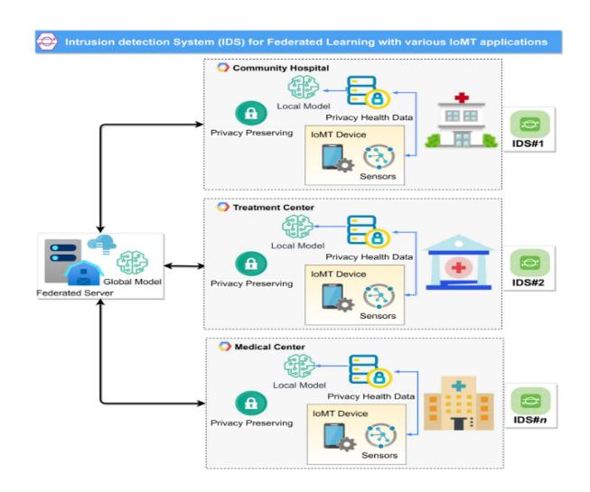
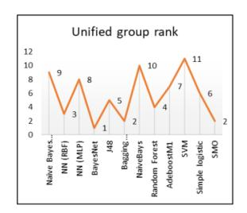
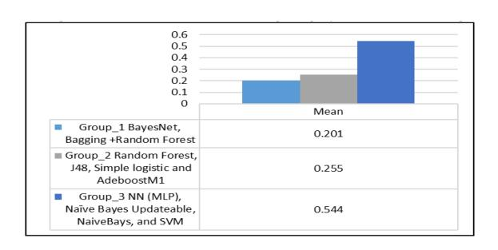

<!-- A3.R14 | source: papers_json/A3.R14/ -->

## Federated Learning for IoMT Applications: A Standardization and Benchmarking Framework of Intrusion Detection Systems

Amneh Alamleh, O. S. Albahri, A. A. Zaidan, A. S. Albahri, A. H. Alamoodi, B. B. Zaidan, Sarah Qahtan, H. A. Alsatar, Mohammed S. Al-Samarraay, and Ali Najm Jasim

الملخص—يقع التقييم الفعّال لأنظمة كشف التسلل (IDSs) القائمة على التعلم الآلي (ML) من أجل التعلم الاتحادي (FL) في بيئة إنترنت الأشياء الطبية (IoMTs) ضمن مشكلات التوحيد القياسي واتخاذ القرار متعدد المعايير (MCDM). لذلك تطوّر هذه الدراسة إطارًا لـ MCDM لتوحيد ومقارنة أنظمة كشف التسلل القائمة على ML المستخدمة في بنية FL لتطبيقات IoMT. في المنهجية، أولًا، تُوحَّد معايير تقييم أنظمة كشف التسلل القائمة على ML باستخدام أسلوب دلفي الضبابي (FDM). ثانيًا، تُصاغ مصفوفة القرار التقييمية (DM) بناءً على تقاطع معايير التقييم الموحدة مع قائمة أنظمة كشف التسلل القائمة على ML. وتُنجَز هذه الصياغة باستخدام مجموعة بيانات تضم 125,973 سجلًا، ويتكون كل سجل من 41 سمة. ثالثًا، يُصاغ دمج أساليب MCDM لتحديد أوزان الأهمية للمعايير الرئيسية والفرعية الموحدة الخاصة بالأمان والأداء، يتبع ذلك مقارنة واختيار أفضل أنظمة كشف التسلل القائمة على ML. في هذه المرحلة، يُستخدم أسلوب تصويت بوردا لتوحيد الرتب المختلفة وإجراء مقارنة جماعية. تُؤكَّد النتائج التالية. (1) باستخدام FDM، يصل 17 من أصل 20 معيار تقييم (14 للأمان و3 للأداء) إلى إجماع الخبراء. (2) يحصل معيار المساحة تحت المنحنى على أدنى مجموعة أوزان، بينما يحصل معيار زمن المعالج على أعلى قيمة. (3) يُظهر ترتيب VIKOR الجماعي

Manuscript received 24 December 2021; revised 6 February 2022, 27 February 2022, and 31 March 2022; accepted 10 April 2022. Date of publication 13 April 2022; date of current version 6 February 2023. (Corresponding author: O. S. Albahri.)

Amneh Alamleh, O. S. Albahri, A. H. Alamoodi, H. A. Alsatar, and Mohammed S. Al-Samarraay are with the Department of Computing, Universiti Pendidikan Sultan Idris, Perak 35900, Malaysia (e-mail: amneh@alamleh.net; osamah@fskik.upsi.edu.my; alamoodi@fskik.upsi.edu.my; alsatar@fskik.upsi.edu.my; mohammed.mahmoud@qnet.net)

Á. A. Zaidan was with the Faculty of Engineering and IT, The British University in Dubai, Dubai, United Arab Emirates. He is now with SP Jain School of Global Management, Sydney, Australia (e-mail: amneh@fskik.upsi.edu.my).

A. S. Albahri is with the Informatics Institute for Postgraduate Studies (IIPS), Iraqi Commission for Computers and Informatics (ICCI), Baghdad, Iraq, Taiwan (e-mail: ahmed.bahri1978@gmail.com).

B. B. Zaidan is with Future Technology Research Center, National Yunlin University of Science and Technology, Yunlin 64002, Taiwan (e-mail: zaidanbb@yuntech.edu.tw).

Ali Najm Jasim is with the Foundation of Alshuhda, Baghdad, Iraq (e-mail: najem@fskik.upsi.edu..my).

Sarah Qahtan is with the Computer Center, College of Health and Medical Technology, Middle Technical University, Baghdad, Iraq (e-mail: sarahq@fskik.upsi.edu..my).

Digital Object Identifier 10.1109/JBHI.2022.3167256

تُظهر النتائج أن BayesNet هو أفضل مصنّف، بينما SVM هو الخيار الأخير. وللتقييم، تُستخدم ثلاثة تقييمات، وهي الترتيب المنهجي، والتكلفة الحاسوبية، والتحليل المقارن.

Index Terms—Intrusion detection systems, federate learning, internet of medical things, machine learning, multicriteria decision making.

## I. INTRODUCTION

نظام كشف التسلل في الوقت الحقيقي (IDS) هو تطور شائع في الأمن السيبراني للتعامل مع المشكلات الرئيسية لأمن المعلومات والأنظمة، من خلال كشف النشاط الخبيث في بيئات المضيف و/أو الشبكة. ومع تزايد تعقيد الشبكة، تصبح أنظمة الشبكات أكثر عرضة لمشكلات أمنية متنوعة، بما في ذلك عمليات التسلل.

يُوصف التسلل إلى شبكة أو حاسوب بأنه محاولة انتهاك أمن شبكة أو حاسوب، مثل خرق السرية أو السلامة أو التوافر [1]. ومؤخرًا،

يواجه IDS تحديات كبرى من عدة جوانب: الحجم الهائل لبيانات حركة الشبكة، ومجموعة البيانات التدريبية عالية الأبعاد، والتغيرات المتكررة في البيئات، وطبيعة التسلل المتغيرة، والحاجة إلى الكشف في الوقت الحقيقي. وقد اقتُرح عدد كبير من طرق واستراتيجيات الكشف للتغلب على هذه التحديات؛ ويُعد أسلوب التعلم الآلي (ML) من أكثرها شيوعًا [2]. تسمح تقنيات ML لنظام IDS بتوليد خطوط أساس للنشاط الموثوق تُعرف بنموذج الثقة [3]. يستخدم IDS تقنيات مختلفة لكشف الشذوذ. ويُعدّ تطوير IDS موثوق أمرًا بالغ الأهمية للتخفيف الفعّال من أنواع مختلفة من التهديدات، ولتخفيف أنواع مختلفة من الهجمات بكفاءة [4]. لذلك، تُستخدم تقنيات ML في كشف الهجمات وتصميم أنظمة IDS فعّالة. وقد تحسّنت تقنيات ML، خاصة النماذج الضحلة، تحسنًا ملحوظًا في السنوات الأخيرة، وأصبحت تُستخدم على نطاق واسع في مجالات متعددة [5]، بما في ذلك أنظمة الرعاية الصحية. وقد طُبِّقت نماذج ML عديدة على أنظمة IDS الحالية لتحسين أبحاث IDS ورفع معدلات الكشف مع خفض معدلات الإنذار الكاذب وتكاليف المعالجة [6]. فعلى سبيل المثال، استخدم [6] تقنيات ML مع IDS للتعلم من حركة المرور (عادية/غير عادية)، وأُجريت عملية تدريب النموذج على مجموعة البيانات لاكتشاف الأنماط الدالة على حركة المرور الخبيثة. وقد استُخدمت نماذج ML بنجاح في أبحاث IDS بفضل سماتها المتفوقة في كشف التسلل. غير أنها غالبًا ما تتطلب

<!-- page 2 -->

سلطة مركزية لمعالجة البيانات المجمّعة من جميع مستخدمي الشبكة. وتنخفض دقة التنبؤ مع اتساع نطاق الشبكة بسبب ارتفاع معدل فقدان الحزم المرتبط بمتطلب المركزية هذا.

إنترنت الأشياء الطبية (IoMT) هو مجموعة من تطبيقات البرمجيات والأجهزة الطبية التي يمكن ربطها عبر تقنيات الشبكات بخدمات وأنظمة معلومات الرعاية الصحية [7], [8]. ويؤدي IoMT دورًا أساسيًا في قطاع الرعاية الصحية من خلال زيادة دقة الأجهزة الإلكترونية وموثوقيتها وإنتاجيتها. ويتيح IoMT اتصالًا آمنًا بين الأجهزة اللاسلكية والبعيدة عبر الإنترنت [9]، مما يسمح بمراقبة أسرع وأكثر مرونة للمعلومات الطبية. ووفقًا لاستطلاع حديث لشركة Deloitte، من المتوقع أن ينمو سوق IoMT العالمي من 41 مليار دولار في عام 2017 إلى 158 مليار دولار بحلول عام 2022 [10]. ويمكن لبعض أجهزة IoMT توليد كميات هائلة من بيانات الصحة (مثل مراقبة النوم بإشارات EEG وEMG) من خلال استخدام المستشعرات [11]. ويتطلب IoMT بنية تحتية أمنية كاملة مبنية على IDS فعّال وكفء بسبب حساسية بيانات الرعاية الصحية والقواعد الصارمة المحيطة بها (مثل المعلومات الصحية التي تجمعها المستشعرات) [12]. ويمكن أن تُسبب الهجمات على IoMT ضررًا جسديًا كبيرًا وأذى يهدد حياة المرضى، مما يطرح عددًا من مخاوف الأمان والخصوصية. لذلك، يُعدّ IDS ضروريًا لتأمين شبكة الأجهزة الطبية المتصلة، وطوبولوجيا شبكة المستشفى، والمراكز الطبية.

في المقابل، طرحت Google مفهوم التعلم الاتحادي (FL) لتمكين تدريب الأجهزة المحمولة مع الحفاظ على الخصوصية [13]. FL هو أسلوب تعلم آلي موزّع يدرّب النماذج على مجموعة كبيرة من البيانات اللامركزية. ويُعد أساس FL مثالًا على مفهوم أوسع هو "جلب الشيفرة إلى البيانات، بدلًا من جلب البيانات إلى الشيفرة"، وهو ما يحل المشكلات الأساسية المتعلقة بملكية البيانات وخصوصيتها وتوطينها [14]. ولا حاجة إلى كيان مركزي كي يعمل FL، لأنه يوفر تعلمًا تعاونيًا بين الأجهزة دون الحاجة إلى مشاركة البيانات [15]، حيث يمكن تدريب نماذج ML على بيانات موزعة عبر خوادم وأجهزة متعددة [16]. ويتكون FL أساسًا من خطوتين: التعلم المحلي ونقل النموذج؛ وكلاهما مصمم لضمان خصوصية البيانات وخفض التكلفة [17]. وفي كل جولة، يختار خادم FL مجموعة من العملاء للمشاركة في عملية التعلم، ويزودهم بالنموذج العالمي الحالي. وتبدأ كل جولة في خادم FL باختيار مجموعة من العملاء للمشاركة في عملية التعلم وتزويدهم بالنموذج العالمي الحالي [18]. وبعد الحصول على النموذج العالمي، يدرّب كل عميل النموذج محليًا باستخدام بياناته الخاصة. ثم يرسل هؤلاء العملاء نماذجهم المبنية حديثًا إلى خادم FL لتجميعها. وتُكرَّر هذه العملية عدة مرات حتى الحصول على النتيجة المرغوبة. وفي هذا السياق، يمكن للعملاء الاستفادة من بيانات الآخرين دون مشاركة معلومات شخصية مع خادم FL [19]. لذلك، درس كثير من الباحثين تطبيق FL في سيناريوهات متعددة تتضمن بيانات حساسة، مثل تطوير نماذج تنبؤية لتشخيص الصحة وتعزيز التعاون بين المستشفيات المختلفة [20], [21]. ويوضح الشكل 1 تنوّع تطبيقات IDS لـ FL باستخدام العديد من تطبيقات وحركة مرور IoMT.

*Fig. 1. Heterogeneity of IDS deployments for FL utilising various IoMT applications and traffic.*

## II. CHALLENGES OF IDS FOR FL IN IOMT

أوصى الباحثون باستخدام IDS مع FL لكشف الشذوذ في أجهزة IoMT المحلية. ونتيجة لذلك، تُتيح إضافة IDS إلى FL لـ ML توفير آليات حماية مخصصة لشبكات وأجهزة IoMT المختلفة. علاوة على ذلك، تخفف هذه الإضافة العبء الحاسوبي على خادم المعالجة المركزي، وتحسّن استخدام النطاق الترددي، وتحمي خصوصية بيانات الصحة، وتدير اتصالات بيانات الصحة المختلفة. غير أن FL لا يضمن الخصوصية عند وجود خوادم أو مستخدمين خبثاء. وحماية المعلومات الصحية الحساسة، مثل السجلات الطبية، أمر صعب [22].

أظهرت دراسات حديثة بوضوح أن مستخدمين خبثاء قد يوجدون في FL، ويمكنهم استنتاج معلومات صحية عن المرضى انطلاقًا فقط من النماذج المشتركة [23]. وبالتالي، تتطلب مخاوف أمن وخصوصية FL، خاصة في سياق تطبيقات IoMT، اهتمامًا إضافيًا من خلال استخدام IDS [24]. ويمكن للمؤسسات الصحية الخبيثة المحتملة أن تحقن نماذج ML ببيانات خاطئة أو مزيفة، مما يجعل النموذج المدرَّب يقدّم تنبؤات غير صحيحة، عبر تصنيف خسائر المؤسسة الصحية الاقتصادية تصنيفًا خاطئًا، والسماح بتشغيلها بوصفها طبيعية. ويُعد غياب الثقة بين الأطراف أو غياب قناة اتصال آمنة لنقل تحديثات نموذج ML المحلي مصدر قلق شائع في الهجمات. وتتضمن أنظمة IDS عادة بروتوكولات مختلفة، وأنواع خدمات، وعناوين IP للمصدر/الوجهة، وغير ذلك. وإذا نُقلت هذه البيانات عبر قنوات اتصال مفتوحة أو حتى طرق غير آمنة، فقد يكون ذلك كارثيًا للمستخدمين والخادم نظرًا لاحتمال تأثيرها المباشر على حياة الناس [25]. ومقارنة بالبيانات المخزَّنة بشكل دائم على الجهاز، تكون البيانات أثناء النقل غير محمية بآليات أمان الجهاز [21]. وقدَّمت عدة دراسات حول IDS حلولًا تنفيذية معقولة مرتبطة بالتحديات المحددة باستخدام نماذج ML [24], [26]. ومن المفاجئ أن دراسات عديدة حول IDS تُطرح لمواكبة التطورات في القضايا الأمنية.

<!-- page 3 -->

تتوفر أنظمة IDS عديدة قائمة على ML، ويمكن الاطلاع على ذلك في الأدبيات [26]–[29]. غير أن زيادة تطبيقات الإنترنت لـ FL أدت إلى استراتيجيات هجوم أكثر تطورًا، مما تطلّب الإجابة عن السؤال '*ما هو نظام* *IDS الأفضل الذي يمكن أن يخدم FL لتطبيقات IoMT* *والحفاظ على خصوصية بيانات الصحة؟*' [27]. وعلى حد علمنا، لم تُطرح دراسة تتناول أنظمة IDS لـ FL في تطبيقات IoMT.

## III. RELATED WORKS FOR BENCHMARKING OF ML-BASED IDS

واجه IDS مجموعة واسعة من القيود، واحتاج إلى تسوية لحل المفاضلة بين جانبي الأداء والأمان [28]. ويُعد اختيار أفضل مصنّف IDS أمرًا بالغ الأهمية لأنه يحسّن أمن شبكات الحاسوب وأنظمة معلومات الرعاية الصحية، ويوفر معلومات شاملة لمطوري IoMT، مما يساعد على تصنيع نسخ فعّالة وكفؤة من أنظمة IDS. ونظرًا للعدد الهائل من الدراسات المطوَّرة حول IDS القائم على ML الخاضع للإشراف، يواجه هذا المجال باستمرار تحديًا رئيسيًا في تقييم نماذج تصنيف ML المستخدمة في IDS بسبب معايير التقييم الأمنية والأدائية التي نوقشت [29], [30]. ويُظهر الجدول I الدراسات ذات الصلة بتقييم ومقارنة أنظمة IDS القائمة على ML.

بناءً على معايير التقييم المختلفة في الأدبيات الأكاديمية، حاول الباحثون تقييم نماذج تصنيف مختلفة تُستخدم في IDS لاختيار الأفضل منها. ويُظهر تحليل الأدبيات عدم وجود اتفاق على أنسب المعايير لتقييم مصنفات IDS، لأن الدراسات الحالية تعتمد على جانب واحد غير مكتمل [35]. وأجرت كل دراسة تقييمات عديدة استنادًا إلى مجموعة من معايير الأمان، وأغفلت معظم الدراسات جانب الأداء. وعلى حد علمنا، لم تقدّم أي دراسة حصرية حلًا موثوقًا لمقارنة مصنفات IDS استنادًا إلى تقييم

موحّد لـ FL. ويمكن مواجهة ثلاث مشكلات رئيسية في تقديم حل تقييم شامل لمصنفات IDS. أولًا، يجب مراعاة معايير تقييم عدة مع اختيار الأنسب منها استنادًا إلى إجراء التوحيد القياسي [36]. ثانيًا، لا تحمل معايير التقييم الأهمية نفسها؛ لذا يلزم زيادة أهمية بعض المعايير الموحدة وتقليل أهمية أخرى بشكل مناسب في عملية تقييم مصنفات IDS [37]. ثالثًا، ينبغي مراعاة تعارض/مفاضلة المعايير. واستنادًا إلى القضايا المذكورة، يقع تقييم ومقارنة نماذج تصنيف IDS ضمن مشكلات التوحيد القياسي واتخاذ القرار متعدد المعايير المعقد

<!-- page 4 -->

(MCDM). وللتخلص من هذا التعقيد، يجب استخدام أسلوب دلفي الضبابي (FDM) [38] لحل مشكلة التوحيد القياسي لمعايير تقييم مصنف IDS، ويُوصى بشدة باستخدام حل قائم على أسلوب MCDM للتغلب على مشكلة تقييم ومقارنة مصنفات IDS. وقد طُوّرت عدة أساليب MCDM لحل مشكلة التقييم والمقارنة في مجالات متنوعة [39], [40]. ويُعد VIKOR (Vlsekriterijumska Optimizcija I Kaompromisno Resenje) أسلوبًا شائعًا وفعّالًا لأنه يستخدم بيانات كمية أو نوعية لاختيار خيار من مجموعة خيارات [39]. غير أن VIKOR لا يمكنه تخصيص أوزان للمعايير؛ لذا يتطلب آلية ترجيح خارجية لهذا الغرض. ويُعد تقييم الأوزان الدقيقة للمعايير أمرًا أساسيًا لأنه قد يؤثر في نتائج تقييم ومقارنة مصنفات IDS. وتحديد الأوزان بطريقة ذاتية باستخدام أسلوب التقييم المباشر مناسب نظرًا للعدد المحدود من معايير التقييم الرئيسية لمصنفات IDS (أي الأمان والأداء) [41]. والسبب أن لهذا الأسلوب سمعة كبيرة في محاكاة القرار البشري لترجيح عدد محدود من المعايير. غير أن أسلوب ترجيح الأنتروبيا [42]، وهو الأكثر شيوعًا كأسلوب ترجيح موضوعي، حل مناسب للحصول على درجات الأهمية لكل معيار فرعي، لأنه من الصعب جدًا على الخبراء تحديد درجة التفضيل بين المعايير الفرعية بطريقة ذاتية بسبب العدد الكبير من معايير التقييم الفرعية لمصنفات IDS. لذلك، وبالنظر إلى FL لتطبيقات IoMT، تهدف هذه الدراسة إلى تطوير إطار توحيد قياسي ومقارنة لأنظمة IDS باستخدام دمج أساليب التقييم المباشر والأنتروبيا وVIKOR.

## IV. METHODOLOGY

المرحلة الأولى: توحيد معايير التقييم استنادًا إلى FDM تعرض هذه المرحلة عملية تحديد توحيد معايير التقييم باستخدام FDM. جُمعت خمسة عشر معيارًا لتقييم الأمان وخمسة معايير لتقييم الأداء لنماذج تصنيف IDS من الأدبيات. ويلزم توحيد هذه المعايير من قبل الخبراء لتحديد أيها ضروري وينبغي استخدامه في تقييم ومقارنة نماذج تصنيف IDS. وتُشرح خطوات FDM على النحو التالي [43]:

Step1: Expert selection

اختار الباحثون وتواصلوا مع ثلاثة خبراء متخصصين في مجال أبحاث وتطوير IDS للحصول على رأيهم في فحص وتحديد أهم مجموعة من معايير التقييم.

Step 2: Design expert form

طُوِّر نموذج الخبراء واستُخدم لجمع بيانات آراء الخبراء وفق بنية وتصميم الدراسات [44], [45]. ويحتوي هذا الاستبيان على معلومات عن البحث المُجرى، ومعلومات عن الخبير، ومعايير تقييم نماذج تصنيف IDS.

Step 3: Expert form dissemination and data collection

وُزِّع نموذج الخبراء المطوَّر على الخبراء عبر بث رابط النموذج بالبريد الإلكتروني. وطُلب من الخبراء تقييم معايير التقييم من حيث أهميتها في مجموعتي الأمان والأداء.

تُرجمت المتغيرات اللغوية إلى أعداد ضبابية مثلثية (m1، m2، m3). وفي الدراسة الحالية، اختير مقياس ليكرت من خمس نقاط لجمع تعليقات الخبراء [34]. ويُظهر الجدول III المتغيرات اللغوية المستخدمة لتحديد وزن المعايير برأي الخبراء [46], [47]. ثم حُسب متوسط الأعداد الضبابية وقُسم على عدد الخبراء [44].

Step 5: Calculating threshold value

حُسبت القيمة العتبية (d)، وهي المسافة بين كل عددين ضبابيين، استنادًا إلى أسلوب القمة باستخدام (1). ويجب أن تكون قيمة العتبة (d) أقل من أو تساوي 0.2 \ (d < = 2) كشرط أول لقبول أي من معايير التقييم في مجموعتي الأمان والأداء [44].

$$
d(m,n) = \sqrt{\frac{1}{3}[(m_1 - n_1)^2 + (m_2 - n_2)^2 + (m_3 - n_3)^2]}
(1)
$$

Step 6: Computing the expert's consensus

حُسبت نسبة إجماع الخبراء. ويجب أن تكون أكبر من/تساوي 75%، وهو ما قد يحقق شرط القبول الثاني.

Step 7: Defuzzification

نُفّذت عملية إزالة الضبابية باستخدام المعادلة التالية:

$$ A = 1/3 * (m1 + m2 + m3) \tag{2} $$

في هذه الخطوة، تحقق الشرط الثالث لقبول المعيار، حيث ينبغي أن تكون قيمة (A) أعلى من/تساوي القيمة الوسيطة (قيمة القطع ألفا) البالغة 0.5 [48]–[50].

Phase II: Decision matrix construction

تُقدَّم مجموعة بيانات NSL-KDD كحل محتمل لبعض العيوب الجوهرية في مجموعة بيانات KDDCUP'99. وتحتوي على 125973 سجلًا، ويتكون كل سجل من 41 سمة. وهذه السجلات هي أمثلة على هجمات الشبكة، وتشمل 23 فئة: فئة عادية و22 نوعًا من الهجمات: neptune وwarezclient وipsweep وportsweep وteardrop وnmap وsatan وsmurf وpod وback وguess passwd وftp write وmultihop وrootkit وbuffer overflow وimap وwarezmaster وphf وland وloadmodule وspy وperl [51]. وبناءً عليه، تُنفَّذ مهمة تصنيف ثنائي؛ إذ تُعتبر 22 نوعًا من الهجمات فئة الهجوم، بينما يُعتبر النوع الأخير (أي العادي) الفئة الطبيعية. ولتطوير نماذج التصنيف، تُقسَّم مجموعة البيانات إلى مجموعتين: واحدة للتدريب وأخرى للاختبار. وتُستخدم مجموعة التدريب لتدريب نماذج التصنيف، بينما تُستخدم مجموعة الاختبار للتحقق من صحة النماذج المدرَّبة. وتُستخدم أداة Weka [52] لبناء 12 نموذج تصنيف ML مختلفًا وتقييم أمان تلك النماذج. وتُستخدم أداة Jprofiler [53] لتقييم معايير أداء تلك النماذج. وتُعتبر مخرجات هذا التقييم مدخلًا لمصفوفة القرار في القسم التالي. وبذلك، تُبنى مصفوفة القرار المقترحة على أساس

<!-- page 5 -->

تقاطع معايير التقييم الموحدة لـ IDS مع نماذج تصنيف ML.

في مصفوفة القرار هذه، تكون معايير تقييم الأمان الموحدة إما معايير منفعة (أي Acc وTPR وTNR وPPV وF1-score وMCC وAUC) أو معايير تكلفة (أي FPR وFNR وICC وMAE وRMSE وRRSE وRAE). وتُعتبر جميع معايير تقييم الأداء الموحدة معايير تكلفة (أي TraT وCPU time (CPUT) وMU). ووفقًا لمصفوفة القرار المقترحة، تنشأ ثلاث مشكلات (أي تعدد المعايير، وأهمية المعايير، والتعارض/المفاضلة)، كما شُرح في قسم المقدمة. وللتغلب على هذه المشكلات، يُعد اقتراح حل لاتخاذ القرار أمرًا حيويًا لتحديد أهمية كل معيار ومقارنة نماذج تصنيف IDS القائمة على ML المذكورة لـ FL.

## Phase III: MCDM development

## 1) Direct Rating method

التقييم المباشر أسلوب شائع وبسيط لاستنباط الوزن الذاتي. ويُحصَل على وزن المعيار بسؤال الخبير عن تقييم كل معيار بإعطاء درجة من 100 وفقًا لمدى أهميته في نظره [54].

## 1) Entropy Method

يُستخدم أسلوب الأنتروبيا لحساب أوزان معايير IDS الفرعية بطريقة موضوعية. وتُعرض الرموز المستخدمة في الجدول III.

## Step 1:

حُددت مصفوفة القرار المُطبَّعة. وطُبّعت البيانات وفق (3) في حالة معايير المنفعة، بينما استُخدمت (4) لتطبيع معايير التكلفة.

$$
r_{ij} = \frac{x_{ij}}{\max_j x_{ij}}, \quad (i = 1, \dots, m; j = 1, \dots, n) \tag{3}r_{ij} = \frac{\min_j x_{ij}}{x_{ij}}, \quad \min_j x_{ij} \neq 0,
$$

## (i = 1,\ldots, m; j = 1,\ldots, n)

## Step 2:

تحسب المعادلة التالية أنتروبيا المعلومات (e_i).

$$
e_j = -\frac{\sum_{i=1}^m f_{ij} \ln f_{ij}}{\ln m} (i = 12, \dots, m \text{ and } j = 12, \dots, n) (5)
$$

where:

$$ f_{ij} = \frac{r_{ij}}{\sum_{i=1}^{m} r_{ij}} and 0 < e_j < 1 $$

إذا كانت f_{ij} متساوية لجميع الحالات، فإن قيم الأنتروبيا لكل معيار تكون القصوى (e_j = 1). وإذا كانت f_{ij} تساوي 0، فإن f_{ij} ln f_{ij} تساوي 0.

## Step 3:

حُدد وزن كل معيار (w_j) باستخدام أسلوب الأنتروبيا، الذي يشير إلى درجة أهمية المعايير في الإطار المقترح.

$$
w_j = \frac{1 - e_j}{n - \sum_{i=1}^m e_j}, \text{ where } \sum_{j=1}^n w_j = 1 (6)
$$

where n is the criteria number.

## 1) VIKOR method

تُستخدم خطوات VIKOR لمقارنة نماذج تصنيف IDS المختلفة القائمة على ML لـ FL [55]:

## Step 1:

حُددت أفضل f^*i وأسوأ f^-i قيم لكل دالة معيار، i=1;\;2;\;\ldots;n. وإذا مثّلت الدالة i معيار منفعة، استُخدمت (7)، بينما استُخدمت (8) لمعيار التكلفة.

$$ f_i^* = \max f_{ij}, \ f_i^- = \min f_{ij} (7) $$

$$ f_i^* = \min f_{ij}, \ f_i^- = \max f_{ij} (8) $$

Step 2:

كما ذُكر سابقًا، حُسبت مجموعة الأوزان (w=w_1\;,\;w_2,\;w_3\;,\cdots,w_j,\cdots,\;w_n) استنادًا إلى أسلوبي التقييم المباشر والأنتروبيا، وأُدرجت في مصفوفة القرار لإنتاج المصفوفة المرجّحة. وحُسبت المصفوفة المرجّحة الناتجة (\mathit{WM}) وفق المعادلات التالية:

$$
WM = wi*(f^*i - fij) / (f^*i - f^-i) 
(9)
$$

$$
w_1 \frac{f^*_1 - f_{11}}{f^*_1 - f^{-1}} \dots w_i \frac{f^*_i - f_{ij}}{f^*_i - f^{-i}}
w_1 \frac{f^*_1 - f_{21}}{f^*_1 - f^{-1}} \dots w_i \frac{f^*_i - f_{ij}}{f^*_i - f^{-i}}
\vdots \qquad \vdots \qquad \vdots
w_1 \frac{f^*_1 - f_{31}}{f^*_1 - f^{-1}} \dots w_i \frac{f^*_i - f_{ij}}{f^*_i - f^{-i}} \tag{10}
$$

Step 3:

حُسبت قيم Sj وRj، حيث (j = 12, 3..., J، وi = 12, 3, ..., n)، باستخدام (11) و(12):

$$ Sj = \sum_{i=1}^{n} wi * \frac{f^*i - fij}{f^*i - f^-i}, (11) $$

$$ Rj = \max_{i} wi * \frac{f^*i - fij}{f^*i - f^-i} (12) $$

Step 4:

(4)

حُسبت قيمة Qj، j=(12,\cdots,J)، التي تمثّل درجة كل نموذج تصنيف IDS القائم على ML.

$$
Q_{\rm j} = \frac{{\rm v}\left(S_{\rm j} - S^*\right)}{S^- - S^*} + \frac{\left(1 - {\rm v}\right)\left(R_{\rm j} - R^*\right)}{R^- - R^*},\tag{13}
$$

$$
where S^* = \min_j S_j , S^- = \max_j S_j , R^* = \min_j R_j , R^- = \max_j R_j .
$$

تمثّل v وزن استراتيجية "أغلبية المعايير" (أو "أقصى منفعة جماعية")؛ وقيمة v\,=\,0.5.

Step 5:

في هذه الخطوة، أُنجزت مقارنة مصنفات IDS القائمة على ML لـ FL بترتيب قيم \mathcal{Q} تصاعديًا. وتشير القيمة الأدنى إلى الأداء المثالي.

Unified Benchmarking of ML-Based IDS Classification Models

يُنفَّذ سياق اتخاذ القرار الجماعي باستخدام أسلوب تصويت بوردا. ويمكن لهذه الطريقة إزالة التباين في المقارنة الناتج عن رتب VIKOR الفردية، والتي تُعتبر النتائج النهائية والموحدة لمقارنة نماذج تصنيف IDS القائمة على ML. وعمليًا، تُخصَّص نقاط بأسلوب بوردا

<!-- page 6 -->

لنماذج التصنيف بناءً على ترتيبها؛ إذ يحصل نموذج ML الأسوأ/الأخير على نقطة واحدة، ويحصل ثاني أسوأ نموذج ML على نقطتين، وهكذا. وتُمنح النقاط للمصنفات الأول والثاني... حتى الأخير وفق (n,\ n-1,\ \dots,\ 1) [56]. ثم جُمعت النقاط لكل مصنّف. وأخيرًا، رُتّبت مصنفات IDS تنازليًا استنادًا إلى النقاط المحسوبة.

## V. RESULTS

## A. Standardisation of Evaluation Criteria Based on FDM Results

يعرض هذا القسم نتائج توحيد معايير التقييم استنادًا إلى خطوات FDM المذكورة سابقًا، كما هو موضح في الجدول IV. وبناءً على هذه الشروط، قُبل 17/20 معيارًا. ولم يحصل NPV على الدرجة الضبابية الكافية البالغة 0.460/0.5. ولم يحصل زمن الاختبار (TesT) واستخدام المعالج على نسبة إجماع كافية (75%). وتُستخدم المعايير المقبولة (Acc وTPR وTNR وPPV وF-score وAUC وMCC وFPR وFNR وICC وMAE وRMSE وRRSE وRAE وTraT وCPUT وMU) لبناء مصفوفة القرار في القسم التالي.

## B. Benchmarking Results

للبدء في عملية المقارنة، تُعرض مصفوفة القرار التقييمية المبنية في الجدول V. وتحتوي مصفوفة القرار هذه على قيم المعايير الموحدة عند تشغيل 12 مصنّف IDS. وتُرجَّح المعايير الرئيسية للأمان والأداء بطريقة ذاتية باستخدام التقييم المباشر بناءً على درجة تفضيل

*Fig. 2. Ranking results in individual and group contexts.*

الخبراء الثلاثة، من خلال تقديم درجات مباشرة، كما شُرح سابقًا. ثم تُحسب أوزان المعايير الفرعية موضوعيًا باستخدام أسلوب الأنتروبيا الموصوف في قسم المنهجية. ويُقيَّس وزن الأنتروبيا عبر أوزان التقييم المباشر، مما يُنتج ثلاث مجموعات مختلفة من الأوزان المدمجة (IW1، IW2، IW3)، كما هو موضح في الجدول VI. وتُظهر الأوزان المدمجة المحسوبة أنه، عبر مجموعات الأوزان المدمجة الثلاث (IW1 وIW2 وIW3)، يحصل MU على أدنى الدرجات بقيم 0.075 و0.125 و0.15 في جانب الأداء، بينما يحصل CPUT على أعلى درجة بقيم 0.118 و0.196 و0.235. أما بالنسبة لجانب الأمان، فيشير الإجماع إلى أن AUC يحصل على أدنى درجة بقيم 0.036 و0.025 و0.020. وفي المقابل، يحصل كل من MAE وICC على قيم وزن قصوى متقاربة تبلغ 0.074 و0.053 و0.042. وعلى مستوى الأوزان الإجمالية في الجانبين، يحصل AUC على أدنى وزن ويحصل CPUT على أعلى وزن ضمن مجموعات الأوزان المدمجة. وتُغذَّى هذه الأوزان المدمجة النهائية لحساب الترتيب باستخدام أسلوب VIKOR.

تُحدَّد الرتب البديلة في أسلوب VIKOR بناءً على قيمة Q لكل بديل. وتشير قيمة Q المنخفضة إلى رتبة أفضل، بينما تشير القيمة الأعلى إلى رتبة أسوأ. ويُظهر الجدول VII نتائج سياق VIKOR الفردي.

قد تتباين الرتب استنادًا إلى السياق الفردي. وعلى مستوى قيمة Q، يُحقَّق إجماع فيما يتعلق بأربعة مصنفات (أي 4/12)، وهو ما يعادل 33%، لكن نتائج الترتيب تتباين للمصنفات الثمانية المتبقية بنسبة 66.66%. فعلى سبيل المثال، يُرتَّب المصنّف الأول في المرتبة العاشرة استنادًا إلى الوزنين الأول والثاني، لكنه يوضع في المرتبة الثامنة استنادًا إلى الوزن الثالث. لذلك، يُعد توحيد الرتب المختلفة لجميع المصنفات الاثني عشر وإنتاج نتائج جماعية باستخدام أسلوب بوردا أمرًا ضروريًا، كما هو موضح في الجدول VII والشكل 2.

يُستخدم أسلوب تصويت بوردا لتوحيد الرتب الفردية الثلاث المختلفة. وتُحسب الرتب الموحدة بجمع درجات بوردا. وتُرتَّب البدائل (مصنفات IDS) تنازليًا وفق مجموع الدرجات، بينما يكون المصنّف الحاصل على أعلى مجموع هو الأفضل ويُرتَّب في المرتبة الأولى. وبناءً على مجموع درجات بوردا، حصل مصنّف BayesNet على أعلى درجة (36)، حيث يُرتَّب أولًا بوصفه الخيار الأفضل. ويحصل Bagging+random forest وSMO على المرتبة التالية بمجموع (31) نقطة. أما المصنّف الأخير فهو SVM بأدنى نقاط (3)، مما يشير إلى أنه الأسوأ استنادًا إلى سياق ترتيب VIKOR الجماعي.

## VI. EVALUATION

## A. Systematic Ranking

نفصل المصنفات إلى عدة مجموعات بناءً على ترتيب رتبتها لتقييم الإطار المقترح. ويوضح هذا التقييم

<!-- page 7 -->

نتائج تقييم الترتيب المنهجي في الشكل 3 أن متوسط قيمة group_1 أقل من متوسط group_2، وأن متوسط قيمة group_2 أقل من متوسط group_3. لذلك، فإن قيمة group_1 أقل من group_2 وgroup_3. وبناءً على المناقشة أعلاه، تكون نتيجة الترتيب صحيحة وتخضع لترتيب منهجي.

## *B. Computational Cost*

يمكن تحليل التكلفة الحاسوبية للدراسة المقترحة على النحو التالي. (1) نُفّذت عملية التوحيد باستخدام دلفي الضبابي مرة واحدة فقط، وتتضمن

*Fig. 3. Systematic ranking assessment.*

<!-- page 8 -->

حسابات بسيطة تستهلك وقت معالجة ضئيلًا. (2) تُستخدم في صياغة مصفوفة القرار، التي تُنفَّذ بتشغيل المصنفات الاثني عشر، قيمة CPUT لتقييم زمن تنفيذ المصنفات، وهو ما يتفاوت وفق نوع المصنّف وطبيعة البيانات. (3) فيما يتعلق بأسلوب MCDM، نُفّذ التقييم المباشر لأساليب الترجيح مرة واحدة فقط ولا يستهلك أي طاقة حاسوبية، بينما عمل أسلوب ترجيح الأنتروبيا ديناميكيًا استنادًا إلى قيم مصفوفة القرار لكل مصنّف. غير أنه يُجري حسابات بسيطة بزمن معالجة ضئيل. ورغم أن أسلوب الترتيب VIKOR يُنفَّذ عدة مرات ديناميكيًا استنادًا إلى مصفوفة القرار المرجّحة لكل مصنّف، فإن VIKOR يتفوق على أساليب الترتيب الأخرى من حيث تعقيد الحساب [57].

## *C. Comparative Analysis*

قُيِّم أداء الحل المقترح وقُورن بالدراسات ذات الصلة استنادًا إلى قائمة تدقيق للمقارنة. وأُجريت المقارنات بناءً على ما إذا كانت الدراسات المقارنة قد تناولت القضايا المطروحة في سيناريوهات المقارنة. يتعلق السيناريو الأول بمجموعة البيانات المستخدمة في توليد مصفوفة القرار التقييمية، أي ما إذا كانت مجموعات البيانات الثنائية أو متعددة الفئات هي المعالجة. ويوضح هذا السيناريو قابلية تطبيق الإطار المقترح في مقارنة مصنفات مختلفة تراعي مجموعات بيانات متنوعة. ويتعلق السيناريو الثاني بمعايير التقييم، نظرًا لأن قيم هذه المعايير يمكن أن تحدد كفاءة وفعالية المصنّف المُختبَر. وفي السيناريو الثالث، تحمل معايير التقييم درجات أهمية مختلفة ضمن فئتيها الرئيسيتين (الأمان والأداء)، ويمكن أن تؤثر في تقييم المصنّف وفق مدى إسهام كل معيار في النتائج النهائية. لذلك، يلزم دمج أسلوبين (ذاتي وموضوعي) لإنجاز تلك المهمة. وفي السيناريو الرابع والأخير، تُجرى المقارنة استنادًا إلى جوانب الترتيب لأن لأساليب ترتيب MCDM المتعددة أهمية وعيوب مختلفة. ويُظهر الجدول VIII نتيجة العمل المقترح مقارنة بالأعمال الأخرى ذات الصلة. في السيناريو الأول، لا تستخدم الدراسة [31] أي مجموعة بيانات لبناء مصفوفة القرار، بينما تعتمد الدراسة [32] مجموعات بيانات متعددة الفئات، وتستخدم [34] مجموعات بيانات ثنائية ومتعددة الفئات. في المقابل، تستخدم دراستنا و[29] و[33] مجموعة بيانات ثنائية الفئة فقط. وفيما يتعلق بالسيناريو الثاني، نعتمد المعايير السبعة عشر الموحدة في

جانبي الأمان والأداء. في حين تستخدمها الدراسات الأخرى بطرق متفاوتة. وفي السيناريو الثالث، تدعم دراستان [31] و[32] الترجيح الذاتي، ولا تستخدم ثلاث دراسات أي أسلوب ترجيح. وفي البحث الحالي، تُعتمَد أساليب ترجيح مدمجة (ذاتية-موضوعية) لحساب الوزن المناسب لكل معيار. وفي السيناريو الرابع، تستخدم جميع الدراسات، بما فيها هذه الدراسة، أسلوب ترتيب واحد، باستثناء الدراسة [32]، التي تستخدم أسلوب ترتيب هجينًا. وباختصار، تدعم الدراسة [31] 3/12 بنسبة 25%، وتدعم [32] 4/12 بنسبة 33%، وتدعم [33] 3/12 بنسبة 25%، وتدعم [34] 4/12 بنسبة 33%، وتدعم [29] 2/12 بنسبة 17% من نقاط المقارنة. في المقابل، تغطي الدراسة الحالية 10/12 بأعلى نسبة تبلغ 83% من نقاط المقارنة.

## VII. CONCLUSION

في هذه الدراسة، حُلَّت مشكلات التوحيد القياسي وMCDM القائمة في تقييم ومقارنة أنظمة IDS القائمة على ML المستخدمة في بنية FL لتطبيقات IoMT، من خلال تطوير إطار لاتخاذ القرار. وأفادت تبعات الإطار المطوَّر مطوري IDS في اتخاذ القرارات الصحيحة لاختيار أفضل نموذج تصنيف. وتحمل الدراسة قيودًا معينة، يمكن معالجتها مستقبلًا. أولًا، شُغِّلت مصنفات IDS وقُيِّمت استنادًا إلى مهمة التصنيف الثنائي فقط. وستُختبَر المصنفات المقيَّمة باستخدام مجموعة بيانات متعددة الفئات للتأكد من نتائج المقارنة. ثانيًا، نظرًا لأن معايير تقييم IDS وُحِّدت باستخدام FDM، استُخدمت الأعداد الضبابية المثلثية لتحويل المتغيرات اللغوية، وهو ما يحمل عيوبًا عديدة مرتبطة بمسائل عدم اليقين. لذلك، يستحق استخدام FDM القائم على مجموعات ضبابية أقوى أخرى الاهتمام. ثالثًا، قُورنت المصنفات باستخدام أسلوب ترتيب VIKOR. ويستخدم هذا الأسلوب عادة مناهج تطبيع مختلفة، ويؤثر هذا الاستخدام بالتأكيد في نتائج المقارنة. كما يفتقر VIKOR إلى آلية توليد الأوزان. لذلك، ينشأ القيد الرابع، المتعلق باستخدام أساليب ترجيح خارجية لـ MCDM. وتحديدًا، رغم أن مشكلات عدم الاتساق لا يمكن أن تنشأ عند استخدام أسلوب الأنتروبيا، فإن هذا الأسلوب لا يعتمد على الحكم الذاتي لصانعي القرار في تخصيص الأوزان. لذلك، يفشل في عكس آراء

<!-- page 9 -->

الخبراء ذوي الخبرة العالية والمؤهلين تأهيلًا رفيعًا. وللتخلص من القيدين الثالث والرابع، يمكن مستقبلًا استخدام أساليب MCDM أخرى، بما فيها أسلوب عدم الاتساق الصفري المرجَّح الضبابي [58] وأسلوب القرار الضبابي بدرجة الرأي [59]. خامسًا، أُغفل قياس الأهمية، الذي يعكس تفضيلات كل صانع قرار في عملية مقارنة مصنفات IDS. ومستقبلًا، يلزم مزيد من البحث في أساليب MCDM التي تراعي أهمية الخبراء. ويمكن توسيع معايير الأداء لتشمل أي معايير جديدة مقترحة، مثل استهلاك الطاقة [60]، في العمل المستقبلي.

## REFERENCES

- [1] K. Scarfone and P. Mell, "Guide to Intrusion Detection and Prevention Systems (IDPS)," *Special publication on intrusion detection systems. NIST* *Infidel, Inc., National Institute of Standards and Technology*, Scotts Valley, CA USA, 2001.
- [2] Z. Tang *et al.*, "A multilayer neural network merging image preprocessing and pattern recognition by integrating diffusion and drift memristors," *IEEE Trans. Cogn. Devlop. Syst.*, vol. 13, no. 3, pp. 645–656, Sep. 2021.
- [3] A. Aldweesh, A. Derhab, and A. Z. Emam, "Deep learning approaches for anomaly-based intrusion detection systems: A survey, taxonomy, and open issues," *Knowl.-Based Syst.*, vol. 189, 2020, Art. no. 105124.
- [4] S. Agrawal, A. Chowdhuri, S. Sarkar, R. Selvanambi, and T. R. Gadekallu, "Temporal weighted averaging for asynchronous federated intrusion detection systems," *Comput. Intell. Neurosci.*, to be published, doi: [10.1155/2021/5844728.](https://dx.doi.org/10.1155/2021/5844728)
- [5] X. Zhou *et al.*, "Intelligent small object detection for digital twin in smart manufacturing with industrial cyber-physical systems," *IEEE Trans. Ind.* *Informat.*, vol. 18, no. 2, pp. 1377–1386, Feb. 2021.
- [6] E. Hodo, X. Bellekens, A. Hamilton, C. Tachtatzis, and R. Atkinson, "Shallow and deep networks intrusion detection system: A taxonomy and survey," *CoRR*, vol. abs/1701.02145, 2017. [Online]. Available:[ https:](https://arxiv.org/ftp/arxiv/papers/1701/1701.02145.pdf) [//arxiv.org/ftp/arxiv/papers/1701/1701.02145.pdf](https://arxiv.org/ftp/arxiv/papers/1701/1701.02145.pdf)
- [7] D. Liu, Y. Zhang, W. Wang, K. Dev, and S. A. Khowaja, "Flexible data integrity checking with original data recovery in IOT-Enabled maritime transportation systems," *IEEE Trans. Intell. Transp. Syst.*, Nov. 2021, to be published, doi: [10.1109/TITS.2021.3125070.](https://dx.doi.org/10.1109/TITS.2021.3125070)
- [8] W. Wang, H. Xu, M. Alazab, T. R. Gadekallu, Z. Han, and C. Su, "Blockchain-based reliable and efficient certificateless signature for IIoT devices," *IEEE Trans. Ind. Informat.*, May 2021, to be published, doi: [10.1109/TII.2021.3084753.](https://dx.doi.org/10.1109/TII.2021.3084753)
- [9] X. Zhou, X. Yang, J. Ma, I. Kevin, and K. Wang, "Energy efficient smart routing based on link correlation mining for wireless edge computing in IoT," *IEEE Internet Things J.*, May 2021, to be published, doi: [10.1109/JIOT.2021.3077937.](https://dx.doi.org/10.1109/JIOT.2021.3077937)
- [10] A.S. Albahri *et al.*, "IoT-based telemedicine for disease prevention and health promotion: State-of-the-art," *J. Netw. Comput. Appl.*, to be published, doi: [10.1016/j.jnca.2020.102873.](https://dx.doi.org/10.1016/j.jnca.2020.102873)
- [11] F. Qureshi and S. Krishnan, "Wearable hardware design for the internet of medical things (IoMT)," *Sensors*, vol. 18, 2018, Art. no. 3812.
- [12] S. P. RM *et al.*, "An effective feature engineering for DNN using hybrid PCA-GWO for intrusion detection in IoMT architecture," *Comput. Com**mun.*, vol. 160, pp. 139–149, 2020.
- [13] X. Wang *et al.*, "Towards Accurate Anomaly Detection in Industrial Internet-of-Things using Hierarchical Federated Learning," in *IEEE In**ternet of Things J.*, to be published, doi: [10.1109/JIOT.2021.3074382.](https://dx.doi.org/10.1109/JIOT.2021.3074382)
- [14] Z. Lian, W. Wang, and C. Su, "COFEL: Communication-efficient and optimized federated learning with local differential privacy," in *Proc. IEEE* *Int. Conf. Commun.*, Jun. 2021, pp. 1–6.
- [15] J. Song, W. Wang, T. R. Gadekallu, J. Cao, and Y. Liu, "EP-PDA: An efficient privacy-preserving data aggregation federated learning scheme," in *IEEE Trans. Netw. Sci. Eng.*, to be published, doi: [10.1109/TNSE.2022.3153519.](https://dx.doi.org/10.1109/TNSE.2022.3153519)
- [16] R. Taheri, M. Shojafar, M. Alazab, and R. Tafazolli, "FED-IIoT: A robust federated malware detection architecture in industrial IoT," *IEEE Trans.* *Ind. Informat.*, vol. 17, no. 12, pp. 8442–8452, Dec. 2021.
- [17] C. Zhang, Y. Xie, H. Bai, B. Yu, W. Li, and Y. Gao, "A survey on federated learning," *Knowl.-Based Syst.*, vol. 216, 2021, Art. no. 106775.

- [18] V.Mothukuri, P. Khare, R.M. Parizi, S. Pouriyeh, A. Dehghantanha, and G. Srivastava, "Federated learning-based anomaly detection for IoT security attacks," *IEEE Internet Things J.*, vol. 9, no. 4, pp. 2545–2554, Feb. 2022.
- [19] M. Gong, Y. Xie, K. Pan, K. Feng, and A. K. Qin, "A survey on differentially private machine learning," *IEEE Comput. Intell. Mag.*, vol. 15, no. 2, pp. 49–64, May 2020.
- [20] L. Welagedara, J. Harischandra, and N. Jayawardene, "A Review on Edge Intelligence based Collaborative Learning Approaches," *2021* *IEEE 11th Annu. Comput. Commun. Workshop Conf.*, to be published, doi: [10.1109/CCWC51732.2021.9376119.](https://dx.doi.org/10.1109/CCWC51732.2021.9376119)
- [21] E.M. Campos *et al.*, "Evaluating Federated Learning for intrusion detection in Internet of Things: Review and challenges," *Comput. Netw.*, 2021, *arXiv:2108.00974v1*.
- [22] P. Papadopoulos, W. Abramson, A. J. Hall, N. Pitropakis, and W. J. Buchanan, "Privacy and trust redefined in federated machine learning," *Mach. Learn. Knowl. Extraction*, vol. 3, pp. 333–356, 2021.
- [23] Z. Tang, Z.-H. Sun, E. Q. Wu, C.-F. Wei, D. Ming, and S. Chen, "MRCG: A MRI retrieval system with convolutional and graph neural networks for secure and private IoMT," *IEEE J. Biomed. Health Informat.*, to be published, doi: [10.1109/JBHI.2021.3130028.](https://dx.doi.org/10.1109/JBHI.2021.3130028)
- [24] W. Y. B. Lim *et al.*, "Federated learning in mobile edge networks: A comprehensive survey," *IEEE Commun. Surv. Tut.*, vol. 22, no. 3, pp. 2031–2063, Jul.–Sep. 2020.
- [25] W. Wang *et al.*, "Blockchain and PUF-based lightweight authentication protocol for wireless medical sensor networks," *IEEE Internet Things J.*, to be published, doi: [10.1109/JIOT.2021.3117762.](https://dx.doi.org/10.1109/JIOT.2021.3117762)
- [26] Z. Tang *et al.*, "A hardware friendly unsupervised memristive neural network with weight sharing mechanism," *Neurocomputing*, vol. 332, pp. 193–202, 2019.
- [27] I. Ahmad, M. Basheri, M. J. Iqbal, and A. Rahim, "Performance comparison of support vector machine, random forest, and extreme learning machine for intrusion detection," *IEEE Access*, vol. 6, pp. 33 789–33 795, May 2018.
- [28] M. Ghaznavi, N. Shahriar, S. Kamali, R. Ahmed, and R. Boutaba, "Distributed service function chaining," *IEEE J. Sel. Areas Commun.*, vol. 35, no. 11, pp. 2479–2489, Nov. 2017.
- [29] P. Patsariya and R. R. Singh, "Classifier rank identification using multicriteria decision making method for intrusion detection dataset," *Int. J.* *Innov. Technol. Explor. Eng.*, vol. 9, no. 1, pp. 1732–1738, Nov. 2019.
- [30] Z. Tang *et al.*, "Fully memristive spiking-neuron learning framework and its applications on pattern recognition and edge detection," *Neurocomput**ing*, vol. 403, pp. 80–87, 2020.
- [31] I. Ahmad, A. Abdullah, and A. Alghamdi, "Towards the selection of best neural network system for intrusion detection," *Int. J. Phys. Sci.*, vol. 5, pp. 1830–1839, 2010.
- [32] Y. Peng, G. Kou, G. Wang, and Y. Shi, "FAMCDM: A fusion approach of MCDM methods to rank multiclass classification algorithms," *Omega*, vol. 39, pp. 677–689, 2011.
- [33] R. R. Robinson and C. Thomas, "Ranking of machine learning algorithms based on the performance in classifying DDoS attacks," in *Proc. IEEE* *Recent Adv. Intell. Comput. Syst.*, Dec. 2015, pp. 185–190.
- [34] R. Panigrahi and S. Borah, "Rank allocation to J48 group of decision tree classifiers using binary and multiclass intrusion detection datasets," *Procedia Comput. Sci.*, vol. 132, pp. 323–332, 2018.
- [35] G. Kumar, "Evaluation metrics for intrusion detection systems-A study," *Evaluation*, vol. 2, pp. 11–17, 2014.
- [36] A. Milenkoski, M. Vieira, S. Kounev, A. Avritzer, and B. D. Payne, "Evaluating computer intrusion detection systems: A survey of common practices," *ACM Comput. Surv. (CSUR)*, vol. 48, pp. 1–41, 2015.
- [37] W. Guo, Y. Chen, Y. Cai, T. Wang, and H. Tian, "DIntrusion detection in WSN with an improved NSA based on the DE-CMOP," *KSII Trans.* *Internet Inf. Syst.*, vol. 11, pp. 5574–5591, 2017.
- [38] T. J. Murray, L. L. Pipino, and J. P. Van Gigch, "A pilot study of fuzzy set modification of Delphi," *Hum. Syst. Manage.*, vol. 5, pp. 76–80, 1985.
- [39] M. Alsalem *et al.*, "Multiclass benchmarking framework for automated acute Leukaemia detection and classification based on BWM and group-VIKOR," *J. Med. Syst.*, vol. 43, pp. 1–32, 2019.
- [40] M. A. Alsalem *et al.*, "Rise of multiattribute decision-making in combating COVID-19: A systematic review of the state-of-the-art literature," *Int. J.* *Intell. Syst.*, to be published, doi: [10.1002/int.22699.](https://dx.doi.org/10.1002/int.22699)
- [41] N. H. Zardari, K. Ahmed, S. M. Shirazi, and Z. B. Yusop, *Weighting* *Methods and Their Effects on Multi-Criteria Decision Making Model* *Outcomes in Water Resources Management*. Cham, Switzerland: Springer, 2015.

<!-- page 10 -->

- [42] K. Mohammed *et al.*, "Novel technique for reorganisation of opinion order to interval levels for solving several instances representing prioritisation in patients with multiple chronic diseases," *Comput. Methods Programs* *Biomed.*, vol. 185, 2020, Art. no. 105151.
- [43] M. A. Alsalem *et al.*, "Multi-criteria decision-making for coronavirus disease 2019 applications: A theoretical analysis review," *Artif. Intell. Rev.*, to be published, doi: [10.1007/s10462-021-10124-x.](https://dx.doi.org/10.1007/s10462-021-10124-x)
- [44] K. H. Abdulkareem *et al.*, "A new standardisation and selection framework for real-time image dehazing algorithms from multi-foggy scenes based on fuzzy Delphi and hybrid multi-criteria decision analysis methods," *Neural Comput. Appl.*, vol. 33, no. 4, pp. 1029–1054, 2021.
- [45] R. Mohammed *et al.*, "Review of the research landscape of multicriteria evaluation and benchmarking processes for many-objective optimization methods: Coherent taxonomy, challenges and recommended solution," *Int. J. Inf. Technol. Decis. Mak.*, vol. 19, pp. 1619–1693, 2020.
- [46] S. N. A. Mohamad, M. A. Embi, and N. Nordin, "Determining e-Portfolio elements in learning process using fuzzy Delphi analysis," *Int. Educ. Stud.*, vol. 8, pp. 171–176, 2015.
- [47] N. M. Yusoff and M. N. Yaakob, "Analisis fuzzy Delphi terhadap halangan dalam pelaksanaan mobile learning di Institut Pendidikan Guru," *Jurnal* *Penyelidikan Dedikasi*, vol. 11, pp. 32–50, 2017.
- [48] S. Bodjanova, "Median alpha-levels of a fuzzy number," *Fuzzy Sets Syst.*, vol. 157, pp. 879–891, 2006.
- [49] C.-W. Tang and C.-T. Wu, "Obtaining a picture of undergraduate education quality: A voice from inside the university," *Higher Educ.*, vol. 60, pp. 269–286, 2010.
- [50] K. A. Dawood, K. Y. Sharif, A. A. GHANI, H. Zulzalil, A. Zaidan, and B. Zaidan, "Towards a unified criteria model for usability evaluation in the context of open source software based on a fuzzy Delphi method," *Inf.* *Softw. Technol.*, vol. 130, 2020, Art. no. 106453.

- [51] M. Tavallaee, E. Bagheri, W. Lu, and A. A. Ghorbani, "A detailed analysis of the KDD CUP 99 data set," in *Proc. IEEE Symp. Comput. Intell. Secur.* *Defense Appl.*, Jul. 2009, pp. 1–6.
- [52] I. Russell and Z. Markov, "An introduction to the WEKA data mining system," in *Proc. ACM SIGCSE Tech. Symp. Comput. Sci. Educ.*, 2017, pp. 1–742.
- [53] K. Ogami, R. G. Kula, H. Hata, T. Ishio, and K. Matsumoto, "Using highrising cities to visualize performance in real-time," in *Proc. Work. Conf.* *Softw. Visualization*, Sep. 2017, pp. 33–42.
- [54] P. A. Bottomley and J. R. Doyle, "A comparison of three weight elicitation methods: Good, better, and best," *Omega*, vol. 29, pp. 553–560, 2001.
- [55] A. Albahri *et al.*, "Based multiple heterogeneous wearable sensors: A smart real-time health monitoring structured for hospitals distributor," *IEEE Access*, vol. 7, pp. 37 269–37 323, Feb. 2019.
- [56] P. Emerson, "The original Borda count and partial voting," *Social Choice* *Welfare*, vol. 40, pp. 353–358, 2013.
- [57] A. M. Ghaleb, H. Kaid, A. Alsamhan, S. H. Mian, and L. Hidri, "Assessment and comparison of various MCDM approaches in the selection of manufacturing process," *Adv. Mater. Sci. Eng.*, to be published, doi: [10.1155/2020/4039253.](https://dx.doi.org/10.1155/2020/4039253)
- [58] R. Mohammed *et al.*, "Determining importance of many-objective optimisation competitive algorithms evaluation criteria based on a novel fuzzy-weighted zero-inconsistency method," *Int. J. Inf. Technol. Decis.* *Mak.*, vol. 21, no. 1, pp. 195–241, 2022.
- [59] O. S. Albahri *et al.*, "Multidimensional benchmarking of the active queue management methods of network congestion control based on extension of fuzzy decision by opinion score method," *Int. J. Intell. Syst.*, vol. 36, pp. 796–831, 2021.
- [60] W. Wang *et al.*, "Secure-enhanced federated learning for AI-empowered electric vehicle energy prediction," in *IEEE Consum. Electron. Mag.*, to be published, doi: [10.1109/MCE.2021.3116917.](https://dx.doi.org/10.1109/MCE.2021.3116917)
