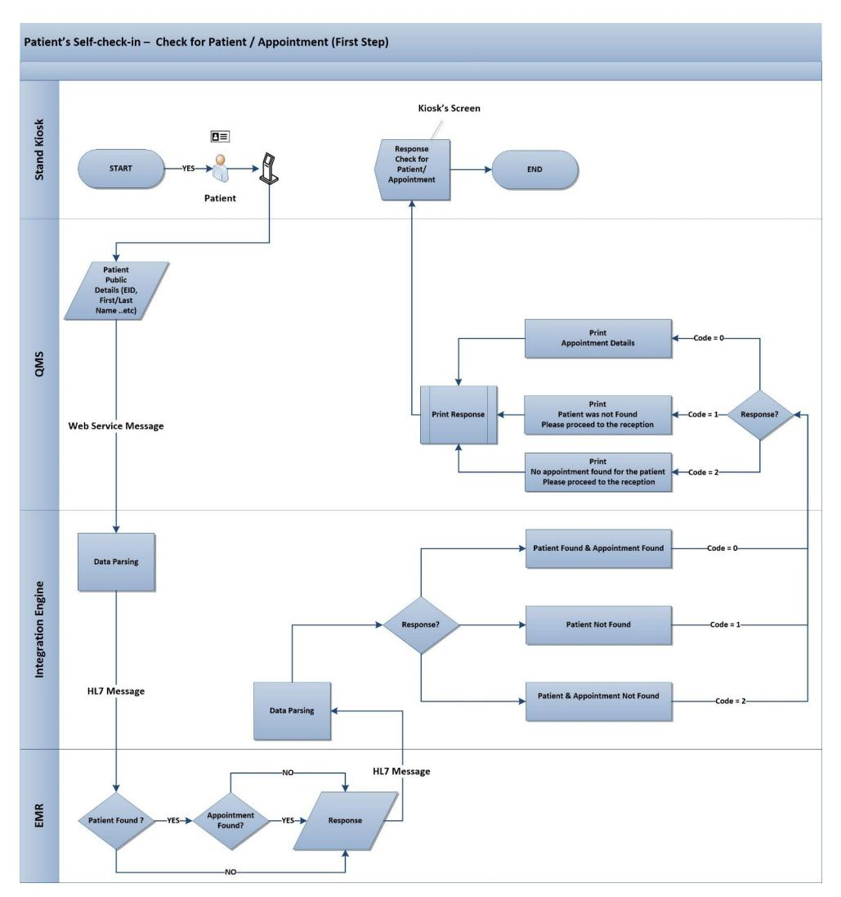
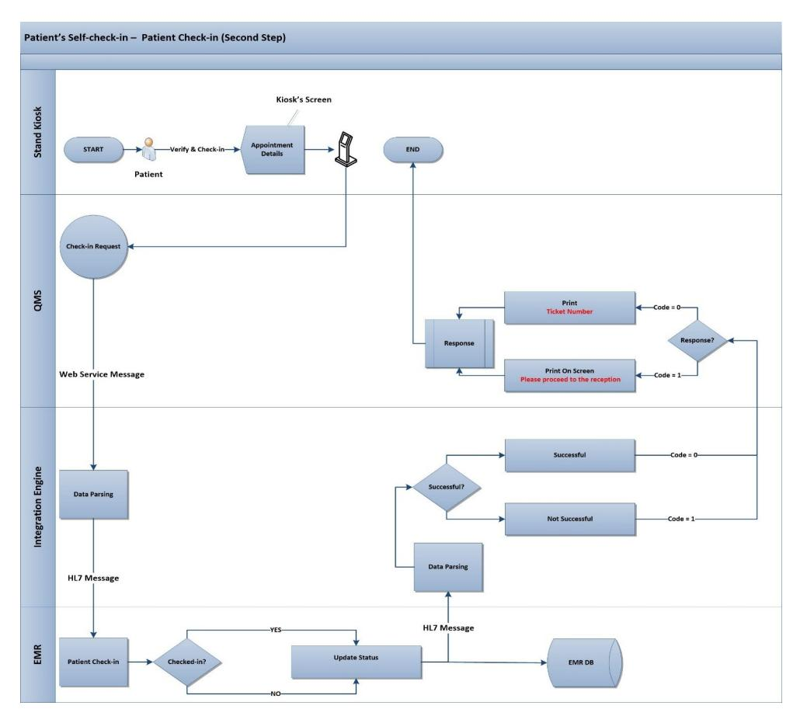

<!-- A3.R15 | source: papers_json/A3.R15/ -->



## Medical data integration using HL7 standards for patient's early identification

**Adi** **A.** **AlQudah****[ID](https://orcid.org/0000-0003-3942-5869)*********,** **Mostafa** **Al-Emran****[ID,](https://orcid.org/0000-0002-5269-5380)** **Khaled** **Shaala****[nID](https://orcid.org/0000-0003-0823-8390)**

Faculty of Engineering & IT, The British University in Dubai, Dubai, United Arab Emirates

* adi.qudah@gmail.com

## Abstract

يُعد التكامل بين أنظمة المعلومات أمرًا بالغ الأهمية، خاصة في مجال الرعاية الصحية، لأن متطلبات قابلية التشغيل البيني ترتبط بسرية بيانات المرضى وسلامتهم ورضاهم. يهدف هذا البحث إلى اقتراح حل قائم على التكامل بين حل إدارة الطوابير (QMS) والسجلات الطبية الإلكترونية (EMR)، باستخدام بروتوكولات Health Level Seven (HL7) ولغة الترميز القابلة للامتداد (XML). ويسهّل الحل المقترح تسجيل الوصول الذاتي للمريض داخل منظمة رعاية صحية في الإمارات العربية المتحدة. ويهدف الحل إلى المساعدة في تقليل أوقات الانتظار داخل قسم العيادات الخارجية من خلال التحديد المبكر للمرضى الحاملين لبطاقة الهوية الإماراتية، سواء كانوا مواطنين أو مقيمين. وقد وُضحت في هذه الورقة مكونات التكامل، وتصميم الحل، ورسائل XML وHL7 المصممة خصيصًا. بالإضافة إلى ذلك، تتضمن الدراسة تجربة محاكاة عبر أسبوعي ضبط وتدخل شملت 517 موعدًا صالحًا. وكان هدف التجربة تقييم رحلة المريض الكاملة وكل مرحلة سريرية ذات صلة، من خلال مقارنة "التحديد القائم على الروتين" بـ "تسجيل الوصول الذاتي للمريض" في حالة المواعيد المحجوزة. وكنتيجة رئيسية، يتبين أن الحل المقترح فعّال، ويمكن أن يقلل "زمن رحلة المريض" بأكثر من 14 دقيقة، و"زمن تحديد الهوية" بمقدار 10 دقائق. كما سُجل انخفاض ملحوظ في زمن الانتظار حتى الفرز وزمن إنهاء عملية الفرز. وفي الختام، يُعتبر الحل المقترح ابتكاريًا ويمكن أن يوفر قيمة مضافة إيجابية لرحلة المريض بأكملها.


## OPEN ACCESS

**Citation:** AlQudah AA, Al-Emran M, Shaalan K (2021) Medical data integration using HL7 standards for patient's early identification. PLoS ONE 16(12): e0262067. [https://doi.org/10.1371/](https://doi.org/10.1371/journal.pone.0262067) [journal.pone.0262067](https://doi.org/10.1371/journal.pone.0262067)

**Editor:** Peyman Rezaei-Hachesu, Tabriz University of Medical Sciences, ISLAMIC REPUBLIC OF IRAN

**Received:** August 17, 2020 **Accepted:** December 19, 2021

**Published:** December 31, 2021

**Copyright:** © 2021 AlQudah et al. This is an open access article distributed under the terms of the Creative Commons [Attribution](http://creativecommons.org/licenses/by/4.0/) License, which permits unrestricted use, distribution, and reproduction in any medium, provided the original author and source are credited.

**Data** **Availability** **Statement:** All relevant data are within the paper and its Supporting [Information](#page-13-0) files.

**Funding:** The author(s) received no specific funding for this work.

**Competing** **interests:** The authors have declared that no competing interests exist.

## **Introduction**

ارتفعت معايير الحياة وخدمات الرعاية الصحية للناس بسبب نمو الاقتصاد والتغيرات في الأنظمة الطبية [[1](#page-13-0)]. يبحث الناس عن مستوى أعلى من خدمات الرعاية الصحية بوقت انتظار أقل. والانتظار غير محبب لدى الناس [[2](#page-13-0)]، وبشكل عام، يُعد زمن الانتظار الشكوى الأكثر تكرارًا لدى جميع المرضى [[3]](#page-14-0). وتحدث الطوابير الطويلة في قطاعات متعددة، أي المستشفيات والبنوك ومتاجر التجزئة [[2]](#page-13-0). وفي الرعاية الصحية، يمكن أن يؤثر طول الوقت اللازم لحجز موعد أو الحصول على علاج أو تناول دواء سلبًا في رضا المرضى وسلامتهم [[1](#page-13-0), [3](#page-14-0)–[8](#page-14-0)]. ومن الضروري وجود حلول مناسبة لهذه الطوابير الطويلة في منظمات الرعاية الصحية، حيث تساعد هذه الحلول على إدارة الطوابير جنبًا إلى جنب مع إحصاءاتها المرتبطة بها. فعلى سبيل المثال، يمكن أن يرفع طول وقت الانتظار في قسم الطوارئ معدلات الوفيات ودخول المستشفيات، ويزيد شكاوى المرضى، ويقلل

<!-- page 2 -->

الإنتاجية. ورغم التصميم القياسي الواسع الانتشار، من غير المعتاد تسجيل وقت وصول المرضى في عملية الفرز [[5](#page-14-0)].

تتضمن العملية القائمة على الروتين قدرًا كبيرًا من الأعمال اليدوية والورقية، وهو ما يعني احتمالية أكبر للأخطاء البشرية. فعلى سبيل المثال، قد ينسى موظف الاستقبال تسجيل وصول المريض في EMR. بالإضافة إلى ذلك، يكون وقت تحديد هوية المريض طويلًا وغير مقيس بدقة، مما قد يزيد زمن الرحلة الكاملة، مع صعوبة أو حتى استحالة جمع بيانات دقيقة للإحصاءات واتخاذ القرار.

نظرًا لأهمية أقسام العيادات الخارجية في المستشفيات، حيث يصل جميع المرضى الخارجيين [[9](#page-14-0)]، يهدف هذا البحث إلى تقليل الطوابير الطويلة وأوقات الانتظار المرتبطة بها. وتقترح الدراسة دمج حل إدارة الطوابير (QMS) المطبَّق حاليًا مع حل السجلات الطبية الإلكترونية (EMR)، باستخدام بروتوكولات Health Level Seven (HL7). وكدراسة تجريبية، سيتضمن هذا البحث تجربة محاكاة في ثلاث من أكثر العيادات ازدحامًا، وهي عيادات الطب الباطني وجراحة العظام والأنف والأذن والحنجرة. وتُوضح في هذه الورقة بشكل شامل عملية التحديد الجديدة، وتصميم التكامل ومكوناته، ورسائل XML وHL7 المصممة خصيصًا، والمحاكاة المُجراة ونتائجها المرتبطة بها. ويسعى هذا البحث إلى تحسين العملية الحالية لتحديد وصول المرضى إلى قسم العيادات الخارجية في منظمة رعاية صحية في الإمارات العربية المتحدة.

## **Waiting** **times** **in** **healthcare**

تُعد أوقات الانتظار مهمة لتقييم رضا المريض وجودة الخدمة [[10](#page-14-0), [11](#page-14-0)]. نُوقشت وطُبقت مبادرات مختلفة تتعلق بوقت الانتظار في منشآت الرعاية الصحية لحل مشكلة الطوابير الطويلة، واقتراح حلول ابتكارية، وتسهيل إدارة الطوابير مع مراعاة رضا المرضى وسلامتهم. وأجرى [[3]](#page-14-0) استطلاعًا لتقييم رضا المرضى من خلال استخدام الأكشاك الإلكترونية. وأكدت الدراسة أن زمن الانتظار شكوى شائعة لدى جميع المرضى. كما أكدت أهمية زمن الانتظار في الرضا العام للمريض، إلى جانب لباقة الموظفين ومستوى النظافة. من ناحية أخرى، قدّمت دراسة حديثة أجراها [[5](#page-14-0)] إثباتًا للمفهوم لتحقيق التحديد المبكر للمرضى في قسم الطوارئ باستخدام كشك لتسجيل الوصول الذاتي. ومن خلال تجربة شملت أسبوعي ضبط وتدخل، أثبتت الدراسة أن الحل المقترح يمكن أن يقلل بشكل ملحوظ زمن انتظار المرضى قبل تلقي العلاج في قسم الطوارئ.

تُظهر مراجعة سريعة للأدبيات أن دراسات متنوعة أُجريت لمناقشة واقتراح طرق وحلول مختلفة لأوقات الانتظار. غير أن التركيز الرئيسي لهذه الدراسات كان تقييم وتقليل أوقات الانتظار/مدة الإقامة في أقسام الطوارئ فقط [[5,](#page-14-0) [12–16](#page-14-0)]. وفي المقابل، توجد فجوة في الأدبيات التي تناقش وتحل مشكلة أوقات الانتظار الطويلة في أقسام العيادات الخارجية. كما كانت الحلول المطروحة أقرب إلى الإدارة الطبية أو الإدارة العامة للأعمال. وبشكل عام، تعتمد الحلول المقترحة سابقًا على إعادة تصميم العملية وحلول إدارية مع توضيح ضئيل للتقنية ودون تركيز على الجوانب التقنية. فعلى سبيل المثال، جرى مشروع جودة لتحسين أوقات الانتظار في صيدلية مستشفى عام في الإمارات العربية المتحدة [[17]](#page-14-0). واقترح المشروع تحسينًا لاستخدام نظام معلومات المستشفى بإرسال الوصفة الإلكترونية إلى الصيدلية فور توليدها من العيادة. ونجحت المبادرة في تقليل زمن الانتظار من 21.5 إلى 4 دقائق، وحسّنت رضا المرضى. غير أن الدراسة لم تناقش المواصفات التقنية للحل المقترح.

كذلك، قيّم عمل Alhammadi في [[18]](#page-14-0) رضا المرضى (N = 552) عن تجربة وقت الانتظار في منشآت الرعاية الصحية بالإمارات العربية المتحدة. كما ناقشت الدراسة استراتيجيات لتقليل أوقات الانتظار في حالتي المواعيد والحضور دون موعد. وشجعت الدراسة المرضى على الوصول في الوقت المحدد وزيادة الموارد لتقليل

<!-- page 3 -->

أوقات الانتظار. وبالمثل، استخدمت دراسة [[19]](#page-14-0) استبيانات لجمع ردود من 938 موظفًا في الرعاية الصحية بدبي بشأن السبب الجذري لأوقات الانتظار الطويلة. وركزت نتائج الدراسة على مستوى عبء العمل المرتفع، وتوافر المرافق، وإجراءات العمل، والتفاعل مع الإدارة، بوصفها الأسباب الرئيسية لأوقات الانتظار الطويلة في منشآت الرعاية الصحية.

علاوة على ذلك، اقترح عمل [[4,](#page-14-0) [20]](#page-15-0) حلولًا ذكية لإدارة الطوابير لتقليل عدم رضا المرضى في مستشفيات الإمارات العربية المتحدة. وناقشت المقالتان سير عمل النظام المقترح إلى جانب الجوانب التقنية لنظام إدارة الطوابير على الهواتف الذكية. وأكدت الدراستان أن الرضا العام للمرضى يعتمد على وقت الانتظار المستغرق.

## **Integration** **and** **Health** **Level** **Seven** **(HL7)**

في الوقت الحالي، تُعد تطبيقات البرمجيات ضرورية للمهنيين الصحيين لإنجاز مهامهم اليومية. وتقلل تقنية المعلومات وقت المعالجة وتوحّد البروتوكولات لدمج البيانات وتبادلها. ولهذا السبب، توجد حاجة إلى طرق وأدوات سريعة وآمنة وموثوقة لنقل البيانات السريرية داخل الأنظمة المعلوماتية الطبية [[21](#page-15-0)]. وتتوفر حلول EMR متنوعة في السوق (مثل Epic [[22](#page-15-0)]، وCerner [[23](#page-15-0)]). ومع ذلك، يختلف حل EMR نفسه عند تركيبه في منشآت رعاية صحية مختلفة بسبب عملياته السريرية المخصصة، وتكامله مع حلول رعاية صحية أخرى [[24]](#page-15-0)، وأنواع الاستخدام المتنوعة من قبل المهنيين الصحيين [[25](#page-15-0)]. ويمكن تحديد عمليات تكامل مشتركة، لكن لا يمكن تكرار هذه العمليات من منشأة إلى أخرى، لذا فإن التخصيص إلزامي [[26]](#page-15-0). ونجح الباحثون في [[26](#page-15-0)] في دمج EMR مع أدوات مساعدة قرار المريض (PDAs) باستخدام بروتوكولات HL7. كما أكدوا أن التكامل مع السجلات الطبية الإلكترونية معقد بسبب مشكلات البرمجيات غير المتوقعة التي يمكن أن تظهر أثناء استكشاف الأخطاء وإصلاحها، ومخاوف أمان تدفق البيانات مع حلول الأطراف الثالثة، والتحديثات الدورية لـ EMR التي يمكن أن تسبب مشكلات وظيفية.

يُعد التكامل بين أنظمة المعلومات صعبًا لأنه يحتاج إلى تلبية متطلبات قابلية التشغيل البيني للأعمال [[27]](#page-15-0)، وهو ما توفره بروتوكولات HL7. ومعايير HL7 هي معايير تراسل حيث يمثّل "المستوى السابع" المستوى السابع، وهو "مستوى التطبيق" في نموذج الاتصالات ذي السبع طبقات لربط الأنظمة المفتوحة (OSI) في المنظمة الدولية للتوحيد القياسي (ISO). وتوفر بروتوكولات HL7 توحيدًا قياسيًا مفيدًا لواجهات الاتصال، خاصة إذا أخذنا في الاعتبار التطبيقات المتنوعة، وصيغ البيانات المختلفة، والحاجة إلى نقل البيانات وتبادلها [[21](#page-15-0)]. وتُطبَّق معايير HL7 في مجال الرعاية الصحية وتعمل ببساطة كبروتوكول تطبيقي لتبادل البيانات الإلكترونية. وهذه المعايير مفيدة لمقدمي الرعاية الصحية وموردي تقنية المعلومات على حد سواء، وتوفر الدعم لتبادل البيانات السريرية الإلكترونية الموجودة في أنظمة مختلفة ومشاركتها ودمجها واسترجاعها، إلى جانب حل رعاية المريض المركزي [[28](#page-15-0)].

تأسست HL7 في عام 1987 بوصفها منظمة غير ربحية لتطوير المعايير في مجال الرعاية الصحية. ويتمثل الهدف الرئيسي لـ HL7 في منح الجميع القدرة على الوصول إلى بيانات صحية دقيقة واستخدامها في الوقت والمكان المناسبين وبطريقة آمنة. ويمكن القول إن معايير HL7 هي الأكثر تطبيقًا واستخدامًا على نطاق واسع، بمعياريها HL7 V2 وV3. ويحظى HL7 V2.x بشعبية أكبر لأنه مُطبَّق في 35 دولة حول العالم، ضمن 95% من منظمات الرعاية الصحية في الولايات المتحدة الأمريكية، وقد اعتُمد عام 1994 [[21]](#page-15-0) من قبل المعهد الوطني الأمريكي للمعايير [[29](#page-15-0)]. وتحظى هذه المعايير بدعم أكثر من 1600 عضو من الشركات في 50 دولة مختلفة مع أكثر من 500 عضو يمثلون جهات حكومية وشركات صيدلانية ومقدمي رعاية صحية وشركات استشارية [[28]](#page-15-0).

منذ 30 عامًا، ظل الإصدار الثاني من HL7 المعيار الرئيسي المستخدم لتبادل البيانات الإدارية والسريرية في الرعاية الصحية. وتستخدم أنظمة معلومات الرعاية الصحية بروتوكول HL7 v2 من أجل

<!-- page 4 -->

تطوير واجهات موحدة للاتصال بأنظمة أخرى وتبادل البيانات. ويغطي HL7 نطاقًا واسعًا من المجالات، منها إدارة المرضى، وطلبات المختبر ونتائجه، والتقارير الصحية العامة. ويُعد معيار HL7 v2 الأساسي [[28](#page-15-0)] إطارًا يحتوي على العديد من أحداث الرسائل. ويوفر كل حدث نموذجًا مبدئيًا (نقطة انطلاق) يُقصد تقييده لحالة استخدام محددة. ويُشار إلى تطبيق القيود على حدث رسالة بمصطلح التنميط (profiling) [[30,](#page-15-0) [31]](#page-15-0). ورغم أن معايير HL7 طُبقت واستُخدمت في معظم منشآت الرعاية الصحية، لا يزال هناك نقص ملحوظ في الحلول البرمجية التي تعتمد على معايير HL7 لتبادل البيانات بين التطبيقات الطبية [[32](#page-15-0)]. وبناءً على ذلك، يهدف هذا البحث إلى دراسة التكامل بين QMS وEMR باستخدام معايير HL7 لتبادل بيانات المرضى والمواعيد.

## **Methods**

## **Study** **design** **and** **setting**

تتضمن هذه الدراسة مرحلتين رئيسيتين. المرحلة الأولى مسؤولة عن تحسين عملية تحديد هوية المريض ودمج QMS مع حل EMR (حل تسجيل الوصول الذاتي للمريض). وتتضمن تحليلًا لرحلة المريض (العملية الحالية)، وتقترح عملية العمل المحسَّنة (المستقبلية)، إلى جانب جوانبها التقنية. أما المرحلة الثانية من الدراسة فهي إجراء تجربة محاكاة لتقييم جدوى حل تسجيل الوصول الذاتي المقترح للمريض قبل استخدامه في عيادات أخرى. وفي مارس 2020، جرت التجربة لمدة أسبوعين (ضبط وتدخل) في عيادات الطب الباطني وجراحة العظام والأنف والأذن والحنجرة. واختيرت هذه العيادات لأنها الأكثر ازدحامًا. بالإضافة إلى ذلك، تُعد الساعة 9 صباحًا حتى الساعة 1 ظهرًا ساعات ذروة، لذا حُجزت المواعيد المشمولة في التجربة في هذه الساعات ولطبيبين من كل عيادة.

## **Patient** **identification** **process**

سيوضح هذا القسم الحالتين "الحالية" و"المستقبلية" لعملية تحديد هوية المرضى. ويعاني المرضى والموظفون السريريون بسبب الوقت الطويل اللازم لتحديد هوية المرضى وخدمتهم.

**Patients'** **journey—Current** **process.** حاليًا، يُحدَّد جميع المرضى ذوي المواعيد من قبل موظفي الاستقبال باستخدام عملية ما قبل الفرز المعتادة. وتحدث عملية ما قبل الفرز عندما يقف عدة مرضى في طابور أمام مكتب استقبال العيادة لتسجيل وصولهم وانتظار إرسالهم إلى غرف الفرز. وتضم العيادة كشكًا مكتبيًا وطابعة تذاكر. ويتعين على موظف الاستقبال استدعاء كل مريض يدويًا للتحقق من المستندات، وتسجيل وصول المريض، وإعطائه تذكرة (رقم). ويُستخدم هذا الرقم من قبل ممرضة الفرز لاستدعاء المريض باستخدام QMS. ويُسجَّل وصول المرضى يدويًا في EMR وتُحدَّد أولويتهم وفق وقت الوصول بغض النظر عن الموعد المحجوز، وهو ما قد يؤثر سلبًا في زمن الانتظار والعلاج.

وبعد فحص جميع مستندات المريض وتفاصيله، يطلب موظف الاستقبال من المريض الجلوس في منطقة الانتظار حتى يظهر رقم التذكرة على شاشة التلفزيون، ثم يُرسَل المريض إلى غرفة الفرز. وتأخذ ممرضة الفرز العلامات الحيوية، وتكتب الملاحظات الطبية وأنواع الحساسية التي يعاني منها المريض، وتضيف كل هذه التفاصيل في EMR. ثم يتعين على المريض العودة إلى الاستقبال للحصول على تذكرة أخرى ليستدعيه الطبيب. لذا، يتعين على المريض الانتظار مرة أخرى لرؤية رقم التذكرة الجديد على التلفزيون. ويستدعي الطبيب الرقم باستخدام QMS من أجل إجراء الاستشارة/العلاج المطلوب. وعندما يُنهي الطبيب العلاج، ينبغي إغلاق زيارة المريض في QMS وEMR للإشارة إلى اكتمال رحلة المريض في العيادة.

**Patients'** **journey—"To** **Be"** **process.** تتضمن العملية المقترحة لتحديد هوية المرضى ذوي المواعيد خطوتين رئيسيتين. وهاتان الخطوتان هما التحقق من صحة (حالة)

<!-- page 5 -->


***Fig** **1.** **First** **step—Check** **for** **patient/appointment** **validity.***

[https://doi.org/10.1371/journal.pone.0262067.g001](https://doi.org/10.1371/journal.pone.0262067.g001)

المريض والموعد (المواعيد) كما في "Fig 1"، وخطوة تسجيل الوصول باستخدام الهوية الإماراتية كما في "[Fig](#page-5-0) 2"، في حال نجاح الخطوة الأولى.

تبدأ الخطوة الأولى عندما يصل المريض إلى ردهة قسم العيادات الخارجية (OPD)، إذ يتعين عليه استخدام الكشك القائم الذي يحتوي على فيديو "كيفية الاستخدام" لمعرفة كيفية استخدام الهوية الإماراتية وعملية تسجيل الوصول. ويتعين على المريض إدخال بطاقة الهوية الإماراتية في قارئ البطاقة الذكية المرفق. ثم تُستخرج معلومات المريض للتحقق من توفره في قاعدة بيانات EMR إلى جانب موعده (مواعيده). وتنجح الخطوة الأولى إذا كان المريض مسجلًا في EMR، وتفاصيله محدَّثة، ولديه موعد واحد محجوز على الأقل. لذا، تُعرَض قائمة بالمواعيد المحجوزة على شاشة الكشك، ويمكن للمريض النقر على الموعد المطلوب، وتُحدَّث حالة الموعد تلقائيًا في EMR من "محجوز" إلى "تم تسجيل الوصول"، وتُطبع تذكرة رقمية. وإلا، تظهر رسالة خطأ على الشاشة، كما هو موضح في "Fig 1"، وعندئذ يتعين على المريض زيارة استقبال العيادة طلبًا للمساعدة.

وفي حال نجاح تسجيل الوصول (الخطوة 2)، يتعين على المريض الانتظار حتى تستدعي ممرضة الفرز رقم التذكرة المُعطى وتُعرضه على شاشة التلفزيون. وبعد إتمام أنشطة الفرز الروتينية

<!-- page 6 -->


***[Fig](#page-4-0)** **2.** **Second** **step—Patient** **check-in.***

[https://doi.org/10.1371/journal.pone.0262067.g002](https://doi.org/10.1371/journal.pone.0262067.g002)

تنقل الممرضة المريض إلى حساب الطبيب دون تقديم تذكرة أخرى كما في العملية الحالية. وأخيرًا، يستدعي الطبيب المريض مرة أخرى لإجراء العلاج أو الاستشارة المتوقعة.

**Proposed** **solution–Technical** **perspective.** صُمم حل تسجيل الوصول الذاتي للمريض لتحسين QMS المطبَّق حاليًا، ودمجه مع حل EMR. ويهدف الحل إلى تحقيق قابلية التشغيل البيني بين QMS وEMR لتقليل الوقت المستغرق في تحديد هوية المرضى وفرزهم، وتقليل زمن رحلة المريض الكاملة داخل منظمة الرعاية الصحية. وطُبِّق الحل باستخدام معايير HL7 ومحرك تكامل بوصفه حل وسيط. ويتمثل دور محرك التكامل في تطوير واجهات ومسارات تكامل وفق المواصفات. ويعمل محرك التكامل كمترجم للرسائل المرسلة والمستلمة بين QMS وEMR.

والتكامل المصمَّم موجَّه بالعملية، وصُممت واجهة التكامل لتبادل البيانات بين QMS وEMR ومحرك التكامل عبر خطوتين رئيسيتين مختلفتين كما هو موضح في "[Fig](#page-6-0) 3". ولكل خطوة آلية استعلام-استجابة برسائل متنوعة. حيث يرسل QMS رسائل XML ويستقبلها، ويرسل EMR رسائل HL7 ويستقبلها، بينما يرسل محرك التكامل ويستقبل كلا نوعي الرسائل حسب الغرض. ولضمان صحة عملية تسجيل الوصول الذاتي للمريض، بُني الحل اعتمادًا على الهوية الإماراتية للمريض كمعرّف فريد لكل مريض.

بمجرد إدخال المريض بطاقة الهوية الإماراتية في قارئ البطاقة الذكية المدمج، يجمع QMS معلومات المريض ويرسلها عبر طلب (رسالة XML) إلى

<!-- page 7 -->

[https://doi.org/10.1371/journal.pone.0262067.g003](https://doi.org/10.1371/journal.pone.0262067.g003)

محرك التكامل كما هو موضح في "Fig 3"، والرسالة النموذجية في "Table 1". ثم يحلّل محرك التكامل الطلب، ويحوّله إلى رسالة HL7 ويرسلها إلى EMR كما في الخطوة الثانية في "Table 1". ويعالج EMR رقم الهوية، ويتحقق من توفره في قاعدة بياناته،

## **Table** **1.** **First** **step** **to** **request** **patient** **and** **appointment** **details** **for** **verification.**

```
1. Request from QMS to Integration Engine (XML).
```

```
<soap:Envelope xmlns:soap = "http://www.w3.org/2003/05/soap-envelope" xmlns:hco = "HCO">
<soap:Header/>
<soap:Body>
 <hco:getPatientAppointments>
 <hco:Identifier>784-1234-1234567-1</hco:Identifier>
 <hco:IdentifierType>National ID</hco:IdentifierType>
 <hco:FullNameEN>Adi AlQudah</hco:FullNameEN>
 <!—Optional:—>
 <hco:Clinic></hco:Clinic>
 <hco:MaritalStatus></hco:MaritalStatus>
 <hco:CardNumber></hco:CardNumber>
 <hco:DOB>01-01-1980</hco:DOB>
 <hco:Sex>Male</hco:Sex>
 <hco:Nationality>Jordan</hco:Nationality>
 <hco:ArabicNationalityAR><الأردن/hco:ArabicNationalityAR>
 <hco:CardHolderName><القضاة عدي/hco:CardHolderName>
 </hco:getPatientAppointments>
</soap:Body>
</soap:Envelope>
```

## **2.** **Request** **from** **Integration** **Engine** **to** **EMR** **(HL7).**

## **Message** **Template**

**MSH**|^~&|Sending Application| Sending Facility|Receiving Application|Receiving Facility|Date/Time of Message| | QRY^A19|Message Control ID|D|2.3\r

**QRD**|QueryDate/Time|Query Format Code|Query Priority|Query ID| | |Quantity Limited Request|ID Number^Family Name^Given Name^^^^^^^^^^Identifier type Code|What Subject Filter\r

- "Query Format Code" was hard-coded to "R": Response is in record-oriented format.
- "Query Priority" was hard-coded to "I": Immediate.
- "Quantity limited request" was hard-coded to "1^RD ": To contain maximum one record
- **QRY^A19**: to serve the patient query from another system (EMR).
- **QRD.8**: Who Subject Filter, **QRD.8.1**: ID Number, **QRD.8.2**: Family Name, **QRD.8.3**: Given Name, **QRD.8.13**: Identifier type Code.

## **Sample** **Message**

MSH|^~&|ENGINE|HCO|EMR|HCO|20200401122430| |QRY^A19|5431ddb4-d0f9-fera-92a6-8341f83c6d50|D|2.3 \r

QRD|20200401122430|R|I|Q123456| | |1^RD|784-1234-1234567-1^AlQudah^Adi^^^^^^^^^^National ID|DEM|

<!-- page 8 -->

## **Table** **2.** **Second** **step** **to** **response** **with** **details** **of** **patient** **and** **appointments.**

## **1.** **Response** **from** **EMR** **to** **Integration** **Engine** **(HL7).**

## **Message** **Template**

**MSH**|^~&|Sending Application|Sending Facility|Receiving Application|Receiving Facility|Date/Time of Message| | QRY^Z99\r

**MSA**|Acknowledgment Code|Message Control ID|Text Message\r

**QRD**|QueryDate/Time|Query Format Code|Query Priority|Query ID| | |Quantity Limited Request|ID

Number^Family Name^Given Name^^^^^^^^^^Identifier type Code|What Subject Filter\r

**PID**|Set ID|Patient National ID| |Patient MRN|FullNameEn^FullNameAr| |Date of Birth|Sex| | | | | | |Primary Language| | | | | | | | | | | | |Nationality\r

**ZAP**|1|Appointment ID|Appointment Type|Clinic Name|Appointment Start Date/Time|Start Time|END Time| Appointment Resource\r

- **MSA.1**
- AA: Record found
- AE: for any error and the error text to be in MSA.3
- **ZAP**: Repetitive–One per appointment. **ZAP.2**: Appointment ID. **ZAP.3**: Appointment Type. **ZAP.4**: Clinic Name. **ZAP.5**: Appointment start date time format DD-MM-YYYY HH:MM:SS. **ZAP.6**: Start time format HH:MM. **ZAP.7**: End Time format HH:MM. **ZAP.8**: Appointment Resource (Physician's name).

## **Sample** **Message**

**MSH**|^~\\&|EMR|HCO|ENGINE|HCO|20200401122431| |QRY^Z99\r

**MSA**|AA|5431ddb4-d0f9-fera-92a6-8341f83c6d50|1 Appointment found in the system\r

**QRD**|20200401122431|R|I|Q123456| | |1^RD|784-1234-1234567-1^AlQudah^Adi^^^^MR^^^^^^^National ID| DEM \r

**PID**|1|784-1234-1234567-1| |121212 |Adi AlQudah^19800101| |القضاة عدي|Male| | | | | | |Arabic| | | | | | | | | | | | | Jordan\r

**ZAP**|1|2134732|Internal Medicine FU|HCO Internal Medicine OP|2020-0401-12:30:00|12:30|12:50|Khaled Shaalan

## **2.** **Response** **from** **Integration** **Engine** **to** **QMS** **(XML).**

- *<*soapenv:Envelope xmlns:soapenv = "[http://www.w3.org/2003/05/soap-envelope"](http://www.w3.org/2003/05/soap-envelope%22%3e)*>*
- *<*soapenv:Body*><*hco:getPatientAppointmentsResponse xmlns:hco = "HCO"*>*
- *<*hco:ResponseCode*>*0*<*/hco:ResponseCode*>*
- *<*hco:AppointmentCount*>*1*<*/hco:AppointmentCount*>*
- *<*hco:Patient*>* *<*hco:MRN*>*121212*<*/hco:MRN*>**<*hco:EmiratesID*>*784-1234-1234567-1*<*/hco:EmiratesID*>**<*hco:FirstName*>*Adi*<*/hco:FirstName*>**<*hco:LastName*>*AlQudah*<*/hco:LastName*>**<*hco:PatientArabicName*><*القضاة عدي/hco:PatientArabicName*>**<*hco:Gender*>*MALE*<*/hco:Gender*>**<*hco:DateOfBirth*>*19800101*<*/hco:DateOfBirth*>*
- *<*hco:Language*>*Arabic*<*/hco:Language*>*
- *<*/hco:Patient*>*
- *<*hco:Appointment*>* *<*hco:AppointmentID*>*2134732*<*/hco:AppointmentID*>**<*hco:AppointmentType*>*Internal Medicine FU*<*/hco:AppointmentType*>**<*hco:ClinicName*>*HCO Internal Medicine OP*<*/hco:ClinicName*>**<*hco:AppointmentStartDateTime*>*2020-0401-12:30:00*<*/hco:AppointmentStartDateTime*>**<*hco:StartTime*>*12:30*<*/hco:StartTime*>**<*hco:EndTime*>*12:50*<*/hco:EndTime*>**<*hco:AppointmentResource*>*Khaled Shaalan*<*/hco:AppointmentResource*>**<*hco:AppointmentResourceID*>*Khaled.Shaalan*<*/hco:AppointmentResourceID*>*
- *<*/hco:Appointment*>*
- *<*/hco:getPatientAppointmentsResponse*><*/soapenv:Body*><*/soapenv:Envelope*>*

[https://doi.org/10.1371/journal.pone.0262067.t002](https://doi.org/10.1371/journal.pone.0262067.t002)

يتحقق EMR من الموعد (المواعيد) المحجوزة، ويرد إلى محرك التكامل برسالة HL7، كما في الخطوة الثانية في "Table 2". وتتضمن رسالة الرد رمز إقرار، وتعتمد الرسالة النصية على نتيجة العملية.

<!-- page 9 -->

استنادًا إلى النتيجة المستلمة من EMR (رمز الإقرار)، يحلّل محرك التكامل الرسالة ويحوّلها مرة أخرى إلى رسالة XML. واعتمادًا على النتيجة المستلمة، تحتوي رسالة XML الجديدة على "رمز" وتفاصيل أخرى للمريض والموعد (المواعيد). وتُرسَل رسالة XML الجديدة إلى QMS، كما في الخطوة الثانية في "["Table](#page-7-0) 2" لإظهار رسالة محددة على شاشته. وإذا وُجد المريض واسترجعت تفاصيل الموعد بنجاح، تُعرَض تفاصيل الموعد على شاشة الكشك، ويتعين على المريض النقر على الموعد لبدء الخطوة الثانية (تسجيل الوصول). وإلا، يعرض الكشك رسالة خطأ لتوضيح الحالة ويطلب من المريض التوجه إلى مكتب الاستقبال لحل المشكلة المواجهة.

وفي حال نجاح الخطوة الأولى، تبدأ الخطوة الثانية عندما يختار المريض الموعد ليُسجَّل وصوله، ثم يرسل QMS طلب XML جديدًا إلى محرك التكامل كما هو موضح في "[Fig](#page-5-0) 2"، والخطوة الأولى في "Table 3". ويحوّل محرك التكامل ملف XML إلى HL7 بحدث تشغيل مخصص لتسجيل وصول الموعد "SIU^Z01"، وتُرسَل رسالة HL7 الجديدة إلى EMR، الخطوة الثانية في "Table 3". وأخيرًا، سيقوم EMR

***Table** **3.** **Third** **step** **for** **"Check-in"** **request.***

```
1.Request to Check-in from QMS to Integration Engine (XML).
```

```
<soap:Envelope xmlns:soap = "http://www.w3.org/2003/05/soap-envelope" xmlns:hco = "HCO">
 <soap:Header/>
 <soap:Body>
 <hco:patientCheckIn>
 <hco:Patient>
 <hco:MRN>121212</hco:MRN>
 <hco:EmiratesID>784-1234-1234567-1</hco:EmiratesID>
 <hco:LastName>AlQudah</hco:LastName>
 <!—Optional:—>
 <hco:PatientArabicName><القضاة عدي/hco:PatientArabicName>
 <hco:Gender>MALE</hco:Gender>
 <hco:DateOfBirth>19800101</hco:DateOfBirth>
 <!—Optional:—>
 <hco:Language>Arabic</hco:Language>
 </hco:Patient>
 <hco:Appointment>
 <hco:AppointmentID>2134732</hco:AppointmentID>
 <hco:AppointmentType>Internal Medicine FU</hco:AppointmentType>
 <hco:ClinicName>HCO Internal Medicine OP</hco:ClinicName>
 <hco:StartTime>12:30</hco:StartTime>
 <hco:EndTime>12:50</hco:EndTime>
 <hco:AppointmentStartDateTime>2020-0401-12:30:00</hco:AppointmentStartDateTime>
 </hco:Appointment>
 </hco:patientCheckIn>
 </soap:Body>
</soap:Envelope>
```

## **2.** **Request** **to** **Check-in** **from** **Integration** **Engine** **to** **EMR** **(HL7).**

## **Message** **Template**

**MSH**|^~&|Sending Application|Sending Facility|Receiving Application|Receiving Facility|Date/Time of Message| | SIU^Z01|Message Control ID|D|2.3\r

**SCH**|Appointment ID| | | | | | |Appointment Type|||Appointment Timing Quantity:^^^Start Date/Time^ End Date/ Time\r

**PID**|Set ID|Patient National ID| |Patient MRN|FullNameEn^FullNameAr| |Date of Birth|Sex| | | | | | |Primary Language| | | | | | | | | | | | |Nationality\r

• **SIU^Z01**: Custom trigger for appointment check-in.

## **Message** **Sample**

**MSH**|^~&|ENGINE|HCO|EMR|HCO|20200401122433| |SIU^Z01|08574b23-0bbd-7d80-c1fe-cfad87b5d3a0|D|2.3\r **SCH**|2134732||||||Internal Medicine FU||||^^^20200401123000^20200401125000\r **PID**|1|784-1234-1234567-1| |121212 |Adi AlQudah^19800101| |القضاة عدي|Male| | | | | | |Arabic| | | | | | | | | | | | | Jordan\r

<!-- page 10 -->

***Table** **4.** **Final** **step** **to** **acknowledge** **the** **success** **of** **"Check-in"** **Request.***

## **1.** **Response** **to** **Check-in** **from** **EMR** **to** **Integration** **Engine** **(HL7).**

## **Message** **Template**

**MSH**|^~&|Sending Application|Sending Facility|Receiving Application|Receiving Facility|Date/Time of Message| | ACK|Message Control ID|D|2.3\r

**MSA**|Acknowledgment Code|Message Control ID\r

- **ACK**: General acknowledgment.
- **MSA**.1 AA: Record found AE: for any error and the error text to be in MSA.3

## **Message** **Sample**

**MSH**|^~&|EMR|HCO|ENGINE|HCO|20200401122436||ACK|08574b23-0bbd-7d80-c1fe-cfad87b5d3a0|D|2.3\r **MSA**|AA|08574b23-0bbd-7d80-c1fe-cfad87b5d3a0\r

## **2.** **Step** **8:** **Response** **to** **Check-in** **from** **Integration** **Engine** **to** **QMS** **(XML).**

```
<hco:patientCheckInResponse>
```

- *<*hco:ResponseCode*>*
- 0
- *<*/hco:ResponseCode*>*
- *<*/hco:patientCheckInResponse*>*

[https://doi.org/10.1371/journal.pone.0262067.t004](https://doi.org/10.1371/journal.pone.0262067.t004)

يستلم الرسالة، ويُسجَّل وصول الموعد المختار تلقائيًا في EMR، وتُغيَّر الحالة إلى "تم تسجيل الوصول" وتُحدَّث في قاعدة البيانات، ويرد EMR برسالة HL7 تتضمن رسالة الإقرار، وتُرسَل رسالة HL7 ناجحة إلى محرك التكامل، كما في الخطوة الأولى في "Table 4"، الذي يمرر الرمز "0" إلى كشك QMS لطباعة التذكرة كما في الخطوة الثانية في "Table 4". وإلا، يعرض الكشك رسالة تطلب من المريض التوجه إلى استقبال العيادة للحصول على مساعدة إضافية.

## **Simulation** **experiment**

**Control** **week.** جرت التجربة الأولى (الضبط) لمدة أسبوع واحد، حيث يُحدَّد المريض باستخدام عمليات التحديد والفرز المعتادة (الروتينية). ويتمثل الهدف الأساسي من هذه التجربة في تحديد وتسجيل الوقت المستغرق لإتمام كل مرحلة داخل رحلة المريض في المستشفى؛ قبل تطبيق الحل الجديد. وفي أسبوع الضبط، تُعرَّف مرحلة تحديد هوية المريض بأنها الفترة الزمنية بين وصول المريض وتحديد هويته من قبل موظفي العيادة. ويُحدَّد المرضى من قبل موظفي الاستقبال باستخدام عملية ما قبل الفرز المعتادة. وعادة، يوجد ثلاثة موظفي استقبال في عيادتي الطب الباطني وجراحة العظام، إلى جانب ثلاث ممرضات فرز، في أي وقت لخدمة المرضى. بينما تضم عيادة الأنف والأذن والحنجرة موظفي استقبال اثنين وممرضة فرز واحدة فقط. ولكل موظف استقبال حل تذاكر مثبَّت على الحاسوب، بينما تتصل جميع الحواسيب بطابعة تذاكر حرارية واحدة. ويتعين على موظف الاستقبال استدعاء كل مريض يدويًا للتحقق من الهوية الإماراتية والمستندات وتفاصيل الموعد قبل إعطائه تذكرة (رقمًا). ثم تُتبع العملية كما وُضح سابقًا في الحالة الراهنة لـ QMS. وعادة، تُعطى المواعيد للمرضى من الساعة 8 صباحًا حتى 5 مساءً، لكن تبيّن أن هناك أربع ساعات ذروة في هذه العيادات المختارة، من 9 صباحًا حتى 1 ظهرًا. لذا، اعتُبرت هذه الساعات المزدحمة مؤهلة لإجراء الدراسة، وشمل أي موعد حُجز خلال ساعات الذروة هذه في الدراسة.

**Intervention** **week.** التجربة الثانية هي ببساطة محاكاة جرت لمدة أسبوع تدخل واحد، حيث يُطلب من المريض إحضار الهوية الإماراتية واستخدام كشك تسجيل الوصول الذاتي. ورُكِّب كشكان في ردهة قسم العيادات الخارجية، ولكل كشك قارئ بطاقة ذكية مدمج. وتُتبع عملية "المستقبل" كما نوقش سابقًا. ويتمثل الهدف الأساسي من المحاكاة في تحديد وتسجيل الوقت المستغرق لإتمام كل مرحلة سريرية داخل رحلة المريض؛ بعد استخدام الحل الجديد. ويمكن تعريف مرحلة تحديد هوية المريض في

<!-- page 11 -->

أسبوع التدخل بأنها الفترة الزمنية بين إدخال الهوية في قارئ الكشك وتحديد هوية المريض من قبل حل EMR.

وعلى غرار أسبوع الضبط، جرت المحاكاة في العيادات الثلاث المختارة نفسها وشملت أي موعد حُجز من الساعة 9 صباحًا حتى 1 ظهرًا.

## **Data** **collection**

في أسبوع الضبط، سجَّل الباحث الأول يدويًا وقت وصول المريض إلى استقبال العيادة بمساعدة موظف استقبال واحد في كل عيادة. وحُسب إجمالي زمن التحديد بعد الحصول على وقت طباعة التذكرة من QMS. وجُمع وقت إتمام المراحل الأخرى وسُجل لكل مريض من خلال QMS. وخلال أسبوع التدخل، اُستُخرجت البيانات من QMS.

## **Data** **analysis**

قبل التحليل الإحصائي، دُرست البيانات المجمَّعة لتصنيف كل مرحلة في كل موعد بأنها "ضمن الهدف" أو "خارج الهدف"؛ وفق مجموعة الأهداف التي أوصت بها إدارة الجودة. ودُرست هذه الأهداف لتقييم ما إذا كان الحل المقترح سيساعد على تحسين الأداء وتحقيق الأهداف.

أُجري التحليل الإحصائي للبيانات باستخدام SPSS v.25 [[33]](#page-15-0). واستُخدمت الاختبارات اللابارامترية للتغلب على أي مشكلة في عدم التوزيع الطبيعي [[34]](#page-15-0). لذا، أُجريت مقارنة "تحقيق الهدف" كبيانات فئوية باستخدام اختبار Chi2 الكلاسيكي، وعُرضت النتائج كنسب مئوية [[15](#page-14-0)]. والمجموعتان (الضبط والتدخل) مستقلتان، لذا استُخدم اختبار Mann-Whitney U [[34]](#page-15-0) لمقارنة الفروق في الزمن الوسيط لإتمام كل مرحلة، إلى جانب المدى الربيعي [[15](#page-14-0)].

## **Results** **and** **discussion**

بعد الاستبعاد والتحليل لبيانات المواعيد المجمَّعة، اعتُبر ما مجموعه 517 موعدًا صالحًا لإضافته إلى التجربة. ومن أصل 306 مواعيد إجمالية حُجزت في ساعات الذروة للأطباء الستة في أسبوع الضبط، وُجد أن 273 فقط (89.22%) مواعيد مؤهلة وشُملت في الدراسة. من ناحية أخرى، سجَّل أسبوع التدخل 338 موعدًا إجماليًا محجوزًا للأطباء الستة في ساعات الذروة، لكن وُجد أن 244 فقط (72.19%) مواعيد مؤهلة. وكان هناك ما مجموعه 94 موعدًا مستبعدًا، 11 منها لم تُشمل لأن المرضى لم يحضروا هويتهم الإماراتية، و7 بسبب خطأ من الموظفين، بينما استُبعد الباقي بسبب حالة "عدم الحضور". وكان المعدل المرتفع لـ "عدم الحضور" (22.49%) ناتجًا عن وضع فيروس كوفيد-19 والإجراءات والتوصيات الاحترازية. ويمكن الاطلاع على جميع خصائص المواعيد في "Table 5".

<!-- page 12 -->

[https://doi.org/10.1371/journal.pone.0262067.t006](https://doi.org/10.1371/journal.pone.0262067.t006)

تُظهر النتائج في "Table 6" ارتفاعًا ملحوظًا في نسبة "تحقيق الهدف" لمرحلة التحديد من 0% إلى 100%. وحُدد الهدف بـ 5 دقائق من قبل إدارة الجودة، بينما كانت القيمة المتوسطة للتحديد في أسبوع التدخل (μ = 18، σ = 1) بالثواني فقط. ويشير هذا إلى نجاح فريد لحل تسجيل الوصول الذاتي في تقليل وقت تحديد هوية المرضى. وبالتالي، ارتفعت نسبة "تحقيق الهدف" لرحلة المريض الكاملة لتصل إلى 55.74% في عينة التدخل، مقارنة بـ 0.73% فقط في عينة الضبط. كما تحقق تحسن رحلة المريض الكاملة في "تحقيق الهدف" بسبب التحسن الملحوظ في "تحقيق الهدف" لمرحلتي "الانتظار حتى الفرز" و"الفرز". ورغم صعوبة تحديد السبب الدقيق لهذه التحسينات الملحوظة، يعتقد الباحثون أنه من المرجح أن يعود ذلك إلى حل تسجيل الوصول الذاتي الجديد. وخلال أسبوع التدخل، لوحظ أن ممرضات الفرز كنّ مشغولات طوال الوقت وتمكنّ من استدعاء المرضى بسرعة أكبر. ولم تكن هناك حاجة لممرضة الفرز للجلوس دون عمل بانتظار تسجيل وصول المريض التالي كما في العملية المعتادة.

من ناحية أخرى، وجد التحليل أن الزمن الوسيط لتحديد هوية المرضى بلغ 0.3 (0.28–0.32) دقيقة في مجموعة التدخل، مقابل 10.37 (8.90–12.88) دقيقة لمرضى مجموعة الضبط، فيكون الفرق 10:04 دقائق. بالإضافة إلى ذلك، تبيّن أن تطبيق الحل الجديد كان له أثر إيجابي ملحوظ في الزمن الوسيط لإتمام رحلة المرضى. ووُجد أن الفرق في الزمن الوسيط لرحلة المرضى بلغ 14:11 دقيقة كما في "Table 7".

ورغم انخفاض 19 ثانية في الزمن الوسيط لإتمام مرحلة "الانتظار للعلاج"، وجد التحليل أيضًا انخفاضًا بنسبة 2.38 في نسبة "تحقيق الهدف" لـ "الانتظار للعلاج". ورغم أن النتائج غير ملحوظة إحصائيًا، فمن المفيد فهم السبب الجذري. ويُعد الوقت المستغرق في انتظار رؤية الطبيب متغيرًا معقدًا يعتمد على عوامل أخرى،

> ^��^Significance level at p���*<*0.001, p��*<*0.01, p* *<*0.05.

<!-- page 13 -->

مثل تخصص كل طبيب، ونوع الموعد (جديد، متابعة، إحالة... إلخ)، وتوافر الممرضة المساعدة. ولوحظ تحسن ملحوظ في الزمن الوسيط لإتمام مرحلة العلاج (-00:42، P = 0.023)، لكن مرحلة العلاج لم تتحسن بشكل ملحوظ لتحقيق الهدف الموصى به (≤ 15 دقيقة)، وكان الفرق (2.57، P = 0.558).

يُعد تسجيل الوصول الذاتي حلًا ابتكاريًا جديدًا لتحسين تجربة المرضى خلال رحلتهم في قسم العيادات الخارجية داخل المستشفى. ويمكن أن تثبت النتائج المذكورة أعلاه أن الحل قابل للتطبيق لتقليل زمن إتمام الرحلة الكاملة والمراحل الأخرى. وتُوضَّح جميع نتائج التحليل في "Tables [6](#page-11-0) و[7](#page-11-0)"، ويمكن الاطلاع على البيانات المجمَّعة في فترتي الضبط والتدخل في قسم المعلومات الداعمة.

## **Implications** **and** **future** **research**

يمكن أن توفر هذه الدراسة عددًا من التبعات النظرية والعملية والرؤى؛ لحل مشكلة الطوابير الطويلة وأوقات الانتظار في مجال الرعاية الصحية. وعادة، ترتبط الحلول المقترحة في دراسات أخرى فقط بإعادة تصميم العملية أو إضافة موظفين، مع قلة إشراك أو توضيح لتقنيات المعلومات. ويمكن أن توفر هذه الدراسة حلًا ابتكاريًا جديدًا من خلال دمج حلول تقنية متعددة في الرعاية الصحية. ويمكن أن يفيد إسهام هذه الدراسة في إبراز دور علوم الحاسوب وهندسة البرمجيات في نظرية الإدارة الطبية. كما يمكن أن يساعد نجاح هذه الحلول التقنية الموظفين الطبيين على إنجاز مهامهم بكفاءة، وهو ما قد يعزز قبول التقنية في الرعاية الصحية ويسهم في نظرية قبول التقنية. وعمليًا، ناقشت دراسات أخرى عديدة وأجرت تجارب متعلقة بطول تحديد هوية المريض وأوقات الانتظار في أقسام الطوارئ أو للمرضى دون موعد. وبدلًا من ذلك، يساعد الحل الابتكاري المقترح في هذه الدراسة على تقديم إسهام عملي لحل مشكلة طول وقت تحديد هوية المرضى ذوي المواعيد في قسم العيادات الخارجية. ويمكن أن تكون هذه الدراسة أساسًا لدراسات أخرى مستقبلًا، خاصة في مجال دمج تقنيات المعلومات في الرعاية الصحية. كما يمكن أن تسهّل الدراسة عمل باحثين آخرين في مجال الإدارة الطبية.

مستقبلًا، يمكن توسيع هذه الدراسة لتشمل حلولًا طبية أخرى، ويمكن إجراء دراسات محاكاة أخرى في دول عربية أو نامية أخرى باستخدام تصميم أو عينة أو إعدادات مختلفة. ويمكن توسيع الدراسة عبر إعادة تصميم وأتمتة نقل المريض بين غرف الفرز والعلاج. وتحمل الأدبيات فجوة تحتاج إلى معالجة من خلال دراسة تبادل البيانات السريرية ودمج تقنيات معلومات رعاية صحية مختلفة داخل منظمتي رعاية صحية أو أكثر.

## **Study** **limitations**

واجهت الدراسة قيودًا مختلفة ينبغي ملاحظتها. أولًا، جمع مواصفات الأعمال وسير العمل اللازمة لتغيير عمليتي التحديد وتسجيل الوصول. ثانيًا، رغم أن حجم العينة كان كافيًا لإجراء تحليل إحصائي ملحوظ، لم يكن كبيرًا جدًا، وهو ما قد يؤثر في دقة النتائج. وتأثر حجم العينة بالوقت المحدود (أسبوعان) لإجراء التجربة. وكان الوقت المحدود للتجربة ضروريًا لضمان ألا يؤثر البحث في الخدمات الصحية أو يشتت الموظفين عن مهامهم. وجرت الدراسة في مارس 2020، وتأثر عدد المواعيد سلبًا بالإجراءات الاحترازية لفيروس كوفيد-19. وأخيرًا، تغطي الدراسة مواعيد في ثلاث عيادات فقط، في منظمة رعاية صحية واحدة، لذا قد لا تُعمَّم النتائج على عيادات أخرى، أو منظمات رعاية صحية أخرى، أو حتى تطبيقات أخرى للسجلات الطبية الإلكترونية.

<!-- page 14 -->

## **Conclusion**

كان الهدف الرئيسي من هذه الدراسة اقتراح حل ابتكاري لتسجيل الوصول الذاتي للمرضى باستخدام الهوية الوطنية الإماراتية في منظمة رعاية صحية بالإمارات العربية المتحدة. ويهدف الحل المقترح إلى تقليل الوقت المستغرق لإتمام رحلة المرضى بتقليل زمن تحديد هوية المرضى وأوقات الانتظار في قسم العيادات الخارجية.

تضمنت الدراسة جزأين رئيسيين. الجزء الأول تقني ومتعلق بتصميم الحل، وتدفق البيانات عبر رسائل XML وHL7 المصممة خصيصًا. وصُمم الحل بدمج حلي QMS وEMR باستخدام معايير HL7 ومن خلال محرك تكامل. أما الجزء الثاني من الدراسة فتضمن تجربة محاكاة لتقييم عملية تسجيل الوصول الجديدة وجدوى الحل المقترح. وجُمع ما مجموعه 517 موعدًا وحُلل وقُيّم تجريبيًا. وأشارت نتائج الدراسة إلى أن الحل المقترح لتسجيل الوصول الذاتي للمرضى مناسب لتقليل زمن تحديد هوية المرضى من قبل الموظفين بشكل ملحوظ، وتقليل الوقت المستغرق لإتمام رحلة المرضى. وبشكل عام، قدمت النتائج دليلًا على وجود تحسن ملحوظ في تحقيق الأهداف المحددة في مراحل التحديد و"الانتظار حتى الفرز"، والرحلة الكاملة.

## **Supporting** **information**

**S1** **[Appendix](http://www.plosone.org/article/fetchSingleRepresentation.action?uri=info:doi/10.1371/journal.pone.0262067.s001)****.** **Collected** **data** **in** **the** **control** **period.** (XLSX)

**S2** **[Appendix](http://www.plosone.org/article/fetchSingleRepresentation.action?uri=info:doi/10.1371/journal.pone.0262067.s002)****.** **Collected** **data** **in** **the** **intervention** **period.** (XLSX)

## **Author** **Contributions**

**Conceptualization:** Adi A. AlQudah, Mostafa Al-Emran, Khaled Shaalan.

**Data** **curation:** Adi A. AlQudah. **Formal** **analysis:** Adi A. AlQudah. **Investigation:** Adi A. AlQudah.

**Methodology:** Adi A. AlQudah, Mostafa Al-Emran, Khaled Shaalan.

**Project** **administration:** Khaled Shaalan.

**Software:** Adi A. AlQudah.

**Supervision:** Mostafa Al-Emran, Khaled Shaalan. **Validation:** Mostafa Al-Emran, Khaled Shaalan.

**Writing** **–** **original** **draft:** Adi A. AlQudah.

**Writing** **–** **review** **&** **editing:** Mostafa Al-Emran, Khaled Shaalan.

## **References**

- **[1](#page-0-0)****.** Shan X, Jing L, Zhifeng L, Dongjun Q, Ying T. The Study and Application of Intelligent Queuing in Outpatient Department. In: 2013 Third International Conference on Intelligent System Design and Engineering Applications [Internet]. IEEE; 2013. p. 1549–53. Available from: [https://ieeexplore.ieee.org/](https://ieeexplore.ieee.org/abstract/document/6455250/) [abstract/document/6455250/](https://ieeexplore.ieee.org/abstract/document/6455250/)
- **[2](#page-0-0)****.** Davis MM, Heineke J. Understanding the Roles of the Customer and the Operation for Better Queue Management. Int J Oper Prod Manag [Internet]. 1994 May; 14(5):21–34. Available from: [https://www.](https://www.emerald.com/insight/content/doi/10.1108/01443579410056777/full/html) [emerald.com/insight/content/doi/10.1108/01443579410056777/full/html](https://www.emerald.com/insight/content/doi/10.1108/01443579410056777/full/html)

<!-- page 15 -->

- **[3](#page-0-0)****.** Boos J, Fang J, Snell A, Hallett D, Siewert B, Eisenberg RL, et al. Electronic Kiosks for Patient Satisfaction Survey in Radiology. Am J Roentgenol [Internet]. 2017 Mar 1; 208(3):577–84. Available from: [https://doi.org/10.2214/AJR.16.16974](https://doi.org/10.2214/AJR.16.16974) PMID: [28004975](http://www.ncbi.nlm.nih.gov/pubmed/28004975)
- **[4](#page-2-0)****.** Ghazal M, Hamouda R, Ali S. An IoT Smart Queue Management System with Real-Time Queue Tracking. In: 2015 Fifth International Conference on e-Learning (econf) [Internet]. IEEE; 2015. p. 257–62. Available from: [https://ieeexplore.ieee.org/abstract/document/7478242/](https://ieeexplore.ieee.org/abstract/document/7478242/)
- **[5](#page-1-0)****.** Coyle N, Kennedy A, Schull MJ, Kiss A, Hefferon D, Sinclair P, et al. The use of a self-check-in kiosk for early patient identification and queuing in the emergency department. CJEM [Internet]. 2019 Nov 6; 21 (6):789–92. Available from: [https://www.cambridge.org/core/product/identifier/S148180351900349X/](https://www.cambridge.org/core/product/identifier/S148180351900349X/type/journal_article) [type/journal_article](https://www.cambridge.org/core/product/identifier/S148180351900349X/type/journal_article) [https://doi.org/10.1017/cem.2019.349](https://doi.org/10.1017/cem.2019.349) PMID: [31057137](http://www.ncbi.nlm.nih.gov/pubmed/31057137)
- **6.** Handayani DP, Mustafid M, Surarso B. Patient Queue Systems in Hospital Using Patient Treatment Time Prediction Algorithm. Kinet Game Technol Inf Syst Comput Network, Comput Electron Control [Internet]. 2020 Feb 6; 5(1):45–54. Available from: [http://kinetik.umm.ac.id/index.php/kinetik/article/](http://kinetik.umm.ac.id/index.php/kinetik/article/view/1001) [view/1001](http://kinetik.umm.ac.id/index.php/kinetik/article/view/1001)
- **7.** Kuiper A, Mandjes M, de Mast J, Brokkelkamp R. A flexible and optimal approach for appointment scheduling in healthcare. Decis Sci [Internet]. 2021 May 4;deci.12517. Available from: [https://](https://onlinelibrary.wiley.com/doi/10.1111/deci.12517) [onlinelibrary.wiley.com/doi/10.1111/deci.12517](https://onlinelibrary.wiley.com/doi/10.1111/deci.12517)
- **[8](#page-0-0)****.** Abusair M, Sharaf M, Hamad T, Dahman R, AbuOdeh S. An Approach for Queue Management Systems of Non Critical Services. In: 2021 7th International Conference on Information Management (ICIM) [Internet]. IEEE; 2021. p. 167–71. Available from: [https://ieeexplore.ieee.org/abstract/document/](https://ieeexplore.ieee.org/abstract/document/9417043/) [9417043/](https://ieeexplore.ieee.org/abstract/document/9417043/)
- **[9](#page-1-0)****.** Tantitharanukul N, Throngjai T. Waiting time estimation system for outpatient's arrival planning. In: 2018 International Conference on Digital Arts, Media and Technology (ICDAMT) [Internet]. IEEE; 2018. p. 207–12. Available from: [https://ieeexplore.ieee.org/abstract/document/8376525/](https://ieeexplore.ieee.org/abstract/document/8376525/)
- **[10](#page-1-0)****.** Safdar KA, Emrouznejad A, Dey PK. An optimized queue management system to improve patient flow in the absence of appointment system. Int J Health Care Qual Assur [Internet]. 2020 Nov 25; 33(7/ 8):477–94. Available from: [https://www.emerald.com/insight/content/doi/10.1108/IJHCQA-03-2020-](https://www.emerald.com/insight/content/doi/10.1108/IJHCQA-03-2020-0052/full/html) [0052/full/html](https://www.emerald.com/insight/content/doi/10.1108/IJHCQA-03-2020-0052/full/html) PMID: [33179461](http://www.ncbi.nlm.nih.gov/pubmed/33179461)
- **[11](#page-1-0)****.** Kuiper A, de Mast J, Mandjes M. The problem of appointment scheduling in outpatient clinics: A multiple case study of clinical practice. Omega [Internet]. 2021 Jan; 98:102122. Available from: [https://www.](https://www.sciencedirect.com/science/article/pii/S0305048318311277) [sciencedirect.com/science/article/pii/S0305048318311277](https://www.sciencedirect.com/science/article/pii/S0305048318311277)
- **[12](#page-1-0)****.** Ieraci S, Digiusto E, Sonntag P, Dann L, Fox D. Streaming by case complexity: Evaluation of a model for emergency department Fast Track. Emerg Med Australas [Internet]. 2008 Jun; 20(3):241–9. Available from: [http://doi.wiley.com/10.1111/j.1742-6723.2008.01087.x](http://doi.wiley.com/10.1111/j.1742-6723.2008.01087.x) PMID: [18462407](http://www.ncbi.nlm.nih.gov/pubmed/18462407)
- **13.** Choi YF. Triage rapid initial assessment by doctor (TRIAD) improves waiting time and processing time of the emergency department. Emerg Med J [Internet]. 2006 Apr 1; 23(4):262–5. Available from: [https://](https://emj.bmj.com/content/23/4/262.short) [emj.bmj.com/content/23/4/262.short](https://emj.bmj.com/content/23/4/262.short) [https://doi.org/10.1136/emj.2005.025254](https://doi.org/10.1136/emj.2005.025254) PMID: [16549569](http://www.ncbi.nlm.nih.gov/pubmed/16549569)
- **14.** Morgan R. Turning Around the Turn-Arounds: Improving ED Throughput Processes. J Emerg Nurs [Internet]. 2007 Dec; 33(6):530–6. Available from: [https://www.intljourtranur.com/article/S0099-1767](https://www.intljourtranur.com/article/S0099-1767(07)00213-9/abstract) [(07)00213-9/abstract](https://www.intljourtranur.com/article/S0099-1767(07)00213-9/abstract) [https://doi.org/10.1016/j.jen.2007.04.011](https://doi.org/10.1016/j.jen.2007.04.011) PMID: [18035167](http://www.ncbi.nlm.nih.gov/pubmed/18035167)
- **[15](#page-10-0)****.** Kwa P, Blake D. Fast track: Has it changed patient care in the emergency department? Emerg Med Australas [Internet]. 2008 Feb; 20(1):10–5. Available from: [https://www.researchgate.net/publication/](https://www.researchgate.net/publication/5846642) [5846642](https://www.researchgate.net/publication/5846642) [https://doi.org/10.1111/j.1742-6723.2007.01021.x](https://doi.org/10.1111/j.1742-6723.2007.01021.x) PMID: [17999686](http://www.ncbi.nlm.nih.gov/pubmed/17999686)
- **[16](#page-1-0)****.** Spaite DW, Bartholomeaux F, Guisto J, Lindberg E, Hull B, Eyherabide A, et al. Rapid process redesign in a university-based emergency department: Decreasing waiting time intervals and improving patient satisfaction. Ann Emerg Med [Internet]. 2002 Feb; 39(2):168–77. Available from: [https://www.](https://www.sciencedirect.com/science/article/pii/S0196064402986658) [sciencedirect.com/science/article/pii/S0196064402986658](https://www.sciencedirect.com/science/article/pii/S0196064402986658) [https://doi.org/10.1067/mem.2002.121215](https://doi.org/10.1067/mem.2002.121215) PMID: [11823772](http://www.ncbi.nlm.nih.gov/pubmed/11823772)
- **[17](#page-1-0)****.** Sadi BM Al, Harb Z, El-Dahiyat F, Anwar M. Improving patient waiting time: A quality initiative at a pharmacy of a public hospital in United Arab Emirates. Int J Healthc Manag [Internet]. 2021 Jul 3; 14 (3):756–61. Available from: [https://www.tandfonline.com/doi/full/10.1080/20479700.2019.1692768](https://www.tandfonline.com/doi/full/10.1080/20479700.2019.1692768)
- **[18](#page-1-0)****.** AlHammadi H. Waiting Time and Patient Satisfaction [Internet]. Dissertations. UAEU; 2019. Available from: [https://scholarworks.uaeu.ac.ae/all_dissertations/113](https://scholarworks.uaeu.ac.ae/all_dissertations/113)
- **[19](#page-2-0)****.** Aburayya A, Alshurideh M, Albqaeen A, Alawadhi D, A'yadeh I Al. An investigation of factors affecting patients waiting time in primary health care centers: An assessment study in Dubai. Manag Sci Lett [Internet]. 2020; 10(6):1265–76. Available from: [http://m.growingscience.com/beta/msl/3593-an](http://m.growingscience.com/beta/msl/3593-an-investigation-of-factors-affecting-patients-waiting-time-in-primary-health-care-centers-an-assessment-study-in-dubai.html)[investigation-of-factors-affecting-patients-waiting-time-in-primary-health-care-centers-an-assessment](http://m.growingscience.com/beta/msl/3593-an-investigation-of-factors-affecting-patients-waiting-time-in-primary-health-care-centers-an-assessment-study-in-dubai.html)[study-in-dubai.html](http://m.growingscience.com/beta/msl/3593-an-investigation-of-factors-affecting-patients-waiting-time-in-primary-health-care-centers-an-assessment-study-in-dubai.html)

<!-- page 16 -->

- **[20](#page-2-0)****.** Ghazal Mohammed, Hamouda Rania, Ali S. A Smart Mobile System for the Real-Time Tracking and Management of Service Queues. Int J Comput Digit Syst [Internet]. 2016 Jul 1; 5(4):305–13. Available from: [http://137.117.138.59/handle/123456789/325](http://137.117.138.59/handle/123456789/325)
- **[21](#page-2-0)****.** Bogdan O, Alin C, Aurel V, Serb M. Integrated Medical System Using DICOM and HL7 Standards. In: New Advanced Technologies [Internet]. INTECH Open Access Publisher; 2010. Available from: [www.](http://www.intechopen.com) [intechopen.com](http://www.intechopen.com)
- **[22](#page-2-0)****.** Epic |. . .with the patient at the heart [Internet]. 2021 [cited 2021 Aug 29]. Available from: [https://www.](https://www.epic.com/) [epic.com/](https://www.epic.com/)
- **[23](#page-2-0)****.** Cerner Corporation. Home: Cerner [Internet]. 2021 [cited 2021 Aug 29]. Available from: [https://www.](https://www.cerner.com/) [cerner.com/](https://www.cerner.com/)
- **[24](#page-2-0)****.** Ben-Assuli O. Electronic health records, adoption, quality of care, legal and privacy issues and their implementation in emergency departments. Health Policy (New York) [Internet]. 2015 Mar [cited 2021 Sep 4]; 119(3):287–97. Available from: [https://www.sciencedirect.com/science/article/pii/](https://www.sciencedirect.com/science/article/pii/S0168851014003297) [S0168851014003297](https://www.sciencedirect.com/science/article/pii/S0168851014003297) [https://doi.org/10.1016/j.healthpol.2014.11.014](https://doi.org/10.1016/j.healthpol.2014.11.014) PMID: [25483873](http://www.ncbi.nlm.nih.gov/pubmed/25483873)
- **[25](#page-2-0)****.** McGinn T. Putting Meaning into Meaningful Use: A Roadmap to Successful Integration of Evidence at the Point of Care. JMIR Med Informatics [Internet]. 2016 May 19; 4(2):e16. Available from: [https://](https://medinform.jmir.org/2016/2/e16?utm_source) [medinform.jmir.org/2016/2/e16?utm_source](https://medinform.jmir.org/2016/2/e16?utm_source) = TrendMD&utm_medium = cpc&utm_campaign = JMIR_TrendMD_0 [https://doi.org/10.2196/medinform.4553](https://doi.org/10.2196/medinform.4553) PMID: [27199223](http://www.ncbi.nlm.nih.gov/pubmed/27199223)
- **[26](#page-2-0)****.** Scalia P, Ahmad F, Schubbe D, Forcino R, Durand M-A, Barr PJ, et al. Integrating Option Grid Patient Decision Aids in the Epic Electronic Health Record: Case Study at 5 Health Systems. J Med Internet Res [Internet]. 2021 May 3; 23(5):e22766. Available from: [https://www.jmir.org/2021/5/e22766](https://www.jmir.org/2021/5/e22766) [https://](https://doi.org/10.2196/22766) [doi.org/10.2196/22766](https://doi.org/10.2196/22766) PMID: [33938806](http://www.ncbi.nlm.nih.gov/pubmed/33938806)
- **[27](#page-2-0)****.** Lo´pez DM, Blobel B. Architectural Approaches for HL7-based Health Information Systems Implementation. Methods Inf Med [Internet]. 2010 Jan 17; 49(02):196–204. Available from: [http://www.thieme](http://www.thieme-connect.de/DOI/DOI?10.3414/ME09-02-0012)[connect.de/DOI/DOI?10.3414/ME09-02-0012](http://www.thieme-connect.de/DOI/DOI?10.3414/ME09-02-0012) PMID: [20213040](http://www.ncbi.nlm.nih.gov/pubmed/20213040)
- **[28](#page-2-0)****.** HL7 International. HL7 Standards Product Brief—HL7 Version 2 Product Suite | HL7 International [Internet]. 2021. Available from: [https://www.hl7.org/implement/standards/product_brief.cfm?product_id=](https://www.hl7.org/implement/standards/product_brief.cfm?product_id=185) [185](https://www.hl7.org/implement/standards/product_brief.cfm?product_id=185)
- **[29](#page-2-0)****.** ANSI. American National Standards Institute [Internet]. ANSI website. 2021. Available from: [https://](https://www.ansi.org/about_ansi/overview/overview?menuid=1) [www.ansi.org/about_ansi/overview/overview?menuid=1](https://www.ansi.org/about_ansi/overview/overview?menuid=1)
- **[30](#page-3-0)****.** Snelick R, Oemig F, Healthcare A. Principles for Profiling Healthcare Data Communication Standards. In: Proceedings of the International Conference on Software Engineering Research and Practice (SERP) [Internet]. nist.gov; 2013. Available from: [https://www.nist.gov/system/files/principles_for_](https://www.nist.gov/system/files/principles_for_profiling_healthcare_data_communication_standards_0.pdf) [profiling_healthcare_data_communication_standards_0.pdf](https://www.nist.gov/system/files/principles_for_profiling_healthcare_data_communication_standards_0.pdf)
- **[31](#page-3-0)****.** Oemig F, Snelick R. Healthcare Interoperability Standards Compliance Handbook [Internet]. Healthcare Interoperability Standards Compliance Handbook. Cham: Springer International Publishing; 2016. Available from: [https://link.springer.com/content/pdf/10.1007/978-3-319-44839-8.pdf](https://link.springer.com/content/pdf/10.1007/978-3-319-44839-8.pdf) PMID: [27577401](http://www.ncbi.nlm.nih.gov/pubmed/27577401)
- **[32](#page-3-0)****.** Bezerra CAC, de Arau´jo AMC, Times VC. An HL7-Based Middleware for Exchanging Data and Enabling Interoperability in Healthcare Applications. In: Advances in Intelligent Systems and Computing [Internet]. Springer; 2020. p. 461–7. Available from: [http://link.springer.com/10.1007/978-3-030-43020-](http://link.springer.com/10.1007/978-3-030-43020-7_61) [7_61](http://link.springer.com/10.1007/978-3-030-43020-7_61)
- **[33](#page-10-0)****.** SPSS® Statistics 25.0—Overview | IBM [Internet]. 2017. Available from: [https://www.ibm.com/](https://www.ibm.com/products/spss-statistics) [products/spss-statistics](https://www.ibm.com/products/spss-statistics)
- **[34](#page-10-0)****.** Marusteri M, Bacarea V. Comparing groups for statistical differences: how to choose the right statistical test? Biochem Medica [Internet]. 2010; 20(1):15–32. Available from: [http://www.biochemia-medica.](http://www.biochemia-medica.com/en/journal/20/1/10.11613/BM.2010.004) [com/en/journal/20/1/10.11613/BM.2010.004.](http://www.biochemia-medica.com/en/journal/20/1/10.11613/BM.2010.004)
