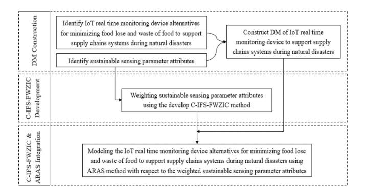
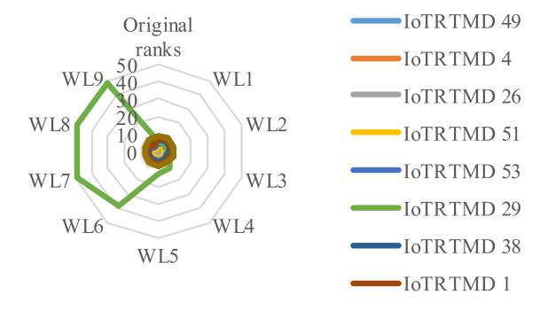
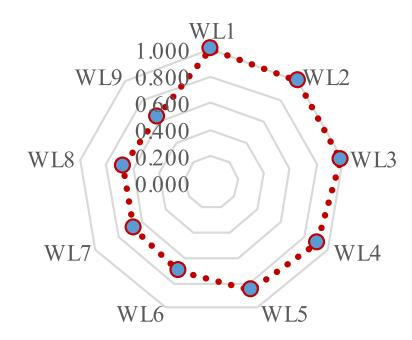

<!-- A3.R17 | source: papers_json/A3.R17/ -->

## تطوير أجهزة مراقبة إنترنت الأشياء (IoT) المستدامة في الزمن الحقيقي لأنظمة سلاسل إمداد الغذاء بناءً على تغير المناخ باستخدام مجموعة Circular Intuitionistic Fuzzy Set

Hassan A. Alsatta[r](https://orcid.org/0000-0003-1182-936X) , Nahia Mourad [,](https://orcid.org/0000-0002-3765-5946) A. A. Zaidan [,](https://orcid.org/0000-0001-6090-0391) Muhammet Devec[i](https://orcid.org/0000-0002-3712-976X) , *Member, IEEE*, Sarah Qahtan, Vaidyanathan Jayaraman, and Zainab Khalid

*Abstract***—تُطوَّر أجهزة مراقبة إنترنت الأشياء (IoT) في الزمن الحقيقي، والتي تجمع بين معلمات الاستشعار المستدامة المرتبطة** **بتغير المناخ، من أجل تقليل فقد الغذاء وهدره لدعم أنظمة سلاسل الإمداد أثناء الكوارث الطبيعية. أظهرت** **دراسات عديدة أن أجهزة مراقبة إنترنت الأشياء الحالية في الزمن الحقيقي** **تتيح آفاقاً واعدة للتطورات المستقبلية المتعلقة بأنظمة سلاسل إمداد الغذاء ذات معلمات الاستشعار المستدامة.** **لذلك، فإن نمذجة أجهزة مراقبة فعالة لإنترنت الأشياء في الزمن الحقيقي بهدف** **تقليل فقد الغذاء وهدره لدعم أنظمة سلاسل الإمداد أمر** **بالغ الأهمية أثناء الكوارث الطبيعية. يمكن تصنيف عملية النمذجة هذه ضمن مسائل** **اتخاذ القرار متعدد المعايير (MADM) نظراً لوجود** **ثلاث قضايا: 1) وجود سمات متعددة لمعلمات الاستشعار؛** **2) عدم اليقين المرتبط بالأهمية النسبية لهذه** **السمات؛ و3) تباين البيانات. تسعى الدراسة الحالية** **إلى الجمع بين طريقة الترجيح الضبابي عديم عدم الاتساق ومجموعات الضبابية الحدسية الدائرية (C-IFS-FWZIC) مع** **طريقة جديدة لتقييم النسبة الإضافية (ARAS) لتحديد أجهزة مراقبة إنترنت الأشياء** **المثلى في الزمن الحقيقي لتقليل الفقد والهدر ودعم** **أنظمة سلاسل إمداد الغذاء أثناء الكوارث الطبيعية. تُبنى** **مصفوفة القرار للدراسة بتقاطع 54 جهاز مراقبة لإنترنت الأشياء** **في الزمن الحقيقي مع عشر سمات لمعلمات استشعار مستدامة. كذلك، تُطوَّر الطريقة المقترحة أكثر** **لتحديد مستوى أهمية سمات معلمات الاستشعار المستدامة.** **وتُستخدم هذه البيانات في ARAS. ويُجرى تحليل الحساسية و**

Manuscript received 30 July 2023; accepted 12 August 2023. Date of publication 16 August 2023; date of current version 8 August 2024. *(Corresponding author: Muhammet Deveci.)*

Hassan A. Alsattar is with the Department of Business Administration, College of Administrative Science, University of Mashreq, Baghdad 10021, Iraq, and also with MEU Research Unit, Middle East University, Amman 11831, Jordan.

Nahia Mourad is with the Faculty of Engineering and IT, British University in Dubai, Dubai, UAE (e-mail: nahia.mourad@buid.ac.ae).

A. A. Zaidan and Vaidyanathan Jayaraman are with the SP Jain School of Global Management, Sydney, NSW 2141, Australia (e-mail: aws.alaa@gmail.com; vaidy.jayaraman@spjain.org).

Muhammet Deveci is with the Department of Industrial Engineering, Turkish Naval Academy, National Defence University, 34334 Istanbul, Turkey, and also with the Department of Electrical and Computer Engineering, Lebanese American University (Byblos), Byblos, Lebanon (e-mail: muhammetdeveci@gmail.com).

Sarah Qahtan is with the Department of Computer Center, College of Health and Medical Techniques, Middle Technical University, Baghdad 10047, Iraq (e-mail: sarah.qahttan@gmail.com).

Zainab Khalid is with the Department of Information and Communication Technology, UNITEN University, Kajang 43000, Malaysia (e-mail: zainabkhmohammed@gmail.com).

Data is available on-line at: https://github.com/SarahQahttan/IEEE-Internetof-Things-Journal.git.

Digital Object Identifier 10.1109/JIOT.2023.3305910

**اختبار معامل ارتباط الحساسية لتقييم متانة** **الطريقة المقترحة.**

*Index Terms***—Additive ratio assessment (ARAS), climate** **change, food security, Internet of Things (IoT), multiattribute** **decision-making (MADM).**

## I. المقدمة

تُعد أجهزة مراقبة إنترنت الأشياء (IoT) في الزمن الحقيقي القائمة على تغير المناخ تقنية جديدة في العديد من القطاعات المهمة، مثل الأمن الغذائي. ومن المعروف على نطاق واسع أن تأثير تغير المناخ (أي الفيضانات والجفاف ودرجات الحرارة القصوى وحرائق الغابات) على الأمن الغذائي وسبل العيش أمر مسلَّم به [[1]](#page-8-0). وتُدرَس آثار تغير المناخ على الأمن الغذائي وسبل العيش من زوايا متعددة من خلال دراسات حول تأثيرات تغير المناخ ونقاط الضعف والتكيف (IVA) [[1]](#page-8-0). لذلك، من الضروري مراقبة جودة الغذاء، والتحكم في الأصناف التي تقترب من نهاية صلاحيتها، وتحسين إدارة المخزون وتخطيط المتاجر. فعلى سبيل المثال، يمكن لتطبيقات إنترنت الأشياء أن تساعد الجهات الفاعلة على تقليل فقد الغذاء وهدره لدعم أنظمة سلاسل إمداد الغذاء. وفي الوقت نفسه، يمكن لتقنية الاستشعار أن تقلل من فقد الغذاء وهدره لدعم أنظمة سلاسل الإمداد من خلال إدارة البيئة المادية المثالية، وخصوصاً من حيث درجة الحرارة والرطوبة [[2]](#page-8-1).

يمكن استخدام المستشعر طوال مدة صلاحية المنتج وسلاسل الإمداد (الإنتاج والتخزين والتوزيع والاستهلاك). ويمكن استخدام المستشعرات المركّبة على المعدات الصناعية لجمع بيانات عن استهلاك المواد الخام أثناء مرحلة الإنتاج، بما في ذلك الماء والكهرباء ومدخلات أخرى [[3]](#page-8-2). كما يمكن الحصول على قياسات درجة حرارة الغذاء ورطوبة الهواء من المستشعرات الموجودة في المستودعات أثناء مرحلة التخزين [[4]](#page-8-3). ويمكن للمستشعرات المركّبة على المركبات أن تقيس المسافة المقطوعة ووزن البضائع المنقولة وكمية الوقود المستخدمة أثناء مرحلة النقل [[4]](#page-8-3). ويمكن لأي مستوى من مستويات سلاسل الإمداد أن يولّد بيانات عن الانبعاثات البيئية باستخدام مستشعرات ذكية وأنظمة مراقبة بيئية [[3]](#page-8-2)، وهو ما ينعكس على الدقة وإمكانية التتبع والشفافية وقابلية التحكم. وتتوسع إنترنت الأشياء بسرعة، ولديها القدرة على أن تصبح

<!-- page 2 -->

مصدراً هائلاً للمعلومات. ورغم أن من المتوقع أن تؤدي هذه التقنيات الجديدة إلى سلاسل غذاء أكثر استدامة وفعالية في السنوات القادمة، فإن تطبيقاتها المحتملة في مجال الغذاء لا تزال محدودة. غير أن إمكاناتها في الصناعة الغذائية لفتت انتباهاً ملحوظاً في السنوات الأخيرة. وتُستخدم أجهزة المراقبة هذه لمراقبة الغذاء الذي يُقدَّم كمساعدات إنسانية للسكان في المناطق المتضررة من الكوارث الطبيعية، ومن المتوقع أن تحسّن استدامة سلاسل الغذاء عن طريق تقليل فقد الغذاء وهدره [[5]](#page-8-4).

وفقاً لـ [[6]](#page-8-5)، عُرضت ونوقشت أجهزة مراقبة عديدة لإنترنت الأشياء في الزمن الحقيقي استناداً إلى مختلف جوانب معلمات الاستشعار المستدامة. ورغم وجود أجهزة المراقبة هذه، لا يوجد جهاز مراقبة متفوق يعالج جميع معلمات الاستشعار المستدامة في آنٍ واحد. كما أخذ جميع الباحثين هذه الجوانب بعين الاعتبار عند تطوير أجهزة مراقبة إنترنت الأشياء في الزمن الحقيقي. غير أنه لم يُجرَ أي بحث يقيّم وينمذج أجهزة مراقبة إنترنت الأشياء المحددة لتحديد الأكثر والأقل استدامة استناداً إلى معلمات الاستشعار. ويجب معالجة ثلاث قضايا تقييمية لسد هذه الفجوة البحثية. أولاً، يجب أخذ معلمات (سمات) استدامة متعددة بعين الاعتبار [[7]](#page-8-6)، [[8]](#page-8-7)، [[9]](#page-8-8). ثانياً، يجب ترتيب هذه السمات وفق مستوى أهميتها [[10]](#page-8-9)، [[11]](#page-8-10)، [[12]](#page-8-11). ثالثاً، يُعد تباين البيانات مسألة أخرى يجب مراعاتها عند تقييم ونمذجة أجهزة مراقبة إنترنت الأشياء [[13]](#page-8-12)، [[14]](#page-8-13)، [[15]](#page-8-14). وبناءً على ذلك، فإن تحديد أجهزة مراقبة إنترنت الأشياء الأكثر والأقل استدامة، وقيمة المعلمات المتبقية، قد يتغيران تبعاً لتغيّر معلمة واحدة، مما ينتج مسألة معقدة من مسائل اتخاذ القرار متعدد المعايير (MADM) [[16]](#page-8-15)، [[17]](#page-8-16)، [[18]](#page-8-17)، [[19]](#page-8-18). وقد طوّر الباحثون طرقاً متعددة لاتخاذ القرار متعدد المعايير من أجل اختيار البديل الأمثل من بين قائمة من البدائل [[11]](#page-8-10)، [[20]](#page-8-19)، [[21]](#page-8-20). ولذلك فإن نهج MADM ضروري لسد الفجوة البحثية ومعالجة تعقيد المسألة.

يمكن تلخيص إسهامات هذه الدراسة على النحو التالي: 1) صياغة مصفوفة قرار (DM) بتقاطع أجهزة مراقبة إنترنت الأشياء في الزمن الحقيقي مع سمات معلمات الاستشعار المستدامة؛ 2) صياغة وتطوير امتداد جديد لطريقة الترجيح الضبابي عديم عدم الاتساق (FWZIC)، يُسمى طريقة الترجيح الضبابي عديم عدم الاتساق مع المجموعات الضبابية الحدسية الدائرية (C-IFS-FWZIC)، لترجيح سمات معلمات الاستشعار المستدامة المستخدمة في نمذجة أجهزة مراقبة إنترنت الأشياء؛ و3) تطوير طريقة جديدة تدمج بين C-IFS-FWZIC وتقييم النسبة الإضافية (ARAS) استناداً إلى مصفوفة القرار المصاغة، كمنهجية لاتخاذ القرار من أجل نمذجة أجهزة مراقبة إنترنت الأشياء وتحديد الأجهزة المستدامة المثلى.

يُنظَّم باقي هذا المقال على النحو التالي. تُستعرض وتُناقش أقرب الأعمال ذات الصلة في القسم [II.](#page-1-0) ويعرض القسم [III](#page-2-0) بالتفصيل تطوير مصفوفة القرار، وتصميم طريقة C-IFS-FWZIC، ودمج ARAS مع طريقة C-IFS-FWZIC المطوَّرة. وتُعرض في القسم [IV](#page-4-0) أجهزة مراقبة إنترنت الأشياء في الزمن الحقيقي لتقليل فقد الغذاء وهدره ودعم أنظمة سلاسل إمداد الغذاء أثناء الكوارث الطبيعية وبعدها، إلى جانب مصفوفة القرار وأوزان السمات ونتائج النمذجة غير المؤكدة التي تم الحصول عليها. وفي القسم [V،](#page-6-0) تُقيَّم متانة طرق MADM المقترحة

وتُتحقق منها. وتُعرض الاستنتاجات في القسم [VI.](#page-8-21)

## II. التبرير النظري لـ MADM

يُعد MADM مجالاً فرعياً من بحوث العمليات يشمل طرقاً وتطبيقات متنوعة في مجالات مختلفة [[22]](#page-8-22). وقد استُخدمت في الأدبيات طرق نمذجة عديدة لـ MADM، مثل طريقة الترجيح الجمعي البسيط (SAW)، ونموذج المنتج الموزون (WPM)، وARAS [[23]](#page-8-23). ومع ذلك، تساعد ARAS على تشكيل قرارات عقلانية استناداً إلى مستوى المنفعة لكل بديل. والمنفعة هي قيمة دالة، عند تطبيقها على البديل الأفضل، تولّد قيمة كفاءة معقدة نوعاً ما، تؤثر في أهمية وقيمة السمات [[24]](#page-8-24). وتكمن نقاط قوة ARAS في قدرتها على: 1) إجراء الحسابات بشكل مفهوم؛ 2) تحديد مفاهيم منطقية وواضحة؛ و3) ترجيح الأوزان المحددة بواسطة المقارنات. لذلك، ثبتت فعاليتها في معالجة مسائل عديدة من نوع MADM [[25]](#page-8-25)، [[26]](#page-8-26).

مع ذلك، تعاني ARAS من قيد رئيسي واحد، هو عدم قدرتها على ترتيب مجموعة السمات وفق أهميتها النسبية [[27]](#page-9-0). ولذلك جمع باحثون عديدون بين ARAS وطريقة الترجيح AHP لتغطية هذا القيد [[28]](#page-9-1)، [[29]](#page-9-2). ويكمن القصور الرئيسي لطريقة AHP في عدم الاتساق الناتج عن المقارنات الثنائية. وفي عام 2023، عالج Qahtan وآخرون [[30]](#page-9-3) مشكلة عدم الاتساق باقتراح طريقة ترجيح جديدة لـ MADM تُسمى FWZIC. ومنذ ذلك الحين، استُخدمت هذه الطريقة على نطاق واسع لتحديد وزن سمات التقييم دون عدم اتساق. كما أن FWZIC لا تتطلب عدداً كبيراً من العمليات الرياضية ولا وقتاً طويلاً للتشغيل. وبشكل عام، فإن السمات الموزونة المختلفة في FWZIC مستقلة؛ وبالتالي فإن إضافتها أو حذفها لا يستلزم إعادة الحساب. علاوة على ذلك، فإن جمع تغذية راجعة من صناع القرار (DMs) في FWZIC أمر بسيط، وقد جرى تمديد النسخة الأولية منها تحت مجموعة ضبابية مثلثية (FS)، وهي مجموعة لا تستطيع إدارة الغموض وعدم اليقين في المعلومات بشكل مناسب [[31]](#page-9-4).

ولمعالجة هذه القضايا [[32]](#page-9-5)، طُوِّرت طريقة FWZIC باستخدام مجموعات ضبابية كروية مجالية وثنائية التردد المتردد، واحتمالية-متردد، وفيرماتيان، وبيثاغورس متعددة الأقطاب، وثنائية التردد، ونيوتروسوفيك، وكروية [[28]](#page-9-1)، وT-كروية [[19]](#page-8-18)، فضلاً عن مجموعات خشنة ضبابية دايوفانتين خطية. ورغم هذه المحاولات، لا يزال الغموض المعلوماتي وعدم اليقين من القضايا المفتوحة [[30]](#page-9-3)، [[31]](#page-9-4)، [[32]](#page-9-5).

طوّر Zadeh [[33]](#page-9-6) مفهوم المجموعة الضبابية (FS) لمعالجة المعلومات الغامضة من خلال ابتكار مجموعات ضبابية من النوع الثاني (type-2) التي تسمح لدوال العضوية بتضمين ضبابية درجات العضوية كبُعد ثالث. وبدلاً من إدخال عدم اليقين إلى دالة العضوية، فإن الهدف العام لامتدادات FS الأخرى هو مراعاة مستوى تردد صناع القرار. أما الهدف من الامتداد الحديث لـ FS المعروف بالمجموعات الضبابية الحدسية الدائرية (C-IFSs) فهو إضفاء الضبابية على دوال العضوية، كما تفعل مجموعات النوع الثاني [[34]](#page-9-7). وتحتاج المسألة إلى طريقة MADM قادرة على تحويل دالة العضوية إلى ضبابية كما في مجموعات النوع الثاني، ومراعاة تردد صناع القرار كما في المجموعات الضبابية الحدسية، وهو ما تناوله المرجع [[34]](#page-9-7).

<!-- page 3 -->

*Fig. 1. Steps for implementing the proposed methods.*

طُرح مفهوم التردد تجاه المجموعات الضبابية لأول مرة في المجموعات الضبابية الحدسية. وأحدث تطور للمجموعات الضبابية هو المجموعة الضبابية الحدسية الدائرية، التي ابتكرها [[35]](#page-9-8) في عام 2020. وخلافاً للمجموعات الضبابية الحدسية (IFSs)، تمثّل C-IFS كل عنصر باستخدام دائرة إحداثياتها A(x) وA(x) ونصف قطرها *r*. وهذه المجموعات هي تلك التي يكون فيها لكل عنصر من عناصر الكون درجة عضوية ودرجة عدم عضوية، وتوجد دائرة حولها بنصف قطر *r* بحيث يكون مجموع درجتي العضوية وعدم العضوية داخل هذه الدائرة مساوياً لـ 1 على الأكثر. ويمكن استخدام C-IFSs في طرق MADM لمراعاة الخصائص المذكورة [[34]](#page-9-7).

وعلى حد علمنا، لم تُمدَّد أي دراسة سابقة FWZIC تحت C-IFS. علاوة على ذلك، لم يُطبَّق دمج طريقتي C-IFS-FWZIC وARAS على أي دراسة حالة. لذلك، فإننا مدفوعون لاقتراح طريقتين جديدتين، C-IFS-FWZIC وARAS، لنمذجة أجهزة مراقبة إنترنت الأشياء في الزمن الحقيقي وتحديد الأجهزة المستدامة المثلى، وهو ما يمثّل الأهداف الرئيسية لهذه الدراسة. وتُصاغ طريقة C-IFS-FWZIC وتُطوَّر لحساب وزن سمات معلمات الاستشعار المستدامة. وتُستخدم طريقة ARAS لنمذجة أجهزة مراقبة إنترنت الأشياء باستخدام الأوزان المستخلَصة. ويُعد تقليل الفقد والهدر في أنظمة سلاسل الإمداد أمراً بالغ الأهمية أثناء الكوارث الطبيعية.

## III. المنهجية

يعرض هذا القسم صياغة وتطوير طريقتين من طرق MADM لترجيح سمات معلمات الاستشعار المستدامة ونمذجة أجهزة مراقبة إنترنت الأشياء في الزمن الحقيقي. ويوضح الشكل [1](#page-2-1) خطوات تنفيذ الطرق المقترحة.

## *A. بناء مصفوفة القرار*

يُبنى في هذا القسم مصفوفة القرار (DM) الخاصة بأجهزة مراقبة إنترنت الأشياء في الزمن الحقيقي. ويمكن بناء مصفوفة القرار استناداً إلى المقال الأساسي في [[5]](#page-8-4). وتُلخَّص عملية بناء المصفوفة على النحو التالي.

*الخطوة 1:* تُحلَّل وتُحدَّد في هذه الخطوة سمات معلمات الاستشعار المستدامة. ووفقاً لـ [[5]](#page-8-4)، اختِيرت عشر سمات لمعلمات استشعار مستدامة لتقييم أجهزة مراقبة إنترنت الأشياء في الزمن الحقيقي. وتُعرض تعريفات هذه السمات وتفاصيلها الإضافية في [[5]](#page-8-4).

*الخطوة 2:* تُفحَص وتُحدَّد في هذه الخطوة أجهزة مراقبة إنترنت الأشياء في الزمن الحقيقي. وقد حدّدت دراسة سابقة [[5]](#page-8-4) 54 جهاز مراقبة لإنترنت الأشياء في الزمن الحقيقي. وفي هذه الدراسة،

| linguistic Measurement of Importance | Numeric Scale | IFSNs |  |
| --- | --- | --- | --- |
| α | β |  |  |
| Very Important | 1 | 0.9 | 0.05 |
| Important | 2 | 0.75 | 0.2 |
| Average | 3 | 0.5 | 0.5 |
| Low Important | 4 | 0.3 | 0.65 |
| Very Low Important | 5 | 0.1 | 0.85 |

تُنمذَج هذه الأجهزة (البدائل) بترتيب تنازلي من الأكثر استدامة إلى الأقل استدامة.

*الخطوة 3:* تُصاغ مصفوفة القرار لأجهزة مراقبة إنترنت الأشياء في الزمن الحقيقي بتقاطعها (الخطوة 2) مع سمات معلمات الاستشعار المستدامة الخاصة بها (الخطوة 1). ويوضح الجدول [I](#page-2-2) تمثيل مصفوفة القرار لأجهزة مراقبة إنترنت الأشياء في الزمن الحقيقي.

تصف الأقسام التالية مخطط ترجيح سمات معلمات الاستشعار المستدامة في أجهزة مراقبة إنترنت الأشياء في الزمن الحقيقي عبر طريقة C-IFS-FWZIC. بعد ذلك، تُغذَّى الأوزان في طريقة ARAS لنمذجة أجهزة مراقبة إنترنت الأشياء في الزمن الحقيقي، ويُختار النموذجان الأكثر والأقل استدامة.

## *B. تطوير طريقة C-IFS–FWZIC*

يمكن معالجة أوجه عدم اليقين وعدم الدقة بفعالية من خلال دمج طريقة FWZIC في بيئة C-IFS. وتحدد الخطوات التالية صياغة طريقة C-IFS-FWZIC.

*الخطوة 1:* في هذه المرحلة، تُستكشف سمات معلمات الاستشعار المستدامة المحددة مسبقاً لتقييم ونمذجة أجهزة مراقبة إنترنت الأشياء في الزمن الحقيقي.

*الخطوة 2:* تُحدَّد وتُختار ثلاثة صناع قرار (DMs) على الأقل ممن لديهم خبرة سابقة بأجهزة مراقبة إنترنت الأشياء في الزمن الحقيقي، لتشكيل حكم خبراء منظَّم (SEJ). كذلك، يُصمَّم في هذه الخطوة نموذج تقييم ويُصادَق عليه من قبل صناع القرار. وتُمثَّل تفضيلات صناع القرار بشأن السمات بخمسة مقاييس لفظية، كما هو موضح في الجدول [II،](#page-2-3) وتُجمَع باستخدام النموذج المصمَّم.

*الخطوة 3:* تُقاطَع سمات معلمات الاستشعار المستدامة لبدائل أجهزة مراقبة إنترنت الأشياء في الزمن الحقيقي مع صناع القرار الثلاثة المحدَّدين مسبقاً لبناء مصفوفة قرار الخبراء (EDM)، كما هو موضح في [(1).](#page-3-0) ولإجراء مزيد من التحليل، تُستبدَل المصطلحات اللفظية التي جُمعت بواسطة نموذج التقييم في الخطوة السابقة بمقياس رقمي في الجدول [II](#page-2-3)

<!-- page 4 -->

$$
EDM = \begin{bmatrix} E_{11} & \cdots & E_{1m} \\ \vdots & \ddots & \vdots \\ E_{n_E 1} & \cdots & E_{n_E m} \end{bmatrix} (1)
$$

حيث n_E هو عدد الخبراء وm هو عدد السمات

Step 4: IFS-EDM is created by applying the numeric scale with the IFS numbers (IFSNs) listed in Table II on the EDM, to obtain IFS-EDM having the following form:

$$
\widetilde{\text{EDM}} = \begin{bmatrix} (\alpha_{11}, \beta_{11}) & \cdots & (\alpha_{1n_A}, \beta_{1m}) \\ \vdots & \ddots & \vdots \\ (\alpha_{n_E1}, \beta_{n_E1}) & \cdots & (\alpha_{n_Em}, \beta_{n_Em}) \end{bmatrix}. \tag{2}
$$

في الخطوات التالية، تُستخدم C-IFS لتحديد نصف القطر الذي يكشف عن عدم اليقين .... وتُعرَّف C-IFS وC-IFSN على النحو التالي.

Definition 1 [34]: E is assumed a fixed universe. A C-IFS S_r in E is an object with the following form:

$$ S_r = \{ \langle x, \mu_S(x), \nu_S(x); r \rangle | x \in E \} $$

where 0 \le \mu_S(x) + \nu_S(x) \le 1.

يُعرَف S_r بأنه Circular-IFS، وr \in [0, 1] هو نصف قطر الدائرة حول كل عنصر x \in E، وتشير الدالتان \mu_S:E \to [0, 1] وν_S:E \to [0, 1] إلى درجة العضوية ومستوى عدم العضوية للعنصر x في المجموعة S_r عبر E. وصيغة حساب درجة عدم اليقين (اللاتحديد) هي كما يلي:

$$ \pi_S(x) = 1 - \mu_S(x) - \nu_S(x). \tag{3} $$

تُستخدم دائرة مركزها (\mu_S(x), \nu_S(x)) ونصف قطرها r لتمثيل كل عنصر في C-IFSs. لتكن c_1 وc_2 عددين ضبابيين حدسيين دائريين يُمثَّلان بـ c_1 = < \mu_{c_1}(x), \ \nu_{c_1}(x); \ r_1 > \text{and} \ c_2 = < \mu_{c_2}(x), \ \nu_{c_2}(x); \ r_2 >. وتُنتج هذه الأعداد نتائج بمستويات دنيا وقصوى من عدم اليقين. لذلك، تستند العمليات المعروضة هنا إلى الحد الأدنى والأقصى لنصفي القطر بشكل مستقل. ويرد تعريف كيفية عملها في [34].

Step 5: For C_j = \{(\alpha_{ij}, \beta_{ij}) | i = 1, ..., n_E\} an IFS, calculate the arithmetic average of the IFNs using the following equation:

$$
\langle \overline{\alpha}(C_j), \ \overline{\beta}(C_j) \rangle = \left( \frac{\sum_{i=1}^{n_E} \alpha_{ij}}{n_E}, \ \frac{\sum_{i=1}^{n_E} \beta_{ij}}{n_E} \right). \tag{4}
$$

Step 6: تُؤخَذ بعين الاعتبار أطوال نصف القطر التي أنتجها صانع القرار عند تقييم سمة معلمة الاستشعار المستدامة الـ *j* لتحديد الحد الأقصى لأطوال نصف القطر. ويُحصَل على الحد الأقصى لطول نصف القطر R = (r_j)_{1 \le j \le m} استناداً إلى مصفوفة قرار صانع القرار باستخدام

$$
r_{j} = \max_{1 \le i \le n_{E}} \sqrt{\left(\overline{\alpha}(C_{j}) - \alpha_{ij}\right)^{2} + \left(\overline{\beta}(C_{j}) - \beta_{ij}\right)^{2}}. (5)
$$

Step 7: يُحصَل على مصفوفة أوزان السمات الضبابية الحدسية الدائرية، (\langle \mu_j, \nu_j; r_j \rangle)_{1 \leq j \leq m}، باستخدام مصفوفة القرار المكوَّنة من الأزواج الضبابية الحدسية \widetilde{\text{EDM}}، المعرَّفة في (2)، من خلال تطبيق مشغل الترجيح الحدسي الضبابي (IFWA) الموضَّح في (6) [36]

$$
\begin{alignat*}{2}(1) && \text{IFWA} (A_1, \ldots, A_n) &= \sum_{j=1}^{n} \frac{1}{n} A_j \\ \text{of} && &= \left(1 - \prod_{j=1}^{n} (1 - \alpha_{A_j})^{\frac{1}{n}}, \prod_{j=1}^{n} \beta_{A_j}^{\frac{1}{n}}\right) \quad (6)\end{alignat*}
$$

حيث A_j = (\alpha_{A_j}, \beta_{A_j}) هي أعداد ضبابية حدسية (IFNs). وبالفعل، (\mu_j, \nu_j) = IFWA ((\alpha_{1j}, \beta_{1j}), \ldots, (\alpha_{n_Ej}, \beta_{n_Ej})) لـ j = 1, \ldots, m.

Step 8: تُستخدَم المعادلتان (7) و(8) لحساب مصفوفة وزن السمة المتفائلة Q^o = (q_j^o)_{j=1,\dots,m} ومصفوفة وزن السمة المتشائمة Q^p = (q_j^p)_{j=1,\dots,m}، على التوالي. وتُحوَّل مصفوفة أوزان السمات الضبابية الحدسية الدائرية إلى مصفوفة أوزان السمات الضبابية الحدسية، باستخدام دوال العضوية ونصف القطر. وهنا، تُنتَج مصفوفتان مختلفتان لأوزان السمات، وهما مصفوفة الوزن المتفائلة ومصفوفة الوزن المتشائمة، اعتماداً على موقف صانع القرار من التفاؤل والتشاؤم

$$
Q^{o} = \begin{bmatrix} (\mu_{1} + r_{1}, \nu_{1} - r_{1}) \\ (\mu_{2} + r_{2}, \nu_{2} - r_{2}) \\ \vdots \\ (\mu_{n_{A}} + r_{n_{A}}, \nu_{n_{A}} - r_{n_{A}}) \end{bmatrix} \tag{7}
$$

حيث q_i^o = (\mu_i + r_i, \nu_i - r_i).

$$
Q^{p} = \begin{bmatrix} (\mu_{1} - r_{1}, \nu_{1} + r_{1}) \\ (\mu_{2} - r_{2}, \nu_{2} + r_{2}) \\ \vdots \\ (\mu_{n_{A}} - r_{n_{A}}, \nu_{n_{A}} + r_{n_{A}}) \end{bmatrix} \tag{8}
$$

حيث q_i^p = (\mu_j - r_j, \nu_j + r_j).

Step 9: تُستخدَم دالة التسجيل المقدَّمة في (9) لحساب درجتي السمات المتفائلة والمتشائمة

$$ Score((\alpha, \beta)) = \alpha - \beta \tag{9} $$

لأي عدد ضبابي حدسي (\alpha, \beta). وبالفعل، تُحسَب الدرجات على النحو التالي:

$$ s_j^o = \operatorname{Score}(q_j^o) and s_j^p = \operatorname{Score}(q_j^p). $$

بعد ذلك، يُحصَل على أوزان درجات السمات المتفائلة والمتشائمة عن طريق ضبط الدرجات كما يلي:

$$
w_j^o = \frac{s_j^o}{\sum_{j=1}^m s_j^o} \text{ and } w_j^p = \frac{s_j^p}{\sum_{j=1}^m s_j^p}. (10)
$$

Step 10: يُحسَب الوزن المدمج لكل سمة بتطبيق الصيغة التالية [37]:

$$
w_{j} = \frac{c + w_{j}^{o} \times w_{j}^{p}}{\sum_{j=1}^{m} (c + w_{j}^{o} \times w_{j}^{p})} (11)
$$

لـ j = 1, 2, ..., m، وc > 0 هو عدد محدَّد مسبقاً لضمان أوزان موجبة.

يعرض الخوارزم 1 في الملف التكميلي الشيفرة الزائفة لطريقة C-IFS-FWZIC.

<!-- page 5 -->

## C. تكييف طريقة ARAS

في هذا القسم، تُغذَّى سمات معلمات الاستشعار المستدامة الناتجة (القسم III-B) في ARAS [22] لنمذجة أجهزة مراقبة إنترنت الأشياء في الزمن الحقيقي وتحديد النموذج الأكثر والأقل استدامة، وذلك بما يتناسب طردياً مع قيمة دالة المنفعة، مما يحدد الكفاءة النسبية المعقدة لبديل ممكن، كما هو موضَّح في الخطوات التالية [22].

Step 1: تُشكَّل مصفوفة اتخاذ القرار (DMM) خلال هذه الخطوة. وتُستخدَم مصفوفة DMM التالية لتفضيلات n من البدائل الممكنة (الصفوف) المقيَّمة وفق m من السمات (الأعمدة) في MADM لمسألة التحسين المتقطع لتمثيل أي مسألة يلزم حلها

$$
X = \begin{bmatrix} x_{11} & x_{12} & \dots & x_{1m} \\ x_{21} & x_{22} & \dots & x_{2m} \\ \vdots & \vdots & \vdots & \vdots \\ x_{n1} & x_{n2} & \dots & x_{nm} \end{bmatrix} \tag{12}
$$

حيث m هو عدد البدائل، وn هو عدد السمات التي تصف كل بديل، وx_{ij} هي قيمة تمثل مدى أداء البديل i فيما يتعلق بالسمة j، وx_{0i} هي القيمة المثلى للسمة j. وإذا كانت القيمة المثلى للسمة j غير معروفة، فإن

$$ x_{0j} = \max_{i=1}^{n} x_{ij}, if \max_{i=1}^{n} x_{ij} is preferable (13) $$

$$
x_{0j} = \max_{i=1,\dots,n} x_{ij}, \text{ if } \max_{i=1,\dots,n} x_{ij} \text{ is preferable} 
x_{0j} = \max_{i=1,\dots,n} x_{ij}, \text{ if } \max_{i=1,\dots,n} x_{ij} \text{ is preferable.} 
(13)
$$

Step 2: تُطبَّع القيم الأولية لجميع السمات، مما يحدد القيم \bar{x}_{ii} لمصفوفة DMM الطبيعية \bar{X}.

1) تُطبَّع القيم المفضَّلة القصوى للسمة على النحو التالي:

$$ \bar{x}_{ij} = \frac{x_{ij}}{\sum_{i=0}^{n} x_{ij}}. (15) $$

2) تُطبَّع السمة التي تكون قيمها المفضَّلة دنيا باستخدام إجراء من مرحلتين

$$
x_{ij}^* = \frac{1}{x_{ij}}; \ \bar{x}_{ij} = \frac{x_{ij}^*}{\sum_{i=0}^n x_{ii}^*}. (16)
$$

في هذه المرحلة، تُعرَّف مصفوفة موزونة طبيعية. وتجدر الإشارة إلى أن الحلول المثلى x_{0j} تدخل ضمن عملية التطبيع.

Step 3: تُستخدَم معاملات الأوزان المستخلصة من C-IFS-FWZIC (w_i)_{i=1,\ldots,m}، المعرَّفة في (11)

$$ \sum_{j=1}^{m} w_j = 1. $$

Step 4: تُستخدَم الصيغة التالية لحساب المصفوفة الموزونة الطبيعية:

$$
\widehat{x}_{ij} = w_j \overline{x}_{ij} for i = 0, \dots, n and j = 1, \dots, m (17)
$$

حيث w_i يشير إلى وزن (أهمية) السمة، و\bar{x}_{ij} هي التقييم الطبيعي للسمة j.

Step 5: المرحلة التالية هي إيجاد قيم دالة الأمثلية

$$ S_i = \sum_{i=1}^{m} \widehat{x}_{ij}, \text{ for } i = 0, \dots, n. (18) $$

يمثّل S_i قيمة دالة الأمثلية للبديل i. وتُرتَّب بدائل أجهزة مراقبة إنترنت الأشياء في الزمن الحقيقي وفق قيم دالة الأمثلية، فكلما زادت القيمة كان البديل أفضل.

Step 6: تُحدَّد درجة منفعة البديل بمقارنة النموذج قيد التحليل بأفضل نموذج مثالي S_0. وتُستخدَم المعادلة التالية لتحديد درجة منفعة البديل K_i:

$$ K_i = \frac{S_i}{S_0}; for i = 0, ..., n (19) $$

حيث S_i وS_0 هما قيمتا سمة الأمثلية، المحدَّدتان بواسطة (18).

من الواضح أن القيم المحسوبة K_i تقع ضمن المدى [0,1] ويمكن ترتيبها حسب الأولوية المطلوبة، في تسلسل تصاعدي. وتشير قيم دالة المنفعة إلى كفاءة نسبية معقدة للبديل العملي [22]. ويعرض الخوارزم 2 في الملف التكميلي الشيفرة الزائفة لطريقة ARAS.

## IV. النتائج التجريبية

## A. مصفوفة القرار وإجراء نتائج التقييم

بُنيت مصفوفة القرار بتقاطع قوائم أجهزة مراقبة إنترنت الأشياء في الزمن الحقيقي مع سمات معلمات الاستشعار المستدامة الخاصة بها. ويعرض الجدول A.I في الملف التكميلي السمات ضمن مصفوفة القرار المقترحة المستخدمة لنمذجة أجهزة مراقبة إنترنت الأشياء في الزمن الحقيقي. وقيّمت نتائج إجراء تقييم السمات، كما هو موضَّح في [5]، 54 جهاز مراقبة لإنترنت الأشياء في الزمن الحقيقي استناداً إلى وجود أو غياب عشر سمات لمعلمات استشعار مستدامة. وسُجِّل وجود أو غياب كل سمة من سمات معلمات الاستشعار المستدامة بصيغة "نعم" أو "لا"، وحُوِّلت هذه القيم إلى قيم ثنائية "1" و"0" لأغراض هذا البحث. وتوضح هذه المصفوفة قيم الدرجات المسنَدة لكل جهاز من أجهزة مراقبة إنترنت الأشياء المقيَّمة استناداً إلى السمات المحدَّدة مسبقاً. وسمات معلمات الاستشعار المستدامة ثنائية بطبيعتها (أي 1/0)، حيث تشير "1" إلى أن سمة معلمة الاستشعار المستدامة قد أُخذت بعين الاعتبار أثناء تصميم جهاز مراقبة إنترنت الأشياء، وتشير "0" إلى أن سمة معلمة الاستشعار المستدامة قد أُغفلت أثناء التصميم. وتُغذَّى المصفوفة المبنية في ARAS مع C-IFRS-FWZIC لنمذجة أجهزة مراقبة إنترنت الأشياء في الزمن الحقيقي. ويعرض القسم التالي نتائج الترجيح وسمات معلمات الاستشعار المستدامة المستخلَصة باستخدام طريقة C-IFRS-FWZIC.

## B. نتائج ترجيح سمات معلمات الاستشعار المستدامة

يعرض هذا القسم أوزان سمات معلمات الاستشعار المستدامة المستخدمة لنمذجة أجهزة مراقبة إنترنت الأشياء في الزمن الحقيقي. وكما نوقش في القسم IV-B من المنهجية، استُخدمت طريقة C-IFRS-FWZIC لترتيب السمات المحددة وفق مستوى أهميتها. وتوفّر طريقة C-IFRS-FWZIC سمات موزونة بشكل متسق. في البداية، قدّم صناع القرار الثلاثة تفضيلهم لكل سمة باستخدام

<!-- page 6 -->

نموذج التقييم المصمَّم والمصادَق عليه مسبقاً، وخمسة مقاييس لفظية تقيس مستوى أهمية السمات. وتُحوَّل الأزواج الضبابية الحدسية في مصفوفات وزن السمة الفردية إلى الأعداد الضبابية الحدسية المجمَّعة لأوزان السمات بتطبيق مشغل IFWA [(6).](#page-3-2) ويعرض الجدول [III](#page-5-0) الأعداد الضبابية الحدسية المجمَّعة الناتجة. علاوة على ذلك، تُعرَض في الجدول [IV](#page-5-1) أطوال نصف القطر القصوى استناداً إلى مصفوفة القرار باستخدام [(4)](#page-3-7) و[(5)](#page-3-8). ويمكن إنشاء C-IFS باستخدام [(5)](#page-3-8) و[(6)،](#page-3-2) وتُحسَب نتائج مصفوفة القرار المتفائلة والمتشائمة باستخدام [(7)](#page-3-3) و[(8).](#page-3-4)

يعرض الجدول [III](#page-5-0) الأعداد الضبابية الحدسية المجمَّعة التي نتجت عن تحويل الأزواج الضبابية الحدسية للسمات الرئيسية لمعلمات الاستشعار المستدامة. كانت القيم المجمَّعة (α, β) لدرجة الحرارة (0.999, 0.05) من بين السمات الرئيسية لمعلمات الاستشعار المستدامة. أما القيم المجمَّعة (α, β) للرطوبة النسبية فكانت (0.999, 0.079). والقيم المجمَّعة (α, β) لتركيب الغاز هي (0.999, 0.079). وتنتج سمة الموقع قيم تجميع (α, β) قدرها (0.998, 0.271). والقيم المجمَّعة (α, β) لشدة الإضاءة هي (0.996, 0.368). وبإضافة الضغط، تكون القيم (α, β) هي (0.999, 0.125). والقيم المجمَّعة للوزن هي (0.998, 0.271). وكانت القيم المجمَّعة (α, β) الخاصة بتركيز الكائنات الدقيقة (0.985, 0.545). وقيم التجميع (α, β) للاهتزاز هي (0.905, 0.777). وأخيراً، القيم المجمَّعة (α, β) لسمة سرعة الهواء هي (0.941, 0.710).

يعرض الجدول [IV](#page-5-1) الحد الأقصى لطول نصف القطر الناتج استناداً إلى قيم مصفوفة القرار للسمات الرئيسية لمعلمات الاستشعار المستدامة. ووفقاً لقيم مصفوفة القرار، كانت السمات المستدامة الرئيسية الثلاث المتمثلة في الموقع وشدة الإضاءة والوزن هي الأعلى في قيم طول نصف القطر (0.260)، تليها سمتا الاهتزاز وسرعة الهواء (0.188). كذلك، أُسنِدت لتركيز الكائنات الدقيقة قيمة طول نصف قطر بلغت 0.166. وكانت قيم طول نصف القطر للضغط وتركيب الغاز والرطوبة النسبية 0.141. وسمة درجة الحرارة لها أدنى قيمة لطول نصف القطر (6.94E-18).

كذلك، تُعرَض في الجدول [III](#page-5-0) نتائج مصفوفة القرار المتفائلة المحسوبة للسمات الرئيسية لمعلمات الاستشعار المستدامة.

اكتسبت درجة الحرارة قيم مصفوفة القرار المتفائلة (0.999,0.05) بوصفها إحدى السمات الرئيسية لمعلمات الاستشعار المستدامة. ووُجدت قيم مصفوفة القرار (1.141, −0.06) للرطوبة النسبية، وهي مقياس أكثر إيجابية. وحُصل على قيم مصفوفة القرار المتفائلة لتركيب الغاز عند (1.141, −0.062). وتنتج سمة الموقع قيم مصفوفة قرار متفائلة (1.258, 0.011). وحُصل على القيم (1.256, 0.108) لمصفوفة القرار المتفائلة الخاصة بشدة الإضاءة. وكانت مكاسب مصفوفة القرار المتفائلة للضغط (1.141, −0.015). وحصل الوزن على قيم مصفوفة قرار متفائلة (1.258, 0.011). وحُصل على قيم مصفوفة القرار (DM) المتفائلة لتركيز الكائنات الدقيقة (1.152, 0.379). وحُصل على قيم (1.093, 0.588) لمصفوفة القرار المتفائلة الخاصة بالاهتزاز. وأخيراً، اكتسبت سرعة الهواء قيم مصفوفة قرار متفائلة (1.130, 0.522).

علاوة على ذلك، يعرض الجدول [III](#page-5-0) النتائج المحسوبة لمصفوفة القرار المتشائمة للسمات الرئيسية لمعلمات الاستشعار المستدامة. حققت درجة الحرارة، إحدى السمات الرئيسية لمعلمات الاستشعار المستدامة، قيم مصفوفة قرار متشائمة (0.999, 0.05). وكانت قيم مصفوفة القرار (0.858, 0.220) للرطوبة النسبية متشائمة. وحُصل على قيم مصفوفة القرار المتشائمة (0.858, 0.220) من تركيب الغاز. وأنتج الموقع قيم مصفوفة قرار متشائمة (0.737, 0.531). ونُسبت القيم (0.735, 0.628) لمصفوفة القرار المتشائمة الخاصة بشدة الإضاءة. واكتُسبت قيم مصفوفة القرار المتشائمة للضغط عند (0.858, 0.267). وحصل الوزن على قيم مصفوفة قرار متشائمة (0.737, 0.531). وحُصل على قيم مصفوفة القرار المتشائمة (0.819, 0.712) من تركيز الكائنات الدقيقة. وكانت قيم مصفوفة القرار المتشائمة للاهتزاز (0.716, 0.965). وأخيراً، حُصل على قيم مصفوفة قرار متشائمة لسرعة الهواء (0.752, 0.899).

يمكن الحصول على مصفوفة القرار الموزونة المتفائلة والمصفوفة الموزونة المتشائمة من المعادلة [(10)،](#page-3-9) باستخدام دالة التسجيل المقدَّمة في [(9).](#page-3-5) ويمكن حساب قيم الوزن النهائية للسمات باستخدام [(11)،](#page-3-6) مع *c* = 0.01 للتحقق من الشرط *wj* ≥ 0 لـ *j* = 1,..., 10، كما هو موضَّح في الجدول [V.](#page-6-1)

يعرض الجدول [V](#page-6-1) قيم الدرجة المتفائلة، والدرجة المتشائمة، والوزن المتفائل، والوزن المتشائم، مبيّناً التباين بين القيم السالبة والموجبة.

تُعرَض الأوزان الناتجة للسمات الرئيسية لمعلمات الاستشعار المستدامة في الجدول [VII.](#page-7-0) ومن بين السمات المستدامة الرئيسية، حصلت درجة الحرارة على أعلى وزن (0.180)، تلتها الرطوبة النسبية وتركيب الغاز بوزن (0.160). كذلك، أُسنِدت للضغط قيمة وزن 0.147. وأُسنِدت قيمة الوزن نفسها 0.084 لسمتي الموقع والوزن، تلتها قيم وزن 0.064 و0.058 لسمتي شدة الإضاءة وتركيز الكائنات الدقيقة. وبلغت قيمة وزن سرعة الهواء 0.032. وأُسنِدت أدنى قيمة وزن، 0.026، لسمة

<!-- page 7 -->

الاهتزاز. وقد غُذِّيت قيم أوزان سمات معلمات الاستشعار المستدامة في ARAS لنمذجة مختلف أجهزة مراقبة إنترنت الأشياء في الزمن الحقيقي.

## *C. نتائج نمذجة أجهزة مراقبة إنترنت الأشياء في الزمن الحقيقي*

يعرض هذا القسم نتائج طريقة ARAS المستخدمة لنمذجة مختلف أجهزة مراقبة إنترنت الأشياء في الزمن الحقيقي استناداً إلى مصفوفة القرار. وبعد بناء مصفوفة القرار بالوزن المحدَّد لكل سمة من سمات معلمات الاستشعار المستدامة، تُحدَّد المصفوفة الموزونة الطبيعية (*X*) لبدائل أجهزة مراقبة إنترنت الأشياء في الزمن الحقيقي باستخدام [(13)،](#page-4-3) [(15)،](#page-4-4) و[(17).](#page-4-5) وتجدر الإشارة إلى أن *x*0*^j^* = 1 لجميع *j* = 1,..., 10. بعد ذلك، تُحسَب قيم دالة الأمثلية باستخدام [(18).](#page-4-1) وأخيراً، تُحسَب درجة منفعة البدائل باستخدام [(19).](#page-4-6) ويعرض الجدول [VI](#page-6-2) نتيجة طريقة نمذجة ARAS لأجهزة مراقبة إنترنت الأشياء في الزمن الحقيقي.

يعرض الجدول [VI](#page-6-2) نتيجة طريقة نمذجة ARAS لأجهزة مراقبة إنترنت الأشياء في الزمن الحقيقي. تصدَّر IoTRTMD 49 الترتيب بقيمة نموذج 1 ودرجة 0.049. تلاه IoTRTMD 4 وIoTRTMD 26 بنفس الدرجة 0.046 وقيمة نموذج 2. ثم حصل IoTRTMD 51 على درجة 0.044 وقيمة نموذج 4. وتلاهم IoTRTMD 53، وIoTRTMD 29، وIoTRTMD 38، وIoTRTMD 1، وIoTRTMD 5، وIoTRTMD 9، الذين كانوا من بين أفضل 10 أجهزة بدرجات 0.0312 و0.0309 و0.03 و0.026 و0.025 و0.025 على التوالي، وقيم نموذج 5 و6 و7 و8 و9 و9. ثم تطابق IoTRTMD 2 وIoTRTMD 40 بدرجة 0.025 ونموذج 11، تلاه IoTRTMD 39 بدرجة 0.022 وقيمة نموذج 13. علاوة على ذلك، حقق IoTRTMD6 وIoTRTMD 41 نفس الدرجة 0.017 وقيمة نموذج 14. حصل IoTRTMD 7 على درجة 0.018 ونموذج 16، تلاه IoTRTMD 52 بدرجة 0.168 وقيمة نموذج 17. وحصلت الأجهزة IoTRTMD 3، وIoTRTMD 12، وIoTRTMD 13، وIoTRTMD 16، وIoTRTMD 23، وIoTRTMD 30، وIoTRTMD 31، وIoTRTMD 36، وIoTRTMD 37، وIoTRTMD 47، وIoTRTMD 48 على نفس قيمة النموذج 18 بدرجة 0.0166. بينما حصل IoTRTMD 27، وIoTRTMD 32، وIoTRTMD 44، وIoTRTMD 45 على درجة 0.016 وقيمة نموذج 29. وحصلت درجات وقيم نماذج IoTRTMD 8، وIoTRTMD 11،

وIoTRTMD 10، وIoTRTMD 15، وIoTRTMD 19، وIoTRTMD 20، وIoTRTMD 21، وIoTRTMD 25، وIoTRTMD 28، وIoTRTMD 35، وIoTRTMD 54 على درجات تراوحت بين 0.008 و0.009 وقيم نموذج بين 33 و35. وأخيراً، نُمذِجت الأجهزة IoTRTMD 14، وIoTRTMD 17، وIoTRTMD 18، وIoTRTMD 22، وIoTRTMD 24، وIoTRTMD 33، وIoTRTMD 34، وIoTRTMD 42، وIoTRTMD 43، وIoTRTMD 46، وIoTRTMD 50 في المرتبة الأخيرة بدرجة 0.004، وهي أقل من سمات معلمات الاستشعار المستدامة الأخرى في النمذجة. وقد لا تُعَد سمة معلمة الاستشعار المستدامة هذه أحد الخيارات من بين أجهزة مراقبة إنترنت الأشياء في الزمن الحقيقي مقارنة بغيرها. ويمكن استخدام ترتيب النمذجة هذا كمرجع لاختيار النموذج الأكثر استدامة من بين أجهزة مراقبة إنترنت الأشياء في الزمن الحقيقي.

## V. التقييم والتحقق

## *A. اختبار تحليل الحساسية*

في هذا القسم، تُجرى تحليلات الحساسية والارتباط لاختبار متانة طرق MADM المقترحة [[38]](#page-9-11)، [[39]](#page-9-12)، [[40]](#page-9-13) من أجل تحديد سمات معلمات الاستشعار الأكثر والأقل استدامة. وفي تحليل الحساسية، تُعدَّل قيم أوزان سمات معلمات الاستشعار المستدامة وفق توصيات Kirkwood وKahraman [[41]](#page-9-14)، ويُدرَس ترتيب نمذجة كل جهاز من أجهزة مراقبة إنترنت الأشياء في الزمن الحقيقي. لذلك، يمكن تحديد قوائم الأوزان الجديدة (WLs) لسمات معلمات الاستشعار المستدامة، باستثناء السمة الأكثر تأثيراً

<!-- page 8 -->

وذلك وفقاً لـ

$$ w_j = w_i^o - \delta \ [e_c]_j. \tag{20} $$

يشير w_j^o إلى الوزن الأولي لسمات أمن التطوير المحدَّد بطريقة C-IFRS-FWZIC، ويشير e_c إلى معامل مرونة الوزن، الذي يساوي 1/(1-w_s^0)، حيث يشير w_s^0 إلى وزن السمة الأكثر تأثيراً، ويشير \delta إلى نطاق تعديل قيمة وزن السمات. ويُحدَّث وزن السمة الأكثر تأثيراً كـ w_s = 1 - \sum_{j \neq s} w_j، للحصول على معاملات وزن يبلغ مجموعها 1.

كما هو موضَّح في الجدول V، كانت سمة معلمة درجة الحرارة الأكثر تأثيراً في هذه الدراسة لأنها حصلت على أعلى قيمة وزن (وزن درجة الحرارة: w_1 = 0.180). وتُعرَض قيم e_c الناتجة لسمة معلمة الاستشعار المستدامة في الجدول VII. وتراوحت قيم نطاق التعديل المحسوبة لـ \delta بين -0.1808 \le \delta \le 0.8193. وأخيراً، حُدِّدت تسع قوائم أوزان (WL1، WL2، ...، WL9) لسمة معلمة الاستشعار المستدامة لهذا الاختبار، كما هو موضَّح في الجدول VII. ويجب أن يساوي إجمالي وزن السمة عبر كل قائمة أوزان الواحد الصحيح (\sum_{j=1}^{10} w_j = 1).

وبعد حساب قوائم الأوزان الجديدة لكل جهاز من أجهزة مراقبة إنترنت الأشياء في الزمن الحقيقي، تُقدَّر النمذجة الجديدة لكل جهاز مراقبة. ويوضح الشكل 2 تأثير قوائم الأوزان الجديدة على ترتيب النمذجة لأفضل 10 أجهزة مراقبة لإنترنت الأشياء في الزمن الحقيقي من أجل تقليل فقد الغذاء وهدره لدعم أنظمة سلاسل الإمداد أثناء الكوارث الطبيعية. بعد ذلك، تُقارَن النماذج الجديدة بالنماذج التقليدية. ويتمثل الهدف الرئيسي من تحليل الحساسية في تحديد مدى حساسية طرق MADM للتغيرات في أوزان سمات معلمات الاستشعار المستدامة.

يُظهر الشكل 2 أن جهازين من أجهزة مراقبة إنترنت الأشياء في الزمن الحقيقي (IoTRTMD 49، IoTRTMD 51) حافظا على نتائج نمذجتهما كالنموذج الأصلي عبر قوائم الأوزان التسع. وحافظ IoTRTMD 4 وIoTRTMD 26 على نموذجهما الثاني في ثماني قوائم أوزان، لكنهما ارتفعا إلى النموذج السادس في WL9، وحافظ IoTRTMD 51 على نموذجه الرابع في ثماني قوائم أوزان، لكنه انخفض إلى 2 في WL9. حافظ IoTRTMD 53 على النموذج الخامس كنموذج أصلي في قوائم الأوزان (WL3-WL8) لكنه انخفض إلى النموذج الثالث في WL9، ثم ارتفع إلى النموذج السادس في WL1 وWL2. وانخفض IoTRTMD 29 إلى النموذج الخامس في WL1 وWL2، ثم ارتفع إلى النماذج 7، 12، 13، 38، 49، 49، و49 في WL3 وWL4 وWL5 وWL6 وWL7 وWL8 وWL9 على التوالي. وتوزَّعت قيم النموذج لبقية أجهزة إنترنت الأشياء

*Fig. 2. Sensitivity analysis of the top 10 IoT real-time monitoring devices in nine scenarios.*

*Fig. 3. Spearman's rho of models among nine WLs for IoT real-time monitoring devices.*

في الزمن الحقيقي بشكل متساوٍ بين قيم النموذج المتزايدة والمتناقصة.

ولقياس قوة واتجاه (سلبي أو إيجابي) العلاقة بين النماذج الأصلية والجديدة، حُسب معامل ارتباط سبيرمان كأداة إحصائية لتقييم الارتباط بين مجموعات الأوزان التسع وFWZIC استناداً إلى النتائج الإجمالية لتحليل الحساسية. وتراوح ارتباط سبيرمان بين النماذج الأصلية والجديدة في قوائم الأوزان التسع (WL1–WL9) بين 0.6 و1.0، مما يشير إلى علاقة إيجابية قوية في جميع أجهزة مراقبة إنترنت الأشياء في الزمن الحقيقي. ويُظهر الشكل 3 معامل الارتباط بين الوزن الأولي ومجموعات الأوزان (WL1–WL9).

كانت العلاقة بين النماذج في WL1 وWL2 وWL3 قوية وإيجابية بقيم معامل ارتباط سبيرمان تزيد عن 0.97، كما هو موضَّح في الشكل 3. وفي WL4، لوحظت علاقة قوية وإيجابية بقيمة معامل ارتباط سبيرمان

<!-- page 9 -->

بلغت 0.92. وكانت العلاقة بين النماذج الأصلية والجديدة في WL5 متوسطة وإيجابية بقيمة معامل ارتباط سبيرمان بلغت 0.86. ومع ذلك، لوحظت علاقة متوسطة وإيجابية في WL6 بقيمة معامل ارتباط سبيرمان بلغت 0.71. وكانت العلاقة بين النماذج الأصلية والجديدة في WL7 وWL8 وWL9 متوسطة وإيجابية بقيم معامل ارتباط سبيرمان تراوحت بين 0.63 و0.67.

## VI. الخاتمة

باستخدام دلالات هذا العمل، يمكن للباحثين ومطوري أجهزة مراقبة إنترنت الأشياء المستدامة في الزمن الحقيقي القائمة على تغير المناخ تقليل فقد الغذاء وهدره في أنظمة سلاسل إمداد الغذاء أثناء الكوارث الطبيعية. كذلك يمكن لقطاع سلاسل إمداد الغذاء أن يستفيد بشكل كبير من اختيار أفضل أجهزة مراقبة إنترنت الأشياء المستدامة في الزمن الحقيقي. غير أن العمل المقترح يعاني من ثلاثة قيود رئيسية. أولاً، لم يُنمذَج الخبراء الثلاثة المستقدَمون وفق ترتيب خبرتهم. وقد أُنشئت مصفوفة قرار الخبراء (EDM) باستخدام خمسة تعبيرات لفظية ومقاييس رقمية فقط. ثالثاً، اقتصرت طريقة IC-IFS-FWZIC على مشغل IFWA ودالة التسجيل S(A). ويمكن أن تركز البحوث المستقبلية على: 1) تحديد الخبراء وفق خبرتهم لإنتاج نتائج أكثر دقة؛ 2) استقصاء سبعة أو عشرة تعبيرات لفظية ومقياس رقمي لصياغة EDM؛ 3) استخدام مشغلات إضافية مع طريقة C-IFS-FWZIC لتجميع القيم وإزالة ضبابيتها؛ و4) استخدام مجموعة ضبابية أخرى.

## REFERENCES

- [[1]](#page-0-0) C. J. Igbokwe-Ibeto, "Climate change, food security and sustainable human development in Nigeria: A critical reflection," *Africa's Public* *Service Delivery Perform. Rev.*, vol. 7, no. 1, Aug. 2019, Art. no. a322, doi: [10.4102/apsdpr.v7i1.322.](http://dx.doi.org/10.4102/apsdpr.v7i1.322)
- [[2]](#page-0-1) S. S. Kamble, A. Gunasekaran, H. Parekh, and S. Joshi, "Modeling the Internet of Things adoption barriers in food retail supply chains," *J. Retailing Consum. Services*, vol. 48, pp. 154–168, May 2019, doi: [10.1016/j.jretconser.2019.02.020.](http://dx.doi.org/10.1016/j.jretconser.2019.02.020)
- [[3]](#page-0-2) S. Nižetic, P. Šoli ´ c, D. López-de-Ipiña González-de-Artaza, and ´ L. Patrono, "Internet of Things (IoT): Opportunities, issues and challenges towards a smart and sustainable future," *J. Clean. Prod.*, vol. 274, Nov. 2020, Art. no. 122877, doi: [10.1016/j.jclepro.2020.122877.](http://dx.doi.org/10.1016/j.jclepro.2020.122877)
- [[4]](#page-0-3) J. S. Angarita-Zapata, A. Alonso-Vicario, A. D. Masegosa, and J. Legarda, "A taxonomy of food supply chain problems from a computational intelligence perspective," *Sensors*, vol. 21, no. 20, p. 6910, 2021, doi: [10.3390/s21206910.](http://dx.doi.org/10.3390/s21206910)
- [[5]](#page-1-1) T. P. da Costa et al., "A systematic review of real-time monitoring technologies and its potential application to reduce food loss and waste: Key elements of food supply chains and IoT technologies," *Sustainability*, vol. 15, no. 1, p. 614, 2023, doi: [10.3390/su15010614.](http://dx.doi.org/10.3390/su15010614)
- [[6]](#page-1-2) M. J. McGrath and C. N. Scanaill, "Sensing and sensor fundamentals," *Sens. Technol.*, to be published, doi: [10.1007/978-1-4302-6014-1_2.](http://dx.doi.org/10.1007/978-1-4302-6014-1_2)
- [[7]](#page-1-3) S. Qahtan, A. A. Zaidan, H. A. Ibrahim, M. Deveci, W. Ding, and D. Pamucar, "A decision modeling approach for smart training environment with motor Imagery-based brain computer interface under neutrosophic cubic fuzzy set," *Expert Syst. Appl.*, vol. 224, Aug. 2023, Art. no. 119991, doi: [10.1016/J.ESWA.2023.119991.](http://dx.doi.org/10.1016/J.ESWA.2023.119991)
- [[8]](#page-1-3) S. Qahtan, H. A. Alsattar, A. A. Zaidan, M. Deveci, D. Pamucar, and D. Delen, "Performance assessment of sustainable transportation in the shipping industry using a q-rung orthopair fuzzy rough setsbased decisioning methodology," *Expert Syst. Appl.*, vol. 223, Mar. 2023, Art. no. 119958, doi: [10.1016/J.ESWA.2023.119958.](http://dx.doi.org/10.1016/J.ESWA.2023.119958)
- [[9]](#page-1-3) H. A. Alsattar et al., "Integration of FDOSM and FWZIC under homogeneous Fermatean fuzzy environment: A prioritization of COVID-19 patients for mesenchymal stem cell transfusion," *Int. J. Inf. Technol.* *Decis. Mak.*, to be published, doi: [10.1142/S0219622022500511.](http://dx.doi.org/10.1142/S0219622022500511)

- [[10]](#page-1-4) A. A. Zaidan, H. A. Alsattar, S. Qahtan, M. Deveci, D. Pamucar, and M. Hajiaghaei-Keshteli, "Uncertainty decision modeling approach for control engineering tools to support industrial cyber-physical metaverse smart manufacturing systems," *IEEE Syst. J.*, early access, May 3, 2023, doi: [10.1109/JSYST.2023.3266842.](http://dx.doi.org/10.1109/JSYST.2023.3266842)
- [[11]](#page-1-4) M. J. Baqer, H. A. Alsattar, S. Qahtan, A. A. Zaidan, M. A. M. Izhar, and I. T. Abbas, "A decision modeling approach for data acquisition systems of the vehicle industry based on interval-valued linear diophantine fuzzy set," *Int. J. Inf. Technol. Decis. Mak.*, to be published, doi: [10.1142/S0219622023500487.](http://dx.doi.org/10.1142/S0219622023500487)
- [[12]](#page-1-4) S. F. Ismael et al., "Toward sustainable transportation: A pavement strategy selection based on the extension of dual-hesitant fuzzy multicriteria decision-making methods," *IEEE Trans. Fuzzy Syst.*, vol. 31, no. 2, pp. 380–393, Feb. 2023, doi: [10.1109/TFUZZ.2022.3168050.](http://dx.doi.org/10.1109/TFUZZ.2022.3168050)
- [[13]](#page-1-5) H. A. Ibrahim, A. A. Zaidan, S. Qahtan, and B. B. Zaidan, "Sustainability assessment of palm oil industry 4.0 technologies in a circular economy applications based on interval-valued Pythagorean fuzzy rough set-FWZIC and EDAS methods," *Appl. Soft. Comput.*, vol. 136, Mar. 2023, Art. no. 110073, doi: [10.1016/J.ASOC.2023.110073.](http://dx.doi.org/10.1016/J.ASOC.2023.110073)
- [[14]](#page-1-5) A. S. Albahri et al., "Towards physician's experience: Development of machine learning model for the diagnosis of autism spectrum disorders based on complex T-spherical fuzzy-weighted zero-inconsistency method," *Comput. Intell*, vol. 39, no. 2, pp. 225–257, Apr. 2023, doi: [10.1111/coin.12562.](http://dx.doi.org/10.1111/coin.12562)
- [[15]](#page-1-5) A. Alamleh et al., "Federated learning for IoMT applications: A standardization and benchmarking framework of intrusion detection systems," *IEEE J. Biomed. Health Inform.*, vol. 27, no. 2, pp. 878–887, Feb. 2023, doi: [10.1109/JBHI.2022.3167256.](http://dx.doi.org/10.1109/JBHI.2022.3167256)
- [[16]](#page-1-6) B. B. Zaidan and A. A. Zaidan, "Comparative study on the evaluation and benchmarking information hiding approaches based multimeasurement analysis using TOPSIS method with different normalisation, separation and context techniques," *Measurement*, vol. 117, pp. 277–294, Mar. 2018, doi: [10.1016/j.measurement.2017.12.019.](http://dx.doi.org/10.1016/j.measurement.2017.12.019)
- [[17]](#page-1-6) B. B. Zaidan, A. A. Zaidan, H. Abdul Karim, and N. N. Ahmad, "A new approach based on multi-dimensional evaluation and benchmarking for data hiding techniques," *Int. J. Inf. Technol. Decis. Mak.*, to be published, doi: [10.1142/S0219622017500183.](http://dx.doi.org/10.1142/S0219622017500183)
- [[18]](#page-1-6) A. A. Zaidan, B. B. Zaidan, M. A. Alsalem, O. S. Albahri, A. S. Albahri, and M. Y. Qahtan, "Multi-agent learning neural network and Bayesian model for real-time IoT skin detectors: A new evaluation and benchmarking methodology," *Neural Comput. Appl.*, vol. 32, no. 12, pp. 8315–8366, Jun. 2020, doi: [10.1007/s00521-019-04325-3.](http://dx.doi.org/10.1007/s00521-019-04325-3)
- [[19]](#page-1-6) A. AlSereidi et al., "Novel federated decision making for distribution of anti-SARS-CoV-2 monoclonal antibody to eligible highrisk patients," *Int. J. Inf. Technol. Decis. Mak.*, to be published, doi: [10.1142/S021962202250050X.](http://dx.doi.org/10.1142/S021962202250050X)
- [[20]](#page-1-7) F. M. Jumaah, A. A. Zaidan, B. B. Zaidan, R. Bahbibi, M. Y. Qahtan, and A. Sali, "Technique for order performance by similarity to ideal solution for solving complex situations in multi-criteria optimization of the tracking channels of GPS baseband telecommunication receivers," *Telecommun. Syst.*, vol. 68, no. 3, pp. 425–443, Jul. 2018, doi: [10.1007/s11235-017-0401-5.](http://dx.doi.org/10.1007/s11235-017-0401-5)
- [[21]](#page-1-7) N. M. Napi, A. A. Zaidan, B. B. Zaidan, O. S. Albahri, M. A. Alsalem, and A. S. Albahri, "Medical emergency triage and patient prioritisation in a telemedicine environment: A systematic review," *Health Technol.*, vol. 9, no. 5, pp. 679–700, Nov. 2019, doi: [10.1007/s12553-019-00357-w.](http://dx.doi.org/10.1007/s12553-019-00357-w)
- [[22]](#page-1-8) D. Radovic et al., "Measuring performance in transportation compa- ´ nies in developing countries: A novel rough ARAS model," *Symmetry*, vol. 10, no. 10, p. 434, 2018, doi: [10.3390/sym10100434.](http://dx.doi.org/10.3390/sym10100434)
- [[23]](#page-1-9) E. K. Zavadskas, Z. Turskis, and J. Tamošaitiene, "Risk assessment of construction projects," *J. Civil Eng. Manage.*, vol. 16, no. 1, pp. 33–46, Mar. 2019, doi: [10.3846/jcem.2010.03.](http://dx.doi.org/10.3846/jcem.2010.03)
- [[24]](#page-1-10) H. Syahputra, M. Syahrizal, S. Suginam, S. D. Nasution, and B. Purba, "SPK pemilihan konten Youtube layak tonton untuk anak-anak menerapkan metode additive ratio assessment (ARAS)," *Seminar Nasional* *Teknologi Komputer Sains*, vol. 1, no. 1, pp. 678–685, 2019.
- [[25]](#page-1-11) C. Ghenai, M. Albawab, and M. Bettayeb, "Sustainability indicators for renewable energy systems using multi-criteria decision-making model and extended SWARA/ARAS hybrid method," *Renew Energy*, vol. 146, pp. 580–597, Feb. 2020, doi: [10.1016/j.renene.2019.06.157.](http://dx.doi.org/10.1016/j.renene.2019.06.157)
- [[26]](#page-1-11) A. R. Mishra, P. Rani, R. Krishankumar, K. S. Ravichandran, and S. Kar, "An extended fuzzy decision-making framework using hesitant fuzzy sets for the drug selection to treat the mild symptoms of coronavirus disease 2019 (COVID-19)," *Appl. Soft Comput.*, vol. 103, May 2021, Art. no. 107155, doi: [10.1016/j.asoc.2021.107155.](http://dx.doi.org/10.1016/j.asoc.2021.107155)

<!-- page 10 -->

- [[27]](#page-1-12) S. Qahtan, H. A. Alsattar, A. A. Zaidan, M. Deveci, D. Pamucar, and L. Martinez, "A comparative study of evaluating and benchmarking sign language recognition system-based wearable sensory devices using a single fuzzy set," *Knowl. Based Syst.*, vol. 269, Jun. 2023, Art. no. 110519, doi: [10.1016/J.KNOSYS.2023.110519.](http://dx.doi.org/10.1016/J.KNOSYS.2023.110519)
- [[28]](#page-1-13) Z. Turskis and E. K. Zavadskas, "A new fuzzy additive ratio assessment method (ARAS-F). Case study: The analysis of fuzzy multiple criteria in order to select the logistic centers location," *Transport*, vol. 25, no. 4, pp. 423–432, 2010, doi: [10.3846/transport.2010.52.](http://dx.doi.org/10.3846/transport.2010.52)
- [[29]](#page-1-13) V. Kutut, E. K. Zavadskas, and M. Lazauskas, "Assessment of priority alternatives for preservation of historic buildings using model based on ARAS and AHP methods," *Arch. Civil Mech. Eng.*, vol. 14, no. 2, pp. 287–294, Feb. 2014, doi: [10.1016/j.acme.2013.10.007.](http://dx.doi.org/10.1016/j.acme.2013.10.007)
- [[30]](#page-1-14) S. Qahtan et al., "Evaluation of agriculture-food 4.0 supply chain approaches using Fermatean probabilistic hesitant-fuzzy sets based decision making model," *Appl. Soft Comput.*, vol. 138, May 2023, Art. no. 110170, doi: [10.1016/J.ASOC.2023.110170.](http://dx.doi.org/10.1016/J.ASOC.2023.110170)
- [[31]](#page-1-15) A. Alamleh et al., "Multi-attribute decision-making for intrusion detection systems: A systematic review," *Int. J. Inf. Technol. Decis. Mak.*, vol. 22, no. 1, pp. 589–636, 2023, doi: [10.1142/S021962202230004X.](http://dx.doi.org/10.1142/S021962202230004X)
- [[32]](#page-1-16) S. Qahtan, K. Yatim, H. Zulzalil, M. H. Osman, A. A. Zaidan, and H. A. Alsattar, "Review of healthcare industry 4.0 application-based blockchain in terms of security and privacy development attributes: Comprehensive taxonomy, open issues and challenges and recommended solution," *J. Netw. Comput. Appl.*, vol. 209, Jan. 2023, Art. no. 103529, doi: [10.1016/J.JNCA.2022.103529.](http://dx.doi.org/10.1016/J.JNCA.2022.103529)
- [[33]](#page-1-17) L. A. Zadeh, "The concept of a linguistic variable and its application to approximate reasoning-III," *Inf. Sci.*, vol. 9, no. 1, pp. 43–80, 1975, doi: [10.1016/0020-0255(75)90017-1.](http://dx.doi.org/10.1016/0020-0255(75)90017-1)
- [[34]](#page-1-18) C. Kahraman and N. Alkan, "Circular intuitionistic fuzzy TOPSIS method with vague membership functions: Supplier selection application context," *Notes Intuitionistic Fuzzy Sets*, vol. 27, no. 1, pp. 24–52, 2021, doi: [10.7546/nifs.2021.27.1.24-52.](http://dx.doi.org/10.7546/nifs.2021.27.1.24-52)
- [[35]](#page-2-5) K. T. Atanassov, "Circular intuitionistic fuzzy sets," *J. Intell. Fuzzy Syst.*, vol. 39, no. 5, pp. 5981–5986, 2020, doi: [10.3233/JIFS-189072.](http://dx.doi.org/10.3233/JIFS-189072)
- [[36]](#page-3-10) F. Jia, Y. Liu, and X. Wang, "An extended MABAC method for multi-criteria group decision making based on intuitionistic fuzzy rough numbers," *Expert Syst. Appl.*, vol. 127, pp. 241–255, Aug. 2019, doi: [10.1016/j.eswa.2019.03.016.](http://dx.doi.org/10.1016/j.eswa.2019.03.016)
- [[37]](#page-3-11) C. H. Chen, "A novel multi-criteria decision-making model for building material supplier selection based on entropy-AHP weighted TOPSIS," *Entropy*, vol. 22, no. 2, p. 259, 2020, doi: [10.3390/e22020259.](http://dx.doi.org/10.3390/e22020259)
- [[38]](#page-6-3) U. S. Mahmoud et al., "DAS benchmarking methodology based on FWZIC II and FDOSM II to support industrial community characteristics in the design and implementation of advanced driver assistance systems in vehicles," *J. Ambient Intell. Humaniz Comput.*, vol. 14, pp. 12747–12774, Jul. 2022, doi: [10.1007/s12652-022-04201-4.](http://dx.doi.org/10.1007/s12652-022-04201-4)
- [[39]](#page-6-3) H. Ghailani et al., "Developing sustainable management strategies in construction and demolition wastes using a q-rung orthopair probabilistic hesitant fuzzy set-based decision modelling approach," *Appl. Soft Comput.*, vol. 145, Sep. 2023, Art. no. 110606, doi: [10.1016/j.asoc.2023.110606.](http://dx.doi.org/10.1016/j.asoc.2023.110606)
- [[40]](#page-6-3) Z. K. Mohammed et al., "Bitcoin network-based anonymity and privacy model for metaverse implementation in industry 5.0 using linear diophantine fuzzy sets," *Ann. Oper. Res.*, to be published, doi: [10.1007/s10479-023-05421-3.](http://dx.doi.org/10.1007/s10479-023-05421-3)
- [[41]](#page-6-4) J. H. Klein and C. W. Kirkwood, "Strategic decision making multiobjective decision analysis with spreadsheets," *J. Oper. Res. Soc.*, vol. 49, no. 1, pp. 96–97, 1998, doi: [10.2307/3010661.](http://dx.doi.org/10.2307/3010661)

**Hassan A. Alsattar** حصل على درجتي البكالوريوس والماجستير في الإحصاء من جامعة بغداد، بغداد، العراق، في عامي 2012 و2015 على التوالي، وعلى درجة الدكتوراه في الذكاء الاصطناعي من Universiti Pendidikan Sultan Idris، تانجونج ماليم، ماليزيا، في عام 2023.

يعمل حالياً باحثاً في قسم إدارة الأعمال، كلية العلوم الإدارية، جامعة المشرق، بغداد. وتشمل اهتماماته البحثية الرئيسية الحوسبة الذكية والتحسين ونظرية القرار.

**Nahia Mourad** حصلت على درجة الماجستير في الرياضيات من المدرسة الدكتورالية للعلوم والتكنولوجيا، الجامعة اللبنانية، بيروت، لبنان، في عام 2011، وعلى درجة الدكتوراه من جامعة Paris-Est، مارن لا فاليه، فرنسا، في عام 2015.

حصلت على منحة من École Nationale des Ponts et Chaussées، شامب-سور-مارن، فرنسا، ومن المجلس الوطني اللبناني للبحوث العلمية، بيروت، لإجراء الدكتوراه في الرياضيات التطبيقية. وتعمل حالياً محاضرة أولى في كلية الهندسة وتقنية المعلومات، الجامعة البريطانية في دبي، دبي، الإمارات العربية المتحدة. وتشمل اهتماماتها البحثية تطبيق الرياضيات في نظرية القرار والبرمجة والتحليل العددي.

**A. A. Zaidan** حصل على درجة البكالوريوس في العلوم (مع مرتبة الشرف) في هندسة الحاسوب من الجامعة التكنولوجية، بغداد، العراق، في عام 2004، وعلى درجة الماجستير في اتصالات البيانات وشبكات الحاسوب من جامعة مالايا، كوالالمبور، ماليزيا، في عام 2009، وعلى درجة الدكتوراه في الذكاء الاصطناعي من جامعة الوسائط المتعددة، سايبرجايا، ماليزيا، في عام 2013.

يعمل حالياً أستاذاً في علوم البيانات والذكاء الاصطناعي في SP Jain School of Global Management، سيدني، نيو ساوث ويلز، أستراليا. وتشمل مجالات بحثه الذكاء الاصطناعي ونظرية القرار.

**Muhammet Deveci** (عضو، IEEE) حصل على درجة البكالوريوس في الهندسة الصناعية من جامعة Cukurova، أضنة، تركيا، في عام 2010، وعلى درجة الدكتوراه في الهندسة الصناعية من جامعة Yildiz التقنية، إسطنبول، تركيا، في عام 2017.

وهو زميل بحث أول فخري في كلية Bartlett للبناء المستدام، جامعة University College London، لندن، المملكة المتحدة، وأستاذ زائر في Royal School of Mines، إمبريال كوليدج لندن، لندن. كما أنه أستاذ مشارك في قسم الهندسة الصناعية، الأكاديمية البحرية التركية، جامعة الدفاع الوطني، إسطنبول، تركيا. ونشر أكثر من 170 ورقة بحثية في مجلات مفهرَسة في SCI/SCI-E في منصات مرموقة. وتتسم أنشطته البحثية والتطويرية بطابع متعدد التخصصات، وتقع عند تقاطع بحوث العمليات وعلوم الحاسوب وعلوم الذكاء الاصطناعي.

**Sarah Qahtan** حصلت على درجة البكالوريوس في العلوم في علوم الحاسوب من جامعة بغداد، بغداد، العراق، في عام 2006، وعلى درجة الماجستير في رسومات الحاسوب من Universiti Putra Malaysia، بوتراجايا، ماليزيا، في عام 2017، وعلى درجة الدكتوراه في هندسة البرمجيات من كلية علوم الحاسوب وتقنية المعلومات، Universiti Putra Malaysia، في عام 2023.

تعمل حالياً محاضرة أولى في قسم مركز الحاسوب، كلية التقنيات الصحية والطبية-بغداد، الجامعة التقنية الوسطى، بغداد. وتشمل مجالات بحثها الذكاء الاصطناعي ونظرية القرار.

**Vaidyanathan Jayaraman** حصل على درجة البكالوريوس في الرياضيات التطبيقية من جامعة مدراس، تشيناي، الهند، وعلى درجة الماجستير في العلوم الرياضية ودرجة الماجستير في إدارة الأعمال من جامعة Akron، أكرون، أوهايو، الولايات المتحدة الأمريكية، في عام 1990، وعلى درجة الدكتوراه من كلية Fisher لإدارة الأعمال، جامعة ولاية أوهايو، كولومبوس، أوهايو، الولايات المتحدة الأمريكية، في عام 1994.

يعمل حالياً أستاذاً في SP Jain School of Global Management، سيدني، نيو ساوث ويلز، أستراليا. وتشمل اهتماماته البحثية إدارة سلاسل الإمداد، ومسائل النقل والخدمات اللوجستية، وتصميم الشبكات الهرمية، والتخطيط والتحكم في الإنتاج في بيئة التصنيع القابلة للاسترداد.

**Zainab Khalid** حصلت على درجتي البكالوريوس والماجستير في الإحصاء من جامعة بغداد، بغداد، العراق، في عامي 2012 و2015 على التوالي. وهي حالياً تتابع درجة الدكتوراه في قسم تقنية المعلومات والاتصالات، جامعة UNITEN، كاجانج، ماليزيا.

وتشمل اهتماماتها البحثية الرئيسية الحوسبة الذكية والتحسين ونظرية القرار.
