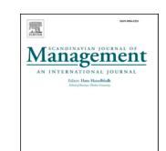

<!-- A3.R18 | source: papers_json/A3.R18/ -->

NON SOLUS
ELSEVIER

المحتويات متاحة في[ ScienceDirect](www.sciencedirect.com/science/journal/09565221)

## Scandinavian Journal of Management

الصفحة الرئيسية للمجلة: [www.elsevier.com/locate/scajman](https://www.elsevier.com/locate/scajman)

## الاستراتيجية كممارسة أم كمحاكاة ساخرة؟ دراسة حالة للخطة الاستراتيجية في إحدى الجامعات

Mats Alvesson , Stefan Sveningsson *

*Department of Business Administration, School of Economics and Management, Lund University, Sweden*

ARTICLE INFO

*Keywords:* Strategy Planning Parody University Practice

## الملخص

توضح هذه الورقة، استنادًا إلى دراسة حالة لإعداد خطة استراتيجية في جامعة تقليدية إلى حد ما، المشكلات وإمكانية انعدام المعنى في العمل بالخطط الاستراتيجية في هذا النوع من البيئات، التي تتميز بمعايير مهنية قوية. يثير كبار العاملين المشاركين في العمل الاستراتيجي شكوكًا قوية حول العملية والنتيجة، ويأخذون مسافة منها. أما المعاني المحتملة للخطة الاستراتيجية، إلى جانب امتلاك استراتيجية ('حقيقية') للجامعة، مثل توصيل صورة العلامة، أو بناء الهوية، أو إنتاج صورة عن الإدارة الرشيدة، فقد أتت بنتائج عكسية. تثير الورقة شكوكًا حول رؤية التخطيط الاستراتيجي، وأيضًا حول الاستراتيجية كممارسة أو كعملية. ويُقترح فهم بديل للاستراتيجية: الاستراتيجية كمحاكاة ساخرة.

## **1.** **المقدمة**

ما هي الاستراتيجية؟ بالطبع، هناك آلاف الآراء والتعريفات والأمثلة التجريبية والتفاهمات لمفهوم 'الاستراتيجية'، حتى لو اقتصرنا على السياق التنظيمي. تتراوح هذه من التخطيط على المستوى الأعلى وترتيب القوات وفق خطة المعركة أو خطة العمل، إلى الأنماط الناشئة تدريجيًا والأكثر أو الأقل تزامنًا، ومن التحليل والخطط إلى الممارسة التي يقوم فيها الناس 'بعمل' الاستراتيجية – وغالبًا ما يُصاغ ذلك بمصطلح الأسترتة/التنظيم - أو إلى الاستراتيجية كخطاب له تأثير تأديبي عرضي على الأفراد والمنظمات. أحيانًا تتعلق الاستراتيجية بتحريك منظمة بأكملها في اتجاه محدد، وأحيانًا تكون أقرب إلى قضايا فرعية-وظيفية، مثل استراتيجية الموارد البشرية أو استراتيجية تقنية المعلومات، أو تخطيط وحدة معينة.

تاريخيًا، لم تكن المنظمات مهتمة كثيرًا بالاستراتيجية بمعنى واضح، لكن الاستراتيجية أصبحت الآن مؤسَّسة باعتبارها عملًا 'عاديًا' (Knights & [Morgan, 1991)](#page-10-0). دخلت بجدية أكبر إلى عالم الشركات في خمسينيات القرن الماضي، ثم توسعت إلى القطاع العام، وأصبحت مؤخرًا نسبيًا ممارسة في قطاع الجامعات أيضًا. ويعود ذلك جزئيًا إلى أنه كثيرًا ما يُقال إن مؤسسات التعليم العالي أيضًا تواجه عالمًا متزايد التعقيد بأصحاب مصلحة متنوعين ينبغي الاعتراف بهم بمساعدة مفاهيم – مثل التخطيط الاستراتيجي - كانت تقليديًا تُنسب إلى عالم الشركات. وغالبًا ما يُصاغ هذا التطور كظهور للرأسمالية الأكاديمية أو تحول التعليم العالي إلى شكل شركاتي [(Huzzard ](#page-10-0) [et al., 2017; Slaughter ](#page-10-0)& Rhoades, 2009). ونتيجة لذلك، يبدو أن معظم المنظمات اليوم تعمل بالاستراتيجية. ومع ذلك، ليس من البديهي

أن تكون الاستراتيجية ضرورية أو مهمة أو تعمل بسلاسة في قطاع الجامعات، حيث قد لا يتوافق التنوع الكبير من التخصصات والمهنيين المتوقع منهم أن يكونوا مستقلين ويقودوا أفكارهم ومشاريعهم الخاصة مع إمكانية وجود استراتيجيات جامعية شاملة. من المهم النظر فيما إذا كانت بنية أو ممارسة معينة موجودة بسبب ضرورة ونفع وظيفيين، أو لأن المنظمات تشعر أنها بحاجة إلى تلبية التوقعات لأسباب تتعلق بالشرعية (Meyer & [Rowan, 1977](#page-10-0)) أو أنها تقلد غيرها وتدخل في التماثل المؤسسي (DiMaggio & [Powell, 1991)](#page-10-0). وثمة سؤال بحثي مثير للاهتمام يتمثل في كيفية – وهل – يعمل العمل الاستراتيجي في الجامعة. يؤكد كثير من الباحثين على قيمة وضرورة الإدارة الاستراتيجية في الجامعات، بينما يرى آخرون أن ذلك غير ضروري وعقيم. يمكن مقارنة الحاجة إلى إدارة مسؤولة، ونظام، وتكامل، وتأثيرات تآزرية، وتغيير مخطط تحققه الاستراتيجية، إلى جانب الجمع بين الاستراتيجية من أسفل إلى أعلى ومن أعلى إلى أسفل – المبادرات المحلية والتشذيب والتنسيق المركزي - بأفكار مفادها أن الاستراتيجية زائدة عن الحاجة إلى حد ما وتفتقر إلى المعنى في المنظمات التعددية مثل الجامعات (التقليدية)، حيث تكون الشبكات الأكاديمية والتمويل الخارجي والمثل الكونية محورية، ويكون معظم أعضاء هيئة التدريس أكثر توجهًا نحو أقرانهم منه نحو المديرين، الذين يُنظر إليهم غالبًا على أنهم يقومون بأعمال منزلية.

تدرس هذه الورقة عمل صياغة الاستراتيجية الرسمي في جامعة كبيرة في أوروبا. وتستند إلى مقابلات مع فاعلين رئيسيين شاركوا في العمل الميداني – في سلسلة من ورش العمل - لتصميم الخطة. وبناءً على ذلك، ندرس آراء المشاركين حول عمل التخطيط الاستراتيجي في مرحلته النهائية، قبيل اكتمالها في شكل وثيقة استراتيجية رسمية. ويشمل ذلك آراءهم حول أسباب

*E-mail address: *[stefan.sveningsson@fek.lu.se](mailto:stefan.sveningsson@fek.lu.se) (S. Sveningsson).

> ^*^ Corresponding author.

<!-- page 2 -->

أن عمل التخطيط هذا قد يكون ذا صلة أو غير ذي صلة، وما إذا كان له أثر جوهري على إدارة الجامعة. كما ندرس بشكل نقدي لماذا يرى الناس أنه من المهم المشاركة في هذا العمل الرسمي. ونطرح بذلك أسئلة من قبيل: ما الذي يمكن أن تدور حوله خطة استراتيجية في جامعة، ولماذا ينخرط الناس في هذا؟ كيف ينظرون إلى العمل المتضمن والمنتج النهائي؟ مستوحين ذلك من المقابَلين، نقترح فكرة الاستراتيجية كمحاكاة ساخرة كطريقة لالتقاط العمل الاستراتيجي، وهي فكرة بعيدة جدًا عن أفكار أهمية العمل الاستراتيجي الرسمي كما اقتُرح أحيانًا ([Whittington et al., ](#page-11-0) [2006)](#page-11-0). تفتح الورقة بذلك المجال للنظر إلى أنواع معينة من الاستراتيجية والعمل الاستراتيجي بطريقة جديدة، مضيفة إلى المخيال الخاص بفهم الظواهر التنظيمية.

## **2.** **حول الاستراتيجية والتخطيط الاستراتيجي**

نستعرض أدناه الاستراتيجية بمناقشة مقاربتي التخطيط والعملية أولًا، ثم، ثانيًا، باتخاذ مقاربة أكثر نقدية تنظر إلى الاستراتيجية كخطاب راسخ مؤسسيًا. نناقش هاتين المقاربتين بشكل عام وفي سياق التعليم العالي.

## *2.1.* *مقاربتا التخطيط والعملية*

تتسم الكتابات الاقتصادية التقليدية – القائمة على المقاربة الاقتصادية الجزئية - حول الاستراتيجية بأنها غالبًا مجردة للغاية ومنفصلة عن السياق، وتهدف إلى تسهيل صياغة الاستراتيجية وأدائها بفعالية. ومع أن هذه الرؤية نظرية إلى حد كبير، إلا أنها كان لها تأثير كبير في كيفية النظر إلى الاستراتيجية في العديد من المنظمات، بما في ذلك التعليم العالي (HE). فبالفعل، يُنظر إلى التخطيط الاستراتيجي في التعليم العالي على أنه متزايد الأهمية من قبل كثيرين يتبنون رؤية إدارية أكثر للاستراتيجية، ويقترحون أيضًا أن وصف الجامعة بأنها فوضى منظمة (Cohen & [March, 1974)](#page-10-0) ينبغي التخلي عنه ([Buckner, 2017; Immordino et al., 2016; Teece, 2018](#page-10-0)). فعلى سبيل المثال، يشدد [Siegel and Leigh (2018:7)](#page-10-0) على أن 'مفاهيم الإدارة الاستراتيجية مثل الميزة التنافسية، والقدرات التنظيمية، والأداء المستدام، ستساعد قادة الجامعات في تحديد المشكلات، وصياغة الاستراتيجيات، وتحديد القدرات التي يحتاجونها كقادة للاستجابة للتحديات وتحقيق الأهداف الاستراتيجية'. ويقترح كثيرون تخطيطًا استراتيجيًا منهجيًا في التعليم العالي، الذي كان تقليديًا يتسم بسيطرة المعايير المهنية، وهو ما يُظهر تطورًا لما أسميناه أعلاه 'الرأسمالية الأكاديمية' أو 'الإدارية الجديدة' (انظر Chance & [Williams, 2009](#page-10-0);[ Dooris et al., 2002](#page-10-0); [Keller, 1999:](#page-10-0) Kotler & [Fox, 1985;](#page-10-0) Kotler & [Murphy, 1981](#page-10-0); [Nemetz ](#page-10-0)& [Cameron, 2006;](#page-10-0) Rhoades & [Slaughter, 2009](#page-10-0); [Slaughter ](#page-11-0)& Rhoades, [2009; Teece, 2018;](#page-11-0) [Yuan et al., 2018](#page-11-0)).

يرتبط بظهور الرأسمالية الأكاديمية والإدارية ارتباطًا وثيقًا الحديث عن تسويق متزايد للتعليم العالي، وكما أشار كثيرون بشكل نقدي، عن تحول متزايد للتعليم العالي إلى سلعة (Slaughter & [Rhoades, 2009](#page-11-0)). وهذا تطور جعل أيضًا وضع المكانة السوقية في التخطيط الاستراتيجي أكثر بروزًا وشيوعًا، وغالبًا ما يكون ذلك في صورة بناء العلامة وإمكانية أن تُنشئ مؤسسات التعليم العالي صورة مواتية وجذابة لدى أصحاب المصلحة الرئيسيين، بمن فيهم الطلاب [(Huzzard et al., 2017; Naidoo ](#page-10-0)& Prin[gle, 2014](#page-10-0)). يُقال إن المنافسة الدولية والوطنية إلى جانب متطلبات الاعتماد الأكاديمي هي ما يدفع أساسًا مؤسسات التعليم العالي إلى تخصيص موارد كبيرة لطرق خلق صورة جذابة في أعين أصحاب المصلحة ([Chapleo, 2011; Vasquez ](#page-10-0)´ et al., 2013). ويشير بناء العلامة هنا إلى كيفية محاولة مؤسسات التعليم العالي تنظيم علاقاتها مع أصحاب المصلحة بالاستناد إلى مفاهيم ولغة جذابة - في بيانات الرؤية والرسالة وكذلك في وثائق الاستراتيجية وأشكال الاتصال المرتبطة بها. وعادة ما تتضمن صور العلامة التي تريد مؤسسات التعليم العالي ترسيخها مفاهيم شائعة ورائجة مثل العولمة، والتنوع، والاستدامة، والمساواة، والابتكار وما إلى ذلك (Sataø[en, 2015; Stensaker, ](#page-10-0) [2007)](#page-10-0). وهذا أيضًا ما لاحظناه في دراستنا.

بشكل عام، تتباين دراسات التخطيط الاستراتيجي في الممارسة داخل التعليم العالي من حيث تقييم أثرها الفعلي. يرى [Immordino et al. (2016)](#page-10-0) أن التخطيط قد يكون مفيدًا من خلال مساعدة الأقسام و

البرامج التعليمية على تطوير رؤى وأهداف وبرامج عمل. وتُعزى هذه النتيجة الإيجابية إلى مشاركة واسعة من أعضاء هيئة التدريس في العمل الاستراتيجي، بما يضمن الالتزام. بينما تُظهر دراسات أخرى نتائج أقل إيجابية. يرى [Gordon and Fisher (2015)](#page-10-0) أن الجامعات تفشل في إدراك أهمية التخطيط الاستراتيجي – خصوصًا مراجعات وتحليلات الأداء. بل يبدو أن الجامعات تستخدم التخطيط الاستراتيجي كأداة لبناء العلامة، جزئيًا نتيجة متطلبات الاعتماد المتزايدة والتموضع بين أصحاب المصلحة كما ذُكر أعلاه، ولكن دون أي أثر جوهري. ويتقاطع هذا مع دراسة [Chance and Williams](#page-10-0)' (2009) التي تفيد بأن الجامعات تبدأ بقوة في التخطيط لكنها تفشل في إتمام العمل من حيث التقييم، فتنتهي بضعف. ويُوضع التركيز على التصميم بينما يحظى التنفيذ باهتمام أقل. يرى [Conway et al. (1994)](#page-10-0) أن إحدى المشكلات الرئيسية في التخطيط الاستراتيجي في مؤسسات التعليم العالي بالمملكة المتحدة كانت العجز عن فهم دور الطلاب أو من يشكلون السوق.

لكن رغم أن الدراسات المذكورة أعلاه تعترف بمشكلات التخطيط، إلا أنها في معظمها تخلص إلى أنه – إذا نُفِّذ بشكل سليم - يظل مهمًا، لأن السوق، كما يُقال، أصبح تنافسيًا بشكل متزايد. يذكر [Gordon and Fisher (2015:5)](#page-10-0) أنه يمنح المديرين السيطرة المناسبة وأنه أمر حاسم. ويرى كثيرون أن على الجامعات توظيف التخطيط الاستراتيجي من أجل تحسين عملياتها التشغيلية ونتائجها (Chance & [Williams, 2009](#page-10-0)). أما ما إذا كانت هذه الرؤية تعبر عن حقيقة بديهية مثبتة أو مجرد أيديولوجيا أو أسطورة، فذلك أمر غير مؤكد.

في مقابل مقاربة التخطيط، تأسس منذ عقود بحث أكثر توجهًا نحو العملية ومحوريته المنظمة، بهدف التقاط نشوء الاستراتيجيات في المنظمات، وتفكيك العمل الاستراتيجي الجاري الذي يقوم عليه الاستراتيجيات، وبذلك بث الحياة في المعادلة (Balogun & [Johnson, 2004; Mintzberg, 1994; ](#page-10-0) [Pettigrew, 1985)](#page-10-0). وقد سلك هذا البحث منذ ذلك الحين مسارات مختلفة عديدة، من بينها تطوير بحث أكثر شمولًا وعمقًا – الاستراتيجية كممارسة (SAP) - لما يُقال إنه العمل الاستراتيجي الفعلي في المنظمات (Jarzabkowski & [Spee, 2009; Kohtama](#page-10-0)¨ki et al., 2022; Seidl & [Whittington, 2014; Whittington, 1996;](#page-10-0)). ويهدف هذا البحث إلى التعامل مع الصندوق الأسود للاستراتيجية من خلال دراسة العمل الفعلي للتخطيط الاستراتيجي وصياغته (Spee & [Jarzab](#page-11-0)[kowski, 2011; Whittington, 2003; 2004)](#page-11-0). وخلال العقد الأخير، تزايد بحث SAP بشكل كبير ليشمل مجموعة متنوعة من المحاور. وفي مراجعة حديثة، ينظم Kohtama¨[ki et al. (2022)](#page-10-0) محاور البحث في خمس مجموعات: الممارسة الفعلية، وصناعة المعنى، والخطاب، والمادية الاجتماعية، والمأسسة. وتشمل بعض هذه المحاور، ذات الصلة الخاصة بهذه الدراسة، الممارسات الاستراتيجية الرسمية مثل التخطيط وورش العمل والاجتماعات [(Healy et al., 2015](#page-10-0); [Johnson et al., 2010](#page-10-0); [MacIntosh et al., 2010](#page-10-0), Seidl & Gu´[erad 2015](#page-10-0); Spee & [Jarzabkowski, ](#page-11-0) [2011)](#page-11-0). فعلى سبيل المثال، يُنظر إلى العمل الاستراتيجي الذي يجري في ورش العمل – ويُصاغ كـ 'ممارسة ورشية' ([Whittington et al., 2006](#page-11-0)) – على أنه حقيقي وذو نتائج فعلية، وإن لم يكن كل هذا العمل يؤدي بالطبع إلى تنفيذ كامل للاستراتيجيات. ويرى البعض أن ممارسة ورش العمل قد تتعلق أكثر بطقسنة الاستراتيجية منها بمحاولة تنفيذها فعليًا [(Johnson et al., 2010)](#page-10-0). وبدلًا من افتراض أن الممارسة الاستراتيجية تنتج نتائج فعلية، نتبنى الرأي الأخير ونُفَهم ما يُسمى بالعمل الاستراتيجي بمصطلحات أكثر نقدية.

تعترف الدراسات ذات التوجه العملياتي صراحة بالظروف الإجرائية والسياقية الخاصة بالعمل الاستراتيجي في التعليم العالي، بما في ذلك الثقافة، والتاريخ، والارتباط الرخو بين الباحثين ومشاريعهم ([Deem, 2001; Holstein ](#page-10-0)& Starkey, 2018; Mintzberg & [Rose, 2003](#page-10-0); [Shattock, 2000](#page-10-0)). فعلى سبيل المثال، يُظهر [Spee and Jarzabkowski (2011)](#page-11-0) كيف يعمل التخطيط الاستراتيجي كعملية تواصلية – ديناميكية متكررة بين الحديث والنص تجري في اجتماعات متتابعة – تُسهل تجسيد خطط استراتيجية موثوقة ومشروعة قد تتجاوز أيضًا مشكلة استخدام الكلمات الطنانة والأفعال الفارغة من المعنى. وبالمثل، في دراسة عن التدويل في كلية أعمال بريطانية،[ يرى Sillince et al. (2012)](#page-11-0) أن الصياغات الغامضة للاستراتيجيات قد تسمح للناس – أكاديميين ومديرين - بنسب معنى يتماشى مع مصلحتهم. ويمكن بذلك الاستفادة من اللغة الغامضة (البلاغة) لإقناع الناس بأن مسار العمل الذي يفضلونه معترف به، إذ يمكن أن تُمَط البلاغة

<!-- page 3 -->

لتشمل معانٍ مختلفة. طور [Spee and Jarzabkowski (2017)](#page-11-0) أيضًا مفهوم 'الحساب المشترك' – أي الصياغات الغامضة لتغيير استراتيجي مقترح في جامعة بريطانية - لوصف كيف يمكن أن تتعايش صناعات المعنى المختلفة لتغيير مقترح وتُسهل على المشاركين الحفاظ على دورهم وهويتهم. وبذلك قد لا تتطلب التغييرات الاستراتيجية معنى مشتركًا لكي تُؤخذ على محمل الجد.

تركز بعض الدراسات العملياتية على أهمية الاعتماد على نماذج الأعمال في العمل الاستراتيجي في التعليم العالي. فعلى سبيل المثال، يُظهر [Holstein and Starkey ](#page-10-0) [(2018),](#page-10-0) كيف يمكن للجامعات أن تستوعب نماذج أعمال جديدة – تُصاغ كسرديات للجامعة المتمقولة - مع نماذج أكثر كلاسيكية – تُصاغ كتوجه بحثي تقليدي - مع الحفاظ على اتجاه استراتيجي قابل للتطبيق دون تصادم بين المثل. وهو ما يعترف بالمفارقات والتناقضات بدلًا من تبني منطق إداري خطي كما يُعبَّر عنه في نموذج التخطيط ([Meister-Scheytt ](#page-10-0) & [Scheytt, 2005)](#page-10-0).

وبشكل مختلف نوعًا ما، أجرى [Mintzberg and Rose (2003)](#page-10-0) دراسة طولية لتاريخ جامعة McGill، ووجدا القليل جدًا من وجود استراتيجية شاملة – مقصودة أو ناشئة - فيما يتعلق بالأنشطة المحورية مثل العروض الأكاديمية (الكليات، البرامج وما إلى ذلك) والبحث العلمي. وخلصا إلى أن الإدارة الاستراتيجية تلائم الجامعات بشكل سيء إلى حد كبير حين يُنظر إليها من منظور جامعي شامل. ثم يقترحان أن تتجنب الجامعات الانخراط في التخطيط الاستراتيجي. كذلك يقول [Buckland (2009:529)](#page-10-0) إن نموذج التخطيط يستدعي نظرة من أعلى إلى أسفل للاستراتيجية تكون في الواقع مُعيقة لأنها تُضعف الإبداع.

## *2.2.* *المقاربات النقدية*

رغم اختلافها إلى حد ما فيما يتعلق بأهمية الاستراتيجيات على مستوى الجامعة ككل، لا تزال معظم الدراسات المذكورة أعلاه تشترك في افتراض أساسي مفاده أن 'الاستراتيجية' مهمة و'حقيقية' بالنسبة للمنظمات وأدائها. وتتحدى هذه الرؤية فكرة [Meyer and Rowan](#page-10-0)'s [(1977)](#page-10-0) القائلة بأن الترتيبات الرسمية تعكس أساطير مؤسسية، ومن زاوية أخرى، أيضًا أطروحة [Knights and Morgan](#page-10-0)'s (1991) المستوحاة من [Foucault (1977, ](#page-10-0) [1980)](#page-10-0) القائلة بأن خطاب الاستراتيجية له قبضة راسخة على تشكُّل ذات وواقع الناس – المديرين والأكاديميين - (Knights & [Willmott, 1989](#page-10-0)). تتحول المنظمات إلى موضوعات لخطاب الإدارة الاستراتيجية، كتخطيط و/أو ممارسة، لكن الأمر يتعلق بالرمزية أكثر منه بالتحريك الموضوعي للمنظمات. تفترض فكرة الأسطورة المؤسسية أن الممارسات احتفالية ومنفصلة عن 'الممارسة الإنتاجية'. أما أنصار فوكو فيرون أن التأثير يقع أساسًا على تشكيل ذات الأفراد المشاركين، إذ يبنون أنفسهم كاستراتيجيين.

تقترح بعض الكتابات النقدية أن التخطيط الاستراتيجي يمثل موضة أو صيحة تشعر منظمات التعليم العالي بأنها ملزمة باعتمادها، خاصة في أوقات تزايد متطلبات الاعتماد الأكاديمي. يرى [Williams (2000)](#page-11-0) أن التخطيط الاستراتيجي في التعليم العالي قد يتعلق أكثر بالخضوع اللفظي لما هو رائج دون أن يكون له أثر جوهري. ويؤكد [Birn](#page-10-0)[baum (2000)](#page-10-0) أيضًا أن التخطيط الاستراتيجي في التعليم العالي ليس إلا صيحة سطحية يمكن التخلي عنها. وفي سياق مشابه، يقول [Sevier ](#page-10-0) [(2003:18)](#page-10-0): 'تنظر معظم الكليات والجامعات إلى التخطيط الاستراتيجي كطريق إلى الألم، لا كطريق إلى الوفرة'. وهذا يتقاطع جزئيًا مع نقد [Mintzberg and Rose (2003)](#page-10-0) أعلاه.

'تُجرد' المقاربات النقدية العمل الاستراتيجي من موضوعيته وتراه خارج أو أبعد مما هو 'طبيعي' أو 'معطى' من حيث المتطلبات الوظيفية و'العمل الحقيقي' ذي الآثار الإيجابية الواضحة على الاتجاه التنظيمي والنتائج المادية. وتتوافق المقاربتان أيضًا إلى حد كبير مع موقفنا، إذ يُنظر إلى 'العمل الاستراتيجي' الرسمي المزعوم في حالتنا من قبل المشاركين على أنه أكثر رمزية وأقل أثرًا جوهريًا.

بناءً على ذلك، تستند الورقة إلى حوار نقدي مع أدبيات متنوعة بدلًا من تطبيق إطار محدد سلفًا و/أو محاولة 'إيجاد وسد ثغرة' في الأدبيات [(Alvesson, 2013)](#page-10-0). نُقر بقيمة تقليد الاستراتيجية كممارسة، وأفكار آثار تشكيل الذات الناتجة عن العمل الاستراتيجي (تحويل المديرين إلى

'استراتيجيين') فضلًا عن جوانب إضفاء الشرعية للتخطيط الاستراتيجي، لكننا نتبنى مقاربة أكثر تشكيكًا مقارنة بكثير من التقاليد التي نوقشت، مستندين أساسًا إلى المعطيات الميدانية. نتبع بذلك بعض أفكار التوجه العملي – مثل الاعتراف بالقيمة المحتملة للعمل الاستراتيجي الرسمي - لكننا نمضي أبعد قليلًا بصياغة الدراسة من منظور التأمل النقدي بهدف إدراك كيف يمكن أن يكون العمل الاستراتيجي كممارسة أكثر إشكالية وأقل 'ممارسة' مما هو مفترض عادة. لا تزال معظم دراسات الاستراتيجية في التعليم العالي تسلم بالاستراتيجية، سواء كانت تخطيطًا أو عملية، وتفترض أن الاستراتيجية ضرورية بشكل ما وتقود إلى مكان ما (Nemetz & [Cameron, 2006](#page-10-0)). واستنادًا إلى ذلك، نرى أن هناك عجزًا لا يزال قائمًا في الدراسات المنفتحة عن التخطيط التي لا تفترض بالضرورة ضرورة أو موضوعية إيجابية أو سلبية للحديث الاستراتيجي الذي يتزايد تأثيره في التعليم العالي. نعتقد أن هذه الورقة تقدم حالة مثيرة للاهتمام حول كيفية نظر المشاركين في مشروع تخطيط استراتيجي إلى هذا العمل في مرحلته النهائية. واستنادًا إلى منصة تفسيرية ونقدية، تقدم رؤية مغايرة لما يُؤخذ غالبًا كأمر مسلم به بشأن أهمية التخطيط الاستراتيجي في التعليم العالي.

## **3.** **المنهجية**

يُنظر إلى المنهجية عادة على أنها تتعلق بالتصميم وإدارة البيانات. نتفق على أهمية ذلك، لكننا لسنا بالضرورة متعاطفين مع التركيز الحالي على المبادئ المنهجية شبه الوضعية المتعلقة بالإجراء، والتقنيات، والموضوعية، والشفافية، والفصل بين النظرية والبيانات وغير ذلك، كما يُعبَّر عنها مثلًا في بعض صيغ النظرية المؤسسة، التي تُشدد على أن 'مطابقة النظرية مع البيانات يجب أن تُجرى بدقة صارمة' (Strauss & [Corbin, 1994:](#page-11-0)273). نرى أن البيانات مُلهِمة لإنتاج وصف كثيف، مع عنصر قوي من التفسير موجَّه بحدس الباحث وخياله (Alvesson & [Sandberg, 2021; Alvesson ](#page-10-0)& Skoldberg, ¨ 2018). وتميل الشفافية الزائفة إلى إخفاء ذلك. فبالنسبة للعلوم الاجتماعية، يتعلق تقديم شيء جديد وذي صلة أكثر بأن يكون العمل مثيرًا للاهتمام وتجنب الأوصاف المجزأة التي تنتج عادة عن مبادئ إدارة البيانات كالترميز [(Cornelissen, 2017)](#page-10-0). وهناك قدر كبير من النقد لدراسات المنظمات بسبب 'انعدام الخيال التقني' ([Van Maanen, 1995:](#page-11-0)375). تُشدد مقاربتنا على الوصف الكثيف، ونوفر مساحة عبر قسم منهجي أوجز لنستخدمها في تقديم سرد نأمل أن يكون أكثر ثراءً لدراسة الحالة.

## *3.1.* *الإطار الميداني والمقابلات*

أُجريت الدراسة الميدانية في جامعة حكومية أوروبية تقليدية كبيرة، عقب قرار إدارة الجامعة الشروع في عملية إعداد خطة استراتيجية جديدة، إذ اعتُبرت الخطة السابقة قد أصبحت متجاوزة. وينبع القرار أيضًا من تفويضات حكومية تُلزم الجامعات الحكومية بصياغة خطط استراتيجية تتضمن أهدافًا وقيمًا ومبادئ توجيهية تُنفذها الكليات المختلفة. وعقب قرار إعداد خطة استراتيجية، عيّنت إدارة الجامعة قائد مشروع – يُشار إليه أدناه بالمهندس الرئيسي – لفريق مشروع يضم ممثلين عن كل كلية من كليات الجامعة، بهدف ضمان مشاركة واسعة وترسيخ العمل الاستراتيجي بين كليات الجامعة. أتاحت لنا هذه الحالة تحديدًا إمكانية دراسة العمل الاستراتيجي عن قرب نسبيًا في بيئة مهنية، غالبًا ما يُنظر إليها بأنها أقل اعتيادًا على أن تُحكم بمفاهيم إدارية كلاسيكية، وهو ما نعتقد أنه يبرر إجراء دراسة حالة ([Lindgreen et al., 2021](#page-10-0)).

وبذلك أُتيحت لنا فرصة فريدة لمتابعة العمل الاستراتيجي وهو لا يزال حيًا، وإن كان في مرحلته النهائية. واستنادًا إلى ذلك، تعتمد المادة الميدانية أساسًا على مقابلات مع 11 شخصًا – جميعهم شاركوا في العمل على تصميم الخطة الاستراتيجية. ونعتمد أيضًا على الخطة النهائية المكتوبة ومحادثات غير رسمية مع عدد كبير من الأشخاص في الجامعة المدروسة، غالبيتهم من كبار الأكاديميين. اختير المقابَلون على أساس أنهم كانوا جزءًا من فريق المشروع – الفريق المرجعي – الذي طُلب منه، بشكل منتظم نسبيًا، تقديم مدخلات لمقترحات فريق عمل صغير جدًا كان

<!-- page 4 -->

يتحمل المسؤولية الرئيسية عن كتابة الخطة. قابلنا شخصًا واحدًا على الأقل من كل كلية (باستثناء واحدة) شاركت في الفريق المرجعي، إضافة إلى رئيس المشروع (المهندس الرئيسي). قد يبدو عدد المقابلات صغيرًا بالطبع، لكننا غطينا غالبية الأشخاص المشاركين في المشروع، وكانت الأنماط التي وجدناها واضحة جدًا، وظهرت مؤشرات على التشبع. كما نعتقد أن الجودة أهم من الكمية في الدراسات النوعية، ونأمل أن يتفق القارئ معنا على أن مقابَلينا كانوا منفتحين وصادقين وغير رقيبين على أنفسهم إلى حد كبير في رواياتهم، وهو ما قد لا يكون شائعًا جدًا بين العمداء وكبار أعضاء المنظمة.

أُجريت جميع المقابلات، باستثناء واحدة، خلال المرحلة النهائية من تصميم الخطة. أما المقابلة مع رئيس المشروع فقد جرت بعد أسابيع من انتهاء العمل ونشر التصميم النهائي للخطة. سمح لنا إجراء المقابلات مع أشخاص منخرطين فعليًا في العمل الاستراتيجي بالحصول على رؤى جديدة حول ديناميكيات العملية نفسها - النقاشات، والتفاعلات، والآراء، والاستجابات، وردود الفعل، إلخ – بما في ذلك التفسيرات الحديثة لمحتواها. وضُمنت السرية لجميع المقابلات من أجل تيسير بناء الانفتاح والثقة بين الباحث والمُقابَل. تراوحت المدة الإجمالية للتسجيلات الصوتية للمقابلات بين 60 و90 دقيقة لكل مشارك، وجرى تفريغ جميع المقابلات حرفيًا.

كانت المقابلات شبه منظمة بشكل مرن بحيث تجمع الخبرات المستمرة لاجتماعات فريق المشروع والعمل بين الاجتماعات. انطلقنا من بروتوكول مقابلة وفر تركيزًا للمقابلات، لكننا حرصنا أيضًا على الحفاظ على مرونة تسمح بظهور مفاجآت وموضوعات أقل توقعًا أثناء المقابلات. وبذلك صيغت المقابلات كمحادثات حول الخطة، وخلفيتها ومشكلتها، وغرضها، وإمكاناتها كأداة حوكمة للجامعة، وتناولت مجالات مثل مفهوم الخطط الاستراتيجية ودورها بالنسبة للجامعات بشكل عام، ومدى ضرورة أو أهمية استخدام مثل هذه الأداة في جامعة. كما ناقشنا دور المشاركين أنفسهم وأهمية فريق المشروع في تصميم الخطة. وحاولت المحادثات تطوير فهم لكيفية صنع المشاركين معنى للعمل الاستراتيجي في سياق جامعي محدد من حيث المعنى والصلة. عملنا بجد لبناء تواصل جيد وفتح المجال للمقابَلين لتقديم روايات صريحة.

## *3.2.* *تحليل البيانات - المقاربة التفسيرية*

تتبع مقاربتنا مبادئ هرمنيوطيقية نحاول من خلالها تحديد معنى 'أعمق' أو غير بديهي لظاهرة ما ([Alvesson ](#page-10-0)& [Skoldberg, ](#page-10-0)¨ 2018). نحاول فهم ماهية الاستراتيجية والعمل الاستراتيجي، متجاوزين البناءات التقليدية والآراء المُعلَنة (بيانات السطح) للمُخبرين. هناك ميل قوي ومؤسف لدى البحث النوعي عمومًا إلى الانجراف نحو أسلوب 'التحليل العاملي' في التعامل مع البيانات، مع تركيز على ترميز ضيق جدًا واختزال المعاني الغنية إلى فئات يمكن ربطها إحصائيًا، وهو ما يعيق أساليب أخرى لإجراء البحث ([Cornelissen, 2017)](#page-10-0). وكما يرى [Saldana ](#page-10-0)˜ (2013:4) فإن الترميز هو 'فعل تفسيري'، والجانب الحاسم هنا هو المعاني الكامنة، الضمنية: عمّ يدور الأمر حقًا؟ والإشارة إلى الاستعارات الجذرية أو الصور المعرفية الكامنة وراء ما يُقال صراحة هي أحد الخيارات الممكنة هنا (Alvesson & [Sandberg, 2021](#page-10-0);[ Morgan, 1980](#page-10-0)). في عملية تحليل المادة الميدانية، عملنا على تفسير وتحديد الأنماط والاتجاهات البارزة، وفي النهاية الموضوعات والظواهر التي تكررت في المقابلات، وكذلك التي ظهرت في الأحاديث غير الرسمية مع كثير من كبار الأكاديميين. ثم شكلت هذه الموضوعات والظواهر السائدة فهمًا أعمق لمعنى العمل الاستراتيجي. ومن خلال تحديد هذه الأنماط والموضوعات بشكل منهجي، تمكّنا من تشكيل بنية موضوعية للمادة الميدانية حول موضوعات محددة – مثل التثاؤب، والسخرية، والصياغات المُخفَّفة - أشارت إلى أن العمل الاستراتيجي كان محاكاة ساخرة.

نعتقد أن مادتنا المستقاة من المقابلات، مع إقرارنا بمخاطر التعميم المفرط، تقدم حالة غنية ومثيرة للاهتمام تتيح لنا توليد أفكار عن الخطط الاستراتيجية في سياق التعليم العالي. لقد

فوجئنا إيجابيًا بالطابع غير الرقيب الذي تميزت به المقابلات.

## **4.** **الدراسة**

## *4.1.* *العمل الاستراتيجي ورؤية المهندس الرئيسي*

تنص الخطة الاستراتيجية المدروسة على أن الجامعة بحاجة إلى خطة للتعامل مع مجموعة متنوعة من التحديات المجتمعية مثل تغير المناخ، والاستدامة، والهجرة، والرقمنة. وتشير إلى أن إعادة تموضع استراتيجي للجامعة ضروري من أجل تطوير ثقافة معرفية موثوقة، وصياغة تموضع فريد وميزة مقنعة، خصوصًا بالنسبة إلى مؤسسات التعليم العالي الأخرى. وتشير إلى تميّز ومكانة عالية قد يجدهما الناس مثيرين ويرغبون في التماهي معهما.

تتألف الخطة من عدد قليل من المجالات ذات الأولوية – ربط البحث بالتعليم، والتعاون بين التخصصات، والتدويل، والقيادة كعامل نجاح، وبيئة عمل جاذبة، وبنية تحتية محسَّنة – تندرج تحتها عدة نقاط مختلفة. فعلى سبيل المثال، يعرف القارئ أن التعليم والبحث ينبغي أن يسعيا إلى أعلى جودة. أما الصياغات فهي غامضة نوعًا ما وتتبع المعايير المعاصرة – بدلًا من أن تكون مميزة وفريدة أو تتصدى لمشكلات محلية وظرفية - فيما يخص ما يجب التعبير عنه كجامعة.

بعد اكتمالها، قال المهندس الرئيسي وراء الخطة بتفاؤل في إحدى المقابلات إن تصميم الخطة كمجموعة متنوعة من قوائم نقاط العمل من شأنه أن يُسهل تنفيذها على مستوى الكليات. ووصف العملية بأنها منفتحة وشاملة:

'كان انخراط الموظفين في الخطة الاستراتيجية الجديدة قويًا جدًا حتى الآن. فخلال ما يقارب عامًا ونصف، جذب العمل على إنتاج مجالات التطوير وصياغة الأولويات اهتمامًا كبيرًا.'

يقول إن العملية كانت محفزة وأنه 'مع هذا العدد الكبير من الاقتراحات والآراء ووجهات النظر، كان الأمر عملًا كبيرًا لفرز الجوهر الكامن. والآن بعد أن أصبحت جاهزة سمعنا من كثيرين أنهم يعتقدون أنها جيدة، وأنهم يتعرفون على أنفسهم في الصياغة ونحن سعداء بذلك'.

ليس مفاجئًا أن يُعبِّر المهندس الرئيسي عن تفاؤله بشأن أهمية الخطة وأن الناس انخرطوا وأن وجهات نظرهم أُخذت بعين الاعتبار. من المفترض أن يُسهل ذلك تنفيذها، وينبغي أن يكون الجميع راضيًا إلى حد معقول عن النتيجة، بما يعكس مزيجًا من مراعاة الآراء وضرورة الانتقاء والتركيز. لكن هل تُشاطر هذه الرؤية أيضًا من قِبل المشاركين في العمل والمساهمين في النتيجة؟

## *4.2.* *فهم المشاركين للعمل الاستراتيجي*

يُنظر إلى الخطة *بإيجابية أقل *من قِبل المشاركين فيها. يجد المستجيبون أنها فارغة وغير مفيدة وحتى سخيفة. ورغم أن المبرر المُعلَن كان إعادة تموضع الجامعة إزاء التحديات المجتمعية المذكورة أعلاه، لم يكن لدى كثير من المشاركين رؤية مشتركة حول ما إذا كان هناك تحديد فعلي للمشكلة يُشكل أساس العمل. بل قال بعض المشاركين إنه لم تكن هناك مشكلة محددة تبرر الخطة الاستراتيجية، كما عبّر عن ذلك أحد المشاركين:

'لا، الأمور تسير على ما يرام هنا، لا توجد مشكلة ملموسة.' (Toby).

'كتب هذا شخص لا يعاني من مشكلات فعلًا. هكذا ينبغي أن تُفسّر الأمر، لأنه... هناك جودة عالية نسبيًا في التعليم... لا، لا أعتقد أن هناك توجهًا قائمًا على المشكلة في هذه الحالة، فعادة يكون لدينا تحدٍّ وفرصة، أنا حقًا لا أعتقد ذلك.' (Buster)

بالطبع، تحدث بعض المشاركين عن مشكلات عامة أو أوجه قصور في الجامعة مثل غياب التنسيق

<!-- page 5 -->

بين التخصصات وعزلة تنظيمية رأسية قوية، لكن هذه المشكلات لم تكن محور العمل الاستراتيجي للفريق المرجعي. وبشكل عام، حُدد قليل من المشكلات أو نقاط الضعف أو المخاطر المحلية الفعلية بشكل ملموس. ولم تُعالج القضايا التي قد تستدعي انتباهًا وتوضيحًا وخطة للتعامل معها. ويتعزز هذا الغموض في عقلانية المشروع بأكمله عند الاستماع إلى حديث المشاركين عن محتواه وعمليته ونتائجه المحتملة.

## *4.2.1.* *المحتوى: مضحك ومُخفَّف*

يرى البعض أن الخطة *مزيج غريب ومضحك* من عناصر مختلفة. يقول أحد المشاركين بسخرية:

'أعني من النقطة واحد إلى أربعة...هناك بحث و...تعاون و....تعليم وتميز عالمي، تميز عالمي، تميز عالمي....و...ثم بيئة عمل جيدة...وهناك زمالة. ثم يُقحمون فقط (بعض) البنية التحتية المحسَّنة في النهاية أيضًا، وهذا حقًا كخلط التفاح بالكمثرى.' (Hanna).

ويرى مشارك آخر أن 'المحتوى يبدو غريبًا جدًا'، وأن الوثيقة مزيج مضحك من مُثل عامة جدًا واستثمارات في البنية التحتية، تفتقر إلى مضمون حقيقي. ويقول مشارك آخر: 'هذا المزيج من المحتوى أشبه بالحديث عن George وRingo وJohn وPaul ثم موقف الحافلات...هاها...' (Buster). يسخر هؤلاء المستجيبون أيضًا من فكرة 'التميز العالمي'. ويقول المشاركون إن الخطة يمكن أن تنطبق بالقدر نفسه على أي جامعة، متسائلين ببلاغة عمّا إذا كانت الخطة 'فريدة حقًا لهذه المنظمة بالتحديد؟' (George).

بوصفها مزيجًا مضحكًا من العناصر، *مُخفَّفًا*، ودون *تميّز*، ينظر الناس إلى الخطة على أنها بلا أهمية ومستحيلة العمل بها.

'لكن كيف تعني أنني أستطيع أن آخذ هذه الخطة إلى قسمي وأخبر الناس أننا سنعمل وفقًا لها بينما هي لا تقول شيئًا؟ لن تفعل الوثيقة شيئًا. السؤال هو ماذا يختار المرء أن يفعل، إن اختار أن يفعل شيئًا بالوثيقة. لقد أصبحت مُخففة.' (Wally).

'ليس الأمر أنك تضع هذا في أيدي الزملاء فتبدأ الأمور بالحدوث. ليس هذا هو الحال.' (Buster)

يظهر نقص المضمون في صياغات القيم العامة:

'(التنوع العرقي والاجتماعي، الفضول....، وتباعد الذات القائم على الفكاهة.) لا أستطيع تقبل ذلك الجزء...كانت لائحة التعليم العالي كافية. لقد تصفحت فقط القيم الأساسية ولاحظت أنهم أقحموا الماجنا كارتا، وأقحموا الأمم المتحدة...وهي مفاهيم مُخففة تمامًا مثل الديمقراطية. هذا الأمر بديهي إلى درجة أنه من المحرج أن تكون هناك حاجة لصياغته'. (Buster)

يقول مشارك آخر إن كثيرًا من الصياغات، بما فيها القيم العامة، *سخيفة*، وتخلق أثرًا كوميديًا

'حسنًا، أعتقد أن السؤال هو هل ينبغي أن نكون سعداء أم أن نضحك أو...لكن هل ينتمي هذا إلى استراتيجية...لا يمكنك خلط التفاح بالكمثرى بهذه الطريقة. كان ذلك غريبًا فعلًا...والجميع ضحك عليه...كان سخيفًا فعلًا'. (Toby)

استخدمت معظم المقابلات تعبير 'مُخفَّف'. ووجد البعض ذلك مضحكًا.

## *4.2.2.* *العملية: إثارة التثاؤب والضحك والسخرية*

في عملية العمل الاستراتيجي، سيطر شك متزايد تدريجيًا.

'الانطباع....هو أن Teodor (المهندس الرئيسي) دوّن ما فكر فيه. لم أُسأل، والشيطان وحده يعلم إن كان العمداء متورطين إلى هذا الحد اللعين في هذا. كان من المفترض أن نُبدي آراءً فربما بهذا المعنى شاركنا، لكن الأمر مُخفف تمامًا. أبدينا آراءنا على الأقل لكن الجميع تثاءب. نأخذ هذا بلا اكتراث لكنني أفهم إن تحول الأمر إلى سخرية.' (Buster)

كما يقول أيضًا إن:

'يتحول الأمر إلى تثاؤب لأن...أحدهم...ابتكر فكرة ويقول إنه، لأسباب تتعلق بالشرعية، نحتاج إلى وثيقة لنُظهر...لذا (مخاطبًا المهندس الرئيسي): 'يمكنك أن تكتب هذا الشيء المُمل معًا...'. يتحول الأمر إلى تثاؤب وضحك، وتظن أن أحدهم اللعين قضى وقتًا ممتعًا في مرفق مؤتمرات ما. حسنًا، يمكنك أن تستمتع بهذا.'

يقول Buster إن الناس كانوا يبتسمون بسخرية أثناء عرض الخطة. الخطة الاستراتيجية قوبلت باللامبالاة والتباعد والسخرية.

اقترح البعض أن العملية كانت منفتحة من حيث الآراء، لكنهم كانوا أقل تفاؤلًا بشأن أثرها، مدّعين أن 'لم يكن سهلًا تقديم مدخلات...من الصعب نوعًا ما التأثير كثيرًا'، وتحدثوا عن عملية كانت 'ليست سهلة المناورة'. (Karl) ويرى آخرون أن الانفتاح كان أكثر ظاهرية منه حقيقيًا، إذ لم يُعترف بكثير من الآراء مطلقًا وأصبحت العملية تُدار بإحكام متزايد. ويرى أحد المشاركين أن بعض الموضوعات في الخطة ظهرت فجأة في الاجتماعات دون أن يعرف أي من المشاركين – باستثناء قائد المشروع ربما – من أين أتت: 'أصبحت عملية محكومة في النهاية...كانت هناك أشياء تظهر في النهاية، ظهرت فجأة، ولا نعرف من أين'. (Toby)

آخرون أكثر وضوحًا:

'في البداية فقدت خيط الأمر...حيث تبين أن ستة أو سبعة أو ثمانية مجالات تركيز كانت موجودة بالفعل....حددتها الإدارة. شعرت وكأن الأمر مُرتَّب مسبقًا، مثل....'يمكنك المشاركة وإبداء الآراء لكن الإطار...مُعطى. الملامح الرئيسية....موجودة هنا بالفعل'. أتذكر من أحد الاجتماعات أن قلة...شعروا بالإهانة تقريبًا...ربما كلمة 'خُدعوا' مبالغ فيها...لكن مع ذلك'. (Hanna).

بشكل عام، يُنظر إلى العملية إلى حد كبير على أنها كانت مركزية إلى حد ما، ما قد يوحي بوجود أجندة مسبقة وبأن دعوة أعضاء هيئة التدريس كانت رمزية ومتعلقة بإضفاء الشرعية. وفي الوقت نفسه، يبدو أن لديهم اهتمامًا فاترًا، إذ افترض كثيرون أن العملية والنتيجة لم تكونا جديتين إلى هذا الحد. يبدو أن قائد المشروع وغيره كانوا منخرطين (أو غير منخرطين بما يكفي) في مشاريع مختلفة و/أو يعيشون في كواكب مختلفة. وهذا ليس أمرًا غير معتاد – فغالبًا ما يختلف الشخص الأقدم والمرؤوسون في كيفية فهمهم (أو على الأقل حديثهم عن) 'نفس' العملية ([Alvesson ](#page-10-0)& Sve[ningsson, 2025; Spicer, 2018](#page-10-0)). وبناءً على هذا التباين يمكن للمرء أن يتساءل عن أهمية هذه الخطة – في نظر المشاركين - بالنسبة للجامعة.

## *4.2.3.* *النتيجة: أقل فائدة للجامعات؟*

معظم المُقابَلين متشككون في إمكانية إدارة الجامعة من خلال وثيقة. ويرى البعض أن محتوى الخطة يصعب ترجمته إلى إجراءات محددة، ويصفون التصميم بأنه 'الطرف المتطرف الساخر من الخطط الاستراتيجية'، في إشارة إلى 'كلمات ومفاهيم....يستحيل ترجمتها إلى ما يفعله الناس في حياتهم اليومية' (Donner). يشير المُخبر إلى 'عدم تطابق بين المُثل التي نلتزم بها جميعًا وما ينبغي ويمكن فعله': 'لا نعرف حقًا كيف ينبغي ترجمة هذا، وهذه مشكلة كبيرة' (Donner). ويتابع قائلًا: 'هناك قلة قليلة جدًا جدًا جدًا ممن يكرسون أنفسهم لربط عملهم اليومي بالخطة الاستراتيجية'.

يعزز هذا التصريح مشكلة جعلها ذات معنى بالنسبة للواقع اليومي:

'أعتقد أن... العميد الذي يأخذ هذا ويقرأ فقط 'يا للعجب، هذا جيد، لم أفكر في هذا'. حقًا، هذا العميد

<!-- page 6 -->

فعلًا... غير موجود. فعلًا سيكون ذلك أشبه بأحمق. حالة استحكم فيها مبدأ بيتر تمامًا.' (Buster).^1^

يضيف Buster ضاحكًا أنه لا يمكنك أن تضع الخطة في أيدي الناس وتتوقع أن يحدث شيء. يُنظر إلى الخطة على أنها غامضة مع شعور قوي بـ 'إذن ماذا؟'.

'سيتم طباعتها وسيتلقى جميع الموظفين نسخة. ثم ستوضع في أرشيف أوراق ما أو في درج، في أفضل الأحوال.' (Hanna)

بالفعل، أعرب كثير من المُقابَلين عن شكوك حول إمكانية إدارة الجامعات بشكل عام بالخطط الاستراتيجية. ويبدو أن هذا الإدراك الناشئ يؤدي تدريجيًا إلى انخراط أكثر فتورًا في العملية. ويتناقض هذا بشدة مع رؤية قائد المشروع الذي يرى الخطة طريقة مناسبة لتنسيق عمليات الجامعة.

بناءً على رأي كثير من المشاركين، يمكننا أن نلخص أن الخطة تحتوي على مجموعة من الصياغات المُخففة والمضحكة التي بالكاد تثير تفكيرًا جديًا، أو تشجع عواطف إيجابية، أو توجه العمل. وهذا يلتقط بعض الجوانب المضحكة المهمة للعملية التي قد تُحفز استعارة جديدة نوعًا ما للعمل الاستراتيجي: *الاستراتيجية كمحاكاة ساخرة*. وبما أن هناك تيارًا واسعًا يستخدم اختصار SAP (الاستراتيجية كممارسة)، غالبًا ما يدرس المديرين في ورش العمل والاجتماعات، يمكننا أن نسمي هذه المقاربة للممارسة الاستراتيجية SAPa. وبالطبع، يمكنك دراسة SAP باعتبارها SAPa، أي النظر إلى العمل المضحك نوعًا ما لـ'الاستراتيجيين' في الممارسة. أحيانًا يكافح الناس لكي يرتقوا إلى مستوى مثال 'الاستراتيجي'. سيكون هذا مختلفًا عن معظم دراسات SAP الأخرى التي تنظر إلى الاستراتيجية كعمل جاد.

## *4.3.* *إذن، عمّ تدور الخطة الاستراتيجية؟*

يبدو أن 'المنطق' أو غيابه وراء الخطة الاستراتيجية لا يتعلق بتحديد المشكلات وتحديد خطة للتعامل معها تؤدي إلى تغيير وتحسين تنظيمي. إذن، عمّ تدور الاستراتيجية، إن لم تكن عن وسائل ومسارات لبلوغ الأهداف، وخطة رئيسية لتوفير التوجيه وإرشاد القوى العاملة؟ استنادًا إلى المقابلات، وإلى خيالنا الخاص، تبرز ثلاثة معانٍ؛ أداة تسويقية؛ وطقس اندماج اجتماعي؛ و'لعب دور المنظمة' (انطباع بمنظمة 'حقيقية' ومُدارة).

## *4.3.1.* *الخطة الاستراتيجية كعمل على صورة العلامة*

يتحدث الناس عن الخطة كأداة لبناء العلامة لخلق صورة الجامعة كمعاصرة وعصرية. يقول أحد المُقابَلين إن النص ذكّره بـ'وكالة إعلانات صغيرة' (Buster)، بينما أشار آخر إلى بناء العلامة: 'دارت بعض النقاشات حول كيف نريد تسويق أنفسنا، أين نريد أن نكون؟' (Melvin). لكن هناك شعورًا واضحًا بأن أثر بناء العلامة لا يعمل بشكل جيد:

'كان هناك (في التصميم) مزيج من...الأشياء المعاصرة، وكان مزيجًا من مشكلات حقيقية وفي هذا الجانب....كلمات طنانة ومواكبة للتيار. أعتقد أنه يمكنك رؤية هذا في أماكن أخرى أيضًا، أن هذا شيء يتماشى مع التوقيت الآن.' (Karl)

يوحي التماشي مع التوقيت باستخدام كلمات طنانة، وهو ما نادرًا ما يُسهل تموضعًا سوقيًا مميزًا وصورة علامة واضحة. يُبرز كثير من المُقابَلين صعوبة قول ما هو أكثر من 'كلام فارغ':

'كان سيكون جيدًا لو استطاعت حل....ما تريده الجامعة؛ وما تمثله الجامعة. كذلك، لدى كلية الهندسة خطة استراتيجية....وهي أفضل...لكن هناك أيضًا الكثير من الكلام الفارغ فيها. إذا خرجت إلى المدينة وسألت الناس... ما الذي تجيده كلية الهندسة. تنظر إلى الصفحات الرئيسية ولا ترى ما الذي تجيده الجامعة أو كلية الهندسة، الأمر ليس سهلًا لعنة الله.' (Wally)

تُفضي جهود بناء العلامة إذن إلى مجموعة متنوعة من الكلمات الطنانة الفارغة والشاملة واستخدام خطاب شائع ذي أهمية أو إلزام ضعيفين ([Buckland, 2009; Gordon ](#page-10-0)& Fisher, 2015). وكما ذُكر، يمكن أن تنطبق الخطة الاستراتيجية على أي جامعة، كما لاحظ أيضًا [Watson (2000)](#page-11-0) من حيث مزيج من بيانات رؤية ورسالة فارغة في جامعات المملكة المتحدة. أما المعلقون الأقل لطفًا فيصفون هذا بأنه هراء الأعمال ([Spicer, 2018](#page-11-0)).

كثيرًا ما تحمل جهود بناء العلامة نبرة سخيفة نوعًا ما (كما هو الحال عندما تُدمج كائنات/صفات مختلفة تمامًا – مثل نجوم الرياضة والملابس الداخلية أو المشروبات الغازية والشعبية)، لكن جانب المحاكاة الساخرة يصبح أكثر وضوحًا عندما يجد الموظفون الأوفياء وكبار السن في الجامعة أن جهد بناء العلامة غامض جدًا بل وسخيف. تثير معاني بناء العلامة قدرًا من التباعد لدى المشاركين في دراستنا.

## *4.3.2.* *آلية الاندماج الاجتماعي: جهود التوحيد في جماعة/ * *هوية*

تتمثل الرؤية الثانية في أن هذا محاولة لخلق اندماج اجتماعي وتشكيل هوية جامعية. يُفترض أن تنضم القبائل الأكاديمية الفرعية المتنوعة والمتشظية في احتفال جامعي موحّد يُعزز المجتمع من خلال الخطة كبيان.

يقول أحد المشاركين إن الرسالة هي أنها 'جامعة واحدة وتظهر خارجيًا كجامعة واحدة' (George). ويتردد هذا صداه على نطاق واسع لدى آخرين يشددون على الحاجة إلى الشعور بالانتماء لشيء ما. ومعنى الخطة هو أنها 'ستكتسب نوعًا من أثر التجميع بأننا لا نزال واحدة (جامعة). أعتقد أنها طريقة للناس ليشعروا بأنهم جزء من شيء أكبر.' (Toby)

لكن الناس يشككون في أن يكون لهذه الخطة الاستراتيجية هذا الدور التوحيدي. فعلى سبيل المثال، بعد الاقتباس أعلاه، يقول المُقابَل Toby إنه لا يعتقد أن الخطة تجعل الناس يرون أنفسهم جزءًا من شيء أكبر. وكما أشار Donner أعلاه، هناك سذاجة معينة (تفكير رغبوي) حول أهميتها وقيمتها بالنسبة للموظفين عمومًا.

'لا أعتقد حقًا أنها تقول شيئًا ذا معنى عمّا تكونه الجامعة، أو كيف ينبغي التعامل مع أسئلة الجودة أو....الحضور المجتمعي أو أي شيء من هذا القبيل. إنها مزيج من سرد الأشياء لكن....ليس هناك فكرة شاملة.' (Donner).

يبدو أن الخطة لا تعمل كمصدر إلهام لمن يعملون بها. يبدو العنصر الاندماجي أو أساس التماهي غير موجود، مما يقوض الخطة كآلية اندماج اجتماعي.

بالنظر إلى الاستجابات السائدة من خيبة الأمل والإحباط الخفيف والسخرية – بل إن بعض الناس يشعرون بأن العملية كانت مُرتَّبة مسبقًا وأنهم خُدعوا – لم تنجح رمزية عملية التخطيط ولا الوثيقة. بل يبدو أن الأشخاص المعنيين أصبحوا أكثر إدراكًا لصعوبة إيجاد شيء ذي معنى مشترك. يبدو أن الخطة تناقض غرضها (المحتمل): خلق السخرية والتنصل من الهوية أكثر من الثقة والاندماج.

## *4.3.3.* *لعب دور المنظمة * *جهود إظهار العقلانية والنظام*

تبرز رؤية ثالثة تتمثل في الرغبة في الظهور كمنظمة متكاملة وموجَّهة. تشير الخطة إلى أن الإدارة مسيطرة، وتُظهر عقلانية، وتمنح انطباعًا بمنظمة 'حقيقية'. الجامعة ليست مجرد فندق بحثي أو مجموعة متشظية من محاضرين مستقلين، بل شيء منظم ومُدار. يرى الفاعلون الأقدم أنفسهم جزءًا من نخبة إذا ساهموا في الاستراتيجية، إذ يقومون بعمل تجميعي تنظيمي بالغ الأهمية.

لكن هذه الفكرة تضعف بالنسبة للمشاركين خلال العملية وتُترك عندما يرون النتيجة (وغياب النتائج 'الحقيقية' بعيدًا عن الصياغات الغامضة). يربط المُقابَلون التخطيط الاستراتيجي بالموضة: 'هذا شيء يتماشى مع عصرنا... أن تكون لديك خطة استراتيجية'. تتلاشى تدريجيًا فكرة أن الإدارة تتحكم بعقلانية في المنظمة مع استمرار عمل التخطيط الاستراتيجي. يدرك المُخبرون أن تأكيد المشروع العقلاني 'يتلاشى في الطريق' (Melvin). يتفقون على أن الخطة الاستراتيجية قد لا تكون

> ^1^ ينص مبدأ بيتر على أن الناس يُرقَّون حتى يصلوا إلى مستوى أعلى من كفاءتهم.

<!-- page 7 -->

الطريقة الأكثر عقلانية لتنظيم جامعة:

'لا، بالطبع التخطيط ضروري لكن السؤال هو هل يجب أن يكون خطة استراتيجية. وتقل أهميتها إذا نظرنا إلى البحث الذي هو جزء رئيسي مما نحتاج إلى التعاون بشأنه.' (Toby)

يبدو الأمر برمته غريبًا، دخيلًا على السياق الجامعي الوطني: '...السؤال هو من أين يأتي هذا. أليس هذا نابعًا مباشرة من طريقة التفكير في القطاع الخاص؟' يتساءل Toby ببلاغة. ونتيجة لذلك، يصبح هذا 'اللعب' غير موثوق، ويجد المشاركون أن مشاركتهم شبه محرجة ويرغبون في التباعد عن المشروع. النص غير صحيح – لا يمكن إدارة الجامعة – والممثلون لم يُختاروا بشكل صحيح. يفتقرون إلى الشروط الصحيحة والكفاءة – ويواجهون صعوبات كبيرة في إنتاج شيء موثوق، بالنظر إلى تعدد المصالح، والتعرض العام، وقلة إمكانيات الإدارة العليا في التأثير كثيرًا. يتحول اللعب الجاد إلى كوميديا، بعناصر من المأساة، أي هجاء ([Skoldberg, 1994](#page-11-0)). مشروع مآله الفشل – مهمة مستحيلة.

## *4.3.4.* *لماذا لم تنجح الخطة الاستراتيجية*

اعتقد عدد ممن هم في الفريق المرجعي – ممثلين الأفراد الرئيسيين الذين يُتوقع منهم أخذ الخطة على محمل الجد والعمل بها (العمداء ورؤساء الأقسام) – أن الاستراتيجية تفتقر إلى القيمة والأهمية وأنها من غير المحتمل أن يكون لها أثر. قد تظل لها وظيفة كوثيقة تُعرض على جهات خارجية مهتمة محتملة، وبذلك تلبي متطلبات إضفاء الشرعية على البنية الرسمية (Meyer & [Rowan, 1977)](#page-10-0)، لكنها شيء آخر غير أن تعمل كاستراتيجية.

لم يتحقق تقريبًا الهدف المُعلَن للمشروع، وهو إنتاج أهداف وتوجهات ذات مصداقية وشرعية ومعنى يمكن أن تُشكل أيضًا إلهامًا وإرشادًا جوهريًا للجامعة مستقبلًا. وهذا يعني شيئًا أكثر جوهرية بكثير من وثيقة رسمية يكون وجودها مجهولًا أو غير ذي صلة بالنسبة لمعظم الموظفين.

هناك عدة تفسيرات لفشل الاستراتيجية، التي ربما كانت محكومًا عليها بالفشل منذ البداية. وكما ورد في المقابلة مع المهندس الرئيسي، طُرح عدد كبير من الآراء، وكان من الصعب استيعابها وتوليفها. وبذلك كان من الصعب العمل بالمقاربة من أسفل إلى أعلى – ويرتبط ذلك جزئيًا بالفروق الكبيرة بين الكليات والمجموعات. وهذا يؤدي إلى إدراج انتقائي وربما اعتباطي للجوانب، والأهم من ذلك، صياغات مجردة يمكن أن تستوعب مجموعة واسعة من الآراء. تنبع التجريدات والعبارات الإيجابية التي لا يمكن لأحد أن يعترض عليها – الجودة العالية – أيضًا من خطر التدقيق العام في الوثيقة. يجب أن تكون 'صحيحة سياسيًا' كما قال أحد المُقابَلين.

ولعل الأهم من ذلك هو هيمنة الطابع المتشظي تاريخيًا والمستقل بدرجة عالية للأجزاء المختلفة من المنظمة (الكليات، الأقسام، مجموعات البحث، والباحثون الأفراد)، مقترنًا بتركيز قوي على التنسيق الجماعي – الأفقي – في مقابل التنسيق الإداري الخطي – الرأسي. من شأن وثيقة قوية تفرض استراتيجية توجه وتراقب الكليات وأعضاءها أن تؤدي إلى معارضة ونزاع. وبما أن الإدارة العليا يُنتخب أعضاؤها من قبل أعضاء هيئة التدريس والطلاب والموظفين الإداريين، فإن موقعها ليس قويًا جدًا. وثمة جانب إضافي هو أن شحذ الاستراتيجية في جوانب رئيسية مثل الجودة العالية في البحث والتعليم من شأنه أن يخلق مشكلات. فإذا أخذ المرء 'الجودة العالية' على محمل الجد، فينبغي معالجة جميع حالات البحث والتدريس ذات الجودة غير العالية، وهي مهمة ليست سهلة على الإطلاق، إذ ليس من السهل تحسين أو التخلص من الباحثين والمدرسين المتوسطي المستوى ذوي العقود الدائمة بشكل جذري.

في جامعات أخرى، تتسم بقدر أقل من الصفات الجامعية التقليدية، مثل هذا الاستقلال والقيم المهنية والتعددية، وبمستوى أعلى من الإدارية وأعضاء هيئة تدريس أكثر امتثالًا، قد يكون الوضع مختلفًا، لكن هذا خارج نطاق دراستنا.

## *4.4.* *لماذا الانخراط إذن في العمل الاستراتيجي؟*

بناءً على المعاني أعلاه – صورة العلامة، والاندماج الاجتماعي و

عقلانية الإدارة – يمكننا أن نلاحظ انفصالًا فيما يتعلق بالتحديات المجتمعية المذكورة سابقًا، وكلها غائبة إلى حد ما عن العمل الاستراتيجي الفعلي. لم يناقش أي منها بشيء من التفصيل من قبل المُقابَلين عند سؤالهم عن أسباب تطوير الخطة. بل أشار كثيرون إلى غياب مشكلة حقيقية، أو حاولوا الإشارة إلى مخاوف، لكنهم فشلوا في إيجاد أسباب وجيهة تتجاوز إنتاج خطة استراتيجية كهدف في حد ذاتها. ذُكرت أفكار بناء العلامة، والهوية، وتلميحات إلى عقلانية الإدارة، لكنها لم تكن مقنعة. يلخص اقتباس من أحد المُقابَلين المحاكاة الساخرة:

'لكن هذا أيضًا غائب هنا (المشكلات) لذا فهو ليس أي فكر عقلاني، لكن، اللعنة، إنه Teodor (المهندس الرئيسي) من كتب هذا في بعد ظهر يوم أحد لكن....أتساءل من أين جاءت الفكرة اللعينة.' (Buster)

بناءً على ذلك قد يتساءل المرء لماذا تكون الخطة الاستراتيجية ضرورية للعمل بها ولماذا انخرط المشاركون في العملية. تشير بعض الأبحاث إلى أن الاتساق المتزايد حول الغرض والاتجاه في المنظمات غير المتجانسة يمكن أن يُدار باستخدام مفهوم النية الاستراتيجية (Hamel & [Prahalad, 1999)](#page-10-0) كأداة بلاغية لجعل الاستراتيجيات أكثر تكاملًا وقابلية للفهم (Mantere & [Sillince, 2007](#page-10-0)). وهذا قد يزيد من جاذبية العمل الاستراتيجي. كما توجد اقتراحات بأن الفوائد المحتملة من ورش العمل لا ترتبط فقط بالمستوى التنظيمي الأوسع (الرؤى، الاتجاه الاستراتيجي المُعلَن، خطط الأعمال كما في [Whittington ](#page-11-0) [et al., (2006)](#page-11-0)) بل أيضًا بفوائد شخصية بين الأفراد مثل التماسك بين المديرين، والشعور المشترك بالغرض والهوية ([Hodgkinson ](#page-10-0)& [Healy, 2008](#page-10-0);[ Johnson et al., 2010](#page-10-0)). قد يشعر الناس بأهميتهم ويكتسبون مكانة وهوية معززة من العمل بالاستراتيجية والاعتقاد بأنهم يشكلونها. كذلك، تُقترح فوائد معرفية مثل فهم أفضل للقضايا الاستراتيجية أو تمكين الحديث عن المعتقدات الأساسية للمنظمة من قبل [Healey et al. (2015)](#page-10-0). ويرى [Hendry and Seidl (2003)](#page-10-0) أن ورش العمل الاستراتيجية المنفصلة تتيح للناس الخروج من الروتين والأنماط الذهنية الراسخة والانخراط في أسئلة أوسع. وفي حالة تغيير رقمي نحو زيادة تجارة التجزئة متعددة القنوات، يدرس [Do Vale et al. ](#page-10-0) [(2021)](#page-10-0) أهمية الممارسات على المستوى الجزئي بين المديرين التشغيليين والمتوسطين لكيفية تطور العملية. بالنسبة للمديرين التشغيليين، عنت هذه الممارسات إجراءات غير رسمية ومحلية وعملية مكّنت من رعاية وخدمة العملاء، بينما يسر المديرون المتوسطون أساسًا التفاعل والفهم بين المستويين التشغيلي والأعلى. وبذلك يمكن النظر إلى العملية على أنها عملية من أعلى إلى أسفل ومن أسفل إلى أعلى في آن واحد، اختُبرت كذات معنى وأهمية بالنسبة للمشاركين. وهذا يشكل تباينًا مع حالتنا.

كما اقتُرح أعلاه، لا يبدو أن هذه الدوافع والحوافز والمصالح كان لها أثر كبير جدًا في حالتنا، إلا في البداية. يشير كثير من المُقابَلين إلى أنهم بدأوا بحماس، لكنهم بعد ذلك فقدوا كثيرًا من الاهتمام وشعروا بالسخرية إزاء النتيجة. فقدت الممارسة القائمة من أسفل إلى أعلى زخمها لأن الناس لم يتمكنوا من التماهي معها أو الشعور بالإلهام من العملية ونتيجتها، وبدا من الصعب استيعاب جميع المقترحات. العمل الاستراتيجي وغيره من المشاريع الفخمة جذاب وفارغ من المعنى في آن واحد، ما يشير إلى انتصار الفراغ ([Alvesson, 2022;](#page-10-0) [Hallonsten, 2022](#page-10-0)). كثيرًا ما تكون ممارسة ورش العمل في ما يُسمى مشاريع المكانة مُطرِيَة، إذ يمكن للناس أن يربطوا أنفسهم بصانعي الاستراتيجية في القمة. وحتى إن كان الأمر جوفاء، فإن الشعور بأنك مُختار، دون بالضرورة القيام بالكثير من حيث ضمان وجود أفكار جيدة (أو منع الأفكار السيئة) ووثيقة ذات معنى (أو غير إشكالية)، ربما يكون توليفة جيدة لتجنب الكثير من العمل مع تعزيز الذات في الوقت نفسه. من المرجح أن يكون هذا العنصر النرجسي دافعًا رئيسيًا للعمل الاستراتيجي في كثير من الأحيان ([Alvesson, 2022](#page-10-0)).

إنه بديل جيد عن 'العمل الحقيقي'، وعرض تنظيمي (Flyverbom & [Reinecke, 2017)](#page-10-0)، لكن في نهاية المطاف يأتي غياب 'العمل الحقيقي' بنتائج عكسية. يتلاشى الشعور الإيجابي بأن تكون جزءًا من شيء مهم محتمل، ويتنصل الناس من النتيجة. بناءً على ذلك، يبدو أن المشاركة في ورش عمل منفصلة لا تُنتج دائمًا نتائج إيجابية بل يُنظر إليها أحيانًا على أنها بلا معنى (Hodgkinson & [Wright, 2002)](#page-10-0). وقد

<!-- page 8 -->

اقترح بعض المؤلفين أن مجرد فصل ورش العمل عن الروتين اليومي قد يعيق فعليًا نقل الأفكار مرة أخرى إلى المنظمة [(Johnson et al., 2006](#page-10-0)).

يمكننا أيضًا الربط بالنظرية المؤسسية الجديدة التي أشارت إلى التقليد، وإضفاء الشرعية، والانفصال (Meyer & [Rowan, 1977; ](#page-10-0) DiMaggio & [Powell, 1983; 1991](#page-10-0)) إذ لم يبدُ أن معظم المشاركين رأوا هذا المنطق في العمل، فعلى الأقل لم يشيروا إلى أي أثر لإضفاء الشرعية، بل عبّروا عن إحباط. لماذا هذه النتيجة غير المُرضية؟

يشير كثيرون إلى أن الخطط متوقعة من أجل مواكبة العصر، لكن هذا لم يُعالَج على ما يبدو بشكل إيجابي، بل ارتبط بالتقليد والمسايرة. يشرح أحد المشاركين:

'أعتقد أن أحدهم في مجلس الإدارة قال، اللعنة....أو الرئيس الذي قرأ في صحيفة ما أن على المرء أن تكون له استراتيجية. يبدو الأمر كذلك ولا شيء يشير إلى غير ذلك. ابتكر أحدهم فكرة أنه، لأسباب تتعلق بالشرعية، نحتاج إلى وثيقة نُظهرها ونطرحها. لذا Teodor (المهندس الرئيسي)، عليك أن تكتب هذا الشيء المُمل معًا....وهناك أهداف الاستدامة للأمم المتحدة وما شابه، وهو مفعم بالصحة السياسية.' (Buster)

إن جاذبية الكلمات الرائجة – الاستراتيجية، القيادة، الاستدامة، التدويل إلخ – والإغراء الذي يشعر به بعض الناس للاستفادة منها هو ما يؤدي غالبًا إلى مشكلات في التميز والصلة والوضوح وتبعات العمل عند تصميم الخطط. تصبح الخطط عامة ولا يُنظر إليها على أنها تقول شيئًا ذا صلة. إنه مثال كلاسيكي للبلاغة الفارغة التي تنتهي كمحاكاة ساخرة. تغطي دالة 'الاستراتيجية' كل شيء وبالتالي لا شيء، لدى الممارسين وكذلك الأكاديميين (Blom & [Alvesson, ](#page-10-0) [2015)](#page-10-0).

يبدو أن الأعراف الكامنة وراء طريقة إعداد الخطط الاستراتيجية تعيش أيضًا حياتها الخاصة. تُستنسخ طقوس الاستراتيجية وأعرافها بشكل أداتي إلى حد كبير، كما يقول أحد المشاركين: 'لأن الجميع يفعل ذلك. أعتقد أن السبب هو ذلك، أليس كذلك؟' (Toby)

العمل الاستراتيجي – مثل ممارسة الورش – هو إذن جزء من النظام التقليدي لعمل مجلس الإدارة (أو الإدارة). وهناك أحيانًا تأمل محدود في الغرض لصالح 'واجبات' غير مُساءَلة. الرجل المحترم يرتدي قبعة، والعميد ينخرط في العمل الاستراتيجي ولديه خطة استراتيجية. وبدون ذلك ينقص شيء. هناك نوع من النشاط الانعكاسي التلقائي هنا، يُشير إلى شكل من أشكال التأمل المحدود عندما يتعلق الأمر بالتفكير النقدي. يشير [Alvesson and Spicer (2016)](#page-10-0) إلى هذا بأنه غباء وظيفي. يبدو أن كبار الأشخاص يريدون شيئًا يبدو قويًا وذا قيمة للقيام به، بعيدًا عن التعامل مع عدد لا نهائي من القضايا الروتينية والإدارية. لمَ لا خطة استراتيجية؟ تبدو فكرة رائعة. لكن ليس من السهل ملؤها بمادة تؤدي إلى شيء منتج. وفي المقابل، يبدو استخدامها في هذه الحالة – شامل ومجرد ومُوحّد بدلًا من متميز وفريد – ساخرًا. لكن عندما تبدأ العربة بالتحرك، يبدو من الصعب إدراك أو الاعتراف بأن هذه كانت فكرة سيئة كان ينبغي إيقافها.

فعلى سبيل المثال، ثمة مشكلة رئيسية، تتقاطع مع المشكلات الأخرى، هي أن التوقع هو تجنب أي شيء مثير للجدل أو منحرف عن المألوف.

'كنا نفكر فيما إذا كانت (الرؤية) ينبغي أن تتغير أم لا، لكن لم يأتِ أحد بشيء أفضل. من الصعب إيجاد رؤية أفضل. (المُحاور: لماذا رؤية) نعم، يمكن للمرء أن يسأل نفسه ذلك. فكرت أيضًا أنه ينبغي أن نُشكك في عالمنا أيضًا. لكن هذا غير موجود، لا. الآن الأمر أقرب إلى اللعب على الحبل....يتبع المرء هذا السباق المعاصر. الأمر ليس أن تتخذ رأيًا منحرفًا....أول شيء تفعله، مع تلك الرؤية، لا تفعل ذلك.' (Toby).

فربما تكمن الفكرة في الخطة الاستراتيجية في أن تبدو جيدة وغير مثيرة للجدل فحسب. لكن هذا يبدو أنه يترك طعمًا مُرًّا لدى المشاركين، غير راضين إلى حد كبير عن النتيجة. قد تبدو جيدة، لكن طعمها ليس جيدًا.

## **5.** **المناقشة**

تُشدد الأغلبية الساحقة من باحثي الاستراتيجية، بمن فيهم دارسو

العملية والممارسة، على الطابع الجوهري والمهم للاستراتيجية. وتتحدى حالتنا لجامعة بحثية كبيرة بعض الافتراضات والادعاءات المشتركة على نطاق واسع في أدبيات الاستراتيجية، وتشير إلى أن العمل الاستراتيجي أحيانًا لا يؤدي إلى الكثير ولا يُؤخذ على محمل الجد من قبل المشاركين. قد يرونه شكلًا من أشكال العمل الزائف، على الأقل في بعض الحالات مثل جامعة تقليدية تتسم بلامركزية قوية على مستوى الأقسام ومجموعات بحثية مستقلة. قد لا يكون هذا هدفًا سهلًا للتخطيط الاستراتيجي.

أشارت أدبيات الاستراتيجية كممارسة إلى العمل الاستراتيجي بوصفه بلاغة، وصناعة معنى، وعملًا من أسفل إلى أعلى إلخ. وتميل جميعها إلى مشاركة افتراضات وظيفية معينة. تشير حالتنا في اتجاه مختلف. يبدو أن العمل الاستراتيجي في حالتنا بالكاد يستوفي شرط كونه أداة بلاغية تُسهل نشوء نية جماعية وبالتالي تكاملًا واتساقًا (Mantere & [Sillince, 2007](#page-10-0)). وبخلاف حالة [Spee and Jarzabkowski (2017),](#page-11-0) لم يُفضِ عمل 'الاستراتيجية' في فريق المشروع إلى حساب مشترك يُسهل صناعات المعنى أو التفاهمات المختلفة [(Sillince et al., 2012](#page-11-0)). ورغم أنه كان غامضًا بما يكفي للسماح بآراء متنوعة محتملة، فشلت عملية التخطيط والبلاغة المستخدمة في تحقيق الشرعية [(Spee ](#page-11-0) [and Jarzabkowski (2011)](#page-11-0) أو الالتزام الحقيقي من المشاركين ([Jarzabkowski ](#page-10-0)& Sillince, 2007). كما لم نلاحظ أي ممارسات على المستوى الجزئي للتلفيق [(Do Vale et al., 2021](#page-10-0)) بين المشاركين لتيسير نشوء أو تنفيذ الأفكار في العمل الاستراتيجي وصياغاته. بالكاد بدا العمل الاستراتيجي يوفر إلهامًا وتشجيعًا بين المشاركين للجمع بين قدرات وموارد مختلفة من أجل عمل منسق طويل الأمد. لم تكن هناك إذن أي علامات على عمل استراتيجي منتج من أسفل إلى أعلى. بناءً على ذلك، نعتقد أن حالتنا تحفز نقدًا لـ'الادعائية' في الإدارة الاستراتيجية وأيضًا لإعادة النظر في طرق العمل والممارسات الاجتماعية الراسخة بشكل أعم [(Kenny, ](#page-10-0) 2009; Pullen & [Rhodes, 2012)](#page-10-0).

في هذه الحالة، تباعد عدد من المشاركين، باستثناء قائد المشروع، عن التخطيط الاستراتيجي، ورأوا أنه انتهى بطريقة مُحرجة. وكانت الرؤية المشتركة أن لا أحد يستطيع الاعتراض على الصياغات الغامضة في الخطة، لكن هذا أيضًا يؤدي إلى عزوف واسع النطاق بل وسخرية. 'كلنا نريد عالمًا أفضل...هذا في الأساس ما تقوله' (Buster). عبَّر عدة أشخاص مشاركين في العملية الاستراتيجية عن هذا النوع من الرأي. لكنهم بشكل عام انسحبوا، مُحوِّلين بذلك الاستراتيجية كممارسة إلى شيء أشبه بالمحاكاة الساخرة.

يبدو من المبرر التشكيك في العمل الاستراتيجي ليس فقط بمعناه الرسمي المُعلَن، أي توجيه القوات أو دمجها بشكل جوهري، بل أيضًا لإلقاء الضوء على الوظائف الأكثر أو الأقل خفاءً التي قد تكون جزءًا من مبرره (التسويق، إضفاء الشرعية، الاندماج التنظيمي، دعم الهوية). كذلك، بوصفها أداة لبناء العلامة، أو طقس اندماج اجتماعي، أو موقعًا لتعزيز الذات لدى المشاركين ليشعروا بأنهم النخبة التي تقوم بعمل مهم، هناك عناصر واضحة من الخلل الوظيفي. وكرمز تنظيمي أو انعكاس لـ'الأساطير المؤسسية' (Meyer & [Rowan, ](#page-10-0) [1977)](#page-10-0)، لا تحمل المصداقية الصحيحة، ودرجة صناعة المعنى وقوة إضفاء الشرعية اللازمتين لتؤدي المهمة. وكما يبدو متزايدًا، تُغرق المنظمات بالأنشطة والممارسات، بما في ذلك بيانات الرسالة كوسيلة لتعبئة الهوية (Palmer & [Short, 2008](#page-10-0))، والوعد إما بالعقلانية والتحسين وتحقيق الأهداف، أو، بشكل أكثر تواضعًا، بدرجة من التعبئة والالتزام والتماهي وصناعة المعنى ([Alvesson, 2022; Fly](#page-10-0)verbom & [Reinecke, 2017](#page-10-0)). لكن عندما تصبح الفجوة بين المثال/الوعد والتسليم الفعلي واضحة جدًا، تضعف المصداقية، وتضيع أيضًا الرمزية التنظيمية 'الإيجابية'، وينتهي المثال كعرض ساخر (Sveningsson & [Alvesson, 2016)](#page-11-0).

قد يكون للعب دور المنظمة – التصرف وكأن المرء يؤمن بالنظام والتكامل والسيطرة الإدارية أو البيروقراطية ويحقق ذلك – وظائفه (خلق شعور بالمعنى والثقة، والشعور بالأهمية)، لكن 'اللعب الجاد' يحتاج إلى أن يكون موثوقًا بقدر معقول (Nemetz & [Cameron, 2006](#page-10-0)). لا يخلق 'اللعب الجاد' الذي يُنظر إليه كـ كوميديا شعورًا جيدًا لدى الممثلين، بل يثير - كما تُظهر حالتنا - التباعد والتنصل من الهوية.

<!-- page 9 -->

بالإضافة إلى السرديات التجريبية وتفسيرات بعض أمثلة العمل الاستراتيجي، تفتح دراستنا المجال لفهم عام مختلف لـ'الاستراتيجية'، *الاستراتيجية كمحاكاة ساخرة*. يحمل هذا التصور إمكانية بحثية، إذ يمكن غالبًا فهم ظاهرة الاستراتيجية (الحديث، الأمل، الممارسة، التوجيه) بهذه الطريقة. وكما هو الحال مع جميع المنظورات والمفاهيم، تعمل أحيانًا بشكل جيد في فهم ظاهرة ما، وأحيانًا تكون أقل صلة. نحصر ادعاءاتنا المعرفية في تصور ورؤية تبدوان ذواتَي صلة وقيمة في بعض الحالات، وربما كثير منها، المشابهة للحالة المدروسة. تشير دراستنا مقترنة بالأدبيات إلى تباين كبير في كيفية عمل (وعدم عمل) الاستراتيجية.

المحاكاة الساخرة، وفقًا لـ*Oxford Living Dictionary*، هي 'تقليد لأسلوب كاتب أو فنان أو نوع أدبي معين مع مبالغة متعمدة لغرض كوميدي'. في حالتنا التجريبية قد تبدو أقل تعمدًا، لكننا نستخدم مصطلح 'المحاكاة الساخرة' من أجل التقاط الآراء والخبرات النقدية والكوميدية للمشاركين في 'عملية استراتيجية' وإبراز 'الطابع الساخر' لكثير من العمل الاستراتيجي الرسمي. المحاكاة الساخرة استعارة، ولا ينبغي فهم المصطلح حرفيًا: لم تُكتب الاستراتيجية عن قصد كمحاكاة ساخرة، لكن بعض المشاركين يتعاملون معها كما لو كانت كذلك. نتبع الأدبيات التي تستخدم المجازات لإلقاء الضوء على الظواهر التنظيمية (مثل [Hodgson, 2005; Jeffcutt, 1993](#page-10-0); [Skoldberg, 1994)](#page-11-0). فهناك، على سبيل المثال، أدبيات كبيرة تناقش كيف تستخدم وسائط الثقافة – الأفلام، الأفلام، الرسوم المتحركة إلخ – المحاكاة الساخرة لإبراز السخافة العرضية للحياة التنظيمية [(Kenny, ](#page-10-0) 2009; Pullen & [Rhodes, 2012)](#page-10-0). تشير حالتنا إلى قيمة مفهوم المحاكاة الساخرة كإضافة إلى فهم العمل الاستراتيجي الرسمي في (على الأقل بعض) المنظمات. ويمكن القول إنها تضيف إلى مخزون المفاهيم والأفكار ذات القيمة لفهم المنظمات والاستراتيجية، الذي يهيمن عليه نص جاد بل ومُتصنّع.

يرى [Kenny (2009:221)](#page-10-0) أن: 'المحاكاة الساخرة تُفهم عمومًا كتقليد يهدف إلى السخرية من الأصل أو نقده أو التهكم عليه'. وبالنظر إلى استجابات مشاركينا – السخرية، والانتقاد، والضحك، والتهكم - نرى أن الاستراتيجية بوصفها ساخرة تلتقط الخبرات الرئيسية للعمل الاستراتيجي. ومن خلال السخرية من المحتوى والعملية، يقوض المستجيبون جدية وقيمة العمل الاستراتيجي، وهو ما يحدث غالبًا مع المحاكاة الساخرة ([Rhodes ](#page-10-0) & [Westwood, 2008](#page-10-0)). في حالتنا، يُعبر المُقابَلون عن آراء تدعم فكرة الاستراتيجية كمحاكاة ساخرة، مثل 'هذا المزيج من المحتوى أشبه بالحديث عن George وRingo وJohn وPaul ثم موقف الحافلات...هاها...'، 'إنه بحث و...تعاون و....تعليم وتميز عالمي، تميز عالمي، تميز عالمي....و...ثم بيئة عمل جيدة...وهناك زمالة'. تشير المقابلات إلى خبرات لرأي مشترك على نطاق واسع بأن الأمر 'كان غريبًا فعلًا...والجميع ضحك عليه...كان سخيفًا فعلًا'، للإشارة إلى بعض اقتباساتنا في هذه الورقة. وجهة النظر التي ترى اللعب كمحاكاة ساخرة 'تُحرر' الفاعلين من المسؤولية الكاملة – وهي جزء من التنصل من الهوية.

يُنظر إلى الاستراتيجية كمحاكاة ساخرة لمثال – يُعبَّر عنه في أدبيات الإدارة الاستراتيجية، وبرامج الماجستير في إدارة الأعمال، وتصريحات المدراء التنفيذيين، والعديد من عروض الاستشارات – من الصعب الارتقاء إليه في كثير من المنظمات. نادرًا ما يُقرّ باحثو الاستراتيجية بسخافات كثير من الحياة التنظيمية، إذ يميل أيضًا باحثو الاستراتيجية كممارسة الذين يدّعون قربهم من العمل الاستراتيجي إلى أخذه على محمل الجد إلى حد كبير والعمل استنادًا إلى استنساخ افتراض بأعمال ذات آثار جوهرية. نادرًا ما يأخذ الباحثون بعين الاعتبار الصفات الرمزية أو الاحتفالية أو العرضية لعمل الإدارة الاستراتيجية [(Jarzabkowski ](#page-10-0)& Spee, 2009; [Oliver, 2015](#page-10-0)). يُفترض أن يكون العمل الاستراتيجي موقعًا 'لإعادة الإنتاج البنيوي والمقاومة والابتكار العرضي' (Seidl & [Whitting](#page-10-0)[ton, 2014:](#page-10-0)1414) الذي 'يُغيّر فعليًا التقنيات والمعارف والمؤسسات الاقتصادية والاجتماعية التي يرتبط بها' (المرجع نفسه، 1417). حتى الوثائق الاستراتيجية يُفترض أنها 'تلعب دورًا محوريًا' في الأسترتة وتشكيل الآثار التنظيمية ([Vaara, 2015:](#page-11-0)494). أحيانًا يحدث ذلك، وأحيانًا ربما لا. تتحدى الدراسة أيضًا التفاهمات النقدية، الفوكوية (مثل Alvesson & [Willmott, 1995](#page-10-0); Blom & [Alvesson, 2015;](#page-10-0) Knights & [Morgan, 1991;](#page-10-0) Knights & [Willmott, ](#page-10-0) [1989)](#page-10-0). في حالتنا، يبدو أن خطاب الإدارة الاستراتيجية له قوة تشكيل ذات ضعيفة – فالأشخاص المعنيون لا يُطبِّعون الاستراتيجية

في السياق الجامعي ولا يبدو أنهم، ربما باستثناء قائد المشروع، يرون أنفسهم 'استراتيجيين'.

يمكن استخدام الاستراتيجية كمحاكاة ساخرة كمنظور بحثي نظري، حيث يُقدم المحلل حجة لهذا التفسير استنادًا إلى تحليل أكثر تباعدًا و'موضوعية'، بصرف النظر عن آراء المشاركين حول معاني الاستراتيجية. وهذا يعني التركيز على العناصر الساخرة التي يمكن للباحث إبرازها، حتى لو لم يرَ المشاركون الأمر بهذه الطريقة. وبالطبع، كما هو الحال مع جميع المنظورات، قد تكون رؤية المحاكاة الساخرة أكثر أو أقل صلة في سياقات مختلفة. أحيانًا يُضخَّم عمل إداري تافه وروتيني عبر مصطلحات استراتيجية، وقد تُرقّى الاجتماعات الإدارية إلى 'اتخاذ قرار استراتيجي' من قبل مشاركين يريدون أن يروا أنفسهم مهمين. هنا قد تعمل SAPa كمنظور تحليلي. لكن يمكن أيضًا استخدام المحاكاة الساخرة، كما في حالتنا، بشكل أكثر 'فينومينولوجيًا'، حيث تكون المعاني المتشككة أو الساخرة للمشاركين هي الأكثر محورية وتوجه البحث. وبالطبع، في بعض الحالات، يمكن التمييز بوضوح بين الاستراتيجية بحد ذاتها وكيفية ارتباط مجموعات خارجية محددة، مثل الموظفين ذوي المستوى الأدنى، بها. وفي حالات أخرى، بما في ذلك حالتنا، قد يكون المشاركون في العمل الاستراتيجي ساخرين من أنفسهم أو متشككين، وحينها لا يمكن التمييز بين العمل الاستراتيجي 'بحد ذاته' وآراء المشاركين المعنيين. لا يوجد العمل الاستراتيجي خارج العاملين ومعانيهم في القيام به. تلتقط المحاكاة الساخرة إذن العمل الاستراتيجي كما يراه المشاركون المعنيون، أي معانيهم، دون أن 'يفرض' الباحث منظورًا نظريًا يتجاوز معاني المشاركين.

## *5.1.* *طيف العمل الاستراتيجي*

تحمل رؤية الاستراتيجية كمحاكاة ساخرة أهمية نظرية أوسع في الفهم العام لـ'الاستراتيجية'. من المرجح أن يكون هناك مفهوم 'حقيقي' وجاد للاستراتيجية في بعض المنظمات، شبيه بجنرال وأركانه، في سيطرة كاملة أو شبه كاملة على القوات، يقودون قوة موحدة يُتوقع منها اتباع الأوامر وتنفيذ الخطة. وأحيانًا توجد صيغ تجمع بين التطورات من أعلى إلى أسفل والصيغ الأكثر تشاركية ومرونة وانبثاقية [(Do Vale et al., ](#page-10-0) [2021; Sillince et al., 2012)](#page-10-0). أو حتى مبادرات محلية تتحول تدريجيًا إلى سلوكيات على مستوى المنظمة بأكملها من خلال دفع وتشذيب الإدارة (Mintzberg & [Waters, 1985](#page-10-0)). لكن كل هذه الصيغ لا تفسر بشكل كامل ما يُفعل باسم 'الاستراتيجية' في منظمات الأعمال والقطاع العام المعاصرة. يمكن استكمال الاستراتيجية كممارسة (SAP)، وفي بعض الحالات ربما استبدالها، بالاستراتيجية كمحاكاة ساخرة (SAPa). لا ننظر إلى SAPa كنظرية متكاملة، بل كمقاربة للتفكير في 'الاستراتيجية' في حالات، وربما كثير منها، على الأقل. يمكن بالطبع دراسة SAPa بطرق متعددة؛ بالتركيز على العمل (الساخر) الفعلي، حيث قد يُنظر إلى من يرون أنفسهم ربما كفاعلين جادين على أنهم أقرب إلى الكوميديا في لعب العمل الاستراتيجي. يمكن دفع جانب المحاكاة الساخرة بقوة أكبر أو أقل، ويمكن تحديد أنواع مختلفة من المحاكاة الساخرة، ويمكن تخيل مزيج من المحاكاة الساخرة والعمل 'الحقيقي' (بعمل استراتيجي جوهري). في كثير من الحالات، قد يكون بعض المشاركين جادين بشأن الاستراتيجية بينما يتعامل آخرون معها بطريقة أكثر سخرية. قد يُغيّر الناس موقعهم، بين الانخراط ثم التباعد عنه، ورؤيته أكثر كلعب وتظاهر. رأينا كيف انتقل مشاركونا من الأول إلى الثاني، مع بروز صعوبة تحقيق التطلعات الأولية.

يرى الباحثون الذين يبقون متفائلين بشأن العمل الاستراتيجي في التعليم العالي رغم علامات الفشل أن العمل لم يُؤخذ على محمل الجد بما فيه الكفاية، غالبًا بسبب نقص القيادة و/أو التواصل الجيد (Gordon & [Fisher, 2015)](#page-10-0) أو لأن المديرين يفتقرون إلى مهارات التنفيذ (Chance & [Williams, 2009](#page-10-0)). تفترض هذه الرؤية عادة مقاربة من أعلى إلى أسفل للاستراتيجية، نعتقد أنها غير ملائمة في (كثير من) الجامعات وينبغي أن يظل المرء متشككًا بشأنها بسبب الطابع المهني للعمل في التعليم العالي ([Buckland, ](#page-10-0) [2009; Deem, 2001)](#page-10-0)، الذي يعتمد على مجموعات بحثية مستقلة وتنسيق أفقي. يمكن أن يأتي بذل مزيد من الجهد بنتائج عكسية بسهولة، ويجعل الأمر أكثر إثارة للسخرية.

قد تكون بعض الجامعات الأكثر إدارة من القمة أقرب إلى عمل استراتيجي 'جاد'

<!-- page 10 -->

مقارنة بحالتنا. لكن حالتنا ليست فريدة على الإطلاق. لاحظ عميد سابق في جامعة بريطانية، يُفترض أنه أقرب إلى الإدارة والتراتبية من الجامعة التي درسناها: 'إنها أيديولوجيات إدارية تُمارَس في منظمات معقدة'. ومع ترسخ الإدارية، 'يصبح لديك كوادر كاملة من الموظفين الأكاديميين وظيفتهم فقط الحفاظ على استمرار عجلات الإدارية — الاستراتيجيات، ومؤشرات الأداء، والتدقيقات، والمراجعات، والتقييمات، والاستراتيجيات المتجددة، إلخ إلخ — التي تجري بشكل منفصل تمامًا تقريبًا عن الحياة الحقيقية للجامعات — التعليم والتربية'. (مقتبس من [Graeber, ](#page-10-0) [2018)](#page-10-0). وفي وصفه التعليم العالي بأنه فضفاض الترابط وغير ملائم جدًا للتخطيط، يرى [Weick (1976:4)](#page-11-0) أن: 'للأسف، لا تزال المنظمات تعتقد أن التخطيط أمر جيد، وتقضي وقتًا طويلًا في التخطيط، وتُقيَّم الإجراءات من حيث توافقها مع الخطط....ويشعر الإداريون بالحيرة والغضب عندما لا تسير الأمور أبدًا كما كان من المفترض أن تسير'. وكما قال نائب رئيس جامعة McGill عند سؤاله عن أهم القضايا التي تواجهه (Mintzberg & [Rose, 2003:](#page-10-0) 286): '"في رأيي، علاقات الموظفين وسياسة التوظيف" تليها "ظروف العمل" و"سياسة الرواتب" '. وبناءً على ذلك، يعلق [Mintzberg and Rose (2003:](#page-10-0) 286): 'لا ذكر للرسالة. تخيل مثل هذا التصريح من مدير تنفيذي مماثل في شركة'. حالتنا إذن ليست فريدة. أيضًا، خارج الجامعات وغيرها من المواقع حيث تكون الاستراتيجية أقل وضوحًا في تحفيزها مقارنة بالجيش في زمن الحرب، قد يُشكك أحيانًا في معناها وأهميتها. وكما قال رئيس شركة استشارات تقنية معلومات، قد يكون اتجاه الشركة أقل تعلقًا بالتخطيط الاستراتيجي وأكثر نتيجة لمن يجلس المرء بجانبه في الطائرة، وقد يتحول ذلك إلى العميل الرئيسي التالي، ما يؤثر على اتجاه الشركة ([Alvesson, 1995](#page-10-0)). ادعى [Wal](#page-11-0)[lander (2003),](#page-11-0) الرئيس التنفيذي السابق لبنك كبير وناجح وعضو مجلس إدارة في العديد من الشركات، أن الاستماع إلى الرؤساء التنفيذيين وغيرهم يتحدثون عن الرؤى والاستراتيجيات كان له غالبًا أثر مُتعِب عليه، لأن الحديث كان غالبًا منفصلًا عن القضايا المحددة التي كان عليهم العمل بها.

بهذا المعنى، قد نستفيد في فهمنا لـ'الاستراتيجية' في (كثير من) المنظمات من خلال استكمال SAP بـ SAPa، أي اعتبار الاستراتيجية كممارسة وكذلك كمحاكاة ساخرة. أحيانًا قد تنجذب الاستراتيجية نحو الأولى، وأحيانًا نحو الثانية. وفي حين ندرك التباين الهائل لـ'الاستراتيجية' و'العمل الاستراتيجي'، سواء 'بحد ذاتهما' أو من حيث كيفية ارتباط الناس بـ'ممارسة' الاستراتيجية، يُنظر إلى كثير من هذا بشكل أفضل من منظور اللعب والمحاكاة الساخرة أكثر منه كأنشطة ادعائية وأدائية، وهو ما يميل باحثو الإدارة (وكذلك الممارسون) إلى فرضه على الواقع أكثر من اللازم، بالنظر إلى الخطط والأفعال، لكن دون الانتباه كثيرًا إلى ما تعنيه الاستراتيجية أو بالأحرى 'الاستراتيجية'.

بالطبع، لا يمكن تعميم دراسة حالة مثل دراستنا. يمكن أن تدرس أبحاث مستقبلية جامعات أخرى، ربما تلك ذات الطابع الأقل تقليدية والأكثر 'حداثة' أو إدارية، من حيث المحاكاة الساخرة. كذلك، قد يشمل العمل الاستراتيجي في الشركات والمنظمات الأخرى، حيث قد تجد طموحات الاستراتيجية أرضًا أكثر خصوبة، حلقات أو مجموعات مهمة تكون فيها طريقة التعامل معها ساخرة ولا يأخذها الناس على محمل الجد. بشكل عام، للمنظمات جوانبها من الغباء واللاعقلانية المُختبرَين، وأحيانًا تستدعي استجابات مختلفة تمامًا عن تلك التي تلتقطها عادة أدبيات الاستراتيجية. يمكن أن تستفيد الدراسات المستقبلية من إضافة المحاكاة الساخرة إلى الخطة والعملية والممارسة كعناصر رئيسية في المخزون المفاهيمي. وربما العمل على تطوير نظرية للمحاكاة الساخرة حول الاستراتيجية وجوانب أخرى من المنظمات المعاصرة.

## **6.** **الخاتمة**

كثيرًا ما تأخذ أدبيات العملية والاستراتيجية كممارسة الاجتماعات الإدارية والسلوكيات المنسوخة والحديث والنصوص الشركاتية على محمل الجد (أكثر من اللازم). تُخفي هذه الأدبيات الطابع الساخر لكثير من التصورات والحالات المتعلقة بالاستراتيجية. الافتراض الشائع هو أن 'الاستراتيجية' مهمة وجوهرية. ورغم أن هذا صحيح غالبًا، إلا أنها تُفهم أحيانًا بشكل أفضل كمحاكاة ساخرة للنموذج 'الأصلي' المتخيَّل للإدارة الاستراتيجية للإدارة العليا و/أو الجزء الأكبر من المنظمة الذي يتفق ويوجه الجهود في نفس

الاتجاه ويؤدي إلى تحقيق الأهداف.

نقدم في هذه الورقة ثلاث مساهمات.

أولًا، نُظهر المشكلات وإمكانية انعدام المعنى في العمل بالخطط الاستراتيجية في سياق جامعي، على الأقل في سياق أكثر تقليدية تحكمه عادة معايير مهنية كما ناقش أيضًا [Nemetz and Cameron (2006)](#page-10-0). وهذا لا يثير الشكوك فقط حول رؤية التخطيط، بل أيضًا حول منظورات الاستراتيجية كممارسة أو كعملية، التي تشدد على 'الاستراتيجية' باعتبارها 'عملًا حقيقيًا'.

ثانيًا، نُظهر كيف يمكن أن تأتي المبادرات والممارسات الإدارية بنتائج عكسية بسهولة وتؤدي إلى عكس ما هو مقصود. فبدلًا من إضفاء الشرعية، والاندماج الاجتماعي، وخلق صورة عن منظمات تُدار (وليس فقط تُنظَّم إداريًا)، قد يختبر المشاركون ما يقارب العكس: السخرية، والتهكم، والشك، والتنصل من الهوية. تُظهر الجامعة الهواية بدلًا من شيء قد يبدو 'إدارة مهنية'، في نظر المعنيين. يمكن القول إن هذا ليس أمرًا نادرًا، لكن هذا يستدعي مزيدًا من البحث. نضيف هنا إلى المعرفة من خلال الإشارة إلى النتائج العكسية ليس فقط بين الموظفين ذوي المستوى الأدنى، الذين يكونون أحيانًا ساخرين إزاء مبادرات الإدارة العليا، بل أيضًا بين كبار الأشخاص، مثل العمداء ورؤساء الأقسام. ومن اللافت أن هذه النتائج العكسية قد تمر دون أن تُلاحظ، إذ تحدث نائب رئيس الجامعة (المهندس الرئيسي/قائد المشروع) في حالتنا عن عملية ونتيجة إيجابيتين. غالبًا ما يعيش كبار المسؤولين في عالم معزول، بمرشحات لتلقي الملاحظات.

ثالثًا، نقترح المحاكاة الساخرة كطريقة لتصور الاستراتيجية. اقترح بعض باحثي الاستراتيجية كممارسة مثل [Johnson et al. (2010)](#page-10-0) أن ممارسة الورش (والاجتماعات) قد تكون في معظمها طقسية وذات أثر جوهري محدود. في حالتنا، نرى أن التصورات المثالية للإدارة العليا، بعد المشاورات والحوار، التي تقود القوات من خلال مجموعة من المبادئ التوجيهية، تتحول ليس فقط إلى طقوس رمزية بل إلى شيء أشبه بكوميديا غير مقصودة. الاستراتيجية ليست سوى مثال واحد على هذا، ولفكرة المحاكاة الساخرة أثر قوي على كثير من الأفكار والممارسات الإدارية، بما في ذلك القيادة، والتطوير التنظيمي، ومبادرات تكافؤ الفرص، وتحسين الجودة. وهذا يستحق الاستكشاف في أبحاث مستقبلية. نأمل أن تُلهم قصتنا وهذا التصور آخرين لاستكشاف موضوعات أخرى بعين أكثر حدة تجاه سخافات المنظمات المعاصرة، والنظر في المنظمة كمحاكاة ساخرة.

في المنظمات بشكل عام، غالبًا ما يكون هناك أمل في 'الاستراتيجية'. غالبًا ما يمد الناس دالة 'الاستراتيجية' ويحاولون تحويل أنفسهم إلى 'استراتيجيين'. في كثير من الشركات، هناك انفصال بين الاستراتيجية وما يجري فعليًا. قد تعيش الخطط وعروض PowerPoint حياتها الخاصة. قد يأخذ بعض الناس – كبار المديرين، وموظفو الطاقم، والاستشاريون – الاستراتيجية على محمل الجد، لكن خارج نطاق من يقومون بـ(أو يدّعون القيام بـ) 'الأسترتة'، لا ينشغل معظم الناس والأنشطة كثيرًا، وقد يعيدون بذلك كتابة خطة أو عملية الاستراتيجية كمحاكاة ساخرة – وقد يشكل هذا رأيًا مشتركًا على نطاق واسع حول الموضوع.

بالإضافة إلى العمل الاستراتيجي كطريق إلى الوفرة وإلى الألم ([Sevier, ](#page-10-0) [2003)](#page-10-0)، نضيف المحاكاة الساخرة. كما نقترح إيلاء اعتبار جاد لقيمة الانتباه إلى مختلف الحالات والتوليفات للاستراتيجية: اعتبارها كخطة، وكعملية *و*، على الأقل أحيانًا*، *كمحاكاة ساخرة، سيُثري فهمنا.

## **بيان مساهمة التأليف بمعيار CRediT**

**Stefan Sveningsson: **Conceptualization, Data curation, Formal analysis, Investigation, Methodology, Project administration, Resources, Software, Supervision, Validation, Visualization, Writing – original draft, Writing – review & editing. **Mats Alvesson: **Conceptualization, Data curation, Formal analysis, Funding acquisition, Investigation, Methodology, Project administration, Resources, Software, Supervision, Validation, Visualization, Writing – original draft, Writing – review & editing.

## **إتاحة البيانات**

البيانات المستخدمة سرية.

<!-- page 11 -->

## **References**

- Alvesson, M. (1995). *[Management of Knowledge-Intensive Companies](http://refhub.elsevier.com/S0956-5221(24)00073-3/sbref1)*. Berlin/New York: de [Gruyter](http://refhub.elsevier.com/S0956-5221(24)00073-3/sbref1).
- [Alvesson, M. (2013). Consumption, Higher Education and Work Organization. ](http://refhub.elsevier.com/S0956-5221(24)00073-3/sbref2)*The * *Triumph of Emptiness*[. Oxford: Oxford University Press.](http://refhub.elsevier.com/S0956-5221(24)00073-3/sbref2)
- Alvesson, M. (2022). *The Triumph of Emptiness *[(2nd ed.). Oxford University Press.](http://refhub.elsevier.com/S0956-5221(24)00073-3/sbref3) [Alvesson, M., & Sandberg, J. (2021). Re-imagining the Research Process. ](http://refhub.elsevier.com/S0956-5221(24)00073-3/sbref4)*Conventional * *[and Alternative Metaphors](http://refhub.elsevier.com/S0956-5221(24)00073-3/sbref4)*. London: Sage.
- [Alvesson, M., & Skoldberg, ](http://refhub.elsevier.com/S0956-5221(24)00073-3/sbref5)¨ K. (2018). *Reflexive Methodology*. London: Sage.
- Alvesson, M., & Spicer, A. (2016). *[The Stupidity Paradox. The Power and Pitfalls of](http://refhub.elsevier.com/S0956-5221(24)00073-3/sbref6)** * *[Functional Stupidity at Work](http://refhub.elsevier.com/S0956-5221(24)00073-3/sbref6)*. London: Profile.
- [Alvesson, M., & Sveningsson, S. (2025). ](http://refhub.elsevier.com/S0956-5221(24)00073-3/sbref7)*Changing Organizational Culture *(3rd ed). London: [Routledge](http://refhub.elsevier.com/S0956-5221(24)00073-3/sbref7).
- [Alvesson, M., & Willmott, H. (1995). `Strategic Management as Domination and](http://refhub.elsevier.com/S0956-5221(24)00073-3/sbref8) [Emancipation: From Planning and Process to Communication and Praxis](http://refhub.elsevier.com/S0956-5221(24)00073-3/sbref8)'. In P. Shrivastava, & C. Stubbart (Eds.), *[Advances in Strategic Management, 11](http://refhub.elsevier.com/S0956-5221(24)00073-3/sbref8)*. [Greenwich, CT: JAI Press.](http://refhub.elsevier.com/S0956-5221(24)00073-3/sbref8)
- [Balogun, J., & Johnson, G. (2004). Organizational restructuring and middle manager](http://refhub.elsevier.com/S0956-5221(24)00073-3/sbref9) sensemaking. *[Academy of Management Journal, 47](http://refhub.elsevier.com/S0956-5221(24)00073-3/sbref9)*(4), 523–549.
- Birnbaum, R. (2000). *[Management Fads in Higher Education: Where They Came from, What ](http://refhub.elsevier.com/S0956-5221(24)00073-3/sbref10)* *They Do, Why They Fail*[. San Francisco: Jossey-Bass.](http://refhub.elsevier.com/S0956-5221(24)00073-3/sbref10)
- [Blom, M., & Alvesson, M. (2015). A critical perspective on strategy as practice. In](http://refhub.elsevier.com/S0956-5221(24)00073-3/sbref11) [D. Golsorkhi, L. Rouleau, D. Seidl, & E. Vaara (Eds.), ](http://refhub.elsevier.com/S0956-5221(24)00073-3/sbref11)*Cambridge Handbook of Strategy * *as Practice *(second Ed., pp. 409–[431). Cambridge: Cambridge University Press.](http://refhub.elsevier.com/S0956-5221(24)00073-3/sbref11)
- [Buckland, R. (2009). Private and public sector models for strategies in universities.](http://refhub.elsevier.com/S0956-5221(24)00073-3/sbref12) *[British Journal of Management, 20](http://refhub.elsevier.com/S0956-5221(24)00073-3/sbref12)*, 524–536.
- [Buckner, B. (2017). The changing discourse on higher education and the nation-state, ](http://refhub.elsevier.com/S0956-5221(24)00073-3/sbref13) 1960–2010. *[Higher Education, 74](http://refhub.elsevier.com/S0956-5221(24)00073-3/sbref13)*(3), 473–489 (Sept).
- [Chance, D., & Williams, B. T. (2009). Assessing university strategic plans: A tool for](http://refhub.elsevier.com/S0956-5221(24)00073-3/sbref14) consideration. *[Educational Planning, 18](http://refhub.elsevier.com/S0956-5221(24)00073-3/sbref14)*(1), 38–54.
- [Chapleo, C. (2011). Exploring rationales for branding a university: Should we be seeking ](http://refhub.elsevier.com/S0956-5221(24)00073-3/sbref15) [to measure branding in UK universities? ](http://refhub.elsevier.com/S0956-5221(24)00073-3/sbref15)*Journal of Brand Management, 18*(6), 411–[422](http://refhub.elsevier.com/S0956-5221(24)00073-3/sbref15).
- [Cohen, M. D., & March, J. G. (1974). Leadership in an organized anarchy. In](http://refhub.elsevier.com/S0956-5221(24)00073-3/sbref16) M. D. Cohen, & J. G. March (Eds.), *[Leadership and Ambiguity: The American College ](http://refhub.elsevier.com/S0956-5221(24)00073-3/sbref16)* *President *(pp. 195–[229). New York: McGraw Hill.](http://refhub.elsevier.com/S0956-5221(24)00073-3/sbref16)
- [Conway, T., Mackay, S., & Yorke, D. (1994). Strategic planning in higher education: Who ](http://refhub.elsevier.com/S0956-5221(24)00073-3/sbref17) are the customers? *[The International Journal of Educational Management, 8](http://refhub.elsevier.com/S0956-5221(24)00073-3/sbref17)*(6), 29–36.
- [Cornelissen, J. (2017). Processing theoretical divergence in management research. ](http://refhub.elsevier.com/S0956-5221(24)00073-3/sbref18)
- *[Journal of Management Studies, 54](http://refhub.elsevier.com/S0956-5221(24)00073-3/sbref18)*, 368–383. [Deem, R. (2001). Globalization, new managerialism, academic capitalism and ](http://refhub.elsevier.com/S0956-5221(24)00073-3/sbref19) [entrepreneurialism in universities: Is the local dimension still important? ](http://refhub.elsevier.com/S0956-5221(24)00073-3/sbref19) *[Comparative Education, 37](http://refhub.elsevier.com/S0956-5221(24)00073-3/sbref19)*(1), 7–20.
- [DiMaggio, P., & Powell, W. (1983). The iron cage revisited: Institutional isomorphism](http://refhub.elsevier.com/S0956-5221(24)00073-3/sbref20) [and collective rationality in organizational fields. ](http://refhub.elsevier.com/S0956-5221(24)00073-3/sbref20)*American Sociological Review, 48*, 147–[160](http://refhub.elsevier.com/S0956-5221(24)00073-3/sbref20).
- [DiMaggio, P. J., & Powell, W. W. (1991). Introduction. In P. J. DiMaggio, & W. W. Powell ](http://refhub.elsevier.com/S0956-5221(24)00073-3/sbref21) (Eds.), *[The New Institutionalism In Organizational Analysis](http://refhub.elsevier.com/S0956-5221(24)00073-3/sbref21)*. Chicago: University of [Chicago Press.](http://refhub.elsevier.com/S0956-5221(24)00073-3/sbref21)
- [Do Vale, G., Collin-Lachaud, I., & Lecocq, X. (2021). Micro-level practices of bricolage](http://refhub.elsevier.com/S0956-5221(24)00073-3/sbref22) [during business model innovation process: The case of digital transformation](http://refhub.elsevier.com/S0956-5221(24)00073-3/sbref22) towards omni-channel retailing. *[Scandinavian Journal of Management, 37](http://refhub.elsevier.com/S0956-5221(24)00073-3/sbref22)*, Article [101154](http://refhub.elsevier.com/S0956-5221(24)00073-3/sbref22).
- [Dooris, M. J., Kelley, J. M., & Trainer, J. F. (2002). Strategic planning in higher](http://refhub.elsevier.com/S0956-5221(24)00073-3/sbref23) [education. In In. M. J. Dooris, J. M. Kelley, & J. F. Trainer (Eds.), ](http://refhub.elsevier.com/S0956-5221(24)00073-3/sbref23)*Successful Strategic * *[Planning: New directions for institutional planning ](http://refhub.elsevier.com/S0956-5221(24)00073-3/sbref23)*(pp. 5–11). San Francisco: Jossey-[Bass.](http://refhub.elsevier.com/S0956-5221(24)00073-3/sbref23)
- [Flyverbom, M., & Reinecke, J. (2017). The spectacle and organization studies. ](http://refhub.elsevier.com/S0956-5221(24)00073-3/sbref24) *[Organization Studies, 38](http://refhub.elsevier.com/S0956-5221(24)00073-3/sbref24)*(11), 1625–1643.
- Foucault, M. (1977). *Discipline and Punish*[. New York: Vintage Books.](http://refhub.elsevier.com/S0956-5221(24)00073-3/sbref25)
- Foucault, M. (1980). *[Power/Knowledge: Selected Interviews and Other Writings](http://refhub.elsevier.com/S0956-5221(24)00073-3/sbref26)*. New York: [Pantheon](http://refhub.elsevier.com/S0956-5221(24)00073-3/sbref26).
- [Gordon, G., & Fisher, M. (2015). Strategic planning in public higher education:](http://refhub.elsevier.com/S0956-5221(24)00073-3/sbref27) [Management or publicity platform? ](http://refhub.elsevier.com/S0956-5221(24)00073-3/sbref27)*Educational Planning, 22*(3), 5–17.
- [Graeber, D. (2018). Are you in a BS job? in academe, you](http://refhub.elsevier.com/S0956-5221(24)00073-3/sbref28)'re hardly alone. *Chronicle of * *[Higher Education, 6](http://refhub.elsevier.com/S0956-5221(24)00073-3/sbref28)*.
- [Hallonsten, O. (2022). The 'yawning abyss](http://refhub.elsevier.com/S0956-5221(24)00073-3/sbref29)'between surface and substance:
- Organizational life as 'pseudo-reality'. *[Scandinavian Journal of Management, 38](http://refhub.elsevier.com/S0956-5221(24)00073-3/sbref29)*. Hamel, G, & Prahalad, C. K (1999). *[The Core Competence of the Corporation](http://refhub.elsevier.com/S0956-5221(24)00073-3/sbref30)*. London: [Routledge](http://refhub.elsevier.com/S0956-5221(24)00073-3/sbref30).
- [Healy, M., Hodgkinson, G., Whittington, R., & Johnson, G. (2015). Off to plan or out to ](http://refhub.elsevier.com/S0956-5221(24)00073-3/sbref31) [lunch? relationships between design characteristics and outcomes of strategy](http://refhub.elsevier.com/S0956-5221(24)00073-3/sbref31) workshops. *[British Journal of Management, 26](http://refhub.elsevier.com/S0956-5221(24)00073-3/sbref31)*, 507–528.
- [Hendry, J., & Seidl, D. (2003). The structure and significance of strategic episodes: Social ](http://refhub.elsevier.com/S0956-5221(24)00073-3/sbref32) [systems theory and the routine practices of strategic change. ](http://refhub.elsevier.com/S0956-5221(24)00073-3/sbref32)*Journal of Management * *[Studies, 40](http://refhub.elsevier.com/S0956-5221(24)00073-3/sbref32)*, 175–196.
- [Hodgkinson, G. P., & Healey, M. P. (2008). Toward a (prag- matic) science of strategic ](http://refhub.elsevier.com/S0956-5221(24)00073-3/sbref33) [intervention: design propositions for scenario planning. ](http://refhub.elsevier.com/S0956-5221(24)00073-3/sbref33)*Organization Studies, 29*, 435–[457](http://refhub.elsevier.com/S0956-5221(24)00073-3/sbref33).
- [Hodgkinson, G., & Wright, G. (2002). Confronting strategic inertia in a top management ](http://refhub.elsevier.com/S0956-5221(24)00073-3/sbref34) [team: Learning from failure. ](http://refhub.elsevier.com/S0956-5221(24)00073-3/sbref34)*Organization Studies, 23*(6), 949–977.
- [Hodgson, D. (2005). Putting on a professional performance: Performativity, subversion ](http://refhub.elsevier.com/S0956-5221(24)00073-3/sbref35) [and project management. ](http://refhub.elsevier.com/S0956-5221(24)00073-3/sbref35)*Organization, 12*(1), 51–68.
- [Holstein, J., & Starkey, K. (2018). Strategy and narrative in higher education. ](http://refhub.elsevier.com/S0956-5221(24)00073-3/sbref36)*Strategic * *[Organization, 16](http://refhub.elsevier.com/S0956-5221(24)00073-3/sbref36)*(1), 61–91.

- Huzzard, T., Benner, M., & K¨ arreman, D. (2017). *[The Corporatization of the Business ](http://refhub.elsevier.com/S0956-5221(24)00073-3/sbref37)* *[School: Minerva meets the market](http://refhub.elsevier.com/S0956-5221(24)00073-3/sbref37)*. NY, NY: Routledge.
- [Immordino, K., Gigliotti, R., Ruben, B., & Tromp, S. (2016). Evaluating the impact of](http://refhub.elsevier.com/S0956-5221(24)00073-3/sbref38) [strategic planning in higher education. ](http://refhub.elsevier.com/S0956-5221(24)00073-3/sbref38)*Educational Planning, 23*(1), 35–47.
- [Jarzabkowski, P., & Sillince, J. A. A. (2007). A rhetoric-in-context approach to building ](http://refhub.elsevier.com/S0956-5221(24)00073-3/sbref39) [commitment to multiple strategic goals. ](http://refhub.elsevier.com/S0956-5221(24)00073-3/sbref39)*Organisation Studies, 28*(11), 1639–1666.
- [Jarzabkowski, P., & Spee, P. (2009). Strategy-as-practice: A review and future directions ](http://refhub.elsevier.com/S0956-5221(24)00073-3/sbref40) for the field. *[International Journal of Management Reviews, 11](http://refhub.elsevier.com/S0956-5221(24)00073-3/sbref40)*, 69–93.
- [Jeffcutt, P. (1993). From interpretation to representation. In I. Hassard, J. och Parker, & ](http://refhub.elsevier.com/S0956-5221(24)00073-3/sbref41) M. (Eds.), *[Postmodernism and Organizations](http://refhub.elsevier.com/S0956-5221(24)00073-3/sbref41)*. London: Sage.
- [Johnson, G., Prashantham, S., Floyd, S., & Bourque, N. (2010). The ritualization of ](http://refhub.elsevier.com/S0956-5221(24)00073-3/sbref42) strategy workshops. *[Organization Studies, 31](http://refhub.elsevier.com/S0956-5221(24)00073-3/sbref42)*, 1–30.
- Johnson, G., Prashantham, S. and Floyd, S. (2006). Towards a mid-range theory of strategy workshops. AIM Research Paper Series 35. ISSN: 1744-0009.
- [Keller, G. (1999). The emerging third stage in higher education planning. ](http://refhub.elsevier.com/S0956-5221(24)00073-3/sbref43)*Planning for * *[Higher Education, 28](http://refhub.elsevier.com/S0956-5221(24)00073-3/sbref43)*(2), 1:7.
- [Kenny, K. (2009). 'The performative surprise](http://refhub.elsevier.com/S0956-5221(24)00073-3/sbref44)': Parody, documentary and Critique*. * *[Culture and Organization, 15](http://refhub.elsevier.com/S0956-5221(24)00073-3/sbref44)*(2), 221–235.
- [Knights, D., & Morgan, G. (1991). Corporate strategy, organizations, and subjectivity: A ](http://refhub.elsevier.com/S0956-5221(24)00073-3/sbref45) critique. *[Organization Studies, 12](http://refhub.elsevier.com/S0956-5221(24)00073-3/sbref45)*, 251–273.
- [Knights, D., & Willmott, H. (1989). Power and subjectivity at work: From degradation to ](http://refhub.elsevier.com/S0956-5221(24)00073-3/sbref46) [subjugation in social relations. ](http://refhub.elsevier.com/S0956-5221(24)00073-3/sbref46)*Sociology, 23*(4), 535–558.
- Kohtama¨[ki, M., Whittington, R., Vaara, E., & Rabetino, R. (2022). Making connections:](http://refhub.elsevier.com/S0956-5221(24)00073-3/sbref47) [Harnessing the diversity of strategy-as-practice research. ](http://refhub.elsevier.com/S0956-5221(24)00073-3/sbref47)*International Journal of * *[Management Review, 24](http://refhub.elsevier.com/S0956-5221(24)00073-3/sbref47)*, 210–232.
- Kotler, P., & Fox, K. F. A. (1985). *[Strategic Marketing for Educational Institutions](http://refhub.elsevier.com/S0956-5221(24)00073-3/sbref48)*. Upper [Saddle River, NJ: Prentice-Hall.](http://refhub.elsevier.com/S0956-5221(24)00073-3/sbref48)
- [Kotler, P., & Murphy, P. (1981). Strategic planning for higher education. ](http://refhub.elsevier.com/S0956-5221(24)00073-3/sbref49)*The Journal of * *[Higher Education, 52](http://refhub.elsevier.com/S0956-5221(24)00073-3/sbref49)*(5), 470–489.
- [Lindgreen, A., Di Benedetto, A., & Beverland, M. (2021). How to write up case-study](http://refhub.elsevier.com/S0956-5221(24)00073-3/sbref50) methodology sections. *[Industrial Marketing Management, 96](http://refhub.elsevier.com/S0956-5221(24)00073-3/sbref50)*, A7–A10.
- [MacIntosh, R., MacLean, D., & Seidl, David (2010). 'Unpacking the effectivity paradox of ](http://refhub.elsevier.com/S0956-5221(24)00073-3/sbref51) [strategy workshops: do strategy workshops produce strategic change?](http://refhub.elsevier.com/S0956-5221(24)00073-3/sbref51)'. In [D. Golsorkhi, L. Rouleau, D. Seidl, & E. Vaara (Eds.), ](http://refhub.elsevier.com/S0956-5221(24)00073-3/sbref51)*Cambridge Handbook of Strategy * *as Practice *(pp. 291–[309). Cambridge: Cambridge University Press](http://refhub.elsevier.com/S0956-5221(24)00073-3/sbref51).
- [Mantere, S., & Sillince, J. (2007). Strategic intent as a rhetorical device. ](http://refhub.elsevier.com/S0956-5221(24)00073-3/sbref52)*Scandinavian * *[Journal of Management, 23](http://refhub.elsevier.com/S0956-5221(24)00073-3/sbref52)*, 406–423.
- [Meister-Scheytt, C., & Scheytt, T. (2005). The complexity of change in universities. ](http://refhub.elsevier.com/S0956-5221(24)00073-3/sbref53) *[Higher Education Quarterly, 59](http://refhub.elsevier.com/S0956-5221(24)00073-3/sbref53)*(1), 76–99.
- [Meyer, J. W., & Rowan, B. (1977). 'Institutionalized organizations: Formal structure as ](http://refhub.elsevier.com/S0956-5221(24)00073-3/sbref54) myth and ceremony'. *[American Journal of Sociology, 83](http://refhub.elsevier.com/S0956-5221(24)00073-3/sbref54)*, 340–363.
- [Mintzberg, H. (1994). The fall and rise of strategic planning. ](http://refhub.elsevier.com/S0956-5221(24)00073-3/sbref55)*Harvard Business Review, 72 * [(1), 107](http://refhub.elsevier.com/S0956-5221(24)00073-3/sbref55)–114.
- [Mintzberg, H., & Rose, J. (2003). Strategic management upside down: Tracking strategies ](http://refhub.elsevier.com/S0956-5221(24)00073-3/sbref56) at McGill University from 1829 to 1980. *[Canadian Journal of Administrative Sciences, ](http://refhub.elsevier.com/S0956-5221(24)00073-3/sbref56)* *20*[(4), 270](http://refhub.elsevier.com/S0956-5221(24)00073-3/sbref56)–290.
- [Mintzberg, H., & Waters, J. (1985). Of strategies, deliberate and emergent. ](http://refhub.elsevier.com/S0956-5221(24)00073-3/sbref57)*Strategic * *[Management Journal, 6](http://refhub.elsevier.com/S0956-5221(24)00073-3/sbref57)*(3), 257–272.
- [Morgan, G. (1980). Paradigms, Metaphors, and Puzzle Solving in Organization Theory.](http://refhub.elsevier.com/S0956-5221(24)00073-3/sbref58) *[Administrative Science Quarterly, 25](http://refhub.elsevier.com/S0956-5221(24)00073-3/sbref58)*(4), 605–622.
- [Naidoo, R., & Pringle, J. (2014). Branding business schools: Acadmic struggles with the ](http://refhub.elsevier.com/S0956-5221(24)00073-3/sbref59) [management of reputation. In A. Pettigrew, E. Cornuel, & U. Hommel (Eds.), ](http://refhub.elsevier.com/S0956-5221(24)00073-3/sbref59)*The * *[Institutional Development of Business Schools ](http://refhub.elsevier.com/S0956-5221(24)00073-3/sbref59)*(pp. 176–195). Oxford: Oxford University [press.](http://refhub.elsevier.com/S0956-5221(24)00073-3/sbref59)
- [Nemetz, P., & Cameron, C. (2006). Higher education out of control: regaining strategic](http://refhub.elsevier.com/S0956-5221(24)00073-3/sbref60) focus in an age of diminishing resources. *[Academy of Management Learning Education, ](http://refhub.elsevier.com/S0956-5221(24)00073-3/sbref60)* *5*[(1), 38](http://refhub.elsevier.com/S0956-5221(24)00073-3/sbref60)–51.
- [Oliver, D. (2015). Identity work as strategic practice. In D. Golsorkhi, L. Rouleau,](http://refhub.elsevier.com/S0956-5221(24)00073-3/sbref61) D. Seidl, & E. Vaara (Eds.), *[Cambridge Handbook of Strategy as Practice (2nd Edition)](http://refhub.elsevier.com/S0956-5221(24)00073-3/sbref61)*. [Cambridge: Cambridge University Press.](http://refhub.elsevier.com/S0956-5221(24)00073-3/sbref61)
- [Palmer, T., & Short, J. (2008). Mission statements in U.S. colleges of business: an](http://refhub.elsevier.com/S0956-5221(24)00073-3/sbref62) [empirical examination of their content with linkages to configurations and ](http://refhub.elsevier.com/S0956-5221(24)00073-3/sbref62) performance. *[Academy of Management Learning Education, 7](http://refhub.elsevier.com/S0956-5221(24)00073-3/sbref62)*(4), 454–470.
- [Pettigrew, A. M. (1985). ](http://refhub.elsevier.com/S0956-5221(24)00073-3/sbref63)*The Awakening Giant*. Oxford: Basil Blackwell.
- [Pullen, A., & Rhodes, C. (2012). Parody, subversion and the politics of gender at work: ](http://refhub.elsevier.com/S0956-5221(24)00073-3/sbref64) [the case of Futurama](http://refhub.elsevier.com/S0956-5221(24)00073-3/sbref64)'s 'Raging Bender'. *Organization, 20*(4), 512–533.
- [Rhoades, G., & Slaughter, S. (2009). Academic capitalism in the new economy: ](http://refhub.elsevier.com/S0956-5221(24)00073-3/sbref65) [Challenges and choices. In S. Slaughter, & G. G Rhoades (Eds.), ](http://refhub.elsevier.com/S0956-5221(24)00073-3/sbref65)*Academic Capitalism * *[and the New Economy. Markets, State, and Higher Education. ](http://refhub.elsevier.com/S0956-5221(24)00073-3/sbref65)*New York: American [Academic](http://refhub.elsevier.com/S0956-5221(24)00073-3/sbref65).
- Rhodes, C., & Westwood, R. (2008). *[Critical Representations of Work and Organization in ](http://refhub.elsevier.com/S0956-5221(24)00073-3/sbref66)* *Popular Culture*[. London: Routledge](http://refhub.elsevier.com/S0956-5221(24)00073-3/sbref66).
- Saldana, ˜ J. (2013). *[The Coding Manual for Qualitative Researchers ](http://refhub.elsevier.com/S0956-5221(24)00073-3/sbref67)*(2nd ed.). London: Sage. Sataø[en, H. (2015). Higher education as object for corporate and nation branding: ](http://refhub.elsevier.com/S0956-5221(24)00073-3/sbref68) Between equality and flagships. *[Journal of Higher Education Policy and Management, ](http://refhub.elsevier.com/S0956-5221(24)00073-3/sbref68)* *37*[(6), 702](http://refhub.elsevier.com/S0956-5221(24)00073-3/sbref68)–717.
- Seidl, D., & Gu´[erard, S. (2015). Meetings and workshops in the practice of strategy. In ](http://refhub.elsevier.com/S0956-5221(24)00073-3/sbref69) [D. Golsorkhi, L. Rouleau, D. Seidl, & E. Vaara (Eds.), ](http://refhub.elsevier.com/S0956-5221(24)00073-3/sbref69)*Cambridge Handbook of Strategy * *as Practice *(2nd edition, pp. 564–[581). Cambridge: Cambridge University Press.](http://refhub.elsevier.com/S0956-5221(24)00073-3/sbref69)
- [Seidl, D., & Whittington, R. (2014). Enlarging the strategy-as-practice research agenda:](http://refhub.elsevier.com/S0956-5221(24)00073-3/sbref70) [Towards taller and flatter ontologies. ](http://refhub.elsevier.com/S0956-5221(24)00073-3/sbref70)*Organization Studies, 35*, 1407–1421.
- [Sevier, R. A. (2003). From strategy to action. ](http://refhub.elsevier.com/S0956-5221(24)00073-3/sbref71)*University Business, 6*(2), 18–19.
- [Shattock, M. L. (2000). Strategic management in European universities in an age of](http://refhub.elsevier.com/S0956-5221(24)00073-3/sbref72) increasing institutional self-reliance'. *[Tertiary Education and Management, 6](http://refhub.elsevier.com/S0956-5221(24)00073-3/sbref72)*, 93–104.
- [Siegel, D., & Leigh, S. (2018). Strategic management theory and universities: An](http://refhub.elsevier.com/S0956-5221(24)00073-3/sbref73) [overview of the special issue. ](http://refhub.elsevier.com/S0956-5221(24)00073-3/sbref73)*Strategic Organization, 16*(1), 6–11.

<!-- page 12 -->

- [Sillince, J., Jarzabkowski, P., & Shaw, D. (2012). Shaping strategic action through the ](http://refhub.elsevier.com/S0956-5221(24)00073-3/sbref74) [rhetorical construction and exploitation of ambiguity. ](http://refhub.elsevier.com/S0956-5221(24)00073-3/sbref74)*Organization Science, 23*, 630–[650](http://refhub.elsevier.com/S0956-5221(24)00073-3/sbref74).
- [Skoldberg, K. (1994). Tales of change: public administration reform and narrative mode. ](http://refhub.elsevier.com/S0956-5221(24)00073-3/sbref75) *[Organization Science, 5](http://refhub.elsevier.com/S0956-5221(24)00073-3/sbref75)*(2), 219–238.
- Slaughter, S., & Rhoades, G. (2009). *[Academic Capitalism and the New Economy](http://refhub.elsevier.com/S0956-5221(24)00073-3/sbref76)*. [Baltimore, MD: The John Hopkins University Press.](http://refhub.elsevier.com/S0956-5221(24)00073-3/sbref76)
- [Spee, A. P., & Jarzabkowski, P. (2011). 'Strategic planning as communicative process](http://refhub.elsevier.com/S0956-5221(24)00073-3/sbref77)'. *[Organization Studies, 32](http://refhub.elsevier.com/S0956-5221(24)00073-3/sbref77)*(9), 1217–1245.
- [Spee, A. P., & Jarzabkowski, P. (2017). Agreeing on what? Creating joint accounts of](http://refhub.elsevier.com/S0956-5221(24)00073-3/sbref78) strategic change. *[Organization Science, 28](http://refhub.elsevier.com/S0956-5221(24)00073-3/sbref78)*(1), 152–176.
- Spicer, A. (2018). *Business Bullshit*[. London: Routledge.](http://refhub.elsevier.com/S0956-5221(24)00073-3/sbref79)
- [Stensaker, B. (2007). The relationship between branding and organisational change. ](http://refhub.elsevier.com/S0956-5221(24)00073-3/sbref80) *[Higher Education Management and Policy, 19](http://refhub.elsevier.com/S0956-5221(24)00073-3/sbref80)*(1), 1–17.
- [Strauss, A., & Corbin, J. (1994). Grounded theory methodology: An overview. In ](http://refhub.elsevier.com/S0956-5221(24)00073-3/sbref81) N. Denzin, & Y. Lincoln (Eds.), *[Handbook of Qualitative Research](http://refhub.elsevier.com/S0956-5221(24)00073-3/sbref81)*. Thousand Oaks, CA: [Sage.](http://refhub.elsevier.com/S0956-5221(24)00073-3/sbref81)
- [Sveningsson, S., & Alvesson, M. (2016). ](http://refhub.elsevier.com/S0956-5221(24)00073-3/sbref82)*Managerial Lives*. Cambridge: Cambridge [University Press](http://refhub.elsevier.com/S0956-5221(24)00073-3/sbref82).
- [Teece, D. (2018). Managing the university. ](http://refhub.elsevier.com/S0956-5221(24)00073-3/sbref83)*Strategic Organization, 16*(1), 92–107. [Vaara, E. (2015). Critical discourse analysis as methodology for studying strategy-as](http://refhub.elsevier.com/S0956-5221(24)00073-3/sbref84)[practice. In D. Golsorkhi, L. Rouleau, D. Seidl, & E. Vaara (Eds.), ](http://refhub.elsevier.com/S0956-5221(24)00073-3/sbref84)*Cambridge *

- *[Handbook of Strategy as Practice (second Edition)](http://refhub.elsevier.com/S0956-5221(24)00073-3/sbref84)*. Cambridge: Cambridge University [Press.](http://refhub.elsevier.com/S0956-5221(24)00073-3/sbref84)
- Van Maanen, J. (1995). *[Representation in Ethnography](http://refhub.elsevier.com/S0956-5221(24)00073-3/sbref85)*. Thousand Oaks, CA: Sage. Vasquez, ´ [C., Sergi, V., & Cordelier, B. (2013). From being branded to doing branding: ](http://refhub.elsevier.com/S0956-5221(24)00073-3/sbref86) [Studying representation practices from a communication-centered approach. ](http://refhub.elsevier.com/S0956-5221(24)00073-3/sbref86) *[Scandinavian Journal of Management, 29](http://refhub.elsevier.com/S0956-5221(24)00073-3/sbref86)*(2), 135–146.
- Wallander, J. (2003). *[Decentralisation: Why and How to Make It Work](http://refhub.elsevier.com/S0956-5221(24)00073-3/sbref87)*. Stockholm: SNS [Forlag](http://refhub.elsevier.com/S0956-5221(24)00073-3/sbref87).
- Watson, D. (2000). *Managing Strategy*[. Buckingham: SHRE/Open University Press](http://refhub.elsevier.com/S0956-5221(24)00073-3/sbref88). [Weick, K. (1976). Educational organizations as loosely coupled systems. ](http://refhub.elsevier.com/S0956-5221(24)00073-3/sbref89)*Administrative * *[Science Quarterly, 21](http://refhub.elsevier.com/S0956-5221(24)00073-3/sbref89)*, 1–19.
- [Whittington, R. (1996). Strategy as practice. ](http://refhub.elsevier.com/S0956-5221(24)00073-3/sbref90)*Longe Range Planning, 29*(5), 731–735. [Whittington, R. (2003). 'The work of strategizing and organizing: For a practice ](http://refhub.elsevier.com/S0956-5221(24)00073-3/sbref91) perspective'. *[Strategic Organization, 1](http://refhub.elsevier.com/S0956-5221(24)00073-3/sbref91)*(1), 119–127.
- [Whittington, R. (2004). 'Strategy after modernism: Recovering practice](http://refhub.elsevier.com/S0956-5221(24)00073-3/sbref92)'. *European * *[Management Review, 1](http://refhub.elsevier.com/S0956-5221(24)00073-3/sbref92)*, 62–68.
- [Whittington, R., Eamon, M., Mayer, M., & Smith, A. (2006). Practices of strategising/ ](http://refhub.elsevier.com/S0956-5221(24)00073-3/sbref93) organising – [Broadening strategy works and skills. ](http://refhub.elsevier.com/S0956-5221(24)00073-3/sbref93)*Longest Range Planning, 39*, 615–[629](http://refhub.elsevier.com/S0956-5221(24)00073-3/sbref93).
- [Williams, R. (2000). 'Out with the old, in with the new. ](http://refhub.elsevier.com/S0956-5221(24)00073-3/sbref94)*Currents, 27*(1), 64. [Yuan, C., Li, Y., Ovlas, C., & Peng, M. (2018). Dynamic capabilities, subnational ](http://refhub.elsevier.com/S0956-5221(24)00073-3/sbref95) [environment, and university technology transfer. ](http://refhub.elsevier.com/S0956-5221(24)00073-3/sbref95)*Strategic Organization, 16*(1), 35–[60](http://refhub.elsevier.com/S0956-5221(24)00073-3/sbref95).
