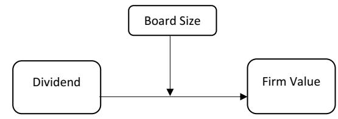

<!-- A3.R20 | source: papers_json/A3.R20/ -->

## **RESEARCH** **Open Access**

## Integrating agency and resource dependency theories: the moderating efect of board size on the relationship between dividends and frm value in Malaysia

Mohd Ashari Bakri1[*](http://orcid.org/0000-0002-3698-0931) , Nurjeehan Ayub1 and Hanefa Muchlis Gazali1

## **Abstract**

**Purpose** تهدف هذه الورقة إلى دراسة الأثر المعدِّل لحجم مجلس الإدارة على العلاقة بين توزيعات الأرباح وقيمة الشركة في السياق الماليزي. الأسس النظرية لهذا البحث هي الدمج بين نظرية الوكالة ونظرية الاعتماد على الموارد (resource dependency theory).

**Design/methodology/approach** استُخرجت بيانات بانل من DataStream ومن التقارير السنوية للفترة من 2012 إلى 2021، واستُخدمت طرق pooled OLS وrandom effects وfixed effects لفحص العلاقة. استُخدم اختبار Breusch–Pagan Lagrange multiplier (LM) واختبار Hausman لتحديد أنسب طريقة من بين الثلاث. تبقى النتائج صالحة حتى بعد حساب الخطأ المعياري القوي (robust standard error) لتخفيف مشكلتي heteroskedasticity والارتباط التسلسلي.

**Findings** تُظهر النتائج التجريبية أن حجم مجلس الإدارة يعدّل بشكل إيجابي العلاقة بين توزيعات الأرباح وقيمة الشركة في جميع النماذج المختبرة. تشير النتائج إلى أن مجلس الإدارة الأكبر يمكن أن يقلل من مشكلة الوكالة (نظرية الوكالة)، لأن المجلس الأكبر يستطيع مراقبة وضبط السلوك الانتهازي للإدارة بشكل أكثر فاعلية، بسبب توفر مجموعة أوسع من الأفراد المهرة والموهوبين في غرفة الاجتماعات (نظرية الاعتماد على الموارد). كذلك، يمكن أن تؤدي المراقبة الفعالة أيضاً إلى زيادة توزيعات الأرباح للحفاظ على سمعة جيدة بين المستثمرين، وفي الوقت نفسه زيادة قيمة الشركة.

**Practical implication** تسهم هذه الدراسة في مساعدة الجهات التنظيمية والعاملين في الصناعة في ماليزيا على تحسين الإرشادات الحالية لتحديد توزيعات الأرباح وحجم مجلس الإدارة بهدف زيادة قيمة الشركة. قد تقدم النتائج أيضاً مدخلات لصناع السياسات في التوصية بالحجم الأمثل لتوزيعات الأرباح ومجلس الإدارة الذي يؤدي إلى زيادة التقييم.

**Originality/value** من خلال الدمج بين نظرية الوكالة ونظرية الاعتماد على الموارد، يبحث المؤلفون في الأثر المعدِّل لحجم مجلس الإدارة على العلاقة بين توزيعات الأرباح وقيمة الشركة في الأسواق الماليزية.

**Keywords** Dividend, Firm value, Board size, Agency theory, Resources dependency

*Correspondence: Mohd Ashari Bakri mohd.ashari@ums.edu.my

## **Introduction**

يظل مفهوم لغز توزيعات الأرباح (dividend puzzle) من أكثر المواضيع نقاشاً على مدى العقود الماضية حتى اليوم. ظهر مفهوم لغز توزيعات الأرباح عندما اقترحت الأعمال المؤثرة لـ Gordon [17]، وLintner [31، 32]، وMiller and Modigliani [34] بعض المفاهيم المتعلقة بتوزيعات الأرباح. قدّم Gordon، على سبيل المثال،

© The Author(s) 2024. **Open Access** This article is licensed under a Creative Commons Attribution 4.0 International License, which permits use, sharing, adaptation, distribution and reproduction in any medium or format, as long as you give appropriate credit to the original author(s) and the source, provide a link to the Creative Commons licence, and indicate if changes were made. The images or other third party material in this article are included in the article's Creative Commons licence, unless indicated otherwise in a credit line to the material. If material is not included in the article's Creative Commons licence and your intended use is not permitted by statutory regulation or exceeds the permitted use, you will need to obtain permission directly from the copyright holder. To view a copy of this licence, visit [http://creativecommons.org/licenses/by/4.0/.](http://creativecommons.org/licenses/by/4.0/)

> ^ ^Labuan Faculty of International Finance, Universiti Malaysia Sabah, Labuan International Campus, 87000 Labuan F.T, Malaysia

<!-- page 2 -->

Bakri *et al. Future Business Journal (2024) 10:37 *Page 2 of 10

نموذج Gordon growth لتحديد القيمة الجوهرية للسهم استناداً إلى سلسلة توزيعات الأرباح المستقبلية. من جهة أخرى، قدّم Lintner معادلة اقتصادية لتحديد سياسة توزيعات الأرباح المثلى للشركة. ولعل إحدى أكثر الأوراق تأثيراً التي أدت إلى الجدل حول لغز توزيعات الأرباح هي ورقة Miller and Modigliani [34]. كان العمل المؤثر لـ Miller and Modigliani [34] هو الحافز لتطوير نظرية عدم أهمية توزيعات الأرباح (dividend irrelevance theory). تنص النظرية على أنه في سوق رأسمالية كاملة، لا ترتبط توزيعات الأرباح بقيمة الشركة، ولا يوجد تعارض بين المساهمين والمديرين (لا توجد تكاليف وكالة). تفترض النظرية أيضاً أن جميع المستثمرين لديهم وصول متساوٍ إلى جميع المعلومات (لا توجد عدم تماثل معلوماتي) وأنه لا تُتكبد أي تكاليف عند بيع وشراء الأسهم (لا توجد احتكاكات تداول). ومع ذلك، يقصر هذا الافتراض بسبب وجود تكاليف الوكالة، وعدم تماثل المعلومات، وتكاليف التداول. فمثلاً، توجد احتكاكات كجزء من عملية التداول، واحتكاكات مثل عدم تماثل المعلومات وتكاليف الوكالة تؤثر على مقدار وتوقيت توزيعات الأرباح وتؤثر على قيمة الشركة [26]. الحجة المعاكسة تطرح أن توزيعات الأرباح مرتبطة بقيمة الشركة، وهذا ما يُعرف بنظرية أهمية توزيعات الأرباح (dividend relevance theory).

تشير نظرية أهمية توزيعات الأرباح إلى أن زيادة توزيعات الأرباح تؤثر بشكل إيجابي على موقف الشركة في سوق الأسهم، والعكس صحيح. رأى رواد نظرية أهمية توزيعات الأرباح، Lintner and Gordon [31]، أن المساهمين يفضلون توزيعات الأرباح على المكاسب الرأسمالية. تشير هذه الحجة إلى أن المستثمرين يتجنبون المخاطرة ويفضلون تقليل عدم اليقين، مما يجعل الشركات تخصم أرباحها بمعدل أقل، وبالتالي، مع بقاء العوامل الأخرى ثابتة، تضع قيمة أفضل للشركات. غير أن باحثين آخرين جادلوا لاحقاً بأنه لا ينبغي أن يهم فعلياً ما إذا كانت الشركة تدفع توزيعات أرباح أم لا. نتيجة لذلك، يظل الدافع وراء دفع توزيعات الأرباح لزيادة قيمة الشركة موضع جدل حتى اليوم. من أوائل النظريات الداعمة لهذا الطرح نظرية إشارة توزيعات الأرباح (dividend signal theory). يدعم Woolridge (1983) مفهوم إشارات توزيعات الأرباح، حيث يذكر أن التغيرات أو الإشارات المتعلقة بتغيرات توزيعات الأرباح هي أحد المحركات الرئيسية للتغيرات في أسعار الأسهم. وثّق Fama and French [15] لاحقاً أن توزيعات الأرباح يمكن أن تنقل معلومات تعزز علاقة إيجابية بين توزيعات الأرباح وقيمة الشركة. مدفوعةً بهذا التناقض، تهدف الدراسة إلى تقديم رؤية حول العلاقة بين توزيعات الأرباح وقيمة الشركة، وسد الفجوات عبر اكتشاف ما إذا كان حجم مجلس الإدارة يمكن أن يعدّل هذه العلاقة. إضافة إلى ذلك، تحفّز الدراسة أيضاً قضايا واقعية، وهي تحديداً القلق المتزايد إزاء تنافسية الشركات لزيادة قيمتها.

في ماليزيا، درس الأكاديميون العلاقة بين توزيعات الأرباح وقيمة الشركة منذ

أكثر من عقد. تُعد زيادة التنافسية أحد العوامل الدافعة لظهور هذا الموضوع. وعلى وجه الخصوص، تُعد العولمة المتزايدة، والتنمية الاقتصادية، والتركيز على الاستدامة، وتكنولوجيا المعلومات عوامل دافعة للتنافسية بين الشركات. فعلى سبيل المثال، سجل الاقتصاد الماليزي زيادة بنسبة 3.3% في الربع الثالث من عام 2023 وزيادة بنسبة 2.9% في الربع الثاني من عام 2023، ما أدى إلى نمو إجمالي بنسبة 3.9% في عام 2023 [9]. نتيجة لذلك، أصبحت زيادة قيمة الشركة عاملاً حاسماً يجب أن يأخذه المساهمون والمستثمرون بعين الاعتبار. ولزيادة قيمة الشركة بشكل ملحوظ، يُعرف دفع توزيعات الأرباح بأنه إحدى الاستراتيجيات الناجحة.

لم تكن الدراسة مدفوعة فقط بالقضية الواقعية المتمثلة في الحاجة إلى تعزيز قيمة الشركات الماليزية، بل أيضاً بغموض العلاقة بين توزيعات الأرباح وقيمة الشركة في السياق الماليزي. تدعم أدلة تجريبية حديثة كثيرة علاقة إيجابية بين توزيعات الأرباح وقيمة الشركة في ماليزيا [4]. وعلى الرغم من وفرة الأدلة التجريبية الداعمة لهذه الادعاءات، فقد دُحضت نظرية الإشارة بأدلة تجريبية تفيد بأن توزيعات الأرباح غير ذات صلة بقيمة الشركة (Chen et al., 2002, Irum et al., 2012). إضافة إلى ذلك، اكتشف Bakri [5] أيضاً علاقة سلبية بين توزيعات الأرباح وقيمة الشركة، حيث تكون جودة التدقيق معدِّلاً للدراسة. باستخدام عائد توزيعات الأرباح كمقياس بديل، تكون العلاقة بين توزيعات الأرباح وقيمة الشركة غير متسقة إلى حد ما مقارنة بالأدلة التجريبية القائمة في السياق الماليزي [4] والنظريات ذات الصلة بتوزيعات الأرباح. يسهم هذا التناقض في الحاجة إلى مزيد من البحث في لغز توزيعات الأرباح.

تفترض دراستنا تحديداً أن هذا التناقض قد يعود إلى حجم مجلس الإدارة، الذي يمكن أن يعزز العلاقة. تُعد علاقة حجم مجلس الإدارة بأداء الشركة قضية أساسية في حوكمة الشركات [10]. تصف نظرية الوكالة علاقة حجم مجلس الإدارة بالأداء المؤسسي بطريقتين مختلفتين. الرأي الأول، من المنظور الاقتصادي، يرى أن حجم المجلس الأصغر يزيد من المراقبة والضبط وبالتالي يعزز الأداء المالي الكلي للشركة [20]. غير أن الأدلة التجريبية السابقة أهملت دمج نظرية الاعتماد على الموارد مع نظرية الوكالة لتفسير أفضل للعلاقة بين توزيعات الأرباح وحجم مجلس الإدارة وقيمة الشركة. وكما أُشير، فإن فكرة دمج نظرية الوكالة مع الاعتماد على الموارد توسّع نطاق النظرية الأولى. وتماشياً مع هذا الاقتراح، يدمج الباحثون النظريتين ويوضحون أن زيادة حجم مجلس الإدارة تعني أيضاً مراقبة أفضل وتخفيفاً لتكلفة الوكالة (نظرية الوكالة)، لأن المجلس الأكبر يحسّن القدرة الاستشارية،

<!-- page 3 -->

Bakri *et al. Future Business Journal (2024) 10:37 *Page 3 of 10

والتداول، والعلاقات الخارجية (الاعتماد على الموارد)، وبالتالي يعزز الأداء المالي المؤسسي [40].

من الناحية التجريبية، غالباً ما يظهر حجم مجلس الإدارة علاقة سلبية بأداء الشركة في السياق الماليزي. كما وجدت العديد من الدراسات السابقة [6، 30، 33]، يرتبط حجم مجلس الإدارة بأثر سلبي على أداء الشركة. غير أن العديد من الدراسات السابقة أهملت مفهوم نظرية الوكالة فيما يتعلق بنظرية الاعتماد على الموارد في تقليل مشكلة الوكالة أيضاً. فمثلاً، تعني زيادة حجم مجلس الإدارة أيضاً زيادة آليات المراقبة والضبط، وتوفير حجم أكبر من المواهب والمهارات، مما يقلل من مشكلة الوكالة واحتمال سوء تصرف الإدارة (مثل حوافز التنفيق أو الاستثمار في مشاريع غير مربحة).

بالإضافة إلى الجانب النظري، نناقش أيضاً الجانب التجريبي أو اكتشاف هذه العلاقة. وللحصول على رؤية أفضل حول العلاقة بين حجم مجلس الإدارة وتوزيعات الأرباح وكذلك قيمة الشركة، تنظر الدراسة أولاً في العلاقة التجريبية السابقة بين حجم مجلس الإدارة وتوزيعات الأرباح. وجدت الدراسات التجريبية السابقة أن حجم مجلس الإدارة يؤثر بشكل إيجابي على توزيعات الأرباح. فمثلاً، وجد Elmagrhi et al. [14] علاقة إيجابية بين حجم مجلس الإدارة وتوزيعات الأرباح لدى الشركات الصغيرة والمتوسطة في المملكة المتحدة للفترة من 2010 إلى 2013. وبالمثل، وجد Khan [25] وGarcía-Meca, E et al. [16] في دراسة تجريبية حديثة أن حجم مجلس الإدارة يرتبط إيجابياً بتوزيعات الأرباح. تشير النتائج إلى أن العلاقة الإيجابية القوية بين حجم مجلس الإدارة وتوزيعات الأرباح لم تُوجد فقط في دراسات سابقة كثيرة، بل أيضاً في معظم الدراسات الأحدث. وهذا يشير أيضاً إلى علاقة إيجابية قوية ومتسقة بين حجم مجلس الإدارة وتوزيعات الأرباح.

ثانياً، وأخيراً، نناقش الأدلة التجريبية للعلاقة بين حجم مجلس الإدارة وقيمة الشركة. الأدلة التجريبية لهذه العلاقة وفيرة جداً. فمثلاً، وجد Mak and Kusnadi [33] علاقة سلبية بين حجم مجلس الإدارة وقيمة الشركة في ماليزيا وسنغافورة، مما يشير إلى أنه كلما كبر المجلس، انخفضت قيمة الشركة. وجدت دراسة تجريبية أقدم في شركات صغيرة أيضاً ارتباطاً سلبياً بين حجم مجلس الإدارة وقيمة المؤسسة في الشركات الفنلندية [13]. كذلك وجدت دراسة في شركات أسترالية ارتباطاً سلبياً قوياً بين حجم مجلس الإدارة وقيمة المؤسسة، وتُظهر النتيجة أيضاً أن هذا الارتباط أقوى في الشركات الصغيرة [35]. وجدت دراسة تجريبية حديثة أيضاً علاقة سلبية بين حجم مجلس الإدارة وقيمة الشركة [6، 30]. وعلى الرغم من العلاقة السلبية بين حجم مجلس الإدارة وقيمة الشركة، تشير دراستنا إلى أن خاصية حجم مجلس الإدارة قد

تزيد من قيمة الشركة من خلال تخفيف مشكلة الوكالة عبر ضبط ومراقبة توزيعات الأرباح. بعبارة أخرى، فإن الأثر الإيجابي لحجم مجلس الإدارة على ضمان توزيع أرباح أفضل قد يفوق الأثر السلبي لحجم مجلس الإدارة على قيمة الشركة.

تُنظَّم بقية هذا الفصل على النحو التالي: يتناول القسم التالي مراجعة الأدبيات، تليها المنهجية، ثم النتائج، ثم المناقشة، وأخيراً الخاتمة استناداً إلى اكتشاف النتائج.

## **Literature review and hypothesis development**

يظل موضوع توزيعات الأرباح وقيمة الشركة موضوعاً ذا صلة اليوم بسبب إسهامه الكبير في مجال التمويل المؤسسي. يحمل قرار توزيعات الأرباح أهمية كبيرة للشركات لأنه يعكس أداءها وإمكانات نموها المستقبلية [2، 43]. وثّق Leary and Michaely [28] أن المديرين يضعون علاوة على سهم الشركة التي تدفع توزيعات أرباح مستقرة، وأن المديرين يتصرفون بطريقة تجعل توزيعات الأرباح مهمة لقيمة الشركة. وبينما توجد أدلة تجريبية ونظرية وفيرة تدعم أهمية توزيعات الأرباح لقيمة الشركة، فإن النظرية المبكرة حول العلاقة بين توزيعات الأرباح وقيمة الشركة أثبتت عدم أهميتها. بشكل عام، يمكن تقسيم العلاقة بين توزيعات الأرباح وقيمة الشركة إلى مدرستين فكريتين. المدرسة الأولى قادتها نظرية أهمية توزيعات الأرباح، وترى هذه النظرية أن توزيعات الأرباح تؤثر على قيمة الشركة. وعلى العكس، تقدم المدرسة الثانية الادعاء المعاكس بأن توزيعات الأرباح غير ذات أهمية لقيمة الشركة.

## **Dividend irrelevance theory**

تُعد نظرية عدم أهمية توزيعات الأرباح واحدة من أبرز النظريات في عالم التمويل المؤسسي، طرحها لأول مرة الحائزان على جائزة نوبل Miller and Modigliani [34]. تفترض النظرية أنه في سوق رأسمالية كاملة، لا ترتبط توزيعات الأرباح بقيمة الشركة. تفترض النظرية أيضاً أنه في عالم أعمال مثالي، لا توجد تعارضات بين المساهمين والمديرين، وأن المستثمرين لديهم وصول متساوٍ إلى جميع المعلومات. علاوة على ذلك، وفقاً لهذه النظرية، لا توجد تكاليف لشراء وبيع الأسهم، ولا يوجد فرق بين معدلات الضريبة على توزيعات الأرباح والمكاسب الرأسمالية. كذلك، تشير النظرية إلى أن سياسة توزيعات الأرباح تتبع قرار الاستثمار المتخذ، والذي يصبح بعد ذلك سياسة توزيعات الأرباح المتبقية، وبالتالي لا يكون لتوزيعات الأرباح أثر على قيمة الشركة.

## **Dividend relevance theory**

على النقيض من نظرية عدم أهمية توزيعات الأرباح، تضم نظرية أهمية توزيعات الأرباح عدة نظريات

<!-- page 4 -->

Bakri *et al. Future Business Journal (2024) 10:37 *Page 4 of 10

تدعم أهمية توزيعات الأرباح لقيمة الشركة. في هذه الدراسة، نناقش أهم وأكثر النظريات تأثيراً لأهمية توزيعات الأرباح.

## *Bird in hand theory*

تنص هذه النظرية على أنه في عالم من عدم اليقين الاقتصادي، يفضل المستثمرون توزيعات الأرباح (أي طائر في اليد) على المكاسب الرأسمالية (أي طائران في اليد). فالأخيرة قد ترتبط بمستقبل الشركة، وهو أكثر خطورة بكثير من توزيعات الأرباح الحالية. لذلك، يكون المستثمرون على استعداد لدفع سعر أعلى للشركات التي تدفع توزيعات أرباح، مما يؤدي إلى قيمة أعلى للشركة [18، 45].

## *Signaling theory*

بشكل عام، ينشأ عدم تماثل المعلومات عندما يمتلك طرف معلومات أكثر من طرف آخر. في سياق حوكمة الشركات، من المرجح أن تمتلك الشركة معلومات أكثر عن أدائها الحالي والمستقبلي مقارنة بطرف خارجي. لذلك، يمكن للمديرين استخدام توزيعات الأرباح كأداة لإعطاء إشارات إلى السوق المالي حول نمو الشركة الحالي والمستقبلي [23]. إضافة إلى ذلك، سلّط Lintner [31] الضوء على قلق المديرين إزاء إشارة توزيع أرباح الشركة عبر الزمن. وبناءً على ذلك، يصف اقتراح Bhattacharya [7] كيف تعمل توزيعات الأرباح كدالة للصحة المالية للشركة، والتي يُشار إليها من خلال توزيعات الأرباح التي تعكس الأداء المستقبلي للشركة. نظرياً، تشير توزيعات الأرباح الأعلى إلى تقييم أعلى للشركة.

## *Agency theory and free cash fow hypothesis*

إضافة إلى ذلك، تُستخدم نظرية الوكالة وفرضية التدفق النقدي الحر أيضاً لإثبات أهمية توزيعات الأرباح لقيمة الشركة. تشير نظرية الوكالة إلى أن مصالح المساهمين والمديرين ليست متطابقة، وبالتالي يمكن أن تعمل توزيعات الأرباح كآلية ضبط لمراقبة التدفق النقدي بشكل أفضل. إضافة إلى ذلك، تعني فرضية التدفق النقدي الحر أن توزيعات الأرباح تُدفع للمساهمين لمنع المدير من إساءة استخدام رأس المال. يجادل Jensen [21] بأن التدفق النقدي الحر على المستوى الإداري قد يؤدي إلى الاستثمار في فرص استثمارية غير مربحة. لذلك، يفضل المستثمرون الشركة التي تقلل من تكاليف الوكالة من خلال دفع توزيعات أرباح أعلى. نتيجة لذلك، يستثمر المستثمرون في هذه الشركة أكثر مما يستثمرون في شركة تدفع توزيعات أرباح قليلة أو معدومة [42].

## *Empirical evidence on dividend relevance*

لا تُناقش أهمية توزيعات الأرباح لقيمة الشركة في النظريات فقط، بل تُدرَس تجريبياً أيضاً. تُظهر الأدلة التجريبية علاقة إيجابية بين توزيعات الأرباح وقيمة الشركة، لكن كيفية تأثير توزيعات الأرباح على قيمة الشركة أمر مثير للجدل. فمثلاً، وجد Fama and French [15] علاقة إيجابية

بين توزيعات الأرباح وقيمة الشركة، وجادلا بأن ذلك يعود إلى أن توزيعات الأرباح تلتقط معلومات عن آفاق العمل المستقبلية للشركة. من جهة أخرى، يجادل Pinkowitz et al. [42] بأن المستثمرين يقيّمون الشركة التي تدفع توزيعات أرباح بشكل أفضل لأنهم يقدّرون جهود الشركة في تخفيف مشكلة الوكالة (حوكمة أفضل). قدّم Baker and Wugler (2004) حجة مختلطة، حيث ادعيا أن العلاقة بين توزيعات الأرباح وقيمة الشركة تعتمد على العلاوة التي قد تؤدي إلى ارتباط إيجابي أو سلبي.

وحتى بعد عقد من الزمن، يستمر التناقض بين توزيعات الأرباح وقيمة المؤسسة. فمثلاً، اكتشف Dang et al. [11] وBakri [5] علاقة إيجابية بين توزيعات الأرباح وقيمة الشركة في فيتنام وماليزيا على التوالي. غير أن Bakri [4] وSondakh [44] وجدا أيضاً علاقة سلبية بين توزيعات الأرباح وقيمة الشركة. فمثلاً، أظهر Bakri [4] أن توزيعات الأرباح لها أثر سلبي على قيمة الشركة عندما يُستخدم عائد توزيعات الأرباح كمقياس بديل للتوزيعات. من حيث صافي الدخل القابل للتوزيع، تُظهر سياسة توزيعات الأرباح مدى نجاح الشركة في زيادة ثروة المساهمين [19]. ومن حيث الأداء المالي للشركة، تُعد سياسة توزيعات الأرباح أيضاً عاملاً يحدد نجاح الشركة. درس بحث سابق أثر نسبة توزيع الأرباح على قيمة الشركة بالتفصيل [1] ووجد أن نسبة توزيع الأرباح لها أثر إيجابي على سعر السهم، مما يعكس قيمة الشركة.

غير أن Dennis and Smith [12] يدعيان أن سياسة توزيعات الأرباح لها أثر ضار على قيمة الشركة. فتحديد توزيعات أرباح مصطنعة يمكن أن يخفض قيمة الشركة لأنه يحوّل رأس المال من الاستثمار إلى استهلاك سلع فاخرة. كذلك وجد Dennis and Smith [12] في تحليل منفصل أن سياسة توزيعات الأرباح ليس لها أثر على قيمة الشركة. يشير عدم اتساق العلاقة بين توزيعات الأرباح وقيمة الشركة إلى أن عاملاً معدِّلاً محتملاً قد يؤثر على هذه العلاقة. لذلك، نشتبه في أن حجم مجلس الإدارة قد يسهم في هذا التناقض ويمكن أن يكون عاملاً معدِّلاً مهماً. أظهرت الأدلة التجريبية السابقة أن حجم مجلس الإدارة يؤثر إيجابياً على توزيعات الأرباح [14، 16، 25]، وعلى العكس، يؤثر سلبياً على قيمة الشركة [6، 13، 30، 33، 35]. بعد أخذ الجانب التجريبي من العلاقة بعين الاعتبار، يناقش القسم التالي ويطور الفرضية استناداً إلى الجانب النظري المدعوم بالجوانب التجريبية التي نوقشت في هذا القسم.

## **Agency theory, dividend and frm value**

طوّر Jensen and Meckling نظرية الوكالة في الأصل عام 1976 [22]. تنص هذه النظرية على أن آلية حوكمة الشركة أو المنظمة تستند إلى تعارضات المصالح بين مالك الشركة

<!-- page 5 -->

Bakri *et al. Future Business Journal (2024) 10:37 *Page 5 of 10

(المساهم)، والمدير، ومزود رأس المال في شكل رأس مال خارجي. وفقاً لهذه النظرية، تُعد مشكلة الوكالة أمراً حتمياً، والطريقة الوحيدة للسيطرة عليها هي من خلال استخدام التنظيم أو الأدوات أو الآليات. من أكثر الأدوات شيوعاً التي يستخدمها الباحثون أو يقترحونها للتخفيف المحتمل من مشكلة الوكالة توزيعات الأرباح. تدعم هذه الفكرة فرضية التدفق النقدي الحر التي طورها Jensen عام 1986، والتي تنص على أن توزيعات الأرباح تُدفع للمساهمين لمنع المدير من الاستثمار في مشاريع غير مربحة، وفي أسوأ الحالات، في مصلحته الشخصية (حوافز التنفيق). استناداً إلى هذه النظرية، نستنتج أن توزيعات الأرباح ينبغي أن تقلل من مشكلة الوكالة.

## **Agency theory, board size and frm value**

فيما يتعلق بالعلاقة بين حجم مجلس الإدارة وأداء الشركة، تلعب نظرية الوكالة أيضاً دوراً أساسياً في تفسير أساس هذه العلاقة. تفترض نظرية الوكالة أن وجود مجلس إدارة أكبر يمنح مراقبة فعالة من خلال تخفيف هيمنة الرئيس التنفيذي داخل المجلس، وفي الوقت نفسه حماية مصلحة المساهم [3]. إضافة إلى ذلك، تؤدي المراقبة المحسّنة إلى تجنب عدم اليقين، كما اقترح Li and Harrison [29]، ويؤدي تقليل تكاليف الوكالة في النهاية إلى أداء أفضل للشركة [24]. غير أن قدراً كبيراً من الدراسات التجريبية حول العلاقة بين حجم مجلس الإدارة وأداء الشركة يجادل ضد نظرية تكلفة الوكالة. فمثلاً، اكتشف Mak and Kusnadi [33] علاقة سلبية بين حجم مجلس الإدارة وأداء الشركة في ماليزيا وسنغافورة. كذلك وجد Liao et al. [30] وBen and Chouaibi [6] علاقة سلبية بين حجم مجلس الإدارة وأداء الشركة. تشير نتيجة هذه الأدلة التجريبية إلى نظرية الوصاية (stewardship theory). تنص نظرية الوصاية على أن المدير الذي يُترك لتصرفاته الخاصة يتصرف كوصيّ على الأصول التي يديرها [24].

غير أنه، وعلى الرغم من أن النتائج التجريبية تشير أكثر إلى نظرية الوصاية منها إلى نظرية تكلفة الوكالة، نعتقد أن نظريتي تكاليف الوكالة والاعتماد على الموارد تلعبان دوراً أكثر أهمية في العلاقة بين توزيعات الأرباح وقيمة الشركة، على الأقل في السياق الماليزي. ويعود ذلك إلى أن المجلس الأكبر يضمن ضبطاً ومراقبة أفضل لدفعات توزيعات الأرباح للمساهمين. كذلك، يمكن أن يتمتع المجلس الأكبر بتنوع أكبر في خلفية أعضائه، مثل وجود عدد أكبر من المهنيين من مجالات مختلفة، الذين بدورهم يتخذون قرارات أفضل للأداء الكلي دون المساس بالأقلية (توفير توزيعات الأرباح). بعبارة أخرى، من المحتمل أن ترجّح نظرية الوكالة على نظرية الوصاية في العلاقة بين توزيعات الأرباح وقيمة الشركة عندما يعمل حجم مجلس الإدارة كمعدِّل.

## **Resources dependency theory, board size and frm value**

قدّم Pfeffer and Salancik نظرية الاعتماد على الموارد عام 1978 [41]. يقوم مبدأ النظرية على أن المنظمة، مثل الشركة أو المنظمة الهادفة للربح، مطالَبة بالتفاعل مع فاعلين ومنظمات أخرى ضمن بيئتها للحصول على الموارد. وفيما يتعلق بحجم مجلس الإدارة وأداء الشركة، تشير نظرية الاعتماد على الموارد إلى أن حجم مجلس الإدارة يُعد بمثابة مخزون من الموارد [3]. ويعود ذلك إلى أن حجم المجلس يوفر الموارد والمهارات والمعرفة والخبرة اللازمة للاستثمار في المشاريع المبتكرة (Chen, 2012). استناداً إلى الحجة الواردة في أقسام "Agency theory, dividend and frm value"، و"Agency theory, board size and frm value"، و"Resources dependency theory, board size and frm value"، نفترض إذن أن:

*Hypothesis 1* حجم مجلس الإدارة يعدّل العلاقة بين توزيعات الأرباح وقيمة الشركة في ماليزيا.

تهدف الدراسة إذن إلى حل هذا اللغز من خلال دراسة العلاقة بين هذه المتغيرات، مع إدراج حجم مجلس الإدارة كمعدِّل. (Fig. 1) يُستخدم إطار البحث التالي كتمثيل بصري للأثر المعدِّل لحجم مجلس الإدارة على العلاقة بين توزيعات الأرباح وقيمة الشركة:

## **Methodology**

## **Empirical model**

يُستخدم مواصفات النموذج التالي لفحص الأثر المعدِّل لحجم مجلس الإدارة على العلاقة بين توزيعات الأرباح وقيمة الشركة:

$$
\text{Tobin's } Q_{i,t} = \alpha + \beta_1 DPS_{i,t} + \beta_2 \text{Board size}_{i,t} \\ + \beta_3 DPS \cdot \text{Board}_{i,t} + \beta_4 \log(\text{size})_{i,t} \\ + \beta_5 TLTA_{i,t} + \beta_6 \text{Blockholder}_{i,t} \\ + \beta_7 \text{Cash holding}_{i,t} + \varepsilon_t \tag{1}
$$

يمثل Tobin's q قيمة الشركة، وDPS هو توزيعات الأرباح للسهم، وحجم مجلس الإدارة هو العدد الإجمالي لأعضاء مجلس الإدارة في الشركة، وDPS*board هو الحد التفاعلي بين DPS وحجم مجلس الإدارة المستخدم كمعدِّل. إضافة إلى متغيرات المعدِّل، نضيف أيضاً متغيرات ضبط

***Fig.** **1** Research framework (integrating agency and resources dependency theories)*

<!-- page 6 -->

Bakri *et al. Future Business Journal (2024) 10:37 *Page 6 of 10

يمكن أن تؤثر على قيمة الشركة. تشمل هذه المتغيرات TLTA، الذي يمثل إجمالي الالتزامات نسبة إلى إجمالي الأصول، وblockholder، الذي يمثل نسبة الملكية الاستراتيجية بمعدل 5% أو أكثر، وcash holdings، الذي يمثل النقد وما يعادله مقسوماً على إجمالي الأصول، وεt هو حد الخطأ. مصادر البيانات المُجمَّعة هي DataStream والتقارير السنوية، والفترة الزمنية بين 2012 و2021. تضمنت عملية جمع البيانات مراحل تصفية متعددة، فمثلاً، استبعدنا القطاع المصرفي والمالي من العينة بسبب خضوع هذا القطاع لتنظيم صارم (Dewasiri et al., 2016). إضافة إلى ذلك، خضعت جميع البيانات الفردية لعملية winsorize عند المئين 1 و99 لتخفيف القيم المتطرفة المحتملة. استخدمنا برنامج Stata، وتحديداً الإصدار 17.0، لإجراء التحليل.

## **Results**

يعرض الجدول 1 الإحصاءات الوصفية للمتغيرات التي اختُبرت لفحص الأثر المعدِّل لتوزيعات الأرباح على قيمة الشركة في ماليزيا. كما يظهر في الجدول 1، عدد المشاهدات غير متوازن بسبب بعض البيانات المالية غير المكتملة. تُسجَّل أعلى قيمة متوسطة لدى blockholder عند 50.20، تليها log (size) وboard size عند 12.87 و7.38 على التوالي. القيم المتوسطة للمتغيرات المتبقية أقل من 2، عند 1.35، و0.41، و0.36، و0.17، و0.04 على التوالي. يمتلك متغير blockholder أعلى انحراف معياري عند 17.61، يليه board size وlog(size) عند 1.97 و1.72 على التوالي. يُظهر الجدول 1 أيضاً القيمة الدنيا والقصوى لكل متغير اختُبر في الدراسة. يتراوح Tobin's Q من 0 إلى 7.67، وDPS من 0 إلى 0.57، وboard size من 4 إلى 13، وDPS*Board size من 0 إلى 25.30، وlog(size) من 2.30 إلى 19.02، وTLTA من 0.02 إلى 0.99، وBlockholder من 0 إلى 85، وأخيراً رصيد Cash من 0.003 إلى 0.66.

<!-- page 7 -->

Bakri *et al. Future Business Journal (2024) 10:37 *Page 7 of 10

يُظهر Panel A في الجدول 2 مصفوفة ارتباط Pearson بين العلاقة بين توزيعات الأرباح وقيمة الشركة المعدَّلة بحجم مجلس الإدارة. كما يمكن ملاحظته، يرتبط الحد التفاعلي "DPS*board size" إيجابياً بقيمة الشركة، الممثلة بـ Tobin's Q. يُظهر Panel A في الجدول 2 أيضاً إشارات مبكرة على تعدد الخطية (multicollinearity)، حيث تتجاوز إحدى القيم 0.50 (0.7971). غير أنه في التحليل الحاسم لتعدد الخطية الحقيقي، لا يُظهر عامل تضخم التباين (VIF) في Panel B أي إشارة على تعدد الخطية. تُظهر النتائج أنه لا توجد قيمة متوسطة لـ VIF أعلى من 4، والقيمة المتوسطة هي 1.77 فقط. لذلك، نستنتج أنه لا توجد مخاطرة من تعدد الخطية استناداً إلى تحليل VIF.

يعرض الجدول 3 التحليل الرئيسي للدراسة. تستخدم الدراسة pooled ordinary least squares (OLS)، وrandom effects (RE)، وfixed effects (FE) للفترة من 2012 إلى 2021. تستخدم الدراسة تحليلاً على مرحلتين لتحديد النموذج الأنسب للدراسة. أولاً، نجري اختبار Breusch–Pagan LM لتحديد أي نموذج أفضل ملاءمة بين OLS وRE. نتائج اختبار Breusch–Pagan LM أقل من 0.05، مما يشير إلى أن random effect هو الأنسب. وفي المرحلة التالية، استخدمنا اختبار Hausman لتحديد أي من RE وFE أنسب. نتائج اختبار Hausman أقل من 0.05، مما يشير إلى أن FE أنسب. غير أنه، ولأغراض المقارنة، نعرض جميع النتائج (pooled OLS، وRE، وFE) كما هو موضح في الجدول 3.

يُظهر Panel A وB في الجدول 3 نتائج pooled OLS وrandom effect. تظهر توزيعات الأرباح علاقة إيجابية ومعنوية مع قيمة الشركة، بمعامل 3.1194 و2.3900، معنوي عند مستوى

واحد بالمئة. يُظهر حجم مجلس الإدارة أيضاً علاقة إيجابية ومعنوية مع قيمة الشركة عند مستوى واحد بالمئة في كل من تحليل pooled OLS وrandom effect (معامل 0.0297 و0.0497). يُظهر الحد التفاعلي DPS*board size علاقة إيجابية مع قيمة الشركة عند مستوى واحد بالمئة (معامل 0.1654 و0.1312) في كل من تحليل pooled OLS وrandom effects، مما يشير إلى أن حجم مجلس الإدارة يعدّل بشكل معنوي العلاقة بين توزيعات الأرباح وقيمة الشركة. ترتبط متغيرات الضبط المستخدمة في هذه الدراسة بشكل مختلف بتوزيعات الأرباح. فمثلاً، لحجم الشركة علاقة سلبية ومعنوية بتوزيعات الأرباح (معامل −0.1836 و−0.3186) عند مستوى واحد بالمئة في كل من تحليل pooled OLS وrandom effect. في المقابل، لكل من الرافعة المالية (TLTA) والنقد المحتفظ به علاقة إيجابية ومعنوية بقيمة الشركة بمعامل 1.3941 و1.5102 على التوالي، عند مستوى معنوية واحد بالمئة في pooled OLS. من جهة أخرى، معاملات متغيرات الضبط في random effect معنوية عند مستوى واحد بالمئة وخمسة بالمئة بمعدل 1.2514 و1.3723 على التوالي، كما هو موضح في الجدول. في المقابل، يُظهر blockholders علاقة غير معنوية بقيمة الشركة في كلا النموذجين.

يُظهر Panel C في الجدول 3 أن fixed effect هو النموذج الأنسب بعد اختباره بواسطة اختبار Breusch–Pagan LM واختبار Hausman. تُظهر نتيجة Panel C في الجدول 3 نتيجة معنوية متسقة مع Panel A وB، باستثناء بعض المتغيرات مثل حجم مجلس الإدارة وblockholders. في Panel C، لتوزيعات الأرباح وحجم مجلس الإدارة ارتباط إيجابي معنوي بقيمة الشركة، بمعامل 1.5506 و0.0487 على التوالي، معنوي عند مستوى واحد بالمئة. يُظهر الحد التفاعلي

بين توزيعات الأرباح وحجم مجلس الإدارة (DPS*board size) علاقة إيجابية ومعنوية بين توزيعات الأرباح وقيمة المؤسسة، مما يشير إلى أن حجم مجلس الإدارة له بالفعل أثر معنوي وإيجابي على العلاقة بين توزيعات الأرباح وقيمة الشركة. تبقى الآثار المتبقية لمتغيرات الضبط مشابهة لما في Panel A وB، لكن لـ blockholders أثر معنوي على قيمة الشركة.

قد تعاني نتيجتنا، المعروضة في الجدول 3، من heteroskedasticity والارتباط التسلسلي بسبب طبيعة بيانات البانل. ولتخفيف هذه المشكلة، وباتباع Ofori Sasu, Abor and Osei [39]، استخدمنا حساب الخطأ المعياري القوي (robust standard error) في التحليل الإضافي. تظهر نتيجة هذا التحليل في الجدول 4، Panel A، وB، وC. باستخدام النتيجة في الجدول 4، نلاحظ أن النتائج المعروضة في الجدول 3 تبقى متسقة حتى بعد تخفيف احتمالية heteroskedasticity والارتباط التسلسلي. تشير العلاقة المعنوية المستمرة والمتسقة للمتغيرات المختبرة في الجدول 4، وخاصة الحدود التفاعلية، إلى أن حجم مجلس الإدارة يعدّل بالفعل بشكل إيجابي ومعنوي العلاقة بين توزيعات الأرباح وقيمة الشركة، حتى بعد تخفيف مشكلتي heteroskedasticity والارتباط التسلسلي المحتملتين.

## **Robustness check**

قد لا تكون النتائج الموثقة، كما هو موضح في الجدول 3، قوية إزاء مشكلة heteroskedasticity والارتباط التسلسلي. لذلك، نتبع Law et al. [27] في استخدام الخطأ المعياري القوي للتحقق من قوة نتيجتنا.

## **Discussion**

على الرغم من أن عدداً كبيراً من الدراسات درس العلاقة بين توزيعات الأرباح وقيمة الشركة، تظل الأدلة القائمة غير حاسمة بسبب عدم اتساق النتائج والنظرية التي تشير إلى علاقة متناقضة. لذلك، نعيد فحص العلاقة بين توزيعات الأرباح وقيمة الشركة بإضافة حجم مجلس الإدارة كمعدِّل، وإعادة فحص ما إذا كانت النتيجة تدعم النظريات المدمجة المقترحة للوكالة والاعتماد على الموارد.

في الجزء الأول من التحليل، استخدمنا pooled OLS، وrandom effects، وfixed effects لتحديد دور حجم مجلس الإدارة كمعدِّل بين توزيعات الأرباح وقيمة الشركة. في الجدول 3، Panel A وB وC، نجد علاقة قوية بين توزيعات الأرباح وقيمة الشركة وأثراً معدِّلاً إيجابياً قوياً لحجم مجلس الإدارة على هذه العلاقة. تتسق النتائج مع النتائج السابقة لـ Bakri [4]، وDang et al. [11]، وFama and French [15]. تشير النتائج إلى أن الشركات التي تدفع توزيعات أرباح أعلى من المرجح أن تحظى بتقييم أفضل للشركة، وأن حجم مجلس الإدارة له أثر معنوي على توزيعات الأرباح، مما يسهم في تقييم أفضل للشركة. يبرز اكتشاف مهم للدراسة، استناداً إلى نظرية الوكالة، الجانب الرئيسي المهم جداً لحجم مجلس الإدارة على العلاقة بين توزيعات الأرباح وقيمة الشركة. يشير الاكتشاف إلى أن المجلس الأكبر أكثر فاعلية في ضبط ومراقبة السلوك الانتهازي (تكلفة الوكالة) للإدارة. وبما أن المجلس الأكبر يرتبط بخبرة وتجربة أكبر (الاعتماد على الموارد)، فيمكنه تخفيف مشكلة الوكالة مع تحسين أداء الشركة، بما في ذلك توزيعات الأرباح [36–38]. وبالتالي، فإن العلاقة

This table presents the Pooled OLS, RE and FE for Eqs. [(1](#page-4-3)). Standard errors are reported in parentheses. *P* values for the Breusch–Pagan LM test and Hausman test are reported in squared brackets

> ^***, **, ^and * denote statistical signifcance at the 1%, 5%, and 10% levels, respectively

<!-- page 9 -->

Bakri *et al. Future Business Journal (2024) 10:37 *Page 9 of 10

بين توزيعات الأرباح وقيمة الشركة يمكن أن تتعزز بحجم مجلس الإدارة كمتغير معدِّل.

في الجزء الثاني من التحليل، استخدمنا أيضاً pooled OLS، وrandom effects، وfixed effects، ولكن مع الخطأ المعياري القوي لتخفيف heteroskedasticity والارتباط التسلسلي المحتملَين. تبقى النتيجة متسقة كما هو موضح في الجدول 3. يشير الجدول 4 أيضاً إلى أن حجم مجلس الإدارة يؤثر إيجابياً على العلاقة بين توزيعات الأرباح وقيمة الشركة بعد معالجة القلق المحتمل من heteroskedasticity والارتباط التسلسلي. يشير هذا أيضاً إلى أن أثر المراقبة والضبط لأعضاء مجلس الإدارة يزيد من الخبرة والتجربة مع زيادة عدد الأعضاء، وبالتالي يقلل من احتمال سوء تصرف الإدارة (أي حوافز التنفيق). تتسق نتائج الدراسة مرة أخرى مع حجة Ntim [36]، وNtim et al. [37]، وNtim et al. [38] بأن حجم مجلس الإدارة يمكن أن يقلل من مشكلة الوكالة ويحسن توزيعات الأرباح مع زيادة أداء الشركة. تشير نتيجة التحليل أيضاً إلى أن الدمج بين الوكالة والاعتماد على الموارد يمكن استخدامه لتفسير هذه النتيجة التجريبية.

## **Conclusions**

تدرس هذه الورقة الأثر المعدِّل لحجم مجلس الإدارة على العلاقة بين توزيعات الأرباح وقيمة الشركة باستخدام عينة من السوق الماليزي للفترة 2012 إلى 2021، من خلال دمج تفسير من نظريتي الوكالة والاعتماد على الموارد. تسهم دراستنا في الأدبيات بعدة طرق. أولاً، وعلى الرغم من الدراسات التجريبية العديدة التي بحثت في أثر توزيعات الأرباح على قيمة الشركة، أهملت الدراسات السابقة دور حجم مجلس الإدارة كمعدِّل، وافتقرت إلى تفسير تجريبي ودمج بين جانبَي نظريتَي الوكالة والاعتماد على الموارد لتقديم رؤية أعمق حول لغز توزيعات الأرباح، خاصة في سياق الأسواق الماليزية. وعلى الرغم من أن الدراسات التجريبية السابقة وجدت أن حجم مجلس الإدارة له أثر سلبي على قيمة الشركة، أهملت الدراسات التجريبية السابقة حقيقة أن حجم مجلس الإدارة الأكبر يرتبط بخبرة وتجربة أكبر (الاعتماد على الموارد) للتأثير على العلاقة السلبية المباشرة. يمكن أن يخفف هذا من مشكلة الوكالة ويزيد من توزيعات الأرباح، مما يزيد في الوقت نفسه من قيمة الشركة. ثانياً، يقدم اكتشافنا عدداً من الآثار للمساهمين وصناع السياسات والجهات التنظيمية في دول أخرى، خاصة تلك التي تمتلك بيئات حوكمة مشابهة نسبياً. تشير النتائج إلى أنه بينما يمكن أن يكون لحجم مجلس الإدارة أثر سلبي على قيمة الشركة، كما وجدت العديد من الدراسات السابقة، ينبغي على الجهات التنظيمية وصناع السياسات، وخاصة المساهمين، ألا يقتصر اهتمامهم على الأثر السلبي المباشر فقط، لأن حجم مجلس الإدارة يعمل أيضاً كآلية ضبط ومراقبة، خاصة في توفير

توزيعات أرباح أفضل، مما يؤدي بدوره إلى تقييم أفضل للشركة.

تخضع دراستنا، كما هو الحال في جميع الدراسات السابقة، لبعض القيود. أولاً، ركزت البيانات على السوق الماليزي، لذا قد لا تكون النتائج قابلة للتعميم على مناطق أخرى، خاصة الدول ذات بيئة حوكمة مختلفة. يمكن للدراسات المستقبلية اختبار أثر حجم مجلس الإدارة كمعدِّل مع اختلافات معنوية في بيئة الحوكمة. ثانياً، اختبرت الدراسة معدِّلاً واحداً فقط، وقد لا يغطي كامل لغز توزيعات الأرباح. لذلك، نوصي بشدة بأن تدرس الدراسات المستقبلية أيضاً معدِّلات أخرى قد تمتلك علاقة قوية بتوزيعات الأرباح وقيمة الشركة في آن واحد. علاوة على ذلك، وفي الختام، تركز البيانات المستخدمة في هذه الدراسة على تحليل بيانات ثانوية. ينبغي أن تنخرط الدراسات المستقبلية في تحليل نوعي من خلال مقابلات وجهاً لوجه للحصول على فهم أفضل لكيفية إسهام حجم مجلس الإدارة فعلياً في تخفيف مشكلات الوكالة مع زيادة توزيعات الأرباح وقيمة الشركة.

## **Abbreviations**

DPS Dividend per share FE Fixed efect LM Lagrange multiplier LOG Natural logarithm OLS Ordinary least square RE Random efect TLTA Total liability over total asset

## VIF Variance infation factor

**Acknowledgements** Not Applicable.

## **Author contributions**

MAB structured the research framework, analyzed and interpreted the research data, and developed the conclusion. NA and HMG developed and constructing the review of literature.

## **Funding**

The research is funded by Universiti Malaysia Sabah grants scheme SGA0060-2019.

## **Availability of data and materials**

The dataset used or analyzed during the study is available from corresponding author on reasonable request.

## **Declarations**

## **Ethics approval and consent to participate**

Not Applicable.

## **Consent for publication**

Not Applicable.

## **Competing interest**

The authors declare that they have no competing interests.

Received: 17 July 2023 Accepted: 13 March 2024

<!-- page 10 -->

Bakri *et al. Future Business Journal (2024) 10:37 *Page 10 of 10

## **References**

- 1. Anton SG (2016) The impact of dividend policy on frm value. A panel data analysis of Romanian listed frms. J Public Admin Financ Law 10:107–112
- 2. Ali H (2022) Corporate dividend policy in the time of COVID-19: Evidence from the G-12 countries. Financ Res Lett 46:102493
- 3. Akram F, Haq AU, M. (2022) Integrating agency and resource dependence theories to examine the impact of corporate governance and innovation on frm performance. Cogent Bus Manag 9(1):2152538
- 4. Bakri MA (2021) Does dividend policy afect frm value in an emerging markets? Evidence from Malaysian frms. Labuan Bull Int Bus Financ (LBIBF) 19(1):49–58
- 5. Bakri MA (2021) Moderating efect of audit quality: the case of dividend and frm value in Malaysian frms. Cogent Business and Management 8(1):2004807
- 6. Ben Fatma H, Chouaibi J (2023) Corporate governance and frm value: a study on European fnancial institutions. Int J Product Perform Manag 72(5):1392–1418
- 7. Bhattacharya S (1979) Imperfect information, dividend policy, and" the bird in the hand" fallacy. Bell J Econ 10(1):259–270
- 8. Black F (1976) The dividend puzzle. J Portfolio Manag 2(2):5–8
- 9. Bank Negara Malaysia (2023). Retrieved from[ https://www.bnm.gov.](https://www.bnm.gov.my/-/qb23q3_en_pr#:~:text=The%20economy%20grew%20by%203.3,growth%20in%20employment%20and%20wages) my/-/qb23q3_en_pr#:~:text=[The%20economy%20grew%20by%203.](https://www.bnm.gov.my/-/qb23q3_en_pr#:~:text=The%20economy%20grew%20by%203.3,growth%20in%20employment%20and%20wages) [3,growth%20in%20employment%20and%20wages](https://www.bnm.gov.my/-/qb23q3_en_pr#:~:text=The%20economy%20grew%20by%203.3,growth%20in%20employment%20and%20wages).
- 10. Cheng S (2008) Board size and the variability of corporate performance. J Financ Econ 87(1):157–176
- 11. Dang HN, Nguyen TTC, Tran DM (2020) The impact of earnings quality on frm value: the case of Vietnam. J Asian Financ Econ Bus 7(3):63–72
- 12. Dennis, S. A., and Smith, W. S. (2014). Dividend irrelevance and frm control. In *Signs that Markets are Coming Back* (Vol. 30, pp. 149–167). Emerald Group Publishing Limited.
- 13. Eisenberg T, Sundgren S, Wells MT (1998) Larger board size and decreasing frm value in small frms. J Financ Econ 48(1):35–54
- 14. Elmagrhi MH, Ntim CG, Crossley RM, Malagila JK, Fosu S, Vu TV (2017) Corporate governance and dividend pay-out policy in UK listed SMEs: the efects of corporate board characteristics. Int J Account Inf Manag 25(4):459–483
- 15. Fama EF, French KR (1998) Value versus growth: the international evidence. J Financ 53(6):1975–1999
- 16. García-Meca E, López-Iturriaga FJ, Santana-Martín DJ (2022) Board gender diversity and dividend payout: the critical mass and the family ties efect. Int Rev Financ Anal 79:101973
- 17. Gordon, M. J. (1959). Dividends, earnings, and stock prices. The review of economics and statistics, 99–105.
- 18. Gordon MJ (1963) Optimal investment and fnancing policy. J Financ 18(2):264–272
- 19. Husain T, Sunardi N (2020) Firm's value prediction based on proftability ratios and dividend policy. Financ Econ Rev 2(2):13–26
- 20. Jensen MC (1993) The modern industrial revolution, exit, and the failure of internal control systems. J Financ 48(3):831–880
- 21. Jensen MC (1986) Agency costs of free cash fow, corporate fnance, and takeovers. Am Econ Rev 76(2):323–329
- 22. Jensen MC, Meckling WH (1976) Theory of the frm: Managerial behavior, agency costs and ownership structure. J Financ Econ 3(4):305–360
- 23. John K, Williams J (1985) Dividends, dilution, and taxes: A signalling equilibrium. J Financ 40(4):1053–1070
- 24. Kalsie A, Shrivastav S (2016) Analysis of board size and frm performance: Evidence from NSE companies using panel data approach. Indian Journal of Corporate Governance 9(2):148–172
- 25. Khan A (2022) Ownership structure, board characteristics and dividend policy: evidence from Turkey. Corporate Governance: The international journal of business in society 22(2):340–363
- 26. Kim S, Park SH, Suh J (2018) A J-shaped cross-sectional relation between dividends and frm value. J Corp Finan 48:857–877
- 27. Law SH, Naseem MN, Roslan A, Singh N (2021) Business credit, household credit and economic performance in Malaysia: A quantile regression approach. Malays J Econ Stud 58(2):293–314
- 28. Leary MT, Michaely R (2011) Determinants of dividend smoothing: Empirical evidence. Rev Financ Stud 24(10):3197–3249
- 29. Li J, Harrison JR (2008) Corporate governance and national culture: a multi-country study. Corporate Governance Int J Bus Soc 8(5):607–621

- 30. Liao Y, Huang P, Ni Y (2022) Convertible bond issuance volume, capital structure, and frm value. The North American Journal of Economics and Finance 60:101673
- 31. Lintner J (1956) Distribution of incomes of corporations among dividends, retained earnings, and taxes. Am Econ Rev 46(2):97–113
- 32. Lintner, J. (1962). Dividends, earnings, leverage, stock prices and the supply of capital to corporations. The review of Economics and Statistics, 243–269.
- 33. Mak YT, Kusnadi Y (2005) Size really matters: Further evidence on the negative relationship between board size and frm value. Pac Basin Financ J 13(3):301–318
- 34. Miller MH, Modigliani F (1961) Dividend policy, growth, and the valuation of shares. J Bus 34(4):411–433
- 35. Nguyen P, Rahman N, Tong A, Zhao R (2016) Board size and frm value: evidence from Australia. J Manage Governance 20:851–873
- 36. Ntim CG (2011) The king reports, independent non-executive directors and frm valuation on the Johannesburg stock exchange. Corp Ownersh Control 9(1):428–440
- 37. Ntim CG, Opong KK, Danbolt J (2015) Board size, corporate regulations and frm valuation in an emerging market: a simultaneous equation approach. Int Rev Appl Econ 29(2):194–220
- 38. Ntim CG, Lindop S, Osei KA, Thomas DA (2015) Executive director pay, corporate governance and performance: a simultaneous equation approach. Manag Decis Econ 36(2):67–96
- 39. Ofori-Sasu D, Abor JY, Osei AK (2017) Dividend policy and shareholders' value: evidence from listed companies in Ghana. Afr Dev Rev 29(2):293–304
- 40. Pfefer, J. (2019). Size and composition of corporate boards of directors: The organization and its environment. In *Corporate Governance* (pp. 53–64). Gower.
- 41. Pfefer J, Salancik G (1978) External control of organizations—Resource dependence perspective. Harper and Row, New York
- 42. Pinkowitz L, Stulz R, Williamson R (2006) Does the contribution of corporate cash holdings and dividends to frm value depend on governance? A cross-country analysis. J Financ 61(6):2725–2751
- 43. Shehata N (2022) Board national diversity and dividend policy: Evidence from Egyptian listed companies. Financ Res Lett 45:102132
- 44. Sondakh R (2019) The efect of dividend policy, liquidity, proftability and frm size on frm value in fnancial service sector industries listed in Indonesia stock exchange 2015–2018 period. Accountability 8(2):91–101
- 45. Walter JE (1963) Dividend policy: its infuence on the value of the enterprise. J Financ 18(2):280–291

## **Publisher's Note**

Springer Nature remains neutral with regard to jurisdictional claims in published maps and institutional afliations.
