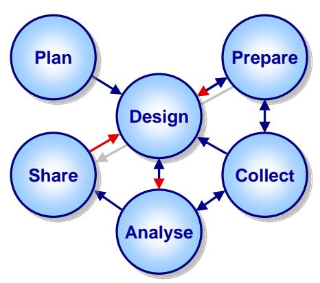
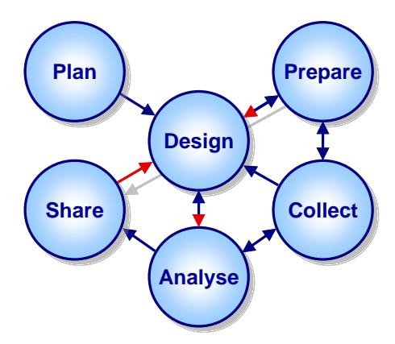

<!-- A3.R22 | source: papers_json/A3.R22/ -->

## **Qualitative Case Study Guidelines**

Saša Baškarada Defence Science and Technology Organisation, Melbourne Australia

*رغم أن أسلوب دراسة الحالة النوعية شائع الاستخدام، فإنه غير مفهوم جيداً. وبسبب التعارض في الافتراضات المعرفية والتعقيد الكامن في الدراسات النوعية القائمة على الحالة، قد يصعب إظهار الدقة العلمية، وقد يصعب تبرير أي نتائج ناتجة عنها. ولهذا السبب، تناقش هذه الورقة المشكلات المنهجية المرتبطة بالبحث النوعي القائم على الحالة، وتقدم إرشادات للتغلب عليها. ونظراً لقبولها شبه العالمي، تُعتمد عملية دراسة الحالة ذات المراحل الست التي وضعها Yin ويجري تفصيلها. علاوة على ذلك، تُدمج مبادئ إضافية من الأدبيات المنهجية الأوسع وتُشرح. وأخيراً، تُقترح بعض التعديلات على التبعيات بين مراحل دراسة الحالة الست. ويُتوقع أن اتباع الإرشادات المقدمة في هذه الورقة قد ييسر جمع البيانات الأكثر صلة بالطريقة الأكثر كفاءة وفعالية، ويبسط التحليل اللاحق، فضلاً عن تعزيز صلاحية النتائج الناتجة. وينبغي أن تكون هذه الورقة محل اهتمام الطلاب (مرحلة الشرف، الماجستير، الدكتوراه)، والأكاديميين، والممارسين المعنيين بإجراء ومراجعة الدراسات النوعية القائمة على الحالة. Keywords:* *Qualitative Research, Case Study, Guidelines, * *Validity. *

في حين يهتم البحث الكمي أساساً باختبار الفرضيات والتعميمات الإحصائية [(Jackson, 2008)](#page-21-0)، لا يستخدم البحث النوعي عادة الإجراءات الإحصائية أو وسائل التكميم الأخرى، بل يركز على فهم طبيعة مشكلة البحث بدلاً من كمية الخصائص الملاحَظة [(Strauss & Corbin, 1994)](#page-22-0). ونظراً لأن الباحثين النوعيين يفترضون عموماً أن الواقع الاجتماعي بناء إنساني، فإنهم يفسرون ويسيّقون المعاني المستمدة من معتقدات الناس وممارساتهم [(Denzin & Lincoln, 2011)](#page-20-0).

يتضمن بحث دراسة الحالة "دراسة مكثفة لوحدة واحدة بهدف فهم فئة أكبر من الوحدات (المشابهة) ... تُلاحَظ في نقطة زمنية واحدة أو خلال فترة محددة من الزمن" [(Gerring, 2004, p. 342)](#page-21-1). وبهذا المعنى، توفر دراسات الحالة فرصة للباحث لاكتساب رؤية شمولية عميقة لمشكلة البحث، وقد تيسر وصف مشكلة أو موقف بحثي وفهمه وتفسيره [(Baxter & Jack, 2008;](#page-20-1)[ Tellis, 1997a,](#page-23-0)[ 1997b)](#page-23-1).

وإلى جانب استخدامه الواسع في الأوساط الأكاديمية، يحظى هذا الأسلوب أيضاً بشعبية لدى الممارسين كأداة للتقييم والتعلم التنظيمي. ومع ذلك، ورغم استخدامه الواسع، فإن أسلوب دراسة الحالة النوعية غير مفهوم جيداً [(Barratt, Choi, & Li, 2011;](#page-19-0) [Dooley, 2002;](#page-20-2) [Flyvbjerg, 2006;](#page-21-2) [Gerring, 2004;](#page-21-1) [Stuart, McCutcheon, Handfield, ](#page-23-2) [McLachlin, & Samson, 2002)](#page-23-2). ونظراً للوقت والموارد الكبيرة اللازمة لإجراء مثل هذه الدراسات [(GAO, 1990)](#page-21-3)، فإن أي سوء فهم بشأن غرض الأسلوب وتنفيذه، وكذلك صلاحية النتائج الناتجة، قد يترتب عليه عواقب سلبية كبيرة. وفي سياق الدراسات الأكاديمية، قد يؤدي سوء الفهم الكبير الذي يُكتشف أثناء عملية مراجعة الأقران إلى

<!-- page 2 -->

إبطال الدراسة بأكملها، مما يؤدي إلى إهدار الوقت والجهد لدى الباحثين والمشاركين في دراسة الحالة. وقد يؤدي أي سوء فهم في دراسات الحالة الموجهة للممارسين إلى تعلم تنظيمي مختل [(Merton, 1940)](#page-22-1) أو خرافي [(Levitt ](#page-21-4) [& March, 1988)](#page-21-4) [(March, Sproull, & Tamuz, 1991;](#page-22-2)[ Yukl, 2009)](#page-23-3).

قد يكون تبرير دقة دراسات الحالة النوعية للباحثين ذوي الخبرة في هذا الأسلوب وفي مجال المشكلة أمراً صعباً. ولكي يكون أي تبرير مقنعاً، يجب أن يستند إلى حجج متجذرة في الأدبيات المنهجية. أما تبرير مثل هذه الدراسات للباحثين ذوي التوجه الكمي الأكبر الذين قد لا يملكون خبرة في المجال قيد البحث فقد يبدو عقبة يكاد يستحيل تجاوزها. وقد واجه المؤلف هذه التحديات بشكل مباشر بوصفه طالب دكتوراه، وباحثاً، وممارساً.

كان المؤلف باحثاً نوعياً بشكل أساسي لما يقرب من عقد من الزمن، وأجرى ونشر العديد من دراسات الحالة، معظمها في مجال نظم المعلومات، بما في ذلك [(Baškarada, 2010,](#page-19-1) [2011;](#page-19-2) [Baškarada & Koronios, 2011;](#page-19-3)[ Baškarada, ](#page-20-3) [Koronios, & Gao, 2007;](#page-20-3)[ Baškarada, McKay, & McKenna, 2013)](#page-20-4). ومؤخراً، وكجزء من دوره كمحلل عمليات في منظمة العلوم والتقنية الدفاعية الأسترالية (DSTO)، شارك المؤلف في دراسات حالة في مجالات إدارة العمليات، والقيادة، والتعلم التنظيمي. ونشأت هذه الورقة من دراسة تهدف إلى توفير أسس منهجية لأنشطة "الدروس المستفادة" التي تجريها قوة الدفاع الأسترالية (ADF).

تستند قدرة قوة الدفاع الأسترالية على التكيف والتحسين المستمر إلى قدرتها على التعلم من الخبرة. ويتطلب هذا التعلم القدرة على التقاط الملاحظات وتحليلها، واتخاذ إجراءات تكيفية تضمن أن تصبح الدروس المحددة دروساً مستفادة ومؤسسية. ولتيسير جمع الملاحظات ذات الصلة، وكذلك لضمان صلاحية التحليل اللاحق، من الضروري أن تتبع قوة الدفاع الأسترالية عملية دقيقة علمياً وتستخدم أنسب الأساليب. وتقدم هذه الورقة إرشادات لدراسة الحالة النوعية، قد تيسر جمع الملاحظات الأكثر صلة بالطريقة الأكثر كفاءة وفعالية. علاوة على ذلك، يُتوقع أن اتباع هذه الإرشادات سيبسط أيضاً التحليل اللاحق، وكذلك يضمن دقة أي دروس محددة. وبالإضافة إلى الفائدة المحتملة لقوة الدفاع الأسترالية، ينبغي أن تكون هذه الورقة أيضاً محل اهتمام ممارسين آخرين وأكاديميين لديهم مصلحة في دراسات الحالة النوعية.

ولمساعدة الطلاب والأكاديميين والممارسين في إجراء دراسات الحالة النوعية وتقييمها، تعتمد هذه الورقة عملية دراسة الحالة ذات المراحل الست لـ Yin [(2009)](#page-23-4) المقبولة شبه العالمية، وتُثريها من خلال دمج إرشادات إضافية من الأدبيات المنهجية الأوسع. وتختتم الورقة بتفصيل التعديلات المقترحة على التبعيات بين بعض مراحل دراسة الحالة (انظر

[Figure](#page-2-0) **1**)؛ تُمثَّل التبعيات الأصلية باللون الأزرق، والإضافات المقترحة باللون الأحمر، والحذوفات المقترحة باللون الرمادي.

## **Plan**

تركز مرحلة التخطيط على تحديد أسئلة البحث أو المبررات الأخرى لإجراء دراسة حالة، وتقرير استخدام أسلوب دراسة الحالة (مقارنة بأساليب أخرى)، وفهم نقاط قوته وقيوده [(Yin, 2009)](#page-23-4). ويُعد تحديد مشكلة البحث بوضوح على الأرجح الخطوة الأهم في المشروع البحثي بأكمله. وبهذا المعنى، ينبغي أن تبدأ كل دراسة حالة بمراجعة شاملة للأدبيات ودراسة دقيقة

<!-- page 3 -->

لأسئلة البحث وأهداف الدراسة [(Ravitch & Riggan, 2011)](#page-22-3). وينبغي أن تحدد المراجعة الشاملة للأدبيات، التي تعزز الصلاحية الظاهرية للدراسة [(Dooley, ](#page-20-2) [2002)](#page-20-2)، الفجوات ذات الصلة في الأدبيات وتربطها بأسئلة البحث [(Darke, Shanks, & Broadbent, 1998)](#page-20-5).

***Figure 1**: The Case Study Process, adapted from [(Yin, 2009, p. 1)](#page-23-4)*

ومن النقاط الرئيسية الأخرى في مرحلة التخطيط ضمان عدم وجود عدم تطابق بين أسئلة البحث وأسلوب دراسة الحالة [(GAO, 1990)](#page-21-3). ويتحدد اختيار أسلوب البحث بعدة عوامل، منها نوع سؤال البحث، ومدى السيطرة التي يملكها الباحث على الأحداث السلوكية الفعلية، والتركيز على الظواهر المعاصرة مقابل التاريخية [(Yin, 2009)](#page-23-4). كما ينبغي أن يتماشى أسلوب دراسة الحالة مع النموذج البحثي الأساسي؛ مثل الوضعية/ما بعد الوضعية، والتفسيرية، والنقدية/ما بعد الحداثية [(Gephart, 2004)](#page-21-5). وقد جرى الترويج للواقعية النقدية بوصفها النموذج المفضل لبحث دراسة الحالة [(Easton, 2010)](#page-20-6).

وفي حين صُنِّف أسلوب دراسة الحالة تقليدياً بوصفه بحثاً "لينّاً"، فإن الخصائص الموصوفة أعلاه تجعل في الواقع دراسات الحالة صعبة التنفيذ الجيد بشكل خاص [(Yin, 2009)](#page-23-4). ومع ذلك، فهي مناسبة بشكل خاص عندما يحدد رعاة البحث (وليس الباحثون) أسئلة البحث [(GAO, 1990)](#page-21-3). بالإضافة إلى ذلك، وفي حين تتحكم التجارب عادة في السياق ضمن بيئة اصطناعية وتملك نقاط بيانات أكثر بكثير من المتغيرات المهمة، فإن دراسات الحالة عادة ما تملك "متغيرات مهمة أكثر بكثير من نقاط البيانات"، وتعتمد "على مصادر أدلة متعددة، مع حاجة البيانات إلى التقارب بطريقة تثليثية"، وتستفيد "من التطوير المسبق للافتراضات النظرية لتوجيه جمع البيانات وتحليلها" [(Yin, 2009, p. 18)](#page-23-4).

يستخدم مكتب المساءلة الحكومية الأمريكي (GAO) دراسات الحالة على نطاق واسع في تقييماته. ويُعرِّف GAO دراسة الحالة بأنها "أسلوب للتعلم عن حالة معقدة، استناداً إلى فهم شامل لتلك الحالة يُكتسب من خلال الوصف والتحليل المكثف لتلك الحالة ككل وفي سياقها" [(GAO, 1990, p. 15)](#page-21-3). وتتيح دراسات الحالة نتائج تأكيدية (استنباطية) وكذلك تفسيرية (استقرائية) [(Hyde, 2000;](#page-21-6)[ Yin, 2009)](#page-23-4)، ويمكن أن تستند إلى حالة *واحدة* أو *حالات متعددة*، ويمكن أن تشمل بيانات *نوعية* و/أو *كمية* [(Gerring, 2004)](#page-21-1). ويمكن أن تكون *استكشافية*، أو *وصفية*، أو *تفسيرية*، وقد وُصفت بأنها الأسلوب البحثي المفضل عند طرح أسئلة *كيف* و*لماذا*، وعندما يملك الباحث سيطرة قليلة على الأحداث، ويكون التركيز على ظاهرة معاصرة ضمن سياق واقعي [(Yin, 2009)](#page-23-4). وعلى النقيض، قد لا يكون أسلوب بحث دراسة الحالة الخيار الأفضل في الحالات التي تكون فيها الظاهرة موضوع الاهتمام ناضجة ومفهومة جيداً، وحيث يوجد اهتمام قليل

<!-- page 4 -->

بكيفية أو سبب حدوث ظاهرة ما، وحيث لا يكون السياق الواقعي ذا صلة [(Darke et al., 1998)](#page-20-5).

ووفقاً لـ Yin، فإن أسئلة *كيف* و*لماذا* تُجاب بشكل أفضل من خلال دراسات الحالة لأن هذه الأسئلة "تتعامل مع روابط تشغيلية تحتاج إلى تتبعها عبر الزمن، وليس مجرد ترددات أو حالات وقوع" (p. 9). ومن ناحية أخرى، تكون الاستطلاعات، على سبيل المثال، أكثر ملاءمة عند الإجابة عن أسئلة مثل *من*، و*ماذا*، و*أين*، و*كم عدد*، و*كم مقدار* [(Dane, 2010)](#page-20-7). ومع ذلك، ونظراً لأن الاستطلاعات تُحلَّل عادة باستخدام تقنيات إحصائية، فإن وحدة التحليل تحتاج أيضاً إلى أن تؤخذ في الاعتبار. فعلى سبيل المثال، عند دراسة مجموعات/مؤسسات، قد يكون من الصعب (أو حتى المستحيل) الحصول على عينة كبيرة بما يكفي؛ وفي مثل هذه الحالات قد تكون دراسات الحالة أكثر ملاءمة.

وفي حين لا تهدف دراسات الحالة إلى التعميم على مجتمعات إحصائية (*التعميم * *الإحصائي*)، فإنها، على غرار التجارب، تهدف إلى التعميم على النظريات (*التعميم * *التحليلي*؛[ Yin, 2009)](#page-23-4). وبالتالي، ووفقاً لـ Yin، يمكن ادعاء التكرار "إذا أظهرت حالتان أو أكثر دعمها للنظرية نفسها" (p. 38). ومن ناحية أخرى، يرى Stake [(1978)](#page-22-4) أن دراسات الحالة مناسبة بشكل خاص لـ*التعميمات الطبيعية* المستندة إلى تحويل تجريبي للمعرفة الضمنية إلى معرفة صريحة. وعلى أي حال، فإن دراسات الحالة مناسبة بشكل خاص للأوصاف الموسعة والمتعمقة للظواهر الاجتماعية المعقدة. والواقع أن عمق التحليل هو إحدى المزايا الرئيسية لأسلوب دراسة الحالة [(Gerring, 2004)](#page-21-1). وكأسلوب بحثي، تُستخدم دراسات الحالة عادة في علم النفس، وعلم الاجتماع، والعلوم السياسية [(Gerring, 2004)](#page-21-1)، والأعمال [(Eisenhardt & ](#page-21-7) [Graebner, 2007)](#page-21-7)، ونظم المعلومات [(Darke et al., 1998)](#page-20-5)، والتعليم [(Stake, 1978)](#page-22-4)، وإدارة العمليات [(McCutcheon & Meredith, 1993)](#page-22-5)، والتسويق [(Easton, 2010)](#page-20-6)، وما شابه.

ومع ذلك، "ونظراً للوقت المطلوب، والطبيعة الغنية والمتعمقة للمعلومات المطلوبة، والحاجة إلى تحقيق المصداقية"، يمكن أن تكون دراسات الحالة أيضاً مكلفة في إجرائها [(GAO, 1990, p. 11)](#page-21-3). ومن التحديات الأخرى التي حددها GAO اختيار أسلوب انتقاء الحالات، والإبلاغ عن أساس اختيار الحالات، ودمج النتائج عبر عدة حالات عندما تكون النتائج في إحداها غير متسقة مع تلك الموجودة في حالة أخرى.

قد تُجرى دراسات الحالة *الاستكشافية* قبل تحديد أسئلة البحث والفرضيات. وبناءً عليه، تُستخدم أساساً لبناء النظرية. وتحاول دراسات الحالة *الوصفية* وصف مختلف خصائص ظاهرة ما في سياقها بشكل كامل، وبالتالي تُستخدم أيضاً أساساً لبناء النظرية. وقد تحدد مثل هذه الدراسات أيضاً الفروق بين الحالات الفردية بهدف احتمال توليد إطار تصنيفي [(Gerring, 2004)](#page-21-1). وقد تُجرى دراسات الحالة *التفسيرية* للتحقق من العلاقات السببية؛ وبالتالي، تُستخدم أساساً لاختبار النظرية. وتتميز بأسئلة بحث *كيف* و*لماذا* لأنها تبحث في العلاقات المقترحة بين مكونات النظرية المختلفة [(Yin, 2009)](#page-23-4). وقد يؤدي أي تعارض بين نظرية أولية والأدلة إلى تعديل النظرية وتعزيزها [(Aneshensel, 2012)](#page-19-4). ومن الأمثلة البارزة على دراسة الحالة التفسيرية دراسة Allison و Zelikow [(1999)](#page-19-5) لأزمة الصواريخ الكوبية عام 1962، والتي توضح، وفقاً لـ Yin [(2009)](#page-23-4)، كيف "يمكن أن تكون دراسة حالة واحدة أساساً لتفسيرات وتعميمات مهمة" (p. 6).

ونظراً لأن الاستطلاعات تُعد عادة الأسلوب المفضل لاختبار النظرية، فإن تقديم تبرير واضح لاستخدام دراسات الحالة الاستنباطية (التفسيرية) أمر ضروري [(Barratt et al., 2011)](#page-19-0). ونظراً لأن الدراسات الوصفية البحتة تتعرض للنقد بشكل متكرر

<!-- page 5 -->

بسبب غياب المساهمة النظرية، فقد اقتُرح أن دراسات الحالة الاستكشافية قد تكون "الخيار الأكثر أماناً" [(Pan & Tan, 2011, p. 163)](#page-22-6).

يميز Stake [(1995)](#page-22-7) بين دراسات الحالة *الجوهرية*، و*الأداتية*، و*الجماعية*. تهدف دراسات الحالة *الجوهرية* فقط إلى اكتساب فهم أفضل للحالة المعينة موضوع الاهتمام. وبالتالي، لا تُستخدم مثل هذه الدراسات لبناء النظرية. أما دراسات الحالة *الأداتية* فتوفر رؤى حول قضية ما أو تُستخدم لصقل نظرية، وتضم دراسات الحالة *الجماعية* عدة دراسات حالة أداتية. ومع ذلك، يرى Stake أيضاً أن الدراسات نادراً ما تنطبق عليها هذه الفئات بدقة، وأن على الباحثين اتخاذ قرار استراتيجي بشأن نطاق دراسة الحالة، لأنه لا يمكن، ولا حاجة، لفهم كل شيء.

يقدم GAO [(1990)](#page-21-3) تصنيفاً أكثر تفصيلاً، يميز بين ستة أنواع من دراسات الحالة:

- *توضيحية*—هذه دراسة حالة وصفية بطبيعتها، تهدف إلى إضافة واقعية وأمثلة متعمقة إلى معلومات أخرى حول برنامج أو سياسة؛
- *استكشافية*—وهي أيضاً دراسة حالة وصفية لكنها تهدف إلى توليد فرضيات للتحقيق اللاحق بدلاً من التوضيح؛
- *الحالة الحرجة*—تفحص هذه حالة واحدة ذات اهتمام فريد أو تعمل كاختبار حاسم لادعاء بشأن برنامج أو مشكلة أو استراتيجية؛
- *تنفيذ البرنامج*—تبحث دراسة الحالة هذه في العمليات، غالباً في عدة مواقع، وغالباً بشكل معياري؛
- *آثار البرنامج*—يستخدم هذا التطبيق دراسة الحالة لفحص السببية، ويتضمن عادة تقييمات متعددة المواقع ومتعددة الأساليب؛ و
- *تراكمية*—تجمع هذه النتائج من العديد من دراسات الحالة للإجابة عن سؤال تقييمي، سواء كان وصفياً أو معيارياً أو سببياً.

## **Design**

تركز مرحلة التصميم على تحديد وحدة التحليل والحالات المحتملة التي ستُدرس، وتطوير النظرية/الافتراضات وتحديد القضايا الكامنة وراء الدراسة المتوقعة، وتحديد تصميم دراسة الحالة (*مفردة*، *متعددة*، *شمولية*، *مضمّنة*)، وتطوير إجراءات للحفاظ على جودة دراسة الحالة [(Yin, 2009)](#page-23-4). ويربط تصميم البحث منطقياً بين أسئلة البحث واستنتاجاته من خلال الخطوات المتخذة أثناء جمع البيانات وتحليلها. وبالتالي، ينبغي أن يتناول تصميم البحث، الذي يمكن اعتباره "مخططاً" لمشروع البحث، أسئلة البحث، والافتراضات/الفرضيات ذات الصلة، ووحدة التحليل، والمنطق الذي يربط البيانات بالافتراضات، ومعايير تفسير النتائج. وينبغي أن يضمن المنطق الذي يربط البيانات بالافتراضات جمع النوع والكمية الصحيحين من المعلومات ذات الصلة. وينبغي أن تشمل معايير تفسير النتائج أي نظريات/تفسيرات منافسة ذات صلة حتى يمكن جمع البيانات ذات الصلة أثناء مرحلة جمع البيانات. ومن القضايا الشائعة المتعلقة بالتصميم اختيار وحدة تحليل غير مناسبة، واختيار حالات غير مناسب، وعدم الاهتمام الكافي بالنظريات/الفرضيات البديلة، واختيار حالات أكثر أو أقل من اللازم [(GAO, 1990)](#page-21-3). ويتطلب التصدي لبعض هذه القضايا توازناً دقيقاً بين "معرفة المزيد عن القليل ومعرفة القليل عن الكثير" [(Gerring, 2004, p. 348)](#page-21-1).

تحدد وحدة التحليل ماهية الحالة—على سبيل المثال، حدث، أو عملية، أو فرد، أو مجموعة، أو مؤسسة [(GAO, 1990;](#page-21-3)[ Yin, 2009)](#page-23-4). ونظراً لأن الأدبيات ليست

<!-- page 6 -->

متسقة فيما يتعلق بالمصطلحات—فعلى سبيل المثال، يدعو Gerring [(2004)](#page-21-1) إلى تصنيف تشكل فيه الوحدات حالات—فإن تحديد المصطلحات ذات الصلة بوضوح أمر بالغ الأهمية. وفي حالة حدث أو عملية، يُعد تحديد الحدود الزمنية (أي بداية الحالة ونهايتها) أمراً ضرورياً. ورغم أن الأمر قد يبدو واضحاً وبسيطاً، فإن تحديد وحدة التحليل المناسبة يتطلب دراسة دقيقة، إذ يمكن أن يؤدي أي التباس بشأنها إلى إبطال الدراسة بأكملها [(Gerring, 2004)](#page-21-1). ومع ذلك، وجدت مراجعة حديثة لدراسات الحالة النوعية في إدارة العمليات أن 83% من المقالات لم تُحدِّد وحدة تحليلها بوضوح [(Barratt et al., 2011)](#page-19-0). وبالمثل، تفشل معظم دراسات الحالة المنشورة في أدبيات نظم المعلومات في تحديد وحدة التحليل [(Dubé & Paré, 2003)](#page-20-8).

ونظراً لأن جميع الأبحاث تستند إلى نظرية، ينبغي توضيح الأسس النظرية للدراسة بوضوح [(Flynn, Sakakibara, Schroeder, Bates, & Flynn, 1990)](#page-21-8). ويشمل هذا التمييز بين نهج بناء النظرية [(Eisenhardt, 1989)](#page-21-9) ونهج اختبار النظرية. وكما نوقش سابقاً، تُعد دراسات الحالة مناسبة للإجابة عن أسئلة *كيف* و*لماذا*. ويمكن تحديد الأسئلة المحددة وتطويرها من خلال فحص أي دراسات سابقة عن كثب وتحديد أي اقتراحات/فرص لأبحاث مستقبلية [(Yin, 2009)](#page-23-4). ومع ذلك، ونظراً لأن أسئلة *كيف* و*لماذا* عادة ما تكون واسعة جداً، فقد لا توفر توجيهاً كافياً بشأن البيانات التي يجب جمعها. وفي مثل هذه الحالات، قد يكون استنباط افتراضات/فرضيات أكثر تحديداً مفيداً. ويُعد تحديد الافتراضات التي تنطبق على الحالة (الحالات) قيد الدراسة وتلك التي يُقصد تعميمها على مجتمع أوسع أمراً بالغ الأهمية [(Gerring, 2004)](#page-21-1). كما أن ذكر جميع الافتراضات ذات الصلة له فائدة توضيح نطاق الدراسة [(Baxter & Jack, 2008)](#page-20-1). ونظراً لأن اختيار العدسة النظرية أمر ذاتي بالكامل، فلا توجد إرشادات صريحة بشأن كيفية القيام بذلك بالضبط [(Walsham, ](#page-23-5) [2006)](#page-23-5). ومع ذلك، ومن منظور عملي، ينبغي ألا تكون الأسس النظرية قديمة، أو غير ناضجة، أو مفرطة الاستخدام، أو موجهة بشكل مفرط للممارسين [(Pan & Tan, 2011)](#page-22-6). وعندما تكشف بيانات دراسة الحالة عن مفاهيم لا تتلاءم بدقة مع المخطط النظري الأساسي، قد تتاح للباحثين فرصة توسيعه من خلال تضمين مفاهيم و/أو افتراضات إضافية. ويعارض الرأي البديل والمثير للجدل نوعاً ما [(Walsham, 1995)](#page-23-6) أي افتراض نظري مسبق قبل جمع البيانات، بوجهة نظر مفادها أن أي نظرية ينبغي أن تنبثق بحتة من البيانات الخام [(Eisenhardt, 1989;](#page-21-9)[ Glaser ](#page-21-10) [& Strauss, 1967)](#page-21-10).

ونظراً لأن الدراسات قد تشمل أصحاب مصلحة متعددين (مثل الباحثين والمؤسسة قيد الدراسة)، من المهم أيضاً إما التمييز بوضوح بين المساهمات العملية والنظرية المتوقعة أو مواءمتها [(Darke et al., 1998)](#page-20-5). ومن الفوائد العملية المحتملة لمؤسسة دراسة الحالة المقارنة المرجعية بأفضل الممارسات والمؤسسات الأخرى، والأوصاف الغنية للظاهرة قيد البحث. وقد يستفيد المستجيبون في المقابلات أيضاً من اكتساب فهم أفضل لمشكلة البحث [(Onwuegbuzie, ](#page-22-8) [Leech, & Collins, 2012)](#page-22-8).

وقد ثبت أن العديد من دراسات الحالة المنشورة تفشل في تحديد الأساس المنطقي لاختيار الحالة [(Dubé & Paré, 2003)](#page-20-8). ويمكن اختيار الحالات الفردية استناداً إلى *الملاءمة*، و*الغرض*، و*الاحتمالية* (انظر [Table 1)](#page-6-0). ويعرض [Table 2](#page-6-1) تصنيفاً آخر غير حصري لاختيار الحالات. ووفقاً لـ Yin، تشمل أسباب تبرير دراسات *الحالة المفردة* دراسة *حالة حرجة*، أو *حالة متطرفة*، أو *حالة تمثيلية* أو *نموذجية*، أو *حالة كاشفة* (تتضمن موقفاً جديداً)، أو *حالة طولية*. ويوفر اختيار الحالة *الغرضي* القدرة على جمع البيانات الأكثر صلة [(Edmonds & ](#page-21-11) [Kennedy, 2012)](#page-21-11)، وتوفر الحالات *الطولية* القدرة على تحديد الاتجاهات عبر الزمن [(GAO, 1990)](#page-21-3).

<!-- page 7 -->

ووفقاً لـ Yin، في *دراسات الحالات المتعددة*، ينبغي اختيار كل حالة بحيث إما تتنبأ بنتائج مماثلة (*التكرار الحرفي*)، أو تتنبأ بنتائج متباينة لكن لأسباب يمكن توقعها (*التكرار النظري*). وإذا أدت حالات متعددة إلى نتائج متناقضة، ينبغي مراجعة النظرية الأولية واختبارها بمجموعة أخرى من الحالات [(Yin, ](#page-23-4) [2009)](#page-23-4). ويمكن أن يكون كل من التصميمين المفرد والمتعدد إما شمولياً (وحدة تحليل واحدة لكل حالة) أو مضمّناً (وحدات تحليل متعددة لكل حالة).

| Selection Basis | Description |
| --- | --- |
| Extreme/deviant case | Extreme or unusual case. |
| Maximum variation cases | Cases which are very different on one dimension. |
| Critical case | A case with strategic importance to the general problem. |
| Paradigmatic case | A prototypical case. |

وفي حين لا يوجد عدد مثالي للحالات، فإنه اعتماداً على طبيعة سؤال البحث، والموارد المتاحة، وإطار زمن الدراسة، وتوافر الحالات، قد تكون الأولوية إما للاتساع (عبر حالات متعددة) أو للعمق (داخل الحالة) [(Darke et al., 1998;](#page-20-5) [Perry, 1998)](#page-22-9). ومع ذلك، تؤدي الحالات المتعددة عادة إلى نتائج أكثر متانة من بحث الحالة المفردة، وخاصة في سياق بناء النظرية الاستقرائية [(Eisenhardt & ](#page-21-7) [Graebner, 2007)](#page-21-7). ونظراً لأن الحصول على وصول إلى مؤسسات دراسة حالة مناسبة ربما يكون الخطوة الأكثر تحدياً في العملية بأكملها [(Walsham, 2006)](#page-23-5)، يرى البعض أنه قد يكون من الأكثر عملية تكييف أي مساهمة نظرية استناداً إلى إمكانية الوصول إلى دراسة الحالة [(Pan & ](#page-22-6) [Tan, 2011)](#page-22-6). وبعبارة أخرى، ينبغي أن يسبق البحث عن الحالات ذات الصلة والوصول إليها تحديد أسئلة البحث. وتكون هذه النصيحة منطقية بشكل خاص إذا اتفق المرء مع الادعاء بضرورة تجنب الاتصال غير المرغوب فيه.

تعتمد جودة أي دراسات تجريبية، بما في ذلك دراسات الحالة، على *صلاحية البناء*، و*الصلاحية الداخلية*، و*الصلاحية الخارجية*، و*الموثوقية* [(Edmonds & Kennedy, 2012)](#page-21-11).

<!-- page 8 -->

*صلاحية البناء*، التي تُعد صعبة بشكل خاص في بحث دراسة الحالة، تتعامل مع تفعيل المفاهيم إجرائياً. *التفعيل الإجرائي* هو عملية تعريف مفهوم من خلال مجموعة من السمات/المتغيرات لجعله قابلاً للقياس من خلال الملاحظات التجريبية [(Loseke, 2012)](#page-21-13). وقد جرى تحديد عدد كبير من التهديدات لـ*صلاحية البناء*، بما في ذلك التوضيح غير الكافي للمفاهيم، وخلط المفاهيم، وتحيز التشغيل الأحادي، وتحيز الأسلوب الأحادي، وخلط المفاهيم بمستوياتها، والبنية العاملية الحساسة للمعالجة، والتغيرات التفاعلية في التقارير الذاتية، والتفاعلية تجاه الموقف التجريبي، وتوقعات المُجري، وآثار الجدة والاضطراب، والمساواة التعويضية، والتنافس التعويضي، وإحباط الاستياء، وانتشار المعالجة. ويناقش Shadish وCook وCampbell [(2002)](#page-22-10) كل تهديد من هذه التهديدات بتفصيل كبير، ويقدمون توصيات حول كيفية التخفيف منها. ووفقاً لـ Yin [(2009)](#page-23-4)، تشمل ثلاث استراتيجيات لتحسين صلاحية البناء استخدام مصادر أدلة متعددة، وطلب مراجعة تقرير دراسة الحالة من قِبل المخبرين الرئيسيين، والحفاظ على سلسلة أدلة. ويمكن أن يساهم استخدام مصادر أدلة متعددة في صلاحية البناء من خلال توفير قياسات متعددة للظاهرة نفسها. وينبغي أن يسمح تصميم دراسة الحالة بحيث تُحافَظ على سلسلة الأدلة للمراجعين بتتبع النتائج عودة إلى أسئلة البحث الأولية، أو من الأسئلة إلى النتائج [(Sarker & Lee, 1998)](#page-22-11). وقد تعزز التصحيحات التي يجريها المخبرون الرئيسيون من خلال المراجعات دقة دراسة الحالة، فضلاً عن تحديد مجموعة من وجهات النظر المتنافسة.

*الصلاحية الداخلية*، المعنية بتبرير العلاقات السببية، تنطبق فقط على دراسات الحالة التفسيرية وليس الوصفية أو الاستكشافية [(GAO, 1990)](#page-21-3). ومن التهديدات للصلاحية الداخلية الأسبقية الزمنية الغامضة، والانتقاء، والتاريخ، والنضج، والانحدار، والتناقص، والاختبار، والأدوات، والآثار التراكمية والتفاعلية. ومرة أخرى، يقدم Shadish وآخرون [(2002)](#page-22-10) شروحاً وتوصيات مفصلة. ويمكن أن يؤدي استخدام التثليث المنهجي وتثليث مصادر البيانات (بما في ذلك المقارنات عبر الحالات) إلى زيادة الصلاحية الداخلية [(GAO, 1990)](#page-21-3). ومن الأنواع الأخرى من *التثليث* تثليث الباحثين وتثليث النظريات [(Denzin, 1978)](#page-20-9). فعلى سبيل المثال، قد يشارك عدد من الباحثين الأفراد أو الفرق بشكل منفصل في أنشطة جمع البيانات والتحليل الأولي، قبل التقارب ومقارنة نتائجهم الأولية [(Gerring, 2004)](#page-21-1). ويمكن للباحثين المنفصلين بعد ذلك أن يحاولوا بنشاط إبطال النتائج الأولية لبعضهم البعض [(Campbell, 1975)](#page-20-10). بالإضافة إلى ذلك، ينبغي تعزيز النظرية والتحقق من صحتها من خلال تقييم مستمر وتكراري للحالات مقابلها [(Sykes, ](#page-23-7) [1990)](#page-23-7). وقد قيل أيضاً أن *مطابقة الأنماط* يمكن استخدامها لتعزيز الصلاحية الداخلية، حيث، من خلال استنتاج نوعي لكن منطقي [(Lee, 1989)](#page-21-14)، يُقارَن نمط مبني تجريبياً منطقياً بنمط متوقع [(Yin, 2009)](#page-23-4).

*الصلاحية الخارجية* تتعامل مع مشكلة معرفة ما إذا كانت النتائج قابلة للتعميم على حالات أخرى. ومن التهديدات للصلاحية الخارجية تفاعل العلاقة السببية مع الوحدات، وتفاعل العلاقة السببية عبر تباينات المعالجة، وتفاعل العلاقة السببية مع النتائج، وتفاعل العلاقة السببية مع الإعدادات، والوساطة المعتمدة على السياق [(Shadish et al., 2002)](#page-22-10). ومع ذلك، قيل إن استخدام حالة واحدة مشابه لاستخدام تجربة واحدة، بمعنى أن أياً منهما لا يكفي لرفض أو دحض الافتراضات، وأن عدة حالات ضرورية لإظهار دقة نظرية ما [(Eisenhardt & Graebner, 2007;](#page-21-7)[ Lee, 1989;](#page-21-14)[ Yin, 2009)](#page-23-4). وبعبارة أخرى، "دراسات الحالة، مثل التجارب، قابلة للتعميم على افتراضات نظرية وليس على مجتمعات أو أكوان. وبهذا المعنى، فإن دراسة الحالة، مثل التجربة، لا تمثل 'عينة'، وهدف الباحث هو توسيع النظريات وتعميمها

<!-- page 9 -->

[*التعميم التحليلي*] وليس حصر الترددات [*التعميم الإحصائي*]" [(Yin, 2009, p. 10)](#page-23-4). ومع ذلك، يجدر بالذكر أن الأدبيات المنهجية تقدم توافقاً محدوداً في الآراء حول كيفية تحقيق التعميم التحليلي بالضبط [(Halkier, 2011)](#page-21-15).

تُعنى *الموثوقية* بإظهار إمكانية الحصول على النتائج نفسها من خلال تكرار إجراء جمع البيانات. وبعبارة أخرى، ينبغي أن يكون بإمكان باحثين آخرين من حيث المبدأ اتباع الإجراءات نفسها والوصول إلى النتائج نفسها. وتشمل استراتيجيتان لضمان موثوقية دراسات الحالة إنشاء بروتوكول دراسة الحالة، وتطوير قاعدة بيانات لدراسة الحالة [(Yin, 2009)](#page-23-4). ويسهم بروتوكول دراسة الحالة في الموثوقية من خلال توحيد إجراءات البحث. وقد تشمل الوثائق ذات الصلة نظرة عامة على المشروع، وإجراءات ميدانية، وأسئلة توجيهية، ومخطط تقرير.

بالإضافة إلى صلاحية البناء/الصلاحية الداخلية/الصلاحية الخارجية والموثوقية، تُعد *جودة البيانات* أيضاً معياراً رئيسياً للصلاحية. وقد حدد البحث مجموعة من أبعاد جودة البيانات ذات الصلة، بما في ذلك الدقة، والموضوعية، والمصداقية، والسمعة، وقابلية التفسير، وسهولة الفهم، والتمثيل الموجز والمتسق، والصلة، والقيمة المضافة، والتوقيت المناسب، والاكتمال، وكمية المعلومات، وإمكانية الوصول، وأمن الوصول [(Wang & Strong, ](#page-23-8) [1996)](#page-23-8). وفيما يتعلق بهذه الأبعاد، قد تتلف البيانات أثناء الجمع، والنقل، والتخزين، والدمج، والاسترجاع، والتحليل [(Baškarada, 2010,](#page-19-1)[ 2011)](#page-19-2).

## **Prepare**

تركز مرحلة الإعداد على تطوير مهارات الباحث في دراسة الحالة، والتدريب على دراسة حالة معينة، وتطوير بروتوكول دراسة الحالة، وإجراء حالة تجريبية، والحصول على أي موافقات ذات صلة [(Yin, 2009)](#page-23-4). وينبغي أن يهدف الإعداد أيضاً إلى تحديد أي قضايا ذات صلة في تصميم دراسة الحالة و/أو تكوين الفريق، والسعي لمعالجة أي قضايا من هذا القبيل قبل بدء مرحلة جمع البيانات. ورغم أهمية هذه الخطوة، لوحظ أنها كثيراً ما تُحذف من التقارير المنشورة عن دراسات الحالة [(Dubé & Paré, 2003)](#page-20-8).

ووفقاً لـ Yin، ينبغي أن يكون الباحثون على دراية كافية بمجال الدراسة بحيث يفهمون المفاهيم الرئيسية والقضايا النظرية/المنهجية ذات الصلة بالدراسة. وينبغي أن يعرفوا سبب إجراء الدراسة، والأدلة المطلوب البحث عنها، والتباينات التجريبية التي يمكن توقعها (بما في ذلك ما ينبغي فعله إذا حدثت هذه التباينات)، وما يشكل دليلاً داعماً أو مضاداً. وقد تشمل الاستعدادات المحددة لأنشطة جمع البيانات مراجعة مقترح دراسة الحالة الأصلي، وبروتوكول دراسة الحالة، وعينات التقارير، وما شابه. وبالإضافة إلى الدراية الكافية بمجال الدراسة، ينبغي أن يكون باحثو دراسة الحالة أيضاً قادرين على تفسير المعلومات في الوقت الفعلي وتعديل أنشطة جمع البيانات وفقاً لذلك لتناسب دراسة الحالة [(Yin, 2009)](#page-23-4).

وكما نوقش سابقاً، يسهم استخدام بروتوكول دراسة الحالة إيجاباً في موثوقية الدراسة، وينبغي أن يشمل من الناحية المثالية مقدمة لدراسة الحالة وغرض البروتوكول، وإجراءات جمع البيانات، ومخططاً لتقرير دراسة الحالة، وأسئلة دراسة حالة عالية المستوى، وأي مراجع. ويمكن أيضاً استخدام دراسات الحالة التجريبية لصقل "خطط جمع البيانات فيما يتعلق بمحتوى البيانات والإجراءات المتبعة" [(Yin, 2009, p. 92)](#page-23-4). وينبغي أن تعكس أي تقارير تجريبية الدروس المستفادة، وتوفر، حسب الاقتضاء، سبلاً لتطبيق الدروس في التكرار التالي. ومع ذلك، فقد ثبت أن معظم دراسات الحالة المنشورة في أدبيات نظم المعلومات تفشل في ذكر أي تجارب تجريبية [(Dubé & Paré, 2003)](#page-20-8). وينبغي أن تُوثَّق أي

<!-- page 10 -->

تغييرات لاحقة على بروتوكول دراسة الحالة أو انحرافات عنه بشكل كامل ودقيق [(Dooley, 2002)](#page-20-2).

وقبل المضي قدماً، ينبغي أن يتوصل الباحثون أيضاً إلى اتفاق مع مؤسسة/مشاركي دراسة الحالة بشأن أي قيود على الكشف عن البيانات، والهويات، والنتائج [(Darke et al., 1998)](#page-20-5). كما ينبغي إبلاغ المشاركين المحتملين بالإطار الزمني للبحث، وطبيعة مشاركتهم المقترحة، والنتائج العملية المتوقعة.

## **Collect**

تتضمن مرحلة الجمع اتباع بروتوكول دراسة الحالة، واستخدام مصادر أدلة متعددة، وإنشاء قاعدة بيانات لدراسة الحالة، والحفاظ على سلسلة أدلة [(Yin, ](#page-23-4) [2009)](#page-23-4). ويوصي GAO [(1990)](#page-21-3) بالمثل بأن تُستخدم مصادر أدلة متعددة، وأن تُستخدم قاعدة بيانات دراسة الحالة لتخزين الأدلة ذات الصلة، وأن تُوضِّح سلسلة أدلة قابلة للتدقيق (يُشار إليها أيضاً بـ"مسار التدقيق") كيفية استخلاص أي استنتاجات [(Miles & Huberman, 1994)](#page-22-12).

ووفقاً لـ Yin، من الاختلافات الرئيسية بين الدراسات القائمة على الاستطلاع ودراسات الحالة أن الاستطلاعات تلتقط التصورات والمواقف تجاه الأحداث والسلوكيات، في حين تجمع دراسات الحالة أدلة مباشرة. علاوة على ذلك، في دراسات الحالة، تُحلَّل البيانات فور توافرها، وتُستخدم النتائج الناشئة لتوجيه مجموعة الملاحظات التالية [(GAO, 1990)](#page-21-3)، أو نشاط جمع البيانات التالي [(Dooley, 2002)](#page-20-2).

نشأ *أخذ العينات النظري*، الذي يختلف عن *أخذ العينات الإحصائي*، مع تطوير *النظرية الجذرية* [(Glaser & Strauss, 1967)](#page-21-10). وعلى عكس أخذ العينات الإحصائي، لا يتمثل هدف أخذ العينات النظري في إجراء التقاط تمثيلي لجميع التباينات الممكنة، بل في اكتساب فهم أعمق للحالات لتيسير تطوير النظريات. ويعني أخذ العينات النظري أن الباحثين يوجهون أنشطة جمع البيانات على أساس أفكار نظرية مؤقتة [(Boeije, 2002)](#page-20-11). وبالتالي، فإنه يمكّن من الإجابة عن أسئلة نشأت من تحليل البيانات السابقة والتأمل فيها، إذ تقدم كل قطعة بيانات محللة إشارات حول أين ينبغي النظر بعد ذلك. ومن الأسباب النظرية لأخذ عينات من الحالات كشف شيء غير عادي/غير متوقع، والسعي إلى التكرار/الدحض، واستبعاد التفسيرات البديلة، وتفصيل النظرية الناشئة [(Eisenhardt & Graebner, 2007)](#page-21-7). ويُعد اختيار أزواج حالات متطرفة (مثل جيد مقابل سيء) نهجاً شائعاً لأخذ العينات النظري. وبهذا، تُعدَّل النظرية باستمرار نتيجة لمزيد من البحث. ويساعد نهج جمع البيانات الشامل هذا على ضمان عدم إغفال الجوانب الرئيسية، وتوفر المرونة المرتبطة به القدرة على جمع البيانات الأكثر صلة، وتؤدي مصادر الأدلة المتعددة إلى تعزيز الصلاحية وتقليل التحيز [(Eisenhardt & ](#page-21-7) [Graebner, 2007;](#page-21-7)[ GAO, 1990)](#page-21-3). بالإضافة إلى ذلك، يمكن أن تؤدي القدرة على البحث عن أدلة دحضية إلى تقليل تحيز التأكيد، ويسمح الحفاظ على سلسلة أدلة بتبريرات أقوى لأي استنتاجات.

وبالإضافة إلى تحيز الباحث الذي قد ينتج عن القيم والافتراضات الشخصية، والذي يمكن أن يؤثر بشكل مفرط على جمع البيانات وتحليلها، تحتاج أيضاً التأثيرات المحتملة للباحثين على سلوك المشاركين في دراسة الحالة إلى أن تؤخذ بعين الاعتبار [(Darke et al., 1998)](#page-20-5). فعلى سبيل المثال، يشير مصطلح "التأويل المزدوج" إلى الموقف الذي يؤثر فيه الباحثون على تفسيرات المشاركين في الدراسة [(Giddens, ](#page-21-16) [1984)](#page-21-16). والحجج القائلة بأن هذا النوع من التحيز يمكن تقليله من خلال بناء علاقة توافق بين الباحثين والمشاركين [(Miles & Huberman, 1994)](#page-22-12) قابلة للتشكيك فيها. وعلى أي

<!-- page 11 -->

حال، ينبغي على الباحثين الإقرار صراحة بأي جوانب من هذا القبيل والتأمل النقدي في كيفية بناء المعاني اجتماعياً [(Klein & Myers, 1999)](#page-21-17).

يمكن جمع البيانات ذات الصلة من خلال *الوثائق، والسجلات الأرشيفية، والمقابلات، * *والملاحظات المباشرة، والمصنوعات المادية* [(Yin, 2009)](#page-23-4). ووفقاً لـ Yin، عند مراجعة الوثائق، ينبغي أن يضع الباحثون في اعتبارهم أنها قد لا تعكس دائماً الواقع بدقة (على سبيل المثال، قد تكون وثائق السياسات والعمليات قديمة). وتُعد السجلات الأرشيفية، على الأرجح، أكثر موثوقية، لأنها تُستخدم عادة لأغراض حفظ السجلات.

تتيح قاعدة بيانات دراسة الحالة للباحثين تطوير مسار تدقيق من جمع البيانات، عبر التحليل، إلى الاستنتاجات النهائية. ووفقاً لـ Yin، ينبغي أن يكون بإمكان أي قارئ مهتم ربط الاستنتاجات المقدمة في تقرير دراسة الحالة بالتحليلات الأساسية، والأدلة الداعمة، وبروتوكول دراسة الحالة، وأسئلة البحث الأصلية. وقد تشمل قاعدة بيانات دراسة الحالة نصوص المقابلات، وملاحظات الباحث، والأدلة الوثائقية، والتحليلات الأولية، وما شابه. وبهذا، فإن استخدام قاعدة بيانات دراسة الحالة يعزز موثوقية الدراسة. وينبغي تصنيف جميع العناصر في قاعدة البيانات وفهرستها والإحالة المرجعية المتبادلة بينها لتيسير الاسترجاع السهل.

وقبل اكتمال جمع البيانات، ينبغي أن يتأكد الباحثون من جمعهم أدلة تأكيدية كافية لمعظم المواضيع الرئيسية للدراسة، وأن الأدلة تشمل محاولات للبحث في الفرضيات أو التفسيرات المنافسة الرئيسية. ووفقاً لـ Yin، فإن أي نتائج لدراسة حالة "من المرجح أن تكون أكثر إقناعاً ودقة إذا استندت [إلى] عدة مصادر مختلفة من المعلومات" (p. 116)، لأن مصادر الأدلة المتعددة تتيح تثليث البيانات وتطوير خطوط بحث متقاربة. وبعبارة أخرى، "فحص اتساق الأدلة عبر أنواع مختلفة من مصادر البيانات يشبه التحقق" [(GAO, 1990, p. 21)](#page-21-3). كما تُدعَم صلاحية البناء لأن مصادر الأدلة المتعددة توفر قياسات متعددة للمفهوم نفسه [(Yin, 2009)](#page-23-4). ووفقاً لـ GAO [(1990)](#page-21-3)، يُعد اختيار الحالات/الأمثلة المناسبة، والتثليث، والبحث عن الأدلة الدحضية السمات الرئيسية لدراسات الحالة.

تُعد المقابلات (انظر[ Table 3)](#page-11-0) محادثات موجهة تُعد عادة من أهم مصادر أدلة دراسة الحالة [(Yin, 2009)](#page-23-4). ومع ذلك، "ينبغي استخدامها فقط للحصول على معلومات لا يمكن الحصول عليها بأي طريقة أخرى" [(Darke et al., 1998, p. 283)](#page-20-5). فعلى سبيل المثال، يمكن الحصول على معلومات حول المجالات الوظيفية للمؤسسة، وهياكل التقارير، والأدوار والمسؤوليات من مجموعة من الوثائق الداخلية (مثل السياسات والإجراءات)، والوثائق العامة (مثل التقارير السنوية)، والمواقع الإلكترونية. ورغم وصف محادثة المقابلة بأنها "قناة لنقل المعرفة" [(Silverman, 1997, p. 113)](#page-22-13)، فإن إجراء مقابلة فعالة يظل مهمة صعبة للغاية [(Fontana & Frey, 1994)](#page-21-18). ويمكن أن تكون المقابلات *منظمة*، أو *شبه منظمة*، أو *غير منظمة*.

تتضمن *المقابلات المنظمة* طرح أسئلة محددة مسبقاً، مع مجموعة محدودة من فئات الاستجابة. ويُرمز المُقابِل الردود استناداً إلى مخطط ترميز موضوع مسبقاً [(Miles & Huberman, 1994)](#page-22-12)، وبذلك تشبه إلى حد ما الاستطلاعات المكتوبة.

يمكن أن تكون *المقابلات شبه المنظمة*، أو المقابلات المركزة [(Dane, 2010)](#page-20-7)، أكثر مرونة، وتتيح للباحث فهم منظور المستجيبين بشكل أفضل [(Daymon & Holloway, 2002)](#page-20-12). وفي المقابلات شبه المنظمة، يستطيع الباحث إعادة توجيه الأسئلة أو الطلب بمزيد من المعلومات إذا ظهر شيء مثير للاهتمام أو جديد.

ومن ناحية أخرى، لا تفرض *المقابلات غير المنظمة* أي فئات إجابة محددة مسبقاً [(Fontana & Frey, 1994)](#page-21-18). فهي تستخدم أسئلة مفتوحة، مما يتيح مزيداً من المرونة. وفي حين تُعد هذه المقابلات الأقل كفاءة، فقد تولد بيانات غنية

<!-- page 12 -->

وتكشف عن أدلة مفاجئة/غير متوقعة [(Daymon & Holloway, 2002)](#page-20-12). وتُعد خبرة المُقابِل فيما يتعلق بالتقنية وخبرة الموضوع عاملاً رئيسياً في تحديد جمع المعلومات ذات الصلة وتعظيمه. ويُوصى بأن يستخدم المُقابِلون بشكل رئيسي أسئلة استقصائية، تبدأ بـ"كيف...؟" ولا يمكن الإجابة عنها بـ"نعم" أو "لا"، في المقابلات غير المنظمة [(Perry, 1998)](#page-22-9).

ويعتمد العدد المناسب من المقابلات على حجم وحدة التحليل (مثل المؤسسة أو القسم)، والظاهرة قيد البحث، ونطاق الدراسة، والإطار الزمني المتاح [(Pan & Tan, 2011)](#page-22-6). ومع ذلك، فإن أي عدد أقل من 15 مقابلة لكل مؤسسة دراسة حالة لا يُعد عموماً كافياً.

ومن الناحية المثالية، ينبغي أن يشارك باحثان على الأقل في كل مقابلة، بحيث يستطيع أحدهما التركيز بالكامل على المقابلة بينما يسجل الآخر إجابات المستجيب [(Kasunic, 2010)](#page-21-19). وكما هو الحال مع أي باحث في دراسة حالة، يحتاج المُقابِلون إلى خبرة موضوعية ذات صلة وكذلك مهارات جمع المعلومات (أي إجراء المقابلات). كما يحتاجون إلى نهج مرن، وأن يكونوا موضوعيين ونقديين.

ومن بعض المزالق الشائعة التي يمكن أن تهدد فعالية المقابلة: سوء تفسير/فهم الأسئلة والإجابات (ربما بسبب أحكام مسبقة أو قناعات شخصية)، والأسئلة الموجهة والمحمّلة والتعليقات المقحمة التي يمكن أن تحيّز الإجابة، والاستماع فقط لما هو سهل الفهم، وافتراض ما قد يجيب به المستجيب استناداً إلى ردود سابقة [(Barker, 1971)](#page-19-6). علاوة على ذلك، لوحظ أن طرح أسئلة *لماذا* قد يخلق دفاعية لدى المستجيبين، وأن أسئلة *كيف* عادة ما تكون خياراً أفضل [(Yin, ](#page-23-4) [2009)](#page-23-4).

بالإضافة إلى ذلك، ونظراً لأن المستجيبين قد يكونون متحيزين، أو لديهم ذاكرة ضعيفة، أو تعبير ضعيف، فمن الضروري عادة تدعيم مثل هذه البيانات بمعلومات من مصادر أخرى. فعلى سبيل المثال، يرى Yin أن إجراء مقابلات مع أشخاص ذوي وجهات نظر مختلفة يمكن أن يكون نهجاً قيماً. وإن أمكن، ينبغي الحصول على آراء أفراد من جميع الأقسام ذات الصلة في المؤسسة، وينبغي ألا تُعطى آراء كبار المسؤولين وزناً أكبر من آراء الأشخاص الأقل منصباً [(Eisenhardt & Graebner, 2007;](#page-21-7)[ GAO, ](#page-21-3) [1990)](#page-21-3). وقد يقترح المستجيبون أنفسهم أشخاصاً آخرين لإجراء مقابلات معهم، أو مصادر أدلة أخرى قد تكون محل اهتمام [(Yin, 2009)](#page-23-4).

وينبغي أن يتضمن أي استبيان مقابلة يُستخدم مجالات موضوعية تتناول قضايا مهمة؛ ومع ذلك، يُفضل ألا يقرأ المُقابِلون الأسئلة بل يحفظون الأسئلة القليلة الأولى ويرجعون إلى الأداة أحياناً فقط [(Kasunic, 2010)](#page-21-19). وينبغي أن يستخدم المُقابِلون

<!-- page 13 -->

التواصل البصري وأسلوباً واثقاً لضبط نبرة المقابلة والمساعدة على بناء علاقة توافق مع المستجيب. وعندما يميل المُقابِل إلى حذف سؤال لأنه يعتقد أنه يعرف الإجابة بالفعل، ينبغي أن يتحقق من افتراضاته مع المستجيب. كذلك، عندما تكون الإجابة موجزة جداً أو غامضة، ينبغي أن يحاول المُقابِل استخلاص مزيد من التفاصيل. ويمكن القيام بذلك من خلال استخدام الاستقصاء الصامت (أي التوقف والانتظار)، واستخدام التشجيع الصريح (مثل قول "آه-ها" أو "حسناً")، وطلب التوسع، وطلب التوضيح، والتكرار (التحقق من الفهم من خلال إعادة صياغة إجابات المستجيب)، وما إلى ذلك [(Kasunic, 2010)](#page-21-19).

يُعد استخدام أجهزة التسجيل مسألة تفضيل شخصي. ومع ذلك، لا يرى معظم منهجيّي المقابلات أن التسجيل الآلي فكرة جيدة، إذ قد يجعل التسجيل المستجيبين غير مرتاحين، وقد يقدم تعقيدات إضافية متعلقة بالتفريغ والتحليل [(Yin, 2009)](#page-23-4). فعلى سبيل المثال، في حال تعطل جهاز التسجيل ولم يكن المُقابِلون قد دوّنوا ملاحظات، قد تُفقد المقابلة بأكملها (أو سلسلة من المقابلات). بالإضافة إلى ذلك، قد يجد المستجيبون صعوبة في التحدث بطريقة مقبولة اجتماعياً فقط [(Kasunic, 2010)](#page-21-19). ونظراً لأن التفريغ والتحليل الكاملين للمقابلات المسجلة يمكن أن يكونا مكلفين ومستهلكين للوقت بشكل كبير، فقد يُقال إن إجراء عدد أكبر من المقابلات غير المسجلة بدلاً من ذلك قد يكون نهجاً أكثر إنتاجية [(Walsham, 2006)](#page-23-5). وبالتالي، يُوصى بأن يعتمد المُقابِلون بشكل رئيسي على القلم والورقة [(Trochim, 2001)](#page-23-9). وينبغي أن يسجل الكاتب الإجابات وهي تُذكر، لأن هذا ينقل فكرة أنه مهتم بما يقوله المستجيب. وفي حين لا يحتاج الكاتب إلى تدوين كل شيء، قد يحتاج تسجيل بعض العبارات أو الاقتباسات الرئيسية حرفياً [(Kasunic, 2010)](#page-21-19). ومع ذلك، إذا كانت دراسة الحالة تُجرى كجزء من مشروع تعليم عالٍ (شرف، ماجستير، أو دكتوراه)، فقد يُتوقع تفريغ كامل للمقابلات [(Darke et al., 1998)](#page-20-5). وعلى أي حال، ينبغي أن يتأكد المُقابِلون من أن المستجيبين يفهمون كيفية استخدام البيانات وأنه يمكن الإدلاء بتصريحات خارج السجل.

ولإنهاء المقابلة، ينبغي أن يراجع المُقابِل أي إجراءات وقضايا حُددت أثناء الاجتماع. وعند اكتمال المقابلة، ينبغي أن يناقشها الباحثون في أقرب وقت ممكن لمقارنة انطباعاتهم وتحديد أي سوء فهم محتمل. وينبغي أن يراجع المُقابِل أيضاً نص المقابلة ويعلق عليه حسب الحاجة (مثل الاختصارات، الأفكار غير المكتملة، وما إلى ذلك) [(Kasunic, 2010)](#page-21-19). وينبغي متابعة أي توضيحات مع المستجيبين في أقرب وقت ممكن.

يوضح [Table](#page-12-0) **4** توصيات إضافية للمُقابِل.

***Table 4**: Do's and Don'ts for the Interviewer [(Kasunic, 2010, p. 83)](#page-21-19)*

Do's Focus on the primary objective of the meeting. Ask every question. Manage time so that all questions are covered during the interview. Record responses on the interview form. Do not rely on an audio recording device.

Don'ts Allow personal stories to take up valuable time. Diverge too far from the questionnaire. Allow your personal interests to become part of the discussion.

وبالإضافة إلى المقابلات الفردية، يمكن استخدام مناقشات مجموعات التركيز لالتقاط بيانات حول مواقف مجموعات صغيرة من المشاركين تجاه مشكلة البحث [(Basch, 1987)](#page-19-7).

<!-- page 14 -->

يتراوح العدد المثالي للمشاركين بين ثمانية و12 [(Sim, 1998)](#page-22-14)، وعلى عكس المقابلات الفردية، يحتاج المُقابِل أيضاً إلى تيسير التفاعل بين أعضاء مجموعة التركيز. وفي حين تكون مجموعات التركيز عادة أكثر كفاءة من حيث الوقت والتكلفة مقارنة بالمقابلات الفردية، فقد تثبط الإبداع أو المسؤولية الفردية (مثل من خلال المشاركة غير المتكافئة والتفكير الجماعي).

ينبغي تطوير أي أدوات جمع بيانات الملاحظة كجزء من بروتوكول دراسة الحالة [(Yin, 2009)](#page-23-4). وقد تستهدف الملاحظات المصنوعات (مثل عمليات التدقيق المادي)، أو أي أحداث/أنشطة ذات اهتمام (مثل الاجتماعات). وقد توفر هذه الأدلة الملاحَظة (مثل الصور الفوتوغرافية) معلومات إضافية عن مجال الدراسة أو حدث معين. فعلى سبيل المثال، إذا كانت دراسة الحالة تتعلق بتقنية جديدة، يمكن أن تكون ملاحظات التقنية في البيئة الميدانية قيّمة للغاية. وعلى غرار المقابلات، فإن وجود باحثين متعددين يقومون بالملاحظة نفسها قد يزيد من موثوقية الأدلة الناتجة. وتشير الملاحظة بالمشاركة إلى نوع خاص من الملاحظة حيث لا يكون الباحث مجرد مراقب سلبي، بل مشارك نشط في الأحداث قيد الدراسة (مثل عندما يكون الباحث موظفاً في المؤسسة قيد الدراسة) [(Yin, 2009)](#page-23-4). ومع ذلك، يمكن أن تكون الملاحظات بالمشاركة متحيزة لأن الباحث ليس طرفاً مستقلاً. كذلك، قد يجد مثل هؤلاء المراقبين صعوبة في التفكير "خارج الصندوق"، وبالتالي، قد يكون تبني منظور جديد أمراً صعباً.

## **Analyse**

تعتمد مرحلة التحليل على الافتراضات النظرية واستراتيجيات أخرى، وتنظر في التقنيات التحليلية وتستخدمها، وتستكشف التفسيرات المنافسة، وتعرض البيانات (الحقائق) بمعزل عن التفسيرات [(Yin, 2009)](#page-23-4). وقد وُصف التحليل النوعي بأنه الجزء الأصعب والأقل تدويناً في عملية دراسة الحالة [(Eisenhardt, 1989)](#page-21-9). ويقترح Eisenhardt و Graebner [(2007)](#page-21-7) حتى تجنب استخدام مصطلح "البحث النوعي"، ويوصيان بدلاً من ذلك بمقارنة النهج النوعي المستخدم بنهج نوعية بديلة [(Onwuegbuzie et al., 2012)](#page-22-8).

وكما نوقش سابقاً، يهدف البحث النوعي نحو التعميم التحليلي، على عكس التعميم الإحصائي الذي يُستهدف عادة في الدراسات الكمية. ويتضمن التعميم التحليلي استخلاص مفاهيم مجردة من كل وحدة تحليل [(Yin, ](#page-23-10) [2013)](#page-23-10). وينبغي أن ترتبط هذه المفاهيم المجردة بالأسس النظرية وأن تكون قابلة للتطبيق المحتمل على حالات أخرى. ومن المهم ملاحظة أن حتى الدراسات الكمية البحتة تفترض مسبقاً بعض المعرفة النوعية؛ وإلا فإن الأرقام ستكون بلا معنى [(Meredith, 1998)](#page-22-15). وفي حين يهدف التعميم الإحصائي إلى استنتاج حول مجتمع استناداً إلى بيانات تجريبية جُمعت من عينة، يستخدم التعميم التحليلي نظرية طُوِّرت سابقاً تُقارَن بها نتائج دراسة الحالة التجريبية. وبهذا، يُوجَّه التعميم التحليلي نحو النظرية وليس المجتمع؛ ويمكن تعزيز النظرية أكثر من خلال إجراء مقارنات عبر الحالات [(Yin, 1981,](#page-23-11) 2009).

وقد وُجد أن دراسات الحالة التي تستخدم التحليل داخل الحالة وعبر الحالات معاً أكثر فعالية في توليد أطر نظرية وافتراضات رسمية من الدراسات التي تستخدم فقط تحليلاً داخل الحالة أو فقط تحليلاً عبر الحالات [(Barratt et al., 2011)](#page-19-0). ويتيح تحليل بيانات دراسة الحالة بالتوازي مع أنشطة جمع البيانات للباحثين إجراء تعديلات سريعة على تصميم الدراسة حسب الحاجة [(GAO, 1990)](#page-21-3). ومع ذلك، فإن الفشل في استكشاف التفسيرات المنافسة، والتطبيق غير المتسق للتقنيات التحليلية، واستخدام مجموعة فرعية فقط من البيانات، والربط غير الكافي للنتائج عبر الحالات، يمكن أن يؤدي إلى استنتاجات غير مبررة.

<!-- page 15 -->

في سياق دراسات الحالة، "يتضمن تحليل البيانات فحص الأدلة، وتصنيفها، وجدولتها، واختبارها، أو إعادة تركيبها بطريقة أخرى للتوصل إلى استنتاجات مبنية تجريبياً" [(Yin, 2009, p. 126)](#page-23-4). وينبغي أن تسترشد هذه العملية بنظرية مسبقة [(Perry, ](#page-22-9) [1998)](#page-22-9). وبعبارة أخرى، ينبغي ربط التفاصيل الخاصة بمفاهيم نظرية عامة [(Klein & Myers, 1999)](#page-21-17). ومع ذلك، ينبغي أن يظل الباحثون منفتحين على مراجعة افتراضاتهم النظرية المسبقة استناداً إلى النتائج الفعلية.

تشكل *طريقة المقارنة المستمرة* (CCM) وأخذ العينات النظري جوهر التحليل النوعي [(Boeije, 2002)](#page-20-11). وتعمل طريقة المقارنة المستمرة، التي طُوِّرت لإنشاء نظريات متجذرة في البيانات [(Glaser & Strauss, 1967)](#page-21-10)، بشكل استقرائي "لاكتشاف النمط الكامن في كلمات المشاركين المتعددين" [(Glaser, 2002, p. 2)](#page-21-20). وينبغي تحديد وإبراز الاختلافات المحتملة في التفسير بين المشاركين في دراسة الحالة [(Klein & Myers, 1999)](#page-21-17). وتُستخدم المقارنة، الأداة الرئيسية في التحليل النوعي، لتحديد المفاهيم، وتجميعها في موضوعات، وإيجاد الأدلة السلبية، وما إلى ذلك [(Tesch, 1990)](#page-23-12). وبهذا، فإن الهدف الرئيسي للتحليل النوعي هو تحديد أوجه التشابه/الاختلاف المفاهيمية، واكتشاف الأنواع، والفئات، والتسلسلات، والعمليات، والأنماط أو الكليات [(Jorgensen, 1989)](#page-21-21). وينبغي أن تهدف أي نظريات مُطوَّرة استقرائياً إلى تلبية عدد من المعايير "لتطوير نظرية جيدة" قدر الإمكان، بما في ذلك: التفرد، والمحافظة، وقابلية التعميم، والخصوبة، والاقتصاد، والاتساق الداخلي، والمخاطرة التجريبية، والتجريد [(Wacker, 1998)](#page-23-13).

قد تُستنتج التفسيرات *التأويلية* من خلال تغيير التركيز بشكل تكراري بين الكل وأجزائه [(Darke et al., 1998;](#page-20-5)[ Klein & Myers, 1999)](#page-21-17). وتتجذر هذه التفسيرات في *السيميائية*، وهو مجال دراسي يتعامل مع العلاقات بين التمثيلات، والمعاني المقصودة، وتفسيرات العلامات والرموز [(Baškarada ](#page-20-13) [& Koronios, 2013)](#page-20-13). وتستند السيميائية الحديثة، التي تدرس بناء المعاني فيما يتعلق بالتواصل وكذلك ببناء الواقع والحفاظ عليه [(Beynon-Davies, 2009;](#page-20-14)[ Chandler, 2007)](#page-20-15)، إلى افتراض أن كل التجربة الإنسانية نشاط تفسيري يُتوسط ويُستدام من خلال العلامات [(Deely, 1990)](#page-20-16). وبهذا، تُعد الأنشطة الاجتماعية مدعومة بأنظمة العلامات (مجموعات منظمة من العلامات)؛ مثل اللغة المنطوقة ولغة الجسد [(Beynon-Davies, 2007)](#page-20-17).

يمكن أن تساعد الأدوات الحاسوبية في ترميز وتصنيف كميات كبيرة من النصوص السردية التي ربما جُمعت من خلال المقابلات أو حُصل عليها كأدلة وثائقية [(Yin, 2009)](#page-23-4). ومن النقاط المهمة أن هذه الأدوات يمكنها فقط مساعدة الباحث في تحليل البيانات، وأن الكثير من وظائفها ليست آلية بل يقودها المحلل، ولا تُلغي الحاجة إلى خبرة موضوعية [(Walsham, 2006)](#page-23-5). وهذا صحيح بشكل خاص فيما يتعلق بأدوات تحليل البيانات النوعية (مقارنة بالكمية). وينبغي أن يحدد المحلل ويفسر أي أنماط وفئات ذات معنى في البيانات النوعية، وكذلك أي نظريات تفسيرية/وصفية. ومع أخذ ذلك في الاعتبار، "يعبر جميع العلماء تقريباً عن تحفظات قوية بشأن أي استخدام للأدوات المدعومة بالحاسوب" [(Yin, 2009, p. 129)](#page-23-4).

ووفقاً لـ Yin، تتمثل الاستراتيجية الأهم في اتباع الافتراضات أو الفرضيات النظرية التي أدت إلى دراسة الحالة. وبعبارة أخرى، يمكن أن تساعد مثل هذه الافتراضات المحلل في التخطيط والتركيز على البيانات الأكثر صلة، وتنظيم دراسة الحالة بأكملها، وتحديد تفسيرات بديلة. وفي غياب أي افتراضات/فرضيات، يتمثل البديل في تطوير إطار وصفي (مثل مخطط أولي لجدول المحتويات) لتنظيم دراسة الحالة، مع عدم استباق النتائج قبل أن تكون البيانات قد

<!-- page 16 -->

خضعت للتحليل الكامل. ويمكن أن يساعد مثل هذا الإطار المحلل في تنظيم البيانات وكذلك في تطوير خط سردي [(Yin, 2009)](#page-23-4).

ونظراً لأن الباحثين يبدأون عادة دراسة الحالة ببعض الأفكار المسبقة، كما ذُكر سابقاً، من المهم لتقليل أي تحيز محتمل تحديد أي تفسيرات منافسة واختبارها. وبعبارة أخرى، ينبغي أن يحاول الباحثون توقع أي حجج مضادة محتملة قد يطرحها القراء النقديون لتقرير دراسة الحالة. وقد تتضمن عملية تحديد أي آراء منافسة من هذا القبيل تقديم تحليلات/نتائج أولية لأصحاب المصلحة النقديين ودمج أي ملاحظات في التحليل الجاري. وقد تشمل الآراء المنافسة، التي يمكن غالباً تحديدها عبر تهديدات الصلاحية والموثوقية، الفرضية الصفرية (الأثر نتيجة الصدفة)، والمنافس المباشر (تدخلات أخرى تفسر الأثر)، والمنافس المختلط (تدخلات أخرى ساهمت في الأثر)، والنظرية المنافسة (نظرية أخرى تفسر الأثر بشكل أفضل)، وما إلى ذلك [(Yin, 2009)](#page-23-4).

وبالإضافة إلى الاستراتيجيات العامة الموصوفة أعلاه، يمكن أيضاً استخدام أي من التقنيات التالية لتحليل أدلة دراسة الحالة: *مطابقة الأنماط*، و*بناء التفسير*، و*تحليل السلاسل الزمنية*، و*النماذج المنطقية*، و*التحليل عبر الحالات* [(Yin, ](#page-23-4) [2009)](#page-23-4).

تُعد *مطابقة الأنماط* واحدة من أكثر التقنيات المرغوبة لأنها تتضمن مقارنة الأنماط و/أو الآثار المتوقعة بتلك التي لوحظت تجريبياً، وتحديد أي تباينات أو فجوات [(GAO, 1990)](#page-21-3). والسجلات المفصلة لمثل هذه التوقعات والنتائج ذات الصلة ضرورية. وبالطبع، كلما زاد الاختلاف في الأنماط/الآثار المتنافسة، كان من الأسهل إجراء المطابقة، وكانت أي نتائج/استنتاجات ناتجة أكثر إقناعاً. بالإضافة إلى ذلك، ستكون تأكيدات التوقعات غير البديهية أكثر إقناعاً من تأكيدات التوقعات المنطقية البديهية [(Campbell, 1975)](#page-20-10).

*بناء التفسير* هو نوع خاص من مطابقة الأنماط يهدف إلى تحليل بيانات دراسة الحالة من خلال بناء تفسير حول الحالة [(Yin, 2009)](#page-23-4). وفي هذا السياق، يشير التفسير إلى عملية بناء مجموعة من الروابط السببية حول *كيف* أو *لماذا* حدث شيء ما [(Miles & Huberman, 1994)](#page-22-12). والعملية عادة تكرارية وتتضمن وضع توقعات أولية، ومقارنتها بأدلة دراسة الحالة. ثم، استناداً إلى أي تباينات، تُراجَع التوقعات الأولية وتُقارَن بأدلة و/أو حالات إضافية. وتُكرَّر هذه العملية حتى يُحصَل على تطابق مُرضٍ. ووفقاً لـ Yin، مقارنة بالاستطلاعات، "فإن القدرة على تتبع التغيرات عبر الزمن هي إحدى نقاط القوة الرئيسية لدراسات الحالة" (p. 145).

*تحليل السلاسل الزمنية*، الذي يمكن اعتباره أيضاً نوعاً من مطابقة الأنماط، يتضمن أنماطاً زمنية، وقد يتضمن تقنيات تحليل إحصائي (مثل تحليل الانحدار). وقد يتضمن التحليل الزمني للأحداث أياً من القواعد التالية: يجب أن يحدث الحدث X دائماً قبل الحدث Y، ويجب أن يتبع الحدث X الحدث Y دائماً على أساس احتمالي، ولا يمكن أن يتبع الحدث X الحدث Y إلا بعد فترة زمنية محددة، وقد تتميز فترات زمنية معينة في دراسة حالة بفئات من الأحداث تختلف اختلافاً كبيراً عن تلك الخاصة بفترات زمنية أخرى [(Yin, 2009)](#page-23-4).

*النماذج المنطقية* هي مزيج بين مطابقة الأنماط وتحليل السلاسل الزمنية، حيث تُقارَن سلسلة سببية متوقعة من الأحداث بالأدلة الملاحَظة تجريبياً. ويمكن استخدام مثل هذه النماذج المنطقية، التي قد تُمثَّل كـ*مخططات تأثير* (*خرائط سببية*)، لنمذجة تفسيرات متنافسة سببياً.

*التحليل/التوليف عبر الحالات* ينطبق على حالات متعددة ويمكن أن يشمل أياً من التقنيات الموصوفة أعلاه.

<!-- page 17 -->

ووفقاً لـ GAO [(1990)](#page-21-3)، فإن مفهوم *الملاحظة، والتفكير، والاختبار، والمراجعة* (OTTR) هو محور جمع بيانات دراسة الحالة وتحليلها. ويقترح أنه أثناء *الملاحظات* وبعدها، *يفكر* الباحثون في معاني المعلومات التي جُمعت من حيث ما قد تعنيه. ويؤدي هذا *التفكير* إلى أفكار حول أنواع جديدة من المعلومات المطلوبة لتأكيد التفسيرات القائمة، أو استبعاد التفسيرات البديلة (وهذا يعادل أخذ العينات النظري). وأثناء مرحلة *الاختبار*، يجمع الباحثون معلومات إضافية قد تؤدي، عند فحصها، إلى *مراجعات* للتفسيرات الأولية. وقد تؤدي مثل هذه *المراجعات* بدورها إلى مرحلة *اختبار* أخرى. ويمكن إيقاف هذه العملية عند تطوير تفسير معقول، أو عدم وجود بيانات شاذة أو غير مفسرة، أو عدم إمكانية إجراء مزيد من التفسيرات، أو عندما يكون من الواضح أن أي بيانات إضافية لن تؤدي إلى معلومات/رؤى جديدة [(GAO, 1990)](#page-21-3). وبالتالي، ووفقاً لـ GAO، "في أساليب دراسة الحالة، تُثبت السببية من خلال الاتساق الداخلي ومعقولية التفسير، المستمدة تراكمياً من خلال تسلسل OTTR" (p. 70).

وكما نوقش سابقاً، يُعد الترميز خطوة رئيسية في تحليل البيانات النوعية. وأثناء التحليل النوعي، تُقسَّم البيانات إلى أجزاء يمكن التعامل معها، والتي يعيد الباحث/المحلل تركيبها بعد ذلك لتعكس رؤية للواقع [(Beekhuyzen, Nielsen, ](#page-20-18) [& von Hellens, 2010)](#page-20-18). وتتضمن الخطوة الأولية عادة قراءة نصوص المقابلات، وملاحظات الملاحظة، و/أو أي وثائق أخرى ذات صلة، وهو ما قد يؤدي إلى تطوير ملاحظات أو مذكرات أولية يمكن استخدامها بعد ذلك لصياغة فئات وموضوعات وعلاقات أولية. والمذكرات هي ملاحظات بحثية قد تحتوي على تفسيرات للأنماط الموجودة في البيانات، أو تعليقات عامة على القضايا التي كُشفت أثناء التحليل، والتي يمكن ترميزها بطريقة مشابهة لنصوص المقابلات. والترميز عملية تكرارية وتراكمية قد تُنفذ على مستويات مختلفة من التجريد. ويتعلق *الترميز الوصفي* بالمواضيع الواسعة التي قد يرغب الباحث في تطويرها قبل إجراء المقابلات والملاحظات [(Morse & Richards, 2002)](#page-22-16). ويتعلق *ترميز الموضوع* بالقضايا التي عادة ما تظهر فقط أثناء تحليل البيانات [(Beekhuyzen ](#page-20-18) [et al., 2010)](#page-20-18). ويتضمن *الترميز التحليلي* ترتيب البيانات المرمزة في إطار أكثر تجريداً بفئات عادة ما تكون أكثر تجريداً من الكلمات الموجودة في نصوص المقابلات.

يناقش Leech و Onwuegbuzie [(2011)](#page-21-22) عدة تقنيات إضافية لتحليل البيانات النوعية. يمكن استخدام *تحليل الكلمة المفتاحية في السياق (KWIC)* لتحديد كيفية استخدام الكلمات في سياق كلمات أخرى (مثل بحث Google). ويفترض *تحليل عدد الكلمات* أن الكلمات الأكثر استخداماً قد تكون أكثر أهمية. ويصعب تصنيف مثل هذا التحليل الكمي للبيانات النوعية؛ إذ يعتبره البعض نوعياً، ويعتبره آخرون كمياً [(Gephart, 2004)](#page-21-5). ويقوم *تحليل المحتوى الكلاسيكي*، الذي يشبه تحليل المقارنة المستمرة، بعد الموضوعات أو الرموز، ويمكن أن يساعد في تحديد المفاهيم الأكثر شيوعاً. ويتضمن *تحليل المجال* (المجال هو فئة من الفئات) تحديد المصطلحات الجامعة (أي المجالات)، والمصطلحات المشمولة، والعلاقات الدلالية—على سبيل المثال، الإدراج الصارم (X نوع من Y)، والمكاني (X مكان في Y أو X جزء من Y)، والسبب-النتيجة (X نتيجة لـ Y أو X سبب لـ Y)، والأساس المنطقي (X سبب لفعل Y)، وموقع الفعل (X مكان لفعل Y)، والوظيفة (X يُستخدم لـ Y)، والوسيلة-الغاية (X طريقة لفعل Y)، والتسلسل (X خطوة أو مرحلة في Y)، والإسناد (X سمة أو خاصية لـ Y) [(Spradley, 1979)](#page-22-17). ويمكن أن تكون دراسات الحالة مفيدة بشكل خاص في توضيح الآليات السببية؛ أي الأسباب الوسيطة الكامنة بين X وY [(Gerring, 2004)](#page-21-1). ويضيف *التحليل التصنيفي*، الذي قد يتبع تحليل المجال، مستوى آخر من التعقيد من خلال افتراض أن الكلمات يمكن أن تحمل معاني مختلفة ودلالات متمايزة لأشخاص مختلفين. وقد يتبع *التحليل

<!-- page 18 -->

المكوناتي* أيضاً تحليل المجال للتحقق مما إذا كانت بعض المجالات قد استُخدمت في مجموعات بيانات مختلفة.

## **Share**

تركز مرحلة المشاركة على تحديد الجمهور، وتأليف المواد النصية والبصرية، وعرض أدلة كافية حتى يتوصل القارئ إلى استنتاجاته الخاصة، والمراجعة وإعادة الكتابة حتى تصل إلى صيغة جيدة [(Yin, 2009)](#page-23-4). ويقدم GAO [(1990)](#page-21-3) قائمة تحقق مفصلة لمراجعة تقارير دراسة الحالة، ويرى أن عرض حالات فعلية قد يقنع القراء المحتملين من خلال توفير ضمان للأصالة. وبالمثل، يناقش Klein و Myers [(1999)](#page-21-17) سبعة مبادئ لتقييم الدراسات الميدانية التفسيرية.

من العيوب الشائعة لدراسة الحالة احتمال التعميم المفرط، والتفسير غير الكافي، والسرد غير المتكامل، وعدم ارتباط النتائج بشكل كافٍ بأسئلة البحث، وعدم كفاية الأدلة (أي البيانات الخام) المقدمة. ولمواجهة بعض هذه المخاوف، يُشجَّع المؤلفون على الإبلاغ عن جميع الحقائق والفرضيات ذات الصلة المحتملة [(Gerring, 2004)](#page-21-1). وبعبارة أخرى، يُشجَّع المؤلفون على الإفراط في الإبلاغ بدلاً من التقصير فيه. وينبغي استخدام اقتباسات مباشرة من المخبرين الرئيسيين لدعم النقاط الرئيسية [(Eisenhardt & Graebner, 2007)](#page-21-7). ولوضع النتائج في سياقها وإظهار المساهمة الجديدة، ينبغي ربط النتائج بالأدبيات [(Dooley, 2002;](#page-20-2) [Eisenhardt, 1989)](#page-21-9) وكذلك بالخلفية الاجتماعية والتاريخية لبيئة البحث [(Klein & Myers, 1999)](#page-21-17).

وتتضمن خطوة بالغة الأهمية تحديد جمهور تقرير دراسة الحالة (مثل الصناعة، أو الأوساط الأكاديمية، أو الحكومة). ونظراً لأن الجماهير المختلفة لديها احتياجات مختلفة، "لا يمكن لتقرير واحد أن يخدم جميع الجماهير في آن واحد" [(Yin, 2009, p. 167)](#page-23-4). فعلى سبيل المثال، في حين قد تفضل بعض الجماهير أسلوب الكتابة التحليلي/الأكاديمي، قد يفضل آخرون تقريراً تأملياً يدمج مجموعة من الأساليب الأدبية [(Dooley, 2002)](#page-20-2). وقد يتطلب التواصل الناجح مع أكثر من جمهور واحد نسخاً متعددة من تقرير دراسة الحالة. ويمكن أن يوفر فحص التقارير السابقة التي حظيت باستحسان الجمهور المستهدف للمؤلف أفكاراً مفيدة حول البنية المتوقعة، ونوع المحتوى، وطول التقرير، وما إلى ذلك [(Yin, 2009)](#page-23-4). وعلى أي حال، ينبغي أن يوضح التقرير بوضوح كيف يمكن للجمهور المستهدف استخدام النتائج [(Walsham, 2006)](#page-23-5).

وينبغي عدم التقليل من أهمية عرض دراسة الحالة كقصة مثيرة للاهتمام ومقنعة [(Darke et al., 1998)](#page-20-5). ومع ذلك، ينبغي استخدام الأطر المفاهيمية والمصفوفات وعروض الشبكة عند الاقتضاء، إذ يمكن أن تجعل الأقسام السردية الطويلة تحديد ومقارنة المتغيرات ذات الاهتمام أمراً صعباً [(Miles, Huberman, & Saldaña, 2013)](#page-22-18). وعدم القدرة على التبسيط من المعلومات الوصفية إلى أنماط ومفاهيم مجردة هو ضعف شائع متعلق بالتحليل يوجد كثيراً في أوراق البحث القائمة على الحالة [(Stuart et al., 2002)](#page-23-2).

ويُتوقع أن تُنشر دراسات الحالة الأكاديمية في أدبيات مُراجَعة من الأقران [(Gephart, 2004)](#page-21-5). وعادة ما ينبغي أن تشمل قسم مقدمة يضع الدراسة في سياقها/يبررها ويحدد أسئلة البحث، وقسم مراجعة أدبيات يربط أسئلة البحث بفجوة في الأدبيات، وقسم منهجية يبرر استخدام أسلوب دراسة الحالة، وقسم تحليل يربط منطقياً/تحليلياً البيانات بالنتائج، وقسم مناقشة يناقش الآثار، وقسم خاتمة

<!-- page 19 -->

يلخص النقاط الرئيسية ويناقش القيود والبحوث المستقبلية [(Pan ](#page-22-6) [& Tan, 2011;](#page-22-6)[ Perry, 1998;](#page-22-9)[ Walsham, 2006)](#page-23-5).

وينبغي ألا يفترض المؤلفون أن القراء (أو المراجعين) لديهم خبرة بالبحث القائم على الحالة أو يقبلونه [(Stuart et al., 2002)](#page-23-2). وبهذا، ينبغي تقديم تبريرات موجزة ذات صلة في البداية في المقدمة، وتفصيلها لاحقاً في قسم المنهجية. وعند التقرير عن دراسات الحالات المتعددة، يُوصى بهيكلة قسم التحليل حول النظرية، ودعم كل جزء من النظرية بأدلة من عدد على الأقل من الحالات [(Eisenhardt & Graebner, 2007)](#page-21-7). وعلى أي حال، من المهم أن تكون النظرية (الحجة المفاهيمية) مقنعة ومعقولة، حتى بدون دعم دليلي صريح [(Siggelkow, 2007)](#page-22-19). ويمكن تعزيز قوة إقناع النظرية من خلال مناقشة أي تفسيرات بديلة بالتفصيل. ويعتمد قبول الأوراق الأكاديمية المُراجَعة من الأقران ونشرها النهائي على القدرة على الاستجابة بفعالية لانتقادات المراجعين [(Stuart et al., 2002)](#page-23-2). ويجدر بالذكر أن بعض المجلات أكثر تقبلاً للبحث القائم على الحالة من غيرها.

ونقطة مهمة أخرى هي البدء في الكتابة في أقرب وقت ممكن. فعلى سبيل المثال، ينبغي أن يكون بالإمكان صياغة أقسام معينة من التقرير (مثل الخلفية والمنهجية) قبل اكتمال جمع البيانات وتحليلها [(Yin, 2009)](#page-23-4). والأهم من ذلك، ينبغي أن يُراجَع مسودة التقرير من قِبل أقران ذوي خبرة موضوعية ذات صلة وكذلك من قِبل المشاركين في دراسة الحالة. وتوفر مراجعة المشاركين في دراسة الحالة للباحث فرصة للتحقق من الحقائق الرئيسية، إذ قد يختلف المشاركون مع النتائج والتوصيات. وقد يستحق الأمر حتى النظر في تضمين ردود هذه المراجعة في التقرير النهائي، ربما كملحق.

## **Conclusion**

اكتسب أسلوب دراسة الحالة النوعية قبولاً سريعاً بوصفه أسلوباً بحثياً صالحاً وقيّماً في عدد كبير من المجالات العلمية المتنوعة. ومع ذلك، وفي حين غالباً ما يُنظر إليه بوصفه أسلوباً بحثياً "لينّاً" (سهلاً وغير دقيق بشكل خاص)، فهو في الواقع صعب التنفيذ الجيد بشكل ملحوظ من الناحية العملية. ونتيجة لذلك، فإن امتلاك مجموعة من الإرشادات الواضحة والموجزة التي يمكن الرجوع إليها واتباعها عملياً أمر ضروري.

اعتمدت هذه الورقة عملية دراسة الحالة ذات المراحل الست لـ Yin [(2009)](#page-23-4) ودمجت إرشادات إضافية ذات صلة من الأدبيات المنهجية الأوسع. واستناداً إلى الحجج المقدمة في الأقسام السابقة، نقترح الآن تعديلات على التبعيات بين بعض مراحل العملية (انظر

**[Figure 2](#page-18-0)**). تُمثَّل التبعيات الأصلية باللون الأزرق، والإضافات المقترحة باللون الأحمر، والحذوفات المقترحة باللون الرمادي.

***Figure 2**: The Case Study Process, adapted from [(Yin, 2009, p. 1)](#page-23-4) [This is a reprise of Figure 1]*

<!-- page 20 -->

ونظراً لأن مرحلة الإعداد تهدف إلى تحديد أي قضايا في تصميم دراسة الحالة، فإن السهم الأحمر الذي يعود إلى مرحلة التصميم يوفر فرصة لتحديث التصميم استناداً إلى أي قضايا حُددت أثناء الإعداد.

وعلى الرغم من أن الإعداد يتضمن اعتبارات الجمهور المحتمل وبنية التقرير، فإن هذه النقطة ليست فريدة بالإعداد، بل تنطبق على جميع المراحل الأخرى أيضاً. وبالتالي، يُخفَّف التأكيد على الرابط بين مرحلة الإعداد ومرحلة المشاركة (يُلوَّن بالرمادي).

وفي حين ينبغي تسجيل أي تعديلات على التصميم تتطلب تغييرات في جمع البيانات أولاً في بروتوكول دراسة الحالة (ومن هنا السهم الأزرق الأصلي من التصميم إلى الإعداد)، فإن أي تغييرات متعلقة بالتصميم على الإطار النظري (مثل الافتراضات) قد تؤثر مباشرة على مرحلة تحليل البيانات (ومن هنا السهم الأحمر الجديد من التصميم إلى التحليل).

وأخيراً، قد تكشف مراجعات نتائج المسودة من قِبل الأقران والمشاركين في دراسة الحالة عن قضايا في تصميم الدراسة الأصلي. وقد يستلزم ذلك جمع/تحليل بيانات إضافية، و/أو تحديد أسئلة نظرية إضافية يجب تناولها في دراسات مستقبلية ذات صلة. وبالتالي، نقترح سهماً أحمر جديداً من المشاركة عودة إلى التصميم.

## **References**

- Allison, G. T., & Zelikow, P. (1999). *Essence of decision: Explaining the Cuban missile * *crisis* (2nd ed.). New York, NY: Addison Wesley Longman.
- Aneshensel, C. S. (2012). *Theory-based data analysis for the social sciences*. Thousand Oaks, CA: Sage.
- Barker, L. (1971). *Listening behavior*. Englewood Cliffs, NJ: Prentice Hall.
- Barratt, M., Choi, T. Y., & Li, M. (2011). Qualitative case studies in operations management: Trends, research outcomes, and future research implications. *Journal * *of Operations Management, 29*(4), 329-342.
- Basch, C. E. (1987). Focus group interview: An underutilized research technique for improving theory and practice in health education. *Health Education & Behavior, * *14*(4), 411-448. doi: 10.1177/109019818701400404
- Baškarada, S. (2010). *Information quality management capability maturity model*. Wiesbaden, Germany: Vieweg+Teubner.
- Baškarada, S. (2011). How spreadsheet applications affect information quality. *Journal of * *Computer Information Systems, 51*(3), 77-84.
- Baškarada, S., & Koronios, A. (2011). Exploring the effects of enterprise instant messaging presence information on employee attendance in a distributed workforce: An

<!-- page 21 -->

- ethnographic study of a large professional services organization. *International * *Journal of e-Collaboration, 8*(3), 1-18.
- Baškarada, S., & Koronios, A. (2013). Data, information, knowledge, wisdom (DIKW): A semiotic theoretical and empirical exploration of the hierarchy and its quality dimension. *Australasian Journal of Information Systems, 18*(1), 5-24.
- Baškarada, S., Koronios, A., & Gao, J. (2007). Assuring enterprise-wide information quality management capability maturity. In W. Abramowicz & H. Mayr (Eds.), *Technologies for business information systems* (pp. 353-365). Dordrecht, The Netherlands: Springer.
- Baškarada, S., McKay, T., & McKenna, T. (2013). Technology deployment process model. *Operations Management Research, 6*(3-4), 105-118.
- Baxter, P., & Jack, S. (2008). Qualitative case study methodology: Study design and implementation for novice researchers. *The Qualitative Report, 13*(4), 544-559. Retrieved from www.nova.edu/ssss/QR/QR13-4/baxter.pdf
- Beekhuyzen, J., Nielsen, S., & von Hellens, L. (2010). *The Nvivo looking glass: Seeing the * *data through the analysis*. Paper presented at the 5th Conference on Qualitative Research in IT, Brisbane, Australia.
- Beynon-Davies, P. (2007). Informatics and the Inca. *International Journal of Information * *Management, 27*(5), 306-318. doi: 10.1016/j.ijinfomgt.2007.05.003
- Beynon-Davies, P. (2009). Neolithic informatics: The nature of information. *International * *Journal of Information Management, 29*(1), 3-14. doi: 10.1016/j.ijinfomgt.2008.11.001
- Boeije, H. (2002). A purposeful approach to the constant comparative method in the analysis of qualitative interviews. *Quality & Quantity, 36*, 391-409.
- Campbell, D. T. (1975). "Degrees of freedom" and the case study. *Comparative Political * *Studies, 8*(2), 178-193.
- Chandler, D. (2007). *Semiotics: The basics* (2nd ed.). London, UK: Routledge.
- Dane, F. C. (2010). *Evaluating research: Methodology for people who need to read * *research*. Thousand Oaks, CA: Sage.
- Darke, P., Shanks, G., & Broadbent, M. (1998). Successfully completing case study research: Combining rigour, relevance and pragmatism. *Information Systems * *Journal, 8*(4), 273-289.
- Daymon, C., & Holloway, I. (2002). *Qualitative research methods in public relations and * *marketing communications*. New York, NY: Routledge.
- Deely, J. (1990). *Basics of semiotics*. Bloomington, IN: Indiana University Press.
- Denzin, N. K. (1978). *The research act: A theoretical introduction to sociological methods* (2nd ed.). New York, NY: McGraw Hill.
- Denzin, N. K., & Lincoln, Y. S. (2011). *The Sage handbook of qualitative research*. Thousand Oaks, CA: Sage.
- Dooley, L. M. (2002). Case study research and theory building. *Advances in Developing * *Human Resources, 4*(3), 335-354.
- Dubé, L., & Paré, G. (2003). Rigor in information systems positivist case research: Current practices, trends, and recommendations. *MIS Quarterly*, 597-636.
- Easton, G. (2010). Critical realism in case study research. *Industrial Marketing * *Management, 39*(1), 118-128.

<!-- page 22 -->

- Edmonds, W. A., & Kennedy, T. D. (2012). *An applied reference guide to research * *designs: Quantitative, qualitative, and mixed methods*. Thousand Oaks, CA: Sage.
- Eisenhardt, K. M. (1989). Building theories from case study research. *Academy of * *Management Review, 14*(4), 532-550.
- Eisenhardt, K. M., & Graebner, M. E. (2007). Theory building from cases: Opportunities and challenges. *Academy of Management Journal, 50*(1), 25-32.
- Flynn, B. B., Sakakibara, S., Schroeder, R. G., Bates, K. A., & Flynn, E. J. (1990). Empirical research methods in operations management. *Journal of Operations * *Management, 9*(2), 250-284.
- Flyvbjerg, B. (2001). *Making social science matter*. Cambridge, UK: Cambridge University Press.
- Flyvbjerg, B. (2006). Five misunderstandings about case-study research. *Qualitative * *Inquiry, 12*(2), 219-245.
- Fontana, A., & Frey, J. H. (1994). Interviewing: The art of science. In N. K. Denzin & Y. S. Lincoln (Eds.), *Handbook of qualitative research*. Thousand Oaks, CA: Sage.
- General Accounting Office (GAO). (1990). *Case study evaluations*. Washington, DC.
- Gephart, R. P. (2004). Qualitative research and the Academy of Management Journal. *Academy of Management Journal, 47*(4), 454-462.
- Gerring, J. (2004). What is a case study and what is it good for? *American Political Science * *Review, 98*(2), 341-354.
- Giddens, A. (1984). *The constitution of society: Outline of the theory ofstructuration*. Cambridge, UK Polity.
- Glaser, B. G. (2002). Constructivist grounded theory? *Forum: Qualitative Social Research, * *3*(3).
- Glaser, B. G., & Strauss, A. L. (1967). *The discovery of grounded theory*. London, UK: Weidenfeld and Nicolson.
- Halkier, B. (2011). Methodological practicalities in analytical generalization. *Qualitative * *Inquiry, 17*(9), 787-797.
- Hyde, K. (2000). Recognising deductive processes in qualitative research. *Qualitative * *Market Research: An International Journal, 3*(2), 82-89.
- Jackson, S. L. (2008). *Research methods and statistics: A critical thinking approach*. Belmont, CA: Wadsworth Cengage Learning.
- Jorgensen, D. L. (1989). *Participant observation: A methodology for human studies*. Newbury Park, CA: Sage.
- Kasunic, M. (2010). *Measurement and analysis infrastructure diagnostic, version 1.0: * *Method definition document.* Retrieved from www.sei.cmu.edu/reports/10tr035.pdf
- Klein, H. K., & Myers, M. D. (1999). A set of principles for conducting and evaluating interpretive field studies in information systems. *MIS Quarterly, 23*(1), 67-94.
- Lee, A. S. (1989). A scientific methodology for MIS case studies. *MIS Quarterly, 13*(1), 33-50.
- Leech, N. L., & Onwuegbuzie, A. J. (2011). Beyond constant comparison qualitative data analysis: Using NVivo. *School Psychology Quarterly, 26*(1), 70-84.
- Levitt, B., & March, J. G. (1988). Organizational learning. *Annual Review of Sociology*, 319-340.
- Loseke, D. R. (2012). *Methodological thinking: Basic principles of social research design*. Thousand Oaks, CA: Sage.

<!-- page 23 -->

March, J. G., Sproull, L. S., & Tamuz, M. (1991). Learning from samples of one or fewer. *Organization Science, 2*(1), 1-13. doi: 10.1287/orsc.2.1.1

- McCutcheon, D. M., & Meredith, J. R. (1993). Conducting case study research in operations management. *Journal of Operations Management, 11*(3), 239-256.
- Meredith, J. (1998). Building operations management theory through case and field research. *Journal of Operations Management, 16*(4), 441-454.
- Merton, R. K. (1940). Bureaucratic structure and personality. *Social Forces, 18*(4), 560- 568.
- Miles, M. B., & Huberman, A. M. (1994). *Qualitative data analysis: An expanded * *sourcebook*. Thousand Oaks, CA: Sage.
- Miles, M. B., Huberman, A. M., & Saldaña, J. (2013). *Qualitative data analysis: A methods * *sourcebook*. Thousand Oaks, CA: Sage.
- Morse, J., & Richards, L. (2002). *Readme first for a user's guide to qualitative methods*. London, UK: Sage.
- Onwuegbuzie, A. J., Leech, N. L., & Collins, K. M. (2012). Qualitative analysis techniques for the review of the literature. *Qualitative Report, 17*(56), 1-28. Retrieved from http://www.nova.edu/ssss/QR/QR17/onwuegbuzie.pdf
- Pan, S. L., & Tan, B. (2011). Demystifying case research: A structured–pragmatic– situational (SPS) approach to conducting case studies. *Information and * *Organization, 21*(3), 161-176.
- Perry, C. (1998). Process of a case study methodology for postgraduate research in marketing. *European Journal of Marketing, 32*(9/10), 785-802.
- Ravitch, S. M., & Riggan, M. (2011). *Reason & rigor: How conceptual frameworks guide * *research*. Thousand Oaks, CA: Sage.
- Sarker, S., & Lee, A. S. (1998). *Using a positivist case research methodology to test a * *theory about IT-enabled business process redesign*. Paper presented at the International Conference on Information Systems, Helsinki, Finland.
- Shadish, W. R., Cook, T. D., & Campbell, D. T. (2002). *Experimental and quasi**experimental designs for generalized causal inference*. Boston, MA: Houghton Mifflin.
- Siggelkow, N. (2007). Persuasion with case studies. *Academy of Management Journal, * *50*(1), 20-24.
- Silverman, D. (1997). *Qualitative research: Theory, method, practice*. New Delhi, India: Sage.
- Sim, J. (1998). Collecting and analysing qualitative data: Issues raised by the focus group. *Journal of Advanced Nursing, 28*(2), 345-352.
- Spradley, J. P. (1979). *The ethnographic interview*. Fort Worth, TX: Holt, Rinehart & Winston.
- Stake, R. E. (1978). The case study method in social inquiry. *Educational Researcher*, 5- 8.
- Stake, R. E. (1995). *The art of case study research*. Thousand Oaks, CA: Sage.
- Strauss, A., & Corbin, J. (1994). Grounded theory methodology. In N. K. Denzin & Y. S. Lincoln (Eds.), *Handbook of qualitative research* (pp. 273-286). Thousand Oaks, CA: Sage.

<!-- page 24 -->

- Stuart, I., McCutcheon, D., Handfield, R., McLachlin, R., & Samson, D. (2002). Effective case research in operations management: a process perspective. *Journal of * *Operations Management, 20*(5), 419-433.
- Sykes, W. (1990). Validity and reliability in qualitative market research: A review of the litareture. *Journal of the Market Research Society, 32*(3), 289-328.
- Tellis, W. (1997a). Application of a case study methodology. *The Qualitative Report, 3*(3), 1-17. Retrieved from www.nova.edu/ssss/QR/QR3-3/tellis2.html
- Tellis, W. (1997b). Introduction to case study. *The Qualitative Report, 3*(2). Retrieved from www.nova.edu/ssss/QR/QR3-2/tellis1.html
- Tesch, R. (1990). *Qualitative research analysis types and software*. London, UK: Falmer Press.
- Trochim, W. M. K. (2001). *The research methods knowledge base* (2nd ed.). Cincinnati, OH: Atomic Dog.
- Wacker, J. G. (1998). A definition of theory: Research guidelines for different theorybuilding research methods in operations management. *Journal of Operations * *Management, 16*(4), 361-385.
- Walsham, G. (1995). Interpretive case studies in IS research: Nature and method. *European * *Journal of Information Systems, 4*(2), 74-81.
- Walsham, G. (2006). Doing interpretive research. *European Journal of Information * *Systems, 15*(3), 320-330.
- Wang, R. Y., & Strong, D. (1996). Beyond accuracy: What data quality means to data consumers. *Journal of Management Information Systems, 12*(4), 5-34.
- Yin, R. K. (1981). The case study crisis: Some answers. *Administrative Science Quarterly, * *26*(1), 58-65.
- Yin, R. K. (2009). *Case study research: Design and methods* (4 ed.). Los Angeles, CA: Sage.
- Yin, R. K. (2013). Validity and generalization in future case study evaluations. *Evaluation, * *19*(3), 321-332.
- Yukl, G. (2009). Leading organizational learning: Reflections on theory and research. *The * *Leadership Quarterly, 20*(1), 49-53.

## **Author Note**

الدكتور Saša Baškarada عالم اجتماعي في منظمة العلوم والتقنية الدفاعية الأسترالية (DSTO)، وزميل بحث ملحق في كلية تكنولوجيا المعلومات والعلوم الرياضية بجامعة جنوب أستراليا. وهو باحث ذو خبرة ومختص في نظم المعلومات، نشر على نطاق واسع في مجموعة متنوعة من الموضوعات. يمكن توجيه المراسلات المتعلقة بهذا المقال إلى الدكتور Saša Baškarada، البريد الإلكتروني: [sasa.baskarada@dsto.defence.gov.au](mailto:sasa.baskarada@dsto.defence.gov.au)

## **Acknowledgement**

يود المؤلف أن يشكر المحرر المشارك لمجلة *The Qualitative Report*، Dan Wulff، على مساعدته القيّمة في إعداد المخطوطة.

Copyright 2014: Saša Baškarada and Nova Southeastern University

<!-- page 25 -->

## **Article Citation**

Baškarada, S. (2014). Qualitative case studies guidelines. *The Qualitative Report, 19*(How To Artcile 24), 1-25. Retrieved from http://www.nova.edu/ssss/QR/QR19/baskarada24.pdf
