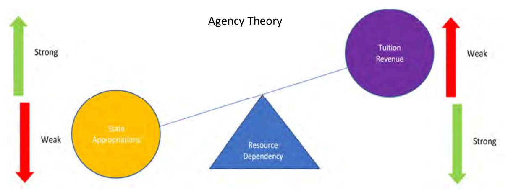
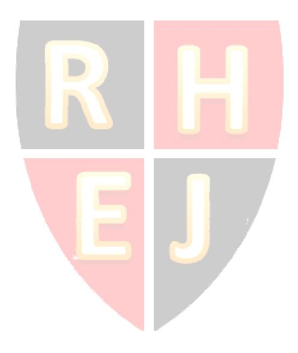

<!-- A3.R23 | source: papers_json/A3.R23/ -->

## **Theoretical model for applying agency and resource dependency to ** **public higher education **

Cassandra Bennett Bloomsburg University, United States

Mark Law Bloomsburg University, United States

## **الملخص**

كان الغرض من هذه الدراسة تقديم نموذج نظري للتعليم العالي الحكومي. تؤثر تحديات مالية كبيرة على مستقبل قطاع التعليم العالي الحكومي في الولايات المتحدة. ومع انخفاض معدلات الالتحاق مقترناً بزيادات محدودة في مصادر التمويل الحكومي، تكهن كثيرون بما يحمله المستقبل لهذه المؤسسات. يمكن استخدام نظرية الوكالة ونظرية الاعتماد على الموارد لبحث هذه الموضوعات. تصف نظرية الوكالة علاقة بين أصيل، وهو في هذه الحالة كل ولاية من ولايات الولايات المتحدة، ووكيل، وهو مؤسسات التعليم العالي الحكومية، حيث يؤدي الوكيل مهام نيابة عن الأصيل. توفر المؤسسات فرصاً تعليمية لمواطني الولاية المعنية مقابل تخصيصات تمويل مناسبة من ميزانية الولاية. وتصف نظرية الاعتماد على الموارد الآثار السلوكية على العمليات التنظيمية الناتجة عن الاعتماد على عدد محدود من الموارد. وبالنسبة لأنظمة التعليم العالي الحكومي، فإنها تعتمد على مصدرين رئيسيين للدخل: مخصصات الولاية والرسوم الدراسية للطلاب. ويمكن أن يؤثر التوازن بين مصدري الدخل هذين على العلاقة بين الأصيل والوكيل، أي بين الولاية ومؤسسات التعليم العالي التابعة لها.

Keywords**: **Agency, Resource Dependency, Public Higher Education

Copyright statement: Authors retain the copyright to the manuscripts published in AABRI journals. Please see the AABRI Copyright Policy at http://www.aabri.com/copyright.html

<!-- page 2 -->

## **المقدمة**

على مدى السنوات العشر الماضية، واجهت مؤسسات التعليم العالي الحكومية في جميع أنحاء الولايات المتحدة صعوبة في موازنة ميزانياتها (Klein, 2015). تعتمد هذه المؤسسات على مصدرين رئيسيين للدخل، إيرادات الرسوم الدراسية والتمويل الحكومي (على شكل مخصصات من الولاية)، لمواصلة عملياتها. ويتمثل أحد العوامل الرئيسية المساهمة في انخفاض عدد خريجي المدارس الثانوية في السنوات الأخيرة، مما أدى إلى تراجع إيرادات الرسوم الدراسية. وأفاد تقرير لجنة الولايات الغربية المشتركة للتعليم العالي (WICHE) الصادر في ديسمبر 2016 بأن عدد خريجي المدارس الثانوية في الولايات المتحدة سيظل ثابتاً أو سينخفض حتى عام 2023 من الرقم القياسي البالغ 3.47 مليون خريج ثانوية في عام 2013 (Bransberger & Michelau, 2016). أما العامل الرئيسي الآخر لأزمة الميزانية في التعليم العالي الحكومي فهو الانخفاض الكبير في التمويل الحكومي على مدى العقود القليلة الماضية. وبالمقارنة، كان التمويل الحكومي لكل طالب في التعليم العالي الحكومي أعلى في عام 1980 مما هو عليه اليوم (Klein). وانخفضت نسبة مخصصات الولاية مقارنة بإجمالي إيرادات المؤسسة من 32% في عام 2004 إلى 23% في عام 2013 (Sav, 2016).

تخضع أنظمة التعليم العالي الحكومي على مستوى الولايات في الولايات المتحدة لإدارة الولايات التي تعمل فيها، وهو ما يمثل علاقة بين أصيل ووكيل. تصف نظرية الاعتماد على الموارد القرارات السلوكية وتداعياتها الناتجة عن اعتماد مؤسسة ما على عدد محدود من الموارد. ويتحدد نجاح المؤسسة وبقاؤها بقدرتها على اكتساب هذه الموارد والحفاظ عليها (Keeney, 2018). ويمكن أن تؤثر الأصول المتعارضة الكامنة وراء نظرية الوكالة ونظرية الاعتماد على الموارد بالنسبة لمؤسسات التعليم العالي الحكومية على الإطار الاستراتيجي للإدارة في توفير تعليم منخفض التكلفة وعالي الجودة. ومن العوامل المهمة التي يمكن أن تتأثر التوظيف، والرسوم الدراسية، وتخصيص الموارد، وخفض التكاليف. ويمكن أن يفسر الإطار النظري المقترح في هذا البحث الصعوبة التي تواجهها أنظمة التعليم العالي الحكومي عند العمل كوكيل للولاية، بينما تصبح أكثر اعتماداً على إيرادات الرسوم الدراسية نتيجة تراجع مخصصات الولاية.

## **الإطار**

تخضع مؤسسات التعليم العالي الحكومية في جميع أنحاء الولايات المتحدة لنظرية الوكالة ونظرية الاعتماد على الموارد. وتسهم كل من هاتين النظريتين في عملية اتخاذ القرار الاستراتيجي الشامل للإدارة. ومع محدودية الموارد المالية المتاحة، تسعى الجامعات إلى مصادر تمويل بديلة لتعويض تراجع مخصصات الولاية. وتعتمد استمرارية مؤسسات التعليم العالي الحكومي في الولايات المتحدة على قدرتها على توليد إيرادات كافية لتغطية النفقات. ومع تناقص الاعتماد على مخصصات الولاية، تبدأ علاقة الوكالة القائمة بين الولاية ومؤسسات التعليم العالي الحكومية في التراجع.

## **نظرية الوكالة**

الغرض من التعليم العالي في الولايات المتحدة هو تمكين مواطنيها بالمعرفة والمهارات اللازمة لإنتاج منتجات وخدمات تحسّن أوضاعهم وأوضاع المجتمع ككل (Powell & Rey, 2015). تموّل الولايات مؤسسات التعليم العالي الحكومية جزئياً لمنح مواطنيها فرصة الحصول على تعليم عالي الجودة برسوم دراسية أقل، وبذلك تنشأ علاقة أصيل ووكيل بين كل ولاية ومؤسساتها التابعة لها. وتصف نظرية الوكالة الاتفاق التعاقدي بين أصيل ووكيل، حيث يؤدي الوكلاء مهامهم نيابة عن الأصيل (Bendickson et al., 2016). وتعمل مؤسسات التعليم العالي الحكومية

<!-- page 3 -->

نيابة عن الولايات، مقدمةً تعليماً عالي الجودة لكل مواطن بتكلفة أقل من تلك التي تقدمها الكليات والجامعات الخاصة. ومع ذلك، ومع تراجع مخصصات الولاية، تبدأ المؤسسات الحكومية بالعمل بشكل أقل كوكيل للولاية، وتركز بدلاً من ذلك على مصالح المؤسسات نفسها. وكما يشير الإطار النظري في هذا البحث، فإن تطبيق نظرية الوكالة على التعليم العالي الحكومي يستنتج منه احتمال نشوء تضارب في المصالح، لأن مصالح المؤسسات قد لا تتوافق مع مصالح ولايتها (Bryant & Davis, 2012) في توفير تعليم منخفض التكلفة وعالي الجودة لمواطنيها.

## **نظرية الاعتماد على الموارد**

"تصف نظرية الاعتماد على الموارد الآثار السلوكية عبر العمليات التنظيمية الناتجة عن شح الموارد" (Bennett, 2018). ويتمثل المصدران الرئيسيان للدخل اللذان تعتمد عليهما مؤسسات التعليم العالي الحكومية لضمان استمراريتها في مخصصات الولاية وإيرادات الرسوم الدراسية للطلاب. ويمكن أن يؤثر الاعتماد على كل من الولاية والطلاب، بوصفهما أصحاب مصلحة رئيسيين، على الخطط الاستراتيجية للمؤسسات (Länsiluoto, Järvenpää, & Krumwiede, 2013). وقد وصف Powell و Rey (2015) ثلاثة مجالات رئيسية لنظرية الاعتماد على الموارد فيما يتعلق بالتعليم العالي الحكومي: "(1) التأثيرات البيئية على المؤسسات؛ (2) الجهود التنظيمية لإدارة القيود البيئية؛ و(3) كيفية تأثير القيد البيئي على الديناميكيات التنظيمية الداخلية" (p.94). ويصف الإطار النظري المقترح في الشكل 1 (الملحق) أثر التوازن بين مصدري الاعتماد الرئيسيين للموارد في التعليم العالي الحكومي، وهما إيرادات الرسوم الدراسية ومخصصات الولاية، وهو ما يمكن أن يؤثر على العلاقة بين الأصيل والوكيل، أي بين الولاية ومؤسساتها التابعة لها.

## **التداعيات**

تُبنى علاقة الأصيل/الوكيل بين الولاية وأنظمة التعليم العالي التابعة لها على موضوعين رئيسيين هما التكلفة المنخفضة والتعليم عالي الجودة للطلاب. ويمكن لتطبيق كل من نظرية الوكالة ونظرية الاعتماد على الموارد على التعليم العالي الحكومي أن يستشرف تداعيات القرارات الاستراتيجية في المجالات التالية: التوظيف، والرسوم الدراسية، وتخصيص الموارد، وخفض التكاليف. ويمكن استخدام نظرية الوكالة ونظرية الاعتماد على الموارد لتفسير قرارات التخطيط الاستراتيجي لمسؤولي الإدارة في الكليات والجامعات الحكومية. وتواجه هذه المؤسسات مهمة صعبة تتمثل في تلبية مصالح جميع أصحاب المصلحة، بما في ذلك ولايتها، والطلاب الذين تخدمهم، وأعضاء هيئة التدريس والموظفين الذين توظفهم، مع ضمان استمراريتها الخاصة. وقد واجهت مؤسسات التعليم العالي قوى خارجية تتمثل في منافسة شرسة وانخفاض عدد الطلاب. بالإضافة إلى ذلك، تتأثر مؤسسات التعليم العالي الحكومية بـ"زيادة تدابير المساءلة والتقييم، وتراجع ميزانيات الولايات، وتضاؤل الأوقاف" (Powell & Rey, 2015, p. 94).

## *التكلفة المنخفضة.*

الغرض من التعليم العالي الحكومي هو تعليم مواطني الولايات المعنية لتطوير مسيرتهم المهنية، وبالتالي تقديم فوائد اقتصادية للولاية (Calhoun & Kamerschen, 2010). ومن خلال تطوير قوة عاملة محلية ذات دخل مرتفع والاحتفاظ بها، تتوقع الولاية عائداً على استثمارها في التعليم من خلال توليد إيرادات ضريبية أعلى (Calhoun & Kamerschen). وتستثمر الولاية في الكليات والجامعات الحكومية بهدف إبقاء تكاليف الرسوم الدراسية في متناول مواطنيها. ومع ذلك، أدى تقلص التمويل الحكومي إلى دفع

<!-- page 4 -->

المؤسسات الحكومية إلى البدء في استقطاب مزيد من الطلاب من خارج الولاية وزيادة تكاليف الرسوم الدراسية. وهذا يتعارض مع نظرية الوكالة بين الولاية والكليات والجامعات الحكومية.

التوظيف. يدفع الطلاب المقيمون في الولاية عادة رسوماً دراسية مخفضة في المؤسسات الحكومية بالولاية مقارنة بالمعدلات المطبقة على نظرائهم من خارج الولاية. وتحدد الولاية رسوماً دراسية أقل لطلاب الولاية استناداً إلى افتراض أنهم سيستمرون في الإقامة في ولايتهم الأم بعد التخرج، وسيولدون إيرادات ضريبة دخل مستقبلية لولايتهم (Calhoun & Kamerschen). وقد أجبر تراجع التمويل الحكومي الكليات والجامعات الحكومية على إيجاد وسائل أخرى لتثبيت إيراداتها. ويُعد زيادة أعداد الطلاب من خارج الولاية أحد البدائل التي زادت من خلالها هذه المؤسسات صافي إيراداتها من الرسوم الدراسية، لأن الطلاب غير المقيمين يدفعون رسوماً دراسية أعلى. "ففي الجامعات الحكومية المصنفة ضمن فئة 'الدكتوراه/البحث المكثف' وفقاً لتصنيف كارنيجي لعام 2000، ارتفع متوسط عدد الطلاب المستجدين غير المقيمين من 747 طالباً في 2000-2001 إلى 1,169 طالباً في 2012-2013 (بزيادة قدرها 56%)، مقارنة بزيادة من 2,981 إلى 3,346 طالباً بين المقيمين المستجدين (بزيادة قدرها 12%) (حسابات المؤلفين استناداً إلى IPEDS)" (Jaquette & Curs, 2015, p. 536). ويضغط تراجع مخصصات الولاية على مؤسسات التعليم العالي الحكومية لزيادة إيرادات الرسوم الدراسية من خلال توسيع أعداد الطلاب غير المقيمين، وهو ما يتعارض مع هدف الولاية (Jaquette & Curs) ويضعف العلاقة بين الأصيل والوكيل.

الرسوم الدراسية. تعمل الكليات والجامعات الحكومية في سوق متقلبة قد يكون فيها ارتفاع الرسوم الدراسية أمراً حتمياً بسبب تراجع التمويل الحكومي. ويتعارض هذا مع نية الولاية في توفير تعليم ميسور التكلفة ومنخفض السعر، ويزيد من تدهور نظرية الوكالة القائمة بين الولاية ومؤسسات التعليم العالي الحكومية. وقد بدأت مؤسسات التعليم العالي الحكومية في تعويض تراجع مخصصات الولاية من خلال زيادة تكاليف الرسوم الدراسية على الطلاب (Weerts, 2014). وارتفع صافي الرسوم الدراسية كنسبة من إجمالي الإيرادات من 23.3% في عام 1985 إلى 40.3% في عام 2010 (Altundemir, 2012). وفي السنة المالية 2011، رفع نظام ولاية ألاباما رسومه الدراسية (بنسب متفاوتة حسب المؤسسة) بين 8% و23%، ورفعت مؤسسات ولاية فلوريدا الرسوم بنسبة 15%، بينما رفعت ساوث داكوتا رسوم الجامعات بنسبة 4.6% (Altundemir). وفي السنة المالية 2012، رفع نظام جامعات ولاية ميسوري رسومه بنسب تراوحت بين 4.7% و6.6%، ورفع نظام ولاية تينيسي الرسوم بنسبة 7% في الجامعات و5% في الكليات المجتمعية (Altundemir). وهذه ليست سوى أمثلة قليلة على زيادات تكاليف الرسوم الدراسية في مؤسسات التعليم العالي الحكومية على مدى السنوات الماضية. وتخالف هذه الزيادات في الرسوم غرض الولاية المتمثل في توفير تعليم منخفض التكلفة، وهو ما تفترضه نظرية الوكالة بين الولاية والمؤسسات.

## *الجودة*

من خلال توفير التمويل الحكومي لمؤسسات التعليم العالي الحكومية، ينشأ عقد ضمني لتقديم تعليم عالي الجودة نيابة عن الولاية لمواطنيها. ويمكن تعريف الجودة في التعليم العالي وتقييمها بطرق عديدة. ومن أمثلة قياس جودة المؤسسة عدد البرامج المقدمة للطلاب، ونسبة الطلاب إلى أعضاء هيئة التدريس، ومؤهلات أعضاء هيئة التدريس وتأثير أبحاثهم، والأنشطة الطلابية المتاحة، والتوظيف بعد التخرج. ويتعارض الاستثمار خارج هذه المجالات أو إلغاء الموارد المخصصة للحفاظ على الجودة العالية مع علاقة الوكالة المقصودة من تخصيص مخصصات الولاية.

تخصيص الموارد. تعمل الكليات والجامعات في بيئة تنافسية شرسة مع تراجع أعداد خريجي المدارس الثانوية. ولاستقطاب الطلاب والاحتفاظ بهم، تحتاج مؤسسات التعليم العالي إلى توظيف أعضاء هيئة تدريس مؤهلين وتقديم برامج أكاديمية جذابة وبيئات تعليمية جذابة من الناحية الجمالية. وقد يكون هذا الأمر صعباً في ظل محدودية موارد المؤسسة. ومع تراجع مخصصات الولاية وانتشار

<!-- page 5 -->

قيود الميزانية، يمكن أن يؤثر ذلك على التخصيص الاستراتيجي لموارد المؤسسة المحدودة. وقد يُخصص عدد أقل من الأموال للبرامج التعليمية وبرامج التقييم، بينما تُستثمر موارد أكثر في استقطاب الطلاب. وتكتسب بعض المؤسسات ميزة تنافسية من خلال إضافة مبانٍ جديدة أو تعديل المباني القائمة وتحسين المظهر العام للحرم الجامعي (Roberts & Taylor). كما تستثمر مؤسسات التعليم العالي في خيارات المطاعم داخل الحرم الجامعي لاستقطاب مزيد من الطلاب. ورغم أن هذه التحسينات ضرورية، فإن معظمها لا يرتبط مباشرة بجودة التعليم المقدم للطلاب، وهو الهدف الأساسي للولاية.

خفض التكاليف. تؤدي محدودية الموارد في نهاية المطاف إلى خفض التكاليف في أي مؤسسة. وفي حين يمكن للشركات إيجاد مواد بديلة وتحسين العمليات وتقليص قوتها العاملة، فمن الصعب تطبيق بدائل خفض التكاليف هذه على التعليم العالي دون التضحية بالجودة. ومع الأسف، ونظراً لمحدودية التمويل من الولاية، اضطرت أنظمة التعليم العالي الحكومية إلى اتخاذ قرارات صعبة لخفض التكاليف الإجمالية. ومن المجالات التي خفضتها أنظمة الولايات بشكل كبير المساعدات المالية. فعلى سبيل المثال، خفضت ولاية ميشيغان المساعدات المالية للطلاب بنسبة 61% في عام 2011، وألغت ولاية مينيسوتا منح المساعدات المالية لنحو 9,400 طالب (Altundemir, 2012). ومن مجالات خفض التكاليف الأخرى في مؤسسات التعليم العالي الحكومية إلغاء وظائف أعضاء هيئة التدريس والموظفين، مما يؤدي إلى زيادة حجم الفصول الدراسية، وزيادة عبء العمل على أعضاء هيئة التدريس، وتقليص الخدمات المتاحة للطلاب. وفي العام الأكاديمي 2011، فرضت جامعة أيداهو إجازات إجبارية غير مدفوعة على 2,600 من موظفيها على مستوى الولاية (Altundemir)، بينما "ألغت جامعة فلوريدا 261 وظيفة دائمة أو مسار دائم بدوام كامل" (Mitchell, Palacios, & Leachman, 2014, p.14). بالإضافة إلى ذلك، ألغت جامعة ولاية كارولاينا الشمالية في عام 2014 ما يعادل 187 وظيفة بدوام كامل (Mitchell, Palacios, & Leachman). وقد نُفذت مبادرات مماثلة عبر أنظمة الولايات للتخفيف من تراجع مخصصات الولاية. ويمكن أن تؤدي عمليات خفض التكاليف هذه إلى انخفاض جودة التعليم، مما يزيد من إضعاف العلاقة بين الأصيل والوكيل.

## **الخاتمة**

يتغير مشهد التعليم العالي لأسباب متعددة. فقد فرضت التقلبات الديموغرافية، وتراجع مخصصات الولاية، والبيئة شديدة التنافسية لاستقطاب الطلاب والاحتفاظ بهم، ضغطاً مالياً كبيراً على أنظمة التعليم العالي الحكومي بالولايات. ومع بدء هذه الأنظمة في مواجهة هذه التحديات، تبدأ علاقة الوكالة مع الولاية المعنية في التآكل. ويجب على المؤسسات الفردية التي تشكل أنظمة الولاية أن تبدأ في تطوير استراتيجيات بديلة لتحديد مصادر دخل إضافية، مع مراعاة خفض النفقات في الوقت نفسه. ويمكن أن تؤثر هذه التغيرات الاستراتيجية بشكل كبير على قيمة التعليم المقدم. ويبدأ هذا التراجع المحتمل في القيمة التعليمية في تقييد علاقة الوكالة مع الولاية.

إن عهد اعتماد أنظمة التعليم العالي الحكومي بالولايات بشكل كبير على الموارد والإشراف من ولاياتها المعنية آخذ في التحول. وقد بدأت علاقة الوكالة القوية سابقاً في التلاشي، إذ يضعف تراجع مخصصات الولاية العلاقة الارتباطية للاعتماد على الموارد. وسيُطلب من مسؤولي إدارة التعليم العالي ومسؤولي حكومات الولايات في المستقبل معالجة هذه العلاقات المتغيرة للحفاظ على القيمة المقدمة للطلاب الساعين إلى تعليم ميسور التكلفة من مؤسسة حكومية.

<!-- page 6 -->

## **REFERENCES **

- Altundemir, M. E. (2012). The impact of the financial crisis on American public universities. *International Journal of Business and Social Science*, *3*(8), 190-198.
- Bendickson, J., Muldoon, J., Liguori, E., & Davis, P. E. (2016). Agency theory: The times, they are a-changin. *Management Decision*,* 54*(1), 174-193. doi: 10.1108/MD-02-2015-0058
- Bennett, C. (2018). "State Appropriations and Allocation Ratios to Predict Financial Condition at Public Higher Education Institutions" Doctoral Dissertations and Projects. Retrieved from https://digitalcommons.liberty.edu/doctoral/1868
- Bransberger, P., & Michelau, D. K. (2016). Knocking at the college door: Projections of high school graduates. *Western Interstate Commission for Higher Education*.
- Bryant, P., & Davis, C. (2012). Regulated change effects on boards of directors: A look at agency theory and resource dependency theory*. Academy of Strategic Management * *Journal*,* 11*(2), 1-15.
- Calhoun, J., & Kamerschen, D. R. (2010). The impact of governing structure on the pricing behavior and market structure of public institutions of higher education in the U.S. *International Review of Economics*,* 57*(3), 317-333. doi: 10.1007/s12232-010-0089-2
- Jaquette, O., & Curs, B. R. (2015). Creating the out-of-state university: Do public universities increase nonresident freshman enrollment in response to declining state appropriations? *Research in Higher Education*, *56*(6), 535-565. doi: 10.1007/s11162-015-9362-2
- Keeney, K. P. (2018). Public higher education institutions' investment in performing arts centers. *Journal of Arts Management, Law & Society*, *48*(1), 44–56. https://doi.org/10.1080/10632921.2017.1377659
- Klein, M. (2015). Settling a U.S. senatorial debate: Understanding declines in state higher education funding. *Journal of Education Finance*, *41*(1), 1-29.
- Länsiluoto, A., Järvenpää, M., & Krumwiede, K. (2013). Conflicting interests but filtered key targets: Stakeholder and resource-dependency analyses at a University of Applied Sciences. *Management Accounting Research*,* 24*(3), 228-245. doi: 10.1016/j.mar.2013.02.001
- Mitchell, M., Palacios, V., & Leachman, M. (2014). *States are still funding education below pre**recession levels*. Washington DC: Center on Budget and Policy Priorities. Retrieved from https://www.cbpp.org/sites/default/files/atoms/files/5-1-14sfp.pdf
- Powell, K. K., & Rey, M. P. (2015). Exploring a resource dependency perspective as an organizational strategy for building resource capacity. *Management in Education*, *29*(3), 94-99. doi: 10.1177/0892020615586805
- Roberts, P., & Taylor, I. (2016). The campus matters: Acquiring the competitive edge. *Planning * *for Higher Education*, *44*(3), 12-17.
- Sav, G. T. (2016). Declining state funding and efficiency effects on public higher education: Government really does matter. *International Advances in Economic Research*, *22*(4), 397-408. doi: 10.1007/s11294-016-9602-z
- Weerts, D. J. (2014). State funding and the engaged university: Understanding community engagement and state appropriations for higher education. *The Review of Higher * *Education*, *38*(1), 133-169. doi: 10.1353/rhe.2014.0038

<!-- page 7 -->

## **APPENDIX **

**Figure 1*: Agency theory confliction with resource dependency in public higher education*

