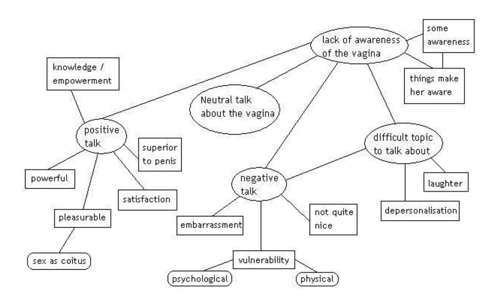
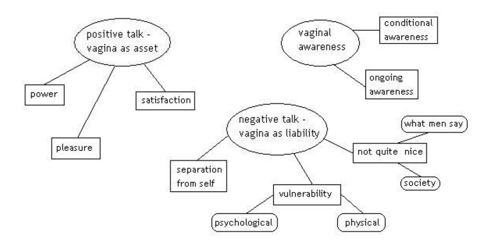
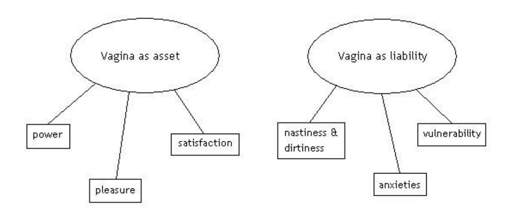

<!-- A3.R26 | source: papers_json/A3.R26/ -->

## **Using thematic analysis in psychology**

*Virginia Braun* * & *Victoria Clarke*

قسم علم النفس، كلية العلوم التطبيقية

جامعة أوكلاند، جامعة غرب إنجلترا

Private Bag 92019 Frenchay Campus

أوكلاند، بريستول

نيوزيلندا BS16 1QY

[v.braun@auckland.ac.nz](mailto:v.braun@auckland.ac.nz) [Victoria.clarke@uwe.ac.uk](mailto:Victoria.clarke@uwe.ac.uk)

هاتف: +64 9 3737599 x 87561، +44 117 3282176

فاكس: +64 9 3737450، +44 117 3282904

عدد كلمات الوثيقة بصيغة MS Word (شاملة المراجع والملاحظات والجداول والأشكال): 13510

<!-- page 2 -->

## **Using thematic analysis in psychology**

التحليل الموضوعي (thematic analysis) هو طريقة تحليل نوعية واسعة الاستخدام في علم النفس، لكنها غير محددة المعالم بوضوح ونادرًا ما يُعترف بها كطريقة قائمة بذاتها. في هذه الورقة، نجادل بأنها تقدم منهجًا سهل التطبيق ومرنًا من الناحية النظرية لتحليل البيانات النوعية. نوضح ما هو التحليل الموضوعي، ونحدد موقعه بالنسبة إلى طرق التحليل النوعي الأخرى التي تبحث عن أنماط أو ثيمات، وبالنسبة إلى المواقف الإبستمولوجية والأنطولوجية المختلفة. بعد ذلك نقدم إرشادات واضحة لمن يريد البدء في التحليل الموضوعي، أو إجراءه بطريقة أكثر تعمدًا ودقة، ونناقش المزالق المحتملة عند القيام بذلك. أخيرًا، نوضح عيوب ومزايا التحليل الموضوعي. نختتم الورقة بالدعوة إلى اعتماد التحليل الموضوعي بوصفه طريقة مفيدة ومرنة للبحث النوعي داخل علم النفس وخارجه.

*Keywords*: thematic analysis, qualitative psychology, patterns, epistemology, flexibility

<!-- page 3 -->

## **Author Biographical Notes**

**Virginia Braun** محاضرة أولى في قسم علم النفس بجامعة أوكلاند، حيث تُدرّس وتشرف على الطلاب وتُجري بحوثًا نوعية. تتركز اهتماماتها البحثية بشكل أساسي حول صحة المرأة، والأجساد المجندرة، والجنس والجنسانية، والتقاطعات بين هذه المجالات. تعمل حاليًا على مشاريع تتعلق بـ"الجنس في العلاقات طويلة الأمد"، و"جراحة تجميل الأعضاء التناسلية الأنثوية"، و"السياق الاجتماعي لانتقال الأمراض المنقولة جنسيًا".

**Victoria Clarke** محاضرة أولى في علم النفس الاجتماعي بجامعة غرب إنجلترا. نشرت عددًا من الأوراق حول الأبوة والأمومة المثلية، وشاركت في تحرير عددين خاصين من مجلة Feminism & Psychology حول الزواج (بالاشتراك مع Sara-Jane Finlay وSue Wilkinson). تُجري حاليًا بحثًا ممولًا من ESRC حول العلاقات المثلية (بالاشتراك مع Carol Burgoyne وMaree Burns)، وتشارك في تحرير كتاب (مع Elizabeth Peel) عن علم النفس للمثليين والمثليات ومزدوجي الميل الجنسي والمتحولين جنسيًا (*Out in Psychology*، Wiley).

<!-- page 4 -->

## **Using thematic analysis in psychology**

التحليل الموضوعي طريقة تحليل نوعية غير محددة المعالم بوضوح ونادرًا ما يُعترف بها، لكنها واسعة الاستخدام (انظر Boyatzis, 1998; Roulston, 2001) داخل علم النفس وخارجه. في هذه الورقة، نهدف إلى سد ما اختبرناه، بوصفنا باحثتين ومعلمتين في علم النفس النوعي، كثغرة قائمة حاليًا: غياب ورقة توضح بشكل كافٍ نظرية التحليل الموضوعي وتطبيقه وتقييمه، وتقدم ذلك بطريقة يسهل على الطلاب ومن هم غير معتادين على البحث النوعي فهمها.^1^ بعبارة أخرى، نهدف إلى كتابة ورقة تكون مفيدة كأداة تعليمية وبحثية في آن واحد ضمن علم النفس النوعي. لذلك، نناقش في هذه الورقة النظرية والمنهج الخاصين بالتحليل الموضوعي، ونوضح أوجه التشابه والاختلاف بين المناهج المختلفة التي تتشارك سمات مع المنهج الموضوعي.

المناهج النوعية متنوعة ومعقدة ودقيقة بشكل كبير (Holloway & Todres, 2003)، وينبغي النظر إلى التحليل الموضوعي بوصفه طريقة تأسيسية للتحليل النوعي. إنه أول طريقة تحليل نوعية ينبغي على الباحثين تعلمها، إذ يوفر مهارات أساسية مفيدة لإجراء أشكال أخرى كثيرة من التحليل النوعي. بالفعل، يحدد Holloway و Todres (2003: 347) "تكوين موضوعات المعنى" بوصفه إحدى المهارات العامة المشتركة القليلة عبر التحليل النوعي.^2^ لهذا السبب، لا يصف Boyatzis (1998) هذا المنهج بوصفه طريقة محددة، بل أداة تُستخدم عبر طرق مختلفة. وبالمثل، يضع Ryan وBernard (2000) الترميز الموضوعي كعملية تُنفَّذ *ضمن* تقاليد تحليلية "كبرى" (مثل النظرية المجذَّرة)، وليس كمنهج قائم بذاته. نحن نرى أن التحليل الموضوعي ينبغي أن يُعتبر طريقة قائمة بذاتها.

من مزايا التحليل الموضوعي مرونته. يمكن تقسيم طرق التحليل النوعي تقريبًا إلى معسكرين. في الأول، توجد طرق مرتبطة بموقف نظري أو إبستمولوجي معين أو نابعة منه. بالنسبة إلى بعض هذه الطرق - مثل تحليل المحادثة ([CA] مثال، Hutchby & Wooffitt, 1998) والتحليل الظاهراتي التفسيري ([IPA] مثال، Smith & Osborn, 2003) - لا يزال هناك تباين محدود نسبيًا في كيفية تطبيق الطريقة ضمن ذلك الإطار. في جوهره، توجد وصفة واحدة توجه التحليل. أما بالنسبة إلى طرق أخرى - مثل النظرية المجذَّرة (مثال، Glaser, 1992; Strauss & Corbin, 1998)، وتحليل الخطاب ([DA] مثال، Burman & Parker, 1993; Potter & Wetherell, 1987; Willig, 2003)، أو التحليل السردي (مثال، Murray, 2003; Riessman, 1993) - فتوجد صور مختلفة للطريقة ضمن الإطار

<!-- page 5 -->

النظري الأوسع. ثانيًا، توجد طرق مستقلة أساسًا عن النظرية والإبستمولوجيا، ويمكن تطبيقها *عبر* مجموعة من المناهج النظرية والإبستمولوجية. ورغم أن التحليل الموضوعي غالبًا ما يُؤطَّر (ضمنيًا) بوصفه طريقة واقعية/تجريبية (مثال، Aronson, 1994; Roulston, 2001)، فإنه في الواقع يقع بوضوح ضمن المعسكر الثاني، وهو متوافق مع كل من النموذج الجوهري (essentialist) والنموذج البنائي (constructionist) داخل علم النفس (سنناقش هذا لاحقًا). من خلال حريته النظرية، يوفر التحليل الموضوعي أداة بحثية مرنة ومفيدة، يمكنها أن تقدم وصفًا غنيًا ومفصلًا، وإن كان معقدًا، للبيانات.

بالنظر إلى مزايا مرونة التحليل الموضوعي، من المهم أن نوضح أننا لا نحاول تقييد هذه المرونة. غير أن غياب إرشادات واضحة وموجزة حول التحليل الموضوعي يعني أن نقد "أي شيء يصلح" الموجه للبحث النوعي (Antaki, Billig, Edwards, & Potter, 2002) قد ينطبق فعلًا في بعض الحالات. نأمل من خلال هذه الورقة أن نوازن بين تحديد التحليل الموضوعي بوضوح - أي شرح ماهيته وكيفية القيام به - وضمان المرونة في كيفية استخدامه، بحيث لا يصبح مقيدًا ومحدودًا فيفقد إحدى مزاياه الأساسية. والواقع أن التحديد الواضح لهذه الطريقة سيكون مفيدًا لضمان قدرة من يستخدم التحليل الموضوعي على اتخاذ خيارات فعالة بشأن الشكل المحدد للتحليل الذي يقومون به. لذلك، تسعى هذه الورقة إلى الاحتفاء بمرونة الطريقة، *وفي الوقت نفسه* تقديم مفردات و"وصفة" لمن يريد البدء في التحليل الموضوعي بطريقة سليمة نظريًا ومنهجيًا.^3^ وكما سنبين، فإن المهم هو أن يقوم الباحثون، إلى جانب تطبيق طريقة على البيانات، بالإفصاح عن افتراضاتهم (الإبستمولوجية وغيرها) (Holloway & Todres, 2003). يحتاج الباحثون النوعيون في علم النفس إلى الوضوح بشأن ما يفعلونه ولماذا، وإلى تضمين "كيفية" إجراء تحليلهم، وهو ما يُهمَل غالبًا، في تقاريرهم (Attride-Stirling, 2001).

في هذه الورقة نوضح: ما هو التحليل الموضوعي؛ ودليل من 6 مراحل لإجراء التحليل الموضوعي؛ والمزالق المحتملة التي ينبغي تجنبها عند القيام به؛ وما الذي يجعل التحليل الموضوعي جيدًا؛ ومزايا وعيوب التحليل الموضوعي. نقدم طوال الورقة أمثلة من الأدبيات البحثية ومن بحثنا الخاص. من خلال تقديم الأمثلة، نوضح أنواع أسئلة البحث والموضوعات التي يمكن دراستها باستخدام التحليل الموضوعي.

قبل أن نبدأ، نحتاج إلى تعريف بعض المصطلحات المستخدمة طوال الورقة. تشير *مجموعة البيانات الكلية* (data corpus) إلى *جميع* البيانات التي جُمعت لمشروع بحثي معين، بينما تشير *مجموعة البيانات* (data set) إلى كل البيانات

<!-- page 6 -->

من المجموعة الكلية المستخدمة في تحليل معين. توجد طريقتان رئيسيتان لاختيار مجموعة بياناتك (والمنهج الذي تتبعه يعتمد على ما إذا كنت تتناول البيانات بسؤال محدد أم لا - انظر "عدد من القرارات" أدناه). أولًا، قد تتكون مجموعة بياناتك من العديد أو كل عناصر البيانات الفردية ضمن مجموعتك الكلية. فمثلًا، في مشروع عن جراحة تجميل الأعضاء التناسلية الأنثوية، تتكون مجموعة بيانات Virginia الكلية من مقابلات مع جراحين، ومواد إعلامية حول الموضوع، ومواقع إلكترونية للجراحين. بالنسبة لأي تحليل معين، قد تكون مجموعة بياناتها مجرد مقابلات الجراحين، أو المواقع الإلكترونية فقط (Braun, 2005b)، أو قد تجمع بين بيانات الجراحين وبعض البيانات الإعلامية (مثال، Braun, 2005a). ثانيًا، قد تُحدَّد مجموعة بياناتك من خلال اهتمام تحليلي معين بموضوع ما داخل البيانات، فتصبح مجموعة بياناتك حينها كل الحالات في المجموعة الكلية التي يُشار فيها إلى ذلك الموضوع. ففي مثال Virginia، لو كانت مهتمة بكيفية الحديث عن "المتعة الجنسية"، لتكونت مجموعة بياناتها من كل الحالات عبر المجموعة الكلية التي لها صلة بالمتعة الجنسية. قد يُجمع أحيانًا بين هذين المنهجين لإنتاج مجموعة البيانات. يُستخدم مصطلح *عنصر البيانات* (data item) للإشارة إلى كل قطعة بيانات فردية جُمعت، والتي تُكوّن معًا مجموعة البيانات أو المجموعة الكلية. في هذه الحالة، قد يكون عنصر البيانات مقابلة فردية مع جراح، أو وثائقيًا تلفزيونيًا، أو موقعًا إلكترونيًا واحدًا. أخيرًا، يشير *مقتطف البيانات* (data extract) إلى جزء بيانات مُرمَّز فرديًا تم تحديده واستخراجه من عنصر بيانات. سيكون هناك العديد من هذه المقتطفات، مأخوذة من مجموعة البيانات بأكملها، ولن يظهر في التحليل النهائي إلا مجموعة مختارة منها.

## **What is thematic analysis?**

التحليل الموضوعي طريقة لتحديد وتحليل والإبلاغ عن أنماط (ثيمات) ضمن البيانات. إنه، على الأقل، يُنظّم ويصف مجموعة بياناتك بتفصيل (غني). لكنه غالبًا ما يتجاوز ذلك، ويفسر جوانب مختلفة من موضوع البحث (Boyatzis, 1998). سنسلط الضوء أكثر على *النطاق* الواسع من أشكال التحليل الموضوعي الممكنة فيما يتعلق بعدد من القرارات المتعلقة به كطريقة (انظر أدناه).

التحليل الموضوعي واسع الاستخدام، لكن لا يوجد اتفاق واضح حول ماهيته وكيفية القيام به (انظر Attride-Stirling, 2001; Boyatzis, 1998; Tuckett, 2005 لأمثلة أخرى). يمكن اعتباره طريقة سيئة "التوسيم" (branded) للغاية، إذ لا يبدو أنه موجود كتحليل "مُسمّى" بالطريقة نفسها التي توجد بها طرق أخرى (مثال، التحليل السردي، النظرية المجذَّرة). بهذا المعنى، غالبًا ما لا يُدّعى صراحة كطريقة التحليل المستخدمة، بينما في الواقع نحن

<!-- page 7 -->

نرى أن كثيرًا من التحليلات هي في جوهرها تحليلات موضوعية - لكنها إما تُدّعى شيئًا آخر (مثل تحليل الخطاب، أو حتى تحليل المحتوى (مثال، Meehan, Vermeer, & Windsor, 2000))، أو لا تُعرَّف بأي طريقة معينة على الإطلاق - فمثلًا، خضعت البيانات "لتحليل نوعي بحثًا عن ثيمات متكررة شائعة" (Braun & Wilkinson, 2003: 30). إذا لم نكن نعرف كيف حلل الناس بياناتهم، أو ما الافتراضات التي وجهت تحليلهم، يصبح من الصعب تقييم بحثهم، ومقارنته و/أو دمجه مع دراسات أخرى حول ذلك الموضوع، وقد يعيق ذلك باحثين آخرين من إجراء مشاريع ذات صلة في المستقبل (Attride-Stirling, 2001). لهذه الأسباب وحدها، يُعد الوضوح بشأن عملية وممارسة الطريقة أمرًا حيويًا. نأمل أن تؤدي هذه الورقة إلى مزيد من الوضوح حول التحليل الموضوعي.

بالمثل، غالبًا ما لا يُعطى تفصيل كافٍ عند الإبلاغ عن عملية التحليل وتفاصيله (Attride-Stirling, 2001). ليس من غير المألوف أن نقرأ عن ثيمات "تظهر" (emerging) من البيانات (رغم أن هذه المشكلة لا تقتصر على التحليل الموضوعي). فمثلًا، حدد تحليل الخطاب الموضوعي الذي أجراه Singer وHunter (1999: 67) لتجارب النساء مع سن اليأس المبكر أن "عدة ثيمات ظهرت" أثناء التحليل. يزعم Rubin وRubin (1995: 226) أن التحليل مثير لأنك "تكتشف ثيمات ومفاهيم متضمنة في مقابلاتك". إن وصف الثيمات بأنها "تظهر" أو "تُكتشَف" هو وصف سلبي لعملية التحليل، وينكر الدور *النشط* الذي يلعبه الباحث دومًا في تحديد الأنماط/الثيمات، واختيار ما يهمه منها، والإبلاغ عنها للقراء (Taylor & Ussher, 2001). 4 إن لغة "الثيمات الناشئة":

يمكن أن تُفهم خطأً على أنها تعني أن الثيمات "تقيم" في البيانات، وأننا إذا نظرنا بجدية كافية فستظهر مثل فينوس على قشرة المحار. إذا كانت الثيمات "تقيم" في أي مكان، فإنها تقيم في رؤوسنا، ناتجة عن تفكيرنا في بياناتنا وصنعنا للروابط كما نفهمها. (Ely, Vinz, Downing, & Anzul, 1997: 205-6)

من المهم في هذه المرحلة أن نعترف بمواقفنا وقيمنا النظرية الخاصة فيما يتعلق بالبحث النوعي. نحن لا نتبنى نظرة واقعية ساذجة (naïve realist) للبحث النوعي حيث يمكن للباحث ببساطة أن "يمنح الصوت" (انظر Fine, 2002) لمشاركيه. وكما يجادل Fine (2002: 218)، حتى منهج "منح الصوت" "ينطوي على اقتطاع أجزاء غير معترف بها من الأدلة السردية التي نختارها ونحررها وننشرها لتحديد حجتنا". لكننا في الوقت نفسه لا نعتقد أن هناك إطارًا نظريًا مثاليًا واحدًا لإجراء البحث النوعي، أو حتى

<!-- page 8 -->

طريقة مثالية واحدة. المهم هو أن يتطابق الإطار النظري والطرق مع ما يريد الباحث معرفته، وأن يعترف الباحث بهذه القرارات، ويدرك أنها *قرارات*.

يختلف التحليل الموضوعي عن طرق التحليل الأخرى التي تسعى إلى وصف أنماط عبر البيانات النوعية - مثل تحليل الخطاب "الموضوعي"، وتحليل التفكيك الموضوعي، وIPA، والنظرية المجذَّرة. 5 يبحث كل من IPA والنظرية المجذَّرة عن أنماط في البيانات، لكنهما مقيدان نظريًا. يرتبط IPA بإبستمولوجيا ظاهراتية (Smith, Jarman, & Osborn, 1999; Smith & Osborn, 2003) تُعطي الأولوية للخبرة (Holloway & Todres, 2003)، ويتعلق بفهم خبرة الناس اليومية بالواقع بتفصيل كبير، بهدف اكتساب فهم للظاهرة المعنية (McLeod, 2001). ولزيادة التعقيد، توجد نسخ مختلفة من النظرية المجذَّرة (Charmaz, 2002). ومع ذلك، فإن هدف تحليل النظرية المجذَّرة هو توليد نظرية معقولة - ومفيدة - للظواهر تكون متجذرة في البيانات (McLeod, 2001). لكن في تجربتنا، يبدو أن النظرية المجذَّرة تُستخدم بشكل متزايد بطريقة هي في جوهرها نظرية مجذَّرة "خفيفة" - أي مجموعة من إجراءات ترميز البيانات المشابهة كثيرًا للتحليل الموضوعي. لا يبدو أن هذه التحليلات تلتزم بالكامل بالالتزامات النظرية لنظرية مجذَّرة "كاملة الدسم"، والتي تتطلب توجيه التحليل نحو بناء النظرية (Holloway & Todres, 2003). لذلك نرى أن التحليل الموضوعي "المُسمّى والمُعلن" لا يعني بالضرورة أن يلتزم الباحثون بالالتزامات النظرية الضمنية للنظرية المجذَّرة إن لم يرغبوا في إنتاج تحليل نظرية مجذَّرة كامل. يُستخدم مصطلح تحليل الخطاب الموضوعي للإشارة إلى نطاق واسع من التحليلات القائمة على الأنماط للبيانات، تتراوح من التحليل الموضوعي ضمن إبستمولوجيا بنائية اجتماعية (حيث تُحدَّد الأنماط بوصفها منتجة اجتماعيًا، لكن دون إجراء تحليل خطابي)، إلى أشكال تحليل قريبة جدًا من شكل "الذخيرة التفسيرية" (interpretative repertoire) الخاص بتحليل الخطاب (Clarke, 2005). تحليل التفكيك الموضوعي (مثال، Stenner, 1993; Ussher & Mooney-Somers, 2000) هو شكل مُسمّى تحديدًا من تحليل الخطاب "الموضوعي" يحدد الأنماط (ثيمات، قصص) ضمن البيانات، ويُنظِّر اللغة بوصفها مكوِّنة للمعنى، والمعنى بوصفه اجتماعيًا.

تتشارك هذه الطرق المختلفة البحث عن ثيمات أو أنماط معينة عبر مجموعة بيانات (كاملة)، بدلًا من البحث *داخل* عنصر بيانات واحد، مثل مقابلة فردية أو مقابلات من شخص واحد، كما هو الحال في أشكال التحليل السيري أو دراسة الحالة مثل التحليل السردي (مثال، Murray, 2003; Riessman, 1993). بهذا المعنى، تتداخل هذه الطرق بشكل أو بآخر مع التحليل الموضوعي. وبما أن التحليل

<!-- page 9 -->

الموضوعي لا يتطلب المعرفة النظرية والتقنية التفصيلية لمناهج مثل النظرية المجذَّرة وتحليل الخطاب، فيمكن أن يوفر شكلًا أكثر سهولة من التحليل، خاصة لمن هم في بداية مسيرتهم في البحث النوعي.

على عكس IPA أو النظرية المجذَّرة (وطرق أخرى مثل السرد أو الخطاب أو CA)، لا يرتبط التحليل الموضوعي بأي إطار نظري موجود مسبقًا، ولذلك يمكن استخدامه ضمن أطر نظرية مختلفة (وإن لم يكن جميعها)، ويمكن استخدامه للقيام بأشياء مختلفة ضمن تلك الأطر. يمكن أن يكون التحليل الموضوعي طريقة جوهرية (essentialist) أو واقعية، تُبلغ عن خبرات المشاركين ومعانيهم وواقعهم، أو يمكن أن يكون طريقة بنائية تفحص الطرق التي تكون بها الأحداث والوقائع والمعاني والخبرات وما إلى ذلك نتاجًا لمجموعة من الخطابات العاملة داخل المجتمع. يمكن أن يكون أيضًا طريقة "سياقية" (contextualist)، تقع بين قطبي الجوهرية والبنائية، وتتسم بنظريات مثل الواقعية النقدية (مثال، Willig, 1999)، التي تعترف بالطرق التي يصنع بها الأفراد معنى تجربتهم، وبدورها الطرق التي يؤثر بها السياق الاجتماعي الأوسع على تلك المعاني، مع الاحتفاظ بالتركيز على الحدود المادية وغيرها لـ"الواقع". لذلك يمكن أن يكون التحليل الموضوعي طريقة تعمل على عكس الواقع، وأيضًا على تفكيك أو كشف سطح "الواقع". لكن من المهم أن يكون الموقف النظري للتحليل الموضوعي واضحًا، إذ غالبًا ما يُترك دون ذكر (ويكون حينها في العادة موقفًا واقعيًا). أي إطار نظري يحمل معه عددًا من الافتراضات حول طبيعة البيانات، وما تمثله من حيث "العالم" و"الواقع" وما إلى ذلك. التحليل الموضوعي الجيد يجعل هذا شفافًا.

## *A number of decisions*

ينطوي التحليل الموضوعي على عدد من الخيارات التي غالبًا ما لا تُصرَّح بها (أو بالتأكيد لا تُناقش عادة في قسم المنهج من الأوراق)، لكنها تحتاج إلى أن تُناقَش وتُبحث *صراحة*. عمليًا، ينبغي النظر في هذه الأسئلة قبل بدء تحليل البيانات (وأحيانًا حتى قبل جمعها)، وينبغي أن يكون هناك حوار تأملي مستمر من جانب الباحث أو الباحثين بخصوص هذه القضايا، طوال العملية التحليلية. يقدم قسم المنهج في تحليل الخطاب الموضوعي الذي أجراه Taylor وUssher (2001) حول السادية والمازوخية مثالًا جيدًا على بحث يعرض هذه العملية بوضوح؛ بينما لا يفعل ذلك قسم المنهج في Braun & Wilkinson (2003).

<!-- page 10 -->

## *What counts as a theme?*

الثيمة تلتقط شيئًا مهمًا في البيانات فيما يتعلق بسؤال البحث، وتمثل مستوى معينًا من الاستجابة أو المعنى *المُنمَّط* داخل مجموعة البيانات. من الأسئلة المهمة التي ينبغي معالجتها من حيث الترميز هو ما الذي يُعد نمطًا/ثيمة، أو ما "الحجم" الذي تحتاجه الثيمة؟ هذا سؤال يتعلق بالانتشار سواء من حيث المساحة داخل كل عنصر بيانات، أو الانتشار عبر مجموعة البيانات بأكملها. من المثالي أن يكون هناك عدد من الحالات للثيمة عبر مجموعة البيانات، لكن عدد الحالات الأكبر لا يعني *بالضرورة* أن الثيمة نفسها أكثر أهمية. وبما أن هذا تحليل نوعي، لا توجد إجابة قاطعة عن السؤال المتعلق بأي نسبة من مجموعة بياناتك تحتاج إلى إظهار دليل على الثيمة لتُعتبر ثيمة. الأمر ليس أنه إذا كانت موجودة في 50% من عناصر البيانات فستكون ثيمة، لكن إذا كانت موجودة في 47% فقط فلن تكون كذلك. كما أنه ليس صحيحًا أن الثيمة هي فقط ما توليه العديد من عناصر البيانات اهتمامًا كبيرًا، بدلًا من جملة أو جملتين. قد تُعطى الثيمة مساحة كبيرة في بعض عناصر البيانات، ومساحة قليلة أو معدومة في أخرى، أو قد تظهر في جزء صغير نسبيًا من مجموعة البيانات. لذا يلزم حكم الباحث لتحديد ماهية الثيمة. توجيهنا الأولي في هذا الشأن هو أنك بحاجة إلى الاحتفاظ بقدر من المرونة، والقواعد الصارمة لا تنجح فعلًا. (يُعاد النظر في سؤال الانتشار فيما يتعلق بالثيمات والثيمات الفرعية، إذ غالبًا ما يؤدي تنقيح التحليل [انظر لاحقًا] إلى ثيمات عامة وثيمات فرعية ضمنها.) علاوة على ذلك، لا تعتمد "أهمية" الثيمة بالضرورة على مقاييس كمية - بل على ما إذا كانت تلتقط شيئًا مهمًا فيما يتعلق بسؤال البحث العام. فمثلًا، في بحث Victoria حول تمثيلات الآباء والأمهات من المثليين والمثليات في 26 برنامج حوار تلفزيوني (Clarke & Kitzinger, 2004)، حددت ستة ثيمات "رئيسية". لم تكن هذه الثيمات الست بالضرورة الأكثر انتشارًا عبر مجموعة البيانات - ظهرت في ما بين 2 و22 من أصل 26 برنامج حوار - لكنها معًا التقطت عنصرًا مهمًا من الطريقة التي "يُطبِّع" بها المثليون والمثليات عائلاتهم في نقاشات برامج الحوار. في هذه الحالة، كان تحليلها الموضوعي مدفوعًا بهذا السؤال التحليلي المحدد. طريقتها في "قياس" الانتشار مهمة، إذ يمكن تحديد الانتشار بعدة طرق مختلفة. حُسب الانتشار على مستوى عنصر البيانات (أي هل ظهرت الثيمة في أي مكان في كل برنامج حوار فردي). بدلًا من ذلك، كان يمكن حسابه من حيث عدد المتحدثين المختلفين الذين عبّروا عن الثيمة، عبر مجموعة البيانات بأكملها، أو كل حالة فردية للثيمة عبر مجموعة البيانات بأكملها (وهو ما يثير أسئلة معقدة حول أين تبدأ "الحالة" وأين تنتهي ضمن سلسلة ممتدة من الحديث،

<!-- page 11 -->

انظر Riessman, 1993). ولأن الانتشار لم يكن حاسمًا للتحليل المقدَّم، اختارت Victoria الشكل الأبسط، لكن من المهم ملاحظة أنه لا توجد طريقة صحيحة أو خاطئة لتحديد الانتشار. جزء من مرونة التحليل الموضوعي هو أنه يتيح لك تحديد الثيمات (والانتشار) بعدة طرق. المهم هو أن تكون متسقًا في كيفية القيام بذلك ضمن أي تحليل معين.

توجد "أعراف" مختلفة لتمثيل الانتشار في التحليل الموضوعي (وأشكال أخرى من التحليل النوعي) التي لا تقدم مقياسًا كميًا (بخلاف كثير من تحليل المحتوى، Wilkinson, 2000) - على سبيل المثال: "أغلبية المشاركين" (Meehan et al., 2000: 372)، أو "العديد من المشاركين" (Taylor & Ussher, 2001: 298)، أو "عدد من المشاركين" (Braun, Gavey, & McPhillips, 2003: 249). تعمل هذه العبارات الوصفية بلاغيًا لتوحي بأن الثيمة *كانت موجودة فعلًا* في البيانات، ولإقناعنا بأنهم يبلغون بصدق عن البيانات. لكن هل تخبرنا هذه العبارات بشيء كثير؟ ربما يكون هذا أحد المجالات التي يحتاج فيها إلى نقاش أوسع حول كيفية ولماذا قد نمثل انتشار الثيمات في البيانات، بل وما إذا كان الانتشار مهمًا بشكل خاص، ولماذا.

*وصف غني لمجموعة البيانات، أم سرد مفصل لجانب* *معين*

من المهم تحديد نوع التحليل الذي تريد إجراءه، والادعاءات التي تريد تقديمها، فيما يتعلق بمجموعة بياناتك. فمثلًا، قد ترغب في تقديم وصف موضوعي غني لكامل مجموعة بياناتك، بحيث يحصل القارئ على إحساس بالثيمات السائدة أو المهمة. في هذه الحالة، ينبغي أن تكون الثيمات التي تحددها وترمّزها وتحللها انعكاسًا دقيقًا لمحتوى مجموعة البيانات *بأكملها*. في تحليل كهذا، يُفقد بالضرورة قدر من العمق والتعقيد (خصوصًا إذا كنت تكتب رسالة أو مقالًا قصيرًا بحدود كلمات صارمة)، لكن يُحافَظ على وصف عام غني. قد تكون هذه طريقة مفيدة بشكل خاص عندما تبحث في مجال قليل البحث، أو مع مشاركين غير معروفة آراؤهم حول الموضوع.

الاستخدام البديل للتحليل الموضوعي هو تقديم سرد أكثر تفصيلًا ودقة لثيمة معينة، أو مجموعة ثيمات، ضمن البيانات. قد يتعلق ذلك بسؤال أو مجال اهتمام محدد ضمن البيانات (منهج دلالي - انظر أدناه)، أو بثيمة "كامنة" معينة (انظر أدناه) عبر كامل أو غالبية مجموعة البيانات. مثال على ذلك ورقة برامج الحوار التي كتبتها Victoria، التي نوقشت سابقًا (Clarke & Kitzinger, 2004)، والتي فحصت التطبيع في سرد المثليين والمثليات حول الأبوة والأمومة.

<!-- page 12 -->

*Inductive vs theoretical thematic analysis*

يمكن تحديد الثيمات أو الأنماط داخل البيانات بإحدى طريقتين أساسيتين في التحليل الموضوعي: بطريقة استقرائية أو "من الأسفل إلى الأعلى" (مثال، انظر Frith & Gleeson, 2004)، أو بطريقة نظرية أو استنباطية أو "من الأعلى إلى الأسفل" (مثال، انظر Boyatzis, 1998; Hayes, 1997). المنهج الاستقرائي يعني أن الثيمات المحددة مرتبطة بقوة بالبيانات نفسها (Patton, 1990) (وبهذا، يحمل هذا الشكل من التحليل الموضوعي بعض التشابه مع النظرية المجذَّرة). في هذا المنهج، إذا جُمعت البيانات خصيصًا للبحث (مثال، عبر المقابلة أو مجموعة النقاش المركزة)، فقد تحمل الثيمات المحددة علاقة ضئيلة بالسؤال المحدد الذي طُرح على المشاركين. كما أنها لن تكون مدفوعة باهتمام الباحث النظري بالمجال أو الموضوع. لذلك يُعد التحليل الاستقرائي عملية ترميز للبيانات *دون* محاولة تطبيقها ضمن إطار ترميز موجود مسبقًا، أو استباقات الباحث التحليلية. بهذا المعنى، يكون هذا الشكل من التحليل الموضوعي مدفوعًا بالبيانات. لكن من المهم ملاحظة، كما ناقشنا سابقًا، أن الباحثين لا يمكنهم تحرير أنفسهم من التزاماتهم النظرية والإبستمولوجية، ولا تُرمَّز البيانات في فراغ إبستمولوجي.

في المقابل، يميل التحليل الموضوعي "النظري" إلى أن يكون مدفوعًا باهتمام الباحث النظري أو التحليلي بالمجال، وبالتالي يكون أكثر وضوحًا في كونه مدفوعًا بالمحلل. يميل هذا الشكل من التحليل الموضوعي إلى تقديم وصف أقل غنى للبيانات ككل، وتحليل أكثر تفصيلًا لجانب معين من البيانات. الاختيار بين المنهج الاستقرائي والنظري ينعكس أيضًا على كيفية ولماذا تُرمِّز البيانات. يمكنك إما الترميز لسؤال بحثي محدد جدًا (وهو ما ينعكس على المنهج الأكثر نظرية)، أو يمكن أن يتطور السؤال البحثي المحدد من خلال عملية الترميز (وهو ما ينعكس على المنهج الاستقرائي).

فمثلًا، إذا كان باحث مهتمًا بالحديث عن الجنس الغيري، وجمع بيانات مقابلات، فمع المنهج الاستقرائي سيقرأ ويعيد قراءة البيانات بحثًا عن أي ثيمات متعلقة بالجنس الغيري، ويرمّز بتنوع، دون الانتباه إلى الثيمات التي قد يكون البحث السابق حول الموضوع قد حددها. فمثلًا، لن يرجع الباحث إلى بحث Hollway (1989) المؤثر الذي حدد خطابات الجنس الغيري، ويرمّز *فقط* لثيمات الدافع الجنسي الذكوري، أو خطاب "الامتلاك/التمسك"، أو الخطاب التسامحي. في المقابل، مع المنهج النظري، قد يكون الباحث مهتمًا بكيفية تجلي التسامح عبر البيانات، ويركز على تلك السمة المحددة عند ترميز البيانات. ما ينتج عن ذلك هو عدد من الثيمات حول

<!-- page 13 -->

التسامح، قد تشمل، أو تخاطب، أو توسّع شيئًا يقارب ثيمة Hollway الأصلية.

## *Semantic or latent themes*

يدور قرار آخر حول "المستوى" الذي تُحدَّد عنده الثيمات: على مستوى دلالي أو صريح، أو على مستوى كامن أو تفسيري (Boyatzis, 1998). 6 عادةً ما يركز التحليل الموضوعي حصريًا أو أساسًا على مستوى واحد. مع المنهج الدلالي، تُحدَّد الثيمات ضمن المعاني الصريحة أو السطحية للبيانات، ولا يبحث المحلل عن أي شيء *يتجاوز* ما قاله المشارك أو ما كُتب. من المثالي أن تتضمن العملية التحليلية تقدمًا من *الوصف*، حيث تُنظَّم البيانات فقط لإظهار الأنماط في المحتوى الدلالي وتُلخَّص، إلى *التفسير*، حيث تُبذل محاولة لتنظير أهمية الأنماط ومعانيها وتداعياتها الأوسع (Patton, 1990)، وغالبًا فيما يتعلق بالأدبيات السابقة (انظر Frith & Gleeson, 2004 كمثال ممتاز على هذا). في المقابل، يتجاوز التحليل الموضوعي على المستوى الكامن المحتوى الدلالي للبيانات، ويبدأ في تحديد أو فحص الأفكار *الكامنة* والافتراضات والتصورات - والإيديولوجيات - التي تُنظَّر بوصفها مُشكِّلة أو موجِّهة للمحتوى الدلالي للبيانات. إذا تخيلنا بياناتنا ثلاثية الأبعاد ككتلة هلامية غير منتظمة، فإن المنهج الدلالي يسعى إلى وصف سطح الهلام وشكله ومعناه، بينما يسعى المنهج الكامن إلى تحديد السمات التي أعطته ذلك الشكل والمعنى المحددين. وبالتالي، بالنسبة إلى التحليل الموضوعي الكامن، فإن تطوير الثيمات نفسها ينطوي على عمل تفسيري، والتحليل الناتج ليس مجرد وصف، بل مُنظَّر بالفعل.

يميل التحليل ضمن هذا التقليد الأخير إلى النبع من نموذج بنائي (مثال، Burr, 1995)، وبهذا الشكل، يتداخل التحليل الموضوعي مع بعض أشكال "تحليل الخطاب" (التي يُشار إليها أحيانًا تحديدًا بـ"تحليل الخطاب الموضوعي" (مثال، Singer & Hunter, 1999; Taylor & Ussher, 2001))، حيث تُنظَّر الافتراضات والبنى و/أو المعاني الأوسع بوصفها أساسًا لما يُعبَّر عنه فعليًا في البيانات. يعيد عدد متزايد من محللي الخطاب أيضًا النظر في أنماط التفسير النفسي-التحليلي (مثال، Hollway & Jefferson, 2000)، والتحليل الموضوعي الكامن سيكون متوافقًا أيضًا مع ذلك الإطار.

<!-- page 14 -->

*Epistemology: essentialist/realist vs constructionist thematic analysis*

كما جادلنا، يمكن إجراء التحليل الموضوعي ضمن كل من النموذجين الواقعي/الجوهري والبنائي، وإن كانت النتيجة والتركيز مختلفين في كل حالة. عادةً ما يُحدَّد سؤال الإبستمولوجيا عند تصور المشروع البحثي، رغم أن الإبستمولوجيا قد تطرح نفسها من جديد أثناء التحليل، عندما ينتقل تركيز البحث إلى الاهتمام بجوانب مختلفة من البيانات. توجه الإبستمولوجيا البحثية ما يمكنك قوله عن بياناتك، وتُعلم كيفية تنظيرك للمعنى. فمثلًا، مع المنهج الجوهري/الواقعي، يمكنك تنظير الدوافع والخبرة والمعنى بطريقة مباشرة، لأن هناك علاقة بسيطة، أحادية الاتجاه إلى حد كبير، مفترضة بين المعنى والخبرة واللغة (تعكس اللغة وتمكّننا من التعبير عن المعنى والخبرة) (Potter & Wetherell, 1987; Widdicombe & Wooffitt, 1995).

في المقابل، من منظور بنائي، يُنتَج المعنى والخبرة اجتماعيًا ويُعاد إنتاجهما، بدلًا من أن يكونا كامنين داخل الأفراد (Burr, 1995). لذلك، لا يمكن للتحليل الموضوعي الذي يُجرى ضمن إطار بنائي، ولا يسعى إلى، التركيز على الدافع أو النفسيات الفردية، بل يسعى إلى تنظير السياقات الاجتماعية-الثقافية، والشروط البنيوية، التي تُمكِّن السرود الفردية المُقدَّمة. يميل التحليل الموضوعي الذي يركز على الثيمات "الكامنة" إلى أن يكون أكثر بنائية، ويميل أيضًا إلى بدء التداخل مع تحليل الخطاب الموضوعي عند هذه النقطة. لكن ليس كل تحليل موضوعي "كامن" بنائيًا.

*The many questions of qualitative research*

يستحق الأمر أن نلاحظ باختصار أن البحث النوعي ينطوي على سلسلة من الأسئلة، وهناك حاجة إلى الوضوح بشأن العلاقة بين هذه الأسئلة المختلفة. أولًا، هناك سؤال أو أسئلة البحث العامة التي توجه المشروع. قد يكون سؤال البحث واسعًا جدًا (واستكشافيًا)، مثل "كيف تُبنى الأبوة والأمومة المثلية؟" أو "ما معاني المهبل؟" قد تكون الأسئلة البحثية الأضيق "كيف ولماذا تُطبَّع الأبوة والأمومة المثلية؟" (Clarke & Kitzinger, 2004)، أو "ما الخطابات حول حجم المهبل؟" (انظر Braun & Kitzinger, 2001). قد تكون هذه الأسئلة الضيقة جزءًا من سؤال بحثي شامل أوسع، وإذا كان الأمر كذلك، فإن التحليلات التي توجهها ستقدم أيضًا إجابات عن سؤال البحث العام. ورغم أن جميع المشاريع تسترشد بأسئلة البحث، قد تُنقَّح هذه الأسئلة أيضًا مع تقدم المشروع.

<!-- page 15 -->

ثانيًا، إذا جُمعت بيانات من مقابلات أو مجموعات نقاش مركزة، فهناك الأسئلة التي أجاب عنها المشاركون. أخيرًا، هناك الأسئلة التي توجه ترميز وتحليل البيانات. لا توجد علاقة ضرورية بين هذه الأسئلة الثلاثة، وفي الواقع، غالبًا ما يكون من المرغوب فيه وجود انفصال بينها. بعض أسوأ الأمثلة على التحليل "الموضوعي" التي قرأناها استخدمت ببساطة الأسئلة الموجهة للمشاركين بوصفها "الثيمات" المحددة في "التحليل" - رغم أنه في مثل هذه الحالات، لا يوجد أي تحليل حقيقي على الإطلاق! خلاصة القول، ينطوي التحليل الموضوعي على البحث *عبر* مجموعة بيانات - سواء كانت عددًا من المقابلات أو مجموعات النقاش المركزة، أو مجموعة من النصوص - لإيجاد أنماط معنى متكررة. يتنوع الشكل والمنتج الدقيقان للتحليل الموضوعي، كما أشرنا أعلاه، ولذلك من المهم النظر في الأسئلة الموضحة أعلاه قبل وأثناء التحليلات الموضوعية. تميل المناهج التي تنظر في جوانب *محددة*، وثيمات كامنة، وتكون بنائية، إلى التجمع معًا، بينما تميل المناهج التي تنظر في المعاني عبر كامل مجموعة البيانات، وثيمات دلالية، وتكون واقعية، إلى التجمع معًا أيضًا. لكن لا توجد قواعد صارمة بهذا الخصوص، والتوليفات المختلفة ممكنة. المهم هو أن يحتوي المنتج النهائي على سرد - ليس بالضرورة مفصلًا جدًا - لما تم فعله، ولماذا. إذن ما الذي *يفعله* المرء فعليًا؟ نقدم الآن، على ما نأمل، دليلًا مباشرًا خطوة بخطوة لإجراء التحليل

## **Doing thematic analysis: a step-by-step guide**

الموضوعي.

بعض مراحل التحليل الموضوعي تشابه مراحل بحوث نوعية أخرى، لذلك ليست كل هذه المراحل بالضرورة فريدة للتحليل الموضوعي. تبدأ العملية عندما يبدأ المحلل في ملاحظة والبحث عن أنماط المعنى وقضايا الاهتمام المحتمل في البيانات - وقد يحدث هذا أثناء جمع البيانات. نقطة النهاية هي الإبلاغ عن محتوى ومعنى الأنماط (الثيمات) في البيانات، حيث "الثيمات هي مفاهيم مجردة (وغالبًا ضبابية) يحددها الباحثون قبل وأثناء وبعد التحليل" (Ryan & Bernard, 2000: 780). ينطوي التحليل على تنقل مستمر بين مجموعة البيانات بأكملها، ومقتطفات البيانات المرمَّزة التي تحللها، والتحليل الذي تنتجه للبيانات. الكتابة جزء *لا يتجزأ* من التحليل، وليست شيئًا يحدث في النهاية، كما هو الحال في التحليلات الإحصائية. لذلك، ينبغي أن تبدأ الكتابة في المرحلة الأولى، بتدوين الأفكار ومخططات الترميز المحتملة، وأن تستمر طوال عملية الترميز/التحليل بأكملها.

<!-- page 16 -->

توجد مواقف مختلفة بشأن متى ينبغي عليك التفاعل مع الأدبيات ذات الصلة بتحليلك - إذ يجادل البعض بأن القراءة المبكرة قد تُضيّق مجال رؤيتك التحليلي، مما يقودك إلى التركيز على بعض جوانب البيانات على حساب جوانب أخرى قد تكون حاسمة. ويجادل آخرون بأن التفاعل مع الأدبيات يمكن أن يعزز تحليلك من خلال جعلك أكثر حساسية للسمات الدقيقة في البيانات (Tuckett, 2005). لذلك، لا توجد طريقة صحيحة واحدة للمضي قدمًا في القراءة، بالنسبة للتحليل الموضوعي، رغم أن المنهج الأكثر استقرائية سيتعزز بعدم التفاعل مع الأدبيات في المراحل المبكرة من التحليل، بينما يتطلب المنهج النظري التفاعل مع الأدبيات قبل التحليل.

نقدم مخططًا لإرشادك عبر المراحل الست للتحليل، ونقدم أمثلة لتوضيح العملية.^7^ تُلخَّص المراحل المختلفة بشكل مفيد في الجدول 1. من المهم الاعتراف بأن إرشادات التحليل النوعي هي بالضبط ما تُوحي به - إنها ليست قواعد، وستحتاج، مع اتباع المبادئ الأساسية، إلى أن تُطبَّق بمرونة لتلائم أسئلة البحث والبيانات (Patton, 1990). علاوة على ذلك، التحليل ليس عملية *خطية* تنتقل فيها ببساطة من مرحلة إلى أخرى. بل هو عملية *تكرارية* أكثر، تتنقل فيها ذهابًا وإيابًا حسب الحاجة، عبر المراحل. إنها أيضًا عملية تتطور مع الوقت (Ely et al., 1997)، ولا ينبغي التسرع فيها.

[INSERT TABLE 1 ABOUT HERE]

## *Phase 1: familiarising yourself with your data*

عندما تشرع في التحليل، قد تكون جمعت البيانات بنفسك، أو قد تكون قد أُعطيت لك. إذا جمعتها من خلال وسائل تفاعلية، ستأتي إلى التحليل ولديك بعض المعرفة المسبقة بالبيانات، وربما بعض الاهتمامات أو الأفكار التحليلية الأولية. بغض النظر، من الضروري أن تنغمس في البيانات إلى الحد الذي تصبح فيه على دراية بعمق ونطاق المحتوى. عادةً ما ينطوي الانغماس على "قراءة متكررة" للبيانات، وقراءتها بطريقة *نشطة* - بحثًا عن المعاني والأنماط وما إلى ذلك. من المثالي أن تقرأ مجموعة البيانات بأكملها مرة واحدة على الأقل قبل بدء الترميز، إذ ستتشكل أفكارك وتحديدك للأنماط المحتملة أثناء القراءة.

سواء كنت تهدف إلى تحليل عام أو تفصيلي، أو تبحث عن ثيمات كامنة أو دلالية، أو تنطلق من البيانات أو من النظرية، سيؤثر ذلك على كيفية سير القراءة. بغض النظر، من المهم أن تكون على دراية بكل جوانب بياناتك. في هذه المرحلة، سيتضح أحد أسباب ميل البحث النوعي إلى استخدام عينات أصغر بكثير من، على سبيل المثال، بيانات

<!-- page 17 -->

الاستبيانات - فقراءة البيانات وإعادة قراءتها تستغرق وقتًا طويلًا. لذلك، من المغري تخطي هذه المرحلة، أو أن تكون انتقائيًا. ننصح بشدة بعدم فعل ذلك، إذ توفر هذه المرحلة الأساس لبقية التحليل.

خلال هذه المرحلة، من الجيد البدء في تدوين الملاحظات أو تحديد الأفكار للترميز التي ستعود إليها في المراحل اللاحقة. بعد القيام بذلك، تصبح جاهزًا للبدء في عملية الترميز الأكثر رسمية. في جوهره، يستمر تطوير الترميز وتحديده طوال عملية التحليل بأكملها.

## *Transcription of verbal data*

إذا كنت تعمل مع بيانات شفهية مثل المقابلات أو البرامج التلفزيونية أو الخطابات السياسية، ستحتاج البيانات إلى تفريغها كتابيًا لإجراء التحليل الموضوعي. عملية التفريغ (transcription)، رغم أنها قد تبدو مستهلكة للوقت ومحبطة وأحيانًا مملة، يمكن أن تكون طريقة ممتازة للبدء في الانغماس في البيانات (Riessman, 1993). علاوة على ذلك، يجادل بعض الباحثين حتى بأنه ينبغي النظر إليها بوصفها "مرحلة رئيسية من تحليل البيانات ضمن المنهجية النوعية التفسيرية" (Bird, 2005: 227)، وأن يُعترف بها كفعل *تفسيري*، تُصنَع فيه المعاني، وليست مجرد فعل ميكانيكي لوضع الأصوات المنطوقة على الورق (Lapadat & Lindsay, 1999).

توجد أعراف مختلفة لتحويل النصوص المنطوقة إلى نصوص مكتوبة (انظر Edwards & Lampert, 1993; Lapadat & Lindsay, 1999). طُوِّرت بعض أنظمة التفريغ لأشكال تحليل محددة - مثل نظام "جيفرسون" (Jefferson) الخاص بـ CA (انظر Atkinson & Heritage, 1984; Hutchby & Wooffitt, 1998). لكن التحليل الموضوعي، حتى التحليل الموضوعي البنائي، لا يتطلب مستوى التفصيل نفسه في النص المفرَّغ الذي تتطلبه تحليلات المحادثة أو الخطاب أو حتى التحليل السردي. وبما أنه لا توجد طريقة واحدة لإجراء التحليل الموضوعي، لا توجد مجموعة واحدة من الإرشادات لاتباعها عند إنتاج نص مفرَّغ. لكن، كحد أدنى، يتطلب الأمر نصًا مفرَّغًا "إملائيًا" دقيقًا وشاملًا - سردًا "حرفيًا" لكل الأصوات اللفظية (وأحيانًا غير اللفظية [مثال، السعال]). ^8^ المهم هو أن يحتفظ النص المفرَّغ بالمعلومات التي تحتاجها من السرد اللفظي، وبطريقة "صادقة" لطبيعته الأصلية (فمثلًا، إضافة علامات الترقيم يمكن أن تغير معنى البيانات - على سبيل المثال 'أكرهه، تعلم. أفعل ذلك' مقابل 'أكرهه. تعلم أنني أفعل ذلك'، Poland, 2002: 632)، وأن يكون عرف التفريغ مناسبًا عمليًا لغرض التحليل (Edwards, 1993).

<!-- page 18 -->

كما لاحظنا، الوقت الذي يُقضى في التفريغ ليس مهدورًا، إذ يُثري المراحل المبكرة من التحليل، وستطور فهمًا أكثر شمولية لبياناتك من خلال تفريغها. علاوة على ذلك، قد يُسهِّل الانتباه الدقيق اللازم لتفريغ البيانات مهارات القراءة المتأنية والتفسير اللازمة لتحليل البيانات (Lapadat & Lindsay, 1999). إذا كانت بياناتك قد فُرِّغت بالفعل، أو ستُفرَّغ لك، فمن المهم أن تقضي وقتًا أطول في الانغماس في البيانات، وأن تتحقق أيضًا من النصوص المفرَّغة مقارنة بالتسجيلات الصوتية الأصلية للتأكد من "الدقة" (كما ينبغي دائمًا فعله).

## *Phase 2: generating initial codes*

تبدأ المرحلة الثانية عندما تكون قد قرأت وأصبحت ملمًّا بالبيانات، وولّدت قائمة أولية من الأفكار حول ما تحتويه البيانات وما هو مثير للاهتمام فيها. تنطوي هذه المرحلة على إنتاج رموز (codes) أولية من البيانات. تحدد الرموز سمة من سمات البيانات (المحتوى الدلالي أو الكامن) التي تبدو مثيرة للاهتمام للمحلل، وتشير إلى "أبسط جزء أو عنصر من البيانات أو المعلومات الخام يمكن تقييمه بطريقة ذات معنى فيما يتعلق بالظاهرة" (Boyatzis, 1998: 63). انظر الشكل 1 لمثال على رموز مُطبَّقة على مقطع قصير من البيانات. عملية الترميز جزء من التحليل (Miles & Huberman, 1994)، إذ تقوم *بتنظيم* بياناتك في مجموعات ذات معنى (Tuckett, 2005). لكن بياناتك المرمَّزة تختلف عن وحدات *التحليل* (ثيماتك) التي تكون (غالبًا) أوسع نطاقًا. ثيماتك، التي تبدأ في تطويرها في المرحلة التالية، هي حيث يحدث التحليل التفسيري للبيانات، وفيما يتعلق بها تُقدَّم الحجج حول الظاهرة قيد الدراسة (Boyatzis, 1998).

## [INSERT FIGURE 1 ABOUT HERE]

سيعتمد الترميز إلى حد ما على ما إذا كانت الثيمات أكثر "مدفوعية بالبيانات" أو "مدفوعية بالنظرية" - في الحالة الأولى، ستعتمد الثيمات على البيانات، لكن في الحالة الثانية، قد تتناول البيانات بأسئلة محددة في ذهنك تريد الترميز حولها. سيعتمد الأمر أيضًا على ما إذا كنت تهدف إلى ترميز محتوى مجموعة البيانات بأكملها، أو ترمّز لتحديد سمات معينة (وربما محدودة) من مجموعة البيانات. يمكن إجراء الترميز إما يدويًا أو من خلال برنامج حاسوبي (انظر، مثال، Kelle, 2004; Seale, 2000 للنقاش حول برامج البرمجيات). اعمل بشكل منهجي عبر مجموعة البيانات بأكملها، مانحًا اهتمامًا كاملًا و*متساويًا* لكل عنصر بيانات، وحدد الجوانب المثيرة للاهتمام في عناصر البيانات التي قد تشكل أساس أنماط (ثيمات) متكررة عبر مجموعة البيانات. توجد عدة طرق لترميز المقتطفات فعليًا. إذا كان الترميز

<!-- page 19 -->

يدويًا، يمكنك ترميز بياناتك بكتابة ملاحظات على النصوص التي تحللها، باستخدام أقلام تظليل أو أقلام ملونة للإشارة إلى الأنماط المحتملة، أو باستخدام ملاحظات لاصقة ("post-it") لتحديد مقاطع البيانات. قد تحدد الرموز أولًا، ثم تطابقها مع مقتطفات البيانات التي توضح ذلك الرمز، لكن من المهم في هذه المرحلة التأكد من ترميز كل مقتطفات البيانات الفعلية، ثم جمعها معًا ضمن كل رمز. قد ينطوي هذا على نسخ مقتطفات من نصوص فردية، أو تصوير مقتطفات من بيانات مطبوعة، وجمع كل رمز معًا في ملفات حاسوبية منفصلة أو باستخدام بطاقات ملفات. إذا كنت تستخدم برنامجًا حاسوبيًا، فإنك ترمّز عبر وضع علامات وتسمية اختيارات من النص ضمن كل عنصر بيانات.

النصيحة الأساسية لهذه المرحلة هي: أ) رمّز لأكبر عدد ممكن من الثيمات/الأنماط المحتملة (بحسب الوقت المتاح) - فأنت لا تعرف أبدًا ما قد يكون مثيرًا للاهتمام لاحقًا؛ ب) رمّز مقتطفات البيانات بشكل شامل - أي احتفظ بقليل من البيانات المحيطة إذا كان ذلك مناسبًا، إذ يتمثل انتقاد شائع للترميز في أن السياق يُفقَد (Bryman, 2001)؛ و ج) تذكر أنه يمكنك ترميز مقتطفات فردية من البيانات في أكبر عدد ممكن من "الثيمات" المختلفة التي تناسبها - فقد يكون المقتطف غير مرمّز، أو مرمّزًا مرة واحدة، أو مرمّزًا عدة مرات، حسب الملاءمة. لاحظ أنه لا توجد مجموعة بيانات خالية من التناقض، و"الخريطة الموضوعية" المُرضية التي ستنتجها في النهاية - وهي تصور شامل لأنماط البيانات والعلاقات بينها^9^ - لا يتعين عليها تسوية أو تجاهل التوترات والتناقضات داخل عناصر البيانات وعبرها. من المهم الاحتفاظ بالسرود التي تحيد عن القصة السائدة في التحليل، لذا لا تتجاهلها في ترميزك.

## *Phase 3: searching for themes*

تبدأ المرحلة الثالثة عندما تُرمَّز جميع البيانات وتُجمَّع أوليًا، وتصبح لديك قائمة طويلة من الرموز المختلفة التي حددتها عبر مجموعة بياناتك. تعيد هذه المرحلة، التي تُركِّز التحليل من جديد على المستوى الأوسع للثيمات، بدلًا من الرموز، فرز الرموز المختلفة إلى ثيمات محتملة، وجمع كل مقتطفات البيانات المرمَّزة ذات الصلة ضمن الثيمات المحددة. في الأساس، تبدأ في تحليل رموزك، والنظر في كيف يمكن أن تتحد رموز مختلفة لتشكيل ثيمة شاملة. قد يكون من المفيد في هذه المرحلة استخدام تمثيلات بصرية لمساعدتك على فرز الرموز المختلفة إلى ثيمات. يمكنك استخدام جداول، أو خرائط ذهنية، أو يمكنك كتابة اسم كل رمز (ووصف موجز) على ورقة منفصلة واللعب بتنظيمها في أكوام موضوعية. يمكن رؤية خريطة موضوعية لهذه المرحلة المبكرة في الشكل 2 (الأمثلة في الأشكال 2 إلى 4 مأخوذة من التحليل المقدَّم في Braun and Wilkinson (2003) حول

<!-- page 20 -->

حديث النساء عن المهبل). هذا هو الوقت الذي تبدأ فيه التفكير في العلاقة بين الرموز، وبين الثيمات، وبين مستويات مختلفة من الثيمات (مثال، الثيمات الرئيسية الشاملة والثيمات الفرعية ضمنها). قد تتحول بعض الرموز الأولية إلى ثيمات رئيسية، بينما قد تُشكِّل رموز أخرى ثيمات فرعية، وقد تُستبعد رموز أخرى. في هذه المرحلة، قد تكون لديك أيضًا مجموعة من الرموز التي لا يبدو أنها تنتمي إلى أي مكان، ومن المقبول تمامًا إنشاء "ثيمة" تُسمى متنوعات لاستيعاب الرموز - ربما مؤقتًا - التي لا تبدو مناسبة لثيماتك الرئيسية.

## [INSERT FIGURE 2 ABOUT HERE]

تنتهي هذه المرحلة بمجموعة من الثيمات المرشحة، والثيمات الفرعية، وكل مقتطفات البيانات المرمَّزة المتعلقة بها. عند هذه النقطة، ستبدأ في اكتساب إحساس بأهمية الثيمات الفردية. لكن لا تتخلَّ عن أي شيء في هذه المرحلة، إذ دون النظر في كل المقتطفات بالتفصيل (المرحلة التالية) يظل غير مؤكد ما إذا كانت الثيمات ستبقى كما هي، أو ما إذا كانت بعضها بحاجة إلى الدمج أو التنقيح أو الفصل أو الاستبعاد.

## *Phase 4: reviewing themes*

تبدأ المرحلة الرابعة عندما تكون قد وضعت مجموعة من الثيمات المرشحة، وتنطوي على تنقيح تلك الثيمات. خلال هذه المرحلة، سيتضح أن بعض الثيمات المرشحة ليست ثيمات فعلًا (مثال، إذا لم تكن هناك بيانات كافية لدعمها، أو كانت البيانات شديدة التنوع)، بينما قد تنهار ثيمات أخرى في بعضها البعض (مثال، قد تشكل ثيمتان منفصلتان ظاهريًا ثيمة واحدة). قد تحتاج ثيمات أخرى إلى التقسيم إلى ثيمات منفصلة. يستحق معياري Patton (1990) المزدوجين للحكم على الفئات - *التجانس الداخلي* و*عدم التجانس الخارجي* - النظر فيهما هنا. ينبغي أن تتماسك البيانات داخل الثيمات بشكل ذي معنى، بينما ينبغي أن توجد تمييزات واضحة وقابلة للتحديد بين الثيمات.

تنطوي هذه المرحلة على مستويين من مراجعة وتنقيح ثيماتك. المستوى الأول يتضمن المراجعة على مستوى مقتطفات البيانات المرمَّزة. هذا يعني أنك بحاجة إلى قراءة كل المقتطفات المجمَّعة لكل ثيمة، والنظر فيما إذا كانت تبدو تُشكِّل نمطًا متماسكًا. إذا بدت ثيماتك المرشحة تُشكِّل نمطًا متماسكًا، فإنك تنتقل بعد ذلك إلى المستوى الثاني من هذه المرحلة. إذا لم تُناسب ثيماتك المرشحة، ستحتاج إلى النظر فيما إذا كانت الثيمة نفسها إشكالية، أو ما إذا كانت بعض مقتطفات البيانات ضمنها ببساطة لا تناسبها - وفي هذه الحالة، ستعيد صياغة ثيمتك، منشئًا ثيمة جديدة، أو موفرًا موطنًا لتلك المقتطفات التي لا

<!-- page 21 -->

تناسب حاليًا ثيمة موجودة مسبقًا، أو مستبعدًا إياها من التحليل. بمجرد أن تكون راضيًا عن أن ثيماتك المرشحة تلتقط بشكل كافٍ حدود البيانات المرمَّزة - بمجرد أن تحصل على "خريطة موضوعية" مرشحة - تصبح جاهزًا للانتقال إلى المستوى الثاني من هذه المرحلة. يمكن رؤية نتيجة عملية التنقيح هذه في الخريطة الموضوعية المعروضة في الشكل 3.

## [INSERT FIGURE 3 ABOUT HERE]

ينطوي المستوى الثاني على عملية مماثلة، لكن فيما يتعلق بمجموعة البيانات بأكملها. عند هذا المستوى، تنظر في صلاحية الثيمات الفردية بالنسبة إلى مجموعة البيانات، وأيضًا فيما إذا كانت خريطتك الموضوعية المرشحة تعكس "بدقة" المعاني الواضحة في مجموعة البيانات ككل. إلى حد ما، ما يُعتبر "تمثيلًا دقيقًا" يعتمد على منهجك النظري والتحليلي. لكن في هذه المرحلة، تعيد قراءة مجموعة بياناتك بأكملها لغرضين. الأول، كما نوقش، هو التأكد مما إذا كانت الثيمات "تعمل" فيما يتعلق بمجموعة البيانات. الثاني هو ترميز أي بيانات إضافية ضمن الثيمات فاتتك في مراحل الترميز السابقة. الحاجة إلى إعادة الترميز من مجموعة البيانات متوقعة إذ يُعد الترميز عملية عضوية مستمرة.

إذا نجحت الخريطة الموضوعية، تنتقل بعد ذلك إلى المرحلة التالية. لكن إذا لم تُناسب الخريطة مجموعة البيانات، تحتاج إلى العودة إلى مزيد من المراجعة والتنقيح لترميزك حتى تضع خريطة موضوعية راضٍ عنها. بذلك، من الممكن أن تحدد ثيمات جديدة محتملة، وقد تحتاج إلى بدء الترميز لها أيضًا، إذا كنت مهتمًا بها. لكن، كلمة تحذير: بما أن ترميز البيانات وتوليد الثيمات يمكن أن يستمر إلى ما لا نهاية، من المهم عدم الإفراط في الحماس بإعادة الترميز التي لا تنتهي. من المستحيل تقديم إرشادات واضحة حول متى تتوقف، لكن عندما لا تُضيف تنقيحاتك شيئًا جوهريًا، توقف! إذا كانت عملية إعادة الترميز مجرد ضبط دقيق وجعل إطار ترميز يعمل بالفعل أكثر دقة - أي أنه يناسب البيانات جيدًا - فأدرك ذلك وتوقف. اعتبر الأمر كتحرير عمل مكتوب - يمكنك تحرير جملك وفقراتك إلى ما لا نهاية، لكن بعد بضع جولات من التحرير، يصبح أي عمل إضافي عادة تنقيحًا غير ضروري - مثل إعادة ترتيب حبيبات الزينة على كعكة مُزيَّنة بالفعل بشكل جميل.

في نهاية هذه المرحلة، ينبغي أن يكون لديك فكرة جيدة إلى حد ما عن ماهية ثيماتك المختلفة، وكيف تتلاءم معًا، والقصة العامة التي تحكيها عن البيانات.

<!-- page 22 -->

## *Phase 5: defining and naming themes*

تبدأ المرحلة الخامسة عندما تحصل على خريطة موضوعية مُرضية لبياناتك - انظر الشكل 4 للتنقيحات النهائية لخريطة Virginia الموضوعية. عند هذه النقطة، تُعرِّف وتُنقّح أكثر الثيمات التي ستقدمها لتحليلك، وتحلل البيانات ضمنها. بـ"التعريف والتنقيح" نعني تحديد "جوهر" ما تدور حوله كل ثيمة (وكذلك الثيمات ككل)، وتحديد الجانب الذي تلتقطه كل ثيمة من البيانات. من المهم عدم محاولة جعل ثيمة تفعل الكثير جدًا، أو أن تكون شديدة التنوع والتعقيد. تقوم بذلك بالعودة إلى مقتطفات البيانات المجمَّعة لكل ثيمة، وتنظيمها في سرد متماسك ومتسق داخليًا، مع سرد مصاحب. من الضروري ألا *تكتفي* بإعادة صياغة محتوى مقتطفات البيانات المقدَّمة، بل أن تحدد ما هو مثير للاهتمام فيها ولماذا!

## [INSERT FIGURE 4 ABOUT HERE]

بالنسبة إلى كل ثيمة فردية، تحتاج إلى إجراء وكتابة تحليل مفصل. إلى جانب تحديد "القصة" التي تحكيها كل ثيمة، من المهم النظر في كيفية ملاءمتها للـ"قصة" العامة الأوسع التي تحكيها عن بياناتك، فيما يتعلق بسؤال أو أسئلة بحثك، لضمان عدم وجود تداخل كبير جدًا بين الثيمات. لذا تحتاج إلى النظر في الثيمات نفسها، وكل ثيمة بالنسبة إلى الأخريات. كجزء من التنقيح، ستحدد ما إذا كانت الثيمة تحتوي على أي ثيمات فرعية أم لا. الثيمات الفرعية هي في جوهرها ثيمات-ضمن-ثيمة. يمكن أن تكون مفيدة لإعطاء بنية لثيمة كبيرة ومعقدة بشكل خاص، وأيضًا لإظهار تسلسل المعنى الهرمي ضمن البيانات. فمثلًا، في أحد تحليلات Virginia لحديث النساء عن المهبل، حددت ثيمتين شاملتين في حديث النساء: المهبل كعبء، والمهبل كأصل (Braun & Wilkinson, 2003). ضمن كل ثيمة، حُددت ثلاث ثيمات فرعية: بالنسبة إلى العبء كانت الثيمات الفرعية "القذارة والدناءة"، و"القلق"، و"الضعف"؛ وبالنسبة إلى الأصل كانت الثيمات الفرعية "الرضا"، و"القوة"، و"المتعة". لكن هذه الثيمات النهائية والثيمات الفرعية نتجت عن عملية تنقيح للثيمات والثيمات الفرعية الأولية، كما هو موضح في الأشكال 2 إلى 4.

من المهم أنه بحلول نهاية هذه المرحلة يمكنك تحديد بوضوح ماهية ثيماتك، وما ليست عليه. أحد اختبارات ذلك هو معرفة ما إذا كان بإمكانك وصف نطاق ومحتوى كل ثيمة في جملتين. إذا لم تستطع فعل ذلك، فقد يكون تنقيح إضافي لتلك الثيمة ضروريًا. رغم أنك ستكون قد أعطيت ثيماتك بالفعل عناوين مؤقتة، فهذه أيضًا النقطة

<!-- page 23 -->

للبدء في التفكير في الأسماء التي ستعطيها لها في التحليل النهائي. ينبغي أن تكون الأسماء موجزة وقوية، وتُعطي القارئ فورًا إحساسًا بموضوع الثيمة.

## *Phase 6: producing the report*

تبدأ المرحلة السادسة عندما تكون لديك مجموعة من الثيمات المُطوَّرة بالكامل، وتنطوي على التحليل النهائي وكتابة التقرير. مهمة كتابة التحليل الموضوعي، سواء كان للنشر أو لمهمة بحثية أو رسالة، هي حكاية القصة المعقدة لبياناتك بطريقة تُقنع القارئ بجدارة وصحة تحليلك. من المهم أن يقدم التحليل (كتابته، بما فيها مقتطفات البيانات) سردًا موجزًا ومتماسكًا ومنطقيًا وغير متكرر ومثيرًا للاهتمام للقصة التي تحكيها البيانات - ضمن الثيمات وعبرها. يجب أن يقدم كتابتك دليلًا كافيًا على الثيمات ضمن البيانات - أي ما يكفي من مقتطفات البيانات لإظهار انتشار الثيمة. اختر أمثلة حية بشكل خاص، أو مقتطفات تلتقط جوهر النقطة التي تُظهرها، دون تعقيد غير ضروري. ينبغي أن يكون المقتطف قابلًا للتحديد بسهولة كمثال على القضية. لكن كتابتك تحتاج إلى القيام بـ*أكثر* من مجرد تقديم البيانات. تحتاج المقتطفات إلى أن تُدمَج ضمن سرد تحليلي يُوضح بشكل مقنع القصة التي تحكيها عن بياناتك، ويحتاج سردك التحليلي إلى أن يتجاوز وصف البيانات، ويقدم *حجة* فيما يتعلق بسؤال بحثك.

## **Pinning down what interpretative analysis actually entails**

من الصعب تحديد بدقة *ما* الذي ينطوي عليه التحليل التفسيري فعليًا، خصوصًا لأن تفاصيله ستختلف من دراسة إلى أخرى. كخطوة أولى، نوصي بالنظر إلى أمثلة منشورة من التحليل الموضوعي، خاصة النسخة المحددة التي تخطط لاستخدامها (وهذا أصعب نوعًا ما لأن التحليل الموضوعي غالبًا ما لا يكون طريقة مُسمّاة، لكن يمكنك إيجاد أمثلة، مثال، Ellis & Kitzinger, 2002; Kitzinger & Willmott, 2002; Toerien & Wilkinson, 2004). لتقديم إحساس بأنواع الأسئلة التي ينبغي أن تطرحها على بياناتك، وأنواع الادعاءات التحليلية التي ينبغي أن تسعى إلى تقديمها، سنناقش مثالًا جيدًا بشكل خاص على تحليل موضوعي استقرائي، يُشدد على فهم خبرات الرجال فيما يتعلق بالسياق الاجتماعي الأوسع (انظر Frith & Gleeson, 2004).

يهدف Frith وGleeson (2004) إلى استكشاف كيف تؤثر مشاعر الرجال حول أجسادهم على ممارساتهم في اللباس، ويستخدمون بيانات جُمعت في استبيانات نوعية من 75 رجلًا للإجابة عن

<!-- page 24 -->

هذا السؤال. يُبلغون عن أربع ثيمات: عملية خيارات اللباس؛ قلة الاهتمام بالمظهر؛ استخدام اللباس لإخفاء أو إظهار الجسد؛ استخدام اللباس لتلائم المثل الثقافية. تُربط كل ثيمة بوضوح بسؤال البحث العام، لكن كل واحدة متميزة. يقدمون إحساسًا واضحًا بنطاق وتنوع كل ثيمة، باستخدام مزيج من سرد المحلل ومقتطفات بيانات توضيحية. حيثما كان ذلك مناسبًا، يوسعون تحليلهم، منتقلين من مستوى وصفي إلى مستوى تفسيري (غالبًا بربط ادعاءاتهم بالأدبيات الموجودة). فمثلًا، في "الرجال يقدرون العملية" يفهمون سرود الرجال فيما يتعلق بالمعايير والقوالب النمطية الجندرية، رابطين السرود التي قدمها الرجال الأفراد بالتوقعات التي يواجهها الرجال - كأعضاء في المجتمع. ما يفعلونه، كمحللين، هو ربط أنماط المعنى في استجابات الرجال بتحليل أكاديمي لكيفية عمل النوع الاجتماعي (gender). بذلك، يوضحون الموقف المزدوج الذي يحتاج المحللون إلى اتخاذه: كأعضاء ثقافيين ومعلقين ثقافيين في آن واحد. يقدم قسم "المناقشة" لديهم عبارات تحليلية أوسع حول القصة العامة التي تخبرنا بها الثيمات عن علاقة الرجال باللباس. تكشف هذه القصة أن الرجال "يستخدمون اللباس بشكل متعمد واستراتيجي للتحكم في مظهرهم لتلبية المثل الثقافية للذكورة" (Frith & Gleeson, 2004: 45)، بطريقة كانت تقليديًا أكثر ارتباطًا بالنساء. يقدم هذا التحليل إسهامًا مهمًا من حيث أنه يتحدى الحكمة السائدة حول اللباس/المظهر والذكورة.

كما يوضح هذا المثال، تحتاج ادعاءاتك التحليلية إلى أن تكون متجذرة في، لكن تتجاوز، "سطح" البيانات، حتى بالنسبة إلى تحليل على المستوى "الدلالي". أنواع الأسئلة التي تحتاج إلى طرحها، نحو المراحل الأخيرة من تحليلك، تشمل: "ماذا تعني هذه الثيمة؟" "ما الافتراضات الكامنة وراءها؟" "ما تداعيات هذه الثيمة؟" "ما الظروف التي من المحتمل أن تكون قد أدت إليها؟" "لماذا يتحدث الناس عن هذا الأمر بهذه الطريقة المعينة (بدلًا من طرق أخرى)؟" و"ما القصة العامة التي تكشفها الثيمات المختلفة عن الموضوع؟" ينبغي أن توجه هذه الأنواع من الأسئلة التحليل بمجرد أن تحصل على إحساس واضح بخريطتك الموضوعية.

## **Potential pitfalls to avoid when doing thematic analysis**

التحليل الموضوعي شكل مباشر نسبيًا من التحليل النوعي، لا يتطلب المعرفة النظرية والتقنية التفصيلية نفسها التي تتطلبها مناهج مثل DA أو CA. من السهل نسبيًا إجراء تحليل موضوعي جيد على بيانات نوعية، حتى عندما تكون لا تزال

<!-- page 25 -->

تتعلم التقنيات النوعية. لكن توجد عدد من الأمور التي يمكن أن تؤدي إلى تحليل ضعيف. في هذا القسم، نحدد هذه المزالق المحتملة، أملًا في إمكانية تجنبها.

الأول من هذه المزالق هو الفشل في *تحليل* البيانات فعليًا على الإطلاق! التحليل الموضوعي ليس مجرد مجموعة من المقتطفات مربوطة معًا بسرد تحليلي قليل أو معدوم. كما أنه ليس اختيارًا من المقتطفات مع تعليق تحليلي يعيد صياغة محتواها ببساطة أو بشكل أساسي. المقتطفات في التحليل الموضوعي توضح النقاط التحليلية التي يقدمها الباحث حول البيانات، وينبغي استخدامها لتوضيح/دعم تحليل يتجاوز محتواها المحدد، لفهم البيانات، وإخبار القارئ بما تعنيه أو قد تعنيه - كما نوقش أعلاه. مزلق ثانٍ، مرتبط بالأول، هو استخدام أسئلة جمع البيانات (مثل من جدول مقابلة) كـ"الثيمات" المُبلَّغ عنها. في مثل هذه الحالة، لم يُنجَز أي عمل تحليلي لتحديد الثيمات عبر مجموعة البيانات بأكملها، أو فهم نمط الاستجابات.

الثالث هو تحليل ضعيف أو غير مقنع، حيث لا يبدو أن الثيمات تعمل، أو يوجد تداخل كبير جدًا بين الثيمات، أو حيث لا تكون الثيمات متماسكة ومتسقة داخليًا. ينبغي أن تتماسك كل جوانب الثيمة حول فكرة أو مفهوم مركزي. يحدث هذا المزلق إذا فشل التحليل، حسب ما يحاول فعله، في التقاط غالبية البيانات بشكل كافٍ، أو فشل في تقديم وصف/تفسير غني لجانب واحد أو أكثر من البيانات. قد ينتج التحليل الضعيف أو غير المقنع أيضًا عن الفشل في تقديم أمثلة كافية من البيانات - على سبيل المثال، مقتطف أو اثنان فقط لثيمة. تتعلق هذه النقطة أساسًا ببلاغة العرض، وضرورة أن يكون التحليل مقنعًا لشخص لم يقرأ مجموعة بياناتك بأكملها: "'تحليل' المادة ... هو إبداع متعمد وواعٍ بذاته من قبل الباحث، ويجب بناؤه لإقناع القارئ بمعقولية حجة" (Foster & Parker, 1995: 204). بذلك، تتجنب (ظهور) ما أشار إليه Bryman (1988) بـ"الحكائية العرضية" (anecdotalism) في البحث النوعي - حيث يُجسَّد مثال واحد أو أمثلة قليلة من ظاهرة كنمط أو ثيمة، بينما تكون في الواقع فردية الطابع. هذا لا يعني أن بضع حالات لا يمكن أن تكون مثيرة للاهتمام، أو كاشفة، لكن من المهم عدم تحريفها بوصفها ثيمة شاملة.

المزلق الرابع هو عدم التطابق بين البيانات والادعاءات التحليلية المقدمة عنها. في تحليل (غير مؤسَّس) كهذا، لا يمكن دعم الادعاءات بالبيانات، أو، في أسوأ الحالات، تُوحي مقتطفات البيانات المقدمة بتحليل آخر أو حتى تتناقض مع الادعاءات. يحتاج الباحث

<!-- page 26 -->

إلى التأكد من أن تفسيراته ونقاطه التحليلية متسقة مع مقتطفات البيانات. لا يبدو أن التحليل الضعيف يأخذ في الاعتبار قراءات بديلة واضحة أخرى للبيانات، أو يفشل في النظر في التنوع (وحتى التناقض) في السرد المُنتَج. نادرًا ما يكون النمط في البيانات، إن وُجد، مكتملًا 100% وغير متناقض، لذا فإن تحليلًا يُوحي بذلك، دون تفسير شامل، يكون عرضة للشك. من المهم اختيار أمثلة مقنعة لتوضيح الثيمات، لذا امنح هذا اهتمامًا كبيرًا.

الخامس ينطوي على عدم التطابق بين النظرية والادعاءات التحليلية، أو بين أسئلة البحث و*شكل* التحليل الموضوعي المستخدم. يحتاج التحليل الموضوعي الجيد إلى التأكد من أن تفسيرات البيانات متسقة مع الإطار النظري. فمثلًا، إذا كنت تعمل ضمن إطار تجريبي، لن تقدم عادة ادعاءات حول البناء الاجتماعي لموضوع البحث، وإذا كنت تجري تحليلًا موضوعيًا بنائيًا، لن تعامل حديث الناس عن الخبرة كنافذة شفافة على عالمهم. أخيرًا، حتى التحليل الجيد والمثير للاهتمام الذي يفشل في توضيح افتراضاته النظرية، أو توضيح كيفية إجرائه، ولأي غرض، يفتقر إلى معلومات حاسمة (Holloway & Todres, 2003)، وبالتالي يفشل في جانب واحد.

## **What makes good thematic analysis?**

أحد انتقادات البحث النوعي من خارج المجال هو التصور بأن "أي شيء يصلح". فمثلًا، يتردد هذا الشعور في الجملة الأولى من ملخص Laubschagne (2003): "بالنسبة للعديد من العلماء المعتادين على إجراء دراسات كمية، فإن مفهوم البحث النوعي بأكمله غامض، شبه غريب، أو 'هوائي خيالي' - وليس بحثًا 'حقيقيًا'". لكن، رغم أن البحث "النوعي" لا يمكن إخضاعه لنفس معايير المناهج "الكمية"، فإنه يوفر طرق تحليل ينبغي تطبيقها بدقة على البيانات. علاوة على ذلك، توجد معايير لإجراء بحث نوعي جيد - سواء جمع البيانات أو تحليلها (مثال، Elliott, Fischer, & Rennie, 1999; Parker, 2004; Seale, 1999; Silverman, 2000; Yardley, 2000). تقدم الجمعية البريطانية لعلم النفس إرشادات موجزة نسبيًا عبر الإنترنت لتقييم الجودة في البحث النوعي (انظر http://www.bps.org.uk/publications/journals/joop/qualitative-guidelines.cfm). "المعايير" لتقييم البحث النوعي موضوع غير خالٍ من الجدل، مع مخاوف أُثيرت حول أن المعايير الصارمة تقيد الحرية وتخنق التطور المنهجي (Elliott et al., 1999;

<!-- page 27 -->

Parker, 2004; Reicher, 2000). يذهب Reicher (2000) بالنقد إلى أبعد من ذلك، متسائلًا عما إذا كان يمكن، وينبغي، إخضاع النطاق الواسع للغاية من المناهج النوعية لنفس المعايير.

بغض النظر عن هذه الانتقادات، يمكن تطبيق القضايا المُثارة في كثير من معايير تقييم البحث النوعي العامة بشكل أو بآخر على أشكال التحليل الموضوعي. وبما أن التحليل الموضوعي طريقة مرنة، تحتاج أيضًا إلى أن تكون واضحًا وصريحًا بشأن ما تفعله، وما تقول إنك تفعله يحتاج إلى أن يتطابق مع ما تفعله فعليًا. بهذا المعنى، تحتاج النظرية والمنهج إلى أن يُطبَّقا بدقة، و"تكمن الدقة في وضع طريقة منهجية تتوافق افتراضاتها مع الطريقة التي يُصوَّر بها موضوع الدراسة" (Reicher & Taylor, 2005: 549). تُقدَّم في الجدول 2 قائمة تحقق موجزة بالمعايير التي ينبغي النظر فيها عند تحديد ما إذا كنت قد أنتجت تحليلًا موضوعيًا جيدًا.

[Insert Table 2 about here]

## **So what does thematic analysis offer psychologists?**

نختتم الآن هذه الورقة ببعض التعليقات الموجزة حول مزايا وعيوب التحليل الموضوعي. كما أظهرنا طوال هذه الورقة، التحليل الموضوعي ليس طريقة معقدة. في الواقع، كما يمكنك رؤيته من الجدول 3، مزاياه كثيرة. لكنه ليس خاليًا من بعض العيوب، التي سنناقشها الآن باختصار. تعتمد كثير من العيوب أكثر على تحليلات سيئة الإجراء أو أسئلة بحث غير مناسبة، أكثر مما تعتمد على الطريقة نفسها. علاوة على ذلك، مرونة الطريقة - التي تسمح بمجموعة واسعة من الخيارات التحليلية - تعني أن النطاق المحتمل للأشياء التي يمكن قولها عن بياناتك واسع. رغم أن هذه ميزة، يمكن أن تكون أيضًا عيبًا من حيث أنها تجعل وضع إرشادات محددة للتحليل في المراحل المتقدمة أمرًا صعبًا، ويمكن أن تكون مُشِلَّة محتملة للباحث الذي يحاول تحديد أي جوانب من بياناته يركز عليها. مسألة أخرى ينبغي النظر فيها هي أن التحليل الموضوعي له قوة تفسيرية محدودة تتجاوز مجرد الوصف إذا لم يُستخدم ضمن إطار نظري موجود يُرسِّخ الادعاءات التحليلية المُقدَّمة.

## [INSERT TABLE 3 about here]

تظهر عيوب أخرى عند النظر في التحليل الموضوعي مقارنة ببعض طرق التحليل النوعي الأخرى. فمثلًا، على عكس المناهج السردية أو غيرها من المناهج السيرية، لا تستطيع الاحتفاظ بإحساس بالاستمرارية والتناقض عبر أي سرد فردي واحد، وقد تكون هذه التناقضات والاتساقات عبر السرود الفردية كاشفة. في المقابل مع

<!-- page 28 -->

طرق مثل DA وCA، لا يسمح التحليل الموضوعي البسيط للباحث بتقديم ادعاءات حول استخدام اللغة، أو الوظيفية الدقيقة للحديث.

أخيرًا، يستحق الأمر ملاحظة أن التحليل الموضوعي لا يحظى حاليًا بأي مكانة خاصة كطريقة تحليل - وهذا، كما نرى، ينبع من حقيقة أنه غير محدد المعالم بوضوح وغير مُعلَن عنه، لكنه واسع الاستخدام. هذا يعني أن التحليل الموضوعي غالبًا ما يكون، أو يبدو غالبًا أنه، ما يفعله ببساطة شخص ليس لديه المعرفة أو المهارات لأداء شكل تحليل "مُوسَّم" أكثر تطورًا - وبالتأكيد أكثر مكانة - مثل النظرية المجذَّرة، أو IPA، أو تحليل الخطاب. نأمل أن تغير هذه الورقة هذا الرأي، إذ، كما جادلنا، يمكن لمنهج موضوعي دقيق أن ينتج تحليلًا ثاقبًا يجيب عن أسئلة بحثية معينة. المهم هو اختيار طريقة مناسبة لسؤال بحثك، بدلًا من الوقوع ضحية لـ"عبادة المنهج" (methodolatry)، حيث تلتزم بالطريقة بدلًا من الموضوع/المحتوى أو أسئلة البحث (Holloway & Todres, 2003). بالفعل، ينبغي أن تكون طريقة تحليلك مدفوعة بكل من سؤال بحثك وافتراضاتك النظرية الأوسع. كما أوضحنا، التحليل الموضوعي منهج مرن يمكن استخدامه عبر مجموعة من الإبستمولوجيات وأسئلة البحث.

<!-- page 29 -->

## **Notes**

- 1 يقدم Boyatzis (1998) سردًا أكثر تفصيلًا بكثير للتحليل الموضوعي. لكننا لا نرى أنه سرد سهل الوصول بشكل خاص لمن ليسوا معتادين على المناهج النوعية. علاوة على ذلك، يختلف منهجه عن منهجنا في أنه، رغم اعترافه بالبعد الذاتي للتحليل النوعي، فإن منهجه في النهاية، وإن كان غالبًا ضمنيًا، يقع ضمن نموذج تجريبي وضعي (positivist empiricist).
- ^2^ سرد Dey (1993) لـ"تحليل البيانات النوعية" الذي يهدف إلى تحديد تقنيات مشتركة عبر النطاق المتنوع من الطرق النوعية، وتوضيح كيفية إجراء "التحليل النوعي" يعزز هذه النقطة من حيث أن تركيزه موضوعي إلى حد كبير - لكن دون أن يُدّعى كذلك.
- 3 يجادل بعض المؤلفين، مثل Potter (1997: 147-148)، بأنه لا ينبغي للمرء ببساطة تقديم "وصفات" للطرق النوعية، مثل DA، لأن "جزءًا كبيرًا من إجراء تحليل الخطاب هو مهارة حرفية، أشبه بركوب الدراجة أو تحديد جنس الدجاجة أكثر من اتباع وصفة لطبق دجاج معتدل الحرارة روغان جوش. ... هذا يجعله صعب الوصف والتعلم." رغم أننا لا نختلف على أن المهارات اللازمة للتحليلات النوعية من كل الأنواع تحتاج إلى تعلم، يجادل آخرون، مثل McLeod (2001)، بأنه بعدم مناقشة "كيفية" التحليل، نبقي طرقًا معينة غامضة (وبالتالي نخبوية). بدلًا من ذلك، إذا أردنا جعل الطرق ديمقراطية وسهلة الوصول - وبالفعل، جعل البحث النوعي بكل أشكاله أكثر قابلية للفهم لمن لم يتدربوا على الطرق، وبالتالي على الأرجح أكثر شعبية - نحتاج إلى تقديم نصائح ملموسة حول كيفية القيام بذلك فعليًا. نحن لا نشكك في أهمية أشكال التدريب "غير الوصفية"، لكن بينما تُقلل "الوصفات" بالضرورة من تعقيد طرق معينة، فهي مهمة لجعل الطرق سهلة الوصول.
- 4 يقترح Foster وParker (1995) أن إحدى طرق الاعتراف بالدور الإبداعي والنشط للمحلل هي استخدام ضمير المتكلم عند الكتابة.
- 5 تحليل المحتوى طريقة أخرى يمكن استخدامها لتحديد الأنماط عبر البيانات النوعية، ويُعامَل أحيانًا بوصفه مشابهًا للمناهج الموضوعية (مثال، Wilkinson, 2000). لكن تحليل المحتوى يميل إلى التركيز على مستوى أكثر جزئية، وغالبًا ما يقدم عدّات (تكرارية) (Wilkinson, 2000)، ويسمح بتحليلات كمية لبيانات نوعية في الأصل (Ryan & Bernard, 2000). يختلف التحليل الموضوعي عن هذا من حيث أن الثيمات *لا* تميل إلى أن تُقاس كميًا (رغم أنها قد تُقاس أحيانًا؛ ويقترح Boyatzis (1998) أن التحليل الموضوعي يمكن استخدامه لتحويل البيانات

<!-- page 30 -->

النوعية إلى شكل كمي، وإخضاعها لتحليلات إحصائية)، وتميل وحدة التحليل إلى أن تكون أكثر من كلمة أو عبارة، وهو ما يكون عادة الحال في تحليل المحتوى.

6 تعريف Boyatzis (1998) للكامن والظاهر أضيق نوعًا ما من تحديدنا للكامن والدلالي، ويحدد التحليل الموضوعي بوصفه يشمل *كلا* الجانبين الكامن والظاهر. لكن هذا ينتج عن ربطه عملية التفسير بالتحليل الكامن - بينما نرى أنه ينبغي أن يكون أيضًا عنصرًا مهمًا في المنهج الدلالي.

^7^ نفترض أنك ستعمل مع مجموعة بيانات "ذات جودة جيدة". نرى أن "البيانات الجيدة" تُحدَّد بمجموعة معينة من المعايير حول ما وكيف ولماذا جُمعت، وتقدم سردًا غنيًا ومفصلًا ومعقدًا للموضوع. لا تقدم البيانات الجيدة مجرد نظرة سطحية على موضوع الاهتمام، أو *ببساطة* تكرار سرد بديهي. التحدي بالنسبة إلى الباحث المبتدئ هو التفاعل مع المشاركين في البحث بطريقة تجعلهم يولّدون رؤى غنية ومعقدة. إنتاج تحليل جيد لبيانات ذات جودة ضعيفة مهمة أكثر تطلبًا بكثير بالنسبة إلى المحلل، رغم أنه يمكن القيام بذلك من قبل محلل ماهر وذي خبرة.

8 انظر Poland (2002) لمناقشة مشكلات فكرة النص المفرَّغ "الحرفي"، وما يُترك، وما يُحتفَظ به، من خلال هذه العملية.

^9^ ما نعنيه بالخريطة الموضوعية مشابه، لكن أقل تفصيلًا، من "دفتر الرموز" (codebook) الذي يشير إليه Ryan وBernard (2000)، والذي ينطوي على سرد مفصل للعلاقة الهرمية بين الرموز، بالإضافة إلى وصف كل منها، ومعاييرها، وأمثلتها وأمثلتها المضادة، وتفاصيل أخرى من هذا النوع. مثل سرد Boyatzis (1998) للرمز الموضوعي، يُطبَّق هذا النموذج بعد ذلك على البيانات (ويُنقَّح فيما يتعلق بها). انظر الأشكال 2 إلى 4 لتمثيلات بصرية للخرائط الموضوعية وتنقيحها. يمكن العثور على مثال آخر لخريطة موضوعية - هذه المرة في شكل جدول - في Frith & Gleeson (2004).

<!-- page 31 -->

## **References**

- Antaki, C., Billig, M., Edwards, D., & Potter, J. (2002). Discourse analysis means doing analysis: A critique of six analytic shortcomings. *DAOL Discourse Analysis Online [Electronic Version], * *1*(1).
- Aronson, J. (1994). A pragmatic view of thematic analysis. *The Qualitative Report, 2(1), 2*(1).
- Atkinson, J. M., & Heritage, J. (1984). *Structures of social action: Studies in conversation analysis*. Cambridge: Cambridge University Press.
- Attride-Stirling, J. (2001). Thematic networks: an analytic tool for qualitative research. *Qualitative * *Research, 1*(3), 385-405.
- Bird, C. M. (2005). How I stopped dreading and learned to love transcription. *Qualitative Inquiry, * *11*(2), 226-248.
- Boyatzis, R. E. (1998). *Transforming qualitative information: Thematic analysis and code * *development*. Thousand Oaks, CA: Sage.
- Braun, V. (2005a). In search of (better) female sexual pleasure: Female genital 'cosmetic' surgery. *Sexualities, 8*(4), 407-424.
- Braun, V. (2005b). Selling the perfect vulva. *Manuscript under submission*.
- Braun, V., Gavey, N., & McPhillips, K. (2003). The "fair deal"? Unpacking accounts of reciprocity in heterosex. *Sexualities, 6*(2), 237-261.
- Braun, V., & Kitzinger, C. (2001). The perfectible vagina: Size matters. *Culture Health & Sexuality, * *3*, 263-277.
- Braun, V., & Wilkinson, S. (2003). Liability or asset? Women talk about the vagina. *Psychology of * *women Section Review, 5*(2), 28-42.
- Bryman, A. (1988). *Quantity and Quality in Social Research*. London: Routledge.
- Bryman, A. (2001). *Social Research Methods*. Oxford: Oxford University Press.
- Burman, E., & Parker, I. (Eds.). (1993). *Discourse Analytic Research: Repertoires and Readings of * *Texts in Action*. London: Routledge.
- Burr, V. (1995). *An introduction to social constructionism*. London: Routledge.
- Charmaz, K. (2002). Qualitative interviewing and grounded theory analysis. In J. F. Gubrium & J. A. Holstein (Eds.), *Handbook of Interview Research: Context & Method* (pp. 675-694). Thousand Oaks, CA: Sage.
- Clarke, V. (2005). 'We're all very liberal in our views': Students' talk about lesbian and gay parenting. *Lesbian & Gay Psychology Review, 6*(1), 2-15.
- Clarke, V., Burns, M., & Burgoyne, C. (2005). "Who would take whose name?" An exploratory study of naming practices in same-sex relationships. *Manuscript under submission*.
- Clarke, V., & Kitzinger, C. (2004). Lesbian and gay parents on talk shows: Resistance or collusion in heterosexism. *Qualitative Research in Psychology, 1*, 195-217.
- Dey, I. (1993). *Qualitative data analysis: A user-friendly guide for social scientists*. London: Routledge.

<!-- page 32 -->

- Edwards, J. A. (1993). Principles and contrasting systems of discourse transcription. In J. A. Edwards & M. D. Lampert (Eds.), *Talking data: transcription and coding in discourse research* (pp. 3- 31). Hillsdale, NJ: Lawrence Erlbaum Associates.
- Edwards, J. A., & Lampert, M. D. (Eds.). (1993). *Talking data: transcription and coding in discourse * *research*. Hillsdale, NJ: Lawrence Erlbaum Associates.
- Elliott, R., Fischer, C. T., & Rennie, D. L. (1999). Evolving guidelines for publication of qualitative research studies in psychology and related fields. *British Journal of Clinical Psychology, 38*(3), 215-229.
- Ellis, S. J., & Kitzinger, C. (2002). Denying equality: An analysis of arguments against lowering the age of consent for sex between men. *Journal of Community and Applied Social Psychology, * *12*, 167-180.
- Ely, M., Vinz, R., Downing, M., & Anzul, M. (1997). *On writing qualitative research: Living by words*. London: Routledge/Falmer.
- Fine, M. (2002). *Disruptive Voices: The Possibilities for Feminist Research*. Ann Arbour: University of Michigan Press.
- Foster, J. J., & Parker, I. (1995). *Carrying out investigations in psychology: Methods and statistics*. Leicester, UK: BPS Books.
- Frith, H., & Gleeson, K. (2004). Clothing and embodiment: men managing body image and appearance. *Psychology of Men & Masculinity, 5*(1), 40-48.
- Glaser, B. (1992). *Basics of Grounded Theory Analysis*. Mill Valley: Sociology Press.
- Hayes, N. (1997). Theory-led thematic analysis: social identification in small companies. In N. Hayes (Ed.), *Doing Qualitative Analysis in Psychology*. Hove, UK: Psychology Press.
- Holloway, I., & Todres, L. (2003). The status of method: flexibility, consistency and coherence. *Qualitative Research, 3*(3), 345-357.
- Hollway, W. (1989). *Subjectivity and Method in Psychology: Gender, Meaning and Science*. London: Sage.
- Hollway, W., & Jefferson, T. (2000). *Doing Qualitative Research Differently: Free Association, * *Narrative and the Interview Method*. London: Sage.
- Hutchby, I., & Wooffitt, R. (1998). *Conversation analysis: Principles, practices and applications*. Oxford: Polity Press.
- Kelle, U. (2004). Computer-assisted analysis of qualitative data. In U. Flick, E. von Kardorff & I. Steinke (Eds.), *A companion to qualitative research* (pp. 276-283). London: Sage.
- Kitzinger, C., & Willmott, J. (2002). 'The thief of womanhood': Women's experience of Polycystic Ovarian Syndrome. *Social Science & Medicine, 54*(3), 349-361.
- Lapadat, J. C., & Lindsay, A. C. (1999). Transcription in Research and Practice: From Standardization of Technique to Interpretive Positionings. *Qualitative Inquiry, 5*(1), 64-86.
- Laubschagne, A. (2003). Qualitative research Airy fairy or fundamental? *The Qualitative Report * *[Electronic Version], 8*(1).
- McLeod, J. (2001). *Qualitative research in counselling and psychotherapy*. London: Sage.

<!-- page 33 -->

- Meehan, T., Vermeer, C., & Windsor, C. (2000). Patients' perceptions of seclusion: A qualitative investigation. *Journal of Advanced Nursing, 31*(2), 370-377.
- Miles, M. B., & Huberman, A. M. (1994). *Qualitative data analysis: An expanded sourcebook* (2nd ed.). Thousand Oaks, CA: Sage.
- Murray, M. (2003). Narrative psychology. In J. A. Smith (Ed.), *Qualitative psychology: A practical * *guide to research methods* (pp. 111-131). London: Sage.
- Parker, I. (2004). Criteria for qualitative research in psychology. *Qualitative Research in * *Psychology, 1*, 95-106.
- Patton, M. Q. (1990). *Qualitative evaluation and research methods* (2nd ed.). Newbury Park, CA: Sage.
- Poland, B. D. (2002). Transcription quality. In J. F. Gubrium & J. A. Holstein (Eds.), *Handbook of * *Interview Research: Context* *& Method* (pp. 629-649). Thousand Oaks, CA: Sage.
- Potter, J. (1997). Discourse analysis as a way of analysing naturally occurring talk. In D. Silverman (Ed.), *Qualitative research: Theory, method and practice* (pp. 144-160). London: Sage.
- Potter, J., & Wetherell, M. (1987). *Discourse and social psychology: Beyond attitudes and * *behaviour*. London: Sage.
- Reicher, S. (2000). Against methodolatry: Some comments on Elliott, Fischer, and Rennie. *British * *Journal of Clinical Psychology, 39*(1), 1-6.
- Reicher, S., & Taylor, S. (2005). Similarities and differences between traditions. *The Psychologist, * *18*(9), 547-549.
- Riessman, C. K. (1993). *Narrative Analysis*. Newbury Park, CA: Sage.
- Roulston, K. (2001). Data analysis and 'theorizing as ideology'. *Qualitative Research, 1*(3), 279-302.
- Rubin, H. J., & Rubin, I. S. (1995). *Qualitative interviewing: The art of hearing data*. Thousand Oaks, CA: Sage.
- Ryan, G. W., & Bernard, H. R. (2000). Data management and analysis methods. In N. K. Denzin & Y. S. Lincoln (Eds.), *Handbook of Qualitative Research* (2nd ed., pp. 769-802). Thousand Oaks, CA: Sage.
- Seale, C. (1999). *The quality of qualitative research*. London: Sage.
- Seale, C. (2000). Using computers to analyse qualitative data. In D. Silverman (Ed.), *Doing * *qualitative research: A practical handbook* (pp. 155-174). London: Sage.
- Silverman, D. (2000). *Doing qualitative research: A practice handbook*. London: Sage.
- Singer, D., & Hunter, M. (1999). The experience of premature menopause: a thematic discourse analysis. *Journal of Reproductive* *and Infant Psychology, 17*, 63-81.
- Smith, J. A., Jarman, M., & Osborn, M. (1999). Doing Interpretative phenomenological analysis. In M. M. a. K. Chamberlain (Ed.), *Qualitative Health Psychology: Theories and Methods*. London: Sage.
- Smith, J. A., & Osborn, M. (2003). Interpretative phenomenological analysis. In J. A. Smith (Ed.), *Qualitative Psychology: A Practical Guide to Methods*. London: Sage.
- Stenner, P. (1993). Discoursing jealousy. In E. Burman & I. Parker (Eds.), *Discourse Analytic * *Research: Repertoires and Readings of Texts in Action* (pp. 94-132). London: Routledge.

<!-- page 34 -->

- Strauss, A., & Corbin, J. (1998). *Basics of qualitative research: Techniques and procedures for * *developing grounded theory*. Thousand Oaks, CA: Sage.
- Taylor, G. W., & Ussher, J. M. (2001). Making sense of S&M: A discourse analytic account. *Sexualities, 4*(3), 293-314.
- Toerien, M., & Wilkinson, S. (2004). Exploring the depilation norm: a qualitative questionnaire study of women's body hair removal. *Qualitative Research in Psychology, 1*, 69-92.
- Tuckett, A. G. (2005). Applying thematic analysis theory to practice: A researcher's experience. *Contemporary Nurse, 19*(1-2), 75-87.
- Ussher, J. M., & Mooney-Somers, J. (2000). Negotiating desire and sexual subjectivity: Narratives of young lesbian avengers. *Sexualities, 3*(2), 183-2000.
- Widdicombe, S., & Wooffitt, R. (1995). *The Language of Youth Subcultures: Social Identity in * *Action*. London: Harvester Wheatsheaf.
- Wilkinson, S. (2000). Women with breast cancer talking causes: comparing content, biographical and discursive analyses. *Feminism & Psychology, 10*(4), 431-460.
- Willig, C. (1999). Beyond appearances: A critical realist approach to social constructionism. In D. J. Nightingale & J. Cromby (Eds.), *Social constructionist psychology: A critical analysis of theory * *and practice* (pp. 37-51). Buckingham, UK: Open University Press.
- Willig, C. (2003). Discourse analysis. In J. A. Smith (Ed.), *Qualitative psychology: A practical guide * *to research methods* (pp. 159-183). London: Sage.
- Yardley, L. (2000). Dilemmas in qualitative health research. *Psychology and Health, 15*, 215-228.

<!-- page 35 -->

<!-- page 36 -->

<!-- page 37 -->

## **Table 3: Advantages of Thematic Analysis**

Flexibility.

Relatively easy and quick method to learn, and do.

Accessible to researchers with little or no experience of qualitative research.

Results are generally accessible to educated general public.

Useful method for working within participatory research paradigm, with participants as collaborators.

Can usefully summarise key features of a large body of data, and/or offer a "thick description" of the data set.

Can highlight similarities *and* differences across the data set.

Can generate unanticipated insights.

Allows for social as well as psychological interpretations of data.

Can be useful for producing qualitative analyses suited to informing policy development.

<!-- page 38 -->

<!-- page 39 -->

***Figure 2: Initial thematic map, showing five main themes** **(final analysis presented in Braun & ** **Wilkinson, 2003).***

<!-- page 40 -->

***Figure 3: Developed thematic map, showing three main themes** **(final analysis presented in ** **Braun & Wilkinson, 2003).***

<!-- page 41 -->

***Figure 4: Final thematic map, showing final two main themes** **(see Braun & Wilkinson, 2003).***
</content>
</invoke>
