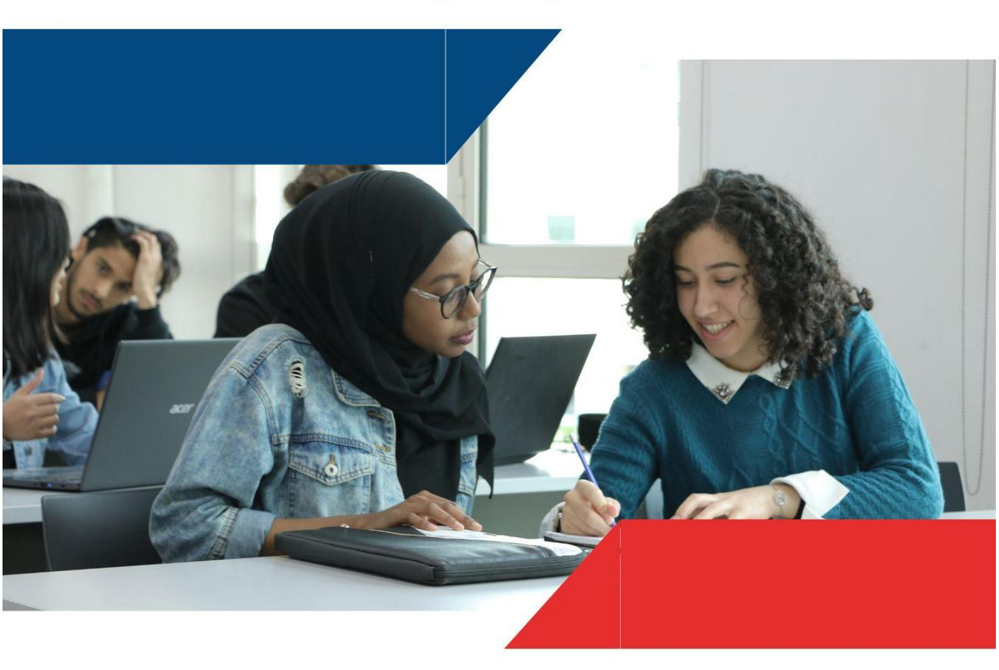
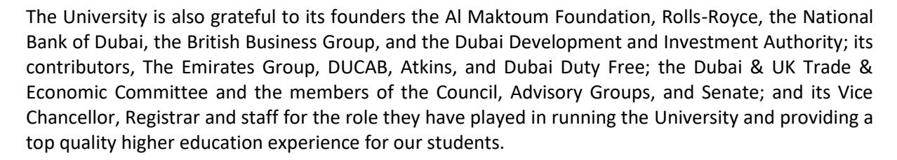
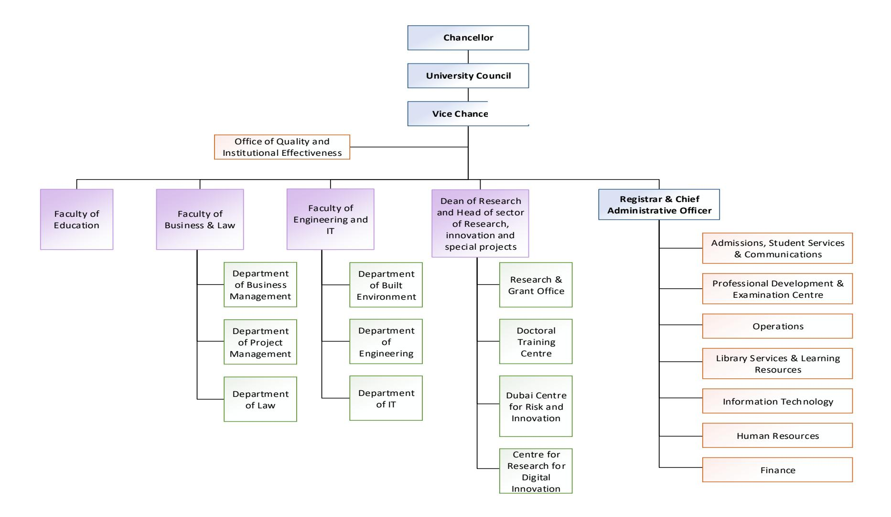

<!-- A3.R31 | source: papers_json/A3.R31/ -->

## **دليل الدراسات العليا **

2022-2023

<!-- page 2 -->

## *رسالة من رئيس الجامعة*

عزيزي الطلاب،

يسعدني كثيرًا أن أرحب بكم في الجامعة البريطانية في دبي.

تأسست الجامعة نتيجة تعاون حقيقي بين مؤسسات دبي والمملكة المتحدة لتقديم أفضل ما يميز التعليم البريطاني في دبي.

تم اختيار شركائنا في المملكة المتحدة، وهم جامعات إدنبرة ومانشستر وغلاسكو، بسبب مكانتهم البحثية ومعاييرهم العالية. ويسعدني أنهم سيواصلون العمل عن قرب مع BUiD لضمان تقديم برامج عالية الجودة لكم تستفيد من ذلك البحث.

من المُسر أن هناك اهتمامًا عالميًا بالمناصب الأكاديمية

في الجامعة، وأن شركاءنا البريطانيين تمكنوا من تطبيق معايير صارمة في اختيار الأفضل. حصلت جميع البرامج الأكاديمية التي تقدمها BUiD على اعتماد وزارة التربية والتعليم في دولة الإمارات العربية المتحدة، وأنا ممتن لمعالي حسين إبراهيم الحمادي على الاهتمام الذي أولاه هو ومفوضوه لبرامج BUiD.

تأسست الجامعة لتقديم مساهمة كبيرة وفريدة لدولة الإمارات العربية المتحدة ومنطقة الخليج. غير أن الجامعة لا يمكنها أن تذهب بعيدًا إلا من خلال توفير التدريس وبيئة دراسية نابضة بالحياة والفائدة الكبيرة من الوصول إلى موارد خمس جامعات بريطانية عالية الجودة. وستأتي أكبر مساهمة في الجامعة منكم، أنتم الطلاب، من خلال ما تقدمونه للجامعة وما تأخذونه منها وتعيدونه إلى المجتمع من خلال عملكم أو مهنتكم.

أتمنى لكم كل التوفيق في دراستكم.

أحمد بن سعيد آل مكتوم رئيس المجلس

<!-- page 3 -->

## **المحتويات **

Message from The Chancellor 2Ternminologies 71.Introduction to the University92.Organization Chart and Faculty Structure 102.1Board of Trustees / Council112.2Academic Staff 122.3Administration 173.Academic Programmes 2022-2023 184.Academic Calendar for 2022 – 2023 205.BUID Vision, Mission, and Values 225.1University Mission5.2University Vision5.3University Strategy5.4University Goals5.5Licensure and Accreditation5.6Strategic Operations and Plans5.7Why Choose British University Dubai? 236.Physical and Technology Resources6.1Library Services and Learning Resources1 Mission Statement2 Collection Management3 Services4 Information Literacy5 Library Staff and SupportIT Facilities1 Timings & Support2 Servers and Bandwidth6.2.33 Reliability of IT Network
IT Facilities7.Admissions 287.1General Requirements7.1.31 Admission To The University7.2Programme Specific Admissions Requirements7.3Conditional Admittance for Postgraduate Diploma and Masters Programmes7.4Exceptions to The Proof of English Proficiency Requirement7.5Admissions Procedures7.6Admission and Progression through Postgraduate qualifications7.7Credit Transfers for Post Graduate Programmes7.7.1 External Credit Transfers38

<!-- page 4 -->

7.7.2Internal Credit Transfer within Postgraduate Programmes 407.8Student Induction 407.9Student Registration 417.9.1New Students 417.9.2Returning Students 417.10Adding or Dropping Modules 417.11Readmission 417.12Suspension of Study 427.13Late Withdrawal from a Module 437.14Permanent Withdrawal from the Programme 438.Financial Information8.1Total Programme Fees for the Academic Year 2022-20238.2Tuition Fee Terms and Conditions 448.3Scholarships8.4Sponsorship 458.5Refunds 458.6Late or Non-payment of Fees 468.7Other Fees 469.Academic Policies & Assessment Procedures9.1Assessment for M-Level Programmes 479.1.1. Taught Modules 479.1.2Dissertation 489.1.3Project 489.2Graduate Instruction 489.3University M-Level Grading System 499.3.1University M-Level Grade Descriptors 509.4Doctoral Level Assessment Regulations 55. Taught Module Stage Regulations9.4.2Proposal Defense Assessment 579.4.3Final Thesis and Viva Assessment 57University D-Level Grade Descriptors 589.5Transferable Skills 639.6Evaluating Instruction 63Academic GovernanceQuality of InstructionResponsibility for Teaching and Learning within Faculties1 Board of Studies2 External ExaminersMonitoring and Evaluation Procedures1 Academic Staff-Student Liaison CommitteeProgramme Quality Self-Study Reports.3 Elicitation of Feedback from Students.4 Programme Review10.3..5 External Examiners Report 67Academic Advice and Pastoral SupportPersonal Tutor/Student Academic Tutor (SAT)Module Tutors11.3Module Coordinator 69

<!-- page 5 -->

11.4Dissertation Supervisor (Applicable only to programmes having a dissertation component) 6912.Head of Programme / Programme Coordinator 7013.Supervision for Doctoral Students 7014.Rights and Responsibilities 7214.1Student Code of Conduct 7214.2Student Disciplinary Offences 7314.3Student Complaint Procedure 7614.4Attendance Policy and Procedure 7714.5Student Appeals Policy and Procedure 7814.6Academic Honesty and Integrity 79Student ServicesBUID Achievement & Career ExcellenceCounselling Service15.3Accommodation 82DIAC Facilities15.5Student Activities and Publications 8215.6Alumni Association 8315.7Student Participation in the University 8316.Doctoral Training Centre 8417.Masters Preparation Programmes 8518.FACULTY OF EDUCATION 8618.1Portfolio of PhD in Education and Doctor of Education Programmes 87Portfolio of Masters of Education ProgrammesPostgraduate Diploma in Education Programme19.FACULTY OF BUSINESS AND LAW11519.1PhD in Business Management Programme. 116Professional Doctorate in Business Administration19.3PhD (Subject: Project Management). 126PhD (Subject: Business Law)MSc in Construction Law and Dispute ResolutionPostgraduate Diploma in Construction Law and Dispute ResolutionMaster in Business Administration19.8Portfolio of Project Management Programmes. 149Postgraduate Diploma in PPM Programmes20.FACULTY OF ENGINEERING & IT PROGRAMMES166PhD: Sustainable Built EnvironmentsSustainable Design of the Built Environment ProgrammeStructural Engineering ProgrammeEngineering ManagementPhD in Computer ScienceInformatics (Knowledge and Data Management)

<!-- page 6 -->

| How to Contact the University |  |
| --- | --- |
| By Mail | PO Box 345015, Dubai – UAE |
| By Telephone | +971 4 279 1400 |
| By Email | info@buid.ac.ae |
| In Person | st and 2nd Floor, Block 11 1 Dubai International Academic City (DIAC) Dubai – UAE |

## **من مسؤولية كل طالب قراءة وفهم والالتزام باللوائح والإجراءات المطبوعة في هذا الكتيب.**

هذا الدليل وثيقة رسمية صادرة عن جامعة BUiD تصف البرامج الأكاديمية وقوائم أعضاء هيئة التدريس والسياسات والإجراءات واللوائح والمتطلبات الخاصة بالجامعة. بُذل كل جهد ممكن لضمان دقة المعلومات الواردة في هذا الدليل. غير أن الجامعة لا تتحمل أي مسؤولية عن الأخطاء التحريرية أو الكتابية أو المطبعية، أو الأخطاء الناتجة عن أي خطأ آخر. تحتفظ الجامعة بالحق في إجراء تغييرات دون إشعار مسبق على المعلومات الواردة في هذا المنشور، بما في ذلك تعديل الرسوم المختلفة (وفقًا لسياسات الجامعة) والجداول الزمنية وشروط القبول ومتطلبات الساعات المعتمدة، وكذلك مراجعة أو إلغاء مقررات أو برامج معينة.

<!-- page 7 -->

## *المصطلحات*

| Terminology | Description |
| --- | --- |
| BUiD | The British University in Dubai |
| Admissions Tutor | An academic member of the Faculty who makes decisions on applicants' suitability for being offered a place on a programmeme |
| Anonymous Marking | A process whereby the names of students on scripts are removed or concealed, so that examiners/markers do not know their identity during the marking process |
| Appeal | A student may challenge a decision made by selected University committees which directly affects their study |
| Assessment | Any activity which is graded by academic staff and counts towards the overall module marks, including examinations |
| Board of Examiners | A formally constituted University committee charged with approving assessment decisions |
| Core module | Core modules are mandatory modules that a student must study to meet the requirements of the programmeme. |
| Credit | One credit represents 10 notional hours of learning. Credit is awarded once you have successfully completed a module in recognition of the amount and depth of learning which you have achieved. Credits are then accumulated towards the total credit required for a programme of study and a qualification |
| Compensation | When Board of Examiners recommends that a student's less than satisfactory performance in one component of assessment be compensated by better performance in other components within a module |
| Concentration | Concentrations are grouping of courses which represent a sub specialization taken within the major field of study. A concentration may be specified on the diploma or in the student's academic record (transcript). A concentration module is at least 20 term credits of study, or equivalent, in the specialized field |
| Credit Transfer | A process by which a student may obtain credit for relevant modules undertaken previously at accredited/recognized institutes |
| Dean | The academic in charge of the curriculum department with overall responsibility for delivery and standards |
| Dissertation | A significant piece of individual research undertaken by a student at the end of their taught programmeme |
| Dissertation Supervisor | An academic staff member who will support a student during the research period |
| Distance Learning | A form of learning where the teacher may not be present with the class. |
| Double Marking | When a student's work is assessed by more than one marker. If the marks and annotation of the first marker are not available to the second marker, this is known as 'blind' double marking |
| Electives | Modules which are not compulsory for students. Electives may be free—selected by the student from any course offerings, or restricted—chosen from a pre-determined list of options. |
| Examination | A formal assessment which is invigilated and subject to BUiD Examination Regulations |
| Exemption | The status achieved by a student who obtains credit transfer for previous learning |

<!-- page 8 -->

| Terminology | Description |
| --- | --- |
| External Examiner | An academic, external to BUiD, who is appointed to ensure that the standards are at the correct level |
| External marker | A person of experience who may be asked to mark specialised dissertations as a first or second marker |
| Faculty | The University internal structure with primary responsibility for delivering learning in a given discipline |
| Full-time | A study route whereby a student completes a programmeme in two terms & dissertation |
| GCSE | General Certificate of Secondary Education – a British school qualification normally after 11years of study |
| Grade Point Average (GPA) | The system by which coursework grades are averaged to indicate the overall level of student performance |
| Grading System | BUiD uses an agreed grading system for all assessments |
| HoMASS | Head of Marketing, Admissions & Student Services |
| Internal marker | A member of BUiD academic staff who marks a student assignment or dissertation |
| Internationally Accredited University | Every university may obtain accredited status from their home country or through an international recognition system such as NARIC which is used in the UK |
| Mitigating Circumstances | Events which adversely affect a student's performance and which may be taken into account by the Board of Examiners |
| Moderation | Independent academic checking of assessed work of a student by more than one marker. May involve second marking, double marking or analysis of marks for the cohort |
| Module | A coherent, credit bearing, curriculum element of a programmeme |
| Module Coordinator | An academic staff member responsible for the delivery and assessment of a module |
| Prerequisite | A module that students must take prior to attending another module |
| Part-time | A study route whereby a student completes a programmeme over two or more academic years |
| Personal Tutor | An academic staff member with primary responsibility for ensuring that students' progress appropriately during their studies |
| Programmeme Coordinator | The academic responsible for the oversight of a programmeme |
| Provisional | The status of assessment and examinations grades until they are confirmed by the Board of Examiners |
| Study Plan | The initial document produced after a meeting between the Personal Tutor and student |
| Transcript | A list of modules studied and the module grades |
| UAE United Arab Emirates |  |
| Unfair Means | Assistance that a student uses to gain unfair advantage in assessments or examinations |
| University | The British University in Dubai |
| Upper Second Class A classification of a British Honours Bachelor Degree. This normally Honours Degree equates to a GPA of between 3.0 and 3.5 |  |
| Viva Voce | An oral examination |

<!-- page 9 -->

## **1.** **مقدمة عن الجامعة**

تأسست الجامعة البريطانية في دبي (BUiD) في عام 2003 بموجب القانون رقم 5/2003 الصادر عن صاحب السمو الشيخ مكتوم بن راشد بن سعيد آل مكتوم، حاكم دبي.

نشأت الجامعة نتيجة تعاون بين مؤسسات بريطانية وإماراتية أكاديمية وحكومية وتجارية لتقديم مساهمة فريدة لدولة الإمارات ومنطقة الخليج. تأسست BUiD لتكون الجامعة البحثية الرائدة في المنطقة، وتقدم تعليمًا وتدريبًا وبحثًا عالمي المستوى. وهي توفر مجتمعًا ومصدرًا مهمًا ومتناميًا للمهنيين الشباب وكبار الأكاديميين ومديري الشركات والقادة الطموحين على اختلاف توصيفاتهم. تُرخّص وزارة التربية والتعليم – قطاع شؤون التعليم العالي في دولة الإمارات لجامعة BUiD منح درجاتها العلمية الخاصة.

يشمل ضمان الجودة الداخلي لدى BUiD عمليات تضمن أن برامجنا وإنجازات طلابنا تتوافق مع معايير مماثلة لتلك المعتمدة لدى شركائنا في تحالف الجامعات البريطانية (جامعة إدنبرة، وجامعة غلاسكو، وجامعة مانشستر).

BUID جامعة غير ربحية استقطبت خبراء أكاديميين لتطوير برامج مصممة بما يناسب المنطقة، يعملون من خلالها على توسيع حدود المعرفة والفهم والبحث وتحديها.

<!-- page 10 -->

## **2.** **الهيكل التنظيمي وهيكل الكليات **

<!-- page 11 -->

## **2.1** **مجلس الأمناء** **/** **المجلس**

<!-- page 12 -->

## **2.2** **أعضاء هيئة التدريس**

| Name | Academic Position | Credentials |
| --- | --- | --- |
|  | Faculty of Engineering and Informatics |  |
| Prof. Bassam Abu Hijleh | Dean- Faculty of Engineering & IT Head of Department Sustainable Built Environment | (1985) Bachelor of Science in Mechanical Engineering, Ohio State, University (USA) (1987) Master of Science in Mechanical Engineering, Ohio State, University (USA) (1990) Doctor of Philosophy (Ph. D) in Mechanical Engineering, Ohio State University (USA) |
| Prof. Hanan M Taleb | Programme coordinator – PhD SBE | (2004) BA Interior Design, Dar Al Hekma College (Saudi Arabia) (2006) MA Interior Design, Bournemouth University (UK) (2007) MArch, University of Sheffield (UK) (2011) Doctor of Philosophy (PhD) Architecture, University of Sheffield (UK) |
| Prof. Alaa Ameer | Head of Department of Engineering Programme coordinator – MSc Engineering Management | (1979) Bachelor of Science in Mechanical Engineering, University of Technology (Iraq) (1981) Higher Diploma in Applied Mechanics, University of Technology (Iraq) (1983) Master of Science in Tribology, University of Technology (Iraq) (2001) Doctor of Philosophy in System Modelling, University of Bradford (UK) |
| Prof. Khaled Shalaan | Head of Department of IT | (1982) Bachelor of Commerce (B.Comm), University of Cairo, (Egypt) (1985) Post-graduate Diploma (PGDip) in Computer Science & Information Science, University of Cairo (Egypt) (1989) Master of Science (MSc) in Computer Science, University of Cairo (Egypt) (1995) Doctor of Philosophy (PhD) Computer Science, Institute of Statistical Studies & Research, Cairo University (Egypt) |
| Prof. Sherief Abdallah |  | (1998) Bachelor of Engineering in Computer Engineering, Cairo University (Egypt) (2001) Master of Science in Computer Engineering, Cairo University (Egypt) (2006) Doctor of Philosophy in Computer Science, University of Massachusetts (USA) |
| Prof. Piyush Maheshwari | Programme coordinator- MSc Informatics | (1982) B.Eng. in Electronics & Communication Engineering, Indian Institute of Technology (India) (1984) M.Eng. in Computer Science & Technology, Indian Institute of Technology (India) (1990) Doctor of Philosophy (PhD). in Computer Science, The University of Manchester (UK) (1994) Graduate Certificate in Higher Education, Griffith University, (Australia) |
| Dr. Mostafa Al-Emran |  | (2012) Bachelor of Science in Computer Science, Al Buraimi University College (Oman) (2015) Master of Science in Informatics (Knowledge and Data Management), BUiD (UAE) (2019) Doctor of Philosophy in Computer Science, Universiti Malaysia (Malaysia) |

<!-- page 13 -->

| Name | Academic Position | Credentials |
| --- | --- | --- |
|  |  | (2004) Bachelor Degree in Computer Science, Yarmouk University (Jordan) |
| Dr. Manar Alkhatib |  | (2007) Master Degree in Computer Science, Middle East University (Jordan) |
|  |  | (2019) Doctor of Philosophy in Computer Science, BUiD (UAE) |
|  |  | (2013) BSc Electrical –Computer- Engineering, AinShams University (Egypt) |
| Hend ElMohandes |  | (2018) Masters on Informatics, Nile University /Fraunhofer Research Institute (Egypt) |
|  |  | (2004) BSc in Computer Engineering, University of Technology (Iraq) |
| Dr. Aos Alaa Al Juboori | Programme coordinator- BSc | (2014) MSc in System Engineering, The British University in Dubai (UAE) |
|  | Computer Science | (2014) Doctor of Philosophy (PhD) in Computer Engineering, Multimedia University (Malaysia) |
|  |  | (1995) BSc in in Electrical Engineering, Aleppo University (Syria) |
| Dr. Basem Tuqan |  | (2009) M.Cs in Computer Science, University of Malaya (Malaysia) |
|  |  | (2014) Doctor of Philosophy (PhD) The British University in Dubai (UAE) |
|  |  | (1984) B.Eng. Civil Engineering, Queen Mary College (UK) |
| Prof. Abid Abu-tair |  | (1985) M.Sc. Civil Engineering, Imperial College; (UK) |
|  |  | (1992) Doctor of Philosophy (PhD) Civil Engineering; Queen Mary College (UK) |
|  | Programme coordinator- MSc Structural Engineering | (2012) PhD in Civil Engineering, Imperial College (UK) |
| Dr. Gul Ahmed | (2002) M.Engg. in Structural Engineering, NED University (Pakistan) |  |
|  | (1999) B.E. in Civil Engineering, NED University (Pakistan) |  |
|  |  | (2014) BSc in Mathematics, University of Bristol (UK) |
| Dr Daniel Wood |  | (2015) MSci in Mathematics, University of Bristol (UK) |
|  |  | (2019) DPhil in Cyber Security, University of Oxford (UK) |
|  |  | Faculty of Education |
|  | Dean Faculty of Education | 1987) Bachelors of Science (BSc) in Biology, Alexandria University (Egypt) |
| Prof. Eman Gaad | (l999) Doctor of Philosophy (PhD) in Education, The University of East Anglia (UK). |  |
|  |  | (1983) Bachelor of Science in Biology and Education, University of Alexandria, Egypt |
|  |  | (1984) Higher Diploma in Education, Omdurman Islamic University, Sudan |
| Prof. Sufian Forawi |  | (1987) Master's of Education, Curriculum and Instruction, Omdurman Islamic University, Sudan |
|  |  | (1996) Educational Doctorate in Science Education, University of Massachusetts Lowell, USA |
|  |  | (1999) B B.A., in English Literature; St. John's College (India) |
|  |  | (2000) B.Ed., in Education; St. Xavier's College of Education (India) |
| Dr. Solomon Arulraj |  | (2002) M.A in English Literature; Manonmanium Sundaranar University (India) |
| David |  | (2004) MEd, Katholieke Universiteit Leuven, (Belgium ) |
|  |  | (2011) Doctor of Philosophy (PhD) in Education, Katholieke Universiteit Leuven, (Belgium) |

<!-- page 14 -->

| Name | Academic Position | Credentials |
| --- | --- | --- |
|  |  | (1996) B.A. Degree in English Literature and Linguistics, Yarmouk University (Jordan) |
| Dr. Emad Ahmed Abu |  | (2008) Master Degree in English/ Translation, Yarmouk University (Jordan) |
| Ayyash |  | (2009) TEFL Certificate, University of the Fraser Valley (Canada) |
|  |  | (2016) Doctor of Philosophy (PhD) in Education – TESOL, The British University in Dubai, (UAE) |
|  |  | (1999) BEd (Hons) Social Studies Education & Art Education, University of Education/University of |
| Prof. Adbulai Abukari | Programme coordinator - MEd | Cape Coast (Ghana) (2003) MPhil in Comparative and International Education, University of Oslo (Norway) |
|  |  | (2007) Doctor of Philosophy (PhD) in Comparative and International Education, Middlesex University, |
|  |  | (UK ) |
|  |  | (2000) Bachelor of Arts (Hons) in Classical Civilisation, University of Nottingham, UK |
|  |  | (2001) Master of Arts in International Relations, University of Nottingham, UK |
| Prof. Christopher Hill | Programme coordinator – | (2005) Doctor of Philosophy (Ph. D) in Political Science, University of Nottingham, UK |
|  | EdD/PhD in Education | (2010) Post Graduate Certificate in Higher Education, University of Nottingham Malaysia Campus, |
|  |  | Malaysia |
|  |  | (2005) BEng in Computing City University, UK |
|  |  | (2010) MA Applied Linguistics Newcastle University, UK |
| Dr. Tendai Charles |  | (2013) CELTA International House, UK |
|  |  | (2018) Doctor of Philosophy (PhD) in Education University of York, UK |
|  |  | Faculty of Business and Law |
|  | Dean, Faculty of Business and | (1996) LLB, Jordan University, Jordan |
| Prof. Aymen Masadeh | Law; Programme coordinator | (1997) LLM, Aberdeen University, UK |
|  | PhD in Business Law | (2001) Doctor of Philosophy (PhD) (Contract Law), Bristol University, UK |
|  | Head of Department of Law; |  |
|  | Programme coordinator- MSc | (1984) LL.B, Ahmadu Bello University, Nigeria |
| Dr. Abba Kolo | in CLDR | (1986) Bachelor of Law, Nigerian Law School. Nigeria |
|  | Programme coordinator | (1988) LLM, University of Warwick, UK |
|  | Bachelor of Law |  |
|  |  | (2000) Bachelor's Degree in Law, Amman University (Jordan) |
| Dr. Omar Hisham Alhyari |  | (2003) Master's Degree in Private Law, Amman University (Jordan |
|  |  | (2008) Doctorate in Law, University of the West of England (UK) |
|  |  | (1991) BSc in Administrative Sciences, Sudan |
| Prof Abu Baker Suliman | Programme coordinator- MBA | (1995) Master of Business Administration, Jordan |
|  |  | (1198) Master of Philosophy, Liverpool Business School (UK) |

<!-- page 15 -->

| Name | Academic Position | Credentials |  |
| --- | --- | --- | --- |
|  |  | (2000) Doctor of Philosophy (PhD) (HRM), Liverpool Business School (UK) |  |
|  |  |  | (1995) BA in Business Administration, Yarmouk University (Jordan) |
| Dr. Bader Yousef |  | (2003) | Master of Business Administration, Yarmouk University (Jordan) |
| Obeidat |  | (2008) | PhD in Business Studies, Durham University (UK) |
|  |  | (1993) | BSc, Electrical Engineering, University of Engineering and Technology (Pakistan) |
| Dr. Farzana Asad Mir | Director of Doctoral Training | (2012) | MSc, Project Management, BUiD (UAE) |
|  | Centre | (2019) | PhD in Management, University of Guelph (Canada) |
|  | Programme coordinator- BSc | (2006) | BA, Aleppo University (Syria) |
| Dr. Amer Alaya | Business Management/ | (2010) | MBA, Abu Dhabi University (UAE) |
|  | Finance and account | (2017) | PhD in Business Management, The British University in Dubai (UAE) |
|  |  |  | (1988) Bachelor of Arts in Business Studies, Plymouth Polytechnic, UK |
|  |  |  | (1995) Master of Science in Management Science, University of Southampton, UK |
| Prof. Stephen Wilkins | Programme coordinator |  | (1995) Postgraduate Certificate in Education (PGCE), University of Greenwich, UK |
|  | PhD/DBA |  | (2010) Master of Research (ResM) in Management, University of Bath, UK |
|  |  |  | (2013) Doctor of Philosophy (PhD) in Management, University of Bath, UK |
|  |  |  | (1996) BSc Architecture, University of Khartoum (Sudan) |
|  |  |  | (2000) MSc Construction Economics and Management, Bartlett School of Graduate Studies, |
| Dr. Sulafa Badi |  |  | University College London (UK) |
|  |  |  | (2012) Doctor of Philosophy (PhD) Project Management, Bartlett School of Construction and |
|  |  |  | Project Management (UK) |
|  | Head of Department of Project Management; Programme coordinator- PhD PM | (2010) | Postgraduate Certificate in Higher Education learning and Teaching, Robert Gordon |
|  |  | University (UK) |  |
| Prof. Edward Godfrey |  | (2008) PhD Project Management, Loughborough University (UK) |  |
| Ochieng |  | (2000) MSc Project Management, Leeds Beckett University (UK) |  |
|  |  |  | (1999) BSc Technology and Management, University of Bradford (UK) |
|  |  | (1984) | B.Sc. Civil Engineering, University of Arizona (USA) |
| Dr. Khalid Al Maari | Dean of Research | (2000) | M.Sc. Engineering Management; The Catholic University of America (USA) |
|  |  |  | (2015) Doctor of Philosophy (PhD) in Project Management, the British University in Dubai (UAE) |
|  |  | (2004) | BSc Business Economics, Salford University (UK) |
| Dr. Maria Papadaki | Director, BUiD Innovation and | (2005) | MSc Management of Projects; The University of Manchester (UK) |
|  | Risk Management Centre |  | (2013) Doctor of Philosophy (PhD) in Risk Management; The University of Manchester (UK) |
| Dr. Husam-Aldin Al |  |  | (1990) B.A. in Economics and Planning, University of Aleppo, Syria |
| Malkawi |  |  | (1996) Master of Commerce in Accounting and Financial Management, Maharaja Sayajirao |

<!-- page 16 -->

| Name | Academic Position | Credentials |
| --- | --- | --- |
|  |  | University of Baroda, India |
|  |  | (2005) Doctor of Philosophy (PhD). in Finance, School of Economics and Finance, University of |
|  |  | Western Sydney, Australia |
|  |  | (1998) Mathematics (Statistics), University Mohammed V (Morocco) |
| Dr. Abdelmounaim |  | (2003) Mathematics (Statistics), Southern Illinois University (USA) |
| Lahrech |  | (2007) Economics, Southern Illinois University (USA) |
|  |  | (2003) BSc Mechanical Engineering, N.E.D University of Engineering and Technology (Pakistan) |
| Dr. Muhammad Waris Ali | Programme coordinator- MSc | (2011) MSc Civil Engineering (Project Management), Universiti Teknologi Petronas (Malaysia) |
| Khan | PM | (2015) Doctor of Philosophy (PhD) in Civil Engineering – Project Management, Universiti |
|  |  | Teknologi Petronas (Malaysia) |
|  |  | (1998) L.L.B, Mu'tah University (Jordan) |
| Dr. Derar Hussein Al |  | (2009) L.L.M, Mu'tah University (Jordan) |
| Daboubi |  | (2019) International Commercial Law and Maritime Law, University of London (UK) |
|  |  | (2008) BSc International Business, Ecole des Hautes Etudes Commerciales (Algiers) |
| Dr. Mohamed Yacine |  | (2011) MSc International Business, University of Hertfordshire |
| Haddoud |  | (2015) Doctor of Philosophy (PhD) in Business with Management, Plymouth University (UK) |
|  |  | (2001) BA (Hons) Business Management, Oxford Brookes University (UK) |
| Dr. Ashmiza Mahamed |  | (2004) Masters Business Administration (MBA), University Mara Technology (Malaysia) |
| Ismail |  | (2012) Doctor of Philosophy (PhD) in Business Management, University of Portsmouth (UK) |
|  |  | (2009) LLM/LLB, Cairo University (Egypt) |
|  |  | (2013) L.L.M, American University in Cairo (Egypt) |
| Dr. Shams Al-Hajjaji |  | (2016) JSD/LLM, University California (USA) |
|  |  | (2020) Doctor of Philosophy (PhD) in Economics and Finance, University of Luxembourg (Luxembourg) |

<!-- page 17 -->

## **2.3** **الإدارة**

## **مكتب الإدارة التنفيذية**

**Professor Abdullah Al ** **Shamsi**, Vice- Chancellor

**Hugh Martin, **Registrar and Chief Administrative Officer

**Salam Khoury, **Executive Administrator/PA to VC & Registrar

**Office of Quality and** **Institutional** **Effectiveness**

**Maria Pinto, **Head of Institutional Effectiveness

**Dr Ghassan Dabbour, **Head of Planning and Projects

**Muna** **Ali, **Institutional Effectiveness Coordinator

## **التسويق والقبول ** **وخدمات الطلاب**

**Mira** **Hamzeh** **, **Head of Marketing, Admissions & Student Services

**Christine Salvador, ** Research Programmemes Officer

**Godwin Francis, **Senior Faculty Administrator

**Ahmed Ali, **Senior Student Administrator

**Abdullah El Nokiti, **Faculty Administrator

**Maria Kopteva, **Admissions Officer

**Nadine Markiz, **Student Relations Coordinator

**Muhammad Jammal, ** Admissions Officer

**Samar Alkhatib, ** Communications Manager

**Tanisha Simon, **Digital Media Officer

**Nour Boustanji, **External Relations Officer

## **الشؤون المالية**

**Mohammed Wajahatuddin ** **Ahmed**, Head of Finance

**Haskar K, **Finance Administrator

**Lordlyn Joy Tabalus, ** Finance Administrator

## **المكتبة**

**Hamid** **Saeed, **Head of Library Services & Learning Resources

**Simia Kumar, **Assistant Librarian

**Immaculata Amarachukwu ** **Ofurum**, Library Services Coordinator

**Mohammad Mesfer Rashed**, Library Support

## **تقنية المعلومات**

**Khaleelullah Ghourie**, Head of IT

**Joma Cabales**, IT Officer

**Arun KK, **IT Support Specialist

**Shobu Skaria, **IT Support Specialist

## **الموارد البشرية**

**Sheila Enriquez,** Head of Human Resources

**Jouhar Ali, **Human Resources Administrator

**Marwa Elghitany, **Human Resources Administrator Operations

**Hassan Modiraprambil**, Head of Operations

**Professional ** **Development & ** **Examinations Centre**

**Jerry** **Joy**, Training & Examinations Administrator

**Doctoral Training Centre** **Rawy Abdelrahman Thabet**, Academic Associat

**Danielle Wilson ****–** **Gulston,** Teaching & Training Associate

<!-- page 18 -->

## **3.** **البرامج الأكاديمية 2022-2023**

| Programme | Professional accreditation |
| --- | --- |
| Faculty of Engineering & IT |  |
| PhD – Sustainable Built Environments |  |
| PhD – Computer Science |  |
| Master of Science (MSc) in Sustainable Design of the |  |
| Built Environment |  |
| Concentrations: |  |
| - Architectural Design |  |
| - Interior Design | Chartered Institute of Building (CIoB) |
| - Smart Buildings |  |
| - Urban Design |  |
| General - |  |
| Postgraduate (PG) Diploma in Sustainable Design of |  |
| Built Environment |  |
| Concentrations: |  |
| - Architectural Design |  |
| - Interior Design | Chartered Institute of Building (CIoB) |
| - Smart Buildings |  |
| - Urban Design |  |
| General - |  |
| Master of Science (MSc) in Informatics (Knowledge |  |
| and Data Management ) |  |
| Postgraduate (PG) Diploma in Informatics |  |
| (Knowledge and Data Management ) |  |
| Master of Science (MSc) in Structural Engineering |  |
| Postgraduate (PG) Diploma in Structural |  |
| Engineering |  |
| Master of Science (MSc) in Engineering |  |
| Management | American Society for Engineering |
| Concentrations: | Management (ASEM) |
| - Maintenance and Reliability |  |
| - Total Quality Management |  |
| Postgraduate (PG) Diploma in Engineering |  |
| Management | American Society for Engineering |
| Concentrations: | Management (ASEM) |
| - Maintenance and Reliability |  |
| Total Quality Management - |  |
| Faculty of Education |  |
| Doctor of Education (EdD)/Doctor of Philosophy |  |
| (PhD) in Education |  |
| Master of Education in Teaching English to Speakers |  |
| of Other Languages (TESOL) |  |
| Master of Education in Special and Inclusive |  |
| Education (SIE) |  |
| Master of Education in Management Leadership |  |
| and Policy (MLP) |  |
| Master of Education in Information and |  |
| Communication Technology (ICT) |  |
| Master of Education in Science Education (SE) |  |

<!-- page 19 -->

|  |  |
| --- | --- |
| Master of Education in Psychology (Ed. Psych) |  |
| Master of Education in Learning and Teaching (LT) |  |
| Postgraduate Diploma in Teaching English to |  |
| Speakers of Other Languages |  |
| Postgraduate Diploma in Special and Inclusive |  |
| Education |  |
| Postgraduate Diploma in Management Leadership |  |
| and Policy |  |
| Postgraduate Diploma in Information and |  |
| Communication Technology |  |
| Postgraduate Diploma in Science Education |  |
| Postgraduate Diploma in Psychology |  |
| Postgraduate Diploma in Learning and Teaching |  |
| Faculty of Business and Law |  |
| PhD - Business Management |  |
| PhD – Project Management |  |
| Professional Doctorate in Business Administration |  |
| PhD - Business Law |  |
| Master of Science (MSc) in Construction Law and |  |
| Dispute Resolution | Chartered Institute of Building (CIoB) |
| Postgraduate Diploma in Construction Law and |  |
| Dispute Resolution | Chartered Institute of Building (CIoB) |
| Master of Business Administration |  |
| Concentrations: |  |
| - Human Resource Management |  |
| - Finance |  |
| - Marketing |  |
| Sustainability - |  |
| Master of Science (MSc) in Project Management |  |
| Postgraduate Diploma in Project Management |  |
| Master of Science (MSc) in Construction Project |  |
| Management |  |
| Postgraduate Diploma in Construction Project |  |
| Management |  |
| Master of Science (MSc) in Enterprise Risk |  |
| Management |  |
| Postgraduate Diploma in Enterprise Risk |  |
| Management |  |
| Master of Science (MSc) in IT Project Management |  |
| Postgraduate Diploma in IT Project Management |  |
| Master of Science (MSc) in Infrastructure Project |  |
| Management |  |
| Postgraduate Diploma in Infrastructure Project |  |
| Management |  |
|  |  |

<!-- page 20 -->

## **4.** **التقويم الأكاديمي لعام** **2022 ****–** **2023**

***** **يتم تحديد الأعياد الإسلامية بعد رؤية الهلال. ستعلن الجامعة رسميًا عن أي إغلاق بمناسبة عطلة دينية ** **و/أو رسمية للطلاب والموظفين.**

| Academic calendar 2022 - 2023 |  |  |  |
| --- | --- | --- | --- |
|  | 05 Sep | Start of new academic year |  |
|  | 12 Sep | Induction week |  |
|  | 19 Sep | Commencement of classes | Week 1 |
|  | 26 Sep | Retake Exams (Sep 26 - 28) | Week 2 |
|  | 3 Oct | End of Add/Drop period | Week 3 |
|  | 10 Oct |  | Week 4 |
|  | 17 – 21 Oct | ASSLC meetings/Board of Studies | Week 5 |
| Fir | 24-28 Oct | Proposal defence | Week 6 |
| st Te | 31 Oct |  | Week 7 |
| rm | 7 Nov |  | Week 8 |
|  | 14 Nov | Academic board | Week 9 |
|  | 21 Nov | Senate meeting | Week 10 |
|  | 25 Nov | First term examinations | Week 11 |
|  | 1 – 3 Dec | Commemoration Day & National Day | Week 12 |
|  | 5 Dec |  | Week 13 |
|  | 12 – 16 Dec | Board of Examiners week | Week 14 |
|  | 15 – Dec | Graduation ceremony |  |
|  | 17 Dec 2022 – 1 Jan 2023 | First Term Break |  |
|  | 2 Jan | Commencement of classes & induction (2/01/2023) | Week 1 |
|  | 9 Jan |  | Week 2 |
|  | 20 Jan | End of Add/Drop period | Week 3 |
| Se co | 23 Jan |  | Week 4 |
| nd Te | 29 Jan – 3 Feb | ASSLC meetings/Board of Studies | Week 5 |
| rm | 6-Feb |  | Week 6 |
|  | 13-Feb to 17-Feb | Proposal defence | Week 7 |
|  | 20-Feb |  | Week 8 |
|  | 27-Feb |  | Week 9 |

<!-- page 21 -->

|  | Academic calendar 2022 - 2023 |  |  |
| --- | --- | --- | --- |
|  | 6-Mar |  | Week 10 |
|  | 13-Mar to 17-Mar | Second term examinations | Week 11 |
|  | 20-Mar |  | Week 12 |
|  | 27-Mar to 31 Mar | Board of Examiners week | Week 13 |
|  | 1-7 Apr | Term two break |  |
|  | 8-Apr | Commencement of classes | Week 1 |
|  | 17-Apr |  | Week 2 |
|  | 20-Apr to 24-Apr | Eid Break (Tentative) |  |
|  | 28-Apr | End of Add/Drop period | Week 3 |
|  | 8-May to 12 May | ASSLC meetings/Board of Studies | Week 4 |
|  | 15-May | Academic board | Week 5 |
| Th ird | 22-May | Senate meeting | Week 6 |
| Te rm | 29-May |  | Week 7 |
|  |  |  | Week 8 |
|  | 5-16 Jun | Proposal defence | Week 9 |
|  | 19-Jun |  | Week 10 |
|  | 23 to 30 Jun | Third term examinations (Adha Holiday 28 Jun to 1 Jul) | Week 11 |
|  | 3-Jul |  | Week 12 |
|  | 10-Jul | Board of Examiners week | Week 13 |
|  | 15 July - 30 Aug | Term three break |  |

*ملاحظة:* **مجلس الشيوخ (Senate)** يُعقد مرتين في السنة، في نوفمبر ومايو

**المجلس (Council)** أربع مرات في السنة: أكتوبر، ديسمبر/يناير، مارس/أبريل، يونيو/يوليو

<!-- page 22 -->

## **5.** **رؤية BUiD ورسالتها وقيمها**

## **5.1** **رسالة الجامعة**

تتمثل رسالة الجامعة البريطانية في دبي (BUiD) في تقديم منح دراسية وتعليم وبحث عالمي المستوى، تُقدم مساهمة بريطانية مميزة في دعم طموحات حكومة دبي لتصبح مركزًا للتعليم والبحث في المنطقة.

## **5.2** **رؤية الجامعة**

تتمثل رؤية الجامعة في أن يُعترف بها ويُدعم مكانتها بوصفها المصدر والمحور الرئيسي في دبي للسعي التأملي والوصول الشامل والنقل الفعال والتطبيق الحر للمعرفة العلمية والأكاديمية والمهنية.

## **5.3** **استراتيجية الجامعة**

تحتاج استراتيجية الجامعة الحديثة العاملة في مدينة عالمية ضمن اقتصاد عالمي متزايد الترابط إلى ثلاثة أبعاد:

- أ) تقديم تعليم متقدم يلبي الطلب على المهارات والتعلم العالي لمن هم، أو يطمحون إلى أن يكونوا، قادة مهنيين وفكريين في دبي والإمارات والمنطقة الأوسع.
- ب) استيعاب المعرفة وتطويرها وتوسيعها حول الحقائق المعقدة للمجتمع البشري في القرن الحادي والعشرين.
- ج) تعزيز التفكير والنقاش ونشر التعلم والفهم بما يفيد صنع السياسات والممارسة والنشاط لصالح التنمية الشخصية والمجتمعية والاجتماعية.

تتطلب هذه الاستراتيجية السمات الأساسية التالية لكي تزدهر:

- تدريس قائم على البحث؛
- تحليل قائم على الأدلة؛
- تعلم يركز على الطالب؛
- اقتصاد قائم على المعرفة؛
- مجتمع مسؤول أخلاقيًا.

يفترض التعليم العالي الناجح وجود أساس جوهري من المهارات والمعرفة والكفاءة. وعلى مر السنين، ومن خلال عمليات المراجعة اللازمة، دفع تركيز BUiD الأولي (2003-2011) على الدراسات العليا وخبراتها إلى التشكيك في بعض هذه الافتراضات، مما أدى إلى تحول استراتيجي لتبني برامج بكالوريوس ذات صلة أيضًا، مع مراعاة احتياجات الفرد دائمًا في المجتمع الحديث، ودعم الاقتصاد السياسي.

## **5.4** **أهداف الجامعة **

تتمثل أهداف الجامعة في:

- تقديم مساهمة بريطانية مميزة في نظام التعليم العالي في دولة الإمارات العربية المتحدة من خلال إنشاء جامعة بحثية عالية الجودة.
- تطوير قدرات بحثية متقدمة في التخصصات الرئيسية.
- تقديم أعلى مستوى تنافسي دولي من التعليم القائم على البحث في التخصصات الحديثة الرئيسية.
- التفاعل مع الصناعة الإقليمية والقيام بدور رائد في تحفيز اقتصاد قائم على المعرفة في دبي والإمارات.
- توفير فرص للدراسة والبحث بهدف الحصول على درجات علمية في الآداب والعلوم.
- تطبيق أنظمة الدراسة والبحث المستخدمة في الجامعات البريطانية المرموقة بهدف رفع مستوى التعليم الجامعي في دولة الإمارات العربية المتحدة.
- تأهيل وتعليم المواطنين المدربين علميًا وعمليًا في جميع مجالات المعرفة، من خلال برامج تعليمية وتدريبية متقدمة.

<!-- page 23 -->

- خدمة مختلف قطاعات المجتمع، وبخاصة القطاعين التجاري والصناعي، من خلال تقديم الاستشارات والخدمات الفنية والبحث في مختلف مجالات العلوم والتكنولوجيا وغيرها من التخصصات التي ستقدمها BUiD.
- توطيد الروابط التعليمية والعلمية والثقافية مع الجامعات والمؤسسات البريطانية المرموقة، ومع غيرها من الجامعات المرموقة عالميًا.

## **5.5** **الترخيص والاعتماد**

تحمل BUiD، الواقعة في إمارة دبي، ترخيصًا رسميًا ساريًا من 29/11/2020 حتى 14/10/2025 صادرًا عن وزارة التعليم العالي في دولة الإمارات العربية المتحدة لمنح الدرجات والمؤهلات في التعليم العالي.

كما تحمل الجامعة الترخيص الصادر عن هيئة المعرفة والتنمية البشرية في دبي.

## **5.6** **العمليات والخطط الاستراتيجية**

تُحقق الجامعة رسالتها ورؤيتها واستراتيجيتها وعملياتها من خلال تركيز كلياتها الأكاديمية الثلاث. الخطط الاستراتيجية لكل كلية متوفرة لدى مكتب الجودة والفعالية المؤسسية. وُضعت خطة استراتيجية مدتها خمس سنوات في عام 2013 تغطي الفترة من 2013 إلى 2018.

## **5.7** **لماذا تختار الجامعة البريطانية في دبي؟**

- مرخصة ومعتمدة اتحاديًا ومحليًا
- تقدم مساهمة غير ربحية في اقتصاد المعرفة
- أسعار تنافسية جدًا كونها مؤسسة غير ربحية
- تدريس قائم على البحث مبني على بحث قائم على الأدلة

<!-- page 24 -->

## **6.** **الموارد المادية والتقنية**

يقع حرم الجامعة حاليًا في مدينة دبي الأكاديمية الدولية (DIAC)، ولذلك يستفيد الطلاب من مجموعة المرافق المتاحة في الموقع (مثل المتاجر وغرف الصلاة ومرافق الطعام والترفيه وغيرها). كما اتخذت DIAC الترتيبات اللازمة لتلبية احتياجات ذوي الإعاقات الجسدية.

## **6.1** **خدمات المكتبة وموارد التعلم**

## **6.1.1** **بيان الرسالة**

تتمثل رسالة مركز خدمات المكتبة وموارد التعلم في توفير الموارد والخدمات وأدوات اكتشاف المعلومات لتلبية الاحتياجات الأكاديمية والبحثية للجامعة. توفر مكتبة الجامعة مرافق وبنية تحتية حديثة لتعزيز تفاعل الطلاب وتعلمهم. وإلى جانب الخدمات التقليدية، تقدم المكتبة مجموعة واسعة من الخدمات الإلكترونية عالية الجودة للطلاب والموظفين. يقع التعلم التعاوني في صميم عمل المكتبة من خلال توفير أحدث لوحات اللمس ومحطات الحاسوب. توفر المكتبة الوصول إلى عدة قواعد بيانات إلكترونية يمكن البحث فيها في آن واحد عبر أداة بحث موحدة. يمثل موقع المكتبة الإلكتروني المصدر الشامل لمجموعة واسعة من الموارد والخدمات الرقمية لتلبية الاحتياجات الأكاديمية والبحثية المتنامية في BUiD. يمكن للمستخدمين الوصول إلى المكتبة من داخل الحرم الجامعي وخارجه. تم دمج منصة OCLC WorldCat مع Google Scholar، مما يتيح سهولة إيجاد الموارد جنبًا إلى جنب مع آلاف المكتبات الأخرى. أُعيد تصميم الموقع الإلكتروني لتوفير المعلومات المطلوبة بسهولة وسلاسة.

## **6.1.2** **إدارة المقتنيات**

تضم مكتبة الجامعة مجموعة متنامية من آلاف العناوين بمختلف الصيغ للدراسة والبحث في جميع البرامج الأكاديمية. تشكل مجموعات شاملة من الكتب والدوريات الإلكترونية العمود الفقري لمواردها، وهي مدمجة مع Google Scholar وخدمات OCLC WorldCat Discovery.

تُفهرس المجموعة المطبوعة وتُصنف وفقًا لمعايير تصنيف مكتبة الكونغرس. يمكن ترتيب الوصول إلى المواد التي لا تملكها الجامعة ضمن مقتنياتها من خلال مكتبات أخرى بموجب اتفاقية التعاون بين المكتبات.

تتوفر قائمة بالموارد الإلكترونية على موقع مكتبة الجامعة. بالإضافة إلى ذلك، تُسهّل عدة أدلة موضوعية الوصول إلى الموارد ذات الصلة بمجال دراسي أو بحثي معين. يمكن لجميع الموظفين والطلاب المسجلين الوصول إلى هذه الموارد أيضًا من خارج الحرم الجامعي.

تحتفظ مكتبة الجامعة بمجموعة من الرسائل والأطروحات المطبوعة والإلكترونية. تُنظم المجموعة المطبوعة حسب البرامج ويمكن استخدامها داخل مبنى المكتبة. يُتاح الوصول إلى النص الكامل بصيغة PDF من خلال منصة BSPACE. تعمل هذه المنصة الرقمية بوصفها المستودع المؤسسي لـ BUiD.

## **6.1.3** **الخدمات**

تقدم مكتبة الجامعة خدمات إلكترونية متنوعة لتلبية احتياجات مستخدميها، مثل حساب المكتبة الخاص بي، وتجديد الكتب، وطلب الكتب، وحجز غرف الدراسة، والوصول من خارج الحرم الجامعي، ومقاطع الفيديو التعليمية، والحجوزات، وخدمات المراجع الافتراضية (روبوت المحادثة)، والتواصل عبر واتساب، وأدلة قواعد البيانات.

يجب أن يكون للمستخدمين المسجلين حساب في المكتبة للوصول إلى مواردها وخدماتها. تُرسل رسالة إلكترونية تلقائية إلى بريد BUiD الخاص بهم عند إنشاء كلمة مرور جديدة و/أو إعادة تعيينها، وهو متاح على موقع المكتبة. كما يمكن لرواد المكتبة التواصل مباشرة مع مكتب مساعدة المكتبة.

<!-- page 25 -->

تشير خدمات توصيل الوثائق (DDS)، أو خدمة توفير الوثائق، إلى التسليم المادي أو الإلكتروني لوثيقة من مقتنيات المكتبة يطلبها مستخدموها، بما في ذلك فصول الكتب. يمكن للمستخدمين المسجلين تقديم طلب باستخدام منصة الاكتشاف الإلكترونية الخاصة بنا، وقد يستغرق تنفيذ الطلب حتى 48 ساعة.

تتوفر في المكتبة محطات حاسوب لاستخدام الطلاب، متصلة بجهاز الخدمة الذاتية متعدد الوظائف الذي يشمل الطباعة والمسح الضوئي والنسخ. يجب على المستخدمين استخدام بيانات تسجيل الدخول الخاصة بالجامعة لاستخدام أجهزة الحاسوب، ويحتاجون إلى رمز PIN لاستخدام الجهاز في أغراض النسخ.

يظل الوصول إلى مرافق المكتبة متاحًا على مدار العام، ويمكن الاطلاع على ساعات العمل على [موقع المكتبة الإلكتروني](https://buid.libguides.com/libraryservicesandlearningresources) وهي معروضة أيضًا على لوحة الإعلانات خارج المكتبة.

تتمتع المكتبة بحضور واسع على وسائل التواصل الاجتماعي لتعزيز التفاعل والتواصل مع مجتمعها الأكاديمي والبحثي. توفر قناة اليوتيوب مقاطع فيديو تعليمية محدّثة حول محو الأمية المعلوماتية والانتحال العلمي والأدلة الإرشادية والدروس التعليمية، على سبيل المثال لا الحصر. بالإضافة إلى ذلك، توفر منصات LinkedIn وFacebook وPinterest وInstagram أحدث التحديثات والمواد الترويجية للحفاظ على تفاعل رواد المكتبة واطلاعهم. موقع المكتبة الإلكتروني تفاعلي وجذاب للغاية ومتوافق مع جميع أنواع الأجهزة المحمولة.

## **6.1.4** **محو الأمية المعلوماتية**

يتلقى جميع الطلاب الجدد تعريفًا بمكتبة الجامعة وخدماتها خلال أسبوع التعريف الخاص بهم. يشمل ذلك مقدمة عامة عن المقتنيات وخدماتها، والقواعد واللوائح الخاصة بالوصول إلى الموارد، ومعلومات أساسية أخرى.

خلال العام الدراسي، يتلقى الطلاب تدريبًا عمليًا على قواعد البيانات ووحدات خاصة مثل مهارات المكتبة الأساسية للاستخدام الفعال لنظام إدارة التعلم وأدوات الاكتشاف الببليوغرافي والنص الكامل.

## **6.1.5** **موظفو المكتبة والدعم**

تُدار مكتبة الجامعة من قبل فريق من الموظفين المهنيين المؤهلين تأهيلًا عاليًا والملتزمين. يمتلك الفريق خبرة واسعة في العمل ودعم المكتبات الأكاديمية ويقدم خدمات عالية الجودة. يخضع الفريق لتدريب منتظم على التقنيات الناشئة، وهو متاح شخصيًا وعبر الإنترنت.

يتوفر روبوت محادثة إلكتروني وخدمة واتساب على موقع المكتبة للإجابة عن استفسارات الرواد، ويمكن أيضًا توجيه المستخدمين إلى أمين مكتبة مختص. بالإضافة إلى ذلك، يمكن إرسال أي استفسارات إلى المكتبة عبر البريد الإلكتروني [library@buid.ac.ae](mailto:library@buid.ac.ae) أو عبر الهاتف على الرقم 04 279 1431.

يمكن ترتيب جلسة تدريب أو معلومات فردية مع أمين المكتبة إما شخصيًا أو عبر الإنترنت باستخدام Microsoft Teams أو Zoom وغيرها. يمكن للمستخدمين أيضًا تقديم طلبات عبر موقع المكتبة لتحديد موعد.

<!-- page 26 -->

## **6.2** **مرافق تقنية المعلومات**

الغرض من مرافق تقنية المعلومات في الجامعة هو تزويد الطلاب (وكذلك أعضاء هيئة التدريس) بالمرافق اللازمة لدعم البرنامج. تشمل هذه التقنيات/المرافق: الإنترنت (السلكي واللاسلكي)، ومرفق الوسائط السمعية والبصرية، وإمكانية الوصول إلى البرمجيات (العامة والمتخصصة).

تُركّب أجهزة عرض بتقنية 3LCD واتصال لاسلكي في جميع الفصول الدراسية في BUiD، بما في ذلك القاعة الرئيسية. توفر معظم الفصول الدراسية إمكانيات صوتية أيضًا. تمتلك BUiD ستة لوحات تفاعلية بقياس 65 بوصة مزودة بنظام OPS ودقة 4K لتسهيل عملية التعلم والتعليم، وهذا الإعداد يوفر إمكانيات التعاون والمزامنة إلى جانب الاتصال اللاسلكي.

يمتلك موظفو الدعم الفني المتفرغون خبرة واسعة في الأجهزة والبرمجيات. يقدم موظفو الدعم دعمًا مباشرًا للطلاب في استكشاف الأعطال وإصلاحها على مختلف الأجهزة والبرمجيات المتخصصة المتاحة لاستخدام الطلاب. كما ينظم موظفو الدعم الفني عملية شراء أي برمجيات مطلوبة بناءً على متطلبات الوحدات الدراسية التي يحددها أعضاء هيئة التدريس، ويساعدون في التركيب والتدريب. يُعتمد نظام الورديات لتوسيع خدمات مكتب مساعدة تقنية المعلومات على مدار أوقات دوام الجامعة كاملة.

تتوفر حاليًا للطلاب المرافق التالية

- مختبر تقنية المعلومات مجهز بـ34 جهاز حاسوب متكامل (all-in-one) من أحدث فئة i7. هذه الأجهزة مزودة ببرمجيات متخصصة للتدريس والتعلم والبحث مثل SPSS وAMOS وIES وETABS وغيرها.
- يستطيع الطلاب الوصول عبر نظام إدارة الطباعة (Papercut) إلى الطباعة الليزرية في المكتبة ومنطقة الطلاب. يُمنح الطلاب رصيد طباعة مجاني بقيمة 20.00 درهم إماراتي، ويمكن شراء بطاقات طباعة إضافية من المكتبة. طبّقنا نظام أجهزة متعددة الوظائف مع مصادقة بالبطاقة القريبة لتسهيل الطباعة والمسح والنسخ في حرم BUiD.
- المكتبة مجهزة بخمسة أجهزة حاسوب لاستخدام الطلاب والموظفين، وطابعة ملونة متعددة الوظائف واحدة.
- تشجع الجامعة جميع الطلاب على الاستفادة من خدمات ومرافق تقنية المعلومات والاتصالات. يفضل كثير من الطلاب استخدام حواسيبهم المحمولة وأجهزتهم الخاصة. تُمنح هذه الأجهزة إمكانية الوصول إلى شبكة BUiD اللاسلكية، والحرم الجامعي متصل جيدًا بـ57 نقطة وصول من الجيل الثاني (wave-2)، بحيث يمكن للطلاب استخدامها في جميع أنحاء الحرم الجامعي. توفر BUiD مرفق شبكة لاسلكية مجانية وآمنة وعالية الأداء لأعضاء هيئة التدريس والموظفين والطلاب.
- تُستخدم منصة Blackboard Ultra، منصة التعلم الإلكتروني الخاصة بـBUiD، من قبل المحاضرين لنشر محتوى المقررات وتوزيعه، مثل المناهج الدراسية والمواد التوضيحية، والتواصل مع الطلاب عبر الإعلانات ورسائل البريد الإلكتروني، وتقييم تعلم الطلاب من خلال الاختبارات القصيرة والواجبات الإلكترونية. كما تتكامل Blackboard مع Turnitin، وهو برنامج يمنع الانتحال العلمي ويقدم تعليقات شاملة على الأعمال الكتابية للطلاب. وتتكامل Blackboard أيضًا مع متصفح Respondus LockDown لإجراء الاختبارات القائمة على Blackboard. تشمل Blackboard Ultra وحدات التعلم وإدارة المحتوى والتعاون والمشاركة المجتمعية ووحدة Ally.

## **6.2.1** **الأوقات والدعم**

تقدم الجامعة جميع برامج الدراسات العليا في المساء، وتُحافَظ على ساعات مكتب مساعدة تقنية المعلومات لدعم هذه البرامج. ساعات عمل مكتب مساعدة تقنية المعلومات هي من الثامنة صباحًا حتى السابعة مساءً من الاثنين إلى الجمعة، ومن التاسعة صباحًا حتى السادسة مساءً أيام السبت.

يمكن أيضًا طلب دعم تقنية المعلومات عبر الاتصال بخط المساعدة الخاص بخدمات تقنية المعلومات وعبر تقديم تذاكر الدعم على البريد الإلكتروني [itservices@buid.ac.ae](mailto:itservices@buid.ac.ae).

<!-- page 27 -->

## **6.2.2** **الخوادم والنطاق الترددي**

قامت BUiD مؤخرًا بترقية بنيتها التحتية للشبكة والخوادم، ومعظم خدماتها مستضافة داخل مقر الجامعة.

## **6.2.3** **موثوقية شبكة تقنية المعلومات**

عزّزت BUiD أمن محيط الشبكة ومزرعة الخوادم باستخدام أجهزة جدار حماية من الجيل التالي (NGFW). ومن أجل تحسين أمن تقنية المعلومات واستمرارية عمل التطبيقات الشبكية الحيوية، تحتفظ BUiD أيضًا باشتراك جدار حماية تطبيقات الويب (WAF) وشهادات أمنية.

## **6.3 مرافق تقنية المعلومات**

## المختبرات

- 1. مختبر الفيزياء
- 2. مختبر العمارة
- 3. مختبر الهندسة

استوديو ATKINS للتصميم الرقمي: مموَّل من [ATKINS Global](http://www.atkinsglobal.com/) في إطار دعمها المستمر للجامعة البريطانية في دبي. يضم الاستوديو مجموعة واسعة من برمجيات الهندسة والمحاكاة والتصميم الجرافيكي لمساعدة طلاب هندسة BUiD في إنجاز أعمالهم

<!-- page 28 -->

## **7.** **القبول**

## **7.1** **المتطلبات العامة **

تستقبل BUiD دفعتين في كل عام دراسي. تعتمد BUiD سياسة قبول تنافسية وصارمة للحفاظ على المعايير العالية المتوقعة من مؤسسة بحثية رائدة. يخضع قبول أي متقدم فردي لتقدير الجامعة. وفي ممارسة هذا التقدير، تسترشد الجامعة بالاعتبارات التالية:

- 1. ستطبق الجامعة نظام قبول يتوافق مع معايير دولة الإمارات العربية المتحدة ويلبي أي متطلبات محددة قد تنشأ عن اعتماد برنامج معين.
- 2. يجب أن يكون هناك توقع معقول بأن أي شخص يُقبل في برنامج دراسي قادر على تحقيق أهداف التعلم الخاصة بالبرنامج والوصول إلى المستوى المطلوب لنيل المؤهل.
- 3. عند النظر في كل متقدم للقبول في برنامج دراسي، ينبغي البحث عن أدلة على الخبرات الشخصية والمهنية والتعليمية التي تشير إلى القدرة على تلبية متطلبات البرنامج.
- 4. لا يجوز أي تمييز ضد أي متقدم على أساس العمر أو اللون أو المعتقد أو الإعاقة أو الأصل العرقي أو الجنس أو الحالة الاجتماعية أو الجنسية أو العرق أو التوجه الجنسي أو الطبقة الاجتماعية. يجب أن تضمن الإجراءات تكافؤ الفرص لجميع المتقدمين، ليس فقط لصالح العدالة الاجتماعية، بل أيضًا لتسخير تنمية المواهب النادرة.
- 5. يجب أن تتأكد الجامعة من أن المتقدم يمتلك إتقانًا كافيًا للغة الإنجليزية لإكمال البرنامج الدراسي بشكل مُرضٍ.
- 6. لا يجوز قبول المتقدمين أو تسجيلهم في أكثر من برنامج واحد في آن واحد.
- 7. يجب على طلاب الدراسات العليا المسجلين الراغبين في تغيير برنامجهم استيفاء متطلبات القبول الخاصة بالبرنامج الجديد.
- 8. يجب على كل متقدم تقديم كشف درجات رسمي بأي درجات حصل عليها وأي ساعات معتمدة أخرى من مؤسسة تعليم عالٍ.
- 9. يجب على المتقدمين استيفاء كل من متطلبات القبول العامة للجامعة ومعايير القبول الخاصة بالبرنامج. قد تفرض بعض البرامج الفردية متطلبات أعلى من الحد الأدنى المذكور، أو قد تطلب متطلبات إضافية مثل الخبرة العملية أو مهارات محددة أو مقالًا مكتوبًا و/أو مقابلة، من بين أمور أخرى، حسب طبيعة البرنامج.

تعتمد الجامعة سياسة قبول تنافسية وصارمة للحفاظ على المعايير العالية المتوقعة من مؤسسة بحثية رائدة. توجد مستويان لسياسة القبول ومعاييره في الجامعة.

<!-- page 29 -->

## **7.1.1** **القبول في الجامعة**^1^

لكي يُنظر في قبول المتقدم في الجامعة، يجب أن يستوفي المتطلبات التالية:

## **متطلبات برنامج الدراسات العليا من مستوى الماجستير** **(الدبلومات وبرامج** **الماجستير)**

- 1. درجة بكالوريوس مكافئة لدرجة بكالوريوس الشرف البريطانية من الدرجة الثانية العليا (Upper Second Class) أو بمعدل تراكمي جيد (3.0 من 4.0 أو أعلى) أو ما يعادله. يجب أن تكون الدرجة في موضوع ذي صلة من جامعة معتمدة
- 2. إتقان اللغة الإنجليزية بما يعادل درجة 1400 في اختبار EmSAT Achieve English (IELTS 6.0، TOEFL 550، 213 CBT، 79 iBT) أو ما يعادله في اختبار لغة إنجليزية معياري معتمد من وزارة التربية والتعليم.

## **متطلبات برنامج الدكتوراه**

- 1. درجة ماجستير بمعدل تراكمي 3.0 من 4.0 أو أعلى أو ما يعادله. يجب أن تكون الدرجة في موضوع ذي صلة من جامعة معتمدة.
- 2. في حال كانت درجة الماجستير بحثية فقط، سيُطلب من المرشحين إثبات امتلاكهم مستوى من الكفاءة البحثية يراه أعضاء هيئة التدريس في برنامج الدكتوراه الذي يتقدم إليه المرشح مناسبًا. سيُطلب من المرشح تقديم عرض عن رسالة الماجستير الخاصة به، يليه استجواب من قبل لجنة من أعضاء هيئة التدريس. وإذا قررت هيئة التدريس أن المرشح يمتلك مهارات كفاءة بحثية كافية، فسيُقبل في برنامج الدكتوراه شريطة استيفائه لجميع متطلبات القبول الأخرى
- 3. الحد الأدنى لإتقان اللغة الإنجليزية بما يعادل درجة 1400 في اختبار EMSAT Achieve English؛ (IELTS 6.0؛ TOEFL 550، 213 CBT، 79 iBT) أو ما يعادله في اختبار لغة إنجليزية معياري معتمد من وزارة التربية والتعليم. يجوز للجامعة رفع هذا المتطلب لبرامج محددة.

## **7.2** **متطلبات القبول الخاصة بالبرنامج**

في جميع الحالات، سينظر أساتذة القبول في الجامعة والبرنامج في كشوف الدرجات ومناهج المقررات الخاصة بالمتقدم قبل تقديم أي عرض قبول.

**Page 29** **of 205**

> ^1^ Where the applicant is not normally resident in the UAE, admission to the University is dependent upon obtaining a DIAC Student Residence Visa.

<!-- page 30 -->

| Programme | GPA | English Language Competency | Relevant Degree | Required Prior Knowledge | Required Prior Experience |
| --- | --- | --- | --- | --- | --- |
| Doctorate in Education (EdD and PhD) | Minimum 3.0 or equivalent | EMSAT Achieve English Score of 1550 TOEFL iBT 92 (Minimum 6.0 or 20 on writing band) | Examples of Relevant degrees:  Education, Educational Management, Social Policy, Sociology, Social Work, TESOL, Linguistics, Psychology, Language Studies, Policy Studies, Management (including MBA, MPA), Mathematics (or another numerate discipline) | Satisfactory admissions interview by a panel of at least two academics will be mandatory  Evidence of training in research and research work will be considered. | Considerable\nexperience (a minimum of 3 years)\nin education in one capacity or another |
| Doctor of Philosophy (PhD) Subject: Project Management | Minimum 3.0 or equivalent | EMSAT Achieve English Score of 1400 IELTS 6.0 TOEFL 550 TOEFL iBT 79-80 | A recognised master's degree (or equivalent or higher qualification) in a project management or PM related subject  Examples of relevant subject areas are: Business, Finance, Economics, Engineering, IT, Mathematics, Applied Science and Technology, Medical Science. People with other backgrounds may also be considered on a case by case basis. | Satisfactory admissions interview by a panel of at least two academics will be mandatory  Evidence of training in research and research work will be considered.  An initial proposal for research, including motivation to study for a PhD will be considered.  Supporting references will be required | Relevant work experience will be considered. Considerable experience (3 years or more) in a project management or related environment is desirable. |
| Doctor of Philosophy (PhD) Subject: Sustainable Built Environments | Minimum 3.0 or equivalent | EMSAT Achieve English Score of 1400 IELTS 6.0 TOEFL 550 TOEFL iBT 79-80 | A recognised master's degree (or equivalent or higher qualification) in SDBE or SDBE related subject  Examples of relevant subject areas: | Satisfactory admissions interview by a panel of at least two academics will be mandatory  Evidence of training in research and research work will be considered. | Relevant work experience will be considered. Considerable experience (3 years or more) in an SDBE or |

<!-- page 31 -->

| Programme | GPA | English Language Competency | Relevant Degree | Required Prior Knowledge | Required Prior Experience |
| --- | --- | --- | --- | --- | --- |
|  |  |  | Architecture, Architectural Engineering, Interior Design, Building, Building Science, Building Services Engineering, Mechanical Engineering, Civil Engineering, etc. People with other backgrounds may also be considered on a case by case basis. | An initial proposal for research, including motivation to study for a PhD will be considered.  Supporting references will be required | related environment is desirable |
| Doctor of Philosophy (PhD) Subject: Computer Science | Minimum 3.0 or equivalent |  | A recognised master's degree (or equivalent or higher qualification) in CS or CS related subject  The following are examples of subject areas which may be deemed relevant to the PhD in CS:  Bio-informatics, natural language processing, machine learning, distributed systems, artificial intelligence, networks, software engineering, information systems, information technology, etc. People with other backgrounds may also be considered on a case by case basis. The selection of a research territory by a student will take into account the student's | Satisfactory admissions interview by a panel of at least two academics will be mandatory  Evidence of training in research and research work will be considered.  An initial proposal for research, including motivation to study for a PhD will be considered.  Supporting references will be required | considered. Considerable |

<!-- page 32 -->

| Programme | GPA | English Language Competency | Relevant Degree | Required Prior Knowledge | Required Prior Experience |
| --- | --- | --- | --- | --- | --- |
|  |  |  | background and previous academic area of study |  |  |
| Doctor of Philosophy (PhD) Subject: Business Management | Minimum 3.0 or equivalent | EMSAT Achieve English Score of 1550 IELTS 6.5 TOEFL iBT 92 | A recognized Master's degree in Business Management or Business Management related subject with a cumulative grade point average of greater than 3.0 on a 4.0 point scale or its equivalent  The following are examples of subject areas which may be deemed relevant to the PhD in Management:  Strategic management, Corporate governance, Ethics, Sustainability, Corporate Social Responsibility, Finance, Accounting, Operations, Purchasing, Supply Chain Management, Sales, Marketing, Public Relations, Human Resource Management, Health Safety & Environment, Information systems, Information technology, etc. People with other backgrounds may also be considered on a case-by-case basis. The selection of a research | Satisfactory admissions interview by a panel of at least two academics will be mandatory  Evidence of training in research and research work will be considered.  An initial proposal for research, including motivation to study for a PhD will be considered.  Supporting references will be required | Relevant work experience will be considered. Considerable experience (3 years or more) in a Management/Busines s or related environment is desirable |

<!-- page 33 -->

| Programme | GPA | English Language Competency | Relevant Degree | Required Prior Knowledge | Required Prior Experience |
| --- | --- | --- | --- | --- | --- |
|  |  |  | area by a student will take into account the student's background and previous academic area of study. |  |  |
| Professional Doctorate in Business Administration | Minimum 3.0 | EMSAT Achieve English Score of 1400 IELTS 6.0 TOEFL IBT 79-80 | A recognised Master's degree (or equivalent or higher qualification) in the DBA disciplines' related subject |  | Relevant work experience will be considered. Considerable experience (3 years or more) in a management/busines s environment is desirable |
| PhD in Business Law | Minimum 3.0 | EMSAT Achieve English Score of 1400 IELTS 6.0 TOEFL IBT 79-80 | Master or the Bachelor degree should be in a law related subject. |  | Considerable\nexperience (3 years or more) in law practice or related\nenvironment is desirable. |
| Master of Education/ Postgraduate Diploma in Education | Minimum 3.0 | EMSAT Achieve English Score of 1400 IELTS 6.0 TOEFL IBT 79-80 | - | - | Minimum of two years teaching experience |
| MSc /Postgraduate Diploma in Informatics (Knowledge and Data Management) | Minimum 3.0 | EMSAT Achieve English Score of 1400 IELTS 6.0 TOEFL IBT 79-80 | Computer Science, Artificial Intelligence, Cognitive Science, Engineering, Physics or Mathematics (with a programming background). | Maths to the level required of a rigorous Science degree. Programming experience beyond introductory level, preferably in Java or similar | - |

<!-- page 34 -->

| Programme | GPA | English Language Competency | Relevant Degree | Required Prior Knowledge | Required Prior Experience |
| --- | --- | --- | --- | --- | --- |
| MSc/Postgradu ate Diploma/ in Project Management Programmemes | Minimum 3.0 | EMSAT Achieve English Score of 1400 IELTS 6.0 TOEFL IBT 79-80 | The applicants are normally expected to hold a university degree in management, information technology, computer science, engineering, science, business or related disciplines | Applicants without background in management will be required to attend BUiD pre-masters programme to acquire basic knowledge and understanding of Project Management |  |
| Master of Business Administration | Minimum 3.0 | EMSAT Achieve English Score of 1400 IELTS 6.0 TOEFL iBT 79-80 | A first degree in a business related subject  Students that have non-business related Bachelor degree will be required to complete the BUID MBA Foundation programme | For conditional admittance applicants may be required to submit a Portfolio of Evidence of their work achievements to demonstrate that they can benefit from, contribute to and succeed on the MBA programme. A Portfolio will include, for example, details of significant work projects or strategic analyses undertaken. It might also include information about other courses taken, and training and development programmes attended. | 3 months or more work experience (including internships and part-time employment) |
| MSc/ Postgraduate Diploma in Sustainable Design of the Built Environment | Minimum 3.0 | EMSAT Achieve English Score of 1400; IELTS 6.0 TOEFL IBT 79-80 | A relevant first degree | - | - |
| MSc/ Postgraduate Diploma in Engineering Management | Minimum 3.0 | EMSAT Achieve English Score of 1400 IELTS 6.0 TOEFL iBT 79-80 | An Industrial Engineering, Electrical Engineering, Mechanical Engineering or any other relevant discipline |  |  |

<!-- page 35 -->

| Programme | GPA | English Language Competency | Relevant Degree | Required Prior Knowledge | Required Prior Experience |
| --- | --- | --- | --- | --- | --- |
| MSc in Construction Law and Dispute Resolution (CLDR) | Minimum 3.0 | EMSAT Achieve English Score of 1400 IELTS 6.0 TOEFL iBT 79-80 | First degree relating to buildings, construction and/or law | - | Applicants who have a good degree in a discipline which is not related to buildings, construction and/or law may be admitted if they can demonstrate at least two years relevant work experience and/or professional development. |
| MSc/ Postgraduate Diploma in Structural Engineering | Minimum 3.0 | EMSAT Achieve English Score of 1400; IELTS 6.0 or TOEFL 213 / 550 | A Civil Engineering, Mechanical Engineering or any other relevant discipline Bachelors degree |  |  |

<!-- page 36 -->

## **7.3** **القبول المشروط لدبلوم الدراسات العليا وبرامج الماجستير**

يجوز للجامعة النظر في الحالات التالية للقبول المشروط:

- أ. متقدم يحمل درجة بكالوريوس معترف بها بمعدل تراكمي يتراوح بين 2.5 و2.99.
- ب. متقدم يحمل درجة بكالوريوس معترف بها بمعدل تراكمي أقل من 2.5 وأكثر من 2.0 من أصل 4.0.^2^ ولديه سنة واحدة على الأقل من الخبرة العملية الموثقة ذات الصلة بعد الحصول على درجة البكالوريوس.^3^
- ج. متقدم حاصل على درجة 1250 في اختبار EMSAT Achieve English؛ (درجة IELTS 5.5؛ TOEFL 530، 197 CBT، 71 iBT)، أو ما يعادلها في اختبار لغة إنجليزية معياري معتمد من وزارة التربية والتعليم

يُطلب من الطلاب الذين يُمنحون القبول في الحالات المذكورة أعلاه استيفاء الشروط التالية:

- أ. يمكن للطلاب دراسة وحدتين دراسيتين كحد أقصى في الفصل الأول.
- ب. يجب أن يحقق الطلاب درجة إجمالية C وفقًا لهيكل درجات BUiD (3.0 من أصل 4.0 وفقًا لأنظمة الدرجات السائدة في دولة الإمارات ومنطقة الخليج)، في أول ثلاث وحدات دراسية للبرنامج، وإلا يخضعون للفصل.

بالنسبة للطلاب الذين يُمنحون قبولًا مشروطًا باستيفاء متطلبات اللغة الإنجليزية، يجب استيفاء المتطلبات الإضافية التالية.

- أ. يتلقى الطلاب دعمًا مكثفًا في اللغة الإنجليزية خلال الفصل الأول
- ب. يجب أن يحقق الطلاب درجة 1400 في اختبار EMSAT Achieve English؛ (درجة IELTS 6.0، TOEFL 550، 213 CBT، 79 iBT) أو ما يعادلها في اختبار لغة إنجليزية معياري معتمد من وزارة التربية والتعليم بحلول نهاية الفصل الأول، وإلا يخضعون للفصل.

يوافق أستاذ القبول على القبول العادي والمشروط بناءً على الوثائق ذات الصلة، باستثناء حالات القبول المشروط بمعدل تراكمي أقل من 2.5، والتي تتطلب موافقة العميد أو من ينوب عنه.

يجوز النظر في إعادة قبول الطلاب المفصولين في البرنامج وفقًا لسياسة إعادة القبول في الجامعة.

## **7.4** **الاستثناءات من متطلب إثبات إتقان اللغة الإنجليزية**

## دبلوم الدراسات العليا والماجستير

قد يُسمح للطلاب الذين أكملوا تعليمهم الجامعي في مؤسسة تدرّس باللغة الإنجليزية بالقبول في برنامج دراسات عليا دون إثبات درجة TOEFL تبلغ 550 (أو ما يعادلها). ينطبق هذا الاستثناء فقط على الطلاب الذين أتموا جميع مراحل تعليمهم المدرسي (من الروضة حتى الصف الثاني عشر) بالإضافة إلى درجة البكالوريوس باللغة الإنجليزية في دولة ناطقة بالإنجليزية كلغة مرجعية (مثل المملكة المتحدة والولايات المتحدة الأمريكية وأستراليا ونيوزيلندا)

## برنامج مستوى الدكتوراه

المتقدمون الذين درسوا برامج ماجستير تُدرَّس باللغة الإنجليزية وتطلبت للقبول درجة 1400 في اختبار EmSAT أو ما يعادلها

> ^2^ Applications of graduates with a GPA less than 2.0, including applications of Graduates from UAEU of old batches when minimum GPA for graduation was 1.75, may be considered on a case-to-case basis.

> In considering such applications, the applicant may be required to attend and pass a pre-masters course.

<!-- page 37 -->

## **7.5** **إجراءات القبول**

للتقديم إلى برنامج في BUiD، يجب على المتقدمين:

- استيفاء جميع المتطلبات الخاصة بالبرنامج
- إكمال الطلب الإلكتروني
- تقديم شهادة وكشف درجات درجة البكالوريوس/الماجستير مصدّقة^4^. في حال لم يكن كشف الدرجات الرسمي باللغة الإنجليزية، يجب تقديم ترجمة معتمدة للوثيقة إلى اللغة الإنجليزية
- شهادة EmSAT/IELTS/TOEFL
- خطاب خبرة عمل لبرنامج ماجستير التربية ودكتوراه التربية وللطلبات المقدمة تحت فئة القبول تحت الاختبار والقبول الاستثنائي
- بيان من 500 كلمة عن الفلسفة التعليمية أو سبب رغبة المتقدم في الدراسة لنيل الدكتوراه (في حالة طلب القبول في برامج الدكتوراه فقط)

سيُعلم قسم القبول المتقدم بالقرار النهائي للجامعة

كما تُطلب شهادة معادلة من قطاع شؤون التعليم العالي بوزارة التربية والتعليم في دولة الإمارات لجميع شهادات الدرجات العلمية الصادرة عن مؤسسات خارج الدولة. تقدم الوزارة هذه الخدمة في مكتبيها في أبوظبي ودبي. يستلزم ذلك أن يُعد المتقدمون جميع الوثائق المطلوبة ويصدّقونها قبل مغادرة بلدهم الأصلي أو البلد الذي تخرجوا فيه

## **العرض المبدئي**

سينص العرض المبدئي من الجامعة على أن المتقدم حصل على مكان في البرنامج بشرط استيفاء قائمة من المتطلبات المفصلة في الخطاب. قد يشمل ذلك تقديم وثائق مصدّقة، بما في ذلك نسخة مصدّقة من شهادة الدرجة العلمية، وبالنسبة للدرجات غير الصادرة في الإمارات، خطاب معادلة من وزارة التربية والتعليم، وتفاصيل إضافية وخطابات توصية وغيرها. يهدف هذا العرض المبدئي إلى مساعدة المتقدمين من الخارج على بدء عملية الحصول على تأشيرة الإقامة الطلابية الخاصة بـDIAC. وبمجرد استيفاء جميع المتطلبات المذكورة في العرض المبدئي، ستصدر الجامعة عرضًا مؤكدًا.

## **العرض المؤكد****^5^**

سينص خطاب العرض المؤكد على أن الطالب استوفى متطلبات القبول وقدّم الأدلة المناسبة لدعم طلبه. كما سيقدم هذا الخطاب مزيدًا من التفاصيل حول إجراءات ما قبل التسجيل والتسجيل.

## **ما قبل التسجيل**

سيحرص قسم خدمات الطلاب على إبقاء المتقدم على اطلاع بأي مسائل تتطلب اهتمامه، وبالمواعيد والمهل الرئيسية المخطط لها. ويشمل ذلك

- موعد برنامج تعريف الطلاب
- مواعيد الاختبارات التشخيصية
- متطلبات الرسوم
- متطلبات القبول تحت الاختبار.

> ^4^ All degree certificates issued in UAE need to be attested by MoHESR. Degrees issued from federal universities are exempted from this requirement

> *^5^* A confirmed offer is subject to the overseas applicant receiving the appropriate DIAC Student Residence Visa.

<!-- page 38 -->

## **القبول النهائي**

يدفع المتقدم الرسوم الأولية ويُبلغ قسم الحسابات بخيار دفع الرسوم الذي اختاره

يقدم المتقدم جميع الوثائق المطلوبة، بما في ذلك شهادات الدرجات العلمية الأصلية وكشف الدرجات، وشهادة EmSAT/IELTS/TOEFL (أو ما يعادلها)، وشهادة المعادلة (إن وجدت)، وصورتين شخصيتين بحجم جواز السفر، وخطابات توصية. تُعاد الشهادات وكشوف الدرجات الأصلية وشهادة المعادلة وشهادات EmSAT/IELTS/TOEFL إلى الطالب وتحتفظ الجامعة بنسخة منها^6^.

## **7.6** **القبول والتقدم عبر مؤهلات الدراسات العليا**

بالنسبة لبرنامج يتيح خيارات لمؤهلات مختلفة عند نقاط خروج متعددة (أي دبلوم دراسات عليا أو ماجستير)؛ ستُحافظ متطلبات القبول المشتركة لجميع المؤهلات.

يمكن للطلاب الذين أكملوا بنجاح شهادة دراسات عليا أو دبلوم دراسات عليا من BUiD التقدم إلى دبلوم دراسات عليا أو ماجستير وفقًا للشروط التالية:

- أ. أن تكون جميع الوحدات الدراسية المحتسبة ضمن المؤهل قد أُنجزت خلال السنوات الخمس الماضية. سيتم نقل الساعات المعتمدة وفقًا لسياسة الجامعة بشأن النقل الداخلي للساعات المعتمدة بين مؤهلات الدراسات العليا. في الحالات التي أُنجزت فيها وحدة دراسية من المؤهل الحالي قبل أكثر من خمس سنوات، سيُمارَس التقدير الأكاديمي عند اتخاذ القرار بعد تقييم الطالب عبر مقابلة و/أو تقييم لتلك الوحدة.
- ب. تُعتبر الوحدات الدراسية ذات صلة وحداثة ببرنامج دبلوم الدراسات العليا أو الماجستير القائم وفقًا لشروط (مبنية على التقدير الأكاديمي) توافق عليها لجنة الدراسات، والتي قد تشمل: تقييم قبول إضافي لضمان حداثة التعلم السابق وأهميته؛ وحدات دراسية إضافية أو محددة يجب دراستها. تكون هذه الشروط بالإضافة إلى الشروط المنصوص عليها في سياسة نقل الساعات المعتمدة الداخلية للجامعة
- ج. سيعتمد الانتقال من دبلوم الدراسات العليا إلى الماجستير على استيفاء الطالب لمتطلبات الانتقال إلى الرسالة كما هي منصوص عليها في لوائح تقييم الدراسات العليا
- د. يتطلب الحصول على المؤهل وإصدار كشف الدرجات والشهادة التخلي عن المؤهل المعتمد التدريجي، وإعادة شهادته وكشف درجاته أو إعادة كتابتهما بوصفهما "منقولين".
- ه. سيقدم الطلاب الذين يطلبون الانتقال إلى مؤهل أعلى طلباتهم من خلال إجراءات القبول الجامعية العادية.

## **7.7** **نقل الساعات المعتمدة لبرامج الدراسات العليا**

## **7.7.1** **النقل الخارجي للساعات المعتمدة**

يمكن النظر في نقل الساعات المعتمدة لبرامج دبلوم الدراسات العليا والماجستير والدكتوراه.

> ^6^ An applicant with a provisional offer can be admitted only if he has met the minimum English language requirement. For submitting original attested documents or Equivalence of certificate students will be given time till the end of first term

<!-- page 39 -->

ستنظر الجامعة في ترتيبات نقل الساعات المعتمدة من مؤسسات تعليم عالٍ أخرى معتمدة دوليًا وفقًا للشروط التالية:

- أ. يُقيَّم التعلم السابق المعترف به على أساس مخرجات تعلم مكافئة. ستكون التقييمات قائمة على الأدلة، وستحدد هيئة التدريس مجموعة متنوعة من الأساليب والأدوات لإثبات التكافؤ
- ب. لا تمنح BUiD ساعات معتمدة مقابل التعلم بالخبرة العملية.
- ج. تنظر BUiD في ترتيبات نقل الساعات المعتمدة نحو برامج الدراسات العليا فيها من مؤسسات تعليم عالٍ أخرى وفقًا للشروط التالية. يجب أن تكون الكلية المعنية قادرة على تحديد أن المقرر الدراسي دُرس على مستوى الدراسات العليا وأنه يعادل على الأقل نقاط الساعات المعتمدة المتاحة لوحدة دراسية واحدة من البرنامج الذي يُنظر في نقل ساعاته المعتمدة إليه. يجب أن يكون الطالب قد حصل على ساعات معتمدة بمستوى مناسب يعادل درجة 'B' على الأقل وفقًا لأنظمة الدرجات السائدة في دولة الإمارات ومنطقة الخليج، وهو ما يعادل 'C' وفقًا لهيكل درجات BUiD. يجب أن تكون المؤسسة التي دُرس فيها البرنامج معتمدة داخل دولة الإمارات أو معترفًا بها من وزارة التربية والتعليم. لا تسمح الكلية بالإعفاءات إلا من الوحدات الدراسية التي يعادل محتواها ذلك المؤهل ويوفر النقاط القابلة للنقل. لا يمكن نقل نقاط الساعات المعتمدة إلا في الحالات التي يتيح فيها العمل المُنجز للمؤهل السابق للطالب أداء تمرين التقييم بنجاح للوحدة المُعفى منها. يبقى القرار بشأن ما إذا كان المؤهل المُحصَّل سابقًا يُعفي الطالب من وحدة دراسية حالية بيد مجلس الممتحنين بناءً على توصية عميد الكلية. لا تُقبل الساعات المعتمدة التي شكلت بالفعل جزءًا من مؤهل ما لغرض النقل. لن تُمنح ساعات معتمدة منقولة عن دراسة أُنجزت كجزء من أي برنامج تطوير مهني مستمر. يجوز للطلاب المتقدمين إلى برامج الماجستير نقل ساعات معتمدة تصل إلى 25٪ من إجمالي نقاط الساعات المعتمدة لبرنامج الدرجة. لا يمكن استخدام أي نقاط ساعات معتمدة منقولة بديلاً عن مشاريع التخرج والرسائل. يجوز للطلاب المتقدمين إلى برامج الدكتوراه نقل ساعات معتمدة للإعفاء من حتى 100 ساعة معتمدة من الجزء التدريسي لبرنامج الجامعة. لا يمكن استخدام أي نقاط ساعات معتمدة منقولة بديلاً عن وحدة مناهج البحث النهائية (التي تختتم مقترح البحث وتحمل 40 ساعة معتمدة) وأطروحة الدكتوراه.
- د. سيُعاد احتساب فترة الدراسة للطالب الذي يحصل على إعفاء من وحدة دراسية عبر نقل الساعات المعتمدة بشكل تناسبي.
- ه. تُعتبر الوحدات الدراسية المُعفى منها عبر نقل الساعات المعتمدة بمثابة نجاح عادي (درجة C بنسبة 0٪) لمتطلبات إتمام الدرجة.
- و. يجب على الطلاب استيفاء متطلبات اللغة الإنجليزية للبرنامج.
- ز. يحق فقط للطلاب المنقولين من مؤسسات إماراتية مسجلة في السجل الوطني لمؤسسات التعليم العالي المرخصة، أو منظمات أخرى في دولة الإمارات معتمدة من هيئة اعتماد الأكاديميات (CAA)، أو مؤسسات تعليم عالٍ معترف بها خارج الدولة، التقدم بطلب قبول منقول؛
- ح. يجب على الطلاب تقديم شهادات صالحة معتمدة من CAA تثبت درجات الكفاءة المطلوبة للقبول الكامل في البرنامج.
- ط. نظرًا لأن الجامعة لا تصدر معدلًا تراكميًا، فإن الوحدات الدراسية المنقولة بالساعات المعتمدة لن تُحتسب ضمن أي سجل للمعدل التراكمي.

## **في حالة الطلاب المُعاد قبولهم في برنامج BUiD**

يمكن للطلاب الذين أكملوا بنجاح وحدة (وحدات) دراسية في BUiD نقل ساعاتهم المعتمدة ضمن برامج BUiD وفقًا لسياسة نقل الساعات المعتمدة الداخلية للجامعة

<!-- page 40 -->

## **7.7.2** **النقل الداخلي للساعات المعتمدة ضمن برامج الدراسات العليا**

يمكن للطلاب الذين أكملوا بنجاح وحدة (وحدات) دراسية في BUiD نقل ساعاتهم المعتمدة ضمن برامج BUiD وفقًا للشروط التالية:

- أ. أن تكون الوحدة الدراسية المحتسبة قد أُنجزت خلال السنوات الخمس الماضية. في الحالات التي يُطلب فيها نقل الساعات المعتمدة لوحدة دراسية أُنجزت قبل أكثر من خمس سنوات، سيُمارَس التقدير الأكاديمي عند اتخاذ القرار بعد أن تُقيّم لجنة الدراسات مدى حداثة وأهمية تلك الوحدة للبرنامج القائم، وبعد أن يُقيّم منسق الوحدة المعني ورئيس البرنامج الطالب. سيوصي رئيس البرنامج بقرار النقل الداخلي هذا لمجلس الممتحنين للموافقة عليه.
- ب. عادةً ما يتم النقل الداخلي للساعات المعتمدة عندما تُنقل نفس الوحدة الدراسية المحتسبة إلى مؤهل أو برنامج آخر (أي في حالات الانتقال من مؤهل تدريجي إلى مؤهل أعلى أو عندما تكون الوحدة مشتركة بين برنامجين مختلفين).
- ج. في الحالات التي لا تُنقل فيها الوحدة نفسها، لا تسمح الكلية بالإعفاءات إلا من أي وحدة دراسية يتوافق محتواها مع وحدة تعتبر لجنة الدراسات نقاطها القابلة للنقل مماثلة للعمل المُقيَّم للوحدة المُعفى منها.
- د. يبقى القرار بشأن ما إذا كانت وحدة دراسية سابقة تُعفي الطالب من وحدة حالية بيد تقييم مجلس الممتحنين وتوصيته.
- ه. لا تُقبل الساعات المعتمدة التي شكلت بالفعل جزءًا من مؤهل ما لغرض النقل. غير أنه يمكن لطلاب BUiD اختيار الانتقال إلى مؤهل أعلى، وهو ما يتطلب التخلي عن المؤهل المعتمد التدريجي وإعادة شهادته وكشف درجاته أو إعادة كتابتهما بوصفهما "منقولين".
- و. تُخفَّض الرسوم المطبقة على الطالب للبرنامج المسجل فيه بنسبة تتناسب مع وزن الوحدات الدراسية المنقولة مقارنةً بإجمالي عدد الساعات المعتمدة للجزء التدريسي من البرنامج.
- ز. في حالات النقل الداخلي للساعات المعتمدة، ستُحتسب فترة الدراسة للبرنامج بشكل تناسبي.

## **7.8** **تعريف الطلاب**

سيكون هناك برنامج تعريفي إلزامي لجميع الطلاب، يُعقد عادةً قبل أسبوع من بدء الدراسة. خلال هذا الأسبوع الأول، سيُرحَّب بالطالب وستُقدَّم له الأمور التالية:

- نظرة عامة عن BUiD وخدمات الدعم المتاحة.
- التعريف بأعضاء هيئة التدريس الذين سيقومون بتدريسهم والإشراف عليهم، مع فرصة لمناقشة خطة الدراسة
- فرصة لطرح أسئلة محددة حول البرنامج أو أي أمور أكاديمية أخرى
- معلومات عن الهياكل الإدارية لـBUiD وأنشطتها التدريسية والبحثية. التعريف بخدمات الدعم الأكاديمي، وبخاصة خدمات المكتبة والحوسبة، بما في ذلك ترتيبات الوصول والتدريب على استخدام هذه المرافق
- فرصة لاستكشاف إمكانيات التدريب الإضافي وتطوير المهارات
- معلومات وإمكانية الوصول إلى الدعم الإرشادي داخل الكلية
- معلومات عن توقعات الطلاب واستحقاقاتهم
- تفاصيل عن هيكل البرنامج وتوقعاته ومتطلباته. تقييمات تشخيصية لمهارات ومعارف الدراسة والمهارات التأسيسية الأخرى

<!-- page 41 -->

## **7.9** **تسجيل الطلاب**

## **7.9.1** **الطلاب الجدد **

تدعو الجامعة المتقدمين الناجحين لإكمال إجراءات التسجيل خلال فترة ثلاثة أسابيع. يُطلب من الطلاب تقديم الوثائق التالية:

- شهادة وكشف درجات أصليان ومصدّقان
- شهادة IELTS/TOEFL الأصلية
- صورتان شخصيتان بحجم جواز السفر
- نسخة من جواز السفر
- تأشيرة الإقامة الإماراتية لغير المواطنين
- نسخة من بطاقة الهوية الإماراتية

عند دفع الرسوم الأولية، سيُسجَّلون في نظام الجامعة ويُصدَر لهم بطاقة هوية يمكن استخدامها أيضًا لاستعارة الكتب من المكتبة. هذه البطاقات غير قابلة للتحويل ويجب إعادتها في حال انسحاب الطالب من الفصول أو تعليق تسجيله أو فصله أو تخرجه من البرنامج.

## **7.9.2** **الطلاب العائدون**

يتلقى جميع الطلاب العائدين رسالة إلكترونية للتسجيل في الوحدات الدراسية عبر الإنترنت. وبمجرد التسجيل بنجاح في الوحدة الدراسية، سيُسجَّلون أيضًا في Blackboard. يُطلب من الطلاب إكمال نموذج "تعليق الدراسة" إذا لم يعتزموا التسجيل في فصل دراسي.

## **7.10** **إضافة الوحدات الدراسية أو حذفها **

يجوز للطالب إضافة وحدة دراسية أو حذفها خلال أول 30٪ من الفصول الدراسية المجدولة.

## **7.11** **إعادة القبول**

تنطبق إعادة القبول فقط على الطلاب الذين

- انسحبوا طوعيًا من برنامج
- لم يُنهوا البرنامج ضمن المدة القصوى المسموح بها
- رسبوا مرتين في وحدة دراسية
- لم يستوفوا متطلبات القبول تحت الاختبار
- يرغبون في الانتقال إلى مؤهل أعلى بعد التخلي عن المؤهل التدريجي الذي حصلوا عليه سابقًا
- أ. لا يمكن إعادة قبول الطالب إلا مرة واحدة في نفس البرنامج.
- ب. يجب أن تكون هناك عادةً فترة لا تقل عن فصل دراسي واحد بين انسحاب الطالب وإعادة قبوله
- ج. يجب على الطالب إرفاق خطاب مع طلب إعادة القبول يوضح فيه سبب اعتقاده بأنه يستطيع الأداء بشكل أفضل الآن مما كان عليه سابقًا في هذه الجامعة، ويجب أن يشير إلى أنشطته خلال فترة غيابه عن الجامعة. سيؤخذ هذا الخطاب بعين الاعتبار من قبل أستاذ القبول الذي ستُحال توصيته بشأن إعادة القبول إلى العميد للموافقة الرسمية.
- د. يُعفى الطالب الذي يسعى لإعادة القبول من أجل الانتقال إلى مؤهل أعلى بعد التخلي عن المؤهل التدريجي الذي حصل عليه سابقًا من البندين "ب" و"ج" أعلاه.
- ه. يجب أن يستوفي الطالب متطلبات القبول للبرنامج كما هي وقت إعادة القبول، وليس كما كانت عند انضمامه الأول لهذه الجامعة. ويشمل ذلك، على سبيل المثال لا الحصر، المعدل التراكمي واللغة الإنجليزية وأي متطلبات ما قبل البرنامج.

<!-- page 42 -->

- و. سيتعين على الطالب الذي لا يزال في مرحلة الوحدات الدراسية التدريسية اتباع هيكل البرنامج واستيفاء متطلبات الوحدات الدراسية للبرنامج كما هي وقت إعادة القبول، وليس كما كانت عند انضمامه الأول لهذه الجامعة. يجوز للجنة الدراسات النظر في استثناءات بناءً على قرارات مُدوَّنة يُقصد تطبيقها على جميع الحالات المماثلة.
- ز. يُسمح للطالب بنقل الساعات المعتمدة داخليًا من الوحدات الدراسية التدريسية التي أكملها سابقًا وفقًا لسياسة نقل الساعات المعتمدة الداخلية للجامعة.
- ح. في الحالات التي خضع فيها برنامج ما لتغييرات في هيكله، يجوز اعتبار المتقدمين الذين أكملوا بالفعل متطلبات وحداتهم الدراسية التدريسية (وانتقلوا إلى مرحلة الرسالة) والذين يسعون لإعادة القبول في البرنامج مؤهلين لأخذ مكوّن الرسالة أو ما يعادله فقط، لاستيفاء متطلبات إتمام الماجستير، شريطة أن: تكون جميع الوحدات الدراسية المحتسبة ضمن المؤهل قد أُنجزت خلال السنوات الخمس الماضية. في الحالات التي أُنجزت فيها وحدة دراسية من المؤهل الحالي قبل أكثر من خمس سنوات، سيُمارَس التقدير الأكاديمي عند اتخاذ القرار بعد أن يُقيّم رئيس البرنامج الطالب بالتشاور مع منسق الوحدة المعني. سيوصي عميد الكلية المعنية بقرار النقل الداخلي هذا لموافقة مجلس الممتحنين عليه.
- ط. يصبح الهيكل القديم لاغيًا بعد خمس سنوات من تاريخ تغيير هيكل البرنامج. أي طالب يرغب في الاستمرار بعد هذه المدة سيتعين عليه استيفاء متطلبات هيكل البرنامج القائم.
- ي. ستُحتسب فترة الدراسة للطلاب المُعاد قبولهم بشكل تناسبي وفقًا لعناصر البرنامج المتبقية لإكمالها عند إعادة القبول.
- ك. ستكون رسوم البرنامج كما هي وقت إعادة القبول، وليس كما كانت عند انضمام الطالب الأول لهذه الجامعة. يمكن تخفيض الرسوم بنسبة تتناسب مع وزن الوحدات الدراسية المنقولة مقارنةً بإجمالي عدد الساعات المعتمدة للجزء التدريسي من البرنامج. ستُفرض رسوم تسجيل/إدارية جديدة إضافية عند إعادة القبول. لا يحق للطالب المُعاد قبوله بموجب هذه السياسة الحصول على أي دعم بمنحة دراسية من هذه الجامعة.

## **7.12** **تعليق الدراسة**

بالنسبة للطلاب غير القادرين على متابعة برنامجهم الدراسي لفترة زمنية طويلة بسبب ظروف خارجة إلى حد كبير عن إرادتهم، يجوز لعميد الكلية المعنية منح تعليق مؤقت للدراسة. يمكن أن تشمل هذه الظروف، من بين أمور أخرى،

- تغييرات جوهرية في التزامات العمل أو تغييرات في الظروف
- مشاكل طبية وصحية
- مشاكل شخصية وعائلية
- الوفاة
- مشاكل ناتجة عن عطل معدات الجامعة أو نقص الوصول إلى المعدات لأسباب وجيهة خارجة عن سيطرة الطالب
- مشاكل ناتجة عن أوجه قصور جوهرية في توفير الإشراف أو المرافق

تُحتسب فترات الإجازة ضمن المدة الإجمالية المسموح بها للدراسة. خلال فترة تعليق الدراسة، لن يحق للطلاب الحصول على الإشراف أو استخدام أي من مرافق الجامعة، بما في ذلك بطاقات الهوية والمكتبة والوصول إلى الحاسوب

يجب على الطلاب الراغبين في تعليق دراستهم أو الانسحاب منها تقديم نموذج تعليق الدراسة المتاح لدى خدمات الطلاب. يجب تقديم جميع طلبات تعليق الدراسة كتابةً على

<!-- page 43 -->

النموذج المناسب مدعومة بوثائق عند الاقتضاء، مثل الشهادات الطبية أو شهادات المستشفى.

## **7.13** **الانسحاب المتأخر من** **وحدة دراسية**

يُقبَل انسحاب الطالب الذي ينسحب في الجزء المبكر من الوحدة الدراسية (أي قبل إجراء 30٪ من الفصول المجدولة) بناءً على طلبه. في مثل هذه الحالات، ستُحذف الوحدة الدراسية من سجل تسجيل الطالب، ويجوز للطالب طلب استرداد وفقًا لسياسة الجامعة ذات الصلة.

سيُصنَّف أي طالب ينسحب بعد إجراء 30٪ من الفصول المجدولة على أنه "انسحاب متأخر". سيتعين على هؤلاء الطلاب إكمال نموذج الانسحاب المتأخر وتقديمه إلى رئيس إدارة شؤون الطلاب، حيث يجب عليهم تحديد ما إذا كانوا ينسحبون "بعذر" أو "بدون عذر". أي انسحاب حضر فيه الطالب بين 30٪ و50٪ من الوحدة الدراسية وينسحب بدون عذر، سيكون مسؤولاً عن دفع 4500 درهم إماراتي (بالإضافة إلى ضريبة القيمة المضافة) مقابل الوحدة الدراسية.

في حالة "الانسحاب المتأخر" للطالب بعد إجراء 50٪ من الفصول المجدولة، سيتعين على الطالب إكمال نموذج الانسحاب المتأخر وتقديمه إلى رئيس إدارة شؤون الطلاب. سيكون الطالب مسؤولاً عن دفع التكلفة الكاملة المرتبطة بالوحدة الدراسية، وسيظهر في كشف درجات الطالب حالة "LW". سيتعين على الطالب إعادة دراسة الوحدة بحضور كامل، ولن تُرحَّل أي درجات تقييم سابقة. سيخضع الطالب لجميع التقييمات عند إعادة التسجيل كما لو كانت المرة الأولى. غير أن حالة "LW" على كشف الدرجات ستبقى دائمة على كشف الدرجات

يجب على الطالب الذي يسعى للانسحاب من وحدة دراسية "بعذر" في أي وقت بعد أول 30٪ من الفصول تقديم نموذج الانسحاب المتأخر المكتمل إلى رئيس إدارة شؤون الطلاب مع أدلة طبية أو غيرها داعمة.

## **7.14** **الانسحاب الدائم من البرنامج**

هناك ثلاث فئات معترف بها من الانسحاب الدائم في الجامعة

## **أ.** **متطلب الانسحاب من قبل الجامعة**

يحق للجامعة أن تطلب انسحاب الطالب الدائم من برنامج في الحالات التالية؛

- o رسوب الطلاب أكاديميًا (لائحة تقييم الجامعة 16.2)
- o فشل الطالب المقبول تحت الاختبار في استيفاء شروط فترة الاختبار (سياسة قبول الدراسات العليا)
- o وجود حالة مثبتة من عدم الأمانة الأكاديمية أو أي مخالفة تأديبية أخرى أوصت فيها اللجنة المعنية بفصل الطالب.

## **ب.** **الانسحاب بسبب انتهاء فترة التسجيل**

في حالات معينة، لا يتمكن الطلاب من إكمال برنامجهم ضمن المدة القصوى المسموح بها للبرنامج. يحدث هذا غالبًا مع الطلاب الذين علّقوا دراستهم ولم يستجيبوا، رغم محاولات الجامعة، لأي تواصل بشأن نواياهم الدراسية.

## **ج.** **الانسحاب الطوعي من البرنامج**

يجوز لأي طالب الانسحاب بشكل دائم من برنامج في أي وقت خلال السنة. يجب على الطلاب الراغبين في الانسحاب من دراستهم تقديم **نموذج طلب الانسحاب** المتاح لدى خدمات الطلاب. في حال عدم تقديم النموذج، ستستمر الجامعة في تحصيل الشيكات المودعة. وعند تقديم نموذج الانسحاب، ستُعاد الشيكات المتبقية، شريطة أن تكون مدفوعات الرسوم الدراسية محدَّثة.

<!-- page 44 -->

## **8.** **المعلومات المالية**

الرسوم التي تحددها BUiD لبرامجها مماثلة لرسوم البرامج الأخرى المعترف بها دوليًا في مؤسسات التعليم العالي الرائدة.

يُطلب من جميع الطلاب توفير الترتيبات المالية الكافية للمدة المقترحة لبرنامجهم الدراسي، بما في ذلك:

- ترتيبات دفع الرسوم الدراسية و/أو رسوم البحث لـBUiD
- توفير كافٍ للنفقات الأخرى المتعلقة ببرنامجهم الدراسي، مثل:
- تكاليف البحث
- شراء الكتب الدراسية أو المعدات وما شابه
- تغطية نفقات المعيشة المتوقعة للمدة المتوقعة للبرنامج.
- تقع على عاتق الطالب مسؤولية التقدم للحصول على أي أموال ضرورية لمتابعة برنامجه الدراسي، مثل المنحة الدراسية أو أي دعم مالي آخر.

## **8.1** **إجمالي رسوم البرنامج للعام الدراسي 2022-2023**

الرسوم الدراسية للدراسة بدوام كامل وبدوام جزئي في BUiD هي كما يلي:

| Programme | Tuition Fees |
| --- | --- |
| Master of Education | 64,000 AED |
| Master of Business Administration | 70,000 AED |
| Master of Architecture | 125,000 AED |
| All other Masters programmes | 67,000 AED |
| Postgraduate Diploma in Education | 54,000 AED |
| All Other Postgraduate Diploma programmes | 57,000 AED |
| Doctorate of Education/ PhD in Education | 165,000 AED |
| PhD in Project Management | 225,000 AED |
| PhD in Business Management | 225,000 AED |
| PhD in Sustainable Built Environment | 200,000 AED |
| PhD in Computer Science | 200,000 AED |
| PhD in Business Administration | 200,000 AED |
| PhD in Business Law | 275,000 AED |

## **8.2** **شروط وأحكام الرسوم الدراسية**

- أ. تُدفع دفعة أولية بقيمة 5000 درهم إماراتي لجميع البرامج عند حجز مكان في برنامج. بمجرد دفعها، تكون الدفعة الأولية غير قابلة للاسترداد في جميع الأحوال، سواء بدأ الطالب البرنامج أم لا.
- ب. تُسدَّد الدفعة الأولى عند التسجيل، وتُسدَّد رسوم الفصل الدراسي في الأسبوع الأول من كل فصل
- ج. بعد الدفعة الأولية، يجب دفع كامل الرسوم الدراسية المتبقية. لن يُسجَّل الطلاب حتى يُقدَّم التزام بدفع كامل مبالغ البرنامج. o الشيك المؤجل: الطريقة المفضلة للدفع هي عبر الشيكات المؤجلة، وفقًا لخطة الأقساط المختارة. سيكون تاريخ الشيكات هو اليوم الأول من كل شهر.o أمر الدفع المصرفي الدائم: عندما لا يملك الطلاب دفتر شيكات، يجب إعداد أمر دفع مصرفي دائم وتقديم نسخة منه للجامعة.o النقد: بشكل استثنائي، يمكن للطلاب الدفع نقدًا. غير أن خطط التقسيط الربع سنوي أو الشهري غير متاحة للدافعين نقدًا، الذين عليهم الدفع بالكامل في بداية كل فصل دراسي.

<!-- page 45 -->

- د. أي شيكات أو مدفوعات أمر دفع دائم تُرتد دون دفع ستستوجب رسوم إدارية بقيمة 100 درهم إماراتي. يجب على الطلاب ترتيب دفعة بديلة خلال أسبوعين من المدفوعات المرتدة. إذا تجاوزت المتأخرات أكثر من شهر واحد، فقد يُمنع الوصول إلى Blackboard والمكتبة ومرافق تقنية المعلومات.
- ه. سيؤدي إلغاء شيك مؤجل للرسوم الدراسية إلى اتخاذ إجراءات تأديبية وقانونية من قبل BUiD.
- و. لا يجوز للطلاب الذين لديهم مديونية مستحقة لـBUiD التخرج.

## **8.3** **المنح الدراسية**

## **برنامج** **الماجستير:**

## **برامج الدكتوراه:**

## **8.4** **الرعاية**

بالنسبة للطلاب الذين يرعاهم أصحاب عملهم، يجب إكمال **نموذج الرعاية** وتوقيعه وختمه وتسليمه إلى رئيس خدمات الطلاب. بدلاً من ذلك، يكفي تقديم خطاب من الشركة الراعية للتسجيل، إذا كان مطبوعًا على ورق رسمي للشركة وموقَّعًا ومختومًا. ستتخذ الجامعة بعد ذلك الترتيبات مع الجهة الراعية للدفع.

في حال لم يقدم أي شخص أو منظمة كان يُتوقع أن يقدم للطالب دعمًا ماليًا للرسوم الدراسية ذلك الدعم، يصبح الطالب مسؤولًا شخصيًا عن دفع جميع رسومه.

## **8.5** **الاسترداد**

الدفعة الأولية غير قابلة للاسترداد في جميع الأحوال. إذا حضر الطالب أكثر من ثلث فصول الوحدة الدراسية، فيجب دفع رسوم الوحدة كاملة. بالنسبة للحضور بنسبة الثلث أو أقل، يمكن استرداد 75٪ من الرسوم الدراسية لتلك الوحدة. يجب تقديم نموذج طلب الانسحاب. يجب تقديم أي مطالبات استرداد خلال شهر واحد من بدء التدريس.

قد لا يحصل الطلاب الذين تُسحب تأشيرتهم الطلابية على استرداد للرسوم.

> **^**^**MSc group discount: group of 5 employees from the same company joining at the same time.

> **^^^**MSc distinction: your Bachelor degree should clearly mention Distinction or its equivalent. GPA is not considered

<!-- page 46 -->

## **8.6** **التأخر في دفع الرسوم أو عدم دفعها**

سيؤدي التأخر في دفع الرسوم إلى حجب نتائج الاختبارات ودرجات الأعمال الفصلية وعدم اعتمادها. لن تقدم الجامعة أي كشوف درجات أو أي وثائق أخرى حتى تُسدَّد الرسوم بالكامل.

سيؤدي عدم دفع الرسوم إلى عدم تسجيل الطالب ومنعه من حضور الفصول. وفي هذه الحالات، سيُمنع الوصول إلى Blackboard ولن يُسمح للطالب باستعارة الكتب من المكتبة.

## **8.7** **رسوم أخرى**

| Description | Fees |
| --- | --- |
| Readmission Fee | 1,000 AED |
| Penalty for late-withdrawal from a module | 4,500 AED |
| Re-taking a module with an RM award | 50% of module fee |
| Replacing a Re-take module with another module | 100% of module fee |
| Re-taking Dissertation | 10,000 AED |
| Re-taking Project | 5,000 AED |
| First Dissertation Extension | 1,500 AED |
| Second Dissertation Extension | 4,500 AED |
| Application for Credit Transfer | 1,000 AED |
| Dissertation Re-registration after Suspension | 1,500 AED |
| Official letter | 50 AED for every official letter |

<!-- page 47 -->

## **9.** **السياسات الأكاديمية وإجراءات التقييم**

## **9.1** **تقييم برامج مستوى الماجستير***^1^*

## **9.1.1 الوحدات الدراسية التدريسية**

يُقيَّم كل وحدة دراسية بشكل منفصل، وبالنسبة إلى مخرجات التعلم الخاصة بالوحدة كما وردت في منهج الوحدة. يجب على الطلاب بدوام كامل وبدوام جزئي اجتياز جميع الوحدات الدراسية التدريسية بدرجة إجمالية 50٪ في كل منها. درجة النجاح في الرسالة هي 50٪.

تُقيَّم الوحدات الدراسية التدريسية بشكل فردي من خلال مزيج من واجبات الأعمال الفصلية والاختبارات التحريرية.

تهدف واجبات الأعمال الفصلية إلى تقييم قدرة الطلاب على تطبيق ما تعلموه على مشكلات محددة. لكل واجب من واجبات الأعمال الفصلية موجز خاص به، تُذكر فيه مخرجات التعلم المحددة لذلك الواجب. تُقسَّم درجة الواجب بين مخرجات التعلم.

هناك نوعان رئيسيان من الواجبات.

- في النوع الأول، يقدم الطلاب تقريرًا إلى منسق الوحدة للتقييم. يتلقى الطالب تعليقات مكتوبة من منسق الوحدة وتقييمًا في شكل درجة مئوية مبدئية.
- في النوع الآخر، يعرض الطلاب أعمالهم على لوحات ويشرحونها لمجموعة صغيرة من النقاد، الذين يقيّمون العمل. تأتي التعليقات إلى الطلاب بثلاثة أشكال: تعليق ونقاش شفهي بين مجموعة النقاد والطلاب الآخرين؛ وتعليقات مكتوبة من قائد الوحدة أو أحد النقاد؛ وتقييم مبدئي في شكل درجة مئوية مبدئية.

يضع منسق الوحدة موجزات هذه الواجبات، وستتضمن مواعيد نهائية للتسليم يجب على الطلاب الالتزام بها.

تقيّم الاختبارات التحريرية مدى اتساع معرفة الطالب في الموضوع. ستكون عادةً عبارة عن ورقة غير مسبوقة الاطلاع، وتستغرق ما بين ساعتين وثلاث ساعات، حسب وزنها في تقييم الوحدة. تُعِد كل ورقة اختبار عادةً أعضاء هيئة التدريس المسؤولون عن كل وحدة، ويراجعها أعضاء مناسبون من مجلس الممتحنين والممتحن الخارجي. يمكن أن تُطرح الأسئلة حول أي جانب من جوانب المحاضرات.

سيتلقى الطلاب تفاصيل اختبارات كل وحدة دراسية من أعضاء هيئة التدريس المعنيين، وستُنشر هذه التفاصيل بحلول موعد نهائي قبل وقت التقييم، يحدده منسق البرنامج. ستخضع أي إجراءات معتمدة لإجراء الاختبارات للوائح BUiD العامة.

تتوفر طرق تقييم أخرى، بموافقة منسق البرنامج، مثل استخدام أوراق اختبار مفتوحة الكتاب أو مُسبقة النشر.

^1^ M-level stands for MSc level. Postgraduate Diploma and MSc are all M-level programmes

<!-- page 48 -->

## **9.1.2 الرسالة **

تقيّم الرسائل قدرة الطالب على التعمق في جانب معين من الموضوع، وإجراء تحقيق فيه، وإعداد تقرير عن نتائجه. تُشكِّل الرسالة جزءًا رئيسيًا من معظم برامج الماجستير. تخضع للإشراف الفردي وتُقيَّم على أساس رسالة نهائية ذات حد أقصى لعدد الكلمات وعرض شفهي. سيكون المشروع بحثًا في موضوع يتصل بمضمون البرنامج.

تُصحَّح الرسالة من قبل ممتحنين داخليين اثنين (يمكن أن يكون أحدهما مشرف الرسالة). يجب أن يتوصل الممتحنان الداخليان إلى درجة وتعليقات متفق عليها. وفي حال عدم توصلهما إلى اتفاق أو رغبتهما في رأي ثالث لسبب وجيه (مثل اقتراب درجاتهما لكن على جانبي 50٪)، يُشرف منسق البرنامج على تعيين ممتحن داخلي ثالث. في أي حالة استُخدم فيها ممتحن داخلي ثالث، يُطلب من الممتحن الخارجي مراجعة الدرجات والنتيجة. وإذا تعذر على الممتحن الداخلي الثالث حل المشكلة، يُطلب من رئيس مجلس الممتحنين (بعد أخذ رأي الممتحن الخارجي) تقديم توصية إلى مجلس الممتحنين. وفي حال طُلب من الطالب إعادة تقديم رسالته، سيتفق الممتحنان الداخليان على قائمة بالتصحيحات المكتوبة التي ستُبلَّغ للطالب في أقرب وقت ممكن عمليًا بعد اجتماع مجلس الممتحنين.

## **9.1.3 المشروع**

يخوض الطلاب مشروع بحث وتحقيق عملي. سيركز كل طالب على تطبيق المعرفة المكتسبة من الوحدات الدراسية التدريسية لتحليل موضوع ذي صلة ومراجعته وتحسينه وتقييمه. سيُطلب عرض شفهي يشرح ويدافع عن الإجراءات المتبعة والنتائج التي تحققت خلال المشروع. سيشمل مقيّمو العرض مندوبين من القطاع الصناعي سيسهمون في نقد المشروع ومناقشته. تستمر هذه الوحدة على مدى فصلين دراسيين متتاليين لإتاحة الوقت الكافي للبحث المناسب والتوثيق والاقتراح وتقييم المواضيع المختارة.

## **9.2** **تعليم الدراسات العليا**

سيركز تدريس البرنامج بشدة على التفاعل داخل الفصل الدراسي، وتماشيًا مع النظام البريطاني، سيُوضَّح للطلاب أنه يُتوقَّع منهم تحدي الحكمة السائدة في جميع الأوقات لتطوير قدرتهم النقدية. سيهدف البرنامج إلى استثمار مزيج الأفكار الجديدة والخبرة العملية داخل مجموعة الطلاب أنفسهم. سيتم التدريس والتعلم في الوحدات الدراسية من خلال مجموعة متنوعة من الصيغ:

- المحاضرات
- الندوات
- عروض الطلاب
- المتحدثون الخارجيون
- التدريس العملي في المؤسسات التعليمية

سيكون النمط الرئيسي هو ندوة المجموعة الصغيرة، حيث يُطرح موضوع ما ويشارك الطلاب في مجموعة من الأنشطة لتطوير مهاراتهم وفهمهم لذلك الموضوع، على سبيل المثال:

- النقاش الثنائي والجماعي
- المناظرة
- العرض المُعد مسبقًا
- دراسات الحالة
- المحاكاة
- تحليل النصوص أو مقاطع الفيديو
- تطوير المواد
- ستكون الدراسة المستقلة قائمة على الورق وعلى الإنترنت.

## سيكون التفاعل مع المرشدين الأكاديميين:

- وجهًا لوجه
- عبر البريد الإلكتروني لمناقشة مشكلات محددة أو لتقديم مسودات تمهيدية للواجبات.

<!-- page 49 -->

## **9.3** **نظام درجات مستوى الماجستير في الجامعة**

يُبيَّن أدناه التطابق بين الدرجات الرقمية والتقديرات وتفسيرها من حيث البرامج:

| Range of marks | Grade |
| --- | --- |
| 95-100 |  |
| 90-94 |  |
| 85-89 |  |
| 80-84 | A |
| 75-79 |  |
| 70-74 |  |
| 65-69 |  |
| 60-64 | B |
| 55-59 |  |
| 50-54 | C |
| 45-49 |  |
| 40-44 | D |
| 0-39 | E |

## **لاجتياز برنامج الماجستير** **(مسار الرسالة) بتقدير "امتياز" يجب على الطالب:**

- اجتياز جميع الوحدات الدراسية (180 ساعة معتمدة كحد أدنى) المأخوذة ضمن البرنامج في المحاولة الأولى؛
- تحقيق متوسط درجة مرجّح لا يقل عن 70٪ في جميع الوحدات الدراسية التدريسية. وإذا لم تتحقق درجة 70٪ في أكثر من وحدتين دراسيتين، يجب أن توافق لجنة الممتحنين على توصية منح الامتياز. يجب ألا تقل درجة أي وحدة دراسية عن 50٪؛
- تحقيق متوسط درجة مرجّح لا يقل عن 70٪ في مكوّن الرسالة المأخوذ ضمن البرنامج؛
- ألا يتجاوز عدد الساعات المعتمدة المنقولة من مؤسسة أخرى 40 ساعة معتمدة لبرنامج يتألف من 180 ساعة معتمدة. تُطبَّق هذه القاعدة بشكل تناسبي على البرامج التي لا يبلغ إجماليها 180 ساعة معتمدة.

## **لاجتياز برنامج الماجستير** **(مسار الرسالة) بتقدير "جيد جدًا مع مرتبة الشرف" يجب على الطالب:**

- اجتياز جميع الوحدات الدراسية (180 ساعة معتمدة كحد أدنى) المأخوذة ضمن البرنامج في المحاولة الأولى؛
- تحقيق متوسط درجة مرجّح بين 60 و69٪ في جميع الوحدات الدراسية التدريسية. يجب ألا تقل درجة أي وحدة دراسية عن 50٪؛
- تحقيق متوسط درجة مرجّح لا يقل عن 70٪ في مكوّن الرسالة المأخوذ ضمن البرنامج؛
- ألا يتجاوز عدد الساعات المعتمدة المنقولة من مؤسسة أخرى 40 ساعة معتمدة لبرنامج يتألف من 180 ساعة معتمدة. تُطبَّق هذه القاعدة بشكل تناسبي على البرامج التي لا يبلغ إجماليها 180 ساعة معتمدة.

## **لاجتياز برنامج الماجستير** **(مسار المشروع) بتقدير "امتياز" يجب على الطالب:**

- اجتياز جميع الوحدات الدراسية (180 ساعة معتمدة كحد أدنى) المأخوذة ضمن البرنامج في المحاولة الأولى؛
- تحقيق متوسط درجة مرجّح لا يقل عن 70٪ في جميع الوحدات الدراسية التدريسية. وإذا لم تتحقق درجة 70٪ في أكثر من وحدتين دراسيتين، يجب أن توافق لجنة الممتحنين على توصية منح الامتياز. يجب ألا تقل درجة أي وحدة دراسية عن 50٪؛
- تحقيق متوسط درجة مرجّح لا يقل عن 70٪ في مكوّن المشروع المأخوذ ضمن البرنامج؛
- ألا يتجاوز عدد الساعات المعتمدة المنقولة من مؤسسة أخرى 40 ساعة معتمدة لبرنامج يتألف من 180 ساعة معتمدة. تُطبَّق هذه القاعدة بشكل تناسبي على البرامج التي لا يبلغ إجماليها 180 ساعة معتمدة.

## **لاجتياز برنامج الماجستير** **(مسار المشروع) بتقدير "جيد جدًا مع مرتبة الشرف" يجب على الطالب:**

- اجتياز جميع الوحدات الدراسية (180 ساعة معتمدة كحد أدنى) المأخوذة ضمن البرنامج في المحاولة الأولى؛
- تحقيق متوسط درجة مرجّح بين 60 و69٪ في جميع الوحدات الدراسية التدريسية. يجب ألا تقل درجة أي وحدة دراسية عن 50٪؛

<!-- page 50 -->

- تحقيق متوسط درجة مرجّح لا يقل عن 70٪ في مكوّن المشروع المأخوذ ضمن البرنامج؛
- ألا يتجاوز عدد الساعات المعتمدة المنقولة من مؤسسة أخرى 40 ساعة معتمدة لبرنامج يتألف من 180 ساعة معتمدة. تُطبَّق هذه القاعدة بشكل تناسبي على البرامج التي لا يبلغ إجماليها 180 ساعة معتمدة.

## **9.3.1 واصفات درجات مستوى الماجستير في الجامعة**

يُقيَّم أداء الطالب في الاختبارات التحريرية والأعمال العملية والاختبارات الشفهية والتقارير والمقالات والرسالة وفقًا للمعايير التالية:

| Grade | Written Examinations | Practical Work and Oral Examinations | Reports and Essays | Research Process |
| --- | --- | --- | --- | --- |
| A 70 – 100% | Understanding: Able to analyse critically, with arguments soundly based, and fully supported by relevant facts. Able to apply correct methods to problem-solving tasks. Evidence of an original or creative approach. Selection and coverage of material: Questions answered accurately and with insight, demonstrating a well informed knowledge of the topic and a clear mastery of relevant skills. Structure and presentation: Logical and well organised flow of content, clearly expressed. | Very well prepared, displaying a systematic and carefully planned approach with a clear understanding of the material and methodology. Able to work independently, or to participate actively in a group. Excellent presentational skills; showing an accurate and fluent analysis of the topic or problem. Answers questions thoughtfully and accurately with independent ideas. Able to reach valid/relevant conclusions, and to suggest logical extensions of the work | A full systematic and accurate account of the assignment; exceptionally well organised and clearly presented. A very clear record of the aims and methods of the work. Data manipulation and analysis carried out thoroughly and correctly. Critical and/or comparative comments on all observations, with no 'loose ends' (unexplained observations or unjustified claims and speculations). Considerable evidence of extended reading and original or innovative thinking. | Evidence is analysed in systematic and principled manner which demonstrates thorough understanding of application of theory to evidence producing insightful and original views. Work shows good coverage and critical discussion and awareness of significant literature in the chosen area. Demonstrates high level of ability to select and use literature to substantiate argument. |
| B 60 – 69% | Understanding: Good attempt to analyse critically, with arguments well supported by relevant facts. Able to apply correct methods to problem-solving tasks with some evidence of an original or | Well prepared, displaying a systematic and well planned approach with a good understanding of the material and methodology. Able to work | A mostly systematic and accurate account of the assignment; well organised and clearly presented. A clear record of the aims and methods of the work. | Evidence is analysed in systematic and principled manner which demonstrates good understanding of application of theory to evidence producing some insightful analysis. |

<!-- page 51 -->

|  | creative approach. Selection and coverage of material: Questions answered accurately, demonstrating a good knowledge of the topic and understanding of relevant skills. Written Examinations Structure and presentation: Logical and well organised flow of content, well expressed. | independently, or to participate well in a group. Good presentational skills; showing a fairly accurate and fluent analysis of the topic or problem. Answers questions with a good level of accurately with some evidence of Practical Work and Oral Examinations independent ideas. | Data manipulation and analysis carried out with good levels of accuracy. Critical and/or comparative comments on most observations, with few 'loose ends' (unexplained observations or unjustified claims and speculations). Reports and Essays | Work shows awareness of and critical discussion of significant literature in the chosen area. Demonstrates the ability to select and use literature to substantiate argument. Research Process |
| --- | --- | --- | --- | --- |
|  | Understanding: Attempts to analyse critically: with arguments supported | Able to reach valid/relevant conclusions and to suggest extensions of the work Adequately prepared, displaying a reasonably | Good evidence of extended reading and original or innovative thinking. A systematic account | Data collection and analysis is adequate and demonstrates an appropriate degree of |
| C | by some relevant facts. Familiar with the correct methods needed for problem solving tasks, but with some difficulties in their use. Some evidence of an original or creative approach. | systematic approach and some understanding of the material and methodology. Able to work independently, or to participate in a group. Adequate presentational skills; | of the assignment, reasonably presented. An adequate record of the aims and methods of the work. Data manipulation and analysis contains few inaccuracies or | commitment and the ability to select relevant material to answer the question set. The discussion of the data and other material demonstrates a general understanding of the theoretical principles involved and their |
| 50 - 59% | Selection and coverage of material: Questions answered incompletely, but demonstrating some knowledge of the topic and some capability with the relevant skills. | showing a credible analysis of the topic or problem. Answers questions with some wider understanding of the key ideas. | omissions. Comments on most observations, mainly reasonable, but with possible 'loose ends'. Evidence of extended reading or of any | application to professional practice. The work may be anecdotal/ descriptive at times, but there must be some evidence of the ability to be analytical. |
|  | Structure and presentation: Logical flow of content, with | Able to reach valid conclusions, and to suggest extensions of the work. | original or innovative thinking. | Work shows awareness of some literature in the chosen area, but |

<!-- page 52 -->

|  | reasonable clarity of |  |  | there may be gaps. |
| --- | --- | --- | --- | --- |
|  | expression. |  |  | Use of literature may be descriptive rather |
|  |  |  |  | than analytical and |
|  |  |  |  | supportive of |
|  |  |  |  | argument. |
|  |  |  |  |  |
|  |  |  |  |  |
|  |  |  |  |  |
|  |  |  |  |  |
|  |  |  |  |  |
|  |  |  |  |  |
|  |  |  |  |  |
|  |  |  |  |  |
|  |  |  |  |  |
|  |  |  |  |  |
|  |  |  |  |  |
|  |  |  |  |  |
|  |  |  |  |  |
|  |  |  |  |  |
|  | Written Examinations | Practical Work and Oral Examinations | Reports and Essays | Research Process |
|  |  |  |  | Data collection and |
|  | Understanding: |  | An unsystematic | analysis is adequate |
|  | Some capacity to | Disorganised | account of the | and demonstrates an |
|  | analyse critically: but | preparation, | assignment task. | appropriate degree of |
|  | arguments not always | displaying an | An incomplete record | commitment. |
|  | supported by relevant facts. Familiar with | unsystematic approach and only | of the aims and | However there may |
|  | the some methods | partial understanding | methods of the work. | be significant |
|  | needed for problem | of the material and |  | deficiencies in one or |
|  | solving tasks, but | methodology. | Data manipulation | more of the following |
|  | unable to apply them |  | and analysis contains | areas: |
|  | routinely. No evidence of an | Has difficulty in working | significant inaccuracies or | 1. The discussion of |
|  | original or creative | independently, or | omissions. | the data and |
| D | approach. | participates only |  | other material |
| 40 - 49% |  | passively in a group. | Few comments on the | does not |
|  | Selection and | Inadequate | observations, with | demonstrate a |
|  | coverage of material: Questions answered | presentational skills; showing a confused | many 'loose ends'. | sufficient |
|  | incompletely, | analysis of the topic | No evidence of | understanding of the theoretical |
|  | demonstrating a | or problem. | extended reading. | principles |
|  | patchy knowledge of |  |  | involved and their |
|  | the topic and limited | Answers to questions |  | application to |
|  | capability with the | show limited |  | professional |
|  | relevant skills. | understanding of the | Note: The work | practice. |
|  | Structure and | key ideas. Able to reach some | demonstrates sufficient qualities to | 2. The work may be anecdotal/ |
|  | presentation: | valid conclusions, but | allow either for | descriptive at |
|  | Logical flow of | unable to suggest | recommendation for | times, and there |
|  |  |  |  |  |

<!-- page 53 -->

|  | content, but with poor clarity of expression. Note: The work demonstrates sufficient qualities to allow either for recommendation for compensation or re assessment. | appropriate extensions of the work. Note: The work demonstrates sufficient qualities to allow either for recommendation for compensation or re assessment. | compensation or re assessment. | is no evidence of the ability to be analytical. 3. Work shows awareness of some literature in the chosen area, but there may be significant gaps. Use of literature may be descriptive rather than analytical and supportive of argument. |
| --- | --- | --- | --- | --- |
|  |  |  |  | Note: The work demonstrates sufficient qualities to allow either for recommendation for compensation or re assessment. |
|  | Understanding: Poor attempts to analyse critically: with ill-informed arguments unsupported by relevant facts. Unfamiliar with many methods | Poor preparation, displaying an unsystematic approach and very limited understanding of the material and methodology. Has great difficulty in working | An unsystematic, incomplete or inaccurate account of the assignment. A sketchy record of the aims and methods of the work. | Data collection is inadequate indicating lack of commitment. Poor analysis of the data which is wholly descriptive and/or inappropriate material selected for analysis. Commentary shows major |
| E< 40% | Written Examinations needed for problem solving tasks, and unable to apply them routinely. No evidence of an original or creative approach. Selection and coverage of material: Questions answered incompletely, demonstrating neither breadth nor depth of knowledge. Answers often irrelevant, with key | Practical Work and Oral Examinations independently, or cannot participate effectively in a group. Poor presentational skills; showing a very confused analysis of the topic or problem. Answers to questions show almost no understanding of the key ideas. Unable to reach valid conclusions, or to | Reports and Essays Data manipulation and analysis contains numerous inaccuracies or omissions. Very few comments on the observations, with many 'loose ends'. No evidence of further reading. | problems Research Process in the ability to understand the theoretical principles involved and their application to professional practice. Little or no reference to significant literature in the area. Work is anecdotal rather than analytical. |

<!-- page 54 -->

| skills rarely and inappropriately deployed when tackling problems. | suggest appropriate extensions of the work. |  |
| --- | --- | --- |
| Structure and presentation: Disorganised flow of content, with poor clarity of expression. |  |  |

<!-- page 55 -->

## **9.4** **لوائح تقييم مستوى الدكتوراه**

أ. يتألف برنامج الدكتوراه عادةً من ثلاث مراحل:

## **مرحلة الوحدات الدراسية التدريسية:**

**المرحلة 1** يجب على المرشحين اجتياز تقييمات الوحدات الدراسية التدريسية المحددة للبرنامج لإتمام هذه المرحلة.

## **مرحلة الدفاع عن المقترح البحثي:**

**المرحلة 2** يجب على المرشحين تقديم مقترح بحث، واجتياز دفاع عن المقترح، واستيفاء أي متطلبات أخرى يحددها مركز التدريب على البحث (RDC) للانتقال إلى مرحلة الأطروحة.

## **مرحلة الأطروحة النهائية:**

- **المرحلة 3** يُطلب من المرشحين إكمال أطروحتهم النهائية واجتياز متطلبات تقديم الأطروحة والمناقشة الشفهية (viva) ليكونوا مؤهلين لنيل درجة الدكتوراه.
- ب. خلال المرحلة التدريسية من البرامج، تُقيَّم جميع الوحدات الدراسية الفردية. يوافق مجلس الممتحنين على النتائج النهائية للوحدات.
- ج. يمكن للمرشحين الذين يكملون بنجاح جميع الوحدات الدراسية التدريسية ولا ينتقلون إلى المرحلة التالية أن يُنظَر في منحهم درجة ماجستير البحث (MRes) وفقًا لتقدير الجامعة وبما يتماشى مع متطلبات إتمام المؤهل المعتمدة.
- د. يجب على المرشحين الذين يكملون بنجاح جميع الوحدات الدراسية التدريسية وينتقلون إلى المرحلة التالية حضور دفاع عن المقترح. ينتقل المرشحون إلى المرحلة 3 بعد اجتياز مرحلة الدفاع عن المقترح. المرشحون الذين لا ينتقلون إلى المرحلة 3، وفقًا لتقدير RDC، قد تُتاح لهم فرصة الخروج من البرنامج بمنحهم درجة MRes.
- ه. يتطلب تقدم الطالب في البرامج إحراز تقدم مُرضٍ قبل نهاية كل سنة من خلال تقديم تقرير تقدم موسع يُناقَش في اجتماع تقدم رسمي مع فريق الإشراف ومقيّم مستقل.
- و. يجب على جميع طلاب الدكتوراه الاحتفاظ بسجل لتقدمهم وتطورهم الشخصي طوال مختلف مراحل البرنامج.
- ز. الطلاب غير القادرين على إثبات تقدم مُرضٍ ضمن المرحلة 3 لن يُسمح لهم بالتسجيل للسنة التالية من درجة الدكتوراه. وقد تُتاح لهم، وفقًا لتقدير RDC، فرصة الخروج من البرنامج بمنحهم درجة MRes.
- ح. يُقيَّم إتمام المرحلة الثالثة من البرنامج من خلال أطروحة ومناقشة شفهية. يوافق RDC على نتيجة تقييمات المرحلة 3.

## **معايير التقييم**

تُقيَّم جميع الواجبات والأعمال في كل من العناصر التدريسية والأطروحة باستخدام المعايير الموصوفة في الجدول أدناه، والتي تعكس مستوى الإنجاز على مستوى الدكتوراه لضمان أن الساعات المعتمدة المكتسبة هي ساعات معتمدة على مستوى الدكتوراه.

## **المعرفة والفهم**

## **1.** **تحديد القضايا الرئيسية والتعرف على الأفكار الرائدة**

قراءة خلفية واسعة النطاق تشمل مصادر كلاسيكية ومعاصرة؛ تحديد صريح للأسس النظرية؛ تحديد صريح للموضوعات المهمة المتكررة ولمجالات التباين بين الدراسات/المؤلفين/التخصصات ضمن المجال العام.

## **2.** **الوعي بتنوع وجهات النظر**

لفت الانتباه إلى مستوى الاتساق الظاهر في روايات كبار المؤلفين/الباحثين/المعلقين؛ لفت الانتباه إلى التسلسل الزمني للأفكار والممارسات؛ إبراز التحديات للآراء السائدة

<!-- page 56 -->

## **التطبيق والحجة والتحليل**

## **3.** **توسيع المعرفة النظرية وتطبيقها لتوليد فهم جديد**

دمج وتوليف روايات المؤلفين المنشورين؛ الاستقراء من النظرية لتوليد فرضيات إضافية؛ الانتباه إلى الطرق التي استُخدمت أو يمكن أن تُستخدم بها الحجج النظرية و/أو نتائج البحث لإثراء الممارسة وتقديم مساهمة أصيلة في المعرفة.

## **4.** **التحليل النقدي للمصادر أو قواعد الأدلة**

عمق القراءة الخلفية مع الانتباه إلى النوع الأدبي والافتراضات المعرفية؛ تقييم نقدي مستقل لموثوقية "الأدلة"؛ تقييم نقدي مستقل لصحة الادعاءات المطروحة؛ جودة الأدلة الداعمة للادعاءات؛ الانتباه إلى سمات منهجية البحث والتصميم.

## **التواصل والعرض**

## **5.** **الملاءمة و/أو إمكانية النشر**

الغرض، والجمهور، والرسالة، وجودة العرض والتواصل؛ الاتساق العام والانتباه إلى التفاصيل

## **9.4.1 لوائح مرحلة الوحدات الدراسية التدريسية **

مخططات التصحيح وواصفات التقديرات

يُقيَّم كل وحدة دراسية بشكل منفصل، وبالنسبة إلى مخرجات التعلم الخاصة بالوحدة كما وردت في وصف الوحدة. يُستخدم مخطط التقدير الوارد في الجدول أدناه كمرجع لمجلس الممتحنين ومركز التدريب على البحث RDC.

خلال مرحلة الوحدات الدراسية التدريسية، يُمنح الطلاب الحاصلون على درجة 50٪ وما فوق تقدير النجاح، ويُمنح من هم دون 50٪ تقدير الرسوب. تُعتبر الدرجة فوق 70٪ نجاحًا بامتياز. يجب على الطلاب اجتياز جميع الوحدات الدراسية التدريسية المطلوبة قبل الانتقال إلى مرحلة الدفاع عن المقترح.

ستستخدم الجامعة مخطط التصحيح التالي لأغراض التغذية الراجعة ولتقديم تقارير الدرجات والتقديرات في مجلس الممتحنين

## **مخطط التغذية الراجعة للوحدات الدراسية:**

| Score % | Grade | Interpretation |
| --- | --- | --- |
| 90 – 100 |  |  |
| 80 – 89 |  |  |
| 70 – 79 | A | Excellent – Satisfactory for a distinction |
| 60 – 69 | B | Very good |
| 50 – 59 | C | Good |
| 40 – 49 | D | Marginal Fail |
| 30 – 39 | E |  |
| 20 – 29 |  |  |
| 10 – 19 | F | Clear Fail |
| 0 – 10 |  |  |

يُستخدَم مخطط التصحيح المعروض في الجدول أعلاه مقترنًا بواصفات تقديرات الدكتوراه المعتمدة لتقييم جميع العناصر في المكونات التدريسية والأطروحة.

يحدد مجلس الممتحنين مدى الإتمام المُرضي لمرحلة الوحدات الدراسية التدريسية بناءً على المعايير المذكورة أعلاه. سيتاح للطلاب بعدها خيار تقديم المقترح للدفاع عنه، وهم مشجعون بشدة على مواصلة طلب الدعم من مدير الدراسات الخاص بهم.

<!-- page 57 -->

## **9.4.2 تقييم الدفاع عن المقترح** 

يجب على الطلاب تقديم مقترح بحث مفصل بالصيغة المحددة قبل حضور جلسة الدفاع، كأحد مؤشرات ملاءمتهم لمتابعة بحثهم بنجاح. بعد النظر في نتائج جلسة الدفاع عن المقترح التي أجروها، يقدم الممتحنون، وفقًا لتقديرهم، إحدى التوصيات التالية إلى RDC:

- I. **النجاح:** أن يُسمح للطالب بالانتقال إلى الأطروحة.
- II. **النجاح المشروط:** أن يُسمح للطالب بالانتقال شريطة إجراء تعديلات طفيفة على المقترح ضمن إطار زمني قصير محدد بوضوح.
- III. **الإحالة:** أن يُدعى الطالب لمراجعة المقترح وإعادة تقديمه وتكرار جلسة الدفاع عنه ضمن مدة محددة لا تتجاوز أربعة أشهر. يُسمح للطالب بالتكرار مرة واحدة فقط. يُطلب دفاع جديد، عادةً من قبل الممتحنين الأصليين أنفسهم.

## **9.4.3 تقييم الأطروحة النهائية والمناقشة الشفهية**

يجب على الطلاب تقديم أطروحة بالصيغة المحددة قبل حضور المناقشة الشفهية (viva). بعد فحص الأطروحة المقدمة من الطالب والنظر في نتائج المناقشة الشفهية وأي اختبار تحريري أجروه، يقدم الممتحنون، وفقًا لتقديرهم، إحدى التوصيات التالية:

- I. أن تُمنح للطالب درجة الدكتوراه دون الحاجة إلى تصحيحات على الأطروحة
- II. أن تُمنح للطالب درجة الدكتوراه شريطة إجراء تصحيحات طفيفة على الأطروحة، بما يرضي رئيس RDC، عادةً بناءً على توصية مدير الدراسات بالتشاور مع الممتحن الخارجي.
- III. أن يُدعى الطالب لمراجعة الأطروحة وإعادة تقديمها و/أو تكرار المناقشة الشفهية لنيل درجة الدكتوراه. يُسمح للطالب بإعادة التقديم/تكرار المناقشة الشفهية مرة واحدة فقط. يُطلب فحص جديد، عادةً من قبل الممتحنين الأصليين أنفسهم.
- IV. ألا يُسمح بإعادة تقديم/تكرار المناقشة الشفهية للأطروحة

في حالة إعادة تقديم الأطروحة، يجوز للممتحنين التنازل عن شرط عقد مناقشة شفهية إذا كانت التوصية هي منح الدرجة واتفق جميع الممتحنين على ذلك.

<!-- page 58 -->

## **9.4.4 واصفات درجات مستوى الدكتوراه في الجامعة**

|  |  | Doctoral Grade Descriptor Indicators |  |  |  |  |
| --- | --- | --- | --- | --- | --- | --- |
| Criteria |  | Clear Fail | Marginal Fail | Good | Very Good | Excellent |
|  | F 0-29% | E 30- 39% | D 40-49% | C 50-59% | B 60-69% | A 70-100% |
| 1. Knowledge and understanding: Identification of key issues and recognition of leading edge and new ideas | Little or no evidence of relevant background reading; unfocused; little or no attempt to relate to relevant areas; generally descriptive. | Unfocused background reading, with some reference to a relevant area; little or no identification of significant themes within the field, tends to be descriptive. | Evidence of some background reading in a relevant area; identification of some significant themes within the field. | Evidence of substantial background reading in some relevant areas; basic attempt at identification of theoretical formulation of argument; identification of some significant themes within the field. | Wide background reading including contemporary sources; explicit identification of theoretical formulation of argument; explicit identification and some linking of significant themes and some evidence of recognition of areas of dissonance between studies/ authors/domains within the field. | Extensive background reading including contemporary sources; explicit identification of theoretical formulation of argument; explicit identification and linking of significant and/or new themes and of areas of dissonance between studies/ authors/domains within the overall field. |

<!-- page 59 -->

|  |  |  |  | Doctoral Grade Descriptor Indicators |  |  |
| --- | --- | --- | --- | --- | --- | --- |
| Criteria |  | Clear Fail | Marginal Fail | Good | Very Good | Excellent |
|  | F 0-29% | E 30- 39% | D 40-49% | C 50-59% | B 60-69% | A 70-100% |
| 2. Knowledge and understanding: Awareness of a variety of standpoints | No level of awareness demonstrated between different authors. | Poor level of awareness; some attention drawn to the chronology of ideas and practices. | Basic level of awareness with little or no attempt to show the level of consistency evident within the accounts of authors / researchers / commentators; some attention drawn to the chronology of ideas and practices. | General level of awareness with limited attempt to show the level of consistency evident within the accounts of leading authors / researchers / commentators; some attention drawn to the chronology of ideas and practices; limited challenges to the main prevailing view(s) | High level of awareness with some attempt to show the level of consistency evident within the accounts of leading authors / researchers / commentators; attention drawn to the chronology of ideas and practices; challenges to the main prevailing view(s). | Extremely high level of awareness with attention drawn to the level of consistency evident within the accounts of leading authors / researchers / commentators; attention drawn to the chronology of ideas and practices; challenges to prevailing views highlighted, new standpoints proposed and argued. |

<!-- page 60 -->

|  |  |  |  | Doctoral Grade Descriptor Indicators |  |  |
| --- | --- | --- | --- | --- | --- | --- |
| Criteria |  | Clear Fail | Good | Very Good | Excellent |  |
|  | F 0-29% | E 30- 39% | D 40-49% | C 50-59% | B 60-69% | A 70-100% |
| 3. Application, argument and analysis: Extension and application of theoretical knowledge to generate new understandings | No evidence of argument or analysis applied to theoretical knowledge. | Generally descriptive accounts from poor quality sources with poor integration; little if any attention to the ways in which theoretical arguments and / or research findings have been used to inform practice. | Generally descriptive accounts of published authors with little or no integration; some attention to the ways in which theoretical arguments and / or research findings have been used to inform practice. | Limited integration and synthesis of accounts of published authors; attention to the ways in which theoretical arguments and / or research findings have been or could be used to inform practice. | Significant integration and synthesis of accounts of published authors; attention to the ways in which theoretical arguments and / or research findings have been or could be used to inform practice and make an original contribution to knowledge. | Extensive and consistent integration and synthesis of accounts of published authors; extrapolation from theory to generate further hypotheses; attention to the ways in which theoretical arguments and / or research findings have been or could be used to inform practice and make an original contribution to knowledge. |

<!-- page 61 -->

|  |  | Doctoral Grade Descriptor Indicators |  |  |  |  |
| --- | --- | --- | --- | --- | --- | --- |
| Criteria |  | Clear Fail | Marginal Fail | Good | Very Good | Excellent |
|  | F 0-29% | E 30- 39% | D 40-49% | C 50-59% | B 60-69% | A 70-100% |
| 4. Application, argument and analysis: Critical analysis of the sources or evidence bases | Poor evidence of background reading; no evidence of independent critical evaluation of the reliability of 'evidence'. | Evidence of some background reading though generally superficial and not focused; poor evidence of independent critical evaluation of the reliability of 'evidence'. | Evidence of relevant, though not in-depth, background reading; little evidence of independent critical evaluation of the reliability of 'evidence'. | Some evidence of in-depth background reading; some evidence of independent critical evaluation of the reliability of 'evidence'; generally little or no attention to features of research design such as sampling, methods of data collection and analysis. | Evidence of in depth background reading with attention to genre and epistemological assumptions; independent critical evaluation of the reliability of 'evidence'; quality of evidence to support claims; attention to features of research design such as sampling, methods of data collection and analysis. | Evidence of extensive and in depth background reading with attention to genre and epistemological assumptions; independent critical evaluation of the reliability of 'evidence'; independent critical evaluation of the validity of claims made; quality of evidence to support claims; attention to features of research design methodology |

<!-- page 62 -->

|  |  | Doctoral Grade Descriptor Indicators |  |  |  |  |
| --- | --- | --- | --- | --- | --- | --- |
| Criteria |  | Clear Fail | Marginal Fail | Good | Very Good | Excellent |
|  | F 0-29% | E 30- 39% | D 40-49% | C 50-59% | B 60-69% | A 70-100% |
| 5. Communication & presentation: Suitability and /or potential for dissemination / publication including citation and referencing | Generally, unintelligible; no articulation of purpose, poor quality of presentation; poor coherence and disjointed flow. | Generally intelligible but articulation of purpose unclear, poor quality of presentation; poor coherence and flow rather disjointed. | Articulation of purpose on topic but lacking in clarity, adequate quality of presentation; poor coherence and flow sometimes disjointed. | Clearly articulated purpose, adequate quality of presentation; overall coherence and flow reasonable. | Communication almost at the standard of published academic work; clearly articulated purpose, good cognizance of the audience, high quality of presentation; overall coherence, flow, linkage and attention to detail. | Communication at the standard of published academic work and/or critical dialogue and review with peers and experts in other specialisms; clearly articulated purpose, high cognizance of the audience, high quality of presentation; overall coherence, flow, linkage and attention to detail. |

<!-- page 63 -->

## **9.5** **المهارات القابلة للنقل**

ستُدمَج المهارات القابلة للنقل ضمن البرامج، بحيث يكتسب الطلاب قدرة معززة في، على سبيل المثال:

- القراءة النقدية
- تلخيص ما تمت قراءته والتواصل بشأنه
- الكتابة
- مهارات العرض
- مهارات إدارة الذات
- إدارة المشاريع الفردية
- مهارات العمل الجماعي.

سيتيح مزيج الخريجين الجدد والمهنيين ضمن مجموعة الطلاب نقل الابتكار والخبرة بين المجموعتين، وهو ما سيُشجَّع من خلال الندوات والعمل المشترك على المشاريع.

## **9.6** **تقييم التدريس**

ستُقيَّم جودة التدريس في الوحدات الدراسية الفردية بانتظام، وستُستخدم النتائج لتوفير أساس للتحسين المستمر لفعالية التدريس في كل وحدة. بشكل عام، يقيّم أعضاء هيئة التدريس فعالية التدريس باستخدام تعليقات تقييمات الطلاب، وملاحظات الأقران، والتقييم الذاتي. تُستخدَم نتائج التقييم لتحسين التعليم والتعلم.

ستُراجَع جودة جميع البرامج وتُقيَّم بشكل فردي باستخدام الآليات التالية:

- جودة عمل الطلاب، كما يُقيَّم من خلال نظام الممتحن الخارجي
- مراجعة البرنامج
- مراجعة غير رسمية من الأقران للتدريس
- تقييمات الطلاب للوحدات الدراسية بشكل منتظم
- التقييم المستمر من الجامعة المرتبطة في المملكة المتحدة، التي ستزور بانتظام للتحدث مع الطلاب والموظفين وكذلك فحص المخرجات والمواد التدريسية
- فحص البرامج القائمة والجديدة من قبل لجنة الدراسات، لضمان التميز الأكاديمي

<!-- page 64 -->

## **10.** **الحوكمة الأكاديمية**

## **10.1** **جودة التدريس**

تُقيَّم جودة التدريس في الوحدات الدراسية الفردية بانتظام، وتُستخدَم النتائج لتوفير أساس للتحسين المستمر لفعالية التدريس في كل برنامج. بشكل عام، يقيّم أعضاء هيئة التدريس فعالية التدريس باستخدام تعليقات تقييمات الطلاب، وملاحظات الأقران، والتقييم الذاتي. تُستخدَم نتائج التقييم لتحسين التعليم والتعلم.

تُراجَع جودة كل برنامج وتُقيَّم باستخدام الآليات التالية:

- I. جمع تعليقات الطلاب من خلال الاستبيانات ودورات اللجان المختلفة
- II. فحص البرنامج من قبل لجنة الدراسات، لضمان التميز الأكاديمي
- III. مراجعات الوحدات الدراسية في نهاية الفصل من قبل المرشدين الأكاديميين
- IV. المراجعة السنوية للبرنامج
- V. نظام الممتحن الخارجي
- VI. التقييم المستمر من قبل العميد والجامعة المرتبطة في المملكة المتحدة

## **10.2** **مسؤولية التدريس والتعلم داخل الكليات**

يُعيَّن الأشخاص التالون للإشراف على مختلف جوانب التدريس داخل الكليات:

## **10.2.1 لجنة الدراسات**

لكل برنامج لجنة دراسات. تكون لجنة الدراسات مسؤولة أمام عميد الكلية عن عملية اعتماد المنهج الدراسي للبرنامج داخل الكلية. تتحمل لجنة الدراسات مسؤولية إجراء جميع المشاورات اللازمة داخل BUiD لصياغة مقترحات أكاديمية شاملة ومتكاملة.

بشكل أساسي، تتمثل الوظيفة الرئيسية للجنة الدراسات في النظر في مقترحات تغيير:

- المقررات المقدمة ضمن برنامج معين.
- التقييم الإجمالي للطلاب ضمن البرنامج، بما في ذلك ترجيح الدرجات للمقررات.
- الهيكل العام للبرنامج.

والتأكد من:

- توافق البرنامج مع متطلبات الاعتماد الإماراتية ومتطلبات هيئة ضمان جودة التعليم العالي البريطانية (QAA)
- الحفاظ على التميز الأكاديمي في البرنامج
- أن تكون أي تغييرات مقترحة على البرنامج عند مستوى مناسب للمؤهل المستهدف.

كما تتحمل لجنة الدراسات مسؤولية النظر في المسائل ذات الصلة بتقديم البرنامج ومنهجه، ورصد وتقييم النشاط التدريسي داخل البرنامج. كما تضع توصيات لسياسة التدريس في مجالات التوظيف والقبول والتنسيق مع الكليات الأخرى.

في إطار الاضطلاع بمسؤولياتها، يجب أن تتلقى اللجنة وتنظر في المدخلات التالية: -

- تقارير الممتحنين الخارجيين
- المسائل المُثارة خلال اجتماعات مجلس الممتحنين
- المسائل المُثارة خلال اجتماعات لجنة تواصل هيئة التدريس مع الطلاب (ASSLC)
- استبيانات تعليقات الطلاب
- تقارير الدراسة الذاتية السنوية للبرنامج
- تقارير مراجعة البرنامج
- محاضر المجالس الاستشارية

حيثما كان مناسبًا، على سبيل المثال في حالة برنامج متعدد التخصصات، يجوز أن تنظر أكثر من لجنة دراسات في مقترح/مسألة محددة.

<!-- page 65 -->

تُترأس لجنة الدراسات من قبل عميد الكلية، وتضم جميع أعضاء هيئة التدريس الذين يدرّسون في البرنامج، وعضوًا واحدًا على الأقل من خارج الكلية، وممثلَين اثنين على الأقل من الطلاب (يُختاران من ممثلي الفصول). يُعقد اجتماع للجنة الدراسات مرة واحدة على الأقل في الفصل الأول والثاني.

تُتاح جداول الأعمال والأوراق ومحاضر اللجنة لممثلي الطلاب لتعميمها لاحقًا على مجتمع الطلاب.

## **10.2.2 الممتحنون الخارجيون**

يشكّل نظام الممتحن الخارجي جزءًا مهمًا من إجراءات ضمان الجودة لدى BUiD. يساعد الممتحنون الخارجيون على ضمان أن تكون الدرجات التي تمنحها BUiD مماثلة في مستواها لتلك الممنوحة من الأقسام المكافئة الأخرى في الجامعات المرتبطة، وإن كان محتواها قد يختلف. كما يضمنون أن نظام التقييم عادل ويُطبَّق بإنصاف في تصنيف الطلاب.

ولتحقيق هذه الأغراض، سيقوم الممتحنون الخارجيون بما يلي:

- I. المشاركة في إجراءات التقييم لمنح الدرجات العلمية
- II. الفصل في الحالات المتنازع عليها

III. التعليق وتقديم المشورة بشأن إجراءات التقييم.

عند الاقتضاء، يجوز للممتحنين الخارجيين أيضًا التعليق على محتوى الوحدة الدراسية وتوازنها وهيكلها؛ وعلى مناهج برامج الدرجات العلمية. كما يجوز للكليات دعوة الممتحنين الخارجيين للاطلاع والتعليق على التقارير والتعليقات المتعلقة بمراجعة المنهج وجودة التقديم التعليمي.

## **10.3** **إجراءات الرصد والتقييم**

يوضح ما يلي إجراءات رصد وتقييم برامج الكليات:

## **10.3.1 لجنة تواصل هيئة التدريس مع الطلاب**

لجنة تواصل هيئة التدريس مع الطلاب (ASSLC) هي منتدى للتشاور وتقديم التقارير بين أعضاء هيئة التدريس وطلاب الكلية. تلعب ASSLC دورًا مهمًا في نشر المعلومات للطلاب وهي عنصر أساسي في إجراءات ضمان الجودة. تُعقد اجتماعات ASSLC مرة واحدة في الفصل الأول والثاني.

يتألف أعضاء ASSLC من أعضاء هيئة التدريس، وموظفين آخرين، وطلاب. يكون رئيس اجتماع ASSLC هو عميد الكلية أو من ينوب عنه. يجب أن يضم أعضاء هيئة التدريس على الأقل منسقي البرامج والمرشدين الأكاديميين الشخصيين. قد يشمل الموظفون الآخرون الحاضرون عضوًا من موظفي المكتبة والمسجل (أو من ينوب عنه). يُخصَّص مستوى أدنى من التمثيل الطلابي يبلغ طالبين اثنين من البرنامج، يُرشحهما أعضاء الفصل. كما توفر ASSLC منتدى يمكن من خلاله اختيار التمثيل الطلابي في لجنة الدراسات ولجان الكلية الأخرى.

يتمثل دور ASSLC في معالجة المسائل التدريسية والتنظيمية التي تؤثر على الطلاب في الكلية. قد يشمل ذلك مناقشة حول المناهج وطرق التدريس وإجراءات التقييم والمرافق والموارد داخل الكلية والجدول الزمني وعبء العمل والعمل المهني وغيرها. قد تكون بعض هذه المسائل ذات اهتمام أوسع على مستوى الجامعة، مثل توفير المكتبة أو أوقات فتحها.

تُتاح جداول الأعمال والأوراق ومحاضر هذه اللجنة لممثلي الطلاب لتعميمها لاحقًا على مجتمع الطلاب

<!-- page 66 -->

## **10.3.2** **تقارير الدراسة الذاتية لجودة البرنامج**

في نهاية كل عام دراسي، يُعد رئيس البرنامج/منسق البرنامج تقريرًا باستخدام نموذج الجامعة، يغطي محتوى البرنامج، وأي مشكلات واجهها، والردود على تقييمات البرنامج من قبل الممتحن الخارجي. يُلخص هذا التقرير أداء البرنامج على مدار العام الدراسي الكامل. يُقدَّم هذا التقرير إلى لجنة الدراسات للنظر في أي مسائل، ويُعد مُدخلًا مهمًا لإجراءات المراجعة السنوية للبرنامج.

## **10.3.3** **استقاء التعليقات من الطلاب**

لكل برنامج ممثلون طلابيون منتخبون لكل دفعة قبول. يجب أن يكون الممثل الطلابي حاضرًا في اجتماعات لجنة الدراسات، حيث ستتاح فرصة إثارة المسائل المتعلقة بطرق التدريس أو المنهج الدراسي أو أي أمور أخرى تتعلق بالوحدات الدراسية الفردية أو الرسالة أو البرنامج ككل. يُنتخَب ممثل طلابي أيضًا كعضو في اللجان على مستوى مجلس الشيوخ (Senate) في الجامعة الأوسع.

بالإضافة إلى ذلك، ستُوزَّع استبيانات التغذية الراجعة في نهاية كل وحدة دراسية. يلخص مسؤول البحث المؤسسي النتائج ويقدم تقريرًا لرئيس البرنامج/منسق البرنامج، ومنسق (منسقي) الوحدة المعنية، والعميد. يتحمل رئيس البرنامج/منسق البرنامج مسؤولية إبراز أي مجالات مثيرة للقلق و/أو اقتراحات للتحسين، بناءً على التعليقات، للجنة الدراسات ومراجعة البرنامج السنوية.

كما يُطلَب من الطلاب المغادرين إكمال نموذج تعليقات طلابية لاستقاء آرائهم حول البرنامج ككل (مُرفَق في هذه الوثيقة). تُستخدَم النماذج لإعداد تقرير يقيّم نجاح البرنامج ككل ويقترح أي تحسينات يمكن إجراؤها، بناءً على نتائج التعليقات.

## **10.3.4 مراجعة البرنامج**

تتمثل أغراض المراجعات في:

- ضمان أن المستوى الأكاديمي والمحتوى مناسبان لغرض البرنامج المعني، و
- ضمان أن سير عمل البرنامج وإدارته في حالة جيدة.

تهدف المراجعات إلى أن تكون بناءة، وينبغي أن تسعى إلى تعزيز جودة التقديم داخل الكلية. كما يجب أن تشجع الكليات على فحص طموحاتها لبرامج محددة وتنفيذها فحصًا نقديًا.

ستُراجَع جميع البرامج الراسخة كل عامين، ما لم يُقدَّم طلب محدد للمراجعة لسبب مهم ويوافق عليه رئيس المجلس الأكاديمي.

ستُراجَع جميع البرامج الجديدة والبرامج التي خضعت لتغييرات جوهرية سنويًا لمدة ثلاث سنوات. وإذا لم تكن هناك مسائل جوهرية بعد أول ثلاث سنوات من التشغيل، ستُخفَّض وتيرة المراجعة إلى مرة كل سنتين.

ستُجرى المراجعات في نهاية العام الدراسي. تتألف لجان المراجعة عادةً من ثلاثة أعضاء. سيكون عضوان من أعضاء هيئة التدريس، سيتولى أحدهما قيادة المراجعة وعقد أي اجتماعات مراجعة محددة وسيكون مسؤولًا عن كتابة التقرير النهائي.

يجب أن تطّلع لجان المراجعة على الوثائق التالية للفترة قيد المراجعة:

<!-- page 67 -->

- 1. تقارير الدراسة الذاتية للبرنامج المكتملة
- 2. تقارير الاستبيانات ذات الصلة بالبرنامج
- 3. دليل البرنامج أو الكلية ذي الصلة
- 4. نماذج مراجعة الوحدة الدراسية في نهاية الفصل
- 5. تقارير الممتحنين الخارجيين ذات الصلة
- 6. نسخة من المراجعة السابقة
- 7. تقرير الإجراءات المتخذة نتيجة للمراجعة (المراجعات)
- 8. محاضر لجنة الدراسات
- 9. ملاحظات لجنة تواصل هيئة التدريس مع الطلاب

## يجب أن تجتمع لجنة المراجعة مع:

- عميد الكلية؛
- منسق البرنامج/رئيس البرنامج وأعضاء هيئة التدريس بالكلية
- ممثلي الطلاب

سترسل تقارير مراجعة البرنامج وبنود الإجراءات إلى المجلس الأكاديمي للتعليق والموافقة.

## **10.3.5** **تقرير الممتحنين الخارجيين**

يُطلَب من الممتحنين الخارجيين إعداد تقرير مكتوب في نهاية العام الدراسي. ستنظر لجنة الممتحنين ولجنة الدراسات، حسب الاقتضاء، في المسائل الناشئة عن التقرير السنوي للممتحنين الخارجيين.

تُقدَّم التقارير إلى عميد الكلية، وتُرسَل أيضًا إلى رئيس الجودة لتحويلها إلى لجنة الدراسات ولجنة المراجعة السنوية. وبعد جمع التقارير، يقرؤها ويلخصها رئيس الجودة، الذي سيلفت انتباه نائب رئيس الجامعة إلى أي تقارير تبدو بحاجة إلى إجراء تنفيذي.

تشمل النقاط التي يُطلَب من الممتحن الخارجي التعليق عليها مدى توفر المعلومات عن أهداف المقرر وهيكله ومحتواه؛ ومدى تغطية الاختبارات لمحتوى البرنامج بشكل كافٍ؛ وملاءمة طرق التدريس؛ وملاءمة معايير المصححين الداخليين؛ وقابلية المقارنة بين تصنيفات الدرجات وتلك في مؤسسات أخرى؛ وإجراءات مجلس الممتحنين. يتوقع الممتحن الخارجي أن تتاح له فرصة تقييم عناصر التقييم المستمر التي تسهم في التقييم الإجمالي، ربما من خلال القدرة على أخذ عينات من المواد. تُطلب عادةً مدخلات من الممتحنين الخارجيين بشأن التغييرات الجوهرية أو استحداث وحدات دراسية أو برامج جديدة. كما تُتاح للممتحنين الخارجيين، إذا رغبوا، فرصة تقديم تعليقات سرية لنائب رئيس الجامعة.

<!-- page 68 -->

## **11.** **الإرشاد الأكاديمي والدعم الإرشادي**

تلتزم الجامعة بضمان إتمام طلابها بنجاح برنامجهم الدراسي المختار، وعدم مغادرتهم قبل الأوان دون الحصول على مؤهل مناسب، كلما أمكن ذلك. ولضمان تجربة طلابية ممتازة، يتوفر الإرشاد والدعم الأكاديمي للطلاب طوال مسار برامجهم من خلال عدد من القنوات. المرشدون المشاركون بشكل مباشر في تقدم الطالب وأدائه هم:

- 1. المرشد الأكاديمي الشخصي/المرشد الأكاديمي للطالب
- 2. مرشد الوحدة الدراسية
- 3. منسق الوحدة الدراسية
- 4. مشرف الرسالة (ينطبق فقط على البرامج التي تتضمن مكوّن رسالة)
- 5. رئيس البرنامج/منسق البرنامج

## **11.1** **المرشد الأكاديمي الشخصي/المرشد الأكاديمي للطالب (SAT)**

عند الالتحاق بالجامعة، سيُعيَّن لجميع الطلاب مرشد شخصي معين أو SAT (لطلاب الدكتوراه) مسؤول عن تقديم الدعم والإرشاد الشخصي والأكاديمي العام، وهو منفصل بوضوح عن الإرشاد الخاص بموضوع دراسي معين. يجب أن يلتقي الطالب رسميًا بمرشده الشخصي مرة واحدة في أسبوع التعريف، ثم مرة واحدة على الأقل في بداية كل فصل دراسي. يجب أن يكون الطالب قادرًا على ترتيب اجتماعات في أوقات أخرى أيضًا عند الحاجة. يمكن للطلاب أيضًا طلب المشورة من خلال قنوات غير رسمية أخرى، مثل المراسلة عبر البريد الإلكتروني وغيرها. يتحمل المرشد الشخصي مسؤولية

- التواجد كخط أول للدعم الإرشادي لمناقشة المشكلات والصعوبات غير الأكاديمية في الدراسة والمشكلات المالية وغيرها
- رصد والإشراف على التقدم العام للطالب في البرنامج
- إرشاد الطالب إلى آليات الدعم الطلابي الأخرى المتاحة (دعم مهارات الدراسة وغيرها) وكيفية الوصول إليها
- تقديم الدعم للطلاب عندما يكون الأداء دون التوقعات
- التصديق على اختيار كل طالب للوحدات الدراسية للفصل القادم، وبالتالي مراقبة خطة الدراسة الخاصة بالطالب.
- إحالة الطلاب حسب الحاجة إلى لوائح الجامعة والتأكد من إلمامهم بإجراءات الجامعة ذات الصلة
- تقديم المشورة والدعم في الحالات التي يطلب فيها الطالب تعليق الدراسة أو الانسحاب من وحدة دراسية أو تغيير البرنامج أو الانسحاب من برنامج

## **مسؤوليات الطلاب المتعلقة بالإرشاد الشخصي**

لكي يكون الإرشاد الشخصي مفيدًا ومجديًا، يُتوقَّع من الطلاب القيام بما يلي:

- الحفاظ على تواصل منتظم مع مرشدهم الشخصي.
- التفكير في كيفية معالجة أو تسهيل أي مساعدة ذاتية للمشكلات أو الشواغل التي أُثيرت مع المرشد الشخصي.
- حضور جميع الاجتماعات المقررة أو الاتفاق على وقت بديل إذا كان الوقت المحدد غير مناسب
- التواصل مع المرشدين الشخصيين في حال وجود أي مسائل قد تؤثر على أدائهم الأكاديمي أو تشكل خطرًا على تقدمهم أو انسحابهم
- التصرف بناءً على أي توصيات ومشورة يقدمها المرشدون الشخصيون

## **دور المرشد الأكاديمي للطالب**

يُعيَّن لطلاب الدكتوراه مرشد أكاديمي للطالب (SAT) داخل الكلية. يستند اختيار SAT إلى موضوع بحث الطالب مع الأخذ بعين الاعتبار أن SAT من المرجح أن يكون مدير الدراسات (DoS) للطالب. يتحمل SAT المسؤولية الكاملة عن الإدارة العامة وتوجيه الشؤون الأكاديمية للطالب خلال المرحلة التدريسية من البرنامج (باستثناء وحدة منهجية البحث 3) بالإضافة إلى المسائل الإدارية المتعلقة بتسجيل الطالب وتقدمه.

<!-- page 69 -->

## **11.2** **مرشدو الوحدات الدراسية**

مرشد الوحدة الدراسية هو الشخص المسؤول عن تدريس الوحدة. خلال الفصل الدراسي، سيكون مرشدو الوحدات الدراسية الذين يدرّسون كل وحدة متاحين للطلاب من خلال تحديد ساعات مكتبية أسبوعية (ساعتان كحد أدنى في الأسبوع للموظفين الذين يدرّسون وحدات حالية، والموظفون الآخرون بموعد مسبق)، يمكن خلالها استشارتهم في المسائل المنهجية وذات الصلة، وتقديم مشورة فردية بشأن أمور تتعلق بالبرنامج. خارج هذه الساعات المكتبية، ينبغي أن يكون الموظفون متاحين بموعد مسبق.

## **11.3** **منسق الوحدة الدراسية**

في BUiD، لكل وحدة دراسية منسق وحدة معين، وفي حال وجود مرشد وحدة واحد فقط يتولى الدورين معًا. غير أنه في حال وجود عدة مرشدين للوحدة، يُعيَّن أحدهم منسقًا للوحدة. بالنسبة لأي وحدة دراسية يدرّسها محاضر متعاون، يُكلَّف أحد موظفي الجامعة المتفرغين بمسؤوليات تنسيق الوحدة.

يجب أن يكون منسقو الوحدات الدراسية متاحين للطلاب بموعد مسبق حتى يمكن استشارتهم في أي مسائل متعلقة بالوحدة يحتاج الطلاب فيها إلى مشورة، بالإضافة إلى المشورة التي يقدمها لهم مرشدو الوحدة.

## **11.4** **مشرف الرسالة** **(ينطبق فقط على البرامج** **التي تتضمن مكوّن ** **رسالة)**

يُعيَّن لكل طالب يُكمل رسالة مشرف رسالة لتقديم التوجيه أثناء إجراء بحث الرسالة. يمكن أن يكون مشرف الرسالة نفس عضو هيئة التدريس الذي يعمل كمرشد شخصي أو عضو هيئة تدريس آخر. وفي كلتا الحالتين، يجب الحصول رسميًا على موافقة عضو هيئة التدريس على العمل كمشرف للرسالة.

تتمثل مسؤوليات مشرف الرسالة في:

- أ. تقديم توجيه بشأن طبيعة بحث الرسالة ومستوى العمل المتوقع.
- ب. توجيه الطالب في تحديد محور الدراسة وصياغة خطة ومخطط للرسالة لضمان اقتراح عمل قابل للتنفيذ.
- ج. إرشاد الطالب بشأن الأدبيات والمنهجية ذات الصلة.
- د. الحفاظ على التواصل من خلال اجتماعات الرسالة وفقًا لسياسة الجامعة وفي ضوء أي اتفاق يُتوصَّل إليه مع الطالب.
- ه. رصد التقدم مقارنة بخطة وجدول زمني متفق عليهما لدراسة الرسالة.
- و. التعليق على بعض إن لم يكن كل فصول مسودة الرسالة.
- ز. التأكد من إعلام الطالب في حال كان مستوى العمل أقل من المتوقع.
- ح. تقديم المشورة، عند الاقتضاء، بشأن الآثار الأخلاقية والسلامة للعمل.
- ط. الاستجابة بسرعة وبشكل مناسب، من خلال تقديم اقتراحات بناءة في كل من مرحلة التخطيط وردًا على المواد المقدمة.
- ي. تقديم المشورة الفنية المناسبة ومساعدة الطالب في تخطيط الرسالة وتحسينها والعمل نحو أهداف متفق عليها خلال فترة العمل.
- ك. التأكد من أن طلابهم على دراية كاملة بغيابهم لأي فترات طويلة، مثل الإجازة السنوية خلال الصيف، وترتيب إشراف احتياطي في الأوقات الحرجة، مثل عند كتابة أو تقديم مسودات الفصول.

<!-- page 70 -->

- ل. تقديم المشورة بشأن مواعيد الإنجاز اللازمة للمراحل المتتالية من العمل حتى يمكن تقديم الرسالة ضمن الوقت المجدول.
- م. كتابة تقرير تقدم رسمي لأي طالب يتقدم بطلب لتمديد رسمي للفترة القياسية لتسجيل دراسة الرسالة.
- ن. إبلاغ رئيس البرنامج/منسق البرنامج وعميد الكلية والطالب، فور إدراك وجود مشكلة، إذا رأى، في رأيه، احتمالًا كبيرًا لرسوب الطالب في الرسالة. ليس مطلوبًا من مشرفي الرسائل الإشارة إلى مستوى العمل قيد التقدم لأن التقديم النهائي فقط هو الذي يُقيَّم رسميًا.
- س. أن يكون المصحح الأول للرسالة، مع التأكد من اتباع جميع إجراءات التقييم وفقًا للوائح الجامعة.

في بداية الرسالة، سيُوقَّع عقد تعلم بين الجامعة والطالب يحدد نطاق البحث ومعالم البحث وجدول الاجتماعات بين الطالب والمشرف. سيتيح مشرفو الرسائل أنفسهم للطلاب لهذه الاجتماعات.

يجوز للطالب أو المرشد أو البرنامج أو الكلية طلب تغيير مشرف الرسالة. لا يُجرى أي تغيير من هذا القبيل إلا بموافقة رئيس البرنامج/منسق البرنامج وعميد الكلية.

## **12.** **رئيس البرنامج** **/ منسق** **البرنامج **

يمكن للطلاب استشارة رئيس البرنامج/منسق البرنامج في حال واجهوا أي صعوبة تؤثر على أدائهم الأكاديمي. سيناقش رئيس البرنامج/منسق البرنامج ويقترح، إن أمكن، حلولًا لأي مشكلات في العمل الأكاديمي، وقد يُشرِك أعضاء آخرين من الموظفين، مثل المرشدين الشخصيين أو منسقي الوحدات، عند الاقتضاء.

## **13.** **الإشراف على طلاب الدكتوراه**

يُقدَّم الإرشاد الأكاديمي والإشراف الخاص بطلاب الدكتوراه من خلال فريق إشراف. يهدف فريق الإشراف إلى تحقيق أقصى درجة من الوضوح في عملية الإشراف لضمان معالجة احتياجات الطالب ومسائله طوال درجته البحثية. يتألف الفريق من:

- أ) مدير دراسات (DoS) (يُختار عادةً من الكلية المعنية)
- ب) مشرف ثانٍ
- ج) مستشار أكاديمي من الجامعة البريطانية المرتبطة
- د) الطالب

يتحمل الطالب مسؤولية شخصية عن إدارة تعلمه وتقدمه طوال فترة دراسة الدكتوراه. ينبغي على الطالب اغتنام الفرصة الكاملة للتفاعل مع الدعم الإشرافي والإرشادي المقدم، إلى جانب الموارد والمستودعات الأكاديمية الواسعة المتاحة على مستوى الدراسات العليا.

## **المرشد الأكاديمي للطالب (SAT)**

يُعيَّن للطلاب مرشد أكاديمي للطالب داخل الكلية. سيستند اختيار SAT إلى موضوع بحث الطالب مع الأخذ بعين الاعتبار أن SAT من المرجح أن يكون مدير الدراسات (DoS) للطالب. تُستكمَل عملية الاختيار هذه قبل بدء البرنامج. يتحمل SAT المسؤولية الكاملة عن الإدارة العامة وتوجيه الشؤون الأكاديمية للطالب خلال المرحلة التدريسية من البرنامج (باستثناء كتابة المقترح (وحدة تصميم البحث وتخطيطه)) بالإضافة إلى المسائل الإدارية المتعلقة بتسجيل الطالب وتقدمه.

<!-- page 71 -->

## **مدير الدراسات**

يتحمل مدير الدراسات المسؤولية الكاملة عن الإدارة العامة وتوجيه برنامج البحث الخاص بالطالب اعتبارًا من بداية وحدة منهجية البحث 3 (RM3). خلال هذه الفترة، سيتعامل مدير الدراسات أيضًا مع أي مسائل إدارية تتعلق بتسجيل الطالب وتقدمه.

## **المشرف الثاني**

يُعيَّن مشرف ثانٍ لكل طالب. يُختار المشرف الثاني عادةً من موظفي BUiD ويسهم بخبرة محددة في مساعدة مدير الدراسات طوال تطور برنامج بحث الطالب، وقد يعمل كمشرف على أقسام من العمل قيد التقدم بالتشاور مع مدير الدراسات.

## **المستشار الأكاديمي**

ستضمن المشاركة الرسمية للمستشار الأكاديمي، من جامعة بريطانية مرتبطة، الحفاظ على معايير البحث والتحقيق المعترف بها دوليًا طوال البرنامج. يُعيَّن المستشار الأكاديمي عادةً للإسهام بخبرة محددة في مساعدة مدير الدراسات طوال تطور برنامج بحث الطالب.

<!-- page 72 -->

## **14.** **الحقوق والمسؤوليات**

## **14.1** **مدونة سلوك الطالب**

## **1.** **يتحمل الطلاب مسؤولية:**

- السلوك الذي يعبّر عن احترام قيم الجامعة.
- اكتساب المعرفة والفهم لجميع السياسات التي تؤثر على سلوكهم وتقدمهم الأكاديمي في الجامعة، بما في ذلك متطلبات الانضباط والتقييم والحضور.
- الامتثال لشروط السياسات التي تنطبق عليهم.
- المشاركة التعاونية في الفصول.
- الالتزام بأعلى معايير النزاهة.
- الانفتاح والصدق والاحترام في التعامل مع الآخرين.
- الالتزام بالمعايير الدولية في سلوك البحث، بما في ذلك توثيق النتائج، ونقد النتائج، والاعتراف بمساهمة الآخرين من خلال الالتزام بالأعراف الببليوغرافية.
- الاستخدام المناسب للبنية التحتية لتقنية المعلومات في الجامعة.
- السداد الفوري للالتزامات المالية.
- **2.** **قد يؤدي عدم التزام الطالب بمسؤولياته إلى فرض عقوبات ** **منصوص عليها في سياسة الانضباط الطلابي للجامعة.**
- **3.** **يحق للجامعة تطبيق شروط سياسة الانضباط الطلابي الخاصة بها على أي ** **طلاب يرتكبون مخالفة، بما في ذلك على سبيل المثال لا الحصر ما يلي:** تعطيل أو التدخل غير المناسب في الأنشطة الأكاديمية أو الإدارية أو الاجتماعية أو غيرها من أنشطة الجامعة، سواء داخل مبانيها أو خارجها. السلوك أو اللغة العنيفة أو غير اللائقة أو الفوضوية أو التهديدية أو المسيئة، سواء تم التعبير عنها شفهيًا أو كتابيًا (بما في ذلك إلكترونيًا)، بما في ذلك التحرش الجنسي أو العنصري بأي طالب أو عضو هيئة تدريس أو موظف آخر، أثناء التواجد في مباني الجامعة أو المشاركة في أي نشاط جامعي. السلوك الذي ينتهك بشكل غير مبرر حرية الفكر أو التعبير أثناء التواجد في مباني الجامعة أو المشاركة في عمل أو دراسة أو نشاط جامعي. الاحتيال أو الخداع أو التضليل أو عدم الأمانة فيما يتعلق بالجامعة أو موظفيها أو فيما يتعلق بشغل أي منصب في الجامعة أو بكون الشخص طالبًا في الجامعة. أي إجراء من المرجح أن يسبب إصابة أو يعرّض السلامة للخطر داخل مباني الجامعة. السلوك الذي يشكل مخالفة جنائية (بما في ذلك الإدانة بمخالفة). السلوك الذي يجعل الطالب غير لائق لممارسة أي مهنة أو حرفة معينة يؤدي إليها مساره الدراسي مباشرة. دون المساس بالحق في التعليق والنقد العادل والمبرر، السلوك الذي يسيء إلى سمعة الجامعة. عدم الكشف عن الاسم وغيره من التفاصيل ذات الصلة لموظف أو مسؤول في الجامعة في الظروف التي يكون فيها من المعقول طلب تقديم هذه المعلومات، مثل الحصول على القبول في الجامعة. دون المساس بالحق في إثارة مخاوف أكاديمية وغيرها بمسؤولية داخل الجامعة أو خارجها، تقديم تقارير كاذبة وخبيثة عن سوء الممارسة، التي يثبت عند التحقيق أنها لا أساس لها من الصحة. انتهاك سياسة منع التدخين في مدينة دبي الأكاديمية الدولية (DIAC). انتهاك لوائح تأشيرة الإقامة الطلابية الخاصة بـDIAC. سحب حالة تأشيرة الطالب نتيجة إجراء من DIAC. تجاهل قواعد الجامعة ولوائحها.

<!-- page 73 -->

## **14.2** **مخالفات الطلاب التأديبية**

فيما يلي أمثلة على ما قد يشكل سوء سلوك:

- تعطيل أو التدخل غير المناسب في الأنشطة الأكاديمية أو الإدارية أو الرياضية أو الاجتماعية أو غيرها من أنشطة الجامعة؛
- عرقلة أو التدخل غير المناسب في أنشطة أو وظائف أو واجبات أي طالب أو عضو هيئة تدريس أو عضو مجلس الجامعة أو مقاول أو زائر للجامعة؛
- السلوك أو اللغة العنيفة أو الفوضوية أو التهديدية أو غير اللائقة أو المسيئة أثناء التواجد في مباني الجامعة أو في أي مكان آخر؛
- تزوير أو إساءة استخدام سجلات الجامعة، بما في ذلك الشهادات العلمية أو الدبلومات أو غيرها من الشهادات، وكذلك معدات الجامعة وأنظمتها وعملياتها؛
- الادعاءات الكاذبة أو الخداع فيما يتعلق بالتقييمات والاختبارات الأكاديمية؛
- الاحتيال أو الخداع أو عدم الأمانة فيما يتعلق بالجامعة أو موظفيها أو فيما يتعلق بالتسجيل كطالب أو بكون الشخص طالبًا أو شغل أي منصب في الجامعة أو الحصول على ميزة مالية من خلال الارتباط بالجامعة؛
- الإجراءات التي قد تسبب إصابة أو تعرّض للخطر صحة أو سلامة الأشخاص داخل مباني الجامعة أو أثناء أنشطة الجامعة؛
- التحرش أو التنمر بأي شكل، بما في ذلك عبر وسائل التواصل الاجتماعي، ضد أي طالب أو عضو هيئة تدريس أو عضو مجلس الجامعة أو مقاول أو زائر آخر للجامعة على أساس عرقه أو جنسيته أو جنسه المتصور، أو حالته كمتحول جنسيًا، أو إعاقته، أو توجهه الجنسي، أو دينه، أو معتقده، أو عمره، أو أي سمة شخصية أخرى أو لأي سبب آخر؛

التعبير عن أي آراء متطرفة قد تحرض على التمييز أو العنف من قبل الآخرين أو تجاههم؛

- السرقة أو الإضرار بممتلكات الجامعة أو تشويهها، أو ممتلكات أعضاء ومستخدمي الجامعة الآخرين أو أطراف ثالثة، سواء تم ذلك عمدًا أو بتهور؛
- حضور الفصول أو دخول أي بيئة تعليمية أخرى تحت تأثير الكحول أو المخدرات؛
- إساءة استخدام أو الاستخدام غير المصرح به لمباني الجامعة أو ممتلكاتها، بما في ذلك إساءة استخدام الحاسوب، أو انتهاك مدونة الجامعة للاستخدام المقبول للشبكة؛
- السلوك الذي يشكل مخالفة جنائية، بما في ذلك حيازة أسلحة هجومية، وحيازة أدوات مخصصة للاستخدام كأسلحة، وحيازة مواد غير قانونية داخل مباني الجامعة أو في فعالية تحت سيطرة الجامعة، أو مخالفة تؤثر على مستخدمي الجامعة الآخرين أو الجمهور؛
- عدم الكشف عن الاسم أو الرقم الجامعي أو غيره من التفاصيل ذات الصلة لموظف في الجامعة، عندما يكون من المعقول تقديم هذه المعلومات؛
- عدم الامتثال لعقوبة سبق فرضها بموجب الإجراءات التأديبية؛
- الإساءة إلى سمعة الجامعة.

القائمة أعلاه ليست حصرية.

<!-- page 74 -->

سيُستخدَم الإطار التالي في تحديد المستوى:

| Level of seriousness | Examples of types of offence | Action | Dealt with by | Record |
| --- | --- | --- | --- | --- |
| 1 Minor (Informal disciplinary measures) | Rudeness Disruption in class Poor attitude to staff, other students or members of the public | Guidance: Pastoral guidance interview with University Counsellor | Dean of Faculty (with Disciplinary Board guidance where appropriate) | Faculty to keep brief note of the complaint and that guidance interview has taken place |
| 2 Significant (Informal disciplinary measures) | Repeat offences or more serious offences | Warning: Disciplinary Interview and informal warning Restriction or injunction to avoid certain behaviour | Dean of Faculty (with Disciplinary Board guidance where appropriate) | Faculty to keep brief note of the complaint and that warning interview has taken place |
| 3 Serious (Formal disciplinary measures) | Serious disciplinary offences | Formal hearing: Formal penalties as described below | Head of Student Administration and Disciplinary Board | Formally recorded Disciplinary Board hearing, investigation and decision coordinated by Head of Student Administration |

في حال كانت المخالفة جسيمة بما فيه الكفاية، يجوز لرئيس إدارة شؤون الطلاب تقديم توصية عبر المسجل إلى نائب رئيس الجامعة بتعليق الطالب موضوع الشكوى أثناء التحقيق في الشكوى.

عند تلقي تقرير من موظف التحقيق، سيحدد رئيس إدارة شؤون الطلاب الإجراء الواجب اتخاذه وفقًا للدليل التالي:

| Category | Level | of | Decision | Action | Dealt with |
| --- | --- | --- | --- | --- | --- |
|  | complaint |  |  |  | by |
|  | (see Table 1) |  |  |  |  |
| A | 1 Minor |  | There is no case | The Head of Mass will write to | Head of |
|  | 2 Significant |  | to answer | the student indication that the | MASS |
|  | 3 Serious |  |  | matter is closed. They will copy |  |
|  |  |  |  | this letter to the Investigating |  |
|  |  |  |  | Staff Member, the Dean of |  |
|  |  |  |  | Faculty, any appointed |  |
|  |  |  |  | Disciplinary Board member and |  |

<!-- page 75 -->

|  |  |  | the person who made the original complaint |  |
| --- | --- | --- | --- | --- |
| B | 1 Minor 2 Significant 3 Serious | That the offence has been admitted or partially admitted and is minor | The Head of Mass will request the Dean of Faculty to apply the appropriate action in accordance with the Table 1. The Head of Mass will write to the person who made the original complaint advising them of the outcome | Dean of Faculty |
| C | 1 Minor 2 Significant 3 Serious | That the offence is admitted or partially admitted but is more serious, or is a second or further offence | The Head of MASS will organise a Disciplinary Board to consider the allegation at a formal hearing | Head of MASS Disciplinary Board |
| D | 1 Minor 2 Significant 3 Serious | That the offence is not admitted | The Head of MASS will organise a Disciplinary Board to consider the allegation at a formal hearing | Head of MASS Disciplinary Board |

في حال إدانة لجنة الانضباط للطالب، ستُتاح للطالب فرصة عرض أي ظروف مخففة أو عوامل أخرى يرغب في أخذها بعين الاعتبار. ستوصي لجنة الانضباط بعد ذلك بالعقوبة الواجب تطبيقها، أو قد تؤجل الاجتماع للنظر في العقوبة المناسبة بمزيد من التفصيل.

قد تشمل العقوبات واحدة أو أكثر مما يلي:

- أ) مطالبة الطالب بالاعتذار للمتضررين من الأفعال موضوع الشكوى؛
- ب) إنذار كتابي للطالب، يبقى في سجله لمدة تحددها لجنة الانضباط؛
- ج) غرامة تتناسب مع المخالفة؛
- د) مطالبة الطالب بتعويض تكلفة (كليًا أو جزئيًا) أي ضرر أو خسارة تسبب بها للممتلكات، سواء كانت ممتلكات الجامعة أو طرف ثالث؛
- ه) الاستبعاد من قسم معين من مباني الجامعة أو مرافقها لفترة محددة أو غير محددة، مثل التعليق أو الفصل؛
- و) توصية عبر المسجل إلى نائب رئيس الجامعة بفصل الطالب نهائيًا من الجامعة. لا يحق إلا لنائب رئيس الجامعة فصل الطالب نهائيًا، ويجوز لنائب رئيس الجامعة تخفيف العقوبة المقترحة إلى عقوبة أخف إذا رأى ذلك مناسبًا. وإذا نُفِّذ قرار الفصل النهائي، يجوز للجامعة إبلاغ الجهات المختصة الأخرى بالإجراء الذي اتخذته.

القائمة أعلاه ليست حصرية. يجوز للجنة الانضباط التوصية بعقوبة أو إجراء غير مدرج أعلاه، ويخضع ذلك لموافقة المسجل. سيبقى سجل المخالفة والعقوبة في ملف الطالب طوال ما تبقى من فترة دراسته.

تخضع جميع توصيات العقوبات لتأكيد المسجل، ويكون قرار المسجل نهائيًا، باستثناء الحالات التي تكون فيها التوصية بالفصل، حيث يتخذ نائب رئيس الجامعة القرار النهائي.

<!-- page 76 -->

يحق للطالب استئناف قرار لجنة الانضباط بالكتابة إلى المسجل خلال عشرة أيام عمل من تلقي الإخطار الكتابي بقرار لجنة الانضباط، مع بيان أسباب الاستئناف.

تُشكِّل الأسباب التالية وحدها مسوغًا للاستئناف:

- أ) ظهور أدلة أو معلومات جديدة وذات صلة جوهرية، لم يكن بالإمكان توفيرها للنظر فيها وقت جلسة استماع لجنة الانضباط؛
- ب) أن القرار المتخذ كان غير منطقي في ضوء الأدلة المقدمة؛
- ج) وجود خطأ إجرائي في جلسة استماع لجنة الانضباط أو في العملية المؤدية إليها كان له تأثير جوهري على قرار لجنة الانضباط؛ أو
- د) أن شدة العقوبة المفروضة كانت غير معقولة وغير متناسبة.

سيحدد المسجل ما إذا كانت الأسباب كافية للنظر في الاستئناف. وإذا لم تكن كذلك، سيبلغ الطالب كتابيًا بهذا القرار في أقرب وقت ممكن. يكون هذا القرار نهائيًا، ولن يكون هناك حق إضافي في الاستئناف ضمن إجراءات الجامعة.

في حال وجود أسباب كافية للاستئناف، سيدعو المسجل إلى عقد لجنة استئناف.

عندما يُشتبه في ارتكاب مخالفة جنائية، ستحيل الجامعة الأمر إلى الشرطة. عندما تحقق الشرطة في مسألة معينة، سيُعلَّق عادةً أي تحقيق تجريه الجامعة يتعلق بالمسألة نفسها، ولكن يمكن استئنافه عند اكتمال تحقيق الشرطة. يجوز للجامعة، استثنائيًا، أن تقرر المضي قدمًا في عمليتها التأديبية الداخلية قبل اكتمال تحقيق الشرطة. وفي هذه الحالات، ستأخذ الجامعة بعين الاعتبار أي معلومات جديدة تنشأ عن تحقيق الشرطة.

سواء أدت المسألة إلى ملاحقة جنائية أم لا أو أشكال أخرى من التوبيخ المدني، يجوز للجامعة أن تقرر اتخاذ إجراء تأديبي فيما يتعلق بأي مسألة تُعرض عليها.

يجوز للجامعة والشرطة تبادل المعلومات عن الطالب من أجل دفع تحقيق للشرطة أو تحقيق تأديبي للجامعة قدمًا. كما يجوز للجامعة استخدام وسائل أخرى لجمع المعلومات، مثل عمليات البحث على الإنترنت، لجمع أو التحقق من معلومات متاحة للعموم بشأن طالب أو حادثة، مثل قوائم المحاكم أو تقارير الأخبار. ستراعي عمليات تبادل المعلومات وجمعها هذه تشريعات حماية البيانات ومصداقية المصدر.

## **14.3** **إجراءات شكاوى الطلاب**

تلتزم BUiD بالحفاظ على إجراء فعال يسمح لجميع أعضاء مجتمعها بتقديم شكاوى مشروعة. يحق للطلاب تقديم شكاوى بشأن أي جانب من جوانب خدمات الجامعة، بما في ذلك:

- المرافق التدريسية والأكاديمية مثل جودة التدريس أو مرافق المختبرات
- الخدمات الأكاديمية مثل خدمات الحوسبة أو المكتبة
- الدعم الشخصي مثل خدمة التطوير المهني أو مشرفي المشاريع
- الخدمات الإدارية مثل مكاتب الكليات.

لا ينطبق إجراء الشكاوى على الحالات التي يرغب فيها الفرد في استئناف قرار أكاديمي؛ وفي مثل هذه الحالات، يجب على مقدم الطلب اتباع إجراءات الاستئناف الخاصة بالطلاب.

## **المرحلة 1 -** **شكوى غير رسمية إلى الشخص المسؤول مباشرة**

إن أمكن، ينبغي توجيه الشكوى في البداية إلى موظف الجامعة المسؤول مباشرة عن الموقف المعني.

إذا كان مصدر الشكوى مسألة تتعلق بسياسة الجامعة أو ممارستها، ينبغي على الطالب السعي لتحديد الشخص المسؤول عن تنفيذها أو تشغيلها. على سبيل المثال، ينبغي توجيه الشكاوى

<!-- page 77 -->

بشأن محتوى وحدة دراسية معينة إلى عضو هيئة التدريس الذي يدرّس تلك الوحدة.

لضمان إثارة الشكوى في وقت مناسب للطرفين، ينبغي على الطالب محاولة ترتيب موعد مع الموظف المعني. قد يطلب الموظف حضور زميل، وقد يرغب الطالب في اصطحاب صديق إلى الاجتماع. ينبغي على الموظفين التعامل بسرور مع الشكاوى المثارة بشكل غير رسمي، ولكن إذا شعر الطالب بعدم القدرة على التوجه مباشرة إلى الشخص المعني، يمكنه الانتقال مباشرة إلى المرحلة 2.

## **المرحلة 2 -** **شكوى رسمية إلى عميد الكلية أو المسجل**

إذا شعر الطالب بعدم القدرة على التوجه إلى الموظف المسؤول مباشرة، أو رأى أن المسألة لم تُحل بشكل مُرضٍ، ينبغي عليه رفع الشكوى من خلال إكمال النموذج ذي الصلة وتقديمه إلى عميد الكلية أو المسجل.

بعد مراجعة الشكوى والاجتماع بالطالب، سيوضح عميد الكلية/المسجل كيفية تعامله مع الموقف والوقت المتوقع لإتمام ذلك. سيُبلَّغ الطالب في حال حدوث أي تأخير لاحق. ينبغي إتمام التحقيق بأسرع وقت ممكن، وبالتأكيد خلال 3 أسابيع من وقت جلسة الاستماع الأولية.

بمجرد النظر الكامل في الشكوى، سيُبلغ عميد الكلية/المسجل الطالب كتابيًا باستنتاجاته وبأي إجراء لاحق تعتزم الكلية اتخاذه.

إذا لم يكن الطالب راضيًا عن الإجراء المتخذ في المرحلة 2، يمكنه اختيار الانتقال إلى المرحلة 3 من هذه العملية.

## **المرحلة 3 -** **شكوى رسمية إلى نائب رئيس الجامعة**

إذا لم يكن الطالب مقتنعًا بحل المسألة في المرحلة 2، ينبغي تقديم شكوى رسمية إلى نائب رئيس الجامعة باستخدام نموذج الشكوى ذي الصلة.

إذا سبق النظر في الشكوى بموجب الإجراء الموضح في المرحلتين 1 و2، فإن أي تحقيق إضافي بموجب المرحلة 3 من هذا الإجراء سيقتصر عادةً على التحقيق في كيفية التعامل مع تلك الشكوى، وليس في جوهرها.

يجب تقديم نموذج الشكوى، مع أي وثائق داعمة، إلى نائب رئيس الجامعة، الذي سيحقق بعد ذلك في المسألة مع أعضاء الموظفين المعنيين في الكلية المعنية. سيشارك عميد الكلية في التحقيق في جميع الشكاوى المتعلقة بالمسائل الأكاديمية، ويشارك المسجل ورئيس الخدمة ذات الصلة في جميع الشكاوى المتعلقة بخدمات الدعم والإدارة.

ما لم يُبلَّغ الطلاب بخلاف ذلك، ينبغي أن يتوقعوا تأكيدًا كتابيًا بنتيجة التحقيق وأي إجراء لاحق تعتزم BUiD اتخاذه، خلال 3 أسابيع من تقديم نموذج الشكوى.

سيكون القرار في هذه المرحلة نهائيًا وسينهي تحقيق الجامعة في القضية.

## **14.4**** سياسة الحضور وإجراءاته****^8^**

تتوقع BUiD من الطلاب حضور جميع الفصول المُعلَنة لكل وحدة دراسية.

> ^8^ *a.* *The University does not accept routine medical or dental appointments, family medical or dental appointments, business matters, * *overseas travel, death of non-immediate family members or travel or car delays as appropriate reasons for non-attendance.*

> *b.* *In common with other UAE higher education institutions, students should not be late to class or leave class for prayers. Prayers should * *be taken at the next available gap in the student's timetable. Absences for prayers, where these occur, will be included in the non-attendance * *count.*

<!-- page 78 -->

- يجب على الطلاب تحقيق نسبة حضور لا تقل عن 70٪ في جميع الأنشطة التعليمية المطلوبة.
- يُتوقَّع من الطلاب الاجتماع بمرشديهم بشكل فردي لتخطيط الواجبات والعروض التقديمية، وللحصول على تعليقات بشأن الأعمال الكتابية والشفهية.
- يُتوقَّع من الطلاب الوعي بشكل خاص بضرورة الحضور والمشاركة الكاملة في أي أنشطة عمل جماعي.
- قد يُعتبر الطلاب الذين تقل نسبة حضورهم عن الحد الأدنى المطلوب في الجامعة فاشلين في التقدم.
- تلتزم BUiD بإبلاغ مدينة دبي الأكاديمية الدولية (DIAC) في حال انخفض الحضور عن هذا المتطلب، مما سيؤدي إلى سحب تأشيرة الإقامة الطلابية.

## إجراء الحضور

- يُسجَّل الحضور من قبل مرشد الوحدة المكلف بالنشاط التعليمي.
- يسلّم مرشد الوحدة ورقة الحضور المكتملة إلى الإدارة في نفس اليوم أو اليوم التالي للاطلاع والتسجيل.
- يجوز مطالبة الطلاب الذين يصلون متأخرين أكثر من خمس عشرة دقيقة، وفقًا لتقدير المرشد، بتقديم بيان كتابي عن تأخرهم. قد يأخذ رئيس إدارة شؤون الطلاب هذا البيان بعين الاعتبار عند إبلاغ مجلس الممتحنين بشأن الحضور.

سيتواصل موظفو إدارة الكلية مع الطالب لمناقشة الغياب، مع إبلاغه بأن أي غياب إضافي قد يكون له تأثير سلبي على دراسته.

سيبلغ موظفو إدارة الكلية المرشد الشخصي بأي طالب غائب عن نشاطين تعليميين متتاليين. سيُرتَّب لقاء إرشادي لمناقشة المسألة مع كل من المرشد الشخصي ورئيس خدمات الطلاب.

سيُحتفَظ بسجل مناسب للاجتماع.

## **14.5** **سياسة استئناف الطلاب وإجراءاتها**

يحق للمرشح تقديم استئناف ضد نتائج اختبار ما. يُفهَم "الاختبار" على أنه يشمل أي تقييم كتابي أو عملي أو شفهي، أو أعمال فصلية مستمرة التقييم أو رسالة تُحتسَب ضمن الدرجة النهائية للوحدة أو المؤهل.

يجب لفت انتباه الممتحنين كتابيًا من قبل الطالب في أقرب وقت ممكن، وفي جميع الأحوال قبل اجتماع مجلس الممتحنين، إلى العوامل التي قد تؤثر سلبًا على أداء الطالب في تقييم أو اختبار.

الأسس الرسمية التي يجوز بموجبها النظر في استئناف هي:

- أ. معلومات جوهرية ذات صلة مباشرة بجودة الأداء في الاختبار لم تكن متاحة لمجلس الممتحنين عند اتخاذ قراره.^9^
- ب. الادعاء بسوء إدارة الاختبار

*9* عدم معرفة المتطلبات المذكورة أعلاه للإبلاغ عن العوامل التي قد تكون أثرت سلبًا على أداء المرشح، أو عدم الإبلاغ عن هذه العوامل على أساس أن المرشح لم يتوقع نتيجة غير مُرضية في الاختبارات، لن يشكل بحد ذاته سببًا وجيهًا.

<!-- page 79 -->

ج. لا يُسمح بالاستئناف ضد التقدير الأكاديمي. إذا كانت لدى المستأنفين مسائل تتعلق بدرجة ممنوحة، يجب عليهم إثبات أن العملية التي اعتُمدت من خلالها الدرجة كانت معيبة (أي عبر الأسس أ و/أو ب أعلاه).

يجب على المستأنفين تحديد السبب أو الأسباب الرسمية التي يعتقدون أن استئنافهم ينبغي النظر فيه بموجبها. كما يجب عليهم تحديد الأساس أو الأسس التي يُستند إليها في الاحتجاج بهذه الأسباب الرسمية.

يجب تقديم أي استئناف كتابيًا، باستخدام النموذج ذي الصلة، إلى رئيس إدارة شؤون الطلاب في أقرب وقت ممكن. لا يجوز النظر في الاستئناف بعد أكثر من ثلاثة أسابيع من إتاحة نتائج الاختبار المؤكدة للمستأنف إلا في ظروف خاصة. يجب أن يتضمن العرض الكتابي للقضية، الذي يُطلَب من المستأنف تقديمه، جميع الحجج ذات الصلة التي يُستند إليها في تقديم الاستئناف. باستثناء الظروف الاستثنائية، لن يُسمح للمستأنف بعد ذلك في أي مرحلة بإدخال ظروف جديدة إلى الاستئناف.

بعد تقديم الاستئناف، سيبلغ رئيس إدارة شؤون الطلاب عميد الكلية المعني (أو من ينوب عنه) والمرشد الشخصي.

سيُراجَع الاستئناف من قبل رئيس إدارة شؤون الطلاب لتقييم ما إذا كان قد صيغ بشكل مناسب، وإذا كان الأمر كذلك، ستنظر فيه لجنة الاستئناف.

إذا صُيغ الاستئناف بشكل صحيح، سيُدعى عميد الكلية المعني (أو من ينوب عنه) لتقديم تعليقات كتابية على قضية الاستئناف.

بعد تلقي التعليقات الكتابية من عميد الكلية (أو من ينوب عنه)، ستُدعى لجنة الاستئناف للاجتماع للنظر في قضية الاستئناف.

سيدعو عميد الكلية إلى انعقاد لجنة الاستئناف. تشمل العضوية المتبقية عضو هيئة تدريس إضافي واحد، ورئيس إدارة شؤون الطلاب، ورئيس الجودة. لا يجوز أن يكون أي من أعضاء لجنة استئناف معينة من الكلية التي ينتمي إليها الطالب.

خلال اجتماع لجنة الاستئناف، سيُدعى المستأنف وممثل عن مجلس الممتحنين لحضور جزء من الاجتماع لتقديم تعليقات والإجابة عن أي أسئلة قد تطرحها اللجنة.

عند الاستماع إلى الاستئناف، تملك اللجنة صلاحية تعديل القرار الأصلي لمجلس الممتحنين أو تأكيده.

يكون قرار لجنة الاستئناف نهائيًا ولا يجوز استئنافه إلا في ظروف استثنائية. سينظر المجلس الأكاديمي في الاستئنافات ضد قرارات لجنة الاستئناف.

## **14.6**** الأمانة والنزاهة الأكاديمية**

يُقصد بعدم الأمانة الأكاديمية الحصول على أو السعي للحصول على ميزة أكاديمية من خلال أفعال تشمل أو تعادل ما يلي:

- التلاعب: تقديم عمل بصيغة يُقصد بها التضليل أو تجاوز التقنية أو الإجراءات التي تستخدمها الجامعة للكشف عن عدم الأمانة الأكاديمية.
- تلفيق البيانات
- تقديم عمل أُنجز جزئيًا أو كليًا من قبل شخص ليس الطالب المسجل بهويته في البرنامج (مثل طالب آخر، أو زميل عمل أو موظف، أو أي فرد أو كيان تعاقد معه بعلاقة شخصية أو تجارية)
- مخالفة إجراءات الاختبار: مثل التواصل مع طرف ثالث أثناء الاختبار، سواء شخصيًا أو هاتفيًا أو إلكترونيًا؛ إحضار و/أو استخدام مواد غير

<!-- page 80 -->

مسموح بها صراحة في الاختبار؛ الرجوع إلى و/أو نسخ عمل طلاب آخرين يؤدون الاختبار أيضًا؛ تزوير الهوية في الاختبار)

- الانتحال العلمي: هو فعل أكاديمي غير أمين يعني: o تقديم العمل الفكري لشخص آخر كما لو كان عملًا أصليًا خاصًا بمُقدِّمه. يحدث هذا عندما تُقدَّم عبارات أو جمل أو فقرات أو مقتطفات أطول دون الإقرار بالمصدر (المؤلف الأصلي)o تقديم عمل كما لو كان أصليًا بينما هو في الواقع مطابق أو مشابه إلى حد كبير لعمل سبق تقديمه للتقييم و/أو الساعات المعتمدة و/أو النشر (الانتحال الذاتي؛ إعادة التدوير)o تقديم عمل شخص آخر أو عمل الطالب نفسه المُقدَّم سابقًا دون نية متعمدة لادعائه عملًا أصليًا خاصًا به، ولكن مع الفشل في الإقرار بالمصدر الأصلي بسبب الإهمال أو التهور أو الجهل (الانتحال الناتج عن الإهمال)
- التواطؤ: هو تعاون غير مصرح به و/أو غير معترف به مع شخص أو أشخاص آخرين في إنتاج عمل فكري يُقدَّم من قبل الطالب الفرد. يشمل ذلك التعاقد مع أفراد أو كيانات على أساس تجاري وتقديم جزء أو كل عمل أنجزه طالب واحد ليُقدَّمه طالب آخر باسمه الخاص. يُعتبر المتواطئ (الطرف الآخر) شريكًا في الفعل غير الأمين إلى جانب الطالب.

صُممت خدمات الطلاب في BUiD للإسهام في التطور الثقافي والاجتماعي والأخلاقي والفكري والجسدي لطلابها، من خلال المشورة المهنية والإرشاد النفسي والوصول إلى الرعاية الصحية والمرافق الروحية.

<!-- page 81 -->

## **15.** **خدمات الطلاب**

## **15.1** **مركز BUiD للإنجاز والتميز المهني**

B.ACE مركز يقدم خدمات لطلاب البكالوريوس والدراسات العليا في BUiD، يقودهم إلى تمكين إمكاناتهم وكفاءاتهم ومهاراتهم لتحقيق النجاح المستقبلي، ويساعدهم أيضًا في اختيار المسار المهني الصحيح. في B.ACE، ستتاح للطلاب فرصة إيجاد مسار مهني يعظّم مهاراتهم. سيعمل B.ACE بتعاون وثيق مع مختلف أصحاب المصلحة في BUiD - الموظفين والشركاء وأصحاب العمل ومطوري المسار المهني - لضمان مغادرة الخريجين لـBUiD وهم يمتلكون كل فرصة وخيار متاح. يقدم B.ACE خدماته للطلاب المسجلين حاليًا في BUiD والذين هم في سنتهم الدراسية الثالثة، وللخريجين، لمدة تصل إلى سنتين بعد تخرجهم. يحرص B.ACE على الاعتراف بقدرات وكفاءات ومهارات جميع الطلاب وتقديم إرشاد فعال لهم.

سيزوّد B.ACE الطلاب بالأدوات والموارد والخبرات التي يحتاجونها لاتخاذ قرارات واعية بشأن مستقبلهم، وتمكينهم من التأمل في تجربتهم الجامعية، وتطوير مهاراتهم وكفاءاتهم، وفهم كيفية تسويقها والتفاعل بثقة في بيئة العمل.

ستُقدَّم للطلاب خدمات تشمل ما يلي:

- I. المعلومات والمشورة والإرشاد: مركز ACE للمسار المهني: مساحة إلكترونية وفعلية للباحثين عن عمل. الإرشاد المهني، والتعليقات على الملفات الشخصية والوثائق، والمقابلات التجريبية

## 2. ورش العمل والمحاضرات والفعاليات:

- تطوير المهارات
- إعداد السيرة الذاتية
- مقابلات تجريبية
- البحث عن فرص العمل
- محاضرات وندوات عبر الإنترنت
- فعاليات مهنية على مستوى الدولة

## 3. الخبرة العملية:

- العمل بدوام جزئي
- التطوع
- التدريب العملي
- تطوير الأفكار التجارية والاحتضان

## **15.2** **خدمة الإرشاد النفسي**

تعاقدت الجامعة مع مرشد نفسي مؤهل سيكون متاحًا لجميع الموظفين والطلاب الذين يواجهون صعوبات نفسية أو عاطفية من أي نوع.

- أ. تتوفر خدمات الإرشاد النفسي لجميع الطلاب المسجلين خلال الفصل الدراسي.
- ب. تتوفر الخدمات من الساعة 3 مساءً حتى 6 مساءً يوم الثلاثاء.
- ج. تُقدَّم معلومات عن الخدمة للطلاب خلال أسبوع التعريف وعبر موقع BUiD الإلكتروني وBlackboard.
- د. يتوفر الوصول إلى المرشد النفسي خارج الساعات المحددة، ويُرتَّب ذلك من خلال رئيس إدارة شؤون الطلاب

يمكن حجز المواعيد عبر الهاتف 04 391 3626، أو البريد الإلكتروني [counselling@buid.ac.ae](mailto:counselling@buid.ac.ae)

<!-- page 82 -->

## **15.3** **السكن**

يُدعى الطلاب للتواصل مع رئيس إدارة شؤون الطلاب للحصول على معلومات عن السكن المتاح.

## **15.4** **مرافق DIAC**

## **أ.** **ساحة الطعام**

تقع ساحة الطعام في DIAC مقابل المبنى 11. تفتح ساحة الطعام من الساعة 9 صباحًا حتى 8:30 مساءً من الأحد إلى الخميس، ومن 9 صباحًا حتى 4:30 مساءً يومي الجمعة والسبت.

## **ب.** **غرف الصلاة**

تقع غرف الصلاة للرجال والنساء في المبنى 8. تتوفر غرفة صلاة للنساء في المبنى 11. وتتوفر غرفة صلاة للرجال في المبنى 12.

## **15.5** **الأنشطة الطلابية والمنشورات**

ستُنظِّم الجامعة، بالتعاون مع مدينة دبي الأكاديمية الدولية وكمؤسسة مستقلة، عدة أنشطة اجتماعية وثقافية للطلاب على مدار العام. سترحب BUiD بأفكار الطلاب لنشاط طلابي مناسب.

## **المنظمات الطلابية**

ستمارس BUiD سلطتها على جميع المنظمات والأنشطة الطلابية.

- لضمان الاستخدام الفعال لمباني الجامعة ومرافقها وحماية نزاهة BUiD وسمعتها، لن يُسمح لأي منظمة طلابية باستخدام مرافق BUiD دون موافقة مسبقة. يمكن للطلاب طلب هذه الموافقة عن طريق إرسال بريد إلكتروني إلى رئيس إدارة شؤون الطلاب.
- يجب على جميع الطلاب والضيوف الامتثال لقانون دولة الإمارات العربية المتحدة. تتحمل المنظمة أو الطلاب الذين ينظمون النشاط مسؤولية اتخاذ جميع الخطوات المعقولة لمنع أي مخالفة لقواعد الجامعة وقوانين دولة الإمارات.
- يُتوقَّع من الطلاب التصرف بمسؤولية واحترام عند المشاركة في مثل هذه الأنشطة والامتناع عن أي مخالفات تأديبية كما هي منصوص عليها في سياسة الانضباط الطلابي.

## **الإشراف على الأنشطة الطلابية والمنشورات**

- ستدعم BUiD بشكل عام أي أنشطة طلابية منظمة قد تنشأ عن اهتمامات الطلاب، مثل الجمعيات الطلابية أو المنشورات الطلابية.
- بينما تحترم الجامعة حرية التعبير الفردية، سيكون الطلاب أحرارًا في التعبير عن آرائهم طالما أنها لا تتعارض مع حقوق وحريات الأفراد الآخرين، ولكن ينبغي عليهم الامتناع عن نشر تعليقات مسيئة أو تشهيرية بشأن الجامعة أو أي فرد أو مجموعة من الأفراد داخل مجتمع الجامعة أو خارجه.
- لن تُنشَر أي مواد تبين أنها غير محترمة ومسيئة للإسلام أو لقوانين دولة الإمارات وتقاليدها و/أو لأي مجموعة ثقافية أو عرقية أخرى.
- سيخضع أي فرد/مجموعة يخالف سلوكهم هذه القواعد لإجراء تأديبي.

## **الإعلام الطلابي**

يجب أن يمثل أي إعلام يديره الطلاب مجموع الطلاب بأكملها، وألا يكون حكرًا على عدد محدود من الطلاب أو مجموعات صغيرة من الطلاب المرتبطين بأي كلية أو برنامج أو قسم. يجب توظيف أعضاء طاقم العمل (بمن فيهم المحررون) للإعلام الطلابي من مجموع الطلاب بأكملها على نطاق واسع، ويقدم مستشار أكاديمي معين المساعدة لأعضاء الطاقم الطلابي بغض النظر عن برنامجهم الدراسي.

ستُنشر إخلاءات مسؤولية مناسبة تنص على أن:

أ. الجامعة ليست مسؤولة عن محتوى المنشورات أو البرامج الطلابية.

<!-- page 83 -->

ب. الآراء ووجهات النظر المنشورة من خلال أي إعلام طلابي أو جميعها لا تمثل بالضرورة آراء ووجهات نظر BUiD.

يجب أن تستند جميع المعلومات المقدمة من خلال الإعلام الطلابي إلى معايير مهنية للدقة والموضوعية والإنصاف.

سيتحقق الطلاب المسؤولون عن الإعلام الطلابي من جميع الحقائق ويتأكدون من دقة جميع الاقتباسات قبل النشر.

## **الإعلام الطلابي واستخدام موارد المعلومات الإلكترونية**

يجوز للطلاب استخدام موارد المعلومات الإلكترونية، بما في ذلك مواقع الإنترنت والبريد الإلكتروني وغيرها، لجمع الأخبار والمعلومات، والتواصل مع طلاب وأفراد آخرين، وطرح الأسئلة والتشاور مع المصادر.

تحتفظ الجامعة بالحق في إزالة أو تقييد وصول الإعلام الطلابي إلى المواد الإلكترونية عبر الإنترنت في حال اعتُبر المحتوى غير مناسب من قبل الجامعة

## **الشبكات الاجتماعية **

تسهّل مواقع الشبكات الاجتماعية مثل Facebook وMyspace وغيرها من المنصات الرقمية وآليات التوزيع تواصل الطلاب مع طلاب آخرين. للمشاركة في مثل هذه الشبكات جاذبية إيجابية وعواقب سلبية محتملة على حد سواء. من المهم أن يكون طلاب BUiD على دراية بهذه العواقب وأن يمارسوا الحذر المناسب إذا اختاروا المشاركة.

لا يُقيَّد الطلاب في استخدام أي مواقع شبكات اجتماعية عبر الإنترنت أو منصات رقمية. غير أنه يجب على المستخدمين أن يفهموا أن أي محتوى يجعلونه عامًا عبر الشبكات الاجتماعية أو المنصات الرقمية على الإنترنت يُتوقَّع منه اتباع سلوكيات اجتماعية مقبولة.

## **15.6** **رابطة الخريجين **

تهدف BUiD إلى الحفاظ على قاعدة بيانات محدَّثة لطلابها السابقين. ومن خلال ذلك، ستعمل BUiD كنقطة اتصال لشبكة عالمية من اتصالات الخريجين وتجمعاتهم في مختلف بلدان ومناطق دولة الإمارات. سيكون الانضمام إلى قاعدة البيانات طوعيًا، وستُشكِّل قائمة بريدية للأخبار حول التطورات داخل BUiD.

## **15.7** **مشاركة الطلاب في الجامعة**

سيكون للطلاب دور حاسم في تقديم تعليقات إلى BUiD حول جودة تدريسها وتعلمها وخدمات الدعم. يمكن للطلاب المشاركة بالطرق التالية:

- إكمال نموذج تعليقات على الوحدة الدراسية في نهاية كل وحدة
- المشاركة في عملية مراجعة الوحدة الدراسية
- انتخاب طالب ليكون ممثل البرنامج
- دعم ممثل البرنامج في لجان الدراسات ومجلس الشيوخ ولجان مراجعة البرنامج ذات الصلة
- تقديم اقتراحات إلى المكتبة وخدمات الدعم الأخرى باستخدام صناديق الاقتراحات المناسبة
- تقديم تعليقات لخدمات التطوير المهني والإرشاد النفسي والصحة وغيرها من مقدمي خدمات DIAC باستخدام الاستبيان المناسب
- استخدام إجراء تظلم الطلاب عند الاقتضاء

<!-- page 84 -->

## **16.** **مركز التدريب على الدكتوراه**

مركز التدريب على الدكتوراه (DTC) هو قسم مركزي يدعم ويعزز تطوير النشاط والمخرجات البحثية في الجامعة البريطانية في دبي. من خلال العمل بالتعاون مع الكليات الأكاديمية والإدارة المركزية، يقدم DTC برنامجًا تدريبيًا وتطويريًا شاملًا ومنهجيًا لطلاب مستوى الدكتوراه. الجامعة البريطانية في دبي مؤسسة كثيفة البحث، ويمتد التزامنا بتطوير البحث ليشمل طلابنا.

## **تطوير البحث ودعمه**

يتمثل التركيز الأساسي لـDTC في توفير التدريب والتوجيه والدعم لطلاب الدكتوراه في سعيهم لتحقيق التميز والمخرجات البحثية. من خلال مزيج من الدورات التدريبية وورش العمل والعروض التقديمية ومجموعات النقاش والندوات والمؤتمرات، يعزز DTC النشاط البحثي، ويدعم تطور الطلاب، ويسعى إلى تعزيز قيمة وأهمية مساهمة BUiD في كل من الأوساط الأكاديمية والمجتمع بشكل عام.

## **توفير التدريب**

تُصنَّف الدورات التدريبية موضوعيًا ضمن مجالات تطوير حتى يتمكن الطلاب من تطوير مجموعة من المهارات القابلة للنقل في مجالات رئيسية:

- التواصل
- إدارة المسار المهني
- التواصل الشبكي والعمل الجماعي
- منهجية البحث وإدارته
- تقنية المعلومات
- الفعالية الشخصية

تُقدَّم دورات التدريب البحثي لطلاب الدكتوراه على مدار العام وتهدف إلى تغطية المجالات الرئيسية ذات الصلة والقيمة. تعكس الدورات مراحل تطور الدكتوراه المبكرة والمتوسطة والمتأخرة، وتُستهدَف وتُقدَّم وفقًا لذلك.

## **تقديم الدورات الأساسية**

بالإضافة إلى دورات التدريب على الدكتوراه المذكورة أعلاه، يوفر DTC إمكانية الوصول إلى دورات أساسية لجميع طلاب الدراسات العليا في BUiD. تتوفر هذه الدورات على مدار العام الدراسي وتُقدَّم في مناسبات وأوقات متعددة لتلبية الاحتياجات والتوقعات المتنوعة لطلابنا.

- الإحالة المرجعية والإقرار بالمصادر وتجنب الانتحال العلمي
- كتابة المقدمات والتعريفات والاستنتاجات والملخصات

تركز هذه الدورات على المهارات والكفاءات الرئيسية وهي ذات صلة بجميع طلاب البحث. يتم التسجيل في جميع الدورات من خلال نظام BUiD Blackboard، وسيتلقى الطلاب بريدًا إلكترونيًا بتفاصيل الدورات الجديدة وعمليات التسجيل.

<!-- page 85 -->

## **17.** **برامج التحضير للماجستير**

يقدم برنامج MBA برنامجًا تأسيسيًا للمتقدمين الحاصلين على درجة بكالوريوس غير متعلقة بإدارة الأعمال. سيغطي البرنامج التأسيسي أربعة تخصصات أساسية في إدارة الأعمال، وهي:

- مبادئ الإدارة
- مبادئ التسويق
- مبادئ المحاسبة
- مبادئ التمويل

إذا كان الطالب قد أخذ بالفعل واحدًا أو أكثر من التخصصات المشمولة في البرنامج التأسيسي، يجوز له طلب إعفاء من ذلك التخصص شريطة أن يكون قد حصل على تقدير 'C' أو أعلى في وحدة بكالوريوس مماثلة ومعتمدة (من وزارة التربية والتعليم) أُنجزت خلال السنوات الخمس الماضية. يجب تقديم كشف درجات رسمي للتقييم وقت القبول إذا رغب الطلاب في النظر في هذا الإعفاء. وفي الوقت نفسه، سيُتخَذ قرار التنازل عن تخصص واحد أو أكثر بشكل مشترك من قبل عميد كلية الأعمال ورئيس البرنامج.

<!-- page 86 -->

## **18.** **كلية الهندسة وتقنية المعلومات**

|  | Degrees Offered |
| --- | --- |
| Doctorate in Education (EdD)/PhD in Education |  |
| Master of Education (MEd) |  |
| Postgraduate Diploma in Education |  |
| Academic Staff |  |
| Dean Prof. Eman Gaad |  |
|  | Prof. Sufian Forawi |
| Professors | Prof. Abdulai Abukari |
|  | Prof. Christopher Hill |
| Associate Professor | Dr Solomon Arulraj David |
| Assistant Professor | Dr Emad Ayyash |
| Dr. Tendai Charles |  |

<!-- page 87 -->

## **18.1** **حافظة برامج دكتوراه الفلسفة ودكتوراه التربية في التعليم**

| Sn. | Faculty | Designation/ Role |
| --- | --- | --- |
| 01 | Prof. Eman Gaad | Professor; Dean |
| 02 | Prof. Sufian Forawi | Professor |
| 03 | Prof. Abdulai Abukari | Professor |
| 05 | Prof Christopher Hill | Professor; Programme coordinator |
| 06 | Dr Solomon Arulraj David | Associate Professor |
| 07 | Dr Emad Ayyash | Assistant Professor |
| 08 | Dr. Tendai Charles | Assistant Professor |
|  | External Examiner | University |
|  | Dr.Margaret Gillon Dowens | University of Nottingham Ningbo |

## **برنامج دكتوراه الفلسفة في التربية**

صُمم هذا البرنامج لتلبية احتياجات واهتمامات المهنيين العاملين في القطاع التعليمي. قد يشمل ذلك جميع مستويات التعليم من المدارس وصولًا إلى التعليم العالي، وكذلك في المنظمات التي تتحمل مسؤوليات تعليمية وتدريبية في القطاعين العام والخاص.

## **مخرجات تعلم البرنامج**

بحلول نهاية البرنامج، سيكون الطلاب قد أثبتوا القدرة على إجراء بحث رائد في مجال تعليمي معين من خلال إعداد أطروحة نظرية، والمساهمة بمعرفة أكثر جوهرية في العلوم التربوية.

| SN. | Programme Learning Outcomes | Aligned with L10 QFE Descriptors |
| --- | --- | --- |
|  | Knowledge |  |
| 1 | A detailed understanding of applicable techniques for research and advanced academic enquiry in Education, at PhD level often requiring more complex and interdisciplinary methods | QFE 1, 2 |
| 2 | A systematic acquisition and understanding of a substantial body of knowledge particularly in philosophical and theoretical foundations and implications which is at the forefront of the academic discipline or area of professional practice in Education | QFE 1, 2 |
|  | Skills |  |
| 3 | The general ability to conceptualise, design and implement a project for the generation of new knowledge, applications or understanding at the forefront of the discipline, and to adjust the project design in the light of unforeseen problems, which in the PhD is generally of a stronger theoretical nature and of more depth | QFE 3,4, 5 |
|  | Aspects of Competence |  |
| 4 | The creation and interpretation of new knowledge, particularly in a PhD through original research or other advanced scholarship in theory building and interdisciplinary, of a quality to satisfy peer review, advance the vanguard for the discipline of Education, and merit publication. | QFE 6,7,8, 11, 12, 13, 14 |

<!-- page 88 -->

ستُترجم مخرجات التعلم الأساسية أيضًا إلى امتلاك حملة الدكتوراه للصفات والمهارات القابلة للنقل اللازمة للتوظيف في مناصب أكاديمية تتطلب ممارسة مسؤولية شخصية كبيرة ومبادرة مستقلة إلى حد كبير في مواقف معقدة وغير متوقعة، ضمن بيئات مهنية أو ما يعادلها

## **متطلبات إتمام التخرج من البرنامج**

للتخرج من البرنامج، يجب على الطلاب:

- اكتساب 180 ساعة معتمدة على مستوى الدكتوراه من خلال إتمام 7 وحدات دراسية تدريسية
- إكمال وحدة مهارات قابلة للنقل بنجاح، دون احتساب ساعات معتمدة
- اكتساب 360 ساعة معتمدة على مستوى الدكتوراه من خلال إتمام واجتياز مناقشة أطروحة تبلغ نحو 80,000 كلمة
- حضور 70٪ على الأقل من جميع جلسات الحضور
- تحقيق درجة "C" كحد أدنى في جميع الوحدات الدراسية
- التسجيل في البرنامج لمدة لا تقل عن 3 سنوات ولا تتجاوز 7 سنوات (حسب حالة الدوام الكامل أو الجزئي).
- عدم وجود مديونية مستحقة مع BUiD

## ** هيكل البرنامج**

| Title | Credits |
| --- | --- |
| Taught Modules: |  |
| Research Training Modules (All these modules are compulsory) |  |
| Qualitative Research Methods And Paradigms | 30 |
| Quantitative Methods | 30 |
| Research Design and Planning | 40 |
| Core Modules (All these modules are compulsory) |  |
| Assessment and Learning | 20 |
| Educational Policy: Theory and Practice | 20 |
| Curriculum and Instruction: Theory and Practice | 20 |
| Teaching and Learning in Higher Education and Workplaces | - |
| Specialist Modules (Students to take one module which is relevant to their specialism out of this set) |  |
| Current Issues in Psycholinguistics and Language Learning and Teaching |  |
| Education of Learners with Exceptional Learner Needs |  |
| Theory and Practice of Leadership in Education |  |
| Reading Mathematics Education Research |  |
| Scientific Ways of Knowing |  |
| Reading Science Education Research | 20 |
| Reading Science Education Research |  |
| Managing Technology in Education |  |
| Reading STEM/STEAM Education |  |
| Reading Health Education and Wellness |  |
| Taught Module Credits | 180 |
| Thesis Credits | 360 |
| Total Credits Required for Degree Completion | 540 |

ستكون خطة الدراسة للبرنامج متطابقة لكل من دكتوراه الفلسفة في التربية ودكتوراه التربية

<!-- page 89 -->

## **الخطة التدريسية للعام الدراسي 2022-2023** ***

| Term | Module code | Module Name |
| --- | --- | --- |
|  | DED604 | Assessment and Learning |
| Sep-22 | DED622 | Educational Policy: Theory, Development, Practice & Evaluation |
|  | RES606 B | Research Design and Planning |
|  | DED607 | Teaching and Learning in Higher Education and Workplaces |
| Jan-23 | DED623 | Curriculum and Innovation: Theory and Practice |
|  | RES604 | Advanced Qualitative Research Methods and Paradigms |
|  | DED608 | Current Issues in Psycholinguistics and Language Learning and Teaching |
|  | DED612 | Education of Children with Exceptional Learning Needs |
|  | DED615 | Theory and Practice of Leadership in Education |
| Apr-23 | DED626 | Reading STEM/STEAM Education |
|  | DED624 | Reading Science Education Research |
|  | DED625 | Managing Technology in Education |
|  | RES605 | Quantitative Methods |
|  | DED627 | Reading Health Education and Wellness |

## **برنامج دكتوراه التربية (EdD)**

تقدم كلية التربية أيضًا درجة دكتوراه التربية. كانت هذه أول درجة تربوية على مستوى الدكتوراه تُقدَّم في المنطقة. يتيح برنامج EdD الفرصة لطالب البحث لاستكشاف وتوسيع معرفته الموضوعية بدقة من خلال متابعة سلسلة صارمة من الوحدات الدراسية التدريسية ضمن مجال موضوعي محدد. يوفر البرنامج تركيزًا وعمقًا أكثر وضوحًا في عنصر البحث المهني.

## **مخرجات تعلم برنامج EdD**

بحلول نهاية البرنامج، سيكون الطلاب قد أثبتوا القدرة على إجراء بحث رائد في مجال معين من خلال متابعة مشروع بحثي رئيسي في مجال ذي صلة مهنية ونشر أطروحة. ولتحقيق هذا الهدف العام، ستتحقق مخرجات التعلم التالية. سيتمكن الطلاب من؛

| SN. | Programme Learning Outcomes | Aligned with L10 QFE Descriptors |
| --- | --- | --- |
|  | Knowledge |  |
|  | Be able to identify key local and international issues and recognise |  |
| 1 | leading edge ideas within selected fields of education, both within their | QFE 1, 2 |
|  | own specialist area and in wider areas of education; |  |
|  | Skills |  |
|  | be aware of a variety of standpoints and be able to apply these |  |
| 2 | different standpoints to their specialised area of study; | QFE 3,4, 5 |
|  | Aspects of Competence |  |
|  | be able to extend and apply current theoretical perspectives to |  |
| 3 | generate new theoretical models and understandings which are of |  |
| relevance to Dubai, the UAE and the wider Gulf region, as well as | QFE 6,7,8 |  |
| internationally (Role in Context); |  |  |

> ^*^ Modules offered are subject to change

<!-- page 90 -->

| SN. | Programme Learning Outcomes | Aligned with L10 QFE Descriptors |
| --- | --- | --- |
| 4 | be able to seek out and critically analyse sources or evidence bases (Autonomy & Responsibility) | QFE 9,10, 11 |
| 5 | have demonstrated their ability to disseminate and publish their ideas through the production of a substantial portfolio of written work, including a thesis (Self-development | QFE 12, 13, 14 |

يقدم البرنامج وحدة "التدريس والتعلم في التعليم العالي وأماكن العمل" دون احتساب ساعات معتمدة، سيدرك من خلالها الطلاب أساليب التحضير والتدريس في بيئة مكوّنة من متعلمين بالغين ويكتسبون بعض الخبرة في ذلك.

## **متطلبات إتمام التخرج من البرنامج**

للتخرج من البرنامج، يجب على الطلاب:

- اكتساب 180 ساعة معتمدة على مستوى الدكتوراه من خلال إتمام 7 وحدات دراسية تدريسية
- إكمال وحدة مهارات قابلة للنقل بنجاح، دون احتساب ساعات معتمدة
- اكتساب 360 ساعة معتمدة على مستوى الدكتوراه من خلال إتمام واجتياز مناقشة أطروحة موسعة تتراوح بين 50,000 و60,000 كلمة
- حضور 70٪ على الأقل من جميع جلسات الحضور
- التسجيل في البرنامج لمدة لا تقل عن 3 سنوات ولا تتجاوز 7 سنوات (حسب حالة الدوام الكامل أو الجزئي).
- عدم وجود مديونية مستحقة مع BUiD

## **هيكل البرنامج وأوصاف الوحدات**

هيكل برنامج دكتوراه الفلسفة في التربية ودكتوراه التربية متطابق، والفرق الوحيد هو نوع البحث الذي يتابعه الطالب.

## **أوصاف الوحدات:**

## **RES604: مناهج وأنماط البحث النوعي **

تغطي هذه الوحدة النظرية الأساسية وأشكال مناهج البحث النوعي وأساليبه وأخلاقياته كما تنطبق على سياق البرنامج. يشمل ذلك اكتساب فهم نقدي وتفسيري لمناهج البحث النوعي ونظرياته ومفاهيمه، وكذلك الأساليب والتقنيات التي تشكل مجال البحث النوعي.

## **RES605: الأساليب الكمية **

تُعرِّف هذه الوحدة الطلاب بمجموعة واسعة من أساليب جمع البيانات وتحليلها وتفسيرها. ستنظر في نقاط القوة والضعف في المناهج التجريبية وشبه التجريبية، واقتراح الفرضيات واختبارها، وملاءمة هذه الأساليب. كما تُعرِّف الطلاب بمجموعة من التقنيات الإحصائية الوصفية والاستدلالية المستخدمة في تفسير البيانات الرقمية.

## **RES606:** **تصميم البحث وتخطيطه**

تركز هذه الوحدة على تطوير وتصميم مقترحات البحث الخاصة بالطلاب، وتتألف من قسمين رئيسيين: أولًا، تطوير سؤال البحث وأهدافه وتصميم الإطار النظري؛ ثانيًا، تصميم منهجية البحث بما في ذلك نهج البحث وأساليبه وأدواته أو إرشادات جمع المعلومات، وطريقة تحليل النتائج.

## **DED604: التقييم والتعلم**

تُعرَض بالتفصيل مبادئ ومفاهيم ونظريات علم نفس التعلم البشري، مع التركيز على المناهج المعرفية وتفسيرها لكيفية حدوث التعلم وما هو مطلوب

<!-- page 91 -->

لتوجيه التدريس بحيث يستجيب لطبيعة التعلم. تُدرَس شخصية الإنسان، ودور معدل الذكاء، وقضايا خصائص التعلم الشخصية، وحالة الدافعية الإنسانية للتعلم من منظور بحثي ومن وجهة نظر تطبيقات الفصل الدراسي. تُستكشَف جوانب محددة من تعلم اللغة والرياضيات والعلوم. كما تُدرَس المفاهيم والمبادئ والأساليب والجدليات الرئيسية المتعلقة بقياس تعلم الطلاب، بما في ذلك كيفية تطبيق الأدوات والإجراءات الإحصائية التي قُدمت في منهجية البحث 2 في الاختبار والتقييم في مختلف التخصصات الموضوعية.

## **DED605: السياسة التعليمية: النظرية والممارسة **

يتناول هذا المقرر تطوير السياسات وتحليلها وتنفيذ عمليات التغيير في المؤسسات التعليمية. سيُعرِّف المربين وصانعي السياسات التعليمية والقادة بالتفكير النقدي في فن وعمليات صنع السياسة التعليمية من خلال دراسة النظريات والبحوث وخبرات الآخرين، وكذلك من خلال التأمل في وجهات نظرهم ومعتقداتهم الخاصة حول صنع السياسة وتنفيذها. سيفهم المتعلمون صنع السياسة التعليمية وتنفيذها من عدة وجهات نظر فلسفية وعملية، وسيكونون قادرين على التعبير عن معتقداتهم الخاصة حول صنع السياسة التعليمية وتنفيذها والتأمل فيها. كما سيكونون قادرين على تقديم توصيات بشأن السياسات، وتقييم جهود السياسة، وإعداد ملخصات سياسية لمختلف الجماهير.

## **DED613: المنهج الدراسي: التاريخ والنظرية والتطوير والابتكار**

تُدرَس طبيعة المنهج الدراسي والابتكار بالتفصيل من خلال تطوير المفاهيم وأساليب البحث والأساليب والتقنيات التحليلية والتقييمية وقضايا السياسة لتحقيق فهم متعمق للمجال. تُحلَّل نقاط القوة والضعف في مناهج سياسة ابتكار المنهج الدراسي. تُستكشَف نماذج ومناهج تحليل المنهج الدراسي وتصميمه وتطويره، وتُجرى تمارين عملية في تطوير المنهج الدراسي. تُدرَس نظريات ونماذج الابتكار وتُنتقَد، وتُحلَّل استراتيجيات الابتكار في حالات مختلفة (المدارس المستقلة، والتعلم التعاوني، واعتماد المعلمين، وغيرها). تُدرَس تصاميم لمواجهة عوائق الابتكار وحلها. يشمل ذلك تطوير المواد وتنفيذها اللاحق وتقييم الأثر.

## **DED607: التدريس والتعلم في التعليم العالي وأماكن العمل**

يهدف هذا المقرر إلى تطوير احترافية كفؤة في التدريس والتعلم في بيئات تعلم البالغين

## **DED608: القضايا الراهنة في علم النفس اللغوي وتعلم اللغة وتدريسها**

تشمل هذه الوحدة دراسة البحث في اكتساب اللغة ومنهجية TESOL الناتجة عنه. تُدرَس البحوث الحالية حول كيفية تعلم اللغات وآثارها على منهجية تدريس اللغة. تتيح للطلاب فرصة التأمل في مجموعة واسعة من المناهج الحديثة والتقليدية لتدريس اللغات الثانية، مثل المنهج السمعي اللغوي، والمناهج القائمة على المهام، وتدريس اللغة التواصلي، وإعادة تقييمها.

## **DED612: تعليم المتعلمين ذوي الاحتياجات التعليمية الاستثنائية **

ستُقدَّم هذه الوحدة أسبوعيًا في صيغة محاضرة/ندوة تفاعلية. تتألف الوحدة من سلسلة من جلسات المحاضرة/الندوة الأسبوعية التي تُعرِّف بالمفاهيم الأساسية المتعلقة بتعليم الأطفال ذوي الاحتياجات التعليمية الاستثنائية. ستستند هذه الجلسات إلى القضايا العامة المتعلقة بتعليمهم وتصميم البرامج للطلاب ذوي الاحتياجات التعليمية الاستثنائية داخل البيئات الشمولية وخارجها. بالإضافة إلى ذلك، سيستكشف الطلاب قضايا ذات صلة بمجال أطروحتهم من خلال دروس فردية/جماعية صغيرة تشمل عرض وتطوير خطط تعليمية مدعومة بأدبيات ذات صلة. ستشكل القضايا التالية العمود الفقري للمنهج، وسيكون هناك تركيز قوي في جميع المراحل على البحث والتحليل النقدي.

<!-- page 92 -->

## **DED615: نظرية القيادة في التعليم وممارستها**

تغطي هذه الوحدة النظريات والنماذج الأساسية للقيادة كما تنطبق على البيئات التعليمية. يشمل ذلك دراسة الأشكال التي تتخذها، وأبعادها الاجتماعية والثقافية والسياسية، ودور الشخصية والصفات، وأخلاقيات القيادة، وآثار هذه العوامل على الاحترافية والبرامج والممارسات التعليمية. كما تُغطى مشكلات القيادة، وأثر العولمة، وتشكيل الهوية والقومية، والتوترات متعددة الثقافات، وقضايا العرق والجنس. بالإضافة إلى ذلك، تغطي الوحدة دراسات بحثية تجريبية وأساليب بحث للقيادة في السياقات الدولية والإقليمية والمحلية.

## **DED618: قراءة بحوث تعليم الرياضيات**

تهدف هذه الوحدة إلى تزويد الطلاب بنظرة عامة على البحث المعاصر حول تدريس وتعلم الرياضيات في المدارس والكليات. لا يتمثل الغرض في إعداد الطلاب لإجراء دراسة بحثية بحد ذاتها، بل في مساعدتهم على أن يصبحوا مستهلكين نقديين لبحوث تعليم الرياضيات ذات الصلة، ليس فقط على مستوى المدرسة والكلية، بل أيضًا على مستوى السياسات. يتمثل التركيز الرئيسي في قراءة وتفسير مجموعة من الأنواع المختلفة من الدراسات البحثية وأساليب البحث في تعليم الرياضيات، واستخلاص الآثار المترتبة عليها في التدريس والتعلم وصنع السياسات. خلال الوحدة، يُتوقَّع من الطلاب تطوير إطار عمل للفحص النقدي لبحوث تعليم الرياضيات في نطاق ولايتهم القضائية الخاصة، سواء كان ذلك على مستوى المدرسة أو المنطقة أو الإقليم أو الدولة.

## **DED621: طرق العلم في المعرفة **

تهدف هذه الوحدة إلى تقديم خطاب حول النظريات والقضايا الرئيسية في تاريخ العلم وفلسفته، وتطوير فهم مستنير لطبيعة العلم، وربط النقاش بالبحث والممارسة العلمية. توفر الوحدة فرصًا لدراسة المنظورات التاريخية والفلسفية للعلم. تنظر في طبيعة ما هو العلم، وكيفية عمله، واعتباراته الأخلاقية والمجتمعية. كما تدرس نقديًا التطور المتوازي ولكن المنفصل للعلم والتكنولوجيا، واختلافاتهما وارتباطهما. ستُقدَّم آثار على مستوى الفصل الدراسي للتدريس والتعلم بشأن الطبيعة الضمنية والصريحة للعلم وفلسفته. سيُتناول أثر كل من هذين الكيانين على المجتمع عند الاقتضاء.

## **DED624: قراءة بحوث تعليم العلوم**

خُططت هذه الوحدة لتوفير قراءات وخطاب حول بحوث تعليم العلوم وارتباطاتها متعددة التخصصات مع مجالات أخرى، مثل التكنولوجيا والهندسة والفنون والرياضيات والصحة. تشير الأبحاث إلى أن الابتكار التكنولوجي شكّل نحو نصف النمو الاقتصادي العالمي خلال الخمسين عامًا الماضية، وأن نحو نصف أسرع 30 مهنة نموًا في العقد القادم ستتطلب على الأقل بعض الخلفية في مجالات العلوم والتكنولوجيا والهندسة والرياضيات (STEM). يظل الابتكار مرتبطًا ارتباطًا وثيقًا بالعلوم والمجالات ذات الصلة، وتُجسِّده تصاميم يُتوقَّع أن تُحوِّل معرفتنا واقتصادنا وتوظيفنا في القرن الحادي والعشرين تمامًا كما فعل العلم والتكنولوجيا في القرن الماضي. لذلك، تناقش هذه الوحدة ارتباطات العلوم والتكنولوجيا والهندسة والفنون والرياضيات والصحة التي تشكل المسعى والتطور العلمي. تدرس الوحدة التطور المتوازي ولكن المنفصل لهذه المواد/المجالات، واختلافاتها، وارتباطها، وصلتها بتعليم العلوم وخاصة بتعلم الطلاب والآثار المنهجية والسياسات والإصلاحات التعليمية.

## **DED625: إدارة التكنولوجيا في التعليم**

تُدرَس تنظيم وتطوير وتنفيذ تقنية المعلومات والاتصالات في التعليم بالتفصيل من خلال تطوير المفاهيم وأساليب البحث والأساليب والتقنيات التحليلية والتقييمية وقضايا السياسة لتحقيق فهم متعمق للمجال، وفهم أساسي لدور السياسة في توفير تقنية المعلومات والاتصالات. تُناقَش سياسة تقنية المعلومات والاتصالات فيما يتعلق بعملية التدقيق والتخطيط وتنفيذ التغيير. تُستكشَف نماذج ومناهج التحليل والتصميم والتطوير، وتُدرَس وتُنتقَد تمارين عملية في ابتكار تقنية المعلومات والاتصالات وتنفيذها. تُدرَس تصاميم لمواجهة عوائق الابتكار وحلها. سيُدرَس تطوير المواد وتنفيذها اللاحق وتقييم أثرها على ممارسات التدريس والتعلم، وكذلك المسائل العملية المتعلقة بتطوير السياسة.

<!-- page 93 -->

## **DED626: قراءة تعليم STEM/STEAM**

خُططت هذه الوحدة لتوفير قراءات وخطاب حول بحوث تعليم STEM وSTEAM وارتباطاتها متعددة التخصصات والبينية والعابرة للتخصصات. أصبح تعليم STEM/STEAM محفزًا رئيسيًا للإصلاح والتطوير التعليمي دوليًا وفي دولة الإمارات العربية المتحدة. لذلك، تقدم هذه الوحدة خطابًا أوسع لقراءات بحثية في مختلف مواضيع/قضايا مجالات العلوم والتكنولوجيا والهندسة والفنون والرياضيات. تدرس الوحدة التطور المتوازي ولكن المنفصل لهذه المواد/المجالات، واختلافاتها، وارتباطها، وصلتها بالتعليم والسياسة والتخطيط الاستراتيجي والآثار المنهجية، وخاصة بتعلم الطلاب من الروضة حتى الصف السادس عشر. وأخيرًا، سيُتاح لكل طالب تطوير موضوع بحثه الخاص ضمن تركيز الوحدة.

## **DED627: قراءة التعليم الصحي والعافية**

طُوِّرت هذه الوحدة لتوفير أساس بحثي للتعليم الصحي والعافية الذي يقر بالمحددات السلوكية والبيئية للصحة، ويؤكد أن صحة الأفراد والمجموعات والمجتمعات والدول تُبنى ضمن المجتمع والمدارس. التعليم الصحي مادة قد تهم الطلاب المهتمين بقضايا العدالة الاجتماعية والذين لديهم التزام قوي تجاه المجتمع. سيجد الطلاب الذين يفكرون في مسارات مهنية في المجالات المتعلقة بالصحة، بما في ذلك تطوير السياسة الصحية، وقوانين ولوائح الصحة والسلامة، والدعوة الصحية، وإدارة المعلومات الصحية، والإرشاد، والعمل الاجتماعي، والطب والتمريض، هذه الوحدة مفيدة. توفر الوحدة سياقًا لاستكشاف وتحديد ومناقشة إصلاحات التعليم الصحي وقضاياه ونماذجه واستراتيجياته. ينبغي أن يكتسب الطلاب فهمًا عميقًا للمحددات البيولوجية النفسية والاجتماعية والبيئية لقضايا الصحة والعافية من خلال تحليلهم لإطار العدالة الأولي والثانوي، الذي يوفر منظورًا لتحديد أوجه عدم الإنصاف الصحي وقياس نجاح التدخلات.

<!-- page 94 -->

## **18.2** **حافظة برامج ماجستير التربية**

| SN. | Faculty | Designation/ Role |
| --- | --- | --- |
| 01 | Prof. Eman Gaad | Professor; Dean |
| 02 | Prof. Sufian Forawi | Professor |
| 03 | Prof. Abdulai Abukari | Professor; Programme coordinator |
| 04 | Prof. Christopher Hill | Professor |
| 05 | Dr. Solomon Arulraj David | Associate Professor |
| 06 | Dr. Emad Ayyash | Assistant Professor; Admissions Tutor |
| 07 | Dr. Tendai Charles | Assistant Professor |
|  | External Examiner | University |
|  | Dr. Margaret Gillon Dowens | University of Nottingham Ningbo |

يهدف البرنامج إلى إعداد مهنيين موهوبين ومتكاملين يمتلكون المعرفة والفهم والمهارات اللازمة لتولي أدوار المسؤولية في مجال التربية. صُمم عمل الطالب في الرسالة/مشروع البحث لتزويد الطالب بالقدرة على البحث المستقل في مواضيع تربوية وتطبيق معايير تحليل وتقارير أكاديمية صارمة

## **البرامج المُقدَّمة ضمن هذه الحافظة هي كما يلي:**

- ماجستير التربية في إدارة القيادة والسياسة (MLP)
- ماجستير التربية في التعليم الخاص والشمولي (SIE)
- ماجستير التربية في تدريس اللغة الإنجليزية للناطقين بلغات أخرى (TESOL)
- ماجستير التربية في تقنية المعلومات والاتصالات (ICT)
- ماجستير التربية في تعليم العلوم (SE)
- ماجستير التربية في علم النفس (PSYCH)
- ماجستير التربية في التعلم والتدريس (LT)

## **مخرجات تعلم حافظة برامج التربية**

## **مخرجات التعلم المشتركة لحافظة برامج التربية**

| SN. | Common Programme Learning Outcomes | Aligned with L9 QFE Descriptors |
| --- | --- | --- |
|  | Knowledge |  |
| 1 | Develop and demonstrate advanced knowledge and comprehension in the discipline of education | QFE 1, 3, 4 |
|  | Skills |  |
| 2 | Demonstrate a proven ability to use critical inquiry and intellectual challenge to investigate, research and improve instructional effectiveness and student achievement | QFE 5, 6, 7, 8 |
| 3 | Develop skills and attitudes toward continuous professional development and lifelong learning as well as having the ability to lead in the classroom, school and community | QFE 6, 7, 9 |
| 4 | Contribute to the enhancement of the cultural, intellectual, technological and social capital which stems from interacting with a wide range of learners | QFE 5, 7, 9 |
|  | Aspects of Competency |  |

<!-- page 95 -->

| SN. | Common Programme Learning Outcomes | Aligned with L9 QFE Descriptors |
| --- | --- | --- |
| 5 | Analyse and critically evaluate complex issues so as to develop and support conclusions which can be effectively communicated to specialist and non-specialist audiences. | QFE 10, 15 |
| 6 | Formulate and apply an appropriate research methodology to address the most pressing questions affecting education with particular reference to the UAE, GCC and MENA | QFE 10, 12, 14, 15 |
| 7 | Present, explain and/or critique complex matters in terms of the content of the field, both verbally and in writing using academic intellectual standards | QFE 10 |
| 8 | Possess qualities and transferable skills necessary for employment, professional, and equivalent level: • the exercise of initiative, ethical and personal responsibility • decision-making and self-direction in complex and unpredictable situations | QFE 10, 14, 15, 16 |

## **مخرجات تعلم الإدارة والقيادة والسياسة (MLP)**

| SN. | Programme Learning Outcomes | Aligned with L9 QFE Descriptors |
| --- | --- | --- |
|  | Knowledge |  |
| 1 | Demonstrate detailed understanding of different theories and research on education and development, including economic, social and political development with particular application to countries of the region | QFE 1,2,3, 4 |
| 2 | Demonstrate detailed understanding of major theories, approaches, debates and issues in the management of education and be able to relate them to educational contexts | QFE 1, 3, 4 |
| 3 | Critically assess and apply the different approaches to leadership and utilize them in their own context | QFE 1,2, 4 |
|  | Skills |  |
| 4 | Apply theoretical knowledge and established techniques of research and enquiry to analyse issues in the management and policy area | QFE 5, 7, 8 |
| 5 | Develop general and specific skills in sector analysis and evaluation of educational processes | QFE 5 |
| 6 | Demonstrate advanced skills in the evaluation of educational processes | QFE 5, 7, 8 |
| 7 | Develop skills in democratic leadership, presentation, delegation, appraisal and team work and the ability to evaluate appropriate contexts for their use | QFE 9 |
| 8 | Critically evaluate, synthesize analyse to manage, curriculum design and innovation | QFE 5,7 |
|  | Aspects of Competency |  |
| 9 | Demonstrate an in-depth understanding of the relationship between government policy and practice in education | QFE 10 |
| 10 | Appraise and apply management theory and practice to their own area of responsibility | QFE 12, 14 |
| 11 | Identify the nature of issues of gender, language, religion, ethics and ethnicity with regard to management and governance in education | QFE 12 |

<!-- page 96 -->

| SN. | Programme Learning Outcomes | Aligned with L9 QFE Descriptors |
| --- | --- | --- |
| 12 | Critically assess the impact of leadership and management on student's learning | QFE 15 |
| 13 | Critically evaluate, synthesize and analyse school effectiveness and school improvement literature and apply findings to their own context | QFE 10,15,17 |
| 14 | Evaluate the advantages and disadvantages of centralisation or decentralisation in educational governance and finance | QFE 11, 15 |

## **مخرجات تعلم التعليم الخاص والشمولي (SIE)**

| SN. | SIE Programme Learning Outcomes | Aligned with L9 QFE Descriptors |
| --- | --- | --- |
|  | Knowledge |  |
| 1 | Interpret an understanding of major theories that are related to the area of special and inclusive education | QFE 1, 3 |
| 2 | Develop a critical understanding of methods of evaluation and assessment of special and inclusive curricular materials , teaching, learning and policy | QFE 2, 4 |
|  | Skills |  |
| 3 | Critically evaluate and adapt instruction to meet the individual learner needs in inclusive settings | QFE 6,7 |
|  | Aspects of Competency |  |
| 4 | Conduct and present analytical research in special and inclusive education for classroom discussion and professional audiences. | QFE 10, 15,16 |
| 5 | Demonstrate advanced knowledge in developing appropriate framework to examine research in special and inclusive education based on their own explanations of curriculum and management foci at the UAE, regional and international levels | QFE 10, 13, 15 |
| 6 | Develop interdisciplinary/multi-agency collaboration in relation to researching special and inclusive education | QFE 14, 15 |
| 7 | Establish explicit and implicit connections of research and practice of nature, history, and philosophy of special and inclusive education | QFE 13, 15 |

## **مخرجات تعلم برنامج تدريس اللغة الإنجليزية للناطقين بلغات أخرى (TESOL)**

| SN. | TESOL Programme Learning Outcomes | Aligned with L9 QFE Descriptors |
| --- | --- | --- |
|  | Knowledge |  |
| 1 | Develop a critical understanding in theories and research in approaches to language teaching and dynamics of language use | QFE 1,3,4 |
|  | Skills |  |
| 2 | Assess and identify the best classroom methodology based on an understanding of research into second language acquisition. | QFE 6, 8 |
|  | Aspects of Competency |  |
| 3 | Evaluate, analyse and select language materials for use in the classroom based on a framework of language analysis and description | QFE 15, 16 |
| 4 | Identify, develop and organise syllabus content to meet a range of students' needs | QFE 10, 12, 15 |
| 5 | Demonstrate an advanced knowledge of methods of evaluation and assessment of curricular materials, teaching programmes and individual student achievement | QFE 10, 13 |

<!-- page 97 -->

| SN. | TESOL Programme Learning Outcomes | Aligned with L9 QFE Descriptors |
| --- | --- | --- |
| 6 | Demonstrate a broad comprehension of the wider context of language learning as part of an educational, social and political system | QFE 10, 12, 16 |
| 7 | Formulate and apply an appropriate research methodology to address the most pressing questions affecting second language learning and education | QFE 12, 15, 16 |

## **مخرجات تعلم برنامج تقنية المعلومات والاتصالات (ICT)**

| SN. | ICT Programme Learning Outcomes | Aligned with L9 QFE Descriptors |
| --- | --- | --- |
|  | Knowledge |  |
| 1 | Develop advanced understanding on processes involved in the evaluation of educational software and internet based learning resources | QFE 1,3, 4 |
| 2 | Demonstrate a critical understanding of how different approaches to teaching and learning influence learning | QFE 2,3 |
|  | Skills |  |
| 3 | Demonstrate how information and communication technology in general and computers in particular can be used to support teaching and learning | QFE 5, 6, 8 |
| 4 | Critically analyse and apply information and communication technology to support teaching and learning | QFE 7, 9 |
| 5 | identify the different element of design in relation to online learning theory and contexts, resource, discussion, community and blending these to meet the learning objectives | QFE 6,7 |
|  | Aspects of Competency |  |
| 6 | demonstrate a critical understanding of the complexity of the role, responsibilities and needs of the ICT co-ordinator | QFE 11, 14, 16 |
| 7 | demonstrate a critical awareness of the management of change with respect to ICT in education | QFE 10, 13, 17 |
| 8 | Propose different approaches to designing learning resources, feedback and assessment and quality assurance | QFE 10,13 |
| 9 | Act autonomously to produce an effective ICT Policy and ICT development plan | QFE 10, 13,14 |

## **مخرجات تعلم برنامج تعليم العلوم (SE)**

| SN. | SE Programme Learning Outcomes | Aligned with L9 QFE Descriptors |
| --- | --- | --- |
|  | Knowledge |  |
| 1 | Develop and demonstrate a detailed understanding of theories and critical analysis of major philosophies and approaches to science education | QFE,2,3,4 |
| 2 | Demonstrate an understanding of methods of evaluation and assessment of science curricular materials, teaching, learning, and policy, including authentic and standardized techniques and international assessments, such as TIMSS | QFE 1,2,3,4 |
|  | Skills |  |

<!-- page 98 -->

| SN. | SE Programme Learning Outcomes | Aligned with L9 QFE Descriptors |
| --- | --- | --- |
| 3 | Critically evaluate and adapt classroom instruction based on an understanding of research into science education. | QFE 6,7 |
| 4 | Develop and demonstrate a detailed understanding in the use of critical thinking and moral reasoning, and grasp the relationship between intellectual and moral integrity, and how to assess moral reasoning in science education | QFE 5,7,8 |
| 5 | Develop skills in analytical research, inquiry instruction, critical thinking, and moral reasoning to be utilized in science practice, at elementary or secondary levels | QFE 5,6,8 |
|  | Aspects of Competency |  |
| 6 | Accurately conduct and present analytical research in science education for classroom discussion and professional audience. | QFE 13,16 |
| 7 | Create a framework to appropriately examine research in science education based on their own explanations of curriculum and management foci at the UAE, regional and international levels. | QFE 10 |
| 8 | Identify the appropriate framework to examine research in science education based on their own explanations of curriculum and management foci | QFE 15 |
| 9 | examine the distinctive nature of math, science, and technology, as well as their optimal interdisciplinary nature. |  |
| 10 | establish explicit and implicit connections of research and practice of nature, history, and philosophy of science. | QFE 10,13,16 |

## **مخرجات تعلم برنامج علم النفس (PSYCH)**

| SN. | PSYCH Programme Learning Outcomes | Aligned with L9 QFE Descriptors |
| --- | --- | --- |
|  | Knowledge |  |
| 1 | Develop a critical understanding of theories and research in approaches to psychology and its various schools of thought | QFE 1,2,3,4 |
|  | Skills |  |
| 2 | Assess and identify the best applications of psychology theories based on educational needs | QFE 5,6,8 |
|  | Aspects of Competency |  |
| 3 | Evaluate, analyse and select psychological theories and models which can support teaching and learning | QFE 10,12,13,15 |
| 4 | Identify, develop and organise syllabus content to meet a range of students' needs | QFE 10,14,15 |
| 5 | Demonstrate an advanced knowledge of methods of evaluation and assessment of curricular materials, teaching programmes and individual student achievement | QFE 10,14,16 |
| 6 | Demonstrate a broad comprehension of the wider relevance of psychology as part of an educational, social and political system | QFE 11,12,13,17 |
| 7 | Formulate and apply an appropriate research methodology to address the most pressing questions affecting education | QFE 10,15,16 |

## **مخرجات تعلم برنامج التعلم والتدريس (LT)**

<!-- page 99 -->

| SN. | LT Programme Learning Outcomes | Aligned with L9 QFE Descriptors |
| --- | --- | --- |
|  | Knowledge |  |
| 1 | Develop and demonstrate advanced knowledge, critical understanding and comprehension of current theories and approaches to learning and teaching. | QFE 1,3,4 |
| 2 | Demonstrate comprehensive knowledge, critical understanding and awareness of current research on education practice, theories of learning and pedagogical approaches |  |
| 3 | Develop and demonstrate advanced knowledge and comprehension of professional and personal values and ethics | QFE 1,3,4 |
| 4 | Demonstrate advanced knowledge and critical understanding of different ways to engage in effective professional development. |  |
| 5 | Demonstrate advanced knowledge and critical understanding of different approaches to research own practice |  |
|  | Skills |  |
| 6 | Demonstrate ability to draw on a wide range of sources to inform planning and implementation of learning and teaching activities to deal with complex learning issues across a wide range of challenging contexts to optimise learner achievement |  |
| 7 | Identify, modify and effectively use appropriate innovative technologies in a wide range of learning contexts to enhance students' learning experiences |  |
| 8 | Apply high level of problem-solving skills through identifying information from different sources to solve complex and abstract problems to improve student achievements. | QFE 6,7 |
| 9 | Identify and integrate relevant policies on professional and ethical conduct in planning and implementing across all aspects of own professional practice. |  |
| 10 | Identify and use a wide range of communication tools to present, explain and/or critique complex ideas, concepts and information to a wide range of audience including teaching and learning situation, communicating with colleagues, parents and other people. |  |
|  | Aspects of Competency |  |
| 12 | Analyse and critically evaluate complex issues related to learning and teaching in the classroom and develop appropriate strategies, using information from a wide range of sources, to effectively deal with them to optimise learner achievement. |  |
| 13 | Demonstrate advanced knowledge and comprehension of UAE heritage and values, national educational vision and appropriately integrating these in innovative ways in the planning and implementing of teaching practice. | QFE 12,13 |
| 14 | Actively engage in researching own practice through applying appropriate action research approaches in a wide range of practice contexts to inform and improve teaching practice and enhance students' learning experience |  |

<!-- page 100 -->

|  |  | Program | nme Structure | of the MEd ( | **Dissertation** | – Route) |  |  |
| --- | --- | --- | --- | --- | --- | --- | --- | --- |
|  | Programme Modules (20CR each) | MEd in Management Leadership And Policy (MLP) | MEd in Special and Inclusive Education (SIE) | MEd in Teaching English to Speakers of\nother Languages (TESOL) | MEd in Science Education (SE) | MEd in Information and Communicat ion Technology (ICT) | MEd in Psychology (Psych) | MEd in Learning and Teaching (LT) |
| Common modules (60CR) | Teaching and Learning or Learning Assessment and Teaching* | compulsory | compulsory | compulsory | compulsory | compulsory | compulsory | compulsory |
| ош иоши | Research Methods in Education | compulsory | compulsory | compulsory | compulsory | compulsory | compulsory | compulsory |
| Con | Educational Policy | compulsory | compulsory | compulsory | compulsory | compulsory | compulsory | compulsory |
|  | Leadership for School Improvement | Programme- specific | Available | Available | Available | Available | Available | Available |
| tutor) | Education innovation and curriculum | Programme- specific | Available | Available | Available | Available | Available | Available |
| sonal | Organizational Behaviour | Programme- specific | Available | Available | Available | Available | Available | Available |
| roval of the per | Citizenship, Environmental , and Human Rights Education | Programme- specific | Available | Available | Available | Available | Available | Available |
| Specialized modules elective from any area (with approval of the personal tutor) | School Observation, Teacher Development, Evaluation and Supervision | Programme- specific | Available | Available | Available | Available | Available | Available |
| alized modules ve from any are | Introduction to Learning Difficulties | Available | Programme- specific | Available | Available | Available | Available | Available |
| Programme Specializ module + 1 elective 1 | Education of Children with Exceptional Learning Needs | Available | Programme- specific | Available | Available | Available | Available | Available |
| Pro specific mo | Inclusion and Special Educational Needs | Available | Programme- specific | Available | Available | Available | Available | Available |
| amme | TESOL Syllabus and Design | Available | Available | Programme- specific | Available | Available | Available | Available |
| Programme Minimum of 2 X 20 programme specific module + 1 | Second Language Teaching and Learning | Available | Available | Programme- specific | Available | Available | Available | Available |
| imum o | Sociolinguistics for TESOL | Available | Available | Programme- specific | Available | Available | Available | Available |
| Ā | Discourse for Language Teachers | Available | Available | Programme- specific | Available | Available | Available | Available |
|  | Scientific Ways of Knowing | Available | Available | Available | Programme- specific | Available | Available | Available |

<!-- page 101 -->

|  | Critical Thinking & Moral Reasoning in Science Education | Available | Available | Available | Programme- specific | Available | Available | Available |
| --- | --- | --- | --- | --- | --- | --- | --- | --- |
|  | Trends & Issues in Science Education | Available | Available | Available | Programme- specific | Available | Available | Available |
|  | Interdisciplinar y Math, Science & Technology | Available | Available | Available | Programme- specific | Available | Available | Available |
|  | Learning and Educational Technology | Available | Available | Available | Available | Programme- specific | Available | Available |
|  | Managing Educational Technology | Available | Available | Available | Available | Programme- specific | Available | Available |
|  | Introduction to Developmenta I Psychology | Available | Available | Available | Available | Available | Programme- specific | Available |
|  | Cognitive Psychology | Available | Available | Available | Available | Available | Programme- specific | Available |
|  | Introduction to Social Psychology | Available | Available | Available | Available | Available | Programme- specific | Available |
|  | Professional Value and Ethics | Available | Available | Available | Available | Available | Available | Programme- specific |
|  | Teacher Professional Learning and Development | Available | Available | Available | Available | Available | Available | Programme- specific |
|  | International Higher Education | Available | Available | Available | Available | Available | Available | Available |
| Dissert ation (60CR) | EDU500 (60CR) | Compulsory | Compulsory* | Compulsory | Compulsory | Compulsory | Compulsory | Compulsory |
|  | Total 180CR |  |  |  |  |  |  |  |

<!-- page 102 -->

|  | Programme Structure of the MEd (Dissertation – Route) |  |  |  |  |  |  |  |
| --- | --- | --- | --- | --- | --- | --- | --- | --- |
|  | Programme Modules (20CR each) | MEd in Managemen t Leadership And Policy (MLP) | MEd in Special and Inclusive Education (SIE) | MEd in Teaching English to Speakers of other Languages (TESOL) | MEd in Science Education (SE) | MEd in Information and Communicati on Technology (ICT) | MEd in Psychology (Psych) | MEd in Learning and Teaching (LT) |
| Common modules (60CR) | Teaching and Learning or Learning Assessment and Teaching* * | compulsory | compulsory | compulsory | compulsory | compulsory | compulsory | compulsory |
|  | Research Methods in Education | compulsory | compulsory | compulsory | compulsory | compulsory | compulsory | compulsory |
|  | Educational Policy | compulsory | compulsory | compulsory | compulsory | compulsory | compulsory | compulsory |
|  | Leadership for School Improvemen t | Programme specific | Available | Available | Available | Available | Available | Available |
|  | Education innovation and curriculum | Programme specific | Available | Available | Available | Available | Available | Available |
|  | Organization al Behaviour | Programme specific | Available | Available | Available | Available | Available | Available |
|  | Citizenship, Environment al, and Human Rights Education | Programme specific | Available | Available | Available | Available | Available | Available |
| Minimum of 2 X 20 programme specific module + 3 electives from any area (with approval of the personal tutor) Programme Specialized modules | School Observation, Teacher Development , Evaluation and Supervision | Programme specific | Available | Available | Available | Available | Available | Available |
|  | Introduction to Learning Difficulties | Available | Programme specific | Available | Available | Available | Available | Available |
|  | Education of Children with Exceptional Learning Needs | Available | Programme specific | Available | Available | Available | Available | Available |
|  | Inclusion and Special Educational Needs | Available | Programme specific | Available | Available | Available | Available | Available |
|  | TESOL Syllabus and Design | Available | Available | Programme specific | Available | Available | Available | Available |
|  | Second Language Teaching and Learning | Available | Available | Programme specific | Available | Available | Available | Available |

<!-- page 103 -->

|  | Sociolinguisti cs for TESOL | Available | Available | Programme- specific | Available | Available | Available | Available |
| --- | --- | --- | --- | --- | --- | --- | --- | --- |
|  | Discourse for Language Teachers | Available | Available | Programme- specific | Available | Available | Available | Available |
|  | Scientific Ways of Knowing | Available | Available | Available | Programme- specific | Available | Available | Available |
|  | Critical Thinking & Moral Reasoning in Science Education | Available | Available | Available | Programme- specific | Available | Available | Available |
|  | Trends & Issues in Science Education | Available | Available | Available | Programme- specific | Available | Available | Available |
|  | Interdisciplin ary Math, Science & Technology | Available | Available | Available | Programme- specific | Available | Available | Available |
|  | Learning and Educational Technology | Available | Available | Available | Available | Programme- specific | Available | Available |
|  | Managing Educational Technology | Available | Available | Available | Available | Programme- specific | Available | Available |
|  | Introduction to Development al Psychology | Available | Available | Available | Available | Available | Programme- specific | Available |
|  | Cognitive Psychology | Available | Available | Available | Available | Available | Programme- specific | Available |
|  | Introduction to Social Psychology | Available | Available | Available | Available | Available | Programme- specific | Available |
|  | Professional Value and Ethics | Available | Available | Available | Available | Available | Available | Programme- specific |
|  | Teacher Professional Learning and Development | Available | Available | Available | Available | Available | Available | Programme- specific |
|  | International Higher Education | Available | Available | Available | Available | Available | Available | Available |
| Project (20CR) |  | Compulsory | Compulsory | Compulsory | Compulsory | Compulsory | Compulsory | Compulsory |
| Total 180CR |  | * P | roject must be a | topic that relate | s to their Progra | mme specialisat | ion |  |

<!-- page 104 -->

## **18.3**** برنامج دبلوم الدراسات العليا في التربية**

يلبي منح دبلوم الدراسات العليا، كبديل لبرنامج الماجستير، احتياجات الطلاب المحتملين الراغبين في اكتساب المعرفة/الأدوات/المهارات المتقدمة التي يحتاجها المهنيون في الصناعة. لن يُطلَب من الطلاب المهتمين بمؤهل الدبلوم فقط إتمام مكوّن الرسالة. ومع ذلك، ستوفر المعرفة والمهارات المكتسبة من الوحدات الدراسية التدريسية أساسًا متينًا للتطبيق الفعال للمعرفة في المواقف العملية. يمكن أيضًا أخذ دبلوم الدراسات العليا كمسار خروج لطلاب الماجستير غير القادرين على إتمام الرسالة لأي ظروف. يوفر دبلوم الدراسات العليا كمسار خروج مؤهل دراسات عليا قيّم ومستحق في مثل هذه الحالات.

<!-- page 105 -->

|  |  |  | Structure of t | he PG Dip | loma in MEd |  |  |  |
| --- | --- | --- | --- | --- | --- | --- | --- | --- |
|  | Programme Modules (20CR each) | MEd in Managemen t Leadership And Policy (MLP) | MEd in Special and Inclusive Education (SIE) | MEd in Teaching English to Speakers of other Languag\nes (TESOL) | MEd in Science Education (SE) | MEd in Information and Communicat ion Technology (ICT) | MEd in Psychology (Psych ) | MEd in Learning and Teaching (LT) |
| Common modules (60CR) | Teaching and Learning or Learning Assessment and Teaching* | compulsory | compulsory | compuls ory | compulsory | compulsory | compulsor Y | compulsory |
| m uom | Research Methods in Education | compulsory | compulsory | compuls ory | compulsory | compulsory | compulsor y | compulsory |
| Comi | Educational Policy | compulsory | compulsory | compuls ory | compulsory | compulsory | compulsor y | compulsory |
| or) | Leadership for School Improvement | Programme- specific | Available | Available | Available | Available | Available | Available |
| sonal tutc | Education innovation and curriculum | Programme- specific | Available | Available | Available | Available | Available | Available |
| le pers | Organizational Behaviour | Programme- specific | Available | Available | Available | Available | Available | Available |
| proval of th | Citizenship, Environmental, and Human Rights Education | Programme- specific | Available | Available | Available | Available | Available | Available |
| zed modules from any area (with approval of the personal tutor) | School Observation, Teacher development, Evaluation and Supervision | Programme- specific | Available | Available | Available | Available | Available | Available |
| cialized m tive from | Introduction to Learning Difficulties | Available | Programme- specific | Available | Available | Available | Available | Available |
| Programme Specialis Minimum of 2 X 20 programme specific module + 1 elective | Education of Children with Exceptional Learning Needs | Available | Programme- specific | Available | Available | Available | Available | Available |
| Pro | Inclusion and Special Educational Needs | Available | Programme- specific | Available | Available | Available | Available | Available |
| amme spo | TESOL Syllabus and Design | Available | Available | Program me- specific | Available | Available | Available | Available |
| 20 progra | Second Language Teaching and Learning | Available | Available | Program me- specific | Available | Available | Available | Available |
| ım of 2 X | Sociolinguistics for TESOL | Available | Available | Program me- specific | Available | Available | Available | Available |
| Minimu | Discourse for Language Teachers | Available | Available | Program me- specific | Available | Available | Available | Available |
|  | Scientific Ways of Knowing | Available | Available | Available | Programme- specific | Available | Available | Available |

<!-- page 106 -->

| Critic Mora in Educa | Science | Available | Available | Available | Programme- specific | Available | Available | Available |
| --- | --- | --- | --- | --- | --- | --- | --- | --- |
|  | ds & Issues in ce Education | Available | Available | Available | Programme- specific | Available | Available | Available |
| Math | disciplinary , Science & nology | Available | Available | Available | Programme- specific | Available | Available | Available |
| \| | ning and ational nology | Available | Available | Available | Available | Programme- specific | Available | Available |
|  | aging ational nology | Available | Available | Available | Available | Programme- specific | Available | Available |
| Deve | duction to lopmental nology | Available | Available | Available | Available | Available | Programm e-specific | Available |
| Cogni Psych | itive nology | Available | Available | Available | Available | Available | Programm e-specific | Available |
|  | duction to I Psychology | Available | Available | Available | Available | Available | Programm e-specific | Available |
| Profe and E | ssional Value thics | Available | Available | Available | Available | Available | Available | Programme- specific |
| Learn | ssional | Available | Available | Available | Available | Available | Available | Programme- specific |
|  | national er Education | Available | Available | Available | Available | Available | Available | Available |
| Total 120CR |  |  |  |  |  |  |  |  |

## **متطلبات إتمام البرنامج **

للتخرج من البرنامج، يجب على الطلاب:

- إكمال 3 وحدات مشتركة أساسية في التربية بقيمة 20 ساعة معتمدة لكل منها بنجاح؛ و3 وحدات خاصة بالبرنامج بقيمة 20 ساعة أو وحدتين خاصتين بالبرنامج بقيمة 20 ساعة ووحدة اختيارية واحدة
- إنجاز 200 ساعة اسمية من الدراسة لكل وحدة بقيمة 20 ساعة معتمدة
- الحضور بنسبة 70٪ على الأقل من جميع جلسات الحضور
- تحقيق درجة "C" كحد أدنى في جميع الوحدات الدراسية

## الخطة التدريسية للعام الدراسي 2022-2023*

| Term | Module code | Module Name |
| --- | --- | --- |
|  | EDU502 | Teaching and Learning |
|  | EDU508 | Introduction to Learning Difficulties |
|  | EDU520 | Scientific Ways of Knowing |
| Sep-22 | EDU511 | Discourse for Language Teachers |
| 3cp 22 | EDU516 | Managing Educational Technology |
|  | EDU523 | MEd Project Work |
|  | EDU526 | Introduction to Social Psychology |
|  | EDU528 | Professional Values and Ethics |
| Jan-23 | EDU505 | Education Innovation and Curriculum |
|  |  |  |

> ^* ^Modules offered are subject to change

<!-- page 107 -->

|  | EDU514 | Learning and educational technology |
| --- | --- | --- |
|  | EDU522 | Interdisciplinary Math, Science & Technology |
|  | EDU510 | Inclusion and Special Educational Needs |
|  | EDU523 | MEd Project Work |
|  | EDU529 | Teacher Professional Learning and Development |
|  | RES503 | Research Methods in Education |
|  | EDU501 | Educational Policy |
| Apr-23 | EDU517 | Sociolinguistics for TESOL |
|  | EDU503 | Leadership for School Improvement |
|  | EDU525 | Introduction to Developmental Psychology |

## **أوصاف وحدات برنامج ماجستير التربية**

## **الوحدات الأساسية المشتركة المطلوبة لجميع البرامج:**

## **اسم الوحدة: السياسة التعليمية**

يتناول هذا المقرر تطوير السياسات وتحليلها وتنفيذ عمليات التغيير في المؤسسات التعليمية. سيُعرِّف المربين وصانعي السياسات التعليمية والقادة بالتفكير النقدي في فن وعمليات صنع السياسة التعليمية من خلال دراسة النظريات والبحوث وخبرات الآخرين، وكذلك من خلال التأمل في وجهات نظرهم ومعتقداتهم الخاصة حول صنع السياسة وتنفيذها. سيفهم المتعلمون صنع السياسة التعليمية وتنفيذها من عدة وجهات نظر فلسفية وعملية، وسيكونون قادرين على التعبير عن معتقداتهم الخاصة حول صنع السياسة التعليمية وتنفيذها والتأمل فيها. كما سيكونون قادرين على تقديم توصيات بشأن السياسات، وتقييم جهود السياسة، وإعداد ملخصات سياسية لمختلف الجماهير. يُولى اهتمام خاص لقضايا السياسة وصنعها في دولة الإمارات ومنطقة الشرق الأوسط وشمال إفريقيا

## **اسم الوحدة: التدريس والتعلم **

تساعد هذه الوحدة الطلاب على اكتساب معرفة بطبيعة التعلم وما يترتب على ذلك من آثار على بيئات التدريس والتعلم. ستكون الموضوعات الرئيسية نظريات علم النفس النمائي والمعرفي، والذاكرة وبنية المعرفة، وتحليل حل المشكلات والاستدلال، والعمليات ما وراء المعرفية، والخبرة الثقافية والتعلم الموقفي. ستُراجَع مقارنة أداء الخبراء والمبتدئين، وقضايا نقل التعلم، والأطفال كمتعلمين، والتدريس والتقييم الفعال للتعلم في ضوء نظريات التعلم وآثارها على مختلف استراتيجيات التدريس للمقررات وتحصيل الطلاب.

## **اسم الوحدة: مناهج البحث في التربية**

تطوّر هذه الوحدة المهارات والفهم اللازمين للانخراط في البحث لرسالة على مستوى الماجستير. كما تُمكِّن من التحليل النقدي للدراسات البحثية في التربية، بحيث يستطيع الطلاب تقييم مدى صلة البحوث القائمة وقابليتها للتطبيق في مجالهم الخاص. ستُقدَّم مجموعة متنوعة من تقنيات ومناهج البحث وتُناقَش بالإشارة إلى الموضوعات المدروسة في الوحدات الأساسية والاختيارية ضمن برنامج MEd. تتناول الوحدة تحليل البيانات وكتابتها، بما في ذلك مناقشة نشر البحث لجماهير مختلفة. سيطوّر الطلاب مهارات في التحليل النقدي للدراسات القائمة من حيث منهجيتها وصحتها وقابليتها للتعميم وأساسها الأخلاقي.

## **اسم الوحدة: التعلم والتقييم والتدريس**

ستكون هذه الوحدة مماثلة لوحدة التعلم والتدريس ولكن مع خبرة قائمة على المدرسة. بحلول نهاية الوحدة، ينبغي أن يكون الطلاب قادرين على:

- o تطبيق المناهج التربوية واستراتيجيات التقييم والمفاهيم والاستراتيجيات وخبرة التعلم الشاملة المكتسبة من وحدة التعلم والتقييم والتدريس في
- o التخطيط الفعال للتعلم والتدريس بطرق مبتكرة للتعامل مع مجموعة واسعة من الاحتياجات التعليمية المعقدة لتحسين تحصيل المتعلمين

<!-- page 108 -->

- o تقديم التدريس والتعلم بفعالية بطرق مبتكرة لتحسين تحصيل المتعلمين.
- o التأمل النقدي في ممارستهم المهنية وتقييمها لتحسين الممارسة

## **أوصاف الوحدات الاختيارية الخاصة بالبرنامج**

## **اسم الوحدة: التعلم والتكنولوجيا التعليمية**

ستنظر هذه الوحدة في دور المربي والمتعلم فيما يتعلق باستخدام التكنولوجيا التعليمية في بيئات التعلم. ستُناقَش نظريات التعلم والقضايا التربوية التي تثيرها تقنيات المعلومات والاتصالات. ستُدرَس الطرق التي يمكن من خلالها استخدام التكنولوجيا لتعزيز التدريس والتعلم فيما يتعلق بالنماذج النظرية للممارسة الجيدة وكذلك القضايا العملية المتعلقة بالتنفيذ والاستخدام الناجح للتكنولوجيا بطريقة سليمة تربويًا. ستُبحث وتُدرَس العلاقة بين استخدام التكنولوجيا ودورها في بناء المعرفة والتقييم فيما يتعلق باحتياجات ومواقف ومعتقدات وسلوكيات المعلمين والطلاب، مع الاعتراف بدور اقتصاد المعرفة وتطوره في التأثير على ممارسات التدريس والتعلم.

## **اسم الوحدة: إدارة التكنولوجيا التعليمية**

تدرس هذه الوحدة الجوانب التنظيمية لتقنية المعلومات والاتصالات في التعليم من خلال مناقشة طبيعة تقنية المعلومات والاتصالات في التعليم ودور السياسة في توفيرها. تُناقَش سياسة تقنية المعلومات والاتصالات فيما يتعلق بعملية التدقيق والتخطيط وتنفيذ التغيير، بما في ذلك كيفية تطوير نماذج لقدرات تقنية المعلومات والاتصالات. يُنظر أيضًا في أثر نموذج "في أي وقت وأي مكان" للتعليم من خلال الفحص النقدي للأدلة البحثية حول أثر مبادرات التواصل الاجتماعي والتعلم عبر الأجهزة المحمولة (مثل مبادرات "طالب واحد، حاسوب محمول واحد" واستخدام الهواتف المحمولة كمورد تعليمي للتدريس والتعلم) على ممارسات التدريس والتعلم، وكذلك القضايا العملية المتعلقة بالتنفيذ. وأخيرًا، تنظر هذه الوحدة في العوامل التنموية المؤثرة في السلوكيات عبر الإنترنت، والتعرض للمخاطر، والنتائج النفسية التي يجب مراعاتها عند تقييم استخدام بيئات التعلم الموزعة القائمة على الويب مع كل من الأطفال والبالغين، وكيف يمكن استخدام هذه النتائج لتثقيف الأطفال والشباب حول الاستخدام الآمن والمسؤول للتكنولوجيا الجديدة.

## **اسم الوحدة: التعلم الإلكتروني والتعلم المدمج**

ستنظر هذه الوحدة في دور المربي والمتعلم فيما يتعلق بمواد التعلم عبر الإنترنت وبيئات التعلم الإلكترونية والمواد التعليمية القائمة على الحاسوب. من المُقر به أنه لا يمكن افتراض توفر الاتصال بالإنترنت لجميع المؤسسات التعليمية في دولة الإمارات، لذلك يتمثل نطاق هذه الوحدة في دراسة كيفية استخدام التكنولوجيا لمساعدة التدريس والتعلم في كل من البيئات المتصلة بالشبكة والبيئات التي لا يتوفر فيها اتصال. يتمثل الهدف العام لهذه الوحدة في البناء على خبرات الطلاب في تقنية المعلومات والاتصالات والتدريس والتعلم لمساعدتهم على تطوير فهم نقدي للقضايا المرتبطة باستخدام التعلم عبر الإنترنت والمدمج لدعم التدريس والتعلم. لا تركز الوحدة على التكنولوجيا بل على تطبيق النظرية التربوية على الاستخدام الفعال للتكنولوجيا لأغراض تعليمية. ستوسّع الوحدة فهم الطلاب النقدي للتصميم التربوي وتكامل التعلم عبر الإنترنت، وبيئات التعلم الافتراضية، وأنشطة التعلم عبر الإنترنت، وتقييم الموارد القائمة على الويب والأقراص المدمجة التعليمية، والقضايا التي يجب مراعاتها عند دمج هذه الأنشطة والموارد في بيئات التدريس والتعلم.

## **اسم الوحدة: مقدمة في علم النفس النمائي**

من خلال هذه الوحدة، سيتعلم الطلاب كيفية النظر إلى الأفراد ضمن سياق دورة حياتهم الكاملة ومراحل نموهم. ومن خلال التعرف على مراحل النمو المختلفة التي اقترحها مختلف منظري النمو، يستطيع الطلاب تقدير كيفية تجربة الأفراد لمراحل النمو المختلفة وما يلزم حدوثه لتحقيق النمو الأمثل في المجالات المعرفية والأخلاقية والعلائقية. ستقدم المحاضرات النظرية والبحث في ثلاثة مجالات رئيسية لنمو الطفل، بما في ذلك:

<!-- page 109 -->

- o الولادة والرضاعة المبكرة: التجارب المبكرة؛ التغيرات في مرحلة ما قبل المراهقة والمراهقة والبلوغ؛ الشيخوخة والموت
- o النمو الاجتماعي الانفعالي: فهم الانفعال وتنظيمه؛ النمو في سياق العلاقات مع الوالدين والأقران؛ فهم الآخرين؛ نمو الذات والجنس
- o النمو المعرفي: نمو الإدراك واللغة والمعرفة؛ العقول المتنامية والذكاء

يتعرف الطلاب على النظريات الكلاسيكية والحديثة للنمو البشري وعلى البحوث التي تربط هذه النظريات بأمثلة من الحياة الواقعية. يتطلب التقييم الأولي من الطلاب نقد قدرة النظريات المعاصرة على تفسير السلوك، بينما يوفر التقييم الثاني فرصة للتطبيق التأملي على الخبرة الشخصية في البيئات التعليمية.

## **اسم الوحدة: مقدمة في علم النفس الاجتماعي**

يُعنى علم النفس الاجتماعي بوصف وتفسير السلوك عند تفاعل البشر مع الآخرين. توفر هذه الوحدة فهمًا شاملًا ونقديًا للمفاهيم والأساليب المستخدمة في تفسير السلوك الاجتماعي للأفراد، من حيث كل من الخصائص الداخلية للشخص (مثل العمليات العقلية المعرفية) والمؤثرات الخارجية (مثل المجموعات والبيئة الاجتماعية). يتراوح محتوى الوحدة عادةً من النظريات والأساليب التقليدية في علم النفس الاجتماعي إلى تطبيق أكثر نقدية للمعرفة على السلوكيات اليومية وكيفية النظر في تغيير السلوك في عالم اجتماعي. ستغطي المحاضرات موضوعات تشمل كيفية تعريفنا للذات؛ وتشكيل المواقف وتغييرها؛ ونظريات العزو؛ والطاعة؛ والعدوان؛ والسلوك الإيجابي اجتماعيًا؛ والفئات الاجتماعية والعمليات داخل المجموعة، مثل صنع القرار الجماعي؛ والديناميكيات بين المجموعات التي تؤدي إلى الصراع الجماعي والتحيز والتمييز؛ وطرق تصنيف المعرفة الاجتماعية - من قبل الفرد (مثل نظرية المخطط) وكذلك ضمن الثقافة (مثل نظريات التمثيل الاجتماعي والبنائية الاجتماعية).

## **اسم الوحدة: علم النفس المعرفي**

علم النفس المعرفي هو دراسة "العقل" والوظائف العقلية، بما في ذلك التعلم والذاكرة والانتباه والإدراك والاستدلال واللغة والنمو المفاهيمي واتخاذ القرار. توفر هذه الوحدة معرفة متخصصة بمجموعة من المناهج النظرية في علم النفس المعرفي مع دعم استدلالي من البحث التجريبي والإمبريقي. تُدرَس بعمق أكبر المواضيع ذات الصلة المباشرة بالتربية، مع تغطية لكل من البحوث الكلاسيكية والحديثة في العمليات المعرفية. على مدى 9 أسابيع، سيستكشف الطلاب العلاقة بين العقل والدماغ، ونمطية الدماغ والعقل. كما ستُناقَش فكرة مستويات/أطر مختلفة للوصف والتفسير. ستُتاح للطلاب فرصة إعداد وتقديم عرض شفهي، قبل إجراء مراجعة أدبيات حول موضوع متعلق بالتربية. سيُستخدَم ذلك بعد ذلك لإثراء الإجابات في اختبار نهائي قائم على المقال.

## **اسم الوحدة: القيم والأخلاقيات المهنية**

تُعد القيم والأخلاقيات المهنية والشخصية للمعلم محورية للممارسة المهنية للمعلم. تُستكشَف المبادئ والمفاهيم والممارسات الأساسية. تُدرَس نقديًا طبيعة القيم المهنية للمعلم وسياساتها وقضاياها من سياقات ووجهات نظر مختلفة، بما في ذلك دولة الإمارات ودول مجلس التعاون الخليجي والسياقات الدولية والمنظمات المهنية للمعلمين. تُدرَس كيفية تطبيق هذه القيم والأخلاقيات المهنية في سياقات الممارسة، وخاصة فيما يتعلق باحترام وتعزيز قيم دولة الإمارات، والأخلاقيات الشخصية والمهنية، والمساءلة تجاه المتعلمين، والامتثال للتوقعات الوطنية والمؤسسية والدولية، وإقامة التواصل والتعاون مع جميع أصحاب المصلحة. تستند الوحدة إلى مجموعة واسعة من المصادر بما في ذلك السياسات الوطنية/الدولية/المؤسسية وأدبيات البحث ودراسات الحالة.

## **اسم الوحدة: التعلم والتطور المهني للمعلم**

يُعد النمو والتطور المهني للمعلم عنصرًا أساسيًا لضمان فعالية المعلم. تُقيَّم نقديًا المنظورات

<!-- page 110 -->

والمفاهيم والمناهج الرئيسية للتطور المهني للمعلم. تُدرَس نقديًا مناهج التأمل، وتخطيط التطور المهني، والتنفيذ، وتقييم الأثر على تحصيل المتعلمين، والبحث الإجرائي، والقضايا المتعلقة بها عبر مجموعة واسعة من السياقات. تستند الوحدة إلى مجموعة واسعة من المصادر بما في ذلك البحوث ودراسات الحالة والأدبيات الرمادية من مصادر مهنية ومؤسسية.

## **اسم الوحدة: القيادة لتحسين المدرسة **

دراسة شاملة للقيادة وتعريفاتها وأشكالها المختلفة، وتحليل منهجي لآثار القيادة على متغيرات المدرسة مثل تحصيل الطلاب، والسلوك المهني للمعلم، والإدارة التعليمية، واختيار المنهج الدراسي وتطويره، فضلًا عن محاولة تحديد وتطوير القدرات القيادية لكل مشارك. سيُولى اهتمام دقيق لـ: أ) الدراسات البحثية التجريبية حول فعالية مختلف مناهج القيادة، ب) تطوير وتطبيق أساليب البحث لدراسة القيادة في السياق المحلي، ج) فهم المتغيرات بين الثقافات في القيادة مثل الأعراف والدين، والتحديث، والتقارب الثقافي، وقضايا مثل مسافة السلطة والفردية وتطور دور المرأة في القيادة.

## **اسم الوحدة: المواطنة والتعليم البيئي وحقوق الإنسان**

تدرس هذه الوحدة بعض المجالات المهمة، وإن كانت مثيرة للجدل أحيانًا، للتعليم في عالم معولم: المواطنة، والمسؤولية عن البيئة، وأثر حقوق الإنسان. تتناول الوحدة قضايا مفاهيمية وعملية على حد سواء، وتنظر في معاني كون الشخص مواطنًا فاعلًا وآثار ذلك على القيادة والسياسة والإدارة والتخطيط في المؤسسات التعليمية في منطقة الخليج، إلى جانب مبادئ لأهداف المنهج الدراسي وإرشاداته.

## **اسم الوحدة: السلوك التنظيمي**

تغيّر الاقتصاد العالمي والحدود والتكنولوجيا وأنماط الاتصال، من بين أمور أخرى، تغيرًا كبيرًا على مدى الثلاثين عامًا الماضية، مما أدى إلى توقعات مختلفة على مستوى كل من المنظمة والفرد. يعمل القادة والمديرون الآن في منظمات مليئة بالتنوع الثقافي؛ وتغيرت طبيعة القوى العاملة، ولم تعد الطرق والمعايير القديمة سارية. لذلك، يُعد السلوك التنظيمي موضوعًا مهمًا بحد ذاته وكذلك مجال دراسة أساسيًا لأي شخص يتجه نحو الأعمال أو الخدمة العامة أو المنظمات غير الحكومية، وبخاصة التعليم.

## **اسم الوحدة: ملاحظة المدرسة وتقييمها والإشراف عليها**

تنظر هذه الوحدة في جوانب تطوير المعلم وتعزز مهارات الملاحظة في المؤسسات التعليمية. تطوّر فهمًا نقديًا لملاحظة الفصل الدراسي في كل من تطوير المعلم وكمؤشر على فعالية المدرسة في سياقات مختلفة.

يشكل هذا أساسًا لاستكشاف استراتيجيات التعاون والإشراف والتوجيه للمعلمين ضمن إطار تطور مهني قائم على المدرسة.

## **اسم الوحدة: التعليم والابتكار والمنهج الدراسي**

تُوضَّح وتُستكشَف نماذج المنهج الدراسي وإجراءات تصميمه وتطويره، وتُجرى تمارين عملية في تطوير المنهج الدراسي. تُستكشَف قضايا السلطة والسيطرة على المنهج الدراسي، وكذلك نقله عبر السياقات الوطنية. تُقيَّم نقديًا طبيعة الابتكار في المنهج الدراسي والتدريس فيما يتعلق بمجموعة من دراسات الحالة الدولية، بما في ذلك المبادرات المعاصرة في مجالات مثل محو أمية الكبار، والتثقيف الصحي، والتربية من أجل السلام، والامتداد المجتمعي، والتعليم المهني، والتعلم المتمحور حول المتعلم.

## **اسم الوحدة: طرق العلم في المعرفة**

تهدف هذه الوحدة إلى تقديم خطاب حول النظريات والقضايا الرئيسية في تاريخ العلم وفلسفته، وتطوير فهم مستنير لطبيعة العلم، وربط النقاش بالبحث والممارسة العلمية. توفر الوحدة فرصًا لدراسة

<!-- page 111 -->

المنظورات التاريخية والفلسفية للعلم. تنظر في طبيعة ما هو العلم، وكيفية عمله، واعتباراته الأخلاقية والمجتمعية. كما تدرس نقديًا التطور المتوازي ولكن المنفصل للعلم والتكنولوجيا، واختلافاتهما وارتباطهما. ستُقدَّم آثار على مستوى الفصل الدراسي للتدريس والتعلم بشأن الطبيعة الضمنية والصريحة للعلم وفلسفته. سيُتناول أثر كل من هذين الكيانين على المجتمع عند الاقتضاء.

## **اسم الوحدة: العلوم والرياضيات والتكنولوجيا متعددة التخصصات**

خُططت هذه الوحدة للتعرف على الارتباطات متعددة التخصصات بين العلوم والرياضيات والتكنولوجيا. تناقش اتحاد العلوم والرياضيات والتكنولوجيا الذي يشكل المسعى العلمي ويجعله ناجحًا إلى هذا الحد. تدرس الوحدة التطور المتوازي ولكن المنفصل للرياضيات والعلوم والتكنولوجيا، واختلافاتها وارتباطها. سيُتناول أثر هذه الطبيعة متعددة التخصصات على تعلم الطلاب من الروضة حتى الصف الثاني عشر، والآثار المنهجية والسياسات والإصلاحات التعليمية للقرن الحادي والعشرين عند الاقتضاء.

## **اسم الوحدة: الاتجاهات والقضايا في تعليم العلوم**

تهدف هذه الوحدة إلى تزويد الطلاب بنظرة عامة على الاتجاهات والقضايا الرئيسية للبحث في تدريس العلوم وتعلمها في المدارس من الروضة حتى الصف الثاني عشر وعلى مستوى الكليات. تساعد الوحدة الطلاب على الإقرار النقدي بالقراءات وتحليلها وتفسير البيانات المتعلقة بقضايا تعليم العلوم ذات الصلة، ليس فقط على مستوى المدرسة والكلية، بل أيضًا على مستوى صنع السياسات. يتمثل التركيز الرئيسي في تطوير فهم لمجموعة من الأنواع المختلفة من الدراسات البحثية وأساليب البحث في تعليم العلوم، واستخلاص أمثلة على الآثار المترتبة عليها في التدريس والتعلم وصنع السياسات. من بين المخرجات الرئيسية للوحدة، يُتوقَّع من الطلاب تطوير إطار عمل للفحص المناسب لبحوث تعليم العلوم بناءً على تفسيراتهم الخاصة لتركيز المنهج الدراسي والتدريس على المستوى المدرسي أو المنطقي أو الوطني أو الإقليمي.

## **اسم الوحدة: التفكير النقدي والاستدلال الأخلاقي في تعليم العلوم **

تهدف هذه الوحدة إلى تزويد الطلاب بنظرة عامة على الأخلاقيات والاستدلال الأخلاقي ومهارات التفكير النقدي في تعليم العلوم. ستُدرَس نظريات رئيسية للاستدلال الأخلاقي، مثل نظرية كولبرغ وغيرها، مع ارتباطاتها بتعليم العلوم. كما ستُناقَش المغالطات الشائعة في استدلال الطلاب اليومي. سيفهم الطلاب النظريات والمبادئ الرئيسية المتعلقة بالتفكير النقدي والاستدلال الأخلاقي والأخلاقيات، وكيفية ارتباطها بالتعليم المدرسي وتدريس العلوم وتعلمها. سيُعرَّف الطلاب بمعايير الاستدلال لتطوير كفاءتهم في استخدام التفكير النقدي والاستدلال الأخلاقي؛ وفهم العلاقة بين النزاهة الفكرية والأخلاقية؛ وكيفية تقييم الاستدلال الأخلاقي في تعليم العلوم.

## **اسم الوحدة: مقدمة في صعوبات التعلم**

تتولى دولة الإمارات دورًا رائدًا في الخليج لتطوير الخدمات التعليمية المقدمة للطلاب ذوي الاحتياجات الخاصة بشكل عام وصعوبات التعلم بشكل خاص في الفصل الدراسي العادي. توفر هذه الوحدة نظرة عامة على تعليم الطلاب ذوي صعوبات التعلم (المتوسطة والشديدة والعميقة والمتعددة). تنظر في المنهج الدراسي وتطويره، والعمل متعدد التخصصات، وتمييز الدروس، واستراتيجيات إدارة الفصل الدراسي، وكتابة خطط تعليمية فردية. تزود الوحدة الطلاب بمعرفة حول التحديات التي تواجه صانعي القرار في اتخاذ قرارات مهمة مثل توفير مكان في المدرسة العادية، وإنتاج وتقييم برامج تعليمية فردية في إعدادات الفصل الدراسي العادي في بلد تحظى فيه التميز الأكاديمي بأهمية كبيرة. هذه الوحدة حول صعوبات التعلم (LD) أساسية للطلاب الراغبين في دراسة تعليم الطلاب ذوي الاحتياجات الخاصة كجزء من درجة MEd الخاصة بهم.

## **اسم الوحدة: تعليم الأطفال ذوي الاحتياجات التعليمية الاستثنائية**

تهدف هذه الوحدة إلى مسح مجال الطلاب ذوي الاحتياجات التعليمية الاستثنائية. تركز الوحدة على، دون أن تقتصر على، أربع فئات رئيسية من هذه الاحتياجات: تعليم الطلاب ذوي الصعوبات الاجتماعية والانفعالية والسلوكية (SEBD)، وتعليم الطلاب ذوي اضطرابات طيف التوحد (ASD)،

<!-- page 112 -->

وتعليم الطلاب ذوي أي شكل من أشكال عسر القراءة، وتعليم الموهوبين أو ذوي المواهب. تنظر في التحديد وتخطيط البرامج والمنهج الدراسي والتربية. هذه الوحدة حول تعليم الطلاب ذوي الاحتياجات التعليمية الاستثنائية أساسية للطلاب الراغبين في دراسة تعليم الطلاب ذوي الاحتياجات الخاصة كجزء من درجة MEd الخاصة بهم. تتولى دولة الإمارات دورًا رائدًا في الخليج لتطوير الخدمات التعليمية المقدمة للطلاب ذوي الاحتياجات الخاصة بشكل عام والاحتياجات التعليمية الاستثنائية بشكل خاص في الفصل الدراسي العادي. تزود الوحدة الطلاب بمعرفة ومهارات قابلة للنقل تتعلق بالتحديات التي تواجه صانعي القرار في اتخاذ قرارات مهمة مثل توفير مكان في المدرسة العادية، وإنتاج وتقييم برامج تعليمية فردية في إعدادات الفصل الدراسي العادي في بلد تحظى فيه التميز الأكاديمي بأهمية كبيرة. كما تُعرِّف الوحدة المشاركين بالقضايا الثقافية والأخلاقية والقانونية الراهنة المتعلقة بالأطفال ذوي الاحتياجات التعليمية الاستثنائية في بلدهم. ستدرس الوحدة بشكل خاص المواقف الثقافية المختلفة تجاه تعليم ذوي الاحتياجات الاستثنائية الموجودة في دولة الإمارات والخليج ودول نامية أخرى.

## **اسم الوحدة: الدمج والاحتياجات التعليمية الخاصة**

يُعد دمج الأطفال ذوي الاحتياجات التعليمية الخاصة في البيئات العادية أو غيرها مصدر قلق ونقاش سياسي راهن في سياقات عديدة. تتولى دولة الإمارات دورًا رائدًا في الخليج لتطوير الخدمات التعليمية المقدمة للطلاب ذوي الاحتياجات الخاصة في الفصل الدراسي العادي. تُمكِّن هذه الوحدة الطلاب من التعرف على قضايا مثل التوجه الاستراتيجي، والتحديد وأدلة الفعالية، وكذلك القضايا التربوية للتدريس والتعلم في البيئات الشمولية. هذه الوحدة حول الدمج أساسية للطلاب الراغبين في دراسة تعليم الطلاب ذوي الاحتياجات الخاصة كجزء من درجة MEd الخاصة بهم. تزود الوحدة الطلاب بمعرفة حول التحديات التي تواجه صانعي القرار في اتخاذ قرارات مهمة مثل توفير مكان في المدرسة العادية، وإنتاج وتقييم برامج تعليمية فردية في إعدادات الفصل الدراسي العادي.

## **اسم الوحدة: الخطاب لمعلمي اللغة**

تغطي هذه الوحدة جوانب الخطاب المكتوب والمنطوق، مع التركيز على القضايا ذات الاهتمام لمعلمي اللغة. تشمل هذه: ملاحظة ووصف لغة الفصل الدراسي، وتنغيم الخطاب، وتقييم تفاعل الطلاب وكتاباتهم. تطوّر الوحدة منهجًا لغويًا لدراسة الخطاب وتُظهر كيف يمكن لذلك أن يشحذ وعينا بالتفاعل المنطوق والمكتوب. تنظر الوحدة في مشكلات تقديم ومعالجة مجموعة من الخطابات التلقائية في الفصل الدراسي. تنظر في الفرق بين الشكل والوظيفة في اللغة وتبحث دور التداولية في المحادثة، خاصة في سياق متعدد الثقافات. وبذلك تتيح للمعلمين التأمل في كيفية استخدامهم للغة في الفصل الدراسي وكيفية معالجة هذه القضايا في التدريس. كما تنظر في كيفية توفير تقنيات البحث في تحليل الخطاب وتحليل المحادثة رؤى حول الفصل الدراسي. في تحليل النصوص المكتوبة، تستكشف الوحدة الأدوات البلاغية المختلفة المستخدمة في الكتابة بالإنجليزية والعربية، والأساليب الكتابية المختلفة في الإنجليزية. تدرس التحليل الدقيق لقضايا التماسك والاتساق في النصوص وكذلك التنظيم الكلي للنصوص كأنواع. كما تُعرِّف الطلاب بتحليل الخطاب النقدي ومحو الأمية النقدي كطريقة للتعامل مع تقديم النصوص المكتوبة في الفصل الدراسي.

## **اسم الوحدة: منهج ومنهجية TESOL**

تتناول هذه الوحدة بشكل أساسي القضايا المتعلقة بتصميم المنهج الدراسي. ومرتبطًا بذلك، تنظر الوحدة في قضية فحص المنهج الدراسي؛ وهو مجال آخر محوري للمعلمين والمديرين. تنظر الوحدة في مشكلة التوفيق بين تصميم المنهج والمواد وما هو معروف عن عملية تعلم اللغة ومحاولات المناهج الراسخة لتصميم المنهج لحل هذه المشكلات. تفحص نماذج اللغة، مثل البنية والوظيفة، التي دعمت تقليديًا مثل هذه المقررات. كما تنظر في الأساليب المستخدمة لتدريس مهارات محو الأمية الأولية بلغة ثانية، وهو مجال مُهمَل في العديد من الكتب الدراسية الدولية. تمضي الوحدة في دراسة مناهج مختلفة تشمل إنشاء مدونة تربوية، واستخدام منهجية قائمة على المهام، وتطوير تمارين تحليلية. وبعد إرساء هذا النهج العام، تمضي الوحدة في النظر في: تصميم مدونة تربوية، وتصميم مهام تواصلية، وتصميم تمارين تحليلية.

<!-- page 113 -->

## **اسم الوحدة: تدريس اللغة الثانية وتعلمها**

تدرس هذه الوحدة العمليات النفسية واللغوية النفسية التي تدعم مختلف مناهج تدريس اللغة الثانية. وتدرس على وجه الخصوص الفروق بين عمليات اكتساب/تعلم اللغة الأولى والثانية والآثار التي خلّفتها هذه الفروق على العمليات التدريسية في فصول اللغة الثانية. تُدرَس عملية اكتساب/تعلم اللغة من عدة منظورات: أ) المعرفة اللغوية التي يجلبها المتعلمون إلى مهمة الاكتساب، ب) كيفية معالجة المتعلمين للمدخلات اللغوية المنطوقة والمكتوبة، ج) أنواع المدخلات التي تساعد على تعظيم الاكتساب. سيشمل ذلك فحص الأوصاف النحوية التربوية، بما في ذلك المناهج المعجمية الحديثة لاكتساب/تعلم اللغة. سيُدرَس أيضًا الدور الذي لعبه التحليل التقابلي في تعلم المهارات الصوتية، مما يسمح بإبراز ومناقشة المشكلات المحددة التي يواجهها متعلمو الإنجليزية الناطقون بالعربية كلغة أولى. ستُقيَّم نقديًا مجموعة من المناهج والأساليب في تدريس اللغة من حيث مبادئها الأساسية وفعاليتها، بما في ذلك "المنهج التواصلي" ومناهج حل المشكلات القائمة على المهام

## **اسم الوحدة: اللسانيات الاجتماعية لـTESOL**

اللسانيات الاجتماعية هي دراسة موقع اللغة وأهميتها في المجتمعات البشرية وعلاقتها بالعوامل الاجتماعية. لذلك يتمثل تركيز هذه الوحدة في الطريقة التي يمكن بها تكييف سياق التدريس والتعلم لاستيعاب تحديات التعلم عبر الثقافات التي تمثل جزءًا مهمًا من البيئة التعليمية. يدرس هذا المقرر اللغة في سياقها الاجتماعي الثقافي، ويبحث كيف تؤثر العوامل الاجتماعية والثقافية على استخدام اللغة وتعلمها وتدريسها. يتمثل الهدف الرئيسي لهذه الوحدة في إشراك الطلاب في القضايا الرئيسية في اللسانيات الاجتماعية وتوضيح أهمية تطبيقها في اللغة والتعليم. سيركز المقرر أيضًا على الجوانب العملية لاستخدام بيانات/معلومات اللسانيات الاجتماعية لتقييم وإعداد مواد وأنشطة لرفع وعي المتعلمين بالفروق بين الثقافات

## **EDU523: مشروع MEd في مجال تخصص محدد**

في هذه الوحدة، سيخوض الطالب مشروع بحث عملي قصير. سيركز الطالب على تطبيق المعرفة المكتسبة في عدة وحدات لتحليل موضوع ذي صلة ومراجعته وتحسينه وتقييمه، من أجل تقديم توصية استنادًا إلى بحث أصيل مدعوم بتوجيه المشرف في المجال المحدد. يمكن أن يشمل ذلك مواضيع في أي من مجالات التركيز الخمسة التي تقدمها كلية التربية، وهي TESOL وSIE وIMP وICT وتعليم العلوم. يمكن أن يتنوع الموضوع طالما وافق عليه مرشد الوحدة. سينتج الطالب تقريرًا تعليميًا نقديًا، يشمل ملخصًا تنفيذيًا وتقريرًا مفصلًا، بالإضافة إلى تقديم عرض شفهي يشرح ويدافع عن الخطوات المتبعة خلال المشروع. ستضم لجنة تحكيم العرض محكّمًا أو أكثر من المجال ذي الصلة الذي سيشارك أيضًا في تقييم العرض. تستمر هذه الوحدة على مدى فصلين دراسيين متتاليين لإتاحة الوقت الكافي للطالب للبحث المناسب في موضوع المشروع المختار وتوثيقه واقتراحه وتقييمه.

## **EDU524: التعليم العالي الدولي**

تطوّر هذه الوحدة المهارات والفهم اللازمين للانخراط في تدويل التعليم العالي. توفر الوحدة مراجعة شاملة للاتجاهات والتحديات والنماذج التطويرية الرئيسية ضمن التعليم العالي الدولي. سيكتسب الطلاب فهمًا أساسيًا لأسس الخطاب؛ وفهمًا عمليًا للسياسة والعمل؛ وقدرة نقدية من خلال التحليل والنقاش المقارن. ستُعرِّف الوحدة الطلاب بمجموعة متنوعة من دراسات الحالة توفر فرصة واضحة لربط النظرية بالممارسة. سيطوّر الطلاب مهارات في البحث والتحليل النقدي والمراجعة المقارنة وبناء الحجج استنادًا إلى الأدلة والنظرية.

ستستند هذه الوحدة إلى المهارات المكتسبة طوال الدرجة وتتيح فرصة لتطوير فهم عام لمجال التعليم العالي الدولي وتطوير معرفة متخصصة وتطبيقها في المجالات الفرعية للسياسة؛ والقيادة؛

<!-- page 114 -->

والمنهج الدراسي؛ والتدريس والتعلم؛ وتجربة الطالب؛ والاستراتيجية؛ والإدارة. ستغطي الوحدة الأنشطة الرئيسية في دولة الإمارات ودوليًا.

## **RES511***: ***الرسالة**

بعد إتمام الطلاب بنجاح الوحدات الست في المرحلة التدريسية من البرنامج، يخوض الطلاب الراغبون في المضي قدمًا نحو درجة الماجستير مرحلة المشروع. يُقصد بهذا المشروع النهائي إتاحة الفرصة للطلاب للتركيز على جانب من المادة الدراسية المُدرَّسة والتحقيق فيه بمزيد من التفصيل. سيساعدهم ذلك على تعزيز قدرتهم على الدراسة المستقلة، وتعلم بعض التقنيات اللازمة لإجراء البحث وتطوير المعرفة في المجال الموضوعي لبرنامج الدراسة. وبالتالي، هناك جانبان يجب مراعاتهما: البحث والكتابة. يخضع كلاهما لقواعد ضمنية مشتركة في تخصص البحث الرسمي؛ ويُعد جزء من تدريبك التعرف على هذه القواعد.

<!-- page 115 -->

## **19.** **كلية الأعمال والقانون**

| Degrees Offered |
| --- |
| PhD in Business Management |
| Professional Doctorate in Business Administration |
| PhD – Project Management |
| PhD – Business Law |
| Master of Science (MSc) in Construction Law and Dispute Resolution |
| Postgraduate Diploma in Construction Law and Dispute Resolution |
| Master of Business Administration |
| Master of Science (MSc) in Portfolio of Project Management Programmes |
| Postgraduate Diploma in Portfolio of Project Management MSc Programmes |

|  | Academic Staff |
| --- | --- |
| Dean | Prof. Aymen Masadeh |
|  | Prof. Edward Godfrey Ochieng |
|  | Prof. Stephen Wilkins |
| Professors | Prof. Husam-Aldin Al-Malkawi |
|  | Prof. Aymen Masadeh |
|  | Dr. Abba Kolo |
|  | Dr. Sulafa Badi |
|  | Dr. Bader Yousef Obeidat |
| Associate Professor | Dr. Khalid Almarri |
|  | Dr Nor Ashmiza Mahameis d Ismail |
|  | Dr Mohamed Yacine Haddoud |
|  | Dr. Omar Alhyari |
|  | Dr. Maria Papadaki |
|  | Dr. Amer Alaya |
| Assistant Professor | Dr. Farzana Asad Mir |
|  | Dr. Shams Al-Hajjaji |
|  | Dr Derar Al-Daboub |

<!-- page 116 -->

## **19.1** **برنامج دكتوراه إدارة الأعمال**

يناسب برنامج الدكتوراه في إدارة الأعمال في BUiD المهنيين في القطاعات التجارية والعامة وغير الربحية، من خلال مزج أحدث الفكر الأكاديمي بالممارسة في مجموعة واسعة من السياقات التنظيمية والتجارية والإدارية. يؤكد البرنامج على المعرفة التقنية والأكاديمية إلى جانب رؤية مفادها أن ممارسة الإدارة تُستنار على أفضل وجه بالأدلة البحثية وحل المشكلات من خلال التحقيق والاختبار.

| SN. | Faculty | Designation/ Role |
| --- | --- | --- |
| 01 | Prof. Stephen Wilkins | Professor; Programme coordinator |
| 02 | Prof. Edward Godfrey Ochieng | Professor |
| 03 Dr. Sulafa Badi | Associate Professor |  |
| 04 | Dr Khalid Almarri | Associate Professor |
| 05 | Dr Mohamed Yacine Haddoud | Associate Professor |
| 06 | Dr Nor Ashmiza Mahameis d Ismail | Associate Professor |
| External Examiner | University |  |
| Prof Christopher Forde | University of Leeds |  |

## **أهداف البرنامج**

- 1. تقديم مساهمة مميزة في نظام التعليم العالي في دولة الإمارات من خلال إنشاء برنامج دكتوراه بمستوى مماثل لما هو معمول به في المملكة المتحدة.
- 2. تطوير قدرة بحثية رائدة في إدارة الأعمال من خلال تدريب طلاب مستوى الدكتوراه الذين سيجرون أبحاثًا في المنطقة.
- 3. دعم مؤسسات التعليم العالي في المنطقة من خلال تدريب طلاب على مستوى الدكتوراه للتدريس في مثل هذه المؤسسات في تخصص إدارة الأعمال.
- 4. دعم المؤسسات والمنظمات الأخرى القائمة على البحث من خلال بناء قدرتها على إجراء أبحاث مميزة في الأعمال والإدارة في المنطقة من أجل توفير سياسات سليمة قائمة على البحث.
- 5. أن تصبح مركزًا للتميز في البحث وتدريب الباحثين في الأعمال والإدارة ضمن منطقة الخليج والشرق الأوسط الأوسع.

## **مخرجات تعلم البرنامج**

عند إتمام هذا البرنامج بنجاح، سيكون الخريج قادرًا على:

| SN. | Programme Learning Outcomes |
| --- | --- |
| 1 | Analyse the applicable techniques for research and advanced academic inquiry in business management. |
| 2 | Integrate knowledge from different business disciplines to assess complex organizational contexts, opportunities and threats. |
| 3 | Design and implement empirical research projects, generate new solutions/techniques and solve complex business problems to develop the organisation. |
| 4 | Create and interpret new knowledge, through original research or other advanced scholarship, of a quality to satisfy peer review, extend the forefront of the discipline of business management, and merit publication; |

<!-- page 117 -->

سيضمن تحقيق مخرجات التعلم الأساسية هذه أن يكون حاملو درجة الدكتوراه قادرين عادةً على:

- o إصدار أحكام مستنيرة بشأن قضايا معقدة في مجالات متخصصة، غالبًا في غياب بيانات كاملة، والقدرة على توصيل أفكارهم واستنتاجاتهم بوضوح وفعالية لجماهير متخصصة وغير متخصصة.
- o مواصلة إجراء بحث وتطوير أساسي و/أو تطبيقي على مستوى متقدم، والمساهمة بشكل جوهري في تطوير تقنيات أو أفكار أو مناهج جديدة

ستُترجم مخرجات التعلم الأساسية أيضًا إلى امتلاك حملة الدكتوراه للصفات والمهارات القابلة للنقل اللازمة للتوظيف في وظائف تتطلب ممارسة مسؤولية شخصية ومبادرة مستقلة إلى حد كبير في مواقف معقدة وغير متوقعة، ضمن بيئات مهنية أو ما يعادلها.

## **هيكل البرنامج**

| Module Number | Module Title | Credits |
| --- | --- | --- |
| RES604 | Qualitative research methods and paradigms | 30 |
| RES605 | Quantitative Methods | 30 |
| RES606 | Research Design and Planning | 40 |
|  | Core Modules |  |
| MGT609 | Business Excellence | 20 |
| MGT610 | Global Management | 20 |
|  | Elective Modules (any 1) |  |
| MGT611 | Financial Analysis & Strategy | 20 |
| MGT613 | Case Studies in Organisational and Institutional Change | 20 |
| MGT603 | Managing Projects for Innovation | 20 |
| MGT604 | Organisation, Projects & Sustainability | 20 |
| MGT601 | Management of Knowledge in Projects | 20 |
| MGT605 | Project Dynamics and Complexity | 20 |
| MGT602 | Managing Large Programmes | 20 |
| MGT608 | Evolutionary Project Management |  |
| Thesis Credits |  | 360 |
| Total Credits Required for Degree Completion 540 |  |  |

## ** متطلبات إتمام التخرج من البرنامج**

- للحصول على درجة الدكتوراه في مجال بحث إدارة الأعمال، يحتاج الطلاب إلى:
- اكتساب 180 ساعة معتمدة على مستوى الدكتوراه من خلال إتمام 7 وحدات دراسية تدريسية على مستوى الدكتوراه
- تحقيق درجة "C" كحد أدنى في جميع الوحدات الدراسية
- اكتساب 360 ساعة معتمدة على مستوى الدكتوراه من خلال إتمام واجتياز مناقشة أطروحة موسعة تصل إلى 80,000 كلمة (يُقبل نطاق يتراوح بين 60,000 و80,000 كلمة)
- حضور 70٪ على الأقل من جميع جلسات الحضور
- عدم وجود مديونية مستحقة مع BUiD.

<!-- page 118 -->

الخطة التدريسية للعام الدراسي 2022-2023***

| Term | Module code | Module Name |
| --- | --- | --- |
|  | MGT603 | Managing Large Programmes |
|  | MGT604 | Organisations, Projects and Sustainability |
| Sep-22 | MGT610 | Global Management |
|  | RES606B | Research Design and Planning |
|  | MGT613 | Case studies in organizational and institutional change |
|  | MGT603 | Innovation theories and Entrepreneurship |
| Jan-23 | RES604 | Qualitative Research Methods and Paradigms |
|  | MGT601 | Management of Knowledge in Projects |
| Apr-23 | MGT609 | Business Excellence |
|  | RES605 | Quantitative Methods |

## **أوصاف الوحدات لبرنامج دكتوراه إدارة الأعمال**

## **مناهج البحث الأساسية**

يُرجى الرجوع إلى قسم EdD للاطلاع على أوصاف وحدة مناهج البحث

## **وحدات الدراسة الموضوعية**

## **MGT609: التميز في الأعمال**

الغرض من هذه الوحدة هو توفير فهم متين لمختلف نظريات التميز ومناهجه ونماذجه في دولة الإمارات وخارجها، مثل إطار عمل بالدريج للتميز في الأداء ونماذج التميز الإماراتية، والأساليب الإحصائية في إدارة الجودة والتميز في الأعمال، وقيادة وبناء واستدامة التميز في الأعمال.

## **MGT610: الإدارة العالمية **

الغرض من هذه الوحدة هو توفير فهم متين للنظريات والنقاشات في الإدارة العالمية ذات الصلة ببحث أطروحة الدكتوراه. سيشمل ذلك النظر في تحديات العولمة وأنواع الرأسمالية، وسيهتم بتحديد الفروق بين الدول من حيث التنظيم الحكومي والسياقات المجتمعية والصناعية والثقافات التنظيمية والممارسات الإدارية. سيُولى اهتمام خاص للطرق البديلة لتنظير العولمة والتدويل وابتكار المنتجات وابتكار الخدمات واستدامة الأعمال. سيركز النصف الثاني من الوحدة على عرض في الفصل وتقييم الأقران لتصاميم البحث الفردية المقترحة في مجالات موضوع الأطروحة التي تدمج جوانب ذات صلة من: 1. العولمة، 2. الإدارة، 3. الابتكار

## **الوحدات الاختيارية**

**MGT611: التحليل المالي والاستراتيجية**

تهدف هذه الوحدة إلى تزويد الطلاب بمعرفة شاملة بالمفاهيم والنظريات والنماذج المستخدمة في تخصص التمويل. سيكتسب الطلاب معرفة متعمقة بالاتجاهات الناشئة في الأسواق المالية، والملكية المؤسسية، ونشاط المساهمين، والحوكمة والتشريعات. كما سيطوّر الطلاب معرفة جديدة حول تدفقات رأس المال عبر الحدود والمخاطر المالية المرتبطة بها. سيكتسبون معرفة شاملة بمختلف أساليب إعادة الهيكلة المؤسسية

> ^*^ Modules offered are subject to change

<!-- page 119 -->

ونماذج التنبؤ بالإفلاس، وبحلول نهاية الوحدة سيكونون قادرين على إثبات فهم شامل لمختلف أساليب تقييم الخيارات وتقنيات تخفيف مخاطر صرف العملات الأجنبية وأسعار الفائدة للشركات. تتطلب الوحدة من الطلاب ممارسة التفكير النقدي والقدرة التحليلية والحكم لتقييم قضايا مالية شديدة التعقيد، وتشكيل أحكام صحيحة، وابتكار طرق مبتكرة لحل المشكلات تؤدي إلى تقدم تخصص التمويل ومنظماتهم

## **MGT613: دراسات حالة في التغيير التنظيمي والمؤسسي**

تُعرِّف هذه الوحدة الطالب بنظرية وممارسة إدارة الثقافة التنظيمية والتغيير. تُعد القدرة على إدارة وقيادة التغيير، التي تُعتبر مهارة إدارية رئيسية، أمرًا حاسمًا لنجاح المنظمة وتلعب دورًا حاسمًا في دعم الإبداع والابتكار. بالإضافة إلى اكتساب منظور حول حاجة المنظمات لتبني التغيير كوسيلة لاكتساب ميزة تنافسية، يُمنح الطالب رؤية، من خلال دراسات الحالة، حول الجوانب العملية لإدارة التغيير والأدوات الأساسية للتنفيذ الناجح. يُطلَب من الطالب تحليل سيناريو تغيير محدد وتقديم توصيات مرتبطة به. بالإضافة إلى ذلك، يُتوقَّع من الطالب التأمل في قدراته الخاصة فيما يتعلق بإدارة عملية التغيير.

## **MGT603: إدارة المشاريع من أجل الابتكار**

تتناول هذه الوحدة الحاجة إلى إدارة المشاريع لتحقيق الابتكارات، فضلًا عن توفير المعرفة التي تساعد الطلاب على فهم غرض المشاريع وعلاقتها بالأهداف الاستراتيجية للمؤسسة. يحتاج مديرو المشاريع إلى فهم محركات التغيير والابتكار في طريقة إدارة المشاريع وكيفية تطبيق نماذج الابتكار والتغيير المختلفة في بيئة المشروع. تدعو الوحدة إلى ضرورة النظر إلى إدارة المشاريع كإدارة للابتكار، الذي كان يقتصر في الماضي على "تطوير المنتجات الجديدة". ستدرس الوحدة دور مديري المشاريع في تشجيع الإبداع وخلق مناخ من الابتكار وشبكات الابتكار. ستبحث الوحدة القضايا ذات الصلة على مستوى الفريق ومستوى سلسلة التوريد. وعلى وجه الخصوص، باستخدام دراسات الحالة، ستبحث كيف يخلق تبادل المعرفة والتعلم الفعالان داخل الفريق وبين سلسلة التوريد الدعم والحافز للابتكار.

## **MGT604: المنظمة والمشاريع والاستدامة**

صُممت هذه الوحدة لتوفير معرفة متقدمة وفهم رفيع المستوى لمفاهيم المنظمة فيما يتعلق بالقطاعات العامة والخاصة وغير الربحية. يتمثل محور الاهتمام في المشاريع وتنفيذها لتحقيق أهداف المواءمة الاستراتيجية وإدارة المعرفة والاستدامة والمسؤولية الاجتماعية للشركات.

## **MGT601: إدارة المعرفة في المشاريع**

يتمثل هدف هذه الوحدة في تدريس مبادئ وتقنيات إدارة المعرفة في سياق المنظمات القائمة على المشاريع. سيُعتمَد منهج دراسة الحالة، حيثما كان مناسبًا، في تقديم محتوى المقرر. تغطي الوحدة المفاهيم الأساسية في دراسة المعرفة وإنشائها وتمثيلها ونشرها واستخدامها وإعادة استخدامها وإدارتها. يتمثل التركيز في الأساليب والتقنيات والأدوات لدعم الحاسوب لإدارة المعرفة واكتسابها ومشاركتها في المنظمات القائمة على المشاريع.

## **MGT605: ديناميكيات المشاريع وتعقيدها**

صُممت هذه الوحدة لتوفير معرفة متقدمة ومستوى أعلى من الفهم لاستخدام التفكير المنظومي والنمذجة الديناميكية لمعالجة التعقيد في إدارة المشاريع

## **MGT602: إدارة البرامج الكبرى**

تتناول هذه الوحدة المتطلبات الخاصة للبرامج الكبرى والمشاريع الضخمة. يتمثل العامل المميز في الزيادة الجوهرية في التعقيد التي تتطلب مجموعة مهارات مختلفة وأكثر تقدمًا. تستند الوحدة إلى دراسات حالة دولية لمشاريع وبرامج كبرى في القطاعين

<!-- page 120 -->

العام والخاص تغطي الصناعات التحويلية والإنشائية والخدمية. تشمل العوامل الرئيسية المميزة لإدارة البرامج الكبرى المدروسة: تعقيد إدارة أصحاب المصلحة وسلسلة التوريد؛ إدارة المخاطر لبرامج ذات ملف مخاطر مرتفع؛ تقدير التكاليف وتكاليف دورة الحياة الكاملة؛ والاستخدام الفعال لتقنيات إدارة المعرفة لضمان استخلاص الدروس المستفادة من البرامج.

## **MGT608:** **إدارة المشاريع التطورية**

تهدف هذه الوحدة إلى توفير معرفة متقدمة واستكشاف موضوعات بحثية ناشئة حول المنظمة والحافظة والبرامج واستراتيجية المشروع وهيكله وعملياته ومخاطره وأدواته وتقنياته.

<!-- page 121 -->

## **19.2** **الدكتوراه المهنية في إدارة الأعمال**

يناسب برنامج الدكتوراه المهنية في إدارة الأعمال (DBA) في BUiD المهنيين في القطاعات التجارية والعامة والخاصة - إذ يمزج أحدث الفكر الأكاديمي بالممارسة في مجموعة واسعة من السياقات التنظيمية والتجارية والإدارية. يؤكد البرنامج على المعرفة التقنية والأكاديمية مع تطوير الإبداع والابتكار والأصالة في قيادة التغيير وتبني حلول مبتكرة لمشكلات وفرص إدارة الأعمال.

| SN. | Faculty | Designation/ Role |
| --- | --- | --- |
| 01 | Prof. Stephen Wilkins | Professor, Programme coordinator |
| 02 | Prof. Edward Godfrey Ochieng | Professor |
| 03 | Dr. Sulafa Badi Associate Professor |  |
| 04 | Dr. Khalid Almarri Associate Professor |  |
| 05 | Dr Mohamed Yacine Haddoud | Associate Professor |
| 06 | Dr Nor Ashmiza Mahameis d Ismail | Associate Professor |
| External Examiner | University |  |
|  | Prof Christopher Forde | University of Leeds |

## **أهداف البرنامج**

- 1. تقييم المعرفة النظرية والأكاديمية والمهنية المتخصصة ذات الصلة بمجال بحثهم المختار في الإدارة والتخصصات ذات الصلة
- 2. تطوير فهم نقدي للأساليب والمعرفة والمهارات والقدرات اللازمة لإجراء بحث رفيع المستوى في المجال التخصصي المختار وتقديم مساهمة فعالة في العلم والممارسة المهنية
- 3. تصنيف وتقييم وتصوّر وتخطيط وإجراء بحث تطبيقي على مستوى متقدم، والمساهمة بشكل جوهري في تطوير تقنيات وأفكار ومناهج جديدة لمشكلات العالم الواقعي في مجال ممارسة مهنية ذي صلة
- 4. تحسين والمساهمة وتقدم مجموعة المعرفة والممارسة المهنية في المجال التخصصي المختار ضمن الإدارة والتخصصات ذات الصلة
- 5. التصرف بسلطة وإبداع ونزاهة مهنية لإجراء بحث مستقل صارم ورائد في سياق مهني ذي صلة
- 6. تطوير قدرة المرشحين على صياغة الأفكار والفرضيات وتصميم وتطوير وتنفيذ وتطبيق خطط لتقييمها لخلق معرفة جديدة وإدارة أنشطة تعلمهم
- 7. تقييم نقدي للنظرية والمفاهيم ذات الصلة، والنقاشات الحالية التي تحتل الصدارة في تخصص إدارة الأعمال ضمن مجال الممارسة المهنية في إدارة الأعمال
- 8. تطبيق مهارات بحثية تحليلية وتقييمية متقدمة لتوليف وتفسير معرفة إدارة الأعمال من خلال منشورات مرجعية وتقديم مساهمة أصيلة في صدارة النظرية والممارسة المهنية تستحق النشر

<!-- page 122 -->

عند إتمام الدكتوراه المهنية، سيتمكن المرشحون من:

## **مخرجات تعلم البرنامج**

*تطوير الأصالة والإبداع لتقييم النظريات والمبادئ الإدارية المتخصصة وتطبيقها في الممارسة*: بناءً على أساسيات الإدارة الحديثة كما تُمارَس اليوم، والتسويق، والموارد البشرية، والسلوك التنظيمي، والهيكل التنظيمي، والأدوار التنظيمية، والثقافة التنظيمية، والحوكمة، وإدارة التغيير، وإدارة المخاطر والجودة، والمسؤولية الاجتماعية المستدامة، والتخطيط وصياغة الاستراتيجية

*تقييم نظريات الابتكار وريادة الأعمال وتطبيقها في الممارسة*: نظريات الابتكار، وتطبيق الابتكار على المشاريع، وأدوات دعم الابتكار، واستراتيجية الابتكار، ودورة حياة الابتكار، وريادة الأعمال، وعملية ريادة الأعمال، ونماذج الأعمال والملكية الفكرية، وإدارة الابتكار، ورأس المال الاستثماري وتمويل النمو

*الفحص النقدي لعلم الإدارة وتطبيقه في الممارسات المهنية:* تقنيات إدارة القيمة، وتقنيات وأدوات اتخاذ القرار، وتحسين الموارد، وتحليل الأعمال

*الفحص النقدي لنظريات إدارة المشاريع والعمليات وتطبيقها في الممارسة*: إدارة التغييرات، وقياس الأداء (تحديد الحاجة إلى إجراء تصحيحي، والحصول على الموافقات، وتنفيذ الإجراءات المناسبة وتقييم فعاليتها)، والميزنة وإدارة التكاليف، وإدارة الصحة والسلامة والبيئة

*تقييم النظريات الإدارية المتخصصة وتطبيقها في* *الممارسات المهنية*: الإدارة المالية/إدارة التكاليف، وتقييم الاستثمار، ومصادر التمويل، والمحاسبة المالية، وتقنيات ميزنة رأس المال، والمخاطر والعائد، والتحليل المالي

*تحليل الأنظمة التكيفية المعقدة وتطبيقها لحل مشكلات العالم الواقعي*: التفكير المنظومي، والأنظمة المعقدة، والسلوك الناشئ، والتكيف، والتغيير الديناميكي، والمنافسة والتعاون، والتشعبات، وديناميكيات النظام

*التقييم النقدي للجوانب البشرية للإدارة*: الفروق الشخصية والعرقية والثقافية، والتواصل، وإدارة النزاعات، والتفويض، والتأثير القيادي، ومجتمعات الممارسة الكفؤة، وأطر الأخلاقيات، وإدارة الموظفين *التقييم النقدي لمناهج البحث القائمة*: أساليب البحث

النوعي والكمي، وكتابة التقارير، وأخلاقيات البحث، والتواصل والعرض. تطوير التقييم النقدي والفهم للتطورات البحثية والنتائج والممارسات المهنية الحالية ضمن مجال محدد في إدارة الأعمال يحتل صدارة المعرفة القائمة

تبني الأصالة والإبداع في تطوير وتطبيق فهم معرفي جديد في إدارة الأعمال

تقييم المعلومات من الأوراق الأكاديمية والكتب ومجلات الممارسين والمصادر الأخرى

تقييم وتطبيق أدوات وتقنيات البحث المناسبة. تقييم ونشر مهارات متقدمة لعرض العمل المكتوب والأفكار في الندوات والمناقشات والنقاشات باستخدام مجموعة من مهارات التواصل والحوسبة والتصور و/أو الحساب المتقدمة والمتخصصة بما يتناسب مع التخصص

صياغة وتقييم خطط بحثية وأفكار وفرضيات بشكل مستقل واستباقي، وتصميم وتطوير وتنفيذ وتطبيق خطط لتقييمها. تقييم وتطبيق المهارات المكتسبة لإجراء بحث صارم يسهم في النظرية والممارسة في إدارة الأعمال

تطوير استجابات إبداعية وأصيلة لمشكلات وممارسات إدارة الأعمال في العالم الواقعي

تصنيف وتقييم وتصوّر وتقديم رؤى جديدة حول قضايا معقدة ضمن مجال اهتمام البحث في إدارة الأعمال

**المعرفة**

**المهارات**

<!-- page 123 -->

|  | Programme Learning Outcomes |  |
| --- | --- | --- |
|  | my and responsibility Autono | Develop high levels of autonomy in carrying out research and professional activities Develop leadership and originality in tackling and solving real world problems Act with authority, creativity and professional integrity in the evaluation of academic performance through self-discipline, self-direction, time management, prioritisation of workloads, and recognition and management of stressful situations Evaluate standards of good research practice and ethical governance Assume independent critical thinking to manage ethical/professional issues and concerns relevant to the business administration discipline |
| mpetence Aspects of co | Role in context | Assume full responsibility for own work, personal and professional learning and development (and a significant proportion of the work of others if appropriate) Act with authority, creativity, innovation and originality in initiating and developing research ideas to enhance professional practices Develop creativity, innovation and originality in initiating and leading change, consulting transforming entities/organisations and adopt innovative and creative solutions to the business administration and cognate discipline problems and opportunities |
|  | ment Self-develop | Develop critical reflection and evaluation of own learning in an evidence-based way Apply advanced skills to manage complex ethical and professional issues and make informed judgements Develop critical reflection and self-evaluation to identify and generate new and readily applicable knowledge and training needs in a chosen area of business administration |

## **هيكل البرنامج**

| Module Number | Module Title | Credits |
| --- | --- | --- |
| RES604 | Qualitative research methods and paradigms | 30 |
| RES605 | Quantitative Methods | 30 |
| RES608 | Applied Research Design and Planning | 40 |
|  | Core Modules |  |
| PDBA601 | Core Readings in Management and Business Research | 20 |
| PDBA602 | Innovation Theories/Models and Entrepreneurship | 20 |
| Business Excellence | 20 |  |
| Elective Modules (any 1) |  |  |
| MGT610 | Global Management | 20 |
| MGT604 | Organisation, Projects & Sustainability | 20 |
| MGT601 Management of Knowledge in Projects | 20 |  |
| Thesis Credits |  |  |
|  | Total Credits Required for Degree Completion 540 |  |

<!-- page 124 -->

## **أوصاف الوحدات **

للاطلاع على وصف وحدتي مناهج وأنماط البحث النوعي والأساليب الكمية، يُرجى الرجوع إلى قسم EdD.

## **RES608: تصميم البحث التطبيقي وتخطيطه**

صُممت هذه الوحدة لتعزيز قدرة المرشح على تطوير فهم نقدي للأساليب الرسمية للتحقيق، واختيار وتصميم أساليب مناسبة للتحقيق في مشاريع بحثية قائمة على الممارسة. تستند الوحدة إلى تحليل نقدي واسع لمجموعات رئيسية من الأدبيات وبعض استخدام مواد مصدر أولية لتقييم المنهجيات متعددة التخصصات ذات الصلة بموضوع البحث المختار لمقترح البحث قيد التطوير. سيُختار موضوع البحث بالتشاور مع مرشد الوحدة/مستشار البحث. يجب أن يكون البحث مناسبًا للبحث على مستوى الدكتوراه.

## **PDM601: قراءات أساسية في بحوث الإدارة والأعمال**

يتمثل الغرض من هذه الوحدة القائمة على البحث في تعريف الطلاب بأحدث المنشورات البحثية المرجعية. هذا ضروري حتى يطوّر المرشحون فهمًا عميقًا للتخصصات الأساسية ومسارات البحث ضمن الإدارة وتخصصاتها المعرفية. سيساعد ذلك المرشحين على اكتساب أساس معرفي تخصصي قوي مستند إلى منشورات حديثة وتوجيه المرشحين نحو الموضوعات البحثية الحالية في كل تخصص ضمن حافظة الدكتوراه المهنية. ستغطي الوحدة مسارات البحث الرئيسية والتخصصات الأساسية في كل من المجالات الموضوعية الأربعة ضمن تخصص الإدارة.

## **PDBA602: نظريات/نماذج الابتكار وريادة الأعمال**

تهدف الوحدة إلى إعداد الطلاب لاختيار مواضيع بحث الدكتوراه من منظور البحث الناشئ في الابتكار وريادة الأعمال في مجالاتهم. ستُعرِّف الوحدة الطلاب بمجموعة متنوعة من البحوث الجارية في الابتكار وريادة الأعمال والموضوعات ذات الصلة. كما ستساعد الوحدة الطلاب على تطوير مراجعة أدبيات متعمقة للنظريات والأسس العلمية الأكثر صلة بأسئلة البحث التي يخططون للتحقيق فيها.

ستُعرِّف الوحدة مجموعة من الموضوعات البحثية المحددة ذات الصلة بمشاريع بحث الطلاب. وعلى وجه الخصوص، باستخدام دراسات الحالة، ستفحص وتناقش نقديًا أوراقًا بحثية محددة لمساعدة الطلاب على تطوير طموحاتهم البحثية. سيُخصَّص محتوى الوحدة وفقًا لمجال اهتمام البحث لدى الطلاب.

> ^*^ Modules offered are subject to change

<!-- page 125 -->

## **MGT609: التميز في الأعمال**

الغرض من هذه الوحدة هو توفير فهم متين لمختلف نظريات التميز ومناهجه ونماذجه في دولة الإمارات وخارجها، مثل إطار عمل بالدريج للتميز في الأداء ونماذج التميز الإماراتية، والأساليب الإحصائية في إدارة الجودة والتميز في الأعمال، وقيادة وبناء واستدامة التميز في الأعمال

## **MGT610: الإدارة** **العالمية**

الغرض من هذه الوحدة هو توفير فهم متين للنظريات والنقاشات في الإدارة العالمية ذات الصلة ببحث أطروحة الدكتوراه. سيشمل ذلك النظر في تحديات العولمة وأنواع الرأسمالية، وسيهتم بتحديد الفروق بين الدول من حيث التنظيم الحكومي والسياقات المجتمعية والصناعية والثقافات التنظيمية والممارسات الإدارية. سيُولى اهتمام خاص للطرق البديلة لتنظير العولمة والتدويل وابتكار المنتجات وابتكار الخدمات واستدامة الأعمال. سيركز النصف الثاني من الوحدة على عرض في الفصل وتقييم الأقران لتصاميم البحث الفردية المقترحة في مجالات موضوع الأطروحة التي تدمج جوانب ذات صلة من: 1. العولمة، 2. الإدارة، 3. الابتكار

## **MGT604:** **المنظمة والمشاريع والاستدامة**

صُممت هذه الوحدة لتوفير معرفة متقدمة ومستوى عالٍ من الفهم لمفاهيم المنظمة فيما يتعلق بالقطاعات العامة والخاصة وغير الربحية. يتمثل محور الاهتمام في المشاريع في إدارة الأعمال وتنفيذها لتحقيق أهداف المواءمة الاستراتيجية وإدارة المعرفة والاستدامة والمسؤولية الاجتماعية للشركات.

## **MGT601: إدارة** **المعرفة في المشاريع**

يتمثل هدف هذه الوحدة في تدريس مبادئ وتقنيات إدارة المعرفة. سيُعتمَد منهج دراسة الحالة، حيثما كان مناسبًا، في تقديم محتوى المقرر. تغطي الوحدة المفاهيم الأساسية في دراسة المعرفة وإنشائها وتمثيلها ونشرها واستخدامها وإعادة استخدامها وإدارتها. يتمثل التركيز في الأساليب والتقنيات والأدوات لدعم الحاسوب لإدارة المعرفة واكتسابها ومشاركتها في المنظمات التجارية والعامة والهندسية

<!-- page 126 -->

## **19.3** **دكتوراه (الموضوع: إدارة المشاريع) **

طُوِّر هذا البرنامج لتلبية الاحتياجات المتنامية للمهنيين في دولة الإمارات الذين حصلوا بالفعل على درجة الماجستير ويرغبون الآن في متابعة طموحات أعلى وتحقيق أعلى مؤهل أكاديمي مع الاستمرار في العيش والعمل في دولة الإمارات. يشمل هذا البرنامج دعمًا أكاديميًا من جامعة مانشستر المرموقة عالميًا في المملكة المتحدة. يمثل البرنامج فرصة ممتازة لسكان دولة الإمارات للانخراط في برنامج بحثي مثير ومتقدم. سيمنح البرنامج الطلاب معرفة متعمقة برؤى رائدة، ويساعد في تطوير أفضل المواهب لمناصب إدارية رفيعة المستوى والعمل الأكاديمي.

| SN. | Faculty | Designation/ Role |
| --- | --- | --- |
| 01 | Prof. Edward Godfrey Ochieng | Professor, Programme coordinator |
| 04 | Dr. Khalid Almarri | Associate Professor |
| 05 Dr. Bader Yousef Bader Obeidat | Associate Professor |  |
| 06 Dr. Amer Alaya | Assistant Professor |  |
| 07 Dr. Maria Papadaki | Assistant Professor |  |
| 08 Dr. Farzana Asad Mir | Assistant Professor |  |
| External Examiner | University |  |
| Dr. Andrew D Ross | Liverpool John Moores University |  |

## **أهداف البرنامج**

- 1. تقديم مساهمة مميزة في نظام التعليم العالي في دولة الإمارات من خلال إنشاء برنامج دكتوراه بمستوى مماثل لما هو معمول به في المملكة المتحدة.
- 2. تطوير قدرة بحثية رائدة في إدارة المشاريع من خلال تدريب طلاب مستوى الدكتوراه الذين سيجرون أبحاثًا في المنطقة.
- 3. دعم مؤسسات التعليم العالي في المنطقة من خلال تدريب طلاب على مستوى الدكتوراه للتدريس في مثل هذه المؤسسات في تخصص إدارة المشاريع.
- 4. دعم المؤسسات والمنظمات الأخرى القائمة على البحث من خلال بناء قدرتها على إجراء أبحاث مميزة في إدارة المشاريع والبرامج والحافظات في المنطقة من أجل توفير سياسات سليمة قائمة على البحث.
- 5. أن تصبح مركزًا للتميز في البحث وتدريب الباحثين في إدارة المشاريع والبرامج والحافظات ضمن منطقة الخليج والشرق الأوسط الأوسع.

## **مخرجات تعلم البرنامج**

بحلول نهاية البرنامج، سيكون الطلاب قد أثبتوا القدرة على إجراء بحث رائد في مجال معرفي محدد لإدارة المشاريع من خلال متابعة مشروع بحثي رئيسي يسهم في مجموعة المعرفة الخاصة بإدارة المشاريع

<!-- page 127 -->

| SN. | SE Programme Learning Outcomes |
| --- | --- |
|  | Knowledge |
| 1 | Appraise theoretical and practical techniques for research and advanced academic enquiry in project management. |
| 2 | Conceptualise, design and implement a project for the generation of new knowledge, applications or understanding at the forefront of the discipline, and to adjust the project design in the light of unforeseen problems |
| 3 | A systematic acquisition and appraisal of a substantial body of knowledge which is at the forefront of the academic discipline or area of professional practice in project management |
| 4 | Master the creation and interpretation of new knowledge, through original research or other advanced scholarship, of a quality to satisfy peer review, extend the forefront of the discipline of project management, and merit publication |
|  | Skills |
| 3 | Interpret and critically evaluate and create new knowledge through research and/or scholarship of publishable quality to satisfy peer review and merit publication |
| 4 | Able to formulate independently and proactively research plans, ideas and hypotheses and to design, develop, implement and execute plans by which to evaluate these |
|  | Aspects of Competency |
| 5 | Develop capacity to think critically and to make informed judgements on complex issues in specialist fields, often in the absence of complete data |
| 6 | Assume autonomy to undertake pure and/or applied research and development |
| 7 | Develop advanced skills to communicate their ideas and conclusions clearly and effectively to specialist and non-specialist audiences |
| 8 | Assume full responsibility in reflect on learning to substantially contribute to the development of new techniques, ideas or approaches |

## **هيكل البرنامج**

| Module Number | Module Title | Credits |
| --- | --- | --- |
| RES604 | Qualitative research methods and paradigms | 20 |
| RES605 | Quantitative Methods | 20 |
| RES606 | Research Design and Planning | 40 |
|  | Subject Study Modules (any 5) |  |
| MGT601 | Management of Knowledge in Projects | 20 |
| MGT602 | Managing Large Programmes | 20 |
| MGT603 | Managing Projects for Innovation |  |
| MGT604 | Organisations, Projects and Sustainability |  |
| MGT608 | Evolutionary Research Themes in Project Management | 20 |
| MGT615 | Special Topics in Project Management | 20 |
| RES600 | Thesis |  |
| Total Taught Module Credits 540 |  |  |

## **المهارات القابلة للنقل (دون احتساب ساعات معتمدة)**

خلال البرنامج، سيحتاج الطلاب إلى إتمام عدد من ساعات التدريب بنجاح من خلال جلسات خاصة لتطوير الكفاءة والمهارات في المجالات المستهدفة ذات الصلة بالنشاط العلمي وممارسة إدارة المشاريع، كما جرى الاتفاق عليه مع مدير الدراسات.

<!-- page 128 -->

## **الرسالة/الأطروحة (360 ساعة معتمدة)**

يشمل هذا العنصر تخطيط وتطوير وتقديم أطروحة بحث دكتوراه تتراوح بين 60,000 و80,000 كلمة. سيستند ذلك إلى تحقيق بحثي رئيسي أجريته. يتطلب عملًا فرديًا تحت إشراف مدير دراسات ومشرف ثانٍ، وتعليقات نقدية وإشرافًا من مستشار أكاديمي. من المتوقع أن تُقدِّم أطروحة الدكتوراه مساهمة مميزة وأصيلة في معرفة الموضوع الذي تتناوله.

## ** متطلبات إتمام التخرج من البرنامج**

للتخرج من البرنامج، يجب على الطلاب:

- إتمام أطروحة بنجاح تحمل 360 ساعة معتمدة على مستوى الدكتوراه وتبلغ نحو 80,000 كلمة
- إتمام 7 وحدات دراسية بنجاح بإجمالي 180 ساعة معتمدة
- حضور 70٪ على الأقل من جميع جلسات الحضور
- التسجيل في البرنامج لمدة لا تقل عن 3 سنوات ولا تتجاوز 7 سنوات (حسب حالة الدوام الكامل أو الجزئي).
- عدم وجود مديونية مستحقة مع BUiD.

الخطة التدريسية للعام الدراسي 2022-2023***

| Term | Module code | Module Name |
| --- | --- | --- |
|  | MGT603 | Managing Large Programmes |
| Sep-22 | MGT604 | Organisations, Projects and Sustainability |
|  | RES606P | Research Design and Planning |
|  | MGT603 | Managing Projects for Innovation |
| Jan-23 | RES609 | Qualitative Research Methods and Paradigms |
|  | MGT601 | Management of Knowledge in Projects |
| Apr-23 | RES610 | Quantitative Methods |

## **وصف الوحدات لبرنامج دكتوراه إدارة المشاريع**

## **RES609: مناهج وأنماط البحث النوعي**

تغطي هذه الوحدة النظرية الأساسية وأشكال مناهج البحث النوعي وأساليبه وأخلاقياته كما تنطبق على سياق البرنامج. يشمل ذلك اكتساب فهم نقدي وتفسيري لمناهج البحث النوعي ونظرياته ومفاهيمه، وكذلك الأساليب والتقنيات التي تشكل مجال البحث النوعي. سيكون التركيز في هذه الوحدة على فهم وتسويغ تبني البحث النوعي، وكذلك الجدليات والنقاشات حول الأشكال النوعية، ودور الباحث، وحقوق موضوع البحث، والأعراف الثقافية والاجتماعية، وممارسات البحث. ستغطي الوحدة أيضًا الفروق بين البحث النوعي والكمي ودور الأساليب المختلطة.

## **RES610: الأساليب الكمية**

تُعرِّف هذه الوحدة الطلاب وتُطلعهم على مجموعة واسعة من أساليب جمع البيانات وتحليلها وتفسيرها. ستنظر في نقاط القوة والضعف في المناهج التجريبية وشبه التجريبية، واقتراح الفرضيات واختبارها، وملاءمة هذه الأساليب. كما تُعرِّف الطلاب بمجموعة من التقنيات الإحصائية الوصفية والاستدلالية المستخدمة في تفسير البيانات الرقمية.

> ^*^ Modules offered are subject to change

<!-- page 129 -->

## **RES606: تصميم البحث وتخطيطه **

تركز هذه الوحدة على تطوير وتصميم مقترحات البحث الخاصة بالطلاب، وتتألف من قسمين رئيسيين: أولًا، تطوير سؤال البحث وأهدافه وتصميم الإطار النظري؛ ثانيًا، تصميم منهجية البحث بما في ذلك نهج البحث وأساليبه وأدواته أو إرشادات جمع المعلومات، وطريقة تحليل النتائج. سيشمل القسم الأول تطوير المبرر المنطقي لسؤال البحث وأهدافه، بالإضافة إلى إطار نظري يحدد النظريات والمفاهيم من التخصصات ذات الصلة، وأي أسس أو مفاهيم فلسفية ذات صلة، تكون متسقة وملائمة لسؤال البحث وتشكل جزءًا من مقترح الأطروحة النهائي. يشمل هذا القسم أيضًا فهمًا نقديًا للنطاق العام للمناهج التخصصية والبينية لموضوعات بحث الطلاب، فضلًا عن فهم نقل المعرفة وتموضع موضوع بحثهم ضمن التقاليد البحثية والفكرية الوطنية والدولية. يركز القسم الثاني على اختيار وتطوير منهجية متسقة مع الإطار النظري بما في ذلك النهج والأساليب والأدوات أو أدلة جمع المعلومات، وإرشادات إجراء الدراسة بما في ذلك مسودة مقترح أخلاقي. ستناقش الوحدة أيضًا تطوير الأقسام النظرية للأطروحة بالإضافة إلى تصاميم البحث التجريبي، وآثار بحثهم على الممارسة المهنية. ستختتم الوحدة بمسودة مقترح بحث مفصل لأطروحتهم. عند الاقتضاء، يجوز للطلاب إجراء دراسة استطلاعية.

## **MGT601: إدارة المعرفة في المشاريع**

يتمثل هدف هذه الوحدة في تدريس مبادئ وتقنيات إدارة المعرفة في سياق المنظمات القائمة على المشاريع. سيُعتمَد منهج دراسة الحالة، حيثما كان مناسبًا، في تقديم محتوى المقرر. تغطي الوحدة المفاهيم الأساسية في دراسة المعرفة وإنشائها وتمثيلها ونشرها واستخدامها وإعادة استخدامها وإدارتها. يتمثل التركيز في الأساليب والتقنيات والأدوات لدعم الحاسوب لإدارة المعرفة واكتسابها ومشاركتها في المنظمات القائمة على المشاريع.

## **MGT602: إدارة البرامج الكبرى**

تتناول هذه الوحدة المتطلبات الخاصة للبرامج الكبرى والمشاريع الضخمة. يتمثل العامل المميز في الزيادة الجوهرية في التعقيد التي تتطلب مجموعة مهارات مختلفة وأكثر تقدمًا. تستند الوحدة إلى دراسات حالة دولية لمشاريع وبرامج كبرى في القطاعين العام والخاص. تشمل العوامل الرئيسية المميزة لإدارة البرامج الكبرى المدروسة: خطة واستراتيجية برنامج متكاملة؛ تعقيد إدارة أصحاب المصلحة؛ إدارة المخاطر لبرامج ذات ملف مخاطر مرتفع؛ وتعقيد حوكمة البرامج.

## **MGT603: إدارة المشاريع من أجل الابتكار**

تتناول هذه الوحدة الحاجة إلى إدارة المشاريع لتحقيق الابتكارات، فضلًا عن توفير المعرفة التي تساعد الطلاب على فهم غرض المشاريع وعلاقتها بالأهداف الاستراتيجية للمؤسسة، ويحتاج مديرو المشاريع إلى فهم محركات التغيير والابتكار في طريقة إدارة المشاريع وكيفية تطبيق نماذج الابتكار والتغيير المختلفة في بيئة المشروع. تدعو الوحدة إلى ضرورة النظر إلى إدارة المشاريع كإدارة للابتكار، الذي كان يقتصر في الماضي على "تطوير المنتجات الجديدة". ستدرس الوحدة دور مديري المشاريع في تشجيع الإبداع وخلق مناخ من الابتكار وشبكات الابتكار. ستبحث الوحدة القضايا ذات الصلة على مستوى الفريق ومستوى سلسلة التوريد. وعلى وجه الخصوص، باستخدام دراسات الحالة، ستبحث كيف يخلق تبادل المعرفة والتعلم الفعالان داخل الفريق وبين سلسلة التوريد الدعم والحافز للابتكار.

## **MGT604: المنظمات والمشاريع والاستدامة**

صُممت هذه الوحدة لتوفير معرفة متقدمة وفهم رفيع المستوى لمفاهيم المنظمة فيما يتعلق بالقطاعات العامة والخاصة وغير الربحية. يتمثل محور الاهتمام في المشاريع وتنفيذها لتحقيق أهداف المواءمة الاستراتيجية وإدارة المعرفة والاستدامة والمسؤولية الاجتماعية للشركات.

<!-- page 130 -->

MGT608: موضوعات بحثية تطورية في إدارة المشاريع

تهدف هذه الوحدة إلى توفير معرفة متقدمة حول اختيار المشاريع وتحديد أولوياتها وقياس مخرجات المشاريع والبرامج لتعظيم مساهمة قيمة الحافظة في المنظمات. ستطبق الوحدة تقنيات نمذجة نوعية وكمية.

## **MGT615:** **موضوعات خاصة في إدارة المشاريع**

تغطي هذه الوحدة الخلفية النظرية ومختلف مصادر تمويل المشاريع المتاحة للاستثمارات الكبرى في المشاريع السكنية والصناعية والتجارية والتطويرية والمشاريع المشتركة والتحالفات الأخرى. تطوّر فهمًا نقديًا لتقييم المشاريع واختيارها مع التركيز بوضوح على الجوانب المالية بالإضافة إلى تقييم المخاطر الكامنة في مثل هذه المشاريع. يشمل المنهج مقدمة عن تمويل المشاريع، ويحلل ديناميكيات المخاطر والعائد مع مراعاة دقيقة لمختلف العوامل التي تؤثر على المشروع مثل تقلبات الأسعار والعوامل الاقتصادية. كما يغطي مناقشة دراسات حالة مختلفة تطبق تحليل الخيارات الحقيقية وتقنيات أخرى في ظل سيناريوهات مختلفة. سيُناقَش أيضًا حل النزاعات وأثره على تمويل المشاريع من خلال حالات واقعية في سياقات محلية ومتعددة الجنسيات.

<!-- page 131 -->

## **19.4** **دكتوراه (الموضوع: قانون الأعمال) **

صُمم برنامج الدكتوراه في قانون الأعمال للطلاب المهتمين بالدراسة المتقدمة للقانون كما ينطبق على المعاملات التجارية والإدارة. سيوفر فرصًا للطلاب والباحثين لإجراء بحث متعمق في العمليات التجارية الجارية، وفي التحديات الاجتماعية والقانونية في الأعمال الدولية، التي لا يستطيع المحامون في المنطقة تجاهلها. يزوّد البرنامج الطلاب بالمهارات البحثية اللازمة في مجال قانون الأعمال والقانون بشكل عام. ستُتاح للطلاب فرصة تعزيز مهاراتهم في الكتابة القانونية والتفكير النقدي والتحليل.

| SN. | Faculty | Designation/ Role |
| --- | --- | --- |
| 01 | Prof. Aymen Masadeh | Professor; Programme coordinator |
| 02 | Dr Abba Kolo | Associate Professor |
| 03 | Dr Omar Alhyari | Assistant Professor |
| 04 | Dr Derar Al-Daboubi | Assistant Professor |
| 05 Dr. Shams Al-Hajjaji | Assistant Professor |  |
| External Examiner | University |  |
| Prof Geraint Gordon Howells | Manchester University |  |

## **أهداف البرنامج**

- اكتساب معرفة متعمقة في قانون الأعمال.
- تحسين مهارات الطلاب في البحث عن المصادر القانونية الأولية والثانوية.
- مساعدة الطلاب على تطوير تقنيات حل المشكلات.
- تعزيز قدرة الطلاب على التفكير النقدي.
- فحص مدى كفاية قانون الأعمال المحلي من خلال تقنيات مختلفة

## **مخرجات تعلم البرنامج**

بحلول نهاية البرنامج، سيكون الطلاب قد أثبتوا القدرة على إجراء بحث رائد في مجال معرفي محدد لإدارة المشاريع من خلال متابعة مشروع بحثي رئيسي يسهم في مجموعة المعرفة الخاصة بإدارة المشاريع

|  | Programme Learning Outcomes | Aligned with L10 QFE Descriptors |
| --- | --- | --- |
| 1 | Demonstrate a critical understanding of advanced research methodologies and techniques and apply such methodologies and techniques in the field of Business Law | QFE 1, 3, 9, 12 |
| 2 | Analyse the applicable techniques for research and advanced academic inquiry in Business Law. | QFE 2, 3, 12 |
| 3 | Integrate knowledge from different Business Law disciplines to assess complex legal contexts, opportunities and risks |  |
| 4 | Design and implement empirical research projects, generate new solutions/techniques and solve complex legal problems | QFE 2, 3, 6, 8, 9, 12 |
| 5 | Create and interpret new knowledge, through original research or other advanced scholarship, of a quality to satisfy peer review, which can potentially extend the forefront of academic research in law and/or relevant areas of professional practice, and merit publication. | QFE 2, 3, 4, 5, 6, 9, 10, 11, 12, 13, 14 |

<!-- page 132 -->

سيضمن تحقيق مخرجات التعلم الأساسية هذه أن يكون حاملو درجة الدكتوراه قادرين عادةً على:

- o إصدار أحكام مستنيرة بشأن قضايا معقدة في مجالات متخصصة، غالبًا في غياب بيانات كاملة، والقدرة على توصيل أفكارهم واستنتاجاتهم بوضوح وفعالية لجماهير متخصصة وغير متخصصة
- o مواصلة إجراء بحث وتطوير أساسي و/أو تطبيقي على مستوى متقدم، والمساهمة بشكل جوهري في تطوير تقنيات أو أفكار أو مناهج جديدة.

## **هيكل البرنامج**

| Module Number Module Title | Credits |  |
| --- | --- | --- |
| RES604 | Qualitative research methods and paradigms | 30 |
| RES607 | Legal Research Methods | 30 |
| RES606 | Research Design and Planning | 40 |
|  | Subject Study Modules (any 4) |  |
| LAW601 | International Business Law | 20 |
| LAW602 | International Investment Law | 20 |
| LAW603 | Commercial Arbitration and Dispute Resolution |  |
| LAW604 | Intellectual Property Law | 20 |
|  | Thesis | 360 |
| Total Credits Required for Degree Completion |  |  |

## **متطلبات إتمام التخرج من البرنامج**

للتخرج من البرنامج، يجب على الطلاب:

- إتمام أطروحة بنجاح تحمل 360 ساعة معتمدة على مستوى الدكتوراه وتبلغ نحو 80,000 كلمة
- إتمام 7 وحدات دراسية بنجاح بإجمالي 180 ساعة معتمدة
- حضور 70٪ على الأقل من جميع جلسات الحضور
- التسجيل في البرنامج لمدة لا تقل عن 3 سنوات ولا تتجاوز 7 سنوات (حسب حالة الدوام الكامل أو الجزئي).
- عدم وجود مديونية مستحقة مع BUiD.

## ** الخطة التدريسية للعام الدراسي 2022-2023*****

| Term | Module code | Module Name |
| --- | --- | --- |
|  | LAW602 | International Investment Law |
| Sept-22 | RES606 P | Research Design and Planning |
|  | RES604 | Advanced Qualitative Research Methods and Paradigms |
| Jan-23 | LAW604 | Intellectual Property Law |
|  | RES607 | Legal Research Methods |
|  | LAW603 | Commercial Arbitration and Dispute Resolution |
| Apr-23 | LAW601 | International Business Law |
|  | LAW604 | Intellectual Property Law |

## **وصف الوحدات لبرنامج دكتوراه قانون الأعمال**

> ^*^ الوحدات المطروحة عرضة للتغيير

<!-- page 133 -->

## **RES604: Qualitative research methods and paradigms**

تغطي هذه الوحدة النظرية الأساسية وأشكال مناهج البحث النوعي وطرقه وأخلاقياته من حيث انطباقها على سياق البرنامج. ويشمل ذلك اكتساب فهم نقدي وتفسيري لمناهج البحث النوعي، ونظرياته ومفاهيمه، فضلًا عن الطرق والتقنيات التي تشكل مجال البحث النوعي. وينصب التركيز في هذه الوحدة على فهم مسوغات تبني البحث النوعي، فضلًا عن الجدالات والنقاشات حول الأشكال النوعية، ودور الباحث، وحقوق موضوع البحث، والأعراف الثقافية والاجتماعية، وممارسات البحث. كما تغطي الوحدة الفروق بين البحث النوعي والكمي ودور المناهج المختلطة.

## **RES607: Legal Research Methods**

صُممت هذه الوحدة لتعزيز قدرة الطلاب على إجراء البحث القانوني الفقهي والتجريبي. وهي تساعد الطلاب على تحديد وتحليل المصادر القانونية ذات الصلة وتطوير مهارات الكتابة والمنهجية. وتغطي الوحدة مجموعة واسعة من الطرق القانونية، منها الدراسات الفقهية والدراسات التجريبية والدراسات المقارنة. وتُدرّب الطلاب على مناقشة القضايا، وفحص النصوص القانونية، وتصنيف بحثهم.

## **RES606: Research Design and Planning**

تركز هذه الوحدة على تطوير وتصميم مقترحات بحث الطلاب الخاصة، وتتألف من قسمين رئيسيين: الأول، تطوير سؤال البحث وأهدافه وتصميم الإطار النظري؛ والثاني، تصميم منهجية البحث بما يشمل نهج البحث وطرقه وأدواته أو إرشادات جمع المعلومات وطريقة تحليل النتائج. ويتضمن القسم الأول تطوير مسوغات سؤال البحث وأهدافه، فضلًا عن إطار نظري يحدد النظريات والمفاهيم من التخصصات ذات الصلة، وأي أسس أو مفاهيم فلسفية ذات صلة، بما يكون متسقًا ومناسبًا لسؤال البحث ويشكل جزءًا من مقترح الأطروحة النهائي. كما يتضمن هذا القسم فهمًا نقديًا للنطاق العام للمناهج التخصصية والبينية لمواضيع بحث الطلاب، فضلًا عن فهم نقل المعرفة وتموضع موضوع بحثهم ضمن التقاليد البحثية والفكرية الوطنية والدولية. أما القسم الثاني فيركز على اختيار وتطوير منهجية متسقة مع الإطار النظري، بما يشمل النهج والطرق والأدوات أو أدلة جمع المعلومات، وإرشادات إجراء الدراسة بما فيها مسودة مقترح أخلاقي. وتناقش الوحدة أيضًا تطوير الأقسام النظرية للأطروحة إلى جانب تصاميم البحث التجريبي، وانعكاسات بحثهم على الممارسة المهنية. وتختتم الوحدة بإعداد مسودة مقترح بحث مفصل لأطروحتهم. ويجوز للطلاب، عند الاقتضاء، إجراء دراسة استطلاعية.

## **LAW603: Commercial Arbitration and Dispute Resolution**

تُعرّف هذه الوحدة الطالب بقانون وممارسة التحكيم التجاري والوساطة والتحكيم القضائي وغيرها من وسائل تسوية المنازعات البديلة. وتهدف الوحدة إلى تطوير فهم نقدي للقضايا العملية المعقدة والمتطورة في التحكيم التجاري الدولي، سواء في سياق علاقات الاستثمار بين الدول والمستثمرين الأجانب أو تلك القائمة بين أطراف العقود التجارية العادية، كما يواجهها المحامون بصفتهم مستشارين للأطراف أو محكّمين؛ وتزويدهم بالمهارات اللازمة للتعامل مع هذه القضايا. وتشمل الموضوعات المطروحة: اتفاق التحكيم، وهيئة التحكيم، والقوانين الواجبة التطبيق، وقضايا الإجراءات والأدلة، وحكم التحكيم، وإنفاذه والطعن فيه، والوساطة والتحكيم القضائي وغيرهما من وسائل تسوية المنازعات البديلة.

وتُدرَّس الوحدة بأسلوب مقارن بالرجوع إلى مختلف القوانين الدولية، وقواعد الأونسيترال للتحكيم، وقواعد مؤسسات التحكيم الرائدة (مثل AAA وICC وLCIA وICSID) والصكوك الدولية الرئيسية ذات الصلة بالتحكيم الدولي.

## **LAW604: Intellectual Property Law**

صُممت هذه الوحدة لتزويد الطلاب بمعرفة متقدمة وفهم رفيع المستوى للقانون والممارسة المتعلقين بحقوق الملكية الفكرية. وتؤدي الملكية الفكرية دورًا حيويًا في الاقتصاد

<!-- page 134 -->

العالمي. غير أنه، ومع اتساع نطاق الحماية ليشمل موضوعات جديدة، تثير حماية الملكية الفكرية أيضًا قضايا أخلاقية ومجتمعية جادة، مثل تحويل الجينات ومنتجات التقنية الحيوية الأخرى إلى ملكية خاصة بموجب قانون براءات الاختراع. وتشمل الموضوعات المطروحة: نظام براءات الاختراع الدولي - اتفاقية باريس والمنظمة العالمية للملكية الفكرية (WIPO)؛ نظم قانون براءات الاختراع المقارن؛ أحكام البراءات في اتفاقية تريبس (TRIPS)، والبراءات والحصول على الدواء.

## **LAW601: International Business Law**

تهدف هذه الوحدة إلى تزويد الطلاب بمعرفة شاملة ومتقدمة بالطرق الأساسية لممارسة الأعمال في الخارج: معاملات بيع البضائع (التصدير)، والترخيص والامتياز التجاري، والمشاريع المشتركة الدولية، وأنواع خيارات الدفع المختلفة. وتهدف الوحدة إلى تطوير فهم الطلاب لجوانب رئيسية من القانون التجاري، بما في ذلك كيفية إنشاء عقود البيع عبر الحدود، والحقوق التي يتمتع بها الأطراف، وأنواع المسؤوليات التي قد تنشأ عن هذه العقود محليًا وبموجب القانون الدولي. وتنظر الوحدة بشكل نقدي في القضايا الراهنة في قانون وممارسة الأعمال الدولية. ويشمل ذلك أوجه القصور في تنظيم تمويل التجارة الدولية، وعمليات التسويق الدولية، والمقايضة التجارية، والاندماج والاستحواذ. وتشمل الموضوعات المطروحة: مصادر البيع التجاري الدولي: القانون الإنجليزي وقانون بيع البضائع لعام 1979 (SOGA)، وشروط الإنكوترمز، وعقود CIF وFOB، واتفاقية فيينا لعام 1980 بشأن البيع الدولي للبضائع، وإنشاء العقد: إدراج الشروط القياسية والتزامات النقل، ونقل المخاطر والملكية، والمشاريع المشتركة الدولية، والعلاقة الداخلية والخارجية، والوكالة التجارية، والتنازل، والامتياز التجاري الدولي والوكالات في الخارج، وتنظيم تمويل التجارة الدولية، وعمليات التسويق الدولية؛ والمقايضة التجارية؛ والاندماج والاستحواذ.

## **LAW602: International Investment Law**

تهدف الوحدة إلى تطوير فهم نقدي للتطورات الراهنة والناشئة في قانون الاستثمار الدولي. وتزوّد الوحدة الطلاب بالمعرفة والفهم للنهج المختلفة في تنظيم الاستثمار الأجنبي في سياق اجتماعي واقتصادي وسياسي. وتشمل الموضوعات المطروحة: مصادر قانون الاستثمار الدولي، وتطور قانون الاستثمار الدولي، والنظريات المتعلقة بالاستثمار الأجنبي، وتنظيم الاستثمار الأجنبي، ومعايير الحماية بموجب معاهدات الاستثمار الثنائية/متعددة الأطراف الحديثة (BIT/MITs) وتحكيم المستثمر مع الدولة.

<!-- page 135 -->

## **19.5** **ماجستير في قانون التشييد وتسوية المنازعات**

صُمم برنامج ماجستير قانون التشييد وتسوية المنازعات لتمكين المحامين الممارسين والمهندسين والمعماريين والمساحين وغيرهم من المهنيين المعنيين من اكتساب الخبرة في مجموعة من الدراسات المتعلقة بقانون التشييد وتسوية المنازعات.

| SN. | Faculty | Designation/ Role |
| --- | --- | --- |
| 01 | Prof. Aymen Masadeh | Professor |
| 02 | Dr. Abba Kolo | Associate Professor, Programme coordinator; Admissions Tutor |
| 03 | Dr. Omar Alhyari | Associate Professor |
| 04 | Dr Derar Al-Daboubi | Assistant Professor |
| 05 | Dr. Shams Al-Hajjaji | Assistant Professor |
|  | External Examiner | University |
| 05 | Dr Matthew Bell | Melbourne Law School |

## **أهداف البرنامج**

- تطوير الوعي النقدي بالقضايا المعاصرة في تخصص قانون التشييد من منظورين دولي وخليجي إقليمي
- تطوير نهج بحثي تقييمي نقدي وقائم على الأدلة لدراسة قانون التشييد وتسوية المنازعات من خلال مراجعة وتقييم البحث الحالي والدراسة المتقدمة
- تطوير المهارات والمعرفة المتعمقة لتعزيز نهج حل المشكلات في السيناريوهات المعتادة وغير المعتادة المتعلقة بقانون التشييد وتسوية المنازعات والقابلة للتطبيق في الممارسة المهنية
- تطوير وتعزيز مهارات العمل الجماعي والتفاوض والاستدلال القانوني لتيسير حل القضايا المعقدة المتعلقة بقانون التشييد وتسوية المنازعات وتوصيلها.

## **مخرجات تعلم البرنامج**

تنطبق مخرجات التعلم التالية على البرنامج ككل، وتلخص إنجازات الطالب النموذجي الذي أتم البرنامج بنجاح. وعند إتمام البرنامج، ينبغي أن يكون الطالب قادرًا على:

| SN. | Programme Learning Outcomes | Aligned with L9 QFE Descriptors |
| --- | --- | --- |
|  | Knowledge |  |
| 1 | Critically assess, apply and synthesise the core legal principles relating to the construction law discipline specifically in the areas of the law of contract and tort, the law of property, the law on bonds and insolvency | QFE 3 |
| 2 | Develop and demonstrate a detailed understanding of the local (i.e. Dubai, UAE, GCC) and international framework for the practice of QFE 1, 2, 4 construction law and dispute resolution including the relevant bodies of private and public law |  |
| 3 | Critically assess the different approaches taken and the diverse methods available to resolve construction disputes including QFE 2, 3 adjudication, arbitration, statutory adjudication and litigation |  |
|  | Skills |  |

<!-- page 136 -->

| SN. | Programme Learning Outcomes | Aligned with L9 QFE Descriptors |
| --- | --- | --- |
| 4 | Synthesise and critically apply legal theory and procedural rules to practical problems arising in the construction industry | QFE 5 |
| 5 | Synthesise and critically apply legal theory and procedural rules to practical problems arising in the construction industry | QFE 5 |
| 6 | Critically analyse and apply the processes of construction and project procurement including new forms of procurement in public and private contexts worldwide, and describe, in detail, the roles of the major actors in that process | QFE 6, 7 |
| 7 | Demonstrate a capacity to apply complex concepts and develop solutions to both standard and unusual problems relating to construction law (MSc.) | QFE 5, 6, 7, 8 |
| 8 | Appraise and apply the techniques and practical procedures available under the law (both public and private) which relate specifically to construction, including standard forms, building standards, the environment and health and safety | QFE 7, 8 |
| 9 | Conduct technical discussions with authority between lawyers and construction professionals on key matters arising during the course of a construction contract | QFE 5, 9 |
|  | Aspects of Competency |  |
| 10 | Identify a suitable topic for a research project, formulate and apply an appropriate research methodology and translate this into a feasible plan for its execution and completion within the identified timescale complying with academic best practice (MSc) | QFE 10, 13, 14, 15 |
| 11 | Analyse and critically evaluate research findings so as to develop and support ideas which can be effectively communicated in both a scholarly and a professional context (MSc) | QFE 12, 15 |
| 12 | Apply problem-solving techniques to complex problems of a multidisciplinary nature to develop practical managerial solutions | QFE 10, 12. 13, 15, 16 |

## **هيكل البرنامج - مسار الأطروحة**

| Module Number | Module Title | Credits | Pre-requisites |
| --- | --- | --- | --- |
|  | One of the Following |  |  |
| CDR512 | Introduction to Law (For non-lawyers) | 20 | _ |
| CDR513 | Introduction to Construction (For lawyers) | 20 | _ |
|  | All the of the Following |  |  |
| CDR503 | Construction Law I | 40 | CDR512 Introduction to Law for Non-Lawyers or as required by Tutor and HoP |
| CDR510 | Arbitration Law | 20 | CDR512 Introduction to Law for Non-Lawyers or as required by Tutor and HoP |
| CDR511 | Alternative Dispute Resolution | 20 | CDR512 Introduction to Law for Non-Lawyers or as required by Tutor and HoP |
| CDR509 | Construction Law II | 20 | CDR 503 Construction Law 1 or as required by Tutor and HoP |
| RES515 | Dissertation | 60 | All taught modules of MSc Construction Law and Dispute Resolution |
| To | Total Hours/Credits |  |  |

<!-- page 137 -->

## **متطلبات إتمام البرنامج (مسار الأطروحة)**

- للتخرج من البرنامج، يجب على الطلاب:
- إتمام 5 وحدات، تتوفر لكل منها إما 40 أو 20 ساعة معتمدة، والنجاح في جميع عناصر التقييم بشكل مُرضٍ
- تحقيق حد أدنى بتقدير "C" في جميع الوحدات
- حضور 70٪ على الأقل من جميع جلسات الحضور
- إتمام أطروحة بـ40 ساعة معتمدة حول موضوع مبني على إحدى الوحدات أو
- المواضيع المتخصصة المطروحة ضمن البرنامج
- التسجيل في البرنامج لمدة لا تقل عن سنة واحدة ولا تتجاوز 5 سنوات (حسب حالة الدوام الكامل أو الجزئي).
- عدم وجود مديونية مستحقة مع BUiD.

## **هيكل البرنامج - مسار المشروع**

| Module Number | Module Title | Credits | Pre-requisites |
| --- | --- | --- | --- |
|  | One of the Following |  |  |
| CDR512 | Introduction to Law (For non-lawyers) | 20 | _ |
| CDR513 | Introduction to Construction (For lawyers) | 20 | _ |
|  | All the of the Following |  |  |
| CDR503 | Construction Law I | 40 | CDR512 Introduction to Law for Non-Lawyers or as required by Tutor and HoP |
| CDR510 | Arbitration Law | 20 | CDR512 Introduction to Law for Non-Lawyers or as required by Tutor and HoP |
| CDR511 | Alternative Dispute Resolution | 20 | CDR512 Introduction to Law for Non-Lawyers or as required by Tutor and HoP |
| CDR509 | Construction Law II | 20 | CDR 503 Construction Law 1 or as required by Tutor and HoP |
| CDR507 | Arbitration Award Writing | 20 | CDR512 Introduction to Law for Non-Lawyers or as required by Tutor and HoP & Co-requisite (CDR510 Arbitration Law or as required by Tutor and HoP) |
| PPM505 | Construction Project Management Professional Practice module | 20 |  |
| CDR508 | MSc Research Project in Construction Law and Dispute Resolution | 20 | CDR503 Construction Law 1 |
| To | tal Hours/Credits | 180 |  |

## **متطلبات إتمام البرنامج (المسار القائم على المشروع)**

- إتمام 7 وحدات بنجاح، تتوفر لكل منها إما 40 أو 20 ساعة معتمدة، والنجاح في جميع عناصر التقييم بشكل مُرضٍ
- إتمام مشروع بحث ماجستير بـ20 ساعة معتمدة
- تحقيق حد أدنى بتقدير "C" في جميع الوحدات
- حضور 70٪ على الأقل من جميع جلسات الحضور
- التسجيل في البرنامج لمدة لا تقل عن 4 فصول دراسية ولا تتجاوز 5 سنوات (حسب حالة الدوام الكامل أو الجزئي)
- عدم وجود مديونية مستحقة مع BUID.

<!-- page 138 -->

## 19.6 دبلوم الدراسات العليا في قانون التشييد وتسوية المنازعات

سيكون دبلوم الدراسات العليا في CLDR محل اهتمام الطلاب الراغبين في الحصول على درجة أعلى في هذا المجال لكنهم غير قادرين أو راغبين حاليًا في خوض فترة مكثفة من الدراسة والبحث لإعداد الأطروحة. فهم بحاجة إلى تطوير مهاراتهم في هذا الموضوع لكنهم قد يحتاجون إلى برنامج أقصر مدة.

كما يمكن اعتبار دبلوم الدراسات العليا مسارًا للخروج بالنسبة لطلاب الماجستير غير القادرين على إتمام الأطروحة لأي ظرف من الظروف. ويوفر دبلوم الدراسات العليا كمسار خروج مؤهلًا قيّمًا ومستحقًا للدراسات العليا في مثل هذه الحالات

## **هيكل البرنامج**

| Module Number | Module Title | Credits | Pre-requisites |
| --- | --- | --- | --- |
|  | On | e of the F | ollowing |
| CDR512 | Introduction to Law (For non-lawyers) | 20 | _ |
| CDR513 | Introduction to Construction (For lawyers) | 20 | _ |
|  | All t | he of the | Following |
| CDR503 | Construction Law I | 40 | CDR512 Introduction to Law for Non-Lawyers or as required by Tutor and HoP |
| CDR510 | Arbitration Law | 20 | CDR512 Introduction to Law for Non-Lawyers or as required by Tutor and HoP |
| CDR511 | Alternative Dispute Resolution | 20 | CDR512 Introduction to Law for Non-Lawyers or as required by Tutor and HoP |
| CDR509 | Construction Law II | 20 | CDR 503 Construction Law 1 or as required by Tutor and HoP |
| To | Total Hours/Credits |  |  |

## **متطلبات التخرج من البرنامج**

- إتمام 5 وحدات، تتوفر لكل منها إما 40 أو 20 ساعة معتمدة، والنجاح في جميع عناصر التقييم بشكل مُرضٍ
- تحقيق حد أدنى بتقدير "C" في جميع الوحدات
- حضور 70٪ على الأقل من جميع جلسات الحضور
- التسجيل في البرنامج لمدة لا تقل عن فصلين دراسيين ولا تتجاوز 3 سنوات (حسب حالة الدوام الكامل أو الجزئي)
- عدم وجود مديونية أو التزام مستحق مع BUID.

<!-- page 139 -->

الخطة التدريسية للعام الدراسي 2022-2023***

| Term | Module code | Module Name |
| --- | --- | --- |
| Sep-22 | CDR512 | Introduction to Law |
|  | CDR503 | Construction Law 1 |
| Jan -23 | CDR512 | Introduction to Law |
|  | CDR503 | Construction Law 1 |
| Apr-23 | CDR509 | Construction Law II |

## **وصف الوحدات لبرنامج قانون التشييد وتسوية المنازعات**

## **CDR512: Introduction to Law**

هذه الوحدة موجهة للطلاب الذين ليست لديهم خلفية مهنية في القانون. لذا توفر الوحدة مقدمة للجوانب والملامح الرئيسية للقانون التي تشكل الأساس لقانون التشييد.

## **CDR513: Introduction to Construction**

هذه الوحدة موجهة للطلاب الذين ليست لديهم خلفية مهنية في التشييد أو التخصصات ذات الصلة. لذا توفر الوحدة مقدمة للجوانب والملامح الرئيسية للتشييد وتقنيات التشييد التي تشكل السياق الاقتصادي والمهني الذي يعمل ضمنه قانون التشييد.

## **CDR503: Construction Law I**

تبني هذه الوحدة على المعرفة المكتسبة من الوحدات السابقة لتوفير فهم متين للسمات الخاصة للتشييد التي تنشأ عنها مذاهب ومشكلات قانونية معينة.

## **CDR510: Arbitration Law**

تهدف هذه الوحدة إلى توفير أساس متين في مختلف جوانب التحكيم، مع تركيز خاص على التحكيم التجاري الدولي من حيث انطباقه على التشييد، بما في ذلك القضايا الخاصة بدبي والإمارات ومنطقة الخليج الأوسع

## **CDR511: Alternative Dispute Resolution**

الغرض من هذه الوحدة توفير فهم متين للطرق البديلة لتسوية المنازعات وقابلية تطبيق الطرق المختلفة من حيث انطباقها على التشييد، بما في ذلك القضايا الخاصة بدبي والإمارات ومنطقة الخليج الأوسع.

## **CDR509: Construction Law II**

توفر هذه الوحدة فهمًا متينًا لجوانب أخرى من التبعات القانونية لمشاريع التشييد، مع تركيز خاص على هيكلة المشاريع.

## **CDR507: Arbitration Award Writing**

تهدف هذه الوحدة إلى توفير معرفة كافية بجميع متطلبات كتابة حكم تحكيم نهائي مُسبَّب وقابل للإنفاذ في نزاع تجاري. وتركز هذه الوحدة على التحكيم التجاري الدولي من حيث انطباقه على التشييد، بما في ذلك القضايا الخاصة بدبي والإمارات ومنطقة الخليج الأوسع.

> ^*^ الوحدات المطروحة عرضة للتغيير

<!-- page 140 -->

## **MGT514: Construction Procurement**

صُممت هذه الوحدة لتوفير المعرفة ومستوى أعلى من الفهم لعملية الشراء الفعال لمشاريع التشييد. وتوفر الوحدة المعرفة والفهم لطرق/استراتيجيات الشراء والعقود المختلفة. ويُفحص اختيار وإدارة الشراء وأثره على الأطراف والمهنيين المختلفين فحصًا دقيقًا. كما يُطرح اختيار الموردين، وطرق المناقصة، ومواضيع إدارة سلسلة التوريد ويُربط بصياغة استراتيجية الشراء. وتوفر الوحدة أيضًا معرفة وفهمًا لإدارة ما قبل التعاقد، والقضايا الرئيسية في إدارة التصميم وأثر نمذجة معلومات البناء (BIM) على دور وإدارة أعضاء فريق التصميم/المشروع المختلفين. كما تقدم الوحدة نظرة عامة على تطبيق قانون العقود وتسوية النزاعات في الإمارات العربية المتحدة

## **CDR508: Research Project in Construction Law and Dispute Resolution**

في هذه الوحدة، يخوض الطالب مشروع بحث قصير. ويركز الطالب على تطبيق المعرفة المكتسبة من المشاريع المقدمة في الوحدات السابقة. ويكون هذا المشروع امتدادًا لمشروع واحد أو أكثر من المشاريع المقدمة في الوحدات السابقة. وفي الحالتين، يعيد الطالب النظر في جميع أنشطته البحثية في الوحدات السابقة ويحاول دمجها في هذا المشروع، بما في ذلك المراجعة النقدية للنتائج السابقة لاستخدامها في إعداد مقترح لمشروع بحث جديد. ويركز الطالب على تطبيق المعرفة المكتسبة في عدة وحدات لتحليل موضوع ذي صلة ومراجعته وتحسينه وتقييمه. وقد يشمل ذلك عقود الشراء، وأوامر التغيير، وتمديد الوقت، والدفع، والتأمين، ومواضيع التحكيم في التشييد وتسوية المنازعات، طالما وافق عليها المشرف. وتُقدَّم وحدة مشروع البحث بطريقة مختلفة عن الوحدات الأخرى. إذ تعتمد على الدراسة المستقلة من قبل الطالب/الطلاب، مع وجود نشاط صفي لجميع الطلاب. وتبدأ الوحدة في الأسبوع الأول بحصة يحضرها جميع الطلاب حيث يُعرَّفون بمفهوم المشروع وإطاره ونطاقه ومتطلباته ومواعيده النهائية.

## **RES515: Dissertation**

يتمثل هدف المكون التدريسي الأولي لهذه الوحدة في ضمان مراجعة الطلاب للقضايا المتعلقة بتصميم مشروع بحثي وإدارته وتنفيذه والنظر فيها، وقدرتهم على تطبيقها لصياغة وصقل مقترحهم الخاص لموضوع الأطروحة بنطاق ومستوى يناسبان درجة الماجستير. ويُطلب من كل مقترح تحديد أسئلة البحث بوضوح، ومناقشة مسوغات هذه الأسئلة والنتائج المتوقعة، مع وصف المنهجية ومصادر المعلومات التي سيستخدمها الطالب. ويهدف الأطروحة نفسها إلى منح الطلاب فرصة للتعمق في جانب واحد من جوانب قانون التشييد وتسوية المنازعات، يكون عادة ذا صلة مباشرة بموقف حقيقي في بيئة العمل، وإتاحة الفرصة لهم لإظهار مهاراتهم في اكتشاف المعلومات والأفكار حول موضوع يتضمن قضايا قانونية وعملية أو تقنية وترتيبها وعرضها.

<!-- page 141 -->

## **19.7** **ماجستير إدارة الأعمال**

في بيئة الأعمال المتغيرة بسرعة اليوم، يزداد عدد أصحاب العمل والموظفين الذين يعترفون بأن ماجستير إدارة الأعمال (MBA) هو برنامج دراسي يوفر الكفاءة في جميع المجالات الإدارية الوظيفية الرئيسية للمنظمة. وصُمم برنامج ماجستير إدارة الأعمال في BUiD لدمج وعكس أفضل الممارسات الدولية في تقديم برامج ماجستير إدارة الأعمال، ويستند إلى أفضل طرق تعليم الأعمال المبنية على الاستقصاء النقدي والتحدي.

| SN. | Faculty | Designation/ Role |
| --- | --- | --- |
| 01 | Prof. Stephen Wilkins | Professor |
| 02 | Prof AbuBaker Sulaiman | Professor, Programme Coordinator, Admissions Tutor |
| 03 | Dr. Sulafa Badi | Associate Professor |
| 04 | Dr. Khalid Almarri | Associate Professor |
| 05 | Dr. Bader Yousef Obeidat | Associate Professor |
| 06 | Dr. Amer Alaya | Assistant Professor |
| 07 | Dr. Farzana Asad Mir | Assistant Professor |
| 08 | Dr. Maria Papadaki | Assistant Professor |
| 09 | Dr Mohamed Yacine Haddoud | Associate Professor |
| 10 | Dr Nor Ashmiza Mahameis d Ismail | Associate Professor |
|  | External Examiner | University |
|  | Prof. Christopher Forde | University of Leeds |

## **أهداف البرنامج**

- 1. تعزيز وتطوير الخبرة السابقة في الأعمال والإدارة؛
- 2. تطوير القدرة على تطبيق المعرفة والخبرة السابقة والمكتسبة حديثًا على قضايا الأعمال المعقدة في مجموعة من السياقات؛
- 3. تطوير مهارات التعامل بين الأشخاص والعمل الجماعي اللازمة لتولي أدوار الإدارة والقيادة والتحول في الأعمال؛
- 4. تطوير التفكير الاستراتيجي والابتكار ومهارات ريادة الأعمال؛
- 5. تطوير المعرفة، على مستوى متقدم، بالمنظمات وإدارتها والبيئة التي تعمل ضمنها؛
- 6. تطوير فهم لإدارة المخاطر المسؤولة وخلق القيمة المستدامة على أساس التأثيرات البيئية والاجتماعية وتأثيرات الحوكمة للأعمال؛
- 7. تطوير القدرة على تطبيق المعرفة والفهم لقضايا الأعمال المحلية والإقليمية والعالمية والإدارة العامة من خلال إجراء مشروع استشاري في الأعمال؛
- 8. تلبية الحاجة إلى مهارات الإدارة العامة والقيادة في الإمارات العربية المتحدة والخليج والمنطقة الأوسع

## **مخرجات تعلم البرنامج**

تنطبق مخرجات التعلم التالية على البرنامج ككل، وتلخص إنجازات الطالب النموذجي الذي أتم البرنامج بنجاح. وعند إتمام البرنامج، ينبغي أن يكون الطالب قادرًا على:

<!-- page 142 -->

| SN. | Programme Learning Outcomes |
| --- | --- |
|  | Critically assess, apply and synthesise the core legal principles relating to the construction law |
| 1 | discipline specifically in the areas of the law of contract and tort, the law of property, the law |
|  | on bonds and insolvency |
|  | Demonstrate comprehensive, highly specialised knowledge of leadership and/or general |
| 2 | management and the interface between different fields of management, including frontier |
|  | concepts and recent developments. |
|  | Show critical awareness and advanced knowledge of techniques and tools useful for analysing |
| 3 | economic factors/indicators, business environments, financial measures and control in work |
|  | organisations. |
| 4 | Illustrate detailed body of knowledge of recent developments in business operations, logistics, |
|  | and marketing related to the different aspects of the business. |
|  | Integrate knowledge from different fields using highly developed cognitive and creative skills |
| 5 | and intellectual independence to develop new knowledge and procedures in the field of |
|  | business management. |
|  | Analyse highly complex issues with incomplete data and develop innovative solutions and |
| 6 | proposals relevant to business management, e.g. communication and information technology |
|  | skills. Develop and execute a major project or comparable activities (that includes a significant range |
| 7 | of variable and complexity) with appropriately selected research methodologies producing |
|  | sound conclusions. |
|  | Integrate knowledge from different fields using highly developed cognitive and creative skills |
| 8 | and intellectual independence to develop new knowledge and procedures in the field of |
|  | business management. |
| 9 | Employ high-level governance of processes and systems. |
|  | Analyse and reflect on global issues, socio-cultural norms and relationships and act to build |
| 10 | and transform them. |
|  | Facilitate the transformation of organisations through strategic leadership, intellectual rigour |
| 11 | and professional ethical values. |
| 12 | Apply well-developed interpersonal skills including the ability to communicate effectively and |
|  | interact with groups and individuals at all levels. |
| 13 | Self-assess and plan self-development and take responsibility for contributing to professional |
|  | knowledge and practice including in unfamiliar learning contexts. |

## **مخرجات التعلم الخاصة بالتخصص**

## **التمويل**

|  |  |
| --- | --- |
|  | Programme Learning Outcomes |
| 1 | Demonstrate sound knowledge of theories and operations of financial markets and institutions |
| 2 | Apply appropriate quantitative tools and techniques to critically analyse banking and financial market data |

## **التسويق**

|  |  |
| --- | --- |
|  | Programme Learning Outcomes |
| 1 | Demonstrate comprehensive knowledge of marketing theories related to consumer behaviour |
| 2 | Apply appropriate market research methods to develop marketing plans |

## **إدارة الموارد البشرية**

**Programme** **Learning Outcomes**

<!-- page 143 -->

Demonstrate advanced knowledge of HR and Change management theories and key HR practises.

Apply HRM theories and practises to support HR planning and /or organisational change in the context of UAE culture and environment

## الاستدامة

|  | Programme Learning Outcomes |
| --- | --- |
| 1 | Demonstrate knowledge of theories and concepts of CSR and the fundamental principles |
| 1 | guiding sustainable development |
| 2 | Appraise ethical issues and the implications for decision making within examples drawn from |
| \| 2 | contemporary business practice. |

## **هيكل البرنامج**

| Module Number | Module Title | Credits | Pre-requisites |
| --- | --- | --- | --- |
|  | One of the Following |  |  |
| CDR512 | Introduction to Law (For non-lawyers) | 20 | _ |
| CDR513 | Introduction to Construction (For lawyers) | 20 | _ |
|  | All t | he of the | Following |
| CDR503 | Construction Law I | 40 | CDR512 Introduction to Law for Non-Lawyers or as required by Tutor and HoP |
| CDR510 | Arbitration Law | 20 | CDR512 Introduction to Law for Non-Lawyers or as required by Tutor and HoP |
| CDR511 | OR511 Alternative Dispute Resolution | CDR512 Introduction to Law for Non-Lawyers or as required by Tutor and HoP |  |
| CDR509 Construction Law II | 20 | CDR 503 Construction Law 1 or as required by Tutor and HoP |  |
| Т | otal Hours/Credits | 120 |  |

| Module Code | Module Title | Credit |
| --- | --- | --- |
|  | Core Modules |  |
| MGT520 | Marketing Management | 20 |
| MGT508 | Organisational Behaviour and Business Leadership | 20 |
| MGT521 | Economics and Business Environment | 20 |
| MGT525 | Operations Management | 20 |
| MGT519 | Accounting and Finance For Managers | 20 |
| MGT523 | Strategic Management | 20 |
| Concentration | Module Title & Code | Credit |
|  | MGT510 Organisational Change | 20 |
| 1.HRM | MGT506 HR in Action | 20 |
|  | MGT524 Business Consultancy Project in HRM | 20 |
|  | FIN501 Quantitative Methods for Finance | 20 |
| 2.Finance | FIN504 Financial Markets & Institutions | 20 |
|  | MGT524 Business Consultancy Project in Finance |  |
|  | MGT528 Consumer Behaviour | 20 |
| 3.Marketing | MGT529 Marketing Research | 20 |

<!-- page 144 -->

| Module Code | Module Title |  |
| --- | --- | --- |
|  | MGT524 Business Consultancy Project in Marketing | 20 |
|  |  |  |
|  | MGT522 Governance and Corporate Social Responsibility | 20 |
| 4.Sustainability | SDBE504 Sustainable built environment | 20 |
|  | MGT524 Business Consultancy Project in Sustainability | 20 |
| 5.Generic | Two modules from any of the four streams MGT524 Business Consultancy Project in Business Administration | 20 x 2 20 |
| Skills & Personal Development Workshops | Mandatory Workshop: Research & Consultancy Skills & Techniques | Zero credit |
| Students will choose three out of the four proposed workshops | Self-Management; Interpersonal skills; Team Skills Leadership | Zero credits |
|  | Total Credits | 180 |

## **متطلبات التخرج من البرنامج**

للتخرج من البرنامج، يجب على الطلاب:

- إتمام 9 وحدات بنجاح، كل منها 20 ساعة معتمدة (6 وحدات أساسية ووحدتان تخصصيتان ومشروع نهائي واحد)
- تحقيق حد أدنى بتقدير "C" في جميع الوحدات
- حضور وإتمام ورشة "مهارات وتقنيات البحث والاستشارة" وثلاث ورش تطوير شخصي إضافية على الأقل
- حضور 70٪ على الأقل من جميع جلسات الحضور
- التسجيل في البرنامج لمدة لا تقل عن سنة واحدة ولا تتجاوز 5 سنوات
- عدم وجود مديونية مستحقة مع BUiD.

## الخطة التدريسية للعام الدراسي 2022-2023***

| Term | Module code | Module Name |
| --- | --- | --- |
|  | MGT508 | Organizational Behaviour and Business Leadership |
|  | MGT528 | Consumer Behaviour |
| Sept-22 | MGT520 | Marketing Management |
|  | MGT524 | Business Consultancy Project |
|  | SDBE504 | Sustainable Built Environments |
|  | FIN504 | Financial Markets and Institutions |
|  | FIN501 | Quantitative Methods for Finance |
|  | MGT521 | Economics and Business Environment |
| Jan-23 | MGT524 | Business Consultancy Project |
|  | MGT525 | Operations Management |
|  | MGT529 | Marketing Research |

> ^*^ الوحدات المطروحة عرضة للتغيير

<!-- page 145 -->

| Term | Module code Module Name |  |
| --- | --- | --- |
|  | MGT519 | Accounting and Finance for Managers |
|  | MBAF00 | MBA Foundation Course |
|  | MGT525 | Organizational Change |
| Apr-23 | MGT506 | Human Resource Management in Action |
|  | MGT523 | Strategic Management |
|  | MGT524 | Business Consultancy Project |

## **وصف الوحدات لبرنامج ماجستير إدارة الأعمال**

## **MGT508: Organisational Behaviour and Business Leadership**

الغرض من هذه الوحدة توفير فهم متين لسلوك الأفراد والمجموعات في منظمات العمل. وتبحث في دور الإدارة في تشخيص السلوكيات وتبني الممارسات التي تحسّن فعالية المنظمة. ويتضمن ذلك النظر في اتجاهات الموظفين، والدافعية، والتعلم والتعزيز، والرضا الوظيفي، ومجموعات العمل، والثقافة التنظيمية، والقيادة، والتواصل، واتخاذ القرار، والنزاع التنظيمي، وإدارة التغيير، وإدارة الإجهاد. ويتبنى المديرون الناجحون نهجًا مختلفة في عملهم، ويتشاركون مجموعة متنوعة من السمات الشخصية والصفات والمعتقدات. وتشكل هذه السمات أساس الكفاءة في المهارات، لكنها لا تُوصف في حد ذاتها بأنها "مهارات". ومع ذلك، غالبًا ما تكون محدِّدات أساسية لفعالية المدير الفرد، وتُطوَّر بوعي مع مرور الوقت ومراعاة السياقات الثقافية وبيئات العمل المختلفة. لذا، فإن غرضًا رئيسيًا لهذه الوحدة هو تشجيع المتعلمين على تطوير إحساس قوي بالوعي الذاتي بنقاط قوتهم وضعفهم كمديرين وزملاء. كما تسعى الوحدة إلى تطوير مهارات أكثر تخصصًا ذات أهمية خاصة لإدارة الأشخاص الفعالة رفيعة المستوى، وتتيح فرصًا للتعلم التطبيقي والتطوير المهني المستمر. وتسعى هذه الوحدة إلى مساعدة المتعلمين على الاستفادة القصوى من برامجهم الدراسية الرسمية من خلال إدراج مهارات دراسة الدراسات العليا الرئيسية، وتتطلب تفكيرًا نقديًا في النظرية والممارسة من منظور أخلاقي ومهني. ويُشدد على السلوك التنظيمي والقيادة في بيئة عالمية مختلطة. وتشجع الوحدة على التعلم حول إدارة المواهب في الاقتصادات النامية ذات الثقافات الوطنية والتنظيمية والجماعية المتنوعة. وفي هذه السياقات المحلية والعالمية المختلفة، تكون إدارة التنوع أساسية إلى جانب التواصل والدافعية بين الثقافات.

## **MGT510: Organisational Change**

الغرض من هذه الوحدة توفير فهم متين لكيفية تأثير نظريات التغيير التنظيمي والإدارة على المنظمات في الإمارات العربية المتحدة. ويتضمن ذلك نظرًا أوليًا في النظريات الرئيسية المتعلقة بالتغيير التنظيمي وكيفية تطبيق هذه النظريات. ثم يُنظر في مجالات محددة ذات صلة تشمل القيادة، والثقافة التنظيمية، والسلطة، والسياسات، والذكاء العاطفي. ويتناول الجزء الأخير من الوحدة دور الاستشاريين والمديرين كعوامل تغيير وأخلاقيات إدارة التغيير. وتُعنى الوحدة بتطوير المهارات في التغيير التنظيمي والتطوير التنظيمي، وتسعى تحديدًا إلى تطوير وتحسين مجموعة من المهارات القابلة للتحديد والمحورية لممارسة الإدارة الناجحة والقيادة الفعالة. وتشمل هذه مهارات التفكير واتخاذ القرار، وإدارة المعلومات المالية، وإدارة الميزانيات، ومجموعة من مهارات العمل الجماعي والتعامل بين الأشخاص وغيرها المرتبطة بتطوير الفعالية والمصداقية الشخصية في العمل. ويُتوقع من الطلاب إظهار مهارات القيادة من خلال إدارة مشاريع التغيير التنظيمي في الدول النامية وسياقات دول مجلس التعاون الخليجي، خصوصًا الإمارات العربية المتحدة.

<!-- page 146 -->

## **MGT519; Accounting and Finance for Managers**

ستمكّن هذه الوحدة الطلاب من اكتساب معرفة متقدمة وفهم عميق للجوانب المحاسبية والمالية المتوقع أن يكتسبها المدير العامل في منظمة حديثة. وسيتعلم الطلاب، من خلال تطبيق أدوات تحليلية مختلفة، تحديد المعلومات ذات الصلة لاتخاذ قرار أفضل لصالح المنظمة. وتشمل الموضوعات مفاهيم التكلفة، وعلاقات التكلفة والحجم والربح ومعلومات التكلفة لاتخاذ القرار، وتحليل وتفسير القوائم المالية بتطبيق تحليل النسب. كما تشمل مجالات مهمة من محاسبة الإدارة المفيدة لأغراض اتخاذ القرار، بما في ذلك إعداد التدفق النقدي وقوائم التدفق الصندوقي والموازنات. وتغطي المحاسبة المالية الجوانب الخارجية إلى جانب المحاسبة التي تُعدها المنظمات. ويهدف مكون التمويل في هذه الوحدة إلى تطوير فهم واضح للمفاهيم الأساسية والمتقدمة لتمويل الشركات وعلاقتها بنظرية وممارسة استثمارات الشركات من خلال فحص دراسات حالة واقعية وأمثلة معاصرة تساعد على اتخاذ القرار. لذا، تناقش الوحدة وتقارن تقنيات تقييم الاستثمار، والمخاطرة والعائد، وتفحص علاقة نظرية التمويل بقضايا سياسة الشركات مثل تكلفة رأس المال وهيكل رأس المال، وسياسة الدين والرافعة المالية والموازنة الرأسمالية، وسياسة توزيع الأرباح والاندماج والاستحواذ.

## **MGT520: Marketing Management**

تطور هذه الوحدة نظرة إدارية شاملة لدور وظيفة التسويق ضمن المنظمة. وسيكتسب الطلاب معرفة بالمفاهيم الرئيسية للتسويق التي تتيح فهم دور التسويق في البيئة التنافسية الحالية العالية.

## **MGT521: Economics and Business Environment**

تغطي الوحدة مبادئ الاقتصاد الكلي والاقتصاد الجزئي، وتتناول تطبيقاتها على سياقات إدارة القطاعين الخاص والعام. وتوفر فهمًا للاقتصاد الكلي العالمي وأهميته في تطوير الاستراتيجيات المؤسسية الفعالة. وتقدم الوحدة المفاهيم الأساسية للاقتصاد الكلي وتطور أدوات تحليلية يمكن استخدامها لدراسة السيناريوهات والأداء الاقتصادي. وسيكتسب الطلاب رؤى حول كيفية تأثير التأثيرات الخارجية مثل التجارة العالمية وتدفقات رأس المال الدولية في دفع الاقتصاد العالمي، إلى جانب السياسة المالية والنقدية الحكومية. وتطور الوحدة معرفة الطالب وفهمه لمفاهيم الاقتصاد الجزئي وتطبيق المبادئ والنماذج على حالات ومواقف واقعية. وبالإضافة إلى ذلك، سيكون لدى الطلاب في نهاية الوحدة تقدير لأهمية الاقتصاد للأعمال. وتيسر الوحدة تطبيق المفاهيم والمبادئ والنماذج الاقتصادية الأساسية لفهم وتحليل بيئة الأعمال والاقتصاد التي نعيش ونعمل فيها، وتقدير آثار القرارات والأحداث الاقتصادية.

## **MGT522; Governance and Corporate Social Responsibility**

تحدد هذه الوحدة مكونات المسؤولية الاجتماعية للشركات (CSR) والتبعيات ومجالات التداخل ذات الصلة. وسيحدد النهج الاستراتيجي المدمج في التحليل الاجتماعي البيئي من المنظور الاقتصادي خط أساس. وتقدم الوحدة المبادئ الأساسية الموجِّهة لأفضل ممارسات التنمية المستدامة على المستوى العالمي وأمثلتها التطبيقية. وتركز الوحدة على المجالات الموضوعية الثلاثة للخط الثلاثي للنتائج (TBL)، وهي الناس والكوكب والأرباح. ويرسم الجانب الاجتماعي التنموي التغير الثقافي في المجتمع خلال العقد الماضي وكيف استجاب المجتمع الدولي بتحولات في السياسة والثقافة والممارسات. ويستخدم النهج البيئي البصمة الكربونية (أو البيئية) كالكفاءة الأساسية لتقييم مختلف تطبيقات السياسة البيئية بالإشارة إلى بيئات المشاريع والبرامج. وسيوحّد البُعد الاقتصادي الممارسات الاجتماعية البيئية في نماذج اقتصادية مختلفة لإظهار عرض القيمة للانخراط في استراتيجيات المسؤولية الاجتماعية طويلة الأمد ضمن بيئة الشركات.

<!-- page 147 -->

## **MGT523: Strategic Management**

تُعنى الإدارة الاستراتيجية باتجاه ونطاق المنظمة. وتنقل الوحدة كيف يتضمن ذلك تحديد غرض المنظمة، ووضع الأهداف، وصياغة الاستراتيجيات لتحقيق الأهداف من خلال المشاريع والبرامج في بيئة متعددة المشاريع. وتشمل الوحدة صياغة الاستراتيجية، بما في ذلك الاستراتيجية الناشئة، وتطوير دراسة الجدوى، وإدارة المخاطر، وإدارة الجودة على المستوى الاستراتيجي. وتستكشف الوحدة كيفية تموضع المنظمة إزاء البيئات الداخلية والخارجية الديناميكية. والإدارة الاستراتيجية شاملة، ومن ثم فهي تبني وتطور مجموعة مواضيع ماجستير إدارة الأعمال

## **MGT524: Business Consultancy Project.**

مشروع الاستشارة في الأعمال جزء مهم من برنامج ماجستير إدارة الأعمال. ويتيح المشروع فرصة للطالب لتطبيق تعلمه على قضية أو موضوع أعمال حقيقي، والانخراط بعمق في جانب معين من الموضوع، وإجراء تحقيق فيه، وتقديم تقرير عن النتائج. وسيُزوَّد الطلاب بالمعرفة والمهارات التي يحتاجونها لتطوير مقترح، وتصميم خطة بحث، وإجراء مراجعة الأدبيات (عند الاقتضاء)، وجمع وتحليل البيانات النوعية والكمية. وسيتولى الإشراف على المشروع عضو من فريق تدريس ماجستير إدارة الأعمال وموجّه يمثل صاحب عمل الطالب (إن انطبق). ويستند التقييم إلى مقترح المشروع، وتقرير إداري للمنظمة، وتقرير أكاديمي (لا يتجاوز 15,000 كلمة)، وعرض تقديمي. ويُتفق على موضوع المشروع مع صاحب عمل الطالب، ويتضمن قطعة بحث حول موضوع ذي صلة بأعمال صاحب العمل ويرتبط بمحتوى البرنامج.

وإذا تعذر على الطالب إجراء مشروع داخل الشركة في مكان عمله، يمكن الاتفاق مع المشرف الأكاديمي للطالب على بديل مناسب (مثل مشروع بحثي أو استشاري عام).

## **MGT525: Operations Management**

الغرض من هذه الوحدة تطوير فهم واضح لمواضيع إدارة العمليات والعلاقة فيما بينها، استنادًا إلى النظرية وموضحة بدراسات حالة واقعية. وتناقش الوحدة وتقارن مواضيع محورية في إدارة عمليات الخدمة والإنتاج مثل تصميم العمليات، والتحكم في المخزون، وإدارة الأداء، وإدارة سلسلة التوريد.

## **MGT526: Introduction to Law**

هذه الوحدة موجهة للطلاب الذين لا يحملون درجة في القانون. وتقدم الوحدة نظرة عامة على قانون الالتزامات. وتشمل الموضوعات: قانون العقود، والعقود الخاصة (الوكالة والبيع وعقود العمل)، وقانون الضرر، والإثراء بلا سبب، والتعويضات القانونية.

## **INF511: Management Information Systems**

يتحمل المديرون مسؤولية متزايدة عن تحديد احتياجاتهم من نظم المعلومات وعن تصميم وتنفيذ نظم معلومات تدعم هذه الاحتياجات. وتدمج نظم المعلومات الإدارية، لأغراض متطلبات المعلومات، وظائف المحاسبة والتمويل والإدارة العملياتية في المنظمة. وتفحص هذه المادة المستويات والأنواع المختلفة من البرمجيات ونظم المعلومات التي تحتاجها المنظمة لدمج هذه الوظائف.

## **MGT503: People, Culture and Organisation**

اكتساب المعرفة والفهم بمجموعة واسعة من مواضيع الأشخاص والثقافة ذات الصلة بمدير المشروع. اكتساب الوعي والفهم بمجموعة من المنظورات والتقنيات الأساسية لتحليل المشكلات. تجربة تطبيق الأفكار النظرية على مواقف العمل من خلال التأمل الشخصي. اكتساب فهم لنظرية وممارسة النهج الإبداعية في حل المشكلات. وضع أجندة تعلم مستقبلية للتطوير الشخصي. اكتساب الخبرة والفهم بالمفاهيم والمقاييس النوعية فيما يتعلق بالأشخاص والثقافة والمنظمات. ورش التطوير الشخصي.

<!-- page 148 -->

صُممت ورش التطوير الشخصي الأربع لتطوير المهارات اللازمة للبحث والإدارة والقيادة الفعالة في الأعمال. والورش عملية وتفاعلية وتُقام على مدى يومين. يتضمن اليوم الأول بعض المدخلات والنقاش والتوجيه للمفاهيم والأفكار الرئيسية من المحاضر/الميسّر، ويتضمن اليوم الثاني سلسلة من الأنشطة الجماعية والفردية المنظمة (مثل دراسات الحالة، والسيناريوهات، وأوراق البحث والمواد السمعية/المرئية)؛ مما يتيح للطلاب تطبيق المعرفة المكتسبة من اليوم الأول، وبعدها يراجع المشاركون أداءهم ويقدمون ويتلقون التغذية الراجعة. وفي نهاية كل يوم ورشة، يكمل الطلاب خطة عملهم الشخصية التي تحدد الخطوات التي سيتخذونها للبناء على تعلمهم من الورش وتطبيقه. وستُقدَّم ورش أيضًا لمساعدة الطلاب على التخطيط والتحضير لمشروع الاستشارة في الأعمال الخاص بهم.

<!-- page 149 -->

## **19.8** **حافظة برامج إدارة المشاريع**

| SN. | Faculty | Designation/ Role |
| --- | --- | --- |
| 01 | Prof. Edward Ochieng | Professor, Programme Coordinator |
| 02 | Dr. Waris Khan | Assistant Professor, Admissions Tutor |
| 03 | Dr. Khalid Almarri | Assistant Professor |
| 04 | Dr. Maria Papadaki | Assistant Professor |
| 05 | Dr. Farzana Asad Mir Assistant Professor |  |
|  | External Examiner | University |
| 06 | Prof. Alan Pearman | Leeds University Business School |

## **حافظة برامج ماجستير إدارة المشاريع**

يُنسَّق تنسيق برامج ماجستير حافظة إدارة المشاريع (PPM) ضمن كلية الهندسة وتقنية المعلومات، لكنها تستفيد من الخبرة عبر المؤسسات؛ بجمع الباحثين والمربين الرائدين في مجال إدارة المشاريع وإدارة الموارد البشرية والهندسة النظمية والمعلوماتية. ويهدف البرنامج إلى تطوير مديري مشاريع محترفين موهوبين ومتكاملين يمتلكون القدرة الفنية والسلوكية والسياقية على إدارة المشاريع المعقدة وإظهار إتقان التخصص. وتتيح البرامج فرصة للطلاب لتطوير وإظهار المعرفة والفهم، والمهارات الفكرية والعملية، وجوانب الكفاءة والسمات الأخرى في مختلف برامج الماجستير ضمن PPM

الأهداف المشتركة لبرامج ماجستير PPM هي:

- تزويد الطلاب بمعرفة متقدمة في ممارسة إدارة المشاريع وإجراءاتها
- تزويد الطلاب بمعرفة الممارسة المهنية المتخصصة والمهارات رفيعة المستوى لتيسير الوصول إلى مسارات وظيفية رفيعة المستوى في إدارة المشاريع والتخصصات ذات الصلة
- تطوير كفاءات الطلاب في تطبيق نظرية وممارسة إدارة المشاريع في مجالات عملهم
- تطوير تفكير الطلاب النقدي وقدراتهم التقييمية والتأملية
- تطوير مهارات قابلة للنقل لإعداد الطلاب لإدارة المشاريع المعقدة للغاية والقضايا المهنية الأخلاقية والسلوكية
- تطوير قدرة الطلاب على إجراء بحث علمي مستقل عالي الجودة، وتحليل وتفكير نقدي في مجال موضوع ذي صلة.

## **الأهداف الإضافية الخاصة بكل برنامج هي:**

## **إدارة مشاريع التشييد (CPM):**

- إتاحة الفرصة للطلاب المهتمين بتوجيه مسيرتهم المهنية إلى مجال إدارة مشاريع التشييد لتعزيز المعرفة المكتسبة من الوحدات الأساسية لإدارة المشاريع بفهم للمشهد المعقد لمشاريع التشييد المدني والإنشائي المعاصرة وإدارتها.
- تعزيز وإثراء فهم الطلاب بمعرفة متخصصة حول إشراك أصحاب المصلحة، والتخطيط، والعقود، والمخاطر، ونمذجة معلومات البناء (BIM)، والصحة والسلامة، واستدامة مشاريع التشييد.

## **إدارة مخاطر مشاريع المؤسسات (EPRM):**

إتاحة الفرصة للطلاب المهتمين بتوجيه مسيرتهم المهنية إلى مجال إدارة مخاطر مشاريع المؤسسات لتعزيز المعرفة المكتسبة من الوحدات الأساسية لإدارة المشاريع بفهم للمهارات النظرية والعملية والبحثية اللازمة لفهم ونمذجة ومعالجة المفاهيم العملية للمخاطر ضمن سياق إدارة مشاريع المؤسسات

<!-- page 150 -->

إثراء وعي الطلاب بمعرفة متخصصة حول أطر مخاطر المؤسسات القائمة ومعايير الأيزو (ISO). وأيضًا تعزيز معرفة الطالب بأدوات المخاطر الكمية والنوعية والاستخباراتية واستخدامها في إدارة مخاطر المؤسسات.

## **إدارة مشاريع البنية التحتية (IPM):**

- إتاحة الفرصة للطلاب المهتمين بتوجيه مسيرتهم المهنية إلى مجال إدارة مشاريع البنية التحتية لتعزيز المعرفة المكتسبة من الوحدات الأساسية لإدارة المشاريع بفهم للتحديات القائمة في تطوير وتشغيل مشاريع البنية التحتية.
- تعزيز وإثراء فهم الطلاب بمعرفة متخصصة حول الأداء، والصيانة والحفاظ، وإعادة التأهيل، والمرونة، وتعقيد مشاريع البنية التحتية.

## **إدارة مشاريع تقنية المعلومات (ITPM):**

- إتاحة الفرصة للطلاب المهتمين بتوجيه مسيرتهم المهنية إلى مجال إدارة مشاريع تقنية المعلومات لتوسيع المعرفة المكتسبة من الوحدات الأساسية لإدارة المشاريع بفهم لممارسة إدارة مشاريع تقنية المعلومات، والأمن السيبراني الناشئ، ومخاطر أمن معلومات المشروع
- إتاحة الفرصة للطلاب لاكتساب مهارات إضافية للتعرف على وإدارة أمن نظم معلومات المؤسسات وإجراءاتها ضد مخاطر الجريمة الإلكترونية

<!-- page 151 -->

## **مخرجات تعلم البرنامج** **(مخرجات التعلم المشتركة للماجستير والدبلوم)**

## **مخرجات تعلم البرنامج المشتركة**

- تطوير فهم للمعرفة المهنية في مبادئ إدارة المشاريع العامة: استنادًا إلى متطلبات PMI وAPM المهنية الأساسية
- *تطوير وعي بالجوانب الاستراتيجية لإدارة المشاريع:* الحوكمة، وتحديد سياق المشروع، وإغلاق المشروع، وإدارة النطاق، ومعايير نجاح المشروع؛ وإدارة القيمة والمخاطر والجودة
- *اكتساب كفاءات في الجوانب الفنية لإدارة المشاريع:* تقديرات وقت وتكلفة المشروع لتحديد خط الأساس والجدول الزمني والموازنة، وتحليل المخاطر وتقنيات إدارة القيمة، وتقنيات وأدوات اتخاذ القرار في إدارة المشاريع، وهندسة القيمة وجدولة الموارد وتحسينها
- *استخدام آليات مراقبة المشروع:* إدارة تغييرات نطاق المشروع، وقياس الأداء (تحديد الحاجة إلى إجراءات تصحيحية، والحصول على الموافقات، وتنفيذ الإجراءات المناسبة وتقييم الفعالية)، والموازنة وإدارة التكلفة، وإدارة الصحة والسلامة والبيئة
- *فهم الجوانب المالية لإدارة المشاريع:* الإدارة المالية/إدارة التكلفة، وتقييم الاستثمار، ومصادر تمويل المشروع، والتسويق، والمناقصة
- *تطوير معرفة تفصيلية بالجوانب التنظيمية لإدارة* *المشاريع:* دورة حياة المشاريع، واختيار المشروع وبدئه، والشراء، وتعبئة المشروع، وإدارة العقد، والإغلاق الإداري للمشروع، وتنظيم المشروع، والأدوار التنظيمية
- *تطوير وعي بجوانب الأشخاص في إدارة المشاريع:* الفروق الشخصية والعرقية والثقافية، والتواصل، وإدارة النزاع، والتفويض، والقيادة المؤثرة، ومجتمعات الممارسة الكفؤة، وأطر الأخلاقيات، وإدارة شؤون الموظفين
- *اكتساب معرفة متقدمة* *بمبادئ وطرق البحث القابلة للتطبيق*: طرق البحث النوعي والكمي، وكتابة التقارير، وأخلاقيات البحث، والتواصل والعرض (للماجستير فقط)
- اكتساب معرفة متقدمة متخصصة إضافية بالتطورات الحديثة في مواضيع إدارة المشاريع ذات الصلة
- الوعي بأحدث المعرفة في نظريات وممارسات إدارة المشاريع من خلال مشاريع البحث (للماجستير فقط)

## **المعرفة**

<!-- page 152 -->

|  |  | Common Programme Learning Outcomes |
| --- | --- | --- |
|  |  |  Develop an understanding of a critical analysis and evaluation of the field of |
|  |  | work/study |
|  |  Assimilate new knowledge of project management into practice |  |
|  Synthesise information from various sources in order to gain a coherent |  |  |
|  |  | understanding of theory and practice of project management |
|  |  |  Apply strategies for appropriate selection of relevant information from a |
|  |  | wide source and large body of knowledge |
|  |  |  Utilise project management decision tools to solve complex problems |
|  |  |  Apply the skills needed for analysing data using statistical methods |
|  |  |  Use of primary data sources and data management and analysis needed for |
|  |  | academic study and enquiry |
|  |  |  Apply reasoning and logic to analyse and solve highly complex project |
|  | Skills | management problems |
|  |  |  Present written coursework and other material clearly and appropriately as |
|  |  | required |
|  |  |  Present work, ideas in seminars, discussion and debate. |
|  |  |  Work independently and taking initiative to complete research projects and |
|  |  | dissertation (MSc only) |
|  |  |  Communicate using a variety of information technology means |
|  |  |  Evaluate academic performance through self-discipline, self-direction, time |
|  |  | management and prioritise workloads and recognise and manage stressful |
|  |  | situations  Formulate project objectives |
|  |  Able to apply latest knowledge and theories to research issues related the |  |
|  |  | project management (MSc only) |
|  |  |  Work resourcefully, flexibly and complaisantly with others |
|  |  |  Evaluate academic performance through self-discipline, self-direction, time |
|  | my | management and prioritise workloads and recognise and manage stressful |
|  |  | situations |
|  | Autono |  Develop Personal effectiveness including flexibility, open-mindedness and |
|  |  | self-discipline |
|  |  |  Show appreciation of standards of good research practice and esthetical |
|  |  | governance (MSc only) |
|  |  |  Lead and give support and encouragement to others in the group |
|  |  |  Take responsibility for personal and professional learning and development |
| mpetence |  | (Personal Development Planning) |
|  | Role in context |  Develop broad knowledge of the roles and responsibilities of the project |
|  |  | manager within the lifecycle of the project context |
|  |  |  Demonstrate creativity and innovation and originality in initiating and |
| Aspects of co |  | developing project management professional activities |
|  |  |  Interact successfully and ethicality with peers and others |
|  |  |  show and demonstrate self-awareness and the ability to identify own training |
|  | ment | needs |
|  |  |  Meet the professional and ethical standards of a project manager as |
|  | Self-develop | identified by professional organ  |
|  |  | Learn to act with integrity and ethically  Demonstrate adaptability and responsibility learns and acquire knowledge to |
|  |  | meet professional requirements in project delivery |
|  |  |  Carry out independent research using latest research-based knowledge to |
|  |  | solve a project management related problem (MSc only) |
|  |  |  |

<!-- page 153 -->

## **مخرجات التعلم الإضافية الخاصة بالبرامج لبرامج الماجستير والدبلوم**

## **مخرجات التعلم الخاصة ببرنامج CPM**

|  | CPM Programme Learning Outcomes |  |
| --- | --- | --- |
| Knowledge |  Relate the practice of PM to project activities including procurement, planning, stakeholder management, scheduling, sustainability, risk management and health and safety  understand the legal implications of managing projects, and the application of contract law and the law of agency to a contextual environment  Use their knowledge of construction/ engineering, planning & legislation, health & safety and sustainability & schemes regulations to identify problems, constraints and project risks |  |
| Skills |  |  use of PM techniques to plan, control and manage the construction process |
| mpetence | my and responsibility Autono |  Work and learn independently to plan, control and management construction activities |
| Role in context Aspects of co |  Relate PM principles and theory to construction management activities including procurement, planning, stakeholder management, scheduling, sustainability, risk management and health and safety |  |
|  | ment Self develop |  Demonstrate self-awareness and the ability to identify own training needs in meeting construction process requirements |

## **مخرجات التعلم الخاصة ببرنامج EPRM**

|  |  |  |
| --- | --- | --- |
|  |  | EPRM Programmes Learning Outcomes |
| Knowledge |  Understand how risks map into strategy, governance and performance of projects and enterprises  Identify, evaluate, and manage the key risks as they occur throughout the project lifecycle and enterprises  Describe existing enterprise risk frameworks and ISO standards  Apply quantitative/qualitative risk management tools and techniques to project management and enterprise problems  Appreciate the importance of risk intelligence |  |
| Skills |  |  Able to debate complex issues relating risk, uncertainty and risk intelligence  Able to discuss issues related to integrating risk with enterprise strategy |
| my and responsibility mpetence Aspects of Autono co |  Independently able to apply international standards and other industry specific codes of practice in the domain of risk |  |

<!-- page 154 -->

| Role in context |  Relate the practice of risk management to enterprise strategy, intelligence, project activities, finance, and operation |
| --- | --- |
| ment Self develop |  Demonstrate self-awareness and the ability to identify own training needs in risk management |

## **مخرجات التعلم الخاصة ببرنامج IPM**

|  | IPM Specific Learning Outcomes |  |
| --- | --- | --- |
|  |  | IPM Programme Learning Outcomes |
|  | Knowledge |  Understand the key principles of infrastructure project evaluation and finance  Appreciate the significance and importance of operating and maintaining infrastructure facilities and assets  Appreciate the significance of balancing procurement strategies and risk management requirements in infrastructure projects  Appreciate the challenges and complexity in the development of mega infrastructure projects  Appreciate the significance of balancing of sustainability, economic, environmental and social requirements in the development and operation of infrastructure systems  Appreciate the significance of infrastructure systems interdependencies and resilience Appreciate the application of project management principles and methods for the management of infrastructure projects |
|  | Skills |  Critically evaluate processes used in a major infrastructure project development and operation  Able to understand, new theories, concepts and methods to infrastructure management and apply them to new situations |
| mpetence |  Demonstrate self-direction and originality in synthesizing theoretical and practical management perspectives to enhance the development and operation of infrastructure systems |  |
| Aspects of co | Role in context |  Relate and apply PM processes and techniques throughout the project lifecycle in the development and management of infrastructure assets |
|  | ment Self develop |  Demonstrate self-awareness and the ability to identify own training needs in the development and management of infrastructure projects |

<!-- page 155 -->

## **مخرجات التعلم الخاصة ببرنامج ITPM**

|  |  | ITPM Programme Learning Outcomes |
| --- | --- | --- |
| Knowledge |  Synthesise information from various sources in order to gain a coherent understanding of emerging cyber security risks  awareness of current approaches to information/data security and enterprise resilience  Understanding of the importance of Information systems security governance and auditing  Ability to evaluate approaches to information risk management and select the most suitable strategies and tools for a given situation  Understanding of current cybercrime and information systems vulnerability |  |
| Skills |  |  Analysis cyber risk requirements to support enterprise and public infrastructure operation continuity and resilience  Apply formal reasoning to justify resource deployment for information systems risk management |
| mpetence | responsibility my and Autono |  Demonstrate self-direction and originality in synthesizing theoretical and practical cyber security risks to enhance the protection of information systems  Acting autonomously in identifying, both systematically and creatively, requirements for information systems security |
|  | Role in context |  Able to synthesis strategies for protecting enterprises and public infrastructure information systems from cyber risks |
| Aspects of co | ment Self develop |  Demonstrate self-awareness and the ability to learn in the spirit of critical enquiry to acquire necessary skills for the management of information system security |

<!-- page 156 -->

|  | MSc PPM (Dissertation –route) |  |  |  |  |  |
| --- | --- | --- | --- | --- | --- | --- |
|  | Programme Modules (20CR each) | MSc in Project Management (PM) | MSc in Construction Project Management (CPM) | MSc in Enterprise Project Risk Management (EPRM) | MSc in Infrastructure Project Management (IPM) | MSc in Information Technology Project Management (ITPM) |
|  | PPM501 People and Organizations | Compulsory | Compulsory | Compulsory | Compulsory | Compulsory |
|  | PPM502 Management of Projects | Compulsory | Compulsory | Compulsory | Compulsory | Compulsory |
| Common modules (80CR) | PPM503 Planning, Execution and Control | Compulsory | Compulsory | Compulsory | Compulsory | Compulsory |
|  | PPM504 Project Management Research Methods | Compulsory | Compulsory | Compulsory | Compulsory | Compulsory |
|  | PPM505 Construction Project Management Professional Practice | Available | Compulsory | NA | NA | NA |
|  | PPM506 Enterprise Risk Management | Available | Available | Compulsory | Available | Available |
|  | PPM507 Infrastructure Management | Available | NA | Available | Compulsory | Available |
|  | PPM508 Information systems and cyber security | Available | NA | Available | Available | Compulsory |
| (2*20CR=40 CR) | FIN515 International Finance | Available | NA | Available | NA | NA |
| Programme Specialized modules | MGT522 Governance and corporate social responsibility | Available | NA | Available | NA | NA |
|  | CDR512 Introduction to law | Available | Available | NA | NA | NA |
|  | CDR510 Arbitration Law | Available | Available | NA | NA | NA |
|  | SDBE504 Sustainable built environment | Available | Available | NA | Available | NA |
|  | INF506 Knowledge Management | Available | Available | Available | Available | Available |

<!-- page 157 -->

|  | INF509 E Commerce | Available | NA | NA | NA | Available |
| --- | --- | --- | --- | --- | --- | --- |
|  | INF510 IT Entrepreneurshi p | Available | NA | Available | Available | Available |
|  | MGT 519 Accounting and Finance for Managers | Available | NA | Available | NA | NA |
| Dissertation (60CR) | RES500 (60CR) | Compulsory | Compulsory* | Compulsory* | Compulsory* | Compulsory* |
| Total 180CR | * Dissertation must be related to the degree sought |  |  |  |  |  |

## **متطلبات إتمام البرنامج -** **مسار الأطروحة**

## **للتخرج من البرنامج، يجب على الطلاب:**

- إتمام أطروحة بنجاح تحمل 60 ساعة معتمدة
- إتمام 6 وحدات بنجاح، كل منها 20 ساعة معتمدة
- تخصيص 200 ساعة دراسية اسمية لكل وحدة بـ20 ساعة معتمدة
- تحقيق حد أدنى بتقدير "C" في جميع الوحدات
- عدم إمكانية إعادة أي وحدة أكثر من مرة واحدة
- حضور 70٪ على الأقل من جميع جلسات الحضور
- التسجيل في البرنامج لمدة لا تقل عن سنة واحدة ولا تتجاوز 5 سنوات (حسب حالة الدوام الكامل أو الجزئي)
- عدم وجود مديونية مستحقة مع BUiD.

<!-- page 158 -->

|  | MSc PPM (Research Project –route) |  |  |  |  |  |
| --- | --- | --- | --- | --- | --- | --- |
|  | Programme Modules (20CR each) | MSc in Project Management(PM) | MSc in Construction Project Management (CPM) | MSc in Enterprise Project Risk Management (EPRM) | MSc in Infrastructure Project Management (IPM) | MSc in Information Technology Project Management (ITPM) |
|  | PPM501 People and Organizations | Compulsory | Compulsory | Compulsory | Compulsory | Compulsory |
| Common modules (80CR) | PPM502 Management of Projects | Compulsory | Compulsory | Compulsory | Compulsory | Compulsory |
|  | PPM503 Planning, Execution and Control | Compulsory | Compulsory | Compulsory | Compulsory | Compulsory |
|  | PPM504 Project Management Research Methods | Compulsory | Compulsory | Compulsory | Compulsory | Compulsory |
|  | PPM505 Construction Project Management Professional Practice | Available | Compulsory | NA | NA | NA |
|  | PPM506 Enterprise Risk Management | Available | Available | Compulsory | Available | Available |
| Programme Specialized modules | PPM507 Infrastructure Management | Available | NA | Available | Compulsory | Available |
| PPM508 Information systems and cyber security | Available | NA | Available | Available | Compulsory |  |
| FIN515 International Finance | Available | NA | Available | NA | NA |  |
| (3*20CR=60 CR) | MGT522 Governance and corporate social responsibility | Available | NA | Available | NA | NA |
|  | CDR512 Introduction to law | Available | Available | NA | NA | NA |
|  | CDR510 Arbitration Law | Available | Available | NA | NA | NA |
|  | SDBE504 Sustainable built environment | Available | Available | NA | Available | NA |
|  | INF506 Knowledge Management | Available | Available | Available | Available | Available |
|  | INF509 E Commerce | Available | NA | NA | NA | Available |
|  | INF510 IT Entrepreneurship | Available | NA | Available | Available | Available |
|  | MGT 519 Accounting and | Available | NA | Available | NA | NA |

<!-- page 159 -->

|  | Finance for Managers |  |  |  |  |  |
| --- | --- | --- | --- | --- | --- | --- |
| Research Project (40CR) | PPM510 (40CR) | Compulsory | Compulsory* | Compulsory* | Compulsory* | Compulsory* |
| Total 180CR |  |  |  | * Research Project must be related to the degree sought |  |  |

## **متطلبات إتمام البرنامج -** **مسار المشروع**

## **للتخرج من البرنامج، يجب على الطلاب:**

- إتمام مشروع بنجاح بـ40 ساعة معتمدة
- إتمام 7 وحدات بنجاح، كل منها 20 ساعة معتمدة
- تخصيص 200 ساعة دراسية اسمية لكل وحدة بـ20 ساعة معتمدة
- تحقيق حد أدنى بتقدير "C" في جميع الوحدات
- عدم إمكانية إعادة أي وحدة أكثر من مرة واحدة
- حضور 70٪ على الأقل من جميع جلسات الحضور
- التسجيل في البرنامج لمدة لا تقل عن سنة واحدة ولا تتجاوز 5 سنوات (حسب حالة الدوام الكامل أو الجزئي)
- عدم وجود مديونية مستحقة مع BUiD.

## **19.9** **دبلوم الدراسات العليا في برامج PPM**

يلبي منح دبلوم الدراسات العليا، كبديل لبرنامج الماجستير، احتياجات الطلاب المحتملين الراغبين في اكتساب المعرفة/الأدوات/المهارات المتقدمة التي يحتاجها المهنيون في الصناعة. ولا يُطلب من الطلاب المهتمين فقط بدرجة الدبلوم خوض مكون الأطروحة. ومع ذلك، توفر المعرفة والمهارات المكتسبة من الوحدات التدريسية أساسًا متينًا للتطبيق الفعال للمعرفة في المواقف العملية.

كما يمكن اعتبار دبلوم الدراسات العليا مسارًا للخروج بالنسبة لطلاب الماجستير غير القادرين على إتمام الأطروحة لأي ظرف من الظروف. ويوفر دبلوم الدراسات العليا كمسار خروج مؤهلًا قيّمًا ومستحقًا للدراسات العليا في مثل هذه الحالات.

<!-- page 160 -->

## **هيكل البرنامج**

|  | Proposed structure of the PG Diploma in PPM |  |  |  |  |  |
| --- | --- | --- | --- | --- | --- | --- |
|  | Programme Modules (20CR each) | MSc in Project Management (PM) | MSc in Construction Project Management (CPM) | MSc in Enterprise Project Risk Management (EPRM) | MSc in Infrastructure Project Management (IPM) | MSc in Information Technology Project Management (ITPM) |
|  | PPM501 People and Organizations | Compulsory | Compulsory | Compulsory | Compulsory | Compulsory |
|  | PPM502 Management of Projects | Compulsory | Compulsory | Compulsory | Compulsory | Compulsory |
|  | PPM503 Planning, Execution and Control | Compulsory | Compulsory | Compulsory | Compulsory | Compulsory |
| Common modules (60CR) | PPM504 Project Management Research Methods | NA | NA | NA | NA | NA |
|  | PPM505 Construction Project Management Professional Practice | Available | Compulsory | NA | NA | NA |
|  | PPM506 Enterprise Risk Management | Available | Available | Compulsory | Available | Available |
|  | PPM507 Infrastructure Management | Available | NA | Available | Compulsory | Available |
|  | PPM508 Information systems and cyber security | Available | NA | Available | Available | Compulsory |
| Programme Specialized modules (3*20CR=60 CR) | MGT522 Governance and corporate social responsibility | Available | NA | Available | NA | NA |
|  | CDR512 Introduction to law | Available | Available | NA | NA | NA |
|  | CDR510 Arbitration Law | Available | Available | NA | NA | NA |
|  | SDBE504 Sustainable built environment | Available | Available | NA | Available | NA |
|  | INF506 Knowledge Management | Available | Available | Available | Available | Available |
|  | INF509 E-Commerce | Available | NA | NA | NA | Available |
|  | INF510 IT Entrepreneurship | Available | NA | Available | Available | Available |
|  | MGT Accounting and Finance for Managers | Available | NA | Available | NA | NA |
| Total 120 CR |  |  |  |  |  |  |

<!-- page 161 -->

## **متطلبات التخرج من البرنامج**

## **للتخرج من البرنامج، يجب على الطلاب:**

- إتمام 6 وحدات بنجاح، كل منها 20 ساعة معتمدة
- تخصيص 200 ساعة دراسية اسمية لكل وحدة بـ20 ساعة معتمدة
- تحقيق حد أدنى بتقدير "C" في جميع الوحدات
- عدم إمكانية إعادة أي وحدة أكثر من مرة واحدة
- حضور 70٪ على الأقل من جميع جلسات الحضور
- التسجيل في البرنامج لمدة لا تقل عن فصلين دراسيين ولا تتجاوز 3 سنوات (حسب حالة الدوام الكامل أو الجزئي)
- عدم وجود مديونية مستحقة مع BUiD.

## الخطة التدريسية للعام الدراسي 2022-2023***

| Term | Module Code | Module Title |
| --- | --- | --- |
|  | PPM501 | People and Organizations |
| Sep-22 | PPM502 | Management of Projects |
|  | MGT523 | Governance and Corporate Social Responsibility |
| Jan-23 | PPM503 | Planning, Execution and Control |
|  | PPM504 | Project Management Research Methods |
|  |  | Construction Project Management - Professional |
|  | PPM505 | Practice |
| Apr-23 | PPM506 | Enterprise Risk Management |
|  | PPM510 | Research Project |
|  | PPM508 | Information Systems and Cyber Security |

## **وصف الوحدات لبرنامج إدارة المشاريع**

## **الوحدات الأساسية المشتركة المطلوبة لجميع برامج PPM:**

## **PPM501: People and Organisations**

بحلول نهاية هذه الوحدة، ينبغي أن يكون الطلاب قادرين على:

- تتبع ومناقشة مجموعة واسعة من النظريات (من المناظير الكلاسيكية إلى مناظير ما بعد الحداثة المعاصرة) في دراسة المنظمة والعلاقات الإنسانية ذات الصلة بإدارة المشاريع؛
- التفكير والمراجعة النقدية لمجموعة من المناظير النظرية التي يمكن استخدامها لإشكالية قضايا الأشخاص و/أو التنظيم في إدارة المشاريع؛ و
- تطبيق مجموعة من المناظير النظرية لتقييم التدخلات الممكنة في معالجة مشكلات الأشخاص و/أو المنظمة اليومية في بيئات المشاريع.

## **PPM502: Management of projects**

صُممت هذه الوحدة لتوفير منظور تأسيسي لتحديات إدارة المشاريع من خلال وضعها في سياقها التنظيمي وتعريف الطلاب بمجموعة قضايا الإدارة المدرجة في نموذج "إدارة المشاريع". كما تُعرّف المحاضرات الرئيسية الطلاب بالعديد من المواضيع التي ستُبحث بمزيد من التعمق في الوحدات الأساسية والاختيارية في ماجستير إدارة المشاريع. وتُعرّف الوحدة الطلاب بمجموعة معارف APM وعمليات إدارة المشاريع لدى PMI. كما يُعرِّف النموذج الطلاب بأحدث منهجيات إدارة المشاريع المتقدمة.

> ^*^ الوحدات المطروحة عرضة للتغيير

<!-- page 162 -->

## **PPM503: Planning, Execution and Control**

تهدف هذه الوحدة إلى تطوير فهم الطلاب لعمليات تنفيذ المشروع ومواصلة تطوير مهارات معرفة الطلاب في نظرية وتطبيق البرمجة، وقياس الأداء، وطرق المراقبة والتحكم. كما تهدف الوحدة إلى تطوير معرفة الطلاب بإدارة الصحة والسلامة.

## **PPM504: Project Management Research Methods**

تطوير قدرة الطلاب على إجراء مهمة بحث متعلقة بإدارة المشاريع وإعداد الطلاب لتنفيذ مكون الأطروحة في البرنامج بنجاح. ويُشدد بشكل خاص على المشاريع/المنظمات وقابلية تطبيقها على بيئات ومواقف مختلفة. تنظر المراحل الأولية للوحدة في القضايا الرئيسية المتعلقة بطرق البحث بشكل عام، بما في ذلك الأخلاقيات، وكيفية تصميم مقترح بحث وإجراء مهمة بحث. ثم تنظر الوحدة في تقنيات البحث النوعي، بما في ذلك جمع البيانات، ونسخها، وتحليلها. ثم يُنظر في تقنيات البحث الكمي مثل الاستطلاعات وتحليل البيانات باستخدام PASW. كما تتناول الوحدة مناهج البحث النوعي والكمي والمختلط، مثل البحث الإجرائي، والبحث الإثنوغرافي، ودراسات الحالة، والنمذجة/المحاكاة. وتختتم الوحدة بمناقشة محتوى الوحدة فيما يتعلق بمهام الطلاب البحثية

## **أوصاف الوحدات لجميع درجات الماجستير**

## **PPM505: Construction Project Management Professional Practice**

الفلسفة وراء هذه الوحدة محاكاة بيئة الممارسة المهنية وتعزيز مهارات الطلاب النظرية والعملية ومهارات التوظيف. ويجب على الطلاب أيضًا إظهار مهارات عملية في إدارة المشاريع في جدولة أنشطة المهام، وتخصيص المسؤوليات والموارد المناسبة، وإدارة الوقت والمهارات التنظيمية على مستوى متقدم. لذا، تهدف الوحدة إلى:

- تزويد الطلاب بمعرفة ومهارات وخبرة على مستوى متقدم لتقدير المشهد المعقد لمشاريع التشييد المدني والإنشائي المعاصرة؛ و
- تطوير معرفة الطلاب وفهمهم العملي ومهاراتهم في الممارسة المهنية لإدارة المشاريع ضمن صناعة التشييد والبيئة المبنية؛ بالنظر تحديدًا إلى أصحاب المصلحة، والتخطيط، والعقود، والمخاطر، ونمذجة معلومات البناء (BIM)، والصحة والسلامة، والاستدامة - والترابط بين الطابع البيني والتنوعي والمتعدد الأوجه لمشاريع التشييد المدني والإنشائي

## **PPM506: Enterprise Risk Management**

صُممت هذه الوحدة لتزويد الطلاب بمعرفة متقدمة بعملية إدارة المخاطر؛ من خلال استكشاف القضايا الاستراتيجية والتكتيكية المرتبطة بتنفيذ ممارسات إدارة المخاطر الفعالة، ينبغي أن يطور الطلاب المهارات المناسبة لتقدير العمليات الرئيسية ومراحل اتخاذ القرار على مستوى الشركة والمشروع. سيتمكن الطلاب الذين يخوضون هذه الوحدة من:

- تحديد المفاهيم النظرية والعملية للمخاطر والقيمة وتقييمها نقديًا ضمن سياق إدارة مشاريع الهندسة
- تقييم الإطار الذي يمكن ضمنه للمشاركين في المشروع تطبيق استراتيجيات إدارة المخاطر والقيمة المناسبة تقييمًا نقديًا

## **PPM507: Infrastructure Management**

نظم البنية التحتية أساسية للنمو الاقتصادي وتشغيل أي خدمات عامة. وتعتمد المنظمات والسلطات العامة على نظم البنية التحتية في جميع جوانب العمليات اليومية. تهدف الوحدة إلى تعريف الطلاب بالتحديات القائمة في تطوير وتشغيل مشاريع البنية التحتية. وتطور الوحدة فهم الطلاب ومعرفتهم بتطوير وتشغيل أصول البنية التحتية.

<!-- page 163 -->

## **PPM508: Information systems and cyber security**

تتزايد الجريمة الإلكترونية بشكل أُسّي. وتتعرض البنية التحتية الوطنية وأصول المنظمات والمشاريع باستمرار لتهديد الجريمة الإلكترونية. كما يُقدَّر أن تصل تكلفة الجريمة الإلكترونية على المنظمات والقطاع العام إلى مليارات الدولارات. ونتيجة لذلك، تُعد إدارة أمن نظم المعلومات محورية لكل من المشروع والأعمال، ومن ثم صُممت هذه الوحدة لإتاحة الفرصة للطلاب الذين قد يكون لديهم اهتمام خلفي بإدارة نظم المعلومات لتعزيز معرفتهم بفهم متعمق للأمن السيبراني الناشئ ومخاطر المشروع. وتهدف الوحدة أيضًا إلى رفع مهارات مديري المشاريع والمخاطر المستقبليين لإدارة أمن نظم معلومات المؤسسات وإجراءاتها ضد الجريمة الإلكترونية. كما تعرّض الوحدة الطلاب أكثر للمعرفة الحالية وتُعدُّهم للتطورات الناشئة في أمن المعلومات ضمن سياق إدارة مشاريع تقنية المعلومات

## **FIN515: International Finance**

الغرض من هذه الوحدة توفير رؤى معاصرة لازمة لتعزيز فهم بيئة الأعمال العالمية من منظور مؤسسي. وتُشدد على التغيرات والاتجاهات الناشئة في الأسواق المالية وأسواق الصرف الأجنبي العالمية المؤثرة في قرارات الأعمال وإدارتها بفعالية باستراتيجيات مناسبة. كما تساعد على تعزيز الوعي النقدي بآثار الخدمات المصرفية المحلية والدولية، والتمويل، والاستثمارات الأجنبية، والسياسة الاقتصادية الكلية والمؤسسات على الأسواق المالية ومؤشرات اقتصادية كلية مختارة

## **MGT522: Governance and Corporate Social Responsibility**

تحدد هذه الوحدة مكونات المسؤولية الاجتماعية للشركات (CSR) والتبعيات ومجالات التداخل ذات الصلة. وسيحدد النهج الاستراتيجي المدمج في التحليل الاجتماعي البيئي من المنظور الاقتصادي خط أساس. وتقدم الوحدة المبادئ الأساسية الموجِّهة لأفضل ممارسات التنمية المستدامة على المستوى العالمي وأمثلتها التطبيقية. وتركز الوحدة على المجالات الموضوعية الثلاثة للخط الثلاثي للنتائج (TBL)، وهي الناس والكوكب والأرباح. ويرسم الجانب الاجتماعي التنموي التغير الثقافي في المجتمع خلال العقد الماضي وكيف استجاب المجتمع الدولي بتحولات في السياسة والثقافة والممارسات. ويستخدم النهج البيئي البصمة الكربونية (أو البيئية) كالكفاءة الأساسية لتقييم مختلف تطبيقات السياسة البيئية بالإشارة إلى بيئات المشاريع والبرامج. وسيوحّد البُعد الاقتصادي الممارسات الاجتماعية البيئية في نماذج اقتصادية مختلفة لإظهار عرض القيمة للانخراط في استراتيجيات المسؤولية الاجتماعية طويلة الأمد ضمن بيئة الشركات.

## **CDR512: Introduction to Law**

هذه الوحدة موجهة للطلاب الذين ليست لديهم خلفية مهنية في القانون. لذا توفر الوحدة مقدمة للجوانب والملامح الرئيسية للنظم القانونية ذات الصلة التي تشكل الأساس للقانون في صناعة التشييد. وتشمل الموضوعات: طبيعة القانون، والتقاليد القانونية الرئيسية، والقانون العام (Common law)، والقانون المدني والشريعة، وقانون العقود، والعقود الخاصة، وقانون الضرر، والتعويضات والدفوع، وتعويضات الاسترداد، والأضرار، ومقدمة في القانون العام، ومقدمة في القانون الأوروبي والملكية.

## **CDR510: Arbitration Law**

تهدف هذه الوحدة إلى توفير أساس متين في مختلف جوانب التحكيم، مع تركيز خاص على التحكيم التجاري الدولي من حيث انطباقه على التشييد، بما في ذلك القضايا الخاصة بدبي والإمارات ومنطقة الخليج الأوسع

## **SDBE504: Sustainable Built Environment**

تُشدد هذه الوحدة على الحاجة إلى علاقة تكافلية ووظيفية تتطور وتتكيف فيها البيئة والثقافة والتقنية معًا. وتقدم الوحدة المبادئ الأساسية الموجِّهة للتنمية المستدامة للبيئة المبنية، بما في ذلك تجنب أو تقليل الآثار السلبية على البيئة؛ والحفاظ على الموارد الطبيعية واستخدامها بكفاءة؛ والحفاظ على الأنماط الثقافية؛ والانسجام البيئي واحترام التنوع الحيوي. ويُناقش مفهوم الاستدامة

<!-- page 164 -->

ضمن القيود التي تفرضها الحالة الراهنة للتقنية والتنظيم الاجتماعي على الموارد البيئية وقدرة الغلاف الحيوي على استيعاب آثار النشاط البشري. وتقدم الوحدة أدوات لقياس وتقييم أثر التطور الحضري على البيئة وكذلك على الرفاه الاجتماعي والاقتصادي للنظام الحضري. كما تناقش القضايا ذات الصلة بالإجراءات التعاقدية وقانون التشييد.

## **INF506: Knowledge Management**

الغرض من هذه الوحدة تدريس مبادئ وتقنيات إدارة المعرفة. وسيُعتمد نهج دراسة الحالة، حسب الاقتضاء، في تقديم محتوى المادة. وتغطي الوحدة المفاهيم الأساسية في دراسة المعرفة وإنشائها وتمثيلها ونشرها واستخدامها وإعادة استخدامها وإدارتها. ويتركز التركيز على الطرق والتقنيات والأدوات لدعم إدارة المعرفة الحاسوبي، واكتساب المعرفة، وكيفية تطبيق نظام إدارة المعرفة باستخدام إحدى أدوات النظم القائمة على المعرفة

## **INF509: E-Commerce**

في هذه الوحدة، يدرس الطلاب مواضيع متعلقة بإنشاء أعمال على الويب، مع تركيز خاص على التجارة الإلكترونية. وسيدرس الطلاب قضايا تقنية المعلومات التي تثيرها الأعمال والتجارة الإلكترونية. وستُستقصى التقنيات والتكنولوجيات المتاحة لتصميم وتنفيذ تطبيقات الأعمال الإلكترونية والتجارة الإلكترونية. وستكون لدى الطلاب خبرة مباشرة بأدوات وخدمات الويب للمساعدة في تصميم حلول الأعمال الإلكترونية.

## **INF510: IT Entrepreneurship**

توفر هذه الوحدة للطلاب منهجيات علمية لتحديد الفرص في مجال تقنية المعلومات. وسيتعلم الطلاب كيفية إعداد خطة عمل فعالة، والحصول على تمويل، وتأسيس شركة من الصفر، والإدارة في بيئة عالية النمو وعدم اليقين والتغير السريع.

وستتضمن الوحدة دراسات حالة لشركات ريادية ناجحة وفاشلة في مجال تقنية المعلومات، وستستفيد من مجتمعات المستثمرين الملاك ورأس المال المخاطر وريادة الأعمال من خلال متحدثين ضيوف

## **MGT519: Accounting and Finance for Managers**

ستمكّن هذه الوحدة الطلاب من اكتساب معرفة متقدمة وفهم عميق للجوانب المحاسبية والمالية المتوقع أن يكتسبها المدير العامل في منظمة حديثة. وسيتعلم الطلاب، من خلال تطبيق أدوات تحليلية مختلفة، تحديد المعلومات ذات الصلة لاتخاذ قرار أفضل لصالح المنظمة. وتشمل الموضوعات مفاهيم التكلفة، وعلاقات التكلفة والحجم والربح ومعلومات التكلفة لاتخاذ القرار، وتحليل وتفسير القوائم المالية بتطبيق تحليل النسب. كما تشمل مجالات مهمة من محاسبة الإدارة المفيدة لأغراض اتخاذ القرار، بما في ذلك إعداد التدفق النقدي وقوائم التدفق الصندوقي والموازنات. وتغطي المحاسبة المالية الجوانب الخارجية إلى جانب المحاسبة التي تُعدها المنظمات. ويهدف مكون التمويل في هذه الوحدة إلى تطوير فهم واضح للمفاهيم الأساسية والمتقدمة لتمويل الشركات وعلاقتها بنظرية وممارسة استثمارات الشركات من خلال فحص دراسات حالة واقعية وأمثلة معاصرة تساعد على اتخاذ القرار. لذا، تناقش الوحدة وتقارن تقنيات تقييم الاستثمار، والمخاطرة والعائد، وتفحص علاقة نظرية التمويل بقضايا سياسة الشركات مثل تكلفة رأس المال وهيكل رأس المال، وسياسة الدين والرافعة المالية والموازنة الرأسمالية، وسياسة توزيع الأرباح والاندماج والاستحواذ.

## **PPM510: Research project**

يتبع مشروع البحث نهجًا مختلفًا عن الأطروحة، إذ يُشجَّع المشاركون على التركيز على تطوير معرفتهم بإدارة المشاريع من خلال تطبيق المهارات المكتسبة لحل مشكلة واقعية في مكان العمل أو الصناعة. وسيخوض الطلاب الذين يختارون مشروع البحث التطبيقي المبتكر في إدارة المشاريع مع مادة اختيارية إضافية مشروع بحث تطبيقي بـ40 ساعة معتمدة. وسيستند مشروع البحث إلى موضوع بحث أو تطوير/تطبيق ذي

<!-- page 165 -->

صلة صناعية وعلمية في مجال إدارة المشاريع. وسيُنفَّذ المشروع إما في بيئة الجامعة أو في موقع عمل معتمد من قبل مدير المقرر

## **RES500: Dissertation**

يهدف الأطروحة إلى تطوير القدرة على إجراء عمل بحث جوهري في مجال محدد من إدارة المشاريع والإبلاغ عن هذا العمل في شكل أطروحة. وحسب الموضوع المختار، يمكن أن يكون هذا العمل مكتبيًا، أو تجريبيًا بطبيعته، أو يتضمن نمذجة ومحاكاة، أو مزيجًا من كل ذلك. ويتيح ذلك فرصة للطلاب للتعمق في جانب واحد من إدارة المشاريع، يكون عادة ذا صلة مباشرة بموقف حقيقي في بيئة العمل، وإتاحة الفرصة لهم لإظهار مهاراتهم البحثية المستقلة لمقيّمي المقرر. ويُشرَف على الأطروحة فرديًا وتُقيَّم على أساس تقرير نهائي يتراوح بين 20,000 و40,000 كلمة

<!-- page 166 -->

## **20.** **برامج كلية الهندسة وتقنية المعلومات**

| Degrees Offered |  |
| --- | --- |
|  | PhD: Sustainable Built Environments |
| PhD: Computer Science |  |
| Master of Science (MSc) in Sustainable Design of Built Environment |  |
| Postgraduate Diploma in Sustainable Design of Built Environment |  |
| Master of Science (MSc) in Structural Engineering |  |
| Postgraduate Diploma in Structural Engineering |  |
| Master of Science (MSc) in Engineering Management |  |
| Postgraduate Diploma in Engineering Management |  |
|  | Master of Science (MSc) in Informatics (Knowledge and Data Management) |
| Postgraduate Diploma in Informatics (Knowledge and Data Management) |  |
| Academic Staff |  |
| Dean | Prof. Bassam Abu Hijleh |
|  | Prof. Khaled Shalaan |
|  | Prof. Abid Abu-Tair |
| Professors | Prof. Sherief Abdullah |
|  | Prof. Alaa Ameer |
|  | Prof. Piyush Maheshwari |
|  | Prof. Hanan Taleb |
|  | Dr. Sa'Ed Salhieh |
| Associate Professors | Dr. Gul Ahmed Jokhio |
|  | Dr. Cornelius Cube |
|  | Dr. Daniel Woods |

<!-- page 167 -->

## **20.1** **دكتوراه: البيئات المبنية المستدامة**

يلبي برنامج دكتوراه العمارة والبيئة المبنية المستدامة حاجة مهمة إلى المهارة/المعرفة في المجال المتزايد الأهمية للمتطلبات التصميمية المراعية للبيئة، حيث أصبح التصميم المستدام والواعي بيئيًا عاملًا رئيسيًا في تقييم التصاميم الجديدة عالميًا. وتتطلب معظم المشاريع الكبيرة تقييم أثر بيئي قبل المضي فيها، ورغم أن عملية التقييم هذه اختيارية حاليًا للمشاريع الصغيرة، تتخذ العديد من الدول خطوات لتنظيمها رسميًا.

| SN. | Faculty | Designation/ Role |
| --- | --- | --- |
| 01 | Prof. Bassam AbuHijleh | Professor |
| 02 | Dr. Hanan Taleb | Associate Professor; Programme coordinator |
| 03 | Dr. Wael Sheta | Assistant Professor |
| External Examiner | University |  |
| Prof. Peter John Walker | University of Bath |  |

## **أهداف البرنامج**

- تقديم مساهمة مميزة في نظام التعليم العالي في دولة الإمارات العربية المتحدة من خلال إنشاء برنامج على مستوى الدكتوراه يعادل المعيار المطبق في المملكة المتحدة.
- تطوير قدرة بحثية رائدة في العمارة و/أو البيئة المبنية المستدامة من خلال تدريب طلاب مستوى الدكتوراه الذين سيجرون بحوثًا في المنطقة.
- دعم مؤسسات التعليم العالي في المنطقة من خلال تدريب الطلاب على مستوى الدكتوراه للتدريس في تلك المؤسسات في تخصص العمارة والبيئة المبنية المستدامة.
- دعم المنظمات والمؤسسات الأخرى القائمة على البحث من خلال بناء قدرتها على إجراء بحث مميز في العمارة والبيئة المبنية المستدامة في المنطقة، من أجل توفير سياسات سليمة قائمة على البحث.
- أن يصبح مركز تميز للبحث وتدريب الباحثين في العمارة و/أو التخصصات المتعلقة بالبيئة المبنية المستدامة ضمن منطقة الخليج والشرق الأوسط الأوسع

## **مخرجات البرنامج**

تتماشى مخرجات برنامج دكتوراه ASBE مع واصفات المستوى 10 لإطار المؤهلات الوطني الإماراتي، وتعكس الدمج المناسب للمعرفة والمهارة والكفاءات المناسبة لهذا المستوى من المؤهل

|  | Programme Learning Outcomes |
| --- | --- |
| 1 | Demonstrate a detailed understanding of applicable techniques for research and advanced academic enquiry in SDBE |
| 2 | Demonstrate a systematic acquisition and understanding of a substantial body of knowledge which is at the forefront of the academic discipline or area of professional practice in SDBE |
| 4 | Demonstrate the general ability to conceptualize, design and implement a project for the generation of new knowledge, applications or understanding at the forefront of the discipline, and to adjust the project design in the light of unforeseen problems |
| 5 | Demonstrate the creation and interpretation of new knowledge, through original research or other advanced scholarship, of a quality to satisfy peer review, extend the forefront of the discipline of SDBE, and merit publication |

<!-- page 168 -->

سيضمن تحقيق مخرجات التعلم الأساسية هذه أن يكون حاملو الدكتوراه عادة قادرين على: إصدار أحكام مستنيرة بشأن قضايا معقدة في مجالات متخصصة، غالبًا في غياب بيانات كاملة، والقدرة على توصيل أفكارهم واستنتاجاتهم بوضوح وفعالية لجماهير متخصصة وغير متخصصة

- مواصلة إجراء بحث وتطوير أساسي و/أو تطبيقي على مستوى متقدم، والمساهمة بشكل جوهري في تطوير تقنيات أو أفكار أو مناهج جديدة
- ستُترجَم مخرجات التعلم الأساسية أيضًا في امتلاك حاملي الدكتوراه للصفات والمهارات القابلة للنقل اللازمة للتوظيف الذي يتطلب ممارسة المسؤولية الشخصية والمبادرة المستقلة إلى حد كبير في مواقف معقدة وغير متوقعة، في بيئات مهنية أو معادلة

## **هيكل البرنامج**

| Module Code | Module Name | Credits |
| --- | --- | --- |
| RES604 | Qualitative research methods and paradigms | 30 |
| RES605 | Quantitative Methods | 30 |
| RES606 | Research Design and Planning | 40 |
|  | Core Modules |  |
| SDBE601 | Advanced Building Performance Modelling | 20 |
| SDBE602 | Sustainable Architecture: Past, Present and Future | 20 |
|  | Elective modules ( select 2 modules) |  |
| SDBE603 | Advanced Building Acoustics | 20 |
| SDBE604 | Advanced Indoor Air Quality and Climate | 20 |
| SDBE605 | CFD Applications in the Built Environment | 20 |
| SDBE606 | Environmental Economics and Policy | 20 |
| SDBE607 | Lighting Performance and Strategies | 20 |
| SDBE608 | Smart Infrastructure |  |
| Thesis | 20 360 |  |
|  | Total Credits Required for Degree Completion 540 |  |

## **متطلبات التخرج من البرنامج**

للحصول على درجة الدكتوراه في أي مجال بحثي، يحتاج الطلاب إلى:

- اكتساب 180 ساعة معتمدة على مستوى D من خلال إتمام 7 وحدات دراسية
- اكتساب 360 ساعة معتمدة على مستوى D من خلال الإتمام الناجح والمناقشة الشفهية لأطروحة جوهرية تبلغ نحو 80,000 كلمة

## الخطة التدريسية للعام الدراسي 2022-2023*

| Term | Module code | Module Name |
| --- | --- | --- |
|  | SDBE601 | Advanced Building Performance Modelling |
| Sep-22 | SDBE604 | Advanced Indoor Air Quality and Climate |
|  | RES606 | Research Design and Planning |
|  | SDBE602 | Sustainable Architecture: Past, Present and Future |
| Jan-23 | RES604 | Qualitative research methods and paradigms |
|  | SBDE60x | TBD |
| Apr-23 | SDBE608 | Smart Infrastructure |
|  | RES605 | Quantitative Methods |

<!-- page 169 -->

## **وصف الوحدات لبرنامج دكتوراه -** **العمارة والبيئة المبنية المستدامة**

بالنسبة لوحدات طرق البحث - RES604 وRES605 وRES606، يُرجى الرجوع إلى أوصاف وحدات دكتوراه PM

## **SDBE601: Advanced Building Performance Modelling**

في هذه الوحدة، سيتعلم الطلاب تقنيات نمذجة متقدمة لمحاكاة وتحسين أداء مختلف المكونات المستخدمة في المباني. وسيُتناول أيضًا دمج مصادر الطاقة المتجددة، مثل الطاقة الشمسية وطاقة الرياح. كما سيُدرَس الأثر التكاملي لهذه المكونات. ويشمل ذلك النمذجة الحرارية والموائعية لبعض المكونات، فضلًا عن النمذجة الرياضية والتحسين لنظم التحكم. وستُستخدم حزمة برمجية تجارية واحدة أو أكثر، مثل IES وMatlab وHomer.

## **SDBE602: Sustainable Architecture: Past, Present and Future**

سيساعد اكتساب معرفة متعمقة بتاريخ ونظريات مفهوم العمارة المستدامة على فهم كيفية تطوره عبر السنين وما يُرجَّح أن تكون اتجاهاته المستقبلية. وتهدف هذه الوحدة إلى تطوير فهم نقدي للاتجاهات الماضية والحاضرة والمستقبلية في البيئة المبنية المستدامة. وتشمل الموضوعات المطروحة: العمارة المحلية التقليدية؛ وتطور مواد ومناهج البناء؛ والمبادئ فضلًا عن الأساطير المرتبطة بالعمارة المستدامة. وبعد إتمام هذه الوحدة بنجاح، يُتوقَّع أن يكتسب الطلاب خلفية نظرية متينة بمختلف الجوانب المؤثرة في تطور العمارة المستدامة.

## **SDBE603: Advanced Building Acoustics**

في هذه الوحدة، سيتعلم الطلاب تقنيات نمذجة متقدمة لمحاكاة وتحسين أداء مختلف المكونات المستخدمة في المباني. وسيُتناول أيضًا دمج مصادر الطاقة المتجددة، مثل الطاقة الشمسية وطاقة الرياح. كما سيُدرَس الأثر التكاملي لهذه المكونات. ويشمل ذلك النمذجة الحرارية والموائعية لبعض المكونات، فضلًا عن النمذجة الرياضية والتحسين لنظم التحكم. وستُستخدم حزمة برمجية تجارية واحدة أو أكثر، مثل IES وMatlab وHomer.

## **SDBE604: Advanced Indoor Air Quality and Climate**

تهدف هذه الوحدة إلى تزويد الطلاب بأحدث تطورات البحث والمعرفة والمهارات اللازمة لتحقيق بيئات داخلية صحية ومريحة ومنتجة. وسيكتسب الطلاب المعرفة والمهارات اللازمة لإجراء بحث مستقل و/أو الممارسة كاستشاريين في الصناعة حول قضايا محورية تشمل جودة الهواء الداخلي (IAQ) والظروف الحرارية، والتهوية، ومصادر ونمذجة IAQ، وتوصيف الجسيمات، وكيمياء الهواء الداخلي، ودخان التبغ البيئي، واستراتيجيات تنقية IAQ، وتأثيرات العوامل الحيوية، وانتقال ومكافحة الأمراض المعدية.

## **SDBE605: CFD Applications in the Built Environment**

في هذه الوحدة، سيتعلم الطلاب أساسيات ديناميكا الموائع الحاسوبية (CFD) بما في ذلك المعادلات الحاكمة، والتدفق الصفائحي والمضطرب، والتدفقات المستقرة وغير المستقرة، ونمذجة الاضطراب، والتقسيم والشبكات، وأنواع وتطبيقات الشروط الحدية، والأنواع المختلفة لانتقال الحرارة بالحمل (الطبيعي والمختلط والقسري). كما سيتعلم الطلاب كيفية استخدام CFD لنمذجة تدفق الموائع والحرارة الداخلي والخارجي كما يُطبَّق على سيناريوهات مختلفة في البيئة المبنية. وستُستخدم حزمة CFD تجارية واحدة أو أكثر، مثل ANSYS وPhoenics وEnvimet.

## **SDBE606: Environmental Economics and Policy**

تتناول الوحدة الجوانب المتعلقة بأثر الاقتصاد والسياسة البيئية على البيئة المبنية والطرق المناسبة لتنظيم النشاط الاقتصادي، بشكل عام، من أجل تحقيق توازن بين الأهداف الاقتصادية والبيئية والاجتماعية. ولن يتعلم الطلاب فقط المفاهيم المتعلقة بالاقتصاد مثل الآثار الخارجية والسلعة العامة، بل سيؤسسون أيضًا فهمًا لدور الأسواق واللوائح في تحديد "المقدار الصحيح" من مستويات التلوث الذي يحقق بيئة مرغوبة اجتماعيًا. ومن خلال استخدام برمجيات متقدمة،

<!-- page 170 -->

سيتعلم الطلاب أيضًا كيفية تقييم التكاليف والمنافع الحدية المرتبطة بسياسة فردية وكذلك تلك الناتجة عن مزيج من سياسات وإجراءات متعددة. وأخيرًا وليس آخرًا، من المتوقع أن يقدّر الطلاب، بحلول نهاية هذه الوحدة، الأدوار المعقدة للحكومات في تصميم وتنفيذ السياسة البيئية مع تركيز خاص على البيئة المبنية

## **SDBE607: Lighting Performance and Strategies**

تقدم هذه الوحدة نظرة متعمقة على أداء وتصميم الإضاءة الطبيعية في البيئة المبنية. وتهدف إلى توفير معرفة متقدمة بمختلف الجوانب المتعلقة بقضايا واستراتيجيات التصميم، وأثر الإضاءة النهارية على أداء الشاغلين، وطرق الحساب وتقييم الراحة البصرية. كما تسلط الوحدة الضوء على دور الإضاءة الكهربائية وتبحث في طرق موازنة استخدامها مع نظم الإضاءة النهارية. وسيعتمد تقديم هذه الوحدة إلى حد كبير على تقديم منظور دولي مع دراسات حالة من حول العالم ومعرفة محدَّثة بتصاميم الإضاءة النهارية والكهربائية المبتكرة.

## **SDBE608: Smart Infrastructure**

تقدم هذه الوحدة نظرة متعمقة على ممارسات الهندسة المستدامة في سياق التصميم الحضري. وتهدف إلى توفير معرفة متقدمة بمختلف الجوانب المتعلقة بتحقيق بنية تحتية ذكية ومستدامة، بما في ذلك إدارة الموارد المائية، والمواد، والأداء البيئي، وتخطيط المواقع، والقضايا المتعلقة بالنقل. وسيعتمد تقديم هذه الوحدة إلى حد كبير على تقديم منظور دولي مع دراسات حالة من حول العالم**.**

<!-- page 171 -->

## **20.2** **برنامج التصميم المستدام للبيئة المبنية**

| SN. | Faculty | Designation/ Role |
| --- | --- | --- |
| 01 | Prof. Bassam AbuHijleh | Professor |
| 02 | Dr. Hanan Taleb | Associate Professor |
| 03 | Dr. Wael Shata | Assistant Professor, Programme coordinator, Admissions Tutuor |
| External Examiner | Univeristy |  |
| Prof. Peter John Walker | External Examiner – University of Bath |  |

## **ماجستير التصميم المستدام للبيئة المبنية**

تتزايد أهمية دور المصمم البيئي ضمن فريق البناء، مع تزايد دعم السياسات المستدامة من الجمهور والحكومات. ويُعد هذا البرنامج الدراسي العليا الطلاب لأخذ مكانهم في هذا المجال المتنامي. وحسب الدرجة المطلوبة، يكتسب الطلاب مستويات مختلفة من المعرفة والمهارات اللازمة للتخصص في التصميم المستدام للبيئة المبنية. ويُعد العمل على المشاريع مكونًا مهمًا في البرنامج ويهدف إلى التشديد على الجوانب العملية وتطوير مهارات العمل اللازمة. والبرنامج مناسب للمهنيين المبتدئين إلى متوسطي المسيرة المهنية في المجالات المتعلقة بالبيئة المبنية مثل العمارة، وخدمات المباني، وتنسيق الحدائق، والتصميم الحضري، والتصميم الداخلي، والهندسة المدنية، وتقنية البناء أو الدراسات البيئية، وسيجذب المهنيين من شركات الاستشارات الخاصة، وشركات التشييد، والمؤسسات التنظيمية الحكومية.

## **أهداف برنامج الماجستير**

## **أهداف ومخرجات ماجستير SDBE مفصلة أدناه. **

- 1. تطوير المعرفة والقدرة لدى الطلاب اللازمة لتصميم بيئات صحية ومريحة وآمنة داخل وحول المباني تفرض حدًا أدنى من الضغط على الموارد العالمية
- 2. إعداد الطلاب لتولي دور في فريق البناء يمكنه تعزيز التصميم البيئي، والتكيف مع المتطلبات المتغيرة لهذا الدور مع تزايد دعم السياسات المستدامة من الجمهور والحكومات
- 3. تشجيع فهم الطلاب لكل من مبادئ الموضوع وتطبيقه، باستخدام العمل على المشاريع للتشديد على الجوانب العملية وتطوير مهارات العمل اللازمة، وأطروحة بحثية للتشديد على التطور المستمر للمعرفة.
- 4. الاستفادة من الخبرة الطويلة لمركز جامعة كارديف للبحوث في البيئة المبنية في البحث والاستشارات في هذا الموضوع
- 5. تلبية المتطلبات المختلفة للتصميم البيئي التي تفرضها مناخات العالم المتنوعة، مع إشارة خاصة إلى منطقة الخليج
- 6. تلبية احتياجات التعلم لدى الطلاب من خلفيات أكاديمية ومهنية متنوعة.

<!-- page 172 -->

## **مخرجات التعلم لماجستير ودبلوم الدراسات العليا في SDBE **

عند إتمام البرنامج، يُتوقَّع أن يمتلك الطالب النموذجي القدرات التالية في المجالات الرئيسية الثلاثة، وهي المعرفة والفهم والمهارات:

|  | Programme Learning Outcomes | Aligned with L10 QFE Descriptors |
| --- | --- | --- |
|  | Knowledge |  |
| 1 | Identify the environmental needs and preferences of building users; | QFE 1,3 |
| 2 | Describe the processes that contribute to physical environments in and around buildings; | QFE 1, 2 |
| 3 | Articulate the main principles governing the design of buildings to be environmentally sound; | QFE 1, 2, 3 |
| 4 | Give examples of buildings that demonstrate a wide range of design strategies for achieving high environmental standards; | QFE 1,3 |
| 5 | Exhibit advanced and state-of-the-art knowledge in research in at least one specialized area within the built environment (MSc only) | QFE 1, 2, 3, 4, 6 |
|  | Skills |  |
| 6 | Demonstrate a systematic understanding of the theory and techniques needed at the forefront of professional practice in environmental design; | QFE 6, 7, 8 |
| 7 | Evaluate advanced practice in environmental design critically and, where appropriate, propose new alternatives; | QFE 5, 6, 7, 8 |
| 8 | Illustrate how established techniques of research and enquiry are used to create and interpret knowledge in the discipline; | QFE 5, 7. 8, 9 |
| 9 | Apply current knowledge appropriately and with originality to building for environmental design; | QFE 5, 6, 7, 8, 9 |
|  | Aspects of Competence |  |
| 10 | Anticipate the principal ways in which controlling physical environments can impact on the wider local and global environment; | QFE 10, 12 |
| 11 | Collect and record relevant data, and apply appropriate appraisal techniques, in order to assess the environmental performance of buildings; | QFE 10, 11, 12 |
| 12 | Identify the nature of complex environmental design problems and deal with them both systematically and critically; | QFE 13, 14 |
| 13 | Exercise initiative and personal responsibility in planning and implementing study tasks | QFE 13, 14 |
| 14 | Carry out original research at the forefront of knowledge on a relevant built environment topic through a dissertation (MSc only) | QFE 11, 15, 16 |
| 15 | Engage effectively in debate in a professional manner and prepare and present projects at a professional standard. | QFE 15, 16, 17 |

<!-- page 173 -->

## **مخرجات التعلم الخاصة بالتخصص:**

تُنتج الوحدات المركزة على التخصص مخرجات تعلم خاصة بالتخصص. ومخرجات التعلم الإضافية الخاصة بالتخصص لكل من الماجستير ودبلوم الدراسات العليا هي كما يلي:

## **تخصص التصميم المعماري (AD)**

|  | Programme Learning Outcomes |
| --- | --- |
|  | Gain knowledge of various and appropriate integrated solutions in relation to design, |
| 1 | construction and environment |
| 2 | Design a clear architectural plan to sustainably upgrade an existing building. |
|  | Comprehend the physical properties and characteristics of building materials components, |
| 3 | and the environmental impact of specification choices. |
|  | Integrate envelope construction techniques and formulate strategies for passive design of |
| 4 | buildings toward achieving energy efficiency |
|  | Undertake research, development and design studies individually and as a member of an |
| 8 | interdisciplinary team. |
|  | Critically review precedents relevant to the function, organisation and technological |
| 9 | strategy of design proposals. |

## **تخصص التصميم الداخلي (ID)**

|  | Programme Learning Outcomes |
| --- | --- |
|  | Identify the elements, interrelationships of the indoor environment and its impact on the |
| 1 occupants; |  |
| 2 | Learn different sustainable interior design strategies; |
|  | Recognise the role of interior designers in creating healthy and sustainable indoor |
| 3 | environments; |
|  | Identify the impact of material selection on the indoor environment; collect and record |
| 4 | relevant data, and apply appropriate appraisal techniques, in order to assess the |
|  | environmental performance of buildings; |
|  | Identify the impact of material selection on the indoor environment; collect and record |
| 5 | relevant data, and apply appropriate appraisal techniques, in order to assess the |
|  | environmental performance of buildings; |
|  | Propose and assess the sustainability of different interior designs taking into consideration |
| 6 | the impact on the occupants and the environment |

## **تخصص المباني الذكية (SB)**

|  | Programme Learning Outcomes |
| --- | --- |
| 1 | Understand the different levels and techniques of systems' integration in buildings; |
| 2 | Understand how different systems in a building consume energy; |
| 4 | Recognise the interaction between different building systems that contribute to an |
|  | intelligent building; |
|  | Understand the interrelation between different building systems and techniques that can |
| 5 | be used to reduce the building's overall energy consumption; |
| 8 | Identify the opportunities and limitations of constructing an intelligent building; |

<!-- page 174 -->

## **تخصص التصميم الحضري (UD)**

|  | Programme Learning Outcomes |
| --- | --- |
| 1 | Recognise the way in which buildings fit into their local context. |
| 2 | Illustrate theories of urban design and the planning of communities and development of cities |
| 3 | Understand the relationships between people and buildings, buildings and their environment and the need to relate buildings and the spaces between them to human needs and scale. |
| 4 | Understand and apply the principles of sustainable transport in the urban design context. |
| 5 | Refer to current planning policy, development control legislation, including social, environmental and economic aspects, and the relevance of these to urban design development. |
| 6 | Practice the role of the architect within the design team and the construction industry, recognising the importance of current methods and trends in urban design practices |

## **هيكل البرنامج**

## **هيكل ماجستير SDBE (مسار الأطروحة) ودبلوم الدراسات العليا في SDBE**

| Modules | Module Code | Module Title | Credits |
| --- | --- | --- | --- |
|  | SDBE501 | Climate and Comfort | 20 |
|  | SDBE502 | Renewable and Sustainable resources | 20 |
| Core | SDBE503 | Investigations in the Built Environment | 20 |
|  | SDBE504 | Sustainable Built Environments | 20 |
|  |  | Concentration Modules: Students have to take two modules from their selected concentration |  |
|  |  | out of the available 20-credit modules shown in each concentration (subject to timetabling). |  |
|  | SDBE506 | Passive Design | 20 |
| MSc SDBE (AD) | SDBE505 | Skins and Spaces | 20 |
|  | SDBE510 | Sustainable Indoor Environment | 20 |
| MSc SDBE (ID) | SDBE517 | Sustainable Interior Design | 20 |
|  | SDBE507 | Efficient Building Services | 20 |
| MSc SDBE (SB) | SDBE514 | Intelligent Building Design | 20 |
|  | SDBE508 | Sustainable Urban Design | 20 |
| MSc SDBE (UD) | SDBE518 | Sustainable Urban Trasport | 20 |
| MSc SDBE (General, no | Elective 1 |  | 20 |
| concentration shown on degree certificate) | Elective 2 |  | 20 |
|  | RES507 | Dissertation | 60 |
|  | Total Credits 180 |  |  |

**الوحدات الاختيارية:** يمكن للطلاب اختيار أي من الوحدات، المعروضة في الجدول 5 أدناه، كمادة اختيارية حسب اهتمامهم؛ لا تُحتسب الوحدة المطلوبة للتخصص كوحدة اختيارية لذلك التخصص. يمكن اختيار إحدى الوحدات الاختيارية من برنامج دراسات عليا آخر في BUiD، أي وحدة غير مدرجة في الجدول أدناه. ويُسمح بذلك في الحالات التي تُعتبر فيها هذه الوحدة ذات صلة بمشروع بحث الطالب وتتطلب موافقة مسبقة من المشرف الشخصي للطالب أو مشرف مشروع البحث.

<!-- page 175 -->

## **الوحدات الاختيارية لماجستير SDBE (بدون تخصص)**

| Module Code | Module Title | Credits |
| --- | --- | --- |
| SDBE506 | Passive Design | 20 |
| SDBE505 | Skins and Spaces | 20 |
| SDBE507 | Efficient Building Services | 20 |
| SDBE508 | Sustainable Urban Design | 20 |
| SDBE518 | Sustainable Urban Transport | 20 |
| SDBE510 | Sustainable Indoor Environment | 20 |
| SDBE517 | Sustainable Interior Design | 20 |
| SDBE513 | Liveable Landscape | 20 |
| SDBE514 | Intelligent Building Design | 20 |
| MGT522 | Governance and Corporate Social Responsibility 20 |  |

## **هيكل برنامج SDBE (ماجستير-** **مسار قائم على المشروع)**

| Modules | Module Code | Module Title | Credits |
| --- | --- | --- | --- |
|  | SDBE501 | Climate and Comfort | 20 |
|  | SDBE502 | Renewable and Sustainable resources | 20 |
| Core | SDBE503 | Investigations in the Built Environment | 20 |
|  | SDBE504 | Sustainable Built Environments | 20 |
|  | SDBE506 | Passive Design | 20 |
|  | SDBE505 | Skins and Spaces | 20 |
| MScSDBE (AD) | Elective 1 |  | 20 |
|  | Elective 2 |  | 20 |
|  | SDBE510 | Sustainable Indoor Environment | 20 |
|  | SDBE517 | Sustainable Interior Design | 20 |
| MSc SDBE (ID) | Elective 1 |  | 20 |
|  | Elective 2 |  | 20 |
|  | SDBE507 | Efficient Building Services | 20 |
|  | SDBE514 | Intelligent Building Design | 20 |
| MSc SDBE (SB) | Elective 1 |  | 20 |
|  | Elective 2 |  | 20 |
|  | SDBE508 | Sustainable Urban Design | 20 |
|  | SDBE518 | Sustainable Urban Trasport | 20 |
| MSc SDBE (UD) | Elective 1 |  | 20 |
|  | Elective 2 |  | 20 |
| MSc SDBE (General, | Elective 1 |  | 20 |
| no concentration | Elective 2 | 20 |  |
| shown on degree | Elective 3 |  | 20 |
| certificate) | Elective 4 |  | 20 |
|  | SDBE516 (ID or SB |  |  |
|  | or UD)/SDBE519 | Research / Advanced Design Project | 20 |
|  | (AD only) |  |  |

**الوحدات الاختيارية:** يمكن للطلاب اختيار أي من الوحدات، المعروضة في الجدول 5 أدناه، كمادة اختيارية حسب اهتمامهم؛ لا تُحتسب الوحدة المطلوبة للتخصص كوحدة اختيارية لذلك التخصص. يمكن اختيار إحدى الوحدات الاختيارية من برنامج دراسات عليا آخر في BUiD، أي وحدة غير مدرجة في الجدول أدناه. ويُسمح بذلك في الحالات التي تُعتبر فيها هذه الوحدة ذات صلة بمشروع بحث الطالب وتتطلب موافقة مسبقة من المشرف الشخصي للطالب أو مشرف مشروع البحث.

<!-- page 176 -->

## **قائمة الوحدات الاختيارية لهيكل برنامج SDBE المقترح (ماجستير-** **مسار قائم على المشروع)**

| Module Code | Module Title | Credits |
| --- | --- | --- |
| SDBE506 | Passive Design | 20 |
| SDBE505 | Skins and Spaces | 20 |
| SDBE507 | Efficient Building Services | 20 |
| SDBE508 | Sustainable Urban Design | 20 |
| SDBE518 | Sustainable Urban Transport | 20 |
| SDBE510 | Sustainable Indoor Environment | 20 |
| SDBE517 | Sustainable Interior Design | 20 |
| SDBE513 | Liveable Landscape | 20 |
| SDBE514 | Intelligent Building Design | 20 |
| MGT522 | Governance and Corporate Social Responsibility | 20 |

## **متطلبات التخرج من البرنامج (مسار الأطروحة)**

- إتمام أطروحة بـ60 ساعة معتمدة ذات صلة بالتخصص المختار
- إتمام 4 وحدات أساسية، كل منها 20 ساعة معتمدة، ووحدتين اختياريتين بـ20 ساعة معتمدة
- تخصيص 200 ساعة دراسية اسمية لكل وحدة بـ20 ساعة معتمدة
- تحقيق حد أدنى بتقدير "C" في جميع الوحدات
- حضور 70٪ على الأقل من جميع جلسات الحضور
- التسجيل في البرنامج لمدة لا تقل عن سنة واحدة ولا تتجاوز 5 سنوات (حسب حالة الدوام الكامل أو الجزئي).
- عدم وجود مديونية مستحقة مع BUiD.

## **متطلبات التخرج من البرنامج (المسار القائم على المشروع)**

- إتمام 4 وحدات أساسية، كل منها 20 ساعة معتمدة؛ ووحدتين خاصتين بالتخصص، كل منها 20 ساعة معتمدة؛ ووحدتين اختياريتين، كل منها 20 ساعة معتمدة
- إتمام مشروع بحث بـ20 ساعة معتمدة ذي صلة بالتخصص
- تخصيص 200 ساعة دراسية اسمية لكل وحدة بـ20 ساعة معتمدة
- تحقيق حد أدنى بتقدير "C" في جميع الوحدات
- حضور 70٪ على الأقل من جميع جلسات الحضور
- التسجيل في البرنامج لمدة لا تقل عن سنة واحدة ولا تتجاوز 5 سنوات (حسب حالة الدوام الكامل أو الجزئي)
- عدم وجود مديونية مستحقة مع BUiD.

## الخطة التدريسية للعام الدراسي 2022-2023**

| Term | Module code | Module Name |
| --- | --- | --- |
|  | SDBE501 | Climate and Comfort |
| Sep-22 | SDBE504 | Sustainable Built Environments |
|  | SEEM534** | Structural Rehabilitation |
|  | SDBE502 | Renewable and Sustainable Resources |
| Jan-23 | SDBE517 | Sustainable Interior Design |
|  | ENGM507** | Six Sigma and Quality Management |
| Apr-23 | SDBE503 | Investigations in the Built Environment |
|  | SDBE508 | Sustainable Urban Design |

> ^*^ الوحدات المطروحة عرضة للتغيير

> ^**^ Shared module, SDBE students need prior approval to take these modules

<!-- page 177 -->

## **وصف الوحدات لبرنامج التصميم المستدام للبيئة المبنية**

## **أوصاف الوحدات الأساسية**

## **SDBE501: Climate and Comfort**

سيكون التركيز الأساسي لهذا المقرر دراسة الأداء الحراري والضوئي والتهوية للمباني ضمن سياق البيئة المبنية. وسيفحص المقرر المبادئ العلمية الأساسية الكامنة وراء هذه الظواهر ويُعرِّف الطلاب بمجموعة من التقنيات ومهارات التحليل لتصميم بيئات داخلية مريحة. وسيُطلب من الطلاب تطبيق هذه المهارات واستكشاف الدور الذي يمكن أن يؤديه الضوء والطاقة والهواء في تشكيل البيئة المبنية. وسيتألف تنسيق المقرر من سلسلة محاضرات مصحوبة بدروس برمجية. وستُطرح عدة مهام فردية وجماعية ذات صلة بالموضوع، تساعد الطلاب على إدراك المواضيع المطروحة في الصف بشكل أفضل. وستُربط مهام هذا الصف ارتباطًا وثيقًا بالعالم الواقعي (من المهنة)، وسيُطلب من الطلاب دمج ما تعلموه في هذا الصف ضمن المهنة**.**

## **SDBE502: Renewable and Sustainable Resources**

تركز هذه الوحدة على الموارد اللازمة لبناء المباني وتشغيلها، وأهميتها لمستقبل مستدام. وتُعد صناعة التشييد من أكبر مستهلكي الموارد بين جميع الصناعات، من سلسلة توريدها من منتجي وصانعي المواد، إلى تأثيرها على تشغيل المباني. ويُعد جعل نشاط التشييد مستدامًا على المدى الطويل تحديًا رئيسيًا. وتُشدد الوحدة على الروابط بين الاستدامة، وتحسين الأداء، وإدارة الموارد من حيث الموارد المستخدمة وطريقة استخدامها، مع تركيز على مصادر واستخدام المواد المتجددة. وتفحص مبادئ إعادة الاستخدام وإعادة التدوير والتجديد في تحقيق الاستدامة في البيئة المبنية. وتنظر في استهلاك المواد والطاقة والماء وفي إنتاج النفايات عبر دورة حياة المبنى بأكملها. ويُولى اهتمام خاص لمختلف مصادر الطاقة المتجددة مع تركيز على التقنية والاقتصاد. وستُناقش دور سياسة الطاقة والسياسة واللوائح في تعزيز استخدام الموارد المتجددة.

## **SDBE503: Investigations in the Built Environment**

تستند الوحدة إلى الاعتقاد بأن التقييم والتغذية الراجعة والنقد جميعها مكونات حيوية لتقدم التصميم المستدام. ولا يمكن تحقيق التقدم إلا عند اكتمال حلقة التقييم هذه باستخدام طرق موثوقة ومناسبة. وتهدف "الاستقصاءات في البيئة المبنية" إلى تعزيز هذه الرسالة وتعريف الطالب بعدد من طرق وتقنيات الاستقصاء والتحليل، بما في ذلك التنبؤ والمحاكاة والتجريب والقياس. وستنظر الوحدة في المنظورين المادي والإنساني للبيئة المبنية، وتستفيد من طرق مناسبة للاستقصاءات الأكاديمية والعملية على حد سواء. ويُدعم محتوى الوحدة بمواد تعلم ذاتي على الويب مكتوبة خصيصًا للوحدة. وسيأتي دعم إضافي للتعلم من سلسلة مخططة من المهام، حيث يُشجَّع الطلاب على التفكير في القضايا المرتبطة بكل مرحلة من مراحل إجراء استقصاء؛ وستسهم التغذية الراجعة المكتوبة من المدرسين على هذه المهام في محتوى الوحدة. كما سيُعرَّف الطلاب على بعض الأدوات المحمولة المستخدمة لتقييم الراحة الحرارية وجودة الهواء ويُدرَّبون على استخدامها. ويتضمن هذا الأسلوب درجة عالية من التفاعل الصفي والعمل الجماعي.

## **SDBE504: Sustainable Built Environments**

تُشدد هذه الوحدة على الحاجة إلى علاقة تكافلية ووظيفية تتطور وتتكيف فيها البيئة والثقافة والتقنية معًا. وتقدم الوحدة المبادئ الأساسية الموجِّهة للتنمية المستدامة للبيئة المبنية، بما في ذلك تجنب أو تقليل الآثار السلبية على البيئة؛ والحفاظ على الموارد الطبيعية واستخدامها بكفاءة؛ والحفاظ على الأنماط الثقافية؛ والانسجام البيئي واحترام التنوع الحيوي. ويُناقش مفهوم الاستدامة ضمن القيود التي تفرضها الحالة الراهنة للتقنية والتنظيم الاجتماعي

<!-- page 178 -->

على الموارد البيئية وقدرة الغلاف الحيوي على استيعاب آثار النشاط البشري. وتقدم الوحدة أدوات لقياس وتقييم أثر التطور الحضري على البيئة وكذلك على الرفاه الاجتماعي والاقتصادي للنظام الحضري. كما تناقش القضايا ذات الصلة بالإجراءات التعاقدية وقانون التشييد**.**

## **أوصاف الوحدات الاختيارية**

## **SDBE505: Skins and Spaces**

حظي التصميم البيئي للفضاء وغلافه المحيط باهتمام كبير في السنوات الأخيرة، مع تزايد القلق بشأن صحة وراحة شاغلي المباني ومعدل استهلاك المباني للطاقة للحفاظ على الظروف البيئية المطلوبة. ويشمل هذا القلق أيضًا موضوع استقصاء مستمر يتناول العلاقة بين الشكل المبني والأداء البيئي. وركزت عدة مشاريع حديثة على جوانب التطوير متعدد الاستخدامات كجزء من استراتيجية انبعاثات كربونية صفرية للبيئات الحضرية. وبدأت نتائج البحث بإرشاد أفكار جديدة في تصميم المباني، فيما يتعلق بالواجهات المبتكرة، والأسطح المبرَّدة/المسخَّنة، ونظم التهوية ذات الوضع المختلط. ولتحقيق تصميم ناجح للراحة والصحة وكفاءة الطاقة، يحتاج المعماريون والمخططون الحضريون ومهندسو الخدمات إلى فهم مشترك للمبادئ والتقنيات الأساسية المتضمنة في دمج الأداء البيئي للغلاف والمحيط والفضاء. ويهدف هذا المقرر إلى توفير مثل هذا الفهم لتشجيع تصميم بيئي شامل جيد.

## **SDBE506: Passive Design**

ستُعد الوحدة الطلاب لتولي دور مشارك في ممارسة تصميم المباني السلبية. وستوضح تقنيات اختيار الاستراتيجيات المناسبة للمناخ والموجز، وتقدم طرقًا سلبية لإضاءة المباني وتدفئتها وتبريدها. وستقدم طرقًا يدوية بسيطة لتقييم فعالية قرارات التصميم، إلى جانب إتاحة الفرصة للطلاب لتطوير استخدامهم للبرمجيات البيئية الحالية. وستُوضع مناقشة الاستراتيجيات ضمن سياق دولي لتوسيع نطاق التطبيق. ويُدعم محتوى الوحدة بمواد تعلم ذاتي لكل من التقنيات اليدوية وتقنيات المحاكاة. وسيأتي دعم إضافي للتعلم من مهمة المشروع النهائي للوحدة.

## **SDBE507: Efficient Building Services**

يعتمد تصميم المباني "الصديقة للبيئة" بشكل محوري على اختيار استراتيجيات الخدمة المناسبة - إذ يمكن لاستراتيجية خدمة غير مناسبة إبطال كل العمل المُنجَز على شكل المبنى ونسيجه. تستكشف هذه الوحدة المبادئ الكامنة وراء الحلول الحالية منخفضة الطاقة لاستراتيجيات الخدمة، وتتناول معلومات واستراتيجيات التطبيق الأساسية. وستُتاح للطلاب فرصة توسيع استخدامهم للبرمجيات البيئية الحالية لمراعاة أحمال الخدمة. وصُمم المقرر ليكمّل المعلومات المقدمة في جميع الوحدات الأخرى. وعلى وجه الخصوص، يُغطَّى تصميم نظام التهوية بالتفصيل في موضع آخر. وسيأتي دعم التعلم من مشروع الوحدة.

## **SDBE508: Sustainable Urban Design**

تهدف الوحدة إلى معالجة ومناقشة القضية المحورية لبيئتنا الحضرية والحاجة ليس فقط للفت الانتباه إلى هشاشة الكوكب وموارده، بل أيضًا إلى بيئاتنا الحضرية التي تمثل جزءًا كبيرًا من إنجازاتنا وإلهاماتنا السياسية والاجتماعية والثقافية والتقنية والإبداعية. والديمقراطية والقيم الديمقراطية في هذا السياق ليست مفاهيم مجردة، بل ظروف علائقية مترسخة عميقًا في الفضاء المادي لأفعالنا اليومية، ومنازلنا، وأماكن عملنا، وفضاءات تجمعنا الاجتماعي والعام. تحاول الوحدة الإسهام في توفير الأرضية لأشكال جديدة من الديمقراطية المكانية. وهذه منظمة هيكليًا كسلسلة من التأملات ضمن مواضيع المحاضرات والمهام المطروحة، وهي مكونات لا غنى عنها لتطور المدن المستقبلية، ومن ثم يُقصَد أن تكون ذات طابع استشرافي.

<!-- page 179 -->

## **SDBE510: Sustainable Indoor Environment**

تقدم الوحدة نظرة عامة على المتطلبات العامة اللازمة لتحقيق بيئة داخلية صحية وتبحث في دور الاستدامة ضمن تصميم البيئة الداخلية. والهدف الأساسي لهذا المقرر تعزيز المعرفة والفهم بنظم تقنية البناء التي تدعم أنشطة الأشخاص ورفاههم في البيئة الداخلية. وبالإضافة إلى ذلك، تُعلِّم الوحدة الطلاب أيضًا تقليل الآثار السلبية وتعظيم الآثار الإيجابية لمرافق البيئة الداخلية على النظم الاقتصادية والبيئية والاجتماعية عبر دورة حياة المبنى. ويُستخدم إطار أداء بناء شامل لتقديم التصميم الداخلي المستدام لتحقيق هذا الغرض. والهدف الأساسي ليس بالضرورة تعليم الطلاب التصميم الداخلي، بل مساعدة الطلاب ومنحهم المعرفة والفهم والمهارات اللازمة لتحقيق بيئة داخلية مستدامة.

## **SDBE513: Liveable Landscape**

ستُشرك هذه الوحدة الطلاب في سلسلة من الاستقصاءات، مع التشديد على طرق تحليل والاستجابة لدور هندسة المناظر الطبيعية في تحويل الفضاءات العامة إلى أماكن مدنية لتحقيق أداء أكثر استدامة للمناظر الطبيعية، باستخدام معايير بيوفيزيائية واجتماعية لتعريف الاستدامة. ويتركز التركيز على تقاطع العمليات المادية والبيولوجية للمناظر الطبيعية، مع العمليات الثقافية والاجتماعية والسياسية، ونظريات وتقنيات التصميم في تشكيل تصميم الفضاءات العامة، مثل الواجهات المائية، والساحات العامة، والأحياء، والأسواق العامة، وعقد النقل، والشوارع، والساحات المدنية، والحدائق المدينية والمحلية. وتستفيد من مفاهيم علم النفس البيئي، وعلم البيئة، والأنثروبولوجيا، والفنون لتحديد وإظهار المبادئ التنظيمية الأساسية في الإدراك البشري واستخدام الفضاء، وأثره على العلاقات بين الأشخاص**.**

## **SDBE514: Intelligent Building Design**

يقدم هذا المقرر نظرة عامة على جميع جوانب المباني الذكية، بما في ذلك: التاريخ، والتصميم، والمكونات، والبناء، واستراتيجيات الإدارة، والآثار الاقتصادية، والآثار على البيئة، والاتجاهات المستقبلية. والمبنى الذكي بطبيعته ذو تصميم فعال وصديق للبيئة. وهناك تآزر قوي جدًا بين تصميم المبنى الذكي ومتطلبات الشهادة البيئية للمباني وفق برنامجي BREAM وLEED. كما يُحسِّن المبنى الذكي حركة الشاغلين والتواصل الشبكي بينهم، معززًا تعاونهم وإنتاجيتهم وإبداعهم (الأداء الشامل للمبنى).

## **SDBE516: MSc Research Project in Sustainable Design of the Built Environment**

في هذه الوحدة، يخوض الطالب مشروع بحث قصير. ويركز الطالب على تطبيق المعرفة المكتسبة من المشاريع المقدمة في الوحدات السابقة. وقد يكون هذا المشروع امتدادًا لمشروع واحد أو أكثر من المشاريع المقدمة في الوحدات السابقة. وفي الحالتين، يعيد الطالب النظر في جميع أنشطته البحثية في الوحدات السابقة ويحاول دمجها في هذا المشروع، بما في ذلك المراجعة النقدية للنتائج السابقة لاستخدامها في إعداد مقترح لمشروع بحث جديد. ويركز الطالب على تطبيق المعرفة المكتسبة في عدة وحدات لتحليل موضوع ذي صلة ومراجعته وتحسينه وتقييمه. وقد يشمل ذلك مواضيع حول تصميم المباني، والبيئات الداخلية، وحفظ وإدارة الطاقة، والموارد المتجددة، وخدمات المباني، أو أي موضوع آخر ذي صلة بالبيئة المبنية طالما وافق عليه مشرف الوحدة. وسيُنتج الطالب تقريرًا من نوع صناعي، يتضمن ملخصًا تنفيذيًا وتقريرًا مفصلًا، إلى جانب تقديم عرض يشرح ويدافع عن الخطوات المتبعة خلال المشروع. وستضم هيئة تحكيم العرض محكمًا أو أكثر من الصناعة ذات الصلة سيشاركون أيضًا في تقييم العرض. وستُقدَّم هذه الوحدة على مدى فصلين دراسيين متتاليين لإتاحة وقت كافٍ للطالب للبحث والتوثيق والاقتراح والتقييم السليم لموضوع المشروع المختار**.**

## **SDBE517: Sustainable Interior Design**

هذه الوحدة، الموجهة نحو التصميم، تُعلِّم الطلاب طريقة شاملة لدمج جميع جوانب التصميم - التقنية، والقضايا البيئية، ورفاه شاغلي المبنى، والسياسات واللوائح، والاقتصاد. وتتيح للطلاب مستويات مختلفة من الاستقصاء ضمن مشكلات التصميم بنهج تعددي بيئي (تصميم يخطو بخفة على الكوكب) لاستخدام المواد والتقنيات. كما

<!-- page 180 -->

توفر سياقًا متكاملًا وشاملًا لتصميم (داخلي) المباني مع تركيز أكبر على الطبيعة كموجِّه للتصميم المسؤول بيئيًا. وستُجرى دروس التصميم التطبيقية خارج وقت الصف الأسبوعي.

## **SDBE518: Sustainable Urban Transport**

تستكشف هذه الوحدة الطرق التي يمكن بها تلبية احتياجات تنقل المجتمع بأقل الآثار السلبية المرتبطة بالاستخدام المفرط للسيارات الخاصة - مثل الآثار على جودة بيئتنا، والتماسك الاجتماعي، والصحة، وضوابط المرور. وتتضمن الوحدة نقطتي تركيز: 1) العلاقة بين النقل والبيئة و2) الوسائل التي يمكن من خلالها تحقيق التنقل المستدام. وسيُعرَّف الطلاب بمختلف القضايا المتعلقة بنظم النقل المستدام لتطوير القدرة على تقديم مساهمة فعالة على أعلى مستوى في تخطيط ووضع سياسات وإدارة النقل. ومنظور أوسع مرغوب فيه، ينطلق من فرضية أن قرارات استخدام الأراضي تؤثر في أهداف النقل وأدائه وتتأثر بها. وسيتعلم الطلاب برامج البرمجيات ذات الصلة لمساعدتهم على تصميم نقل أكثر كفاءة واستدامة.

## **SDBE519: Advanced Design Project**

في هذه الوحدة، سيخوض الطلاب مشاريع تصميم معماري متقدمة. وسيركزون على تطبيق المعرفة المكتسبة في عدة وحدات أخرى في المقرر لتحليل ومراجعة وتحسين وتقييم تصميم مبنى لجعله مستدامًا. وسيُعرَّف الطلاب على عدة أفكار معمارية رئيسية لتطوير مهارات التصميم الأساسية والتواصل من أجل المضي في مشاريع تصميمهم في المواقع المقترحة. وسيُشجَّعون على العمل معًا في المراحل الأولى من التصميم، لتوسيع خبرتهم من خلال البحث والتطوير. وسيبدؤون بإعداد موجز تصميم مهني لمشاريعهم المقترحة وينتقلون إلى إنتاج رسومات معمارية مفصلة، تتضمن ملخصًا تنفيذيًا وتقريرًا مفصلًا، يعكس أيضًا البحث المُجرى والاستراتيجيات المتبناة، إلى جانب تقديم عروض تشرح وتدافع عن الخطوات المتبعة خلال مشاريع التصميم الخاصة بهم. ويُتوقَّع من الطلاب أيضًا إعداد جدولة وبرمجة للمشروع لإدارة المواعيد النهائية والوفاء بها. وستضم هيئة تحكيم العروض محكمًا أو أكثر من الصناعة ذات الصلة، وسيشاركون أيضًا في مراجعة وتقييم العروض. وستُقدَّم هذه الوحدة على مدى فصلين دراسيين متتاليين لإتاحة وقت كافٍ للطلاب لتطوير تصاميمهم بشكل سليم والبحث والتوثيق والاقتراح والتقييم لمشاريع التصميم المتقدمة النهائية الخاصة بهم. وهذه الوحدة متاحة للطلاب الذين يخوضون مسار مشروع تصميم الماجستير بتخصص AD**.**

## **MGT522: Governance and Corporate Social Responsibility**

تحدد هذه الوحدة مكونات المسؤولية الاجتماعية للشركات (CSR) والتبعيات ومجالات التداخل ذات الصلة. وسيحدد النهج الاستراتيجي المدمج في التحليل الاجتماعي البيئي من المنظور الاقتصادي خط أساس. وتقدم الوحدة المبادئ الأساسية الموجِّهة لأفضل ممارسات التنمية المستدامة على المستوى العالمي وأمثلتها التطبيقية. وتركز الوحدة على المجالات الموضوعية الثلاثة للخط الثلاثي للنتائج (TBL)، وهي الناس والكوكب والأرباح. ويرسم الجانب الاجتماعي التنموي التغير الثقافي في المجتمع خلال العقد الماضي وكيف استجاب المجتمع الدولي بتحولات في السياسة والثقافة والممارسات. ويستخدم النهج البيئي البصمة الكربونية (أو البيئية) كالكفاءة الأساسية لتقييم مختلف تطبيقات السياسة البيئية بالإشارة إلى بيئات المشاريع والبرامج. وسيوحّد البُعد الاقتصادي الممارسات الاجتماعية البيئية في نماذج اقتصادية مختلفة لإظهار عرض القيمة للانخراط في استراتيجيات المسؤولية الاجتماعية طويلة الأمد ضمن بيئة الشركات.

## **SDBE516: MSc Project in Sustainable Design of the Built Environment**

في هذه الوحدة، يخوض الطالب مشروع بحث عملي قصير. ويركز الطالب على تطبيق المعرفة المكتسبة في عدة وحدات لتحليل ومراجعة وتحسين وتقييم موضوع/تصميم ذي صلة لجعله أكثر استدامة. وقد يشمل ذلك مواضيع حول تصميم المباني، والبيئات الداخلية، وحفظ وإدارة الطاقة، والموارد المتجددة، وخدمات المباني، أو أي

<!-- page 181 -->

موضوع آخر ذي صلة بالبيئة المبنية طالما وافق عليه مشرف الوحدة. وسيُنتج الطالب تقريرًا من نوع صناعي، يتضمن ملخصًا تنفيذيًا وتقريرًا مفصلًا، إلى جانب تقديم عرض يشرح ويدافع عن الخطوات المتبعة خلال المشروع. وستضم هيئة تحكيم العرض محكمًا أو أكثر من الصناعة ذات الصلة سيشاركون أيضًا في تقييم العرض. وستُقدَّم هذه الوحدة على مدى فصلين دراسيين متتاليين لإتاحة وقت كافٍ للطالب للبحث والتوثيق والاقتراح والتقييم السليم لموضوع المشروع المختار.

## **RES507: Dissertation**

بعد إتمام الوحدات الست بنجاح في مرحلة التدريس من البرنامج، يخوض الطلاب الراغبون في المضي نحو درجة الماجستير مرحلة الأطروحة. ويهدف هذا المشروع النهائي إلى منح الطلاب فرصة للتركيز على جانب من مادة الموضوع المدرَّسة واستقصائه بمزيد من التفصيل. وسيساعدهم ذلك على ترسيخ قدرتهم على الدراسة المستقلة، وتعلم بعض التقنيات اللازمة لإجراء البحث وتطوير المعرفة في مجال موضوع البرنامج الدراسي. وهذا مشروع بحث. والعمل الوحيد الذي يُقدَّم للتقييم هو الأطروحة، وهي تقرير مكتوب عن البحث. لذا هناك جانبان يجب مراعاتهما: البحث والكتابة. ويحكم كليهما قواعد ضمنية مشتركة بين تخصص البحث الرسمي؛ وجزء من تدريب الطلاب يتمثل في التعرف على هذه القواعد.

<!-- page 182 -->

## **20.3** **برنامج الهندسة الإنشائية**

| SN. | Faculty | Designation/ Role |
| --- | --- | --- |
| 01 | Prof. Abid AbuTair | Professor |
| 02 | Dr. Alaa Ameer | Associate Professor |
| 03 | Dr. Gul Ahmed | Assistant Professor; Programme coordinator; Admissions Tutor |
| External Examiner | University |  |
| 06 | Prof. Ali Nadjai | University of Ulster |

## **ماجستير الهندسة الإنشائية (StrE)**

صُمم برنامج ماجستير BUiD في StrE لتعزيز القاعدة المعرفية للمهندسين الإنشائيين من خلال تقديم وحدات تلبي احتياجات الصناعة. ويهدف البرنامج إلى توفير معرفة ومهارات إضافية في الهندسة الإنشائية لتمكين المرشح من أن يكون أكثر فعالية في شركات ومنظمات الهندسة والشركات المرتبطة بها. كما يدمج برنامج StrE في BUiD قضايا متعلقة بالاستدامة والبيئة، إذ يُعد هذا عاملًا رئيسيًا يُتوقَّع أن يتطور أكثر خلال العقود القادمة.

## **أهداف البرنامج**

- تزويد الطلاب بمعرفة متقدمة بأساسيات مواد وهياكل الهندسة.
- تزويد الطلاب بمعرفة متقدمة في الهندسة الإنشائية، مثل التحليل والتصميم الإنشائي المتقدم، أو متانة الهياكل وإعادة تأهيلها.
- إتاحة الفرصة للطلاب لتطبيق المفاهيم النظرية من خلال مهام وتمارين مستقلة قصيرة إضافة إلى البحث الموسع والأطروحة.
- تعزيز مساهمة مهنة الهندسة الإنشائية في منطقة الخليج في: السلامة وإدارة المخاطر، والاستخدام المستدام للموارد، واستخدام التقنيات المبتكرة، وإنشاء هياكل ملهمة وفعالة.
- تطوير التفكير النقدي والابتكار والمهارات التحليلية ومهارات التعامل بين الأشخاص والعمل الجماعي

## **مخرجات تعلم البرنامج**

يتيح البرنامج فرصًا للطلاب لتطوير وإظهار المعرفة والفهم والصفات والمهارات وغيرها من السمات في المجالات التالية:

|  | Programme Learning Outcomes | Aligned with L9 QFE Descriptors |
| --- | --- | --- |
|  | Knowledge |  |
| 1 | Demonstrate advanced scientific knowledge and technical know how in structural engineering | QFE 1, 2, 3, 4 |
| 2 | Knowledge of developing technologies in structural engineering | QFE 1, 2, 3, 4 |
| 3 | Understanding concepts from a range of areas including some outside engineering, and the ability to evaluate them critically and QFE 1, 2, 3, 4 to apply them effectively in structural engineering |  |
|  |  |  |
| 4 | Advanced skills in research, analysis, evaluation and innovation of complex ideas, information, concepts and/or activities in QFE 5, 6, 7, 8, 9 structural engineering |  |
| 5 | Integrate knowledge from different fields to produce new knowledge and procedures in the field of structural engineering | QFE 5, 6, 7, 8, 9 |

<!-- page 183 -->

| 6 | Analyse highly complex issues with incomplete data and develop innovative solutions and proposals relevant to structural engineering | QFE 5, 6, 7, 8, 9 |
| --- | --- | --- |
| 7 | Function autonomously and/or take responsibility for managing professional practices, work, processes or systems, or learning contexts that are highly complex, unpredictable and unfamiliar | QFE 10,11, 12 |
| 8 | Do research and further develop knowledge and methods in the field of structural engineering. | QFE 10,11, 12 |
| 9 | Initiate and manage professional activities that may include a highly complex environment through taking responsibility for leading the strategic performance and development of professional teams and self | QFE 13, 14, |
| 10 | Apply well-developed interpersonal skills including the ability to communicate effectively and to interact with groups and individuals at all levels. | QFE 13, 14, |
| 11 | Self-evaluate, develop, and implement further learning consistently, sensitively, and independently | QFE 15, 16, 17 |
| 12 | Consistently and sensitively handle complex structural issues leading to informed, fair and valid decisions | QFE 15, 16, 17 |

## **هيكل البرنامج**

## **درجة الماجستير**

| Module Code | Module Name |  |
| --- | --- | --- |
|  | Core Modules | Credits |
| SEEM504 | Structural Engineering Design | 3 |
| SEEM533 | Advanced Structural & Seismic Analysis | 3 |
| SEEM534 | Structural Rehabilitation |  |
| SEEM535 | 3 3 |  |
| SEEM536 | 3 |  |
|  | Foundation Engineering Two electives from the elective modules basket presented below 6 |  |
| Research Dissertation | 9 |  |
| Total Credits Required for Masters' Degree Completion | 30 |  |

## **درجة دبلوم الدراسات العليا**

| Module Code | Module Name | Credits |
| --- | --- | --- |
|  | Core Modules |  |
| SEEM504 | Structural Engineering Design | 3 |
| SEEM533 | Advanced Structural & Seismic Analysis | 3 |
| SEEM534 | 3 |  |
| SEEM535 | 3 |  |
| SEEM536 | Advanced Structural Design Foundation Engineering |  |
| Three electives from the elective modules basket presented below |  |  |
| Total Credits Required for PG Diploma Degree Completion |  |  |

## **الوحدات الاختيارية**

| Module Code | Module Name |
| --- | --- |
| SEEM537 | Special Topics in Structural Engineering |
| SDBE504 | Sustainable Built Environment |
| PPM507 | Infrastructure Management |
| PPM505 | Construction Project Management Professional Practice |

<!-- page 184 -->

| Module Code | Module Name |
| --- | --- |
| PPM502 | Management of Project |
| XXXXXX | One Master or PhD module across the university with the approval of the HoP |

## **متطلبات إتمام ماجستير StrE (مسار الأطروحة)**

## **للتخرج من البرنامج، يجب على الطلاب:**

- إتمام أطروحة بنجاح تحمل 9 ساعات معتمدة
- إتمام (21 ساعة معتمدة) 7×3 ساعات معتمدة من الوحدات التدريسية بنجاح
- حضور 70٪ على الأقل من جميع جلسات الحضور
- تحقيق حد أدنى بتقدير "C" في جميع الوحدات
- التسجيل في البرنامج لمدة لا تقل عن سنة واحدة ولا تتجاوز 5 سنوات (حسب حالة الدوام الكامل أو الجزئي)
- عدم وجود مديونية مستحقة مع BUiD.

## **متطلبات التخرج من دبلوم الدراسات العليا في StrE**

## **للتخرج من البرنامج، يجب على الطلاب:**

- إتمام (24 ساعة معتمدة) 7×3 ساعات معتمدة من الوحدات التدريسية بنجاح
- حضور 70٪ على الأقل من جميع جلسات الحضور
- تحقيق حد أدنى بتقدير "C" في جميع الوحدات
- التسجيل في البرنامج لمدة لا تقل عن فصلين دراسيين ولا تتجاوز 3 سنوات (حسب حالة الدوام الكامل أو الجزئي)
- عدم وجود مديونية مستحقة مع BUiD.

## **دبلوم الدراسات العليا في الهندسة الإنشائية (PGDip StrE)**

يلبي منح دبلوم الدراسات العليا، كبديل لبرنامج الماجستير، احتياجات الطلاب المحتملين الراغبين في اكتساب المعرفة/الأدوات/المهارات المتقدمة التي يحتاجها المهنيون في الصناعة. ولا يُطلب من الطلاب المهتمين فقط بدرجة الدبلوم خوض مكون الأطروحة. ومع ذلك، توفر المعرفة والمهارات المكتسبة من الوحدات التدريسية أساسًا متينًا للتطبيق الفعال للمعرفة في المواقف العملية.

كما يمكن اعتبار دبلوم الدراسات العليا مسارًا للخروج بالنسبة لطلاب الماجستير غير القادرين على إتمام الأطروحة لأي ظرف من الظروف. ويوفر دبلوم الدراسات العليا كمسار خروج مؤهلًا قيّمًا ومستحقًا للدراسات العليا في مثل هذه الحالات.

## **متطلبات إتمام البرنامج**

للتخرج من البرنامج، يجب على الطلاب:

- إتمام 6 وحدات بنجاح، كل منها 20 ساعة معتمدة
- تخصيص 200 ساعة دراسية اسمية لكل وحدة بـ20 ساعة معتمدة
- تحقيق حد أدنى بتقدير "C" في جميع الوحدات
- التسجيل في البرنامج لمدة لا تقل عن فصلين دراسيين ولا تتجاوز 3 سنوات (حسب حالة الدوام الكامل أو الجزئي)
- عدم وجود مديونية مستحقة مع BUiD.

<!-- page 185 -->

## **الخطة التدريسية للعام الدراسي 2022-2023*****

| Term | Module code | Module Name |
| --- | --- | --- |
| Sept 22 SEEM501 Advanced Engineering Materials |  |  |
| Jan 23 | SEEM533 | Advanced Structural & Seismic Analysis |
| Apr 23 | SEEM509 | Structural Rehabilitation |

## **وصف الوحدات لبرنامج الهندسة الإنشائية**

## **SEEM501:** **Advanced Engineering Materials**

ستمكّن هذه الوحدة الطلاب من اكتساب معرفة وفهم لمجموعة واسعة من مواد الهندسة عالية الأداء. وستوفر معلومات علمية وعملية عن المواد المختارة. وتغطي الوحدة مواد منها الخرسانة، والصلب، والأسمنت المسلح بالألياف، والبلاستيك المسلح بالألياف، والمواد البوليمرية، والمواد الجيوسينثيتيك، ومواد ودهانات البناء. وتناقش الأسس العلمية لتصنيع واستخدام هذه المواد عالية الأداء. كما تتضمن أمثلة للاختبار والتطبيق.

## **ENGG 511:** **Engineering Computational Methods**

تدعم هذه الوحدة الطلاب في تحليل المعلومات الهندسية؛ وعرض وتحليل البيانات في تطوير النماذج الهندسية للنظم واستخدام البيانات والمفاهيم النظرية لاتخاذ قرارات هندسية بشأن تصاميم المنتجات والعمليات وحل المشكلات. وتطور هذه الوحدة فهمًا للتباين الذي يكمن وراء التجارب الهندسية. ويهدف إلى تغطية الأنواع الشائعة من المشكلات في الممارسة الهندسية؛ وتقديم السيناريوهات والمشكلات الهندسية أساسًا للدروس التطبيقية والحصص الحاسوبية. وسيكون التركيز على استخدام MATLAB وSPSS في الحسابات العددية

## **SEEM531: Concrete Durability**

ستمكّن هذه الوحدة الطلاب من اكتساب معرفة وفهم وتوفر معلومات علمية وعملية بشأن مجموعة واسعة من قضايا متانة الخرسانة. وتناقش الوحدة عددًا من آليات التدهور الكيميائي والفيزيائي ونمذجة والتنبؤ بآثارها، كما تناقش ما يجب مراعاته في التصميم، واختيار المواد، وعمليات البناء لتحسين والتحكم في متانة الخرسانة.

## **SEEM521: Advanced Structural Analysis**

ستمكّن هذه الوحدة الطلاب من اكتساب معرفة وفهم وتوفر معلومات علمية بشأن التحليل المصفوفي المتقدم ومقدمة في تحليل العناصر المحددة. ومن المتوقع أن يكون المتعلمون قادرين، بحلول نهاية الوحدة، على تحليل أي هيكل إطاري معرَّض لأحمال مطبقة، وتغيرات درجة الحرارة، وانفعالات أولية، و/أو ترسبات دعامية باستخدام طريقة الصلابة المباشرة ضمن سياق صياغات العناصر المحددة.

## **SDBE504: Sustainable Built Environment**

تُشدد هذه الوحدة على الحاجة إلى علاقة تكافلية ووظيفية تتطور وتتكيف فيها البيئة والثقافة والتقنية معًا. وتقدم الوحدة المبادئ الأساسية الموجِّهة للتنمية المستدامة للبيئة المبنية، بما في ذلك تجنب أو تقليل الآثار السلبية على البيئة؛ والحفاظ على الموارد الطبيعية واستخدامها بكفاءة؛ والحفاظ على

> ^*^ الوحدات المطروحة عرضة للتغيير

<!-- page 186 -->

الأنماط الثقافية؛ والانسجام البيئي واحترام التنوع الحيوي. ويُناقش مفهوم الاستدامة ضمن القيود التي تفرضها الحالة الراهنة للتقنية والتنظيم الاجتماعي على الموارد البيئية وقدرة الغلاف الحيوي على استيعاب آثار النشاط البشري. وتقدم الوحدة أدوات لقياس وتقييم أثر التطور الحضري على البيئة وكذلك على الرفاه الاجتماعي والاقتصادي للنظام الحضري

## **SEEM502: Advanced Structural Mechanics**

ستمكّن هذه الوحدة الطلاب من اكتساب معرفة بميكانيكا الهندسة وتوفر معلومات علمية ومقدمة في نظرية المرونة، ومشكلات الإجهاد المستوي والانفعال المستوي. وستُتناول المواضيع التالية: الالتواء، والانحناء غير المتماثل، ومركز القص، والعوارض المنحنية، والعوارض على أساسات مرنة، والأسطوانات سميكة الجدار، واستقرار الأعمدة، وتركز الإجهاد. وطوال الدراسة، تُشدَّد الافتراضات الحركية والاستجابية للمادة الرئيسية للتأكيد على قابلية تطبيق طرق التحليل وحدودها.

## **SEEM522: Advanced Concrete Design**

ستمكّن هذه الوحدة الطلاب من اكتساب معرفة متعمقة وتوفر معلومات علمية بشأن تحليل وتصميم عناصر ونظم الخرسانة المسلحة، مع مراعاة متطلبات القوانين والمعايير ذات الصلة.

## **SEEM523: Pressurised Concrete Design**

ستمكّن هذه الوحدة الطلاب من اكتساب معرفة متعمقة وتوفر معلومات علمية بشأن تحليل وتصميم عناصر ونظم الخرسانة سابقة الإجهاد. وستغطي مثالًا تصميميًا شاملًا كاملًا لجسر ذي عوارض خرسانية سابقة الإجهاد. كما سيُعرَّف الطلاب على التحليل الزلزالي والتصميم الزلزالي للعناصر سابقة الإجهاد.

## **SEEM524: Advanced Steel Design**

ستمكّن هذه الوحدة الطلاب من اكتساب معرفة متعمقة وتوفر معلومات علمية شاملة بشأن تحليل وتصميم عناصر ونظم الصلب الإنشائي. وتتضمن أمثلة تصميم كاملة للعناصر والوصلات. كما سيُعرَّف الطلاب على التحليل الزلزالي والتصميم الزلزالي للوصلات والنظم.

## **SEEM525: Earthquake Resistant Design**

صُممت هذه الوحدة كدليل تصميمي للمهندسين والطلاب المتقدمين ذوي المعرفة المتينة بالتصميم الإنشائي وغير المتخصصين في الجوانب الزلزالية للتصميم. وتزوّد المهندس الممارس بفهم للجوانب المهمة في تصميم المباني في مناطق الزلازل. وتنطبق العديد من المبادئ المطروحة أيضًا على تصميم الهياكل غير المبانية، مثل الجسور أو أبراج الاتصالات. وتُناقَش المدونة الزلزالية الأوروبية Eurocode 8 والمدونات الأمريكية.

## **SEEM532: Inspection, Repair and Rehabilitation of Structures**

ستمكّن هذه الوحدة الطلاب من اكتساب معرفة وفهم وتوفر معلومات علمية وعملية بشأن عملية فحص الهياكل الخرسانية المتدهورة ومناقشة مختلف طرق الإصلاح، وإعادة التأهيل، والحماية.

## **SEEM551: Research Project in Structural Engineering**

في هذه الوحدة، يخوض الطالب مشروع بحث قصير. ويركز الطالب على تطبيق المعرفة المكتسبة من المشاريع المقدمة في الوحدات السابقة. ويكون هذا المشروع امتدادًا لمشروع واحد أو أكثر من المشاريع المقدمة في الوحدات السابقة. وفي الحالتين، يعيد الطالب النظر في جميع أنشطته البحثية في الوحدات السابقة ويحاول دمجها في هذا المشروع، بما في ذلك المراجعة النقدية للنتائج السابقة لاستخدامها في إعداد مقترح لمشروع بحث جديد. ويركز الطالب على تطبيق المعرفة المكتسبة في عدة وحدات لتحليل موضوع ذي صلة ومراجعته وتحسينه وتقييمه. وقد يشمل ذلك مواضيع حول تصميم الخرسانة، وتصميم الخرسانة سابقة الإجهاد،

<!-- page 187 -->

وتصميم الصلب، وفحص وإصلاح وإعادة تأهيل الهياكل، أو متانة الخرسانة. أو أي موضوع آخر ذي صلة بالبيئة المبنية طالما وافق عليه مشرف الوحدة. وسيُنتج الطالب تقريرًا من نوع صناعي، يتضمن ملخصًا تنفيذيًا وتقريرًا مفصلًا، إلى جانب تقديم عرض يشرح ويدافع عن الخطوات المتبعة خلال المشروع. وستضم هيئة تحكيم العرض محكمًا أو أكثر من الصناعة ذات الصلة سيشاركون أيضًا في تقييم العرض. وستُقدَّم هذه الوحدة على مدى فصلين دراسيين متتاليين لإتاحة وقت كافٍ للطالب للبحث والتوثيق والاقتراح والتقييم السليم لموضوع المشروع المختار.

## **RES513: Dissertation**

بعد إتمام الوحدات الست بنجاح في مرحلة التدريس من البرنامج، يخوض الطلاب الراغبون في المضي نحو درجة الماجستير (مسار الأطروحة) مرحلة الأطروحة. ويهدف الأطروحة إلى منح الطلاب فرصة للتركيز على جانب من مادة الموضوع المدرَّسة واستقصائه بمزيد من التفصيل. وسيساعدهم ذلك على ترسيخ قدرتهم على الدراسة المستقلة، وتعلم بعض التقنيات اللازمة لإجراء البحث وتطوير المعرفة في مجال موضوع البرنامج الدراسي. وهذا مشروع بحث. والعمل الوحيد الذي يُقدَّم للتقييم هو الأطروحة، وهي تقرير مكتوب عن البحث. لذا هناك جانبان يجب مراعاتهما: البحث والكتابة. ويحكم كليهما قواعد ضمنية مشتركة بين تخصص البحث الرسمي؛ وجزء من تدريب الطلاب يتمثل في التعرف على هذه القواعد.

<!-- page 188 -->

## **20.4** **إدارة الهندسة**

| SN. | Faculty | Designation/ Role |
| --- | --- | --- |
| 01 | Dr. Alaa Ameer | Associate Professor |
| 02 | Dr. Sa'Ed Salhieh | Associate Professor; Programme coordinator, Admissions Tutor |
| External Examiner | Designation/ Role |  |
| Prof. David Harrison | Glasgow Caledonian University |  |

## **ماجستير برنامج إدارة الهندسة**

يزوّد ماجستير إدارة الهندسة الطلاب بفهم مفصل لنظريات وطرق وممارسات إدارة الهندسة ومبادئ إدارة المؤسسات والأفراد. وسيتمكن الطلاب من تطبيق الطرق والتقنيات التحليلية على عملية الإدارة والمنظمة كنظام. كما سيتمكنون من إجراء بحث مستقل في مجال تخصصي ذي صلة. ويُقدَّم البرنامج بتخصصين: ماجستير إدارة الهندسة (الصيانة والموثوقية) وماجستير إدارة الهندسة في (إدارة الجودة الشاملة).

## **أهداف البرنامج**

أهداف برنامج ماجستير BUiD في EngM هي:

- تزويد الطلاب بالمعرفة والمهارات الإدارية اللازمة للمهندس لإدارة وتوجيه البيئات التنظيمية والمهنية.
- تزويد الطلاب بأدوات ومهارات تحليلية متقدمة لازمة في مجموعة واسعة من التطبيقات الهندسية، الفنية والإدارية.
- تزويد الطلاب بمعرفة وقدرة كافية للتمكن من قراءة وأداء وتقييم الأنشطة المحاسبية والمالية الأساسية.
- تزويد الطلاب بالمعرفة والمهارات الإدارية اللازمة للمهندس ليتمكن من
- إدارة رأس المال البشري في المنظمة.
- تزويد الطلاب بمعرفة وأدوات ومهارات متقدمة في مجال محدد من صناعة الهندسة.
- تطوير قدرة الطلاب على إجراء بحث علمي مستقل عالي الجودة، وتحليل وتفكير نقدي في موضوع ذي صلة.

## **مخرجات تعلم البرنامج**

## **مخرجات التعلم العامة للبرنامج**

يتيح البرنامج فرصًا للطلاب لتطوير وإظهار المعرفة والفهم والصفات والمهارات وغيرها من السمات في المجالات التالية:

|  | Generic Programme Learning Outcomes | Aligned with L9 QFE Descriptors |
| --- | --- | --- |
|  | Knowledge |  |
| 1 | Demonstrate detailed understanding of different mathematical tools and how they can be used in a wide range of engineering problems. | QFE 1, 3, 4 |
| 2 | Understand the principles and practices of managing corporations and individuals. | QFE 1, 3, 4 |

<!-- page 189 -->

|  | Generic Programme Learning Outcomes | Aligned with L9 QFE Descriptors |
| --- | --- | --- |
| 3 | Understand the principles of accounting and financing strategies and how they can be used to manage and grow engineering based businesses. | QFE 1, 3, 4 |
| 4 | Exhibit advanced and state-of-the-art knowledge via independent research in a related specialist area. | QFE 2 |
|  | Skills |  |
| 5 | Deploy consistently the advanced skills required in research, analysis, evaluation and /or innovation of complex ideas, information, concepts and/or activities. | QFE 5, 7 |
| 6 | Integrate knowledge from different fields and develop new knowledge and procedures in the field of engineering management through using highly developed cognitive and creative skills and intellectual independence. | QFE 5, 6 |
| 7 | Analyse highly complex issues with incomplete data and combine advanced problem-solving skills to construct innovative solutions and proposals relevant to engineering problems and applications. | QFE 6, 7, 9 |
| 8 | Present, explain and/or critique complex matters combining highly specialist communication and information technology skills. | QFE 9 |
| 9 | Carry out original independent research at the forefront of knowledge in a related specialist area. (MSc). | QFE 8 |
|  | Aspects of Competence |  |
| 10 | Function autonomously and/or take responsibility for managing professional practices, work, processes or systems, or learning contexts that are highly complex, unpredictable and unfamiliar. | QFE 10, 12, 13, 14, 15, 17 |
| 11 | Do research and further develop knowledge and methods in the field of engineering management. (MSc). | QFE 10, 11, 12, 15, 16, 17 |
| 12 | Read and analyse accounting data and assess different financing options | QFE 13, 14, 15, 17 |
| 13 | Initiate and manage professional activities that may include a highly complex environment through taking responsibility for leading the strategic performance and development of professional teams and self. | QFE 13, 15, 17 |
| 14 | Apply well-developed interpersonal skills including the ability to communicate effectively and to interact with groups and individuals at all levels. | QFE 15, 17 |
| 15 | Self-evaluate, develop, and implement further learning consistently, sensitively, and independently. | QFE 15, 17 |

## **مخرجات التعلم الإضافية الخاصة بتخصص إدارة الطاقة (EM):**

| EM Programme Learning Outcomes |  |
| --- | --- |
|  | Knowledge |
| 1 | Understand different energy savings and management technologies and practices. |
| 2 | Use different financing strategies in energy management applications. |
|  | Skills |
| 3 | Analyse energy consumption patterns and present potential solutions. |
| Aspects of Competence |  |
| 4 | Initiate, monitor and manage a wide range of energy saving measures. |

<!-- page 190 -->

| EM Programme Learning Outcomes |  |
| --- | --- |
| 5 | Have sufficient knowledge and understanding of the energy management industry to be able to pass the Association of Energy Engineers (AEE) Certified Energy Manager (CEM) professional exam. |

## **مخرجات التعلم الإضافية الخاصة بتخصص الصيانة والموثوقية (MR):**

| MR Programme Learning Outcomes |  |
| --- | --- |
|  | Knowledge |
| 1 | Understand the basic and advance theories behind the concepts for engineering systems maintenance management and practises. |
| 2 | Understand the concepts of reliability and reliability tools and techniques. |
| Skills |  |
| 3 | Practice significant judgment in engineering maintenance and equipment management. |
| Aspects of Competence |  |
| 4 | Critically evaluate the principles and practices of equipment reliability, procurement, maintenance and management. |
| Explain and present engineering risks and faults, diagnostics and maintenance 5 management requirements. |  |
| 6 | Comprehend real time equipment condition monitoring. |

## **مخرجات التعلم الإضافية الخاصة بتخصص إدارة الجودة الشاملة (TQM):**

|  |  |
| --- | --- |
|  | TQM Programme Learning Outcomes |
|  | Knowledge |
| 1 | Attain and develop conceptual knowledge of total quality management philosophies. |
| 2 | Apply the methodologies and tools used in the Six Sigma approach to process |
|  | improvement. |
| Skills |  |
|  | Critically analyse of business process performance and associated drivers of |
| 3 | performance. |
| Aspects of Competence |  |
| 4 | Plan and manage change projects to deliver company policy and strategy. |
| Analyse and improve processes to support policy and strategy and generate increasing |  |
| 5 | value for customers and other stakeholders. |
| 6 | Recognise and appraise the financial and business implications of options and actions. |

## **هيكل البرنامج**

## **هيكل برنامج إدارة الهندسة** **(مسار الأطروحة)**

| Module Code | Module Title |  |
| --- | --- | --- |
|  | Core Modules |  |
| ENGM501 | Engineering Statistics | 20 |
| ENGM514 | Engineering Management and Corporate Strategy | 20 |
| MGT519 | Accounting and Finance for Managers | 20 |
| MGT508 Organisational Behavour and Business Leadership | 20 |  |
| 4 Mandatory Workshops 0 |  |  |
| Concentration Modules:Students have to take two modules from their selected concentration |  |  |
| out of the available 20-credit modules shown in each concentration (subject to timetabling). |  |  |
| Concentration:MSc Engineering Management in Maintenance and Reliability (MR) |  |  |
| ENGM503 | Reliability, Engineering & Maintenance Management | 20 |
| ENGM504 | Systems and Maintenance Management | 20 |

<!-- page 191 -->

| Module Code | Module Title |  |
| --- | --- | --- |
|  | Concentration: MSc Engineering Management in Energy Management (EM) | Credits |
| ENGM505 | Energy Management 1 20 |  |
| ENGM506 | Energy Mangement 2 | 20 |
|  | Concentration: MSc Engineering Management in Total Quality Management (TQM) |  |
| ENGM507 | Six Sigma and Quality Management 20 |  |
| ENGM508 Total Quality Management | 20 |  |
|  | MSc Engineering Management (General, no concentration shown on degree certificate) |  |
|  | Elective 1 | 20 |
| Elective 2 | 20 |  |
| RES516 Dissertation | 60 |  |
| Total Credits 180 |  |  |

## **الوحدات الاختيارية لماجستير إدارة الهندسة العام** **(بدون تخصص): (مسار الأطروحة)**

يمكن للطلاب اختيار أي من الوحدات التالية كمادة اختيارية حسب اهتمامهم لإتمام متطلبات الوحدات التدريسية لماجستير إدارة الهندسة (مسار الأطروحة) دون أي تخصص.

## **متطلبات إتمام ماجستير إدارة الهندسة**

## **للتخرج من البرنامج، يجب على الطلاب:**

- إتمام أطروحة بنجاح تحمل 60 ساعة معتمدة
- إتمام 6 وحدات بنجاح، كل منها 20 ساعة معتمدة
- تحقيق حد أدنى بتقدير "C" في جميع الوحدات
- حضور 70٪ على الأقل من جميع جلسات الحضور
- حضور ورش العمل الإلزامية التالية غير المحتسبة ضمن الساعات المعتمدة: I. مهارات وتقنيات البحث II. كتابة مقترح بحث III. كتابة مراجعة الأدبيات IV. كتابة الأطروحة
- التسجيل في البرنامج لمدة لا تقل عن سنة واحدة ولا تتجاوز 5 سنوات (حسب حالة الدوام الكامل أو الجزئي)
- عدم وجود مديونية مستحقة مع BUiD.

<!-- page 192 -->

## **دبلوم الدراسات العليا في إدارة الهندسة**

يلبي منح دبلوم الدراسات العليا، كبديل لبرنامج الماجستير، احتياجات الطلاب المحتملين الراغبين في اكتساب المعرفة/الأدوات/المهارات المتقدمة التي يحتاجها المهنيون في الصناعة. ولا يُطلب من الطلاب المهتمين فقط بدرجة الدبلوم خوض مكون الأطروحة. ومع ذلك، توفر المعرفة والمهارات المكتسبة من الوحدات التدريسية أساسًا متينًا للتطبيق الفعال للمعرفة في المواقف العملية.

كما يمكن اعتبار دبلوم الدراسات العليا مسارًا للخروج بالنسبة لطلاب الماجستير غير القادرين على إتمام الأطروحة لأي ظرف من الظروف. ويوفر دبلوم الدراسات العليا كمسار خروج مؤهلًا قيّمًا ومستحقًا للدراسات العليا في مثل هذه الحالات.

## **هيكل دبلوم الدراسات العليا في إدارة الهندسة**

|  | Module Code Module Title Credits |  |
| --- | --- | --- |
|  | Core Modules |  |
| ENGM501 | Engineering Statistics | 20 |
| ENGM502 | Engineering Management and Corporate Strategy | 20 |
| MGT519 | Accounting and Finance for Managers | 20 |
| MGT508 | Organisational Behavour and Business Leadership | 20 |
|  | 3 Mandatory Workshops | 0 |
|  | Concentration Modules:Students have to take two modules from their selected concentration out |  |
|  | of the available 20-credit modules shown in each concentration (subject to timetabling). |  |
|  | Concentration:MSc Engineering Management in Maintenance and Reliability (MR) |  |
| ENGM503 | Reliability, Engineering & Maintenance Management 20 |  |
| ENGM504 Systems and Maintenance Management | 20 |  |
| Concentration: MSc Engineering Management in Energy Management (EM) |  |  |
| ENGM505 | Energy Management 1 | 20 |
| ENGM506 Energy Mangement 2 | 20 |  |
|  | Concentration: MSc Engineering Management in Total Quality Management (TQM) |  |
| ENGM507 | Six Sigma and Quality Management | 20 |
| ENGM508 Total Quality Management | 20 |  |
| MSc Engineering Management (General, no concentration shown on degree certificate) |  |  |
|  | Elective 1 | 20 |
|  | Elective 2 | 20 |
| Total Credits 120 |  |  |

## **الوحدات الاختيارية لدبلوم الدراسات العليا العام في إدارة الهندسة (بدون تخصص)**

يمكن للطلاب اختيار أي من الوحدات التالية كمادة اختيارية حسب اهتمامهم لإتمام متطلبات الوحدات التدريسية لدبلوم الدراسات العليا في EngM دون أي تخصص.

| Module Code | Module Title |  |
| --- | --- | --- |
| ENGM510 | Reliability, Engineering & Maintenance Management | 20 |
| ENGM513 | Systems and Maintenance Management | 20 |
| ENGM515 | Energy Management 1 | 20 |
| ENGM516 | Energy Mangement 2 | 20 |
| ENGM519 | Six Sigma and Quality Management | 20 |
| ENGM520 | Total Quality Management | 20 |
| SDBE502 | Renewable and Sustainable Resources |  |
| SDBE507 | Efficient Building Services | 20 |
| SDBE514 | Intelligent Building Design | 20 |
| ENGM512 | Risk Analysis and Management | 20 |
| ENGM510 | Supply Chain Management and Integration |  |
| ENGM511 | Global Supply Chain Management and Reverse Logistics | 20 |

<!-- page 193 -->

## **متطلبات التخرج من البرنامج**

للتخرج من البرنامج، يجب على الطلاب:

- إتمام 6 وحدات بنجاح، كل منها 20 ساعة معتمدة
- تخصيص 200 ساعة دراسية اسمية لكل وحدة بـ20 ساعة معتمدة
- حضور 70٪ على الأقل من جميع جلسات الحضور
- حضور ورش العمل الإلزامية التالية غير المحتسبة ضمن الساعات المعتمدة: I. مهارات وتقنيات البحث II. كتابة مقترح بحث III. كتابة مراجعة الأدبيات
- التسجيل في البرنامج لمدة لا تقل عن فصلين دراسيين ولا تتجاوز 3 سنوات (حسب حالة الدوام الكامل أو الجزئي)
- عدم وجود مديونية مستحقة مع BUiD.

## **الخطة التدريسية للعام الدراسي 2022-2023*****

| Term | Module code | Module Name |
| --- | --- | --- |
|  | ENGM502 | Engineering Management and Corporate Strategy |
| Sep-22 | MGT508 | Organisational Behaviour and Business Leadership |
|  | ENGM503 | Reliability, Engineering & Maintenance Management |
|  | ENGM501 | Engineering Statistics |
| Jan-23 | ENGM508 | Total Quality Management |
| Apr-23 | ENGM507 | Six Sigma and Quality Management |
| MGT519 | Accounting and Finance to Managers |  |

يمكن للطلاب المنتظمين أخذ ثلاث وحدات كحد أقصى في الفصل الدراسي، بينما يأخذ طلاب الدوام الجزئي عادة وحدتين في الفصل الدراسي

## **وصف الوحدات لبرنامج إدارة الهندسة**

## **الوحدات الأساسية المطلوبة لجميع التخصصات:**

## **ENGM501: Engineering Statistics**

تطور هذه الوحدة فهمًا نقديًا للمنهجيات الإحصائية التي تدعم مجموعة من الأنشطة الهندسية. ويهدف إلى تغطية الأنواع الشائعة من المشكلات في الممارسة الهندسية؛ وتقديم السيناريوهات والمشكلات الهندسية أساسًا للدروس التطبيقية والحصص الحاسوبية.

## **ENGM502: Engineering Management and Corporate Strategy**

تمكّن هذه الوحدة الطلاب من التقييم النقدي لكيفية صياغة استراتيجية الشركات والتحليل النقدي للحاجة إلى التفكير الاستراتيجي في بيئة اقتصادية وتنافسية سريعة التغير وتقييم أهداف إدارة الهندسة.

## **MGT508: Organisational Behaviour and Business Leadership**

توفر هذه الوحدة فهمًا متينًا لسلوك الأفراد والمجموعات في منظمات العمل. وتبحث في دور الإدارة في تشخيص السلوكيات وتبني الممارسات التي تحسّن فعالية المنظمة.

> ^*^ الوحدات المطروحة عرضة للتغيير

<!-- page 194 -->

## **MGT519: Accounting and Finance for Managers**

تمكّن هذه الوحدة الطلاب من اكتساب معرفة متقدمة وفهم عميق للجوانب المحاسبية والمالية المتوقع أن يكتسبها المدير العامل في منظمة حديثة. وسيتعلم الطلاب، من خلال تطبيق أدوات تحليلية مختلفة، تحديد المعلومات ذات الصلة لاتخاذ قرار أفضل لصالح المنظمة.

## **وحدات التخصص/الوحدات الاختيارية**

## **ENGM503: Reliability Engineering and Maintenance Management**

تساعد هذه الوحدة الطلاب على اكتساب معرفة مفصلة بنظريات ومبادئ وممارسات هندسة الموثوقية وتطبيق هذه المبادئ في تصميم وتشغيل وصيانة النظم الهندسية

## **ENGM504: System and Maintenance Management**

تطور هذه الوحدة فهمًا لمبادئ إدارة صيانة النظم الهندسية، ومختلف استراتيجيات الصيانة ومتطلباتها ونماذجها بما في ذلك الصيانة الوقائية والتصحيحية.

## **ENGM505: Energy Management 1**

تُعرِّف هذه الوحدة الطلاب بمفاهيم وتطبيقات ممارسات إدارة الطاقة الحديثة. وتشمل الموضوعات الحاجة إلى إدارة الطاقة وأثرها، وأنواع ومعدات تدقيق الطاقة المستخدمة.

## **ENGM506: Energy Management 2**

تساعد هذه الوحدة الطالب على تحديد وتقييم وتحسين النظم التي تُعد من أكبر مستهلكي الطاقة. ويشمل ذلك: الإضاءة، وغلاف المبنى، وأنظمة التدفئة والتهوية وتكييف الهواء (HVAC)، والمحركات ووحدات القيادة الكهربائية، وأنظمة الغلايات والأنظمة الحرارية، والأنظمة الصناعية، وتخزين الطاقة الحرارية، وأنظمة التوليد المشترك للطاقة والطاقة المتجددة، والتحكم والأتمتة في المباني والصيانة والتشغيل

## **ENGM507:** **Six Sigma and Quality Management**

تساعد هذه الوحدة الطالب على اكتساب فهم عميق لنظريات وممارسات Six Sigma ومبادئ ضمان وإدارة الجودة المرتبطة بها وتطبيقها مباشرة على مجموعة متنوعة من المنتجات الهندسية وصناعات الخدمات. كما ستطور معرفة مفاهيمية بفلسفات إدارة الجودة الشاملة.

## **ENGM508: Total Quality Management**

تساعد هذه الوحدة الطالب على اكتساب فهم عميق وتعريف الطلاب بأحدث الأفكار في إدارة الجودة الشاملة وإدارة أفضل الممارسات، وفحص مختلف نماذج إدارة الجودة وأفضل الممارسات في المنظمات بالتفصيل، وفهم كيف تدير المنظمات وتحسّن العمليات لدعم السياسة والاستراتيجية وتحقيق الرضا الكامل وتوليد قيمة متزايدة للعملاء وأصحاب المصلحة الآخرين.

## **ENGM512: Risk Analysis and Management:**

تساعد هذه الوحدة الطالب على اكتساب فهم عميق لمفاهيم ومبادئ تحليل وإدارة المخاطر وتفاعلها مع الأنشطة الأخرى وتطبيقها مباشرة في مجموعة من صناعات المنتجات والخدمات.

## **ENGM510: Supply Chain Management and Integration**

اكتسبت قدرة إدارة سلسلة التوريد في الأعمال، خلال العقد الماضي على وجه الخصوص، دورًا أكثر أهمية في تمكين الأعمال من اكتساب ميزة تنافسية وتحقيق أداء الربحية. ومع سعي الشركات إلى تحديد ميزتها التنافسية، سيستمر تطبيق مفاهيم سلسلة التوريد في التأثير بشكل أكبر على نجاح الأعمال عمومًا. تغطي هذه الوحدة مجموعة واسعة من المواضيع في استراتيجيات سلسلة التوريد، وتصميمها، وتخطيطها، وعملياتها، وتطويرها.

<!-- page 195 -->

ويُشدَّد بشكل رئيسي على منظور عملية تكامل سلسلة التوريد. وكانت تحرير القيمة في الأعمال من خلال إدارة العلاقات، وخفض التكلفة، والتوريد الرشيق من الاعتبارات الرئيسية.

## **ENGM511: Global Supply Chain Management and Reverse Logistics**

تطوير فهم شامل للقضايا المؤثرة في إدارة سلسلة التوريد في بيئات الأعمال العالمية. وسيركز محور الوحدة على قضايا العمليات الاستراتيجية ونظم وأطر دعم القرار. وأيضًا توفير منظور استراتيجي لدورة القيمة من الإنشاء، مرورًا بالإنتاج والتوزيع والاسترداد.

## **SDBE502: Renewable and Sustainable Resources**

تركز هذه الوحدة على الموارد اللازمة لبناء المباني وتشغيلها وأهميتها لمستقبل مستدام. وتُشدد على الروابط بين الاستدامة وتحسين الأداء وإدارة الموارد. وتفحص مبادئ إعادة الاستخدام وإعادة التدوير والتجديد في تحقيق الاستدامة في البيئة المبنية.

## **SDBE507: Efficient Building Services**

تستكشف هذه الوحدة المبادئ الكامنة وراء الحلول الحالية منخفضة الطاقة لاستراتيجيات الخدمة، وتتناول معلومات واستراتيجيات التطبيق الأساسية. وستُتاح للطلاب فرصة توسيع استخدامهم للبرمجيات البيئية الحالية لمراعاة أحمال الخدمة.

## **SDBE514: Intelligent Building Design**

تقدم هذه الوحدة نظرة عامة على جميع جوانب المباني الذكية، بما في ذلك: التاريخ، والتصميم، والمكونات، والبناء، واستراتيجيات الإدارة، والآثار الاقتصادية، والآثار على البيئة، والاتجاهات المستقبلية.

## **RES516: MSc Dissertation**

بعد إتمام الوحدات الست بنجاح في مرحلة التدريس من البرنامج، يخوض الطلاب الراغبون في المضي نحو درجة الماجستير (مسار الأطروحة) مرحلة الأطروحة. ويهدف الأطروحة إلى منح الطلاب فرصة للتركيز على جانب من مادة الموضوع المدرَّسة واستقصائه بمزيد من التفصيل. وسيساعدهم ذلك على ترسيخ قدرتهم على الدراسة المستقلة، وتعلم بعض التقنيات اللازمة لإجراء البحث وتطوير المعرفة في مجال موضوع البرنامج الدراسي.

وهذا مشروع بحث. والعمل الوحيد الذي يُقدَّم للتقييم هو الأطروحة، وهي تقرير مكتوب عن البحث. لذا هناك جانبان يجب مراعاتهما: البحث والكتابة. ويحكم كليهما قواعد ضمنية مشتركة بين تخصص البحث الرسمي؛ وجزء من تدريب الطلاب يتمثل في التعرف على هذه القواعد.

## **ENGM509: MSc Research Project in Engineering Management**

في هذه الوحدة، يخوض الطالب مشروع بحث قصير. ويركز الطالب على تطبيق المعرفة المكتسبة من المشاريع المقدمة في الوحدات السابقة. ويكون هذا المشروع امتدادًا لمشروع واحد أو أكثر من المشاريع المقدمة في الوحدات السابقة. وفي الحالتين، يعيد الطالب النظر في جميع أنشطته البحثية في الوحدات السابقة ويحاول دمجها في هذا المشروع، بما في ذلك المراجعة النقدية للنتائج السابقة لاستخدامها في إعداد مقترح لمشروع بحث جديد. ويركز الطالب على تطبيق المعرفة المكتسبة في عدة وحدات لتحليل موضوع ذي صلة ومراجعته وتحسينه وتقييمه. وسيُنتج الطالب تقريرًا من نوع صناعي، يتضمن ملخصًا تنفيذيًا وتقريرًا مفصلًا، إلى جانب تقديم عرض يشرح ويدافع عن الخطوات المتبعة خلال المشروع.

<!-- page 196 -->

## **20.5** **دكتوراه في علوم الحاسوب**

| SN. | Faculty | Designation/ Role |
| --- | --- | --- |
| 01 | Prof. Khaled Shaalan | Professor , Programme Coordinator |
| 02 | Prof. Sherief Abdallah | Professor |
| 03 | Prof. Piyush Maheshwari | Professor |
| 04 | Dr. Cornelius Ncube | Assistant Professor |
| Dr Daniel Woods 05 | Assistant Professor |  |
| External Examiner | University |  |
| Dr Mahesan Niranjan | University of Southampton |  |

يلبي مجال بحث علوم الحاسوب حاجة مهمة إلى المهارة/المعرفة في المجال المتزايد الأهمية لعلوم الحاسوب (CS). ويُعد تخصص علوم الحاسوب محوريًا لكل جانب من جوانب المعرفة البشرية في العصر الحديث. والمعلوماتية الحيوية، والويب، والتحليلات، والتجارة الإلكترونية ليست سوى أمثلة قليلة على الدور التأسيسي لعلوم الحاسوب في اكتشاف المعرفة وإدارتها

## **مخرجات البرنامج**

## **المخرجات الأساسية: **

بحلول نهاية البرنامج، سيكون الطلاب قد أظهروا القدرة على إجراء بحث رائد في مجال معرفي محدد من علوم الحاسوب من خلال متابعة مشروع بحث رئيسي يسهم في مجموعة معارف علوم الحاسوب. ولتحقيق هذا الهدف الشامل، يجب تحقيق مخرجات التعلم التالية (المبنية على مؤهلات المستوى 8 من QAA FHEQ ومؤهلات المستوى 10 من إطار المؤهلات الوطني الإماراتي) عند إتمام برنامج الدكتوراه.

تُمنح درجات الدكتوراه في BUiD في مجال علوم الحاسوب للطلاب الذين أظهروا

|  | Programme Learning Outcomes |
| --- | --- |
| 1 | A detailed understanding of applicable techniques for research and advanced academic enquiry |
|  | in CS. |
|  | The general ability to conceptualise, design and implement a project for the generation of new |
| 2 | knowledge, applications or understanding at the forefront of the discipline, and to adjust the |
|  | project design in the light of unforeseen problems; |
|  | A systematic acquisition and understanding of a substantial body of knowledge which is at the |
| 3 | forefront of the academic discipline or area of professional practice in CS; |
|  | The creation and interpretation of new knowledge, through original research or other advanced |
| 4 | scholarship, of a quality to satisfy peer review, extend the forefront of the discipline of CS, and |
|  | merit publication; |

سيضمن تحقيق مخرجات التعلم الأساسية هذه أن يكون حاملو الدكتوراه عادة قادرين على:

- إصدار أحكام مستنيرة بشأن قضايا معقدة في مجالات متخصصة، غالبًا في غياب بيانات كاملة، والقدرة على توصيل أفكارهم واستنتاجاتهم بوضوح وفعالية لجماهير متخصصة وغير متخصصة
- مواصلة إجراء بحث وتطوير أساسي و/أو تطبيقي على مستوى متقدم، والمساهمة بشكل جوهري في تطوير تقنيات أو أفكار أو مناهج جديدة.

ستُترجَم مخرجات التعلم الأساسية أيضًا في امتلاك حاملي الدكتوراه للصفات والمهارات القابلة للنقل اللازمة للتوظيف الذي يتطلب ممارسة المسؤولية الشخصية والمبادرة المستقلة إلى حد كبير في مواقف معقدة وغير متوقعة، في بيئات مهنية أو معادلة.

<!-- page 197 -->

## **هيكل البرنامج**

## **طرق البحث**

| Module Name | Credits |
| --- | --- |
| Qualitative research methods and paradigms | 30 |
| Quantitative Methods | 30 |
| Research Design and Planning | 40 |

## **وحدات دراسة الموضوع**

| Modules | Credits |
| --- | --- |
| Core Modules |  |
| Advanced Software Engineering | 20 |
| Advanced Computer Systems | 20 |
| Elective modules (select two electives) |  |
| Advanced Natural Language Processing | 20 |
| Arabic Natural Language Processing | 20 |
| Intelligent Systems | 20 |
| Management of Knowledge in IT Organisations | 20 |
| Social Computing | 20 |
| Advanced Topics in Computer Science | 20 |
| Systems of Systems Engineering | 20 |
| Big Data Analytics |  |
| Thesis | 360 |
| Total | 540 |

## **متطلبات إتمام البرنامج**

للتخرج من البرنامج، يجب على الطلاب:

- إتمام أطروحة بنجاح بـ360 ساعة معتمدة على مستوى D تبلغ نحو 80,000 كلمة
- إتمام 7 وحدات بنجاح بإجمالي 180 ساعة معتمدة
- تحقيق حد أدنى بتقدير "C" في جميع الوحدات
- حضور 70٪ على الأقل من جميع جلسات الحضور
- التسجيل في البرنامج لمدة لا تقل عن 3 سنوات ولا تتجاوز 7 سنوات (حسب حالة الدوام الكامل أو الجزئي).
- عدم وجود مديونية مستحقة مع BUiD.

## **الخطة التدريسية للعام الدراسي 2022-2023** ***

| Term | Module code | Module Name |
| --- | --- | --- |
|  | INF606 | Intelligent System |
| Sept-22 | INF603 | Advanced Software Engineering |
|  | RES606 | Research Design and Planning |
| Jan-23 | INF607 | Management of Knowledge in IT Organisations |
|  | RES604 | Qualitative Research Methods and Paradigms |
| INF604 Advanced Topics in Computer Science |  |  |

> ^*^ الوحدات المطروحة عرضة للتغيير

<!-- page 198 -->

| Term | Module code | Module Name |
| --- | --- | --- |
|  | INF610 | Big Data & Analystics |
| Apr-23 | RES605A | Quantitative Methods |

يمكن للطلاب المنتظمين أخذ ثلاث وحدات كحد أقصى في الفصل الدراسي، بينما يأخذ طلاب الدوام الجزئي عادة وحدتين في الفصل الدراسي

## **وصف الوحدات لدكتوراه علوم الحاسوب**

## **بالنسبة لـRES604 وRES605 وRES606، يُرجى الرجوع إلى أوصاف وحدات دكتوراه PM**

## **INF601: Advanced Computer Systems**

الغرض من هذه الوحدة تمكين الطلاب من فهم المفاهيم الأساسية لنظم الحاسوب، بدلًا من تفاصيل تنفيذ محددة؛ وفهم أحدث ما توصلت إليه النظم الموزعة والتخزينية والتشغيلية؛ وفهم كيفية الانخراط في بحث وتطوير النظم. ويفترض هذا المقرر إلمامًا أساسيًا بمفاهيم نظم الحاسوب والشبكات.

## **INF602: Advanced Natural Language Processing**

يهدف المقرر إلى تقديم المبادئ والتقنيات والطرق لتطوير البرمجيات بشكل مهني ومنهجي. وستُستخدم لغة النمذجة الموحدة (UML)، وأدوات CASE مثل Rational Rose، ولغات البرمجة مثل JAVA، ضمن سياق هذا المقرر. ولتمكين الطلاب من التعمق في هندسة البرمجيات، ستُبحث عدة أمثلة برمجية خلال محاضرات المقرر، مثل البرمجيات التشغيلية وغيرها.

## **INF603: Advanced Software Engineering**

يهدف المقرر إلى تقديم المبادئ والتقنيات والطرق لتطوير البرمجيات بشكل مهني ومنهجي. وستُستخدم لغة النمذجة الموحدة (UML)، وأدوات CASE مثل Rational Rose، ولغات البرمجة مثل JAVA، ضمن سياق هذا المقرر. ولتمكين الطلاب من التعمق في هندسة البرمجيات، ستُبحث عدة أمثلة برمجية خلال محاضرات المقرر، مثل البرمجيات التشغيلية وغيرها.

## **INF604: Advanced Topics in Computer Science**

تتيح هذه الوحدة للطلاب فرصة اكتساب فهم متعمق للنظريات والقضايا في موضوع متقدم في علوم الحاسوب. وينبغي أن يغطي المقرر تقنيات جديدة غير مطروحة في أوصاف الوحدات الحالية (مثل الحوسبة الواعية بالطاقة، والمعلوماتية الحيوية، والمعلوماتية الصحية، والبيانات الضخمة، وغيرها).

## **INF605: Arabic Natural Language Processing**

هدف المقرر تزويد الطلاب بفهم واسع للتطبيقات الحالية في معالجة اللغة العربية الطبيعية مثل وسم أجزاء الكلام، والتقطيع، والتحليل النحوي، وتلخيص النصوص، وتحليل المشاعر، واسترجاع واستخلاص المعلومات، والترجمة الآلية وغيرها. وستكون لدى الطلاب أيضًا خبرة عملية في تطوير أنظمة معالجة اللغة الطبيعية باستخدام الأدوات الحالية. وستشمل مشاريع الطلاب مناهج إحصائية ورمزية على حد سواء لمعالجة اللغة العربية الطبيعية.

## **INF606: Intelligent Systems**

يغطي هذا المقرر استخدام الوكلاء الأذكياء لدعم اتخاذ القرار الموزع. وهدف المقرر تزويد الطلاب بمجموعة واسعة من النظريات ذات الصلة ببحثهم وتطويرهم في نظم دعم القرار الموزعة - من نظرية القرار واتخاذ القرار الطبيعي إلى نماذج تمثيل معرفة الوكيل والتعلم.

## **INF607: Management of Knowledge in IT Organisations**

الغرض من هذه الوحدة تدريس مبادئ وتقنيات إدارة المعرفة ضمن سياق منظمات تقنية المعلومات. وسيُعتمد نهج دراسة الحالة، حسب الاقتضاء، في

<!-- page 199 -->

تقديم محتوى المقرر. وتغطي الوحدة المفاهيم الأساسية في دراسة المعرفة وإنشائها وتمثيلها ونشرها واستخدامها وإعادة استخدامها وإدارتها. ويتركز التركيز على الطرق والتقنيات والأدوات لدعم إدارة المعرفة الحاسوبي، واكتساب المعرفة ومشاركتها في المنظمات.

## **INF608: Social Computing**

يُعلِّم هذا المقرر الطلاب كيفية استخدام تقنيات وأدوات الحوسبة لدعم وتوسيط وفهم جوانب من السلوكيات والتفاعلات الاجتماعية. وويكيبيديا وفيسبوك وتويتر وفليكر ليست سوى أمثلة قليلة على كيفية تغيير الحواسيب لسلوكنا الاجتماعي. والغرض من هذا المقرر اكتساب فهم أعمق لكيفية تأثير هذه التقنيات

## **INF609: Systems of Systems Engineering**

سيحوّل ظهور الثورة الصناعية الرابعة (Industry 4.0)، المتسمة بنظم فيزيائية-سيبرانية عالمية تُذيب الحدود بين العوالم المادية والرقمية والبيولوجية، البشرية جذريًا. وسيكون إنترنت الأشياء مكونًا رئيسيًا سيُحدث ثورة في كيفية إدارة المدن الذكية ومواردها وسيشكل أساس الثورة الصناعية الرابعة. وسيتطلب ظهور منصات عالمية ممكَّنة تقنيًا مثل المدن الذكية والثورة الصناعية الرابعة/Industry 4.0 نظمًا تعمل بمقاييس مختلفة تمامًا وضمن قيود مختلفة تمامًا عن نظم اليوم. وسيتطلب ذلك طرق تفكير جديدة ومناهج جديدة في هندسة النظم. ومن ثم، يقدم ظهور نظم النظم (SoS) وهندسة نظم النظم (SoSE) إمكانية لحل العديد من هذه التحديات. يهدف هذا المقرر القائم على البحث إلى تطوير فهم الطلاب للتحديات التي يطرحها ظهور SoSE والبحث اللازم في المفاهيم والمناهج المطلوبة لهندسة نظم النظم المعقدة فائقة الحجم مثل المدن الذكية

## **INF610: Big Data Analytics**

تتيح هذه الوحدة للطلاب فرصة اكتساب فهم متعمق للنظريات والقضايا المتعلقة بالتحليلات والبيانات الضخمة. وسيغطي المقرر كيفية جمع البيانات الضخمة وتخزينها وتحليلها. كما سيتعلم الطلاب التحديات الرئيسية التي تواجه التعامل مع البيانات الضخمة

<!-- page 200 -->

## **20.6** **المعلوماتية (إدارة المعرفة والبيانات)**

| SN. | Faculty | Designation/ Role |
| --- | --- | --- |
| 01 | Prof. Khaled Shaalan | Professor |
| 02 | Prof. Sherief Abdallah | Professor |
| 03 | Prof. Piyush Maheshwari | Professor; Programme Coordinator |
| 04 | Dr. Cornelius Ncube Assistant Professor |  |
| Dr Daniel Woods 05 Assistant Professor |  |  |
| External Examiner | University |  |
| Dr Mahesan Niranjan University of Southampton |  |  |

## **ماجستير المعلوماتية (إدارة المعرفة والبيانات)**

في الاقتصاد سريع النمو للمنطقة، هناك حاجة كبيرة إلى تدريس قائم على البحث، يمكّن الطلاب من الإسهام في اقتصاد المعرفة من خلال استغلال أحدث التقنيات لتنظيم المعلومات وإدارتها. ويهدف برنامج المعلوماتية إلى تزويد الطلاب بأساس شامل في التقنيات الرئيسية التي تُعد أحدث ما توصل إليه بحث ودراسة تقنية المعلومات. والتطبيقات واسعة النطاق، وتشمل عدة قطاعات صناعية تتراوح من التمويل والطب والسفر إلى قطاعي التصنيع والخدمات التقليديين.

## **أهداف البرنامج**

- تمكين الطلاب من إظهار المناهج المفاهيمية الرئيسية في بحث وابتكار المعلوماتية.
- تمكين الطلاب من استكشاف تقنيات متقدمة في تمثيل ومعالجة البيانات والمعرفة، تتراوح من تنقيب البيانات الإحصائي إلى الاستدلال الرمزي القائم على المعرفة.
- تزويد الطلاب بالمهارات اللازمة لبحث المعلوماتية الحديث، بما في ذلك القدرة على صياغة أسئلة بحث دقيقة، وتحديد الأدوات المنهجية المناسبة للإجابة عن هذه الأسئلة، والكتابة عن عملهم والدفاع عنه بدقة.
- تطوير قدرة الطلاب على إنتاج قطعة بحث أصيلة وجوهرية في المعلوماتية، ونقد الأبحاث ذات الصلة، والإبلاغ عنها في أطروحة.
- تمكين الخريجين من متابعة مسيرة مهنية في البحث والتطوير (R&D) أو الالتحاق ببرنامج دكتوراه في مجال المعلوماتية

## **مخرجات تعلم البرنامج**

يتيح البرنامج فرصًا للمتعلمين لتحقيق المخرجات التالية:

|  | Programme Learning Outcomes | Aligned with L9 QFE Descriptors |
| --- | --- | --- |
|  | Knowledge |  |
| 1 | Describe the processes that contribute to building computational systems in all its stages | QFE 1 |
| 2 | Exhibit advanced and state-of-the-art knowledge in research in at least one specialized area within Informatics | QFE 1, 3, 4 |
| 3 | Demonstrate an advanced understanding of the Informatics research methodologies at a level that permits the student to engage in research in the subject area. (MSc Only) | QFE 1, 2, 3, 4 |
|  | Skills |  |
| 4 | Apply relevant theories and techniques needed at the forefront of professional practice in computational systems design | QFE 6, 7 |

<!-- page 201 -->

| 5 | Critically evaluate problems, applications and approaches in specific areas relating to Information Technology and, where appropriate, propose new alternatives | QFE 5, 6, 7 |
| --- | --- | --- |
| 6 | Illustrate how established techniques of research are used to create and interpret knowledge in the discipline | QFE 5, 7, 9 |
| 7 | Apply current knowledge appropriately and with originality to developing major computational task. (MSc Only) | QFE 5, 6, 7, 8 |
| 8 | Analyse highly complex issues with incomplete data and combine advanced problem-solving skills to construct innovative solutions and proposals relevant to Information Technology. (MSc Only) | QFE 5, 6, 7 |
|  | Aspects of Competence |  |
| 9 | Function autonomously and/or take responsibility for managing professional practices, work, processes or systems, or learning contexts that are highly complex, unpredictable and unfamiliar. | QFE 10 |
| 10 | Applying interpersonal skills including the ability to communicate effectively and to interact with groups and individuals at all levels in the information Technology industry. (MSc Only) | QFE 10, 11, 12 |
| 11 | Apply well-developed interpersonal skills including the ability to communicate effectively and to interact with groups and individuals at all levels. | QFE 13, 14 |
| 12 | Self-evaluate, develop, and implement further learning consistently, sensitively, and independently. | QFE 15 |
| 13 | Carry out original research at the forefront of knowledge on a relevant Information Technology topic (MSc only) | QFE 16 |
| 14 | Can consistently and sensitively manage highly complex ethical issues leading to informed, fair and valid decisions | QFE 17 |

## **هيكل البرنامج**

| Module Code | Credits |  |
| --- | --- | --- |
|  | Module Title Core: Complete all of the following modules |  |
| INF501 | Informatics Research Methods | 20 |
| INF502 | Knowledge Representation & Reasoning | 20 |
| INF503 | Introduction to Computational Linguistics | 20 |
| INF504 | Data Mining and Exploration | 20 |
|  | Electives: (Student will be required to take two out of the six modules) |  |
| INF505 | Knowledge Engineering (pre-requisite INF502, Knowledge Representation & Reasoning) | 20 |
| INF506 | Knowledge Management | 20 |
| INF513* | Machine Learning (pre-requisite INF504, Data Mining & Exploration) ( | 20 |
| INF508 | IT Project Management | 20 |
| INF509 | E-commerce | 20 |
| INF510 | IT Entrepreneurship | 20 |
| INF511 | Software Systems Design Practical Object-Oriented Analysis and Design with UML | 20 |

<!-- page 202 -->

| INF512 | 20 |
| --- | --- |
| INF514 | Systems Requirements Engineering Management Information Systems* |
| 20 Independent Research |  |
| RES506 | Dissertation 60 |
|  | 180 |

## **متطلبات إتمام البرنامج**

للتخرج من البرنامج، يجب على الطلاب:

- 1. إتمام أطروحة بنجاح بـ60 ساعة معتمدة لا تتجاوز 25,000 كلمة حول موضوع مبني على إحدى الوحدات أو التخصصات المتخصصة ضمن كلية المعلوماتية
- 2. إتمام 6 وحدات بنجاح، كل منها 20 ساعة معتمدة
- 3. تخصيص 200 ساعة دراسية اسمية لكل وحدة بـ20 ساعة معتمدة
- 4. حضور 70٪ على الأقل من جميع جلسات الحضور
- 5. التسجيل في البرنامج لمدة لا تقل عن سنة واحدة ولا تتجاوز 5 سنوات (حسب حالة الدوام الكامل أو الجزئي)
- 6. عدم وجود مديونية مستحقة مع BUiD.

## **دبلوم الدراسات العليا في المعلوماتية (إدارة المعرفة والبيانات)**

يلبي منح دبلوم الدراسات العليا، كبديل لبرنامج الماجستير، احتياجات الطلاب المحتملين الراغبين في اكتساب المعرفة/الأدوات/المهارات المتقدمة التي يحتاجها المهنيون في الصناعة. ولا يُطلب من الطلاب المهتمين فقط بدرجة الدبلوم خوض مكون الأطروحة. ومع ذلك، توفر المعرفة والمهارات المكتسبة من الوحدات التدريسية أساسًا متينًا للتطبيق الفعال للمعرفة في المواقف العملية.

كما يمكن اعتبار دبلوم الدراسات العليا مسارًا للخروج بالنسبة لطلاب الماجستير غير القادرين على إتمام الأطروحة لأي ظرف من الظروف. ويوفر دبلوم الدراسات العليا كمسار خروج مؤهلًا قيّمًا ومستحقًا للدراسات العليا في مثل هذه الحالات

## **هيكل البرنامج**

| Module Code | Module Title |  |
| --- | --- | --- |
|  | Credits Core: Complete all of the following modules |  |
| INF501 | Informatics Research Methods | 20 |
| INF502 | Knowledge Representation & Reasoning | 20 |
| INF503 | Introduction to Computational Linguistics | 20 |
| INF504 | Data Mining and Exploration | 20 |
|  | Electives SET 1: (Student will be required to take at-least one out of these three modules) |  |
| INF505 | Knowledge Engineering (pre-requisite INF01523, Knowledge Representation & Reasoning) | 20 |
| INF506 | Knowledge Management | 20 |
| INF507 | Learning from Data (pre-requisite INF01525, Data Mining & Exploration) | 20 |
| NF508 | IT Project Management | 20 |
| INF509 | E-commerce | 20 |
| INF510 | IT Entrepreneurship | 20 |
| INF511 | Software Systems Design Practical Object-Oriented Analysis and Design with UML | 20 |
| INF512 | Systems Requirements Engineering | 20 |
| Electives SET 2: (Student will be allowed to take at-most one out of these three modules) |  |  |
| SDBE514 | Intelligent Building Design | 20 |
| ENGG502 | Modelling Methods and Applications | 20 |

<!-- page 203 -->

| EDU514 | Learning and Educational Technology | 20 |
| --- | --- | --- |
|  | Total Credits |  |

## **متطلبات التخرج من البرنامج**

للتخرج من البرنامج، يجب على الطلاب:

- إتمام 6 وحدات بنجاح، كل منها 20 ساعة معتمدة
- تحقيق حد أدنى بتقدير "C" في جميع الوحدات
- حضور 70٪ على الأقل من جميع جلسات الحضور
- التسجيل في البرنامج لمدة لا تقل عن فصلين دراسيين ولا تتجاوز 3 سنوات (حسب حالة الدوام الكامل أو الجزئي)
- عدم وجود مديونية مستحقة مع BUiD.

## **الخطة التدريسية للعام الدراسي 2019-2020*****

| Term | Module code | Module Name | Module Category |
| --- | --- | --- | --- |
|  | INF501 | Informatics Research Methods | Core |
| Sept 20 | INF503 | Introduction to Computational Linguistics | Core |
| Jan 21 | INF502 | Knowledge Representation & Reasoning | Core |
| INF504 | Data Mining and Exploration | Core |  |
|  | INF506 | Knowledge Management | Elective |
| Apr21 | INF513 | Machine Learning | Elective |
|  | INF508 | IT Project Management | Elective |

يمكن للطلاب المنتظمين أخذ ثلاث وحدات كحد أقصى في الفصل الدراسي، بينما يأخذ طلاب الدوام الجزئي عادة وحدتين في الفصل الدراسي

## **وصف الوحدات لبرنامج المعلوماتية (إدارة المعرفة والبيانات)**

## **INF501:** **Informatics Research Methods**

الغرض من هذه الوحدة تدريس منهجيات ومهارات إجراء البحث في المعلوماتية. وستركز على ثلاثة أجزاء رئيسية: (1) الطرق التحليلية، (2) الطرق التجريبية، (3) كتابة البحث وتقييمه. وتغطي الوحدة: طبيعة المعلوماتية وبحث المعلوماتية؛ ومعايير تقييم بحث المعلوماتية؛ ومختلف منهجيات بحث المعلوماتية وكيفية دمجها؛ والبرهان التحليلي؛ وتحليل الخوارزميات والتعقيد؛ وتصميم التجارب والتقييمات؛ ونصائح عملية بشأن إجراء البحث ومهارات بحثية عديدة، بما في ذلك: القراءة والمراجعة والعرض والكتابة والتصميم وغيرها.

## **INF502: Knowledge Representation & Reasoning**

توفر هذه الوحدة الأساس لفهم واستخدام تقنيات تمثيل المعرفة والاستدلال في نظم الذكاء الاصطناعي بشكل عام، والنظم القائمة على المعرفة بشكل خاص. وتغطي الوحدة مفاهيم التمثيل والعلاقة بين التمثيل وما يُمثَّل، إلى جانب قضايا الموارد اللازمة لمعالجة مثل هذه التمثيلات. ويتركز التركيز على لغات التمثيل المختلفة القائمة على المنطق والبحث عن البرهان باستخدام حسابات منطقية، لكن تُناقَش أيضًا مناهج أخرى.

> ^*^ الوحدات المطروحة عرضة للتغيير

<!-- page 204 -->

## **INF503: Introduction to Computational Linguistics**

هذا مقرر تمهيدي لا يفترض إلمامًا مسبقًا باللسانيات الحاسوبية. ويقدم هذا المقرر مقدمة في النظرية والممارسة الأساسية للمناهج الحاسوبية في معالجة اللغة الطبيعية. وتغطي الوحدة الموضوعات التالية: مقدمة في البرمجة بلغة Python وNLTK، والتقطيع، ووسم أجزاء الكلام، والقواعد الحرة السياق للغة الطبيعية، وتقييم نظام معالجة اللغة الطبيعية، وتقنيات التحليل النحوي، واستخلاص المعلومات، ومعالجة اللغة العربية. كما يقدم المقرر نظرة تمهيدية على حالة البحث الحالي في اللسانيات الحاسوبية.

## **INF504: Data Mining & Exploration**

الإلمام بالرياضيات الأساسية، بما في ذلك الجبر وحساب التفاضل والتكامل، أمر أساسي. ويُنصح بشدة بمعرفة معقولة بالمفاهيم الحاسوبية والمنطقية والهندسية ونظرية المجموعات، والمتجهات والمصفوفات، إلى جانب فهم أساسي للاحتمالات.

## **INF505; Knowledge Engineering**

تُعرِّف هذه الوحدة الطلاب بمجموعة متنوعة من المنهجيات المهمة لتطوير النظم الحديثة القائمة على المعرفة (KBSs) وتطبيقاتها، خصوصًا فيما يتعلق بالويب الدلالي (Semantic Web). وتغطي الوحدة موضوعات تتعلق بمختلف العمليات ضمن دورة حياة نظام KBS، تتراوح من التقاط المعرفة وتحليلها، وتصميم النظم وتنفيذها، إلى صيانة المعرفة وتقييم النظام. وسيتعلم الطلاب أحدث تطبيقات KBS في بناء الذكاء ضمن تطبيقات الويب، وسيبنون تطبيق ويب قائمًا على المعرفة.

## **INF506: Knowledge Management**

الغرض من هذه الوحدة تدريس مبادئ وتقنيات إدارة المعرفة. وسيُعتمد نهج دراسة الحالة، حسب الاقتضاء، في تقديم محتوى المقرر. وتغطي الوحدة المفاهيم الأساسية في دراسة المعرفة وإنشائها وتمثيلها ونشرها واستخدامها وإعادة استخدامها وإدارتها. ويتركز التركيز على الطرق والتقنيات والأدوات لدعم إدارة المعرفة الحاسوبي، واكتساب المعرفة، وكيفية تطبيق نظام إدارة المعرفة باستخدام إحدى أدوات النظم القائمة على المعرفة.

## **INF513: Machine Learning**

يتعلق التعلم الآلي بجعل الحواسيب تتعلم، بدلًا من مجرد برمجتها لأداء مهام. وسيناقش المقرر التعلم الخاضع للإشراف (المعني بتعلم التنبؤ بمخرج من مدخلات معطاة)، والتعلم التعزيزي (المعني بالتعلم من التفاعل مع بيئة)، والتعلم غير الخاضع للإشراف، حيث نرغب في اكتشاف البنية في مجموعة من الأنماط؛ دون وجود "إشارة معلم" مخرَجة. وسنقارن ونقابل بين خوارزميات تعلم مختلفة، وبخلاف وحدة تنقيب واستكشاف البيانات حيث كان التركيز على تطبيق الخوارزميات على مجموعات بيانات واقعية كبيرة، سنتناول في هذا المقرر التفاصيل التقنية والرياضية للخوارزميات المدروسة

## **INF508: IT Project Management**

في هذه الوحدة، يدرس الطلاب أنشطة إدارة مشاريع تقنية المعلومات. وتشمل الموضوعات المطروحة هندسة نظم البرمجيات، وتخطيط وإدارة المشاريع، وضمان الجودة، والتخطيط الاستراتيجي. وسيتعلم الطالب إدارة البرمجيات كمشروع مستقل، واستخدام المواصفات والأوصاف، والاستفادة من التقنيات المنظمة، وإتمام المراجعات والتدقيقات، وتأكيد تطوير المنتج بالتحقق المخطط، والتحقق والاختبار. وسيعمل الطلاب بأدوات ومنهجيات أساسية لإدارة مشروع تقنية معلومات فعال، بما في ذلك برمجيات التحكم بالإصدارات وإدارة المشاريع.

## **INF509: E-commerce**

في هذه الوحدة، يدرس الطلاب مواضيع متعلقة بإنشاء أعمال على الويب، مع تركيز خاص على التجارة الإلكترونية. وسيدرس الطلاب قضايا تقنية المعلومات التي تثيرها الأعمال والتجارة الإلكترونية. وستُستقصى التقنيات والتكنولوجيات المتاحة لتصميم وتنفيذ تطبيقات الأعمال الإلكترونية والتجارة الإلكترونية

<!-- page 205 -->

. وستكون لدى الطلاب خبرة مباشرة بأدوات وخدمات الويب للمساعدة في تصميم حلول الأعمال الإلكترونية.

## **INF510:IT Entrepreneurship**

توفر هذه الوحدة للطلاب منهجيات علمية لتحديد الفرص في مجال تقنية المعلومات. وسيتعلم الطلاب كيفية إعداد خطة عمل فعالة، والحصول على تمويل، وتأسيس شركة من الصفر، والإدارة في بيئة عالية النمو وعدم اليقين والتغير السريع.

وستتضمن الوحدة دراسات حالة لشركات ريادية ناجحة وفاشلة في مجال تقنية المعلومات، وستستفيد من مجتمعات المستثمرين الملاك ورأس المال المخاطر وريادة الأعمال من خلال متحدثين ضيوف

## **INF511: Software Systems Design Practical Object-Oriented Analysis and Design with UML**

صُمم هذا المقرر لتزويد الطلاب بمعرفة مبادئ التوجه الكائني وممارسة موسعة في تطبيق هذه المبادئ باستخدام العملية الموحدة (UP) ولغة النمذجة الموحدة (UML). ويُرشد الطلاب خلال عملية نهج نمذجة النظم بلغة UML ومن تحليل المتطلبات إلى التنفيذ. والمقرر عملي التوجه للغاية ويتبع العملية الموحدة، بحيث يتعلم الطلاب كيفية تطبيق UML في مشروع هندسة نظم برمجية واقعي. كما سيزوّد المقرر الطلاب بمعرفة هندسة النموذج المدفوعة (MDA). وMDA هي مستقبل UML وتوحّد كل خطوة في تطوير ودمج النظم البرمجية من نمذجة الأعمال، مرورًا بالنمذجة المعمارية والتطبيقية، إلى التطوير والنشر والصيانة وتطور النظام. وهدف MDA نقل تطوير البرمجيات إلى مستوى أعلى من التجريد من خلال الاستخدام الموسع لنماذج UML. وتوفر هذه النماذج الأساس لتوليد الكود تلقائيًا بواسطة أدوات CASE المدعومة بـMDA. ويستهدف المقرر أي شخص يرغب في تعلم تقنيات التحليل والتصميم الكائني التوجه باستخدام UML وهو مناسب للمديرين وقادة المشاريع ومهندسي النظم ومهندسي معمارية النظم.

## **INF512:Systems Requirements Engineering**

يُعد وضع متطلبات ثابتة ودقيقة مكونًا أساسيًا لتطوير نظم برمجية ناجح. والهدف العام لهذا المقرر جعل الطلاب يفهمون الأهمية المتزايدة باستمرار للمتطلبات في عملية هندسة النظم الأوسع، وتحسين عمليات هندسة النظم من خلال جعلها أكثر توجهًا نحو المتطلبات. ويصف المقرر دور المتطلبات في بناء واستمرار صيانة نظم كبيرة ومعقدة ومتطورة كثيفة البرمجيات. ويقدم المفاهيم والأنشطة المهمة في هندسة متطلبات النظم، ويشرح كيف يمكن أن تتشابك معًا لتشكيل عملية هندسة متطلبات ممتدة عبر دورة الحياة، ويُظهر كيف يمكن تعريف واستخدام مثل هذه العملية الشاملة عمليًا. ويقدم المقرر نظرة عامة واسعة على الترميزات والتقنيات والطرق والأدوات التي يمكن استخدامها لدعم مختلف أنشطة هندسة المتطلبات، ويكمّل ذلك بإتاحة فرصة اكتساب خبرة في مجموعة مختارة منها. ويسعى المقرر إلى توضيح قابلية تطبيق هندسة المتطلبات على المشاريع اليومية بشكل أوسع، ومدى المهارات المطلوبة والتخصصات المسهمة العديدة. كما سيوضح المقرر لماذا لا تكفي المناهج التقليدية لهندسة المتطلبات لبناء نظم النظم المعقدة فائقة الحجم والنظم الفيزيائية-السيبرانية المدعومة بإنترنت الأشياء مثل المدن الذكية وIndustry 4.0

## **INF514: Management Information Systems**

يتحمل المديرون مسؤولية متزايدة عن تحديد احتياجاتهم من نظم المعلومات وعن تصميم وتنفيذ نظم معلومات تدعم هذه الاحتياجات. وتدمج نظم المعلومات الإدارية، لأغراض متطلبات المعلومات، وظائف المحاسبة والتمويل والإدارة العملياتية في المنظمة. وتفحص هذه المادة المستويات والأنواع المختلفة من البرمجيات ونظم المعلومات التي تحتاجها المنظمة لدمج هذه الوظائف.
