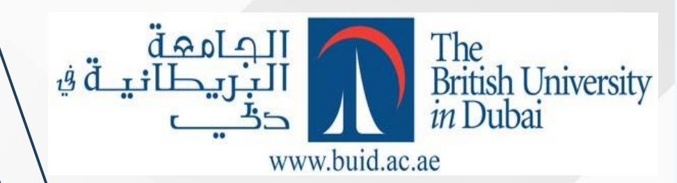
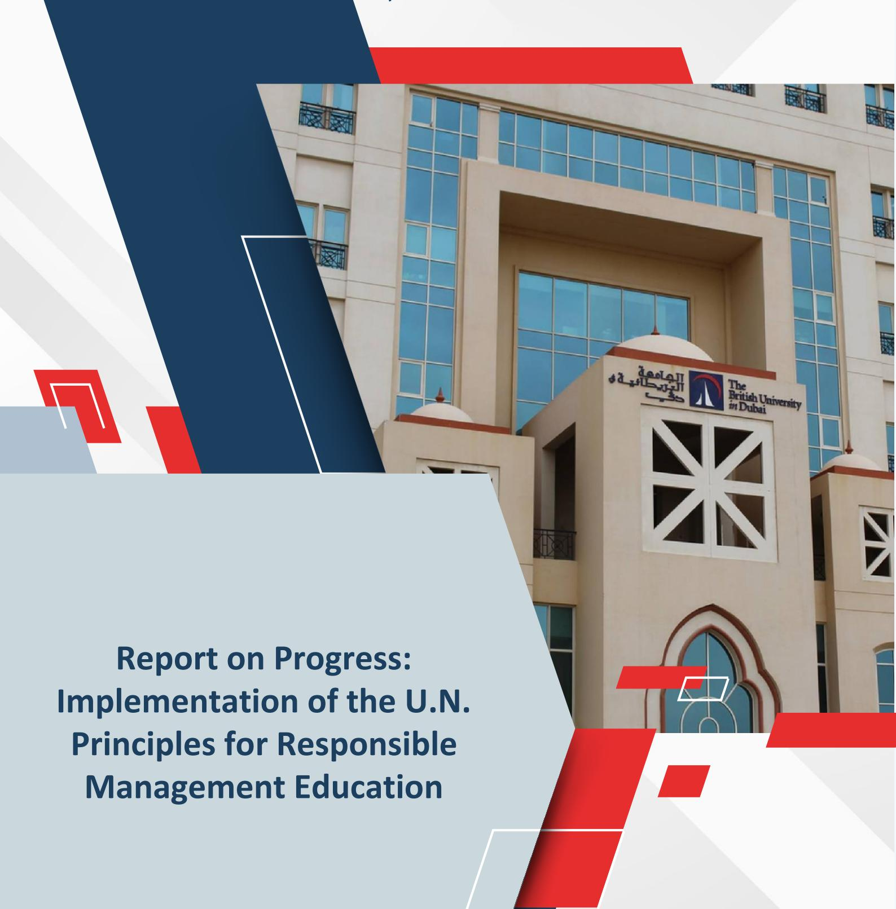
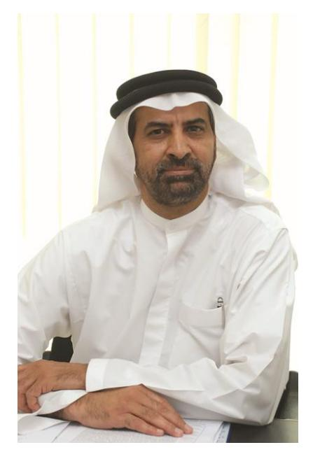
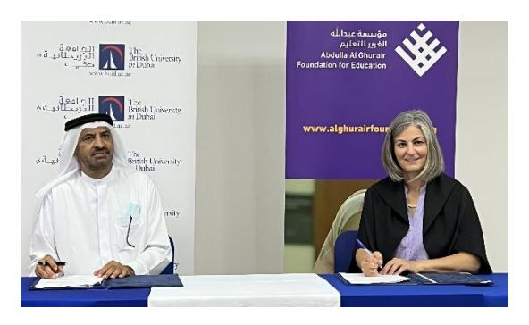
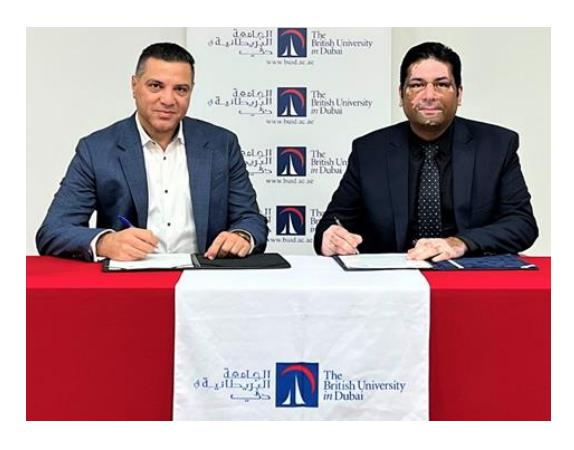
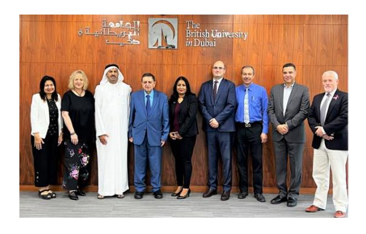
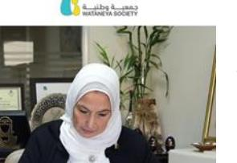

<!-- A3.R32 | source: papers_json/A3.R32/ -->

**December 2023**

<!-- page 2 -->

## **STATEMENT OF COMMITMENT**

تأسست الجامعة البريطانية في دبي (BUiD) عام 2003 لتكون الجامعة البحثية الرائدة في الشرق الأوسط، وتوفر تعليماً وتدريباً وبحثاً عالمي المستوى. وهي تمثل مجتمعاً ومورداً مهماً ومتنامياً للمهنيين الشباب وكبار الأكاديميين ومديري الشركات والقادة الطموحين على اختلاف توجهاتهم.

BUiD معتمدة محلياً من وزارة التربية والتعليم في دولة الإمارات، وشهاداتها معترف بها دولياً أيضاً من UK ENIC. كما حصلت BUiD على اعتماد الجودة العالمي من هيئة ضمان جودة التعليم العالي (QAA). ولدى BUiD شراكات استراتيجية تحالفية مع جامعات بريطانية، منها جامعة Edinburgh، وجامعة

Glasgow، وجامعة Manchester.

في عام 2015، أعلنّا التزامنا بأهداف مبادرة الأمم المتحدة لمبادئ الإدارة المسؤولة للتعليم (PRME). وفي هذا العام نجدد هذا الالتزام لتحقيق أهدافنا، وهي أهداف مشابهة لأهدافكم. نحن ملتزمون بالتنمية الاجتماعية والثقافية للدولة والمنطقة، وبناء اقتصاد قائم على المعرفة. وتخدم الجامعة احتياجات السوق من خلال تخريج كوادر عالية الكفاءة وواعية معرفياً، تملك المعرفة والمهارات اللازمة للعمل في مناصب عليا داخل مجموعة متنوعة من المؤسسات: العامة والخاصة؛ من الشركات متعددة الجنسيات إلى المؤسسات الصغيرة والمتوسطة.

Professor Abdullah Alshamsi

**Vice Chancellor **

<!-- page 3 -->

## **Introduction **

تأسست الجامعة البريطانية في دبي (BUiD) كمؤسسة غير ربحية بموجب القانون رقم 5 لسنة 2003، الصادر عن صاحب السمو الشيخ مكتوم بن راشد بن سعيد آل مكتوم، رحمه الله، حاكم دبي.

نشأت الجامعة من تعاون بين مؤسسات بريطانية وإماراتية أكاديمية وحكومية وتجارية، بهدف تقديم إسهام فريد لدولة الإمارات والمنطقة الأوسع. ومن مؤسسي الجامعة مؤسسة آل مكتوم، وهيئة دبي للتطوير والاستثمار (المعروفة حالياً بـ Dubai Holding)، وشركة Rolls-Royce، ومجموعة الأعمال البريطانية في دبي والإمارات الشمالية، وبنك الإمارات دبي الوطني.

تُحكم الجامعة من قِبل مجلس يُشكَّل كل ثلاث سنوات بأمر من صاحب السمو الشيخ محمد بن راشد آل مكتوم، نائب رئيس الدولة رئيس مجلس الوزراء حاكم دبي، تحت رئاسة صاحب السمو الشيخ أحمد بن سعيد آل مكتوم.

أسهم الدعم الأكاديمي الذي تحظى به BUiD من تحالفها مع جامعات مجموعة Russell Group في المملكة المتحدة في نجاحها. وتضم هذه الجامعات University of Edinburgh وUniversity of Glasgow وUniversity of Manchester، وجميعها ضمن أفضل 100 جامعة عالمياً.

BUiD مرخصة من وزارة التربية والتعليم بدولة الإمارات، وشهاداتها معترف بها دولياً أيضاً من UK ENIC. وحصلت BUiD على اعتماد الجودة العالمي من هيئة ضمان جودة التعليم العالي (QAA). وتشمل عمليات ضمان الجودة الداخلية لدينا آليات تضمن أن برامجنا وإنجازات طلابنا تضاهي معايير شركائنا من الجامعات البريطانية.

تقدم BUiD برامج دكتوراه وPhD بحثية بدوامٍ كامل وجزئي، وبرامج ماجستير وMBA، ودبلومات دراسات عليا، في مجالات التربية وإدارة الأعمال والقانون والهندسة والتمويل والإنشاءات وعلوم الحاسوب.

كما تقدم BUiD برامج بكالوريوس في مجالات علوم الحاسوب والذكاء الاصطناعي والهندسة والتمويل وإدارة الأعمال والقانون.

<!-- page 4 -->

## **BUiD and the Principles**

**Principle 1 | Purpose**: We advance responsible management education to foster inclusive prosperity in a world of thriving ecosystems.

تدعم BUiD رؤية دولة الإمارات نحو اقتصاد قائم على المعرفة والاستدامة؛ وتروّج الجامعة للمبادرات الخضراء، والبيئات المستدامة، وريادة الأعمال، والابتكار، والقيادة. ولديها العديد من البرامج التي تدمج هذه المفاهيم في مناهجها. وقد صُممت جميع البرامج لتكون قائمة على البحث، بما يضمن ارتباطاً أقوى للطلاب بالمجتمع والعالم الواقعي.

- نظّمت كلية إدارة الأعمال والقانون ورشة عمل لطلاب MBA بعنوان 'Developing the Leader in You'. وأدارت الورشة Claudine Reid MBE لمناقشة مواضيع القيادة، بما في ذلك العمليات والمهارات اللازمة لتكون قائداً أفضل، وأنواع ومستويات القيادة، وكيفية التعامل مع التغيير.
- استضافت كلية التربية في الجامعة البريطانية في دبي جلسة حوارية حول القيم والأخلاقيات المهنية للمعلمين في بيئة متعددة الثقافات. وشارك المتحدثون تأملاتهم من منظور أكاديمي وميداني على حدٍّ سواء.

لدى الجامعة سياسة للمشاركة المجتمعية تساعد على تهيئة البيئة المناسبة للمسؤولية الاجتماعية. وتعمل BUiD على تسهيل وصول المجتمع إلى فرص التعلم والموارد كلما أمكن ذلك، وترحب بجميع أفراد المجتمع في الأنشطة والفعاليات التي ترعاها الجامعة. وتسعى هذه السياسة إلى دعم ما يلي.

- ترغب الجامعة في إظهار كيف تعمل مؤسسات التعليم العالي على إحداث أثر تحويلي إيجابي في مجتمعها.
- تعتزم الجامعة تمكين جميع موظفيها وطلابها من تخفيف أي أثر مجتمعي سلبي واتخاذ تدابير لتعظيم المنفعة للمجتمع المحلي والأوسع.

<!-- page 5 -->

## **Principle 2 | Values:** We place organizational responsibility and accountability to society and the planet at the core of what we do

في خطة BUiD الاستراتيجية 2019-2024، وضعت الجامعة أهدافاً لتثقيف الطلاب حول دور القيادة والنزاهة والأخلاقيات والانخراط المهني. وتُمكّن الخطة الطلاب من اكتشاف وفهم وتوصيل كيفية ارتباط اهتماماتهم ومهاراتهم وقيمهم وشغفهم وتجاربهم خلال دراستهم في BUiD بطموحاتهم المستقبلية.

- **In this regard, the University** **has** **planned activities for its students and the larger ** **student body in the country**. Below are some examples:
- نظّمت BUiD مدرسة صيفية للاستدامة (BUiD SSS 2023) تحت شعار Innovation for a Sustainable Future بتاريخ 3 July 2023. وهو فعالية مجانية للطلاب يشاركون فيها في أنشطة وورش عمل حول الاستدامة. وشارك فيها هذا العام نحو 40 طالباً.
- Pink Day نظّم طلاب BUiD أنشطة للتوعية بسرطان الثدي.
- عمل تطوعي Draw a smile: هدف طلاب BUiD إلى رسم الابتسامة على وجوه العمال في دبي من خلال توزيع أكياس هدايا تحمل رسائل إيجابية بلغات مختلفة وتحتوي على مواد غير قابلة للتلف، بتاريخ 7 November 2023.
- استضافت كلية التربية في BUiD محاضرة مفتوحة بعنوان 'Teachers and Inclusion in Education to Achieve Sustainable Development' بتاريخ 14 November 2023، ألقتها Professor Chris Forlin، زميلة بحثية أستاذية بجامعة Notre Dame في أستراليا.

**BUiD has adopted a Sustainability and Community Engagement Policy since 2012. New ** **polices were created in 2023 **

## **Rationale and Principles which the Sustainability policy seeks to uphold **

- تدرك الجامعة أن أنشطتها وتأثيراتها الأوسع لها آثار اجتماعية واقتصادية وبيئية متعددة، محلياً وإقليمياً.
- تحرص الجامعة على تحمّل مسؤولية آثارها الاجتماعية والاقتصادية والبيئية، للحد من التكاليف والمخاطر، وتعزيز المنافع والمكاسب**.**

<!-- page 6 -->

## The Policy is to

- ensure that all sustainability activities align with its mission;
- ensure that on-going sustainability activities are identified and communicated to staff, students, and the wider community;
- ensure that it has access to up-to-date information on environmental legislation and best practice in order to advise the wider community and make or influence informed decisions;
- develop amongst staff and students an appreciation of their role in bringing about environmental, societal, and economic improvement both as members of the University community and as members of society at large.

## The University

- In its research, the University will deepen and link areas of distinctive strength in research that engages sustainability and sustainable action.
- In its educational programmes the University will prepare students to be engaged citizens and leaders in the promotion and implementation of sustainable practices in their communities and professional domains.
- Faculties and administrative units will generate sustainability practices in accord with interest, available resources, and opportunity.

## **Principle 3 |** **Teach:** We transform our learning environments by integrating responsible management concepts and practices into our curriculum and pedagogy.

تقدم BUiD برامج فريدة تزوّد السوق بخريجين ذوي كفاءة عالية مجهزين بالمعرفة والمهارات المناسبة لدعم الاقتصاد القائم على المعرفة في دولة الإمارات. كما تطوّر قدرات بحثية متقدمة في تخصصات رئيسية. وقد أُضيفت برامج جديدة إلى مجموعة برامج BUiD:

## **Master of Science in Finance and Risk Management**

يزوّد برنامج ماجستير العلوم (MSc) في التمويل وإدارة المخاطر بالجامعة البريطانية في دبي (BUiD) الطلاب بالمعرفة والمهارات والأدوات اللازمة للنجاح كمدير مخاطر مالية أو محلل مالي ولتطبيق هذه المعرفة في العالم الواقعي. ويمنح البرنامج الطلاب معرفة معمقة تُمكّنهم من فهم النظريات والمبادئ الأساسية التي تدعم وتُرشد صانع القرار في المجالات المؤسسية والمالية والاستراتيجية.

هدفنا هو تخريج مهنيين مهرة يمتلكون سعة معرفية تتيح لهم تقديم إسهامات أخلاقية ومدروسة وذات أثر في مؤسساتهم ومجتمعاتهم. ومن خلال هذا البرنامج، سيفهم الطلاب

<!-- page 7 -->

الأنواع المختلفة من المخاطر داخل القطاع، والقضايا الإدارية المرتبطة بضبط المخاطر.

## **Master of Science (MSc) in Cybersecurity**

صُمم برنامجنا بعناية لتخريج متخصصين مؤهلين ومهرة في الأمن السيبراني. ويوفر البرنامج تغطية شاملة للأمن السيبراني، من الحوكمة والسياسات إلى اختبار الاختراق والتحقيق الجنائي الرقمي. ويبني البرنامج المعرفة والمهارات اللازمة لتصميم وتطوير وحماية وإدارة الأنظمة الآمنة. ويوفر البرنامج مجموعة واسعة من فرص التعلم في بيئة تعليمية محفّزة. إضافةً إلى ذلك، تستند المواد التعليمية والمحاضرات والندوات والبحوث ودراسات الحالة والمختبرات في برنامجنا إلى بحوث عالمية المستوى تُجرى في BUiD في مجالي الذكاء الاصطناعي والأمن السيبراني، بالتعاون مع خبراء يحملون شهادات معترف بها عالمياً في هذا المجال.

## **Principle 4 | Research**: We study people, organizations, institutions, and the state of the world to inspire responsible management and education practice.

تهدف BUiD إلى أن تصبح الرائدة إقليمياً في تعزيز وإجراء ونشر البحث والابتكار لخلق معرفة وحلول جديدة تلبي احتياجات دولة الإمارات والمنطقة دعماً لنموها الاقتصادي وتطورها المستقبلي. وفي تصنيف QS World University Ranking – Arab Region 2023، حصلت BUiD على المرتبة الأولى في عدد الأبحاث لكل عضو هيئة تدريس، والمرتبة الثالثة في معدل الاستشهادات لكل بحث.

يرتبط التعليم والبحث ارتباطاً وثيقاً في BUiD. فجميع برامجنا التعليمية قائمة على البحث. ولا يُقيَّم الطلاب من خلال الامتحانات فقط، بل يُقيَّمون أيضاً من خلال بحث أصيل، يُقاس وفق معايير دولية باستخدام ممتحنين خارجيين في كل برنامج. ويُطلب من الطلاب تطبيق المهارات والمعرفة لتطوير أسئلة بحثية، ثم إجراء دراسات تتوافق مع صرامة المبادئ العلمية. والبحث عنصر أساسي في برامج الدكتوراه.

فيما يلي بعض النماذج من أطروحات ورسائل الطلاب في مجالات الاستدامة والطاقة وإدارة القيادة:

- Investigating the causes and drivers of food waste in the hospitality sector in Dubai-UAE. Toward implementing food waste prevention strategies.
- Utilizing Current Resources to Deliver Sustainable Living Solutions in Refugee Camps. Case study: Al Za'atari Camp.
- The impact of sustainable urban planning in the redevelopment of the Agriculture Area in Sharjah" – Khorfakkan
- Holistic Transitional Approach of Humanitarian Shelters Through The Implementation of Adaptable Design Strategies.

<!-- page 8 -->

- An Investigation into the effectiveness of the Inclusive Education Standards Policy for Students with Severe Disabilities in UAE.
- Link between Transformational Leadership and Organizational Efficiency & Employee Performance
- Link Between Transformational Leadership and Creativity

## **In its efforts to support research and innovation in the UAE, BUiD has established** **centres: **

- Dubai-Edinburgh Sustainability Institute. بدأ كتعاون بين الجامعة البريطانية في دبي ومعهد Edinburgh Climate Change Institute (ECCI) بجامعة Edinburgh، بهدف تأسيس مركز استدامة يركّز على الابتكار في البحث البيئي.
- Doctoral Training Centre (DTC). يتمثل التركيز الأساسي لمركز DTC في توفير التدريب والإرشاد والدعم لطلاب الدكتوراه سعياً منهم لتحقيق التميز البحثي وإنتاجه. ومن خلال مزيج من الدورات التدريبية وورش العمل والعروض التقديمية ومجموعات النقاش والندوات والمؤتمرات، يعزز المركز النشاط البحثي، ويدعم تطور الطلاب، ويسعى إلى تعزيز قيمة وأهمية إسهام BUiD في الأوساط الأكاديمية والمجتمع عموماً.
- The Centre for Research in Digital Education (CRDE). وهذا أول مركز بحثي غير ربحي في دولة الإمارات يركّز حصرياً على التعليم الرقمي في منطقة الشرق الأوسط.
- BUiD Achievement & Career Excellence (B.ACE) B.ACE مركز يقدّم خدمات لطلابنا، ويعزز إمكاناتهم وكفاءاتهم ومهاراتهم من أجل النجاح المستقبلي، ويساعدهم كذلك على اختيار المسار المهني المناسب.

## **Principle 5 | Partner**: We engage people from business, government, civil society, and academia to advance responsible and accountable management education and practice

تنشط BUiD خارجياً بشكل كبير، وأقامت شراكات قوية مع جامعات بريطانية رائدة وأصحاب مصلحة رئيسيين في دولة الإمارات لتلبية مسؤولياتها الاجتماعية والبيئية. ومع كونها مؤسسة أكاديمية، لا تغفل BUiD الحاجة إلى روابط فاعلة مع المجتمع والصناعة والهيئات المهنية. وفيما يلي بعض الأمثلة:

<!-- page 9 -->

**BUiD signed a Memorandum of Understanding ** **(MoU) with Abdulla Al Ghurair Foundation for ** **Education. **وُقّعت مذكرة التفاهم في حرم BUiD بتاريخ 7 September، من قِبل نائب رئيس BUiD، Professor Abdullah Alshamsi، والرئيس التنفيذي لمؤسسة Abdulla Al Ghurair Foundation، Dr Sonia Ben Jaafar.

يهدف الغرض من مذكرة التفاهم إلى تطوير التعاون بين الطرفين لتعزيز وتسهيل التعاون وتشجيع طلاب BUiD على الالتحاق ببرنامج Al Ghurair Young Thinkers Program. وهذا البرنامج منصة إلكترونية للإعداد الجامعي والتأهيل المهني، وُضعت لمساعدة الشباب الإماراتي والعربي، من سن 15 إلى 35 عاماً، على تحقيق النجاح المستقبلي.

بتاريخ 25 October 2022، وقّعت الجامعة البريطانية في دبي مذكرة تفاهم (MoU) مع جامعة ILMA University في كراتشي، باكستان. ووقّع المذكرة Professor Aymen Masadeh، عميد كلية إدارة الأعمال والقانون، وMr. Fawwad Mahmood Butt، مدير ضمان الجودة والشراكات العالمية. وحضر مراسم التوقيع كبار موظفي المؤسستين.

تهدف مذكرة التفاهم إلى تشجيع التعاون الثقافي والتعليمي والبحثي. وستتعاون المؤسستان من خلال المصالح البحثية المشتركة والنشر الأكاديمي، والمشاركة في المؤتمرات، وتبادل الطلاب وأعضاء هيئة التدريس.

**BUiD** **signed a Memorandum of Understanding ** **(MoU) with Monash University, Australia**. وقّع المذكرة Professor Abdullah Alshamsi، نائب رئيس الجامعة، وSusan Elliott AM، نائبة الرئيس الأولى بجامعة Monash University، بحضور Dr Nizar Farjou، مدير المشاركة الإقليمية للشرق الأوسط وشمال أفريقيا وآسيا الوسطى. وتهدف مذكرة التفاهم إلى تشجيع

التعاون التعليمي والبحثي. وستتعاون المؤسستان من خلال المصالح البحثية المشتركة، وبرامج التبادل، والأنشطة الأكاديمية.

<!-- page 10 -->

**BUiD signed a collaboration agreement with ** **Wataneya Society in Cairo**. وُقّع الاتفاق من قِبل Prof Eman Gaad، عميدة كلية التربية، نيابة عن نائب رئيس BUiD Professor Abdullah Alshamsi، وAzza Abdel Hamid، رئيسة مجلس إدارة Wataneya Society.

يتمثل الهدف الرئيسي من الاتفاق في تبادل المعرفة والخبرة في مجالات التدريب المهني والتقني من خلال تقديم خبرات في رقمنة تجارب التعلم. وستساهم BUiD في تطوير برامج الجمعية لتعزيز تجربة الموظفين المهنيين العاملين في نظام الرعاية البديلة في مصر والعالم العربي.

**Principle 6 | Share**: We share our successes and failures with each other to enable our collective learning and best live our common values and purpose.

## **BUiD student educational trips**

في إطار دعم BUiD للأنشطة البحثية والمعرفية، يُشجَّع الطلاب على المشاركة الفاعلة في زيارات بحثية إلى جامعات ومراكز بحثية حول العالم. وكانت الرحلة فرصة ثمينة للطلاب لاكتساب منظور شامل عن التميز الأكاديمي والابتكار الصناعي.

شارك 28 طالباً من BUiD في رحلة تعليمية إلى المملكة المتحدة. وكانت الرحلة فرصة ثمينة للطلاب لاكتساب منظور شامل عن التميز الأكاديمي والابتكار الصناعي.

ومن أبرز محطات الرحلة زيارتهم إلى مصنع MINI الشهير في أكسفورد. وحصل الطلاب على فرصة حصرية للاطلاع من الخلف على تفاصيل عملية تجميع سيارات MINI الشهيرة.

بتاريخ 3 July 2023، زاروا جامعة Edinburgh حيث استكشف الطلاب أحدث المستجدات في البرامج الأكاديمية المتطورة، والمساعي البحثية الرائدة، والمختبرات الحديثة.

وفي اليوم التالي، 4 July 2023، استكشفوا جامعة Glasgow. وحصلوا على معلومات مباشرة عن برامج الجامعة المتنوعة، ومبادراتها البحثية الرائدة، ومختبراتها الحديثة.

<!-- page 11 -->

**BUiD encourages its students to participate in** **events and competitions to enable them to ** **gain a wider skillset and new experiences which help them in real life situations and ** **challenges.**

- شارك تسعة من طلاب BUiD المسجّلين في برنامج بكالوريوس علوم الحاسوب/الذكاء الاصطناعي في دورة Samsung Innovation Campus في الذكاء الاصطناعي، والتي أُجريت بالشراكة مع مكتب الذكاء الاصطناعي بدولة الإمارات، والبرنامج الوطني للمبرمجين. وركّز البرنامج على الجانبين النظري والعملي للذكاء الاصطناعي، وشمل التعلم الآلي والتعلم العميق.
- شارك طلاب BUiD في فعالية Royal Air Force (RAF) Red Arrows 'Engineer for a Day'، التي نظّمتها السفارة البريطانية في دولة الإمارات، برعاية Rolls-Royce وBAe Systems، واستضافتها Heriot-Watt Dubai. وقد أظهر طلابنا مهاراتهم ومعداتهم في مجالي هندسة البرمجيات والذكاء الاصطناعي من خلال أنظمة تفاعلية وبرمجة الروبوتات.
- فازت طالبة الدكتوراه في إدارة الأعمال، Nour Hussein Shakhour، بجائزة المبتكر في حفل جائزة الابتكار الإماراتية الرابعة، الذي نظّمته مجموعة دبي للجودة (DQG).
- فاز ثلاثة طلاب في برنامج بكالوريوس علوم الحاسوب/الذكاء الاصطناعي بالمركز الثاني في هاكاثون Engage X. وصُمم الهاكاثون لمنح المشاركين فرصة استخدام مهاراتهم التقنية والإبداعية لحل مشكلات واقعية باستخدام تقنيات الاتصالات، واكتساب خبرة عملية في استخدام واجهات برمجة تطبيقات رائدة في القطاع.

## **Staff at BUiD shared their expertise ****–** **below are some examples: **

نالت Professor Eman Gaad، عميدة كلية التربية، تقديراً لعملها في مجال التعليم الخاص والدمج التربوي

- حصلت على تقدير لدورها في دعم التوعية بالتوحد. وفي October 2021 فازت بالجائزة الذهبية للرائدات في قمة Pioneers Summit التي نظّمتها شبكة Arab Women Pioneers Network في القاهرة. وحصلت Prof Gaad على هذه الجائزة تقديراً لعملها مع أصحاب الهمم وخبرتها في التعليم الخاص والدمج التربوي.
- كما فازت بجائزة Middle East's Woman Leaders تقديراً لعملها وخبرتها في التعليم الخاص والدمج التربوي. وأُقيم The world Women Congress and Awards في دبي بتاريخ 11 October 2023 تقديراً لقيادات نسائية في الشرق الأوسط. واحتفلت الفعالية بالقيادة والإنجازات المتميزة التي أظهرتها قيادات نسائية من خلال ابتكاراتهن ومبادراتهن في مختلف القطاعين الخاص والعام.

<!-- page 12 -->

- في October 2022، انضمت Prof. Gaad كعضو في Global Center for Inclusion in Education Research Collaborative حيث شاركت خبرتها لدفع الأجندة البحثية العالمية والنقاش حول الدمج.
- دُعيت كضيفة شرف في Special Olympics World Games Berlin. كما شاركت Professor Gaad في Global Forum for Inclusion – Partnering for Action بتاريخ 17 و18 June، حيث أدارت جلسة نقاش حول التعليم الشامل والمجتمعات الشاملة في سياق عالمي.
- ترأست جلسة في International Forum for the Discovery and Development of Talents الذي نظّمته مؤسسة حمدان بن راشد آل مكتوم للعلوم الطبية والتعليمية.
- شارك Hugh Martin، أمين السجلات والمسؤول الإداري الأول، في عدد من فعاليات المسؤولية الاجتماعية للشركات:
- 1. اختير للسنة الثالثة على التوالي حكماً في مسابقة Tatawwar التي أُجريت عبر الإنترنت في 4 و5 March 2022. ويمنح البرنامج الطلاب فرصة ممارسة مهارات أعمال مهمة، وفهم الالتزامات المستدامة، والتواصل مع عالم الشركات، والاستماع إلى مهنيين استثنائيين على طول الطريق.
- 2. مثّل BUiD وترأس لجنة التحكيم، وألقى خطاباً تحفيزياً وسلّم الجوائز للطلاب. وأُقيمت الفعالية بتاريخ 16 September 2023 وقدِم الطلاب من غانا وجنوب أفريقيا والهند وبنغلاديش والإمارات.
- 3. كما شارك في مؤتمر Learnit 2022 المنعقد في لندن بتاريخ 23 March 2022. وشارك Mr Martin في جلسة 'what do universities owe their local area?' حيث ناقش كيف تؤثر الجامعات في مجتمعاتها المحلية وكيف تطورت فكرة الواجب المدني للجامعات عبر الزمن.

**BUiD has organised and co-hosted joint conferences with international universities and ** **organisations. BUiD's students are always encouraged to participate and take part in these ** **conferences. Below are some examples:**

- عقدت الجامعة البريطانية في دبي (BUiD) مؤتمرها السابع للبحث الدكتوري بتاريخ Saturday, 8 July 2023. وقُدّمت أربعة وخمسون ورقة بحثية من قِبل طلاب الدراسات العليا في BUiD ضمن ثلاثة مسارات: مسار التربية والفنون والعلوم الإنسانية؛ ومسار الإدارة والعلوم الاجتماعية؛ ومسار الهندسة وتقنية المعلومات والعلوم الطبيعية. وقدّم الطلاب أبحاثهم عبر 13 جلسة، ترأسها طلاب وأعضاء هيئة تدريس من BUiD.
- نظّمت الجامعة البريطانية في دبي (BUiD)، بالتعاون مع جامعة Amity University Dubai، مؤتمر ICASE World Conference on Science and Technology Education السابع، الذي عُقد في حرم جامعة Amity University Dubai في الفترة من 27 إلى 30 March 2023. وجمع المؤتمر صانعي السياسات ومطوري المناهج والعلماء والباحثين الجامعيين والمعلمين،

<!-- page 13 -->

وخبراء في مجالات التربية والهندسة ذات الصلة لتبادل أفضل الممارسات والبحوث ومناقشة أحدث المستجدات.

•استضافت كلية التربية مؤتمرين دوليين افتراضيين بعنوان 'Future of Educational Management and Leadership' في May 2022 وفي June 2023

هدف هذان المؤتمران إلى استكشاف مستقبل الإدارة والقيادة التربوية مع إشراك أصوات وأفكار وتأملات وممارسات القادة في التربية وصانعي السياسات والممارسين والمربين والباحثين. وأتاحا للمشاركين فرصة مناقشة فرص وتحديات الإدارة التربوية في ظل مستقبل غير مؤكد.

•نظّمت الجامعة البريطانية في دبي، بالتعاون مع مركز دبي لسلسلة الكتل (Dubai Block Chain Centre)، مؤتمر European, Mediterranean and Middle Eastern Conference on Information Systems (EMCIS 2023) العشرين في الفترة من 11-12 December 2023.

استقبل المؤتمر، الذي عُقد في حرم BUiD، أكثر من 50 ورقة بحثية من مختلف أنحاء العالم. وقد نُظّم المؤتمر ذاته افتراضياً في عام 2022.

مؤتمر EMCIS مؤتمر بحثي سنوي يتناول نظم المعلومات (IS) إقليمياً وعالمياً. ويهدف إلى جمع باحثين وأكاديميين ومهنيين من مختلف أنحاء العالم لتبادل أفكار مبتكرة تغطي القضايا التقنية والتنظيمية والتجارية والاجتماعية في تطبيقات تقنية المعلومات.

## **Principle 7 | Practice**: We adopt responsible and accountable management principles in our own governance and operations

لدى الجامعة سياسة للمشاركة المجتمعية تساعد على تهيئة البيئة المناسبة للمسؤولية الاجتماعية. وتعمل BUiD على تسهيل وصول المجتمع إلى فرص التعلم والموارد كلما أمكن ذلك، وترحب بجميع أفراد المجتمع في الأنشطة والفعاليات التي ترعاها الجامعة. وتسعى هذه السياسة إلى دعم ما يلي.

- ترغب الجامعة في إظهار كيف تعمل مؤسسات التعليم العالي على إحداث أثر تحويلي إيجابي في مجتمعها.
- تعتزم الجامعة تمكين جميع موظفيها وطلابها من تخفيف أي أثر مجتمعي سلبي واتخاذ تدابير لتعظيم المنفعة للمجتمع المحلي والأوسع.

**BUiD has signed an MoU with the Digital School.** من خلال مذكرة التفاهم، تهدف المؤسستان إلى نشر المعرفة عبر جهود مشتركة وتعاون معزز من أجل تنفيذ مبادرات Digital School في نشر التعليم وتمكين الطلاب

<!-- page 14 -->

لا سيما مَن يعيشون في مخيمات اللاجئين ومناطق الحرب والمجتمعات المحرومة حول العالم.

وستُسهم BUiD في هذه المبادرات من خلال توفير الخبرة اللازمة عبر علاقاتها القائمة وتعاونها المشترك مع جامعة Nicosia، ومركز دبي لسلسلة الكتل، لتزويد Digital School بمجموعة متنوعة من حلول تقنية سلسلة الكتل.
