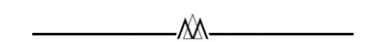
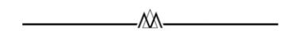

<!-- A3.R36 | source: papers_json/A3.R36/ -->

## تحضير كلية إدارة الأعمال: نحو تعليم إداري مدني

## LAURA A. COLOMBO University of Exeter

يكشف الباحثون في مجال الإدارة منذ زمن طويل عن قصور تعليم الإدارة في مواجهة المشكلات المعقدة التي تواجه قطاع الأعمال والمجتمع، بما في ذلك حالات الطوارئ البيئية والمناخية. وقد أُثيرت مخاوف بشأن ثقافة المنافسة والمصلحة الذاتية والجشع وقصر النظر التي ما زالت تهيمن على كلية إدارة الأعمال، رغم الضرر البيئي الذي لا يمكن إصلاحه والذي ساهمت هذه الثقافة في إحداثه، ورغم الفضائح التجارية التي لا حصر لها والتي أنتجتها. ولمواجهة التحديات الكبرى في عصرنا، يحتاج تعليم الإدارة إلى هزة تصل إلى أسسه ذاتها. في هذا المقال، أفكك العملية التي تولّد هذه النتائج المختلة لكشف جذر المشكلة: فافتراضات المصلحة الذاتية، والعقلانية الأداتية، والتنظيم الرأسمالي، والنظرة الآلية للعالم، تولّد نبوءات ذاتية التحقق. ولا يمكن تجاوز النقد ودعم الحلقات الإيجابية التي تُنتج نتائج وظيفية إلا بعد فهم هذه العملية الضارة فهماً أفضل. وإسهاماً في النقاش الحالي حول بناء جامعات مدنية وإعادة صياغة مفهوم المدنية على نحو منهجي، أقترح إعادة تشكيل تعليم الإدارة حول أربعة مبادئ مختلفة: التبادل المعمم، والعقلانية الجوهرية، والتنظيم المتنوع، ومنهج النظم. وأرى أن هذه المبادئ تمثل الأسس التربوية لتعليم إداري مدني قادر على إنتاج بشر متعاونين، وكليات إدارة أعمال جوهرية، ومجتمعات أكثر عدلاً، وأنظمة بيئية مزدهرة.

تهدد الأزمات البيئية والمناخية بقاء الإنسان. يعاني جيلنا بالفعل من الاضطرابات التي تسببها هذه القضايا، وتظهر نتائجها الكارثية للعيان: جفاف شديد وفيضانات، وحرائق قاسية وشح في المياه، وذوبان الجليد القطبي، وفقدان التنوع البيولوجي، من بين أمور أخرى. يحدث هذا الآن وسيزداد سوءاً في السنوات المقبلة ([IPCC, 2021](#page-14-0);[ Ripple, Wolf, News](#page-16-0)[ome, Barnard, & Moomaw, 2020)](#page-16-0). إن آثار التدهور البيئي الناجم عن الإنسان "لا رجعة فيها على المدى الزمني للأحياء اليوم" ([NASA, n.d.](#page-15-0))، ولكن إن كانت الأجيال السابقة قد فشلت في حماية مستقبلنا المشترك، فما زالت لدينا فرصة لتخفيف معاناة الأجيال القادمة ومعاناة الأنواع الأخرى. يتطلب تحدٍّ من هذا النوع تغييرات كبرى في طريقة إدارتنا لبيتنا الجماعي. إنه يستدعي التعاون وبُعد النظر والتفكير النقدي والإبداعي والمنهجي. وينبغي أن تكون المؤسسات التعليمية، بما فيها الجامعات،

أتقدم بخالص الامتنان لمحرر AMLE المشارك، الأستاذ Dirk Lindebaum، وللمراجعين الثلاثة المجهولين على إرشاداتهم القيّمة طوال عملية المراجعة. كما أود أن أشكر الأستاذ Steffen Bohm والعديد من الزملاء الذين قدّموا ملاحظات مفيدة على مسودات سابقة لهذا المقال

في طليعة هذا التغيير. وينبغي أن يجتمع علماء الطبيعة وعلماء الاجتماع، والفلاسفة ورواد الأعمال، والمهندسون والفنانون، لمواجهة هذه التهديدات الوجودية.

ومع ذلك، ورغم إعلان كثيرين حالة طوارئ بيئية ومناخية، فإن الجامعات في العالم بعيدة كل البعد عن أن تكون عوامل تغيير ملهمة. بل على العكس، وُصف التعليم العالي المعاصر بأنه مكان تتفاقم فيه التحديات البيئية والاجتماعية، ووُصف بأنه "أكاديمية مجنونة" [(Hill, 2012)](#page-14-0)، و"تعليم متدنٍّ" [(Cottom, 2017](#page-13-0))، ومؤسسة "محطّمة" ([Newfield, 2018](#page-15-0))، و"زومبي" ([Murphy, 2017](#page-15-0))، و"جامعة شبح" [(Fleming, 2021b](#page-13-0)). وفي هذا المشهد الموحش، تأتي كلية إدارة الأعمال المعاصرة: مكان لا تُقبل فيه المنافسة والمصلحة الذاتية والجشع وقصر النظر فحسب، بل تُطبَّع وتُعاد إنتاجها على نطاق واسع [(Khurana, 2007](#page-15-0);[ Parker,](#page-16-0) [2018](#page-16-0);[Wang, Malhotra, & Murnighan, 2011](#page-16-0)).

يكشف الباحثون في مجال الإدارة منذ زمن طويل عن قصور تعليم الإدارة في مواجهة المشكلات المستعصية التي تواجه قطاع الأعمال والمجتمع. وشملت الانتقادات تقييمات حنينية، تتوق إلى زمن كانت فيه كلية إدارة الأعمال مهداً للاحترافية والأخلاق لصفوة إدارية [(Augier & March, 2011;](#page-12-0)[ Khurana, 2007;](#page-15-0) O'[Connor, 2012)](#page-15-0)؛ وتقييمات إصلاحية، تدعو إلى

<!-- page 2 -->

كلية إدارة أعمال أكثر استدامة ومسؤولية أو تعددية [(Ghoshal, 2005;](#page-14-0)[ Podolny, 2009](#page-16-0))؛ ونداءات تحويلية [(Contu, 2009](#page-13-0);[ Cunliffe, Forray, &](#page-13-0) [Knights, 2002;](#page-13-0)[ Grey, 2004)](#page-14-0) تستدعي "الجرافات" ([Parker, 2018](#page-16-0)). غير أن هذا النقاش أسفر عن تغيير ضئيل جداً. وكما لاحظ[ Fleming (2021b)](#page-13-0): "مهما وجّه الأكاديميون من سخط تجاه الجامعة النيوليبرالية، فإن ذلك لا يبدو أنه يُحدث أي فرق." لذا، يظل الإغراء قوياً للاستسلام للتشاؤم والاعتقاد بأن التغيير غير ممكن أو "شبه مستحيل" [(Fleming, 2021b](#page-13-0): 18).

أحد أسباب صعوبة تحقيق التغيير هو أن المقاربات المعاصرة للتعليم العالي — بما فيها تعليم الإدارة — يدعمها إطار سياسي مصمم لحماية الوضع الراهن وتعزيزه [(Angus, 2015](#page-12-0);[ Lockford,](#page-15-0) [2017](#page-15-0);[ Maisuria, 2014](#page-15-0)). ويشمل هذا الأجندة، المعرَّفة بـ"النيوليبرالية"، سياسات داعمة لسوق "حرة"، وتدخل حكومي أدنى، ومنافسة، وخصخصة ([Maisuria & Cole,](#page-15-0) [2017](#page-15-0)). وقد طُبّقت النيوليبرالية للمرة الأولى على يد الديكتاتورية التشيلية في السبعينيات، ثم أصبحت الإطار السياسي الرائد للحكومتين البريطانية والأمريكية في السنوات التالية، ونهجاً مهيمناً في الاقتصاد السياسي عالمياً ([Maisuria, 2014](#page-15-0)). وخلال العقود الثلاثة الأخيرة، دخلت النيوليبرالية إلى التعليم العالي، وأصبحت أمراً معتاداً و"شبه طبيعي" ([Mai](#page-15-0)[suria & Cole, 2017](#page-15-0): 605). ووُصفت الجامعة النيوليبرالية بأنها "مصنع تعليمي" يكون فيه الطلاب زبائن يجب إرضاؤهم مهما كلّف الأمر ([Fleming, 2020](#page-13-0): 1307)؛ ومؤسسة تقوم على "أخلاقيات الكفاءة والإنتاجية" [(Vassallo,](#page-16-0) [2013:](#page-16-0) 570)، تُشجَّع فيها المنافسة — لا التعاون — وتُعزَّز في كل مستوى [(Kallio, Kallio, Tienari, & Hyvonen, 2016)](#page-14-0)؛ وسلعة تحكمها قوى السوق و"فرص العمل" التي "تحدد إمكانية بقائها" [(Maisuria & Cole, 2017:](#page-15-0) 607). لذا سيتطلب تحويل تعليم الإدارة بالضرورة فهم "الحس المشترك" ونقده وإعادة تعريفه (مع إدراك أن الحس المشترك يتكوّن من سلوكيات مكتسبة [انظر[ Haidt, 2008;](#page-14-0) [Solomon, 1993]](#page-16-0))، فضلاً عن تغيير الإطار السياسي الذي يدعمه.

لهذا المقال ثلاثة أهداف. أولاً، كشف الافتراضات الضمنية التي تقود تعليم الإدارة المعاصر من خلال إبراز النتائج المختلة التي تُنتجها في النظام. ثانياً، اقتراح نهج بديل (أي تعليم إداري مدني [CME]) من خلال إبراز وظائفه. ثالثاً، تقديم استراتيجيات للتغيير. وأقصد بـ"الاختلالات" النتائج المنتظمة

التي تضر بـ"الكائن الحي" — أي النظام الذي تقع فيه الاختلالات؛ وأقصد بـ"الوظائف" "النتائج المنتظمة التي تفيد الكائن الحي" ([Keltner & Gross, 1999:](#page-14-0) 469)، وأقصد بـ"النظام" مجموعة العلاقات الأوسع والمترابطة التي تربط قطاع الأعمال والمجتمع بالبيئة الطبيعية [(Capra, 1982](#page-13-0)) (لمزيد من التفصيل حول هذه المفاهيم، انظر[ Cohen, 1982;](#page-13-0)[ Lindebaum, 2017](#page-15-0)).

في القسم الأول، بعنوان "عن المدنية"، وقبل تفكيك العملية التي يُنتج من خلالها تعليم الإدارة المعاصر نتائج مختلة، وقبل استكشاف وظائف التعليم الإداري المدني واستراتيجيات تطبيقه، أوضّح نهج هذا المقال تجاه المدنية.

في القسم الثاني، بعنوان "النتائج المختلة لتعليم الإدارة النيوليبرالي"، أركّز على الوضع الراهن. وابتداءً من المستوى الفردي، ثم "التوسع" تدريجياً نحو السياق المؤسسي والمجتمعي والبيئي، أحدد أربع نتائج ضارة، وإن كانت غالباً غير مقصودة، لتعليم الإدارة المعاصر. وتشمل هذه النتائج، على التوالي، تطبيع الجشع وإعادة إنتاجه، وخلق كليات إدارة أعمال أداتية، وتفاقم عدم المساواة، وتدهور النظام البيئي. وأبيّن أن هذه النتائج المختلة تستند إلى أربعة افتراضات أساسية ذات جذور تاريخية عميقة، أصبحت معتادة وجزءاً من الحس المشترك السائد. وهي: المصلحة الذاتية، والعقلانية الأداتية، والتنظيم الرأسمالي، والمنهج الآلي في الإدارة. وكما سأوضح لاحقاً، تولّد هذه الافتراضات نبوءات ذاتية التحقق [(Merton, 1948](#page-15-0)).

في القسم الثالث، بعنوان "وظائف التعليم الإداري المدني"، أقترح إعادة تعريف تعليم الإدارة وفق أربعة مبادئ: التبادل المعمم، والعقلانية الجوهرية، والتنظيم المتنوع، ومنهج النظم في الإدارة. وأرى أن هذه المبادئ تمثل الأسس التربوية للتعليم الإداري المدني. وبقدر ما تُنتج الافتراضات الأربعة التي تناولها القسم الثاني اختلالات، يمكن لهذه المبادئ الأربعة أن تُنتج نتائج إيجابية منتظمة تتيح ازدهاراً اقتصادياً واجتماعياً وبيئياً طويل الأمد، بما في ذلك تنمية بشر متعاونين، وكليات إدارة أعمال جوهرية، وتوزيع للدخل والثروة، وتجدد النظام البيئي.

القسم الرابع، بعنوان "ممارسة التعليم الإداري المدني"، هو دعوة إلى العمل، يستكشف كيف يمكن تحقيق التعليم الإداري المدني عملياً.

## عن المدنية

يقترح هذا المقال إعادة تشكيل تعليم الإدارة حول مفهوم المدنية، الذي يُعتبر

<!-- page 3 -->

سعياً نحو الازدهار البيئي، بما يشمل ازدهار الإنسان. ويسمح هذا الفهم بتجاوز المقاربات الضيقة والمتمركزة حول الإنسان تجاه المدنية.

دخلت المدنية مؤخراً قاعات مجالس إدارة الجامعات في المملكة المتحدة عقب تأسيس لجنة الجامعة المدنية عام 2018، وشبكة الجامعة المدنية عام 2019. وفي هذا السياق، تُفهم المدنية أساساً من حيث الانخراط المدني — أي الشراكات التي تربط الجامعات بمجتمعاتها المحلية "لبناء علاقات ذات منفعة متبادلة من أجل الصالح العام" ([Civic University Network, n.d.)](#page-13-0)، مع التركيز على توسيع فرص الوصول إلى التعليم العالي. ولذلك، ركّز النقاش حول الجامعة المدنية على الانخراط المجتمعي [(Brink, 2018:](#page-13-0) 285–334) والبحث المنخرط اجتماعياً ([Goodard, 2009)](#page-14-0). ومع ذلك، ورغم تسليط الضوء على المدنية، لم يكن هذا الحوار تحويلياً إلى حد كبير: فبينما يدعو إلى تربية أكثر انخراطاً، لم يشكك بعد بعمق في المبادئ الأساسية التي تقوم عليها الجامعة النيوليبرالية.

وثمة مفهوم أكثر تحويلية للمدنية، هو مفهوم الاقتصاد المدني، وهو نهج إيطالي تاريخي في الاقتصاد، يستند إلى أخلاق نيقوماخوس الأرسطية [(Aristotle, 350 BCE/2002](#page-12-0))، ويصف طبيعة الأعمال بأنها علائقية في جوهرها وتركّز على هدف تحقيق السعادة العامة ([Bruni & Zamagni, 2007](#page-13-0)). ظهر الاقتصاد المدني في إيطاليا في النصف الأول من القرن الخامس عشر، خلال المرحلة الأولى من النهضة الإيطالية، كتعبير عن الإنسانية المدنية في ذلك العصر [(Bracciolini,](#page-13-0) [1429/1994](#page-13-0);[ Palmieri, 1440/1981](#page-15-0))، وازدهر في النصف الثاني من القرن الثامن عشر، خلال عصر التنوير الإيطالي [(Filangeri, 1780/2003; Geno](#page-13-0)[vesi, 1757](#page-13-0)–1758;[ Verri, 1763/1963)](#page-16-0). ورغم أن هذا النهج تجاه المدنية أكثر تحويلية، إلا أنه يظل غير كافٍ لكسر النبوءات ذاتية التحقق الكامنة في تعليم الإدارة المعاصر، لأنه ما زال مقيداً إلى حد كبير بسرديات متمركزة حول الإنسان. والواقع أن الاقتصاد المدني يعتبر البيئة في معظم الأحيان موضوعاً مستوعباً ضمن البعد الاجتماعي للعلاقات الإنسانية (مثل الفضائل المدنية التي تشمل الفضائل البيئية)، ولا يعتبر العلاقات البيئية مسألة اهتمام صريح. وقد أثّر هذا النهج على فهم القطاع الثالث دولياً. فعلى سبيل المثال، تُعد الطبيعة موضوعاً غائباً في المبادئ التعاونية السبعة للتحالف التعاوني الدولي، وتُعتبر ضمنياً جزءاً من "الاهتمام بالمجتمع" [(ICA, n.d.)](#page-14-0).

يدعو هذا المقال إلى توجه نموذجي جديد تجاه المدنية. وبالجمع بين أخلاقيات الفضيلة والأخلاقيات البيئية [(Hursthouse, 2007](#page-14-0);[ Kawall, 2017;](#page-14-0)

[Sandler, 2016](#page-16-0))، أقترح التركيز على الفضائل البيئية بوصفها شاملة للفضائل المدنية، مع الإقرار بالعلاقات المترابطة بين البيئة والمجتمع وقطاع الأعمال [(Ergene, Banerjee, &](#page-13-0) [Hoffman, 2021)](#page-13-0)؛ وإعادة تعريف المدنية بوصفها سعياً نحو الازدهار البيئي، شاملاً ازدهار الإنسان ([Sandler, 2016](#page-16-0)). وهذا النهج تجاه المدنية، المعرَّف بـ"التعليم الإداري المدني"، يعمل كترياق للنيوليبرالية: ففي مقابل عقيدة الجامعة النيوليبرالية التنافسية، يقدّم التعليم الإداري المدني روحاً تعاونية؛ وبينما تقود "الجامعة النيوليبرالية" إلى "أنت أكثر نيوليبرالية" ([Ashcraft, 2017:](#page-12-0) 37)، يمكّن التعليم الإداري المدني الطلاب من ممارسة التفكير النقدي وتحقيق الذات، في سياق حياة علائقية ومدنية؛ وبينما يقود تعليم الإدارة النيوليبرالي إلى تفاقم عدم المساواة والتدهور البيئي ([Fotaki & Prasad, 2015](#page-13-0);[ Gladwin, 1993](#page-14-0))، يعزز التعليم الإداري المدني العدالة الاجتماعية والبيئية. ويساعد تأطير التغيير من منظور المدنية على بناء زخم حول مفهوم دخل بالفعل النقاش العام، في وقت يُعاد فيه اكتشافه في التعليم العالي، مع بناء وتنمية شبكة من الباحثين ذوي التوجه المشترك عبر تخصصات مختلفة وخارج المجتمع الأكاديمي. ولدعم التحولات على مستوى العالم، يحتاج التعليم الإداري المدني إلى وضع فلسفات متعددة تقوم على السعي نحو الازدهار البيئي في صميم تعليم الإدارة (مثل تلك التي تطورت حول مفهومي buen vivir [الحياة الطيبة] وubuntu [الإنسانية]) ([Naude, 2019; Ordo](#page-15-0)nez, ~ [Shannon, & d](#page-15-0)'Auria, 2022). وفي حين يحدد هذا المقال طريقاً واحداً ممكناً للخروج من الانجراف النيوليبرالي في التعليم العالي، من المهم التأكيد أن سؤال "ما هو البديل؟" يجب أن يظل سؤالاً له إجابات متعددة ومحلية ومحدّدة السياق ([Parker, Cheney, Fournier, & Land, 2014](#page-16-0)).

## النتائج المختلة لتعليم الإدارة النيوليبرالي

وفقاً لـ[ Merton (1968:](#page-15-0) 94)، تُعد النتائج المختلة مقدمات للتغيير.

عندما يكون الصافي الإجمالي لنتائج بنية اجتماعية قائمة مختلاً بوضوح، ينشأ ضغط قوي وملحّ من أجل التغيير. ومن الممكن... أن يؤدي هذا الضغط، بعد نقطة معينة، حتماً إلى اتجاهات محددة سلفاً إلى حد ما للتغيير الاجتماعي.

في هذا القسم، سأركّز على النتائج المختلة لتعليم الإدارة المعاصر (النيوليبرالي) وأكشف عن التصورات المسبقة التي تولّدها. ثمة حاجة للتغيير لكسر

<!-- page 4 -->

الحلقات المفرغة التي تخلق أفراداً جشعين، وكليات إدارة أعمال أداتية، وعدم مساواة، وتدهوراً بيئياً. وفي نهاية المطاف، ثمة حاجة للتغيير من أجل بقاء النوع البشري.

## الأفراد الجشعون

يُنتج تعليم الإدارة المعاصر نتائج خطيرة، وإن كانت غير مقصودة، على شخصيتنا، وعلى ماهيتنا كبشر. في دراسة نُشرت عام 2011، أثبت Wang وزملاؤه كيف يرتبط تعليم الاقتصاد في كليات إدارة الأعمال باستمرار بتصور إيجابي للجشع عموماً، وموقف إيجابي تجاه أفعال المرء الجشعة، وحساسية أقل تجاه أثر هذه الأفعال على الآخرين ([Wang](#page-16-0) [et al., 2011)](#page-16-0). ولأن كلية إدارة الأعمال تعلّم الطلاب أن الفاعلين الاقتصاديين يعملون في بيئة عدائية من المنافسة الشرسة، فإن الطلاب لا يتوقعون أقل من ذلك ويتصرفون وفقاً لذلك. وقد بحثت[ Walker (1992).](#page-16-0) العلاقة بين تعليم الأعمال والجشع أيضاً. وأظهرت دراستها أن تعليم الماجستير في إدارة الأعمال يُبنى على فرضية أن: "1) الناس فاعلون أنانيون يسعون لتعظيم منفعتهم، 2) ينبغي ألا يُعاق الأفراد في سعيهم نحو مصلحتهم الذاتية عبر معاملات 'اقتصادية'، و3) جميع التفاعلات الإنسانية تقريباً هي معاملات اقتصادية" ([Walker,](#page-16-0) [1992](#page-16-0): 273). وتؤثر هذه التصورات المسبقة عن الطبيعة البشرية على التدريس في تخصصات مختلفة تتجاوز الاقتصاد والإدارة (مثل تعليم التمويل الذي يركّز ضيقاً على تعظيم العوائد في أقصر فترة زمنية)، وتُعزَّز مؤسسياً (مثل أنظمة المكافآت المصممة حول المنافسة، وتقييم الأداء الفردي، والإفراط في استخدام الجوائز المالية).

نشأ الافتراض الأنثروبولوجي بأن البشر مدفوعون باستمرار بالمصلحة الذاتية في أوروبا بعد عصر النهضة، مع بداية العصر الحديث. صوّر[ Machiavelli (1532/2014)](#page-15-0) أولاً، ثم[ Hobbes (1651)](#page-14-0)، الحالة الإنسانية بأنها حالة خوف وشر وعدم مدنية، تتسم بمنافسة عنيفة وصراع لا ينتهي للتغلب على الآخرين. وكان ذلك نتيجة لحقبة تاريخية خاصة جداً، شهدت فيها أوروبا حروباً دينية شرسة. والرؤية الأساسية عند Hobbes هي أن الإنسان ذئب لأخيه الإنسان (homo homini lupus). ومن هنا الحاجة إلى الخضوع لسلطة قوية (أمير عند[ Machiavelli [1532/2014]](#page-15-0)، وطاغوت عند[ Hobbes [1651](#page-14-0)]) للحد من نزعة البشر الداخلية نحو العنف. وباختصار، وفقاً لـ[ Hobbes (1651:](#page-14-0) 7)، فإن البشر أنانيون بطبيعتهم: "نحن لا

[...] نسعى بطبيعتنا إلى المجتمع لذاته، بل لكي نحصل على قدر من الشرف أو الربح منه." وقد شكّل فهم الطبيعة البشرية بوصفها أنانية النماذج الرياضية التي أسست الاقتصاد النيوكلاسيكي في أواخر القرن التاسع عشر وأوائل القرن العشرين ([Jevons, 1865;](#page-14-0)[ Pareto, 1920](#page-16-0);[ Robbins,](#page-16-0) [1932](#page-16-0))، والتي ما زالت تحتل مكانة مركزية في تعليم الإدارة المعاصر.

وإذا كانت النتيجة المباشرة لفهم الطبيعة البشرية بوصفها أنانية هي أفراد جشعون، فإن النتائج غير المباشرة لهذا التصور المسبق أوسع بكثير، وضارة بالبيئة والمجتمع وقطاع الأعمال ذاته. لنأخذ قطاع الأعمال مثالاً. لقد ظلت الاختلالات الناجمة عن الجشع في دائرة الاهتمام العام لعقود، لكنها برزت بوضوح شديد خلال الأزمة المالية العالمية للفترة 2007-2008. فالشركات التي يقودها رؤساء تنفيذيون مدفوعون بالربح وضيقو الأفق تكبدت خسائر أكبر في الأمد القصير واستغرقت وقتاً أطول للتعافي من الأزمة ([Sajko, Boone, & Buyl,](#page-16-0) [2020](#page-16-0)). كما أن الجشع لا يلقى قبولاً حسناً من العملاء. والواقع أن تصوّر الجشع المؤسسي يؤدي إلى ردود فعل سلبية من المستهلكين ([Lim, 2020](#page-15-0)) ومواقف سلبية تجاه قطاع الأعمال [(Caruana, Vella,](#page-13-0) [Konietzny, & Chircop, 2018](#page-13-0)). وفي حلقة مفرغة، تولّد تعريفات الطبيعة البشرية بوصفها أنانية أفراداً جشعين [(Wang et al., 2011)](#page-16-0)؛ ويؤكد الجشع افتراضات المصلحة الذاتية، التي تزيد الجشع نفسه سوءاً، وهكذا دواليك. وقد شرح[ Merton (1948](#page-15-0): 194) هذه الديناميكية بوصفها "نبوءة ذاتية التحقق":

لا يستجيب الناس فقط للسمات الموضوعية لموقف ما، بل أيضاً، وفي بعض الأحيان بشكل رئيسي، للمعنى الذي يحمله هذا الموقف بالنسبة لهم. وبمجرد أن يُسندوا معنى ما إلى الموقف، يتحدد سلوكهم اللاحق وبعض نتائج هذا السلوك بالمعنى المنسوب.

وباختصار، من خلال تعليم تعظيم المصلحة الذاتية، تُنتج كلية إدارة الأعمال أفراداً جشعين.

## كليات إدارة الأعمال الأداتية

يُنتج تعليم الأعمال المعاصر نتائج مؤسسية مختلة. جادل[ Kitchener](#page-15-0) [and Delbridge (2020)](#page-15-0) بأن تعلّم الإدارة وتدريسها تسودهما العقلانية الأداتية، وأوضحا الآثار المترتبة على ذلك في التوقعات المؤسسية (مثل الانشغال المفرط بالمخرجات ومؤشرات الأداء والتصنيفات). وإذ تُدار كلية إدارة الأعمال عبر ديناميكيات تنافسية وتُحفَّز بإمكانية الصعود في التراتبيات وجداول الترتيب، فإنها تفشل بشكل منهجي في الاهتمام بمن يهتمون، منشغلة كما هي بضيق أفق بإنتاج مخرجات لتحقيق مستويات أداء عالية، تُقاس عبر المخرجات البحثية،

<!-- page 5 -->

وتصنيفات المجلات، ومعدلات التوظيف وغيرها. عرّف[ Weber](#page-16-0) [(1922/1978](#page-16-0): 24) العقلانية الأداتية بأنها فعل موجّه نحو المخرجات، يهتم أساساً بـ"تحقيق الغايات التي يسعى إليها الفاعل ويحسبها عقلانياً بنفسه." وأوضح[ Horkheimer (1974:](#page-14-0) 3–4) كذلك أن هذا النوع من العقلانية يركّز على "الربح أو الميزة"، ويهتم أساساً بـ"مدى ملاءمة الإجراء لأغراض مُسلَّم بها إلى حد ما ومفترض أنها واضحة بذاتها"، دون التساؤل "عمّا إذا كانت هذه الأغراض معقولة في حد ذاتها." ويُبنى هذا النهج الأداتي عبر مؤسسات مصممة لتكون هرمية وتنافسية — أي تُدار عبر ديناميكيات "انشر أو اندثر" و"تترقّى أو تخرج" — ويُعزَّز عبر أطر سياسية تدعم المعايير والقيم النيوليبرالية [(Angus,](#page-12-0) [2015](#page-12-0)).

تُنتج الأداتية المفرطة في كليات إدارة الأعمال عدة نتائج خطيرة — على سبيل المثال، على طبيعة الأكاديميا وغايتها، وعلى الصحة النفسية ورفاه من يعيشون فيها، وعلى مستقبل العمل. أولاً، يحوّل التركيز الضيق على العقلانية الأداتية طبيعة التعليم العالي وغايته من صالح عام ومشترك يشجع الباحثين على ممارسة الحكم النقدي والنهوض بالمعرفة الإنسانية والانخراط في التحديات الكبرى لعصرنا، إلى سلعة خاصة تشجّع المشترين على السعي نحو منافع فردية وطموحات اقتصادية خاصة ([Busch, 2017;](#page-13-0) [Shapiro, 2005; van Houtum & van Uden, 2022](#page-16-0)). وكما أوضح [Podolny (2009)](#page-16-0)، فإن كليات إدارة الأعمال المعاصرة تشجّع الطلاب على ألا يسألوا "كيف أريد أن أغيّر العالم نحو الأفضل؟" بل "ماذا يمكنني أن أفعل لكسب أكبر قدر من المال؟" ومن منظور بحثي، تقود العقلانية الأداتية إلى ما عرّفه [Tourish (2020:](#page-16-0) 99) بـ"انتصار الهراء في دراسات الإدارة"، مع إشارة خاصة إلى انشغال الأكاديميين المفرط بالمخرجات البحثية لرفع مؤشر h الخاص بهم بدلاً من إجراء بحث ذي معنى يسهم إيجابياً في المجتمع [(McKiernan & Tsui, 2019](#page-15-0)).

ثانياً، تترك الضغوط القوية للأداء، مقترنة بنيوليبرالية العمل الأكاديمي وتجزئته، أثراً كارثياً على الصحة النفسية لكل من الطلاب والموظفين الأكاديميين. وفي كتابه الأخير Dark Academia. How Universities Die، نددّ[ Fleming (2021a)](#page-13-0) بهذه الديناميكيات المختلة معتبراً أنها تقتل الجامعة حرفياً. في عام 2018، قُدّرت معدلات الاكتئاب والقلق بين طلاب الدراسات العليا حول العالم بأنها أعلى بستة أضعاف من تلك في عموم السكان ([Evans, Bira, Gastelum, Weiss, & Vanderford, 2018)](#page-13-0). وفي عام 2020، أظهر استطلاع شمل أكثر من 1000 عضو هيئة تدريس أمريكي

أن الجائحة فاقمت بشكل كبير مستويات التوتر المرتفعة أصلاً في الأكاديميا، إذ أفاد قرابة 70% من المستجيبين بأنهم يشعرون تحت الضغط ([Gewin, 2021](#page-14-0))، مع ما ترتب على ذلك من انتشار للإرهاق النفسي وحالات طبية خطيرة أخرى. وتكشف نظرة أقرب على كلية إدارة الأعمال أن ثقافة المنافسة فيها، مقترنة بضغوط الأداء ومتطلبات عبء العمل المرتفع، تزيد من تدهور الصحة النفسية للطلاب والموظفين، مما يؤدي إلى أزمة صحية نفسية شديدة الخطورة بشكل خاص [(Edwards, Martin, & Ashkanasy, 2021;](#page-13-0) [Harley, 2019](#page-14-0)). فما هي التكلفة الحقيقية للتعلم والتعليم في التعليم العالي اليوم؟ وهل يستحق الأمر ذلك؟

ثالثاً، مع تحول كلية إدارة الأعمال إلى مؤسسة أداتية، مفرَّغة من غايتها المدنية، تتضاءل أيضاً أهمية تعليم الإدارة في تزويد الفاعلين البشريين بالقدرة على صياغة أحكام معقدة. لذلك، ونظراً لإغفال التعقيد الكامن وطبيعة الإدارة المتناقضة [(Smith & Lewis,](#page-16-0) [2011](#page-16-0))، تصبح ممارسة الإدارة وتعليمها مجرد أنشطة اتباع قواعد، ويصبح الحكم البشري في اتخاذ القرار قابلاً للاستبدال المحتمل بخوارزميات ذكاء اصطناعي ([Moser, den](#page-15-0) [Hond, & Lindebaum, 2022)](#page-15-0). وقد اشتكى أحد الزملاء مؤخراً: "يرانا طلابنا كأننا Alexa بشرية، وهو ما قد يفسر لماذا نختبر معهم في الغالب تبادلات مباشرة، وأحياناً فظّة. 'يا Alexa، كيف أحصل على تقدير امتياز؟'" وبذلك تكتمل حلقة مفرغة ثانية: تولّد تعريفات العقلانية البشرية بوصفها أداتية بحتة مؤسسات عقلانية أداتياً [(Kitchener & Delbridge, 2020](#page-15-0))، التي بدورها تؤكد العقلانية الأداتية وتفاقم نتائجها الضارة.

## عدم المساواة

تُنتج المقاربات المعاصرة لتعليم الإدارة نتائج مجتمعية مختلة. ومن الأمثلة على هذا الضرر (إعادة) إنتاج التفاوتات الاجتماعية والاقتصادية، التي تتفاقم بتدريس الرأسمالية بشكل عقائدي وغير نقدي. أبرز[ Parker](#page-16-0) [(2018)](#page-16-0) أن معظم كليات إدارة الأعمال تدرّس الرأسمالية باعتبارها "البديل الوحيد" الجدير بالاعتبار الجاد. وبينما تُعد العمالة المأجورة، وتراكم رأس المال، والمنافسة بين الشركات ركائز غير قابلة للتشكيك في تعليم الإدارة، فإن أفكاراً مثل الملكية التعاونية وريادة الأعمال الاجتماعية والتخطيط الديمقراطي إما تُتجاهل تماماً أو تُحصر على هامش مناهج الأعمال والإدارة [(Adler, Forbes &](#page-12-0) [Willmott, 2007](#page-12-0);[ Parker et al., 2014](#page-16-0)). وفي هذا السياق، أوضح [Fotaki and Prasad (2015)](#page-13-0) ليس فقط كيف

<!-- page 6 -->

تهيمن الرأسمالية على مناهج كليات إدارة الأعمال، بل كيف يُدرَّس التنظيم الرأسمالي دون نقد — أي دون التشكيك في الافتراضات التي يقوم عليها والنتائج المختلة التي يُنتجها. والواقع أنهما جادلا بأن كليات إدارة الأعمال تجنّبت بشكل منهجي الانخراط النقدي مع "كيفية تورط الشركات في توليد وإدامة عدم المساواة الاقتصادية، وكذلك كيفية تأثرها بنتائجها السلبية" ([Fotaki & Prasad, 2015](#page-13-0): 557). وقد أولى البحث الإداري اهتماماً متزايداً للعلاقة بين تعليم الإدارة وعدم المساواة الاجتماعية والاقتصادية [(Kumar et al., 2022)](#page-15-0). وهذا نقاش مهم ينبغي إجراؤه، بالنظر إلى أن كلية إدارة الأعمال نفسها تمثيل مباشر لعدم المساواة. ففي أمريكا الشمالية، تتجاوز الرسوم الدراسية لبرنامج ماجستير إدارة أعمال مدته سنتان في كلية إدارة أعمال مرموقة (مثل Harvard Business School وStanford Graduate School of Business وThe Wharton School وغيرها) 140,000 دولار. وفي أوروبا، يمكن أن يكلف برنامج ماجستير إدارة أعمال مدته سنة واحدة في مؤسسة مرموقة أكثر من 90,000 دولار (مثل London Business School في المملكة المتحدة، وINSEAD في فرنسا، أو IESE في إسبانيا). وينطبق الأمر ذاته على كليات إدارة أعمال أخرى مرموقة حول العالم (مثل، في آسيا، يمكن أن يكلف برنامج ماجستير إدارة أعمال مدته سنتان في Indian Institute of Management في Bangalore أكثر من 40,000 دولار). ونتيجة ذلك ليست فقط كلية إدارة أعمال لا تمثل المجتمع بوضوح، بل أيضاً خلق قطاع مؤسسي غير تمثيلي إلى حد كبير، غالباً ما يوظف من هذه المؤسسات. ويكفي أن نلقي نظرة على قائمة خريجي ماجستير إدارة الأعمال الذين هم رؤساء تنفيذيون لشركات ضمن Financial Times 500 — أكبر الشركات في العالم من حيث القيمة السوقية — لندرك أن الإدارة العليا للشركات العالمية هي "نادٍ للرجال" [(Palin &](#page-15-0) [Bernard, 2015)](#page-15-0).

أظهر تقرير عدم المساواة العالمي الأخير [(Chancel,](#page-13-0) [Piketty, Saez, & Zucman, 2022)](#page-13-0) أن عدم المساواة في الدخل والثروة ازداد بشكل حاد عالمياً منذ ثمانينيات القرن الماضي. وبينما يكسب النصف الأفقر من سكان العالم حالياً 8.5% من الدخل العالمي ويملك 2% فقط من الثروة العالمية، فإن أغنى 10% يستحوذون على 52% من إجمالي الدخل ويملكون 76% من إجمالي الثروة [(Chancel et al., 2022)](#page-13-0). ويرتبط عدم المساواة الاقتصادية ارتباطاً وثيقاً بعدم المساواة بين الجنسين (إذ تبلغ حصة المرأة من دخل العمل أقل من 35%) وبعدم المساواة البيئية (إذ ينتج أعلى 10% من مصدري الكربون عالمياً قرابة 50% من إجمالي الانبعاثات، بينما لا يتحمل أدنى 50% سوى 12% من الإجمالي) ([Chancel et al.,](#page-13-0) [2022](#page-13-0)). ومن الثابت أن عدم المساواة الاقتصادية سمة من سمات الرأسمالية ([Piketty, 2014)](#page-16-0)، وأنها

تتفاقم بالمقاربات ضيقة الأفق للأعمال التي تركّز بضيق على تعظيم الربح ([Fotaki & Prasad, 2015)](#page-13-0). ومن الواضح أيضاً أن عدم المساواة ضار بالمجتمع وبقطاع الأعمال نفسه، إذ يتسبب في عدم استقرار اجتماعي وسياسي واقتصادي ([Bapuji, 2015](#page-12-0);[ Stiglitz, 2012; United Nations, 2020](#page-16-0)). إضافة إلى ذلك، أظهرت مقاييس محاسبية مثل "البصمة البيئية" كيف أن الحيز البيئي على الأرض غير موزّع بالتساوي، إذ تتحمل الدول مرتفعة الدخل مسؤولية استخدام كمية غير متناسبة من الموارد الطبيعية مقارنة بالدول منخفضة الدخل، وتستهلكها بمعدل أسرع بكثير مما يمكن أن يتجدد به الكوكب ([NFA, 2021)](#page-15-0). ومع ذلك، وبدلاً من كشف الضرر المنهجي الذي تُحدثه نماذج الأعمال النيوليبرالية على البيئة والمجتمع وقطاع الأعمال، فإن تعليم الإدارة إما يتجاهل هذه الاختلالات أو يحصرها في حفنة من الحالات الاستثنائية لسوء الممارسة الإدارية (مثل فضائح Enron وVolkswagen) أو ظروف حرجة استثنائية (مثل إنقاذ American International Group في أعقاب الأزمة المالية العالمية) ([Fotaki & Prasad, 2015](#page-13-0)). وبدلاً من نقد الطابع الاستعماري لنظامنا الصناعي والاستنزاف الذي فرضه الشمال العالمي — وما زال يفرضه — على الجنوب العالمي، ما زال تعليم الأعمال يعتمد على أنظمة إنتاج استعمارية واستخراجية وخطية ويدرّسها [(Hickel, Sullivan, &](#page-14-0) [Zoomkawala, 2021](#page-14-0)). وهنا يكمن مصدر حلقة مفرغة ثالثة، مرتبطة ارتباطاً وثيقاً بالحلقتين السابقتين: فتدريس الرأسمالية دون نقد يفاقم نتائجها المجتمعية المختلة ويعزز في الوقت نفسه فهم الرأسمالية بوصفها "البديل الوحيد" [(Parker, 2018](#page-16-0))، الذي بدوره يزيد الضرر بالمجتمع سوءاً مع الحفاظ على ضيق الأفق والقضايا المرتبطة به.

## تدهور النظام البيئي

للمقاربات الحالية لتعليم الإدارة نتائج مختلة على النظام البيئي الذي يوجد فيه المجتمع والمؤسسات والأفراد. من الواضح أن لكليات إدارة الأعمال أثراً على البيئة، يتعلق بممارسات الشراء، وكفاءة البنية التحتية، وخيارات النقل، وما إلى ذلك. فعلى سبيل المثال، أشار[ Gill (2021)](#page-14-0) إلى الآثار على تغير المناخ الناجمة عن الاستخدام غير المقيد لرحلات الطيران الطويلة التي يقوم بها الأكاديميون بانتظام لحضور المؤتمرات، أو إجراء البحوث، أو القيام بأنشطة تدريس وغيرها. والخبر السار أن جهوداً بُذلت لخفض البصمة الكربونية لكليات إدارة الأعمال، خصوصاً منذ جائحة كوفيد-19 وإعلانات حالة الطوارئ المناخية من قبل جامعات عديدة، تلتها

<!-- page 7 -->

التزامات مؤسسية بمتابعة مسارات مختلفة لتحقيق "صافي انبعاثات صفري" من الكربون. غير أنه، وراء الأثر المباشر لكليات إدارة الأعمال على البيئة، تكمن نتائج مختلة أعمق وغير مباشرة، تنشأ من فهم الإدارة بوصفها تخصصاً آلياً. والخبر السيئ أن هذه الديناميكيات ما زالت إلى حد كبير غير موضع تساؤل.

القاعدة الاقتصادية الأولى التي تُدرَّس لطالب جامعي في سنته الأولى هي التوازن الاقتصادي الذي تحدده منحنيات العرض والطلب، "التي تصف الاقتصاد كما لو كان نظاماً ميكانيكياً مستقراً" ([Raworth, 2017](#page-16-0): 129). ويعتبر النهج الآلي في الإدارة الاقتصاد والمجتمع والبيئة تروساً في آلة يمكن فصلها ودراستها وفهمها وإدارتها كل على حدة. وقد يُعترف بترابطها في المنهج الدراسي (مثلاً من خلال إدخال نظريات المسؤولية الاجتماعية للشركات والمحصلة الثلاثية)، لكن ترابطها الديناميكي وتعقيدها يُهملان إلى حد كبير. وتُدرَّس نظرية الأعمال والإدارة في الغالب كما لو كانت البيئة والسياسة والاقتصاد منفصلة [(Green, 2013](#page-14-0)). والواقع أنه من النادر أن نجد التدهور البيئي والعدالة البيئية وتغير المناخ وحدود الكوكب الأخرى ضمن منهج دراسي للأعمال ([Molthan-Hill, Worsfold, Nagy,](#page-15-0) [Leal Filho, & Mifsud, 2019](#page-15-0)). وفي كلية إدارة الأعمال، تُفسَّر العلاقة بين الأعمال والطبيعة — عندما تُؤخذ بعين الاعتبار أصلاً — إلى حد كبير من خلال الاقتصاد البيئي، وهو فرع من الاقتصاد النيوكلاسيكي ظهر في السبعينيات بهدف إسناد قيمة نقدية للموارد الطبيعية، ويعتبر البيئة "سوقاً غائبة" والتدهور البيئي "فشلاً سوقياً" [(Turner, Pearce, & Bateman,](#page-16-0) [1994](#page-16-0)). ويحمل الاقتصاد البيئي إيماناً أعمى بالسوق كآلية تخصيص مفيدة قادرة على حماية الطبيعة، وبالنمو الاقتصادي كطريق للمضي قدماً نحو تحسين جودة البيئة (مثلاً وفقاً لمنحنى Kuznets، كما شرحه[ Grossman and Krueger [1995](#page-14-0)]). وفي سياق الاقتصاد البيئي، يُعتبر التدهور البيئي "أثراً خارجياً" على النشاط الاقتصادي — أي "خارجياً" بقدر ما لا تحتسبه نظرية الأعمال.

منذ عام 1993، توصل الأكاديميون في مجال الإدارة إلى إدراك "مقلق ومرعب": فبعيداً عن زيادة الوعي بترابط البيئة والمجتمع وقطاع الأعمال، يديم تعليم الإدارة عن غير قصد الأمية البيئية ([Gladwin, 1993:](#page-14-0) 110). وليس الخريجون الأميون بيئياً وحدهم غير مؤهلين لمواجهة التحديات الكبرى لعصرنا، بل إن هذا الجهل يزيد أيضاً من

تدهور النظام البيئي الناجم عن ممارسات الأعمال المتهورة. والواقع أنه بدلاً من إدراج التفكير البيئي في المنهج الدراسي (مثلاً[ Banerjee & Arjali](#page-12-0)es, [2021](#page-12-0);[ Capra, 1982](#page-13-0);[ Raworth, 2017; Savory, 1999](#page-16-0))، يروّج تعليم الإدارة "لمجموعة واسعة من النظريات والعقائد والنماذج والأساليب التحليلية التي... تخدم بشكل مباشر أو غير مباشر الإضرار بالمحيط الحيوي" [(Gladwin, 1993](#page-14-0): 111). وبذلك تكتمل الحلقة المفرغة الرابعة: تُنتج المقاربات الآلية لتعليم الإدارة أمية بيئية، تكثّف تدهور النظام البيئي مع تعزيز التفكير المنعزل، الذي يفاقم الأزمات البيئية مع الحفاظ على الجهل، وهكذا دواليك. وفي نهاية المطاف، تهدد النتائج المختلة لتعليم الإدارة المعاصر بقاء الإنسان.

## وظائف التعليم الإداري المدني

كيف يمكن كسر الحلقة المفرغة المأساوية للنبوءات ذاتية التحقق؟ اقترح[ Merton (1948:](#page-15-0) 197) أن:

يجب التخلي عن التعريف الأولي للموقف الذي حرّك الدائرة. ولا يفضح تدفق الأحداث اللاحق زيف الافتراض إلا عندما يُشكَّك في الافتراض الأصلي ويُقدَّم تعريف جديد للموقف. عندئذ فقط يتوقف الاعتقاد عن أن يكون أباً للواقع.

لكسر النبوءات ذاتية التحقق التي تسبب ضرراً منهجياً، يحتاج تعليم الإدارة إلى هزة تصل إلى أسسه ذاتها. في هذا القسم، سأعيد تعريف الافتراضات الأساسية التي تقود كلية إدارة الأعمال المعاصرة، مع إبراز النتائج المنتظمة التي سيحققها اعتماد التعليم الإداري المدني للأفراد والمؤسسات والمجتمعات والأنظمة البيئية.

## البشر المتعاونون

الخطوة الأولى هي إعادة تعريف الطبيعة البشرية بوصفها تعاونية — تتسم بشعور بالمسؤولية تجاه الآخرين. ويشكّل هذا الفهم الأسس التاريخية للاقتصاد المدني، الذي يعكس قول Hobbes، إذ يجادل بأن homo homini natura amicus est (أي حرفياً: أن الإنسان صديق للإنسان بطبيعته) (كما ورد في[ Bruni, 2012](#page-13-0)) ويعتبر البشر "حيوانات مدنية" [(Garin, 1952/](#page-13-0) [1994:](#page-13-0) 54). ناقش علماء الأنثروبولوجيا والمؤرخون قضايا الطبيعة البشرية منذ فجر الحضارة (لـ"تاريخ مفعم بالأمل"، انظر[ Bregman,](#page-13-0) [2020)](#page-13-0). وقد رُصدت أدلة على سلوك اجتماعي لدى إنسان النياندرتال: إذ تشير أنماط الصدمات المتعافية (مثل النجاة بعد إصابات كبرى والتعافي من إعاقات

<!-- page 8 -->

شديدة) إلى أن أسلافنا البشريين القدامى اعتادوا العيش في جماعات، وممارسة الرعاية المتبادلة، والاهتمام برفاه بعضهم البعض [(Spikins,](#page-16-0) [Needham, Tilley, & Hitchens,](#page-16-0) 2018). وتروي قصة تُنسب إلى عالمة الأنثروبولوجيا Margaret Mead أن طالباً سألها ذات مرة عمّا تعتبره أول علامة على الحضارة الإنسانية. وكان السائل يتوقع إجابة تتعلق بإنتاج نوع ما من المخرجات، كالأدوات الحجرية، أو أواني الفخار، أو رسومات الكهوف. غير أن Mead ردّت، كما يُروى: "عظم فخذ بشري ملتئم" [(Brand & Yancey, 1980:](#page-13-0) 68). لم تكن القطع الأثرية التي صنعها البشر البدائيون هي المهمة، بل الالتزام بالدعم المتبادل. فقد تمكنت الحضارة من التقدم بفضل القدرة على التعاون ورعاية بعضنا البعض.

والآن، بعد 15,000 عام، يمكن للمهارات التعاونية ذاتها أن تساعدنا على مواجهة التحديات الكبرى لعصرنا. غير أن ذلك يتطلب توسيع مفهوم "الآخر" ليتجاوز أبناء جنسنا البشري ليشمل النظام البيئي الذي يندرج فيه نوعنا. ومع ذلك، فإن التبادل — الذي يعتبره اقتصاديو الاقتصاد المدني أهم معيار اجتماعي للحياة المدنية — يُوصف عادة بأنه شكل من أشكال التبادل بين الفاعلين الاجتماعيين فقط [(Bruni &](#page-13-0) [Zamagni, 2009)](#page-13-0). وتُعرَّف التبادلات القائمة على المعاملة بالمثل بأنها مستقلة (أي أن كل رابطة يحددها استعداد للعطاء لا يرتبط بتبادلات سابقة)، وثنائية الاتجاه (أي أن كل رابطة تنطوي على استجابة)، وانتقالية (أي أن الاستجابة يمكن أن تتوجه نحو المانح أو شخص آخر) [(Kolm, 1994](#page-15-0);[ Zamagni, 2007](#page-16-0)). لنفترض، مثلاً، أن A وB وC جيران. وB وC يعزلان نفسيهما بعد ظهور نتيجة إيجابية لكوفيد-19. تُعِدّ A حساءً وتترك بعضه أمام باب B. وبعد بضعة أيام، تفعل B الأمر ذاته من أجل C، عندما تحتاج إلى مساعدة، وتشارك A أيضاً بعضاً منه.

وعند توسيع مفهوم "الآخر" ليتجاوز بني جنسنا — على سبيل المثال، على نطاق النظام البيئي وخارج زمننا الخاص — على سبيل المثال، الأجيال القادمة — يصبح التبادل "معمماً" [(Osti, 1999)](#page-15-0). لنفترض مرة أخرى، مثلاً، أن A تتطوع في حديقة مجتمعية بالحي، حيث تحصل على مكونات الحساء. وبزراعتها عضوياً، تسهم A في العناية بالتربة (D) والحياة البرية (E). وتضمن تربة صحية وأعداد وفيرة من الحشرات (كالملقّحات) محصولاً وفيراً، قادراً على إطعام A وB وC معاً، مع الحفاظ أيضاً على نظام بيئي مزدهر للأجيال المقبلة من البستانيين المجتمعيين (F). ويعتبر التبادل المعمم التبادل شبكة مترابطة من العلاقات. وهو يسمح بالتفكير من منظور النظم، مع الإقرار بالترابط بين البشر والطبيعة.

هناك دليل واضح على أن افتراض أن البشر أنانيون يُنتج اختلالات تضر بالنظام (مثلاً يعزز الجشع، كما أثبت [Wang et al. [2011]](#page-16-0)). وبالمثل، يمكن لفهم الطبيعة البشرية بوصفها تعاونية أن يُنتج نتائج منتظمة تمكّن النظام من الازدهار. وفي بحثهما عن النبوءات ذاتية التحقق في الفصل الدراسي، اكتشف[ Rosenthal](#page-16-0) [and Jacobson (1968)](#page-16-0) أن التوقعات تؤثر بالفعل على السلوك سلباً وإيجاباً: فالطلاب الذين يُفترض أنهم عالو التحصيل يؤدون أداءً أفضل من أولئك الذين يُفترض أنهم منخفضو التحصيل. وهذا ما عرّفه الباحثان بـ"أثر بجماليون". لذا يبدو معقولاً أن نقترح أن افتراض أن الطلاب تعاونيون سينمّي قدرتهم على التعاون.[ Rosenthal and Jacobson (1968)](#page-16-0) — وكثير من الأكاديميين الآخرين من بعدهما (مثل[ Chen &](#page-13-0) [Klimosk, 2003; Eden, 1992; Farrukh, Meng & Raza,](#page-13-0) [2022](#page-13-0)) — أثبتوا تجريبياً أن الطلاب يميلون إلى التوافق مع الصورة التي يحملها الآخرون عنهم: فتوقع أنهم أنانيون وساعون لتعظيم منفعتهم يشجّع بفعالية السلوك الجشع ([Wang et al.,](#page-16-0) [2011](#page-16-0))؛ وبالمثل، فإن توقع أنهم تبادليون بطبيعتهم ينمّي التعاون. قبل بضعة أشهر، ذهبت للتنزّه في الجبال قرب منزلي. وكنت قد بدأت للتو صعوداً طويلاً عندما التقيت بمتنزّه آخر. توقّف بجانب الطريق، منشغلاً بربط بعض العصي إلى حقيبته الثقيلة أصلاً. سألته عمّا يفعله. فقال: "أحمل بعض الحطب إلى الملجأ الأعلى، هذا ما يفعله الناس هنا. لا توجد أشجار هناك في الأعلى. سيحتاج شخص ما إلى الحطب لإشعال نار يوماً ما." وفي المستقبل، سأحمل دائماً في طريق الصعود عصيّين اثنتين (وفي طريق النزول، بعض النفايات التي تركتها الرياح أو متنزّهون آخرون). هكذا يمكن كسر الحلقة المفرغة الأولى: توقّع المصلحة الذاتية، تخلق الجشع ([Wang](#page-16-0) [et al., 2011](#page-16-0))؛ توقّع التبادل، تخلق التعاون.

## كليات إدارة الأعمال الجوهرية

يضع فهم الطبيعة البشرية بوصفها تعاونية الأساس لنوع مختلف من كلية إدارة الأعمال: مؤسسة تقوم على العقلانية الجوهرية، كلية ذات غاية مدنية. عرّف[ Weber,](#page-16-0) [(1922/1978:](#page-16-0) 24) العقلانية الجوهرية بأنها فعل موجّه نحو القيمة "يحدده اعتقاد واعٍ بقيمة [...] السلوك لذاته، بصرف النظر عن احتمالات نجاحه." وأوضح [Habermas (1979](#page-14-0): 84–85) كذلك هذا النوع من العقلانية، الذي أسماه "العقلانية التواصلية"، معتبراً أن "تنمية استعداد الطلاب لإصدار أحكام قيمية عن العالم" ينبغي أن يكون شاغلاً مهماً للتعليم (انظر أيضاً

<!-- page 9 -->

[Gibson, 2011](#page-14-0): 713). وكلية إدارة الأعمال الموجّهة نحو القيمة هي تلك التي تنمّي التفكير النقدي: مكان "يُدخل القيم إلى الفصل الدراسي للتحليل والنقاش" ([Grey, 2004](#page-14-0)).

ثمة حاجة إلى أنواع مختلفة من العقلانية لفهم الواقع الاجتماعي ونقده وتحويله [(Kalberg,](#page-14-0) [1980)](#page-14-0). ويمكن أن يُنتج إدخال نظرية العقلانية الجوهرية وممارستها في كليات إدارة الأعمال عدة نتائج مفيدة — على سبيل المثال، بناء الانخراط المدني، واستعادة حياة أكاديمية مُرضية، وتعزيز عمل إنساني. أولاً، تمكّن ممارسة القدرة على إصدار أحكام قيمية الطلاب من المشاركة بفعالية ومسؤولية في إدارة بيتنا الجماعي، مع إعادة اكتشاف المعنى الحقيقي لكلمة "تعليم". ومن اللاتينية educere — بمعنى القيادة (ducere) إلى الخارج (ex)، فالتعليم عملية تمكين، موجّهة نحو إطلاق قدرات الأفراد بوصفهم أعضاء في مجتمع. وبكلمات[ Freire (1970](#page-13-0): 15):

إما أن يعمل التعليم كأداة تُستخدم لتسهيل اندماج الجيل الأصغر في منطق النظام القائم وتحقيق التطابق معه، أو يصبح ممارسة للحرية، أي الوسيلة التي يتعامل بها الرجال والنساء بشكل نقدي وإبداعي مع الواقع ويكتشفون كيفية المشاركة في تحويل عالمهم.

وتُعد إعادة صياغة التعليم بوصفه انخراطاً مدنياً الخطوة الأولى نحو "تشريك" كلية إدارة الأعمال ([Locatelli, 2018; Noble & Ross, 2019](#page-15-0)) — أي تطوير مقاربات تعاونية لحوكمة التعليم تمكّن أعضاء كلية إدارة الأعمال من المشاركة في اتخاذ القرار [(Hursh, 2016](#page-14-0)).

ثانياً، بينما يستنزف التركيز الضيق على العقلانية الأداتية طاقة الطلاب والموظفين ([Fleming, 2020](#page-13-0),[ 2021a, 2021b)](#page-13-0)، فإن الموازنة بين العقلانية الأداتية والجوهرية تعيد الاعتبار للعمل ذي المعنى في الأكاديميا، وتجدد الإحساس بالغاية والإنجاز. وكما اقترح[ Tourish (2020](#page-16-0): 107):

لا أستطيع تخيل غاية أفضل من معالجة التحديات الكبرى التي تواجه نوعنا، والتي نتجاهلها في الغالب حالياً... [يجب علينا فعل ذلك] من أجل أنفسنا، والأهم من أجل مصلحة المجتمعات التي نعيش فيها.

وينسجم هذا أيضاً مع رغبة "الجيل Z" في الحصول على وظائف ليست مربحة فحسب، بل أيضاً، والأهم، مُرضية شخصياً وذات توجه مدني ([NSHSS, 2018](#page-15-0)).

ثالثاً، وفي حين يبدو مستقبل العمل مرتبطاً حتماً بالذكاء الاصطناعي — وتُستبدل وظائف كثيرة بالقدرة الحسابية لخوارزميات متزايدة الذكاء — فإن الذكاء الاصطناعي لن [(Smith, 2019)](#page-16-0)، أو ينبغي ألا [(Moser et al., 2022)](#page-15-0)، يحل بالكامل محل

الحكم البشري في اتخاذ القرار. لذلك، يُعد تصميم كلية إدارة الأعمال حول أشكال مختلفة من العقلانية طريقة "للبقاء متكيفاً مع العالم الاجتماعي التقني الذي نعيش فيه الآن" ولخفض خطر فقدان السيطرة على التقنية ذات الذكاء الاصطناعي [(Moser et al., 2022:](#page-15-0) 140).

وتبنّي منظور النظم في العقلانية الجوهرية يعني إدخال قيم وفضائل بيئية إلى الفصل الدراسي (كالعناية بالطبيعة، والعدالة البيئية، والاقتصاد في الموارد، وغيرها) وإعادة تعريف السعادة العامة بوصفها ازدهاراً بيئياً طويل الأمد يشمل ازدهار الإنسان، دون أن يقتصر عليه. كما يساعد منهج النظم على تأطير التوظيف بوصفه "معيشة صحيحة" — أي فكرة أن الطلاب ينبغي دعمهم لممارسة "مهنة شريفة"، مهنة تقر بأن بقاء المرء مرتبط ببقاء الآخرين، وتعزز الوعي بنتائج أفعال المرء على الآخرين والعالم الطبيعي، وتشجع بالتالي التصرف بمسؤولية ([The Right](#page-16-0) [Livelihood Award, n.d.](#page-16-0)). وبذلك يمكن كسر حلقة مفرغة أخرى — ازرع الأداتية، احصد مؤسسات عقلانية أداتياً؛ ازرع التفكير النقدي والمنهجي، احصد كليات إدارة أعمال مدنية.

## توزيع الدخل والثروة

عندما تُكشف الافتراضات الكامنة في تعليم الإدارة ويُشكَّك فيها على النحو المناسب، لم يعد ممكناً تجاهل دور الرأسمالية النيوليبرالية في تفاقم عدم المساواة الاقتصادية والاجتماعية والبيئية ([Fotaki & Prasad, 2015](#page-13-0)). وتوفر كلية إدارة الأعمال العقلانية جوهرياً أرضاً خصبة للتشكيك في الافتراضات المسلَّم بها والنتائج التي تبدو حتمية، بما في ذلك تحدي التصور المسبق بأنه "لا بديل" عن الرأسمالية النيوليبرالية. وقد نزع البحث حول التنظيم البديل [(Berti & Pitelis, 2022;](#page-12-0) [Gibson-Graham et al., 2013](#page-14-0);[ Parker et al., 2014)](#page-16-0) الغموض عن الافتراض القائل بأن المشروع الرأسمالي هو الطريقة الوحيدة — أو بالضرورة الأكثر فعالية، أو حتى الأكثر كفاءة — للتنظيم. فعلى سبيل المثال، أظهر[ Berti](#page-12-0) [and Pitelis (2022)](#page-12-0) كيف يمكن للشركات الهجينة أن تمتلك مزايا كفاءة نسبية مقارنة بكل من المنظمات الرأسمالية والتعاونية، مما يثبت أنها أكثر كفاءة — وأكثر عدلاً — من الشركات الرأسمالية التقليدية. ويمكن أيضاً للمنظمات متعددة أصحاب المصلحة، كالتعاونيات والمشاريع الاجتماعية، أن توائم بين مصالح متعددة عبر مجموعة واسعة من الأطراف المعنية، موزّعةً كلاً من الدخل (مثل الراتب) والثروة (مثل الملكية والتحكم الديمقراطي في المنظمة) [(Tortia & Borzaga, 2020)](#page-16-0).

<!-- page 10 -->

إن تبنّي رؤية تعددية للاقتصاد (أي ضمان أن يكون للمنظمات البديلة مكانة بارزة في دراسات الأعمال) لا يعني استبدال نظام هيمنة بآخر (مثلاً، لا ينبغي أن يمحو الاقتصاد النيوكلاسيكي من المنهج الدراسي)، بل يستلزم تعريض الطلاب لطرق مختلفة في التفكير والتنظيم — على سبيل المثال، دراسة "الإدارة العلمية" لشركة Ford إلى جانب "الإدارة التعاونية" لشركة Suma Foods ([Parker, 2018:](#page-16-0) 119)، وتحليل كليهما ونقدهما واعتبارهما في ضوء سياقهما. وعند فتح تخصص الإدارة ليشمل مجموعة متنوعة من المقاربات، يصبح ممكناً التوقف عن اعتباره بمعنى تقييدي، كممارسة تعتمد بالضرورة على التراتبية، وعدم المساواة في المكانة والمكافأة، وعدم تماثل المعلومات، وتخريج التكاليف إلى الخارج، والاستحواذ عبر تبادل غير متكافئ، والنمو الاقتصادي الأسّي. وبعبارة أخرى، يصبح ممكناً الإقرار بأن عدم المساواة ليس حتمياً ولا ضرورياً: إنه خيار تصميمي أو، بكلمات[ Raworth](#page-16-0)'s [(2017](#page-16-0): 29)، "فشل تصميمي". ويمكن تصميم المنظمات لتوزيع القيمة التي تولّدها — بما في ذلك توزيع الثروة (الناشئة مثلاً من السيطرة على الموارد الطبيعية، والأعمال، والتكنولوجيا، وغيرها). ويمكن لتشجيع الطلاب على العمل معاً لتطوير حلول توزيعية، بدعم من معلميهم وبوساطة المجتمعات التي يعيشون فيها، أن يساعد في تحقيق ازدهار اقتصادي واجتماعي وبيئي طويل الأمد، بما في ذلك تقليل عدم المساواة. ووفقاً لـ[ Raw](#page-16-0)[orth (2017)](#page-16-0)، ولتقليل عدم المساواة، يحتاج الاقتصاد إلى أن يُبنى كـ"شبكة موزَّعة"، مستوحاة من تصاميم الأنظمة البيئية، حيث يكون التوازن — لا النمو — هو القوة الدافعة.

سأتذكر دائماً ما حدث عندما انضم طالب من كلية إدارة الأعمال إلى مجموعتنا في الاقتصاد الاجتماعي لتعويض محاضرة فاتته. ألقت الأستاذة المحاضرة نفسها عن نظرية الألعاب على المجموعتين، اللتين اختلفتا اختلافاً كبيراً: فقد لُقِّن طلاب إدارة الأعمال الاقتصاد النيوكلاسيكي لمدة سنتين، بينما اعتاد طلاب الاقتصاد الاجتماعي اعتبار الأعمال في سياق اقتصاد متنوع. لعبنا "لعبة الإنذار الأخير": طلبت منّا الأستاذة أن نتخيل وجود 100 قطعة نقدية من فئة اليورو على الطاولة، تُقسَّم بيننا وبين شخص آخر؛ وطلبت منّا تقديم اقتراح للتقسيم، يحدد كم قطعة نريد أخذها وكم نعطي. ويمكن للطرف الآخر بعدها الاختيار بين خيارين: قبول التقسيم المقترح أو رفضه. وفي حال الرفض، يخسر الطرفان كل شيء. كتب كل منا عرضاً على ورقة. وكانت الإجابة "الصحيحة" بالمعنى

النفعي هي التي قدّمها طالب إدارة الأعمال الوحيد في الفصل: فقد عرض قطعة نقدية واحدة، واثقاً أن ذلك الحل الأفضل لتعظيم المنفعة الفردية لكلا اللاعبين (أي أن الآخر يفضل الاحتفاظ بواحدة على العودة للمنزل بلا شيء). ولم يعرض أي من طلاب الاقتصاد الاجتماعي أقل من 50%. علّم الرأسمالية النيوليبرالية دون نقد، فاقم عدم المساواة؛ علّم التنوع في الاقتصاد، أنتج مجتمعات أكثر عدلاً.

## تجدد النظام البيئي

أخيراً، يشمل التشكيك في الافتراضات المسلَّم بها استجواب الفهم الأوسع للإدارة بوصفها تخصصاً آلياً. وبدلاً من أن تكون تروساً في آلة، متفاعلة لكنها منفصلة، ينبغي اعتبار البيئة والمجتمع والأعمال عناصر مترابطة في نظام حي معقد ([Capra, 1982](#page-13-0)). وتستلزم إعادة تعريف النظرة إلى العالم بهذا الشكل التخلي عن "خوذة المهندس" وارتداء "قفازات بستنة" بدلاً منها ([Raworth, 2017](#page-16-0): 130). أي أنها تتطلب تزويد الطلاب بالقدرة على فهم المبادئ الأساسية لعلم البيئة، ثم تصميم المنظمات بطرق تعزز الازدهار البيئي؛ والثقة اللازمة لتنفيذ هذه القرارات التصميمية؛ والحكمة اللازمة لمقاربتها في ضوء التعقيد المنظَّم الذي تندرج فيه، مع الوعي بالترابط بين البيئة والمجتمع والأعمال. لذلك، يتطلب منهج النظم في الإدارة تحويلاً لمناهج كلية إدارة الأعمال، لتطوير تداخل تخصصي وتجاوز تخصصي أقوى (يختلفان عن التعدد التخصصي ومعاداة التخصصية [انظر[ Choi & Pak, 2006](#page-13-0);[ Ergene et al., 2021;](#page-13-0) [Griffiths, 2022]](#page-14-0)). ويربط منهج تداخل تخصصي بين تخصصات مختلفة لتوليد حوار متماسك حول موضوعات مشتركة [(Choi & Pak, 2006;](#page-13-0) [Schipper, Dubash, & Mulugetta, 2021](#page-16-0)). وهذا هو الحال، مثلاً، عندما تعمل أقسام العلوم الاجتماعية والعلوم الطبيعية معاً في إنشاء برامج درجات مشتركة. ويتجاوز منهج تجاوز تخصصي الحدود التقليدية بين التخصصات ([Choi & Pak, 2006)](#page-13-0)، بما يشمل مسارات تعلّم تدمج مواضيع مختلفة دمجاً كاملاً — على سبيل المثال، علماء عبر الجامعة يتعاونون لتدريس تغير المناخ في عصر الأنثروبوسين ([Leichenko & O](#page-15-0)'Brien, 2020)، وباحثون في الأعمال والعلوم الحيوية يعملون معاً لتدريس الاقتصاد البيئي. وباعتبار الأنشطة الاقتصادية مكوَّنة من علاقات اجتماعية ومحدودة بالقدرة الاستيعابية الحيوية للأرض، يستلزم الاقتصاد البيئي فهم أسس

<!-- page 11 -->

كل من الاقتصاد وعلم البيئة، ويسمح بتطبيق المبادئ البيئية على الدراسات الاقتصادية [(Costanza, 1992)](#page-13-0).

وفي حين يؤدي النهج الآلي في الإدارة، القائم على إرث استعماري وعلاقات استغلالية بين الإنسان والطبيعة، إلى أمية بيئية وتجاوز حدود الكوكب، فإن منهج النظم لديه القدرة على خلق وعي بيئي واستعادة النظام البيئي الذي يعتمد عليه عيشنا ([Banerjee & Arjali](#page-12-0)es, 2021; [Ergene et al., 2021)](#page-13-0). ووفقاً لـ[ Capra (1996),](#page-13-0) فإن محو الأمية البيئية (أي القدرة على فهم المبادئ البيئية الأساسية) أمر أساسي لتمكين إنشاء مجتمعات بشرية مستدامة، تشمل اقتصادات مستدامة. فعلى سبيل المثال، يمكن للقدرة على فهم العمليات الدورية للطبيعة (كدورة الكربون، ودورة النيتروجين، ودورة الماء، وغيرها) وتقدير أهميتها لبقاء الإنسان، أن تدعم تصميم أعمال دائرية ([Raworth, 2017](#page-16-0)). فالأعمال "التجددية بالتصميم" "سخية": إذ تهدف صراحة إلى إثراء الأنظمة الحية التي تنتمي إليها [(Raworth, 2017:](#page-16-0) 218). إضافة إلى ذلك، فإن القدرة على فهم كيف يُعد الاقتصاد نظاماً مفتوحاً، مندرجاً في نظام بيئي محدود ومغلق، تتيح فهم أهمية الحدود في ممارسة الأنشطة الاقتصادية، والتشكيك في السعي نحو نمو اقتصادي لا نهائي على كوكب ذي موارد محدودة، وتقدير أهداف "الحجم المستدام" و"التوزيع العادل" إلى جانب "التخصيص الفعال" [(Daly,](#page-13-0) [1996)](#page-13-0).

ويتيح تبنّي منهج النظم في الإدارة تصميم كلية إدارة أعمال تعيش في تكافل مع النظام البيئي الذي يدعمها، بما يشمل المجتمع المحلي. فعلى سبيل المثال، تشجّع جامعة Bologna، في إيطاليا، الطلاب على الانخراط في المجتمع والمشاركة الفعالة فيه من خلال تيسير تقاسم المسكن بين طلاب الجامعة والسكان المحليين — كبار السن على وجه الخصوص. وتساعد هذه المبادرة، المسمّاة "الأجداد يتبنّون الطلاب" [(Nonni adottano studenti, 2015](#page-15-0))، كبار السن على تجاوز العزلة الاجتماعية، وتوفر للطلاب سكناً ميسور التكلفة، وتحسّن التماسك الاجتماعي في المدن. وعند تبنّي منهج النظم، يهدف كل شيء في كلية إدارة الأعمال المدنية إلى تجاوز الفصل (وما يترتب عليه من إقصاء) بين الحياة التجارية وبقية الحياة.

وبعد تفكيك العملية التي يُنتج من خلالها تعليم الإدارة المعاصر نتائج مختلة، واقتراح إعادة تشكيله حول مبادئ التعليم الإداري المدني، من خلال استكشاف وظائفها، سأقدّم في القسم التالي بعض الاستراتيجيات الممكنة لتعزيز التعليم الإداري المدني عملياً.

## ممارسة التعليم الإداري المدني

تخلق تسليع التعليم العالي وتحويله إلى سلعة ضغوطاً قوية على الطلاب والأكاديميين والإداريين على حد سواء للتصرف وفق "الحس المشترك" النيوليبرالي، بدلاً من تنمية التفكير النقدي واستكشاف إمكانيات جديدة. وفي هذا السياق، كيف يمكن تحقيق الإمكانات الإيجابية للتعليم الإداري المدني؟

اقترح[ Merton (1948](#page-15-0): 209) أن "التغيير المؤسسي المتعمد" ضروري لتمكين الحلقات الإيجابية. وينبغي أن يكون البند الأول في أجندة سياسية مدنية إعادة تعريف "لماذا" — أي تغيير الهدف من تحقيق منافع فردية وطموحات اقتصادية خاصة إلى السعي نحو الازدهار البيئي. وللطلاب دور رئيسي يؤدونه. فمن خلال إعادة التفكير في "لماذا" الكامنة وراء اختيارهم للدراسة، يمكنهم توفير ضغط حاسم لإعادة تأطير التعليم العالي بوصفه صالحاً عاماً ومشتركاً. وعملياً، وما لم تُلغَ الرسوم الدراسية أو تُحتسب وفق مستويات الدخل والأصول، سيستمر الطلاب على الأرجح في النظر إلى تعليمهم بمنظور أداتي (كاستثمار نحو مهنة مربحة). وينبغي أن يكون البند الثاني في الأجندة المدنية إعادة تعريف "من" (أي من يسكن كلية إدارة الأعمال). في السنوات الأخيرة، أصبحت مبادرات تعزيز العدالة والمساواة والتنوع والشمول شائعة جداً، في ضوء مجموعة الدراسات التي أثبتت كيف يولّد التنوع نتائج إيجابية، بما في ذلك تحسين الأداء المالي ونمو الإيرادات [(Hunt, Yee, Prince, &](#page-14-0) [Dixon-Fyle, 2018](#page-14-0)). ومع ذلك، فإنها لم تعالج إلا سطح عدم المساواة الراسخ ([Pathak, 2021)](#page-16-0). وما لم تُعاد هندسة كليات إدارة الأعمال كمنظمات توزيعية، بتغيير بنية حوكمتها حول شفافية أكبر وإدارة تعاونية معززة، فمن المرجح أن تبقى "نادياً للرجال". وكما لاحظ[ Locatelli (2018: 12)](#page-15-0): "تمكين المجتمعات من اتخاذ قرارات مهمة بشأن المؤسسات التي يعيشون فيها هو على الأرجح الطريقة الأكثر فعالية لجعل الفرص التعليمية والحوكمة أكثر استدامة وعدلاً." وينبغي أن يكون البند الثالث إعادة تعريف "ماذا" (أي ماذا نتعلم ونعلّم). ويتضمن ذلك منح أعضاء هيئة التدريس مزيداً من الاستقلالية لتكييف المنهج الدراسي مع التحديات المحلية والعالمية، وتغيير المقرر الدراسي لتعزيز التفكير النقدي والمنهجي، وإدخال قضايا العدالة الاجتماعية والبيئية، وإعادة تحديد "من وماذا يشغل مركز وهامش الأفكار والمجتمعات" [(Kerval, 2019](#page-14-0): para. 2)، وتصميم برامج ومقررات حول ما يهم لا ما يُباع. وعملياً، وطالما

<!-- page 12 -->

توجّه الخيارات المؤسسية السوقُ وحده، وما لم تسمح بنسبة أقل بين الطلاب والمدرّس، سيكون دمج مبادئ التعليم الإداري المدني في التعلم والتعليم أمراً بالغ الصعوبة. وينبغي أن يكون البند الرابع في الأجندة المدنية إعادة تعريف "كيف". ولمواجهة الهوس النيوليبرالي بالمقاييس الكمية، ينبغي أن تشجّع الجامعة المدنية التجارب النوعية و"تتوقف عن التنافس على التصنيفات" المصممة حول تعظيم المنفعة الفردية [(Podolny, 2009](#page-16-0): 67). ولا تقدم المقاييس الكمية دائماً دليلاً على الجودة ([Hutt, 2021)](#page-14-0)؛ بل على العكس، فهي أحياناً تجرّد تجارب التعلم من معناها. فعلى سبيل المثال، لنأخذ أحدث منصات التعلم الرقمي، التي طُوّرت كجزء من التحول الأخير نحو التعليم عبر الإنترنت، والتي تطمح إلى قياس تفاعلات الطلاب. وبينما ترتفع درجة الفرد الشخصية فيما يتعلق، مثلاً، بعدد التعليقات المكتوبة في محادثة وعدد الاستطلاعات التي انضم إليها، يتنافس الطلاب ليكونوا المستخدم الأكثر "نشاطاً"، بدلاً من التعلم معاً في بيئة حرة وتلقائية ومحترمة. من ناحية أخرى، لا يمكن التقاط قيمة تجارب التعلم الغنية والهادفة والتحويلية بسهولة بمصطلحات كمية ([Maisuria & Cole, 2017)](#page-15-0). وما لم تُخفَّض ضغوط الأداء، فسيصعب اقتلاع ثقافة المنافسة، وسيستمر كل من الطلاب والأكاديميين في معاناة صحة نفسية ضعيفة وجودة تعليم تزداد سوءاً. ويتطلب مثل هذا التحول دعماً من طيف واسع من أصحاب المصلحة الداخليين والخارجيين (كالطلاب والأكاديميين والخدمات المهنية وأرباب العمل للخريجين والمبادرات المحلية والعالمية، وغيرها). والأهم من ذلك، أنه يتطلب انخراط الحكومة، وهو ما يتطلب في نظام ديمقراطي مشاركة فعالة من المواطنين.

وفي حين أن التغيير المؤسسي المدفوع بالسياسات ضروري، فإنه ليس الطريق الوحيد للمضي قدماً. وقد اقترح بحث[ Gibson-Graham](#page-14-0)'s [(2006)](#page-14-0) حول الاقتصادات المتنوعة أن هناك ثلاث طرق إضافية على الأقل لتعزيز التعليم الإداري المدني عملياً، مكمِّلة وممهِّدة للتغيير السياسي. وتشمل هذه تنمية "سياسة اللغة" و"سياسة الذات" و"سياسة العمل الجماعي" [(Gibson-Graham, 2006:](#page-14-0) ix–xviii). وتعني تنمية سياسة اللغة "تطوير لغات محلية جديدة وأغنى للاقتصاد والإمكانية الاقتصادية" [(Gibson-Graham, 2006:](#page-14-0) xi). فعلى سبيل المثال، من خلال الحوار مع علم البيئة، يطوّر الاقتصاد لغة جديدة حول مفهومي الحجم المستدام والتوزيع العادل ([Daly, 1996)](#page-13-0)، مما يسمح بإدراج حدود الكوكب والعدالة الاجتماعية والبيئية في مناهج كلية إدارة الأعمال. وكما يتيح التفكير في الاقتصاد بشكل مختلف خلق اقتصادات مختلفة

([Gibson-Graham, 2006](#page-14-0): xii)، فإن التفكير في تعليم الأعمال بشكل مختلف يتيح خلق كليات إدارة أعمال مختلفة.

وتعني تنمية سياسة الذات تنمية أنفسنا والآخرين بوصفنا فاعلين أحراراً للتغيير ([Gibson-Graham, 2006](#page-14-0): xv). ويشمل ذلك مقاومة شخصية، وتجسيد التغيير داخل الفصل الدراسي وخارجه (مثل ممارسة النشاط الفكري، وإعطاء الأولوية للازدهار البيئي والإنساني على المكانة والمكافأة الفردية، وتنمية القدرات المدنية، وتقليل ساعات العمل، ومشاركة أكثر، وغيرها). وتتطلب سياسة الذات تنمية وعي نقدي. وهذا ما عرّفه[ Freire (1970](#page-13-0): 9) بـ"conscientizaçao"، وعرّفه[ Lindebaum (2017:](#page-15-0) 61) بـ"رؤية الأمور حتى النهاية" وعرّفه[ Fleming (2021b](#page-13-0): 18) بـ"الوعي الذاتي". بعبارة أخرى، يتطلب ذلك تنمية القدرة على التعرف على الحلقات المفرغة والنتائج الضارة التي تولّدها على البيئة والمجتمع والأعمال؛ وإدراك كيف نتأثر فردياً وجماعياً بهذه الاختلالات؛ واتخاذ إجراء من أجل الازدهار البشري والبيئي، مع قبول دورنا ومسؤوليتنا في تحقيق التغيير. وفي الفصل الدراسي، يمكن متابعة سياسة الذات من خلال إدخال أساليب تدريس مثل لعب الأدوار، و"مسرح المنتدى"، وورش عمل أخرى يمكن للطلاب من خلالها تجسيد الواقع الذي يعيشون فيه وتحليله وتحويله [(Boal, 1993)](#page-13-0).

وتعني تنمية سياسة العمل الجماعي "العمل بشكل تعاوني لإنتاج منظمات وفضاءات اقتصادية بديلة في المكان" ([Gibson-](#page-14-0)[Graham, 2006:](#page-14-0) xvii). ويُتاح ذلك عبر شبكات وشراكات تحفّز الدعم المتبادل. فعلى سبيل المثال، تساعد شبكات الباحثين في بداية مسيرتهم المهنية الذين يقاومون بفعالية تعليم الإدارة النيوليبرالي في التغلب على "الخوف المهني" [(Fleming,](#page-13-0) [2021b)](#page-13-0)، وتدعم النضالات الفردية، وتعزز التضامن. ويمكن أن تكون الشبكات والشراكات رسمية أو غير رسمية (أو كليهما)، واسعة النطاق أو محلية، وتقع خارج التيار السائد أو داخله [(Parker](#page-16-0) [et al., 2014)](#page-16-0). والأهم من ذلك، أنها تتطلب ثقة تفترض مسبقاً الإقرار بجدارة الآخرين بالثقة.

## الخاتمة

تدمّر الآثار المختلة لتعليم الإدارة النيوليبرالي بيتنا المشترك. وكما لاحظ[ Parker](#page-16-0) [(2021](#page-16-0), par. 5): "المشكلة هي أن صناعة كليات إدارة الأعمال العالمية لها عواقب علينا جميعاً، والسماح لها بمواصلة بيع مخططات الإثراء السريع يعرّض للخطر مستقبل الحياة على هذا الكوكب. الأمر بهذه البساطة." يقدّم هذا المقال إسهامين نظريين

<!-- page 13 -->

في النقاش حول تحويل التعليم العالي ([Cottom, 2017; Fleming, 2021b](#page-13-0);[ Hill, 2012;](#page-14-0) [Murphy, 2017](#page-15-0);[ Newfield, 2018)](#page-15-0)، وكلية إدارة الأعمال على وجه الخصوص [(Fotaki & Prasad, 2015](#page-13-0);[ Grey, 2004;](#page-14-0) [Kitchener & Delbridge, 2020;](#page-15-0)[ Parker, 2018](#page-16-0);[ Tourish,](#page-16-0) [2020](#page-16-0);[Wang et al., 2011](#page-16-0)).

أولاً، من خلال استخدام تفسيرات وظيفية، يفكك المقال العملية التي تُنتج من خلالها المصلحة الذاتية والعقلانية الأداتية والتنظيم الرأسمالي والنهج الآلي في الإدارة نتائج مختلة (بما في ذلك تطبيع الجشع وإعادة إنتاجه، وخلق كليات إدارة أعمال أداتية، وتفاقم عدم المساواة، وتدهور النظام البيئي). وبعبارة أخرى، يكشف العملية الذاتية الضرر التي تقود إلى "المناعة الذاتية" لكلية إدارة الأعمال [(van](#page-16-0) [Houtum & van Uden, 2022)](#page-16-0). ولا يمكن تقويض العملية التي تُنتج نتائج مختلة إلا بعد كشفها، وتجاوز النقد و"فك شفرة" العملية التي يمكن أن تمكّن كلية إدارة الأعمال من الشفاء ([Merton, 1948](#page-15-0)). وفي ضوء ذلك، يقترح المقال إعادة تشكيل تعليم الإدارة حول التبادل المعمم والعقلانية الجوهرية والتنظيم المتنوع ومنهج النظم في الإدارة، مع الإشارة إلى أن هذا لديه القدرة على إنتاج نتائج وظيفية (بما في ذلك تنمية بشر متعاونين، وكليات إدارة أعمال جوهرية، وتوزيع الدخل والثروة، وتجدد النظام البيئي).

ثانياً، يدعو المقال إلى توجه نموذجي جديد تجاه المدنية. فبينما تركّز أجندة الجامعة المدنية الحالية بشكل ضيق على الانخراط المدني [(Brink, 2018; Civic University Network, n.d.;](#page-13-0) [Goodard, 2009](#page-14-0)) وهي متمركزة أساساً حول الإنسان ([Bruni](#page-13-0) [& Zamagni, 2007)](#page-13-0)، يقترح هذا المقال إعادة صياغة للمدنية من منظور نظمي جذري — منظور يسلط الضوء على أثر دراسات الإدارة على النظام البيئي الذي يدعمها، ويعالج ترابط الأنظمة الطبيعية والاجتماعية، ويعيد تصميم تعليم الإدارة بطرق تمكّن الازدهار البيئي والإنساني (Banerjee & Arjalies, 2021; [Ergene et al., 2021](#page-13-0)).

وعند مواجهة النتائج المختلة لتعليم الإدارة النيوليبرالي، من السهل الاستسلام لـ"شبحنة" التعليم العالي [(Fleming, 2021b](#page-13-0))، لكن الاعتقاد بأن كل شيء ضاع يعني بالفعل خسارة كل شيء. وهذه بحد ذاتها نبوءة ذاتية التحقق. من ناحية أخرى، أرى أن التركيز على ما يجعل الأكاديميا مكاناً للتحرر وتنمية هذه الإمكانية التحويلية هو الطريق إلى الأمام. "تشاؤم العقل، تفاؤل الإرادة" (Antonini, 2019: 42): الأمل وحده يحقق التحول. وباختصار،

أقترح أن المدنية — عند تناولها منهجياً — هي الاتجاه الذي ينبغي أن يشير إليه بوصلة تعليم الإدارة، والأفق الذي ينبغي أن نسير نحوه.

وعلى النقيض الصارخ من المشروع النيوليبرالي، المبني على المصلحة الذاتية والتراكم الخاص، فإن "تحضير" كلية إدارة الأعمال — من اللاتينية civilis، أي "المتعلق بالحياة العامة" [(Online Etymology](#page-15-0) [Dictionary, n.d.)](#page-15-0) — يتطلب إعادة تركيز غاية التعليم العالي حول الصالح العام والمشترك، وإعادة ربط علم البيئة بالاقتصاد السياسي، وإعادة تخيل العلاقات بين الإنسان والطبيعة استناداً إلى الترابط بين البيئة والمجتمع وقطاع الأعمال. إننا محاطون بأمثلة قوية على التعاون البشري، والمشاريع التجددية، والمقاومة الجوهرية. لقد آن الأوان لنتعلم كيف نرى، ونرفض حتمية الانهيار البشري والبيئي، ونعمل معاً لرعاية بيتنا الجماعي.

## المراجع

- Adler, P. S., Forbes, L. C., & Willmott, H. 2007. Critical management studies. Academy of Management Annals, 1: 119–179.
- Angus, L. 2015. School choice: Neoliberal education policy and imagined futures. British Journal of Sociology of Education, 36: 395–413.
- Antonini, F. 2019. Pessimism of the intellect, optimism of the will: Gramsci's political thought in the last miscellaneous notebooks. Rethinking Marxism, 31: 42–57.
- Aristotle. 350 BCE/2002. Nicomachean ethics, Oxford, U.K.: Oxford University Press.
- Ashcraft, K. L. 2017. "Submission" to the rule of excellence: Ordinary affect and precarious resistance in the labor of organization and management studies. Organization, 24: 36–58.
- Augier, M., & March, J. G. 2011. The roots, rituals, and rhetorics of change: North American business schools after the Second World War. Stanford, CA: Stanford Business Books.
- Banerjee, S. B., & Arjalies, D. L. 2021. Celebrating the end of enlightenment: Organization theory in the age of the Anthropocene and Gaia (and why neither is the solution to our ecological crisis). Organization Theory, 2: doi: [10.1177/26317877211036714](https://doi.org/10.1177/26317877211036714).
- Bapuji, H. 2015. Individuals, interactions and institutions: How economic inequality affects organizations. Human Relations, 68: 1059–1083.
- Berti, M., & Pitelis, C. 2022. Open team production, the new cooperative firm, and hybrid advantage. Academy of Management Review. doi: [10.5465/amr.2019.](https://doi.org/10.5465/amr.2019.0416.) [0416.](https://doi.org/10.5465/amr.2019.0416.)

<!-- page 14 -->

- Boal, A. 1993. Theatre of the oppressed. New York, NY: Theatre Communications Group.
- Bracciolini, P. 1994. De Avarizia. Livorno, Italy: Belforte. (Original work published 1429.)
- Brand, P., & Yancey, P. 1980. Fearfully and wonderfully made. Grand Rapids, MI: Zondervan.
- Bregman, R. 2020. Humankind: A hopeful history. Dublin, Ireland: Bloomsbury Publishing.
- Brink, C. 2018. The soul of a university: Why excellence is not enough. Bristol, U.K.: Bristol University Press.
- Bruni, L. 2012. Genovesi, Antonio. In Treccani. Il contributo italiano alla storia del pensiero—Economia. Rome, Italy: Istituto della Enciclopedia Italiana. Retrieved from [https://www.treccani.it/enciclopedia/](https://www.treccani.it/enciclopedia/antonio-genovesi_%28Il-Contributo-italiano-alla-storia-del-Pensiero:-Economia%29/#:~:text=La%20vita,nel%201737%20venne%20ordinato%20sacerdote) [antonio-genovesi_%28Il-Contributo-italiano-alla-storia](https://www.treccani.it/enciclopedia/antonio-genovesi_%28Il-Contributo-italiano-alla-storia-del-Pensiero:-Economia%29/#:~:text=La%20vita,nel%201737%20venne%20ordinato%20sacerdote)[del-Pensiero:-Economia%29/#:~:text=La%20vita,nel%](https://www.treccani.it/enciclopedia/antonio-genovesi_%28Il-Contributo-italiano-alla-storia-del-Pensiero:-Economia%29/#:~:text=La%20vita,nel%201737%20venne%20ordinato%20sacerdote) [201737%20venne%20ordinato%20sacerdote](https://www.treccani.it/enciclopedia/antonio-genovesi_%28Il-Contributo-italiano-alla-storia-del-Pensiero:-Economia%29/#:~:text=La%20vita,nel%201737%20venne%20ordinato%20sacerdote)
- Bruni, L., & Zamagni, S. 2007. Civil economy: Efficiency, equity, public happiness. Bern, Switzerland: Peter Lang.
- Bruni, L., & Zamagni, S. 2009. Dizionario di economia civile. Rome, Italy: Citta nuova.
- Busch, L. 2017. Knowledge for sale: The neoliberal takeover of higher education. Cambridge, MA: MIT Press.
- Capra, F. 1982. The turning point. London, U.K.: Wildwood House.
- Capra, F. 1996. The web of life. New York, NY: Doubleday.
- Caruana, A., Vella, J., Konietzny, J., & Chircop, S. 2018. Corporate greed: Its effect on customer satisfaction, corporate social responsibility and corporate reputation among bank customers. Journal of Financial Services Marketing, 23: 226–233.
- Chancel, L., Piketty, T., Saez, E., & Zucman, G. 2022. World inequality report 2022. Cambridge, MA: Harvard University Press.
- Chen, G., & Klimosk, R. J. 2003. The impact of expectations on newcomer performance in teams as mediated by work characteristics, social exchanges, and empowerment. Academy of Management Journal, 46: 591–607.
- Choi, B. C., & Pak, A. W. 2006. Multidisciplinarity, interdisciplinarity and transdisciplinarity in health research, services, education and policy: 1. Definitions, objectives, and evidence of effectiveness. Clinical and Investigative Medicine. Medecine Clinique et Experimentale, 29: 351–364.
- Civic University Network. n.d. Being civic. Retrieved from [https://civicuniversitynetwork.co.uk/](https://civicuniversitynetwork.co.uk/)
- Cohen, G. A. 1982. Functional explanation, consequence explanation, and Marxism. Inquiry, 25: 27–56.
- Contu, A. 2009. Critical management education. In M. Alvesson, T. Bridgman, & H. Willmott (Eds.), The

- Oxford handbook of critical management studies: 536–551. Oxford, U.K.: Oxford University Press.
- Costanza, R. 1992. Ecological economics: The science and management of sustainability. New York, NY: Columbia University Press.
- Cottom, T. M. 2017. Lower ed: The troubling rise of forprofit colleges in the new economy. New York, NY: New Press.
- Cunliffe, A., Forray, J. M., & Knights, D. 2002. Considering management education: Insights from critical management studies.Journal of Management Education, 26: 489–495.
- Daly, H. E. 1996. Beyond growth: The economics of sustainable development. Boston, MA: Beacon Press.
- Eden, D. 1992. Leadership and expectations: Pygmalion effects and other self-fulfilling prophecies in organizations. Leadership Quarterly, 3: 271–305.
- Edwards, M. S., Martin, A. J., & Ashkanasy, N. M. 2021. Mental health and psychological well-being among management students and educators. Journal of Management Education, 45: 3–18.
- Ergene, S., Banerjee, S. B., & Hoffman, A. J. 2021. (Un) sustainability and organization studies: Towards a radical engagement. Organization Studies, 42: 1319–1335.
- Evans, T., Bira, L., Gastelum, J., Weiss, L., & Vanderford, N. 2018. Evidence for a mental health crisis in graduate education. Nature Biotechnology, 36: 282–284.
- Farrukh, M., Meng, F., & Raza, A. 2022. Believe they can succeed, and they will: Intrapreneurial behavior and leadership. European Journal of Innovation Management, 25: 661–679.
- Filangeri, G. 2003. La scienza della legislazione. Naples, Italy: Grimaldi. (Original work published 1780.)
- Fleming, P. 2020. Dark academia: Despair in the neoliberal business school. Journal of Management Studies, 57: 1305–1311.
- Fleming, P. 2021a. Dark academia: How universities die. London, U.K.: Pluto Press.
- Fleming, P. 2021b. The ghost university: Academe from the ruins. Emancipations: A Journal of Critical Social Analysis, 1: 1–21.
- Fotaki, M., & Prasad, A. 2015. Questioning neoliberal capitalism and economic inequality in business schools. Academy of Management Learning & Education, 14: 556–575.
- Freire, P. 1970. Pedagogy of the oppressed. New York, NY: Herder and Herder.
- Garin, E. 1952/1994. L'umanesimo Italiano. Rome, Italy: Laterza.
- Genovesi, A. 1757–1758. Lezioni di commercio o sia di economia civile, critical ed. Naples, Italy: M.L. Perna. Istituto Italiano per gli studi filosofici.

<!-- page 15 -->

- Gewin, V. 2021. Pandemic burnout is rampant in academia. Nature, 591: 489–491.
- Ghoshal, S. 2005. Bad management theories are destroying good management practices. Academy of Management Learning & Education, 4: 75–91.
- Gibson, H. 2011. Management, skills and creativity: The purpose and value of instrumental reasoning in education discourse. Oxford Review of Education, 37: 699–716.
- Gibson-Graham, J. K. 2006. The end of capitalism (as we knew it): A feminist critique of political economy. Minneapolis, MN: University of Minnesota Press.
- Gibson-Graham, J. K., Cameron, J., & Healy, S. 2013. Take back the economy: An ethical guide for transforming our communities. Minneapolis, MN: University of Minnesota Press.
- Gill, M. J. 2021. High flying business schools: Working together to address the impact of management education and research on climate change. Journal of Management Studies, 58: 554–561.
- Gladwin, T. N. 1993. The global environmental crisis and management education. Environmental Quality Management, 3: 109–114.
- Goodard, J. 2009. Reinventing the civic university. London, U.K.: Nesta.
- Green, T. L. 2013. Teaching (un) sustainability? University sustainability commitments and student experiences of introductory economics. Ecological Economics, 94: 135–142.
- Grey, C. 2004. Reinventing business schools: The contribution of critical management education. Academy of Management Learning & Education, 3: 178–186.
- Griffiths, P. 2022, 17 February. Why the interdisciplinary push in universities is actually a dangerous antidisciplinary trend. Conversation. Retrieved from [https://](https://theconversation.com/why-the-interdisciplinary-push-in-universities-is-actually-a-dangerous-antidisciplinary-trend-175511) [theconversation.com/why-the-interdisciplinary-push](https://theconversation.com/why-the-interdisciplinary-push-in-universities-is-actually-a-dangerous-antidisciplinary-trend-175511)[in-universities-is-actually-a-dangerous-antidisciplinary](https://theconversation.com/why-the-interdisciplinary-push-in-universities-is-actually-a-dangerous-antidisciplinary-trend-175511)[trend-175511](https://theconversation.com/why-the-interdisciplinary-push-in-universities-is-actually-a-dangerous-antidisciplinary-trend-175511)
- Grossman, G., & Krueger, A. 1995. Economic growth and the environment. Quarterly Journal of Economics, 110: 353–377.
- Habermas, J. 1979. Communication and the evolution of society. London, U.K.: Heinemann.
- Haidt, J. 2008. Morality. Perspectives on Psychological Science, 3: 65–72.
- Harley, B. 2019. Confronting the crisis of confidence in management studies: Why senior scholars need to stop setting a bad example. Academy of Management Learning & Education, 18: 286–297.
- Hickel, J., Sullivan, D., & Zoomkawala, H. 2021. Plunder in the post-colonial era: Quantifying drain from the global south through unequal exchange, 1960–2018. New Political Economy, 26: 1030–1047.

- Hill, R. 2012. Whackademia: An insider's account of the troubled university. Sydney, Australia: University of New South Wales Press.
- Hobbes, T. 1651. Philosophical rudiments concerning government and society [English translation of De Cive]. Retrieved from [http://www.public-library.uk/](http://www.public-library.uk/ebooks/27/57.pdfp) [ebooks/27/57.pdfp](http://www.public-library.uk/ebooks/27/57.pdfp)
- Horkheimer, M. 1974. Eclipse of reason. New York, NY: Seabury Press.
- Hunt, V., Yee, L., Prince, S., & Dixon-Fyle, S. 2018. Delivering growth through diversity. McKinsey and Company. Retrieved from [https://www.mckinsey.com/business](https://www.mckinsey.com/business-functions/people-and-organizational-performance/our-insights/delivering-through-diversity)[functions/people-and-organizational-performance/](https://www.mckinsey.com/business-functions/people-and-organizational-performance/our-insights/delivering-through-diversity) [our-insights/delivering-through-diversity](https://www.mckinsey.com/business-functions/people-and-organizational-performance/our-insights/delivering-through-diversity)
- Hursh, D. W. 2016. The end of public schools. The corporate reform agenda to privatize education. New York, NY: Routledge.
- Hursthouse, R. 2007. Environmental virtue ethics. In R. L. Walker & J. I. Philip (Eds.), Working virtue: Virtue ethics and contemporary moral problems: 155–171. Oxford, U.K.: Oxford University Press.
- Hutt, E. 2021, October 22. This is the problem with ranking schools. Washington Post. Retrieved from [https://](https://www.washingtonpost.com/outlook/2021/10/22/problem-with-ranking-schools/) [www.washingtonpost.com/outlook/2021/10/22/](https://www.washingtonpost.com/outlook/2021/10/22/problem-with-ranking-schools/) [problem-with-ranking-schools/](https://www.washingtonpost.com/outlook/2021/10/22/problem-with-ranking-schools/)
- ICA. n.d. Cooperative identity, values & principles. Retrieved from [http://ica.coop/en/whats-co-op/co](http://ica.coop/en/whats-co-op/co-operative-identity-values-principles)[operative-identity-values-principles](http://ica.coop/en/whats-co-op/co-operative-identity-values-principles)
- IPCC. 2021. Climate change 2021: The physical science basis. Contribution of Working Group I to the Sixth Assessment Report of the Intergovernmental Panel on Climate Change. New York, NY: Cambridge University Press.
- Jevons, W. S. 1865. The coal question; An inquiry concerning the progress of the nation, and the probable exhaustion of our coal mines. London, U.K.: Macmillan.
- Kalberg, S. 1980. Max Weber's types of rationality: Cornerstones for the analysis of rationalization processes in history. American Journal of Sociology, 85: 1145–1179.
- Kallio, K.-M., Kallio, T. J., Tienari, J., & Hyvonen, T. 2016. € Ethos at stake: Performance management and academic work in universities. Human Relations, 69: 685–709.
- Kawall, J. 2017. Environmental virtue ethics. In N. E. Snow (Ed.), The Oxford handbook of virtue: 659– 679. Oxford, U.K.: Oxford University Press.
- Keltner, D., & Gross, J. J. 1999. Functional accounts of emotions. Cognition and Emotion, 13: 467–480.
- Kerval, H. 2019, 6 February. Navigating the "decolonizing" process: Avoiding pitfalls and some do's and don't's.

<!-- page 16 -->

- Discovery Society. Retrieved from [https://archive.](https://archive.discoversociety.org/2019/02/06/navigating-the-decolonising-process-avoiding-pitfalls-and-some-dos-and-donts/) [discoversociety.org/2019/02/06/navigating-the](https://archive.discoversociety.org/2019/02/06/navigating-the-decolonising-process-avoiding-pitfalls-and-some-dos-and-donts/)[decolonising-process-avoiding-pitfalls-and-some-dos](https://archive.discoversociety.org/2019/02/06/navigating-the-decolonising-process-avoiding-pitfalls-and-some-dos-and-donts/)[and-donts/](https://archive.discoversociety.org/2019/02/06/navigating-the-decolonising-process-avoiding-pitfalls-and-some-dos-and-donts/)
- Khurana, R. 2007. From higher aims to hired hands: The social transformation of American business schools and the unfulfilled promise of management as a profession. Princeton, NJ: Princeton University Press.
- Kitchener, M., & Delbridge, R. 2020. Lessons from creating a business school for public good: Obliquity, waysetting, and wayfinding in substantively rational change. Academy of Management Learning & Education, 19: 307–322.
- Kolm S., 1994. The theory of reciprocity and the choice of economic system.Investigationes economicas, 18: 67–95.
- Kumar, A., Bapuji, H., Soundararajan, V., Kohler, T., € Alcadipani, R., Morsing, M., & Coraiola, D. M. 2022. Addressing socioeconomic inequalities through management education and learning. Academy of Management Learning & Education Special Issue. Retrieved from [https://aom.org/events/event-detail/2022/12/31/higher](https://aom.org/events/event-detail/2022/12/31/higher-logic-calendar/addressing-socioeconomic-inequalities-through-management-education-and-learning)[logic-calendar/addressing-socioeconomic-inequalities](https://aom.org/events/event-detail/2022/12/31/higher-logic-calendar/addressing-socioeconomic-inequalities-through-management-education-and-learning)[through-management-education-and-learning](https://aom.org/events/event-detail/2022/12/31/higher-logic-calendar/addressing-socioeconomic-inequalities-through-management-education-and-learning)
- Leichenko, R., & O'Brien, K. 2020. Teaching climate change in the Anthropocene: An integrative approach. Anthropocene, 30: 100241.
- Lim, M. 2020. The negative impact of marketdiscrimination CSR: How do consumers respond to perceived company greed? Journal of General Management, 45: 93–106.
- Lindebaum, D. 2017. Emancipation through emotion regulation at work. Cheltenham, U.K.: Edward Elgar.
- Locatelli, R. 2018. Education as a public and common good: Reframing the governance of education in a changing context. Working Paper No. 22, Education Research and Foresight. Paris, France: UNESCO, Retrieved from [https://unesdoc.unesco.org/ark:/48223/](https://unesdoc.unesco.org/ark:/48223/pf0000261614) [pf0000261614](https://unesdoc.unesco.org/ark:/48223/pf0000261614)
- Lockford, L. 2017. Welcome to the neoliberal university. Cultural Studies, Critical Methodologies, 17: 361–363.
- Machiavelli, N. 1532/2014. Il Principe. Torino, Italy: Einaudi.
- Maisuria, A. 2014. The neoliberalisation policy agenda and its consequences in England: A focus on resistance now and possibilities for the Future. Policy Futures in Education, 12: 286–296.
- Maisuria, A., & Cole, M. 2017. The neoliberalization of higher education in England: An alternative is possible. Policy Futures in Education, 15: 602–619.
- McKiernan, P., & Tsui, A. S. 2019. Responsible management research: A senior scholar legacy in doctoral education. Academy of Management Learning & Education, 18: 310–313.

- Merton, R. K. 1948. The self-fulfilling prophecy. Antioch Review, 8: 193–210.
- Merton, R. K. 1968. Social theory and social structure (enlarged edition). New York, NY: Free Press.
- Molthan-Hill, P., Worsfold, N., Nagy, G. J., Leal Filho, W., & Mifsud, M. 2019. Climate change education for universities: A conceptual framework from an international study. Journal of Cleaner Production, 226: 1092–1101.
- Moser, C., den Hond, F., & Lindebaum, D. 2022. Morality in the age of artificially intelligent algorithms. Academy of Management Learning & Education, 21: 139–155.
- Murphy, S. 2017. Zombie university: Thinking under control. London, U.K.: Repeater Books.
- NASA. n.d. The effects of climate change. Retrieved from [https://climate.nasa.gov/effects/](https://climate.nasa.gov/effects/)
- Naude, P. 2019. Decolonising knowledge: Can Ubuntu ethics save us from coloniality? Journal of Business Ethics, 159: 23–37.
- Newfield, C. 2018. The great mistake: How we wrecked public universities and how we can fix them. Baltimore, MD: Johns Hopkins University Press.
- NFA. 2021. National footprint accounts. Retrieved from [https://data.footprintnetwork.org/#/](https://data.footprintnetwork.org/#/)
- Noble, M. & Ross, C. (Eds.). 2019. Reclaiming the university for the public good: Experiments and futures in co-operative higher education. Cham, Switzerland: Palgrave Macmillan.
- Nonni adottano studenti, 2015, December 21. Comune di Bologna. Retrieved from [http://www.comune.bologna.](http://www.comune.bologna.it/news/nonni-adottano-studenti) [it/news/nonni-adottano-studenti](http://www.comune.bologna.it/news/nonni-adottano-studenti)
- NSHSS. 2018. Career interest survey. Retrieved from [https://](https://www.nshss.org/media/30882/nshss-2018-careersurveyv6b.pdf) [www.nshss.org/media/30882/nshss-2018-career](https://www.nshss.org/media/30882/nshss-2018-careersurveyv6b.pdf) [surveyv6b.pdf](https://www.nshss.org/media/30882/nshss-2018-careersurveyv6b.pdf)
- O'Connor, E. 2012. Creating new knowledge in management: Appropriating the field's lost foundations. Stanford, CA: Stanford University Press.
- Online Etymology Dictionary. n.d. Civilize. Retrieved from [https://www.etymonline.com/word/civilize](https://www.etymonline.com/word/civilize)
- Ordonez, M. F., Shannon, K., & d ~ 'Auria, V. 2022. The materialization of the Buen Vivir and the Rights of Nature: Rhetoric and Realities of Guayaquil Ecologico urban regeneration project. City Territ Archit, 9: 1–17.
- Osti, G. 1999. Reciprocita e sviluppo sostenibile. Stato e mercato, 19: 325–346.
- Palin, A., & Bernard, S. 2015. From MBA to CEO, Where did chief executives of companies in the FT500 go to business school? Financial Times. Retrieved from [https://ig.ft.com/sites/mba-to-ceo/](https://ig.ft.com/sites/mba-to-ceo/)
- Palmieri, M. 1440/1981. Della vita civile. Firenze, Italy: Olsckhi.

<!-- page 17 -->

- Pareto, V. 1920. Compendio di sociologia generale. Firenze, Italy: Barbera.
- Parker, M. 2018. Shut down the business school. London, U.K.: Pluto Press.
- Parker, M. 2021. Why are business schools killing our planet? PRiMEtime. Retrieved from [https://primetime.](https://primetime.unprme.org/2021/11/15/why-are-business-schools-killing-our-planet/amp/) [unprme.org/2021/11/15/why-are-business-schools](https://primetime.unprme.org/2021/11/15/why-are-business-schools-killing-our-planet/amp/)[killing-our-planet/amp/](https://primetime.unprme.org/2021/11/15/why-are-business-schools-killing-our-planet/amp/)
- Parker, M., Cheney, G., Fournier, V., & Land, C. 2014. The Routledge companion to alternative organization. London, U.K.: Routledge.
- Pathak, P. 2021. Why it's time to retire equality, diversity and inclusion. WonkHE. Retrieved from [https://wonkhe.](https://wonkhe.com/blogs/why-its-time-to-retire-equality-diversity-and-inclusion/) [com/blogs/why-its-time-to-retire-equality-diversity-and](https://wonkhe.com/blogs/why-its-time-to-retire-equality-diversity-and-inclusion/)[inclusion/](https://wonkhe.com/blogs/why-its-time-to-retire-equality-diversity-and-inclusion/)
- Piketty, T. 2014. Capital in the twenty-first century. Cambridge, MA: Harvard University Press.
- Podolny, J. M. 2009. The buck stops (and starts) at business school. Harvard Business Review, 87: 62–67.
- Raworth, K. 2017. Doughnut economics: Seven ways to think like a 21st-century economist. White River Junction, VT: Chelsea Green Publishing.
- Ripple, W. J., Wolf, C., Newsome, T. M., Barnard, P., & Moomaw, W. R. 2020. World scientists' warning of a climate emergency. Bioscience, 70: 8–12.
- Robbins, L. 1932. An essay on the nature and significance of economic science. London, U.K.: Macmillan.
- Rosenthal, R., & Jacobson, L. 1968. Pygmalion in the classroom. Urban Review, 3: 16–20.
- Sajko, M., Boone, C., & Buyl, T. 2020. CEO greed, corporate social responsibility, and organizational resilience to systemic shocks. Journal of Management, 47: 957–992.
- Sandler, R. 2016. Environmental virtue ethics: Value, normativity, and right action. In S. M. Gardiner & A. Thompson (Eds.), The Oxford handbook of environmental ethics: 223–233. Oxford, U.K.: Oxford University Press.
- Savory, A. 1999. Holistic management: A new framework for decision making. Washington, DC: Island Press.
- Schipper, E. L. F., Dubash, N. K., & Mulugetta, Y. 2021. Climate change research and the search for solutions: Rethinking interdisciplinarity. Climatic Change, 168: doi: [10.1007/s10584-021-03237-3](https://doi.org/10.1007/s10584-021-03237-3).
- Shapiro, H. T. 2005. A larger sense of purpose—Higher education and society. Princeton, NJ: Princeton University Press.
- Smith, B. C. 2019. The promise of artificial intelligence— Reckoning and judgment. Cambridge, MA: MIT Press.

- Smith, W. K., & Lewis, M. W. 2011. Toward a theory of paradox: A dynamic equilibrium model of organizing. Academy of Management Review, 36: 381–403.
- Solomon, R. 1993. Ethics: A short introduction. Dubuque, IA: Brown & Benchmark.
- Spikins, P., Needham, A., Tilley, L., & Hitchens, G. 2018. Calculated or caring? Neanderthal healthcare in social context. World Archaeology, 50: 384–403.
- Stiglitz, J. 2012. The price of inequality: How today's divided society endangers our future. New York, NY: W. W. Norton & Company.
- The Right Livelihood Award. n.d. What is right livelihood? Retrieved from [https://www.rightlivelihoodaward.](https://www.rightlivelihoodaward.org/honour/about-the-right-livelihood-award/what-is-right-livelihood/) [org/honour/about-the-right-livelihood-award/what-is](https://www.rightlivelihoodaward.org/honour/about-the-right-livelihood-award/what-is-right-livelihood/)[right-livelihood/](https://www.rightlivelihoodaward.org/honour/about-the-right-livelihood-award/what-is-right-livelihood/)
- Tortia, E. C., & Borzaga, C. 2020. Social enterprises and welfare systems. The role of multi-stakeholder governance and price discrimination. Journal of Entrepreneurial and Organizational Diversity, 9: 23–44.
- Tourish, D. 2020. The triumph of nonsense in management studies. Academy of Management Learning & Education, 19: 99–109.
- Turner, R. K., Pearce, D., & Bateman, I. 1994. Environmental economics: An elementary introduction. Baltimore, MD: Johns Hopkins University Press.
- United Nations 2020. World social report 2020. Inequality in a rapidly changing world. Retrieved from [https://](https://www.un.org/development/desa/dspd/wp-content/uploads/sites/22/2020/01/World-Social-Report-2020-FullReport.pdf) [www.un.org/development/desa/dspd/wp-content/](https://www.un.org/development/desa/dspd/wp-content/uploads/sites/22/2020/01/World-Social-Report-2020-FullReport.pdf) [uploads/sites/22/2020/01/World-Social-Report-2020-](https://www.un.org/development/desa/dspd/wp-content/uploads/sites/22/2020/01/World-Social-Report-2020-FullReport.pdf) [FullReport.pdf](https://www.un.org/development/desa/dspd/wp-content/uploads/sites/22/2020/01/World-Social-Report-2020-FullReport.pdf)
- van Houtum, H., & van Uden, A. 2022. The autoimmunity of the modern university: How its managerialism is self-harming what it claims to protect. Organization, 29: 197–208.
- Vassallo, S. 2013. Critical pedagogy and neoliberalism: Concerns with teaching self-regulated learning. Studies in Philosophy and Education, 32: 563–580.
- Verri, P. 1963. Il discorso sulla felicita. Milan, Italy: Feltrinelli. (Original work published 1763.)
- Walker, J. S. 1992. "Greed is good" … or is it? Economic ideology and moral tension in a graduate school of business. Journal of Business Ethics, 11: 273–283.
- Wang, L., Malhotra, D., & Murnighan, K. 2011. Economics education and greed. Academy of Management Learning & Education, 10: 643–660.
- Weber, M. 1922/1978. Economy and society. An outline of interpretive sociology, 4th ed. Berkeley, CA: University of California Press.
- Zamagni, S. 2007. L'economia del bene comune. Rome, Italy: Citta Nuova.

<!-- page 18 -->

Laura A. Colombo [(l.a.colombo2@exeter.ac.uk)](mailto:l.a.colombo2@exeter.ac.uk) محاضرة في الإدارة في University of Exeter Business School في Cornwall (حرم Penryn). تركز أبحاثها على التربية النقدية والمشاريع

الاجتماعية — لا سيما تلك المدفوعة بيئياً والمُدارة تعاونياً — ودورها في تحويل العلاقات بين الناس ومع الطبيعة.

<!-- page 19 -->

حقوق النشر لمجلة Academy of Management Learning & Education مملوكة لـ Academy of Management، ولا يجوز نسخ محتواها أو إرساله بالبريد الإلكتروني إلى مواقع متعددة أو نشره على قائمة بريدية دون إذن كتابي صريح من صاحب حقوق النشر. غير أنه يجوز للمستخدمين طباعة المقالات أو تنزيلها أو إرسالها بالبريد الإلكتروني للاستخدام الفردي.
