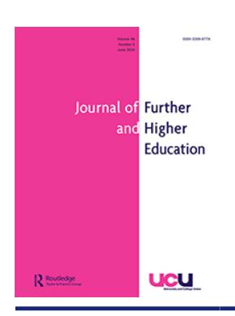
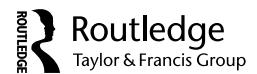
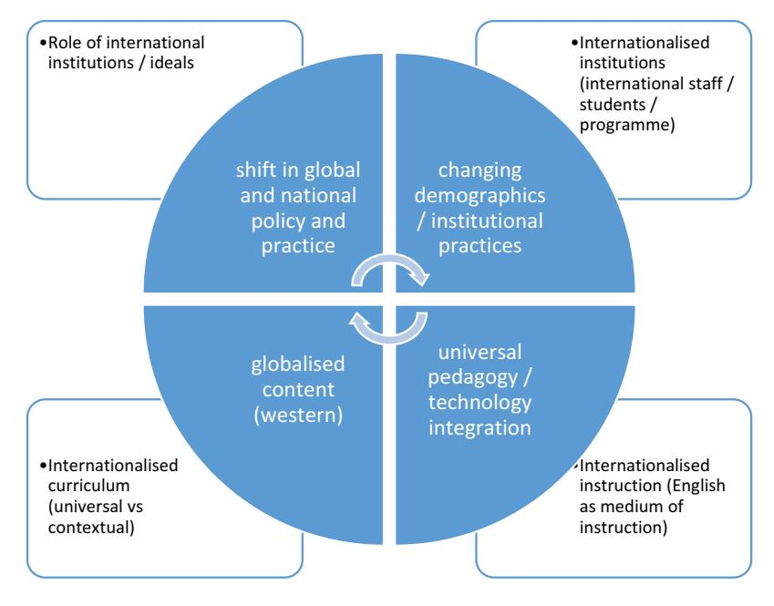

<!-- A3.R39 | source: papers_json/A3.R39/ -->

## **Journal of Further and Higher Education**

**ISSN: 0309-877X (Print) 1469-9486 (Online) Journal homepage: ****[www.tandfonline.com/journals/cjfh20](https://www.tandfonline.com/journals/cjfh20?src=pdf)**

## **Dynamics and impacts of internationalisation on** **curriculum and instruction in higher education**

## **Solomon** **Arulraj** **David**

**To** **cite** **this** **article:** Solomon Arulraj David (2024) Dynamics and impacts of internationalisation on curriculum and instruction in higher education, Journal of Further and Higher Education, 48:5, 510-523, DOI: [10.1080/0309877X.2024.2350514](https://www.tandfonline.com/action/showCitFormats?doi=10.1080/0309877X.2024.2350514)

**To** **link** **to** **this** **article:** [https://doi.org/10.1080/0309877X.2024.2350514](https://doi.org/10.1080/0309877X.2024.2350514)

| Published online: 05 May 2024. |
| --- |
| Submit your article to this journal |
| Article views: 215 |
| View related articles |
| View Crossmark data |
| Citing articles: 1 View citing articles |

<!-- page 2 -->

## **Dynamics and impacts of internationalisation on curriculum and ** **instruction in higher education**

Solomon Arulraj Davi[d](http://orcid.org/0000-0001-9252-4861)

Education, The British University in Dubai, Dubai, United Arab Emirates

## **ABSTRACT**

تهدف هذه الدراسة إلى فهم ديناميكيات التدويل (internationalisation) وآثاره على المنهج والتدريس في التعليم العالي في الإمارات. وباستخدام استبيان كمي للطلبة واستبيان نوعي لأعضاء هيئة التدريس، أُجري البحث عبر مؤسسات تعليم عالٍ مختارة تقع في مدينة دبي الأكاديمية الدولية (DIAC). وخضعت البيانات الكمية لتحليل إحصائي، بينما حُللت البيانات النوعية باستخدام التحليل الموضوعي (thematic analysis). وتؤكد النتائج المستمدة من البيانات الكمية إقرارًا قويًا بأهمية التدويل بين طلبة التعليم العالي في الإمارات. ومع ذلك، تكشف أيضًا عن فجوات جديرة بالملاحظة في الوعي بهذه الظاهرة. وتسلط نتائج البيانات النوعية الضوء على مسارات محتملة وعملية لتعزيز آثار التدويل على المنهج والتدريس في التعليم العالي في الإمارات. وترى الدراسة أن التدويل أفرز آثارًا إيجابية على المنهج والتدريس في التعليم العالي في الإمارات. ويمكن تحسين هذه الآثار أكثر من خلال استراتيجيات ملائمة.

## **ARTICLE HISTORY **

Received 26 July 2023 Accepted 26 April 2024

## **KEYWORDS **

Internationalization; higher education; curriculum; instruction

## **Introduction**

على مدى العقود الثلاثة الماضية، شهد مشهد التعليم العالي (HE) في دولة الإمارات العربية المتحدة (UAE) تحولًا كبيرًا، وهو تغيير تشكّل بشكل أساسي بفعل قوى التدويل، كما أبرز تقرير عام 2017 الصادر عن هيئة ضمان الجودة (QAA, 2017). وتشمل هذه الرحلة التحويلية مجموعة واسعة من العناصر، تمتد من الأفكار والكوادر والبرامج والفروع الجامعية والتعاون والتشبيك. ويطرح تفاعل ديناميكيات التدويل هذه فرصًا وتحديات في آن، ما يستلزم تعاملًا حذرًا من قبل الإمارات. وتهدف هذه الورقة إلى رسم مسار التدويل في التعليم العالي، مع التركيز على أثره على المنهج والتدريس، وتحليل آثاره المتنوعة على قطاع التعليم العالي في الإمارات. وفي صميم هذا البحث تأكيد مفاده أنه لكي يُحدث التدويل أثرًا كبيرًا على التعليم العالي، بما يشمل الكوادر والطلبة والبرامج والسياسات والممارسات الدولية، فإن أحد المكونات الأساسية هو تدويل المنهج والتدريس. ويركز هذا البحث تحديدًا على فهم ديناميكيات التدويل وآثاره على المنهج والتدريس ضمن مجموعة من مؤسسات التعليم العالي (HEIs) في الإمارات، كاشفًا عن الطرق المعقدة التي تُشكَّل بها هذه المؤسسات من خلال هذه العمليات.

ولتوفير خلفية سياقية، من المفيد تقديم لمحة موجزة عن قطاع التعليم العالي في الإمارات. ورغم أن الإمارات دولة عمرها لا يتجاوز 52 عامًا، فقد طورت بسرعة قطاع تعليم عالٍ متينًا، تأثر بشكل كبير بالخبرات والمنظورات الدولية

<!-- page 3 -->

(David et al., 2017). ووفقًا لهيئة الاعتماد الأكاديمي (CAA, 2022)، يوجد ما مجموعه 67 مؤسسة تعليم عالٍ معتمدة، تتلقى 50% منها تمويلًا حكوميًا، وتعمل 42% كمؤسسات خاصة، بينما تعمل النسبة المتبقية البالغة 8% كفروع لمؤسسات تعليم عالٍ أجنبية. وتقدم هذه المؤسسات مجتمعة ما مجموعه 1175 برنامج تعليم عالٍ معتمد. ورغم أن عدد الفروع الجامعية منخفض نسبيًا، فإن الأثر الواسع لديناميكيات التدويل واضح في المنهج والممارسات التدريسية عبر غالبية مؤسسات التعليم العالي. ووفقًا لأحدث الإحصاءات، تستضيف الإمارات حاليًا 133,841 طالبًا مسجلين في مؤسسات تعليم عالٍ مرخصة، منهم 85% يتابعون برامج البكالوريوس. ومن الملاحظ أن 65% من الطلبة مواطنون إماراتيون، بينما يمثل المجتمع الدولي 35%. ويميل التوزيع الجندري بين الطلبة لصالح الإناث، إذ يشكّلن 63% من الإجمالي. ويضم أعضاء هيئة التدريس الأكاديمية في الإمارات 8,861 عضوًا، تنحدر الأغلبية الكبيرة منهم (91.5%) من أكثر من 130 دولة وهم من غير المواطنين الإماراتيين. ومن إجمالي أعضاء هيئة التدريس، 38% إناث (3385 فردًا). وتتناول مراجعة الأدبيات التالية الطرق التي ترك بها التدويل أثرًا دائمًا على التعليم العالي في الإمارات.

## **Literature review**

يشكل التعامل مع تعقيدات تصور ديناميكيات التدويل وآثاره على المنهج والتدريس في التعليم العالي تحديًا كبيرًا. ويتكشف تدويل التعليم العالي كظاهرة معقدة تتطور فيها سياسات وبرامج متنوعة على المستوى الثنائي والإقليمي والعالمي (Verger and Hermo, 2010). واستنادًا إلى تعريف Jane Knight (2003) الشامل، يصف Luxon and Peelo (2009) تدويل التعليم العالي بأنه عملية تدمج الأبعاد الدولية أو بين الثقافية أو العالمية في هدف التعليم بعد الثانوي أو وظائفه أو طريقة تقديمه، عاملة على المستوى الوطني والقطاعي والمؤسسي. ويرى De Wit and Hunter (2015, 41) أن الجامعات أظهرت تاريخيًا أبعادًا دولية، سواء في مفهوم المعرفة الكونية والبحث المرتبط بها أو في حركة الطلبة والباحثين، وهي ظاهرة تؤثر حتمًا على المنهج والتدريس في التعليم العالي. ولكشف تعقيدات كيفية تأثير التدويل على المنهج والتدريس، تتعمق مراجعة الأدبيات في أعمال علمية متنوعة. وقد أفضى هذا الاستكشاف إلى وضع إطار يبيّن الديناميكيات والآثار داخل التعليم العالي، كما هو مفصل في الشكل 1 أدناه.

يوضح الإطار المقدم التفاعل المعقد بين الديناميكيات والآثار المرتبطة بتدويل المنهج والتدريس في التعليم العالي. وسعت الدراسة إلى استكشاف كل من ديناميكيات وآثار تدويل التعليم العالي، إذ تبرز الديناميكيات القوى والعمليات التي تحفز التدويل بينما تشير الآثار إلى تأثيرات التدويل على التعليم العالي. وتُدفع ظاهرة التدويل بصعود الحداثة المفرطة (hyper-modernity)، مع كون التقدم في تكنولوجيا المعلومات والاتصالات قوة محورية في تآكل الحدود المادية. وفي مراحله الأولى، تصدر مؤسسات في دول ذات ناتج محلي إجمالي مرتفع دفة التدويل بشكل أساسي، مدفوعة بمنطق السوق ومبادئ اقتصادية ليبرالية جديدة تشدد على التنافس والربح. وفي كثير من الدول الحديثة، تراجع الدعم الحكومي المباشر للتعليم العالي، ما دفع المؤسسات إلى السعي وراء فرص في الأسواق الخارجية لضمان استمرار وجودها. وتتفاوت عملية التدويل؛ فبالنسبة للبعض، تحدث تدريجيًا وبشكل غير واعٍ، أشبه بالتناضح (osmosis) (De Vita, 2007). في المقابل، يرى آخرون، مثل Prasanthi and Bhaskara Rao (2019)، أن التدويل مدفوع استراتيجيًا، بدوافع وحوافز محددة. ويسهم Knight (2004) في هذا النقاش من خلال طرح أربعة أبعاد متكاملة للتدويل: النشاط، والكفاءة، والروح، والعملية. ومجتمعة، تقدم هذه الأبعاد منظورًا شاملًا للطبيعة متعددة الأوجه للتدويل ضمن مجال التعليم العالي. ويتجادل الباحثون حول فرص التدويل وتحدياته في التعليم العالي على حد سواء. ويرى Tight (2022) أن الاتجاهات المعاصرة لتدويل التعليم العالي أفادت ما هو أبعد من الغرب والمؤسسات النخبوية والطلبة. بينما يرى R'boul (2022) أن

<!-- page 4 -->

*Figure 1. Dynamics of internationalization of curriculum and instruction in higher education.*

التدويل قد يشكل خطر إعادة إنتاج ظلم معرفي (epistemic injustice) وجغرافيا سياسية غير متكافئة لإنتاج المعرفة ونشرها.

ولفهم تعقيدات ديناميكيات التدويل وآثاره على المنهج والتدريس في التعليم العالي، لا بد من فهم سياقي. ورغم أن للتأثير الدولي على التعليم العالي جذورًا تاريخية (De Wit and Merkx, 2012)، شهدت العقود الأخيرة تصاعدًا في تأثيرات أكثر وضوحًا، تميزت بانتشار مناهج وبرامج وكوادر وطلبة ومؤسسات مدوَّلة. ويشدد Luxon and Peelo (2009) على ضرورة أن يتبنى تصميم المنهج في مستوى التعليم العالي وتطوير المقررات والممارسات التربوية التدويل، خاصة استجابة لتزايد حضور الطلبة والكوادر الدوليين في التعليم العالي عبر بلدان عديدة. ويثبت تعريف تدويل المنهج أنه مهمة صعبة. ووفقًا لمنظمة التعاون الاقتصادي والتنمية (OECD, 1995, 9)، يظهر المنهج المدوَّل "توجهًا دوليًا في المحتوى و/أو الشكل"، بهدف إعداد الطلبة للأداء في سياق دولي ومتعدد الثقافات، يخدم الطلبة المحليين والأجانب على حد سواء. ويحدد Leask (2013) عملية من خمس مراحل لتدويل المنهج تشمل التصور، والمراجعة/التخطيط، والتنفيذ/العمل، والتقييم، والمراجعة/التأمل. ويرى Kirk et al. (2018) أن تدويل المنهج يؤدي دورًا حاسمًا في تعزيز مهارات المواطنة العالمية لدى الطلبة.

ويسلط Leask and Bridge (2013) الضوء على الطبيعة غير المحايدة لقرارات المنهج، مشيرين إلى قابليتها للتأثر بالنماذج الفكرية ووجهات النظر السائدة. ويقران بمحاولات جذرية أحيانًا لتحدي وجهات النظر السائدة ويشددان على التعقيد الذي ينطوي عليه تدويل المنهج. ويلاحظ McPhee (2009) أن مشهد التعليم والتعلم في التعليم العالي يمر بتحول بسبب تزايد وتنوع الجسم الطلابي، والتركيز على الجودة والمساءلة، والإمكانات التكنولوجية المتسارعة التطور، والتفاوت في مستويات إلمام الطلبة بهذه التقنيات، وتطور توقعات الحكومات، وتوقع الطلبة وأصحاب العمل بأن يكون الخريجون مؤهلين لبيئات عمل سريعة التغير ومتزايدة العولمة.

ويشدد Mertova (2013) على أن التدريس والتعلم في كثير من الجامعات حول العالم مُدوَّلان، متأثرين جزئيًا بتزايد حضور الطلبة والكوادر الدوليين.

<!-- page 5 -->

وتضع الممارسات المدوَّلة لمعلمي التعليم العالي، الذين يعملون كخبراء في تخصصاتهم وقدوة، هؤلاء المعلمين في موقع يمكّنهم من تيسير استعداد الطلبة للحياة في عالم سريع العولمة (Sanderson, 2011). وقد أعاد التدويل تشكيل طريقة تكشف المنهج بشكل جذري (David and Hill, 2020)، وكذلك مناهج التدريس والتعلم (David and Hill, 2021) في برامج ومؤسسات التعليم العالي، مدفوعًا إلى حد كبير بإدماج كوادر وطلبة وبرامج مدوَّلة، ومن المهم تقدير الاختلافات (Rodríguez-Izquierdo, 2022).

في تطوير وتقديم منهج وتدريس مدوَّلين، يخضع المربون والخبراء عادة لعملية منهجية. وتشمل هذه العملية تقييم احتياجات التعلم، وتحديد أهداف محددة، ووضع استراتيجيات تعليم وتعلم، وتنفيذ خطط عمل، وتقييم النتائج التعليمية (IGI Global, 2018). وفي سياق التعليم العالي المدوَّل، يُتوقع أن يكون المنهج ذا صلة عالمية (Zou et al., 2020)، وتستفيد كثير من مؤسسات التعليم العالي من استراتيجيات تدويلها لتحديث المنهج على نطاق أوسع. ووفقًا لـ Robson (2015)، يُدفع هذا التحديث غالبًا برغبة في تعزيز العقليات والمهارات والمدارك العالمية. ويعرّف Leask (2009, 209) تدويل المنهج بأنه دمج الأبعاد الدولية أو بين الثقافية و/أو العالمية في جوانب متنوعة، بما في ذلك المحتوى ومخرجات التعلم ومهام التقييم وأساليب التدريس وخدمات الدعم ضمن برنامج دراسي. ويقترح Leask (2015) تدابير محددة لتعزيز أثر المنهج المدوَّل على تعلم الطلبة، تشمل الاهتمام بتدويل مخرجات التعلم والمحتوى وأنشطة التعليم والتعلم ومهام التقييم. ويتجاوز هذا النهج المواد والتجارب المعزولة والاختيارية لأقلية من الطلبة، ليركز على تعلم جميع الطلبة. ويُقترح أن تكون العملية منهجية لا متقطعة، مع تجنب دراسات حالة دولية عرضية موزعة عشوائيًا عبر البرنامج الدراسي. ويستخلص Van den Hende and Whitsed (2022) دروسًا أساسية لتدويل المنهج: التزام واضح بتدويل المنهج (CI) يُبلَّغ عنه ويُظهر، وتحديد جميع أصحاب المصلحة وإشراكهم منذ البداية، وفتح قنوات لتواصل منتظم ومتسق ومتعدد الوسائط، والإقرار بأن تدويل المنهج عملية تغيير طويلة الأمد، ونهج عملي. ويعالج هذا النهج التحديات التي أشار إليها Clifford (2009)، الذي رأى أن الطبيعة الهرمية من أعلى إلى أسفل لبعض جهود التدويل واجهت مقاومة من الأكاديميين، وغالبًا ما فشلت المناهج في مراعاة الاختلافات بين التخصصات. ويوصي باحثون مثل Gopal (2011) بإعداد أعضاء هيئة التدريس للتدريس عبر الثقافات من خلال تعزيز كفاءتهم بين الثقافية.

ويدعم اتحاد الجامعات الأوروبية (EUA, 2020) الدمج الفعلي للتدويل في التعليم والتعلم، بما يتناسب مع الاحتياجات المحددة لكل مؤسسة وبلد. ويؤيد فكرة نظام بيئي مؤسسي يشرك الكوادر والطلبة وجميع أصحاب المصلحة بفعالية في عملية التدويل. ويتسق هذا النهج الشامل مع المشهد المتطور الذي حدده Clifford (2009) ويقر بأهمية معالجة الفروق الدقيقة بين التخصصات عند تدويل المنهج.

يفرز تدويل التعليم العالي فرصًا وتحديات في آن، ما يسهم في مشهد ديناميكي. ويؤكد Tadaki (2013) أن تبني التدويل يتيح تشبيكًا عالميًا أكبر في اقتصاد المعرفة، داعيًا الجامعات حول العالم إلى الاستفادة من وسائل متنوعة للاستثمار في فوائد الترابط العالمي مع تجنب مزالق الانغلاق المحلي. ومع ذلك، يحذّر منتقدون، منهم Beck (2012)، من أن التدويل قد يشكل مخاطر على أنظمة التعليم العالي المحلية من خلال التركيز على التنافس والتسويق التجاري. وردًا على ذلك، يدعو Schapper and Mayson (2004) إلى نهج مضاد للهيمنة ومستمر وشامل ومتعدد الأوجه ومتكامل للتدويل، يسعى إلى بدائل لتايلورية (Taylorisation) العمل الأكاديمي. وتجادل أصوات معارضة بأن التدويل ضروري للملاءمة في العصر الحديث. ويشدد Green and Mertova (2009) على أن التكنولوجيا والحاجة إلى تحالفات عالمية تشكّل ديناميكيات التدويل في الجامعات، خاصة لخدمة عدد متزايد من الطلبة الدوليين بشكل أفضل. ويحدد Marinoni, Egron-Polak, and Green (2019) عددًا كبيرًا من الفوائد المرتبطة بتدويل التعليم العالي، تشمل تعزيز التعاون الدولي وبناء القدرات، وتدويل المنهج،

<!-- page 6 -->

وتحسين المكانة المؤسسية، وتعزيز قابلية توظيف الخريجين، وتحسين جودة التعليم والتعلم، وزيادة الوعي الدولي وانخراط الطلبة في القضايا العالمية، وتوسيع التشبيك الدولي لأعضاء هيئة التدريس والباحثين، وتنويع مصادر الإيرادات، وفرصًا لقياس الأداء المؤسسي مقابل الممارسات الدولية الجيدة، وتعزيز قدرة البحث المؤسسي وإنتاج المعرفة. وتحديدًا في سياق الإمارات، يلاحظ المؤلف اتجاهًا متزايدًا حيث يفضل الطلبة بشكل متزايد المقررات المدوَّلة (David, 2017a) والمؤسسات المدوَّلة (David, 2017b). ويؤكد هذا أهمية التدويل وصلته بتشكيل خيارات الطلبة في المنطقة.

يقدم تدويل المنهج والتدريس في التعليم العالي فرصًا استراتيجية إلى جانب تحديات ومخاطر. ويشدد Ryan (2013) على غلبة الفرص على التحديات، ملاحظًا تقدمًا كبيرًا في تدويل المنهج والتدريس، مع معالجة معظم التحديات بالفعل. وتتردد مشاعر مماثلة لدى آخرين، الذين يؤكدون أن التدويل حوّل بعمق التعليم والتعلم في التعليم العالي، مؤثرًا إيجابًا على الجودة والتنافس، وإن كان ذلك مصحوبًا ببعض الارتباك والقلق (Mertova, 2013). ويحذّر David and Motala (2017) من تجانس المنهج، مشددين على أهمية الحفاظ على التنوع. من ناحية أخرى، يشدد Rensburg, Motala and David (2016) على أن التعاون البحثي بين الكوادر والمؤسسات يزيد فرص تدويل التعليم العالي.

علاوة على ذلك، يخلق تدويل التعليم العالي فرصًا لتنقل الكوادر والطلبة التعليمي (Rensburg, Motala and David, 2015). ومن المثير للاهتمام أيضًا ملاحظة أن التدويل يمكّن الطلبة. ويبرز Raby, Ward and Rhodes (2021) أن الطلبة الدوليين أشاروا إلى أن تجربتهم في الدراسة بالخارج مكّنتهم. ويدعو Wang and Sun (2022) إلى نهج دامج للتدويل. ويشير Gallagher (2023) إلى دور معلمي المعلمين عبر الوطنيين في بناء القدرات من خلال رعاية المربين المستقبليين في منطقة الخليج العربي. وفي الختام، يشير استكشاف الأدبيات إلى أن جامعات عديدة تعدل مناهجها وتدريسها لتنمية بيئة مدوَّلة، توحّد الطلبة والكوادر من جنسيات متنوعة في التعليم والتعلم. وكثيرًا ما تستقصي هذه الجامعات الدولية أو العالمية استراتيجيات المنهج والتربية والتقييم التي تخدم بشكل أفضل احتياجات الطلبة والكوادر الدوليين. وتشير دراسات متنوعة إلى أن الطلبة والكوادر المحليين يستفيدون أيضًا من ديناميكيات التدويل لأنها تُثري تجاربهم. وباختصار، تشدد المراجعة على كل من الفرص والتحديات المرتبطة بالتدويل في سياق المنهج والتدريس في التعليم العالي.

## **Methodology**

للتحقيق في ديناميكيات التدويل وآثاره على المنهج والتدريس في التعليم العالي داخل الإمارات، وُضعت منهجية ملائمة لمعالجة أسئلة البحث الرئيسية: "ما ديناميكيات وآثار تدويل المنهج والتدريس في مؤسسات التعليم العالي في الإمارات؟ وكيف تشكل هذه الديناميكيات قطاع التعليم العالي في الإمارات؟" واستلهم استبيان مسح الطلبة من إطار Tripod (2024) للتدريس الفعال المكوّن من سبعة عناصر (7Cs Framework). ويشمل هذا الإطار سبعة مكونات أساسية لتقييم ممارسات التدريس، مصنفة ضمن ثلاثة مجالات: الدعم الشخصي والمنهجي والأكاديمي. وتشمل أبعاد الدعم الشخصي "الرعاية" (Care) و"التشاور" (Confer)؛ وتشمل أبعاد الدعم المنهجي "الجذب" (Captivate) و"التوضيح" (Clarify) و"الترسيخ" (Consolidate)؛ ويشمل الدعم الأكاديمي "التحدي" (Challenge) و"إدارة الفصل" (Classroom Management). وبعد التحقق التأكيدي من قبل خبيرين ميدانيين، خضعت الأداة لدراسة استطلاعية لمزيد من التحقق. ووُزّع الاستبيان على 20 مستجيبًا، تحديدًا طلبة في مؤسسات تعليم عالٍ في مدينة دبي الأكاديمية الدولية (DIAC).

ولتقييم موثوقية الاستبيان الكمي، استُخدمت ألفا كرونباخ (Cronbach's alpha)، بوصفها مقياس الاتساق الداخلي (α)، ما أسفر عن قيمة 0.83. ووفقًا للمبدأ التوجيهي الذي اقترحه George and Mallery (2003)، تشير القيمة التي تتجاوز 0.8 إلى موثوقية جيدة. وشمل الاستبيان، الذي طوره المؤلفون استنادًا إلى مراجعة أدبيات التدويل في

<!-- page 7 -->

التعليم العالي، أربعة أبعاد: تصور ديناميكيات وآثار التدويل؛ وآثار التدويل على المنهج؛ وآثار التدويل على التدريس؛ والاتجاهات نحو آثار التدويل. ويضمن هذا النهج الشامل استكشافًا دقيقًا للجوانب متعددة الأوجه للتدويل ضمن سياق التعليم العالي في الإمارات.

كما خضع الاستبيان النوعي لعملية تحقق شاملة، تضمنت مراجعة من قبل خبيرين ميدانيين. وبعد التحقق التأكيدي، أُجريت دراسة استطلاعية شملت عضوي هيئة تدريس أكاديميين. وكُلِّفا بمهمة إكمال الاستبيان وتحليله من حيث المصداقية، مع تركيز محدد على معالجة سؤال "مدى توافق النتائج مع الواقع" (Stahl and King, 2020, 26) كخطوة حاسمة نحو تعزيز موثوقية الأداة. وبعد ذلك، طُبّق الاستبيان المنظم على عينة أوسع، شملت 123 طالبًا للبيانات الكمية و12 عضو هيئة تدريس أكاديميين استجابوا على استبيان شبه منظم للبيانات النوعية. والمستجيبون من مؤسسات تعليم عالٍ تقع في مدينة دبي الأكاديمية الدولية (DIAC). وكان اختيار DIAC مقصودًا، نظرًا لاستضافتها المتنوعة لمؤسسات تعليم عالٍ متعددة.

وطوال عملية البحث، رُوعيت البروتوكولات الأخلاقية القياسية بدقة في جمع البيانات وتحليلها. وحصل البحث على موافقة لجنتَي البحث والأخلاقيات في المؤسسة التابع لها المؤلف. وحُصل على موافقة مستنيرة من جميع المشاركين، الذين زُوّدوا أيضًا بالمعلومات الأساسية اللازمة عن البحث قبل مشاركتهم.

وخضعت بيانات المسح الكمي للتحليل باستخدام الإحصاء الوصفي والاستدلالي معًا، ما يوفر لمحة عامة شاملة عن النتائج الرقمية. وفي الوقت نفسه، حُللت البيانات النوعية باستخدام التحليل الموضوعي الاستنباطي والاستقرائي معًا (Braun and Clarke, 2006). وحُددت الموضوعات الرئيسية من الأدبيات القائمة، بينما ظهرت الموضوعات الفرعية أثناء جمع البيانات والتحليل اللاحق. ودعم التأمل المستنير نقاش وتفسير النتائج، ما سهّل استخلاص الاستنتاجات والخلاصات اللازمة. ويضمن هذا النهج متعدد الأوجه استكشافًا متينًا لديناميكيات التدويل وآثاره على المنهج والتدريس في التعليم العالي في الإمارات.

## **Results, analysis and discussion**

جُمعت البيانات الكمية من خلال استبيان منظم يتكون من 40 عبارة، تركز على الأبعاد الأربعة للدراسة. وضمن هذه العبارات، خُصصت 32 عبارة (ثماني عبارات لكل بُعد) لاستكشاف جوانب متنوعة من التدويل، بينما سعت ثماني أسئلة إضافية إلى الحصول على تفاصيل ديموغرافية من المشاركين. وقُدّم للمستجيبين في البداية سؤال فرز لتحديد ما إذا كانت مؤسستهم تتبنى التدويل في المنهج والتدريس والتوظيف واستقطاب الطلبة وأشكال أخرى. وأجابت الغالبية، 94.3%، بالإيجاب، وأجاب 1.6% بالنفي، وأشار 4.1% إلى عدم اليقين. واعتُبرت 123 استجابة مكتملة لمزيد من التحليل. وأُجري اختبار موثوقية لتقييم الاتساق الداخلي للعبارات الـ32 عبر الأبعاد الأربعة. وكشفت النتائج أن قيمة ألفا كرونباخ لبعدين كانت أعلى من .8 (ما يشير إلى اتساق عالٍ)، ولبعد واحد كانت أعلى من .7 (ما يشير إلى اتساق جيد)، وللبعد المتبقي كانت أعلى من .6 (ما يشير إلى اتساق مقبول). وتشير هذه النتائج إلى أن الاتساق الداخلي للأداة كان جيدًا. ويقدم الجدول 1 ملخصًا لنتائج الموثوقية.

يقدم الملف الديموغرافي للمشاركين في الدراسة الكمية لمحة شاملة عن خصائصهم. من بين المستجيبين، كانت نسبة 68.9% إناثًا، بينما كانت نسبة 31.1%

<!-- page 8 -->

ذكورًا. وفيما يتعلق بتوزيع الأعمار، كانت نسبة 21.3% ضمن الفئة العمرية 18-24، و12.3% بين 25-30، و34.4% تتراوح بين 31-40، و31.1% فوق 41. وشملت الدراسة مشاركين من 20 جنسية، بنسبة 14% إماراتيين و86% مقيمين، بما يتسق مع الملف السكاني العام للإمارات. وفيما يتعلق بالانتساب المؤسسي، كانت نسبة 18.9% من المستجيبين من مؤسسات حكومية، و13.1% من مؤسسات خاصة تستخدم المنهج المحلي، و53.3% من مؤسسات خاصة تستخدم مناهج أجنبية، و14.8% من فروع لجامعات أجنبية تعمل في دبي، تستخدم أيضًا مناهج أجنبية. وفيما يتعلق بنمط الدراسة، درس 41.8% من المستجيبين في مؤسسة تعليم عالٍ واحدة (HEI) في الإمارات، و26.2% في مؤسسات متعددة في الإمارات، و32% في مؤسسات متعددة في عدة دول. علاوة على ذلك، كان 20.3% من الطلبة مسجلين في برنامج بكالوريوس، و42.3% في برنامج ماجستير، و38.6% في برنامج دكتوراه، و0.8% في برامج أخرى.

وفيما يتعلق بتجارب المستجيبين، شارك 42.6% تجارب من برنامج واحد في مؤسسة واحدة في الإمارات، و14.8% من برامج متعددة في مؤسسة واحدة في الإمارات، و20.5% من برامج متعددة في عدة مؤسسات في الإمارات، و22.1% من برامج متعددة في الإمارات ودول أخرى. واستُخدم مقياس ليكرت خماسي التدرج للأبعاد التي تتطلب آراء المستجيبين، يتراوح من "أوافق بشدة" إلى "لا أوافق بشدة". وعمومًا، عكست الاستجابات على معظم العبارات موافقة قوية أو موافقة، تراوحت بين 88% و98%. ومع ذلك، برزت عبارات محددة كان فيها خيار "لا أعرف" استجابة شائعة.

- My institution has specific services to support international students (Dimension 1)
- My institution has relevant strategies for internationalisation (Dimension 1)
- My institution engages foreign experts to design, validate curriculum (Dimension 2)

لكل بُعد، خضعت مجموعة أسئلة مقياس ليكرت لاختبارات معلمية (parametric tests)، تعالج المتوسطات للتحليل. واستُخدم اختبار ارتباط بيرسون (Pearson Correlation) لتحديد قوة العلاقة بين البُعد 1 والبُعدين 2 و3. ويقدم الجدول 2 معاملات الارتباط (r) الخاصة، مشيرًا إلى ارتباط إيجابي متوسط في الحالتين.

وأُجري تحليل إضافي لتقييم دلالة معاملات الارتباط من خلال اختبار t للعينات المرتبطة. وأدت النتائج إلى استنتاج وجود فرق دال إحصائيًا عند مستوى p < 0.05 في الحالتين. ويقدم الجدول 3 المعاملات المبرزة.

وتشير المعاملات إلى أن قوة العلاقة أعلى بين التدويل والمنهج منها بين التدويل والتدريس. ويُقدَّم التحليل الإحصائي الوصفي للبُعد 1، الذي يركز تحديدًا على تصور ديناميكيات وآثار التدويل في التعليم العالي، في الجدول 4.

في البُعد 1، ثمة اتجاه عام يتجاوز فيه المتوسط الحسابي الوسيط، ما يشير إلى توزيع موجب الالتواء. ويعكس هذا وجهات النظر الإيجابية العامة للمستجيبين بشأن تصور التدويل في التعليم العالي. ويكشف المدى الربيعي (Interquartile Range - IQR)، المحسوب كفرق بين الربيعين 3 و1، أن خمس عبارات من أصل ثماني تُظهر

|  |  | Unstandardized Coefficients | Standardized Coefficients |  |  |  |
| --- | --- | --- | --- | --- | --- | --- |
| Model |  | B | Std. Error | Beta | t | Sig. |
| 1 | (Constant) | 12.874 | 2.406 |  | 5.350 | .000 |
|  | Curriculum Total | .353 | .079 | .408 | 4.455 | .000 |
|  | Instruction Total | .283 | .078 | .334 | 3.645 | .000 |

<!-- page 9 -->

مدى ربيعيًا أعلى من 41، ما يشير إلى وجود قيم متطرفة وتباين كبير في الاستجابات. ومن الملاحظ أن العبارة السابعة فقط، "My institution has specific services to support international students"، تُظهر وسيطًا مرتفعًا، ما يبرز توزيعًا سالب الالتواء ويعني دلالة أقل في الاستجابات. ورغم هذه الملاحظات الطفيفة، تعبر غالبية الاستجابات في الغالب عن موافقة أو موافقة قوية، ما يعني تصورًا إيجابيًا لآثار التدويل في التعليم العالي. ويُقدَّم التحليل الإحصائي الوصفي للبُعد 2، الذي يركز على آثار التدويل على المنهج في التعليم العالي في الإمارات، في الجدول 5.

في البُعد 2، ثمة نمط سائد يتجاوز فيه المتوسط الحسابي الوسيط، ما يشير إلى توزيع موجب الالتواء. ويدل هذا على وجهات النظر الإيجابية العامة للمستجيبين بشأن آثار التدويل على المنهج في التعليم العالي في الإمارات. ومن الملاحظ أن 16.4% من المستجيبين أعربوا عن عدم يقين بشأن ما إذا كانت مؤسستهم تستعين بخبراء أجانب لتصميم المنهج ومراجعته والتحقق منه، ما أدى إلى وسيط أعلى نسبيًا. وهذه الاستجابة مفهومة لأن الطلبة قد يفتقرون إلى معلومات مباشرة بشأن هذا الجانب. والمدى الربيعي (IQR) لسبع عبارات من أصل ثماني أعلى من 41، ما يشير إلى وجود قيم متطرفة وتباين كبير في الاستجابات. والعبارة الرابعة فقط ("My institution engages foreign experts to design, revise, validate curriculum") لها مدى ربيعي أقل نسبيًا، ما يشير إلى دلالة أقل. وباستثناء هذه العبارة، تعبر غالبية الاستجابات في الغالب عن موافقة أو موافقة قوية، ما يدعم فكرة وجود آثار إيجابية ودالة للتدويل على المنهج في التعليم العالي في الإمارات. ويُقدَّم التحليل الإحصائي الوصفي للبُعد 3، الذي يركز على آثار التدويل على التدريس في التعليم العالي في الإمارات، في الجدول 6.

في البُعد 3، ثمة اتجاه ثابت يتجاوز فيه المتوسط الحسابي الوسيط لجميع العبارات باستثناء العبارة 2، "In general, teaching quality (suitable to subjects) of the expatriate faculty is good"، ما يشير إلى توزيع موجب الالتواء. ويعكس هذا وجهات النظر الإيجابية العامة للمستجيبين بشأن آثار التدويل على التدريس في التعليم العالي. والمدى الربيعي (IQR) لسبع عبارات من أصل ثماني أعلى من 41، ما يدل على وجود قيم متطرفة وتباين كبير في الاستجابات. وللعبارة الثانية مدى ربيعي أقل نسبيًا، ما يشير إلى دلالة أقل في الاستجابات. وباستثناء العبارة الثانية، تعبر غالبية الاستجابات باستمرار عن موافقة، ما يدعم فكرة وجود آثار إيجابية ودالة للتدويل على التدريس في التعليم العالي. ويُقدَّم التحليل الإحصائي الوصفي للبُعد 4، الذي يركز على آثار التدويل على التعليم العالي في الإمارات بشكل عام، في الجدول 7.

|  | Strongly Agree % | Agree % | Don't know % | Disagree % | Strongly Disagree % | Median | IQR |
| --- | --- | --- | --- | --- | --- | --- | --- |
| In general, teaching quality (suitable to subjects) of the expatriate faculty is good | 30.3 | 64.8 | 4.1 | 0.8 | 0 | 3.3 | 34.5 |

<!-- page 10 -->

في البُعد 4، ثمة نمط ثابت يتجاوز فيه المتوسط الحسابي الوسيط لجميع العبارات، ما يشير إلى توزيع موجب الالتواء للاستجابات. ويعكس هذا وجهات النظر الإيجابية العامة للمستجيبين بشأن آثار التدويل على التعليم العالي. والمدى الربيعي (IQR) لسبع عبارات من أصل ثماني أعلى من 41، ما يشير إلى وجود قيم متطرفة وتباين كبير في الاستجابات. وللعبارة السابعة ("the ability of the expatriate faculty to prepare students for the global labour market is good") مدى ربيعي أقل نسبيًا (38.5)، ما يشير إلى دلالة أقل في الاستجابات. وباستثناء العبارة السابعة، تعبر غالبية الاستجابات باستمرار عن موافقة، ما يدعم فكرة وجود آثار إيجابية ودالة للتدويل على التعليم العالي. ومن المفيد التساؤل عما إذا كانت مسوحات الطلبة تقيس بفعالية جودة المنهج والتدريس في التعليم العالي. وكما يرى Ferguson (2012)، يمكن لمسوحات الطلبة المصممة جيدًا أن تساعد في دمج أصوات الطلبة. ويمكن لتحليل ونقاش وتفسير دقيق أن يعزز هذا المنظور أكثر، بما يتسق مع تأكيد Mandouit (2018) بأن تغذية الطلبة الراجعة أداة قيّمة لتحسين جودة التدريس.

شارك اثنا عشر عضو هيئة تدريس أكاديميين، يعملون عبر جامعات مختلفة في مدينة دبي الأكاديمية الدولية (DIAC)، في الاستبيان النوعي. وضم الاستبيان النوعي 15 سؤالًا شبه منظم، تشمل 10 محفزات، جميعها منظمة ضمن الأبعاد الأربعة نفسها الواردة في المسح: تصور ديناميكيات وآثار التدويل للتعليم العالي، وآثار التدويل على المنهج في التعليم العالي، وآثار التدويل على التدريس في التعليم العالي، والاتجاهات/المناهج تجاه آثار التدويل للتعليم العالي. ولبدء الاستكشاف النوعي، قُدّم للمستجيبين سؤال فرز: "هل تتبنى مؤسستي التدويل في المنهج والتدريس والتوظيف واستقطاب الطلبة وأشكال أخرى؟"

توزع المستجيبون بالتساوي بين الذكور والإناث، ممثلين اثنتي عشرة دولة مختلفة. وكانت الأغلبية ضمن الفئة العمرية 41-50، مع نسبة أصغر تبلغ 51 عامًا فأكثر. وحمل جميع المشاركين درجة الدكتوراه كأعلى مؤهل تعليمي. ودرّس بعضهم مقررات البكالوريوس حصريًا، ودرّس آخرون مقررات الدراسات العليا حصريًا، بينما شارك آخرون في تدريس مقررات البكالوريوس والدراسات العليا والدكتوراه. وتمتعت الأغلبية بأكثر من 10 سنوات من الخبرة التدريسية في مؤسسات التعليم العالي. ويقدم الجدول 8 ملخصًا للاستجابات ضمن الموضوعات الرئيسية الأربعة، التي طُورت مبدئيًا بشكل استنباطي. علاوة على ذلك، ظهرت ثمانية موضوعات فرعية استقرائيًا أثناء التحليل: فهم التدويل؛ وديناميكيات التدويل للتعليم العالي؛ والسمات الرئيسية للمنهج المدوَّل؛ وآثار التدويل على تصميم/تقديم المنهج؛ والسمات الرئيسية للتدريس المدوَّل؛ وآثار التدويل على تصميم/تقديم التدريس؛ والاتجاهات/المناهج تجاه التدويل للتعليم العالي؛ ومستقبل التدويل للمنهج والتدريس (C&I) في التعليم العالي في الإمارات. وتُقدَّم الموضوعات والموضوعات الفرعية والرموز لتحليل البيانات النوعية في الجدول 8.

هدف الموضوع 1 بشكل أساسي إلى فهم تصور المستجيبين لديناميكيات وآثار التدويل للتعليم العالي. وقدم عدة مشاركين تصورات مجردة ذات معانٍ واسعة، بينما قدم آخرون تفسيرات شخصية. فمثلًا، ذكر المستجيب (R) 2 أن "التدويل يشمل توسيع الشراكات ونماذج التعليم عبر الوطني مثل الامتياز/التوأمة"، وبالنسبة لـ R7، "يُختبر التدويل على جميع المستويات مثل التدريس والمنهج والتقييم والبحث وغيرها". وشدد R11 على أنه "عملية متعمدة لدمج بُعد دولي وبين ثقافي وعالمي في مهمة التعليم ووظائفه"، بينما أشار R9 إلى أن "التدويل

<!-- page 11 -->

|  | \overline{} |
| --- | --- |
| ( + - | ۰ ۱ |
| 1 | ~) |

|  | Theme 4: Approaches/prospectus towards the impacts of internationalization for higher education Theme 3: Impacts of internationalization for instruction in higher education Theme 2: Impacts of internationalization for curriculum in higher education | internationalization for Sub-theme 8: the C&I in higher Policy, strategies, language of instruction, future of education internationalization for Approaches towards higher education Sub-theme 7: diversity Sub-theme 6: Impacts instructional design/ of internalization on Teach, learn, pedagogy, classroom, delivery Sub-theme 5: Key internationalized features of instruction e-learning, of internationalization on curriculum design/ Sub-theme 4: Impacts resources, books, readings, database delivery Courses, subjects, content, library Sub-theme 3: Key internationalized features of curriculum |
| --- | --- | --- |
| Table 8. Themes, sub-themes and codes for the analysis of qualitative data. |  |  |
| Theme 1: Conceptualizing the dynamics and impacts of internationalization for higher education | internationalization for higher education Sub-theme 2: Dynamics of Global, foreign, expatriate, higher internationalization Understanding of Sub-theme 1: education, |  |
|  | Themes | themes Codes Sub |

<!-- page 12 -->

يُعتقد على نطاق واسع أنه مرادف للتغريب". وتتماشى الاستجابات أعلاه في الغالب مع الموضوع الفرعي تحت الموضوع 1، وهو "فهم التدويل".

وقدمت منظورات إضافية رؤى قيّمة تتعلق بالموضوع الفرعي 2، "ديناميكيات التدويل للتعليم العالي". ولاحظ R5 أن "تدويل التعليم العالي يعزز تبادل أفضل الممارسات الأكاديمية والبحثية من خلال تفاعلات ذات معنى وتنقل تعليمي للكوادر/الطلبة"، بينما أشار R6 إلى "بروز استخدام اللغة الإنجليزية كوسيلة تدريس وصعود المعايرة الدولية من خلال تصنيف الجامعات وآليات ضمان الجودة العالمية". ووفقًا لـ R10، "يحاول تدويل التعليم العالي دمج سياسات وممارسات دولية قد تسهّل الاعتراف العالمي بالشهادات لمواصلة الدراسة والتوظيف". ومن الجدير بالملاحظة أن جميع المستجيبين إما من أصل أجنبي أو يحملون شهادة أجنبية أو لديهم خبرة عمل في الخارج.

وتعمق الموضوع 2 في "آثار التدويل على المنهج في التعليم العالي". وأعربت أغلبية المستجيبين عن معرفتهم وتجاربهم مع تدويل المنهج، مقرين بأن المنهج في مؤسستهم وبرامجهم كان، إلى حد ما، مدوَّلًا. وأبرز الموضوع الفرعي 3 الناشئ "السمات الرئيسية للمنهج المدوَّل". وفي هذا السياق، أشار R3 إلى "بروز منهج موحد قياسيًا"، بينما اعتبر R7 "المنهج المدوَّل فرصة لاكتساب تجارب عالمية". ولاحظ R9 أن "المنهج المدوَّل يمكّن الطلبة من عقلية/تجربة عالمية ويعدّهم للتعرض العالمي". وأشار R8 إلى أن "المنهج المدوَّل غالبًا ما يُخفَّف ولا يساعد في بلوغ الأفضل عالميًا أو محليًا". وارتبط الموضوع الفرعي 4 بآثار التدويل على تصميم المنهج وتقديمه. وفي هذا الصدد، أشار R1، على سبيل المثال، إلى أن "بعض المواد، مثل العلوم والتكنولوجيا، أكثر ملاءمة للتدويل مقارنة بمواد أخرى، مثل الفنون والعلوم الإنسانية والاجتماعية التي لها أساس سياقي". في حين اقترح R5 أن "الكوادر والطلبة مُعدّون لأداء مهام ذات صلة عالمية"، بينما حذر R6 من أن "الاعتماد الشديد على التدويل قد يؤدي إلى فقدان المعرفة المحلية". واعتبر R11 "المنهج المدوَّل وسيلة لتطوير الحساسية الثقافية وسلوك المواطنة العالمية". وأشار R12 إلى أن "تصميم وتقديم منهج مدوَّل يدعم الكوادر في تطوير مهارات ملائمة". وبالنسبة لـ R3، "المنهج المدوَّل مرهق نسبيًا لبعض الطلبة وكذلك الكوادر"، بينما أشار R4 إلى أن "غياب أسباب وطرق صحيحة لتكييف المنهج المدوَّل يؤدي إلى الفشل". وأشار معظم المستجيبين إلى أن الكوادر مستعدة نسبيًا بشكل جيد لتقديم منهج مدوَّل، بينما قد يعزز التطوير المهني المستمر جاهزيتهم أكثر. وأشار كثير من المستجيبين إلى غياب استشارة الطلبة بشأن تدويل المنهج، إذ إن هذا ليس اتجاهًا شائعًا في كثير من المؤسسات. وأوصى R8 بأن "تحديث أي منهج ينبغي أن يكون ذا صلة بالسوق المحلي والعالمي". واعتبر جميع المستجيبين مكتباتهم مجهزة نسبيًا بشكل جيد لخدمة المنهج المدوَّل.

وركز الموضوع 3 على "آثار التدويل على التدريس في التعليم العالي". وشارك المستجيبون تأملات تستند بشكل أساسي إلى تجاربهم. وأقر معظمهم بأن التدريس في مؤسستهم وبرامجهم مدوَّل نسبيًا بشكل جيد. وارتبط الموضوع الفرعي 5 بـ"السمات الرئيسية للتدريس المدوَّل". وفيما يتعلق بهذا الموضوع الفرعي، الاستجابات التالية توضيحية. فمثلًا، أشار R5 إلى أن تدويل التدريس يدعم "تيسير التدريس التعاوني الذي يشمل محاضرات ضيوف وزملاء بحثيين"، وذكر R6 أن التدريس المدوَّل يُعِدّ الطلبة ليكونوا ملائمين في بيئة مدوَّلة. وحاجج R8 بأن "التدريس المدوَّل يساعد على إرضاء متعلمين متنوعين باستخدام لغة تدريس مشتركة واستراتيجيات تربوية مناسبة لنطاق واسع من خلفيات الطلبة". وأصر R10 على أن "التدريس المدوَّل يجب أن يكون شاملًا وجذابًا للجميع".

وأبرز الموضوع الفرعي 6 "آثار التدويل على تصميم/تقديم التدريس". وفي هذا السياق، استجابات R1، الذي أشار إلى "بروز دمج التكنولوجيا والتدريس عبر الإنترنت"، وR9، الذي أشار إلى أن "التدريس المدوَّل يعتمد على الخبرة الدولية للمعلمين وقدرتهم على التواصل مع أصحاب المصلحة متعددي الثقافات"، توضيحية. وأشار كثير من المستجيبين إلى أن معظم الكوادر مستعدة لتبني التكنولوجيا واتجاهات ناشئة أخرى، بينما قد يعزز الدعم اللازم لذلك هذه الجاهزية والاهتمام بين الكوادر. وأوصى R10

<!-- page 13 -->

بضمان أن "المنهج والتدريس المدوَّلين يجب أن يساعدا الطلبة على تحقيق الأفضل".

واستكشف الموضوع 4 المناهج/الآفاق تجاه آثار التدويل للتعليم العالي في الإمارات. ورأى معظم المستجيبين أن اتجاه "تدويل التعليم العالي" سيستمر في النمو على نطاق واسع، وهي استجابات ترتبط بالموضوع الفرعي 7 "المناهج تجاه التدويل للتعليم العالي". وتشمل التعليقات المحددة تلك الخاصة بـ R6، الذي اقترح أن "التدويل يساعد المؤسسات على بناء علامتها التجارية الجذابة عالميًا" وR8، الذي أشار إلى أن "التدويل يوفر بُعدًا عالميًا للتعليم العالي"، بينما اعتبر R9 "التدويل ظاهرة منتشرة، تنقل تأثيرًا غربيًا". وفيما يتعلق بالموضوع الفرعي 8 "مستقبل التدويل للمنهج والتدريس (C&I) في التعليم العالي"، أشار R7 إلى أن "التدويل يساعد على القياس مقابل الأفضل عالميًا". وبالنسبة لـ R12، "يمكن أن يكون التدويل مفيدًا حقًا إذا تحقق الالتزام المؤسسي والقيادة التنظيمية وتوافر الموارد على النحو الأمثل". ويحذّر R7 من أن "الإفراط في التركيز على التدويل قد يؤدي إلى فقدان الهوية الوطنية". وأصر R12 على "تبني التدويل كجائزة لا كعبء". وأوصى كثير من المستجيبين بإعداد الكوادر والطلبة ودعمهم جيدًا لتدويل المنهج والتدريس. وأوصى بعض المستجيبين بتوقع تدويل يتجاوز الدول الغربية بمزيد من الترابط والاعتماد المتبادل والتعاون. وفي هذا السياق، أوصى R2 بأن "مسارات الشراكة يجب أن تحقق تبادل معرفة لا تأثيرًا أحادي الاتجاه". وعمومًا، شارك المستجيبون آراء إيجابية نسبيًا بشأن آثار التدويل على المنهج والتدريس في مؤسسات التعليم العالي في الإمارات، مبرزين الفرص والتحديات والآفاق من خلال تقليل المخاطر وتحسين الفوائد.

## **Conclusion**

تعمقت هذه الدراسة في الديناميكيات المعقدة والآثار البعيدة المدى للتدويل على المنهج والتدريس داخل مؤسسات التعليم العالي في الإمارات. وتؤكد البيانات الكمية بوضوح تأثير التدويل الكبير على المنهج والتدريس في التعليم العالي في الإمارات. وفي الوقت نفسه، تسلط البيانات النوعية الضوء على مسارات محتملة لتحسين هذه الآثار، مقترحة استراتيجيات واقعية ودقيقة. وتمتد تبعات الدراسة وفوائدها إلى أصحاب مصلحة متنوعين، ما يوفر رؤى قيّمة لصانعي السياسات والممارسين والباحثين. وتشير النتائج إلى أنه يمكن لمؤسسات التعليم العالي تدويل المنهج استراتيجيًا، بينما يمكن للأكاديميين والممارسين تبني التدويل بشكل هادف في تدريسهم بحسب ما يناسب طبيعة المواد. وتُشكّل الأدلة التجريبية التي نوقشت في القسم السابق أساسًا لصنع قرار مستنير ولمزيد من الاستكشاف في هذا المجال. وتتكشف عملية تدويل المنهج والتدريس في التعليم العالي بمشهد من الفرص والتحديات لجميع الأطراف المعنية. وللتعامل مع هذا المسار استراتيجيًا، يُشجَّع أصحاب المصلحة على تبني تدابير تخفف المخاطر وتزيد الفوائد إلى أقصى حد. ويرى هذا البحث أن التدويل، إجمالًا، يُحدث آثارًا إيجابية بشكل غالب على المنهج والتدريس في التعليم العالي في الإمارات. ومع ذلك، يتوقف تحقيق هذه الفوائد على تبني جميع أصحاب المصلحة لاستراتيجيات ملائمة بوعي. وتقدم التجارب والتصورات التي شاركها الطلبة والكوادر بشأن آثار التدويل إسهامات قيّمة في المعرفة القائمة في هذا المجال الديناميكي.

## **Disclosure statement**

لم يُبلّغ المؤلف (المؤلفون) عن أي تضارب محتمل في المصالح.

## **ORCID**

Solomon Arulraj David http://orcid.org/0000-0001-9252-4861

<!-- page 14 -->

## **References**

- Beck, K. [2012.](#page-4-0) "Globalization/S: Reproduction and Resistance in the Internationalization of Higher Education." *Canadian * *Journal of Education *35 (3): 133–148.
- Braun, V., and V. Clarke. [2006](#page-6-1). "Using Thematic Analysis in Psychology." *Qualitative Research in Psychology *3 (2): 77–101. [https://doi.org/10.1191/1478088706qp063oa ](https://doi.org/10.1191/1478088706qp063oa).
- CAA. [2022](#page-2-0). "Annual Report 2020-2021 of Commission for Academic Accreditation." June 01. [https://www.caa.ae/](https://www.caa.ae/PORTALGUIDELINES/CAA%2520Annual%2520Report%25202020-2021.pdf) [PORTALGUIDELINES/CAA%20Annual%20Report%202020-2021.pdf .](https://www.caa.ae/PORTALGUIDELINES/CAA%2520Annual%2520Report%25202020-2021.pdf)
- Clifford, V.A. [2009.](#page-4-1) "Engaging the Disciplines in Internationalising the Curriculum." *International Journal for Academic * *Development *14 (2): 133–143. [https://doi.org/10.1080/13601440902970122 ](https://doi.org/10.1080/13601440902970122).
- David, S.A. [2017a](#page-5-0). "Internationalisation of Higher Education in the UAE and the Implications for Undergraduate student's Institutional Choice for Postgraduate Studies." *Transitions: Journal of Transient Migration *1 (2): 235–250. [https://doi.org/10.1386/tjtm.1.2.235_1 .](https://doi.org/10.1386/tjtm.1.2.235_1)
- David, S.A. [2017b.](#page-5-0) "Knowledge Convergence Towards Economic Polarisation: Undergraduate students' Postgraduate Course Choice in the UAE." *International Journal of Knowledge Management Studies *8 (3/4): 316–328. [https://doi.org/](https://doi.org/10.1504/IJKMS.2017.087075) [10.1504/IJKMS.2017.087075 ](https://doi.org/10.1504/IJKMS.2017.087075).
- David, S.A., and C. Hill.[ 2020.](#page-4-2) "Curriculum Innovation for Postgraduate Programmes: Perspectives of Postgraduate Learners in the UAE." *International Journal of Innovation and Learning *28 (3): 297–316. [https://doi.org/10.1504/IJIL.2020.109838 .](https://doi.org/10.1504/IJIL.2020.109838)
- David, S.A., and C. Hill. [2021](#page-4-2). "Transforming Teaching and Learning in Tertiary Education: Postgraduate students' Perspectives from the UAE." *Education + Training *63 (4): 562–578. [https://doi.org/10.1108/ET-05-2020-0122](https://doi.org/10.1108/ET-05-2020-0122) .
- David, S. A., and S. Motala. [2017](#page-5-1). "Can BRICS Build Ivory Towers of Excellence? Giving New Meaning to the World Class Universities." *Research in Comparative and International Education *12 (4): 512–528. [https://doi.org/10.1177/](https://doi.org/10.1177/1745499917740652) [1745499917740652 .](https://doi.org/10.1177/1745499917740652)
- David, S.A., H. Taleb, S. Scatolini, A. Al-Qallaf, H. S. Al-Shammari, and M. A. George. [2017.](#page-2-0) "An Investigation into Educational Learning Mobility Among the Gulf Cooperation Council Countries." *International Journal of * *Educational Development *55 (2017): 41–48. [https://doi.org/10.1016/j.ijedudev.2017.05.001 .](https://doi.org/10.1016/j.ijedudev.2017.05.001)
- De Vita, G.[ 2007.](#page-2-1) "Taking Stock: An Appraisal of the Literature on Internationalising HE Is Learning." In *Internationalising * *Higher Education*, edited by E. Jones and S. Brown, 154–167. London: Routledge.
- De Wit, H., and F. Hunter. [2015](#page-2-2). "Understanding Internationalisation of Higher Education in the European Context." In *Internationalisation of Higher Education*, edited by H. De Wit, F. Hunter, L. Howard, and E.E. Polak, 41–58. Brussels: European Union.
- De Wit, H., and G. Merkx.[ 2012.](#page-3-1) *The History of Internationalization of Higher Education*. SAGE Publications, Inc. [https://doi.](https://doi.org/10.4135/9781452218397) [org/10.4135/9781452218397 .](https://doi.org/10.4135/9781452218397)
- EUA. [2020.](#page-4-3) "Internationalisation in Learning and Teaching." May 01. [https://eua.eu/downloads/publications/eua%](https://eua.eu/downloads/publications/eua%2520report%2520internationalisation_web.pdf) [20report%20internationalisation_web.pdf](https://eua.eu/downloads/publications/eua%2520report%2520internationalisation_web.pdf) .
- Ferguson, R. [2012](#page-9-1). "Can Student Surveys Measure Teaching Quality?" *Kappan *94 (3): 24–28. [https://doi.org/10.1177/](https://doi.org/10.1177/003172171209400306) [003172171209400306 ](https://doi.org/10.1177/003172171209400306).
- Gallagher, K. [2023](#page-5-2). "Transnational Teacher Educators in Internationalised Higher Education in the Arabian Gulf." *Journal * *of Further and Higher Education *47 (8): 1074–1086. [https://doi.org/10.1080/0309877X.2023.2212244](https://doi.org/10.1080/0309877X.2023.2212244) .
- George, D., and P. Mallery. [2003.](#page-5-3) *SPSS for Windows Step by Step: A Simple Guide and Reference. 11.0 Update*. 4th ed. Boston: Allyn & Bacon.
- Gopal, A. [2011](#page-4-4). "Internationalization of Higher Education: Preparing Faculty to Teach Cross-Culturally." *International * *Journal of Teaching and Learning in Higher Education *23 (3): 373–381.
- Green, W., and P. Mertova. [2009](#page-4-5). *Internationalisation of Teaching and Learning at the University of Queensland. A Report * *on Current Perceptions and Practices*. Brisbane: The University of Queensland.
- IGI Global. [2018.](#page-4-6) "What Is University's Third-Mission?" November 23. [https://www.igi-global.com/dictionary/universitys](https://www.igi-global.com/dictionary/universitys-third-mission/51708)[third-mission/51708](https://www.igi-global.com/dictionary/universitys-third-mission/51708) .
- Kirk, S.H., C. Newstead, R. Gann, and C. Rounsaville.[ 2018](#page-3-2). "Empowerment and Ownership in Effective Internationalisation of the Higher Education Curriculum." *Higher Education *76 (6): 989–1005. [https://doi.org/10.1007/s10734-018-0246-1 ](https://doi.org/10.1007/s10734-018-0246-1).
- Knight, J. [2003.](#page-2-3) "Updating the Definition of Internationalisation." *International Higher Education *Summer:33. Accessed May 4. [http://www.bc.edu/bc_org/avp/soe/cihe/newsletter/News33/text001.htm ](http://www.bc.edu/bc_org/avp/soe/cihe/newsletter/News33/text001.htm).
- Knight, J. [2004.](#page-2-4) "Internationalization Remodelled: Definitions, Approaches, and Rationales." *Journal of Studies in * *International Education *8 (1): 5–31. [https://doi.org/10.1177/1028315303260832](https://doi.org/10.1177/1028315303260832) .
- Leask, B. [2009.](#page-4-7) "Using Formal and Informal Curricula to Improve Interactions Between Home and International Students." *Journal of Studies in International Education *13 (2): 205–221. [https://doi.org/10.1177/1028315308329786](https://doi.org/10.1177/1028315308329786) .
- Leask, B. [2013.](#page-3-3) "Internationalizing the Curriculum in the Disciplines—Imagining New Possibilities." *Journal of Studies in * *International Education *17 (2): 103–118. [https://doi.org/10.1177/1028315312475090 .](https://doi.org/10.1177/1028315312475090)
- Leask, B. [2015](#page-4-8). *Internationalizing the Curriculum*. London and New York: Routledge.
- Leask, B., and C. Bridge. [2013.](#page-3-4) "Comparing Internationalisation of the Curriculum in Action Across Disciplines: Theoretical and Practical Perspectives." *Compare: A Journal of Comparative and International Education *43 (1): 79–101. [https://doi.org/10.1080/03057925.2013.746566 ](https://doi.org/10.1080/03057925.2013.746566).

<!-- page 15 -->

- Luxon, T., and M. Peelo.[ 2009.](#page-2-3) "Internationalisation: Its Implications for Curriculum Design and Course Development in UK Higher Education." *Innovations in Education and Teaching International *46 (1): 51–60. [https://doi.org/10.1080/](https://doi.org/10.1080/14703290802646172) [14703290802646172 .](https://doi.org/10.1080/14703290802646172)
- Mandouit, L.[ 2018.](#page-9-2) "Using Student Feedback to Improve Teaching." *Educational Action Research *26 (5): 755–769. [https://](https://doi.org/10.1080/09650792.2018.1426470) [doi.org/10.1080/09650792.2018.1426470 ](https://doi.org/10.1080/09650792.2018.1426470).
- Marinoni, G., E. Egron-Polak, and M. Green. [2019](#page-4-9). "A Changing View of the Benefits of HE Internationalisation." *University * *World News*. [https://www.universityworldnews.com/post.php?story=20190128144240325 .](https://www.universityworldnews.com/post.php?story=20190128144240325)
- McPhee, P. [2009](#page-3-5). "Forward." In *A Handbook for Teaching and Learning in Higher Education. Enhancing Academic Practices*, edited by H. Fry, S. Ketteridge, and S. Marshall, xviii. 3rd ed. New York and London: Routledge.
- Mertova, P. [2013.](#page-3-6) "Internationalisation and Quality in Higher Education: Perspectives of English, Australian and Czech Senior Academics." In *Cross-Cultural Teaching and Learning for Home and International Students: Internationalisation * *of Pedagogy and Curriculum in Higher Education*, edited by J. Ryan, 69–81. London: Routledge.
- OECD/CERI. [1995](#page-3-7). *Education in a New International Setting: Internationalization of Higher Education*. The Hague: OECD/ Centre for Educational Research and Innovation.
- Prasanthi, K., and M. Bhaskara Rao. [2019](#page-2-1). "Motives, Drivers, and Barriers for Internationalization: A Study of SMEs in Andhra Pradesh." In *Transnational Entrepreneurship. Entrepreneurship and Development in South Asia: Longitudinal * *Narratives*, edited by M. Manimala, K. Wasdani, and A. Vijaygopal, 213–239. Singapore: Springer. [https://doi.org/10.](https://doi.org/10.1007/978-981-10-6298-8_10) [1007/978-981-10-6298-8_10 .](https://doi.org/10.1007/978-981-10-6298-8_10)
- QAA. [2017.](#page-1-0) "Country Report: The United Arab Emirates." December 13. [https://www.qaa.ac.uk/docs/qaa/international/](https://www.qaa.ac.uk/docs/qaa/international/country-report-uae-2017.pdf?sfvrsn=25caf781_6) [country-report-uae-2017.pdf?sfvrsn=25caf781_6 .](https://www.qaa.ac.uk/docs/qaa/international/country-report-uae-2017.pdf?sfvrsn=25caf781_6)
- Raby, R.L., R. Ward, and G. Rhodes. [2021.](#page-5-4) "Listening to the Voices of Students Who Studied Abroad: Students and Their Agency to Maximize Their Abroad Experiences." *Journal of International Students *11 (3): 628–646. [https://doi.org/10.](https://doi.org/10.32674/jis.v11i3.2857) [32674/jis.v11i3.2857](https://doi.org/10.32674/jis.v11i3.2857) .
- R'boul, H. [2022.](#page-2-5) "Intercultural Philosophy and Internationalisation of Higher Education: Epistemologies of the South, Geopolitics of Knowledge and Epistemological Polylogue." *Journal of Further and Higher Education *46 (8): 1149–1160. [https://doi.org/10.1080/0309877X.2022.2055451](https://doi.org/10.1080/0309877X.2022.2055451) .
- Rensburg, I., S. Motala, and S. A. David. [2015.](#page-5-5) "Learning Mobility and Internationalisation of Higher Education: Economic and Policy Implications for BRICS Nations." *International Journal of Education Economics and Development *6 (3): 262–278. [https://doi.org/10.1504/IJEED.2015.073164](https://doi.org/10.1504/IJEED.2015.073164) .
- Rensburg, I., S. Motala, and S.A. David. [2016](#page-5-6). "Research Collaboration Among Emerging Economies: Policy and Economic Implications for BRICS Nations." *International Journal of Economic Policy in Emerging Economies *9 (4): 344–360. [https://](https://doi.org/10.1504/IJEPEE.2016.081406) [doi.org/10.1504/IJEPEE.2016.081406 ](https://doi.org/10.1504/IJEPEE.2016.081406).
- Robson, S. [2015.](#page-4-10) "Internationalisation of the Curriculum: Challenges and Opportunities." *Journal of Perspectives in * *Applied Academic Practice *3 (3): 50–52. [https://doi.org/10.14297/jpaap.v3i3.176](https://doi.org/10.14297/jpaap.v3i3.176) .
- Rodríguez-Izquierdo, R. M. [2022.](#page-4-11) "International Experiences and the Development of Intercultural Sensitivity Among University Students." *Educación XX1 *25 (1): 93–117. [https://doi.org/10.5944/educXX1.30143 ](https://doi.org/10.5944/educXX1.30143).
- Sanderson, G. [2011](#page-4-12). "Internationalisation and Teaching in Higher Education." *Higher Education Research & Development * 30 (5): 661–676. [https://doi.org/10.1080/07294360.2011.598455 ](https://doi.org/10.1080/07294360.2011.598455).
- Schapper, J. M., and S. E. Mayson. [2004](#page-4-13). "Internationalisation of Curricula: An Alternative to the Taylorisation of Academic Work." *Journal of Higher Education Policy & Management *26 (2): 189–205. [https://doi.org/10.1080/](https://doi.org/10.1080/1360080042000218258) [1360080042000218258 ](https://doi.org/10.1080/1360080042000218258).
- Stahl, N.A., and J.R. King. [2020.](#page-6-2) "Expanding Approaches to Research: Understanding and Using Trustworthiness in Qualitative Research." *Journal of Development Education *44 (1): 26–28.
- Tadaki, M.[ 2013.](#page-4-14) "How Are We Doing Higher Education Internationalisation?" June 01.[ http://www.universityworldnews.](http://www.universityworldnews.com/article.php?story=2013052818005080) [com/article.php?story=2013052818005080](http://www.universityworldnews.com/article.php?story=2013052818005080) .
- Tight, M.[ 2022.](#page-2-6) "Internationalisation of Higher Education Beyond the West: Challenges and Opportunities – the Research Evidence." *Educational Research & Evaluation *27 (3–4): 239–259. [https://doi.org/10.1080/13803611.2022.2041853 .](https://doi.org/10.1080/13803611.2022.2041853)
- Tripod. [2024](#page-5-7). "Guide to Tripod's 7Cs Framework." April 02. [https://www.tripoded.com/teacher-toolkit](https://www.tripoded.com/teacher-toolkit) .
- Van den Hende, F., and C. Whitsed.[ 2022.](#page-4-15) "Curriculum Internationalisation: A Process of Change." June 01.[ https://www.](https://www.eaie.org/blog/curriculum-internationalisation-process-change.html) [eaie.org/blog/curriculum-internationalisation-process-change.html ](https://www.eaie.org/blog/curriculum-internationalisation-process-change.html).
- Verger, A., and J.P. Hermo. [2010.](#page-2-7) "The Governance of Higher Education Regionalisation: Comparative Analysis of the Bologna Process and MERCOSUR-Educative." *Globalisation, Societies & Education *8 (1): 105–120. [https://doi.org/10.](https://doi.org/10.1080/14767720903574116) [1080/14767720903574116 ](https://doi.org/10.1080/14767720903574116).
- Wang, X., and W. Sun. [2022.](#page-5-8) "Unidirectional or Inclusive International Education? An Analysis of Discourses from U.S. International Student Services Office Websites." *Journal of Diversity in Higher Education *15 (5): 617–629. [https://doi.](https://doi.org/10.1037/dhe0000357) [org/10.1037/dhe0000357 ](https://doi.org/10.1037/dhe0000357).
- Zou, T.X.P., Beatrice C.B. Chu, Lisa Y.N. Law, V. Lin, T. Ko, M. Yu, Phoebe Y.C. Mok, et al. [2020](#page-4-16). "University teachers' Conceptions of Internationalisation of the Curriculum: A Phenomenographic Study." *Higher Education *80 (1): 1–20. [https://doi.org/10.1007/s10734-019-00461-w](https://doi.org/10.1007/s10734-019-00461-w).
