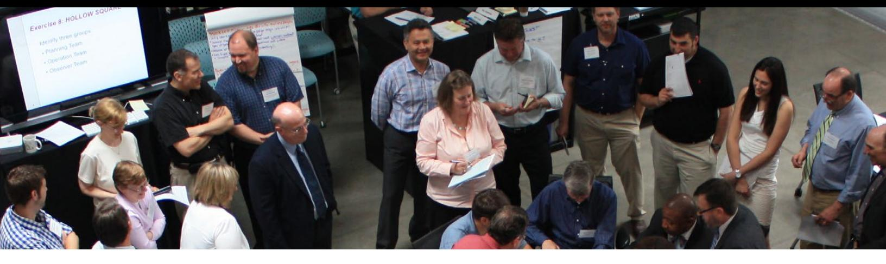
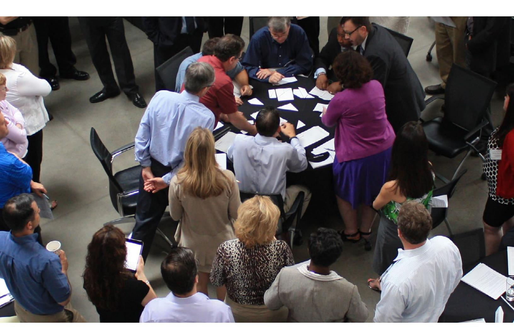

<!-- A3.R40 | source: papers_json/A3.R40/ -->

## The Human Side of the Strategic Planning Process in Higher Education

**by Robert P. Delprino**

<!-- page 2 -->

## The Human Side of the Strategic Planning Process in Higher Education

by Robert P. Delprino

Society for College and University Planning www.scup.org © 2013 by the Society for College and University Planning All rights reserved. Published 2013. ISBN 978-1-937724-23-8

## **About the Society for College and University Pl** **anning (SCUP)**

جمعية التخطيط للكليات والجامعات (Society for College and University Planning) هي مجتمع من المتخصصين في التخطيط للتعليم العالي. تقدم الجمعية لأعضائها المعرفة والموارد اللازمة لوضع أهداف التخطيط المؤسسي وتحقيقها، وذلك في إطار أفضل الممارسات والاتجاهات الناشئة. لمزيد من المعلومات، يمكن زيارة الموقع www.scup.org.

## What is Integrated Pl anning?

التخطيط المتكامل هو الربط بين الرؤية والأولويات والأفراد والمؤسسة المادية، ضمن نظام مرن للتقييم واتخاذ القرار والتنفيذ. وهو يشكل المؤسسة كلها ويوجهها وهي تتطور مع الزمن وداخل مجتمعها.

<!-- page 3 -->

## **Contents **

Forewordi\Preface۰۰۰۰۰۰۰۱AcknowledgementsvChapter 1: Change is a People Process7Are Higher Education Institutions Different From Other Organizations?11Forces Influencing Higher Education12External Driving Forces15Internal Driving Forces17Chapter 2: The Players **2**1The Institution22The Administration25The Stakeholder Groups27The Strategic Planning Committee28The Institutional Planner31Chapter 3: The Challenges of Change as Part of Strategic Planning36The Politics of Strategic Planning37Managing Individual and Organizational Issues of Resistance41Leading Strategic Change48Chapter 4: Tools for Getting Others Involved in the Strategic Planning Process 51Strategic Planning Process Facilitation Tools52Nominal Group Technique—An Opportunity to Be Heard54Scenario Planning—Sharing in a Future Reality58Hollow Square—A Lesson in the Challenge of Application; Maybe You Don't Know It All63Survey Feedback—Keeping Everyone Informed69Real-Time Strategic Change—Getting the Whole System in the Room72Chapter 5: Getting Real About Strategic Planning75Integrated Strategic Planning76Reaching for the "Brass Ring"78The Importance of People, Organizational Structure, and Time in Realizing an Integrated Approach80References 88About the Author98

<!-- page 4 -->

## **Foreword**

قبل عدة سنوات، حضرت ورشة عمل تمهيدية في أحد مؤتمرات SCUP. طلب المقدّم من الحاضرين أن يذكروا أكثر مادة دراسية جامعية أفادتهم في عملهم كمخططين. أجاب معظم الحاضرين بمواد العلوم الاجتماعية، مثل علم النفس وعلم الاجتماع، أو حتى الأنثروبولوجيا الثقافية كما في حالتي. وكان هناك أيضاً من أشار إلى مواد إدارة الأعمال في القيادة أو التطوير التنظيمي، والتي منحتهم الفهم الأكثر ضرورة لإجراء التخطيط. أعتقد أن من يعمل في التخطيط بالتعليم العالي يصل بسرعة إلى استنتاج، كما يقول Robert Delprino، أن "الأمر في نهاية المطاف يتعلق بالناس".

بينما يقوم جوهر التخطيط على الأشخاص الذين يضعون الخطة وينفذونها، تدرك المؤسسات الناجحة في تخطيطها أن الأمر يتعلق أيضاً بالعملية. إن إدارة عملية تخطيط لمؤسسات متنوعة ومعقدة، حتى أصغر مؤسسات التعليم ما بعد الثانوي، أمر شاق. فكيف يحافظ المخطط على تركيز العملية وتنظيمها ومسارها الصحيح وسط هذا الكم من الأولويات ووجهات النظر المتنافسة؟

لم تعد حركة تحسين الجودة الشاملة (CQI) في الثمانينيات والتسعينيات ممارسة إدارية منتشرة كما كانت، إلا في الأعمال والصناعات الخاضعة لمعايير ISO. مع ذلك، أنتجت حركة CQI عدداً من أدوات العمليات التي يمكن استخدامها لتنظيم أي عملية وتقييمها. وإذا فُهمت هذه الأدوات واستُخدمت بشكل صحيح، فهي قوية في أي عملية تخطيط، ويمكن أن تساعد المخطط على إدارة العملية والأفراد المشمولين فيها معاً. وهي توفر طرقاً لتحديد التحديات والأهداف، وتتيح فرصاً متوازنة للمشاركة، بل وتساعد على إبقاء عملية واسعة النطاق على المسار الصحيح. كما يمكن أن يحسّن استخدام هذه الأدوات تفاعل المجموعة، ويعزز نوع روح الفريق الذي يشجع على القبول والالتزام من المشاركين. لكن أدوات إدارة العملية تحتاج إلى سياق كي تكون مفيدة، وهذا السياق لا يأتي إلا من فهم عميق للمؤسسة وأفرادها.

في كتاب *The Human Side of the Strategic Planning Process in Higher Education*، يقدّم Delprino نظرة عامة على مؤسسات التعليم ما بعد الثانوي بوصفها أنظمة تنظيمية، ثم يستعرض بعض النظريات الرئيسية المتعلقة بخصائص الأجزاء المتحركة في ذلك النظام وعلاقاتها. إن استخدام منهج الأنظمة لتحليل المؤسسات ووظائفها طريقة مناسبة بشكل خاص لصياغة استخدام أدوات إدارة العملية، لأن هذه الأدوات طُوِّرت أصلاً للاستخدام في تحليل الأنظمة.

بوصفنا مخططين، نبحث دائماً عن الأسلوب المبتكر الذي يكسر المقاومة، أو يحدد الهدف بشكل أفضل، أو يُشرك أصحاب المصلحة بفاعلية أكبر. إن بحث Delprino المتأني وتحليله سيضيفان إلى قاعدة المعرفة الضرورية لنجاح التخطيط.

*—Karen E. Hinton, July 2013*

<!-- page 5 -->

## **Preface**

يملك التخطيط الاستراتيجي في التعليم العالي القدرة على تحويل المؤسسات، وكذلك من يعملون فيها ومن تخدمهم. غير أن قدرة عملية التخطيط الاستراتيجي على تحقيق تغيير دائم يحوّل المؤسسة وأعضاءها بطريقة ذات معنى لا تتحقق دائماً بشكل ثابت. فرغم تقدير المخططين للماضي والحاضر والمستقبل المحتمل للمؤسسة، واتباعهم كل الخطوات المناسبة لوضع الخطة، قد يجد بعضهم أنفسهم يتساءلون لماذا لم تسر العملية بسلاسة كما كانوا يأملون.

يكمن جزء من الإجابة في الجانب الإنساني للتخطيط الاستراتيجي. فقد يكون إعداد وثيقة التخطيط الجزء الأسهل من العملية. أما كسب التزام أفراد المؤسسة وفهمهم لكيفية ارتباط الخطة الاستراتيجية بنجاحهم الشخصي ونجاح المؤسسة، فهو التحدي الحقيقي. بالنسبة لكثير من أفراد المؤسسة، يبدو التخطيط الاستراتيجي وكأنه شيء يحدث من حولهم لا شيء يقومون به بأنفسهم ومن خلالهم. ومن الفرضيات الأساسية لهذا الكتاب أن معظم ما يحدث في أي مؤسسة، جيده وسيئه، يحدث بواسطة أفرادها ومن خلالهم. وكجزء من تنفيذ الخطة الاستراتيجية، فإن أفراد المؤسسة، وقدرتهم على التفكير والتصرف بشكل استراتيجي، هم من يملكون القدرة على بث الحياة في الخطة الاستراتيجية وجعلها وثيقة حية.

يركز هذا الكتاب على الجانب الإنساني لعملية التخطيط الاستراتيجي. توجد أدوات وموارد عديدة تقدم إرشادات حول كيفية إعداد خطة استراتيجية في مؤسسات التعليم العالي. ويخصص عدد من هذه الموارد بعض الاهتمام للقضايا المتعلقة بالفئات المشاركة في العملية. غير أن هناك نقصاً في المواد المخصصة بالكامل لهذا الموضوع. يجعل هذا الكتاب الأفراد، أي الجانب الإنساني، محور تركيزه، ويحاول سد هذه الفجوة في النقاش. ولا يهدف الكتاب إلى تقديم مراجعة شاملة لجميع القضايا. بل يهدف إلى منح القارئ بعض البصيرة لتقدير أهمية الأفراد وكيفية إشراك الآخرين بأفضل طريقة ممكنة.

نظراً لبعض الخصائص الفريدة لمؤسسات التعليم العالي والقوى المؤثرة فيها، يناقش هذا الكتاب اللاعبين في العملية وتحديات العمل معهم. لا يتعلق نجاح التخطيط الاستراتيجي في التعليم العالي بمن تدعوه إلى الطاولة فحسب، بل أيضاً بكيفية جلبه إليها. لذلك يقدم الكتاب مجموعة من الأدوات المصممة لإشراك أفراد المؤسسة ومنحهم فرصة لإسماع أفكارهم وآرائهم. إن طريقة إشراك الجانب الإنساني للمؤسسة أمر حيوي لتحقيق أي مستوى من النجاح للخطة الاستراتيجية، ولتحقيق نتيجة ذات معنى تفضي إلى تغيير دائم.

*—Robert Delprino, 2013*

<!-- page 6 -->

## **Acknowledgements**

أود أن أشكر المدربين والمشاركين في SCUP Planning Institute الذين حظيت بمتعة العمل معهم على مدى السنوات الماضية. لقد أتاحت لي هذه التفاعلات تقييم تطبيق التمارين والأفكار والمفاهيم، وكذلك توضيح بعض أفكاري حول التخطيط الاستراتيجي. إن عملاً كهذا لا يكون أبداً نتاج شخص واحد فقط، بل يتطلب مهارات فريدة من أشخاص كثيرين لتحقيقه. وأخص بالشكر السيد Terry Calhoun، والسيدة Claire Turcotte، والسيدة Kimberly Mass، والسيدة Shaunna Cahill، لمشاركتهم مهاراتهم وإرشادي خلال هذه العملية. لقد جعلوا هذا العمل ممتعاً على الصعيدين الشخصي والمهني.

وأخيراً وليس آخراً، أشكر الأشخاص الثلاثة في حياتي الذين غيّروني نحو الأفضل ويلهمونني بكل ما يفعلونه: Allyson وAndrew وMaureen.

<!-- page 7 -->

## Chapter 1: Change is a People Process

"only when an organization exists in stable circumstances, when its operations resemble clockwork, unvarying in their practices, can individuals be taken for granted or ignored without peril."

—Rosabeth Moss Kanter (1983), *The Change Masters*, page 17

قلة من المؤسسات، إن وُجدت، تعمل بدقة تشبه آلية الساعة. أما فيما يخص الاستقرار، فتحتاج مؤسسات كثيرة إلى تبني ممارسات جديدة بانتظام لمجرد الحفاظ على وضعها الراهن. ولعل مؤسسات التعليم العالي، أكثر من غيرها من المؤسسات، تحتاج إلى ممارسة التكيف باستمرار للبقاء تنافسية وذات صلة. وفكرة أن بيئة التعليم العالي أصبحت أكثر تنافسية ليست جديدة (Richardson, Nwankwo, and Richardson 1995). ومع ذلك، هناك عوامل ناشئة عديدة تؤثر في قدرة مؤسسات التعليم العالي حالياً على الحفاظ على معاييرها القائمة والازدهار. وتشمل هذه الضغوط تراجع أعداد الملتحقين، وارتفاع التكاليف، والتغيرات الديموغرافية، والمنافسة عبر الإنترنت، وأعباء الاعتماد الأكاديمي، وتقلص فرص التمويل (Hughes and White 2006). ويمكن لعملية تخطيط استراتيجي سليمة أن تتيح لمؤسسات التعليم العالي التنقل بنجاح عبر المشهد التعليمي المتغير.

ينسب Dooris, Kelley, and Trainer (2004) بداية التخطيط الاستراتيجي في التعليم العالي إلى مخططي المرافق والمساحات الجامعية، حيث عُقد أول اجتماع رسمي لمخططي الحرم الجامعي عام 1959 في Massachusetts Institute of Technology. ويحدد هؤلاء الباحثون موضوعاً متطوراً في التخطيط الاستراتيجي: تحول من التركيز على إعداد الخطة الاستراتيجية إلى التركيز على تنفيذ عملية التخطيط الاستراتيجي. فالتخطيط الاستراتيجي لا يتعلق فقط بإعداد خطة. بل يتعلق بإحداث تغيير في المؤسسة من خلال قدرة أعضائها ورغبتهم في تنفيذ عملية التخطيط.

يشبه تطور التخطيط الاستراتيجي من التركيز على الخطة إلى تركيز أكبر على العملية تطورات حدثت في عمليات أخرى داخل المؤسسات التي تسعى إلى تعزيز أداء أعضائها. فمعظمنا كموظفين مرّ في مرحلة ما بتقييم أداء وظيفي. ويعود استخدام تقييم الأداء في القوى العاملة الأمريكية إلى أوائل القرن العشرين (Vinchur and Koppes 2011). ويُعد تقييم الأداء عملية مهمة تنفذها المؤسسات، ويمكن أن تفيد في تطوير الموظفين وكذلك في اتخاذ القرارات المتعلقة بالموارد البشرية. وقد ركز جزء كبير من الأبحاث المبكرة حول تقييم الأداء في مجال علم النفس الصناعي والتنظيمي على عملية القياس. وأُولي اهتمام كبير لتطوير المقاييس المستخدمة في قياس الأداء. وخلال ما يمكن تسميته بالبحث عن أداة أفضل لقياس الأداء بدقة أكبر، لم يُؤخذ السياق الذي يجري فيه تقييم الأداء بعين الاعتبار. غير أن الأساليب الأحدث في تقييم الأداء تركز على أهمية ردة فعل الموظف، وكذلك على دافعية المقيّم لتحقيق الدقة (DeNisi and Sonesh 2011). وينظر Murphy and Cleveland (1995) إلى تقييم الأداء بوصفه عملية اجتماعية وتواصلية، لا مجرد أداة قياس. فالمقيّم ليس مشاركاً سلبياً، بل عاملاً نشطاً يسعى لتحقيق أهداف محددة. وبهذه الطريقة تصبح أدوات تقييم الأداء جزءاً من عملية إدارة الأداء التي تربط الأداء الفردي بالأهداف الاستراتيجية للمؤسسة (Aguinis 2008).

وبالمثل، في التخطيط الاستراتيجي بالتعليم العالي، تُعد الخطة الاستراتيجية السليمة، رغم أهميتها، مجرد جزء واحد من عملية التخطيط الأوسع. فتصور أعضاء هيئة التدريس والموظفين والطلاب للعملية، وردة فعلهم تجاهها، ومشاركتهم فيها، هي ما

<!-- page 8 -->

يحدد نجاح أو فشل أي تغيير استراتيجي مخطط له. فعندما يتعلق الأمر بالتغيير، سواء على المستوى الفردي أو التنظيمي، قد يكون إعداد الاستراتيجية أو الخطة هو الجزء الأسهل من عملية التغيير.

توجد موارد عديدة يمكن أن توجه الفرد أو المؤسسة في إعداد وثيقة الخطة الاستراتيجية. وبالمثل، إذا أراد المرء إجراء تغيير في نمط حياته، مثل نظامه الغذائي أو ممارسته الرياضية، فمن السهل إيجاد مورد يساعده. فهناك خبراء لا حصر لهم يرغبون في أن تشتري منتجهم الغذائي، أو جهازهم الرياضي، أو فيديوهم، أو أن تحضر ندوتهم التي ستغيرك وتمكنك من بلوغ أهدافك. وقد تلاحظ في الطباعة الصغيرة المعتادة أن غالبية استراتيجيات تغيير الحياة هذه تتضمن عادة عبارة مفادها أن "النتائج المعروضة ليست نمطية". وإلى جانب حماية أنفسهم من المسؤولية المحتملة عن ادعاءات نجاح قد لا تتحقق، هناك سبب وجيه جداً لتلك العبارة. فمع أن أي خطة للتغيير تتطلب عملاً متأنياً وجهداً، فإن العامل الرئيسي الذي يحدد نجاحها هو الفرد نفسه. وينطبق هذا أيضاً على المؤسسات. ومن فرضيات هذا الكتاب أن معظم ما يحدث في المؤسسات يحدث بواسطة الأفراد ومن خلالهم. والوجه الآخر لهذه الفرضية هو أن معظم ما يفسد في المؤسسات يحدث أيضاً بواسطة الأفراد ومن خلالهم. وينطبق هذا المبدأ على التخطيط الاستراتيجي في التعليم العالي.

من الناحية المثالية، تُعد مؤسسات التعليم العالي منظمات متعلمة. ويمكن وصف المنظمات المتعلمة بأنها مؤسسات تيسّر تعلّم أعضائها وتعزز التحول المستمر للمؤسسة (Garvin 1993). وما زلت أُدهش من أن مؤسسات التعليم العالي، وهي مؤسسات معنية بتعليم الآخرين، لا تدعم دائماً الهياكل أو العمليات التي تُدير المؤسسة، ولا تسمح دائماً بالتحول الداخلي اللازم لنجاح التخطيط والتغيير. وقد يكون القصور الذي تعاني منه المؤسسات في إدارة الجانب الإنساني من عملية التخطيط والتغيير. وقد يكمن جزء من هذا القصور في عدم القدرة أو عدم الرغبة في الاعتراف بأن الجانب الإنساني لعملية التخطيط الاستراتيجي يمكن التعامل معه بكفاءة وفاعلية أكبر. ففي التعليم العالي، يُنتقد أداء الطالب ويُقيّم باستمرار، وقد ينتج عن ذلك أحياناً درجة راسبة. أما الاعتراف الصريح من مؤسسات التعليم العالي بإخفاقاتها أو أوجه قصورها، فقد يكون أمراً أكثر ندرة.

ومع أن الرسالة والرؤية عنصران مهمان في نجاح عملية التخطيط الاستراتيجي، فإن الأمر يتعلق أيضاً بكيفية اندماج الأفراد في العملية نفسها. فالمهندس المعماري الذي يصمم مبنى جديداً يتناسب مع بصمة الحرم الجامعي القائم، أو يعيد تصميم مساحة قائمة لتعظيم قابليتها للاستخدام، لا بد أن يراعي عوامل مثل التكلفة والتقنية، وأن يتأكد من تنفيذ البناء وفق التصميم. غير أن الطلاب وأعضاء هيئة التدريس والموظفين هم من سيعيشون مع ذلك التصميم. وهم من سيستخدمون ذلك المبنى وتلك المساحة، ويبثون الحياة في تلك المخططات والرؤى المعمارية. وسيكون استبعاد المستخدم من خطة التصميم خطأً. وبطرق عديدة، ينطبق الأمر ذاته على عملية التخطيط الاستراتيجي. فأفراد المؤسسة هم من يجعلون الخطة الاستراتيجية حقيقية ويبثون فيها الحياة.

للأسف، يوجد أحياناً في التعليم العالي تركيز أكبر على الخطة دون إيلاء اعتبار مماثل للجانب الإنساني من عملية التخطيط الاستراتيجي. ويمكن أن يؤدي إهمال الجانب الإنساني للعملية إلى فشل العملية بأكملها. ويمكن استخلاص دروس حول أهمية إدارة الجانب الإنساني للعمليات التنظيمية من أدبيات إدارة الجانب الإنساني لعمليات الاندماج والاستحواذ في قطاع الأعمال (Buono and Bowditch 1989). وقد صاغ Mirvis and Marks (1992) مصطلح "متلازمة الاندماج" لوصف النتائج السلبية للشك والخوف اللذين قد يشعر بهما الموظفون عندما تشارك الشركات في عملية اندماج أو استحواذ. وغالباً ما يكون الموظفون أكثر انشغالاً بمواقعهم ومستقبلهم في الشركة منهم بنجاح العملية نفسها. وكما يلاحظ Buono and Bowditch (1989)، تفشل كثير من عمليات الاندماج والاستحواذ في تحقيق

<!-- page 9 -->

توقعاتها الاستراتيجية أو المالية بسبب سوء التعامل مع الجانب الإنساني للعملية. وغالباً ما تُبنى رغبة شركة في الاندماج مع شركة أخرى أو الاستحواذ عليها جزئياً على رأس المال البشري الذي تمتلكه الشركة المستهدفة. وبينما يُولى اهتمام كبير للجوانب القانونية والمالية للاندماج أو الاستحواذ، فإن الفشل في توصيل عملية التغيير بشكل مناسب ومعالجة الجانب الإنساني للعملية يمكن أن يؤدي إلى خسارة الأصول والمواهب البشرية التي جعلت الشركة هدفاً جذاباً للاستحواذ في المقام الأول. فالأفراد، أي المواهب، يغادرون بسبب الخوف وعدم اليقين. وتخبر عملية التغيير الناجحة المعنيين بأدوارهم، وتوفر لهم التوجيه، وتشرح المخاطر المحتملة.

لا يجب أن يكون التخطيط الاستراتيجي نشاطاً مليئاً بالمحن والتجارب. فأخذ العوامل التنظيمية التي يمكن أن تؤثر في عملية التخطيط الاستراتيجي بعين الاعتبار مسبقاً يمكن أن يوفر منظوراً لإدارة العملية بشكل أفضل بحيث لا تتحول إلى محنة. كما أن هناك قيمة في دراسة عمليات تنظيمية أخرى بحثاً عن تكتيكات يمكن تكييفها وتطبيقها بسهولة على عملية التخطيط الاستراتيجي. فمثلاً، في اتخاذ القرار، يمكن إجراء بعض التغييرات بسهولة نسبية. وتنتج القرارات الناجحة جزئياً عن فهم كيفية اتخاذها بأفضل شكل، بالنظر إلى بعض الخصائص الأساسية لعملية القرار. فعلى سبيل المثال، يمكن أن يكون تغيير ساعات مكتب عضو هيئة التدريس عملية بسيطة، طالما أُبلغ الطلاب والجهات المعنية بذلك. ويمكن اعتبار تغيير موقع الفصل الدراسي، أو حجز مساحة في الحرم الجامعي، أو تخصيص مساحة لمكتب قسم، قرارات بسيطة نسبياً. فهذه قرارات مبرمجة وتلقائية، توجد لها سياسات وإرشادات مشتركة لاتخاذها. أما مجموعة ثانية من القرارات، وهي القرارات غير المبرمجة، فهي أكثر تعقيداً وقد تحمل مخاطر أكبر. وتشمل هذه القرارات أين تُجرى تخفيضات الميزانية لمعالجة فجوة ميزانية كبيرة، وكيفية التعامل مع قضايا سكن الحرم الجامعي المرتبطة بتدفق غير متوقع للطلاب، أو متى يتم تغيير رسالة الحرم الجامعي وتركيزه. وفي هذه الأنواع من القرارات، لا تكون كيفية المضي قدماً واضحة بالقدر نفسه. وبشكل أكثر تحديداً، تختلف القرارات المبرمجة وغير المبرمجة على ثلاثة أبعاد: (1) نوع المهمة: مهمة بسيطة مقابل مهمة معقدة، (2) التوجيه المتاح: الاعتماد على سياسات المؤسسة مقابل عدم وجود سابقة تاريخية أو واضحة، و(3) نوع متخذ القرار: مشرف من المستوى الأدنى مقابل مشرف من المستوى الأعلى. وهناك عوامل أخرى يمكن أن تؤثر في نجاح أسلوب اتخاذ القرار، منها الوقت المتاح لاتخاذ القرار، ومستوى الالتزام المطلوب من الآخرين، وما إذا كان القرار يجب أن يتخذه فرد أم مجموعة (Buhler 2001; Dinur 2011; Greenberg 2011).

هناك مناهج ونماذج عديدة يمكن استخدامها لتفسير عملية اتخاذ القرار، مثل النموذج التحليلي، والنموذج الاقتصادي الرشيد، ونموذج الرشد المحدود، على سبيل المثال لا الحصر. غير أنه، بصرف النظر عن النموذج، فإن امتلاك بصيرة بالعملية من منظور الفرد أو المجموعة أمر مهم لتحديد الأسلوب الصحيح وتحقيق النجاح.

وينطبق هذا أيضاً على التخطيط الاستراتيجي. فالنظر إلى عملية التخطيط الاستراتيجي من منظور الأفراد والمجموعات التي تشكل المؤسسة أمر حيوي لتحقيق نتيجة إيجابية. ويتطلب التخطيط الاستراتيجي الناجح كسب التزام الآخرين ومعالجة المقاومة للتغيير. وبالنسبة لمن يقرأ هذا الكتاب من المديرين ذوي الخبرة، أتوقع في هذه المرحلة أن يقول بعضكم لنفسه إن هذا كله من قبيل المنطق البديهي. ربما يكون الأمر كذلك، لكن، كما يحدث غالباً، تلك الأفكار التي نعتبرها بديهية كثيراً ما تُغفَل أو لا تُؤخذ بعين الاعتبار الكافي.

وقد يوضح هذه النقطة بشكل أفضل اقتباس من Howard Ikemoto، وهو فنان أمريكي ياباني من الجيل الثاني وُلد في Sacramento بولاية California عام 1930: "عندما كانت ابنتي في نحو السابعة من عمرها، سألتني يوماً ما عملي. فأخبرتها أنني أعمل في الكلية، وأن وظيفتي هي تعليم الناس الرسم. فحدّقت فيّ غير مصدقة وقالت: 'تقصد أنهم نسوا؟'" (Masters 2004, ¶ 1). في التخطيط الاستراتيجي، قد يُركَّز الاهتمام كثيراً على إعداد

<!-- page 10 -->

الخطة وصياغة بياني الرسالة والرؤية، حتى يُنسى الأمر الواضح: إدارة عامل الأفراد، وتوجيه أعضاء المؤسسة خلال العملية، والتعامل مع مخاوفهم واهتماماتهم.

إن أهمية الأفراد في عملية التغيير التنظيمي، وكذلك احتمال سوء إدارتهم خلال هذه العملية، ليست أمراً جديداً. ويناقش Jaffe and Scott (1998) الاعتقاد الذي قد تحمله الشركات بأن أعضاءها سيرحبون بالتغيير وطرق العمل الجديدة. غير أن هذين الباحثين يوضحان أن استجابة الأعضاء للتغيير قد تكون في الواقع مشابهة لاستجابة أشخاص تعرضوا لتغيير مأساوي وكارثي. فبالنسبة لبعض الأشخاص، يكون التغيير مزعزعاً بعمق؛ فبعضهم يزداد سوءاً قبل أن يتحسن، وبعضهم لن يقبل التغيير أبداً، وبعضهم سيلجأ إلى سلوك نمطي جامد وغير منتج. وهناك اعتقاد بأن المؤسسة لا تحتاج إلى تقديم مساعدة أو صبر يُذكر، لأن جميع الأعضاء سيلتزمون بالصف ويسهمون في التغيير. وقد يكون هذا هو تصور بعض قادة التعليم العالي عن كيفية استجابة أعضاء هيئة التدريس والموظفين والطلاب لطرح خطة استراتيجية.

حتى الأعضاء الذين يتقبلون عملية التخطيط الاستراتيجي ما زالوا بحاجة إلى توجيه خلال العملية. ويصف Rosen (1998) العمل اليومي للقائد بأنه تفاعل إنساني. وبينما ينظر Rosen إلى الأفراد بوصفهم أثمن موارد المؤسسة، ومركز الأعصاب في جسدها التنظيمي، فإنه يقارنهم أيضاً بنجمات الفن المتطلبات وخيول السباق التي تحتاج إلى اهتمام مستمر. وفي عملية التخطيط الاستراتيجي بالتعليم العالي، يمثل أعضاء هيئة التدريس والموظفون والطلاب مركز الأعصاب في الحرم الجامعي. فعملهم ونجاحهم هما ما يسهمان في سمعة المؤسسة. وهم أيضاً أساس أي تغيير. وستحدد طريقة إدارتهم وقيادتهم القيمة النهائية لعملية التخطيط الاستراتيجي.

أتيحت لي الفرصة في وقت مبكر من مسيرتي المهنية لإجراء تحليل وظيفي لرجال الإطفاء في مدينة متوسطة الحجم. وكان الهدف دراسة مهام رجال الإطفاء ووظائفهم أثناء استجابتهم للنداءات. أمضيت أربعة أيام أعيش فيما وُصف بأنه أحد أكثر محطات المدينة عراقة وازدحاماً. ورغم أنني حققت خيالاً من خيالات الطفولة بتعلم الانزلاق على عمود الإطفاء، لم يكن هناك، خلال أربعة أيام، نداء حريق واحد. وسواء بدافع الملل أو الرغبة في عرض شيء عليّ، تم تعريفي بكل قطعة معدات إطفاء ممكنة يملكها القسم، وشوهدت لي عروض توضيحية لها جميعاً. وكان عرضاً مثيراً للإعجاب. وبعد ذلك لخص لي الأمر ضابط إطفاء متقاعد كان يزور المحطة بانتظام. قال: "على مدى السنوات الطويلة التي خدمت فيها إطفائياً، رأيت واستخدمت قدراً كبيراً من المعدات، وما زلت معجباً بالتقنية الجديدة. لكن في نهاية المطاف، يبقى الأمر متعلقاً بإيصال الماء إلى الحريق." وفي التخطيط الاستراتيجي، يبقى الأمر في نهاية المطاف متعلقاً بالأفراد. فعندما يتعلق الأمر بالتخطيط الاستراتيجي، قد يُبالَغ في التركيز على صياغة الخطة والرسالة والرؤية بالشكل الصحيح تماماً، أو على تحديد التحليلات المناسبة لقياس النجاح. وهذه كلها أمور مهمة للغاية ويمكن أن تكون مثيرة للإعجاب ومفيدة جداً. غير أن خلاصة الأمر هي أن التخطيط الاستراتيجي المفيد، من النوع الذي يحقق تغييراً مستداماً، يتعلق بالأفراد المشاركين في العملية. فأفضل خطة استراتيجية لا معنى لها إن لم يلتزم المشاركون المستهدفون بالعملية، أو يسهموا في إعدادها بطريقة ذات معنى، أو يقبلوا دمج الخطة في حياتهم العملية اليومية.

<!-- page 11 -->

## **Are Higher Education Institutions** **Different From Other Organizations?**

في عملهما الكلاسيكي *The Social Psychology of Organizations*، ينظر Katz and Kahn (1966) إلى أنماط السلوك الإنساني بوصفها جوهر المؤسسة. وقد تكون أنماط السلوك الإنساني هذه هي ما يميّز مؤسسات التعليم العالي عن غيرها من المؤسسات. وبشكل عام، عُرِّفت المؤسسات بأنها أنظمة اجتماعية مستقرة وقابلة للتنبؤ ومنظمة، يعمل فيها الأفراد بشكل فردي وجماعي لتحقيق أهداف مشتركة (Champoux 2011; Greenberg 2011; Tosi, Rizzo, and Carroll 1986). وقد تكون الأمور أبسط بكثير في عملية التخطيط الاستراتيجي لو كانت تلك الأنظمة الاجتماعية مستقرة وقابلة للتنبؤ بشكل ثابت. والواقع أن السلوك الإنساني في المؤسسات معقد وليس مفهوماً دائماً بسهولة. ومع ذلك، يمكن أن يوفر إطار مفاهيمي للمؤسسات أساساً لمناقشة الخصائص التي ينبغي مراعاتها في إدارة الجانب الإنساني لعملية التخطيط الاستراتيجي في التعليم العالي.

هناك بعض القواسم المشتركة بين جميع المؤسسات من حيث كيفية تصورها، لكن، كما هو الحال مع الشخصية الفردية، تمتلك كل مؤسسة خصوصيات فريدة تحددها وتمنح بعض البصيرة حول كيفية استجابة المؤسسة وأعضائها للضغوط الداخلية والخارجية. ومثل الشخصية الفردية، التي يُنظر إليها عادة على أنها مستقرة عبر الزمن، قد لا تتغير بسهولة شخصية مؤسسة التعليم العالي أو ثقافتها أو طريقة عملها، مما يؤثر على قدرة أعضائها على الاستجابة للتغيير أو التكيف السريع مع طرح خطة استراتيجية.

هناك بعض الطرق التي قد تختلف بها مؤسسات التعليم العالي عن المؤسسات الأخرى، والتي يمكن أن تؤثر في نجاح عملية التخطيط الاستراتيجي. وتشمل هذه: البنية التنظيمية/بنية السلطة، وشروط التوظيف، وولاءات أعضاء هيئة التدريس والموظفين، والفئة التي تُخدَم.

يشير الهيكل التنظيمي إلى التشكيل الرسمي للأفراد والمجموعات داخل المؤسسة بهدف تحديد المسؤوليات والسلطة (Moorhead and Griffin 1998). وسيأخذ هيكل المؤسسة أشكالاً مختلفة بناءً على قرارات تتعلق بنطاق الإشراف المرغوب على الموظفين أو تقسيم العمل التنظيمي، من بين أمور أخرى. وهيكل المؤسسة هو ما يتيح لها تنفيذ خطة استراتيجية بنجاح (Chandler 1962; Hall and Saias 1980). وعادة ما يكون هيكل السلطة في المؤسسة واضحاً نسبياً. فالهيكل التنظيمي يوضح من هو المسؤول، ويحدد مسؤوليات اتخاذ القرار والموارد البشرية. والهيكل التنظيمي لكلية سيوضح من هو الرئيس، ومن هم كبار الإداريين والعمداء الأكاديميين، وما إلى ذلك. غير أنه في التعليم العالي توجد عدة جهات مؤثرة قد لا تجعل هيكل السلطة واضحاً كما يبدو على الورق. فعلى سبيل المثال، تمتلك حرم جامعية كثيرة مجالس لأعضاء هيئة التدريس تعمل كهيئات حاكمة في مسائل مثل إعادة الهيكلة المتعلقة بإنشاء كليات وأقسام جديدة، والتغييرات في البرامج أو السياسات الأكاديمية. وقد لا يملك مجلس أعضاء هيئة التدريس سلطة رسمية في المؤسسة لإحداث التغيير؛ غير أن أصحاب السلطة الرسمية في الحرم الجامعي لن يرغبوا في مواجهة تصويت بحجب الثقة من مجلس أعضاء هيئة التدريس بسبب مخاوف تتعلق بالحوكمة المشتركة. وحتى لو كان هذا التصويت رمزياً فقط، يمكن أن يؤدي إلى شلل في مجتمع الحرم الجامعي وفي عملية التخطيط الاستراتيجي. كما يمكن أن تمتلك جهات أخرى، مثل مجموعات حكومة الطلاب، سلطة كبيرة في الحرم الجامعي. فبالإضافة إلى مسؤوليتها عن التعبير عن آراء الطلاب واهتماماتهم، تدير هذه المجموعات في بعض الحرم الجامعية أموالاً كبيرة تُجمع من رسوم الأنشطة الطلابية.

من الخصائص الأخرى التي تميّز التعليم العالي مدة بقاء الموظفين في المؤسسة. فمعظم الطلاب الداخلين إلى سوق العمل لا يحملون توقع الأجيال السابقة بأنهم سيقضون

<!-- page 12 -->

مسيرتهم المهنية كلها في مؤسسة واحدة. والواقع أن مراكز التطوير الوظيفي في الحرم الجامعي غالباً ما تنصح الطلاب بتوقع تعدد المسارات المهنية خلال حياتهم. وبينما هناك بعض الجدل حول عدد مرات تغيير المسار المهني التي سيمر بها الفرد (Bialik 2010)، فقد يكون من الشائع أكثر أن يغيّر الشخص وظيفته عدة مرات ضمن مهنة واحدة. فقد شغل الشخص العادي المولود في السنوات الأخيرة من جيل طفرة المواليد، بين عامي 1957 و1964، ما معدله 11.3 وظيفة من سن 18 إلى سن 46، وفقاً لمسح طولي أجراه US Bureau of Labor Statistics بدأ عام 1979 لمتابعة أفراد جيل طفرة المواليد الأصغر سناً عبر جزء كبير من حياتهم (US Department of Labor Bureau of Labor Statistics 2012).

وباستثناء التعليم العالي، قد يصعب تحديد مؤسسات أخرى كثيرة يقضي فيها الموظفون مسيرتهم المهنية كاملة في مكان واحد، أو تُقام فيها احتفالات حضور واسع بمناسبة مرور 25 عاماً على التوظيف كل عام. وقد لا يكون الأمان الوظيفي المرتبط بالتثبيت (بالنسبة لأعضاء هيئة التدريس) أو التعيينات المستمرة بعد فترة اختبار مدتها عام (بالنسبة للموظفين) حافزاً كافياً لأعضاء المؤسسة تجاه مُثُل التخطيط الاستراتيجي.

ومما يرتبط بمدة التوظيف الولاء في التعليم العالي. فمعظم أعضاء هيئة التدريس يتحملون مسؤولية البحث العلمي والتدريس والخدمة، في الحرم الجامعي والمجتمع. وفي بعض الحالات، قد يتصرف أعضاء هيئة التدريس كمقاولين مستقلين يركزون على الحصول على منحة بحثية تالية أو إنهاء مخطوطة تعزز مسيرتهم المهنية، على حساب المحاضرات الصفية أو خدمة الحرم الجامعي. وفي الأوساط الأكاديمية، غالباً ما تكون الشهرة والثروة هما ما يُكافأ عليه. وقد لا يُكافأ مهنياً في الحرم الجامعي أو في مجال دراستهم أعضاء هيئة التدريس الذين يقضون وقتاً كبيراً مركزين على الطلاب. ورغم ذلك، يختار بعض أعضاء هيئة التدريس التركيز بقوة على التدريس، ويقدّرون الحرية الأكاديمية التي يملكونها لتدريس طلابهم وإرشادهم. غير أن هؤلاء الأعضاء قد يكونون أكثر تركيزاً على دورهم كمعلمين أو مرشدين منهم على التطلعات الاستراتيجية طويلة الأمد للمؤسسة. وقد أتيحت لي فرصة تيسير عدد من ورش العمل حول التخطيط الاستراتيجي لأعضاء هيئة التدريس والموظفين في حرم جامعية. وفي أحد الحرم الجامعية، كان الموظف المسؤول عن توجيه الكلية عبر عملية التخطيط الاستراتيجي يأمل أن تنير ورشة العمل الحرم الجامعي بفوائد التخطيط الاستراتيجي. وفي نهاية اليوم، كان الموظف حريصاً على الحصول على تعليقات من المجموعة حول مدى حماسهم لبدء عملية التخطيط الاستراتيجي. فقال أحد أعضاء هيئة التدريس، الذي أمضى اليوم يستمع بأدب إلى العرض، للموظف: "أقدّر العمل الذي تقوم به، لذا ركّز أنت على التخطيط الاستراتيجي وأنا بحاجة إلى التركيز على مقرراتي وطلابي." وقد يشير هذا التصريح إلى أن التخطيط الاستراتيجي، بالنسبة للبعض، هو شيء يحدث حولهم، لكن ليس بالضرورة بواسطتهم أو من خلالهم. وبالنسبة لآخرين، قد لا تكون الخطة الاستراتيجية ضمن اهتماماتهم أو جزءاً من واقع عملهم اليومي. ولا تسهم مثل هذه الآراء لدى أعضاء هيئة التدريس والموظفين في جعل الخطة الاستراتيجية وثيقة حية.

وأخيراً، تختلف مؤسسات التعليم العالي عن المؤسسات الأخرى في الفئة التي تخدمها، أي طلابها. فبينما قد يقضي أعضاء هيئة التدريس والموظفون معظم مسيرتهم المهنية في مكان واحد، يتغير جسم الطلاب باستمرار، إما بالتخرج أو بالانسحاب. وقد يخلق هذا الدوران المستمر لأصحاب المصلحة من الطلاب مثبطاً ثقافياً للتغيير. فلماذا الانشغال بعملية تغيير حين لا يكون من يُقصَد بها جزئياً موجوداً بعد أربع إلى ست سنوات؟

## **Forces** **Influencing Higher Education**

العوامل الموصوفة أعلاه هي بعض التحديات التي يواجهها قادة التعليم في إعداد الخطط الاستراتيجية وتنفيذها. وهي تمثل بعض القوى الداخلية الفريدة التي تعمل على مؤسسات التعليم العالي والتي يمكن أن تسهم في خلق ثقافة أقل حماساً تجاه عملية التخطيط الاستراتيجي. وإلى جانب هذه القوى الداخلية، يمر التعليم العالي بتحول بفعل تحديات وفرص جديدة قادمة

<!-- page 13 -->

من خارج المؤسسة، مثل التغير في التركيبة الثقافية والأكاديمية للطلاب الجدد، والضغط لتطوير مقررات وبرامج وتقديمها عبر وسائط جديدة. ومن الواضح أن عملية التخطيط الاستراتيجي في التعليم العالي يجب أن تراعي القوى الداخلية والخارجية العاملة على المؤسسة لتنجح.

إن قدرة المؤسسة وأعضائها على الاستجابة للضغوط الداخلية والخارجية ببراعة تطور ضروري لجميع المؤسسات. وقد يكون هذا أصح في مجال التعليم، الذي كان يُنظر إليه في الماضي بوصفه أكثر استقراراً وأكثر عزلاً عن المؤثرات الخارجية مقارنة بقطاعات أخرى. وفي عام 1966، أشار Katz and Kahn إلى المؤسسات التعليمية بوصفها منظمات معالجة للأفراد ومغيّرة لهم، أقل انفتاحاً على التأثير المباشر لقوى السوق وأكثر اهتماماً بالنتائج طويلة الأمد. ومضى الباحثان يقترحان أن المنظمات المغيّرة للأفراد، مثل المدارس، ينبغي أن تسترشد بمعايير ألطف وأكثر توجهاً نحو الفرد، على النقيض من المعايير التي توجه المنظمات ذات الطابع الاقتصادي (Katz and Kahn 1966). وما أشد الفارق الذي أحدثته 50 عاماً. فبينما تأمل مؤسسات التعليم والعاملون فيها، على الأقل، أن يساعدوا في تشكيل حياة طلابهم وتغييرها على المديين القصير والطويل، فقد يصعب تخيل مؤسسة تعليم عالٍ لا تراعي موقعها في السوق والواقع الاقتصادي للبيئة الحالية. لذلك، من المفيد فحص بعض هذه القوى الدافعة الخارجية والداخلية لفهم أفضل للتحديات التي يواجهها من يحاولون إحداث تغيير وتخطيط في المؤسسة.

هناك إطار مفيد، يعترف بأهمية العوامل البيئية التي يجب على مؤسسات التعليم العالي التعامل معها والاستجابة الإنسانية معاً، وهو منهج النظام المفتوح. ومن منظور النظام المفتوح، تُعد المؤسسات ديناميكية ومتغيرة باستمرار استجابة للضغوط الداخلية والخارجية. وكان Katz and Kahn (1966) من أوائل من طبّقوا هذا المنظور على دراسة المؤسسات. ووفق منظور النظام المفتوح، لا تكون المؤسسات ثابتة، بل توجد في عملية مستمرة تحافظ فيها على ذاتها، حيث تُحوَّل المدخلات إلى مخرجات يستخدمها آخرون أو يعيد النظام استخدامها. ويمكن فهم سلوك المؤسسة وأعضائها من خلال تفاعلها مع البيئة. ويقدم الشكل 1.1 مثالاً على كيفية تطبيق هذا النموذج على التعليم العالي.

من فوائد النظر إلى المؤسسة كنظام مفتوح أن هذا المنظور يمكن أن يساعد في تفسير كيف يمكن للهياكل التنظيمية ومتطلبات الأدوار الوظيفية أن تعيق أو تعزز قدرة الأعضاء ورغبتهم في تعزيز عملية التخطيط الاستراتيجي. فعلى سبيل المثال، قد تُحدَّد الدعم المالي لكلية تابعة لنظام جامعي أكبر جزئياً بعدد الطلاب الملتحقين بالكلية. وقد تؤدي خطة لتحقيق عدد التحاق مرتفع من خلال سياسة قبول مفتوح إلى قبول طلاب ذوي قدرة أكاديمية أدنى، وتتعارض مع خطة لرفع المستوى العام للطلاب والتصور العام للمؤسسة. أما من ناحية متطلبات الدور الوظيفي، فقد يُطلب من موظف يعمل في مكتب مساعدة الحاسوب الاستجابة فقط للأسئلة المتعلقة بتسجيل الدخول والبريد الإلكتروني رغم امتلاكه معرفة تتجاوز هذين المجالين. وقد يتعارض دور وظيفي صارم يحد مما يمكن للموظف تقديمه مع خطط معلنة لتعزيز خدمة العملاء، وقد يغرس في الموظف ترددًا في العمل على الهدف الاستراتيجي المتمثل في تعزيز خدمة العملاء.

<!-- page 14 -->

*Figure 1.1 **Educational Institution as an Open System***

يشير Morgan (2006) إلى أنه ينبغي دائماً أن ننظّم مع مراعاة البيئة، ويرى أن الاهتمام بالاستراتيجية المؤسسية ناتج عن إدراك أن المؤسسات يجب أن تكون حساسة لما يحدث خارج أسوارها. ويتيح منهج النظام المفتوح تقديراً أكبر لترابط القوى البيئية والداخلية العاملة على المؤسسة، ويقترح كيفية المواءمة الاستراتيجية بين هذه القوى. فتفاعلات الكلية أو الجامعة مع العملاء (الطلاب)، والموظفين، وأعضاء هيئة التدريس، والنقابات، والمنافسين، والموردين، والجهات التنظيمية (على سبيل المثال لا الحصر) لها آثار مهمة. وفي التخطيط الاستراتيجي بالتعليم العالي، قد يكون من الشائع النظر إلى هذه المجموعات المختلفة بوصفها كيانات منفصلة غير مترابطة، والتعامل مع قضايا التخطيط المتعلقة بكل مجموعة على حدة. وقد يكون للتفكير في التخطيط الاستراتيجي من منظور معزول ميزة جعل العملية أكثر قابلية للإدارة. غير أن جميع عمليات التخطيط العديدة التي تجري في التعليم العالي تؤثر، في الواقع، في بعضها بعضاً. فالخطط الأكاديمية، وخطط المباني والمرافق، والخطط المالية، وخطط الموارد البشرية، وغيرها، كلها مترابطة؛ أو على الأقل ينبغي النظر إليها كذلك. وقد يكون من الصعب جداً موازنة كل هذه المجموعات وعمليات التخطيط المنفصلة ذهنياً في وقت واحد. ويوفر منظور النظام المفتوح طريقة لتصور، وربما إدارة أفضل، للترابطات بين جميع عمليات التخطيط التي تجري في الحرم الجامعي. غير أنه لكي تستفيد المؤسسة من منظور النظام المفتوح في عملية تخطيطها الاستراتيجي، يجب أن تستطلع البيئة بشكل استباقي بحثاً عن التغيرات، وتستجيب لتلك التغيرات، وتضع نفسها في موقع يمكّنها من إدارتها.

يسرد الجدول 1.1 بعض القوى الدافعة الخارجية والداخلية المحتملة ذات الصلة بالتعليم العالي. وتختلف القوى الدافعة الخارجية والداخلية من حيث درجتها ومدى السيطرة عليها. فبينما تتمركز القوى الدافعة الخارجية

<!-- page 15 -->

حول عوامل خارج المؤسسة، قد تمثل القوى الداخلية خصائص فريدة للمؤسسة نفسها. كما أنه بينما قد تستطيع مؤسسة التعليم العالي التأثير إلى حد ما في القوى الدافعة الخارجية التي تؤثر فيها، هناك احتمال أكبر بأن تستطيع الكلية أو الجامعة السيطرة على قواها الدافعة الداخلية وتعديلها.

وتمثل هذه القوى الدافعة في الوقت نفسه تحديات وفرصاً في عملية التخطيط الاستراتيجي، وذلك حسب كيفية إدارتها وكيفية تسخير الطاقة المحيطة بها. ويمكن ضرب مثال بالإبحار. فالشراع المربع هو أقدم أنواع الأشرعة، ويعود استخدامه إلى عام 3500 قبل الميلاد. ورغم أنه وسيلة مفيدة جداً لتسخير الرياح، فإن أحد عيوب الشراع المربع أن جميع القوى تعمل في الاتجاه نفسه معه. ولأن الشراع المربع تدفعه الريح، فإن القدرة على الإبحار في اتجاهات مختلفة محدودة. أما الشراع اللاتيني (ويُشار إليه أحياناً بالشراع المثلث)، فيمكنه تحويل قوة الرياح من أي اتجاه إلى دفع أمامي (Campbell 1995; Casson 1971)، مما يزيل بعض شكوك البحارة حول قدرتهم على الوصول من النقطة أ إلى النقطة ب. ومثل الريح، ستظل القوى العاملة على المؤسسة موجودة، تدفعها إلى الأمام. وتكمن قيمة النظر إلى القوى الدافعة في إطار منظور النظام المفتوح في أن هذا النظر يمكن أن يساعد في تحديد أسلوب لمعرفة ما إذا كانت القوى الدافعة ستعيق عملية التخطيط أم يمكن تسخيرها لدفع المؤسسة في الاتجاه الاستراتيجي المرغوب في الوقت المناسب.

ستحمل قائمة القوى الدافعة في الجدول 1.1 معنى محدداً لكل مؤسسة. وفيما يلي مقترحات حول شكل هذه القوى بالنسبة لبعض المؤسسات.

## **External Driving Forces**

## 1. Influence Of A Larger System

بعض الكليات والجامعات جزء من نظام أكبر (مثل نظام على مستوى الولاية) أو امتداد لحرم جامعي (كما في حالة كلية لها وجود في الخارج أو كلية مجتمع لها عدة حرم ضمن منطقة). وكون المؤسسة، كما يمكن اعتبارها، فرعاً تابعاً لحرم جامعي رئيسي، قد يحد من قدرتها على التكيف والاستجابة بسرعة للقوى الخارجية. فعلى سبيل المثال، لا يمكن عادة لكلية تابعة لنظام تعليمي أكبر على مستوى الولاية طرح برنامج دراسي جديد استجابة لاهتمام بمجال شائع دون الحصول أولاً على موافقة الإدارة المشرفة. وفي بعض الأنظمة، يمكن أن تستغرق هذه العملية سنوات. أما الكلية المستقلة الأصغر، فقد تكون قادرة على الاستجابة لطلب السوق بسرعة أكبر. وقد تفرض بعض الأنظمة توحيداً للموارد بين

<!-- page 16 -->

حرمها الجامعية عبر منطقة أو ولاية، مما يتطلب من تلك الحرم تعديل إجراءات الشراء أو تخصيص الموارد لديها، وبالتالي يحد من قدرتها على شراء معدات حاسوبية أو الحصول على كتب مكتبية وقواعد بيانات بحثية.

## 2. Technology

بالنسبة لمعظمنا، وخصوصاً العاملين في التعليم العالي، تُعد مواكبة وتيرة التغير التقني أمراً حيوياً. والقول إن التقنية تتغير باستمرار هو أمر بديهي. وقد تنبأ مستقبليون مثل Ray Kurzwell (Bloom 2007) بأن المؤسسات ستضطر إلى إعادة تعريف نفسها بمعدلات أسرع بسبب القوة المتفجرة للنمو التقني الأسي. ويرى آخرون، مثل Jaron Lanier (2011)، أن الأهم في التغير التقني هو كيف يغيّر الناس. وقد لا تكون وتيرة التغير التقني أو أثره مصدر قلق من منظور الطالب. فالطلاب ببساطة يتوقعون أن تعمل جميع أجهزتهم وتقنياتهم في الحرم الجامعي. فهل يمكنك تخيل أن يكون الحرم الجامعي منطقة ميتة لاستخدام الهاتف المحمول، أو أن يضطر الطلاب إلى التسجيل في المقررات حضورياً بدلاً من الإنترنت؟ وفي بعض الحرم الجامعية، يتلقى الطلاب رسالة نصية عندما يكون غسيلهم في الغسالة أو المجفف الأوتوماتيكي جاهزاً. وتُدفَع الحرم الجامعية لمواكبة أحدث التقنيات جزئياً بفعل توقعات الطلاب بأن هذه التقنية ستكون متاحة لتلبية احتياجاتهم.

## 3. Educational reform

أعادت تخفيضات الميزانية والدعوات إلى تعليم ميسور التكلفة ومقاييس نتائج موثوقة إحياء النقاش حول الإصلاح التعليمي. وقد ركز جزء من هذا النقاش على تدريب المعلمين لتعزيز نتائج الطلاب (Darling-Hammond 2010; Rust 2010). وقد تتطلب التغييرات في متطلبات الاعتماد أو الترخيص على مستوى الولاية للمعلمين وغيرهم من المهنيين، الصادرة عن جهات تنظيمية خارجية، أن تُجري البرامج التعليمية تغييرات في مناهجها الدراسية. كما يجب أن تستجيب برامج تدريب المعلمين للأجندات الفيدرالية المقترحة التي تراجع وتقيّم جودة هذه البرامج بتركيز على المساءلة وجمع بيانات ذات معنى. وقد تؤثر نتيجة هذه المراجعة في إمكانية الوصول إلى التمويل الفيدرالي لإعداد المعلمين (US Department of Education 2011).

## 4. Competition

ترغب جميع المؤسسات في امتلاك ميزة تنافسية. وتشمل التحديات أمام تحقيق هذه الميزة ارتفاع التكاليف وتكاثر البرامج، بما فيها برامج الدرجات عبر الإنترنت والبرامج التي تقدمها المؤسسات الربحية. وتضم منطقة New York الحضرية أكثر من 240 كلية وجامعة خاصة، توظف نحو 97,000 عامل وتجذب طلاباً وأعضاء هيئة تدريس من أنحاء العالم (Harcum 2009). وتحدد بعض الكليات، مثل Humane Society University (HSU)، مجالات فريدة في السوق. وكلية الآداب والعلوم في HSU هي أول مؤسسة تعليم عالٍ في البلاد تمنح درجتي بكالوريوس وماجستير العلوم في سياسة الحيوان والدفاع عنه والقيادة الإنسانية. ويكشف مسح أُجري عام 2011 حول التعلم عبر الإنترنت أن عدد الطلاب الذين يأخذون مقرراً واحداً على الأقل عبر الإنترنت تجاوز ستة ملايين؛ أي أن نحو ثلث جميع طلاب التعليم العالي يأخذون مقرراً واحداً على الأقل عبر الإنترنت (Allen and Seaman 2011).

## 5. Location

لا تستطيع مؤسسات التعليم العالي عادة نقل حرمها الجامعي بسهولة استجابة للاتجاهات المتغيرة أو التقارير المتعلقة بالتغيرات في مجموعات المتقدمين المحتملين. ومن المتوقع أن تواجه الكليات في شمال شرق الولايات المتحدة مستقبلاً قاتماً بالنظر إلى تراجع مخصصات الولايات، وعوائد الأوقاف غير المستقرة، والانخفاض المتوقع في عدد خريجي المدارس الثانوية (Bidwell 2013). ومن المتوقع أن ينخفض عدد الخريجين في المنطقة بنسبة 10
