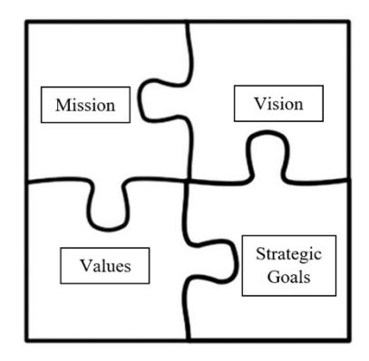

**Fall** **2023, Vol. 17** **No. 2**

## **A Ten-Step Approach to** **Refreshing Strategic Plans Within ** **Higher Education**

## **James Kirby Easterling, Eastern Kentucky University** **Kristen B. Wilson, Eastern Kentucky University**

## **Abstract**

تنخرط المؤسسات الأكاديمية، بدءًا من الشركات الهادفة للربح وصولًا إلى المنظمات غير الربحية مثل المستشفيات والجامعات العامة، بشكل دوري في صياغة الخطط الاستراتيجية. توجّه هذه الخطط المنظمات نحو أهدافها طويلة الأمد، وتمتد عادةً لفترة تتراوح بين سنة وخمس سنوات. تركّز هذه الورقة البحثية بشكل أساسي على التخطيط الاستراتيجي للوحدات الأكاديمية ضمن الأنظمة الجامعية الشاملة، لكنها قابلة للتطبيق على أي وحدة أكاديمية أو إدارية في التعليم العالي.

تشدّد الورقة على أهمية الاتساق مع الخطة الاستراتيجية الشاملة للجامعة، بما يضمن أن تسعى الوحدات الأكاديمية إلى أهداف تتوافق مع رؤية المؤسسة. ويُوصى بتشكيل لجنة تخطيط استراتيجي متنوعة، تضم أعضاء هيئة تدريس وموظفين من أقسام فرعية مختلفة ومستويات خبرة متفاوتة، لتيسير مدخلات شاملة وتعاون فعّال. علاوة على ذلك، يُعدّ التكامل هو مفتاح النجاح، إذ يتطلب اتساقًا مع خطط المنظمة وأنظمتها وثقافتها. وينبغي أن تكون العناصر الاستراتيجية ظاهرة ومدمجة في مختلف العمليات، مثل التوظيف والتدريس الصفي والفعاليات الجامعية.

ورغم أن التخطيط الاستراتيجي مسعى حيوي للمنظمات، فإن البحث حول تأثيره وأفضل ممارساته في المؤسسات الأكاديمية محدود. تسدّ هذه الورقة فجوة في الأدبيات وتقدّم منهجًا شاملًا من عشر خطوات قابلًا للتطبيق على معظم الكليات والجامعات بمختلف أحجامها ورسالاتها. ومن خلال اتباع هذا الإطار، يمكن للوحدات الأكاديمية وضع خطط استراتيجية فعّالة تتسق مع رؤية مؤسستها، وتُشرك أصحاب المصلحة، وتدفع نحو النجاح في تحقيق الأهداف طويلة الأمد.

## **Introduction**

تنخرط المنظمات على اختلاف أحجامها، بدءًا من تلك التي تنتج سلعًا مادية (ملموسة) إلى مقدمي الخدمات (غير الملموسة)، ومن الشركات الهادفة للربح إلى المؤسسات غير الربحية (مثل المستشفيات والمتاحف والجمعيات المهنية والجامعات العامة)، بشكل دوري في صياغة خطة استراتيجية. وبينما تتفاوت مدة الخطط، إذ تركّز الخطط التشغيلية والتكتيكية عادةً على السنة القادمة، فإن الخطط الاستراتيجية تحمل توجهًا أطول أمدًا يمتد من سنة إلى خمس سنوات مستقبلًا. وعليه، يمكن النظر إلى التخطيط الاستراتيجي بوصفه عملية توجيه المنظمة نحو تحقيق خططها طويلة الأمد.

تشبه الأنظمة الجامعية الشاملة إلى حد كبير الشركات ذات الوحدات الاستراتيجية المتعددة، من حيث إن الأنظمة الجامعية الشاملة، على سبيل المثال، غالبًا ما تتألف من عناصر أكاديمية متعددة. وقد تشمل هذه العناصر كليات إدارة الأعمال،

<!-- page 2 -->

والتربية والفنون والعلوم والطب والدبلوماسية والتجارة الدولية، إضافة إلى الوحدات الإدارية مثل القبول وحياة الطلاب وخدمات المكتبة وشؤون الخريجين والتنمية. ومن الناحية الجوهرية، ينبغي أن تمتلك كل وحدة من هذه الوحدات خطتها الاستراتيجية الخاصة التي تتسق مع الخطة الاستراتيجية الشاملة للجامعة وتدعمها وتمكّنها. وفي حين تركّز هذه الورقة البحثية إلى حد كبير على التخطيط الاستراتيجي للوحدات الأكاديمية ضمن نظام جامعي شامل، فإن العملية العامة تنطبق على أي وحدة أكاديمية أو إدارية في أي مؤسسة للتعليم العالي. وعليه، تتمتع هذه الورقة البحثية بقابلية تعميم واسعة عبر الكليات والجامعات بمختلف أحجامها، العامة منها والخاصة، وكذلك تلك ذات الرسالات المتباينة (مثل جامعات البحث الكبرى من الفئة الأولى مقارنة بالأنظمة الجامعية الإقليمية).

## **Foundation and Literature Review**

تواجه الأنظمة الجامعية ضغوطًا جديدة غير مسبوقة، ويمكن لعملية التخطيط الاستراتيجي أن تساعد إلى حد كبير في صياغة رسالة ورؤية مركّزة لتحقيق النجاح المستمر (Shah, 2013). وتشمل هذه الضغوط تراجع التمويل الحكومي (بالنسبة للكليات والجامعات العامة)، وتزايد التركيز على التمويل القائم على الأداء (مثل التمويل الحكومي المرتبط بمعدلات الاستبقاء و/أو التخرج)، وازدياد استخدام التقنيات التعليمية في الصفوف (الفعلية والافتراضية)، وارتفاع نسبة الطلاب الدارسين عبر الإنترنت (بأشكال متعددة)، وتغيّر توقعات الطلاب (مثل فرص العمل المرتبطة بالقلق من تراكم الديون)، وتقادم البنية التحتية المادية. ويمكن أن تُعزى الإخفاقات الأكاديمية إلى حد كبير إلى غياب التخطيط الاستراتيجي.

تشترط بعض هيئات الاعتماد، مثل الرابطة الدولية لتطوير كليات إدارة الأعمال (انظر AACSB, 2023)، تحديثًا دوريًا للخطط الاستراتيجية. ومع ذلك، لا ينبغي أن يكون التخطيط الاستراتيجي مجرد استجابة لمتطلبات إلزامية. بل ينبغي القيام به لأنه يضيف قيمة كبيرة من خلال عمليات جماعية وتشاركية لجمع المدخلات من مختلف أصحاب المصلحة، مثل الطلاب وأعضاء هيئة التدريس والموظفين والخريجين والمجالس الاستشارية، ووضع مخرجات وخطط عمل محددة لتوجيه الوحدة الأكاديمية بعيدًا في المستقبل. ويجب على قادة المنظمات العامة وغير الربحية أن يكونوا استراتيجيين فعّالين لتحقيق رسالاتهم وإرضاء أصحاب المصلحة وخلق قيمة مُدركة، مع تطوير استراتيجيات لمواجهة بيئة متغيرة باستمرار (Bryson, 2018). كما ينبغي للقادة الأكاديميين التركيز على الانخراط المتعمد والمنضبط والاستدامة عبر المنظمة أثناء صياغة الخطط الاستراتيجية (Bieler & McKenzie, 2017). ووفقًا لـ Hinton (2012)، تركّز عملية التخطيط الاستراتيجي في الأوساط الأكاديمية عمومًا على مجالات رئيسية: الرسالة والرؤية والقيم والأهداف الاستراتيجية. غير أن هذه المجالات الأربعة لا ينبغي أن تكون منفصلة ومستقلة، بل متكاملة ومترابطة، تمامًا مثل قطع أحجية الصور المقطوعة كما هو موضح في الشكل 1.

تحدّد رسالة مقنعة الغرض المميز والأساسي الذي يميز مؤسسة عن غيرها في فئتها، وتوضح نطاق أنشطة المؤسسة من حيث المنتجات والأسواق (Pearce II, 1982; Pearce & David, 1987). وينبغي أن تتضمن رسالات المؤسسات الأكاديمية ثلاثة عناصر أساسية على الأقل: السوق أو الأسواق المميزة التي تسعى الرسالة لخدمتها (من)، وعرض القيمة (ماذا)، وأخيرًا الوسيلة التي ستتحقق بها الرسالة (كيف). فعلى سبيل المثال، قد تمتلك كلية إدارة أعمال تابعة لجامعة عامة إقليمية تخدم منطقة أبالاش الريفية ذات نسبة عالية من طلاب الجيل الأول من الملتحقين بالجامعة رسالة

<!-- page 3 -->

مميزة مثل: "نحن كلية الفرص [من] وملتزمة بتنمية القادة [ماذا] من خلال التعليم البيني التطبيقي والبحث والتعاون [كيف]." وينبغي أن تقتصر رسائل المؤسسات عمومًا على جملة أو جملتين، مع تركيز كبير على الصياغة المتعمدة والرسائل الجوهرية. فالإيجاز والاختصار أمران أساسيان.

***Figure 1: Strategic Plan Highlighting Interconnectivity of Major Components***

تحدّد رسالة مقنعة الغرض المميز والأساسي الذي يميز مؤسسة عن غيرها في فئتها، وتوضح نطاق أنشطة المؤسسة من حيث المنتجات والأسواق (Pearce II, 1982; Pearce & David, 1987). وينبغي أن تتضمن رسالات المؤسسات الأكاديمية ثلاثة عناصر أساسية على الأقل: السوق أو الأسواق المميزة التي تسعى الرسالة لخدمتها (من)، وعرض القيمة (ماذا)، وأخيرًا الوسيلة التي ستتحقق بها الرسالة (كيف). فعلى سبيل المثال، قد تمتلك كلية إدارة أعمال تابعة لجامعة عامة إقليمية تخدم منطقة أبالاش الريفية ذات نسبة عالية من طلاب الجيل الأول من الملتحقين بالجامعة رسالة مميزة مثل: "نحن كلية الفرص [من] وملتزمة بتنمية القادة [ماذا] من خلال التعليم البيني التطبيقي والبحث والتعاون [كيف]." وينبغي أن تقتصر رسائل المؤسسات عمومًا على جملة أو جملتين، مع تركيز كبير على الصياغة المتعمدة والرسائل الجوهرية. فالإيجاز والاختصار أمران أساسيان.

امتلاك رؤية أمر بالغ الأهمية للقيادة وتطوير الاستراتيجية والتنفيذ وتيسير التغيير (Kantabutra & Avery, 2010). وتختلف خطط الرؤية عن رسائل المؤسسة في كونها موجهة نحو الطموح المستقبلي. وفي خطط الرؤية بشكل خاص، يُعدّ اختيار الكلمات أمرًا جوهريًا. فبينما يُولى تركيز أقل لعدد الكلمات (الطول) وتركيز أكبر للكلمات المتعمدة (السياق)، يجب أن تظل عبارة الرؤية موجزة. وتُركّز العديد من الوحدات الأكاديمية اليوم على التعليم التحويلي، الذي يعني تعليم الطلاب كيفية التفكير النقدي لحل مشكلات قد لا تكون موجودة حاليًا، مقارنةً بالتعليم التبادلي، الذي يشير إلى مجموعة محددة من المهام أو الإجراءات لحل مشكلة واحدة (Kitchenham, 2008). وعليه، يُوصى بعبارة رؤية موجزة ذات صياغة متعمدة لا تتجاوز غالبًا جملة واحدة، مثل: "قيادة التعليم التحويلي مع إعداد مهنيين مبتكرين لمسارات مهنية مؤثرة." فالإيجاز والجرأة في عبارات الرؤية أمران أساسيان.

<!-- page 4 -->

تُعدّ الأهداف الاستراتيجية عنصرًا أساسيًا في الخطة الاستراتيجية الشاملة. ولمعالجة المخاوف أو مجالات النمو التي تم تحديدها، يجب على المؤسسة وضع أهداف استراتيجية وخطط عمل وتكتيكات لتغيير الواقع القائم (Fathi & Wilson, 2009). وهذه الأهداف طويلة الأمد نسبيًا (من سنة إلى خمس سنوات) وينبغي أن تتسق مع رسالة الجامعة الشاملة ورؤيتها. ويُعدّ التصنيف مفيدًا بشكل خاص عند وضع الأهداف الاستراتيجية في مجالات تشمل الطلاب وأعضاء هيئة التدريس والبرامج الأكاديمية والانخراط المجتمعي والصناعي والعلامة المؤسسية وغيرها من المجالات ذات الصلة بالمؤسسة. وينبغي اعتبار الأهداف الاستراتيجية تلك التي، في حال عدم تحقيقها، ستكون لها عواقب كبيرة وضارة على النجاح طويل الأمد للوحدة الأكاديمية.

وعليه، ينبغي إيلاء عناية دقيقة للأهداف التي تكون استراتيجية وقابلة للقياس فعليًا، إذ يُركَّز على الأمور التي تُقاس (Jennings, 2020). فمثلًا، بالنسبة للأهداف الاستراتيجية المرتبطة بالطلاب، قد تشمل المقاييس المناسبة معدلات الالتحاق ومعدلات التخرج وبيانات التوظيف بعد التخرج. أما بالنسبة للأهداف الاستراتيجية المرتبطة بأعضاء هيئة التدريس، فقد يكون توظيف و/أو استبقاء أعضاء هيئة تدريس مؤهلين أكاديميًا، أو تعزيز التطوير المهني، أو عدد المساهمات العلمية/المنشورات في المجلات مقاييس فعّالة. ويمكن أن يشمل أحد التكتيكات لاستبقاء أعضاء هيئة التدريس المؤهلين، على سبيل المثال، تطوير برنامج إرشاد لأعضاء هيئة التدريس الجدد، يشارك فيه عضو هيئة تدريس أقدم بانتظام مواضيع مؤثرة مثل عملية التثبيت والحوكمة المشتركة والتدريس الصفي الفعّال وتعزيز الحضور والزمالة وغيرها.

ونظرًا لأهمية الأهداف الاستراتيجية ودرجة التحديد التي تُصاغ بها، يُنصح عمومًا بألا يتجاوز عددها الأقصى عشرة أهداف. وقد سلّط Deas et al. (2012) الضوء على نجاح جامعة كارولينا الجنوبية في استخدام عملية التخطيط الاستراتيجي لتحسين التنوع في كلية الطب لديها، من خلال التأكيد على دور مدخلات أصحاب المصلحة، وقيمة التقييم السنوي لتقويم النتائج، ونهج متعمد للتوظيف والاستبقاء بأهداف ومقاييس خاصة. وبالطبع، قد تمتلك الوحدة الأكاديمية أهدافًا أخرى مرتبطة بإجراءات تشغيلية (قصيرة الأمد) وتكتيكية (متوسطة الأمد)، لكن ينبغي التركيز بشدة على قائمة موجزة من الأهداف الاستراتيجية.

بمجرد الانتهاء من صياغة الأهداف الاستراتيجية النهائية، ينبغي وضع خطط عمل تفصيلية تتضمن استراتيجية لتحقيق النجاح لكل هدف، وتحديد المسؤولية عن كل هدف، فضلًا عن عملية لدفع النتائج وتوثيقها وإيصالها بطريقة استباقية (Sullivan & Richardson, 2011). علاوة على ذلك، تجدر الإشارة إلى أن طبيعة الأهداف الاستراتيجية بحد ذاتها تجعلها غالبًا لا تتحقق بإجراء واحد، بل بسلسلة من الإجراءات المترابطة. فمثلًا، هدف استراتيجي مثل "زيادة معدل التحاق طلاب الجيل الأول من الملتحقين بالجامعة بنسبة 10% خلال سنتين" قد لا يتحقق بإجراء واحد، بل بمجموعة من الإجراءات والمبادرات المترابطة متعددة المستويات. وقد تشمل هذه الإجراءات إطلاق حملات تسويقية جديدة، وزيادة الحضور في المدارس الثانوية الإقليمية، وتشكيل لجان توظيف خاصة بالبرامج، وتعزيز الزيارات الميدانية للحرم الجامعي، وتطبيق برامج الاعتماد المزدوج في المدارس الثانوية، وتخفيض و/أو إلغاء رسوم التقديم للفئات المستهدفة، أو الانخراط الفعّال مع البرامج التغذوية المحتملة. وباختصار، يجب تفعيل كل هدف استراتيجي من خلال تحديد وتنفيذ إجراءات محددة (أي خطط استراتيجية).

<!-- page 5 -->

القيم الجوهرية هي السلوكيات والمواقف التي توجّه المنظمة أثناء سعيها لتحقيق رسالتها ورؤيتها وأهدافها الاستراتيجية. ويمكن اعتبار القيم بمثابة حدود يُلتزم بها في جميع الأحوال، بصرف النظر عن الظروف. وينبغي أن يشمل تطوير القيم الجوهرية وتحديثها مدخلات الموظفين وأن يستجيب للتغيرات الزمنية، بدلًا من فرضها بطريقة بيروقراطية تقليدية من أعلى إلى أسفل (Jin & Drozdenko, 2010). والإيجاز أمر جوهري، وينبغي التركيز على القيم الجوهرية الأساسية غير القابلة للتنازل والتي تُبرز الثقافة العامة للوحدة الأكاديمية. ويؤكد البحث أن القيم التنظيمية تأتي في أربعة أشكال متمايزة — المُعلنة والمنسوبة والمشتركة والطموحة (Bourne et al., 2013). وعليه، يُقترح اعتماد قيمة أو قيمتين من كل شكل من هذه الأشكال الأربعة. ويُعدّ الالتزام بالتميز والنزاهة والخدمة والفضول الفكري والشمولية والتعاون من القيم الجوهرية المحددة في العديد من الوحدات الأكاديمية.

ورغم أن الكثير قد كُتب عن التخطيط الاستراتيجي في سياق عام، وخاصةً لصالح الكيانات الهادفة للربح، فإن الأبحاث حول الأثر وأفضل الممارسات والإرشادات المتعلقة بالتخطيط الاستراتيجي في المؤسسات الأكاديمية أقل. وعليه، يحمل هذا الجهد البحثي إمكانية فتح مسار جديد من البحث لإرشاد المنظمات غير الربحية أيضًا، وبخاصة المؤسسات الأكاديمية. وقد أورد مقال حديث لمجلة U.S. News & World Report ما يقارب 4,000 مؤسسة تعليم عالٍ مانحة للشهادات في الولايات المتحدة (Moody, 2021). وبافتراض أن تلك المؤسسات تضم في المتوسط 10 وحدات أكاديمية (مثل كليات إدارة الأعمال والتربية والعلوم الإنسانية والعلوم)، فإن عدد الوحدات في الأوساط الأكاديمية التي ينبغي أو يمكن أن تقوم بالتخطيط الاستراتيجي يتجاوز بسهولة 40,000 وحدة في الولايات المتحدة وحدها. وعليه، تُعرض الخطوات الرئيسية التالية في محاولة لإرشاد عمليات التخطيط الاستراتيجي.

## **Key Steps**

وفي حين لا توجد قائمة مرجعية شاملة لضمان النجاح في التخطيط الاستراتيجي، تُقدَّم الخطوات الرئيسية أدناه بوصفها لبنات أساسية قد تعزز عملية التخطيط الاستراتيجي وتُبسّطها، وبخاصة للفرق أو اللجان المسؤولة عن صياغة خطة استراتيجية أولية أو تحديثها استعدادًا لإعادة الاعتماد القادمة.

1. **Alignment With University Strategic Plan**: الخطوة الأولى في تحديث الخطط الاستراتيجية لأي وحدة أكاديمية هي فهم الخطة الاستراتيجية الشاملة للجامعة لضمان الاتساق، وهو ما يُشار إليه غالبًا بالملاءمة الاستراتيجية. ويوضح Chopra and Meindl (2013) أن الملاءمة الاستراتيجية تتطلب أن تتسق الخطة الاستراتيجية الشاملة (مثل الخطة الاستراتيجية الشاملة للجامعة) والخطة الوظيفية (لوحدة أكاديمية فردية) وتتلاءم لتشكيل استراتيجية شاملة منسقة. ويتيح الاتساق مع الخطة الاستراتيجية الشاملة للجامعة للوحدة الأكاديمية السعي لتحقيق الأهداف والغايات ذاتها أو المماثلة (Al Hijji, 2014). فمثلًا، إذا كانت الجامعة الشاملة تركّز على توسيع نطاق الالتحاق بشكل كبير من خلال استقطاب الطلاب الدوليين، فينبغي أن تمتلك الوحدات الأكاديمية المقابلة خطة استراتيجية متسقة لاستقطاب الطلاب الدوليين. وإذا كانت الجامعة الشاملة تركّز، على سبيل المثال، على توسيع نطاق الالتحاق بشكل كبير من خلال استقطاب طلاب الجيل الأول من الملتحقين بالجامعة، فينبغي أن تمتلك الوحدات الأكاديمية المقابلة خطة استراتيجية متسقة للوصول إلى تلك الفئة السوقية بالذات. ويقلّل ضمان الاتساق من احتمال سعي الوحدة الأكاديمية إلى أهداف وغايات تنتقص من الخطة الاستراتيجية الشاملة للجامعة أو تتعارض معها.

<!-- page 6 -->

- 2. **Team Formation**: تضيف لجنة التخطيط الاستراتيجي المُشكَّلة من ممثلين متعددين، والتي تضم أعضاء هيئة تدريس وموظفين، تنوعًا من حيث الفكر والرأي. وينبغي اختيار الأعضاء بناءً على المعرفة التي يقدمونها للفريق، وقدرتهم الفردية على التفكير الابتكاري، وموقعهم في الهيكل التنظيمي، بما يضمن تمثيلًا كافيًا (Wells & Doherty, 1994). وعليه، ينبغي أن تتألف لجنة التخطيط الاستراتيجي من أعضاء هيئة تدريس دائمين وفي مسار التثبيت وغير الدائمين (مثل المحاضرين والمدرّسين والمقيمين وأعضاء هيئة التدريس المتعاقدين). كما ينبغي مراعاة الاختيار متعدد الوظائف من حيث الأعضاء ذوي الخدمة الطويلة (أي سنوات التوظيف) وأولئك الذين انضموا حديثًا إلى الوحدة الأكاديمية. كما يفيد تمثيل الأقسام الفرعية المختلفة، مثل التسويق والإدارة والاقتصاد والمحاسبة وسلاسل التوريد وقانون الأعمال، من بين أقسام أخرى. علاوة على ذلك، يضيف تمثيل الموظفين من وظائف مثل الاستقطاب والاستبقاء والإرشاد و/أو الشؤون الخارجية قيمة مكمّلة لقيمة أعضاء هيئة التدريس. وتُعدّ اجتماعات الفريق المتكررة وسيلة فعّالة لإدارة الجداول الزمنية والمهام، وكذلك تشكيل فرق مصغرة (تضم شخصين إلى ثلاثة أشخاص) تعمل على مجالات محددة (مثل عبارة الرسالة) ثم تقدّم مدخلاتها وتحديثاتها وتوجيهاتها للفريق الشامل في فترات محددة مسبقًا.
- 3. **Resourcing**: نظرًا لاستمرار مواجهة العديد من أنظمة الكليات والجامعات لتحديات ميزانية كبرى، فإن عدد الموارد الإدارية غالبًا ما يكون في حده الأدنى، ما يدفع العديد من أعضاء هيئة التدريس لتولي أدوار إدارية تتجاوز جوانب الخدمة المعتادة. والخطط الاستراتيجية ليست مسعى يُنفَّذ ثم يُنسى؛ بل يجب إدارة القيم والأهداف والغايات الناتجة عنها بفاعلية. وبمجرد الانتهاء من الخطة الاستراتيجية، يجب تخصيص الموارد لضمان دمجها بعمق. بمعنى آخر، لكل هدف استراتيجي ("ماذا")، يجب أن تكون هناك خطة استراتيجية ("كيف") توضح كيفية تحقيق كل هدف من حيث الملاءمة والجداول الزمنية المرتبطة والمسؤولية، بما يتسق مع نهج الأهداف الذكية (SMART) (Latham, 2003). فمثلًا، الهدف الاستراتيجي "زيادة معدل التحاق الطلاب" غامض ويفتقر إلى الوضوح. وينبغي أن تكون الأهداف الاستراتيجية أكثر تحديدًا. فمثلًا، هدف استراتيجي مثل "زيادة معدل التحاق طلاب الجيل الأول من الملتحقين بالجامعة بنسبة 10% خلال سنتين" يضيف عناصر مَن (طلاب الجيل الأول)، وبأي مقدار (10%)، ومتى (خلال سنتين). وكما يُقال غالبًا في عالم الأعمال: "لا يمكننا إدارة ما لا نقيسه."
- 4. **Benchmarking**: تشمل المقارنة المرجعية موضوعات رئيسية مثل القياس والمقارنة وتحديد أفضل الممارسات والتنفيذ والتحسين (Anand & Kodali, 2008). وتشارك معظم الكليات والجامعات، وكذلك الوحدات الأكاديمية المحددة، بعض عناصر خطتها الاستراتيجية علنًا، وبخاصة رسالتها ورؤيتها وقيمها. وبطبيعة الحال، فإن الأهداف الاستراتيجية والخطط التفصيلية لتحقيقها أقل انتشارًا للعموم، إذ تُمثّل نوعًا من المخطط لنجاح المنظمة. ويمكن إجراء المقارنة المرجعية مع مؤسسات نظيرة ذات حجم ورسالة مماثلين، ضمن الاتحادات ذاتها. وتؤدي المقارنة المرجعية دورًا محوريًا في التخطيط الاستراتيجي من خلال توفير رؤى قيّمة ومنظور مقارن. فمن خلال تحليل الأداء والعمليات والاستراتيجيات ومقارنتها بالمنافسين أو الطموحين في الصناعة/الأوساط الأكاديمية، يمكن للوحدات تحديد مجالات التحسين ووضع أهداف واقعية. وتتيح المقارنة المرجعية تقييم الكفاءة والفعالية،

<!-- page 7 -->

والقدرة التنافسية، بما يوجّه في النهاية قرارات مستنيرة لتعزيز التوجه الاستراتيجي والبقاء في الصدارة. علاوة على ذلك، تُعدّ أداة قوية للتحسين المستمر وتعزيز الابتكار ودفع النمو.

- 5. **Faculty/Staff Input**: يُعدّ الحصول على مدخلات من أعضاء هيئة التدريس والموظفين (بالإضافة إلى اللجنة التوجيهية) أمرًا بالغ الأهمية من منظور الحوكمة المشتركة، وينبغي القيام به في نقاط متعددة من دورة التخطيط الاستراتيجي. ويعزز إشراك أصحاب المصلحة هؤلاء في التخطيط الاستراتيجي الظروف العامة لجميع الشركاء، ويحسّن ظروف الاستبقاء، وربما الأهم من ذلك، يعزز الولاء (Gandrita, 2023). وتشير الحوكمة المشتركة إلى العمليات التي يشارك فيها أعضاء هيئة التدريس والموظفون في وضع السياسات واتخاذ القرارات التي تؤثر في الوحدة الأكاديمية مستقبلًا. وغالبًا ما يكون اجتماع الانطلاق فعّالًا للحصول على مدخلات أولية حول مجالات القلق الأكبر، مع جلسات استماع دورية لجمع المدخلات والتغذية الراجعة حول التقدم المحرز. وغالبًا ما يكون منح أعضاء هيئة التدريس والموظفين فرصًا لتقديم مدخلاتهم في منصات مختلفة (مثل الاجتماعات الحضورية وجلسات Zoom والبريد الإلكتروني) فعّالًا للغاية. ومع ذلك، ينبغي توخي الحذر لتجنب "شلل التحليل" — أي أنه يستحيل عمليًا دمج مدخلات كل فرد (والتي غالبًا ما تكون متعارضة) في خطط استراتيجية محددة (Langley, 1995). وفي هذه الحالات، ينبغي السعي لتحديد الموضوعات العامة التي يمكن تجميع المدخلات الفردية المحددة ضمنها لتصنيفها بفعالية. وكما هو الحال دائمًا، فإن الزمالة تُقدَّر تقديرًا كبيرًا.
- 6. **Input from Advisory Boards**: تمتلك العديد من الوحدات الأكاديمية مجالس استشارية تتألف من خريجين ناجحين وقادة صناعيين ومدنيين وغيرهم، يقدمون توجيهًا مستمرًا بدور مشابه لدور مجلس الإدارة، مع تركيز على تقديم الإرشاد وجمع التبرعات وتطوير البرامج والانخراط مع المؤسسات (Mandviwalla et al., 2015). وأعضاء المجالس الاستشارية هم، من الناحية الجوهرية، مناصرون ومدافعون ضمن شركاتهم وشبكاتهم المهنية. وغالبًا ما تؤدي هذه العلاقات إلى فرص تعاون وتدريب وعمل بدوام جزئي ومرافقة مهنية ومقابلات وفرص أخرى للمهنيين الشباب الطموحين. وعليه، يُعدّ طلب مدخلات أعضاء المجلس الاستشاري، أو تأسيس مجلس إن لم يكن موجودًا بعد، خطوة مهمة بشكل خاص في تحديث الخطط الاستراتيجية.
- 7. **External Surveys**: رغم القيمة الكبيرة للحصول على مدخلات من أعضاء هيئة التدريس والموظفين وأعضاء المجلس الاستشاري، فإن مدخلات أصحاب المصلحة الخارجيين لها قيمة مماثلة. وقد تضم هذه الفئة الخريجين وداعمي البرامج والقادة المحليين والإقليميين والمسؤولين الحكوميين. وتوفر هذه الفئة من أصحاب المصلحة سياقًا ورؤى إضافية تكمّل المدخلات الأخرى. وتمتلك العديد من الوحدات الأكاديمية قوائم بأصحاب المصلحة الخارجيين يسهل الوصول إليها. علاوة على ذلك، توفر مواقع الاستطلاعات نهجًا منخفض التكلفة لإنشاء الاستطلاعات ونشرها بين مجموعات كبيرة من الأشخاص، وبخاصة عند دمجها مع شبكات التواصل الاجتماعي مثل LinkedIn.
- 8. **Final Reviews & Approvals**: بعد جمع المدخلات من أكبر عدد ممكن من المصادر (أعضاء هيئة التدريس والموظفون، والمجالس الاستشارية، وأصحاب مصلحة البرامج)، يُعدّ تقديم المراجعات النهائية والدفاع عنها والحصول على الموافقات أمرًا أساسيًا. وغالبًا ما تتطلب التغييرات الكبرى ضمن الوحدات الأكاديمية تصويتًا من أعضاء هيئة التدريس والموظفين للموافقة. وهنا يُعدّ فن nemawashi الياباني النبيل ذا قيمة كبيرة في عقد اجتماعات تمهيدية وبناء توافق مع من قد يعارضون علنًا لولا ذلك (Wolfe, 1992). وغالبًا ما تُقترح عدة جولات من الصياغة، لكن ينبغي توخي الحذر

<!-- page 8 -->

- لتجنب تخفيف قيمة العمل المُنجز حتى هذه المرحلة. وعليه، فإن التحديد الواضح لما هو مطروح للنقاش والجدل أمر أساسي، إذ إن النتيجة المرجوة والمطلوبة هي موافقة رسمية للمضي قدمًا في التمويل والتكامل.
- 9. **Integration**: بالإضافة إلى كل الخطوات المذكورة أعلاه، يُعدّ التكامل الأهم على الإطلاق. فالتخطيط الاستراتيجي ذو قيمة ضئيلة إن لم يُدمج في خطط المنظمة وأنظمتها وثقافتها. وينبغي ألا يُنفَّذ التخطيط الاستراتيجي "لاستيفاء متطلب شكلي" فحسب، بل ينبغي القيام به لإضافة قيمة حقيقية للوحدة الأكاديمية. وبالتأكيد، ينبغي أن تكون عناصر الخطة الاستراتيجية المختلفة (مثل عبارات الرسالة والرؤية والأهداف الاستراتيجية) مرئية ماديًا لمن هم داخل الوحدة الأكاديمية. لكن الأهم من ذلك، ينبغي دمج العناصر الاستراتيجية في جميع العمليات المختلفة، بما في ذلك على سبيل المثال لا الحصر، توظيف الموظفين الجدد، والاحتفالات، والتدريس الصفي، واجتماعات هيئة التدريس، والندوات، والاستقطاب في الحرم الجامعي، وحفلات التخرج. ويُعدّ دمج العناصر الاستراتيجية في التدريس الصفي بالغ الأهمية، إذ ينبغي إبراز القيم، على سبيل المثال، في كيفية تدريس الفصول وكيفية تفاعل الطلاب مع الآخرين (أي خدمة الآخرين والنزاهة والزمالة).
- 10.**Commitment and Assessment**: يُعدّ الالتزام بالخطة الاستراتيجية وقياس النتائج عنصرين أساسيين للنجاح في التخطيط الاستراتيجي في مؤسسات التعليم العالي. وتضمن هذه العناصر ألا تكون الخطة مجرد وثيقة، بل خريطة طريق حية توجّه اتخاذ القرارات والتقدم نحو الأهداف. أولًا، يُعدّ الالتزام بالخطة الاستراتيجية أساسيًا لتنفيذها الفعّال؛ إذ إن أحد أكبر مزالق التخطيط هو خلل وتثبيط الالتزام من المنظمة ككل (Mintzberg, 1993). ويتطلب التخطيط الاستراتيجي التزامًا ودعمًا من جميع أصحاب المصلحة المعنيين، بمن فيهم أعضاء هيئة التدريس والموظفون والإداريون. وبدون الالتزام، قد تُعامَل الخطة كمجرد إجراء شكلي أو تُهجَر بسرعة. لذا، من المهم تعزيز شعور بالملكية والانخراط بين أفراد الوحدة الأكاديمية. ويمكن تحقيق ذلك من خلال إشراك أعضاء هيئة التدريس والموظفين في عملية التخطيط، والحصول على مدخلاتهم وتغذيتهم الراجعة، وخلق فرص للتواصل المفتوح والمستمر. وعندما يشعر الأفراد بأنهم مستثمرون في الخطة، يزداد احتمال مساهمتهم الفعالة في نجاحها وتحملهم المسؤولية عن مهامهم الموكلة إليهم. ويُعدّ قياس النتائج مهمًا بالقدر ذاته في التخطيط الاستراتيجي، إذ يوفر وسيلة لتقييم التقدم وتحديد مجالات التحسين واتخاذ قرارات مستنيرة. ويتيح وضع أهداف محددة وقابلة للقياس وقابلة للتحقيق وذات صلة ومحددة زمنيًا (SMART) تقييمًا واضحًا وتتبعًا للنتائج (Drucker, 1954; Williams, 2012). ومن خلال تحديد مؤشرات الأداء الرئيسية (KPIs) المتسقة مع الأهداف الاستراتيجية، يمكن للوحدة الأكاديمية متابعة تقدمها وتحديد ما إذا كانت في المسار الصحيح لتحقيق النتائج المرجوة. كما تتيح المقاييس للوحدة الأكاديمية تحديد ما يعمل بشكل جيد وما يحتاج إلى تعديل؛ ويتيح التقييم المنتظم تحديد التحديات أو العقبات المحتملة مبكرًا، بما يمكّن من اتخاذ إجراءات تصحيحية في الوقت المناسب. ومن خلال جمع البيانات وتحليل النتائج، يمكن للوحدة الأكاديمية اكتساب رؤى حول فعالية استراتيجياتها ومبادراتها. ويمكن أن تُسهم هذه المعلومات في اتخاذ القرار وتخصيص الموارد وتعديل الخطة، بما يضمن بقاء المؤسسة رشيقة ومستجيبة للظروف المتغيرة.

<!-- page 9 -->

## **Conclusion**

يُعدّ التخطيط الاستراتيجي واحدًا من أهم المساعي التي يمكن لأي منظمة القيام بها، سواء كانت عامة أو خاصة، بما في ذلك المؤسسات الهادفة للربح وغير الربحية. وبينما قد تتفاوت عناصر الخطة الاستراتيجية من منظمة إلى أخرى، يضيف نهج الخطوات العشر أعلاه سياقًا هائلًا فيما يتعلق بمجالات الأهمية الرئيسية. ويضيف طلب المدخلات من مختلف أصحاب المصلحة قيمة كبيرة من خلال دمج وجهات نظر عبر أطياف متنوعة، بما فيها أعضاء هيئة التدريس والموظفون والطلاب والخريجون، وكذلك الأمر بالنسبة لتوزيع المسؤولية ودمج العناصر الاستراتيجية المختلفة في خطط عملية وثقافة تنظيمية.

تقدّم هذه الورقة إطارًا شاملًا لتحديث الخطط الاستراتيجية ضمن مؤسسات التعليم العالي. ومن خلال اتباع الخطوات العشر الموضحة، يمكن للوحدات الأكاديمية الانخراط في عملية تخطيط استراتيجي هادفة وتشاركية تتسق مع الأهداف الشاملة للجامعة، وتستفيد من وجهات النظر المتنوعة، وتخصص الموارد اللازمة، وتقارن أداءها بالنظراء، وتدمج الخطة الاستراتيجية في ثقافة المنظمة، وتقيس التقدم، وتبني التزامًا بتحقيق الأهداف الشاملة. ومن خلال هذا النهج الشامل، يمكن للمؤسسات الأكاديمية تعزيز النمو والابتكار والتميز سعيًا لتحقيق رسالاتها ونجاحها طويل الأمد.

## **References**

- *2020 guiding principles and standards for business accreditation*. Association to Advance Collegiate Schools of Business. (2023, July 1). https://www.aacsb.edu/- /media/documents/accreditation/2020-aacsb-business-accreditation-standardsjune-2023.pdf?rev=c19884b1643f4f37851b0d3e342ec6d7&hash=981B7C7B17A 68FC40F715BAAF907B663
- Al Hijji, K. Z. (2014). Strategic management model for academic libraries. *Procedia-Social * *and Behavioral Sciences*, *147*, 9-15.
- Anand, G., & Kodali, R. (2008). Benchmarking the benchmarking models. *Benchmarking: * *An International Journal*, *15*(3), 257-291.
- Bieler, A., & McKenzie, M. (2017). Strategic planning for sustainability in Canadian higher education. *Sustainability*, *9*(2), 161.
- Bourne, H., & Jenkins, M. (2013). Organizational values: A dynamic perspective. *Organization Studies*, *34*(4), 495-514.
- Bryson, J. M. (2018). *Strategic planning for public and nonprofit organizations: A guide to * *strengthening and sustaining organizational achievement*. John Wiley & Sons.
- Chopra, S. and Meindl, P. (2013). *Supply chain management*. Pearson.
- Deas, D., Pisano, E. D., Mainous III, A. G., Johnson, N. G., Singleton, M. H., Gordon, L., ... & Reves, J. G. (2012). Improving diversity through strategic planning: a 10 year (2002–2012) experience at the Medical University of South Carolina. *Academic Medicine*, *87*(11), 1548-1555.
- Drucker, P. (1954). *The practice of management*. HarperCollins.

<!-- page 10 -->

- Fathi, M., & Wilson, L. (2009). Strategic planning in colleges and universities. *Business * *Renaissance Quarterly*, *4*(1), 91-103.
- Gandrita, D. M. (2023). Improving strategic planning: The crucial role of enhancing relationships between management levels. *Administrative Sciences*, *13*(215), 1- 25.
- Hinton, K. E. (2012). *A practical guide to strategic planning in higher education*. Society for College and University Planning.
- Jennings, E. T. (2010). Strategic planning and balanced scorecards: Charting the course to policy destinations. *Public Administration Review*, *70*, 224-226.
- Jin, K. G., & Drozdenko, R. G. (2010). Relationships among perceived organizational core values, corporate social responsibility, ethics, and organizational performance outcomes: An empirical study of information technology professionals. *Journal of Business Ethics*, *92*, 341-359.
- Kantabutra, S., & Avery, G. C. (2010). The power of vision: Statements that resonate. *Journal of Business Strategy*, *31*(1), 37-45.
- Kitchenham, A. (2008). The evolution of John Mezirow's transformative learning theory. *Journal of Transformative Education*, *6*(2), 104-123.
- Langley, A. (1995). Between' paralysis by analysis' and 'extinction by instinct'. *MIT * *Sloan Management Review*, *36*(3), 63-76.
- Latham, G. P. (2003). Goal setting: A five-step approach to behavior change. *Organizational Dynamics*, *32*(3), 309–318.
- Mandviwalla, M., Fadem, B., Goul, M., George, J. F., & Hale, D. P. (2015). Achieving academic-industry collaboration with departmental advisory boards. *MIS * *Quarterly Executive*, *14*(1), 17-37.
- Moody, J. (2021, April 27). *A guide to the changing number of U.S. universities*. U.S. News & World Report. https://www.usnews.com/education/bestcolleges/articles/how-many-universities-are-in-the-us-and-why-that-number-ischanging.
- Pearce II, J. A. (1982). The company mission as a strategic tool. *Sloan Management * *Review*, *23*(3), 15.
- Pearce, J. A., & David, F. (1987). Corporate mission statements: The bottom line. *Academy of Management Perspectives*, *1*(2), 109-115.
- Shah, M. (2013). Renewing strategic planning in universities at a time of uncertainty. *Perspectives: Policy and Practice in Higher Education*, *17*(1), 24-29.
- Steiner, G. A. (2010). *Strategic planning*. Simon and Schuster.
- Sullivan, T. M., & Richardson, E. C. (2011). Living the plan: Strategic planning aligned with practice and assessment. *The Journal of Continuing Higher Education*, *59*(1), 2-9.
- Wells, D. L., & Doherty, L. M. (1994). *A handbook for strategic planning*. Total Quality Leadership Office.

<!-- page 11 -->

Williams, C. (2012). *MGMT*. SouthWestern College Publishing.

Wolfe, M. D. (1992). A theoretical justification for Japanese nemawashi/ringi group decision making and an implementation of a nemawashi/ringi group decision support system. *Decision Support Systems*, *8*(2), 125-140.
