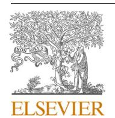
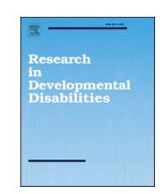

<!-- A3.R42 | source: papers_json/A3.R42/ -->

توجد قوائم المحتويات على [ScienceDirect](www.sciencedirect.com/science/journal/08914222)

## Research in Developmental Disabilities

journal homepage: [www.elsevier.com/locate/redevdis ](https://www.elsevier.com/locate/redevdis)

## Enhancing inclusive education in the UAE: Integrating AI for diverse learning needs

Alia El Naggar ^a^ , Eman Gaad b,* , Shannaiah Aubrey Mae Inocencio ^a^

- ^a^ *Canadian University Dubai, Al Wasl, Dubai, United Arab Emirates *
- ^b^ *British University in Dubai, Dubai Academic City, United Arab Emirates *

## ARTICLE INFO

## *Keywords: * Inclusive education Special needs Exceptional learners Artificial intelligence Pedagogy

## ABSTRACT

*Introduction: *أصبحت الأنظمة المدعومة بالذكاء الاصطناعي (AI) عنصراً مهماً في المؤسسات التعليمية، ولا يزال هناك جدل حول مدى فائدتها في تعليم ذوي الاحتياجات الخاصة. يتناول هذا البحث النوعي تجارب وتصورات المتعلمين الاستثنائيين، كمثال على تعليم ذوي الاحتياجات الخاصة، أثناء مشاركتهم في نقاشات مدعومة بالذكاء الاصطناعي مقارنة بالحوارات الصفية التقليدية. تهدف الدراسة إلى الكشف عن كيفية معالجة هؤلاء المتعلمين للمعرفة وبنائها بشكل مختلف عند دمج الذكاء الاصطناعي في نقاشاتهم، ومقارنة ذلك ببيئات التعلم التقليدية.

*Methods: *اعتمدت المنهجية على تحليل نوعي مفصل، مستفيداً من علم النفس المعرفي لتقييم كيفية معالجة المتعلمين الاستثنائيين للمعلومات وانخراطهم في التفكير من الرتبة العليا. جُمعت البيانات من خلال المقابلات والملاحظة وتحليل محتوى النقاشات المدعومة بالذكاء الاصطناعي.

*Results:Findings: *أبرزت نتائج الدراسة قدرة تقنيات الذكاء الاصطناعي على تقديم تجارب تعليمية شخصية ومحفزة فكرياً تتماشى مع المقاربات البنائية، وتعزز التعلم النشط والتوجيه المخصص للمتعلمين الاستثنائيين. غير أن البحث كشف أيضاً عن تحديات معينة، منها ميل المتعلمين نحو التحيز التأكيدي وخطر الإفراط في المعلومات ضمن البيئات المدعومة بالذكاء الاصطناعي، وهو ما قد يُعقّد مسار التعلم داخل منطقة النمو التقريبي.

*Discussions: *تُبرز الدراسة التفاعل الديناميكي بين تقنيات الذكاء الاصطناعي والعمليات التعليمية الخاصة بالمتعلمين الاستثنائيين. وتشير إلى أنه بينما يمكن للذكاء الاصطناعي أن يعزز التعلم الشخصي، فإنه يطرح أيضاً تحديات فريدة يجب التعامل معها بعناية. وفي النهاية، يضع هذا البحث أساساً نظرياً وتجريبياً للدمج المدروس للذكاء الاصطناعي في دعم التعليم الشامل، مع التأكيد على أهمية التقييم والتكيف المستمرين.

## **1.** **Introduction **

في مجال تعليم ذوي الاحتياجات الخاصة، حيث يعترف النموذج الاجتماعي للإعاقة بالمتعلمين الاستثنائيين (Jones, 2013)، توجد حاجة واضحة لمقاربات شخصية ترعى المواهب وتنمي قدرات التفكير النقدي (Reis & [Renzulli,](#page-4-0) [2010)](#page-4-0). ويواجه المعلمون في المدارس العادية تحديات مستمرة عند التعامل مع متعلمي ذوي الاحتياجات الخاصة، إذ يصطدمون بقيود تفرضها بنية الفصول الدراسية وقيود المناهج (Redenius & [Skaar, 2017; Alonso-Campuzano et al., 2023](#page-4-0)).

*E-mail address: *[eman.gaad@buid.ac.ae](mailto:eman.gaad@buid.ac.ae) (E. Gaad).

> ^*^ Corresponding author.

<!-- page 2 -->

يُعد تعزيز النمو الفكري لهؤلاء المتعلمين الاستثنائيين أمراً بالغ الأهمية في كل مكان، بل إنه أصبح أيضاً أولوية وطنية في بعض الدول، كما هو الحال في دولة الإمارات العربية المتحدة (UAE).

في سياق تلبية احتياجات هذه الفئة المستهدفة الفريدة، يقدم الذكاء الاصطناعي (AI) إمكانية دعم نقاشات فكرية معقدة والارتقاء بالتجارب التعليمية للطلاب الاستثنائيين [(Li et al., 2023](#page-4-0)). ورغم الإمكانات الواعدة للذكاء الاصطناعي، لا تزال هناك مساحة غير مستكشفة في السياق التعليمي لدولة الإمارات وفي أجزاء كثيرة أخرى من العالم، خاصة فيما يتعلق باستثمار الذكاء الاصطناعي في نقاشات فكرية متقدمة مع المتعلمين الاستثنائيين. وانطلاقاً من النموذج الاجتماعي للإعاقة، تسعى هذه الدراسة إلى تقييم أثر النقاشات المدعومة بالذكاء الاصطناعي على التفكير النقدي والانخراط الفكري والتجارب التعليمية الشخصية لدى المتعلمين الاستثنائيين. صُممت هذه الدراسة لتفحص الآثار المقارنة للنقاشات الصفية والنقاشات المدعومة بالذكاء الاصطناعي على الانخراط الفكري وتنمية مهارات التفكير النقدي لدى المتعلمين الاستثنائيين. علاوة على ذلك، نهدف إلى رصد تصورات المتعلمين حول استخدام الذكاء الاصطناعي كأداة ميسّرة في النقاشات، خاصة مقارنة بتجاربهم مع الخطاب الصفي التقليدي. ومن خلال دمج هذه المنظورات، تطمح الدراسة إلى رسم كيفية تكييف كل نمط من أنماط النقاش -التقليدي والمدعوم بالذكاء الاصطناعي- لتوفير تجارب تعليمية شخصية وصارمة فكرياً.

**Methodology**. على غرار دراسات سابقة (e.g.,[ Halaweh, 2023](#page-4-0); Kasneci, 2023; [Siegle, 2023](#page-4-0))، اعتمدنا منهجيات بحث نوعية لالتقاط روايات معمقة لتجارب الأفراد. في هذه الدراسة، استخدم الباحثون صيغة مقابلة شبه منظمة لتيسير استكشاف دقيق لوجهات نظر المشاركين. وصُممت أسئلة المقابلة بعناية فائقة لتتماشى مباشرة مع تساؤلات البحث الرئيسية.

**Participants**. تم تجنيد مشاركي الدراسة من مدرسة في دولة الإمارات العربية المتحدة. وكان الطلاب مسجلين ومعترفاً بهم كأطفال موهوبين عند التحاقهم، وتم التعرف عليهم من قاعدة بيانات المدرسة. تألفت العينة المشاركة في هذه الدراسة من مجموعة متنوعة من حيث الجنس، ضمت 9 ذكور و7 إناث، تراوحت أعمارهم بين 11 و17 عاماً. بلغ متوسط عمر المشاركين 14.3 عاماً (SD=1.77)، ما يشير إلى نزعة مركزية نحو مرحلة المراهقة المبكرة ضمن عينتنا. حصلت الدراسة على موافقة اللجنة الأخلاقية في British University in Dubai (202304). وقد أُعطيت الموافقة على المشاركة في الدراسة من قبل الطلاب وأولياء أمورهم على حد سواء. حدد الطلاب موهبة متعددة وفق نظرية الذكاءات المتعددة لـGardner'[s (1983)](#page-4-0) في المجالات التالية: المنطقي-الرياضي، اللغوي-اللفظي، البصري-المكاني، الجسدي-الحركي، الموسيقي، الاجتماعي، الذاتي، والطبيعي. علاوة على ذلك، تم تبسيط أبعاد الجنس المستخدمة في التصنيفات إلى ذكر وأنثى، استناداً إلى السمات البيولوجية المسندة عند الولادة.

**Thematic Analysis**. في هذه الدراسة، خضعت بيانات المقابلات لتحليل موضوعي استنباطي، التزاماً بالمنهج المنظم الذي وضعه[ Clarke et al. (2015).](#page-4-0) وللتقليل من التحيز، قام مُرمّز خارجي بتفريغ المقابلات من التسجيلات. واسترشدت عملية التفريغ هذه بمجموعة من الرموز المحددة مسبقاً، والتي طُوّرت استناداً إلى أبحاث سابقة تناولت دمج روبوتات الدردشة المدعومة بالذكاء الاصطناعي في البيئات التعليمية، بالاستناد إلى أعمال[ Kasneci et al. (2023)](#page-4-0)،[ Halaweh (2023)](#page-4-0)، و[Zhai (2022)](#page-4-0) في التصنيف الموضوعي. ثم قام كل باحث بتحليل المقابلات المفرّغة بشكل مستقل. وللحفاظ على الدقة التحليلية، قسّموا النصوص عشوائياً للتحليل الفردي. وبعد هذا التحليل الفردي، تبادل الباحثون أجزاءهم من البيانات لإجراء تحقق متبادل، ما عزز موثوقية النتائج الموضوعية. ثم جُمعت الرموز الناتجة عن هذه العملية الدقيقة في فئات موضوعية أوسع، يرد وصفها في قسم النتائج.

**Results**. أظهر المشاركون آراء ووجهات نظر متباينة حول تطبيق الذكاء الاصطناعي في النقاشات والانخراط الفكري مقارنة بالإعدادات الصفية التقليدية. عبّر بعض الطلاب عن انبهارهم بقدرات الذكاء الاصطناعي والتجارب الشخصية التي وفرها منذ تطبيقه. في المقابل، رآه آخرون جامداً، ومحصوراً في كلمات مفتاحية ومدخلات محددة. يرد عرض النتائج المقابلة لكل سؤال بحثي في القسم التالي.

**Research Question 1: How do classroom discussions and AI-mediated discussions differ on their impact on intellectual ** **engagement and critical thinking skills of gifted learners? **يكشف استكشاف البيانات في السؤال البحثي الأول عن موضوعات متمايزة، يؤدي كل منها دوراً في توضيح أبعاد رئيسية للدراسة. وتتجلى هذه النتائج عبر ثلاثة موضوعات رئيسية: (i) جودة المعلومات: يعكس هذا الموضوع المعايير التقييمية المستخدمة لتقييم محتوى النقاش. وتُبرز سمات مثل الصلة والعمق والتنوع والحداثة كمؤشرات أساسية لجودة الخطاب، ما يشير إلى أن هذه الأبعاد أساسية في تهيئة بيئة مواتية للانخراط الفكري للمتعلمين. (ii) كمية المعلومات: يتناول الموضوع الثاني نطاق وحجم المعلومات التي تشملها النقاشات. ويُبرز أهمية اتساع المعلومات المشمولة وعبء المعلومات المرتبط بها، مشيراً إلى الحاجة لكمية متوازنة لا تُثقل المتعلمين ولا تُقصّر معهم. (iii) العوامل البشرية مقابل التكنولوجيا: يفحص الموضوع الأخير التفاعل بين العناصر البشرية والتكنولوجية في سياق النقاشات. ويلتقط مخاوف مثل دور التكنولوجيا كأداة تعلم مساعدة، وديناميكيات النقاش البشري، والقيود التي تفرضها التفاعلات القائمة على النص. ويوحي هذا الموضوع بضرورة تقييم نقدي لكيفية مساعدة التكنولوجيا وتقييدها في الوقت نفسه للتجربة التعليمية، خاصة للمتعلمين الاستثنائيين.

عبّر المشاركون عن وجهات نظر متنوعة حول دمج الذكاء الاصطناعي لتيسير الانخراط الفكري. أكدت الملاحظات الإيجابية على الصلة المدركة للمعلومات المسترجعة، وإدخال أفكار جديدة غير مطروقة في المناهج التقليدية، وتشجيع التفكير النقدي من خلال تقييم المعلومات. في المقابل، أشار بعض المشاركين باستمرار إلى مخاوف تتعلق بالتحيز التأكيدي الظاهر في استجابات الذكاء الاصطناعي. ونشأ هذا التحيز عندما كانت الاستجابات المولدة بالذكاء الاصطناعي متأثرة بشكل كبير بالكلمات المفتاحية التي يدخلها المستخدم، ما حدّ من تنوع المعلومات وحداثتها وصلتها. عبّر المشارك P8 عن هذا الشعور في قوله:

"كان الأمر بسيطاً للغاية. كنت آمل بشيء أكثر تقدماً يمكن أن يتحداني فعلاً."

فيما يتعلق بالانخراط الفكري والتفكير النقدي في سياق الفصل الدراسي، أشارت النتائج إلى أن الطلاب واجهوا تحديات في الوصول إلى معلومات جديدة ومتنوعة وشاملة ضمن المنهج الصفي التقليدي. وفي مجال النقاشات الصفية، صرّح المشارك P6 بما يلي:

<!-- page 3 -->

"الطلاب الآخرون ليسوا منخرطين بنفس القدر في مواضيع مشابهة أو اهتمامات محددة للطلاب الموهوبين."

يشترك التصريحان المذكوران أعلاه في سمة البساطة، ما يشير إلى نقص مدرك في التحفيز الفكري في كل من النقاشات الصفية والنقاشات المدعومة بالذكاء الاصطناعي. ويعزز هذا التكرار فكرة وجود محتوى غير مصمم بشكل كافٍ للطلاب. غير أنه من الضروري الإشارة إلى فارق رئيسي واحد ذكره 9 من أصل 10 مشاركين في مقابلاتهم: العامل الاجتماعي والتيسير البشري. واتفقوا مجتمعين على أن الديناميكيات الاجتماعية وبعض "التفاعلات البشرية" لا يمكن استبدالها بالذكاء الاصطناعي، رغم قدرته القوية على تيسير النقاشات.

**Research question 2: How do gifted learners perceive the use of AI in facilitating discussions, in comparison to traditional ** **classroom discussions? **يكشف فحص البيانات المتعلقة بالسؤال البحثي الثاني عن ثلاثة موضوعات مركزية، يسهم كل منها بشكل كبير في فهم الطبيعة متعددة الأوجه للدراسة. وتتلخص هذه الرؤى في الفئات الموضوعية التالية: (i) تخصيص المحتوى: يبرز هذا الموضوع المقاربة المصممة خصيصاً لتنسيق المعلومات، مسلطاً الضوء على تخصيص المحتوى ليتماشى مع تفضيلات واحتياجات المتعلم الفردية. ويؤكد على أهمية التكيف والتصميم المرتكز على المستخدم في المواد التعليمية، مشيراً إلى أن المحتوى الشخصي أساسي لإشراك المتعلمين بفعالية. (ii) التعلم العملي وإمكانية الوصول: يركز الموضوع الثاني على الجوانب العملية للتعلم وسهولة الوصول إلى الموارد التعليمية. ويلفت الانتباه إلى قابلية تطبيق المعرفة في سيناريوهات واقعية وأهمية إزالة الحواجز أمام الوصول، مشيراً إلى أن التجارب العملية العملية والوصول الشامل أساسيان للتعليم الشامل. (iii) تنويع المحتوى: يتعمق الموضوع الأخير في تنوع وشمولية المحتوى التعليمي. ويستكشف طيف وجهات النظر والتخصصات المدمجة في المواد التعليمية، وتبعات ذلك على توسيع آفاق المتعلمين. ويقترح هذا الموضوع أن تنوع المحتوى أساسي لتعزيز رحلة تعليمية شاملة ومتوازنة.

كانت الملاحظة البارزة بين عدة مشاركين هي الإقرار بقدرة الذكاء الاصطناعي على تخصيص المحتوى، ومواءمته مع نقاط قوة الطلاب واهتماماتهم وقدراتهم الفردية. وناقش المشاركون كذلك مزايا التعلم العملي والوصول السلس إلى المعلومات الذي يوفره الذكاء الاصطناعي، المتاح في أي وقت. وضمن هذا الإطار، أكد المشاركون بشكل إيجابي على مرونة وتيرة الذكاء الاصطناعي، واستجابته السريعة، والوصول المريح للنقاشات مقارنة بالتفاعلات الصفية التقليدية. وأشار عدة مشاركين إلى مخاوف بشأن البطء النسبي وتفاوت المستويات الفكرية في الفصل، معبّرين عن أن هذه الديناميكيات قد تعيق تقدمهم التعليمي. ويقدَّم مثال توضيحي من خلال تصريح المشارك P4:

"لكن لأكون منصفاً، أجد أحياناً أن النقاشات مع الذكاء الاصطناعي أكثر عمقاً فكرياً، لأن زملائي لا يستطيعون دائماً مجاراة وتيرتي."

من الرؤى الإضافية المستخلصة من تحليل البيانات النوعية أن المشاركين عبّروا عن قلقهم من الحكم والقلق الاجتماعي عند التواصل في بيئة صفية مقارنة بالتفاعل مع الذكاء الاصطناعي. وأُدركت النقاشات المدعومة بالذكاء الاصطناعي على أنها توفر درجة أعلى من التخصيص والكفاءة وسهولة الوصول والتكيف. وهذا بدوره خلق مساحة آمنة مدركة للطلاب للتعبير عن أنفسهم والانخراط مع المادة بوتيرة ومستوى فكري يتماشيان مع تفضيلاتهم الفردية.

ورغم الملاحظات الإيجابية بشأن تصور الطلاب لفعالية الذكاء الاصطناعي في تيسير النقاشات، من الضروري التأكيد على أن تنويع المحتوى كان أكثر بروزاً في الفصل الدراسي. وجادل بعض الطلاب بأن تنوع عقليات الطلاب وخلفياتهم واختلافاتهم عزز تنوعاً أكبر في تيسير النقاشات مقارنة بوجهات النظر المحدودة المدركة في النقاشات المدعومة بالذكاء الاصطناعي.

**Research question 3: How does each discussion modality contribute to personalized and intellectually challenging ** **educational experiences for gifted learners within the context of discussions? **أدت دراسة البيانات المتعلقة بالسؤال البحثي الثالث إلى الكشف عن موضوعين رئيسيين، يقدم كل منهما رؤى أساسية في مجال البحث. وتتلخص هذه الموضوعات كما يلي: (i) الدعم التدريجي وتوافق التعلم: يستكشف هذا الموضوع الدعم المنظم المقدم ضمن بيئة التعلم. ويبرز التطبيق الاستراتيجي لتقنيات الدعم التدريجي التي تعزز التوافق بين المعرفة الحالية للمتعلم والمعلومات الجديدة. وهذا الدعم المصمم خصيصاً بالغ الأهمية لتيسير تقدم المتعلم نحو مزيد من الاستقلالية وإتقان المفاهيم المعقدة. (ii) التحديات: يتناول الموضوع الثاني العقبات والصعوبات التي تُواجَه في عملية التعلم. ويشمل طيفاً واسعاً من القضايا، بدءاً من صراعات المتعلم الفردي وصولاً إلى الحواجز النظامية التي قد تعيق التجربة التعليمية. ويشير هذا الموضوع إلى الحاجة لمقاربة استباقية لتحديد التحديات التي يواجهها المتعلمون والتغلب عليها، وضمان أن تكون المسارات التعليمية غير معاقة قدر الإمكان.

من حيث الدعم التدريجي وتوافق التعلم، أشارت النتائج إلى أن روبوتات الدردشة المدعومة بالذكاء الاصطناعي لديها القدرة على طرح مواضيع جديدة ومثيرة للتحدي، تتكيف مع وتيرة الطالب وتفضيلاته. وتُصمم المعلومات والنقاشات لتتناسب مع المستوى الفكري للطالب. ويتضح أحد هذه الأمثلة في تصريح P2:

"عندما أستكشف الفن، يقترح الذكاء الاصطناعي موارد تتماشى مع اهتماماتي الفنية. إذا كنت مهتماً بالتعبيرية التجريدية، فإنه يوجهني نحو مقالات ودروس وأعمال فنية بهذا الأسلوب."

غير أن نتيجة جديرة بالملاحظة أفاد بها 9 من أصل 10 مشاركين هي أن الصيغة النصية للنقاش لا تُدرك دائماً على أنها مريحة وقد تفرض قيوداً على عمق الاستجابات الفورية وتدفق النقاش الطبيعي. وتمحورت بعض التحديات التي عبّر عنها المشاركون في المقابلات وظهرت في الموضوعات النوعية حول التحيز التأكيدي عند التفاعل مع الذكاء الاصطناعي، والإفراط في المعلومات، ونقص الإشارات الاجتماعية، والقيود في توفير التعلم الحسي، والقيود في النص المكتوب. وقد أفاد بعض المشاركين بما يلي:

"أحد أكبر التحديات هو صعوبة إيجاد الكلمات الصحيحة للحصول على الإجابات التي أريدها من الذكاء الاصطناعي. الأمر أشبه بمحاولة إجراء محادثة تكافح باستمرار من أجل التواصل بفعالية." - P2

<!-- page 4 -->

"حسناً، أحياناً يمكن أن تكون المعلومات التي يقدمها الذكاء الاصطناعي مربكة. الأمر أشبه بفيضان من الحقائق والآراء، وقراءة كل ذلك لإيجاد ما هو مهم فعلاً يمكن أن يكون صعباً." – P1

"لكن أحياناً يبدو الأمر أشبه بالبحث في قاعدة بيانات منه بمحادثة. الأمر أشبه بأنه يعرف ذوقي لكنه لا يستطيع مفاجأتي بشيء جديد ومثير." - P6

يُعد الاعتراف بهذه التحديات ومعالجتها أمراً بالغ الأهمية للاستمرار في دمج وتعزيز التجارب التعليمية المدعومة بالذكاء الاصطناعي.

## **2.** **Discussion **

تمتد تبعات هذه النتائج إلى ما وراء تعليم الموهوبين وتتماشى مع الإطار النظري لعلم النفس المعرفي والبنائية ومنطقة النمو التقريبي. وتؤكد الدراسة على الفوائد المحتملة لدمج الذكاء الاصطناعي في البيئات التعليمية، خاصة في النقاشات، مستندة إلى مبادئ علم النفس المعرفي التي تستكشف كيفية معالجة الأفراد للمعلومات وبناء المعرفة والانخراط في التفكير من الرتبة العليا. وفي السياق الأوسع لتعليم ذوي الاحتياجات الخاصة، تتماشى هذه التبعات مع المبادئ البنائية التي تؤكد على التعلم النشط ومشاركة الطالب وأهمية تكييف أساليب التدريس مع الاحتياجات التعليمية الفردية. وتشير النتائج إلى أن دمج تقنيات الذكاء الاصطناعي يتماشى مع منطقة النمو التقريبي، موفراً دعماً وتحديات مصممة خصيصاً تلبي المتطلبات الفريدة للطلاب ذوي القدرات المتنوعة، بمن فيهم ذوو صعوبات التعلم والمعترف بهم كمتعلمين استثنائيين.

تُبرز التحديات المحددة في التبعات الحاجة لمقاربة مرتكزة على المستخدم، تتماشى مع المبادئ البنائية التي تؤكد على فهم منظور المتعلم وتكييف التدريس وفقاً لذلك (Bhutoria, 2022). كما تحظى آليات التغذية الراجعة المستمرة من المستخدم والاعتبارات الأخلاقية بأهمية بالغة، مؤكدةً على التأمل المستمر والاستخدام المسؤول للتكنولوجيا في التعليم. وتُعد الجهود التعاونية بين المطورين والمعلمين، كما أُكد عليها في التحديات، اعتباراً حاسماً للتعلم التعاوني وأهمية التفاعلات الاجتماعية في عملية التعلم. وقد وسّعت الأبحاث الجهود في صياغة إطار لفهم التفاعل الاجتماعي وتنظيم التعاون بين المستخدمين والذكاء الاصطناعي (J¨ arvela ¨ [et al., 2023](#page-4-0)). وقد يساعد توسيع أطر مشابهة في السياق التعليمي على سد الفجوة بين العوامل الاجتماعية والنقاش المدعوم بالذكاء الاصطناعي.

## **3.** **Limitations **

في حين تقدم نتائج بحثنا رؤى قيّمة حول تفاعل الطلاب في النقاشات المدعومة بالذكاء الاصطناعي، يجب فهم الاستنتاجات المستخلصة ضمن السياق المنهجي للدراسة وقيودها. وتجدر الإشارة إلى أن أساليب جمع البيانات استندت إلى تجارب ذاتية وافتقرت إلى مقاييس موضوعية للانخراط. ورغم أن الطبيعة النوعية للمقاييس جمعت آراء شاملة، فإن بيانات هذه الدراسة كانت ستستفيد من عينة أكبر. كما أن عينة أكبر كانت ستتيح مقارنات بين الفروق الجندرية، والفروق في القدرات، وفروق معدل الذكاء. غير أنه ينبغي مراعاة أن المشاركين المستهدفين في الدراسة لا يُعثر عليهم ببساطة في عموم السكان، خاصة في دولة الإمارات حيث يجب اعتبار الثقافة واللغة متغيرات ديناميكية عند الاختبار. ومع ذلك، تُظهر نتائج الدراسة جدوى قوية للسعي نحو مقاييس نوعية وكمية ونفسية-فسيولوجية متقدمة للانخراط الفكري وتقدم المهارات لدى هذه الفئة من المتعلمين الاستثنائيين.

قد يفكر الباحثون المستقبليون في إجراء دراسات طولية لبحث الأثر طويل المدى للتجارب التعليمية المدعومة بالذكاء الاصطناعي. وقد أثار استخدام نماذج اللغة المدعومة بالذكاء الاصطناعي في التعليم حالياً العديد من النقاشات والمخاوف بسبب خطر الاعتماد المفرط ونقص مقاييس مخرجات التعلم للمقررات (Sok & [Heng, 2023; Li et al., 2023](#page-4-0)). وقد يحاول الباحثون أيضاً إجراء دراسات عبر المواد أو التخصصات لبحث الاختلافات الخاصة بكل مادة في التجارب التعليمية المدعومة بالذكاء الاصطناعي. علاوة على ذلك، قد تسهم التحقيقات المعمقة في التحديات المحددة التي أشار إليها المشاركون في تصميم برامج فردية للمتعلمين الاستثنائيين، بمن فيهم المشخصون بصعوبات التعلم.

## **CRediT authorship contribution statement **

**El Naggar Alia: **Writing – original draft, Investigation, Formal analysis, Data curation, Conceptualization. **Inocencio Shannaiah ** **Aubrey Mae: **Writing – review & editing, Writing – original draft, Investigation, Formal analysis, Data curation, Conceptualization. **Gaad Eman: **Writing – review & editing, Writing – original draft, Validation, Methodology, Formal analysis, Conceptualization.

## **Data availability **

البيانات المستخدمة سرية.

## **References **

Alonso-Campuzano, C., Iandolo, G., Filosofi, F., Tardivo, A., Sosa-Gonz´ alez, N., Pasqualotto, A., & Venuti, P. (2023). Tangible digital collaborative storytelling in adolescents with intellectual disability and neurodevelopmental disorders. *Journal of Applied Research in Intellectual Disabilities, 20*(1).[ https://doi.org/10.1111/](https://doi.org/10.1111/jar.13159) [jar.13159](https://doi.org/10.1111/jar.13159)

[Bhutoria, A. (2022). Personalized education and Artificial Intelligence in the United States, China, and India: A systematic review using a Human-In-The-Loop model.](http://refhub.elsevier.com/S0891-4222(24)00017-9/sbref2) *[Computers and Education: Artificial Intelligence, 3](http://refhub.elsevier.com/S0891-4222(24)00017-9/sbref2)*, Article 100068.

<!-- page 5 -->

Clarke, V., Braun, V., & Hayfield, N. (2015). *[Thematic Analysis Qualitative psychology: A practical Guide to Research Methods, 3](http://refhub.elsevier.com/S0891-4222(24)00017-9/sbref3)*, 222–248.

Gardner, H. (1983). Frames of mind: The theory of multiple intelligences. New York, NY: Basic Books.

Halaweh, M. (2023). ChatGPT in education: Strategies for responsible implementation.

Jarvel ¨ ¨ a, S., Nguyen, A., & Hadwin, A. (2023). Human and artificial intelligence collaboration for socially shared regulation in learning. British Journal of Educational Technology.

Kasneci, E., Seß[ler, K., Küchemann, S., Bannert, M., Dementieva, D., Fischer, F., & Kasneci, G. (2023). ChatGPT for good? On opportunities and challenges of large](http://refhub.elsevier.com/S0891-4222(24)00017-9/sbref4) language models for education. *[Learning and Individual Differences, 103](http://refhub.elsevier.com/S0891-4222(24)00017-9/sbref4)*, Article 102274.

[Li, L., Ma, Z., Fan, L., Lee, S., Yu, H., & Hemphill, L. (2023). ChatGPT in education: A discourse analysis of worries and concerns on social media. ](http://refhub.elsevier.com/S0891-4222(24)00017-9/sbref5)*arXiv Preprint arXiv, * *2305*[, 02201.](http://refhub.elsevier.com/S0891-4222(24)00017-9/sbref5)

[Redenius, J., & Skaar, N. (2017). Challenges of Meeting the Needs of Gifted Students Within an RTI System. ](http://refhub.elsevier.com/S0891-4222(24)00017-9/sbref6)*The Journal of Teacher Action Research, 4*, 1.

Reis, S., & Renzulli, J. (2010). Is there still a need for gifted education? An examination of current research. *Learning and Individual Differences, 20*, 308–317.[ https://](https://doi.org/10.1016/j.lindif.2009.10.012) [doi.org/10.1016/j.lindif.2009.10.012 ](https://doi.org/10.1016/j.lindif.2009.10.012)

[Siegle, D. (2023). A Role for ChatGPT and AI in Gifted Education. ](http://refhub.elsevier.com/S0891-4222(24)00017-9/sbref8)*Gifted Child Today, 46*(3), 211–219.

Sok, S., & Heng, K. (2023). ChatGPT for education and research: A review of benefits and risks. Available at SSRN 4378735.

Zhai, X. (2022). ChatGPT user experience: Implications for education. Available at SSRN 4312418.
