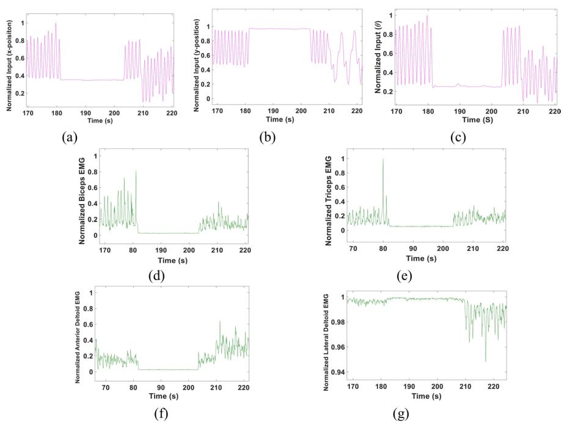
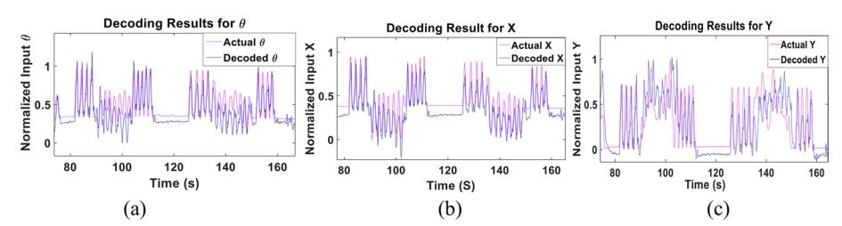
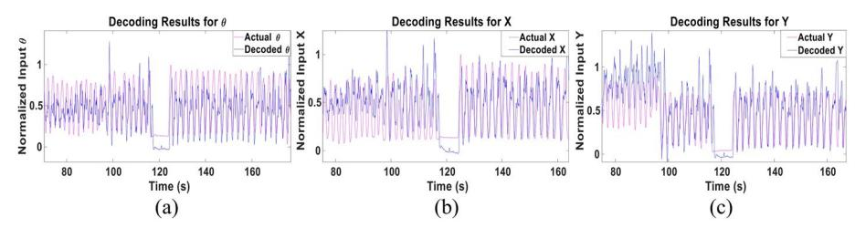
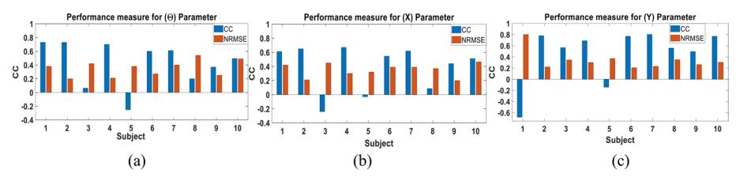
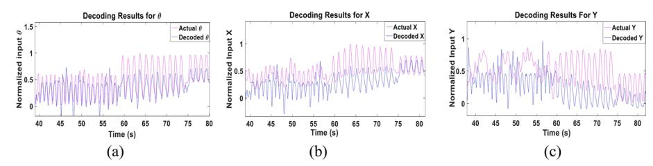
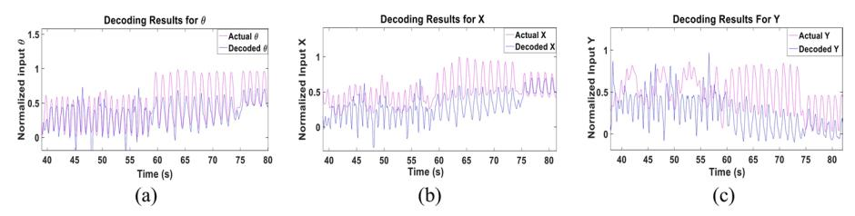
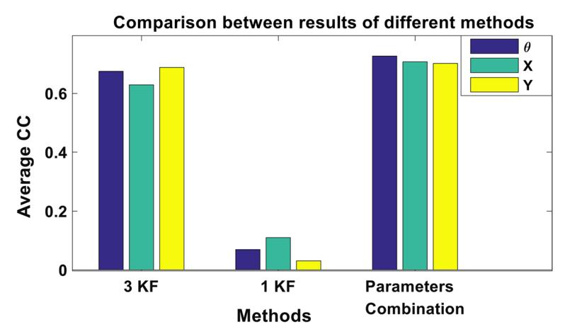
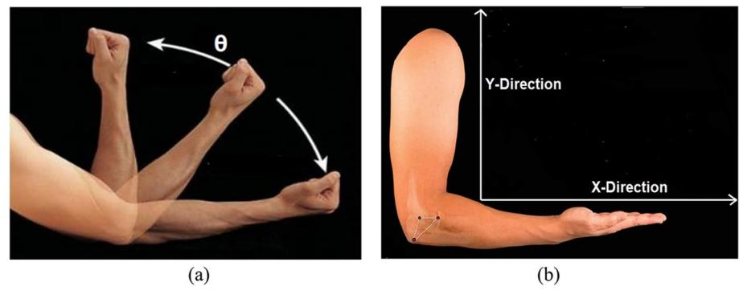
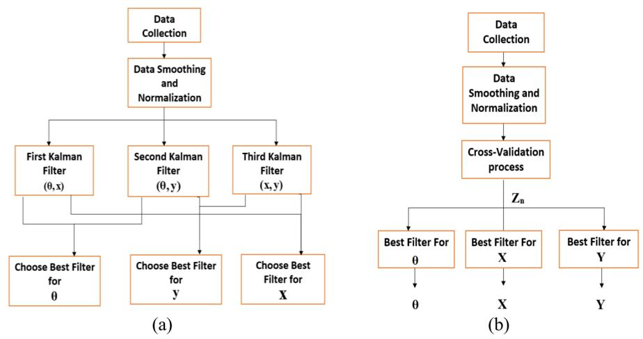
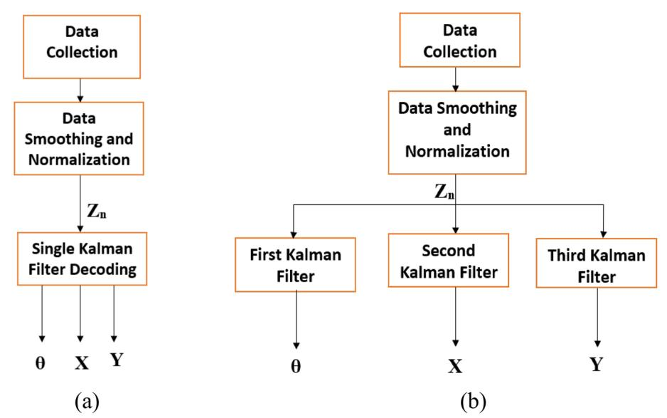

<!-- A3.R43 | source: papers_json/A3.R43/ -->

## RESEARCH Open Access

## Check for updates

## A multi-Kalman filter-based approach for decoding arm kinematics from EMG recordings

Hend ElMohandes1,2, Seif Eldawlatly3,4*, Josep Marcel Cardona Audí5, Roman Ruff5 and Klaus-Peter Hoffmann5

*Correspondence: seldawlatly@eng.asu.edu.eg

1 Center of Informatics Science, Nile University, Giza, Egypt 2 Mathematical and Computer Science, Heriot-Watt, Dubai. United Arab Emirates 3 Computer and Systems Engineering Dept, Faculty of Engineering, Ain Shams University, Cairo, Egypt 4 Faculty of Media Engineering and Technology, German University in Cairo, Cairo, Egypt 5 Department of Medical Engineering and Neuroprostheses, Fraunhofer IBMT, Sulzbach, Germany

## **Abstract **

**Background:** قُدم مؤخراً عمل بارز لتعزيز استخدام إشارات Electromyography (EMG) في تشغيل الأطراف الاصطناعية. ورغم التقدم السريع في هذا المجال، لا يزال توفير طرف اصطناعي عضلي-كهربائي (myoelectric) موثوق وطبيعي الحركة يمثل تحدياً كبيراً. وتشمل التحديات الأخرى العدد المحدود من الحركات المسموح بها، وغياب التحكم المستمر والمتزامن، والقدرة الحسابية العالية التي قد تكون مطلوبة للفك الدقيق. في هذه الدراسة، نقترح نهج متعدد مرشحات Kalman (multi-Kalman filter) مبني على إشارات EMG لفك حركية الذراع، وتحديداً زاوية الكوع (\Theta)، والموضعين الأفقي (X) والرأسي (Y) لمفصل الرسغ، بشكل مستمر ومتزامن.

**Results:** فُحص عشرة مشاركين، سُجلت منهم حركية الذراع وإشارات EMG لعضلات biceps وtriceps وlateral وanterior deltoid المقابلة لمجموعة عشوائية من الحركات. قُيّم أداء المُفكِّك المقترح باستخدام معامل الارتباط (correlation coefficient - CC) وجذر متوسط مربع الخطأ الموحّد (normalized root-mean-square error - NRMSE) المحسوبين بين الحركية الفعلية والحركية المفكوكة. تُظهر النتائج أنه عند تدريب المفكك واختباره باستخدام بيانات المشارك نفسه، تحقق معدل CC بلغ 0.68 \pm 0.1، و0.67 \pm 0.12، و0.64 \pm 0.11، ومعدل NRMSE بلغ 0.21 \pm 0.06، و0.18 \pm 0.03، و0.24 \pm 0.07 لكل من \theta وX وY على التوالي. وعند تدريب المفكك باستخدام بيانات مشارك واحد وفك بيانات مشاركين آخرين، تحقق معدل CC بلغ 0.61 \pm 0.19، و0.61 \pm 0.16، و0.48 \pm 0.17، ومعدل NRMSE بلغ 0.23 \pm 0.07، و0.2 \pm 0.05، و0.38 \pm 0.15 لكل من \theta وX وY على التوالي.

**Conclusions:** تشير هذه النتائج إلى فعالية النهج المقترح، وتُبين إمكانية الحصول على مفكك مستقل عن المشارك.

**Keywords:** Kalman filter, Decoding, EMG, Prosthetic arms

## **Background **

مع تزايد عدد المبتورين حول العالم، تنشأ الحاجة لتطوير بديل أفضل وأكثر وظيفية [1]. وقد بُذلت محاولات وتطورات عديدة عبر التاريخ، بدءاً من الأطراف الاصطناعية السلبية والتجميلية بلا وظيفة، مروراً بالأطراف الاصطناعية المدعومة بالجسم [2, 3]، ووصولاً إلى الأطراف الاصطناعية العضلية-الكهربائية (myoelectric) التي قُدمت في أوائل خمسينيات القرن الماضي [4]. تمثل الأطراف الاصطناعية العضلية-الكهربائية

© The Author(s) 2022. **Open Access** This article is licensed under a Creative Commons Attribution 4.0 International License, which permits use, sharing, adaptation, distribution and reproduction in any medium or format, as long as you give appropriate credit to the original author(s) and the source, provide a link to the Creative Commons licence, and indicate if changes were made. The images or other third party material in this article are included in the article's Creative Commons licence, unless indicated otherwise in a credit line to the material. If material is not included in the article's Creative Commons licence and your intended use is not permitted by statutory regulation or exceeds the permitted use, you will need to obtain permission directly from the copyright holder. To view a copy of this licence, visit http://creativecommons.org/licenses/by/4.0/. The Creative Commons Public Domain Dedication waiver (http://creativecommons.org/publicdomain/zero/1.0/) applies to the data made available in this article unless otherwise stated in a credit line to the data.

<!-- page 2 -->

بوابة نحو تطوير طرف اصطناعي وظيفي أقرب خطوة للطرف الطبيعي. وتستخدم هذه الأجهزة إشارات مسجلة من الجهاز العصبي، مثل إشارات electromyography (EMG)، للتحكم في الطرف الاصطناعي. وقد أظهر استخدام إشارات EMG نجاحاً في هذا التطبيق، إذ يمكن تسجيلها بشكل غير جراحي دون أي مخاطر. كما تبيّن أن إشارات EMG تحمل معلومات عصبية عن النية الحركية تشبه التسجيلات العصبية المباشرة، ما يشير إلى إمكانية فك الحركات من إشارات EMG [[5,](#page-16-4)[ 6](#page-16-5)].

ورغم أن هذا النوع من الأطراف الاصطناعية قُدم لأول مرة منذ زمن طويل، فقد بُذلت جهود كبيرة حتى الآن لتطوير تقنيات تحكم متقدمة يمكن أن توفر تحكماً أدق في الطرف الاصطناعي [[7]](#page-16-6). واستخدمت تقنيات عديدة أساليب التعرف على الأنماط (pattern recognition) للتحكم في الطرف الاصطناعي، حيث تُصنّف الإشارات إلى إحدى فئات محدودة من الحركات بشكل منفصل [[7–](#page-16-6)[9](#page-16-7)]. وتدفع الوظيفية المحدودة والموثوقية المنخفضة لهذه الأساليب نحو استخدام تقنيات إحصائية قد توفر حلولاً أكثر واعدة، إذ تتجاوز بعض قيود التعرف على الأنماط. فعلى سبيل المثال، قُدمت مقاربات متعددة تبحث في التحكم المتزامن والتناسبي والمستمر باستخدام تقنيات قائمة على الانحدار (regression-based) [[10](#page-16-8), [11]](#page-16-9). وخلافاً لتقنيات التعرف على الأنماط، لا ترسم هذه التقنيات الحركات بشكل منفصل، بل تحسب تقديراً لكل درجة حرية للحركة (degree-of-freedom - DOF). ويتيح هذا للمستخدم تحكماً متزامناً ومستقلاً.

استُخدمت تقنيات أخرى أيضاً يُوظف فيها التحكم التناسبي، والذي يستخدم إشارات EMG للتحكم في سرعة أو قوة الحركة وفقاً لإشارة EMG المسجلة، والتحكم بالعتبة (threshold control) وتحليل البدء (onset analysis) [[12](#page-16-10)]. ويمكن لهذا النهج كشف بداية ونهاية انقباض العضلة. ورغم أن هذا النهج أظهر أداءً دقيقاً، فإنه يتسم بتعقيد حسابي مرتفع يؤثر سلباً على جدوى استخدامه في التحكم الفوري.

يُعد مرشح Kalman، كتقنية تحكم بديلة معقولة، أحد أقوى الأساليب الإحصائية. وقد استُخدم على نطاق واسع في تطبيقات متنوعة، مثل تتبع الأجسام المتحركة [[13,](#page-16-11)[ 14](#page-16-12)]، وبناء نظام استدلال ضبابي (fuzzy inference system) مع شبكات عصبية معممة [[15](#page-16-13)]، فضلاً عن استخدامه في تحليل الصور والحركة لتقدير عمق البكسل وعدم اليقين المرتبط به [[16]](#page-16-14). إضافة إلى ذلك، استُخدم مرشح Kalman على نطاق واسع في تطبيقات واجهة الدماغ-الحاسوب (brain–computer interface - BCI). فقد أثبت قدرته على التحكم بحركة مؤشر الفأرة باستخدام إشارات عصبية مسجلة من القشرة الحركية [[17]](#page-16-15). كما استُخدم في استنتاج حركة اليد من تسجيلات متعددة الخلايا من القشرة الحركية [[18]](#page-16-16). وأظهر مرشح Kalman نتائج واعدة في كل تطبيق، مع قدرة عالية على تقدير الحالة وقدرة حسابية منخفضة. غير أن دراسات سابقة أظهرت دقة تنبؤ منخفضة عند استخدام مرشح Kalman في فك إشارات EMG [[11](#page-16-9)]. وقد تبيّن أن استخدام مرشح Kalman المضبوط يدوياً أو النسخ غير الخطية الأكثر تكلفة حسابياً منه يعزز دقة الفك [[19](#page-16-17), [20]](#page-16-18). وفي بعض هذه الدراسات، سُمح للمشاركين بأداء مجموعة مقيدة فقط من الحركات، ما قد يؤثر على قدرة المرشح على نمذجة الحركات الطبيعية. وأخيراً، ركزت هذه الدراسات على تدريب مرشحات Kalman خاصة بكل مشارك، مُدربة تحديداً لكل فرد.

في هذه الورقة، نقترح مخطط فك مبني على مرشحات Kalman متعددة لتقدير زاوية كوع الذراع **θ**، وموضعي **X** و**Y** للرسغ من إشارات EMG السطحية

<!-- page 3 -->

المسجلة من 4 مجموعات عضلية: biceps وtriceps وanterior deltoid وlateral deltoid. نُقدم إعداداً جديداً استخدمناه لتسجيل حركية الحركات العشوائية والمعقدة وإشارات EMG بشكل متزامن من 10 مشاركين مختلفين. وطُلب من المشاركين أداء مجموعات من الحركات في مستوى ثنائي الأبعاد بشكل عشوائي دون تقييد الحركات بتسلسل محدد. وفي نهجنا، ندرب أولاً مرشحات Kalman متعددة باستخدام أزواج من المعاملات (أي (**θ**, **X**)**,** (**θ**, **Y**) و(**X, Y)**) للحصول على معاملاتها، ثم نستخدمها لفك إشارة EMG. ويُحدد أفضل مرشح لكل معامل ثم يُستخدم لفك بيانات الاختبار لكل مشارك. وفحصنا أداء النهج في الوضعين المعتمد على المشارك والمستقل عنه، حيث دُربت مرشحات Kalman في الحالة الثانية باستخدام بيانات EMG لبعض المشاركين واختُبرت على مشاركين مختلفين تماماً. تُظهر نتائجنا قدرة النهج المقترح على فك مجموعة واسعة من الزوايا ومواضع الإحداثيات بشكل أكثر استمرارية في كل من حالتي الاعتماد على المشارك والاستقلال عنه. وأظهر أنه يستطيع الصمود أمام العشوائية والتغيرات المفاجئة في مجموعة البيانات، ما أدى إلى أداء محسّن بمعالجة بسيطة. وقد يتيح هذا التحكم في الطرف الاصطناعي بطريقة أكثر سلاسة واستمرارية وتزامناً.

## **Results**

## **Recorded data**

فحصنا أداء نهج مرشح Kalman المتعدد المقترح باستخدام 20 مجموعة بيانات. سُجلت جلستان من كل مشارك، حيث استُخدمت بيانات الجلسة الأولى لتدريب مرشحات Kalman والحصول على المعاملات الأربعة **A** و**H** و**Q** و**W** (انظر Additional fle [1:](#page-15-0) Fig. S1)، واستُخدمت بيانات الجلسة الأخرى للاختبار. يُظهر الشكل [1 ](#page-3-0) عينات من موضع **X–Y**، وزاوية الكوع **θ**، وإشارات EMG المقابلة. وتُظهر الأشكال كيف يؤدي التغير في حركة الذراع إلى نشاط عضلي واضح. فعلى سبيل المثال، تُظهر الأشكال تزامناً واضحاً بين إشارة EMG لعضلة biceps (Fig.[ 1](#page-3-0)d) ومعاملي **X** (Fig.[ 1](#page-3-0)a) و**θ** (Fig. [1c](#page-3-0)).

## **Subject‑dependent performance**

فحصنا أولاً أداء نهج مرشح Kalman المقترح بتركيبة المعاملات عند تدريبه واختباره باستخدام بيانات كل مشارك. قُسمت مجموعة بيانات كل مشارك عشوائياً إلى 75% بيانات تدريب و25% بيانات اختبار عبر 10 تقسيمات مختلفة. يُظهر الشكل [2](#page-3-1) عينة من الحالة المفكوكة والفعلية لـ**θ** و**X** و**Y** للمشارك ذي الأداء الأفضل (المشارك 3). وتُظهر النتائج أن النهج المقترح قادر على تتبع المدخل الفعلي وانتقالاته بدقة، حتى عند حدوث تغير مفاجئ في الحركة. ويُظهر الشكل أيضاً أن نمط التغير لـ**θ** و**X** متشابه، ما يعكس طبيعة الحركات التي أداها المشارك. يُظهر الشكل [3 ](#page-3-2) قيم CC وNRMSE المحصلة لكل مشارك لمعاملات **θ** و**X** و**Y**. وفكّ نهج تركيبة المعاملات مجموعة بيانات الاختبار بمتوسط CC، محسوب عبر المشاركين، بلغ 0.68±0.1 و0.67±0.12 و0.64±0.11، وبمتوسط NRMSE بلغ 0.21±0.06 و0.18±0.03 و0.24±0.07 لكل من **θ** و**X** و**Y** على التوالي. وتشير النتائج إلى أن مرشح Kalman تمكن من فك **θ** لمعظم المشاركين بأداء عالٍ، وحقق أداءً أقل لدى 20% من المشاركين. يُظهر الجدولان [1 ](#page-4-0) و[2](#page-5-0) قيم CC وNRMSE التفصيلية لكل مشارك.

<!-- page 4 -->

***Fig.** **1** Sample data set of elbow angles and corresponding EMG recorded from biceps, triceps, Anterior and lateral Deltoid muscles. **a** X-Position of the wrist. **b** Y-position of the wrist. **c** Elbow angle θ. **d** Corresponding Normalized Biceps EMG. **e** Corresponding Normalized Triceps EMG. **f** Corresponding Normalized Anterior Deltoid EMG. **g** Corresponding Normalized Lateral Deltoid EMG zoomed in to show the change in signal*

***Fig.** **2** Sample of the multi-Kalman flter performance showing (**a**) decoding result for **θ**, (**b**) **X** and (**c**) **Y***

***Fig.** **3** CC and NRMSE for each subject for each of (**a**) **θ**, (**b**) **X** and (**c**) **Y** the subject-dependent test*

## **Subject‑dependent performance using biceps and triceps signals only**

لتقييم ما إذا كانت جميع مجموعات الأقطاب الأربع ضرورية، أو ما إذا كان استخدام الإشارات المسجلة من عضلتي biceps وtriceps كافياً، فحصنا أداء مرشح Kalman عند استخدام إشارة EMG من biceps brachii وtriceps brachii فقط.

<!-- page 5 -->

θ 0.82±0.02 0.73±0.02 0.83±0.01 0.72±0.05 0.53±0.09 0.66±0.09 0.69±0.03 0.52±0.16 0.61±0.08 0.65±0.08 0.68±0.1 X 0.8±0.01 0.65±0.03 0.86±0.01 0.75±0.01 0.54±0.10 0.65±0.09 0.53±0.19 0.52±0.13 0.73±0.06 0.7±0.06 0.67±0.12 Y 0.62±0.03 0.68±0.08 0.87±0.01 0.65±0.03 0.5±0.10 0.52±0.09 0.67±0.03 0.54±0.04 0.67±0.12 0.72±0.09 0.64±0.11

قُسمت مجموعة بيانات كل مشارك عشوائياً إلى 75% بيانات تدريب و25% بيانات اختبار. يُظهر الشكل [4](#page-6-0) عينة من الحالة المفكوكة والفعلية لـ**θ** و**X** و**Y** للمشارك ذي الأداء الأفضل باستخدام هذه المجموعة من الأقطاب (المشارك 2). ورغم أن المعاملات المفكوكة تبدو قادرة على تتبع قيمها الفعلية المقابلة، فإن ذلك يحدث بدقة أقل مقارنة باستخدام جميع مجموعات الأقطاب الأربع. يُظهر الشكل [5](#page-6-1) قيم CC وNRMSE المحصلة لكل مشارك لمعاملات **θ** و**X** و**Y**. وفكّ نهج تركيبة المعاملات مجموعة بيانات الاختبار بمتوسط CC، محسوب عبر المشاركين، بلغ 0.42±0.32 و0.386±0.32 و0.46±0.488، وبمتوسط NRMSE بلغ 0.35±0.12 و0.351±0.09 و0.338±0.17 لكل من **θ** و**X** و**Y** على التوالي. وتشير النتائج إلى أن أداء مرشح Kalman انخفض بشكل كبير لدى 80% من المشاركين، بينما بقي دون تأثر لدى الـ20% الآخرين مقارنة باستخدام جميع مجموعات الأقطاب الأربع. وتدعم هذه النتائج ملاحظتنا، إذ تُفعَّل عضلات deltoid في حركات مثل ثني وبسط الكتف.

## **Subject‑independent leave‑one‑out performance**

فحصنا بعد ذلك أداء نهج مرشح Kalman المتعدد عند تدريبه باستخدام بيانات 9 مشاركين واختباره باستخدام بيانات المشارك العاشر المستبعد. وأُجري هذا الاختبار لفحص أداء مرشح Kalman إذا تم التدريب باستخدام مجموعات بيانات أكثر تنوعاً يمكن أن تلغي تماماً الحاجة لتسجيل بيانات تدريب من كل مشارك. يُظهر الشكل [6](#page-7-0) عينة من الحالات المفكوكة والفعلية لـ**θ** و**X** و**Y** للمشارك 1. ويُظهر الشكل تشابهاً، وإن كان أقل مما تحقق في الاختبار المعتمد على المشارك، وهو ما يُقاس في الشكل [7 ](#page-7-1) لجميع المشاركين، مُظهراً قيم CC وNRMSE للمعاملات الثلاثة. وتحقق متوسط CC بلغ 0.61±0.19 و0.61±0.16 و0.48±0.17، ومتوسط NRMSE بلغ 0.27±0.07 و0.2±0.05 و0.38±0.15 لكل من **θ** و**X** و**Y** على التوالي. ورغم هذا الانخفاض، يمكن أيضاً ملاحظة تحسن طفيف في الأداء لدى بعض المشاركين، كما هو الحال مع المشارك 5 على سبيل المثال. يُظهر الجدولان[ 3 ](#page-7-2) و[4](#page-7-3) قيم CC وNRMSE التفصيلية لكل مشارك.

## **Subject‑independent performance based on best subject training**

في هذا الاختبار، فحصنا أداء النهج عند التدريب باستخدام بيانات المشارك ذي الأداء الأفضل المعتمد على المشارك، والاختبار باستخدام بيانات كل من المشاركين الآخرين. واستُخدمت مجموعة بيانات المشارك 3 للتدريب في هذه الحالة نظراً للأداء المرتفع الذي تحقق باستخدام النهج المقترح لهذا المشارك مقارنة بالمشاركين الآخرين، كما هو موضح في الشكل [3.](#page-3-2) يوضح الشكل [8 ](#page-8-0) عينة من الحالة المفكوكة والفعلية لـ**θ, X** و**Y** للمشارك 1. يُظهر الشكل [9 ](#page-8-1) قيم CC وNRMSE المحصلة لكل مشارك لكل من المعاملات الثلاثة. وأظهر الأداء

<!-- page 6 -->

θ 0.16±0.01 0.16±0.02 0.12±0.01 0.25±0.01 0.32±0.05 0.27±0.02 0.2±0.01 0.25±0.01 0.21±0.01 0.19±0.01 0.21±0.06 X 0.12±0.02 0.17±0.02 0.13±0.01 0.17±0.01 0.21±0.01 0.19±0.04 0.19±0.02 0.22±0.02 0.21±0.03 0.16±0.01 0.18±0.03 Y 0.20±0.01 0.24±0.01 0.1±0.01 0.22±0.01 0.27±0.01 0.33±0.02 0.35±0.03 0.25±0.03 0.21±0.01 0.22±0.03 0.24±0.07

الكلي انخفاضاً مقارنة بالاختبار المعتمد على المشارك، بمتوسط CC بلغ 0.61±0.19 و0.61±0.16 و0.48±0.17، ومتوسط NRMSE بلغ 0.23±0.07 و0.2±0.05 و0.38±0.15 لكل من **θ, X** و**Y** على التوالي. ورغم هذا الانخفاض، يمكن أيضاً ملاحظة تحسن طفيف في الأداء لدى بعض المشاركين، كما هو الحال مع المشارك 5 على سبيل المثال. يُظهر الجدولان [5 ](#page-8-2) و[6](#page-8-3) قيم CC وNRMSE التفصيلية لكل مشارك.

## **Comparison to other Kalman flter approaches**

فحصنا أداء نهج مرشح Kalman المتعدد المقترح مقارنة بالنهجين الآخرين (نهج مرشح Kalman الواحد ونهج مرشحات Kalman الثلاثة). يُظهر الشكل [10 ](#page-9-0) نتيجة المحاولات المختلفة لبناء مرشح Kalman بمعامل واحد ومعاملين وثلاثة معاملات، مع متوسط CC لكل معامل في كل طريقة للاختبار المعتمد على المشارك. وتُظهر النتائج أن نهج تركيبة المعاملات المقترح يحقق أفضل أداء. وأدت تركيبة المعاملات إلى متوسط CC بلغ 0.698 و0.675 و0.652، مقارنة بـ0.069 و0.109 و0.0308 لنهج مرشح Kalman الواحد، و0.67 و0.629 و0.688 لنهج مرشحات Kalman الثلاثة، لموضع **θ** و**X** و**Y** على التوالي.

## **Discussion**

يمثل تعزيز فك حركية الحركة من إشارات EMG خطوة حاسمة نحو تطوير أطراف اصطناعية ذات حركات طبيعية. وهدفنا هنا إلى تطوير نهج مرشحات Kalman متعددة يحقق أفضل أداء لكل معامل حركة مفكوك. وأظهر النهج المقترح أداءً محسّناً عند اختباره بالوضعين المعتمد على المشارك والمستقل عنه. والتقنية المقترحة قادرة على التغلب على ضوضاء القياس، وتُظهر إمكانية الفك عبر المشاركين.

بُذلت جهود عديدة تستخدم مجموعة متنوعة من التقنيات لفك الحركة من إشارات EMG. فعلى سبيل المثال، استخدم Loconsole et al. شبكة عصبية بتأخير زمني (time-delayed neural network - TDNN) للتنبؤ الفوري بعزم الدوران والتحكم في مفاصل الروبوت، باستخدام إشارات sEMG كمدخل للنموذج. وتُظهر النتائج المحققة إمكانية استخدام هذا النهج لدعم المرضى الذين يعانون صعوبة في الحركة [[21](#page-16-19)]. غير أنه في هذا الإعداد، ليس واضحاً ما إذا كان هذا النموذج يمكنه التنبؤ بالحركية المباشرة، مثل زوايا الكوع/الإصبع، أو موضع معين للذراع. إضافة إلى ذلك، كان مسار الحركة محدوداً وقد يكون مناسباً فقط لإعادة التأهيل بدلاً من التحكم في الطرف الاصطناعي. وحاول Natsakis et al. تقدير الحركية من الكوع فما دون باستخدام إشارات EMG المقاسة من مجموعة عضلات biceps وtriceps وdeltoid وbrachioradialis [[22](#page-16-20)]. وفي هذه الدراسة، استُخدم نموذج شبكة عصبية في عملية التقدير. غير أن الدراسة لا تُظهر ما إذا كان هذا النموذج يمكن استخدامه للمبتورين الذين تنقصهم عضلة brachioradialis

<!-- page 7 -->

***Fig.** **4** Sample of the multi-Kalman flter performance when using signals from the biceps brachii and triceps brachii only showing (**a**) decoding result for **θ**, (**b**) **X** and (**c**) **Y***

***Fig.** **5** CC and NRMSE for each subject when using signals from the biceps brachii and triceps brachii only for each of (**a**) **θ**, (**b**) **X** and (c) **Y** the subject-dependent test using biceps and triceps EMG signals only*

عضلة. إضافة إلى ذلك، فُحص النهج فقط باستخدام مجموعة محدودة ومتكررة من الحركات دون الإبلاغ عن الأداء إذا طُلب من المشاركين التحرك بلا نمط مخطط له. وأخيراً، حاول Kapelner et al. التنبؤ بحركية الرسغ باستخدام إشارات EMG والسمات العصبية المستخلصة من تفكيك إشارة EMG المسجلة. ويُستخدم في هذا النهج نموذج انحدار خطي بسيط للتنبؤ. غير أن أحد قيود هذه الدراسة هو الاقتصار على انقباضات درجة حرية واحدة فقط [[23]](#page-17-0).

ونظراً لقيود الدراسات السابقة، استُخدم مرشح Kalman في نهجنا بالنظر إلى قوته المعروفة في مسائل التنبؤ للأنظمة المستمرة [[24–](#page-17-1)[26](#page-17-2)]. وقدمت دراسات عديدة استخدام مرشح Kalman لفك الحركة، لكن باستخدام نشاط عصبوني للقشرة الحركية مُسجل بشكل جراحي [[17](#page-16-15), [27](#page-17-3), [28](#page-17-4)]. ويمكن لهذه التقنية توفير وصول إلى نشاط عصبونات مفردة، ما يؤدي إلى فك دقيق لنية الحركة. غير أنها لا تزال بعيدة عن التطبيق العملي نظراً للتعقيدات التي قد ترتبط بجراحات زراعة الأقطاب. لذا، يمكن أن يوفر استخدام EMG بديلاً أفضل، وقد اقتُرحت مخططات فك مختلفة لغرض مماثل.

في دراستنا، اقترحنا حلاً يمكن أن يعالج بعض القيود في التحكم بالطرف الاصطناعي. ومرشح Kalman مثالي للأنظمة الديناميكية التي يستطيع فيها فك الإشارات بشكل تكراري باستخدام مدخلات بيانات متتالية [[29](#page-17-5), [30](#page-17-6)]. ويتيح له هذا تقدير القيمة الحقيقية بسرعة مع مراعاة عدم اليقين في البيانات المعطاة. وميزة أخرى لمرشحات Kalman هي أنها لا تتطلب موارد ذاكرة كبيرة، إذ تحتاج فقط للحالة السابقة للتقدير التالي [[31](#page-17-7)]. ويجعل هذا مرشحات Kalman مناسبة للتطبيقات الفورية، مثل التحكم بالطرف الاصطناعي. ويمكن تطبيقه على EMG في المجال الزمني دون الحاجة لاستخلاص سمات أخرى في المجال الترددي (انظر Additional fle [1:](#page-15-0) Figs. S2–S5). ولن يتطلب قدرة حسابية عالية مقارنة باستخدام الشبكات العصبية وتقنيات التعلم العميق.

<!-- page 8 -->

***Fig.** **6** Sample of multi-Kalman flter performance showing (**a**) decoding result for **θ**, (**b**) **X** and (**c**) **Y** for the subject-independent leave-one-out test*

***Fig.** **7** CC and NRMSE for each subject for each of (**a**) **θ**, (**b**) **X** and (**c**) **Y** for the subject-independent leave-one-out test*

|  | Subject Number |  |  |  |  |  |  |  |  |  |  |
| --- | --- | --- | --- | --- | --- | --- | --- | --- | --- | --- | --- |
|  | 1 | 2 | 3 | 4 | 5 | 6 | 7 | 8 | 9 | 10 | Mean |
| θ | 0.33 | 0.34 | 0.25 | 0.27 | 0.57 | 0.29 | 0.2 | 0.32 | 0.22 | 0.19 | 0.23±0.07 |
| X | 0.21 | 0.28 | 0.20 | 0.21 | 0.50 | 0.30 | 0.16 | 0.24 | 0.21 | 0.18 | 0.2±0.05 |
| Y | 0.33 | 0.28 | 0.27 | 0.23 | 0.26 | 0.37 | 0.28 | 0.47 | 0.26 | 0.45 | 0.38±0.15 |

علاوة على ذلك، يمكنه التغلب على ضوضاء القياس (إشارة EMG)، وهو أمر حاسم في هذا التطبيق نظراً لأن إشارات EMG ضجيجية [[32]](#page-17-8)، خاصة عند تسجيلها بشكل غير جراحي. كما أظهرنا إمكانية التدريب باستخدام بيانات مشارك واحد واستخدام النموذج لفك حركة مشارك مختلف تماماً.

يمكن توسيع هذا العمل ليأخذ بالحسبان ديناميكيات إشارات EMG عندما تكون العضلة متعبة، إذ حرصنا على إعطاء فترات راحة لمشاركينا لتجنب التغيرات في النشاط العضلي. وعليه، لا يمكن التنبؤ بسلوك النهج المقترح إذا قُدمت إشارة EMG مختلفة لحركة معينة

<!-- page 9 -->

***Fig.** **8** Sample of the multi-Kalman flter performance showing (**a**) **θ**, (**b**) **X** and (**c**) **Y** for the subject-independent testing with the Kalman flters using data of Subject 3*

***Fig.** **9** CC and NRMSE for each subject for each of (**a**) **θ**, (**b**) **X** and (**c**) **Y** for the subject-independent testing with the Kalman flters using data of Subject 3*

|  |  | Subject number |  |  |  |  |  |  |  |  |  |
| --- | --- | --- | --- | --- | --- | --- | --- | --- | --- | --- | --- |
|  | 1 | 2 | 3 | 4 | 5 | 6 | 7 | 8 | 9 | 10 | Mean |
| θ | 0.16 | 0.35 | 0.14 | 0.28 | 0.2 | 0.2 | 0.2 | 0.32 | 0.22 | 0.19 | 0.23±0.07 |
| X | 0.25 | 0.27 | 0.12 | 0.23 | 0.19 | 0.15 | 0.16 | 0.24 | 0.21 | 0.18 | 0.2±0.05 |
| Y | 0.28 | 0.70 | 0.21 | 0.39 | 0.29 | 0.46 | 0.28 | 0.47 | 0.26 | 0.45 | 0.38±0.15 |

من أجل الفك. وقد لا يكون هذا عملياً في الإعدادات السريرية. ويمكن تخفيف ذلك باستخدام مفكك مبني على مرشح Kalman تكيفي، مثل مرشح Kalman التكيفي [[33](#page-17-9)]. وثمة قضية أخرى هي أن مرشح Kalman المستخدم في نهجنا يفترض علاقة خطية بين الحركة وإشارة EMG المسجلة. ورغم أنه نجح في فك الحركة بأداء مقبول، من المتوقع أن استخدام مرشح غير خطي مثل unscented Kalman filter سيتمكن من الفك بأداء أفضل، لكن بتعقيد حسابي أعلى نسبياً [[34]](#page-17-10). وأخيراً، في هذه الورقة، سجلنا كلاً من حركية الحركة وإشارات EMG باستخدام إعداد محدود إلى حد ما.

<!-- page 10 -->

ومع ظهور الكثير من الأجهزة المتقدمة الجديدة لتسجيل EMG وتتبع الحركة، يجعلنا هذا نتوقع أن استخدام مثل هذه التقنيات قد يعزز ترشيح الضوضاء ويوفر قراءات أدق. إضافة إلى ذلك، سيؤدي ذلك إلى تأخير أقل في التسجيل المتزامن لكل من EMG والحركية. كما قد يتيح فكاً فورياً لإشارة EMG وبحث سلوكها. وبناءً على المقترحات أعلاه، يمكن للنهج والنتائج الموضحة في هذه الورقة أن توفر وسيلة لتحسين التحكم في الطرف الاصطناعي.

## **Conclusions**

في هذه الورقة، قدمنا مخطط فك EMG لحركية الذراع في مستوى ثنائي الأبعاد. ويتألف نهجنا من 4 مراحل: تسجيل البيانات، ومعالجة البيانات المسبقة، وتحديد أفضل تركيبة من المعاملات لعملية الفك، وتدريب مرشح Kalman باستخدام مجموعة بيانات التدريب. واختُبرت الخوارزمية المقترحة على مشاركين متعددين، حيث استُخدمت جلسة تسجيل واحدة للتدريب واستُخدمت الجلسة المسجلة الأخرى لاختبار أداء الخوارزمية. كما فحصنا الأداء عند استخدام بيانات تدريب مشارك واحد لتدريب الخوارزمية ثم استخدام المفكك المدرب لفك بيانات مشاركين آخرين. وأظهرت النتائج قدرة نهج مرشح Kalman المتعدد المقترح على فك الحركية في مستوى ثنائي الأبعاد باستخدام إشارات EMG المسجلة من 4 مجموعات عضلية. كما أظهرنا نجاح تدريب المرشح باستخدام بيانات مشارك واحد وفك بيانات مشارك آخر. وتُظهر نتائجنا قدرة النهج المقترح على فك حركية الذراع بشكل مستمر ومتزامن، ما قد ينتج عنه طرف اصطناعي بحركة أكثر سلاسة من الأطراف المتاحة حالياً. ومن شأن مثل هذه الخوارزمية أن تتيح تقديم عائلة جديدة من الأطراف الاصطناعية يمكنها التصرف بشكل أقرب للذراع الطبيعية.

## **Methods**

## **Experimental setup**

شارك في هذه الدراسة عشرة أشخاص أصحاء، أيمن اليد (خمسة ذكور، خمس إناث، بمدى عمري 21–33). لم يكن لدى أي منهم تاريخ اضطراب عصبي-عضلي، وقدم جميعهم

***Fig.** **10** Average CC for three parameters when using 3 Kalman flters, 1 Kalman flter and Parameters Combination approaches*

<!-- page 11 -->

موافقة خطية على الإجراءات. وكان الهدف من التجربة تسجيل إشارات EMG بشكل متزامن مع حركية الذراع المقابلة. وكان لدى المشاركين 9 أقطاب متصلة بـ4 مجموعات عضلية: biceps وlateral triceps وanterior deltoid وlateral deltoid لتسجيل EMG. واستُخدم القطب التاسع كمرجع ووُضع في مركز لوح الكتف (scapula). وقبل تثبيت الأقطاب، مُسحت بشرة المشاركين باستخدام قطعة كحول أيزوبروبيلي لإزالة الزيوت والبقايا السطحية بهدف زيادة معاوقة أقطاب التسجيل [[35](#page-17-11)]. وتُرك الجلد ليجف في الهواء لبضع ثوانٍ قبل وضع الأقطاب الجيلاتينية. وتم وضع الأقطاب وفق التوصيات الواردة في [[36]](#page-17-12).

استُخدمت أربع علامات: اثنتان بالقرب من العنق الجراحي، وواحدة عند مفصل الكوع، وواحدة عند مفصل الرسغ (carpal)، لتتبع الحركة، كما هو موضح في الشكل [11.](#page-12-0) وثُبتت العلامات على أشرطة قابلة للارتداء. واستخدم جميع المشاركين الشريط نفسه دون تغيير موضع العلامات الموضحة في الشكل[ 11c](#page-12-0)، .

طُلب من المشاركين أداء مجموعات من الحركات في فضاء ثنائي الأبعاد دون ترتيب أو تكرار محدد. وصُنفت الحركات كما يلي:

- 1) ثني وبسط الساعد. تحدث هذه الحركة أثناء إراحة مفصل الكوع على طاولة ثابتة أو دون إراحته عليها. ويؤدي هذا إلى تغير زاوية الكوع مع استخدام عضلتي biceps brachii وtriceps brachii بشكل أساسي.
- 2) ثني/بسط الكتف مع أو بدون ثني/بسط الساعد. وتعكس هذه الحركة محاكاة للوصول إلى جسم ما.
- 3) إراحة الذراع على الطاولة لتجنب إجهاد العضلات. وطُلب من المشاركين الراحة في أي وقت يشعرون فيه بالتعب حتى الاستراحة الكافية. وقُدر متوسط وقت الراحة بـ2–3 ثوانٍ.

يُظهر الشكل [12 ](#page-13-0) وصفاً تفصيلياً للحركات الموصوفة. ولم يُطلب من المشاركين تجنب استلقاء (supination) و/أو انبطاح (pronation) الساعد أثناء الحركات. وشارك جميع المشاركين في جلستين، فُصل بينهما استراحة من 5 إلى 10 دقائق. واستمرت الجلستان 400 و200 ثانية على التوالي.

## **Data recording**

استُخدم نظام SIMI reality motion system (SIMI, Germany) كبيئة لالتقاط الحركة باستخدام تقنية تحليل الصور. وأُجري تسجيل الفيديو باستخدام كاميرا Basler A60xf EMVA (Basler Technologies, Ahrensburg, Germany) بمعدل 15 إطاراً في الثانية، وحُفظ باستخدام كاميرات صناعية متزامنة. وكان الجهاز المستخدم لالتقاط EMG هو Noraxon TelyMyo 2400 T (Noraxon, USA, Inc.). كما استُخدمت بطاقة National Instruments NI USB-6225 (National Instruments Corporation, Austin, USA) لعملية رقمنة الإشارات. وسُجلت إشارات EMG بشكل متزامن مع فيديو الحركة عبر منصتي SIMI وNoraxon.

في نهاية كل جلسة، استُخدم نظام التتبع لتحليل الحركة باستخدام تتبع آلي قائم على العلامات بعد معايرة مناسبة. وضم ملف البيانات الناتج لكل مشارك عينات الوقت، وزاوية الكوع، وإشارات EMG الأربع، وموضعي **X** و**Y** لعلامة الرسغ. وباستخدام مواضع كل من العلامات الثلاث المتبقية، حسبنا زاوية الكوع θ باستخدام دالة مضمنة في برنامج SIMI.

<!-- page 12 -->

## Data pre-processing

خضعت تسجيلات إشارة EMG لعملية ترشيح على مرحلتين، استخدمت المرحلة الأولى مرشح تمرير عالٍ (high-pass filter) من الدرجة الأولى مدمج في الجهاز بقطع تردد 10 هرتز\pm10%. وطُبق مرشح تمرير منخفض (low-pass) مضاد للتشويش من نوع Butterworth/Bessels من الدرجة الثامنة بقطع تردد 500 هرتز\pm2% [37]. وتمثلت المرحلة الثانية في تنعيم الإشارة باستخدام جذر متوسط المربعات (root mean square - RMS)، الذي يعمل كغلاف خطي لإشارة EMG. ويربّع RMS الإشارة الخام التي تُعد قياساً لقدرة الإشارة [38, 39]. ثم طُبّعت جميع الإشارات المجمّعة بطرح القيمة الدنيا ثم قسمة كل عينة على القيمة العظمى لجميع العينات:

$$
\mathbf{h}(t) = \frac{(\mathbf{k} - \min(\mathbf{k}))}{\max(\mathbf{k} - \min(\mathbf{k}))} (1)
$$

حيث يشير **k** إلى موضع *المحور X*، أو موضع *المحور Y*، أو زاوية مفصل الكوع \theta. إضافة إلى ذلك، ضُربت جميع إشارات EMG بمعامل ثابت قدره 10^3 وضُربت الحركية المقاسة بمعامل قدره 10^2 لزيادة سعتها كما هو محدد لجهاز Noraxon.

## Data analysis

هدفنا هو تقدير الحالة الحركية للذراع عند لحظة زمنية محددة n. وتُعرّف الحالة بـ\hat{\mathbf{r}}_n = [\theta, \mathbf{X}, \mathbf{Y}]، ممثلة زاوية مفصل الكوع، وموضع X، وموضع Y لمفصل الرسغ، على التوالي، عند الزمن المعطى T = \Delta t \times n، حيث \Delta t هو نافذتنا الزمنية التي حُددت بـ100 مللي ثانية. وتُستخدم المعاملات الثلاثة لوصف الحركة الموصوفة في القسم 5.1. وهذه المعاملات مستقلة، إذ يمكن الوصول إلى إحداثيات (\mathbf{X}, \mathbf{Y}) نفسها بزوايا كوع مختلفة، اعتماداً على ما إذا كان كوع المشارك مستنداً على الطاولة أم لا.

استخدمنا مرشح Kalman لهذه المهمة، وهو عملية تكرارية تستخدم مجموعة من المعادلات والمدخلات المتتالية المنفصلة لتقدير القيمة الحقيقية للنموذج المُراقب [25]. ويفترض مرشح Kalman علاقة خطية بين الحالة \mathbf{r}_n والقياس \mathbf{z}_n ممثلة بـ

$$ \mathbf{z}_n = \mathbf{H}_n \mathbf{r}_n + \mathbf{Q}_n \tag{2} $$

حيث \mathbf{H}_n مصفوفة تربط بشكل خطي حالة حركية اليد \mathbf{r}_n بإشارات EMG \mathbf{z}_n الناتجة من العضلات، و\mathbf{Q}_n هو ضوضاء القياس.

تُحسب الحالة التالية باستخدام نموذج النظام:

$$ \mathbf{r}_{n+1} = \mathbf{A}_n \mathbf{r}_n + \mathbf{w}_n \tag{3} $$

حيث A_n مصفوفة المعامل التي تربط بشكل خطي الحالة الحالية بالحالة التالية، و\mathbf{w}_n هو ضوضاء العملية.

ورغم أن \mathbf{H}_n و\mathbf{A}_n و\mathbf{Q}_n و\mathbf{w}_n يمكن أن تكون متغيرة زمنياً، نفترض هنا أنها ثابتة زمنياً للسماح بتقديرها باستخدام بيانات التدريب. وتُقدر المعاملتان \mathbf{A} و\mathbf{H} باستخدام طريقة المربعات الصغرى كما في [18]

$$
\mathbf{A} = \mathbf{R}_2 \mathbf{R}_1^T (\mathbf{R}_1 \mathbf{R}_1^T)^{-1} \tag{4}
$$

<!-- page 13 -->

***Fig. 11** a Subject's arm showing electrodes connected to biceps and deltoid muscle groups. **b** Subject's arm showing electrodes connected to triceps deltoid and reference. **c** Subject's arm with markers attached to the arm position matching movement number 1. **d** Sample of the subject's arm movement number 2*

$$ \mathbf{H} = \mathbf{z}\mathbf{R}^T(\mathbf{R}\mathbf{R}^T)^{-1} \tag{5} $$

حيث

$$
\mathbf{R} = \begin{pmatrix} \mathbf{r}_{1,1} & \dots & \mathbf{r}_{1,M} \\ \vdots & \ddots & \vdots \\ \mathbf{r}_{2,1} & \dots & \mathbf{r}_{2,M} \end{pmatrix}, \mathbf{R} \mathbf{1} = \begin{pmatrix} \mathbf{r}_{1,1} & \dots & \mathbf{r}_{1,M-1} \\ \vdots & \ddots & \vdots \\ \mathbf{r}_{2,1} & \dots & \mathbf{r}_{2,M-1} \end{pmatrix} (6)
$$

$$
\mathbf{R}2 = \begin{pmatrix} \mathbf{r}_{1,2} & \dots & \mathbf{r}_{1,M} \\ \vdots & \ddots & \vdots \\ \mathbf{r}_{2,2} & \dots & \mathbf{r}_{2,M} \end{pmatrix}, \mathbf{Z} = \begin{pmatrix} \mathbf{z}_{1,1} & \dots & \mathbf{z}_{1,M} \\ \vdots & \ddots & \vdots \\ \mathbf{z}_{4,1} & \dots & \mathbf{x}_{4,M} \end{pmatrix} (7)
$$

تُستخدم قيمتا A وH المحسوبتان بعد ذلك لتقدير W وQ عبر

$$
\mathbf{W} = (\mathbf{R}_2 - \mathbf{A}\mathbf{R}_1)(\mathbf{R}_2 - \mathbf{A}\mathbf{R}_1)^T / (M - 1) 
(8)
$$

<!-- page 14 -->

***Fig. 12** Visual illustration of the plane of movements. **a** Elbow angle that was captured. **b** *x*–*y* plane of arm movement*

و

$$
\mathbf{Q} = (\mathbf{Z} - \mathbf{H}\mathbf{R})(\mathbf{Z} - \mathbf{H}\mathbf{R})^{T} / M \tag{9}
$$

بعد تقدير جميع معاملات مرشح Kalman، تُبنى مرشحات Kalman لكل مشارك، وتُستخدم المعاملات المحصلة لفك زاوية الكوع \theta، وموضعي X وY للرسغ باستخدام إشارة EMG المقاسة \mathbf{z}_n وفق التسلسل التالي.

## (a) Kalman filter time update equations

في كل لحظة زمنية n، نُقدر الحالة التالية \hat{\mathbf{r}}_n^- باستخدام الحالة السابقة ومصفوفة تغاير الخطأ \mathbf{P}_n^- باستخدام المعادلات التالية:

$$ \widehat{\mathbf{r}}_{n} = A\widehat{\mathbf{r}}_{n-1},\tag{10} $$

$$
\mathbf{P}_{n}^{-} = \mathbf{A}\mathbf{P}_{n-1}\mathbf{A}^{\mathrm{T}} + \mathbf{w} \tag{11}
$$

حيث تُضبط \hat{\mathbf{r}}_n^- و\mathbf{P}_n^- في البداية على القيمة واحد.

## (b) Kalman filter measurement update equations

في الخطوة التالية، نحصل على معامل كسب Kalman \mathbf{k} ونستخدمه مع الحالة السابقة \hat{\mathbf{r}}_n وإشارة EMG المقاسة \mathbf{z}_n لتصحيح التقدير المحسوب سابقاً إلى جانب مصفوفة تغاير الخطأ \mathbf{H} باستخدام المعادلات التالية

$$
\mathbf{K}_n = \mathbf{P}_n^{\mathsf{T}} \mathbf{H}^{\mathsf{T}} (\mathbf{H} \mathbf{P}_n^{\mathsf{T}} \mathbf{H}^{\mathsf{T}} + \mathbf{Q})^{-1}, \tag{12}
$$

$$
\widehat{\mathbf{r}}_n = \widehat{\mathbf{r}}_n^- + \mathbf{K}_n (\mathbf{z}_n - \mathbf{H}\widehat{\mathbf{r}}_n^-), \tag{13}
$$

$$ \mathbf{P}_n = (\mathbf{I} - \mathbf{K}_n \mathbf{H}) \mathbf{P}_n^-. \tag{14} $$

تمثل المعادلات السابقة تكراراً واحداً، حيث تُفك معاملات حركيتنا لنافذة زمنية مدتها 100 مللي ثانية.

<!-- page 15 -->

## **Decoding methodology **

في دراستنا، نقترح فك معاملاتنا الثلاثة، \theta وX وY، باستخدام نهج مرشح Kalman المتعدد. وفي هذه الطريقة، نبني مرشحي Kalman لفك المعاملات الثلاثة. وتُجرى أولاً عملية تحقق متبادل (cross-validation) على جميع مجموعات بيانات كل مشارك لتحديد أي تركيبة معاملات هي الأنسب. وفي هذه العملية، اختير عشوائياً 20% من البيانات لبحث أي تركيبة معاملات تنتج أداء فك أفضل. ثم أُضيفت هذه البيانات إلى بيانات التدريب، واستُخدمت مجدداً كجزء من بيانات التدريب. وبناءً على ذلك، تُبنى ثلاثة مرشحات Kalman لكل مشارك في خطوة التحقق لاختبار كل زوج من التركيبات. ثم يُستخدم المرشحان بأفضل نتائج تركيبة في عملية الفك. يُظهر الشكل 13 توضيحاً بيانياً لعملية التحقق المتبادل، حيث نبدأ باختبار التركيبات (\theta, X) و(\theta, Y) و(X, Y). ثم نبحث دقة الفك لكل معامل ونستخدم التركيبة التي تنتج أفضل أداء لكل معامل.

وللمقارنة، حاولنا أيضاً فك المعاملات الثلاثة باستخدام مرشح Kalman واحد، حيث نستخدم مرشح Kalman واحداً فقط لفك المعاملات الثلاثة \theta وX وY باستخدام إشارة EMG المقاسة \mathbf{z}_n. كما فحصنا نهج ثلاثة مرشحات Kalman، حيث نبني مرشح Kalman منفصلاً لكل معامل لفكه بشكل مستقل. يُظهر الشكل 14 مخططاً كتلياً يوضح خطوات كل من هذين النهجين.

## Performance evaluation

استُخدم معامل الارتباط (CC) بين الحركة المتنبأ بها والحركة الفعلية كمقياس أداء نظراً للعلاقة الخطية بين المتغيرين الفعلي والمتنبأ به (انظر Additional file 1: Figs. S6 and S7)، حيث يُقدر CC باستخدام صيغة Pearson [40]:

$$
CC = \frac{M \sum ab - (\sum a)(\sum b)}{\sqrt{\left[M \sum a^2 - (\sum a)^2\right] \left[M \sum b^2 - (\sum b)^2\right]}} (15)
$$

حيث M عدد العينات، وa وb هما الإشارتان المقابلتان اللتان نختبر علاقتهما ببعضهما (معاملا الحركة الحركية الفعلي والمفكوك). إضافة إلى ذلك، استُخدم جذر متوسط مربع الخطأ (RMSE) وRMSE الموحّد (NRMSE):

$$ RMSE = \sqrt{\frac{\sum_{i=1}^{n} (a-b)^2}{N}} (16) $$

$$ NRMSE = \frac{RMSE}{\max(a) - \min(a)} (17) $$

حيث N عدد عينات البيانات.

<!-- page 16 -->

***Fig.** **13** **a** Block diagram illustrating the cross-validation process for each subject to fnd the best decoding parameters combination. **b** Block diagram that shows the entire parameter combination decoding approach*

***Fig.** **14** Block diagram showing **a** single and **b** three Kalman flters approaches*

## **Supplementary Information**

The online version contains supplementary material available at[ https://doi.org/10.1186/s12938-022-01030-6.](https://doi.org/10.1186/s12938-022-01030-6)

**Additional fle 1.** Supplementary Performance Analysis and Comparison

## **Acknowledgements**

Not applicable.

## **Author contributions**

HE, JA, RR and KH conceived and designed the experiments. HE performed the experiments. HE and SE analyzed the data. HE and SE wrote the paper. All authors read and approved the fnal manuscript.

## **Funding**

This work was supported by Deutscher Akademischer Austauschdienst (DAAD) German Egyptian Research short term scholarship (GERSS) application number 57237401.

<!-- page 17 -->

## **Availability of data and materials**

The data sets used and/or analysed during the current study are available from the corresponding author on reasonable request.

## **Declarations**

## **Ethics approval and consent to participate**

All procedures performed in this study were in accordance with the ethical standards of medical ethics committee of the Medical Association of Saarland, Germany (127/18) and with the 1964 Helsinki declaration and its later amendments or comparable ethical standards.

## **Consent for publication**

Not applicable.

## **Competing interests**

The authors declare that they have no competing interest.

Received: 4 April 2022 Accepted: 8 August 2022

## **References**

- 1. Carey SL, Lura DJ, Highsmith MJ. Diferences in myoelectric and body-powered upper-limb prostheses: Systematic literature review. J Rehab Res Develop. 2015;52:3.
- 2. Biddiss EA, Chau TT. Upper limb prosthesis use and abandonment: a survey of the last 25 years. Prosthet Orthot Int. 2007;31(3):236–57.
- 3. Carey SL, Stevens PM, Highsmith MJ. Diferences in myoelectric and body-powered upper-limb prostheses: system‑ atic literature review update 2013–2016. J Prosthet Orthot. 2017;29:P17–20.
- 4. Childress DS. Historical aspects of powered limb prostheses. Clin Prosthet Orthot. 1985;9(1):2–13.
- 5. Farina D, Jiang N, Rehbaum H, Holobar A, Graimann B, Dietl H, Aszmann OC. The extraction of neural information from the surface EMG for the control of upper-limb prostheses: emerging avenues and challenges. IEEE Trans Neural Syst Rehabil Eng. 2014;22(4):797–809.
- 6. Bi L, Guan C. A review on EMG-based motor intention prediction of continuous human upper limb motion for human-robot collaboration. Biomed Signal Process Control. 2019;51:113–27.
- 7. Lee SW, Wilson KM, Lock BA, Kamper DG. Subject-specifc myoelectric pattern classifcation of functional hand movements for stroke survivors. IEEE Trans Neural Syst Rehabil Eng. 2011;19(5):558–66.
- 8. Chu J-U, Moon I, Mun M-S. A real-time EMG pattern recognition system based on linear-nonlinear feature projection for a multifunction myoelectric hand. IEEE Trans Biomed Eng. 2006;53(11):2232–9.
- 9. Hahne JM, Schweisfurth MA, Koppe M, Farina D. Simultaneous control of multiple functions of bionic hand prosthe‑ ses: Performance and robustness in end users. Sci Robotics. 2018;3(19):e3630.
- 10. Roche AD, Lakey B, Mendez I, Vujaklija I, Farina D, Aszmann OC. Clinical perspectives in upper limb prostheses: an update. Curr Surg Rep. 2019;7(3):5.
- 11. Sarasola-Sanz A, Irastorza-Landa N, Shiman F, López-Larraz E, Spüler M, Birbaumer N, Ramos-Murguialday A. EMGbased multi-joint kinematics decoding for robot-aided rehabilitation therapies. In: Rehabilitation Robotics (ICORR), 2015 IEEE International Conference on. IEEE; 2015. p. 229–234.
- 12. Micera S, Carpaneto J, Raspopovic S. Control of hand prostheses using peripheral information. IEEE Rev Biomed Eng. 2010;3:48–68.
- 13. Chan Y, Hu A, Plant J. A Kalman flter based tracking scheme with input estimation. IEEE Trans Aerosp Electron Syst. 1979;2:237–44.
- 14. Singer RA. Estimating optimal tracking flter performance for manned maneuvering targets. IEEE Trans Aerosp Electron Syst. 1970;4:473–83.
- 15. Jang J-SR. Fuzzy Modeling Using Generalized Neural Networks and Kalman Filter Algorithm. *AAAI* 1991; 91:762–767.
- 16. Matthies L, Kanade T, Szeliski R. Kalman flter-based algorithms for estimating depth from image sequences. Int J Comput Vision. 1989;3(3):209–38.
- 17. Wu W, Black MJ, Mumford D, Gao Y, Bienenstock E, Donoghue JP. Modeling and decoding motor cortical activity using a switching Kalman flter. IEEE Trans Biomed Eng. 2004;51(6):933–42.
- 18. Wu W, Black M, Gao Y, Bienenstock E, Serruya M, Donoghue J: Inferring hand motion from multi-cell recordings in motor cortex using a Kalman flter. In: SAB'02-workshop on motor control in humans and robots: On the interplay of real brains and artifcial devices; 2002. p. 66–73.
- 19. George JA, Davis TS, Brinton MR, Clark GA. Intuitive neuromyoelectric control of a dexterous bionic arm using a modifed Kalman flter. J Neurosci Methods. 2020;330: 108462.
- 20. Nakagome S, Luu TP, Brantley JA, Contreras-Vidal JL. Prediction of EMG envelopes of multiple terrains over-ground walking from EEG signals using an unscented Kalman flter. In 2017 IEEE International Conference on Systems, Man, and Cybernetics (SMC). IEEE; 2017. p. 3175–8.
- 21. Loconsole C, Dettori S, Frisoli A, Avizzano CA, Bergamasco M: An EMG-based approach for on-line predicted torque control in robotic-assisted rehabilitation. In,. IEEE Haptics Symposium (HAPTICS). IEEE. 2014;2014:181–6.
- 22. Natsakis T, Busoniu L. EMG based prediction of upper limb intention of motion using a combination of non-linear auto-regressive models.

<!-- page 18 -->

- 23. Kapelner T, Vujaklija I, Jiang N, Negro F, Aszmann OC, Principe J, Farina D. Predicting wrist kinematics from motor unit discharge timings for the control of active prostheses. J Neuroeng Rehabil. 2019;16(1):47.
- 24. Welch G, Bishop G. An introduction to the Kalman flter. 1995.
- 25. Bishop G, Welch G. An introduction to the Kalman flter. Proc of SIGGRAPH, Course. 2001;8(27599–23175):41.
- 26. Li Q, Li R, Ji K, Dai W. Kalman flter and its application. In: 2015 8th International Conference on Intelligent Networks and Intelligent Systems (ICINIS). IEEE; 2015. p. 74–7.
- 27. Wu W, Gao Y, Bienenstock E, Donoghue JP, Black MJ. Bayesian population decoding of motor cortical activity using a Kalman flter. Neural Comput. 2006;18(1):80–118.
- 28. Wu W, Black M, Gao Y, Bienenstock E, Serruya M, Donoghue J. Inferring hand motion from multi-cell recordings in motor cortex using a Kalman flter. In: SAB'02-workshop on motor control in humans and robots: On the interplay of real brains and artifcial devices. 2002. p. 66–73.
- 29. Zhang Y, Chen B, Yu L, Ho DW. Distributed Kalman fltering for interconnected dynamic systems. IEEE Transactions on Cybernetics; 2021.
- 30. Linear Dynamic Systems. In: Kalman Filtering. 2002. p. 25–55.
- 31. Khan R, Khan SU, Khan S, Khan MUA. Localization performance evaluation of extended Kalman flter in wireless sen‑ sors network. Procedia Computer Sci. 2014;32:117–24.
- 32. Amrutha N, Arul V. A Review on Noises in EMG Signal and its Removal. Int J Sci Res Publ. 2017;7:23–7.
- 33. Rutan SC. Adaptive kalman fltering. Anal Chem. 1991;63(22):1103A-1109A.
- 34. Li Z, O'Doherty JE, Hanson TL, Lebedev MA, Henriquez CS, Nicolelis MA. Unscented Kalman flter for brain-machine interfaces. PLoS ONE. 2009;4(7): e6243.
- 35. Ghapanchizadeh H, Ahmad SA, Ishak AJ: Recommended surface EMG electrode position for wrist extension and fexion. In,. IEEE Student Symposium in Biomedical Engineering & Sciences (ISSBES). IEEE. 2015;2015:108–12.
- 36. Konrad P. The abc of emg. A practical introduction to kinesiological electromyography. 2005;2005(1):30–5.
- 37. Noraxon TeleMyo 2400T User Manual.[ https://www.manualslib.com/manual/828960/Noraxon-Telemyo-2400t-V2.](https://www.manualslib.com/manual/828960/Noraxon-Telemyo-2400t-V2.html?page=3#manual) [html?page](https://www.manualslib.com/manual/828960/Noraxon-Telemyo-2400t-V2.html?page=3#manual)=3#manual.
- 38. Santos AB, Soares DP, Candotti CT. Smoothing EMG signals: Implications on delay calculation. RPCD. 2012;12(1):60–72.
- 39. Merletti R, Parker PJ. Electromyography: physiology, engineering, and non-invasive applications. New York: Wiley; 2004.
- 40. Mukaka MM. A guide to appropriate use of correlation coefcient in medical research. Malawi Med J. 2012;24(3):69–71.

## **Publisher's Note**

Springer Nature remains neutral with regard to jurisdictional claims in published maps and institutional afliations.
