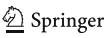
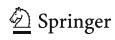
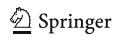
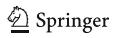

<!-- A3.R45 | source: papers_json/A3.R45/ -->

## ORIGINAL RESEARCH

## The determinants of university strategic positioning: a reappraisal of the organisation

Tatiana Fumasoli^1^ & Giovanni Barbato^2^ & Matteo Turri ^2^

# The Author(s) 2019 Published online: 12 December 2019

## Abstract

تقدم هذه الورقة إسهاما في النقاش حول الفاعلية التنظيمية للجامعة (organisational actorhood) من خلال بناء نظرية حول محددات التموضع الاستراتيجي المؤسسي. وتجادل الورقة بأنه بالإضافة إلى القوى البيئية والعقلانية الإدارية، يجب أخذ البعد التنظيمي بعين الاعتبار. ولمعالجة تباين الأدلة التجريبية في الأدبيات ذات الصلة، نقوم بتصور البعد التنظيمي كمتغير وسيط على المستوى المتوسط (meso-level) يتوسط كلا من التأثيرات الخارجية (من الخارج إلى الداخل) والفعل التنظيمي (من الداخل إلى الخارج). ونقوم بتفعيل البعد التنظيمي عبر ثلاثة مكونات هي: البنية التنظيمية، والهوية، والمركزية، والتي يتم تفصيلها أكثر في مكونات فرعية ومؤشرات. ويقدم البحث مجموعة من الفرضيات التي يمكن اختبارها في البحث التجريبي. وتقدم الورقة منظورات جديدة حول ديناميكيات التغيير في التعليم العالي وحول الفاعلية الاستراتيجية للفاعلين التنظيميين.

Keywords Strategic positioning . Determinism . Intentionality. Organisational actorhood . Institutionalism . Higher education

## Universities as strategic actors and the changing academic field

لقد غيّر النمو الهائل في قطاع التعليم العالي طريقة عمل الجامعات. وقد دفعها هذا النمو إلى استيعاب أعداد متزايدة ومتنوعة من الطلاب، وإلى القيام بأنواع مختلفة من الأنشطة البحثية لتحقيق التميز والأثر الأكاديمي، وإلى تعزيز الخدمات المقدمة لمجتمعاتها وإضفاء الشرعية على نفسها كمحركات اقتصادية وتكنولوجية وابتكارية على المستويين المحلي والإقليمي (Van Vught [2008](#page-29-0); Toma [2012;](#page-29-0) Van Vught and Huisman [2013)](#page-29-0). كما طُلب من الجامعات، بالمثل، تنويع مصادر تمويلها لمواجهة ركود أو تقلص

> ^*^ Tatiana Fumasoli [t.fumasoli@ucl.ac.uk](mailto:t.fumasoli@ucl.ac.uk)

> ^1^ UCL Institute of Education, University College London, London, UK

<!-- page 2 -->

الموارد العامة، والعمل بطريقة أكثر تكاملا من أجل المنافسة بشكل مناسب في الأسواق التي تختارها (Bonaccorsi [2009;](#page-24-0) Rossi [2009b](#page-28-0); Paradeise and Thoenig [2018)](#page-28-0). وتحت ضغط المشاركة في بناء "مجتمع المعرفة"، خضعت الجامعات أيضا لعدة إصلاحات تهدف إلى جعلها أكثر كفاءة وفعالية واستدامة (Krücken and Meier [2006](#page-26-0); Bleiklie and Kogan [2007](#page-24-0); Laudel and Weyer [2014](#page-26-0); Seeber et al. [2015](#page-28-0)). وقد اعتُبرت هذه التحولات المستمرة في معظمها ضغوطا خارجية تهدد مهام الجامعة واستقلاليتها. غير أن النقاش الأكاديمي تحول مؤخرا نحو كيفية قدرة الجامعات نفسها على تطوير قدرات تنظيمية تسمح باختيار مسار عمل وتعديل النطاق الذي تتواجد فيه (Fumasoli and Huisman [2013](#page-25-0); Cruz-Castro et al. [2016](#page-25-0); Paradeise and Thoenig [2016](#page-28-0)). وبناء على ذلك أصبح تموضع الجامعات قضية محورية بالنسبة لباحثي التعليم العالي وصانعي السياسات والقيادة المؤسسية (Marginson [2007;](#page-27-0) Klumpp et al. [2014](#page-26-0); Marginson [2015](#page-27-0); Shadymanova and Amsler [2018](#page-29-0)). وفي هذه الورقة، يُقصد بالتموضع العملية التي من خلالها تحدد مؤسسات التعليم العالي مواقعها في نطاقات موارد محددة داخل نظام التعليم العالي (Fumasoli and Huisman [2013](#page-25-0)).

وفي ظل هذه الخلفية، قام باحثو التنظيم والتعليم العالي بتحليل عمليات التموضع الاستراتيجي - التخطيط الاستراتيجي واتخاذ القرار، وصنع المعنى ومنحه في التغيير الاستراتيجي، وبناء العلامة التجارية والهوية (Pedersen and Dobbin [2006](#page-28-0); Frølich et al. [2013;](#page-25-0) Mampaey et al. [2015;](#page-27-0) Stensaker [2015;](#page-29-0) Seeber et al. [2019;](#page-28-0) Paradeise and Thoenig [2018)](#page-28-0). وبالمثل، تم بحث نتائج التموضع الاستراتيجي لفهم كيفية تموضع الجامعات في المجال الأكاديمي وفقا لمحفظتها التعليمية، ونتاجها البحثي، ونقل التكنولوجيا، والتنمية الإقليمية (Bonaccorsi and Daraio [2008;](#page-24-0) Ljungberg et al. [2009;](#page-27-0) Vuori [2016](#page-29-0); Seeber et al. [2019](#page-28-0); Barbato and Turri [2019](#page-24-0); Barbato et al. [2019)](#page-24-0).

ومع ذلك، وبينما تُناقش عمليات ونتائج التموضع الاستراتيجي للجامعات على نطاق واسع، فإن محدداتها ظلت مهملة إلى حد كبير. فبعض الباحثين يفترضون ضمنيا أن الضغوط الخارجية تجبر الجامعات على الاستجابة بطرق محددة سلفا (Van Vught [2008](#page-29-0); Vaira [2009](#page-29-0))، بينما يرى آخرون أن لقيادة الجامعة هامشا للمناورة في إعادة تعريف المهام والأنشطة والأسواق التي تتفاعل معها (Martinez and Wolverton [2009](#page-27-0)). وتشير الأدلة التجريبية إلى ضرورة مزيد من الفحص، إذ أفسحت النتائج المتباينة المجال لتفسيرات مفصّلة تعكس البيانات المتاحة بطريقة انتقائية إلى حد ما بدلا من تقديم تفسيرات أكثر عمومية لهذه النتائج المتنوعة.

ولتسليط الضوء على محددات تموضع الجامعات، تقدم هذه الورقة أولا مراجعة للأدبيات من زاوية نظرية وتحليلية ومنهجية. ثانيا، تشير الورقة إلى ضرورة مواصلة تطوير إطار مفاهيمي من خلال دمج البعد التنظيمي (Selznick [1949](#page-28-0); Clark [1983](#page-25-0); Paradeise and Thoenig [2013;](#page-28-0) Fumasoli [2015)](#page-25-0) الذي يُتصور كمتغير وسيط على المستوى المتوسط بين المتغير الكلي (البيئة) والمتغير الجزئي (الإدارة).

وتنظم الورقة على النحو التالي: في الجزء التالي، تسلط مراجعة الأدبيات حول محددات تموضع الجامعات الضوء على الفجوات القائمة في معرفتنا. وفي الجزء الثالث، نطور تصورا للبعد التنظيمي لتحليل محركات التموضع الاستراتيجي ونقوم بصياغة مجموعات من الفرضيات ذات الصلة. وفي القسم الأخير، نناقش كيف يمكن للإسهام المفاهيمي لهذه الورقة أن يعزز أبحاثا جديدة حول قطاع التعليم العالي المتغير.

<!-- page 3 -->

## Literature review

## Methodology

من أجل فهم النقاش الأكاديمي حول محددات تموضع الجامعات، تم إجراء مراجعة للأدبيات استندت إلى قواعد بيانات ببليوغرافية مختلفة، وتحديدا Web of Science وScopus وGoogle Scholar. ولأننا استهدفنا أوسع بحث ممكن، فقد بحثنا في عدة كلمات مفتاحية، هي 'Positioning' و'Institutional positioning' و'Strategic positioning' و'Market position' و'Profiling'، مقترنة بـ 'Higher Education' أو 'University'، و'Diversity' أو 'Differentiation'. وبعد أن لاحظنا أن عدة منشورات أشارت إلى أدبيات التسويق، أُدرجت الكلمات المفتاحية 'Marketing' و'Mission statements' و'Branding' في مراجعة الأدبيات لضمان أوسع تغطية ممكنة للمواضيع ذات الصلة. وبما أن موضوع التحليل هو التموضع المؤسسي للجامعات، فإن المنشورات التي تبحث في التموضع على مستوى البرامج الدراسية أو أنظمة التعليم العالي لم تُدرج في مراجعة الأدبيات هذه.

في المرحلة الأولى من مراجعة الأدبيات ركزنا على العناوين والكلمات المفتاحية، وجمعنا نحو 600 منشور. وفي المرحلة الثانية، نظرنا إما إلى ملخصاتها أو نصوصها الكاملة بحثا عن مدى صلتها بسؤال بحثنا، أي كيف يمكن فهم محددات التموضع الاستراتيجي للجامعات. وبعد هذا الانتقاء، اعتمدنا في نهاية المطاف 108 منشورا (Table [1)](#page-3-0). ووُجدت المقالات المنشورة في المجلات العلمية (88) في مجلات التعليم العالي (60)، وفي الاقتصاد والإدارة (20)، وعلم الاجتماع (2)، ودراسات التنظيم (5). أما الباقي فتألف من 18 فصلا من كتب أو كتبا وورقتي مؤتمر. وستة عشر من المنشورات الـ108 أعمال مفاهيمية، و31 دراسة تجريبية، بينما الـ61 المتبقية مفاهيمية وتجريبية في آن واحد. علاوة على ذلك، تعتمد 44 منشورا منهجية نوعية، و40 تحليلا كميا، و5 نهجا مختلطا. وأخيرا، لاحظنا أن 60 عملا نُشر بعد عام 2010، و41 بين عامي 2000 و2010، بينما نُشرت 7 أعمال قبل عام 2000. ويؤكد هذا الاهتمام المتزايد حديثا بتموضع الجامعات. وللاطلاع على معلومات تفصيلية عن الـ106 منشورات المدرجة في مراجعة الأدبيات، انظر Table [1 in the appendix](#page-3-0).

## Findings

تُظهر مراجعة أدبياتنا أن إطارين نظريين هما الأكثر استخداما: منظور الحتمية البيئية (environmental determinism) ومنهج العقلانية الإدارية (managerial rationality). ونعرض فيما يلي كلا المنظورين وإسهامهما في تفسير تموضع الجامعات.

## The environmental determinism perspective

تزعم النظرية المؤسسية الجديدة (Neo-institutional theory) أن تموضع الجامعات ينشأ عن السعي إلى الشرعية من أجل الامتثال للضغوط الخارجية للبيئة المحيطة (Van Vught [2008](#page-29-0)). فالشرعية "أهم من الكفاءة في الحفاظ على البقاء التنظيمي" (Mampaey et al. [2015,](#page-27-0) p. 1181)، ما يجعل الجامعات متأثرة بشدة بالضغوط الخارجية للمجال التنظيمي، إذ يوفر التكيف والامتثال الموارد وفي نهاية المطاف البقاء (DiMaggio and Powell [1983)](#page-25-0).

ويمكن وصف الشرعية بأنها "إدراك أو افتراض عام بأن أفعال كيان ما مرغوبة ومناسبة، ضمن نظام مبني اجتماعيا من الأعراف والقيم والمعتقدات [...]" (Suchman [1995](#page-29-0), p. 574–575). ويُعبَّر عن نظام الأعراف والقيم من خلال

<!-- page 4 -->

| Classification of the publications of the literature review based on several characteristics |
| --- |
|  |
|  |
|  |
|  |
|  |
|  |
|  |
|  |
| Table 1 |

| Author(s) and year | Source | Topic/research question | Type of paper | Theoretical framework |
| --- | --- | --- | --- | --- |
| Ahmed et al. (2015) | Higher Education for the Future | To apply concepts of strategic management into HE | Conceptual | Strategic management school |
| Gibson-Sweet Bakewell and (1998) | Educational Management International Journal of | and how these can be used to position themselves Students' perceptions of English ex-polytechnics in order to attract future students successfully. | Empirical (UK)–quantitative |  |
| Barbato and Turri (2019) | Studies in Higher Education | How the quantitative analysis of positioning paths of universities helps to understand more deeply the diversity of HE systems | England)–quantitative Empirical (Italy and |  |
| Bevelander et al. (2015) | South African Journal of Business Management | statements and how these provide a basis for What business schools tell in their mission strategic positioning | Empirical (a sample of international Business schools)–qualitative |  |
| Bobe and Kober (2015) | Education + Training | universities and how these are bundled to provide To measure the organizational capabilities of a long-term | (Australia)–quantitative Conceptual and empirical | Resource-based view |
| Bonaccorsi (2009) | Book chapter | How to measure differentiation and positioning of universities in doctoral education competitive advantage | Conceptual and empirical (Aquameth dataset)–quantitative | Strategic management school |
| Bonaccorsi (2014) | Book | diversity and their contribution to the knowledge Several issues on universities' performances, | MIDA Conceptual and empirical (EU dataset) – quantitative | Strategic management school and micro-economics |
| Daraio (2007) Bonaccorsi and | Book | versities in terms of research, education and third To provide micro-based evidence on the evolution of the strategic profile and positioning of uni economy | European countries)–quantitative Conceptual and empirical (six | Strategic management school and micro-economics |
| Daraio (2008) Bonaccorsi and | Scientometrics | alternative methodology based on the concept of Limits of ranking indicators and illustration of an mission | (Aquameth dataset)–quantitative Empirical and methodological |  |
| Bowl (2018) | Studies in Higher Education | tiveness and equality of educational opportunities How universities balance (communicate) distinc positioning indicators based on their status | Conceptual and empirical (England and New Zealand)–qualitative | Resource dependence theory and Neo-institutionalism |
| Brandt (2002) | Higher Education | What kind of strategies universities use to answer to the different demands for continuing education, looking for any signs of differentiation | Empirical (Norway)–qualitative |  |

<!-- page 5 -->

|  |
| --- |
|  |
|  |
|  |
|  |
|  |
|  |
|  |
| (continued) |
|  |
|  |
|  |
|  |
|  |
|  |
|  |
|  |
|  |
| Table 1 |

| Author(s) and year | Source | Topic/research question | Type of paper | Theoretical framework |
| --- | --- | --- | --- | --- |
| Brankovic (2014) | Book chapter | positioning of private universities in the Balkans. To identify those forces that might may affect the | Western Conceptual and empirical ( Balkans) – quantitative | Resource dependence theory and Neo-institutionalism |
| Brown et al. (1993) | Journal of Marketing for Higher Education | To propose a model positioning concept for metropolitan universities | Conceptual | Strategic management school |
| Çatı et al. (2016) | Education and Science | universities want to be distinctive in the mind of To identify positioning strategies through which prospective students | Conceptual and empirical (Turkey)–qualitative | Strategic management school |
| Cattaneo et al. (2018) | Studies in Higher Education | diversification and specialization positioning How different levels of competition affects the strategies of universities over time | Conceptual and empirical (Italy)–quantitative | Strategic management school |
| Cruz-Castro et al. (2016) | Research Evaluation | To evaluate and compare the responses of Spanish universities to the existence of the ERC | (Spain)–qualitative and quantitative Conceptual and empirical | Organizational capabilities |
| Davies and Glaister (1996) | Higher Education Quarterly | universities and the appropriateness of their use How mission statements have been introduced by | Conceptual and empirical (England)–quantitative | Neo-institutionalism |
| Deiaco et al. (2009) | Book chapter | The existence of competition in higher education and how and why European universities are learning to compete | Conceptual | Economic theory (Schumpeter's vision of competition) |
| Dorozhkin et al. (2016) | Journal of Environmental Science and Science Education | To develop a set of marketing actions in order to position a university and assess it | Empirical (Russia)–quantitative |  |
| Erhardt and von Kotzebue (2016) | Tertiary Education and Management | To describe and measure the status quo of horizontal highlighting further possibilities for increasing differentiation among German universities, distinctiveness | (Germany)–qualitative and Conceptual and empirical quantitative | Strategic management school |
| Fahy et al. (2010) | Conference paper | To analyse the competitive positioning of UK universities | Empirical (UK)–quantitative |  |
| Finley et al. (2001) | Journal of Marketing for Higher Education | universities and suggest alternatives to improve To analyse mission statements of Canadian these strategic instruments | Empirical (Canada)–qualitative |  |
| Frølich et al. (2013) | Higher Education | How individual universities deal with (interpret) institutional pluralism through strategising | Conceptual | Strategic management school sense-making approach and Old and New-institutionalism, |

<!-- page 6 -->

| (continued) Table 1 |  |  |  |  |
| --- | --- | --- | --- | --- |
| Author(s) and year | Source | Topic/research question | Type of paper | Theoretical framework |
| Fumasoli (2018) | Book chapter | Conceptualization of strategic planning and positioning in higher education | Conceptual | Strategic management school |
| Lepori (2011) Fumasoli and | Higher Education | To investigate the nature of organizational strategies development process and the content of of universities focusing on the internal strategies (positioning) | Conceptual and empirical (Swiss)–qualitative | Strategic management school |
| Huisman (2013) Fumasoli and | Minerva | How universities position themselves and how this process impact on diversity | Conceptual | Organisation theory |
| Furey et al. (2014) | Journal of Marketing for Higher Education | To investigate brand promises from universities belonging to different mission groups | Empirical (UK)–qualitative |  |
| Gaehtgens (2015) | Book chapter | How small universities can face and respond to the 'Excellence Initiative' in Germany | Empirical (Germany)–qualitative |  |
| Haezendonck et al. (2017) | International Journal of Inclusive Education | dimension and How this instrument can be used How the 'growth-share matrix' can be used to position themselves in the social inclusion by universities | Conceptual and empirical (Flanders)–quantitative | Strategic management school |
| Walker Harrison- (2009) | Academy of Educational Leadership Journal | explain its importance and discuss its application To define the concept of strategic positioning, for policymakers | Conceptual | Marketing literature |
| Morphew Hartley and (2006) | The Journal of Higher Education | How colleges and universities mission statements differ in terms of content and how they differ between various institutional types | Conceptual and empirical (USA)–qualitative | Neo-institutionalism |
| Morphew Hartley and (2008) | The Journal of Higher Education | messages are communicated to students on the viewbooks, how these vary by institutional type and which To examine themes of colleges' academic purposes of HE | Conceptual and empirical (USA)–qualitative | Strategic management school and Neo-institutionalism |
| Hou et al. (2012) | Higher Education Research & Development | strategic plans and positioning for world-class To analyse global rankings in order to inform universities | rankings)–quantitative Empirical (International |  |
| Pringle (2011) Huisman and | Oxford review of Education Canadian Journal of Higher Education | Application of Porter's five force model to Ontario HE system | Empirical (Ontario)–qualitative |  |

<!-- page 7 -->

|  |
| --- |
|  |
|  |
| (continued) |
|  |
| Table 1 |
|  |
|  |

| Author(s) and year | Source | Topic/research question | Type of paper | Theoretical framework |
| --- | --- | --- | --- | --- |
| Huisman et al. Huisman and Mampaey (2018) (2008) | Science and Public Policy | To discuss the use of research funding mechanisms How much the images of universities are different and similar, and how universities want external as an instrument to either maintain or promote stakeholders to look at them. diversity in HE systems | (UK)–qualitative and quantitative Conceptual and empirical dataset)–quantitative Empirical (OECD | Resource dependence theory Neo-institutionalism and |
| Huisman et al. Huisman et al. (2002) | Tertiary Education and Research Evaluation Management | original goal of being 'distinctive' organizations during the late '60s managed to develop their Whether and How some universities established How to conceptualise and measure diversity | (Netherlands, Denmark and Conceptual and empirical Norway)–qualitative MIDA Empirical (EU | Neo-institutionalism, Resource dependence theory and Strategic choice theory |
| Krücken (2016) Hüther and (2015) | Research in the Sociology of Organization | How the embeddedness of universities in nested and differentiation among universities organizational fields can produce homogenisation | dataset)–quantitative Conceptual | Neo-institutionalism (nested field structure) |
| Huisman (2009) Jamieson and James and | European Journal of Education Journal of Higher Education Policy and Management | How much mission statements of universities differ and (or not) compared with policies and market How a university position itself in the changing demands and pressures | Empirical (England)–qualitative Wales)–qualitative Empirical ( |  |
| Naidoo (2007) Jin and Horta (2018) | Tertiary Education and Management | How two Chinese prestigious schools intend to position themselves in an external changing market for doctoral study environment | Conceptual and empirical (China)–qualitative | Resource dependence theory Neo-institutionalism and |
| Carter (2017) Kayombo and | Journal of Education and Vocational Research | To identify the position of ZCAS university's brand in Zambia as a case study and to establish the position in relation to the other competitors | Conceptual and empirical (Zambia)–quantitative | Strategic management school |
| Klemenčič (2016) | Book chapter | positioning within Central Europe universities How much institutional research supports | Conceptual and empirical (Central Europe)–qualitative | Strategic management school and Organizational capabilities |
| Klumpp et al. (2014) | Comparative Education |  | Empirical (Germany and the Netherlands) – qualitative |  |

<!-- page 8 -->

| (continued) Table 1 |  |  |  |  |
| --- | --- | --- | --- | --- |
| Author(s) and year | Source | Topic/research question | Type of paper | Theoretical framework |
|  |  | differentiation and profiling/positioning in Ger To explore and compare policy approaches on man and Dutch HE systems |  |  |
| Kosmützky (2012) | Tertiary Education and Management | What mission statements of German universities contain, if they express a distinctive market position and which is their function | Conceptual and empirical (Germany) – qualitative | Neo-institutionalism and organization theory |
| Kosmützky and | International Studies of | How German universities balance sameness and | Conceptual and empirical (Germany) – | Organization theory and |
| Krücken (2015) Ivy (2001) | Management & Organization International Journal of | How universities and Technikons use marketing to distinctiveness within mission statements | Conceptual and empirical (UK and qualitative | Competitive groups theory Marketing literature |
|  | Educational Management | differentiate their institutional image and therefore to position themselves | South Africa) – quantitative | (institutional image) |
| Weyer Laudel and | Research in the Sociology of | To investigate the relationship between universities' | Conceptual and empirical | Authority relation perspective |
| (2014) | Organization | opportunities to shape their research profiles and impact of research-profile building activities in the changing role of the state as well as the side universities | (Netherlands) – qualitative |  |
| Leiber (2016) | Book chapter | What purposes of universities mission statements What are the key contents of mission statements? assist and are used by them? | Empirical (Germany) – qualitative |  |
| Lepori et al. (2014) | Studies in Higher Education | To investigate convergence and differentiation in HE binary systems | (Switzerland) – quantitative Conceptual and empirical | Population Ecology theory Neo-institutionalism and |
| Ljungberg et al. (2009) | Book chapter | influence the positioning of Swedish universities To investigate how structural characteristics and their obtainment of external funds | Conceptual and empirical (Sweden) – quantitative | Strategic management school |
| Lowry and Owens (2001) | Services Marketing Quarterly | How a university can position itself based on a step by step approach (flowchart) | Conceptual | Marketing literature |
| Lynch and Baines (2004) | Journal of Higher Education Policy and Management | reality, underlying its potentiality, setting a re To apply Resource-based view to the UK HE search agenda | Conceptual | Resource-based view |
| Potman (1990) Maassen and | Higher Education | How Dutch universities respond to the new planning system | (The Netherlands) – qualitative Conceptual and empirical | Neo-institutionalism |
| Mackay et al. (1996) | Higher Education Management | themselves in a context of expanding demand for HE To what extent universities strive to differentiate | Empirical (UK) – qualitative |  |

<!-- page 9 -->

|  |
| --- |
|  |
|  |
|  |
|  |
|  |
|  |
|  |
|  |
|  |
|  |
|  |
|  |
| (continued) |
|  |
|  |
|  |
|  |
|  |
|  |
|  |
|  |
| Table 1 |

| Author(s) and year | Source | Topic/research question | Type of paper | Theoretical framework |
| --- | --- | --- | --- | --- |
| Mahat (2015) | Conference paper | organizations (medical schools) in a regulated To analyse the strategic positioning of academic environment | Conceptual and empirical (Australia) – qualitative and quantitative | Strategic management school |
| Goedegebuure Mahat and (2016) | Theory and Method in Higher Education Research | To apply the Porter's five forces framework to medical higher education in Australia | Conceptual and empirical (Australia) – quantitative | Strategic management school |
| Mampaey et al. (2015) | Higher Education Research & Development | How branding of Flemish universities meets competitive and institutional pressures by distinctiveness and legitimacy balancing | Conceptual and empirical (Flanders) – qualitative | Strategic balance perspective and Translation theory |
| Mampaey (2018) | Studies in Higher Education | homogeneity vs heterogeneity in HE by focusing on translation rules adopted by universities To shed lights on the dynamics underlying | Conceptual and empirical (Flanders) – qualitative | Neo-institutionalism and Translation theory |
| Marginson (2007) | International Education Journal of Studies in | strategies a HE system and of its universities To analyse the global position and positioning-taking | Conceptual and empirical (Australia) – quantitative | Bourdieu Theory of Social Fields |
| Marginson (2015) | Higher Education | Australian research universities The positioning of in East Asia | Empirical (Australia) – quantitative |  |
| Maringe (2006) | Educational Management International Journal of | important in choosing university and courses of To investigate those elements students consider study and how this impact on positioning | Conceptual and empirical (UK) – quantitative | Marketing literature |
| Martinez and Wolverton (2009) | Book | Overview of the strategy literature applied to HE field | Conceptual | Strategic management school |
| Mashhadi et al. (2008) | Engineering and Technology World Academy of Science, | Application of the European Foundation of Quality Management model to position top Iranian business schools | Conceptual and empirical (Iran) – quantitative | Strategic management school |
| Ogutu (2015) Mathooko and | International Journal of Public Sector Management | How much Porter's five forces model influence the choice of strategies adopted by public universities in Kenya. | Conceptual and empirical (Kenya) – quantitative | Strategic management school |
| Soutar (2008) Mazzarol and | Nonprofit and Voluntary International Journal of Sector Marketing | To explore if the strategic positioning behaviour of Australian educational institutions impacts on their competitiveness | Conceptual and empirical (Australia) – quantitative | Strategic management school |

<!-- page 10 -->

|  |  |  |  |  |
| --- | --- | --- | --- | --- |
| Author(s) and year | Source | Topic/research question | Type of paper | Theoretical framework |
| Rose (2003) Mintzberg and | Administrative Sciences Canadian Journal of | To identify the nature of strategies (deliberate vs emergent) and positioning attempts of McGill University over time | Conceptual and empirical (Canada) – qualitative | Strategic management school |
| Morphew (2009) | The Journal of Higher Education | How institutional diversity has changed over a period of 30 years | Conceptual and empirical (USA) – quantitative | Neo-institutionalism |
| Huisman 2002) Morphew and | Higher Education in Europe | (academic drift) and differentiation in HE To understand patterns of homogenisation | Conceptual and empirical (USA and Netherlands) – quantitative | Neo-institutionalism |
| Morphew et al. (2018) | Studies in Higher Education | How do the strategies used to balance the multiple (public and private) identities of research public universities compare? systems | Europe and North America) – qual Conceptual and empirical (Northern itative | Strategic balance perspective |
| Mourad (2010) | Educational Management International Journal of | To investigate the effect of internationalization on positioning strategies of Egyptian universities | Empirical (Egypt) – qualitative |  |
| Naudè and Ivy (1999) | Educational Management International Journal of | How old and new universities in the UK are responding to a rapidly changing external environment | Empirical (UK) – quantitative |  |
| Niculescu (2006) | Journal of Organizational Change Management | To assist the decision-making processes of univer sities on topics like market structure analysis, market segmentation and positioning | – qualitative Empirical (Romania) |  |
| Wetzel (2014) Olivares and | CESifo Economic Studies | To explore the existence of economies of scale and scope in German HE sector and the technical efficiency | Empirical (Germany) – quantitative |  |
| Opoku et al. (2008) | Journal of Marketing for Higher Education | How Swedish universities position themselves in the market space by looking at online brand personalities | Conceptual and empirical (Sweden) – qualitative | Marketing literature (brand personality) |
| Thoenig (2013) Paradeise and | Organization Studies | What academic quality means for universities and how they achieve that, looking for difference between institutions | Italy, USA, China, Switzerland) – Conceptual and empirical (Francia, qualitative | Merton 1973) Recognition ( |
| Thoenig (2016) Paradeise and | Minerva | ideal-types of universities (reputation and re How three types of organizational capability influence the strategic capacity of four search performances) | Conceptual and empirical (6 countries) – qualitative | Organizational capabilities and sociology of organization |

Table 1 (continued)

<!-- page 11 -->

|  |  |
| --- | --- |
|  |  |
|  |  |
|  |  |
|  |  |
| (continued) |  |
|  |  |
|  |  |
|  |  |
|  |  |
|  |  |
|  |  |
|  |  |
|  |  |
|  |  |
|  |  |
|  |  |
|  |  |
|  |  |
|  |  |
|  |  |
|  |  |
|  |  |
|  |  |
| Table 1 |  |

|  |  |  |  |  |
| --- | --- | --- | --- | --- |
| Author(s) and year | Source | Topic/research question | Type of paper | Theoretical framework |
| Dobbin (2006) Pedersen and | American Behavioural Scientist | neo-institutionalism theories in order to reconcile Comparison between organizational culture and them | Conceptual | Organizational culture Neo-institutionalism and |
| Pietilä (2014) | Higher Education | and how these are connected to the goals leaders How academic leaders conceive research profiling are trying to achieve with profiling | Conceptual and empirical (Finland) – qualitative | Neo-institutionalism and sensemaking approach Micro-level |
| Pizarro Milian (2017) | Higher Education Quarterly | towards external stakeholders and which type of How Canadian universities are depicting themselves symbolic resources employed to do it | Conceptual and empirical (Canada) – qualitative | Neo-institutionalism |
| Pizarro Milian and Quirke (2017) | Journal of Marketing for Higher Education | externally by adopting alternatives strategies to How for-profit career colleges market themselves legitimate themselves | Conceptual and empirical (Ontario) – qualitative and quantitative | Neo-institutionalism |
| Richardson et al. (1995) | International Journal of Public Sector Management | To explain why customer responsiveness is a crucial aspect for universities and how to match it | Conceptual | perspective and Strategic management school Political contingency |
| Rossi (2009a) | Tertiary Education and Management | To empirically investigate the relationship between and their ability to obtain external research funds the organizational features and strategies of universities | Empirical (Italy) – quantitative |  |
| Rossi (2009b) | Higher Education Policy | How universities' responses towards competition impact on the horizontal diversity of higher education systems | Conceptual and empirical (Italy) – quantitative | and diversity of HE systems Review of different theoretical perspectives on competition |
| Rossi (2010) | Studies in Higher Education | competition for students and research funds How massification, privatization, increasing stimulate diversity between universities | Empirical (Italy) – quantitative | Review of different theoretical perspectives on processes promoting or hampering diversity of HE systems |
| Rutter et al. (2017) | Journal of Marketing for Higher Education | mechanisms for distinctive strategic positioning How brand personality can be a powerful efforts | Conceptual and empirical (UK) – qualitative | Marketing literature (brand personality) |
| Morrish (2011) Sauntson and | Book chapter | mission statements communicate and represent How the discourses of managerialism impact universities in the UK by looking at what | Empirical (UK) – qualitative |  |

<!-- page 12 -->

| (continued) Table 1 |  |  |  |  |
| --- | --- | --- | --- | --- |
| Author(s) and year | Source | Topic/research question | Type of paper | Theoretical framework |
| Seeber et al. (2012) | Research Evaluation | To investigate the a regional HE relational space in research and teaching and its determinants; to identity indicators to represent the relative position of each university | Conceptual and empirical (Italy) – quantitative | Network analysis (relational arenas) |
| Seeber et al. (2019) | Studies in Higher Education | To understand the factors influencing the content of mission statements. universities' | Conceptual and empirical (UK) – quantitative | Strategic balance perspective Organizational identity and |
| Shadymanova and Amsler (2018) | Book chapter | Evaluation of the institutional strategies in terms of differentiation vs homogeneity after increasing autonomy and competition in a post-soviet | – quantitative Empirical (Kyrgyzstan) |  |
| Silander and Haake (2016) | Studies in Higher Education | research influence research profiles of Swedish How the new system of evaluation and funding universities country | Conceptual and empirical (Sweden) – qualitative | Neo-institutional isomorphism and Translation theory |
| Strike and Labbe (2016) | Book chapter | through which catching the self-expression of To test if strategic plans are meaningful means university's identity | Empirical (Germany) – qualitative |  |
| Tammi (2009) | Higher Education | changes in their external environment in terms of how Finnish universities have reacted to the funding | Conceptual and empirical (Finland) – quantitative | university behaviour, Geuna (Institutional analysis of Economics of science 1999) |
| Teixeira et al. (2012) | Higher Education | programmatic diversification in higher education higher education and in particular, to measure To explores empirically the issue of diversity in | – quantitative Empirical (Portugal) |  |
| Toma (2010) | Book | To describe the internal structure and management strategies within universities by focusing on the organizational capacity concept | Conceptual and empirical (USA) – qualitative | Strategic management school and Organizational capabilities |
| Toma (2012) | Book chapter | What is strategy and positioning for universities and how prestige move universities to position themselves | Conceptual | Strategic management school and Neo-institutionalism |
| Vaira (2009) | Book chapter | To provide a descriptive and analytical account of the process convergence and differentiation that are shaping European HE systems and institutions | Conceptual | Population Ecology theory Neo-institutionalism and |

<!-- page 13 -->

|  |
| --- |
|  |
| (continued) |
|  |
|  |
|  |
|  |
| Table 1 |

|  |  |  |  |  |
| --- | --- | --- | --- | --- |
| Author(s) and year | Source | Topic/research question | Type of paper | Theoretical framework |
| Van Vught (2008) | Higher Education Policy | Development of a conceptual framework to explain differentiation and dedifferentiation processes in higher education | Conceptual | Neo-institutionalism, Population Ecology theory and Resource dependency theory |
| Huisman (2013) Van Vught and | Tuning Journal of Higher Education | Why positioning is becoming an increasingly important topic and how to represent it quantitatively | Conceptual and methodological | Strategic management school |
| Vuori (2015a) | Education + Training | How a foresight project can support institutional positioning through sensemaking processes | Conceptual and empirical (Finland) – qualitative | Sensemaking approach |
| Vuori (2015b) | Tertiary Education and Management | sensemaking activities between the Ministry of How institutional positioning emerges in the Education and Finnish universities | Empirical (Finland) – qualitative |  |
| Vuori (2016) | Higher Education Quarterly | How Finnish universities of Applied sciences implement their profiling strategies | Conceptual and empirical (Finland) – qualitative | Strategic management school |
| Solbakk (2009) Wæraas and | Higher Education | To analyses aspects of a branding process carried out within a university | Conceptual and empirical (Norway) – qualitative | Organizational identity Neo-institutionalism and |
| Warning (2004) | Review of Industrial Organization | How and why German universities differentiated in disciplines and between teaching and research the extent to which they specialise some | Empirical (Germany) – quantitative |  |
| Warning (2007) | Book | How German universities position themselves individually and within strategic groups | Conceptual and empirical (Germany) – quantitative | Strategic management school |
| Wilkins (2019) | Educational Management International Journal of | themselves in the HE market through the use of How UAE universities compete and position strategic group analysis | Conceptual and empirical (United Arab Emirates) – quantitative | Strategic management school |
| Huisman (2019) Wilkins and | Studies in Higher Education | differentiation strategies adopted by late entry higher education institutions in a mature HE To identify and investigate the positioning and market | Conceptual and empirical (United Arab Emirates) – qualitative | Strategic management school |

<!-- page 14 -->

يوضح البيئة المؤسسية لأنظمة التعليم العالي (Brankovic [2014](#page-24-0)). وتبيّن النظرية المؤسسية الجديدة الطبيعة المتماثلة الشكل (isomorphic) للضغوط المؤسسية، والتي تتميز بكونها قسرية (ضغوط من السلطة السياسية، أي الحكومة ووكالات التقييم)، ومحاكية (تقليد المنظمات الأكثر نجاحا)، ومعيارية (أعراف السلوك والقيم من المهنيين) (DiMaggio and Powell [1983)](#page-25-0). وفي حين يعزز الامتثال لهذه القوى المتماثلة الشكل الشرعية المجتمعية للجامعات، يُنظر إلى التميز على أنه نتيجة لسلوك غير عقلاني (Toma [2012)](#page-29-0).

ثانيا، تركز نظرية الإيكولوجيا السكانية (population ecology theory) على تأثير البيئات التنافسية، مما يقلل من دور الفاعلية الفردية للمنظمات (Fumasoli and Huisman [2013)](#page-25-0). والافتراض الأولي هو أن المنظمات، مثل الكائنات الحية في الطبيعة، تعتمد بشكل أساسي على قدرتها على اكتساب الموارد اللازمة للازدهار، وهذه الموارد توفرها البيئة (Morgan [1986](#page-27-0)). وعندما تكون الموارد شحيحة، تواجه المنظمات منافسة لن تنتقي إلا تلك المنظمات القادرة على الحصول على نطاق موارد والبقاء في نهاية المطاف (Hannan and Freeman [1989)](#page-26-0). وبالتالي، فإن طبيعة المنظمات وعددها وتوزيعها في حيز معين يعتمد على كل من توافر الموارد ومستوى المنافسة، ما يجعل البيئات التنافسية العامل الحاسم الرئيسي في تشكيل موقع الجامعات عبر الزمن (Van Vught [2008](#page-29-0); Lepori et al. [2014](#page-26-0)). ويصف هانان وفريمان هذا التطابق بين الظروف البيئية ومسارات المنظمات بمصطلح "التماثل البنيوي" (structural isomorphism) ([1989](#page-26-0), p. 62). وكلما قل تنوع الظروف البيئية (أي توافر الموارد)، ارتفع تشابه تموضع الجامعات، إذ تميل كل منظمة إلى التموضع بطريقة مشابهة من أجل تأمين الموارد الشحيحة (Birnbaum [1983](#page-24-0)).

وعلى الرغم من اختلاف توصيف البيئة، يتفق كل من المؤسسية الجديدة وإيكولوجيا المنظمات على أن التجانس المتزايد للمنظمات هو نتيجة لعمليات حتمية (Morphew and Huisman [2002;](#page-27-0) Van Vught [2008](#page-29-0); Morphew [2009)](#page-27-0).

وعلى المستوى التجريبي، يبيّن Maassen and Potman [(1990](#page-27-0)) كيف تميل الجامعات الهولندية إلى إظهار سلوكيات ساعية للشرعية عندما تكون مشروطة بضغوط قسرية (من الحكومة) ومعيارية (من الأوساط الأكاديمية) لتعزيز تميز ملامحها المؤسسية. ويشترك Pietilä [(2014)](#page-28-0) وSilander and Haake [(2016)](#page-29-0) في نتائج مشابهة: إذ يجدان أن التموضع الاستراتيجي يُستخدم رمزيا للامتثال للقوى القسرية والمحاكية، وبعبارة أخرى تزدهر الجامعات عبر الشرعية دون إدخال أي تغيير فعلي في أنشطتها الجوهرية.

ويُظهر Brankovic [(2014)](#page-24-0) أن الجامعات الخاصة في غرب البلقان تحاكي منافسيها العامّين (التماثل المحاكي) من أجل اكتساب الشرعية في أعين طلابها الذين يدفعون الرسوم. ويقدم Rossi ([2009b)](#page-28-0) نتائج مشابهة: فوجها لمستويات متزايدة من المنافسة، لا تُميّز الجامعات الإيطالية مواقعها بل تعزز تخصصاتها في التخصصات الأكثر شعبية وتلبي تفضيلات المجموعة الطلابية.

وأخيرا، توفر بيانات المهام والخطط الاستراتيجية دليلا تجريبيا يؤكد سعي الجامعة إلى الشرعية. وفي بحثه للجامعات البريطانية، يجادل Davies and Glaister [(1996)](#page-25-0) بأن أهمية بيانات المهام تبدو مدركة من حيث تلبية مطالب أصحاب المصلحة الخارجيين أكثر من كونها فرصة لتطوير أهداف طموحة مشتركة داخل المؤسسة. ويظهر Hartley and Morphew ([2008](#page-26-0)) وWæraas and Solbakk [(2009)](#page-29-0) بالمثل أنه، رغم بعض المحاولات لتموضع الجامعات بشكل متميز مقابل منافسيها، فإن الجامعات تتواصل بشكل منهجي بقيم مؤسسية مقبولة على نطاق واسع لاكتساب الشرعية، ما يقود إلى نوع من "فخ التوافق" (انظر أيضا Mampaey [2018](#page-27-0), p. 2). وأخيرا، يحلل Pizarro Milian [(2017)](#page-28-0) الممارسات التسويقية للجامعات الكندية، موضحا كيف أن المؤسسات ذات التوجه التعليمي وتلك

<!-- page 15 -->

كثيفة البحث تسعى إلى محاكاة النموذج المؤسسي نفسه نتيجة للضغوط المحاكية والمعيارية. وبالتالي، حتى تحت ضغوط تنافسية متزايدة، ما تزال الشرعية عاملا حاسما مهما في التأثير بشكل كبير على كيفية توصيف الجامعات لنفسها (Sauntson and Morrish [2011](#page-28-0)).

ومع ذلك، يبدو أن اتجاهات بحثية أحدث (Quirke [2013](#page-28-0)) تشكك في التوافق كخيار وحيد متاح للمنظمات للحصول على الشرعية، وذلك بسبب تعدد المنطلقات المؤسسية وأصحاب المصلحة العاملين ضمن المجال الأكاديمي. ويثبت Pizarro Milian and Quirke ([2017](#page-28-0))، من خلال بحث الملامح الترويجية للكليات الكندية الهادفة للربح، أن هذه المؤسسات ذات المكانة المتدنية تتصرف بما يتجاوز مجرد محاكاة الجامعات البحثية العامة التقليدية، وتستند إلى خطابات مختلفة حول حداثتها، والطبيعة العملية والموجهة نحو أصحاب العمل لدرجاتها.

## The managerial rationality perspective

يفترض منهج العقلانية الإدارية أن قصدية وأفعال الإدارة العليا هي المحدد الرئيسي للتموضع المؤسسي (Fumasoli [2018)](#page-25-0). ووفقا لأدبيات الإدارة الاستراتيجية ومناهج سوسيولوجية أخرى (نظرية الاعتماد على الموارد؛ منظور الموارد)، لا يمكن التعامل مع البيئة على أنها "مجموعة من القيود التي لا يمكن التحكم فيها" (Astley and Van de Ven [1983](#page-24-0), p. 249)، بل يمكن تغييرها وفقا لأفعال وأهداف الإدارة العليا (Pfeffer and Salancik [1978](#page-28-0); Porter [1985)](#page-28-0). وبذلك تتسم العقلانية الإدارية بكونها عملية استراتيجية، تجمع بين النوايا والأفعال في آن واحد (Fumasoli and Lepori [2011)](#page-25-0).

ويتخذ التموضع المؤسسي كعملية استراتيجية معنى مزدوجا (Mintzberg and Waters [1985;](#page-27-0) Mintzberg and Rose [2003](#page-27-0)). فمن جهة، يمكن وصف التموضع بأنه نتيجة نية وعملية تخطيط متعمدة من قبل الإدارة. ومن جهة أخرى، يمكن أيضا وصفه بأنه "ناشئ"، أي عملية ديناميكية تنتج عن العلاقة المستمرة بين المنظمة والفرص والقيود المتاحة في البيئة التنظيمية (Ahmed et al. [2015](#page-24-0); Fumasoli [2016,](#page-25-0) [2018](#page-25-0)). وبذلك يصبح التموضع المؤسسي نتيجة لمحاولات إدارية متعمدة وناشئة للتعامل مع البيئة التنافسية الخارجية من أجل خلق ميزة تنافسية للمنظمة (Porter 1985; Martinez and Wolverton [2009](#page-27-0); Toma [2012)](#page-29-0).

وخلافا للمنظور البيئي، حيث تعكس الجامعات أفعال بعضها البعض سعيا وراء الشرعية، يرى منهج العقلانية الإدارية أن قدرة الجامعات على الانخراط في المنافسة وتعزيز التميز (أو الميزة التنافسية) هي ما يدفع النجاح التنظيمي. وتنشأ المنافسة عن ندرة الموارد والحاجة إلى اكتسابها (Deiaco et al. [2009)](#page-25-0)، مما يخلق المقدمة الأساسية للتموضع المتميز (Cattaneo et al. [2018](#page-25-0)). وعلى هذا المنوال يؤكد Mahat and Goedegebuure ([2016,](#page-27-0) p. 226) أن البعد الجوهري للتموضع هو "فهم المنافسة والتعامل معها".

وفيما يتعلق بنتائج عملية التموضع، فإن القدرة على تمييز أنفسها عن المنافسين، من خلال خلق ملامح فريدة وغير قابلة للتكرار، هي وحدها ما يتيح للجامعات تحقيق ميزة تنافسية (Mazzarol and Soutar [2008](#page-27-0); Martinez and Wolverton [2009](#page-27-0); Fumasoli and Huisman [2013](#page-25-0)). وكما وصف Bonaccorsi and Daraio [(2007)](#page-24-0) (انظر أيضا بحوثا اقتصادية جزئية أخرى بواسطة Warning [2004,](#page-29-0) [2007](#page-29-0); Olivares and Wetzel [2014)](#page-28-0)، يُبنى الموقع الفريد من خلال المدخلات (مزيج الموارد المستخدمة) والمخرجات (الأنشطة المقدمة) والعمليات الفعالة والكفؤة. ويستلزم الافتراض المتأصل في هذا المنظور قدرة الإدارة العليا على تصميم وتنفيذ أنسب مزيج من المدخل-العملية-المخرج.

<!-- page 16 -->

تركز الدراسات حول نتيجة عمليات التموضع على مقاييس التمايز على مستوى الدولة عبر الزمن (Bonaccorsi and Daraio [2008](#page-24-0); Bonaccorsi [2009;](#page-24-0) Fahy et al. [2010](#page-25-0); Ljungberg et al. [2009](#page-27-0); Van Vught and Huisman [2013;](#page-29-0) Bonaccorsi [2014](#page-24-0); Huisman et al. [2015)](#page-26-0) وتهدف إلى إظهار كيف تعزز المنافسة التنوع النظامي (Bonaccorsi and Daraio [2007](#page-24-0); Huisman et al. [2008;](#page-26-0) Tammi [2009](#page-29-0); Rossi [2010](#page-28-0); Teixeira et al. [2012](#page-29-0)). وتركز عدة دراسات على العمليات والأدوات والمناهج الداخلية التي تعتمدها القيادة المؤسسية (Finley et al. [2001;](#page-25-0) Lowry and Owens [2001](#page-27-0); Harrison-Walker [2009](#page-26-0)). وتستند هذه الدراسات إلى نموذج القوى الخمس (Huisman and Pringle [2011](#page-26-0); Mathooko and Ogutu [2015)](#page-27-0)، ودور البحث المؤسسي (Klemenčič [2016](#page-26-0))، وتحليل مؤشرات التصنيف (Hou et al. [2012](#page-26-0))، وتطوير القدرات التنظيمية (Lynch and Baines [2004;](#page-27-0) Bobe and Kober [2015](#page-24-0)) وتقنيات وأدوات إدارية تحليلية محددة مثل تحليل المجموعات الاستراتيجية (Wilkins [2019](#page-29-0))، ومصفوفة النمو والحصة السوقية (Haezendonck et al. [2017)](#page-26-0) ونماذج تشغيلية مثل نموذج المؤسسة الأوروبية لإدارة الجودة (Mashhadi et al. [2008](#page-27-0)) أو "نموذج الجامعات الحضرية الكبرى" (Brown et al. [1993)](#page-24-0). وأخيرا، في أدبيات التسويق، يركز البحث على تأثير تفضيلات الطلاب (Bakewell and Gibson-Sweet [1998](#page-24-0); Maringe [2006](#page-27-0); Niculescu [2006](#page-28-0); Mourad [2010;](#page-27-0) Dorozhkin et al. [2016](#page-25-0); Kayombo and Carter [2017](#page-26-0)). ومع ذلك، ففي هذه الأوراق، غالبا ما تكون محددات التموضع ضمنية، إذ يُفترض أن الجامعات قادرة على اختيار مسار عملها بطريقة عقلانية.

وتسلط بعض الدراسات الضوء بشكل أكثر وضوحا على دور الإدارة. ويُظهر Rossi [(2009b)](#page-28-0) أنه، رغم بيئة شديدة المأسسة، تمكنت بعض الجامعات الإيطالية من إعطاء الأولوية إما للبحث أو للأنشطة التعليمية. ويوضح Fumasoli and Lepori [(2011](#page-25-0)) كيف تنتج أنماط تموضع ثلاث مؤسسات تعليم عالٍ سويسرية عن استراتيجيات متعمدة وناشئة في آن واحد، وإن كان ذلك بدرجات متفاوتة من النجاح. وتوجد نتائج مماثلة في Mahat [(2015)](#page-27-0) فيما يتعلق بمحاولات التموضع المتميز لكليات الطب في أستراليا. ويوضح Naudè and Ivy ([1999](#page-27-0)) كيف تستخدم الجامعات البريطانية "الأحدث" الخدمات التسويقية لتحديد نطاقات بديلة وتمييز نفسها مقارنة بالجامعات "التقليدية".

ويوضح Jamieson and Naidoo ([2007](#page-26-0)) كيف تقرر جامعة نخبوية إنجليزية، نتيجة لتقييمها الاستراتيجي للتحديات الخارجية، تموضعها من خلال توسيع محفظة التعليم للدراسات العليا. وأخيرا، تحلل مجموعة من الدراسات التجريبية الخطط الاستراتيجية (Brandt [2002;](#page-24-0) Strike and Labbe [2016;](#page-29-0) Morphew et al. [2018)](#page-27-0)، وبيانات المهام (Hartley and Morphew [2006;](#page-26-0) Bevelander et al. [2015](#page-24-0); Leiber [2016](#page-26-0))، وأنشطة بناء العلامة التجارية (Opoku et al. [2008](#page-28-0); Furey et al. [2014;](#page-25-0) Çatı et al. [2016](#page-24-0); Rutter et al. [2017](#page-28-0)) والصور المؤسسية (Ivy [2001](#page-26-0)) من أجل بحث كيفية استفادة الجامعات من القيود والفرص الخارجية لبناء ملامح فريدة في نهاية المطاف.

ويوضح تنوع هذه الدراسات الاهتمام الأكاديمي المتزايد بكيفية تحفيز القوى التنافسية للاستجابات الاستراتيجية من قبل الإدارة العليا للجامعات وسعيها إلى التموضع من خلال التمييز.

## Attempts at balancing conflicting hypotheses

عند التركيز على النتائج التجريبية، نجد أدلة متباينة تدعم إما فرضيات الحتمية البيئية أو العقلانية الإدارية. فمن جهة، تُظهر عدة دراسات عمليات استراتيجية متميزة في سياقات شديدة المأسسة (Bonaccorsi and Daraio [2007](#page-24-0); Rossi [2009b](#page-28-0); Mahat [2015](#page-27-0))، حيث يُتوقع حدوث عمليات تقارب (انظر أيضا Kraatz and Zajac [(1996)](#page-26-0)). ومن جهة أخرى، تُلاحظ سلوكيات محاكية وممتثلة في سياقات تنافسية متزايدة (James and Huisman [2009](#page-26-0); Silander and Haake [2016](#page-29-0); Pizarro Milian [2017](#page-28-0)).

<!-- page 17 -->

ويجد MacKay et al. ([1996](#page-27-0)) علاقة ضعيفة وغير واضحة بين تزايد الإدارية والاستجابات المتميزة للجامعات البريطانية تجاه المنافسة الخارجية، في حين يصف Erhardt and von Kotzebue [(2016](#page-25-0)) مستوى منخفضا من التمايز الأفقي في التعليم العالي الألماني رغم عشر سنوات من المنافسة المتنامية.

ويسلط عدد من الباحثين الضوء على أنه لا يمكن التسليم بأن المنافسة تزيد من التنوع النظامي، إذ توجد عوامل أخرى تتوسط هذا التأثير. فعلى سبيل المثال، يجادل Rossi ([2009a](#page-28-0), [2010)](#page-28-0) بأن تفضيلات الطلاب للعلوم الاجتماعية والإنسانيات أثرت عبر الزمن على خيارات مزيج المواد في الجامعات الإيطالية، ما أدى إلى زيادة عدد المقررات ضمن هاتين الكليتين. وبالتالي، ورغم تزايد المنافسة على الطلاب، تكشف نظرة أقرب إلى مطالبهم عن تجانس متزايد في المحافظ التعليمية، كما يوضحه أيضا Shadymanova and Amsler [(2018](#page-29-0)) فيما يتعلق بنظام التعليم العالي القيرغيزي. وتُقدَّم نتائج مماثلة من قبل Teixeira et al. [(2012,](#page-29-0) p. 350) الذين يُظهرون أن تأثير المنافسة المتزايدة على عرض البرامج يتوسطه "طلب الطلاب وفعالية التنظيم"، ويختلف أيضا بشكل كبير بين الجامعات العامة والخاصة.

ومن جهة أخرى، يجد Lepori et al. [(2014)](#page-26-0) في دراستهم الطولية لمؤسسات التعليم العالي السويسرية أن قوى التقارب والتمايز تتعايش في آن واحد (انظر أيضا Hartley and Morphew [2006,](#page-26-0) [2008;](#page-26-0) Wilkins and Huisman [2019)](#page-29-0)). ويسلط Cattaneo et al. ([2018](#page-25-0)) الضوء على كيفية موازنة الجامعات الإيطالية بين المحاكاة والتمايز اعتمادا على مستويات المنافسة المحلية المختلفة.

وتشير مراجعة أدبياتنا أيضا إلى أن بعض الأوراق التجريبية عالجت هذه الأدلة المتباينة. واستنادا إلى أعمال Oliver ([1991](#page-28-0)) وDeephouse ([1999](#page-25-0))، اللذين يستخدمان معا الإدارة الاستراتيجية والاعتماد على الموارد والمناظير المؤسسية الجديدة، يُتصور التموضع بوصفه "توازنا" بين الشرعية والتمايز. وبما أن أنظمة التعليم العالي أصبحت أكثر مأسسة وأكثر تنافسية في آن واحد، فقد تكون الشرعية والتمايز أصولا حاسمة للجامعات.

ويشير Deephouse إلى أن التموضع المتميز لا يمكن أن يكون إلا "مختلفا بقدر ما تسمح به الشرعية" ([1999](#page-25-0)c, p. 47). فالجامعة تحتاج إلى التمايز لتأمين الموارد، لكنها لا يمكن أن تتجاهل أعراف المجال، وإلا فقدت دعم أصحاب مصلحتها الرئيسيين (Mampaey et al. [2015)](#page-27-0) وخاصة ممويليها (Morphew et al. [2018](#page-27-0)).

ويفتح هذا التصور المجال لنتائج متعددة الأشكال محتملة (Pedersen and Dobbin [2006](#page-28-0); Paradeise and Thoenig [2013)](#page-28-0)، إذ إنه على الرغم من تشابه الضغوط المؤسسية، يمكن للجامعات أن تظهر استجابات مختلفة (Oliver [1991](#page-28-0); Greenwood and Suddaby [2006;](#page-25-0) Morphew et al. [2018](#page-27-0)).

ومن خلال تحليل الوثائق الاستراتيجية، أكدت عدة دراسات أن التقارب والتمايز يمكن موازنتهما على النحو الأمثل داخل الجامعات (Huisman et al. [2002;](#page-26-0) Kosmützky [2012](#page-26-0); Fumasoli [2015;](#page-25-0) Mampaey [2018](#page-27-0)). ويثبت Mampaey et al. [(2015,](#page-27-0) p. 11) أن الجامعات الفلمنكية تمكنت من موازنة "امتثالها للقيم المؤسسية على المستوى الكلي من خلال توصيل معانٍ خاصة بالمنظمة" لهذه القيم، مكتسبة بذلك الشرعية والتمايز في آن واحد.

ويرى Kosmützky and Krücken [(2015)](#page-26-0) أن الجامعات الألمانية توازن بين التشابه والتمايز من خلال تموضع نفسها في "مجموعات تنافسية" مختلفة، لكنها متجانسة داخليا، ما يتيح لها حماية نفسها من منافسة الجامعات ذات الملامح المختلفة ودفع التنافسية داخل المجموعة نفسها. وتأكيدا لهذه النتائج، يجادل Seeber et al. ([2019](#page-28-0)) كذلك بأن هذه المقايضة لا تعتمد فقط على القرب المؤسسي بين مؤسسات التعليم العالي البريطانية، المُعبَّر عنه من خلال الانتماء إلى مجموعة مهام محددة (Russell group, 1994, Million+, University Alliance, GuildHE)، بل أيضا على القرب الجغرافي بينها.

<!-- page 18 -->

يأخذ Bowl [(2018)](#page-24-0) وJin and Horta [(2018)](#page-26-0) وHuisman and Mampaey ([2018](#page-26-0)) بعين الاعتبار عمر ومكانة الجامعات، ويوضحون كيف تفضل المؤسسات الأقدم والأعلى مكانة عدم الانحراف عن التوقعات المؤسسية القائمة تاريخيا، في حين تكون الجامعات الأصغر سنا والأقل مكانة أكثر ميلا إلى مسارات تموضع غير تقليدية.

## The organisational dimension

تشير مراجعة الأدبيات إلى العلاقة غير المحسومة بين محددات ونتائج تموضع الجامعات. وبالمثل، توضح حدود منظور "الموازنة" الذي يخلط بين فرضيات البيئة والإدارة، ويفسر تنوع أنماط التموضع من خلال توليفات خاصة بكل حالة من الحتمية البيئية والعقلانية الإدارية.

ونعتقد أن هذه الصورة الغامضة يمكن توضيحها من خلال إدخال متغير إضافي في الإطار المفاهيمي الشامل، وهو البعد التنظيمي. ونظريا، نجادل بأن المتغير التنظيمي هو الحلقة المفقودة بين محددات ونتائج التموضع، وبالتالي سيسهم في مواصلة تطوير فرضيات أكثر دقة.

والبعد التنظيمي ليس مفهوما جديدا. فقد تم تسليط الضوء على أهميته منذ المؤسسية القديمة (Old institutionalism). وقد ذكر Selznick بشكل مشهور ([1949](#page-28-0), p. 10) أن المنظمة، أكثر من كونها أداة في يد الإدارة، "لها حياة خاصة بها". وبالاستناد إلى عمل Selznick، يصف March [(1962)](#page-27-0) المنظمات بأنها "ائتلافات سياسية"، مؤكدا أن التفاوض والمساومة بين المشاركين الداخليين هما نمط العمل المعتاد داخل المنظمات. وبهذا يقدم March رؤية أكثر دقة لديناميكيات المنظمة، في مقابل تركيز محدود على الأهداف والمهام العليا للقيادة و/أو الملكية. وبعبارة أخرى، يحمل كل قسم فرعي تنظيمي قيمه ورؤيته المميزة عن نفسه وعن البيئة الخارجية التي يعمل فيها. وفي بحوث التعليم العالي، وصف Burton Clark، تلميذ Selznick، الخاصية التنظيمية الرئيسية للجامعات بأنها "ثقل القاعدة" (bottom heaviness) (Clark [1983)](#page-25-0)، موضحا أن التاريخ والتقاليد والهويات المهنية والولاءات التخصصية تتضافر لإنتاج منظمات معقدة ومرنة توجد بشكل منفصل ومستقل نسبيا عن قيادتها المؤسسية. وأكثر حداثة، استخدم Paradeise and Thoenig ([2013](#page-28-0)) مفهوم "النظام المحلي" (local order) للجدال بأن الجامعات ينبغي أن تُعامل كأنظمة ومستويات فعل محتملة على المستوى المتوسط. وبهذه الطريقة، "يصبح من الممكن التحرر من المعيار الشامل الواحد المناسب لكل الحالات" (Paradeise and Thoenig [2013,](#page-28-0) p. 196).

ونطرح أن البعد التنظيمي يعمل كمتغير وسيط تجاه تأثيرات كل من الضغوط البيئية والعقلانية الإدارية. وبذلك يكون توصيفنا مزدوجا: أولا، يعمل البعد التنظيمي كمرشح للضغوط الخارجية (أ)؛ وثانيا، يشكل الفرص والقيود أمام الإدارة العليا للتفاعل مع البيئة (ب).

## Filtering environmental forces

عُولج دور البعد التنظيمي بوصفه "مرشحا" بطرق مختلفة في أدبيات التعليم العالي. ويصف Clark [(1983,](#page-25-0) p. 99)، متحدثا عن الهوية التي تميز كل جامعة، هذا الدور بأنه "عامل تحويل" (switchman) قادر على التوسط في الضغوط الخارجية وفقا لمزيج داخلي فريد من المعتقدات الثقافية.

<!-- page 19 -->

ويشير Paradeise and Thoenig ([2013](#page-28-0), p. 196)، في معرض حديثهما عن "الأنظمة المحلية"، إلى كيف يمكن للجامعة "أن تستوعب التغييرات الناشئة عن عملية التوحيد القياسي العالمي، مع الحرص في الوقت نفسه على جعلها متوافقة مع جميع الترتيبات التنظيمية والعمليات المعرفية والقيم التي تستخدمها لاتخاذ الإجراءات وصنع القرارات. ورغم أن معايير محددة للتميز الأكاديمي قد حققت انتشارا عالميا، يوضح Paradeise and Thoenig [(2013)](#page-28-0) كيف تدفع الأنماط التنظيمية المعرفية والمعيارية المختلفة الجامعات المتشابهة إلى تصور رؤيتها للتميز الأكاديمي بطرق مختلفة، وبالتالي اتباع مسارات تموضع مختلفة.

وفي منظور مماثل، تلقي نظرية الترجمة (theory of translation) (Latour [1984](#page-26-0); Sahlin and Wedlin [2008)](#page-28-0) الضوء أيضا على الآليات العاملة داخل المنظمات. وفي ظل هذه الخلفية، تُترجَم الضغوط البيئية داخليا من خلال تصورات الفاعلين التنظيميين الرئيسيين، استنادا إلى هوية مشتركة مبنية تاريخيا، وتكييف الأفكار على المستوى الكلي مع السياقات التنظيمية المحلية (Czarniawska and Wolff [1998)](#page-25-0).

وبعبارة أخرى، تعكس الجامعات مواقف معرفية وثقافية ومعيارية تمنحها "حساسية واستجابة متغيرة للتغييرات التي تحدث في البيئات التي تعمل فيها" (Paradeise and Thoenig [2013](#page-28-0), p. 202). وبالتالي، حتى عند مواجهة الحوافز والضغوط نفسها، تُظهر الجامعات أنماط تموضع مختلفة، وفقا لكيفية تفسيرها واستيعابها لتوقعات ومطالب كل من بيئتها المؤسسية والتنافسية.

Assumption 1: The organisational characteristics of a university mediate its understanding and interpretation of the pressures from the external environment.

## Shaping the course of action

تتميز كل منظمة بتاريخها الخاص وهيكل السلطة فيها وممارساتها الروتينية التي تنشأ عبر الزمن وتصبح مؤسسية (Selznick [1949;](#page-28-0) March and Olsen [1989](#page-27-0)). وتوفر هذه العوامل التنظيمية قيودا معيارية ومرجعيات وفقا لها يؤدي الأعضاء التنظيميون (بمن فيهم الإدارة العليا والقيادة) مهامهم الخاصة ويفهمون البيئة الخارجية. وقد أسمى Olsen and March [(2006](#page-28-0)) إطار العمل هذا "منطق الملاءمة" (logic of appropriateness). ووفقا لرؤيتهما، يُدفع الفعل البشري بقواعد السلوك الملائم التي تتشكل بفعل القيم والسياقات التنظيمية، و"يُتبع هذه القواعد لأنها تُعتبر طبيعية ومحقة ومتوقعة ومشروعة" (Olsen and March [2006,](#page-28-0) p. 689). وبالتالي، يسعى الفاعلون إلى أداء مهامهم "المتضمنة في دور، أو هوية، أو عضوية في مجتمع أو مجموعة سياسية، وفي روح ومؤسسات وممارسات وتوقعات مؤسساتها" (Olsen and March [2006,](#page-28-0) p. 689).

وتماشيا مع هذا التفسير النظري، يتضمن سلوك الجامعات بشكل كبير ممارسات راسخة وقيما ثقافية مشتركة، أكثر من الحساب العقلاني للنتائج من قبل الإدارة العليا. فعلى سبيل المثال، تسلط عدة دراسات تجريبية الضوء على كيف أن مفاهيم مثل "الحوكمة المشتركة" و"المشاركة الأكاديمية" تُعد قيما جوهرية وقواعد عمل في الجامعات، وبالتالي لا يمكن التعبير عن العقلانية الإدارية بطريقة قيادة "مغلقة" من أعلى إلى أسفل أيضا (Clark [1998](#page-25-0); Stensaker and Vabø [2013](#page-29-0); Laudel and Weyer [2014;](#page-26-0) Stensaker et al. [2014)](#page-29-0).

وبناء على ذلك، فإن تصور البعد التنظيمي كمجموعة من القيود والفرص يعني في نهاية المطاف وصف التموضع الاستراتيجي بأنه "صناعة تنظيمية" (Paradeise and Thoenig [2016,](#page-28-0) p. 298)، أو عملية مبنية اجتماعيا، والتي

<!-- page 20 -->

يُفهم معناها في التفاعل بين الحوافز البيئية والقواعد التنظيمية الداخلية وأطر العمل والقيم الثقافية.

وفي الختام، لا يمكن تصور مسار التموضع بشكل جوهري على أنه مجرد إرادة وفعل قيادة ريادية، إذ إن القواعد التنظيمية تؤثر بشكل كبير على كل من اتجاه جهد التموضع وتماسكه وعقلانيته.

Assumption 2 The organisational characteristics of a university affects its management's rationality to position the university in the external environment.

## Operationalization of the organizational dimension

بعد تصور البعد التنظيمي بوصفه المتغير الوسيط بين الحتمية البيئية والعقلانية الإدارية، نقوم بتفعيله عبر ثلاثة مكونات: البنية التنظيمية، والهوية، والمركزية. ونستند إلى الأدبيات القائمة في الإدارة ودراسات التنظيم، وكذلك دراسات التعليم العالي، لتطوير هذه المكونات الثلاثة ومؤشراتها بشكل أكبر. وبذلك نبني إطارا مفاهيميا يوضح، من جهة، البنية التنظيمية والهوية والمركزية، ويتيح لنا، من جهة أخرى، صياغة فرضيات يمكن استخدامها في البحث التجريبي حول تموضع الجامعات.

## Organisational structure

يمكن بحث البنية التنظيمية من خلال النظر في الحوكمة وتوزيع المهام، والمهمة، وحجم الجامعة.

يمكن تعريف الحوكمة بأنها مجموعة العمليات التي من خلالها يُنظَّم صنع القرار ويُنسَّق داخل الجامعات، في حين يشير توزيع المهام إلى كيفية توزيع الأدوار والواجبات عبر المنظمة. ويمكن تحليل الحوكمة من خلال درجة مركزيتها وإضفاء الطابع الرسمي عليها وتوحيدها ومرونتها (Maassen et al. [2017](#page-27-0)). وتشير المركزية إلى توزيع سلطة اتخاذ القرار داخل الجامعات، وبعبارة أخرى مكان بؤرة صنع القرار، ويمكن ملاحظتها على طول تسلسل متصل بين المركزي والموزع. وقد تم التشكيك في صنع القرار الجماعي والموجه أكاديميا، الذي شكّل الجامعات تقليديا، من خلال إصلاحات إدارية هدفت إلى تنظيم عمليات صنع القرار بشكل هرمي، وزيادة سلطة المديرين التنفيذيين والقيادة، وفي نهاية المطاف تعزيز قيادة أقوى (Bleiklie and Kogan [2007)](#page-24-0). ويتعلق إضفاء الطابع الرسمي بـ"الدرجة التي وفقا لها تُكتب وتُحفظ الاتصالات والإجراءات" (Maassen et al. [2017](#page-27-0), p. 245)، مما يعني وجود تسلسل متصل بين المتطلبات القانونية والنوايا والأفعال التلقائية. وعلى غرار المركزية، تُدخل الإصلاحات الإدارية مستوى أعلى من إضفاء الطابع الرسمي من خلال واجبات إعداد التقارير، ومتطلبات المساءلة، ومكاتب إدارية أقوى تراقب وتنفذ القرارات المركزية بدلا من دعم مبادرات المجتمع الأكاديمي الفردية بطريقة جزئية. ويرتبط بإضفاء الطابع الرسمي درجة التوحيد القياسي، أو مدى حدوث صنع القرار وفقا لقواعد تُطبَّق بشكل ثابت على جميع الحالات. وبالمثل، تصبح تعريفات الأدوار والمتطلبات والمكافآت غير شخصية. ويمكن أن يكون التوحيد القياسي أمرا حاسما داخل المنظمات كثيفة المعرفة، حيث عُولجت المشكلات والممارسات تاريخيا بشكل "مخصص"، استنادا إلى مبادئ الحكم الذاتي والحرية الأكاديمية والخبرة المهنية. وأخيرا، يمكن دراسة الحوكمة من خلال المرونة، أي القدرة على التكيف

<!-- page 21 -->

بسرعة مع التحديات الخارجية والداخلية. فمن جهة، قد تعزز المركزية وإضفاء الطابع الرسمي والتوحيد القياسي القدرة الإدارية للجامعات على تموضع نفسها، ما يقلل من الجمود ويعزز الفاعلية التنظيمية. ومن جهة أخرى، تُعد المرونة أيضا حاسمة، إذ تتيح للجامعات التكيف والاستجابة بسرعة للتحديات، وبالتالي تعديل تموضعها أيضا. وتُعد المركزية وإضفاء الطابع الرسمي والتوحيد القياسي والمرونة، ضمن توليفة ما، شروطا ضرورية للتموضع الاستراتيجي. وبعبارة أخرى، تحتاج البنى التنظيمية للجامعات إلى إظهار مستوى معين من كل هذه العناصر في آن واحد.

ويشير المكون الفرعي الثاني، "المهمة"، إلى الوظائف وكذلك المجالات التخصصية التي تركز فيها الجامعة أنشطتها. وتُنظَّم وظائف الجامعة وتخصصاتها، إلى حد ما على الأقل، بشكل هرمي، إذ تُعطى الأولوية لبعضها (مثل البحث والعلوم الطبيعية) على غيرها (مثل التعليم والعلوم الإنسانية). وبينما شكّل التعليم والبحث تاريخيا الأنشطة الجوهرية للجامعات، فإن المطالب المتنوعة بشكل متزايد من المجتمع، وخاصة القطاعات الاقتصادية وأسواق العمل، تمارس ضغوطا على الجامعات لتغيير الأولويات بين أنشطتها، كما تشير إلى خطر محتمل من "تحميل زائد للمهام" عندما يتعلق الأمر بتبادل المعرفة ونقل التكنولوجيا والمشاركة المجتمعية. وقد طور الباحثون الكميون مجموعة من "مؤشرات التموضع" والتقنيات المتعلقة بتوجه الجامعات نحو هذه الوظائف الجوهرية وكذلك علاقاتها (Bonaccorsi and Daraio [2008](#page-24-0)).

وثالثا، يمكن قياس الحجم من حيث الميزانية والطلاب وأعضاء هيئة التدريس، وكذلك من حيث نطاق مزيج المواد، مع التمييز مثلا بين الجامعات العامة والمتخصصة (Ljungberg et al. [2009](#page-27-0); Huisman et al. [2015)](#page-26-0). وتؤثر العلاقة بين الحجم التنظيمي والتعقيد على حوكمة الجامعة وعمليات صنع القرار، وكذلك على القدرة الإدارية للجامعات على تموضع نفسها (Toma [2010](#page-29-0); Fumasoli and Lepori [2011](#page-25-0)).

Proposition 1a: Centralisation, formalisation, standardisation and flexibility are necessary conditions for strategic positioning.

Proposition 1b: The broader the mission, the lesser effective the strategic positioning is. Proposition 1c: The larger the organisational structure, the lesser centralised, formalised, standardised and flexible the governance is, accordingly the less effective its strategic positioning.

## Organisational identity

يمكن تصور هوية الجامعات كنتيجة لمصادر مختلفة لكنها متكاملة (Clark [1983](#page-25-0)): أبعاد رمزية وثقافية واجتماعية (Clark [1983](#page-25-0); Stensaker [2015](#page-29-0))، أي بعبارة أخرى معتقدات وقيم فريدة يتشاركها الأعضاء الداخليون للمنظمة (Gioia and Thomas [1996)](#page-25-0) وتوجه التزامهم (Selznick [1957;](#page-28-0) Aldrich and Ruef [2006](#page-24-0); Cruz-Castro et al. [2016](#page-25-0)).

أولا، تتشكل الهوية داخل التخصصات من خلال تقاليد معرفية مختلفة، وفئات فكرية، ومدونات سلوك، ومتطلبات قبول (Becher and Trowler [2001)](#page-24-0). وبهذا المعنى، تشكل الهويات التخصصية عنصرا من عناصر تجزئة هوية الجامعات (Clark [1983;](#page-25-0) Frølich et al. [2013)](#page-25-0). ومع ذلك، هدفت "الإصلاحات الإدارية" الحديثة إلى خلق وتعزيز الهوية التنظيمية كوسيلة لخلق "منظمات أكثر اكتمالا" (Kosmützky [2012)](#page-26-0). ويمكن تحقيق ذلك داخليا من خلال عمليات جماعية

<!-- page 22 -->

لصنع المعنى (Vuori [2015a,](#page-29-0) [b](#page-29-0))، وخارجيا، من خلال تحديد صورة مميزة وواضحة عبر بيانات المهام وأنشطة بناء العلامة التجارية (Paradeise and Thoenig [2013](#page-28-0); Furey et al. [2014](#page-25-0)).

ويتمثل مصدر ثانٍ للهوية في ثقافة الجامعة (Clark [1983](#page-25-0))، والتي تُعرَّف بأنها عضوية وانتماء الأعضاء الداخليين لمؤسساتهم الأكاديمية (Aldrich and Ruef [2006)](#page-24-0). وتتأثر القوة الرابطة للهوية التنظيمية للجامعة بعدة عوامل مثل الحجم التنظيمي والعمر والتكامل والصراع، وكذلك، وهو أمر مهم، بتنافسية البيئة الخارجية، إذ تميل مثل هذه الضغوط إلى إثارة مطالبات بالتفرد وشعور بالجهد الجماعي. ويمكن القول إن ثقافة الجامعة مصدر للتماسك المؤسسي، إذ تعمل كأداة للحد من المخاطر (Fumasoli et al. [2015](#page-25-0))، وتدعم أنماط تموضع محافظة ومبتكرة على حد سواء.

وثالثا، تتضمن ثقافة المهنة الأكاديمية قيما جوهرية مثل الاستقلالية المهنية (حرية التعليم والبحث) والحكم الذاتي الجماعي. وتُتشارك هذه القيم عالميا، على الأقل عبر التخصصات والجامعات، وإلى حد ما، عبر أنظمة التعليم العالي الوطنية. ويمكن بالتالي توقع أن ثقافة المهنة الأكاديمية، بينما تدمج الانتماءات التخصصية المجزأة للجامعة، تدفع أيضا نحو التموضع من خلال التوافق. وتصف الدراسات المؤسسية الجديدة ثقافة المهنة الأكاديمية بأنها ضغط معياري متماثل الشكل (Rhoades [1990](#page-28-0); Silander and Haake [2016](#page-29-0))، وتسعى جوهريا إلى التجانس عبر الجامعات وأنظمة التعليم العالي الوطنية، حتى وإن كانت الإصلاحات الإدارية الحديثة قد تحدت أسسها القائمة على الزمالة والحرية الأكاديمية.

وأخيرا، يأتي جزء من هوية الجامعات من تقاليد محددة وأنماط مبنية تاريخيا خاصة بكل سياق وطني (Ivy [2001](#page-26-0)). وتُتشارك عادة المعتقدات المتعلقة بالعلاقة التكاملية و/أو البديلة بين التعليم والبحث، والوصول إلى التعليم العالي، وتوظيف الخريجين، بين جامعات البلد نفسه، ما يُرسي قواسم مشتركة توحد نظام التعليم العالي. وقد تشير ثقافة نظام التعليم العالي الوطني إلى أنماط تموضع متجانسة داخل حدود البلد. ومع ذلك، تشير ظواهر العولمة والتدويل، المُعبَّر عنها أيضا من خلال التصنيفات العالمية، إلى الطبيعة "المتداخلة" (nested) للمجالات التنظيمية، ما يفتح الباب أمام مسارات تموضع متنوعة وأكثر تعقيدا (Hüther and Krücken [2016](#page-26-0)).

ونظرا لتعدد مصادر الهوية هذه، قد يكون من الصعب وصف هوية جامعية شاملة واحدة فقط، في حين يمكن موازنة هويات مختلفة ضمن سردية شاملة (Wæraas and Solbakk [2009](#page-29-0): Frølich et al. [2013;](#page-25-0) Morphew et al. [2018](#page-27-0)). وبالتالي يمكن تصور الهوية التنظيمية كمتغير متعدد الأبعاد على طول تسلسل متصل بين التكامل والتجزؤ يؤثر بشكل مختلف على نتائج التموضع.

Proposition 2a: The more integrated disciplinary, institutional, professional, national identities are, the more effective the strategic positioning.

Proposition 2b: The more disciplinary, institutional, professional, national identities are aligned among each other, the more effective the strategic positioning.

Proposition 2c: The older the university is, the more resilient the organisational identity, accordingly the less effective the strategic positioning.

## Organisational centrality

تتموضع المنظمات في مواقع محددة ضمن المجال التنظيمي. وفي ظل هذه الخلفية، يجب فهم التموضع الاستراتيجي كعملية تغيير (أو الحفاظ على

<!-- page 23 -->

وتعزيز) موقع الجامعة في النطاق المحدد الأكثر فائدة في توفير الموارد اللازمة للبقاء والنمو والازدهار المستمر. ونتصور المجال التنظيمي كحيز متعدد الأبعاد من المراكز والأطراف مرتبط بتوافر الموارد المادية والرمزية. وهذا يعني أن المواقع الأكثر مركزية توفر موارد أكثر، لكنها تتسم بمنافسة أكبر. أما المواقع الأكثر طرفية فهي أكثر ندرة في الموارد، لكنها أقل عرضة للقوى التنافسية. وعلى هذا المنوال، تُعد المركزية مقياسا لموقع الجامعة على طول تسلسل متصل بين المركز والطرف. وبالمثل، نعتبر المركزية شاملة للجوانب الجغرافية والسياسية والاقتصادية والاجتماعية (Fumasoli [2015](#page-25-0)).

وتشير المركزية الجغرافية إلى المكان الذي تعمل فيه الجامعة من حيث كونها في مدينة كبرى أو في الريف، في مناطق حدودية أو داخلية، في مناطق كثيفة أو قليلة السكان (Kosmützky [2012;](#page-26-0) Mathooko and Ogutu [2015](#page-27-0)). والموارد المرتبطة بالمركزية الجغرافية هي البنى التحتية - وسائل النقل العام والاتصال - وأعداد كبيرة ومتنوعة من الطلاب والقوى العاملة. وتشير المركزية السياسية إلى مدى قرب الجامعات من المؤسسات السياسية والسلطات العامة - الجهات التنظيمية والممولة. وبهذه الطريقة، يمكن للجامعات التفاعل مع العمليات السياسية والتأثير فيها بما يؤثر على إمكانياتها في جمع الموارد المادية (التمويل) والرمزية (السمعة) (Fumasoli [2018](#page-25-0)). وتشير المركزية الاقتصادية إلى الجامعات العاملة في مناطق متطورة اقتصاديا - الصناعة والأعمال والتكنولوجيا - حيث تحصل على مجموعة أوسع من الفرص لبدء شراكات بين القطاعين العام والخاص، وأنشطة بحث وتطوير، وابتكار، ومشاريع ونقل معرفة، وكذلك أبحاث تعاقدية وتعاون مع أصحاب العمل.

وأخيرا، تتسم المركزية الاجتماعية بالقرب من الجامعات الأخرى والفاعلين ذوي الصلة بالجامعة (مثل مجموعات المهام والمصالح). وبينما تنطوي المركزية الاجتماعية أيضا على منافسة أعلى، فإنها توفر أيضا فرصا للتعاون مع المنافسين (مثل الانضمام إلى تحالف بحثي أو شراكة استراتيجية). وبشكل أعم، يمكن للجامعات تفعيل علاقات تعاونية مع جامعات أخرى، مثل القيام بتعليم مشترك، وشبكات قائمة على المشاريع، تكتسب منها الجامعات، بفضل هذا الاندماج، الموارد والمكانة والكتلة الحرجة (Gaehtgens [2015;](#page-25-0) Vuori [2016;](#page-29-0) Brankovic [2018](#page-24-0)).

وترتبط المركزية الجغرافية والسياسية والاقتصادية والاجتماعية إلى حد ما ببعضها البعض، وبالتالي، على سبيل التوضيح، فإن الجامعة الواقعة في العاصمة تكون أكثر قدرة على الوصول إلى مجموعة واسعة من الموارد مثل البنى التحتية، والتمويل العام والشركاتي، والطلاب والموظفين، وكذلك المكانة والسمعة.

Proposition 3a: The more geographically, politically, economically and socially central the university is, the more access it enjoys over material and symbolic resources, accordingly the more effective its strategic positioning.

Proposition 3b: The more socially central the university is, the higher the level of competition affecting its strategic positioning.

Proposition 3c: The more socially central the university is, the more opportunities for cooperation with competitors and other actors affecting its strategic positioning.

## Concluding remarks

تنطلق خلفية هذه الورقة من الأهمية المتزايدة للتموضع الاستراتيجي للجامعات، الذي أصبح موضوعا رئيسيا في النقاش الأكاديمي حول التحول الحالي

<!-- page 24 -->

للجامعات إلى فاعلين تنظيميين. وقد جادلنا بأنه من أجل فهم أفضل لتموضع الجامعات الاستراتيجي، يجب الكشف عن محددات تموضع الجامعات ومراعاتها.

وقد كشفت مراجعتنا الشاملة للأدبيات أنه، وإن كان ذلك بشكل ضمني في الغالب، استُخدمت فرضيتان متعارضتان في البحث حتى الآن: من جهة، تزعم الحتمية البيئية أن تموضع الجامعات يتحدد بفعل قوى خارجية. ومن جهة أخرى، تفترض العقلانية الإدارية أن الجامعات تتموضع وفقا لتصميم متعمد من القيادة العليا. وقد بُذلت محاولات لموازنة هاتين الفرضيتين في كل من دراسات الإدارة (Oliver [1991](#page-28-0); Deephouse [1999](#page-25-0)) وبحوث التعليم العالي (Gornitzka [1999](#page-25-0)) من أجل استيعاب الأدلة التجريبية المتباينة الناتجة. وبالمثل، تم دمج الحتمية والعقلانية جزئيا من خلال الجدال بأن الأمر يعتمد على الظروف الخارجية أو على مستوى التحليل فيما إذا كانت الضغوط البيئية أو السلوك الإداري يمكن استخدامها لتفسير النتائج التجريبية.

ولتطوير فهمنا النظري لتموضع الجامعات، جادلنا بأن البعد التنظيمي يجب أن يُعتبر متغيرا وسيطا على المستوى المتوسط يؤثر في كل من الفرضيتين البيئية والإدارية. وبالتالي، يُرشِّح البعد التنظيمي القوى البيئية داخل الجامعة، كما يشكل مسار عمل الجامعة في البيئة. وبعد ذلك، قمنا بتفعيل البعد التنظيمي إلى ثلاثة مكونات، هي البنية التنظيمية والهوية والمركزية، والتي يمكن تطبيقها بشكل منهجي في البحوث المستقبلية. وبذلك، قدمنا إطارا مفاهيميا شاملا لا يستوعب فقط الفرضيتين البيئية والإدارية، بل يتيح أيضا تحليلا مبنيا على النظرية للتموضع الاستراتيجي. ويفسر هذا الإطار بشكل أكثر تماسكا ما بدا متناقضا في الدراسات السابقة. وفي الوقت نفسه، وضحنا الآليات التي تربط بين مستويات التحليل الجزئية والمتوسطة والكلية المختلفة من خلال التمييز بين القوى العاملة في البيئة، والأفعال الإرادية لقيادة الجامعة، والبنى الاجتماعية للجامعات نفسها.

وقد تم تفعيل المكونات الثلاثة للبعد التنظيمي - البنية والهوية والمركزية - لأغراض القياس، وأنتجت عدة توقعات يمكن اختبارها في بحوث مستقبلية حول تموضع الجامعات. ويمكن أن يكون أحد المسارات الواعدة للدراسات التجريبية ملاحظة كيفية ارتباط هذه المكونات الثلاثة ببعضها البعض، فمثلا، كيف تؤثر البنية التنظيمية على الهوية التنظيمية، وبالتالي على التموضع الاستراتيجي؟ وهل تتموضع الجامعات ذات الهوية التنظيمية المجزأة بشكل أكثر فعالية في مواقع أكثر مركزية، أم يمكنها جمع الموارد اللازمة أيضا وهي في الأطراف؟

ويشير الفحص الإضافي لفرضياتنا إلى قضيتين أساسيتين: أولا، قدرة إدارة الجامعة على إعادة تصميم البعد التنظيمي وفقا لأهداف تموضعها الاستراتيجي. وثانيا، تأثير البعد التنظيمي في تشكيل الاستراتيجيات الطموحة المشتركة عبر الجامعة.

ويمكن استخدام إطارنا التحليلي مع منهجيات نوعية وكمية، إذ يسمح تفعيله بدراسات حالة معمقة يمكن فيها التركيز على العمليات الداخلية لصنع القرار وصنع المعنى وإدارة التغيير. وفي الوقت نفسه، يمكن استخدامه في التحليل الإحصائي بالاعتماد على مجموعات بيانات كبيرة تتضمن خصائص جامعية موحدة يمكن من خلالها إجراء تحليل العوامل وتحليل العناقيد.

وأخيرا، لا يَعِد البعد التنظيمي فقط بتحليل تموضع الجامعات، بل يمكن أيضا تطبيقه وتكييفه مع منظمات في قطاعات أخرى.

<!-- page 25 -->

هذه المقالة مرخصة بموجب رخصة Creative Commons Attribution 4.0 International License، التي تسمح بالاستخدام والمشاركة والتكييف والتوزيع وإعادة الإنتاج بأي وسيلة أو صيغة، طالما يُنسب الفضل المناسب إلى المؤلف (المؤلفين) الأصليين والمصدر، ويُقدَّم رابط لرخصة Creative Commons، ويُشار إلى أي تغييرات أُجريت. والصور أو المواد الأخرى الخاصة بأطراف ثالثة الواردة في هذه المقالة مشمولة برخصة Creative Commons الخاصة بالمقالة، ما لم يُشَر إلى خلاف ذلك في سطر الإسناد الخاص بالمادة. وإذا لم تكن المادة مشمولة برخصة Creative Commons الخاصة بالمقالة وكان الاستخدام المقصود غير مسموح به بموجب التنظيم القانوني أو يتجاوز الاستخدام المسموح به، فسيتعين الحصول على إذن مباشرة من صاحب حقوق النشر. ولمشاهدة نسخة من هذه الرخصة، يُرجى زيارة http://creativecommons.org/licenses/by/4.0/.

## References

- Ahmed, J. U., Ahmed, K. U., Shimul, A. S., & Zuñiga, R. (2015). Managing strategies for higher education institutions in the UK: an overview. Higher Education for the Future, 2(1), 32–48.
- Aldrich, H., & Ruef, M. (2006). Organizations evolving. London: Sage.
- Astley, W. G., & Van de Ven, A. H. (1983). Central perspectives and debates in organization theory. Administrative Science Quarterly, 28(2), 245–273.
- Bakewell, C. J., & Gibson-Sweet, M. F. (1998). Strategic marketing in a changing environment are the new UK universities in danger of being 'stuck in the middle'? International Journal of Educational Management, 12(3), 108–113.
- Barbato, G., & Turri, M. (2019). What do positioning paths of universities tell about the diversity of higher education systems? An exploratory study. Studies in Higher Education. [https://doi.org/10.1080](https://doi.org/10.1080/03075079.2019.1619681) [/03075079.2019.1619681](https://doi.org/10.1080/03075079.2019.1619681).
- Barbato, G., Fumasoli, T., & Turri, M. (2019). The role of the organisational dimension in university positioning: a case-study approach. Studies in Higher Education. [https://doi.org/10.1080/03075079.2019.1688284.](https://doi.org/10.1080/03075079.2019.1688284)
- Becher, T., & Trowler, P. (2001) Academic tribes and territories: intellectual enquiry and the cultures of disciplines. Buckingham: Society for Research into Higher Education & Open University Press.
- Bevelander, D. L., Page, M. J., Pitt, L. F., & Parent, M. (2015). On a mission: achieving distinction as a business school? South African Journal of Business Management, 46(2), 29–41.
- Birnbaum, R. (1983). Maintaining diversity in higher education. San Francisco: Jossey Bass.
- Bleiklie, I., & Kogan, M. (2007). Organization and governance of universities. Higher Education Policy, 20(4), 477–493.
- Bobe, B. J., & Kober, R. (2015). Measuring organisational capabilities in the higher education sector. Education and Training, 57(3), 322–342.
- Bonaccorsi, A. (2009). Division of academic labour is limited by the size of the market. Strategy and differentiation of European universities in doctoral education. In M. Holmén & M. McKelvey (Eds.), Learning to compete in European universities: from social institution to knowledge business (pp. 90– 121). Cheltenham: Edward Elgar.
- Bonaccorsi, A. (2014). Knowledge, diversity and performance in European higher education: a changing landscape. Cheltenham: Edward Elgar.
- Bonaccorsi, A., & Daraio, C. (2007). Universities and strategic knowledge creation. Cheltenham: Edward Elgar. Bonaccorsi, A., & Daraio, C. (2008). The differentiation of the strategic profile of higher education institutions: new positioning indicators based on microdata. Scientometrics, 74(1), 15–37.
- Bowl, M. (2018). Differentiation, distinction and equality or diversity? The language of the marketised university: an England, New Zealand comparison. Studies in Higher Education, 43(4), 671–688.
- Brandt, E. (2002). Strategies by Norwegian universities to meet diversified market demands for continuing education. Higher Education, 44(3–4), 393–411.
- Brankovic, J. (2014). Positioning of private higher education institutions in the Western Balkans: emulation, differentiation and legitimacy building. In J. Brankovic, M. Kovačević, P. Maassen, B. Stensaker, & M. Vukasović (Eds.), The re-institutionalization of higher education in the Western Balkans: the interplay between European ideas, domestic policies, and institutional practices (pp. 121–144). Frankfurt am Main, Peter Lang.
- Brankovic, J. (2018). The status games they play: unpacking the dynamics of organisational status competition in higher education. Higher Education. [https://doi.org/10.1007/s10734-017-0169-2](https://doi.org/10.1007/s10734-017-0169-2).
- Brown, H. E., Saunders, P. M., & Siyahi, C. V. (1993). Positioning the undervalued metropolitan university. Journal of Marketing for Higher Education, 4(1–2), 159–175.
- Çatı, K., Kethüda, Ö., & Bilgin, Y. (2016). Positioning strategies of universities: an investigation on universities in Istanbul. Education and Science, 41(185), 219–234.

<!-- page 26 -->

- Cattaneo, M., Horta, H., Malighetti, P., Meoli, M., & Paleari, S. (2018). The relationship between competition and programmatic diversification. Studies in Higher Education. [https://doi.org/10.1080](https://doi.org/10.1080/03075079.2018.1428947) [/03075079.2018.1428947](https://doi.org/10.1080/03075079.2018.1428947).
- Clark, B. R. (1983). The higher education system: a cross-national perspective. Berkeley: University of California Press.
- Clark, B. R. (1998). Creating entrepreneurial universities: organizational pathways of transformation. Oxford, NY: Pergamon.
- Cruz-Castro, L., Benitez-Amado, A., & Sanz-Menéndez, L. (2016). The proof of the pudding: university responses to the European Research Council. Research Evaluation, 25(4), 358–370.
- Czarniawska, B., & Wolff, R. (1998). Constructing new identities in established organization fields: Young universities in old Europe. International Studies of Management and Organization, 28(3), 32–56.
- Davies, S. W., & Glaister, K. W. (1996). Spurs to higher things? Mission statements of UK universities. Higher Education Quarterly, 50(4), 261–294.
- Deephouse, D. L. (1999). To be different, or to be the same? It's a question (and theory) of strategic balance. Strategic Management Journal, 20(2), 147–166.
- Deiaco, E., Holmén, M., & McKelvey, M. (2009). What does it mean conceptually that universities compete? In M. Holmén & M. McKelvey (Eds.), Learning to compete in European universities: from social institution to knowledge business (pp. 300–328). Cheltenham: Edward Elgar.
- DiMaggio, P. J., & Powell, W. W. (1983). The iron cage revisited. Institutional isomorphism and collective rationality in organizational fields. American Sociological Review, 48(2), 147–160.
- Dorozhkin, E. M., Akimova, O. B., Lazerev, A. V., Spylaev, D. O., & Kornilov, A. S. (2016). The experience of positioning the university at the educational services market. International Journal of Environmental Science and Science Education, 11(16), 9328–9338.
- Erhardt, D., & von Kotzebue, A. (2016). Competition unleashed: horizontal differentiation in German higher education. Tertiary Education and Management, 22(4), 333–358.
- Fahy, J., DeLuca, L. M., & Hooley, G. (2010). A competitive positioning analysis of UK universities. Paper presented at the annual Australian and New Zealand Marketing Conference (ANZMAC). Christchurch.
- Finley, D. S., Rogers, G., & Galloway, J. R. (2001). Beyond the mission statement: alternative futures for today's universities. Journal of Marketing for Higher Education, 10(4), 63–82.
- Frølich, N., Huisman, J., Slipersæter, S., Stensaker, B., & Pimentel Bòtas, P. C. (2013). A reinterpretation of institutional transformations in European higher education: strategizing pluralistic organisations in multiplex environments. Higher Education, 65(1), 79–93.
- Fumasoli, T. (2015). Multi-level governance in higher education. In J. Huisman, H. de Boer, D. Dill, & M. Souto-Otero (Eds.), Handbook of higher education policy and governance (pp. 76–94). Palgrave Macmillan.
- Fumasoli, T. (2016). Setting the trend: early conceptualizations of university strategy, in pathways through higher education research, a Festschrift in honour of Peter Maassen. Oslo: UiO.
- Fumasoli, T. (2018). Strategic planning. In Springer encyclopedia of higher education. Dordrecht: Springer.
- Fumasoli, T., & Huisman, J. (2013). Strategic agency and system diversity: conceptualizing institutional positioning in higher education. Minerva, 51(2), 155–169.
- Fumasoli, T., & Lepori, B. (2011). Patterns of strategies in Swiss higher education institutions. Higher Education, 61(2), 157–178.
- Fumasoli, T., Pinheiro, R., & Stensaker, B. (2015). Handling uncertainty of strategic ambitions. The use of organizational identity as a risk-reducing device. International Journal of Public Administration, 38(13/14), 1030–1040.
- Furey, S., Springer, P., & Parsons, C. (2014). Positioning university as a brand: distinctions between the brand promise of Russell Group, 1994 Group, University Alliance, and Million+ universities. Journal of Marketing for Higher Education, 24(1), 99–121.
- Gaehtgens, C. (2015). Does size matter? The example of the 'excellence initiative' and its impact on smaller universities in Germany. In I. R. M. O. Pritchard, M. Klumpp, & U. Teichler (Eds.), Diversity and excellence in higher education. Can the challenges be reconciled? (pp. 19–30). Rotterdam: Sense Publisher.
- Geuna, A. (1999). The economics of knowledge production: funding and the structure of university research. Cheltenham: Edward Elgar.
- Gioia, D. A., & Thomas, H. (1996). Identity, image, and issue interpretation: sense-making during strategic change in academia. Administrative Science Quarterly, 41(3), 370–403.
- Gornitzka, A. (1999). Governmental policies and organisational change in higher education. Higher Education, 38(1), 5–31.
- Greenwood, R., & Suddaby, R. (2006). Institutional entrepreneurship in mature fields: the big five accounting firms. Academy of Management Journal, 49(1), 27–48.

<!-- page 27 -->

- Haezendonck, E., Willems, K., & Hillemann, J. (2017). Doing good while performing well at Flemish universities: benchmarking higher education institutions in terms of social inclusion and market performance. International Journal of Inclusive Education, 21(1), 31–47.
- Hannan, M. T., & Freeman, J. (1989). Where do organizational forms come from? Social Forum, 1(1), 50–72. Harrison-Walker, L. J. (2009). Strategic positioning in higher education. Academy of Educational Leadership Journal, 13(1), 103–112.
- Hartley, M., & Morphew, C. C. (2006). Mission statements: a thematic analysis of rhetoric across institutional type. The Journal of Higher Education, 77(3), 456–471.
- Hartley, M., & Morphew, C. C. (2008). What's being sold and to what end? A content analysis of college viewbooks. The Journal of Higher Education, 79(6), 671–692.
- Hou, A. Y. C., Morse, R., & Chiang, C. L. (2012). An analysis of positions mobility in global rankings: making institutional strategic plans and positioning for building world class universities. Higher Education Research and Development, 31(6), 841–857.
- Huisman, J., & Mampaey, J. (2018). Use your imagination: what UK universities want you to think of them. Oxford Review of Education, 44(4), 425–440.
- Huisman, J., & Pringle, J. (2011). Understanding universities in Ontario, Canada: an industry analysis using Porter's five forces framework. Canadian Journal of Higher Education, 41(3), 36–58.
- Huisman, J., Norgård, J. D., Rasmussen, J. D., & Stensaker, B. (2002). 'Alternative' universities revisited: a study of the distinctiveness of universities established in the spirit of 1968. Tertiary Education and Management, 8(4), 315–332.
- Huisman, J., Horta, H., & Heitor, M. (2008). Does competitive research funding encourage diversity in higher education? Science and Public Policy, 35(3), 146–158.
- Huisman, J., Lepori, B., Seeber, M., Frølich, N., & Scordato, L. (2015). Measuring institutional diversity across higher education systems. Research Evaluation, 24(4), 369–379.
- Hüther, O., & Krücken, G. (2016). Nested organizational fields: isomorphism and differentiation among European universities. Research in the Sociology of Organizations, 46, 53–83.
- Ivy, J. (2001). Higher education institution image: a correspondence analysis approach. The International Journal of Educational Management, 15(6), 276–282.
- James, H., & Huisman, J. (2009). Mission statements in Wales: the impact of markets and policy on congruence between institutions. Journal of Higher Education Policy and Management, 31(1), 23–35.
- Jamieson, I., & Naidoo, R. (2007). University positioning and changing patterns of doctoral study: the case of the university of Bath. European Journal of Education, 42(3), 363–373.
- Jin, J., & Horta, H. (2018). Same university, same challenges? Development strategies of two schools at a prestigious Chinese university in a changing higher education landscape. Tertiary Education and Management, 24(2), 95–114.
- Kayombo, K., & Carter, S. (2017). Competitive positioning of a higher education institution in Zambia: the case of ZCAS. Journal of Education and Vocational Research, 8(2), 6–21.
- Klemenčič, M. (2016). The role of institutional research in positioning universities. Practices in central and eastern European countries. In R. M. O. Pritchard, A. Pausits, & J. Williams (Eds.), Positioning higher education institutions from here to there (pp. 3–18). Rotterdam: Sense Publisher.
- Klumpp, M., De Boer, H., & Vossensteyn, H. (2014). Comparing national policies on institutional profiling in Germany and the Netherlands. Comparative Education, 50(2), 156–176.
- Kosmützky, A. (2012). Between mission and market position: empirical findings on mission statements of German higher education institutions. Tertiary Education and Management, 18(1), 57–77.
- Kosmützky, A., & Krücken, G. (2015). Sameness and difference. Analysing institutional and organizational specificities of universities through mission statements. International Studies of Management and Organisations, 45(2), 137–149.
- Kraatz, M. S., & Zajac, E. J. (1996). Exploring the limits of the new institutionalism: the causes and consequences of illegitimate organizational change. American Sociological Review, 61(5), 812–836.
- Krücken, G., & Meier, F. (2006). Turning the university into an organizational actor. In G. S. Drori, J. W. Meyer, & H. Hwang (Eds.), Globalization and organization. World society and organizational change (pp. 241– 257). Oxford: Oxford University Press.
- Latour, B. (1984). The powers of association. The Sociological Review, 32(1), 264–280.
- Laudel, G., & Weyer, E. (2014). Where have all the scientists gone? Building research profiles at Dutch universities and its consequences for research. Research in the Sociology of Organizations, 42, 111–140.
- Leiber, T. (2016). Mission statements and strategic positioning of higher education institutions: a case study of 29 German universities. In R. M. O. Pritchard, A. Pausits, & J. Williams (Eds.), Positioning higher education institutions from here to there (pp. 99–124). Rotterdam: Sense Publisher.
- Lepori, B., Huisman, J., & Seeber, M. (2014). Convergence and differentiation processes in Swiss higher education: an empirical analysis. Studies in Higher Education, 39(2), 197–218.

<!-- page 28 -->

- Ljungberg, D., Johansson, M., & McKelvey, M. (2009). Polarization of the Swedish university sector: structural characteristics and positioning? In M. Holmén & M. McKelvey (Eds.), Learning to compete in European universities: from social institution to knowledge business (pp. 128–160). Cheltenham: Edward Elgar.
- Lowry, J. R., & Owens, D. (2001). Developing a positioning strategy for a university. Services Marketing Quarterly, 22(4), 27–42.
- Lynch, R., & Baines, P. (2004). Strategy development in UK higher education: towards resource-based competitive advantages. Journal of Higher Education Policy and Management, 26(2), 171–187.
- Maassen, P., & Potman, H. P. (1990). Strategic decision making in higher education. An analysis of the new planning system in Dutch higher education. Higher Education, 20(4), 393–410.
- Maassen, P., Gornitzka, A., & Fumasoli, T. (2017). University reform and institutional autonomy: a framework for analysing the living autonomy. Higher Education Quarterly, 71(31), 239–250.
- Mackay, L., Scott, P., & Smith, D. (1996). Restructured and differentiated? Institutional responses to the changing environment of UK higher education. Higher Education Management, 7(2), 193–205.
- Mahat, M. (2015). Strategic positioning in Australian higher education: the case of medical schools. Paper presented at the 28th conference of consortium for higher education researchers (CHER), Lisbon, September 7-9.
- Mahat, M., & Goedegebuure, L. (2016). Strategic positioning in higher education: reshaping perspectives. Theory and Method in Higher Education Research, 1, 223–244.
- Mampaey, J. (2018). Are higher education institutions trapped in conformity? A translation perspective. Studies in Higher Education, 43(7), 1241–1253.
- Mampaey, J., Huisman, J., & Seeber, M. (2015). Branding of Flemish higher education institutions: a strategic balance perspective. Higher Education Research and Development, 34(6), 1178–1191.
- March, J. G. (1962). The business firm as a political coalition. Journal of Politics, 24(4), 662–678.
- March, J. G., & Olsen, P. J. (1989). Rediscovering institutions. The organizational basis of politics. New York: Collier Macmillan.
- Marginson, S. (2007). Global position and position taking: the case of Australia. Journal of Studies in International Education, 11(1), 5–32.
- Marginson, S. (2015). The strategic positioning of Australian research universities in East Asia region. Higher Education, 70(2), 265–281.
- Maringe, F. (2006). University and course choice: Implications for positioning, recruitment and marketing. International Journal of Educational Management, 20(6), 466–479.
- Martinez, M., & Wolverton, M. (2009). Innovative strategy making in higher education. Charlotte: Information Age Pub.
- Mashhadi, M. M., Mohajeri, M. K., & Nayeri, M. D. (2008). A quality-oriented approach toward strategic positioning in higher education institutions. World Academy of Science, Engineering and Technology, 2(1), 314–318.
- Mathooko, F. M., & Ogutu, M. (2015). Porter's five competitive forces framework and other factors that influence the choice of response strategies adopted by public universities in Kenya. International Journal of Educational Management, 29(3), 334–354.
- Mazzarol, T. W., & Soutar, G. N. (2008). Strategy matters: strategic positioning and performance in the education services sector. International Journal of Nonprofit and Voluntary Sector Marketing, 13(2), 141–151.
- Merton, R. K. (1973). The sociology of science: theoretical and empirical investigations. Chicago: University of Chicago Press.
- Mintzberg, H., & Rose, J. (2003). Strategic management upside down: tracking strategies at McGill University from 1829 to 1980. Canadian Journal of Administrative Sciences, 20(4), 270–290.
- Mintzberg, H., & Waters, J. A. (1985). Of strategies, deliberate and emergent. Strategic Management Journal, 6(3), 257–272.
- Morgan, G. (1986). Images of organization. London: Sage.
- Morphew, C. C. (2009). Conceptualizing change in the institutional diversity of US colleges and universities. The Journal of Higher Education, 80(3), 243–269.
- Morphew, C. C., & Huisman, J. (2002). Using institutional theory to reframe research on academic drift. Higher Education in Europe, 27(4), 491–506.
- Morphew, C. C., Fumasoli, T., & Stensaker, B. (2018). Changing missions? How the strategic plans of researchintensive universities in northern Europe and North America balance competing identities. Studies in Higher Education, 43(6), 1074–1088.
- Mourad, M. (2010). Internationalisation: a new positioning strategy in the higher education market. International Journal of Management in Education, 4(2), 185–200.
- Naudè, P., & Ivy, J. (1999). The marketing strategies of universities in the United Kingdom. International Journal of Educational Management, 13(3), 126–136.

<!-- page 29 -->

- Niculescu, M. (2006). Strategic positioning in Romanian higher education. Journal of Organizational Change Management, 19(6), 725–737.
- Olivares, M., & Wetzel, H. (2014). Competing in the higher education market: empirical evidence for economies of scale and scope in German higher education institutions. CESifo Economic Studies, 60(4), 653–680.
- Oliver, C. (1991). Strategic responses to institutional processes. The Academy of Management Review, 16(1), 145–179.
- Olsen, J. P., & March, J. G. (2006). The logic of appropriateness. In M. Moran, M. Rein, & R. E. Goodin (Eds.), The Oxford handbook of public policy (pp. 689–708). Oxford: Oxford University Press.
- Opoku, R. A., Hultman, M., & Saheli-Sangari, E. (2008). Positioning in market space: The evaluation of Swedish universities' online brand personalities. Journal of Marketing for Higher Education, 18(1), 124–144.
- Paradeise, C., & Thoenig, J. C. (2013). Academic institutions in search of quality: local orders and global standards. Organization Studies, 34(2), 189–218.
- Paradeise, C., & Thoenig, J. C. (2016). Strategic capacity and organizational capabilities: a challenge for universities. Minerva, 54(3), 293–324.
- Paradeise, C., & Thoenig, J. C. (2018). Higher education institutions as strategic actors. European Review, 26(S1), S57–S69.
- Pedersen, J. S., & Dobbin, F. (2006). In search of identity and legitimation: bridging organizational culture and neo-institutionalism. American Behavioral Scientist, 49(7), 897–907.
- Pfeffer, J., & Salancik, G. (1978). The external control of organizations: a resource dependence perspective. New York: Harper & Row.
- Pietilä, M. (2014). The many faces of research profiling: academic leaders' conceptions of research steering. Higher Education, 67(3), 303–316.
- Pizarro Milian, R. (2017). What's for sale at Canadian universities? A mixed-methods analysis of promotional strategies. Higher Education Quarterly, 71(1), 53–74.
- Pizarro Milian, R., & Quirke, L. (2017). Alternative pathways to legitimacy: promotional practices in the Ontario for-profit college sector. Journal of Marketing for Higher Education, 27(1), 77–98.
- Porter, M. E. (1985). Competitive advantage: creating and sustaining superior performance. New York: Free Press.
- Quirke, L. (2013). Rogue resistance: sidestepping isomorphic pressures in a patchy institutional field. Organization Studies, 34(11), 1675–1699.
- Rhoades, G. (1990). Political competition and differentiation in higher education. In J. C. Alexander & P. Colony (Eds.), Differentiation theory and social change (pp. 187–221). New York: Columbia University Press.
- Richardson, S., Nwankwo, S., & Richardson, B. (1995). Strategic issues for higher education strategists in the UK: a political contingency perspective. International Journal of Public Sector Management, 8(6), 7–16.
- Rossi, F. (2009a). Universities' access to research funds: do institutional features and strategies matter? Tertiary Education and Management, 15(2), 113–135.
- Rossi, F. (2009b). Increased competition and diversity in higher education: an empirical analysis of the Italian university system. Higher Education Policy, 22(4), 389–413.
- Rossi, F. (2010). Massification, competition and organizational diversity in higher education: evidence from Italy. Studies in Higher Education, 35(3), 277–300.
- Rutter, R., Lettice, F., & Nadeau, J. (2017). Brand personality in higher education: anthropomorphized university marketing communications. Journal of Marketing for Higher Education, 27(1), 19–39.
- Sahlin, K., & Wedlin, L. (2008). Circulating ideas: imitation, translation and editing. In R. Greenwood, C. Oliver, K. Sahlin, & R. Suddaby (Eds.), The SAGE handbook of organizational institutionalism (pp. 218–242). London: Sage.
- Sauntson, H., & Morrish, L. (2011). Vision, values and international excellence: the 'products' that university mission statements sell to students. In M. Molesworth, E. Nixon, & R. Scullion (Eds.), The marketisation of higher education and the student as consumer (pp. 73–85). London: Routledge.
- Seeber, M., Lepori, B., Agasisti, T., Tijssen, R., Montanari, C., & Catalano, G. (2012). Relational arenas in a regional higher education system: insights from an empirical analysis. Research Evaluation, 21(4), 291–305.
- Seeber, M., Lepori, L., Montauti, M., Enders, J., De Boer, H., et al. (2015). European universities as complete organizations? Understanding identity, hierarchy and rationality in public organizations. Public Management Review, 17(10), 1444–1474.
- Seeber, M., Barberio, V., Huisman, J., & Mampaey, J. (2019). Factors affecting the content of universities' missions statements: an analysis of the United Kingdom higher education system. Studies in Higher Education, 44(2), 230–244.
- Selznick, P. (1949). TVA and the grass roots: a study in the sociology of formal organization. Berkeley: University of California Press.
- Selznick, P. (1957). Leadership in administration: A sociological interpretation. New York: Harper & Row.

<!-- page 30 -->

- Shadymanova, J., & Amsler, S. (2018). Institutional strategies of higher education reform in Post-Soviet Kyrgyzstan: differentiating to survive between state and market. In J. Huisman, A. Smolentseva, & I. Froumin (Eds.), 25 years of transformations of higher education systems in post-soviet countries (pp. 229– 256). Basingstoke: Palgrave MacMillan.
- Silander, C., & Haake, U. (2016). Gold-diggers, supporters and inclusive profilers: strategies for profiling research in Swedish higher education. Studies in Higher Education, 42(11), 2009–2025.
- Stensaker, B. (2015). Organizational identity as a concept for understanding university dynamics. Higher Education, 69(1), 103–115.
- Stensaker, B., & Vabø, A. (2013). Re-inventing shared governance: implications for organisational culture and institutional leadership. Higher Education Quarterly, 67(3), 356–274.
- Stensaker, B., Frølich, N., Huisman, J., Waagene, E., Scordato, L., & Pimentel Bótas, P. (2014). Factors affecting strategic change in higher education. Journal of Strategy and Management, 7(2), 193–207.
- Strike, T., & Labbe, J. (2016). Exploding the myth: literary analysis of universities' strategic plans. In R. M. O. Pritchard, A. Pausits, & J. Williams (Eds.), Positioning higher education institutions from here to there (pp. 125–140). Rotterdam: Sense Publisher.
- Suchman, M. C. (1995). Managing legitimacy: strategic and institutional approaches. Academy of Management Review, 20(3), 571–610.
- Tammi, T. (2009). The competitive funding of university research: the case of Finnish science universities. Higher Education, 57(5), 657–679.
- Teixeira, N. P., Roche, V., Biscaia, R., & Cardoso, M. F. (2012). Competition and diversity in higher education: an empirical approach to specialization patterns of Portuguese institutions. Higher Education, 63(3), 337– 352.
- Toma, J. D. (2010). Building organizational capacity: strategic management in higher education. Baltimore: Johns-Hopkins University Press.
- Toma, J. D. (2012). Institutional strategy. Positioning for prestige. In M. N. Bastedo (Ed.), The organization of higher education: managing colleges for a new era (pp. 118–159). Baltimore: Jonhs-Hopkins University Press.
- Vaira, M. (2009). Towards unified and stratified systems of higher education? Systems convergence and organizational stratified differentiation in Europe. In B. Khem & B. Stensaker (Eds.), University rankings, diversity, and the new landscape of higher education (pp. 135–154). Rotterdam: Sense Publisher.
- Van Vught, F. (2008). Mission diversity and reputation in higher education. Higher Education Policy, 21(2), 151– 174.
- Van Vught, F., & Huisman, J. (2013). Institutional profiles: some strategic tools. Tuning Journal for Higher Education, 1(1), 21–36.
- Vuori, J. (2015a). A foresight process as an institutional sense-making tool. Education + Training, 57(1), 2–12. Vuori, J. (2015b). Making sense of institutional positioning in Finnish higher education. Tertiary Education and Management, 21(4), 316–327.
- Vuori, J. (2016). Towards strategic actorhood? The execution of institutional positioning strategies at Finnish universities of applied sciences. Higher Education Quarterly, 70(4), 400–418.
- Wæraas, A., & Solbakk, M. N. (2009). Defining the essence of a university: lessons from higher education branding. Higher Education, 57(4), 449–462.
- Warning, S. (2004). Performance differences in German higher education: empirical analysis of strategic groups. Review of Industrial Organization, 24(4), 393–408.
- Warning, S. (2007). The economic analysis of universities strategic groups and positioning. Cheltenham: Edward Elgar.
- Wilkins, S. (2019). The positioning and competitive strategies of higher education institutions in the United Arab Emirates. International Journal of Educational Management. [https://doi.org/10.1108/IJEM-05-2019-0168.](https://doi.org/10.1108/IJEM-05-2019-0168)
- Wilkins, S., & Huisman, J. (2019). Institution strategy in transnational higher education: late entrants in mature markets: the case of international branch campuses in the United Arab Emirates. Studies in Higher Education. [https://doi.org/10.1080/03075079.2019.1649386.](https://doi.org/10.1080/03075079.2019.1649386)

ملاحظة الناشر: تظل Springer Nature محايدة فيما يتعلق بالمطالبات القضائية في الخرائط المنشورة والانتماءات المؤسسية.

