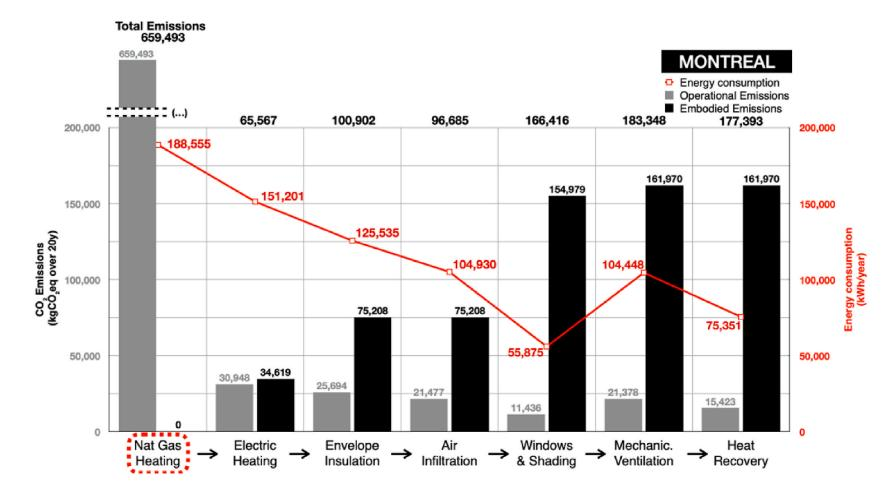
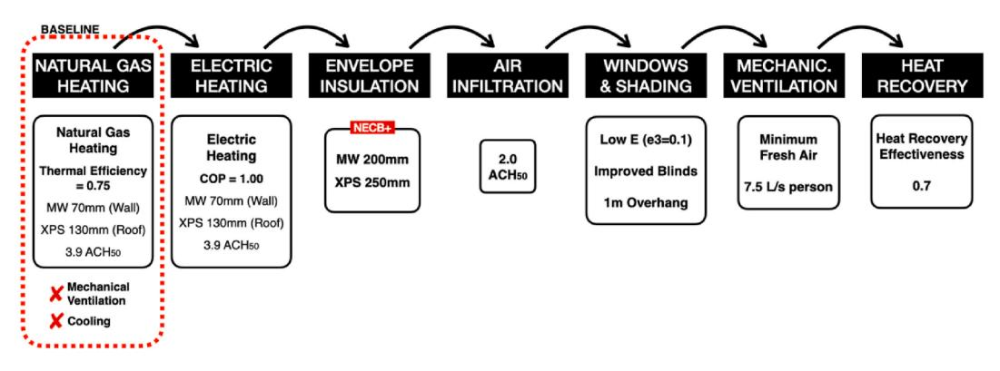
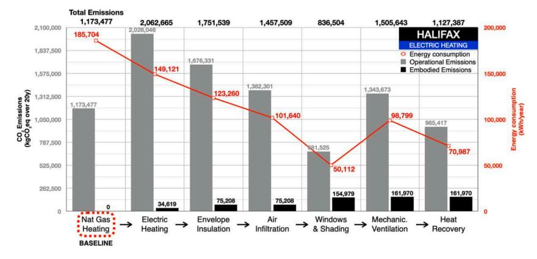
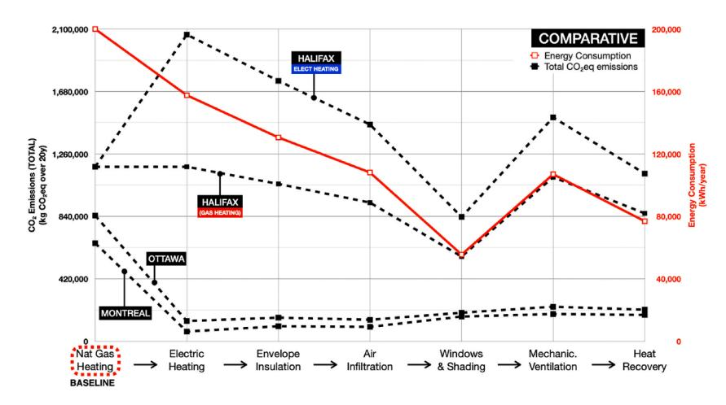
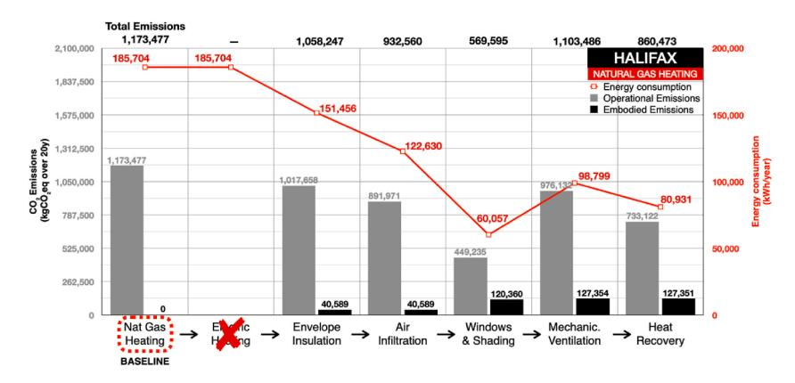

<!-- A3.R48 | source: papers_json/A3.R48/ -->

المحتويات متاحة في [ScienceDirect](https://www.sciencedirect.com/science/journal/23527102)

## مجلة هندسة المباني (Journal of Building Engineering)

الصفحة الرئيسية للمجلة: [www.elsevier.com/locate/jobe](https://www.elsevier.com/locate/jobe)

## تقييم فعالية تحديث المباني في خفض انبعاثات غازات الدفيئة (GHG): دراسة حالة لمدرسة كندية

Felipe Grossi [a](#page-0-0) , Hua Ge [a](#page-0-0), [*](#page-0-1) , Radu Zmeureanu [a](#page-0-0) , Fuad Baba [b](#page-0-2)

- ^a^ *Centre* *for* *Zero* *Energy* *Building* *Studies,* *Department* *of* *Building,* *Civil,* *and* *Environmental* *Engineering,* *Concordia* *University,* *Montreal,* *QC,* *H3G* *1M8,* *Canada*
- ^b^ *Faculty* *of* *Engineering,* *British* *University* *in* *Dubai,* *Dubai,* *United* *Arab* *Emirates*

## معلومات المقالة

## *الكلمات المفتاحية:* تحليل دورة حياة المبنى الكاملة تقييم دورة الحياة الانبعاثات المتجسدة

الانبعاثات التشغيلية تحديث كفاءة طاقة المباني ملف شبكة الكهرباء الحياد الكربوني

## الملخص

تبحث هذه الورقة في أثر تحديثات الطاقة على انبعاثات غازات الدفيئة (GHG) عبر دورة الحياة، عبر ملفات شبكة كهرباء مختلفة في مونتريال وأوتاوا وهاليفاكس، باستخدام مبنى مدرسي قائم كدراسة حالة. باستخدام DesignBuilder لمحاكاة الطاقة وOneClick LCA لتقدير انبعاثات GHG، تقيّم هذه الدراسة ما إذا كان خفض الانبعاثات التشغيلية الناتج عن توفير الطاقة من التحديثات يمكن أن يفوق زيادة الانبعاثات المتجسدة الناتجة عن مواد ومعدات الغلاف الجديدة. في مونتريال وأوتاوا، حيث تُولَّد الكهرباء بشكل رئيسي من مصادر متجددة وغير أحفورية، يمكن للتحديثات التي تشمل التدفئة الكهربائية وتحسينات الغلاف أن تخفض انبعاثات GHG لدورة الحياة بنسبة تصل إلى 75 %. مع ذلك، إذا كان المبنى يستخدم أصلاً التدفئة الكهربائية، فإن التحديثات أدت إلى زيادة انبعاثات الكربون لدورة الحياة بنسبة 170 % في مونتريال و56 % في أوتاوا، على التوالي، بسبب الانبعاثات المتجسدة لمواد ومعدات التحديث. في هاليفاكس، حيث تعتمد شبكة الكهرباء بشكل كبير على الوقود الأحفوري، أظهرت جميع سيناريوهات التحديث أثراً إيجابياً على خفض GHG. أدى تحسين غلاف المبنى والانتقال من الغاز الطبيعي إلى التدفئة الكهربائية إلى خفض طفيف في إجمالي الانبعاثات بنسبة 4 %، لكن الإبقاء على تدفئة الغاز الطبيعي خفض إجمالي انبعاثات GHG لدورة الحياة بنسبة 27 %. تؤكد هذه الدراسة أهمية تقييم دورة الحياة الشامل في وضع سياسات لتحقيق الحياد الكربوني. وتبيّن أن فعالية التحديثات في خفض انبعاثات GHG تعتمد بشكل كبير على شبكة الطاقة المحلية، ما يقترح نهجاً مخصصاً يعتمد على ملفات الطاقة الإقليمية لتحسين خفض الانبعاثات وكفاءة الطاقة.

## **1.** **المقدمة**

يؤدي الاستهلاك الكبير للطاقة، وخاصة من الوقود الأحفوري، دوراً مهماً في التأثير على تغير المناخ (P.S. and P.C. Government of [[1,](#page-14-0)[2](#page-14-1)]). ساهم قطاع البناء والتشييد بنحو 37 % من إجمالي انبعاثات CO^2^ وثلث استهلاك الطاقة العالمي [[3]](#page-14-2). وبما أن 28 % من انبعاثات CO^2^ تنتج من الانبعاثات التشغيلية في المباني، بما فيها طاقة الكهرباء والغاز الطبيعي والمبردات، و11 % بسبب المواد وعمليات البناء (الانبعاثات المتجسدة) ([[4](#page-14-3)]9)، فإن معظم الدراسات السابقة ركزت على الانبعاثات التشغيلية. على سبيل المثال، أوضح Cuéllar-Franca and Azapagic [[5](#page-14-4)]، وAsdrubali et al. [[6](#page-14-5)]، وChastas et al. [[7]](#page-14-6) أن المباني تساهم بما لا يقل عن 80–90 % من انبعاثات CO^2^ خلال مرحلة الاستخدام، بينما يحدث نحو 10–20 % من انبعاثات CO^2^ خلال مرحلة البناء.

للحد من استهلاك الطاقة التشغيلية وانبعاثات الكربون، طبّقت دول كثيرة معايير بناء جديدة تهدف إلى تحقيق مباني صافي طاقة صفري [[1,](#page-14-0)8–[10]](#page-14-7). إضافة إلى ذلك، تُستحدث قوانين طاقة جديدة لخفض كثافة

*البريد* *الإلكتروني:* [hua.ge@concordia.ca](mailto:hua.ge@concordia.ca) (H. Ge).

> ^*^ Corresponding author.

<!-- page 2 -->

كثافة إمدادات الطاقة حول العالم. ازداد توليد الكهرباء المتجددة في كندا بنسبة 18 % في عام 2019 مقارنة بعام 2010 [[11,](#page-14-8)[12]](#page-14-9). ومن المتوقع أن يستمر هذا الاتجاه في العقود القادمة لخفض الانبعاثات التشغيلية من المباني [[13]](#page-14-10).

وجد Ramesh et al. [[14](#page-14-11)] وGustavsson and Joelsson [[15]](#page-14-12) أنه في المباني ذات الكفاءة الطاقية المنخفضة، ساهمت الانبعاثات المتجسدة بنسبة 10 %–20 % من إجمالي الانبعاثات، بينما في المباني ذات الكفاءة الطاقية العالية، يمكن أن تصل هذه القيمة إلى نحو 45 %. اكتشف Paleari et al. [[16]](#page-14-13) وDodoo et al. [[17]](#page-14-14) أنه في المباني عالية الكفاءة الطاقية، يمكن أن تتجاوز نسبة الانبعاثات المتجسدة 60 %. لذلك، أصبحت الآثار البيئية المرتبطة بالانبعاثات المتجسدة في المواد والمعدات طوال دورة حياة المبنى، في العقد الأخير، ذات أهمية متزايدة ولا ينبغي تجاهلها، خاصة مع مباني NZEBs [[18](#page-14-15)–20]. كذلك، حفّز الوعي الجديد بحساب انبعاثات الكربون لدورة حياة المبنى الكاملة صناعة البناء على تطوير مباني صافي كربون صفري (ZCB) [[19](#page-14-16),[21,](#page-14-17)[22]](#page-14-18)، ويُشار إليها أيضاً بالمباني المحايدة كربونياً. المباني المحايدة كربونياً هي مبانٍ عالية الكفاءة، تُشغَّل باستخدام طاقة خالية من الوقود الأحفوري بنسبة 100 %، وتُصمَّم وفق "أفضل ممارسات البناء المستدام" [[21](#page-14-17)]. يشير هذا المصطلح إلى مجموعة من الاستراتيجيات لخفض انبعاثات الكربون في المباني، مثل تعزيز توفير الطاقة ورفاهية الشاغلين من خلال التصميم السلبي، وزيادة استخدام المواد المعاد تدويرها والمواد الطبيعية إلى أقصى حد، وتقليل استخدام الطاقة في جميع مراحل حياة المبنى، وإنشاء مساحات خضراء جديدة [[22]](#page-14-18).

مع تزايد التركيز على التنمية المستدامة، اكتسبت تقنية تقييم دورة الحياة (LCA) أهمية في الممارسات المعمارية والهندسية. يمكن استخدام LCA لتقييم الأثر البيئي للمبنى عبر دورة حياته الكاملة، بما يوجّه اتخاذ قرارات مستنيرة بشأن حلول التصميم التي يمكن أن تعزز الأداء البيئي للمبنى. في عام 2023، تم تطوير مصطلح "تقييمات دورة الحياة الكاملة للمبنى (WBLCAs)"، والذي اعتُمد من المعايير الأوروبية 15978:2011 و15643 [[23](#page-14-19)]. وWBLCAs هي إطار عمل يسمح بتقييم الآثار البيئية من جميع مراحل دورة حياة المبنى، بما فيها الآثار المتجسدة والتشغيلية [[23]](#page-14-19). حلّل Brooks et al. [[24]](#page-14-20) الانبعاثات التشغيلية ودورة حياة الكربون المتجسد (LCA) لمبنى سكني قديم في المملكة المتحدة، وقيّموا أثر التقنيات منخفضة الكربون والنظيفة على خفض الكربون المتجسد والتشغيلي باستخدام عملية "من المهد إلى اللحد". ووجدوا أن استخدام الألواح الكهروضوئية لخفض الانبعاثات التشغيلية، واستخدام الصلب المعاد تدويره والطوب خفيف الوزن ومادة إسمنتية تكميلية (SCM) للملاط والخرسانة، خفض إجمالي انبعاثات CO^2^ بنسبة 22 % [[24]](#page-14-20). أجرى Asdrubali and Grazieschi [[25](#page-14-21)] دراسة لتقييم إمكانية خفض الانبعاثات التشغيلية والمتجسدة معاً من خلال تحديث المباني القديمة في إيطاليا. تشير نتائجهم إلى أن تحديث مبنى قديم ليصبح مبنى صافي طاقة صفري يؤدي إلى خفض كبير في الانبعاثات التشغيلية، بانخفاض أقصى قدره 89 %. مع ذلك، عند احتساب الانبعاثات المتجسدة من المواد المضافة، والتي تشمل مواد عزل عضوية أحفورية (EPS)، ونوافذ جديدة، وألواح كهروضوئية، وأنظمة حرارية شمسية، سينخفض الحد الأقصى للخفض المحقق من خفض الانبعاثات التشغيلية إلى 48 % [[25]](#page-14-21).

في مباني صافي الطاقة الصفري (NZEBs)، لا تبرز الانبعاثات المتجسدة فقط كعامل حاسم في LCA، بل إن وجود أنظمة مزيج كهربائي داخل NZEBs يستلزم أيضاً استخدام منهجيات LCA الديناميكية (DLCA). تسمح LCA الديناميكية بمراعاة التغيرات الزمنية، وتُعرَّف بأنها "نهج لتقييم دورة الحياة يدمج صراحة نمذجة العمليات الديناميكية في سياق التغيرات الزمنية والمكانية في الأنظمة الصناعية والبيئية المحيطة" [[26]](#page-14-22). يشهد استخدام توليد الطاقة المتجددة في الموقع لإنتاج الكهرباء تغيرات زمنية. فمثلاً، تولّد أنظمة الطاقة الكهروضوئية (PV) الكهرباء خلال ساعات النهار لكنها غير نشطة ليلاً. إضافة إلى ذلك، تحدث تغيرات موسمية كبيرة، مع زيادة الإنتاج في أشهر الصيف وانخفاضه في الشتاء، لذا أصبحت LCA الديناميكية ضرورية [[27](#page-14-23)]. كذلك، تُستخدَم LCA الديناميكية لتقييم أثر السنوات المستقبلية على LCA خلال عمر المباني [[28,](#page-14-24)[29](#page-14-25)]. اكتشف Goldstein et al. [[30](#page-14-26)] أن أنماط استهلاك الشاغلين والتباينات الاجتماعية-الاقتصادية يمكن أن تؤثر في تقييم LCA للمباني، مما يؤكد أهمية استخدام LCA الديناميكية في WBLCA. قيّم Ramon et al. [[31]](#page-14-27) التغيرات المحتملة في استخدام الانبعاثات التشغيلية بسبب تغير المناخ في المباني المكتبية البلجيكية. ووجدوا أنه في سيناريو مسار التركيز التمثيلي (RCP) 8.5، سينخفض استهلاك التدفئة السنوي بنسبة 18 % لكن استهلاك التبريد سيزداد بنسبة 34 %. كما قيّموا أثر مزيج الكهرباء، الذي يمثل مزيج مصادر الطاقة (المتجددة والأحفورية) المستخدم لتوليد الكهرباء في منطقة معينة عبر الزمن، كاستراتيجية للتخفيف من تغير المناخ مقارنة بالكهرباء الثابتة، حيث يبقى مصدر الطاقة ثابتاً عبر الزمن. ووجدوا أن انبعاثات CO^2^ للمبنى المكتبي ستنخفض بنسبة 13 % لمزيج كهربائي يهيمن عليه التوليد الكهربائي المتجدد (56 %)، لكنها ستزداد بنسبة 10 % لمزيج كهربائي يهيمن عليه الغاز.

على الرغم من العدد الكبير من الدراسات التي تناولت LCA للمباني واستراتيجيات التصميم منخفض الكربون، لا يزال هناك غياب لتوافق بشأن استراتيجية التطبيق واسع النطاق للمباني المحايدة كربونياً. وبينما أُحرِز تقدم في تصميم وبناء مبانٍ محايدة كربونياً، فإن دراسات الحالة الشاملة التي تغطي كامل نطاق مكونات المبنى ومراحل دورة الحياة نادرة نسبياً في الأدبيات. تعرض معظم دراسات LCA نطاقاً غير مكتمل، وعادةً ما تغفل آثار الانبعاثات المتجسدة من المعدات الميكانيكية، والألواح الكهروضوئية (PV)، والفواصل الداخلية، والتشطيبات. تم تحديد عدة دراسات حالة تطبق استراتيجيات منخفضة الكربون في محاولة للوصول إلى وضع مبنى محايد كربونياً. تشمل الاستراتيجيات منخفضة الكربون أغلفة مباني عالية الأداء، مثل مقاومة حرارية عالية القيمة، ونوافذ ثلاثية الطبقات، وإحكام الهواء، ومواد بناء حيوية المصدر، وأنظمة مضخات حرارية بمصدر هوائي أو جيوحراري، وأنظمة هجينة من الطاقة الكهروضوئية والحرارية الشمسية، وأسطح خضراء أو مساحات خضراء محيطة بالمباني. تغطي جميع دراسات الحالة تحليل كفاءة الطاقة، بينما يركز نطاق تحليل انبعاثات الكربون بشكل أساسي على الكربون المتجسد في مواد الهيكل وغلاف المبنى، مع تضمين بعضها لعزل الكربون في المساحات الخضراء عبر عمر خدمة المبنى. اختيرت دراسات الحالة هذه لأنها مبانٍ قائمة فعلياً وقدّمت تفاصيل عن حلول التصميم، والمواد، والبرمجيات المستخدمة، والبصمة الكربونية للمبنى، واستخدام الطاقة.

يعرض تقرير Humber College [[32](#page-14-28)] تحقيق شهادة تصميم المبنى صافي الكربون الصفري (ZCB) من خلال مشروع تحديث مبنى في تورونتو، كندا. شمل التحديث تحسينات الغلاف، وترقيات النظام الميكانيكي، وتحسينات الإضاءة، وتركيب نظام PV. صُمِّم المبنى المكون من 5 طوابق والبالغة مساحته نحو 4500 م^2^ لتحقيق كثافة استخدام طاقة (EUI) قدرها 63 كيلوواط ساعة/م^2^ ∙سنة، وهو ما يقابل خفضاً بنسبة 70 % في استخدام الطاقة مقارنة بالمباني المؤسسية القائمة.

<!-- page 3 -->

قُدِّرت انبعاثات الكربون المتجسدة، لمواد البناء الجديدة والقائمة، بـ377.4 كجم CO2 مكافئ/م^2^ من مساحة الأرضية. مع ذلك، لم تُدرَج الانبعاثات المتجسدة المتعلقة بأنظمة HVAC وPV.

قيّم Dabaieh et al. [[33](#page-14-29)[,34](#page-14-30)] الآثار البيئية لمنزل تجريبي سويدي على مدى 15 عاماً. فقد دمجوا أنظمة سلبية لخفض أحمال التبريد والتدفئة (أي مبادل حراري أرضي-هوائي؛ جدار Trombe، وجدران خضراء)، واستخدموا مواد بناء حيوية المصدر (ألواح قش مضغوط، وألواح ألياف خشبية، وعزل ألياف خشبية، وخشب متقاطع الطبقات)، ودمجوا أنظمة طاقة متجددة (نظام هجين من الطاقة الشمسية الكهروضوئية وطاقة الرياح، وسخان مياه شمسي، وخزان غاز حيوي يستخدم النفايات العضوية للطهي وماء الاستخدام المنزلي الساخن). أظهرت محاكاة الطاقة انخفاضاً بنسبة 33 % في استهلاك الطاقة مقارنة بالمنزل المرجعي. أظهر تقييم دورة الحياة أن المواد النباتية المصدر يمكن أن تخفض البصمة الكربونية بشكل كبير. وعند مراعاة قدرة عزل الكربون في النباتات (الجدران الخضراء) والتخزين في المواد النباتية المصدر، ينخفض إجمالي احتمال الاحترار العالمي (GWP) بمقدار 226.2 كجم CO2 مكافئ/م^2^ . وإلا، فقد ازداد GWP بمقدار 254.7 كجم CO2 مكافئ/م^2^ على مدى فترة 15 عاماً مقارنة بالمنزل السويدي المرجعي. لم تُدرَج الانبعاثات المتجسدة للألواح الكهروضوئية وتوربينات الرياح في تحليل LCA.

حلّل Bhavsar et al. [[35](#page-14-31)] منشأة تعليمية جديدة في Mohawk College، كندا. تمتلك الجدران والسقف والنوافذ مقاومة حرارية أعلى من قانون بناء أونتاريو. صُمِّم المبنى لتوليد 100 % من طاقته المستخدمة النهائية باستخدام نظام PV في الموقع لتوليد الكهرباء، ونظام جيوحراري للتدفئة والتبريد، ونظام حراري شمسي لماء الاستخدام المنزلي الساخن. شملت الحلول الأخرى منخفضة الكربون استخدام الصلب ذي المحتوى القابل لإعادة التدوير بدرجة عالية، وخليط خرسانة يحتوي على مادة إسمنتية تكميلية (SCM) (مثل الخبث)، وخزان لتجميع مياه الأمطار، ومراحيض منخفضة الدفق، وحنفيات منخفضة التدفق. أُجرِي تحليل LCA من "المهد إلى اللحد" لهيكل المبنى على مدى 60 عاماً، مع ذلك لم تُدرَج مكونات أخرى كثيفة الكربون مثل النوافذ والعزل والمعدات الميكانيكية وأنظمة PV.

بالمثل، لم تُدرِج دراسات LCA لمبنى مكاتب Evolv [[36](#page-15-0)] في كندا، الحاصل على شهادة CaGBC للمبنى صافي الكربون الصفري بانبعاثات متجسدة نتيجة مواد الغلاف والهيكل قُدِّرت بـ260 كجم CO2 مكافئ/م^2^ ، ووحدة سكنية في تايوان [[37]](#page-15-1) أنظمة HVAC وPV في تحليلها أيضاً.

يمكن أن يؤدي النطاق غير المكتمل للعديد من دراسات LCA إلى إدخال تحيز في المقارنة المرجعية والحد من فهمنا لفعالية استراتيجيات إزالة الكربون من المباني. في سياق كفاءة الطاقة وحلول تصميم التحديث للمباني المحايدة كربونياً، تعرض هذه الورقة نهجاً كاملاً لتحليل LCA يجمع بين كفاءة الطاقة، والانبعاثات الكربونية التشغيلية والمتجسدة، وملف شبكة الكهرباء الإقليمية، يمكن للمهندسين المعماريين والمهندسين مراعاته، إلى جانب صانعي السياسات، عند إجراء تقييم الأثر البيئي لمبنى ما. يعالج هذا النهج أوجه القصور في تحليل أثر LCA، أي أنظمة المباني غير المكتملة ومراحل دورة الحياة غير المكتملة، ويقدّم الربط بين المباني وشبكة الكهرباء. وهذا هو الجديد في هذه الورقة.

هدف هذه الدراسة هو تطوير نهج شامل لتقييم فعالية استراتيجيات التحديث في تحقيق وضع المبنى المحايد كربونياً من خلال تحليل انبعاثات الكربون لدورة الحياة، ضمن سياق ملفات شبكة الكهرباء المحلية، لمساعدة مصممي المباني وصانعي السياسات في اتخاذ قرارات التحديث من منظور انبعاثات الكربون لدورة الحياة. يُطبَّق هذا النهج على مبنى مدرسي مكوّن من طابقين يُدفَّأ بالغاز الطبيعي كدراسة حالة، لاختبار الفرضية القائلة إن تدابير تحديث المبنى التي تخفض استخدام الطاقة للتدفئة قد لا تخفض دائماً انبعاثات غازات الدفيئة (GHG) للمبنى خلال دورة حياته، وذلك اعتماداً على ملف شبكة الكهرباء المحلية. يُقيَّم أثر ملف الشبكة المحلية على الأداء البيئي للمباني في ثلاث مدن، مونتريال (كيبك)، وأوتاوا (أونتاريو)، وهاليفاكس (نوفا سكوشا)، التي تتشارك خصائص مناخية متشابهة لكن ملفات شبكة كهرباء مختلفة. القليل من الدراسات وردت في الأدبيات، خاصة في السياق الكندي، لتحليل انبعاثات كربون لدورة حياة كاملة كهذا. تحاول هذه الدراسة سد هذه الفجوة والمساهمة في تعزيز التحقق واسع النطاق للمباني المحايدة كربونياً.

## **2.** **المنهجية**

يوضح النهج الموصوف في هذه الورقة عملية تقييم الأداء البيئي لتحديثات المباني، باستخدام محاكاة الطاقة وتقييم دورة الحياة (LCA). تُستخدَم محاكاة الطاقة لتقدير الخفض المحتمل في استهلاك الطاقة السنوي عند إدخال تحسينات مختلفة، مثل إضافة العزل الحراري، واستبدال النوافذ، وإضافة التظليل الخارجي. من ناحية أخرى، تُقدِّر LCA الانبعاثات المتجسدة المرتبطة بتصنيع كل مكوّن جديد للغلاف أو HVAC، إضافة إلى خفض الانبعاثات التشغيلية الناتج عن تحسينات كفاءة الطاقة. يوفر هذا التحليل الشامل للنظام الكلي صورة أكثر اكتمالاً للتحديث من منظور انبعاثات الكربون لدورة الحياة.

## *2.1.* *نظرة* *عامة*

بدأت العملية بتحليل المبنى المدرسي القائم الواقع في مونتريال، والذي شكّل خط الأساس. طُوِّر نموذج طاقة باستخدام DesignBuilder (EnergyPlus) (الإصدار v7.0.2.006) [[38](#page-15-2)] لمحاكاة استخدام الطاقة السنوي للمبنى. وبعد إجراء المحاكاة للتصميم الأصلي، صُقِل النموذج ليتضمن كل تحسين تحديث، وحُسِب استخدام الطاقة السنوي الجديد في كل خطوة. شكّلت بيانات استخدام الطاقة السنوي المستمدة من DesignBuilder (EnergyPlus) أحد المدخلات لحساب انبعاثات CO^2^ التشغيلية للمبنى. أُجرِي حساب كل من الانبعاثات المتجسدة والتشغيلية باستخدام OneClick LCA [[39]](#page-15-3)، وهي أداة LCA آلية مصممة لتقدير البصمة الكربونية للمباني والبنية التحتية.

بعد استخدام نتائج محاكاة الطاقة من DesignBuilder (EnergyPlus) لحساب الانبعاثات التشغيلية في OneClick LCA، تضمنت الخطوة التالية حساب الانبعاثات المتجسدة. تم إدراج قائمة مواد منظمة حسب تجميعات المبنى في برنامج OneClick LCA، مع ربط كل عنصر بنقطة بيانات جردية. تُخصَّص مجموعات بيانات البرنامج إقليمياً، مع مراعاة عوامل مثل شبكات الكهرباء المحلية وخيارات المواد الخاصة بموقع المبنى. وعند الضرورة، قُدِّمت أيضاً معلومات عن السماكة والكثافة وخصائص المواد الأخرى.

<!-- page 4 -->

SimaPro، وSophera (GaBi)، وOneClick LCA أمثلة مختلفة على أدوات LCA. غالباً ما يعتمد الاختيار بين هذه البرمجيات على المتطلبات المحددة لدراسة LCA وتوافر قواعد البيانات ذات الصلة. SimaPro (2022) [[40](#page-15-4)] وGaBi (2024) [[41]](#page-15-5) هما برمجيتان قائمتان على العملية تسمحان للمستخدمين ببناء دورة حياة منتج بناءً على مدخلات مثل المواد الخام، وطرائق الاستخراج، وأنماط النقل، وطرائق المعالجة. في هذه الدراسة، بحثنا عن أداة LCA يمكنها توفير مدخلات جاهزة على مستوى المنتج لتمثيل مبنى كامل. اختير OneClick LCA لكونه برنامجاً آلياً قائماً على السحابة يوفر مسارات عمل LCA مبسطة للمباني والبنية التحتية. يستخدم البرنامج بيانات متاحة في الصناعة موثقة من طرف ثالث، مثل الإعلانات المنتجية البيئية (EPDs) من مختلف المصنّعين، لإنشاء خيارات مواد يمكن تجميعها لتقدير الآثار البيئية لمبنى كامل خلال فترة حساب محددة. تشمل أدوات LCA الأخرى الشائعة الاستخدام مقدِّر أثر Athena للمباني [[42]](#page-15-6)، الذي يسمح للمستخدمين بإدخال قائمة مواد أو وصف تجميعات المبنى بسرعة عبر مربعات حوار. ثم يحسب البرنامج قائمة مواد مصحوبة بآثار بيئية. يمكن العثور على مقارنة بين نتائج LCA المقدَّمة من Athena وOneClick LCA لمبنى مختلف في دراستنا السابقة، Grossi et al. [[43](#page-15-7)].

قُدِّرت نتائج LCA المعروضة في هذه الورقة من "المهد إلى اللحد" على مدى فترة حساب 20 عاماً. جاء اختيار فترة حساب 20 عاماً لتجنب حدوث انبعاثات ثانوية ناتجة عن استبدالات لاحقة لمكونات المبنى وأنظمته. الغرض من هذه الدراسة هو توضيح مزايا أو عيوب حدث تحديث واحد يحدث في مواقع كندية مختلفة. إضافة إلى ذلك، يخفض اعتماد فترة حساب أقصر من عدم اليقين المرتبط بملفات الطاقة المستقبلية والتطور التكنولوجي، وهما عاملان رئيسيان يؤثران في نتائج تقدير LCA. وبما أن العديد من معايير LCA توصي بإطار زمني قدره 60 عاماً، فقد أدرجنا أيضاً سيناريو يعتبر معامل أداء (COP) لمضخة حرارية قدره 2.0 على مدى 60 عاماً للمقارنة، وتُعرض النتائج في القسم [3.5](#page-11-0).

يقع مبنى دراسة الحالة في مونتريال (كيبك). ولاستقصاء أثر ملفات شبكة الكهرباء المحلية على الأداء البيئي للمبنى، طُبِّقت العملية نفسها على أوتاوا (أونتاريو)، وهاليفاكس (نوفا سكوشا)، باستخدام ملفات الطقس وشبكة الكهرباء المقابلة.

## *2.2.* *مبنى* *دراسة* *الحالة* *وتدابير* *التحديث*

خط الأساس لهذه الدراسة هو مبنى مدرسي من طابقين، بمساحة أرضية مدفأة إجمالية قدرها 2300 م^2^ . تتكون الجدران الخارجية من واجهة طوب من الخارج، تليها فجوة هوائية بسماكة 25 مم، وعزل صوف معدني (MW) بسماكة 70 مم، ووحدات بناء خرسانية، وطبقة جبس داخلية. يتكون السقف من غشاء عزل مائي، ولوح ألياف، وعزل XPS بسماكة 130 مم، وبلاطة خرسانية بسماكة 100 مم. النوافذ مزدوجة الزجاج (شفافة) بفجوة هوائية 13 مم. كحال مدارس عديدة أخرى بُنِيت في الماضي، لا يمتلك المبنى نظام تبريد أو تهوية ميكانيكية. يمكن العثور على مزيد من المعلومات عن مبنى خط الأساس في المرجع [[44](#page-15-8)].

تُنفَّذ خمسة تحسينات تحديثية على التوالي، كما هو موضح في [الشكل](#page-3-0) 1. يتمثل التحسين الأول في استبدال نظام تدفئة الغاز الطبيعي ذي الكفاءة الحرارية 0.75 بنظام تدفئة كهربائي بمعامل أداء (COP) قدره 1، مع الإبقاء على جميع المكونات الأخرى مثل العزل والنوافذ في حالتها الأصلية. يُعَد اللوح الكهربائي القاعدي نظام تدفئة شائع الاستخدام في كيبك. تتمثل الخطوة التالية في زيادة العزل الحراري للسقف والجدران الخارجية لتلبية متطلبات قانون الطاقة الوطني الكندي للمباني [[45](#page-15-9)]. بعد ذلك، تُرفع إحكامية غلاف المبنى من 3.9 ACH إلى 2.0 ACH عند 50 باسكال، كمُدخَل في نموذج الطاقة، لتعكس ظروف ما بعد التحديث، من خلال إضافة غشاء تسقيف جديد وحواجز هوائية حسب الحاجة لخفض معدل تسرب الهواء عبر غلاف المبنى. تتمثل الخطوة اللاحقة في ترقية النوافذ والستائر الداخلية، وتركيب مظلات. الغاية من إضافة الستائر والمظلات هي معالجة مشكلة ارتفاع الحرارة الصيفي [[46]](#page-15-10). أخيراً، يُضاف نظام تهوية ميكانيكية لضمان إمداد الحد الأدنى من هواء التهوية (كما يقتضي NECB)، يتبعه تركيب مروحة استرجاع حرارة من الهواء المطرود بفعالية نقل حراري قدرها 0.7.

تُدرج معاملات المدخلات لمكونات وأنظمة المبنى في [الجدول](#page-4-0) 1 و[الجدول](#page-4-1) 2، لكل من خط الأساس وتصميم التحديث الكامل.

## *2.3.* *تقدير* *الانبعاثات* *المتجسدة*

يحمل كل تحسين يُدخَل في التصميم (مثل عزل جديد أو معدات HVAC جديدة) أثراً بيئياً مرتبطاً بعمليات التصنيع والتركيب. يفصّل هذا القسم المواد والمعدات المعتبرة في تقدير

***شكل** **1.** تسلسل تحسينات تحديث المبنى.*

<!-- page 5 -->

الانبعاثات المتجسدة المرتبطة بكل تحديث للمبنى. جُمِعت المواصفات والملفات البيئية والانبعاثات المتجسدة ومصادر البيانات لكل عنصر من بيانات خاصة بالمصنّعين مستمدة من الإعلانات المنتجية البيئية (EPDs) المتاحة عبر قاعدة بيانات OneClick LCA، كما هو موضح في [الجدول](#page-4-3) 3. بالنسبة للمواد أو المعدات التي لا تتوفر لها معلومات خاصة بالمصنّع، استُخدِمت متوسطات الصناعة الكندية (التي توفرها OneClick LCA). تُدرج الانبعاثات المتجسدة الإجمالية في [الجدول](#page-4-3) 3 على مدى فترة 20 عاماً. كما ذُكِر سابقاً، اعتُبرت فترة حساب 20 عاماً للتقييم، لكن يُحسَب أيضاً سيناريو إضافي لفترة 60 عاماً، وهو غير معروض في [الجدول](#page-4-3) 3. وكما يقتضي معيار ISO 21930 [[47](#page-15-11)]، تستند الملفات البيئية التي تُبلَّغ عنها EPDs وتستخدمها برمجية LCA إلى القسرية الإشعاعية المتراكمة ضمن منظور GWP^100^ .

## *2.4.* *تقدير* *الانبعاثات* *التشغيلية*

يؤدي ملف شبكة الكهرباء المحلية دوراً حاسماً في LCA، إذ يُعَد من العوامل الأكثر تأثيراً في تقدير الأداء البيئي للمبنى. ولاستقصاء أثر ملف شبكة الكهرباء المحلية على الأداء البيئي للمبنى، اخترنا ثلاث مدن كندية: مونتريال (كيبك)، وأوتاوا (أونتاريو)، وهاليفاكس (نوفا سكوشا).

<!-- page 6 -->

يُظهر [الشكل](#page-5-0) 2 حصة توليد الكهرباء حسب نوع الوقود، استناداً إلى معلومات من هيئة تنظيم الطاقة الكندية [[48](#page-15-12)]، بالنسبة للمدن الثلاث المشمولة في هذه الدراسة. في كيبك وأونتاريو، تُولَّد الكهرباء بشكل رئيسي من مصادر طاقة متجددة وغير أحفورية: نحو 94 % من الكهرباء تُولَّد بالطاقة الكهرومائية في كيبك، ونحو 59 % من محطات الطاقة النووية، و24 % بالطاقة الكهرومائية في أونتاريو. في نوفا سكوشا، تُولَّد معظم الكهرباء بالوقود الأحفوري: 52 % من الفحم والكوك، و22 % من الغاز الطبيعي.

في كيبك، يعتمد توليد الكهرباء بشكل غالب على مصادر متجددة، حيث تمثل الطاقة الكهرومائية 94 % وتسهم طاقة الرياح بنسبة 5 %. مع ذلك، يمكن أن تؤدي كهربة المجتمع، بما فيها قطاع النقل، إلى زيادة محتملة في الطلب على الكهرباء في العقود القادمة. تُعَد كيبك حالياً واحدة من المقاطعات الكندية ذات أقل انبعاثات GHG المرتبطة بالطاقة. وكما أفاد CER [[49]](#page-15-13)، بلغت كثافة GHG لشبكة كهرباء كيبك 0.0015 كجم CO2 مكافئ/كيلوواط ساعة من الكهرباء المولَّدة عام 2020. مع ذلك، لا تشمل هذه القيمة آثاراً أخرى مثل التحلل الحيوي في خزانات الطاقة الكهرومائية (تعفن النباتات المنبعث منه CO^2^ والميثان (CH4)) والانبعاثات المرتبطة بعمليات النقل. في هذه الدراسة، اعتبرنا القيمة 0.01023 كجم CO2 مكافئ/كيلوواط ساعة، المستمدة من OneClick LCA [[39]](#page-15-3) ووثيقة الشفافية الخاصة بـAthena (2019). حُسِبت هذه القيمة بناءً على بيانات من قواعد بيانات Ecoinvent 3.4 [[50](#page-15-14)]، وتشمل جميع انبعاثات الكربون حتى نقطة الاستهلاك النهائية.

أونتاريو أيضاً مقاطعة يعتمد توليد الكهرباء فيها بشكل رئيسي على مصادر غير أحفورية. وكما أفاد CER [[51]](#page-15-15)، بلغت كثافة GHG لشبكة كهرباء أونتاريو 0.025 كجم CO2 مكافئ/كيلوواط ساعة من الكهرباء المولَّدة عام 2020. وكما في حالة كيبك، تعكس هذه القيمة فقط الانبعاثات عند محطات التوليد. لذلك، استخدمنا في هذه الدراسة القيمة 0.028 كجم CO2 مكافئ/كيلوواط ساعة من الكهرباء عند نقطة الاستهلاك النهائية. استُمدَّت هذه القيمة من حسابات مبنية على قواعد بيانات Ecoinvent، مستمدة من OneClick LCA [[39](#page-15-3)] ووثيقة الشفافية الخاصة بـAthena [[52](#page-15-16)].

تمتلك نوفا سكوشا ملف شبكة كهرباء مختلفاً تماماً، يعتمد بشكل غالب على الوقود الأحفوري. وكما أفاد CER [[53]](#page-15-17)، بلغت كثافة GHG لشبكة كهرباء نوفا سكوشا 0.670 كجم CO2 مكافئ/كيلوواط ساعة من الكهرباء المولَّدة عام 2020. استخدمنا قيمة أعلى قليلاً قدرها 0.680 كجم CO2 مكافئ/كيلوواط ساعة، تشمل جميع انبعاثات الكربون حتى نقطة الاستهلاك النهائية، بناءً على OneClick LCA [[39](#page-15-3)] وقاعدة بيانات Ecoinvent [[50](#page-15-14)]. ونظراً لاختلاف مزيج الشبكة، يولّد استخدام الكهرباء في نوفا سكوشا انبعاثات GHG أكبر بـ65 مرة من كيبك، وأكبر بـ24 مرة من أونتاريو. وعلى الرغم من أن استخدام الغاز الطبيعي كثيف الانبعاثات نسبياً من حيث GHG، فإنه يمكن اعتباره خياراً للأماكن المعتمدة على الفحم، مثل نوفا سكوشا. يمكن أن تتفاوت كمية CO₂ المنبعثة في إنتاج 1 كيلوواط ساعة من الكهرباء باستخدام الفحم مقابل الغاز الطبيعي بناءً على عوامل عدة، منها كفاءة محطات التوليد، ونوع الفحم أو الغاز الطبيعي المستخدم، والتقنية المتوفرة. في المتوسط، وبناءً على EIA [[54]](#page-15-18)، تنبعث من محطات الطاقة العاملة بالفحم نحو 1.025 كجم CO₂ مكافئ/كيلوواط ساعة من الكهرباء المولَّدة، بينما تكون محطات الطاقة العاملة بالغاز الطبيعي أكثر كفاءة عموماً، إذ تتراوح بين 0.180 كجم CO2 مكافئ/كيلوواط ساعة [[55]](#page-15-19) و0.440 كجم CO2 مكافئ/كيلوواط ساعة [[54]](#page-15-18)). استُخدِم عامل 10.55 كيلوواط ساعة/م^3^ [[56]](#page-15-20) لتحويل الطاقة الناتجة عن 1 م^3^ من الغاز الطبيعي إلى قيمة كهرباء مكافئة من الطاقة. في هذه الدراسة، اعتبرنا كثافة GHG لاستخدام الغاز الطبيعي مساوية لـ0.218 كجم CO2 مكافئ/كيلوواط ساعة (ما يعادل 2.30 كجم CO2/م^3^ )، بناءً على قاعدة بيانات OneClick LCA [[39](#page-15-3)].

## **3.** **النتائج** **والمناقشة**

يعرض هذا القسم نتائج دراسة الحالة لكل موقع (مونتريال، وأوتاوا، وهاليفاكس)، تليها مناقشة لكل خطوة تحديث. بالنسبة لكل تحسين تصميمي، في كل موقع، تشمل النتائج استهلاك الطاقة السنوي (بكيلوواط ساعة/سنة)، وإجمالي انبعاثات GHG (بكجم CO2 مكافئ) على مدى دورة حياة 20 عاماً. تُعرض النتائج لمونتريال أولاً [(الجدول](#page-6-0) 4)، تليها أوتاوا ([الجدول](#page-6-1) 6) ونوفا سكوشا ([الجدول](#page-10-0) 10). يُقدَّم تحليل مقارن بين المدن في نهاية هذا القسم.

***شكل** **2.** توليد الكهرباء الإقليمي حسب نوع الوقود. المصدر: مُعدَّل استناداً إلى بيانات من هيئة تنظيم الطاقة الكندية، CER [[48](#page-15-12)].*

<!-- page 7 -->

ملاحظة: القيم المعروضة بين قوسين، على سبيل المثال (−37,354)، تمثل التغير النسبي في النتائج عند كل خطوة حساب.

|  | Natural Gas | Electric | Envelope | Air | Windows | Mech. Vent. → | Heat |
| --- | --- | --- | --- | --- | --- | --- | --- |
|  | Heating → | Heating → | Insulation→ | Infiltration → | & Shading → |  | Recovery |
| Total Annual Energy Use [kWh/year] | 228,055 | 180,834 (−47,221) | 150,145 (-30,689) | 124,193 (-25,952) | 66,021(-58,172) | 125,862 (+59,841) | 90,162 (−35,700) |
| Space Heating | 188,884 | 141,663 | 111,673 | 85,721 | 45,282 | 45,282 | 45,282 |
| Interior Lighting | 27,248 | 27,248 | 26,766 | 26,766 | 9033 | 9033 | 9033 |
| Computers/Plugs | 11,923 | 11,923 | 11,706 | 11,706 | 11,706 | 11,706 | 11,706 |
| Mech. Ventilation | 0 | 0 | 0 | 0 | 0 | 59,842 | 24,141 |
| Total Emissions [kgCO2e over 20y] | 845,506 | 135,886 (-709,620) | 159,289 (+23,403) | 144,756 (-14,553) | 191,951 (+47,195) | 232,453 (+40,502) | 212,461 (-19,992) |
| Operational Emissions | 845,506 | 101,267 | 84,081 | 69,548 | 36,972 | 70,483 | 50,491 |
| Embodied Emissions | 0 | 34,619 | 75,208 | 75,208 | 154,979 | 161,970 | 161,970 |

ملاحظة: القيم المعروضة بين قوسين، على سبيل المثال (−47,221)، تمثل التغير النسبي في النتائج عند كل خطوة حساب.

## *3.1.* *النتائج* *لمونتريال* *(كيبك)*

توضح النتائج المعروضة في [الجدول](#page-6-0) 4 و[الشكل](#page-7-0) 3 أثر كل خطوة تحديث على LCA، بدءاً من الانتقال من "تدفئة الغاز الطبيعي"، كخط أساس، إلى نظام تدفئة كهربائي، وانتهاءً بتركيب أنظمة استرجاع الحرارة في مونتريال. تُظهر النتائج ما يلي:

- 1. **الوضع** **الأساسي** **(تدفئة** **بالغاز** **الطبيعي**): إجمالي استهلاك الطاقة السنوي 188,555 كيلوواط ساعة/سنة، وإجمالي انبعاثات GHG 659,493 كجم CO^2^ مكافئ. تُعزى القيمة الكبيرة لانبعاثات الكربون بالكامل إلى الانبعاثات التشغيلية، حيث ترتبط 99 % منها باستخدام الغاز الطبيعي للتدفئة، و1 % فقط بالإضاءة والحواسيب وأحمال المقابس. تبقى الانبعاثات المتجسدة عند الصفر في هذه الخطوة الأولى، إذ لم تُدخَل مواد أو معدات جديدة في هذه المرحلة.
- 2. **من** **تدفئة** **الغاز** **الطبيعي** **إلى** **التدفئة** **الكهربائية**: أدى استبدال نظام تدفئة الغاز الطبيعي (كفاءة حرارية = 0.75) بنظام تدفئة كهربائي (COP = 1) إلى خفض استهلاك الطاقة الإجمالي بمقدار 37,354 كيلوواط ساعة/سنة، من 188,555 إلى 151,201 كيلوواط ساعة/سنة، وخفض إجمالي انبعاثات الكربون بمقدار 593,926 كجم CO2 مكافئ على مدى 20 عاماً، من 659,493 إلى 65,567 كجم CO2 مكافئ. يُعزى هذا الخفض الكبير في الانبعاثات بشكل رئيسي إلى انخفاض الانبعاثات التشغيلية (من 659,493 إلى 30,948

<!-- page 8 -->

***شكل** **3.** استخدام الطاقة (الخط الأحمر) وانبعاثات GHG (التشغيلية والمتجسدة، بالرمادي والأسود) محسوبة في كل مرحلة تحديث (لمونتريال). (لتفسير الإشارات إلى الألوان في وسيلة إيضاح هذا الشكل، يُحال القارئ إلى النسخة الإلكترونية من هذه المقالة.)*

كجم CO2 مكافئ)، بسبب استبدال الغاز الطبيعي بالكهرباء المشتراة من الشبكة، والتي تأتي من مصدر متجدد منخفض الكربون. تُعزى الانبعاثات المتبقية (34,619 كجم CO2 مكافئ) إلى الكربون المتجسد المرتبط بتصنيع معدات التدفئة الجديدة.

- 3. **ترقية** **غلاف** **المبنى**: أدت إضافة عزل إضافي في الجدران الخارجية والأسقف، إضافة إلى غشاء تسقيف جديد وحواجز هوائية عند الضرورة، إلى خفض إجمالي استهلاك الطاقة، من 151,201 إلى 125,535 كيلوواط ساعة/سنة، ويُعزى ذلك بشكل رئيسي إلى انخفاض الطلب على تدفئة المساحات، من 112,062 إلى 87,093 كيلوواط ساعة/سنة. انخفضت الانبعاثات التشغيلية من 30,948 إلى 25,694 كجم CO2 مكافئ، بينما ازدادت الانبعاثات المتجسدة من 34,916 إلى 75,208 كجم CO2 مكافئ. يشير هذا إلى أن الانبعاثات المتجسدة المرتبطة بتصنيع مواد العزل الجديدة، والحواجز الهوائية، وأغشية التسقيف (أي 26,621 كجم CO2 مكافئ من XPS، و8359 كجم CO2 مكافئ من الصوف المعدني، و1621 كجم CO2 مكافئ من الحاجز الهوائي، و3988 كجم CO2 مكافئ من غشاء التسقيف [(الجدول](#page-4-3) 3)) فاقت خفض الانبعاثات التشغيلية (5254 كجم CO2 مكافئ).
- 4. **تحسين** **إحكامية** **المبنى**: خُفِّض معدل تسرب الهواء من 3.9 ACH^50^ (تبادلات الهواء في الساعة، مقيسة عند فرق ضغط 50 باسكال) إلى 2.0 ACH50. ورغم أن هذه القيمة ليست منخفضة كقيمة 0.6 ACH^50^ الموصى بها في شهادات Passive House [[57](#page-15-21)]، فقد استهدفنا سيناريو تحديث أكثر تحفظاً. تُوصي متطلبات تسرب الهواء المحددة، على سبيل المثال، في برنامج التحول الطاقي Novoclimat في كيبك [[58]](#page-15-22) بقيمة قصوى قدرها 1.5 ACH^50^ للمباني الجديدة، بينما يقترح قانون بناء أونتاريو [[59](#page-15-23)] قيمة 2.5 ACH^50^ للمنازل. وبالمثل، تحدد معايير مثل Energy Star [[60]](#page-15-24) معدل تسرب الهواء الأقصى بين 2.5 و3.0 ACH50. في ضوء هذه الاعتبارات والتباينات في جودة التنفيذ، اخترنا قيمة 2.0 ACH^50^ لتمثيل الإحكامية المحسّنة. أدى تحسين إحكامية المبنى إلى خفض استهلاك الطاقة السنوي من 125,535 إلى 104,930 كيلوواط ساعة/سنة، وخفض إجمالي انبعاثات GHG من 100,902 إلى 96,685 كجم CO2 مكافئ، بسبب انخفاض انبعاثات استخدام الطاقة التشغيلية. بقيت الانبعاثات المتجسدة دون تغيير عن المرحلة السابقة، إذ لم تُضَف مواد أو معدات جديدة في هذا التحسين.
- 5. **ترقية** **النوافذ** **وإضافة** **تظليل** **داخلي** **وخارجي**: رُقِّي الزجاج المزدوج (الشفاف) السابق إلى وحدة زجاج مزدوجة مطلية بطبقة منخفضة الانبعاث (Low-E) ومملوءة بغاز الأرغون، بمعامل اكتساب حراري شمسي (SHGC) أقل وقيم U أقل (انظر [الجدول](#page-4-1) [2)](#page-4-1). تحققت تحسينات التظليل المحلي من خلال استبدال الستائر التقليدية بلفائف تظليل منخفضة الانعكاس وعالية النفاذية، مما ساعد في خفض استخدام الإضاءة وأحمال التدفئة. نُفِّذ تركيب مظلات فوق رؤوس النوافذ لتجنب ارتفاع الحرارة خلال فصل الصيف، لأن المبنى المدرسي لا يمتلك نظام تبريد. أدت مجموعة التحسينات هذه إلى انخفاض كبير في إجمالي استهلاك الطاقة، من 104,930 إلى 55,875 كيلوواط ساعة/سنة. يُعزى هذا الانخفاض إلى انخفاض بنسبة 50 % في استخدام الطاقة لتدفئة المساحات (من 66,489 إلى 33,807 كيلوواط ساعة/سنة)، وانخفاض في استخدام الإضاءة الداخلية (من 26,736 إلى 10,362 كيلوواط ساعة/سنة). مع ذلك، ازداد إجمالي الانبعاثات (من 96,685 إلى 166,416 كجم CO2 مكافئ) ويُعزى ذلك بشكل رئيسي إلى الانبعاثات المتجسدة المرتبطة بإنتاج نوافذ الألومنيوم الجديدة (أي 67,148 كجم CO2 مكافئ، انظر [الجدول](#page-6-0) 4) والمظلات (12,623 كجم CO2 مكافئ، انظر [الجدول](#page-4-3) 3). في المقابل، لم يعوّض خفض الانبعاثات التشغيلية سوى 10,141 كجم CO2 مكافئ (من 21,477 إلى 11,436 كجم CO2 مكافئ).
- 6. **إضافة** **نظام** **تهوية** **ميكانيكية** **واسترجاع** **حرارة**: لتلبية متطلبات [[45]](#page-15-9)، أُضيف نظام تهوية ميكانيكية، ليحل محل الاعتماد السابق على التهوية الطبيعية فقط في المبنى القديم. صُمِّم نظام التهوية الميكانيكية للعمل بناءً على حد أدنى من إمداد الهواء النقي قدره 7.5 لتر/ثانية/شخص، كما هو موضح في [الجدول](#page-4-0) 1. إضافة إلى ذلك، أُضيف نظام استرجاع حرارة، بفعالية استرجاع حراري قدرها 0.70. أدى إدخال نظام التهوية الميكانيكية في البداية إلى زيادة إجمالي استخدام الطاقة من 55,875 إلى 104,448 كيلوواط ساعة/سنة. مع ذلك، ومع إضافة استرجاع الحرارة، انخفض استخدام الطاقة بشكل كبير من 104,448 إلى 75,310 كيلوواط ساعة/سنة. ازداد إجمالي الانبعاثات من 166,416 إلى 183,348 كجم CO2 مكافئ (دون استرجاع الحرارة) لكنه انخفض مع إضافة استرجاع الحرارة من 183,348 إلى 177,393 كجم CO2 مكافئ.

كما هو موضح في [الجدول](#page-6-2) 5، يمثل "خط الأساس (a)" المبنى المدرسي القائم، الذي يستخدم الغاز الطبيعي لتدفئة المساحات. يتشارك "خط الأساس (b)" خصائص الغلاف نفسها، باستثناء استبدال نظام تدفئة الغاز

<!-- page 9 -->

بنظام تدفئة كهربائي. قُورِن هذان السيناريوهان بالتصميم النهائي، المسمّى "التحديث الكامل (c)"، الذي يضم جميع تحسينات التحديث المذكورة سابقاً في القسم [2.2.](#page-3-1) من خط الأساس (a) إلى التحديث الكامل (c)، هناك خفض قدره 113,204 كيلوواط ساعة/سنة في إجمالي استخدام الطاقة، بشكل رئيسي في استخدام الطاقة لتدفئة المساحات، يُعزى إلى التحسينات التي أُجرِيت على غلاف المبنى وتركيب التدفئة الكهربائية. في الوقت نفسه، انخفض إجمالي الانبعاثات بمقدار 482,100 كجم CO2 مكافئ، (خفض بنسبة 73 %)، ويُعزى ذلك بشكل ملحوظ إلى خفض الانبعاثات التشغيلية (خفض بنسبة 98 %) الناتج عن استبدال الغاز الطبيعي بالتدفئة الكهربائية. وكما نوقش في الأقسام السابقة، تعتمد شبكة كهرباء كيبك على الطاقة الكهرومائية، وهي مصدر منخفض الكربون (أي 0.01023 كجم CO2 مكافئ/كيلوواط ساعة)، بينما تولّد تدفئة الغاز الطبيعي انبعاثات GHG أعلى بنحو 20 مرة (أي 0.218 كجم CO2 مكافئ/كيلوواط ساعة). ونتيجة لذلك، يؤدي الانتقال من (a) إلى (c) إلى خفض في الانبعاثات التشغيلية يفوق أي زيادات محتملة في الانبعاثات المتجسدة المرتبطة بإنتاج المواد والمعدات.

مع ذلك، عند فحص الانتقال من (b) إلى (c)، حيث يتضمن التصميم قبل التحديث تدفئة كهربائية بالفعل، تختلف الاستنتاجات بشكل كبير. هناك خفض قدره 75,850 كيلوواط ساعة/سنة (60 %) في إجمالي استخدام الطاقة وخفض في الانبعاثات التشغيلية بنسبة 50 % مرتبط بتحسينات غلاف المبنى، بينما لوحظت زيادة قدرها 111,826 كجم CO2 مكافئ (بنسبة 170 %). وبما أن خط الأساس (b) يستخدم بالفعل التدفئة الكهربائية، فإن خفض الانبعاثات التشغيلية (بنسبة 50 %) غير قادر على تعويض الانبعاثات المتجسدة من إضافة مواد ومعدات جديدة. في هذا السياق، قد لا يبدو قرار إجراء تحديث مبرَّراً فقط من منظور انبعاثات GHG. ومع ذلك، تبقى جدواه صالحة بالنظر إلى الخفض المحتمل في الطلب على الكهرباء المستمد من كفاءة الطاقة، إضافة إلى الوفورات المالية وتحسن راحة المستخدم. يمكن أن يركز التحسين الإضافي على تحديث غلاف المبنى بمواد منخفضة الكربون.

## *3.2.* *النتائج* *لأوتاوا* *(أونتاريو)*

تُعرض النتائج المحسوبة في كل خطوة من خطوات التحديث في [الجدول](#page-6-1) 6 و[الشكل](#page-8-0) 4 لأوتاوا. ولتجنب تكرار المعلومات حول الخطوات الوسيطة (التي نوقشت سابقاً لسيناريو مونتريال)، ركزنا مناقشتنا على النتائج النهائية، بمقارنة تصاميم خط الأساس (a) و(b) بالتحديث الكامل (c)، كما هو مبيّن في [الجدول](#page-8-1) 7.

من خط الأساس (a) إلى التحديث الكامل (c)، هناك خفض قدره 137,893 كيلوواط ساعة/سنة في إجمالي استخدام الطاقة (خفض بنسبة 60 %)، بشكل رئيسي في الطلب على الطاقة لتدفئة المساحات، يُعزى إلى التحسينات التي أُجرِيت على غلاف المبنى وتركيب نظام التدفئة الكهربائية (انظر [الجدول](#page-8-1) 7). في الوقت نفسه، انخفض إجمالي الانبعاثات بمقدار 633,045 كجم CO2 مكافئ (خفض بنسبة 75 %)، ويُعزى ذلك

***شكل** **4.** استخدام الطاقة (الأحمر) وانبعاثات الكربون (التشغيلية (رمادي) والمتجسدة (أسود)) في كل خطوة تحديث (أوتاوا). (لتفسير الإشارات إلى الألوان في وسيلة إيضاح هذا الشكل، يُحال القارئ إلى النسخة الإلكترونية من هذه المقالة.)*

<!-- page 10 -->

بشكل ملحوظ إلى خفض انبعاثات استخدام الطاقة التشغيلية (خفض بنسبة 94 %)، والذي يُعزى إلى استبدال الغاز الطبيعي بالتدفئة الكهربائية، إذ تبلغ كثافة GHG للكهرباء 0.028 كجم CO2 مكافئ/كيلوواط ساعة مقارنة بكثافة GHG للغاز الطبيعي البالغة 0.218 كجم CO2 مكافئ/كيلوواط ساعة. ونتيجة لذلك، يحقق الانتقال من (a) إلى (c) خفوضات كبيرة تفوق أي زيادات محتملة في الانبعاثات المتجسدة المرتبطة بإنتاج المواد والمعدات.

مع ذلك، عند فحص الانتقال من (b) إلى (c)، حيث افترضنا أن خط الأساس يتضمن بالفعل تدفئة كهربائية في وضع ما قبل التحديث، تتشابه الاستنتاجات مع تلك التي نوقشت لمونتريال. فبينما يوجد خفض قدره 90,672 كيلوواط ساعة/سنة في إجمالي استخدام الطاقة (ناتج عن تحسين الغلاف بنسبة 60 %) وخفض في الانبعاثات التشغيلية بنسبة 50 %، هناك زيادة قدرها 76,575 كجم CO2 مكافئ في إجمالي انبعاثات دورة الحياة (بنسبة 56 %). قد لا يبدو قرار إجراء تحديث مبرَّراً فقط من منظور انبعاثات GHG إذا كان المبنى القائم يستخدم بالفعل التدفئة الكهربائية. يتشابه تحسين كفاءة الطاقة المحقق من خلال التحديثات مع مونتريال بسبب تشابه الظروف الجوية، بينما تكون الزيادة في الانبعاثات المتجسدة أقل أهمية مقارنة بمونتريال بسبب اختلاف ملف شبكة الكهرباء. وبالمثل، تكمن فوائد تحديثات الطاقة في خفض استخدام الطاقة، والوفورات المالية، وتحسين الراحة الحرارية للشاغلين، وفي الوقت ذاته، ينبغي بذل جهود نحو حلول تحديث غلاف مبنى منخفضة الكربون.

## *3.3.* *النتائج* *لهاليفاكس* *(نوفا* *سكوشا)*

كما نوقش في القسم [2.4](#page-4-4)، تتمثل المصادر الرئيسية لتوليد الكهرباء في نوفا سكوشا في الوقود الأحفوري (76 %)، وتحديداً الفحم (52 %)، والغاز الطبيعي (22 %)، والبترول (2 %). في هذا السياق، تمثل نوفا سكوشا سياقاً يمكن فيه لاستخدام الغاز الطبيعي كبديل للفحم أن يخفف جزئياً من البصمة الكربونية للشبكة. يمكن أن يسهم هذا النهج الانتقالي في خفض الانبعاثات مع توسع المقاطعة في الوصول إلى مصادر متجددة. شملت التحليلات التي أُجرِيت لمونتريال وأوتاوا استخدام التدفئة الكهربائية في سيناريو التحديث الكامل. أما بالنسبة لحالة هاليفاكس، فإلى جانب نهج تحديث التدفئة الكهربائية، نستكشف تكويناً إضافياً للتحديث الكامل لا يستلزم استبدال تدفئة الغاز الطبيعي. من المهم أيضاً الإشارة إلى أن الرتبة الأعلى لحجم انبعاثات GHG في سيناريو نوفا سكوشا اقتضت تعديل مقياس جديد للرسوم البيانية الشريطية المعروضة في هذا القسم.

## *3.3.1.* *هاليفاكس* *بالتدفئة* *الكهربائية*

عند استبدال تدفئة الغاز الطبيعي بالتدفئة الكهربائية [(الجدول](#page-9-0) 8 و[الشكل](#page-10-1) 5)، انخفض إجمالي استخدام الطاقة من 185,704 إلى 149,121 كيلوواط ساعة/سنة. ويُعزى هذا فقط إلى انخفاض استخدام الطاقة لتدفئة المساحات، والذي ينخفض من 146,334 إلى

ملاحظة: القيم المعروضة بين قوسين، على سبيل المثال (−36,583)، تمثل التغير النسبي في النتائج عند كل خطوة حساب.

ملاحظة: القيم المعروضة بين قوسين، على سبيل المثال (−34,248)، تمثل التغير النسبي في النتائج عند كل خطوة حساب.

<!-- page 11 -->

***شكل** **5.** استخدام الطاقة (الخط الأحمر) وانبعاثات الكربون (التشغيلية والمتجسدة بالرمادي والأسود) في كل خطوة تحديث (هاليفاكس)، باستخدام التدفئة الكهربائية. (لتفسير الإشارات إلى الألوان في وسيلة إيضاح هذا الشكل، يُحال القارئ إلى النسخة الإلكترونية من هذه المقالة.)*

109,751 كيلوواط ساعة/سنة، إذ افترضنا كفاءة حرارية قدرها 0.75 لتدفئة الغاز الطبيعي ومعامل أداء (COP) قدره 1 للتدفئة الكهربائية. مع ذلك، ازدادت انبعاثات دورة الحياة الإجمالية من 1,173,477 إلى 2,062,665 كجم CO2 مكافئ على مدى 20 عاماً. يمثل هذا ارتفاعاً قدره 889,188 كجم CO2 مكافئ، أي زيادة بنسبة 76 % عن خط الأساس، حيث تُعزى 96 % من الزيادة إلى الانبعاثات التشغيلية والنسبة المتبقية 4 % إلى الانبعاثات المتجسدة في تصنيع أنظمة التدفئة الكهربائية. عند التحول من تدفئة الغاز الطبيعي إلى التدفئة الكهربائية، يُتوقَّع ازدياد الانبعاثات التشغيلية لأن شبكة الكهرباء في نوفا سكوشا تنتج بذاتها انبعاثات GHG أكبر (أي 0.680 كجم CO2 مكافئ/كيلوواط ساعة) من حرق الغاز الطبيعي لتدفئة المساحات (أي 0.218 كجم CO2 مكافئ/كيلوواط ساعة). إجمالي الانبعاثات في المرحلة النهائية من التحديث (المحددة بـ"استرجاع الحرارة" [(الجدول](#page-9-0) 8 و[الشكل](#page-10-1) 5)) أقل قليلاً من انبعاثات خط الأساس الذي يستخدم تدفئة الغاز الطبيعي (1,173,477 كجم CO2 مكافئ مقابل 1,127,387 كجم CO2 مكافئ، أي خفض بنسبة 3.9 %.

## *3.3.2.* *هاليفاكس* *بتدفئة* *الغاز* *الطبيعي*

كما هو موضح في [الجدول](#page-9-1) 9 و[الشكل](#page-10-2) 6، في السيناريو الذي يبقى فيه نظام تدفئة الغاز الطبيعي دون تغيير طوال عملية التحديث، تُظهر كل من الانبعاثات التشغيلية والمتجسدة انخفاضات كبيرة في كل خطوة من خطوات التحديث. وعلى النقيض من

***شكل** **6.** استخدام الطاقة وانبعاثات الكربون (المتجسدة والتشغيلية) في كل خطوة تحديث بتدفئة الغاز الطبيعي لهاليفاكس.*

<!-- page 12 -->

السيناريو السابق الذي طُبِّقت فيه التدفئة الكهربائية (انظر [الشكل](#page-10-1) 5)، يمكننا أن نرى في [الشكل](#page-10-2) 6 الاتجاه الواضح للانخفاض الإجمالي في الانبعاثات التشغيلية المرتبط بالتحسينات التي أُجرِيت على غلاف المبنى. في الوقت نفسه، أدى عدم إدراج معدات التدفئة الكهربائية، التي كانت ستتسبب في انبعاثات متجسدة قدرها 34,619 كجم CO2 مكافئ كما هو مدرج في [الجدول](#page-4-3) 3، إلى مستويات أقل قليلاً من الانبعاثات المتجسدة.

## *3.3.3.* *النتائج* *لسيناريوهات* *هاليفاكس*

كما هو موضح في [الجدول](#page-10-0) 10، بالنسبة لحالة هاليفاكس، قارنّا التصميم القائم (خط الأساس (a)، المعتمد على تدفئة الغاز الطبيعي) بحلَّي تحديث (التحديث الكامل (b) بالتدفئة الكهربائية، والتحديث الكامل (c) بتدفئة الغاز الطبيعي). من (a) إلى (b)، حيث تضمّن التحديث الكامل استبدال تدفئة الغاز الطبيعي بنظام تدفئة كهربائي، انخفض إجمالي استخدام الطاقة السنوي بمقدار 114,717 كيلوواط ساعة/سنة، (62 %)، ما أدى إلى خفض الانبعاثات التشغيلية بنسبة 18 %، بينما انخفضت انبعاثات GHG الإجمالية لدورة الحياة بمقدار 46,090 كجم CO2 مكافئ على مدى 20 عاماً، أي 4 %. مع ذلك، أعطى الانتقال من (a) إلى (c) نتائج أكثر إيجابية. فبينما كان الخفض في إجمالي استهلاك الطاقة السنوي أقل قليلاً (أي 104,773 كيلوواط ساعة/سنة مقابل 114,717 كيلوواط ساعة/سنة، 56 %) بسبب الكفاءة الحرارية لنظام تدفئة الغاز الطبيعي مقارنة بـCOP = 1 المعتبر للتدفئة الكهربائية، فإن خفض الانبعاثات التشغيلية بنسبة 38 % وخفض إجمالي انبعاثات GHG المحقق من (a) إلى (c) (أي 313,004 كجم CO2 مكافئ) أكبر بنحو سبع مرات من الخفض المحقق من (a) إلى (b) (أي 46,090 كجم CO2 مكافئ). كان الدافع الرئيسي وراء هذا التحسن هو خفض الانبعاثات التشغيلية، إذ إن استخدام الغاز الطبيعي لتدفئة المساحات له بصمة كربونية أقل من الاعتماد على الكهرباء المشتراة من الشبكة في نوفا سكوشا. علاوة على ذلك، أدى الانتقال من (a) إلى (c) أيضاً إلى خفض الانبعاثات المتجسدة، إذ لم تُضَف معدات التدفئة الكهربائية إلى التصميم.

باختصار، تُظهر النتائج أن جميع سيناريوهات التحديث لهاليفاكس (نوفا سكوشا) قدّمت فوائد في كل من خفض إجمالي استهلاك الطاقة السنوي وإجمالي انبعاثات GHG لدورة الحياة، مع تحقيق سيناريو تدفئة الغاز الطبيعي أثراً بيئياً أقل. تشير هذه النتائج إلى أن قرار إجراء هذا التحديث في نوفا سكوشا يمكن أن يكون مبرَّراً من منظوري الطاقة وانبعاثات GHG معاً.

## *3.4.* *ملخص* *النتائج* *من* *مونتريال* *وأوتاوا* *وهاليفاكس*

يُظهر [الشكل](#page-11-1) 7 المقارنة في استخدام الطاقة وإجمالي انبعاثات دورة الحياة لهذه المواقع الثلاثة. ونظراً للفارق الكبير في استخدام الطاقة بين هاليفاكس والموقعين الآخرين، رُسِم استخدام الطاقة لهاليفاكس فقط (الخط الأحمر المتصل في [الشكل](#page-11-1) 7)، لكن الاتجاهات بين هذه المدن الثلاث متشابهة. كما هو موضح في [الشكل](#page-11-1) 7، تخفض خطوات التحديث استخدام الطاقة من خلال التحول إلى التدفئة الكهربائية وتحسين غلاف المبنى، بينما تزيد إضافة التهوية الميكانيكية استخدام الطاقة لكنها تنخفض مع إضافة تهوية استرجاع الحرارة. تُظهر الخطوط المتقطعة إجمالي الانبعاثات، وبالنسبة لهاليفاكس تُرسَم سيناريوهات التدفئة الكهربائية وتدفئة الغاز الطبيعي معاً. وكما نوقش في الأقسام السابقة، تتشابه الاتجاهات لمونتريال وأوتاوا، إذ خفض التحول من الغاز الطبيعي إلى التدفئة الكهربائية إجمالي انبعاثات دورة الحياة بشكل كبير، بينما زادت التحديثات الإضافية إجمالي انبعاثات دورة الحياة بسبب الانبعاثات المتجسدة. أما بالنسبة لنوفا سكوشا، فإن إجمالي الانبعاثات أعلى بكثير منه في مونتريال وأوتاوا بسبب ملف شبكة الكهرباء. تخفض تحديثات غلاف المبنى كلاً من استخدام الطاقة وإجمالي انبعاثات دورة الحياة. استخدام نظام تدفئة الغاز الطبيعي أكثر ملاءمة من التدفئة الكهربائية.

## *3.5.* *سيناريو* *إضافي* *بمضخات* *حرارية* *(COP* *=* *2)* *وفترة* *حساب* *60* *عاماً*

قيّمنا سيناريو إضافياً يتضمن استخدام مضخات حرارية (COP = 2) بدلاً من التدفئة الكهربائية (COP = 1)، إضافة إلى دورة حياة أطول (60 عاماً) كما اعتُبرت في دراسات ومعايير LCA مختلفة. كما هو موضح في [الجدول](#page-12-0) 11، المنطقة الوحيدة التي يمكن أن يغيّر فيها هذا السيناريو استنتاجاتنا هي نوفا سكوشا، بسبب كثافة GHG العالية في توليد الكهرباء فيها. تبقى الاستنتاجات مشابهة لسيناريو دورة الحياة 20 عاماً بالتدفئة الكهربائية وCOP = 1: عند التحول من تدفئة الغاز الطبيعي إلى التدفئة الكهربائية، تنخفض إجمالي الانبعاثات في مونتريال بمقدار 1,620,800 كجم CO2 مكافئ على مدى 60 عاماً (من 1,978,479 إلى 357,679 كجم CO2 مكافئ، 82 %). في أوتاوا (أونتاريو)، يبلغ الخفض 2,101,292 كجم CO2 مكافئ على مدى 60 عاماً (من 2,536,517 إلى 435,225

***شكل** **7.** مقارنة النتائج لجميع المدن الثلاث، إجمالي الانبعاثات، واستخدام الطاقة السنوي.*

<!-- page 13 -->

كجم CO2 مكافئ، 83 %)، وهو خفض أعلى قليلاً من فترة دورة حياة 20 عاماً بمعامل أداء 1.0. عندما يكون النظام القائم مزوداً بتدفئة بمضخة حرارية، تزيد التحديثات إجمالي انبعاثات GHG لدورة الحياة بنسبة +120 % لمونتريال و51 % لأوتاوا، وهي نسبة أقل قليلاً من فترة دورة حياة 20 عاماً بمعامل أداء 1.0. في نوفا سكوشا، يؤدي اعتماد نهج المضخة الحرارية بديلاً عن نظام تدفئة الغاز الطبيعي إلى زيادة إجمالي انبعاثات دورة الحياة بنسبة 12 %، وهي نسبة أقل بكثير من فترة دورة حياة 20 عاماً بمعامل أداء 1.0 (أي 96 %)، وخفض طفيف في إجمالي الانبعاثات (من 3,520,432 إلى 3,218,042 كجم CO2 مكافئ، 8.6 %)، بالنسبة للتحديث الكامل، إلا أنه لا يزال من الأنسب الإبقاء على تدفئة الغاز الطبيعي لهذا الموقع في ظل ملف شبكة الكهرباء الحالي، إذ في هذه الحالة ستنخفض إجمالي الانبعاثات من 3,520,432 إلى 2,416,806 كجم CO2 مكافئ، 31.3 %)، وهو خفض أعلى قليلاً من فترة دورة حياة 20 عاماً بنظام تدفئة كهربائي بمعامل أداء 1.0.

## **4.** **الاستنتاجات**

عرضت هذه الورقة دراسة حالة لتحديث مبنى مدرسي، واستخدمت أدوات محاكاة الطاقة وتقييم دورة الحياة لتقييم ما إذا كان خفض الانبعاثات التشغيلية الناتج عن حلول التحديث يمكن أن يفوق الانبعاثات المتجسدة المرتبطة بأغلفة المباني ومعدات HVAC الجديدة. أُجرِي التحليل في ثلاثة مواقع، وهي مونتريال، وأوتاوا، وهاليفاكس، ذات ظروف مناخية متشابهة لكن ملفات شبكة كهرباء مختلفة. تشمل النتائج الرئيسية:

- **أثر** **مصدر** **كهرباء** **الشبكة:** تختلف نتائج تحديث طاقة المبنى بشكل كبير باختلاف ملف شبكة الكهرباء في الموقع. في المناطق التي تعتمد فيها كهرباء الشبكة بشكل كبير على الوقود الأحفوري (مثل نوفا سكوشا)، يمكن لتحديثات الطاقة أن تخفض بفعالية كلاً من استهلاك الطاقة وانبعاثات غازات الدفيئة (GHG) لدورة الحياة. وعلى النقيض، في المناطق ذات إمداد كهرباء غير معتمد على الوقود الأحفوري (مثل كيبك وأونتاريو)، قد تفوق الانبعاثات المتجسدة من المواد والمعدات الجديدة وفورات الانبعاثات التشغيلية الناتجة عن تحسين كفاءة الطاقة، خاصة إذا كانت المباني تستخدم بالفعل التدفئة الكهربائية.
- **إمكانية** **تحديثات** **الطاقة** **في** **خفض** **انبعاثات** **GHG:** بينما تعزز التحديثات كفاءة الطاقة وتخفض استخدام الطاقة التشغيلية وانبعاثات الكربون التشغيلية، يختلف مستوى الفوائد المحققة من تنفيذها من منظور انبعاثات الكربون باختلاف مزيج الطاقة المحلي. o في مونتريال وأوتاوا، يمكن للتحديث نحو التدفئة الكهربائية وتحسين الأغلفة أن يخفض الانبعاثات التشغيلية بنسبة تصل إلى 98 % وإجمالي انبعاثات GHG لدورة الحياة بنسبة تصل إلى 75 %. كان التحول من تدفئة الغاز الطبيعي الدافع الرئيسي لخفض انبعاثات دورة الحياة. مع ذلك، إذا كانت المباني تستخدم بالفعل التدفئة الكهربائية، فإن خفض الانبعاثات التشغيلية غير قادر على تجاوز الانبعاثات المتجسدة المرتبطة بإضافة مواد وأنظمة HVAC جديدة أُدخِلت من خلال التحديثات. ازدادت إجمالي انبعاثات دورة الحياة بنسبة +170 % لمونتريال وبنسبة +56 % لأوتاوا، على التوالي، بالنسبة للمبنى المدفَّأ كهربائياً.

oبالنسبة لهاليفاكس، حيث تُولَّد الكهرباء المشتراة من الشبكة بشكل رئيسي من الوقود الأحفوري، لا يمكن للتحديث نحو التدفئة الكهربائية وتحسين الأغلفة سوى خفض إجمالي الانبعاثات بنسبة 4 % مقارنة بـ75 % في مونتريال وأوتاوا. ويُعزى ذلك إلى الخفض الأقل بكثير في الانبعاثات التشغيلية عند تحويل تدفئة المساحات من الغاز الطبيعي إلى الكهرباء، إذ لم يتحقق سوى 18 % مقارنة بـ94 % لأوتاوا و98 % لمونتريال. يمكن خفض إجمالي انبعاثات GHG لدورة الحياة بنسبة 27 % عند الإبقاء على نظام الغاز الطبيعي لتدفئة المساحات بسبب زيادة خفض الانبعاثات التشغيلية إلى 38 %. تشير النتائج إلى أنه بالنسبة للأماكن التي تعتمد شبكة كهربائها بشكل كبير على مصادر الوقود الأحفوري، تكون تحديثات كفاءة الطاقة مفيدة، لكن تحويل تشغيل المباني بالكامل إلى الكهرباء قد لا يكون مفيداً من منظور الكربون إلى أن تصبح الشبكة أنظف.

oالاستنتاج العام متسق مع الأدبيات القائمة: تنخفض مساهمة تحديثات طاقة المباني في خفض انبعاثات الكربون لدورة الحياة عند احتساب الكربون المتجسد المرتبط بإضافة المواد والمعدات،

> ^b^ Full retrofit design including improved envelope and windows, overhangs, mechanical ventilation, and heat recovery.

> ^c^ Full retrofit design including all the improvements aforementioned but keeping the natural gas heating system instead of switching to heat pump.

<!-- page 14 -->

من 98 % في انبعاث الكربون التشغيلي إلى 75 % في إجمالي انبعاث الكربون لدورة الحياة، بما يتشابه مع دراسة Asdrubali and Grazieschi [[25](#page-14-21)]، التي خلصت إلى أن خفض إجمالي انبعاث الكربون بلغ 48 % مقارنة بخفض بنسبة 89 % في الانبعاث التشغيلي. تعتمد فوائد الكربون لدورة الحياة لتحديثات طاقة المباني على مزيج الطاقة، بما يتشابه مع ما خلص إليه Ramon et al. [[31](#page-14-27)]، إلا أن دراستهم ركزت على الانبعاثات التشغيلية فقط.

• **سياسات** **الحياد** **الكربوني**: تسلّط الدراسة الضوء على الحاجة إلى سياسات حياد كربوني شاملة تراعي كلاً من رصيد المباني وتركيبة شبكة الكهرباء. هذا النهج ضروري لتعظيم الأثر المكاني وفعالية جهود إزالة الكربون.

oيُعَد تطوير المباني عالية كفاءة الطاقة صالحاً في أي سياق. في هذا السيناريو المحدد لكيبك وأونتاريو، لا يمكن تبرير قرار إجراء تحديث فقط من منظور الكربون. ومع الزيادة في الطلب على الكهرباء بسبب التحول إلى المركبات الكهربائية، وكهربة المجتمع، والزيادة السكانية العالمية، والتي قد تضغط نحو إعادة إدخال مصادر غير متجددة لتلبية الطلب المتزايد على الكهرباء، يصبح تحسين كفاءة الطاقة لخفض استهلاكها أمراً مهماً.

oتقدم هذه التحليلات رؤى تسلّط الضوء على أهمية تحليل انبعاثات GHG الشامل لدورة الحياة الكاملة للمبنى، بما يشمل ملف شبكة الكهرباء المحلية، لصنع السياسات وإجراء تحسين قائم على LCA يراعي كلاً من الانبعاثات المتجسدة والتشغيلية في تصميم المباني وتشغيلها. عندما تنخفض الطاقة والانبعاثات التشغيلية بشكل كبير بسبب شبكة كهرباء أنظف وكفاءة طاقة أعلى، تصبح أهمية خفض الانبعاثات المتجسدة في تطوير استراتيجيات التحديث لتحقيق مبانٍ محايدة كربونياً أمراً مهماً. ينبغي بذل جهود نحو مواد بناء منخفضة الكربون وحلول تحديث غلاف مبنى منخفضة الكربون.

على الرغم من أن الاستنتاجات تستند فقط إلى هذا التصميم المحدد، مع معلومات محدودة عن قاعدة بيانات LCA للمواد المحلية أو السيناريوهات المستقبلية لتوليد الكهرباء، تُظهر هذه الورقة أن سياسات الحياد الكربوني المطبَّقة على إقليم كبير، أو مقاطعة، أو دولة، ينبغي أن تُطوَّر بمراعاة النظام الكامل المكوَّن من المباني وشبكة الكهرباء. وإلا، فإن نجاح عدد قليل من المباني المحايدة كربونياً سيكون له أثر مكاني محدود، وربما بتكاليف إضافية، لكنه لن يسهم في النطاق الأوسع لإزالة الكربون الكاملة.

تشمل قيود الدراسة الحالية ما يلي:

- **بيانات** **LCA** **محدودة** **للمواد** **والمعدات** **المحلية** لتمثيل مواصفات التصميم القائم بدقة. فمثلاً، هناك خيارات قليلة لمعدات التدفئة وأنظمة الفتحات. ورغم أن الأثر على النتائج النهائية قد يكون طفيفاً، تمتلك العلامات التجارية والمنتجات المختلفة قيماً متفاوتة من الانبعاثات المتجسدة. كانت الخيارات المختارة لدراسة الحالة هذه أقرب الخيارات المتاحة في الصناعة لتمثيل التصميم القائم.
- **تحليل** **ثابت** **لاستهلاك** **الطاقة** **وملفات** **شبكة** **الكهرباء:** أُجرِي تحليل استهلاك الطاقة على مدى السنة الأرصادية النموذجية، وأُبقِي ثابتاً على مدى فترة 20 عاماً. يفترض تحليل LCA كثافة GHG ثابتة لشبكات الكهرباء على مدى 20 عاماً، دون احتساب التغيرات المحتملة في تركيبة الشبكة بسبب التطورات التكنولوجية أو التغيرات في السياسات.
- **إمكانية** **تعميم** **النتائج:** تستند النتائج إلى سيناريوهات وتصاميم حالة محددة، وقد لا تكون قابلة للتطبيق عالمياً عبر مناطق أو أنواع مبانٍ مختلفة.

لتحديد استراتيجيات التحديث المثلى بناءً على مزيج الطاقة المحلي، يمكن توسيع الإطار المعروض في هذه الدراسة في دراسات مستقبلية:

- **توسيع** **مناطق** **الدراسة** **وسيناريوهات** **الطاقة** **المستقبلية:** ينبغي أن تشمل الدراسات المستقبلية نطاقاً أوسع من المواقع الجغرافية، وأن تراعي ملفات شبكة كهرباء مستقبلية متغيرة، من خلال دمج توقعات حول التقنيات الناشئة وأثرها على الطلب على الكهرباء وتركيبة الشبكة، لتعزيز قابلية تطبيق النتائج وملاءمتها. ينبغي أيضاً تضمين استهلاك الطاقة عبر الزمن مع مراعاة المناخات المستقبلية.
- **دمج** **تحليل** **تكلفة** **دورة** **الحياة:** سيُدرَج تحليل تكلفة دورة الحياة لتقييم الفوائد الاقتصادية لاستراتيجيات التحديث إلى جانب الآثار البيئية. تشمل أهدافنا المستقبلية متابعة تطوير دليل إرشادي لتصميم المباني يراعي ملف شبكة الكهرباء، وإجمالي انبعاثات الكربون لدورة الحياة، والتكلفة المُسوَّاة للطاقة (LCOE) بالنسبة لمواقع جغرافية مختلفة.
- **تطوير** **حلول** **غلاف** **مبنى** **منخفضة** **الكربون:** هناك حاجة إلى بحث مركّز على مواد البناء منخفضة الكربون وحلول تحديث غلاف المبنى لزيادة خفض الانبعاثات المتجسدة في السعي لتحقيق مبانٍ محايدة كربونياً.

## **بيان** **مساهمة** **التأليف** **وفق** **CRediT**

**Felipe** **Grossi:** Writing – original draft, Validation, Methodology, Investigation, Formal analysis. **Hua** **Ge:** Writing – review & editing, Writing – original draft, Supervision, Methodology, Funding acquisition, Conceptualization. **Radu** **Zmeureanu:** Writing – review & editing, Supervision, Methodology, Funding acquisition, Conceptualization. **Fuad** **Baba:** Writing – review & editing, Methodology.

## **إقرار** **بتضارب** **المصالح**

يقر المؤلفون بعدم وجود مصالح مالية متضاربة معروفة أو علاقات شخصية قد تبدو مؤثرة في العمل المعروض في هذه الورقة.

<!-- page 15 -->

## **إتاحة** **البيانات**

ستتاح البيانات عند الطلب.

## **شكر** **وتقدير**

يقر المؤلفون بالدعم المالي المقدَّم من المجلس الوطني الكندي لبحوث العلوم الطبيعية والهندسة (NSERC) منح Discovery (رقم المنحة RGPIN/2019-6994 وRGPIN/2021–04030)، ومن Gina Cody School of Engineering and Computer Science بجامعة Concordia.

## **المراجع**

- [1] N.R. Canada, Green Building Principles, 2023 [Online]. Available: [https://natural-resources.canada.ca/energy-efficiency/green-buildings/green-building](https://natural-resources.canada.ca/energy-efficiency/green-buildings/green-building-principles/25301)[principles/25301.](https://natural-resources.canada.ca/energy-efficiency/green-buildings/green-building-principles/25301) (Accessed 2 April 2024).
- [2] H. [Karunathilake,](http://refhub.elsevier.com/S2352-7102(24)01190-2/sref2) K. Hewage, R. Sadiq, Opportunities and challenges in energy demand reduction for Canadian residential sector: a review, Renew. Sustain. [Energy](http://refhub.elsevier.com/S2352-7102(24)01190-2/sref2) Rev. 82 (2018) 2005–2016.
- [3] United Nations Environment Programme (UNEP), Global status report for buildings and construction: towards a zero-emission, efficient and resilient buildings and construction sector, Available online: [https://globalabc.org/sites/default/files/2021-10/GABC_Buildings-GSR-2021_BOOK.pdf,](https://globalabc.org/sites/default/files/2021-10/GABC_Buildings-GSR-2021_BOOK.pdf) 2021. (Accessed 2 April 2024).
- [4] World Green Building Council (WorldGBC), Bringing embodied carbon upfront: coordinated action for the building and construction sector to tackle embodied carbon, Available. [https://www.worldgbc.org/sites/default/files/WorldGBC_Bringing_Embodied_Carbon_Upfront.pdf](https://www.worldgbc.org/sites/default/files/WorldGBC_Bringing_Embodied_Carbon_Upfront.pdf)[,](http://refhub.elsevier.com/S2352-7102(24)01190-2/sref5) 2019. (Accessed 2 April 2024).
- [5] R.M. Cuéllar-Franca, A. Azapagic, Environmental impacts of the UK residential sector: life cycle assessment of houses, Build. Environ. 54 (2012) 86–99.
- [6] F. Asdrubali, C. Baldassarri, V. Fthenakis, Life cycle analysis in the construction sector: guiding the optimization of [conventional](http://refhub.elsevier.com/S2352-7102(24)01190-2/sref6) Italian buildings, Energy Build. 64 [(2013)](http://refhub.elsevier.com/S2352-7102(24)01190-2/sref6) 73–89.
- [7] P. Chastas, T. Theodosiou, D. Bikas, Embodied energy in residential [buildings-towards](http://refhub.elsevier.com/S2352-7102(24)01190-2/sref7) the nearly zero energy building: a literature review, Build. Environ. 105 [(2016)](http://refhub.elsevier.com/S2352-7102(24)01190-2/sref7) 267–282.
- [8] US-EPA, United States environmental protection agency, Summary Energy Independ Secur Act: Publ. Law (2007) 110–140 2007. Available online: [https://](https://www.epa.gov/laws-regulations/summary-energy-independence-and-security-act) [www.epa.gov/laws-regulations/summary-energy-independence-and-security-act.](https://www.epa.gov/laws-regulations/summary-energy-independence-and-security-act) (Accessed 20 August 2022).
- [9] EU, European union European parliament, directive 2010/31/EU of the European parliament and of the Council of 19 may 2010 on the energy performance of [buildings,](http://refhub.elsevier.com/S2352-7102(24)01190-2/sref9) Off. J. Eur. Union 2010 (2010) 13–35.
- [10] G. Lloyd, BC energy step Code local government needs assessment.", Available: [https://energystepcode.ca/how-it-works/](https://energystepcode.ca/how-it-works/), 2019. (Accessed 2 April 2024).
- [11] P.S. and P.C. Government of Canada, Progress Report for the Federal Sustainable Development Strategy/Sustainable Development Office, Environment Canada, E–1-46E-PDF – Government of Canada Publications - Canada.ca, 2023 Available: [https://publications.gc.ca/site/eng/9.864480/publication.html](https://publications.gc.ca/site/eng/9.864480/publication.html). (Accessed 24 May 2023).
- [12] N.R. Canada, Energy fact book 2020-2021, [https://natural-resources.canada.ca/sites/nrcan/files/energy/energy_fact/energy-factbook-2020-2021-English.pdf](https://natural-resources.canada.ca/sites/nrcan/files/energy/energy_fact/energy-factbook-2020-2021-English.pdf), 2022.
- [13] United States Environmental Protection Agency (US-EPA), Climate change indicators: weather and climate, Available online: [https://www.epa.gov/climate](https://www.epa.gov/climate-indicators/weather-climate)[indicators/weather-climate,](https://www.epa.gov/climate-indicators/weather-climate) 2021. (Accessed 15 August 2022).
- [14] T. Ramesh, R. Prakash, K.K. Shukla, Life cycle energy analysis of [buildings:](http://refhub.elsevier.com/S2352-7102(24)01190-2/sref14) an overview, Energy Build. 42 (10) (2010) 1592–1600.
- [15] L. [Gustavsson,](http://refhub.elsevier.com/S2352-7102(24)01190-2/sref15) A. Joelsson, Life cycle primary energy analysis of residential buildings, Energy Build. 42 (2) (2010) 210–220.
- [16] M. Paleari, M. Lavagna, A. Campioli, The assessment of the relevance of building components and life phases for the [environmental](http://refhub.elsevier.com/S2352-7102(24)01190-2/sref16) profile of nearly zero-energy buildings: life cycle assessment of a [multifamily](http://refhub.elsevier.com/S2352-7102(24)01190-2/sref16) building in Italy, Int. J. Life Cycle Assess. 21 (2016) 1667–1690.
- [17] A. Dodoo, L. Gustavsson, R. Sathre, Lifecycle carbon implications of [conventional](http://refhub.elsevier.com/S2352-7102(24)01190-2/sref17) and low-energy multi-storey timber building systems, Energy Build. 82 (2014) 194–[210.](http://refhub.elsevier.com/S2352-7102(24)01190-2/sref17)
- [18] T. Lützkendorf, G. Foliente, M. Balouktsi, A.H. Wiberg, Net-zero buildings: incorporating embodied impacts, Build. Res. Inf. 43 (2015) 62–81 [https://doi.org/](https://doi.org/10.1080/09613218.2014.935575) [10.1080/09613218.2014.935575,](https://doi.org/10.1080/09613218.2014.935575) 2015.
- [19] J. Grinham, H. Fjeldheim, B. Yan, T.D. Helge, K. Edwards, T. Hegli, A. Malkawi, Zero-carbon balance: the case of HouseZero, Build. Environ. 207 (2022), 108511 [https://doi.org/10.1016/j.buildenv.2021.108511,](https://doi.org/10.1016/j.buildenv.2021.108511) Part B, 2022.
- [20] R. Giordano, V. Serra, E. Tortalla, V. Valentini, C. Aghemo, Embodied energy and [operational](http://refhub.elsevier.com/S2352-7102(24)01190-2/sref20) energy assessment in the framework of nearly zero energy building and [building](http://refhub.elsevier.com/S2352-7102(24)01190-2/sref20) energy rating, Energy Proc. 78 (2015) 3204–3209.
- [21] CaGBC, Canada Green Building Council. Zero Carbon Building—Design [Standard](http://refhub.elsevier.com/S2352-7102(24)01190-2/sref21) Version 3; 2022, Canada Green Building Council, Ottawa, ON, Canada, 2022 [978-1-7781454-1-4.](http://refhub.elsevier.com/S2352-7102(24)01190-2/sref21)
- [22] WGBC, World green building Council, Adv. Net Zero Whole Life Carbon (2021) Available online: [https://worldgbc.org/advancing-net-zero/advancing-net-zero](https://worldgbc.org/advancing-net-zero/advancing-net-zero-whole-life-carbon/)[whole-life-carbon/.](https://worldgbc.org/advancing-net-zero/advancing-net-zero-whole-life-carbon/) (Accessed 20 August 2022).
- [23] F. Greer, P. Raftery, G. Brager, A. Horvath, A perspective on tools for assessing the building sector's [greenhouse](http://refhub.elsevier.com/S2352-7102(24)01190-2/sref23) gas emissions and beyond, Environ. Res.: [Infrastruct.](http://refhub.elsevier.com/S2352-7102(24)01190-2/sref23) Sustain. 3 (4) (2023) 043001.
- [24] M. Brooks, M. Abdellatif, R. Alkhaddar, [Application](http://refhub.elsevier.com/S2352-7102(24)01190-2/sref24) of life cycle carbon assessment for a sustainable building design: a case study in the UK, Int. J. Green Energy 18 (4) [(2021)](http://refhub.elsevier.com/S2352-7102(24)01190-2/sref24) 351–362.
- [25] F. Asdrubali, G. Grazieschi, Life cycle assessment of [energy-efficient](http://refhub.elsevier.com/S2352-7102(24)01190-2/sref25) buildings, Energy Rep. 6 (2020) 270–285.
- [26] W.O. Collinge, A.E. Landis, A.K. Jones, L.A. Schaefer, M.M. Bilec, Dynamic life cycle assessment: framework and application to an institutional building, Int. J. Life Cycle Assess. 18 (2013) 538–552 [https://doi.org/10.1007/s11367-012-0528-2,](https://doi.org/10.1007/s11367-012-0528-2) 2013.
- [27] W.O. Collinge, H.J. [Rickenbacker,](http://refhub.elsevier.com/S2352-7102(24)01190-2/sref27) A.E. Landis, C.L. Thiel, M.M. Bilec, Dynamic life cycle assessments of a conventional green building and a net zero energy building: exploration of static, dynamic, attributional, and [consequential](http://refhub.elsevier.com/S2352-7102(24)01190-2/sref27) electricity grid models, Environ. Sci. Technol. 52 (19) (2018) 11429–11438.
- [28] A.A.W. Karl, E. Maslesa, M. Birkved, Environmental performance assessment of the use stage of buildings using dynamic [high-resolution](http://refhub.elsevier.com/S2352-7102(24)01190-2/sref28) energy consumption and data on grid [composition,](http://refhub.elsevier.com/S2352-7102(24)01190-2/sref28) Build. Environ. 147 (2019) 97–107.
- [29] C. Roux, P. Schalbart, B. Peuportier, [Development](http://refhub.elsevier.com/S2352-7102(24)01190-2/sref29) of an electricity system model allowing dynamic and marginal approaches in LCA—tested in the French context of space heating in [buildings,](http://refhub.elsevier.com/S2352-7102(24)01190-2/sref29) Int. J. Life Cycle Assess. 22 (2017) 1177–1190.
- [30] B. Goldstein, J.P. Newell, How to track [corporations](http://refhub.elsevier.com/S2352-7102(24)01190-2/sref30) across space and time, Ecol. Econ. 169 (2020) 106492.
- [31] D. Ramon, K. Allacker, D. Trigaux, H. Wouters, N.P. van Lipzig, Dynamic modeling of [operational](http://refhub.elsevier.com/S2352-7102(24)01190-2/sref31) energy use in a building LCA: a case study of a Belgian office [building,](http://refhub.elsevier.com/S2352-7102(24)01190-2/sref31) Energy Build. 278 (2023) 112634.
- [32] Humber College, Building NX, "zero carbon building design certification report", Available online: [https://portal.cagbc.org/cagbcdocs/zerocarbon/CaGBC_](https://portal.cagbc.org/cagbcdocs/zerocarbon/CaGBC_Humber_College_Case_Study_EN.pdf) [Humber_College_Case_Study_EN.pdf,](https://portal.cagbc.org/cagbcdocs/zerocarbon/CaGBC_Humber_College_Case_Study_EN.pdf) 2019. (Accessed 20 September 2022).
- [33] M. Dabaieh, Design and build with straw, earth and reeds for a minus carbon and plus energy building practice; IOP conf. Seri: earth and, Environ. Sci. 2019 (2019), 012063 [https://doi.org/10.1088/1755-1315/352/1/012063](https://doi.org/10.1088/1755-1315/352/1/012063), 352.
- [34] M. Dabaieh, N. Emami, J.T. Heinonen, B. Marteinsson, A life cycle assessment of a minus carbon refugee house: global warming potential and sensitivity analysis", Int. J. Architect. Res. 14 (2020) 559–579 [https://doi.org/10.1108/ARCH-11-2019-0258](https://doi.org/10.1108/ARCH-11-2019-0258), 2020, N. 3.
- [35] R. Bhavsar, A. Cupido, M. Arriaga, Mohawk College's net zero energy and zero carbon building: a living lab for high efficiency and renewable energy technologies in buildings, J. Green Build. 15 (2020) 185–214 [https://doi.org/10.3992/1943-4618.15.1.185](https://doi.org/10.3992/1943-4618.15.1.185), 2020.

<!-- page 16 -->

- [36] Evolv, Office building from the cora group real estate, ZCB-Design Certification in April 2018/ZCB-Performance Certification in April 2020; LEED Platinum: (2018), 2018 Waterloo, ON, Canada; Available online: [https://portal.cagbc.org/cagbcdocs/zerocarbon/CaGBC_evolv1_Case_Study_EN.pdf](https://portal.cagbc.org/cagbcdocs/zerocarbon/CaGBC_evolv1_Case_Study_EN.pdf). (Accessed 19 September 2022).
- [37] H.Y. Liu, Building a dwelling that remains [carbon-neutral](http://refhub.elsevier.com/S2352-7102(24)01190-2/sref36) over its lifetime–A case study in Kinmen, J. Clean. Prod. 208 (2019) 522–529.
- [38] DesignBuilder Software Ltd, 2022, Version v7.0.2.006. [https://designbuilder.co.uk/download/uk-energy-assessors](https://designbuilder.co.uk/download/uk-energy-assessors).
- [39] OneClick LCA, Helsinki: OneClick LCA ltd, Available online: [https://www.oneclicklca.com/construction/life-cycle-assessment-software/,](https://www.oneclicklca.com/construction/life-cycle-assessment-software/) 2023. (Accessed 20 March 2023).
- [40] Pre-Consultants, SimaPro (v.9.6), PRé Sustainability. Amersfoort, 2022 The Netherlands: Available online: [https://simapro.com.](https://simapro.com/)
- [41] Sphera Solutions, GaBi Software, 2024 Chicago, United States. [https://sphera.com/life-cycle-assessment-lca-software/.](https://sphera.com/life-cycle-assessment-lca-software/)
- [42] Athena Software, Athena Impact Estimator for Buildings (v.5.5), Athena Sustainable Materials Institute, Ottawa, Canada, 2023 Available online: [https://](https://calculatelca.com/software/impact-estimator/download-impact-estimator/) [calculatelca.com/software/impact-estimator/download-impact-estimator/](https://calculatelca.com/software/impact-estimator/download-impact-estimator/).
- [43] F. Grossi, H. Ge, R. Zmeureanu, F. Baba, Feasibility of planting trees around buildings as a nature-based solution of carbon sequestration—an LCA approach using two case studies, Buildings 13 (2023) 41 [https://doi.org/10.3390/buildings13010041](https://doi.org/10.3390/buildings13010041), 2023.
- [44] F.M. Baba, H. Ge, R. Zmeureanu, L.L. Wang, Calibration of building model based on indoor [temperature](http://refhub.elsevier.com/S2352-7102(24)01190-2/sref39) for overheating assessment using genetic algorithm: [Methodology,](http://refhub.elsevier.com/S2352-7102(24)01190-2/sref39) evaluation criteria, and case study, Build. Environ. 207 (2022) 108518.
- [45] NECB, National Energy Code of Canada for Buildings, National Research Council, 2020 Issued by Canadian [Commission](http://refhub.elsevier.com/S2352-7102(24)01190-2/sref40) on Building and Fire Codes National [Research](http://refhub.elsevier.com/S2352-7102(24)01190-2/sref40) Council of Canada.
- [46] F.M. Baba, H. Ge, L.L. Wang, R. [Zmeureanu,](http://refhub.elsevier.com/S2352-7102(24)01190-2/sref41) Assessing and mitigating overheating risk in existing Canadian school buildings under extreme current and future [climates,](http://refhub.elsevier.com/S2352-7102(24)01190-2/sref41) Energy Build. 279 (2023) 112710.
- [47] ISO 21930, Sustainability in Buildings and Civil Engineering Works—Core Rules for [Environmental](http://refhub.elsevier.com/S2352-7102(24)01190-2/sref42) Product Declarations of Construction Products and Services, ISO, Geneva, [Switzerland,](http://refhub.elsevier.com/S2352-7102(24)01190-2/sref42) 2017 2017.
- [48] Canada's Energy Regulator (CER), Provincial and territorial energy profiles—Canada, Available online: [https://www.cer-rec.gc.ca/en/data-analysis/energy](https://www.cer-rec.gc.ca/en/data-analysis/energy-markets/provincial-territorial-energy-profiles/provincial-territorial-energy-profiles-canada.html)[markets/provincial-territorial-energy-profiles/provincial-territorial-energy-profiles-canada.html,](https://www.cer-rec.gc.ca/en/data-analysis/energy-markets/provincial-territorial-energy-profiles/provincial-territorial-energy-profiles-canada.html) 2020. (Accessed 10 July 2023).
- [49] Canada's Energy Regulator (CER), Canada's energy future 2021: provincial and territorial energy profiles—Quebec, Available online: [https://www.cer](https://www.cer-rec.gc.ca/en/data-analysis/energy-markets/provincial-territorial-energy-profiles/provincial-territorial-energy-profiles-quebec.html)[rec.gc.ca/en/data-analysis/energy-markets/provincial-territorial-energy-profiles/provincial-territorial-energy-profiles-quebec.html,](https://www.cer-rec.gc.ca/en/data-analysis/energy-markets/provincial-territorial-energy-profiles/provincial-territorial-energy-profiles-quebec.html) 2021. (Accessed 22 September 2022).
- [50] E. Moreno Ruiz, L. Valsasina, D. Fitzgerald, F. Brunner, C. Vadenbo, C. Bauer, G. Bourgault, A. Symeonidis, G. Wernet, [Documentation](http://refhub.elsevier.com/S2352-7102(24)01190-2/sref45) of Changes Implemented in the Ecoinvent Database v3.4, ecoinvent, Zürich, [Switzerland,](http://refhub.elsevier.com/S2352-7102(24)01190-2/sref45) 2017.
- [51] Canada's Energy Regulator (CER), Canada's energy future 2021: Provincial and territorial energy profiles—ontario, Available online: [https://www.cer](https://www.cer-rec.gc.ca/en/data-analysis/energy-markets/provincial-territorial-energy-profiles/provincial-territorial-energy-profiles-ontario.html)[rec.gc.ca/en/data-analysis/energy-markets/provincial-territorial-energy-profiles/provincial-territorial-energy-profiles-ontario.html](https://www.cer-rec.gc.ca/en/data-analysis/energy-markets/provincial-territorial-energy-profiles/provincial-territorial-energy-profiles-ontario.html), 2021. (Accessed 22 September 2022).
- [52] Athena Impact Estimator for Buildings, User Manual and Transparency Document—Impact Estimator for Buildings V, vol. 5, 2019 IE4B v.5.4.0101; Athena Sustainable Materials Institute: Ottawa, ON, Canada, 2019. Available online: [https://calculatelca.com/wp-content/uploads/2019/05/IE4B_v5.4_User_Guide_](https://calculatelca.com/wp-content/uploads/2019/05/IE4B_v5.4_User_Guide_May_2019.pdf) [May_2019.pdf.](https://calculatelca.com/wp-content/uploads/2019/05/IE4B_v5.4_User_Guide_May_2019.pdf) (Accessed 5 August 2022).
- [53] Canada's Energy Regulator. (CER), Canada's Energy Future 2021: Provincial and Territorial Energy Profiles—Nova Scotia, 2021-c Available online: [https://](https://www.cer-rec.gc.ca/en/data-analysis/energy-markets/provincial-territorial-energy-profiles/provincial-territorial-energy-profiles-nova-scotia.html) [www.cer-rec.gc.ca/en/data-analysis/energy-markets/provincial-territorial-energy-profiles/provincial-territorial-energy-profiles-nova-scotia.html](https://www.cer-rec.gc.ca/en/data-analysis/energy-markets/provincial-territorial-energy-profiles/provincial-territorial-energy-profiles-nova-scotia.html). (Accessed 22 September 2022).
- [54] Energy Information Administration EIA, How much CO^2^ is produced per kilowatt-hour of U.S. electricity generation? [https://www.eia.gov/tools/faqs/faq.php?](https://www.eia.gov/tools/faqs/faq.php?id=74&t=11#:%7E:text=In%202021%2C%20total%20annual%20U.S.,billion%20short%20tons%96of%20carbon) id=74&t=11#:∼[:text=In%202021%2C%20total%20annual%20U.S.,billion%20short%20tons](https://www.eia.gov/tools/faqs/faq.php?id=74&t=11#:%7E:text=In%202021%2C%20total%20annual%20U.S.,billion%20short%20tons%96of%20carbon)—of%20carbon, 2021. (Accessed 28 July 2023).
- [55] NIR, National inventory report 1990-2021. Greenhouse gas sources and sinks in Canada, Part 2, table A6.1-1, "CO2Emission factors for marketable natural gas", based on: [https://www.canada.ca/en/environment-climate-change/services/climate-change/pricing-pollution-how-it-will-work/output-based-pricing-system/](https://www.canada.ca/en/environment-climate-change/services/climate-change/pricing-pollution-how-it-will-work/output-based-pricing-system/federal-greenhouse-gas-offset-system/emission-factors-reference-values.html) [federal-greenhouse-gas-offset-system/emission-factors-reference-values.html](https://www.canada.ca/en/environment-climate-change/services/climate-change/pricing-pollution-how-it-will-work/output-based-pricing-system/federal-greenhouse-gas-offset-system/emission-factors-reference-values.html), 2021. (Accessed 22 July 2023).
- [56] Natural Resources Canada. Natural NRCan, Gas: A Primer, Energy Sources and Distribution: Approximate Natural Gas Conversions, 2015 Available online: [https://www.nrcan.gc.ca/energy/energy-sources-distribution/natural-gas/natural-gas-primer/5641#conversion](https://www.nrcan.gc.ca/energy/energy-sources-distribution/natural-gas/natural-gas-primer/5641#conversion). (Accessed 20 September 2022).
- [57] Passive House, International passive house association. The international network for passive house knowledge, [https://passivehouse.com,](https://passivehouse.com/) 2023.
- [58] Gouvernement du Québec, Novoclimat big-multiple unit buildings, Available online: [https://transitionenergetique.gouv.qc.ca/en/residential/programs/](https://transitionenergetique.gouv.qc.ca/en/residential/programs/novoclimat/novoclimat-big-multiple-unit-buildings) [novoclimat/novoclimat-big-multiple-unit-buildings](https://transitionenergetique.gouv.qc.ca/en/residential/programs/novoclimat/novoclimat-big-multiple-unit-buildings), 2021. (Accessed 12 July 2023).
- [59] Ontario Building Code, 2017 Available Online: [https://www.buildingcode.online](https://www.buildingcode.online/). (Accessed 20 June 2023).
- [60] Energy Star, Natural resources Canada, Energy Star for New Homes Standard Version 12.6. Available online: [https://natural-resources.canada.ca/energy](https://natural-resources.canada.ca/energy-efficiency/energy-star-canada/about-energy-star-canada/energy-star-announcements/energy-starr-new-homes-standard-version-126/14178)[efficiency/energy-star-canada/about-energy-star-canada/energy-star-announcements/energy-starr-new-homes-standard-version-126/14178,](https://natural-resources.canada.ca/energy-efficiency/energy-star-canada/about-energy-star-canada/energy-star-announcements/energy-starr-new-homes-standard-version-126/14178) 2015. (Accessed 19 June 2023).
