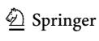
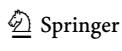
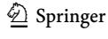
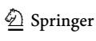
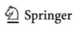
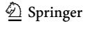

<!-- A3.R49 | source: papers_json/A3.R49/ -->

## **The Infuence of Environmental, Social, and Governance ** **(ESG) Practices on US Firms' Performance: Evidence ** **from the Coronavirus Crisis**

**Ahmed Mohamed Habib****[1](http://orcid.org/0000-0003-1728-6028)** ** · Nahia Mourad2**

Received: 8 February 2022 / Accepted: 24 February 2023 / Published online: 18 March 2023 © The Author(s), under exclusive licence to Springer Science+Business Media, LLC, part of Springer Nature 2023

## **Abstract**

تستكشف هذه الدراسة تأثير ممارسات ESG الإجمالية والفردية وأزمة فيروس كورونا على أداء الشركات الأمريكية (FP). واستُخدمت عينة كبيرة وحديثة من 406 شركات أمريكية اعتمدت قضايا ESG خلال 2016-2020. وتستخدم هذه الدراسة مقدِّر انحدار المربعات الصغرى المعمَّم (GLS)، وتقنية التحليل الديناميكي، واختبارات المتانة. وتشير النتائج إلى أن الشركات ذات ممارسات ESG المرتفعة لديها مقاييس أداء أفضل. وفي معظم الحالات، تشير النتائج إلى أن الشركات ذات الأداء البيئي والاجتماعي والحوكمي المرتفع لديها مقاييس أداء أفضل. وتشير النتائج إلى أن أزمة فيروس كورونا أثرت سلباً على مقاييس FP. بالإضافة إلى ذلك، تشير تحليلات الفروق إلى وجود اختلافات مهمة في FP بسبب أزمة فيروس كورونا. ولنتائج هذه الدراسة آثار مهمة بالنسبة لأصحاب المصلحة. ويمكن أن يستفيد المديرون من نتائج هذا الفحص من خلال إدراك وضع ممارسات ESG وFP قبل أزمة فيروس كورونا وأثناءها، وتحديد الرابط بين الوفاء بمسؤوليات ESG وFP. وتقدم هذه الدراسة آثاراً عملية جديرة بالملاحظة يمكن أن تمكِّن المديرين من تطوير استراتيجيات وسياسات لاعتماد وتعزيز ممارسات ESG لتحقيق أفضل أداء. علاوة على ذلك، يمكن أن تؤثر النتائج في عمليات التداول لأن المستثمرين والممولين يسعون وراء عوائد مالية جذابة من استثماراتهم في الأعمال المهتمة بقضايا ESG.

**Keywords** Environmental · Social · Governance · ESG · Performance · Coronavirus crisis

> ^*^ Ahmed Mohamed Habib dr_ahmedhabib@yahoo.com Nahia Mourad nahia.mourad@buid.ac.ae

> ^1^ Independent Accounting and Finance Researcher, Independent Research, Zagazig, Egypt

<!-- page 2 -->

## **Introduction**

أثّرت الأزمة المالية في أوائل الألفينيات في الولايات المتحدة بشدة على الأسواق العالمية، مما أدى إلى عقبات اقتصادية تطلبت مستويات كبيرة من التدخل الحكومي والاهتمام المجتمعي (Nicholson et al., [2011](#page-20-0)). بالإضافة إلى ذلك، كانت هناك قضايا عديدة تتعلق بالسلوك الأخلاقي والمسؤولية والإشراف، وشكوك بشأن كون تقارير الشركات مصدراً موثوقاً للمعلومات لأصحاب المصلحة (Alqallaf & Alareeni, [2018)](#page-18-0). لذلك، تسعى شركات عديدة إلى تطوير سياسات واستراتيجيات لتزويد مستخدمي المعلومات بصورة شفافة عن إجراءات ومبادرات مسؤوليتها التجارية من خلال اتباع معايير بيئية (ENV) واجتماعية (SOC) وحوكمية (GOV) بسبب ضغوط من المسؤولين والأسواق المالية وأصحاب المصلحة (Habib, [2022](#page-19-0)). ويمكن أن تساعد الشفافية المعززة في جذب الأموال والحفاظ على ثقة المستثمرين في سوق الأسهم. وفي الوقت نفسه، قد يتسبب غياب الإفصاح في سلوك غير أخلاقي وتلاعب وشكوك في نزاهة التداول، مما يكلف الشركات ومستخدمي المعلومات والاقتصاد (Demise, [2006](#page-19-1)). ونتيجة لذلك، تحاول الشركات الإفصاح عن قضايا ESG لجذب الاستثمارات وتعزيز قيمة الشركة (Habib, [2022](#page-19-0)).

يتضمن أداء ESG دمج أداء ENV وSOC وGOV (Habib, [2022](#page-19-0)). ويؤكد Rezaee [(2016](#page-21-0)) أن تضمين واستخدام أداء ESG في استراتيجية إدارة الشركات يمكن أن يولِّد قيمة. وفي السنوات الأخيرة، اجتذب أداء ESG صانعي القرار كوسيلة أساسية لتعزيز قيمة الشركة (Habib,[ 2022](#page-19-0); Malik, [2015)](#page-20-1). لذلك، يعتقد بعض الباحثين أن الشركات التي ترغب في التميز في بيئة الأعمال ينبغي أن تولي الأولوية لتعزيز أدائها في ESG (Habib,[ 2022](#page-19-0); Hockerts & Moir,[ 2004](#page-20-2); Vandekerckhove et al., [2008](#page-21-1)). ويؤكد Shiller ([2013)](#page-21-2) أنه بما أن الأسواق المالية تلعب دوراً حاسماً في الحفاظ على أنشطة SOC متنوعة، فإن معلومات ESG تخدم أيضاً المستثمرين والمجتمع. لذلك، يؤكد Eccles et al. ([2014)](#page-19-2) أن الإفصاح عن معلومات ESG لأصحاب المصلحة ضروري للشركات لجذب مستثمرين طويلي الأجل. بالإضافة إلى ذلك، يوفر تحليل ESG رؤية شاملة لمجالات المخاطر والفرص المحتملة في ENV وSOC للشركات في الأسواق سريعة التغير. ويمكن للشركات التي تركز على استثمارات ESG أن تخفض التكاليف، وتعزز الإنتاجية، وتخفف من احتمالية المخاطر، وتوفر فرصاً لتوليد الإيرادات، وتحسِّن أرباحها واستدامتها طويلة الأجل (Eccles et al., [2014;](#page-19-2) Malik,[ 2015](#page-20-1); Rezaee, [2016](#page-21-0)).

اقترحت نظريات عديدة تفسيرات لقضايا ESG. فعلى سبيل المثال، تفترض نظرية أصحاب المصلحة أن ممارسات المسؤولية الاجتماعية للشركات قد تساعد الأعمال على تعزيز علاقاتها مع أصحاب المصلحة (Bitektine & Haack, [2015;](#page-19-3) Russo & Perrini, [2010;](#page-21-3) Tu & Huang, [2015](#page-21-4)). وتشير النظريات المؤسسية ونظرية الشرعية إلى أن تعزيز ممارسات SOC يحسِّن FP (Beddewela & Fairbrass, [2016;](#page-19-4) Velte, [2017)](#page-21-5). بالإضافة إلى ذلك، تشير نظرية تخصيص الموارد إلى أن الأعمال ينبغي أن تحدد كيفية تخصيص الموارد لجميع الأنشطة الإنتاجية بطريقة فعالة من حيث التكلفة (Ferrier, [1994;](#page-19-5) Li & Cui, [2008)](#page-20-3). وتوحي النظرية المبنية على الموارد بأن الشركات الكبيرة تؤدي بشكل أفضل في ممارسات ESG. ومن منظور مبني على الموارد، تمكِّن هذه الموارد الشركات من تعزيز ممارسات ESG لديها (Ruf et al., [2001](#page-21-6)). وبالتالي، فإنها تحسِّن صورة الشركة وثقة العملاء (Greening & Turban, [2000](#page-19-6); Orlitzky et al., [2003](#page-20-4)). علاوة على ذلك، يقترح Godfrey et al. ([2009](#page-19-7)) أن

<!-- page 3 -->

استثمار ESG يُعتبَر شكلاً من أشكال التغطية ضد المخاطر السمعية. ويذكر Sharfman and Fernando ([2008](#page-21-7)) أن ESG يمكن أن يخفف من المخاطر المتبقية للشركة. بالإضافة إلى ذلك، وجد مسح أجرته Allianz ([2019](#page-18-1)) أن حوالي 79% من الأمريكيين يدعمون فكرة الاستثمار في الشركات التي تراعي القضايا المهمة، وذكر حوالي 74% أن استثمارات ESG منحتهم شعوراً بالثقة، وذكر حوالي 69% أن قضايا GOV ضرورية أيضاً لقرارهم بالاستثمار (Allianz, [2019)](#page-18-1). ويرغب العملاء في التأكد من أن الشركات التي يشترون منها لديها استراتيجيات وسياسات ESG واضحة لأن خيارات الشراء مرتبطة باهتمامات SOC، مما يعني أنه يتعين على الشركات التركيز على إنشاء وتعزيز أداء ESG لكسب المستثمرين والعملاء والاحتفاظ بهم، إضافة إلى قضايا تكاليف المنتج والأسعار التنافسية وجودة المنتج وخدمات ما بعد البيع. ووفقاً لتقرير Allianz، يختار ثلث العملاء الشركات بناءً على سياسات مسؤوليتها الاجتماعية (Allianz, [2019](#page-18-1)). علاوة على ذلك، وجدت منظمة KPMG العالمية أن 96% من أكبر الشركات المتداولة في العالم تفصح بالفعل عن معلومات حول أدائها في ESG. بالإضافة إلى ذلك، تعتقد بعض الشركات أن نشر أدائها في هذا المجال يُظهر أهمية ESG للسوق والمستثمرين المحتملين، وأن التركيز على مسائل ESG يضمن FP والاستثمار طويلي الأجل (KPMG, [2020)](#page-20-5).

بالإضافة إلى ذلك، حاولت دراسات سابقة اكتشاف تأثير أداء ESG على FP، لكن تركيزها كان على جانب واحد من أبعاد ESG، أي ENV أو SOC أو GOV (Adegbite et al., [2019;](#page-18-2) Barnett & Salomon, [2012;](#page-19-8) Elsayed & Paton, [2005](#page-19-9); Hu et al., [2018](#page-20-6); Qiu et al., [2016](#page-20-7); Smith et al., [2007](#page-21-8)). غير أن التركيز على بُعد واحد فقط دون النظر في الأبعاد الأخرى قد لا يكون مناسباً للتقييم الشامل لممارسات ESG. ولم تفحص سوى دراسات قليلة في مجال ESG جميع الأبعاد الفرعية لـESG وتأثيرها على FP من خلال مؤشرات متعددة متعلقة بالقياسات المحاسبية مع إهمال القياسات المبنية على السوق (Ahmad et al., [2021](#page-18-3); Han et al., [2016](#page-20-8); Sassen et al., [2016;](#page-21-9) Tarmuji et al., [2016](#page-21-10); Velte,[ 2017](#page-21-5)). علاوة على ذلك، كان لتأثير جائحة فيروس كورونا عواقب كبيرة على جميع الجوانب الاقتصادية، سواء على المستوى الكلي أو الجزئي (Fauci et al., [2020)](#page-19-10). لذلك، تستكشف هذه الدراسة تأثير ممارسات ESG الإجمالية والفردية على مؤشرات الأداء المبنية على السوق، مع التركيز على التأثير الإحصائي لأزمة فيروس كورونا على القيمة السوقية للشركات. وبسبب أهمية الاستثمارات الحالية والمستقبلية للشركات، تركز هذه الدراسة على مؤشرات الأداء المبنية على السوق، إذ يهتم المستثمرون بالأسعار السوقية الماضية والحالية والمستقبلية، وبالقيمة السوقية للشركة. ويوضح Orlitzky et al. [(2003](#page-20-4)) وUllmann ([1985)](#page-21-11) أن مؤشرات الأداء المبنية على السوق أفضل من مؤشرات الأداء المبنية على المحاسبة لأنها تركز على قدرة الشركة على توليد أرباح مستقبلية بدلاً من الأداء التاريخي. علاوة على ذلك، من غير المرجح أن تؤثر التعديلات المحاسبية وعمليات التلاعب الإداري على مقاييس الأداء المبنية على السوق. لذلك، هذه المؤشرات ضرورية للمستثمرين للاستثمار في شركة ما. بالإضافة إلى ذلك، هذا الفحص مهم لصانعي القرار لإدراك كفاءة أداء الأعمال وممارسات ESG أثناء الجائحة واتخاذ إجراءات تصحيحية كافية لتحسين ممارسات ESG وقيمة الشركة. بالإضافة إلى ذلك، يمكن أن تؤثر النتائج في عمليات التداول لأن المستثمرين والممولين يسعون وراء عوائد مالية جذابة من استثماراتهم في الأعمال المهتمة بقضايا ESG.

<!-- page 4 -->

كان الدافع الأساسي لهذه الدراسة لأسباب متعددة. أولاً، تلعب ممارسات ESG دوراً حاسماً في مساعدة الأعمال على تعزيز علاقاتها مع أصحاب المصلحة (Bitektine & Haack, [2015;](#page-19-3) Habib, [2022](#page-19-0); Russo & Perrini, [2010](#page-21-3); Tu & Huang, [2015)](#page-21-4). ثانياً، ينبغي تعزيز ممارسات ESG لتحقيق أفضل أداء (Eccles et al., [2014;](#page-19-2) Habib, [2022;](#page-19-0) Malik, [2015;](#page-20-1) Rezaee, [2016](#page-21-0)). لذلك، تستكشف هذه الدراسة تأثير ممارسات ESG على مؤشرات الأداء المبنية على السوق، إذ يهتم المستثمرون بالمقاييس السوقية عند اتخاذ قرارات استثمارهم. ثالثاً، حاولت معظم الدراسات استكشاف جانب واحد من أبعاد ESG وأهملت الأبعاد الأخرى، رغم أن قضايا ESG مترابطة، وقد يؤدي التركيز على بُعد واحد إلى نتائج غير مُرضية (Adegbite et al., [2019;](#page-18-2) Barnett & Salomon, [2012;](#page-19-8) Elsayed & Paton, [2005;](#page-19-9) Hu et al., [2018;](#page-20-6) Qiu et al., [2016](#page-20-7); Smith et al., [2007)](#page-21-8). لذلك، يركز الفحص الحالي على ممارسات ESG الإجمالية والفردية لتقديم معلومات شاملة حول هذه الممارسات، والتي يمكن أن تكون مفيدة للمديرين في تحديد الرابط بين الوفاء بمسؤوليات ESG وFP. وأخيراً، تستلزم العواقب الكبيرة لظهور وانتشار جائحة فيروس كورونا على جميع الجوانب الاقتصادية الحاجة إلى التحقق من الأثر الإحصائي للأزمة على تطور FP.

بالإضافة إلى ذلك، يسهم هذا الفحص في المعرفة القائمة. أولاً، على حد علمنا، يُعد هذا الفحص من أوائل الدراسات التي تقيّم تأثير أنشطة ESG للشركات على الأداء المبني على السوق قبل أزمة فيروس كورونا وأثناءها. ثانياً، من المبرر إعادة النظر في تأثير أداء ESG على FP، خاصة في الولايات المتحدة، بسبب ندرة البحوث ذات الصلة. ثالثاً، تحدد هذه الدراسة ممارسات ESG الإجمالية والفردية دون إهمال أي جانب لتقديم معلومات شاملة حول الأداء الإجمالي للشركات من حيث هذه الممارسات. رابعاً، قد تكون النتائج مفيدة أيضاً لصانعي القرار في رفع وعيهم بأهمية ممارسات ESG في تحقيق أفضل أداء، وأهمية دمجها في جميع أجزاء الأعمال. وأخيراً، تقدم هذه الدراسة نتائج عملية جديرة بالملاحظة، تمكِّن صانعي القرار من اعتماد مزيج من ممارسات ESG لتعزيز عمليات التحسين المستمر وقيمة الشركة.

## **Literature Review and Hypothesis Formulation**

أدت الدراسات السابقة التي استكشفت تأثير ممارسات ESG على FP إلى نتائج غير حاسمة، وحاولت معظمها استكشاف جانب واحد من أبعاد ESG، مهملة بقية الأبعاد (Adegbite et al., [2019](#page-18-2); Barnett & Salomon, [2012;](#page-19-8) Elsayed & Paton, [2005;](#page-19-9) Hu et al., [2018](#page-20-6); Qiu et al., [2016](#page-20-7); Smith et al., [2007](#page-21-8)). ولا شك في أن قضايا ESG مترابطة وأن التركيز على بُعد واحد قد يؤدي إلى نتائج غير مُرضية. بالإضافة إلى ذلك، ركزت دراسات قليلة على جميع الأبعاد الفرعية لـESG وتأثيرها على FP (Ahmad et al., [2021](#page-18-3); Habib, [2022](#page-19-0); Han et al.,[ 2016](#page-20-8); Sassen et al., [2016;](#page-21-9) Tarmuji et al.,[ 2016](#page-21-10); Velte, [2017)](#page-21-5). ونظراً لأهمية هذه القضايا، فإن النتائج ضرورية لمستخدمي المعلومات المحاسبية لزيادة وعيهم بأداء ESG ودرجات الإفصاح ووضع الشركة من منظور شامل.

<!-- page 5 -->

يبحث Adegbite et al. [(2019](#page-18-2)) الرابط بين أداء SOC وFP في 314 شركة مدرَجة في المملكة المتحدة خلال 2002-2015، وتؤكد النتائج وجود رابط غير خطي بين SOC وFP. ويستكشف Hu et al. [(2018](#page-20-6)) العلاقة بين المسؤولية الاجتماعية وقيمة الشركة بتطبيقها على عينة من الشركات الصينية المصنِّعة من 2010 إلى 2015، وتشير النتائج إلى أن المسؤولية الاجتماعية مرتبطة إيجابياً بقيمة الشركة. ويبحث Han et al. ([2016)](#page-20-8) الرابط بين ممارسات ESG وFP بتطبيقها على عينة من الشركات الكورية من 2008 إلى 2014. وتُظهر النتائج نتائج متباينة، إذ يرتبط أداء ENV وGOV بمؤشرات FP، بينما لا يُظهر أداء SOC أي دليل مهم على مؤشرات FP. ويفحص Qiu et al. ([2016)](#page-20-7) الرابط بين إفصاحات ENV وSOC وFP لعينة من الشركات المدرَجة في مؤشر FTSE350 خلال 2005-2009، وتشير النتائج إلى أن الشركات ذات الموارد الاقتصادية الأكبر تقدم إفصاحات أكثر شمولاً وتحقق FP أفضل. ويستكشف Barnett and Salomon [(2012](#page-19-8)) العلاقة بين أداء SOC للشركات وFP لـ1214 شركة من 1998 إلى 2006، وتؤكد النتائج وجود علاقة غير خطية بين أداء SOC للشركات وFP. ويفحص Smith et al. [(2007](#page-21-8)) الرابط بين إفصاح ENV وأداء الشركات الماليزية، وتشير نتائجهم إلى أن إفصاح ENV يؤثر سلباً على FP. ويفحص Elsayed and Paton ([2005)](#page-19-9) تأثير أداء ENV على FP باستخدام بيانات لوحية ديناميكية وثابتة على 227 شركة في المملكة المتحدة تغطي 1994 إلى 2000، وتشير النتائج إلى أن أداء ENV له تأثير محايد على FP. بالإضافة إلى ذلك، تُظهر تقديرات البيانات اللوحية الثابتة تأثيراً سلبياً ضعيفاً لكن مهماً على العائد على الأصول. وفي الوقت نفسه، لا يوجد تأثير مهم على نسبة Tobin's *Q* أو العائد على المبيعات. بالإضافة إلى ذلك، توفر تقديرات البيانات اللوحية الديناميكية دليلاً محدوداً على أن ENV يؤثر على FP.

بالإضافة إلى ذلك، يبحث Ademi and Klungseth [(2022](#page-18-4)) الرابط بين أداء ESG وFP باستخدام عينة من 150 شركة أمريكية من 2017 إلى 2020. وتُظهر النتائج تأثيراً إيجابياً على FP. ويفحص Al Amosh et al. [(2022](#page-18-5)) تأثير إفصاح ESG على FP باستخدام عينة من 124 شركة في بلدان المشرق من 2012 إلى 2019. وتُظهر هذه النتائج تأثيراً إيجابياً على FP. ويفحص Buallay and Al Marri [(2022](#page-19-11)) تأثير إفصاح ESG على أداء قطاع الاتصالات وتكنولوجيا المعلومات في 41 دولة باستخدام عينة من 1844 ملاحظة من 2008 إلى 2017. وتُظهر النتائج وجود تأثير سلبي على الأداء السوقي، لكن دون تأثير مهم على الأداء التشغيلي وFP. ويفحص Habib [(2022](#page-19-0)) تأثير أداء ESG على قيمة الشركة باستخدام عينة من 964 ملاحظة شركة-سنة أمريكية من 2016 إلى 2019. وتُظهر النتائج تأثيراً إيجابياً على قيمة الشركة. ويفحص Kalia and Aggarwal ([2022)](#page-20-9) تأثير ممارسات ESG على FP لشركات الرعاية الصحية باستخدام عينة من 468 شركة في 2020. وتشير النتائج إلى تأثير إيجابي على FP في الاقتصادات المتقدمة وتأثير سلبي في الاقتصادات النامية. ويفحص Nguyen et al. [(2022](#page-20-10)) تأثير ممارسات ESG على FP باستخدام عينة من 57 شركة أمريكية. وتكشف النتائج عن تأثير إيجابي على FP. ويفحص Nurim et al. ([2022)](#page-20-11) تأثير أنشطة ESG على FP باستخدام عينة من 139 شركة إندونيسية من 2013 إلى 2019. وتؤكد النتائج أن FP يؤثر باستمرار في أداء ESG وأن أداء ESG يتوسط العلاقة بين FP وقيمة الشركة. ويفحص Rahi et al. ([2022)](#page-21-12) تأثير ممارسات ESG على FP باستخدام عينة من 39 شركة مالية في السويد والدنمارك وفنلندا والنرويج من 2015 إلى 2019. وتُظهر النتائج

<!-- page 6 -->

تأثيراً إيجابياً على FP من حيث العائد على الأصول وتأثيراً سلبياً على FP من حيث العائد على حقوق الملكية والعائد على رأس المال المستثمر وربحية السهم. ويفحص Carnini Pulino et al. ([2022)](#page-19-12) تأثير إفصاح ESG على FP باستخدام عينة من 263 شركة مدرجة إيطالية من 2011 إلى 2020. وتُظهر النتائج تأثيراً إيجابياً على FP. ويحلل Wasiuzzaman et al. ([2022)](#page-21-13) العلاقة بين ممارسات ESG وFP باستخدام عينة من 668 شركة في قطاع الطاقة من 2009 إلى 2016. وتُظهر هذه النتائج تأثيراً سلبياً على FP. ويبحث Ahmad et al. [(2021](#page-18-3)) تأثير ESG على FP باستخدام عينة من 351 شركة في المملكة المتحدة من 2002 إلى 2018. وتكشف النتائج عن وجود تأثير إيجابي مهم على FP. ويفحص Chen et al. [(2021](#page-19-13)) تأثير مسؤولية ESG على FP باستخدام عينة من 311 شركة صينية مدرجة من 2008 إلى 2019. وتُظهر النتائج أن تأثير الوفاء بـESG على FP ديناميكي وطويل الأجل، إذ يتأثر FP الشركة سلباً وبشكل مهم بالوفاء بـESG في المدى القصير بسبب تكاليف الفرصة البديلة والتكاليف المتكبَّدة؛ غير أن FP الشركة يتأثر إيجابياً وبشكل مهم بالوفاء بـESG في المدى الطويل. ويفحص Alareeni and Hamdan ([2020)](#page-18-6) تأثير ESG على الأداء التشغيلي والمالي والسوقي لشركات S&P 500 الأمريكية المدرجة من 2009 إلى 2018. وتؤكد النتائج وجود علاقة إيجابية بين إفصاح ESG وFP. ويبحث Velte [(2017](#page-21-5)) الرابط بين أداء ESG وFP في ألمانيا خلال 2010-2014. وتُظهر النتائج أن أداء ESG يؤثر على العائد على الأصول لكنه لا يؤثر على نسبة Tobin's *Q*، وأن أداء GOV له التأثير الأقوى مقارنة بالأبعاد الفرعية الأخرى. ويبحث Sassen et al. [(2016](#page-21-9)) تأثير ESG على مخاطر الشركة في أوروبا من 2002 إلى 2014. وتؤكد النتائج أن ارتفاع ESG يقلل من مخاطر الشركة، وأن أداء SOC له عاقبة غير مواتية على جميع مقاييس المخاطر، وأن أداء ENV يقلل من المخاطر الخاصة بالشركة، وأن بُعد GOV للشركة ليس له تأثير مهم على مخاطر الشركة. ويبحث Tarmuji et al. ([2016)](#page-21-10) تأثير ESG على FP باستخدام عينات من ماليزيا وسنغافورة من 2010 إلى 2014. وتُظهر النتائج أن ممارسات ESG تؤثر على FP. واستناداً إلى نتائج ممارسات ESG، نقترح الفرضيات التالية:

*H1a. ESG practices positively infuence FP during the study period.* *H1b. ENV practices positively infuence FP performance during the study period.* *H1c. SOC practices positively infuence FP performance during the study period.* *H1d. GOV practices positively infuence FP performance during the study period.*

علاوة على ذلك، كان لتأثير جائحة فيروس كورونا عواقب مهمة على جميع جوانب الاقتصاد، سواء على المستوى الكلي أو الجزئي (Fauci et al., [2020;](#page-19-10) Habib & Kayani, [2022;](#page-19-14) Habib & Mourad, [2022)](#page-20-12). وقد عُلِّقت أنشطة كثيرة بسبب الأزمة من أجل تقييد عواقبها والتخفيف من تأثيرها الضار. وعندما تبذل الحكومات جهوداً حازمة للتعامل مع المخاطر الصحية الناشئة الناجمة عن الجائحة، يواجه مديرو الشركات تحديات كبيرة في إدارة ممارسات ESG. وهذا يُظهر الدور الحاسم لصانعي القرار المرنين في تعزيز ممارسات ESG وFP. بالإضافة إلى ذلك، لم يجد المؤلف أي بحث سابق متعلق بهذه المسألة في سياق أزمة فيروس كورونا. وبناءً على ذلك، تُعد هذه الدراسة واحدة من أوائل المحاولات لاستكشاف

<!-- page 7 -->

تأثير ممارسات ESG على FP أثناء الأزمة. واستناداً إلى عواقب الأزمة، نقترح الفرضيات التالية:

- *H2. The coronavirus crisis negatively infuence FP during the study period.*
- *H3. On average, there were noteworthy diferences in FP due to the crisis.*
- *H4. On average, there were noteworthy diferences in a frm's total and individ**ual ESG practices due to the crisis.*

## **Data and Methodology**

تستخدم الدراسة الحالية عينة كبيرة وحديثة من الشركات الأمريكية. ويسرد الجدول [1 ](#page-6-0)حجم العينة وخصائصها، إذ تمثل 403 شركة مع 2015 ملاحظة شركة-سنة. وهذه الشركات مدرجة في سوق NASDAQ لرأس المال (NASDAQ-CM)، وبورصة نيويورك (NYSE)، وبورصة نيويورك الأمريكية (NYSE-AM)، وحُصل على بياناتها السنوية باستخدام Standard and Poor's DataStream من 2016 إلى 2020.

كثير من أنواع البحوث ذاتية فيما يتعلق بقياس FP، إذ يركز كل مؤشر على عنصر فريد له تحيزات وقيود متأصلة. وقد جادل Orlitzky et al. ([2003)](#page-20-4) بأن المؤشرات المتعلقة بالقياسات المحاسبية هي مقاييس أساسية لكفاءة الشركة؛ ومع ذلك، يهتم المستثمرون بالأسعار السوقية الماضية والحالية والمستقبلية وبالقيمة السوقية للشركة. واستندت خياراتهم إلى ملاحظات هذه المؤشرات. بالإضافة إلى ذلك، يذكر Ullmann ([1985)](#page-21-11) أن مؤشرات الأداء المبنية على السوق أفضل من المؤشرات المبنية على المحاسبة لأن المستثمرين يركزون على قدرة الشركة على توليد أرباح مستقبلية بدلاً من FP السابق. علاوة على ذلك، من غير المرجح أن تتأثر مؤشرات الأداء المبنية على السوق بـ

<!-- page 8 -->

التغيرات المحاسبية والتلاعب الإداري. وهذه المؤشرات حاسمة لقرارات المستثمرين بشراء الأسهم. وبالتالي، تستخدم هذه الدراسة مؤشرات الأداء المبنية على السوق كمتغيرات تابعة، أي القيمة السوقية (MV)، وإجمالي قيمة المنشأة (TEV)، ونسبة Tobin's *Q*، لأن التعديلات المحاسبية وعمليات التلاعب الإداري من غير المرجح أن تؤثر على مقاييس الأداء المبنية على السوق. ويعرض الجدول [2 ](#page-7-0)تعريفات المتغيرات التابعة والمستقلة والضابطة.

ولاستكشاف تأثير ممارسات ESG الإجمالية والفردية على مؤشرات الأداء المبنية على السوق، مع التركيز على التأثير الإحصائي لأزمة فيروس كورونا على القيمة السوقية للشركات، نحدد نماذج الدراسة كما يلي:

$$
DepVar_{i,t} = \beta_0 + \beta_1 ESG_{i,t} + \beta_2 COV_{i,t} + \beta_3 SIZE_{i,t} + \beta_4 AGE_{i,t} + \beta_5 LEV_{i,t} + \alpha (1)
$$

ولمزيد من فحص أداء ESG، تفحص هذه الدراسة أيضاً تأثير الأبعاد الفرعية لأداء ESG، أي أداء ENV وSOC وGOV، كما يلي:

$$
DepVar_{i,t} = \beta_0 + \beta_1 ENV_{i,t} + \beta_2 SOC_{i,t} + \beta_3 GOV_{i,t} + \beta_4 COV_{i,t} + \beta_5 SIZE_{i,t} + \beta_6 AGE_{i,t} + \beta_7 LEV_{i,t} + \alpha (2)
$$

كما ذُكر في المعادلات أعلاه، يُشار إلى المتغيرات التابعة بواسطة MV وTEV ونسبة Tobin's *Q*. ويُؤخذ اللوغاريتم الطبيعي للمتغيرات للتخفيف من انحراف البيانات لتصبح أقرب إلى التوزيع الطبيعي وتحقيق تباين ثابت. وتحديداً، تُقاس MV بضرب الأسهم العادية القائمة للشركة بسعر سهمها الحالي في نهاية الفترة. وتُقاس TEV كمجموع القيمة السوقية والقيمة السوقية للدين والأسهم الممتازة بعد استبعاد النقد وما يعادله في نهاية الفترة. وتُقاس نسبة Tobin's *Q* بقسمة القيمة السوقية للشركة على إجمالي أصولها في نهاية الفترة. وESG هو مجموع درجات ممارسات ENV وSOC وGOV المحصَّل عليها من Standard and Poor's DataStream. والدرجة تتراوح بين 0 و100، إذ يشير الربع الأول (0-25) إلى أداء ESG نسبي ضعيف. ويشير الربع الثاني (>25-50) إلى أداء ESG نسبي مُرضٍ. ويشير الربع الثالث (>50-75) إلى أداء ESG نسبي جيد. ويشير الربع الأخير (>75-100)

<!-- page 9 -->

إلى أداء ESG نسبي ممتاز. والأبعاد الفرعية لأداء ESG مترابطة ولها نفس الأهمية لأن الشركات لا يمكنها التركيز على بُعد واحد فقط لتحسين أدائها الإجمالي في ESG (Ahmad et al., [2021;](#page-18-3) Habib, [2022;](#page-19-0) Han et al.,[ 2016](#page-20-8); Sassen et al., [2016;](#page-21-9) Tarmuji et al., [2016;](#page-21-10) Velte, [2017)](#page-21-5). وENV وSOC وGOV هي درجات الأداء البيئي والاجتماعي والحوكمي، على التوالي. وCOV تُقاس بمتغير وهمي يأخذ القيمة واحد لفترة أزمة فيروس كورونا وصفر خلاف ذلك. والمتغيرات الضابطة المعتمَدة هي حجم الشركة (SIZE)، والعمر (AGE)، والرافعة المالية (LEV). وتُقاس SIZE كاللوغاريتم الطبيعي لإجمالي أصول الشركة في نهاية الفترة. وتُقاس AGE كاللوغاريتم الطبيعي لعمر الشركة حتى نهاية الفترة. وتُقاس LEV بقسمة دين الشركة على أصولها في نهاية الفترة.

استخدمت هذه الدراسة مقدِّر انحدار المربعات الصغرى المعمَّم (GLS)، الذي يُعتبَر تعميماً لمقدِّر المربعات الصغرى العادية (OLS) ويُستخدَم للحصول على استدلالات أدق لمعاملات النموذج والتغلب على مشكلة عدم تجانس التباين (González-Coya & Perron, [2022](#page-19-15); Hsiao, [2007](#page-20-13); Kaufman, [2013](#page-20-14)). علاوة على ذلك، اعتمدت هذه الدراسة تحليلات إضافية باستخدام تقنية تحليل ديناميكي كنموذج أكثر عمومية. ويستند ذلك إلى مقدِّر نظام طريقة العزوم المعمَّمة (GMM) لـ Arellano-Bover/Blundell-Bond. وتسمح هذه التقنية بأن يكون المتغير التابع متغيراً متأخراً مضمَّناً في النموذج لتوضيح التأثيرات الديناميكية في تحليل البيانات اللوحية، وتسمح لحدود الخطأ بامتلاك اعتماد ذاتي الانحدار عبر الزمن (Ahmad et al., [2021;](#page-18-3) Elsayed & Paton, [2005](#page-19-9); Geroski et al., [1997)](#page-19-16). بالإضافة إلى ذلك، اعتمدت هذه الدراسة اختبارات متانة للتحقق من صحة النتائج.

## **Empirical Results**

## **Descriptive Statistics**

يوضح الجدول [3 ](#page-9-0)الإحصاءات الموجزة لمتغيرات الفحص قبل جائحة فيروس كورونا وأثناءها.

كان متوسط MV 6.02 و5.83، بانحراف معياري 0.97 و1.01، قبل أزمة فيروس كورونا وأثناءها، على التوالي. وهذا يشير إلى انخفاض القيم السوقية للشركات الأمريكية بسبب أزمة فيروس كورونا. وكان متوسط TEV 5.40 و5.25، بانحراف معياري 0.72 و0.64، قبل أزمة فيروس كورونا وأثناءها، على التوالي. وهذا يشير إلى انخفاض إجمالي قيم المنشآت للشركات الأمريكية بسبب أزمة فيروس كورونا. وكان متوسط نسبة Tobin's *Q* 4.81 و4.56، بانحراف معياري 1.26 و1.28، قبل أزمة فيروس كورونا وأثناءها، على التوالي. وهذا يشير إلى انخفاض نسب Tobin's *Q* للشركات الأمريكية بسبب أزمة فيروس كورونا. بالإضافة إلى ذلك، كان متوسط ESG 3.31 و3.28، بانحراف معياري 0.57 و0.62، قبل أزمة فيروس كورونا وأثناءها، على التوالي. وهذا يشير إلى انخفاض الأداء البيئي والاجتماعي والحوكمي للشركات الأمريكية بسبب أزمة فيروس كورونا. وكان متوسط ENV 2.80 و2.56، بانحراف معياري 1.38 و1.63، قبل أزمة فيروس كورونا وأثناءها، على التوالي. وهذا يشير إلى انخفاض الأداء البيئي للشركات الأمريكية بسبب أزمة فيروس كورونا. وكان متوسط SOC 2.80 و2.75،

<!-- page 10 -->

| **Table 3** Descriptive statisti | cs |
| --- | --- |

| Table 3 Descriptive statistics | Variables | Crisis status | Mean | Std. Dev. | Min. | Max. |
| --- | --- | --- | --- | --- | --- | --- |
|  | MV | Before | 6.022 | 0.965 | 3.980 | 10.652 |
|  |  | During | 5.832 | 1.007 | 3.759 | 10.078 |
|  | TEV | Before | 5.403 | 0.721 | 4.118 | 8.741 |
|  |  | During | 5.253 | 0.641 | 4.371 | 7.497 |
|  | Tobin's Q | Before | 4.808 | 1.264 | 0.788 | 8.736 |
|  |  | During | 4.562 | 1.278 | 0.774 | 7.516 |
|  | ESG | Before | 3.309 | 0.571 | 1.386 | 4.466 |
|  |  | During | 3.283 | 0.622 | 1.792 | 4.454 |
|  | ENV | Before | 2.695 | 1.376 | 0.000 | 4.564 |
|  |  | During | 2.563 | 1.630 | 0.000 | 4.554 |
|  | SOC | Before | 2.803 | 0.979 | 0.000 | 4.511 |
|  |  | During | 2.748 | 1.035 | 0.000 | 4.500 |
|  | GOV | Before | 3.627 | 0.391 | 2.079 | 4.466 |
|  |  | During | 3.551 | 0.428 | 2.398 | 4.466 |
|  | SIZE | Before | 9.790 | 1.412 | 5.280 | 14.804 |
|  |  | During | 10.04 | 1.388 | 5.666 | 15.035 |
|  | AGE | Before | 3.739 | 1.348 | 1.946 | 5.460 |
|  |  | During | 3.785 | 1.346 | 2.398 | 5.464 |
|  | LEV | Before | 5.306 | 1.037 | 1.987 | 9.139 |
|  |  | During | 5.399 | 1.031 | 2.439 | 9.130 |

بانحراف معياري 0.98 و1.04، قبل أزمة فيروس كورونا وأثناءها، على التوالي. وهذا يشير إلى انخفاض الأداء الاجتماعي للشركات الأمريكية بسبب أزمة فيروس كورونا. وكان متوسط GOV 3.63 و3.55، بانحراف معياري 0.39 و0.43، قبل أزمة فيروس كورونا وأثناءها، على التوالي. وهذا يشير إلى انخفاض الأداء الحوكمي للشركات الأمريكية بسبب أزمة فيروس كورونا.

## **Correlation Analysis**

يعرض الجدول [4](#page-10-0) مصفوفات الارتباط وعوامل تضخم التباين وقيم التسامح. ويعرض الجدول [4 ](#page-10-0)اللوحة أ نتائج معامل الارتباط الثنائي لأول مجموعة من متغيرات النموذج. وارتبط COV سلباً، لكن بشكل غير مهم، بأداء ESG. وارتبطت SIZE وAGE وLEV إيجابياً وبشكل مهم بأداء ESG. وتشير هذه النتيجة إلى أن الشركات ذات الحجم والعمر والرافعة المالية الأكبر لديها أداء ESG أفضل. بالإضافة إلى ذلك، ارتبطت SIZE إيجابياً وبشكل مهم بأزمة فيروس كورونا. وتشير هذه النتيجة إلى أن الشركات ذات الأحجام الأكبر عانت أكثر بسبب الأزمة. وتُظهر النتائج عدم وجود متغيرات تفسيرية بمعاملات أكبر من 0.80. ويعرض الجدول [4 ](#page-10-0)اللوحة ب عوامل تضخم التباين (VIF) وقيم التسامح لمتغيرات النموذج الأول. وتؤكد النتائج عدم ظهور تعدد خطية بين المتغيرات التفسيرية، إذ كانت أعلى قيمة VIF هي 1.48 بقيمة تسامح

<!-- page 11 -->

0.678. ويعرض الجدول [4 ](#page-10-0)اللوحة ج نتائج معامل الارتباط الثنائي لمتغير النموذج الثاني. وارتبط SOC وGOV إيجابياً وبشكل مهم بأداء ENV. وبالمثل، ارتبط GOV إيجابياً وبشكل مهم بأداء SOC. وتشير هذه النتيجة إلى أن الشركات ذات الأداء الاجتماعي والحوكمي الأعلى لديها أداء بيئي أفضل. وبالمثل، الشركات ذات الأداء الحوكمي الأعلى لديها أداء اجتماعي أفضل. وارتبط COV سلباً وبشكل مهم بـENV وGOV، بينما كان الارتباط بـSOC سلبياً لكن غير مهم. وتشير هذه النتيجة إلى أن الأبعاد الفرعية لأداء ESG، خاصة البيئي والحوكمي، تأثرت بأزمة فيروس كورونا. وارتبطت SIZE إيجابياً وبشكل مهم بـENV وSOC وGOV. وتشير هذه النتيجة إلى أن الشركات ذات الأحجام الأكبر لديها أداء بيئي واجتماعي وحوكمي أفضل. وارتبطت AGE وLEV إيجابياً وبشكل مهم بـSOC وGOV. وتشير هذه النتيجة إلى أن الشركات ذات العمر والرافعة المالية الأكبر لديها أداء اجتماعي وحوكمي أفضل. وبالمثل، تُظهر النتائج عدم وجود متغيرات تفسيرية بمعاملات أكبر من 0.80. ويعرض الجدول [4](#page-10-0) اللوحة د قيم VIF والتسامح لمتغيرات النموذج الثاني. وتؤكد النتائج عدم ظهور تعدد خطية بين

<!-- page 12 -->

المتغيرات التفسيرية، إذ كانت أعلى قيمة VIF هي 3.99 بقيمة تسامح 0.251.

## **Regression Analyses**

يعرض هذا القسم ويناقش نتائج نماذج الانحدار. وإحصاءات اختبار Hausman مفيدة في تحديد ما إذا كان ينبغي استخدام نموذج انحدار عشوائي التأثيرات أو ثابت التأثيرات. ونتيجة لاختبار Hausman، تستخدم الدراسة الحالية نموذج تأثيرات عشوائية لتقييم تأثير ممارسات ESG الإجمالية والفردية على FP.

يعرض الجدول [5 ](#page-11-0)نتائج نماذج انحدار GLS. وقد لُخِّصت معاملات النماذج والأخطاء المعيارية ومعاملات التحديد (*R*-sq). ويُشار إلى معاملات النموذج بـ** و*، مما يشير إلى تأثير مهم عند مستويي 0.01 و0.05، على التوالي. وتُذكَر الأخطاء المعيارية في النماذج بين قوسين. وتُظهر نتائج النموذج الأول تأثيراً إيجابياً ومهماً

<!-- page 13 -->

لأداء ESG على MV وTEV وTobin's *Q* عند مستوى دلالة 0.01. وتشير هذه النتيجة إلى أن الشركات ذات أداء ESG الأعلى لديها قيمة سوقية وإجمالي قيمة منشأة ونسبة Tobin's *Q* أفضل. وتدعم هذه النتائج H1a. وتتوافق هذه النتائج مع نتائج الدراسات السابقة التالية (Ademi & Klungseth, [2022;](#page-18-4) Ahmad et al.,[ 2021](#page-18-3); Al Amosh et al., [2022;](#page-18-5) Alareeni & Hamdan, [2020](#page-18-6); Carnini Pulino et al., [2022;](#page-19-12) Habib, [2022;](#page-19-0) Kalia & Aggarwal, [2022;](#page-20-9) Nguyen et al.,[ 2022](#page-20-10); Nurim et al.,[ 2022](#page-20-11)). وبناءً على ذلك، يُعتبَر هذا فرصة لصانعي القرار في الشركات للتركيز على اعتماد وتعزيز ممارسات ESG لتحسين FP. بالإضافة إلى ذلك، تُظهر نتائج COV تأثيراً سلبياً ومهماً على MV وTEV وTobin's *Q* عند مستوى دلالة 0.01. وتشير هذه النتيجة إلى أن أزمة فيروس كورونا أثرت سلباً على FP. لذلك، تدعم النتائج H2. وتُظهر هذه النتائج الدور المهم لقادة الشركات في التكيف مع أزمة الجائحة وتطوير استراتيجيات وسياسات لتعزيز FP وتحقيق التحسين المستمر.

وتُظهر نتائج النموذج الثاني تأثيراً إيجابياً ومهماً لمعظم الأبعاد الفرعية لـESG على MV وTEV وTobin's *Q* عند مستوى دلالة 0.01. ويؤثر ENV إيجابياً وبشكل مهم على MV وTobin's *Q* عند مستوى دلالة 0.01، بينما يكون تأثير ENV على TEV إيجابياً لكن غير مهم. وتشير هذه النتيجة إلى أن الشركات ذات الأداء البيئي الأعلى لديها قيم سوقية ونسب Tobin's *Q* أفضل. وتدعم هذه النتائج H1b في معظمها. وأثّر SOC وGOV إيجابياً وبشكل مهم على MV وTEV وTobin's Q، عند مستوى دلالة 0.01. وتشير هذه النتيجة إلى أن الشركات ذات الأداء الاجتماعي والحوكمي الأعلى لديها قيمة سوقية وإجمالي قيمة منشأة ونسبة Tobin's *Q* أفضل. وتدعم هذه النتائج H1c وH1d. وبناءً على ذلك، يُعتبَر هذا فرصة لصانعي القرار في الشركات للتركيز على اعتماد وتعزيز الممارسات البيئية والاجتماعية والحوكمية لتحسين FP. وتتوافق هذه النتائج مع نتائج الدراسات السابقة (Han et al., [2016;](#page-20-8) Hu et al., [2018;](#page-20-6) Qiu et al.,[ 2016](#page-20-7)). بالإضافة إلى ذلك، تُظهر نتائج COV تأثيراً سلبياً ومهماً على MV وTEV وTobin's *Q*، عند مستوى دلالة 0.05. وتشير هذه النتيجة إلى أن أزمة فيروس كورونا أثرت سلباً على FP. لذلك، دعمت هذه النتائج H2. وتُظهر هذه النتائج الدور المهم لقادة الشركات في التكيف مع أزمة الجائحة وتطوير استراتيجيات وسياسات لتعزيز FP وتحقيق التحسين المستمر، إذ كان لجائحة فيروس كورونا عواقب مهمة على جميع جوانب الاقتصاد، سواء على المستوى الكلي أو الجزئي (Fauci et al., [2020](#page-19-10); Habib & Kayani,[ 2022](#page-19-14); Habib & Mourad, [2022)](#page-20-12).

## **Diferences Analysis**

يُظهر الجدول [6](#page-13-0) نتائج اختبار Mann-Whitney *U*. ويُستخدَم الاختبار لإظهار الاختلافات الجديرة بالملاحظة بين توزيع المتغيرات للمجموعتين، أي الفترة قبل أزمة فيروس كورونا والفترة أثناء الأزمة.

تشير نتائج الاختبار لـMV وTEV وTobin's *Q* إلى أن الفرضيات الصفرية غير مدعومة عند مستوى دلالة 0.01، مما يعني أن التوزيعات

<!-- page 14 -->

<!-- page 15 -->

لـMV وTEV وTobin's *Q* ليست هي نفسها عبر فئات المجموعات، والسبب الرئيسي لهذه الاختلافات هو الأزمة. لذلك، دعمت هذه النتائج H3 عند مستوى دلالة 0.01. وفي المقابل، تشير نتائج الاختبار لـESG وأبعادها الفرعية، باستثناء بُعد GOV، إلى أن الفرضيات الصفرية مدعومة عند مستوى دلالة 0.01، مما يعني أن توزيع هذه المتغيرات هو نفسه عبر فئات المجموعات. وتشير نتائج الاختبار لبُعد GOV إلى أن الفرضية الصفرية غير مدعومة عند مستوى دلالة 0.01، مما يعني أن توزيع GOV ليس هو نفسه عبر فئات المجموعات، والسبب الرئيسي لهذه الاختلافات هو الأزمة. لذلك، لم تدعم هذه النتائج H4 في معظمها عند مستوى دلالة 0.01.

<!-- page 16 -->

## **Additional Analyses**

يعرض الجدول [7 ](#page-14-0)نتائج التحليلات الإضافية باستخدام مقدِّر نظام GMM. وتُظهر نتائج النموذج الأول تأثيراً إيجابياً ومهماً لأداء ESG على MV وTEV وTobin's *Q* عند مستوى دلالة 0.01. بالإضافة إلى ذلك، تُظهر نتائج النموذج الثاني تأثيراً إيجابياً ومهماً لمعظم الأبعاد الفرعية لـESG على MV وTEV وTobin's *Q* عند مستوى دلالة 0.01. وتشير هذه النتائج إلى أن الشركات ذات التطبيقات الإجمالية والفردية الأفضل لـESG لديها مقاييس أداء أفضل. بالإضافة إلى ذلك، تُظهر النتائج تأثيراً إيجابياً وغير مهم لأزمة فيروس كورونا على FP في معظم الحالات عند مستوى دلالة 0.05. وهذه النتائج مماثلة لنتائج الدراسات السابقة. ويؤكد Ahmad et al. [(2021](#page-18-3)) أن أداء ESG له تأثير مواتٍ ومهم على FP، لكن عواقب الأبعاد الفرعية لـESG متباينة. ويؤكد Alareeni and Hamdan [(2020)](#page-18-6) وجود تأثير إيجابي بين أداء ESG وFP، لكن نتائج هذه الأبعاد الفرعية متباينة. ويُظهر Chen et al. ([2021)](#page-19-13) أن الوفاء بـESG له تأثير ديناميكي وطويل الأجل على FP، إذ يتأثر FP سلباً وبشكل مهم بالوفاء بـESG في المدى القصير بسبب تكاليف الفرصة البديلة والتكاليف المتكبَّدة، لكنه يتأثر إيجابياً وبشكل مهم بالوفاء بـESG في المدى الطويل. وتُظهر هذه النتائج الدور المهم لقادة الشركات في تطوير استراتيجيات وسياسات لاعتماد وتعزيز ممارسات ESG من أجل تحقيق أفضل أداء.

## **Robustness Tests**

أُجريت اختبارات متانة لتقييم صحة النتائج. واستُخدمت اختبارات لمقارنة نتائج النماذج الأساسية بتلك المستخلَصة من نماذج المتانة (Fixler et al., [2014](#page-19-17); Habib & Shahwan, [2020](#page-20-15); Mourad et al., [2021;](#page-20-16) Mourad et al., [2022](#page-20-17); Parkin & Hollingsworth,[ 1997;](#page-20-18) Shahwan & Habib, [2020](#page-21-14),[ 2023)](#page-21-15).

يُظهر الجدول [8 ](#page-16-0)مقدِّر GLS مع الاضطراب الذاتي الانحدار من الرتبة الأولى AR(1) للتأكيد على أن النتائج لم تتغير مع استخدام تقنيات إضافية. وتؤكد النتائج أن معاملات جميع متغيرات الدراسة في نفس المسار والأهمية كتلك في التحليل الأساسي. ونتيجة لذلك، أظهرت النتائج ثقة ومتانة أكبر في نتائج الدراسة.

يُظهر الجدول [9 ](#page-17-0)مقدِّر GLS مع 5000 تكرار bootstrap للتأكيد على أن النتائج لم تتغير مع استخدام تقنيات إضافية. وبالمثل، تؤكد النتائج أن معاملات جميع متغيرات الدراسة في نفس المسار والأهمية كتلك في التحليل الأساسي. ومن هنا، تُظهر النتائج ثقة ومتانة أكبر في نتائج الدراسة.

## **Conclusion and Policy Implications**

ممارسات ESG ضرورية لصانعي القرار لتعزيز FP وتحقيق التحسين المستمر. تستكشف هذه الدراسة تأثير ممارسات ESG الإجمالية والفردية وأزمة فيروس كورونا على FP الأمريكي. وتشير نتائج انحدار GLS

<!-- page 17 -->

***, **, and * mean that coefcients are signifcant at 0.01, 0.05, and 0.1 levels, respectively. Standard errors in the models are reported in parentheses

إلى أن الشركات ذات أداء ESG الأعلى لديها مقاييس قيمة سوقية أفضل. وفي معظم الحالات، تشير النتائج إلى أن الشركات ذات الأداء البيئي والاجتماعي والحوكمي الأعلى لديها مقاييس قيمة سوقية أفضل. وتتوافق هذه النتائج مع البحوث السابقة التي تُظهر أن ممارسات ESG الإجمالية والفردية الأفضل يمكن أن تحسِّن FP (Ademi & Klungseth, [2022;](#page-18-4) Ahmad et al., [2021](#page-18-3); Al Amosh et al., [2022](#page-18-5); Alareeni & Hamdan, [2020](#page-18-6); Carnini Pulino et al., [2022](#page-19-12); Habib, [2022;](#page-19-0) Han et al., [2016;](#page-20-8) Hu et al., [2018;](#page-20-6) Kalia & Aggarwal, [2022](#page-20-9); Nguyen et al., [2022](#page-20-10); Nurim et al., [2022;](#page-20-11) Qiu et al., [2016](#page-20-7)). وبناءً على ذلك، هذه فرصة لقادة الشركات للتركيز على اعتماد وتعزيز ممارسات ESG لتحسين FP وتحقيق التحسين المستمر. بالإضافة إلى ذلك، تشير النتائج إلى أن أزمة فيروس كورونا أثرت سلباً على مقاييس القيمة السوقية للشركات. وتُظهر هذه النتائج الدور المهم لقادة الشركات في التكيف مع أزمة الجائحة وتطوير استراتيجيات وسياسات لتعزيز FP وتحقيق التحسين المستمر، إذ كان لجائحة فيروس كورونا عواقب مهمة على جميع جوانب الاقتصاد، سواء على المستوى الكلي أو الجزئي (Fauci et al., [2020;](#page-19-10) Habib & Kayani, [2022;](#page-19-14) Habib & Mourad, [2022)](#page-20-12).

<!-- page 18 -->

تدعم نتائج هذه الدراسة الافتراضات النظرية التالية: على سبيل المثال، تؤثر ممارسات ESG على FP، وهو ما يتوافق مع النظريات المؤسسية ونظرية الشرعية، اللتين تشيران إلى أن تعزيز ممارسات مسؤولية الشركة يحسِّن FP (Beddewela & Fairbrass, [2016;](#page-19-4) Velte, [2017)](#page-21-5). بالإضافة إلى ذلك، تؤكد نظرية أصحاب المصلحة أن ممارسات مسؤولية الشركة قد تساعد الشركات على تعزيز علاقاتها مع أصحاب المصلحة (Bitektine & Haack, [2015;](#page-19-3) Russo & Perrini,[ 2010](#page-21-3); Tu & Huang, [2015)](#page-21-4).

لنتائج هذا الفحص آثار جديرة بالملاحظة. ويمكن أن يستفيد المديرون من نتائج هذا الفحص من خلال إدراك وضع ممارسات ESG وFP قبل أزمة فيروس كورونا وأثناءها، وتحديد الرابط بين الوفاء بمسؤوليات ESG وFP. وتقدم هذه الدراسة آثاراً عملية جديرة بالملاحظة يمكن أن تمكِّن المديرين من تطوير استراتيجيات وسياسات لاعتماد وتعزيز ممارسات ESG لتحقيق أفضل أداء. علاوة على ذلك، يمكن أن تؤثر النتائج في عمليات التداول لأن المستثمرين والممولين يسعون وراء عوائد مالية جذابة من استثماراتهم في الأعمال المهتمة بقضايا ESG.

<!-- page 19 -->

لهذه الدراسة قيود محددة، تفتح مجالات بحثية مستقبلية. ولم يُؤخذ تأثير إدارة رأس المال العامل بعين الاعتبار في هذا الفحص وهو عامل محتمل يجب استكشافه (Akgün & Memiş Karataş, [2021;](#page-18-7) Habib, [2022;](#page-19-0) Habib & Kayani, [2022](#page-19-14); Habib & Mourad, [2022)](#page-20-12). بالإضافة إلى ذلك، يمكن أن تشمل البحوث المستقبلية دولاً أخرى وتركز على عوامل أخرى، مثل القدرة الإدارية، ورأس المال الفكري، وإدارة الأرباح الحقيقية (Alex & Andrew, [2018;](#page-18-8) Baik et al., [2020;](#page-18-9) Dalwai et al., [2018,](#page-19-18) [2023;](#page-19-19) D'Amato, [2021;](#page-19-20) Kumar et al., [2021](#page-20-19); Potharla et al.,[ 2021;](#page-20-20) Tabassum et al., [2015;](#page-21-16) Tulcanaza-Prieto & Lee,[ 2022)](#page-21-17)، وهي عوامل جديرة بالملاحظة يمكن أن تؤثر على FP.

**Author Contribution** The frst author conceived the project and planning, fundamental analysis, and the framework and statistical models; collected data and analyzed it; wrote the abstract, introduction, literature review and hypothesis formulation, data and methodology, empirical results, and conclusion and policy implications; reviewed and edited the manuscript; and responded to the editor and reviewers' comments. The second author conceived the project and planning, empirical results and reviewed the manuscript.

## **References**

- Adegbite, E., Guney, Y., Kwabi, F., & Tahir, S. (2019). Financial and corporate social performance in the UK listed frms: The relevance of non-linearity and lag efects. *Review of Quantitative * *Finance and Accounting, 52*(1), 105–158. [https://doi.org/10.1007/s11156-018-0705-x](https://doi.org/10.1007/s11156-018-0705-x)
- Ademi, B., & Klungseth, N. J. (2022). Does it pay to deliver superior ESG performance? Evidence from US S&P 500 companies. Journal of Global Responsibility, 17(4), 421–449.[ https://doi.org/](https://doi.org/10.1108/JGR-01-2022-0006) [10.1108/JGR-01-2022-0006](https://doi.org/10.1108/JGR-01-2022-0006)
- Ahmad, N., Mobarek, A., & Roni, N. N. (2021). Revisiting the impact of ESG on fnancial performance of FTSE350 UK frms: Static and dynamic panel data analysis. *Cogent Business & Man**agement, 8*(1), 1–19. [https://doi.org/10.1080/23311975.2021.1900500](https://doi.org/10.1080/23311975.2021.1900500)
- Akgün, A. İ., & Memiş Karataş, A. (2021). Investigating the relationship between working capital management and business performance: Evidence from the 2008 fnancial crisis of EU-28. *International Journal of Managerial Finance, 17*(4), 545–567. [https://doi.org/10.1108/](https://doi.org/10.1108/IJMF-08-2019-0294) [IJMF-08-2019-0294](https://doi.org/10.1108/IJMF-08-2019-0294)
- Al Amosh, H., Khatib, S. F. A., & Ananzeh, H. (2022). Environmental, social and governance impact on fnancial performance: Evidence from the Levant countries. *Corporate Governance: The Inter**national Journal of Business in Society*, ahead-of-print (ahead-of-print). [https://doi.org/10.1108/](https://doi.org/10.1108/CG-03-2022-0105) [CG-03-2022-0105](https://doi.org/10.1108/CG-03-2022-0105)
- Alareeni, B. A., & Hamdan, A. (2020). ESG impact on performance of US S&P 500-listed frms. *Corpo**rate Governance: The International Journal of Business in Society, 20*(7), 1409–1428. [https://doi.](https://doi.org/10.1108/cg-06-2020-0258) [org/10.1108/cg-06-2020-0258](https://doi.org/10.1108/cg-06-2020-0258)
- Alex, P., & Andrew, P. (2018). Managerial ability, information quality, and the design and pricing of corporate debt. *Review of Quantitative Finance and Accounting, 51*(4), 1033–1069. [https://doi.org/10.](https://doi.org/10.1007/s11156-017-0696-z) [1007/s11156-017-0696-z](https://doi.org/10.1007/s11156-017-0696-z)
- Allianz. (2019). *How environmental, social, and governance issues impact consumers and investors*. New York, USA: Allianz Life Company. [https://www.allianzlife.com/-/media/fles/allianz/pdfs/newsr](https://www.allianzlife.com/-/media/files/allianz/pdfs/newsroom/fact-sheet-esg.pdf) [oom/fact-sheet-esg.pdf](https://www.allianzlife.com/-/media/files/allianz/pdfs/newsroom/fact-sheet-esg.pdf)
- Alqallaf, H., & Alareeni, B. (2018). Evolving of selected integrated reporting capitals among listed Bahraini banks. *International Journal of Business Ethics and Governance, 1*(1), 15–36. [https://doi.org/](https://doi.org/10.51325/ijbeg.v1i1.10) [10.51325/ijbeg.v1i1.10](https://doi.org/10.51325/ijbeg.v1i1.10)
- Baik, B., Choi, S., & Farber, D. B. (2020). Managerial ability and income smoothing. *The Accounting * *Review, 95*(4), 1–22.[ https://doi.org/10.2308/accr-52600](https://doi.org/10.2308/accr-52600)

<!-- page 20 -->

- Barnett, M. L., & Salomon, R. M. (2012). Does it pay to be really good? Addressing the shape of the relationship between social and fnancial performance. *Strategic Management Journal, 33*(11), 1304– 1320.[ https://doi.org/10.1002/smj.1980](https://doi.org/10.1002/smj.1980)
- Beddewela, E., & Fairbrass, J. (2016). Seeking legitimacy through CSR: Institutional pressures and corporate responses of multinationals in Sri Lanka. *Journal of Business Ethics, 136*(3), 503–522. [https://doi.org/10.1007/s10551-014-2478-z](https://doi.org/10.1007/s10551-014-2478-z)
- Bitektine, A., & Haack, P. (2015). The "macro" and the "micro" of legitimacy: Toward a multilevel theory of the legitimacy process. *Academy of Management Review, 40*(1), 49–75. [https://doi.org/10.](https://doi.org/10.5465/amr.2013.0318) [5465/amr.2013.0318](https://doi.org/10.5465/amr.2013.0318)
- Buallay, A., & Al Marri, M. (2022). Sustainability disclosure and its impact on telecommunication and information technology sectors' performance: Worldwide evidence. *International Journal of Emer**gency Services, 11*(3), 379–395. [https://doi.org/10.1108/IJES-08-2021-0054](https://doi.org/10.1108/IJES-08-2021-0054)
- Carnini Pulino, S., Ciaburri, M., Magnanelli, B. S., & Nasta, L. (2022). Does ESG disclosure infuence frm performance? *Sustainability, 14*(13), 7595. [https://doi.org/10.3390/su14137595](https://doi.org/10.3390/su14137595)
- Chen, L., Yuan, T., Cebula, R. J., Shuangjin, W., & Foley, M. (2021). Fulfllment of ESG responsibilities and frm performance: A zero-sum game or mutually benefcial. *Sustainability, 13*(19), 10954 [https://www.mdpi.com/2071-1050/13/19/10954](https://www.mdpi.com/2071-1050/13/19/10954)
- Dalwai, T., Mohammadi, S. S., & Al Siyabi, K. (2018). An empirical analysis of intellectual capital and frm performance of Oman's fnancial sector companies. In *3rd International Conference on Bank**ing and Finance Perspectives (ICBFP)*. Famagusta.
- Dalwai, T., Habib, A. M., Mohammadi, S. S., & Hussainey, K. (2023). Does managerial ability and auditor report readability afect corporate liquidity and cost of debt? *Asian Review of Accounting*, 1–23. [https://doi.org/10.1108/ARA-06-2022-0151](https://doi.org/10.1108/ARA-06-2022-0151)
- D'Amato, A. (2021). Does intellectual capital impact frms' capital structure? Exploring the role of frm risk and proftability. *Managerial Finance, 47*(9), 1337–1356. [https://doi.org/10.1108/](https://doi.org/10.1108/MF-02-2020-0089) [MF-02-2020-0089](https://doi.org/10.1108/MF-02-2020-0089)
- Demise, N. (2006). OECD principles of corporate governance. In *Corporate Governance in Japan* (pp. 109–117). Springer. [https://doi.org/10.1007/978-4-431-30920-8_10](https://doi.org/10.1007/978-4-431-30920-8_10)
- Eccles, R. G., Ioannou, I., & Serafeim, G. (2014). The impact of corporate sustainability on organizational processes and performance. *Management Science, 60*(11), 2835–2857. [https://doi.org/10.](https://doi.org/10.1287/mnsc.2014.1984) [1287/mnsc.2014.1984](https://doi.org/10.1287/mnsc.2014.1984)
- Elsayed, K., & Paton, D. (2005). The impact of environmental performance on frm performance: Static and dynamic panel data evidence. *Structural Change and Economic Dynamics, 16*(3), 395–412. [https://doi.org/10.1016/j.strueco.2004.04.004](https://doi.org/10.1016/j.strueco.2004.04.004)
- Fauci, A. S., Lane, H. C., & Redfeld, R. R. (2020). Covid-19 - Navigating the uncharted. *New England * *Journal of Medicine, 382*(13), 1268–1269.[ https://doi.org/10.1056/NEJMe2002387](https://doi.org/10.1056/NEJMe2002387)
- Ferrier, G. D. (1994). Ownership type, property rights, and relative efciency. In A. Charnes, W. W. Cooper, A. Y. Lewin, & L. M. Seiford (Eds.), *Data envelopment analysis: Theory, methodology, * *and applications* (1st ed., pp. 273–283). Springer.[ https://doi.org/10.1007/978-94-011-0637-5_14](https://doi.org/10.1007/978-94-011-0637-5_14)
- Fixler, T., Paradi, J. C., & Yang, X. (2014). A data envelopment analysis approach for measuring the efciency of Canadian acute care hospitals. *Health Services Management Research, 27*(3-4), 57–69. [https://doi.org/10.1177/0951484815601876](https://doi.org/10.1177/0951484815601876)
- Geroski, P. A., Machin, S. J., & Walters, C. F. (1997). Corporate growth and proftability. *The Journal of * *Industrial Economics,* *45*(2), 171–189.[ https://doi.org/10.1111/1467-6451.00042](https://doi.org/10.1111/1467-6451.00042)
- Godfrey, P. C., Merrill, C. B., & Hansen, J. M. (2009). The relationship between corporate social responsibility and shareholder value: An empirical test of the risk management hypothesis. *Strategic Man**agement Journal, 30*(4), 425–445.[ https://doi.org/10.1002/smj.750](https://doi.org/10.1002/smj.750)
- González-Coya, E., & Perron, P. (2022). *Estimation in the presence of heteroskedasticity of unknown form: * *A lasso-based approach 2022 NBER-NSF time series conference*. Boston, USA: Boston University.
- Greening, D. W., & Turban, D. B. (2000). Corporate social performance as a competitive advantage in attracting a quality workforce. *Business & Society, 39*(3), 254–280. [https://doi.org/10.1177/00076](https://doi.org/10.1177/000765030003900302) [5030003900302](https://doi.org/10.1177/000765030003900302)
- Habib, A. M. (2022). Does the efciency of working capital management and environmental, social, and governance performance afect a frm's value? Evidence from the United States. *Financial Markets, * *Institutions and Risks, 6*(3), 18–25.[ https://doi.org/10.21272/fmir.6(3).18-25.2022](https://doi.org/10.21272/fmir.6(3).18-25.2022)
- Habib, A. M., & Kayani, U. N. (2022). Does the efciency of working capital management afect a frm's fnancial distress? Evidence from UAE. *Corporate Governance: The International Journal of Business * *in Society,* *22*(7), 1567–1586.[ https://doi.org/10.1108/cg-12-2021-0440](https://doi.org/10.1108/cg-12-2021-0440)

<!-- page 21 -->

- Habib, A. M., & Mourad, N. (2022). Analyzing the efciency of working capital management: A new approach based on DEA-Malmquist technology. *Operations Research Forum, 3*(3), 20. [https://doi.org/](https://doi.org/10.1007/s43069-022-00155-7) [10.1007/s43069-022-00155-7](https://doi.org/10.1007/s43069-022-00155-7)
- Habib, A. M., & Shahwan, T. M. (2020). Measuring the operational and fnancial efciency using a Malmquist data envelopment analysis: A case of Egyptian hospitals. *Benchmarking: An International * *Journal, 27*(9), 2521–2536.[ https://doi.org/10.1108/bij-01-2020-0041](https://doi.org/10.1108/bij-01-2020-0041)
- Han, J.-J., Kim, H. J., & Yu, J. (2016). Empirical study on relationship between corporate social responsibility and fnancial performance in Korea. *Asian Journal of Sustainability and Social Responsibility, 1*(1), 61–76.[ https://doi.org/10.1186/s41180-016-0002-3](https://doi.org/10.1186/s41180-016-0002-3)
- Hockerts, K., & Moir, L. (2004). Communicating corporate responsibility to investors: The changing role of the investor relations function. *Journal of Business Ethics, 52*(1), 85–98. [https://doi.org/10.1023/b:busi.](https://doi.org/10.1023/b:busi.0000033109.35980.16) [0000033109.35980.16](https://doi.org/10.1023/b:busi.0000033109.35980.16)
- Hsiao, C. (2007). Panel data analysis—Advantages and challenges. *Test, 16*(1), 1–22.[ https://doi.org/10.1007/](https://doi.org/10.1007/s11749-007-0046-x) [s11749-007-0046-x](https://doi.org/10.1007/s11749-007-0046-x)
- Hu, Y., Chen, S., Shao, Y., & Gao, S. (2018). CSR and frm value: Evidence from China. *Sustainability, * *10*(12), 4597. [https://doi.org/10.3390/su10124597](https://doi.org/10.3390/su10124597)
- Kalia, D., & Aggarwal, D. (2022). Examining impact of ESG score on fnancial performance of healthcare companies. *Journal of Global Responsibility,* *14*(1), 155–176. [https://doi.org/10.1108/](https://doi.org/10.1108/JGR-05-2022-0045) [JGR-05-2022-0045](https://doi.org/10.1108/JGR-05-2022-0045)
- Kaufman, R. L. (2013). Heteroskedasticity in regression: Detection and correction. In *Heteroskedasticity in * *regression: Detection and correction*. SAGE Publications, Inc.[ https://doi.org/10.4135/9781452270128](https://doi.org/10.4135/9781452270128)
- KPMG. (2020). *The time has come: The KPMG Survey of Sustainability Reporting 2020*. KPMG International.[ https://assets.kpmg.com/content/dam/kpmg/xx/pdf/2020/11/the-time-has-come.pdf](https://assets.kpmg.com/content/dam/kpmg/xx/pdf/2020/11/the-time-has-come.pdf)
- Kumar, M., Vij, M., & Goswami, R. (2021). Efect of real earnings management on frm performance: Evidence from India. *Vision: The Journal of Business Perspective*, ahead-of-print(ahead-of-print), 1–16. [https://doi.org/10.1177/09722629211007577](https://doi.org/10.1177/09722629211007577)
- Li, X., & Cui, J. (2008). A comprehensive DEA approach for the resource allocation problem based on scale economies classifcation. *Journal of Systems Science and Complexity, 21*(4), 540–557. [https://doi.org/](https://doi.org/10.1007/s11424-008-9134-6) [10.1007/s11424-008-9134-6](https://doi.org/10.1007/s11424-008-9134-6)
- Malik, M. (2015). Value-enhancing capabilities of CSR: A brief review of contemporary literature. *Journal * *of Business Ethics, 127*(2), 419–438.[ https://doi.org/10.1007/s10551-014-2051-9](https://doi.org/10.1007/s10551-014-2051-9)
- Mourad, N., Habib, A. M., & Tharwat, A. (2021). Appraising healthcare systems' efciency in facing COVID-19 through data envelopment analysis. *Decision Science Letters, 10*(3), 301–310. [https://doi.](https://doi.org/10.5267/j.dsl.2021.2.007) [org/10.5267/j.dsl.2021.2.007](https://doi.org/10.5267/j.dsl.2021.2.007)
- Mourad, N., Tharwat, A., Habib, A. M., Wafk, D., & Hamed, M. A. (2022). Appraising the economic efciency of european football teams: Evidence from Covid-19 crisis using data envelop analysis. *Journal * *of Positive School Psychology, 6*(8) [https://journalppw.com/index.php/jpsp/article/view/10611](https://journalppw.com/index.php/jpsp/article/view/10611)
- Nguyen, D. T., Hoang, T. G., & Tran, H. G. (2022). Help or hurt? The impact of ESG on frm performance in S&P 500 non-fnancial frms. *Australasian Accounting, Business and Finance Journal, 16*(2), 91–102. [https://doi.org/10.14453/aabf.v16i2.7](https://doi.org/10.14453/aabfj.v16i2.7)
- Nicholson, G., Kiel, G., & Kiel-Chisholm, S. (2011). The contribution of social norms to the global fnancial crisis: A systemic actor focused model and proposal for regulatory change. *Corporate Governance: An * *International Review, 19*(5), 471–488.[ https://doi.org/10.1111/j.1467-8683.2011.00883.x](https://doi.org/10.1111/j.1467-8683.2011.00883.x)
- Nurim, Y., Harjanto, N., Prabawati, P. I., & Wijaya, N. R. (2022). Stable fnancial performance as the antecedent of ESG activity and frm value relationship: An evidence from indonesia. In W. A. Barnett & B. S. Sergi (Eds.), *Quantitative Analysis of Social and Financial Market Development* (Vol. 30, pp. 85–102). Emerald Publishing Limited.[ https://doi.org/10.1108/S1571-038620220000030006](https://doi.org/10.1108/S1571-038620220000030006)
- Orlitzky, M., Schmidt, F. L., & Rynes, S. L. (2003). Corporate social and fnancial performance: A metaanalysis. *Organization Studies, 24*(3), 403–441. [https://doi.org/10.1177/0170840603024003910](https://doi.org/10.1177/0170840603024003910)
- Parkin, D., & Hollingsworth, B. (1997). Measuring production efciency of acute hospitals in Scotland, 1991-94: validity issues in data envelopment analysis. *Applied Economics, 29*(11), 1425–1433. [https://](https://doi.org/10.1080/000368497326255) [doi.org/10.1080/000368497326255](https://doi.org/10.1080/000368497326255)
- Potharla, S., Bhattacharjee, K., & Samontaray, D. P. (2021). Real earnings management and persistence of frm value: Evidence from India. *The Journal of Asian Finance, Economics and Business, 8*(12), 323– 336.[ https://doi.org/10.13106/JAFEB.2021.VOL8.NO12.0323](https://doi.org/10.13106/JAFEB.2021.VOL8.NO12.0323)
- Qiu, Y., Shaukat, A., & Tharyan, R. (2016). Environmental and social disclosures: Link with corporate fnancial performance. *The British Accounting Review, 48*(1), 102–116.[ https://doi.org/10.1016/j.bar.2014.10.007](https://doi.org/10.1016/j.bar.2014.10.007)

<!-- page 22 -->

- Rahi, A. B. M. F., Akter, R., & Johansson, J. (2022). Do sustainability practices infuence fnancial performance? Evidence from the Nordic fnancial industry. *Accounting Research Journal, 35*(2), 292–314. [https://doi.org/10.1108/ARJ-12-2020-0373](https://doi.org/10.1108/ARJ-12-2020-0373)
- Rezaee, Z. (2016). Business sustainability research: A theoretical and integrated perspective. *Journal of Accounting * *Literature, 36*, 48–64.[ https://doi.org/10.1016/j.acclit.2016.05.003](https://doi.org/10.1016/j.acclit.2016.05.003)
- Ruf, B. M., Muralidhar, K., Brown, R. M., Janney, J. J., & Paul, K. (2001). An empirical investigation of the relationship between change in corporate social performance and fnancial performance: A stakeholder theory perspective. *Journal of Business Ethics, 32*(2), 143–156.[ https://doi.org/10.1023/a:1010786912118](https://doi.org/10.1023/a:1010786912118)
- Russo, A., & Perrini, F. (2010). Investigating stakeholder theory and social capital: CSR in large frms and SMEs. *Journal of Business Ethics, 91*(2), 207–221. [https://doi.org/10.1007/s10551-009-0079-z](https://doi.org/10.1007/s10551-009-0079-z)
- Sassen, R., Hinze, A.-K., & Hardeck, I. (2016). Impact of ESG factors on frm risk in Europe. *Journal of * *Business Economics, 86*(8), 867–904.[ https://doi.org/10.1007/s11573-016-0819-3](https://doi.org/10.1007/s11573-016-0819-3)
- Shahwan, T. M., & Habib, A. M. (2020). Does the efciency of corporate governance and intellectual capital afect a frm's fnancial distress? Evidence from Egypt. *Journal of Intellectual Capital, 21*(3), 403–430. [https://doi.org/10.1108/jic-06-2019-0143](https://doi.org/10.1108/jic-06-2019-0143)
- Shahwan, T. M., & Habib, A. M. (2023). Do corporate social responsibility practices afect the relative efciency of Egyptian conventional and Islamic banks? *International Journal of Emerging Markets,* *18*(2), 439–462.[ https://doi.org/10.1108/IJOEM-05-2020-0518](https://doi.org/10.1108/IJOEM-05-2020-0518)
- Sharfman, M. P., & Fernando, C. S. (2008). Environmental risk management and the cost of capital. *Strate**gic Management Journal, 29*(6), 569–592.[ https://doi.org/10.1002/smj.678](https://doi.org/10.1002/smj.678)
- Shiller, R. J. (2013). Capitalism and fnancial innovation. *Financial Analysts Journal, 69*(1), 21–25. [https://](https://doi.org/10.2469/faj.v69.n1.4) [doi.org/10.2469/faj.v69.n1.4](https://doi.org/10.2469/faj.v69.n1.4)
- Smith, M., Yahya, K., & Marzuki Amiruddin, A. (2007). Environmental disclosure and performance reporting in Malaysia. *Asian Review of Accounting, 15*(2), 185–199. [https://doi.org/10.1108/13217340710823387](https://doi.org/10.1108/13217340710823387)
- Tabassum, N., Kaleem, A., & Nazir, M. S. (2015). Real earnings management and future performance. *Global Business Review, 16*(1), 21–34.[ https://doi.org/10.1177/0972150914553505](https://doi.org/10.1177/0972150914553505)
- Tarmuji, I., Maelah, R., & Tarmuji, N. H. (2016). The impact of environmental, social and governance practices (ESG) on economic performance: Evidence from ESG score. *International Journal Trade, Eco**nomics and Finance, 7*(3), 67–74.[ https://doi.org/10.18178/IJTEF.2016.7.3.501](https://doi.org/10.18178/IJTEF.2016.7.3.501)
- Tu, J.-C., & Huang, H.-S. (2015). Analysis on the relationship between green accounting and green design for enterprises. *Sustainability, 7*(5), 6264–6277. [https://doi.org/10.3390/su7056264](https://doi.org/10.3390/su7056264)
- Tulcanaza-Prieto, A. B., & Lee, Y. (2022). Real earnings management, frm value, and corporate governance: Evidence from the Korean market. *International Journal of Financial Studies, 10*(1), 19. [https://doi.org/](https://doi.org/10.3390/ijfs10010019) [10.3390/ijfs10010019](https://doi.org/10.3390/ijfs10010019)
- Ullmann, A. A. (1985). Data in search of a theory: A critical examination of the relationships among social performance, social disclosure, and economic performance of U. S. frms. *The Academy of Manage**ment Review, 10*(3), 540–557.[ https://doi.org/10.2307/258135](https://doi.org/10.2307/258135)
- Vandekerckhove, W., Leys, J., & Van Braeckel, D. (2008). A speech-act model for talking to management. Building a framework for evaluating communication within the SRI engagement process. *Journal of * *Business Ethics, 82*(1), 77–91. [https://doi.org/10.1007/s10551-007-9563-5](https://doi.org/10.1007/s10551-007-9563-5)
- Velte, P. (2017). Does ESG performance have an impact on fnancial performance? Evidence from Germany. *Journal of Global Responsibility, 8*(2), 169–178.[ https://doi.org/10.1108/JGR-11-2016-0029](https://doi.org/10.1108/JGR-11-2016-0029)
- Wasiuzzaman, S., Ibrahim, S. A., & Kawi, F. (2022). Environmental, social and governance (ESG) disclosure and frm performance: Does national culture matter? *Meditari Accountancy Research*, ahead-of-print(ahead-of-print).[ https://doi.org/10.1108/MEDAR-06-2021-1356](https://doi.org/10.1108/MEDAR-06-2021-1356)

**Publisher's Note** Springer Nature remains neutral with regard to jurisdictional claims in published maps and institutional afliations.

Springer Nature or its licensor (e.g. a society or other partner) holds exclusive rights to this article under a publishing agreement with the author(s) or other rightsholder(s); author self-archiving of the accepted manuscript version of this article is solely governed by the terms of such publishing agreement and applicable law.

