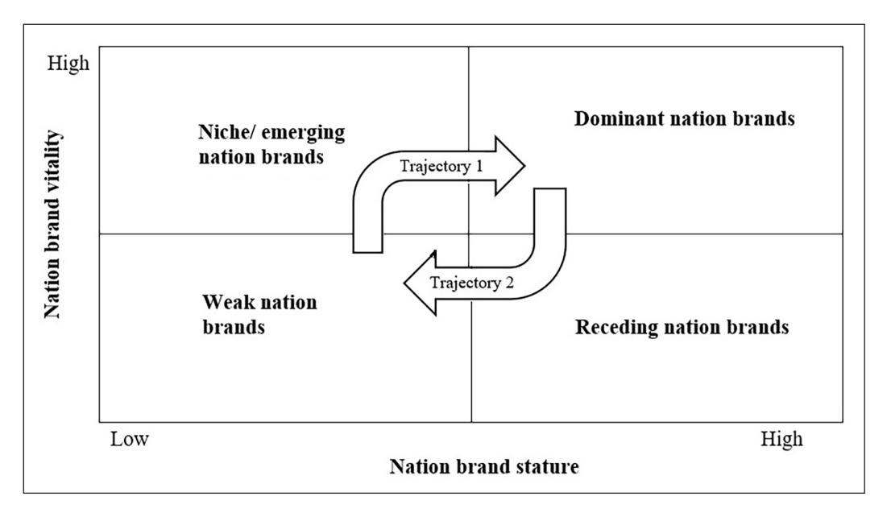
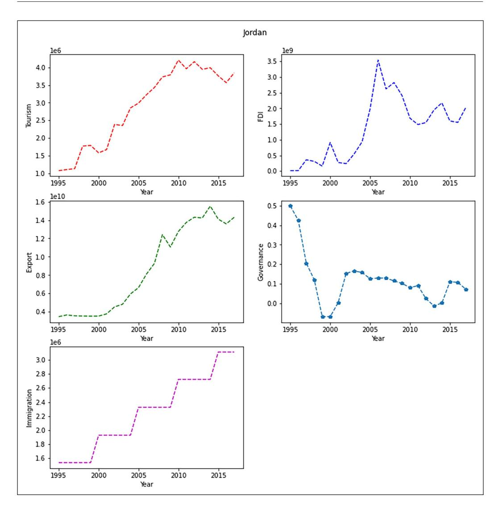
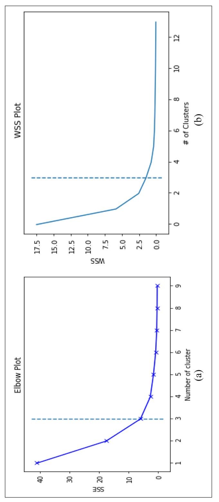
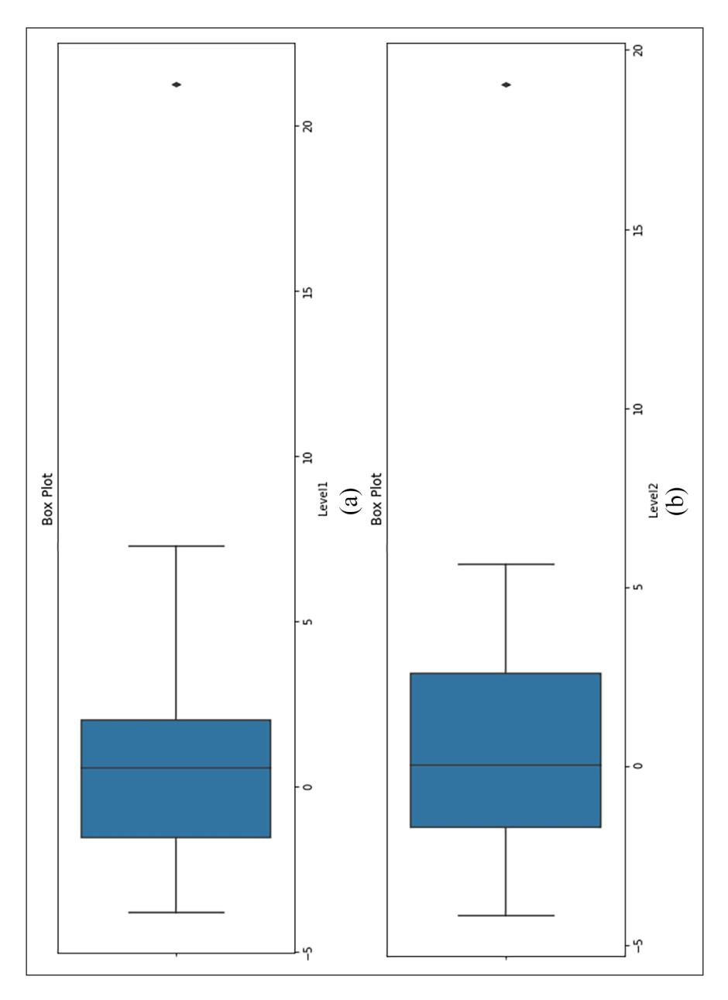
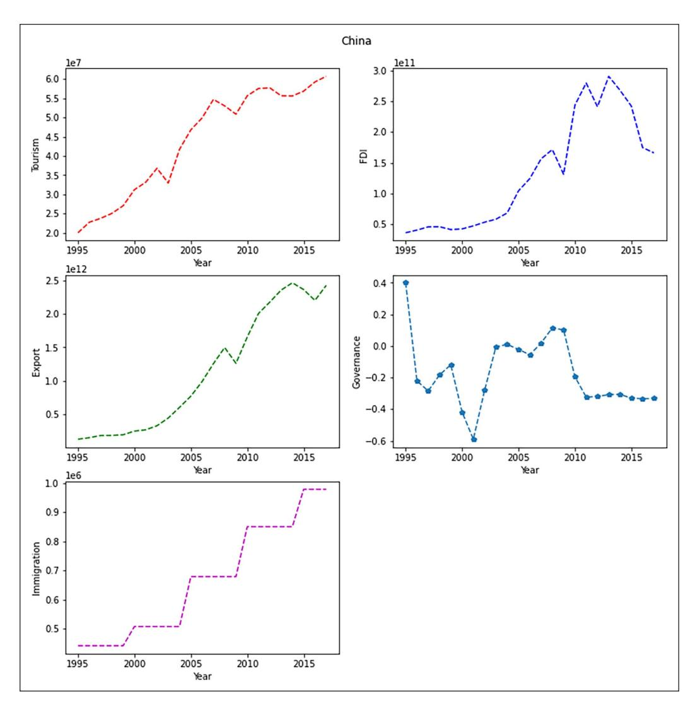
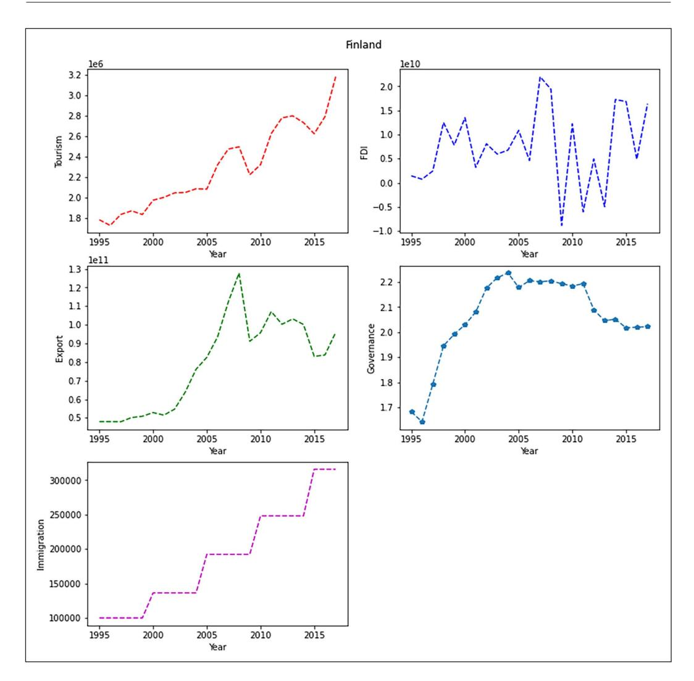

<!-- A3.R55 | source: papers_json/A3.R55/ -->

*Article*

## **Modeling transitions in nation brand ** **equity: An empirical assessment of ** **the nation equity power grid**

https://doi.org/10.1177/03128962221135496 *Australian Journal of Management* 2024, Vol. 49(2) 249–271 © The Author(s) 2022 Article reuse guidelines: [sagepub.com/journals-permissions](https://uk.sagepub.com/en-gb/journals-permissions) DOI: 10.1177/03128962221135496 [journals.sagepub.com/home/aum](https://journals.sagepub.com/home/aum)

## **Katariina Juusola**

Department of Marketing, College of Business Administration, Ajman University, Ajman, United Arab Emirates

## **Abdelmounaim Lahrech**

Faculty of Business & Law, The British University in Dubai, Dubai, United Arab Emirates

## **Abstract**

الغرض من هذه الدراسة هو تقييم أداء العلامة التجارية الوطنية على المدى الطويل من خلال نمذجة التحولات في *نية العلامة التجارية الوطنية* (nation brand equity) وتطوير طريقة لتقييم أداء العلامة التجارية الوطنية. تتضمن هذه الدراسة هدفين: (1) اختبار تجريبي لإطار Steenkamp المفاهيمي *nation equity power grid*؛ وفئاته (العلامات المهيمنة، والمتراجعة، والمتخصصة، والناشئة، والضعيفة)، ومسارات التطور المتوقعة لها، و(2) تحديد أنواع جديدة من العلامات التجارية الوطنية وأنماط تطور لتكملة هذا الإطار. ولتحقيق ذلك، استخدمت هذه الدراسة بيانات ثانوية موضوعية وطبّقت تقنية الانتقال السلس (smooth transition). وقيّمنا أداء العلامة التجارية الوطنية لـ 41 دولة خلال الفترة 1995–2017 لفهم تطور نية علامتها التجارية الوطنية. وأُولي اهتمام خاص للدول التي حسّنت أداءها بشكل ملحوظ والدول التي فقدت قوة علامتها التجارية. وتدعم نتائجنا الفئات التي اقترحها Steenkamp، لكننا نقدم نهجاً أكثر دقة لتحليل قوة العلامة التجارية للدول ومسارات التطور المحتملة، ونُدخل فئتين جديدتين من العلامات التجارية الوطنية هما *volatile nation brands* و*booming nation brands*. وأظهر نهجنا في استخدام الانتقال السلس غير الخطي كيف تطورت قوة العلامة التجارية للدول عبر الزمن، كما كشف عن سرعة أي تحولات؛ أي مدى سرعة انتقال العلامات التجارية الوطنية من مستوى إلى آخر. وتفيد نتائجنا مديري العلامات التجارية الوطنية، ما يمكّنهم من تحديد موقع بلدهم بشكل أفضل والوسائل اللازمة لتحسين نية العلامة التجارية. ويمكن لفهم الآليات الكامنة وراء التحولات في نية العلامة التجارية أن يساعد الباحثين أيضاً على ربط هذه التحولات بمختلف التحولات الاقتصادية والاجتماعية والثقافية والسياسية التي حدثت في الدول. ولذلك تحمل طريقتنا قيمة تفسيرية قوية لمجموعة واسعة من دراسات التسويق والاقتصاد والعلوم الاجتماعية الأخرى.

**JEL Classification: **M31

## **Corresponding author:**

Abdelmounaim Lahrech, Faculty of Business & Law, The British University in Dubai, Block 11, 2nd floor, Dubai International Academic City. P.O. Box 345015 Dubai, United Arab Emirates. Email:[ abdelmounaim.lahrech@buid.ac.ae](mailto:abdelmounaim.lahrech@buid.ac.ae)

Final transcript accepted 09 October 2022 by Dr. Andrew Jackson.

<!-- page 2 -->

## **Keywords**

Brand equity, nation brand, nation brand index, nation branding, smooth transition

## **1. Introduction**

جذبت العلامات التجارية الوطنية (nation brands) والعلامات التجارية الوطنية (nation branding) اهتماماً كبيراً بين الأكاديميين والممارسين وصانعي السياسات خلال العقدين الماضيين. وتشير العلامة التجارية الوطنية، وفقاً لـ Aronczyk (2008: 42)، إلى العملية التي "تسمح للحكومات الوطنية بإدارة والتحكم بشكل أفضل في الصورة التي تعرضها للعالم، وجذب الأنواع 'الصحيحة' من الاستثمار والسياحة والتجارة والمواهب، والمنافسة بنجاح مع مجموعة متنامية من المتنافسين الوطنيين على مجموعة متقلصة من الموارد المتاحة." وبالتالي، يمكن تقييم العلامات التجارية الوطنية من خلال تقديرات مدى أداء العلامة من حيث الصادرات، وجذب السياحة، والمهاجرين، والاستثمار الأجنبي المباشر (FDI) (Fetscherin, 2010). وتناولت دراسات تجريبية عديدة تأثير العلامات التجارية الوطنية القوية. فعلى سبيل المثال، وجد Dimitrova et al. (2017) أن العلامة التجارية الوطنية القوية تساهم في تحسين حجم صادرات الدولة، بينما أشارت دراسات عديدة إلى كيفية جذب العلامات التجارية الوطنية القوية لمبالغ كبيرة من الاستثمارات المحلية والأجنبية المباشرة (FDIs) (Bose et al., 2020; Kalamova and Konrad, 2010; Lahrech et al., 2020a; Lee and Lee, 2019; Papadopoulos et al., 2016; Papadopoulos and Heslop, 2002). وأظهرت دراسات Caldwell and Freire (2004)، وGilmore (2002)، وSilvanto and Ryan (2014, 2018) كيف تبيّن أن العلامة التجارية الوطنية القوية تزيد من عدد السياح الزائرين للدولة، وتجذب المهاجرين المهرة. علاوة على ذلك، أشار معهد Reputation Institute إلى أن زيادة نقطة واحدة فقط في ترتيب سمعة الدولة يمكن أن تزيد عدد سياحها للفرد بنسبة 0.9%، بالإضافة إلى زيادة معدلات التصدير بنسبة 0.3% (Globenewswire, 2018). لذلك، فإن تطوير علامة تجارية وطنية قوية وزيادة قوتها أمران مهمان لمجموعات مصالح مختلفة، لا سيما عندما ترتبط الفوائد مباشرة بالمكانة العالمية للدولة وأدائها وقدرتها التنافسية (Mariutti, 2017; Melnyk and Varibrusova, 2019)، ما يساهم بعد ذلك بشكل كبير في الناتج القومي الإجمالي للدولة (GNP) وتنميتها الاقتصادية (Boisen et al., 2011, 2017; Kotler and Gertner, 2002).

تمتلك العلامات التجارية الوطنية، على غرار العلامات التجارية للشركات أو المنتجات، قدراً كبيراً من *نية العلامة التجارية* (brand equity)، أي القدرة على توليد قيمة مالية مضافة من العلامات التجارية المعروفة (Mariutti and Giraldi, 2021; Papadopoulos and Heslop, 2002). وأُجريت دراسات عديدة حول العلامة التجارية الوطنية تحت مظلة مفهوم علامة المكان (place branding) (مثل Anholt, 2006; Boisen et al., 2011; Braun et al., 2014; Chan et al., 2016; Florek et al., 2019; Foroudi et al., 2016; Gertner, 2011; Hanna and Rowley, 2008)، بينما ركز مسار آخر من الدراسات على وحدات أصغر من العلامة التجارية الوطنية، مثل علامة المدينة أو الوجهة (مثل Florek, 2015; Florek et al., 2015; Hashim, 2012; Kerr, 2006; Lucarelli and Berg, 2011). وتناولت بعض الدراسات أيضاً محاولات العلامة التجارية الإقليمية، مع التركيز على أفريقيا (Abimbola, 2006)، وأوروبا (Aveline, 2006)، ودول الشمال الأوروبي (Magnus, 2016)، ومنطقة بحر البلطيق (Andersson and Paajanen, 2012)، والشرق الأوسط (Cooper and Momani, 2009). وبغض النظر عن اختلاف نطاق هذه الدراسات، فقد تبيّن أن جميع علامات المكان، سواء كانت دولة أو مدينة أو وجهة أو إقليماً، تمتلك نية علامة تجارية كبيرة.

وبينما يُنظر إلى العلامة التجارية الوطنية القوية على أنها تعكس تقدم تلك الدولة وتطورها، فإن الاستثمار الفعّال في العلامة التجارية الوطنية يساعد أيضاً في مزيد من التطور. ويمكن الترويج بفعالية لأي إنجازات ملموسة في جعل الدولة أكثر تنافسية وتميزاً من خلال جهود تسويقية، من المتوقع أن تعزز العلامة التجارية الوطنية أكثر وتولّد زيادة في السياحة والاستثمار والتجارة وغيرها من المنافع الملموسة وغير الملموسة التي تجلب فوائد اقتصادية (Zeinalpour et al., 2013). غير أن هذه الجهود تتطلب بطبيعتها قدراً كبيراً من الموارد. وبما أن تمويل مشاريع علامة المكان يأتي غالباً من مصادر عامة، فإنه يتطلب تقييماً موضوعياً للأداء لكسب دعم مختلف أصحاب المصلحة؛ ومن ثم يحتاج صانعو السياسات إلى أدوات لتقييم أداء العلامة التجارية من أجل تبرير منح موارد كافية لهذه الأغراض ورفع الوعي العام بأهمية العلامة التجارية الوطنية (Florek et al., 2019; Zenker, 2014).

<!-- page 3 -->

وبينما لا يمكن إنكار أهمية العلامة التجارية الوطنية لأي دولة، لا يزال البحث في إدارة العلامة التجارية الوطنية في مرحلة ناشئة. وفي مراجعتهم الشاملة لأدبيات العلامة التجارية الوطنية المنشورة خلال العقدين الماضيين، تناول Hao et al. (2019) أوجه القصور في الدراسات القائمة، وهو ما شكّل الدافع وراء هذا البحث. وأشاروا إلى أنه، بينما استقصت دراسات علمية عديدة محاولات العلامة التجارية لدول فردية، هناك نقص في المعرفة حول كيفية قياس قوة العلامة التجارية الوطنية وأدائها، وكيف تطورت علامات الدول التجارية عبر الزمن. وظلت الدراسات الطولية حول العلامة التجارية الوطنية، على وجه الخصوص، نادرة، وهذه الدراسات ضرورية لتعزيز فهم كيفية تغير نية العلامة التجارية الوطنية عبر الزمن بفعل عوامل بيئية كلية مختلفة (Hao et al., 2019). علاوة على ذلك، يحتاج مديرو العلامات التجارية الوطنية إلى أدوات لتقييم كيفية تحقيق توازن أمثل عند الاستثمار في جوانب مختلفة من العلامة التجارية بحيث يمكن للدولة تعظيم استخدام مواردها، مع مراعاة جوانب ندرة الموارد، وضمان عدم بقاء الموارد عاطلة في الوقت نفسه. وبناءً على المبادئ الأساسية للاقتصاد الكلي، مثل نظرية حدود إمكانيات الإنتاج، توجد مفاضلات مختلفة في اتخاذ القرار الإداري حيث يؤدي الاستثمار في مجال إلى تقليل إمكانية الاستثمار في مجال آخر، وبالتالي يحتاج المرء إلى إيجاد توازن أمثل للمنافسة بفعالية (Galles et al., 2019). لذلك، فإن تطوير أدوات إدارة العلامة التجارية الوطنية لهذا الغرض أمر مهم، بحيث يمكن للدول تحسين مخرجات مواردها عبر جميع العناصر المهمة للعلامة التجارية الوطنية، بدلاً من إعطاء الأولوية لبعضها فقط. فعلى سبيل المثال، تلقّت دول مثل أستراليا ونيوزيلندا انتقادات لاستراتيجية إدارة علامتها التجارية التي يبدو أنها تركز على جانب السياحة بينما تُهمّش أهمية عناصر أخرى من العلامة التجارية الوطنية (Hall, 2010; Khamis, 2012; Pomering, 2013). وقد تنتج مثل هذه التشوهات عن نقص في أدوات إدارة العلامة التجارية الوطنية لفهم الجوانب المختلفة للعلامة التجارية الوطنية وكيف يساهم كل منها في القيمة الإجمالية للعلامة التجارية الوطنية ودورها في المنافسة العالمية والإقليمية.

الغرض من هذه الدراسة هو تقييم أداء العلامة التجارية الوطنية على المدى الطويل من خلال نمذجة التحولات في نية العلامة التجارية الوطنية وتطوير طريقة لتقييم أداء العلامة التجارية الوطنية. ولتحقيق ذلك، استخدمنا إطار Steenkamp (2021) المفاهيمي *nation equity power grid* كإطار عمل مفاهيمي، والذي اقتُرح كأداة محتملة لقياس ومراقبة نية العلامة التجارية الوطنية عبر الزمن ومقارنة أداء الدول ببعضها البعض. ويهدف بحثنا إلى اختبار هذا النموذج تجريبياً ومساراته المتوقعة للتطور، بالإضافة إلى تحديد أنواع جديدة من فئات العلامة التجارية الوطنية من خلال تطوير طريقة تستخدم بيانات ثانوية موضوعية وتقنية نمذجة الانتقال السلس. وتدعم نتائجنا هذا النموذج وأنواعه الرئيسية من علامات الدول التجارية، لكن نتائجنا تشير إلى أن مسارات تطور أداء العلامة التجارية للدول من المتوقع أن تكون أكثر تدرجاً من تلك المقترحة في الإطار الأصلي. وبالتالي، تسهم ورقتنا في الدراسات الناشئة التي تقيس إدارة العلامة التجارية الوطنية (Fetscherin, 2010; Lahrech et al., 2020b; Steenkamp, 2021) بطريقتين. (1) نُدخل فئتين جديدتين من العلامات التجارية الوطنية تُسميان *volatile nation brands* و*booming nation brands*، ما يسهم في نظرية إدارة العلامة التجارية الوطنية. (2) طوّرنا طريقة تقييم غير خطية لتقييم أداء العلامة التجارية الوطنية استناداً إلى بيانات إحصائية موضوعية ونمذجة التحولات في نية العلامة التجارية الوطنية بمساعدة تقنية نمذجة الانتقال السلس. ويسهّل نهجنا تحليل نية العلامة التجارية الوطنية على مدى فترة أطول بكثير مما تسمح به مؤشرات العلامة التجارية الوطنية القائمة على الاستبيانات الحالية. كما يشير إلى سرعة تطور العلامة التجارية، ويسمح بتقييم الأداء النسبي للعلامة التجارية الوطنية مقارنة بنظيراتها.

## **2. Review of studies assessing nation brand equity**

## *2.1. Assessing nation brand equity through nation brand indices*

ربما تكون أشهر الأدوات لقياس نية العلامة التجارية الوطنية هي مؤشرات العلامة التجارية الوطنية السنوية الشهيرة القائمة على الاستبيانات والتي طوّرها ممارسون، مثل Nation Brands Index

<!-- page 4 -->

(NBI) الذي طوّره Simon Anholt، وFutureBrand Country Brand Index (CBI) الذي أنشأته شركة الاستشارات FutureBrand. وقد نشر كلا المؤشرين تصنيفات سنوية للدول منذ عام 2005. ويُرتّب NBI الدول استناداً إلى تصورات الناس عن دولة ما عبر ستة مجالات من كفاءتها (تُسمى "السداسي"): *الصادرات* (صورة الجمهور عن منتجات الدولة وخدماتها)، *الحوكمة* (رأي الجمهور حول كفاءة الحكومة الوطنية ونزاهتها والتزامها بالقضايا العالمية)، *الاستثمار والهجرة* (القدرة على جذب أشخاص مهرة للعيش أو العمل أو الدراسة في الدولة وكيف يرى هؤلاء الأشخاص جودة الحياة وبيئة الأعمال في الدولة)، *الثقافة* (التصورات العالمية عن تراث كل دولة وتقدير ثقافتها المعاصرة)، *الشعب* (سمعة السكان من حيث الكفاءة والانفتاح والود وصفات أخرى مثل التسامح)، و*السياحة* (مستوى الاهتمام بزيارة الدولة وجاذبية معالمها السياحية الطبيعية والصنعية (Ipsos, 2021)). ويقيّم CBI الدول وفق أبعاد مختلفة نوعاً ما. فقد تضمن في الأصل خمسة أبعاد—*نظام القيم*، و*جودة الحياة*، و*الإمكانات التجارية*، و*التراث والثقافة*، و*السياحة*—في ترتيبه للدول، لكن منذ ترتيبه لعامي 2014–2015، أضاف البُعد السادس *made in*. ويستند تأثير "صُنع في" (made-in)، المعروف أيضاً بتأثير "بلد المنشأ" (country-of-origin)، إلى نتائج دراسات عديدة أثبتت الرابط بين تأثيرات "صُنع في" أو "بلد المنشأ" والعلامات التجارية الوطنية (مثل Pappu et al., 2006; Sun and Paswan, 2011; Verlegh and Steenkamp, 1999).

وبينما أصدر كل من NBI وCBI تصنيفات سنوية للعلامة التجارية الوطنية منذ عام 2005، فإن تغطيتهما غير كافية للتقييم الطولي لأداء العلامة التجارية للدول. علاوة على ذلك، تحمل المؤشرات القائمة على الاستبيانات دائماً خطر التحيز، لأنها تلتقط جانباً واحداً فقط من نية العلامة التجارية—*نية العلامة التجارية القائمة على المستهلك* (consumer-based brand equity) (Florek et al., 2019; Keller, 1993). ويعرض هذا النهج تصورات المستهلكين وصورهم الذهنية عن الدول. وثمة نهج بديل لقياس قوة العلامة التجارية هو *النهج القائم على الأداء* (performance-based approach)، الذي يُشار إليه أحياناً بـ"نهج نية العلامة التجارية القائمة على الشركة" (Fetscherin, 2010)، والذي يركز على تقييم الجوانب الملموسة والقابلة للقياس لأداء الدولة من خلال بيانات إحصائية (Atilgan et al., 2005). ويمكن لنهج نية العلامة التجارية القائم على الإحصاءات هذا، وفقاً لعدد من الباحثين (مثل Fetscherin, 2010; Lahrech et al., 2020b)، أن يوفر طريقة أكثر موضوعية لقياس قوة العلامة التجارية للدولة وما حققته، ما يتيح تقييماً طولياً لكيفية تغير قوة العلامة التجارية ونيتها عبر الزمن. ويمكن لهذا النهج أن يكشف الاستثمار الفعلي للدولة وتقدمها فيما يتعلق بالأسس الكامنة وراء العلامة التجارية الوطنية، وهو أمر ضروري لتحسين صورة الدولة وبالتالي سمعتها (Foroudi et al., 2016).

وعلى حد علمنا، تهدف دراسات قليلة فقط إلى قياس أداء العلامة التجارية الوطنية باستخدام نهج نية العلامة التجارية القائم على الأداء. وأُكملت أول دراسة من هذا النوع بواسطة Fetscherin (2010)، الذي طوّر مؤشر قوة العلامة التجارية للدولة (CBSI) لقياس أداء العلامة التجارية لـ 32 دولة عبر خمسة أبعاد (*التصدير*، و*السياحة*، و*الاستثمار الأجنبي المباشر*، و*الهجرة*، و*بيئة الحوكمة*) لعام 2007 باستخدام بيانات ثانوية. وارتبطت نتائج الدراسة بشكل كبير بنتائج Anholt NBI، لأنها استخدمت عوامل مماثلة لتقييم علامات الدول التجارية، وإن باستخدام مجموعات بيانات مختلفة. وقيست الصادرات والسياحة والاستثمار الأجنبي المباشر والهجرة باستخدام بيانات إحصائية للفرد، بينما قيست بيئة الحوكمة من خلال مؤشر بيئة الحوكمة الذي طوّره Li and Filer (2007)، والذي تضمن المؤشرات التالية: ممارسة الحقوق السياسية، وسيادة القانون، والثقة العامة، وتدفق المعلومات بحرية، ومستوى الفساد.

وفي دراسة أخرى، طوّر Lahrech et al. (2020b) مؤشر CBSI بشكل أكبر لترتيب أداء العلامة التجارية لـ 131 دولة خلال الفترة 2007–2015. وكان الغرض المُعلَن من إنشاء المؤشر الجديد، المسمى "مؤشر قوة العلامة التجارية للدولة المُعدَّل" (MCBSI)، هو تطوير مؤشر مكمّل لـ Anholt NBI يحمل ارتباطاً أقوى به من CBSI (Lahrech et al., 2020b). وقيّم نموذج MCBSI الدول باستخدام نفس أبعاد CBSI، لكنه أضاف أيضاً مؤشر التنمية البشرية لالتقاط الجوانب اللينة للعلامات التجارية الوطنية. وعلى غرار

<!-- page 5 -->

| Table 1. | Dimensions used in nation brand indices. |
| --- | --- |

| Index | Dimensions used | Sources of data | Type of brand equity approach | Number of countries ranked |
| --- | --- | --- | --- | --- |
| Anholt Nation Brands Index (NBI) | Export, governance, investment and immigration, culture, tourism, people | Consumer survey | Consumer-based | 50 |
| Futurebrand Country Brand Index (CBI) | Value system, quality of life, business potential, heritage and culture, tourism, made in effect | Consumer survey | Consumer-based | 75 |
| Country Brand Strength Index (CBSI) | Export, governance, FDI, immigration, tourism | Secondary data | Statistics-based | 32 |
| Modified Country Brand Strength Index M(CBSI) | Export, governance, FDI, immigration, tourism, Human development index | Secondary data | Statistics-based | 131 |

FDI: foreign direct investment.

CBSI، استخدم بيانات إحصائية، لكنه اعتمد قيماً نسبية بدلاً من مقاييس الفرد، وهو ما ادّعى الباحثون أنه يوفر أرقاماً أكثر موضوعية (Lahrech et al., 2020b). وعلى الرغم من أن الدراسة استخدمت بيانات طولية، إلا أنها لم توضح سبب تغيّر ترتيب بعض الدول بشكل كبير عبر السنوات المُقيَّمة، وهو ما كان قيداً على الدراسة.

## *2.2. Synthesizing common dimensions used in assessing nation brand equity*

على الرغم من التقدم في قياس نية العلامة التجارية الوطنية، لا تزال النقاشات حول أكثر جوانب العلامات التجارية الوطنية أهمية مستمرة (مثل Mariutti and Tench, 2015; Melnyk and Varibrusova, 2019; Rojas-Méndez, 2013; Steenkamp, 2021). وبينما لا توجد، وربما لن توجد أبداً، مجموعة واحدة من الأبعاد لتقييم علامات الدول التجارية، تشير مؤشرات العلامة التجارية الوطنية القائمة إلى أن بعض العوامل الشائعة الاستخدام يمكن أن تكون نقطة انطلاق للدراسات التي تقيس نية العلامة التجارية الوطنية. ويلخص Table 1 الأبعاد المستخدمة في المؤشرات التي جرت مراجعتها في الفقرات السابقة.

عبر المؤشرات المُراجَعة، تُعد الأبعاد الأكثر استخداماً لتقييم أداء العلامة التجارية الوطنية هي *السياحة*، و*الحوكمة*، و*الصادرات*، و*الاستثمار*. وتُذكر السياحة والصادرات في جميع المؤشرات الأربعة، حيث يرتبط عنصر *made in* في CBI بالصادرات. ويشير ثلاثة من المؤشرات الأربعة إلى *الحوكمة/الحكومة* و*الاستثمار* و*الهجرة*؛ وبما أن بيانات ثانوية متاحة أيضاً لهذه الأبعاد، فقد أُدرجت في نموذجنا. كما تُقاس جوانب الثقافة والشعب من خلال بعض المؤشرات، لكننا استبعدنا هذه الأبعاد لأسباب منهجية. وبينما تحمل هذه الأبعاد أهمية لنية العلامة التجارية الوطنية، يتطلب تقييمها مؤشرات مركّبة طولية شاملة، لم تكن متاحة لفترة الدراسة، أو تغيّرت منهجيتها خلال تلك الفترة.

## *2.3. Empirical assessments of nation brand equity: scales and frameworks*

بما أن الدول تنفق مليارات الدولارات على جهود العلامة التجارية الوطنية والتسويق، يتوقع أصحاب المصلحة بطبيعة الحال عوائد على هذا الاستثمار والقدرة على تقييم فعالية

<!-- page 6 -->

محاولات العلامة التجارية عبر مجموعة من عوامل النجاح الحاسمة. وبالتالي، طوّر عدد متزايد من الدراسات الأكاديمية الحديثة حول إدارة علامة المكان أدوات وأطر عمل لقياس ومراقبة نجاح محاولات العلامة التجارية هذه (مثل Bose et al., 2016, 2020; Lee and Lee, 2019; Rani, 2019; Steenkamp, 2021). وغالباً ما ركزت هذه الدراسات على تقييم أداء دولة وفق واحد أو عدد قليل من الأبعاد المشتركة للعلامات التجارية الوطنية. فعلى سبيل المثال، طوّر Bose et al. (2016) مقياساً لقياس نية علامة المكان من منظور جاذبية الاستثمار، شمل جوانب الوعي بالعلامة التجارية، وصورة العلامة التجارية، والجودة المُدرَكة، والولاء للعلامة التجارية. غير أن Rani (2019) طوّر نموذجاً من أربعة مكونات لتقييم نفس الجوانب التي تناولها Bose et al. (2016) لتحديد كيفية تأثيرها على العلامة التجارية للمكان ومساعدتها في جذب السياحة. وفي دراسة أخرى، طوّر Bose et al. (2020) مقياساً لتقييم نية علامة المكان من منظور الدبلوماسية العامة. وهدف المقياس إلى قياس مدى شهرة مكان ما لدى الجمهور المستهدف وأي نوع من الصور الإيجابية أو السلبية يحملها هؤلاء الأشخاص عن المكان. وفي مكان آخر، استخدم Lee and Lee (2019) إطار NBI لتوضيح كيف طُوِّرت العلامة التجارية الوطنية لكوريا الجنوبية استراتيجياً من قبل حكومتها لجذب الاستثمارات الأجنبية من خلال الشركات متعددة الجنسيات، ما عزز بالتالي سمعة كوريا في أداء البحث والتطوير (R&D) القوي. وأثّر هذا بدوره على تصورات المستهلكين لنية العلامة التجارية لمنتجات الدولة، ما جعلها أكثر رغبة من حيث العلامة التجارية الوطنية. وعلى الرغم من أن هذه الأعمال المذكورة سابقاً طوّرت تقييم أداء علامة المكان، إلا أنها ركزت فقط على نهج نية العلامة التجارية للمستهلك واقتصرت على جوانب قليلة من نية العلامة التجارية الوطنية، مثل الاستثمار أو السياحة. وبالتالي، هناك حاجة إلى مزيد من البحث والأدوات لقياس أداء العلامة التجارية الوطنية، بحيث تتضمن رؤية أكثر شمولاً للعوامل المختلفة التي تُكوّن العلامات التجارية الوطنية. علاوة على ذلك، استخدمت معظم الدراسات المذكورة سابقاً بيانات قائمة على الاستبيانات أو المقابلات، وهي بيانات مقطعية وقد تكون ذاتية الطابع. وقد شجعنا هذا القيد على تطوير أداة تقييم لنية العلامة التجارية الوطنية قائمة على الإحصاءات باستخدام بيانات ثانوية طولية موضوعية.

## *2.4. Toward longitudinal nation brand equity assessment: * *the nation equity power grid*

في دراسة حديثة حول إدارة العلامة التجارية الوطنية، طوّر Steenkamp (2021) *nation equity power grid* لاستخدامه كأداة لقياس ومراقبة نية العلامة التجارية الوطنية. وتستند الشبكة إلى بُعدين: *حيوية الدولة* (nation vitality)، والتي تتألف من مجموع نقاط قوة التميز والصلة والطاقة لدولة ما، و*مكانة الدولة* (nation stature)، والتي تتألف من التقدير الوطني المُدرَك والمعرفة بالدولة. ووفقاً لـ Steenkamp (2021)، تنتج حيوية الدولة أساساً عن نمو نية علامتها التجارية الوطنية، بينما ترتبط مكانة الدولة بطول عمر نية العلامة التجارية. ويمكن أن تقع الدول في أحد أرباع الشبكة الأربعة: *العلامات التجارية الوطنية المهيمنة* (dominant)، و*المتراجعة* (receding)، و*المتخصصة/الناشئة* (niche/emerging)، و*الضعيفة* (weak)، كما هو موضح في Figure 1.

ووفقاً للنموذج، تُعد العلامات التجارية الوطنية المهيمنة تلك الخاصة بالدول التي تمتلك مكانة وحيوية عاليتين، وتُعتبر هذه الدول من الدول التي تحدد الاتجاهات العالمية وتقود وتشكّل البيئات الاقتصادية والسياسية والثقافية العالمية (Steenkamp, 2021). وقد يكون من الصعب على دول أخرى تحدي موقعها. أما العلامات التجارية الوطنية المتراجعة فهي تلك التي كانت في السابق علامات تجارية وطنية مهيمنة، لكنها فقدت حيويتها وقدرتها التنافسية، رغم أنها لا تزال تحظى بتقدير كبير لأسباب حنينية. وصنّف Steenkamp (2021) العلامات التجارية الوطنية المتخصصة والناشئة على أنها تستفيد من حيوية عالية، ما يمنحها إمكانات نمو كبيرة، لكن يعني ذلك أنها تعاني من انخفاض مكانة العلامة التجارية الوطنية مقارنة بالعلامات المهيمنة والمتراجعة. وأخيراً، تُعد العلامات التجارية الوطنية الضعيفة تلك التي تحصل على درجات منخفضة في كل من الحيوية

<!-- page 7 -->

***Figure 1.** Nation equity power grid (authors' illustration based on Steenkamp, 2021: 11).*

والمكانة، وتصف دولاً قد يعرف عنها كثير من الناس القليل أو لا يدركون وجودها أصلاً (Steenkamp, 2021).

وتُعد nation equity power grid مثيرة للاهتمام بشكل خاص، لأنها تقترح مسارَي تطور في أداء العلامة التجارية الوطنية، وهو ما يصفه Steenkamp (2021) بـ"مسارين شائعين" (p. 11). المسار المتوقع الأول هو عندما تنتقل علامة تجارية وطنية ضعيفة، عبر علامة متخصصة أو ناشئة، لتصبح علامة تجارية وطنية مهيمنة، والثاني هو عندما تفقد دولة مهيمنة سابقاً قوة علامتها التجارية وتتحول إلى علامة متراجعة وفي النهاية إلى علامة تجارية وطنية ضعيفة، ما لم تتمكن من إحياء علامتها التجارية (Steenkamp, 2021). واقترح Steenkamp (2021) أن المملكة المتحدة يمكن اعتبارها مثالاً على دولة انتقلت من دولة مهيمنة إلى دولة متراجعة، إذ كانت في السابق معروفة كقائدة عالمية بفضل صناعاتها ومؤسساتها وثقافتها المحلية. ومن الناحية المفاهيمية، يمكن لهذا النموذج أن يساعد مديري العلامات التجارية للدول في تقييم أداء دولتهم على الشبكة، لكن على حد علمنا، لم يُتحقق من صحة هذا النموذج بعد ببيانات تجريبية. علاوة على ذلك، قد تكون nation equity power grid تصنيفاً مبسّطاً نوعاً ما للعلامات التجارية الوطنية وأنماط التطور المتوقعة، وقد تُكتشف أنماط تطور وأنواع علامات تجارية أخرى للدول.

## **3. Methodology**

كشفت مراجعة الأدبيات المُناقَشة في القسم السابق أن العوامل الأكثر استخداماً لتقييم أداء العلامة التجارية الوطنية هي الصادرات، والاستثمارات، والهجرة، والسياحة، والحوكمة، والتي شكّلت نقطة الانطلاق لدراستنا. ومن أجل تقييم أداء العلامة التجارية الوطنية على المدى الطويل، تألفت منهجيتنا من ثلاث خطوات: إنشاء مؤشر طولي للعلامة التجارية الوطنية، يليه تطبيق نمذجة الانتقال السلس لتقييم ترتيب الدول وأي تغيرات في أدائها التجاري طويل الأمد، وأخيراً استخدمنا طريقة تجميع لتقسيم البيانات إلى مجموعات لأغراض التحليل. وتُناقَش هذه الخطوات بمزيد من التفصيل في الأقسام الفرعية التالية، التي تناقش تصميم بحثنا.

<!-- page 8 -->

## 3.1. Step 1: constructing a longitudinal nation brand index

أولاً، لإنشاء المؤشر، بنينا مجموعة بيانات لعدد من الدول التي تتوفر عنها بيانات ثانوية تاريخية متاحة للعموم حول أبعاد مختلفة من نية العلامة التجارية الوطنية. وكما نوقش سابقاً، أردنا تقييم أداء العلامة التجارية الطولي للدول من خلال عوامل التصدير والاستثمار والهجرة والسياحة والحوكمة. واستُخدمت العوامل نفسها أيضاً في ترتيب Fetscherin (2010) CBSI. وهدفنا إلى جمع بيانات بانل (panel data) لعدد من الدول لأطول فترة ممكنة تتوفر عنها بيانات. وحُصل على البيانات الطولية للتصدير والاستثمار والهجرة والسياحة من World Bank، بينما حُصل على بيانات الحوكمة من PRG/International Country Risk Guide، والتي تتضمن الفساد، والقانون والنظام، وجودة البيروقراطية كمؤشرات للحوكمة. وبالتالي، حددنا 41 دولة تتوفر عنها جميع البيانات اللازمة من عام 1995 إلى عام 2017 (انظر Table 2 لقائمة الدول). واستناداً إلى Fetscherin (2010)، بنينا CBSI كما يلي

$$
CBSI_{it} = Nexport_{it} + Nfdi_{it} + Ngovernance_{it} + Nimmigration_{it} + Ntourism_{it} (1)
$$

Where

$$
Nvariable_{it} = Normalized\ score\ of\ variable_{it} = \frac{variable_{it} - Mean(variable_{it})}{Standard\ deviation(variable_{it})}
$$

يشير الرمز السفلي *i* إلى الدولة ويشير الرمز السفلي *t* إلى السنة من 1995 إلى 2017. وبعد تطبيع البيانات، جمعنا كل النتائج المُطبَّعة لإنشاء المؤشر.

## 3.2. Step 2: smooth transition modeling

بعد حساب مؤشر CBSI الطولي للدول العينة، طبّقنا نمذجة الانتقال السلس لتحديد أداء كل دولة استناداً إلى موقعها ضمن CBSI عبر الزمن، وما إذا كانت الدولة قد انتقلت من نظام إلى آخر، ومدى سرعة حدوث هذا الانتقال. وضبط النظام الأول في الانتقال السلس المعامل \alpha، بينما ضبط النظام الثاني المعامل \alpha + \beta. وضُبطت سرعة الانتقال من النظام الأول إلى النظام الثاني بواسطة \gamma؛ وكلما زاد معامل \gamma، زادت سرعة الانتقال من نظام إلى آخر.

استخدمنا نمذجة الانتقال السلس التي اقترحها Granger and Teräsvirta (1993) وLin and Teräsvirta (1994) لتحديد أي تغيرات هيكلية في السلاسل الزمنية لمؤشر العلامة التجارية للدول. واستُخدم تحليل الانتقال السلس لدراسة آثار النمو الناتجة عن التحرير الاقتصادي (Leybourne et al., 1997) أو تجارب خفض التضخم في أستراليا وكندا ونيوزيلندا (Leybourne and Mizen, 1999). كما طُبِّق نموذج الانتقال السلس على الحركة المشتركة لأسواق الأسهم بين دول أوروبا الوسطى والشرقية (هنغاريا، وبولندا، وجمهورية التشيك، وروسيا) وأسواق الأسهم في الدول المتقدمة (Chelley-Steeley, 2005). ومقارنة بهذه الدراسات الاقتصادية الواسعة، وعلى حد علمنا، استُخدمت نمذجة الانتقال السلس بشكل أقل تكراراً في دراسات التسويق.

ولأغراض هذا البحث، يمكن للنموذج قياس التغيرات في مؤشرات العلامة التجارية الوطنية عبر الزمن، ما يسمح بانتقال سلس بين فترتين أو ثلاث فترات. وتحقق ذلك من خلال ملاءمة اتجاه غير خطي لهذه المؤشرات، وبالتالي تقدير بداية ومدة فترة الانتقال التي ازداد أو انخفض خلالها ترتيب مؤشر العلامة التجارية الوطنية. واعتبرنا نموذج انحدار الانتقال السلس اللوجستي التالي للسلسلة الزمنية N_{it}

$$ N_{it} = \alpha + \beta S_t(\gamma, \tau) + u_t \tag{2} $$

<!-- page 9 -->

حيث *ut* عملية ساكنة (stationary) ذات متوسط صفري من الرتبة *I*(0). ويُضبط الانتقال السلس بين الفترتين الزمنيتين أو النظامين بواسطة الدالة اللوجستية *St* ( ) ^γ^ ^τ^, ، المعرَّفة كما يلي

Jamaica 0.6221

$$ S_t(\gamma, \tau) = [1 + \exp(-\gamma(t - \tau T))]^{-1}, \gamma > 0 $$

حيث *T* حجم العينة، ويشير *i* إلى مؤشر العلامة التجارية للدولة (CBSI) ويشير *t* إلى الزمن. وكانت فترة التقييم 1995–2017. وقبل تطبيق الانتقال السلس، ينبغي فحص سكون سلسلة CBSI لكل دولة عبر الزمن. وتعني السلسلة الساكنة تقلباً أفقياً ومستوى واحداً فقط، دون اتجاه من مستوى إلى آخر؛ وفي مثل هذه الحالات، لا يمكن تطبيق نهج الانتقال السلس. وبالمقابل، تشير السلاسل غير الساكنة إلى تقلبات غير أفقية واتجاه ينطوي على مستويين أو نظامين ساكنين على الأقل في سلسلة CBSI للدولة، ويمكن عندها تطبيق نمذجة الانتقال السلس. ويفترض النموذج تغيراً سلساً من نظام ساكن بمتوسط α إلى نظام ساكن آخر بمتوسط α+β. فإذا كانت β > 0، فهذا يشير إلى اتجاه صاعد؛ أما إذا كانت β < 0، فهذا يشير إلى اتجاه هابط. ويُضبط التغير بين مستويين أو نظامين بواسطة المعامل γ، الذي يحدد سرعة الانتقال من مستوى أو نظام إلى آخر. وتشير قيم γ الصغيرة إلى تغير تدريجي بينما تشير قيم γ الكبيرة إلى تغير مفاجئ وسريع. ويحدد المعامل τ توقيت نقطة منتصف الانتقال، ما يمثل منتصف المسار من النظام الأول إلى النظام الثاني.

وكما أُوضح سابقاً، يجب اختبار سكون سلسلة CBSI قبل إمكانية تطبيق نموذج الانتقال السلس. وللتحقق من ذلك، استخدمنا اختبار Augmented Dickey–Fuller (Dickey and Fuller, 1979). وتشير نتائج الاختبار (انظر Table 2) إلى أننا فشلنا في رفض الفرضية الصفرية لوجود جذر الوحدة في سلسلة CBSI الزمنية لكل دولة، حيث كانت جميع قيم *p* أكبر من 5%. وباختصار،

<!-- page 10 -->

كانت جميع السلاسل غير ساكنة، ما يشير إلى وجود مستويين أو نظامين ساكنين على الأقل، ويمكن تطبيق نمذجة الانتقال السلس.

## *3.3. Step 3: clustering*

الخطوة الثالثة في منهجيتنا هي استخدام طريقة تجميع لتقسيم بيانات معاملات α في المستوى الأول ومعاملات α+β في المستوى الثاني إلى مجموعات. وتوجد طرق وتقنيات تجميع عديدة لتقسيم البيانات إلى مجموعات، لكن *k*-means هي الأبسط والأكثر شهرة. وتستند طريقة *k*-means إلى تقليل مجموع مربع الخطأ (SSE) بين متوسط المجموعة ونقطة البيانات ضمن المجموعة. وتقوم الفكرة على تقسيم البيانات إلى *k* مجموعات بحيث تنتمي كل نقطة بيانات أو ملاحظة إلى المجموعة ذات المتوسط الأقرب. ويمكن أن يشكّل وجود قيم متطرفة (outliers) في مجموعة البيانات مشكلة لـ*k*-means، إذ يمكن أن يُنتج مجموعة غير تمثيلية (Barnett and Lewis, 1994). وثمة طريقة بديلة أكثر مقاومة لوجود القيم المتطرفة وهي طريقة *k*-medoids (Kaufman and Rousseeuw, 1990)، حيث تُختار نقاط البيانات كنقاط وسيطة (medoids) بدلاً من حولها المتوسط. وبعبارة أخرى، تنتمي كل نقطة بيانات أو ملاحظة إلى المجموعة ذات النقطة الوسيطة الأقرب بدلاً من المتوسط الأقرب كما في طريقة *k*-means. وتُعتبر النقطة الوسيطة للمجموعة نقطة البيانات ذات أقل متوسط مسافة إلى نقاط البيانات الأخرى ضمن نفس المجموعة، وبالتالي تقع في منتصف المجموعة. وهذا ما يجعل طريقة *k*-medoids مقاومة لوجود القيم المتطرفة. وبما أن الولايات المتحدة حُددت كدولة متطرفة في مجموعة بياناتنا (انظر Appendix 1)، اختيرت *k*-medoids كطريقة تجميع مناسبة.

وباتباع طريقة تجميع *k*-medoids، أشارت البيانات إلى عدد المجموعات في معامل α للمستوى الأول ومعامل α+β للمستوى الثاني. وكشفت نتائج هذا التجميع عن ثلاث مجموعات في كل مستوى باستخدام طريقتَي الكوع (elbow) ومجموع المربعات ضمن المجموعة (WSS) (انظر Figure 2).

ويشير التجميع إلى وجود ثلاثة أنواع من العلامات التجارية الوطنية شهدت تطوراً ثابتاً نسبياً عبر الزمن—أي أنها بقيت ضمن نفس المجموعة—بينما توجد أيضاً بعض (مجموعات) الدول التي مرّت بأنماط تطور فريدة، تتطلب مزيداً من التوضيح. ويعرض Table 3 أدناه المجموعات المختلفة للدول وتنقلات دول معينة بين المجموعات، إضافة إلى قيم المتوسط والوسيط التي تضعها في مجموعة معينة. وتستند مواقع الدول وتنقلاتها إلى معاملات α الخاصة بها وقيم α وβ وα+β وγ المقابلة لها خلال السنوات المُقيَّمة من 1995 إلى 2017. وتناقش الفصول التالية نتائجنا التجريبية المتعلقة بأنواع العلامات التجارية الوطنية المختلفة بمزيد من التفصيل.

## **4. Empirical results: part 1**

تُظهر النتائج التجميع المُطبَّق على المستوى 1 (α) والمستوى 2 (α+β)، وكلاهما حُصل عليه من نتائج الانتقال السلس باستخدام المعادلة (2) المُطبَّقة على مؤشر العلامة التجارية الوطنية المُنشأ من المعادلة (1). واستكشفنا نموذج nation equity power grid لـ Steenkamp (2021) وفئات العلامة التجارية الوطنية فيه في الخطوة الأولى من تحليل البيانات، إذ توقعنا التعرف على مثل هذه الدول. وفي هذه الخطوة، ركزنا على تحديد الفئات الموصوفة بأنها ضعيفة، وناشئة، ومتخصصة، ومهيمنة. وتصف الأقسام التالية هذه الفئات المتوقعة بمزيد من التفصيل.

## *4.1. Weak nation brands*

من بين الدول المُقيَّمة، تشمل العلامات التجارية الوطنية الضعيفة (المجموعة C في Table 3) هايتي، وبيرو، وأوروغواي، وكولومبيا، وجامايكا، والفلبين، وتونس، ومصر، وباراغواي، والكويت، وكوستاريكا، والأرجنتين، والبحرين، والتي كانت في الأصل، وظلت، تحمل علامة تجارية وطنية ضعيفة. وتتوافق هذه النتيجة مع الطريقة التي

<!-- page 11 -->

***Figure 2.** Clustering with the elbow and within-cluster sum of square (WSS) methods. (a) and (b) Number of clusters.*

<!-- page 12 -->

<!-- page 13 -->

وصف بها Steenkamp هذه الدول، بأنها الدول التي "لا يعرف عنها الناس حول العالم إلا القليل" والتي تحمل حيوية ومكانة منخفضتين (Steenkamp, 2021: 12). لذلك، ستحتاج مثل هذه الدول إلى محاولات تطوير علامة تجارية كبيرة لتحسين مكانتها.

## *4.2. Emerging nation brands*

وصف Steenkamp (2021) العلامات التجارية الوطنية الناشئة بأنها الدول "التي يُنظر إليها كدول صاعدة وديناميكية ومبتكرة لكنها لا تمتلك المكانة المطلوبة للعلامة التجارية" (p. 12). وبالتالي، من المتوقع أن تكون قد أظهرت تطوراً كبيراً على الأقل في بعض جوانب العلامة التجارية. وفي نموذجنا، تُعد العلامات التجارية الوطنية الناشئة تلك الدول التي كانت في الأصل تنتمي إلى المجموعة C (علامة تجارية وطنية ضعيفة)، لكنها انتقلت خلال الفترة المُقيَّمة إلى فئة أعلى (المجموعة B). وبالتالي، أظهرت هذه الدول قدرتها على تعزيز علاماتها التجارية الوطنية، إذ تمكنت من الانتقال إلى الأعلى. وتشمل هذه الدول إندونيسيا، والبرازيل، وتركيا، وتايلاند. وكمثال على مثل هذا الانتقال، يعرض Figure 3 أدناه التفصيل الأساسي للعلامة التجارية الوطنية

***Figure 3.** Breakdown of the nation brand variables in development of Indonesia's nation brand.*

<!-- page 14 -->

لعناصر تطور العلامة التجارية الوطنية الإندونيسية. ومن هذا يمكننا أن نستنتج أن أهم العوامل التي عززت العلامة التجارية الإندونيسية عبر السنوات، لا سيما بعد عام 2005، كانت السياحة، والاستثمار الأجنبي المباشر، والصادرات، والحوكمة.

## *4.3. Niche nation brands*

تُعد العلامات التجارية المتخصصة للدول تلك التي، وفقاً لـ Steenkamp (2021)، تمتلك حيوية عالية للعلامة التجارية، غالباً في مجال محدد من العلامة التجارية، مثل التنمية الاقتصادية، أو الثقافة، أو الأنظمة السياسية، لكن ليس عبر جميع عناصر العلامة التجارية الوطنية. ووفقاً لتحليل المجموعات لدينا، تمثل الدول في المجموعة B العلامات التجارية الوطنية المتخصصة، وتشمل جنوب أفريقيا، والهند، وسنغافورة، وتشيلي، والبرتغال، والمغرب، وإسرائيل، والنمسا، وتايوان، وهولندا، وآيسلندا، وبلجيكا. وقد نجحت هذه الدول في بناء علامات تجارية متخصصة قوية ومتطورة باستقرار. وفي هذه الفئة، كانت سرعة التطور أسرع بشكل ملحوظ من فئة العلامات التجارية الوطنية الناشئة (انظر Table 3 لقيم المتوسط والوسيط). فعلى سبيل المثال، تستفيد إسرائيل من سمعتها كدولة رائدة عالمياً في جذب ودعم الابتكار والشركات الناشئة، لكنها في الوقت نفسه تعاني من نقاط ضعف معينة في بيئتها السياسية بسبب النزاعات طويلة الأمد بين إسرائيل والدول العربية (Dubinsky, 2022). ولذلك، وكمثال، يمكن القول إنه بينما تمتلك العلامة التجارية الوطنية لإسرائيل نقاط قوة، فإنها تحمل أيضاً بعض نقاط الضعف في بعض جوانب علامتها التجارية الوطنية، وهو ما يضعها في هذه الفئة. وفي الوقت نفسه، يمكن القول إنه لا توجد أي من هذه الدول تمتلك علامة تجارية وطنية قوية عبر جميع عناصر العلامة التجارية الوطنية.

## *4.4. Dominant nation brands*

تُفهم العلامات التجارية الوطنية المهيمنة على أنها العلامات الرائدة التي تستفيد من مكانة وحيوية عاليتين (Steenkamp, 2021). وحددنا الولايات المتحدة، والمملكة المتحدة، وفرنسا، والنرويج، والسويد كعلامات تجارية وطنية مهيمنة، تمكنت من الحفاظ على موقعها في هذه الفئة التنافسية (المجموعة A). وتعني قيم المتوسط والوسيط في المستويين 1 و2 في Table 3 لهذه المجموعة الرائدة أن مثل هذه الدول تطور أيضاً قوة علامتها التجارية الوطنية بسرعة مقارنة بالدول في المجموعة B (العلامات التجارية المتخصصة)، وهو ما يجعل من الصعب على الدول المتخصصة الانتقال إلى فئة العلامة التجارية الوطنية المهيمنة. ويدعم هذا نتائج العديد من الباحثين (مثل Anholt, 2010; Fetscherin, 2010; Steenkamp, 2021) بأنه بمجرد أن تتمكن دولة من الوصول إلى هذا الموقع، يصعب تحدّيها.

## *4.5. Receding nation brands*

كما وصفها Steenkamp (2021)، تشمل العلامات التجارية الوطنية المتراجعة تلك الدول التي كانت في السابق علامات تجارية وطنية مهيمنة، لكنها فقدت حيويتها، وبالتالي لم تعد ضمن العلامات المهيمنة. وذكر Steenkamp (2021) كذلك أن هذه الدول "تكافح للحفاظ على أهميتها وطاقتها وربما حتى تميزها في سوق متغير" (p. 12). وحددنا أربع دول من هذا النوع (إيطاليا، وأستراليا، وكندا، وكوريا الجنوبية) كانت في البداية ضمن فئة العلامات المهيمنة (المجموعة A)، لكن قوة علامتها التجارية انخفضت عبر الزمن، ما وضعها في المجموعة B. وهذا يعني أن مثل هذه الدول توصف اليوم بشكل أفضل بأنها علامات تجارية وطنية متخصصة. وبينما لا يزال موقعها قوياً نسبياً، وأداؤها عبر العديد من عناصر العلامة التجارية الوطنية قوي، إلا أن تطورها كان أكثر ركوداً مقارنة بالعلامات التجارية الوطنية المهيمنة ولم تتمكن من تطوير علاماتها التجارية بنفس سرعة نظيراتها الأصلية في فئة العلامة التجارية الوطنية المهيمنة. وقد تكون مثل هذه العلامات التجارية الوطنية المتراجعة أيضاً تُعطي أولوية لاستراتيجيات إدارة علامتها التجارية بطريقة تضع قيمة أكبر على بعض جوانب العلامة التجارية مثل السياحة، بينما تُهمّش عناصر أخرى مهمة من العلامة التجارية، ما قد يتسبب في أن تفقد العلامة التجارية الوطنية

<!-- page 15 -->

قوتها الإجمالية. فعلى سبيل المثال، تعرضت استراتيجيات إدارة العلامة التجارية الأسترالية لانتقادات بسبب اعتمادها على مثل هذا النهج في الماضي، مع تركيزها الرئيسي على الترويج السياحي (Pomering, 2013)، لكن الدولة انخرطت مؤخراً في حملات مختلفة لإعادة تسمية علامتها التجارية بحيث تكون في موقع أفضل في عالم معولم ولجذب الاستثمار والمهاجرين، وتعزيز تجارتها (Khamis, 2012). لذلك، من منظور إدارة العلامة التجارية، قد تمتلك العلامات التجارية الوطنية المتراجعة إمكانات وموارد لتحسين قوة العلامة التجارية، لكن الدولة قد لا تُحسّن استخدام مواردها بشكل كامل. ومن خلال تخصيص أكثر دقة للموارد وبناء شامل للعلامة التجارية، قد تتمكن هذه الدول من تعزيز الركائز الأساسية لعلاماتها التجارية وتحسين مكانتها لتجنب مزيد من فقدان قوة العلامة التجارية.

## **5. Empirical results: part 2**

بالإضافة إلى تحديد فئات العلامة التجارية الوطنية المتوقعة التي وصفها Steenkamp (2021)، كما نوقش في الفصل السابق، أشارت بياناتنا أيضاً إلى أنماط تطور فريدة في قوة العلامة التجارية للدول، ما يشير إلى أن دولاً معينة تنتمي إلى أنواع جديدة من علامات الدول التجارية لم يصفها Steenkamp. وستُناقَش هذه الأنواع بعد ذلك.

## *5.1. Volatile nation brands*

في Table 3، حُددت الأردن كممثلة لنمط تطور سلبي جديد للعلامة التجارية الوطنية نُطلق عليه اسم "volatile nation brand". وتُلاحَظ العلامة التجارية الوطنية المتقلبة عندما تشهد دولة كانت في السابق من ضمن العلامات التجارية الوطنية الناشئة تقلباً في تطورها، ما تسبب في انخفاض كبير في قوة علامتها التجارية. ويعرض Figure 4 أدناه تفصيل مكونات العلامة التجارية الوطنية ويوضح أنه بينما حسّنت الأردن سياحتها وصادراتها وهجرتها عبر السنوات، فإنها واجهت انخفاضاً في الاستثمار الأجنبي المباشر وبيئة الحوكمة.

## *5.2. Booming nation brands*

تُعد العلامات التجارية الوطنية المزدهرة الفئة الجديدة الثانية التي كشفت عنها بياناتنا. والعلامة التجارية الوطنية المزدهرة هي تلك التي تمكنت من تطوير قوة علامتها التجارية بسرعة أكبر بكثير من أي من نظيراتها عبر السنوات المُقيَّمة، منتقلة إلى موقع كوافد جديد في فئة العلامة التجارية الوطنية المهيمنة. ويمكن ملاحظة أن الصين وفنلندا شهدتا مثل هذا التطور. ويعرض Figure 5 تفصيل عناصر العلامة التجارية الوطنية للصين ويوضح أنه، على الرغم من التقلب في بيئة حوكمتها، فقد تحسنت بشكل كبير من حيث جوانب أخرى من العلامة التجارية. ومع ذلك، بسبب انخفاض أخير في استثمارها الأجنبي المباشر، قد يُتوقع أنه بينما قد تستمر الصين في تطوير قوة علامتها التجارية ونفوذها في العالم، فقد لا تفعل ذلك بنفس السرعة كما في الماضي.

ويعرض Figure 6 أدناه تفصيل مكونات العلامة التجارية الوطنية الفنلندية عبر السنوات المُقيَّمة. ويشير إلى أنه بينما تُعد الجوانب الأخرى من علامتها قوية، فقد شهد الاستثمار الأجنبي المباشر بعض التقلب. ومع ذلك، وبفضل أدائها القوي في الحوكمة، قد تتمكن الدولة من تحسين قدرتها على جذب الاستثمار الأجنبي المباشر.

## **6. Conclusion**

بينما شهدت الدراسات حول تقييم العلامة التجارية الوطنية ونيتها تقدماً حديثاً، لا يزال هذا مجالاً بحثياً ناشئاً مقارنة بالبحث المماثل حول العلامة التجارية للمدينة/الوجهة أو علامة المكان (مثل Bose et al., 2020; Cleave and Arku, 2017; Florek, 2015; Herezniak and Anders-Morawska, 2015; Rani, 2019). ووفقاً لمراجعة حول تقييم فعالية علامة المكان،

<!-- page 16 -->

***Figure 4.** Breakdown of the nation brand variables in development of Jordan's nation brand.*

وجد Florek et al. (2019) أن معظم الدراسات العلمية القائمة في هذا المجال، ومؤشرات العلامة التجارية الوطنية المعروفة، مثل Nation Brands Index الذي طوّره Simon Anholt وCountry Brand Index الذي أنشأته شركة الاستشارات FutureBrand، ركّزت على نية العلامة التجارية للمستهلك، بينما حظيت نية العلامة التجارية القائمة على الأداء باهتمام أقل، ربما بسبب الأساليب الأكثر تعقيداً اللازمة لدراستها تجريبياً. غير أن حتى Anholt (2006) انتقد استخدام البيانات القائمة على الاستبيانات، والتي تكون عرضة للتحيز إذا كانت العينة محدودة أو جاء المستجيبون من خلفيات مختلفة. لذلك، اعتمدت المحاولات الحديثة لبناء مؤشرات بديلة للعلامة التجارية الوطنية منظوراً قائماً على الأداء (Fetscherin, 2010; Lahrech et al., 2020b)، باستخدام بيانات ثانوية لقياس نية العلامة التجارية الوطنية. وباعتماد نهج مماثل، استخدمنا بيانات ثانوية لتقييم تطور نية العلامة التجارية على المدى الطويل، مستخدمين نمذجة الانتقال السلس لاختبار فئات ومسارات التطور المتوقعة لشبكة نية العلامة التجارية الوطنية لـ Steenkamp (2021).

<!-- page 17 -->

***Figure 5.** Breakdown of the nation brand variables in development of China's nation brand.*

قيّمنا أداء العلامة التجارية الوطنية لـ 41 دولة خلال الفترة 1995–2017 لفهم تطور نية علامتها التجارية الوطنية. وتدعم نتائجنا أنواع علامات الدول التجارية التي اقترحها Steenkamp (2021). و"المساران الشائعان" (Steenkamp, 2021: 11) للنموذج، الأول الذي تنتقل فيه علامة تجارية وطنية ضعيفة إلى علامة متخصصة أو ناشئة لتصبح علامة تجارية وطنية مهيمنة، والثاني الذي تتراجع فيه دولة مهيمنة سابقاً لتصبح علامة متراجعة وفي النهاية علامة تجارية وطنية ضعيفة، مدعومان جزئياً بنتائجنا. ونحن نرى أنه بينما تكون مسارات التطور هذه ممكنة، فإن الانتقال من طرف متطرف إلى آخر نادر الحدوث. والمسار الأخير نادر، لأنه سيتطلب اضطراباً اجتماعياً-اقتصادياً كبيراً في تلك الدولة. علاوة على ذلك، فإن مسار التطور الأول نادر أيضاً، لأن معظم الدول تعزز باستمرار علاماتها التجارية الوطنية، ما يجعل تطور علامة تجارية وطنية ضعيفة إلى علامة مهيمنة أمراً صعباً للغاية. وبعبارة أخرى، يتعين على مثل هذه الدولة أن

<!-- page 18 -->

***Figure 6.** Breakdown of the nation brand variables in development of Finland's nation brand.*

تحقق أداءً استثنائياً من حيث تطورها. لذلك، بينما تكون التحولات المتطرفة في قوة العلامة التجارية الوطنية نادرة، حدد نموذجنا أنماط تطور أكثر واقعية من خلال تحديد أنواع جديدة من العلامات التجارية الوطنية المتقلبة والمزدهرة، من حيث قدرة دولة على تحريك موقعها صعوداً أو هبوطاً بفئة واحدة استناداً إلى تطورها عبر عقدين من الزمن.

ونقترح أن تركز الدراسات المستقبلية بشكل خاص على تلك الدول المحددة كدول ذات علامة تجارية وطنية متقلبة أو مزدهرة، إذ يُعد كلا النوعين حالياً من المجالات المُهمَلة في البحث. وتحمل هذه الظواهر أهمية كبيرة للباحثين في تطوير فهم أكثر تفصيلاً للأسباب الكامنة وتحديد التدابير اللازمة لتحسين العلامة التجارية. وبالنسبة للدول التي فقدت نية علامتها التجارية، يمكن لدراسات استراتيجيات إحياء العلامة التجارية (مثل Rodner and Kerrigan, 2018) وإعادة تسميتها (مثل Amujo and Otubanjo, 2012) أن تقدم رؤى قيّمة. أما العلامات التجارية الوطنية المزدهرة، فمن جانب آخر، يمكن أن تكون أمثلة كاشفة عن إعادة تموضع العلامة التجارية أو تطور اجتماعي-اقتصادي واسع النطاق.

<!-- page 19 -->

تسهم دراستنا في البحث الناشئ حول إدارة العلامة التجارية الوطنية (Fetscherin, 2010; Lahrech et al., 2020b; Steenkamp, 2021). وبالإضافة إلى تحديد أنواع جديدة من ملامح علامات الدول التجارية (المتقلبة والمزدهرة) لتكملة عمل Steenkamp الرائد، طوّرنا طريقة شاملة لتقييم قوة العلامة التجارية على المدى الطويل خلال فترة أطول مما ورد في الدراسات التجريبية السابقة. بالإضافة إلى ذلك، وعلى حد علمنا، لم تستخدم أي دراسة سابقة نمذجة الانتقال السلس لدراسة نية العلامة التجارية الوطنية. وبينما استُخدمت هذه الطريقة في البحث الاقتصادي، فإن تطبيقها على تقييم نية العلامة التجارية الوطنية يُعد نهجاً جديداً. وأثبت نهجنا في استخدام نموذج الانتقال السلس غير الخطي أنه أداة قوية لتقييم أداء العلامة التجارية الوطنية على المدى الطويل، إذ لم يُشر فقط إلى كيفية تطور قوة العلامة التجارية للدول عبر الزمن، والأداء النسبي للدول مقارنة بنظيراتها، بل حدد أيضاً بدقة سرعة التحولات، أي مدى سرعة انتقال العلامات التجارية الوطنية من مستوى إلى آخر.

كشفت دراستنا عن عدة نتائج مثيرة للاهتمام لا تحمل أهمية كبيرة فقط لبحث العلامة التجارية الوطنية، بل تفتح أيضاً مساراً جديداً لاستخدام النماذج القائمة على البيانات في هذا البحث. ووفقاً لنموذجنا، تُعد α وβ وγ المعاملات الثلاثة المهمة التي تضبط تطور أداء العلامة التجارية الوطنية لدولة ما عبر الزمن. وبشكل أدق، ينبغي على الباحثين مراعاة المعاملات الثلاثة معاً من أجل فهم كيفية تطور علامة تجارية وطنية من نظام إلى آخر ومدى سرعة حدوث هذا الانتقال. وهذا يتيح لصانعي السياسات تحديد موقع دولهم من حيث أداء العلامة التجارية، وما إذا كانت علامات دولهم تتطور وبأي سرعة؛ وبالتالي، يوفر نموذجنا أداة اقتصادية قياسية تساعد صانعي السياسات على تقييم تأثير أي تغييرات في السياسات تهدف إلى تعزيز علامة الدولة التجارية وتقييم مدى سرعة انعكاس نتائج هذه التغييرات في الأداء الفعلي للدولة. وتحمل طريقتنا المُطبَّقة أهمية أيضاً للأكاديميين، إذ يمكن لفهم الآليات الكامنة وراء التحولات من نظام إلى آخر أن يساعد الباحثين أيضاً على ربط هذه التحولات بمختلف التحولات الاقتصادية والاجتماعية والثقافية والسياسية التي حدثت في الدول. وبالتالي تحمل طريقتنا قيمة تفسيرية قوية لمجموعة واسعة من دراسات التسويق والاقتصاد والعلوم الاجتماعية الأخرى.

وتحمل دراستنا بعض القيود. فحتى الآن، لا يزال هناك اتفاق مشترك محدود حول كيفية قياس أداء العلامة التجارية إجرائياً، وما هي أنسب طرق التقييم، أو ما هي المؤشرات التي ينبغي مراعاتها لقياسه (Florek et al., 2019)؛ وبالتالي، فإن المؤشرات التي اخترناها ليست بالضرورة الوحيدة القابلة للتطبيق للغرض المُعلَن. ويمكن للدراسات المستقبلية توسيع نهجنا من خلال مراعاة جوانب إضافية من العلامات التجارية الوطنية واستخدام بيانات ثانوية ذات صلة بمؤشرات مناسبة؛ فعلى سبيل المثال، تُعد الثقافة والتراث من المتغيرات شائعة الاستخدام في تقييم العلامة التجارية الوطنية ويمكن للدراسات المستقبلية تقييم أداء العلامة التجارية الوطنية من خلال تضمين هذه المتغيرات عندما تصبح البيانات الثانوية متاحة على نطاق أوسع. بالإضافة إلى ذلك، تقتصر نتائجنا على الفترة 1995–2017، إذ لم تكن البيانات الثانوية لجميع الأبعاد متاحة بعد ذلك الوقت. وستستفيد الدراسات المستقبلية من تقييم أداء الدول عبر فترة زمنية أطول. وأخيراً، لم نتمكن من مناقشة أي من مسارات تطور العلامة التجارية الوطنية الأكثر تحديداً لدول العينة بالتفصيل، وهو ما ينبغي أن يتناوله بحث إضافي.

## **Acknowledgements**

We are grateful to the editor and anonymous reviewers of Australian Journal of Management for their constructive comments and suggestions.

## **Funding**

The author(s) received no financial support for the research, authorship, and/or publication of this article.

## **ORCID iD**

Abdelmounaim Lahrech [https://orcid.org/0000-0003-3024-3858](https://orcid.org/0000-0003-3024-3858)

<!-- page 20 -->

## **References**

- Abimbola T (2006) Market access for developing economies: Branding in Africa. *Place Branding* 2: 108–117. Amujo OC and Otubanjo O (2012) Leveraging rebranding of "unattractive" nation brands to stimulate postdisaster tourism. *Tourist Studies* 12: 87–105.
- Andersson M and Paajanen M (2012) Common or competing products? Towards supra-national branding in BaltMet Promo. *Journal of Place Management and Development* 5: 56–69.
- Anholt S (2006) Public diplomacy and place branding: Where's the link? *Place Branding* 2: 271–275.
- Anholt S (2010) *Places: Identity, Image and Reputation*. Basingstoke: Palgrave Macmillan.
- Aronczyk M (2008) "Living the Bran": Nationality, globality, and the identity strategies of nation branding consultants. *International Journal of Communication* 2: 41–65.
- Atilgan E, Aksoy Ş and Akinci S (2005) Determinants of the brand equity. *Marketing Intelligence & Planning* 23: 237–248.
- Aveline J (2006) Branding Europe? Branding, design and post-national loyalties. *Place Branding* 2: 334–340. Barnett V and Lewis T (1994) *Outliers in Statistical Data*. 3rd ed. Boston, MA: John Wiley & Sons.
- Boisen M, Terlouw K and van Gorp B (2011) The selective nature of place branding and the layering of spatial identities. *Journal of Place Management and Development* 4: 135–147.
- Boisen M, Terlouw K, Groote P, et al. (2017) Reframing place promotion, place marketing, and place branding—Moving beyond conceptual confusion. *Cities* 80: 4–11.
- Bose S, Roy SK, Alwi SFS, et al. (2020) Measuring customer-based place brand equity (CBPBE) from public diplomacy perspective: Evidence from West Bengal. *Journal of Business Research* 116: 734–744.
- Bose S, Roy SK and Tiwari AK (2016) Measuring customer-based place brand equity (CBPBE): An investment attractiveness perspective. *Journal of Strategic Marketing* 24: 617–634.
- Braun E, Eshuis J and Klijn EH (2014) The effectiveness of place brand communication. *Cities* 41: 64–70.
- Caldwell D and Freire J (2004) The differences between branding a country, a region and a city: Applying the brand box model. *Journal of Brand Management* 12: 50–61.
- Chan CS, Peters M and Marafa LM (2016) An assessment of place brand potential: Familiarity, favourability and uniqueness. *Journal of Place Management and Development* 9: 269–288.
- Chelley-Steeley PL (2005) Modeling equity market integration using smooth transition analysis: A study of Eastern European stock markets. *Journal of International Money and Finance* 24: 818–831.
- Cleave E and Arku G (2017) Putting a number on place: A systematic review of place branding influence. *Journal of Place Management and Development* 10: 425–446.
- Cooper AF and Momani B (2009) The challenge of re-branding progressive countries in the Gulf and Middle East: Opportunities through new networked engagements versus constraints of embedded negative images. *Place Branding and Public Diplomacy* 5: 103–117.
- Dickey DA and Fuller WA (1979) Distribution of the estimators for autoregressive time series with a unit root. *Journal of the American Statistical Association* 74: 427–431.
- Dimitrova BV, Korschun D and Yotov YV (2017) When and how country reputation stimulates export volume. *International Marketing Review* 34: 377–402.
- Dubinsky Y (2022) Sport-tech diplomacy: Exploring the intersections between the sport-tech ecosystem, innovation, and diplomacy in Israel. *Place Branding and Public Diplomacy* 18: 169–180.
- Fetscherin M (2010) The determinants and measurement of a country brand: The country brand strength index. *International Marketing Review* 27: 466–479.
- Florek M (2015) Application of the concept of destination brand equity: The example of two Polish cities. *International Journal of Tourism Cities* 1: 152–161.
- Florek M, Giovanardi M, Herezniak M, et al. (2015) City brand strategy evaluation: In search of effectiveness indicators. *Journal of Place Management and Development* 8: 187–205.
- Florek M, Hereźniak M and Augustyn A (2019) You can't govern if you don't measure: Experts' insights into place branding effectiveness assessment. *Journal of Place Management and Development* 12: 545–565.
- Foroudi P, Gupta S, Kitchen P, et al. (2016) A framework of place branding, place image, and place reputation. *Qualitative Market Research* 19: 241–264.
- Futurebrand (2014) Country brand index 2014-2015. Available at: [https://www.futurebrand.com/uploads/](https://www.futurebrand.com/uploads/Country-Brand-Index-2014-15.pdf) [Country-Brand-Index-2014-15.pdf ](https://www.futurebrand.com/uploads/Country-Brand-Index-2014-15.pdf)(accessed 6 June 2021).

<!-- page 21 -->

Futurebrand (2019) Future brand country index 2019. Available at: [https://www.futurebrand.com/uploads/](https://www.futurebrand.com/uploads/FCI/FutureBrand-Country-Index-2019.pdf) [FCI/FutureBrand-Country-Index-2019.pdf](https://www.futurebrand.com/uploads/FCI/FutureBrand-Country-Index-2019.pdf) (accessed 22 July 2021).

- Galles GM, Graves PE and Sexton RL (2019) Leisure and the production possibility frontier: A two-step pedagogy. *The American Economist* 64: 123–130.
- Gertner D (2011) A (tentative) meta-analysis of the "place marketing" and "place branding" literature. *Journal of Brand Management* 19: 112–131.
- Gilmore F (2002) A country—Can it be repositioned? Spain—The success story of country branding. *Journal * *of Brand Management* 9: 281–293.
- Globenewswire (2018) Sweden earns top spot as most reputable country in the world. Available at: [https://](https://www.globenewswire.com/news-release/2018/06/21/1527974/0/en/Sweden-Earns-Top-Spot-as-Most-Reputable-Country-in-the-World.html) [www.globenewswire.com/news-release/2018/06/21/1527974/0/en/Sweden-Earns-Top-Spot-as-Most-](https://www.globenewswire.com/news-release/2018/06/21/1527974/0/en/Sweden-Earns-Top-Spot-as-Most-Reputable-Country-in-the-World.html)[Reputable-Country-in-the-World.html ](https://www.globenewswire.com/news-release/2018/06/21/1527974/0/en/Sweden-Earns-Top-Spot-as-Most-Reputable-Country-in-the-World.html)(accessed 22 July 2021).
- Granger CW and Teräsvirta T (1993) *Modelling Nonlinear Economic Relationships*. Oxford: Oxford University Press.
- Hall CM (2010) Tourism destination branding and its effects on national branding strategies: Brand New Zealand, clean and green but is it smart? *European Journal of Tourism, Hospitality and Recreation* 1: 68–89.
- Hanna S and Rowley J (2008) An analysis of terminology use in place branding. *Place Branding and Public * *Diplomacy* 4: 61–75.
- Hao AW, Paul J, Trott S, et al. (2019) Two decades of research on nation branding: A review and future research agenda. *International Marketing Review* 38: 46–69.
- Hashim AR (2012) Branding the brand new city: Abu Dhabi, travelers welcome. *Place Branding and Public * *Diplomacy* 8: 72–82.
- Herezniak M and Anders-Morawska J (2015) City brand strategy evaluation: In search of effectiveness indicators. *Journal of Place Management and Development* 8: 187–205.
- Ipsos (2021) Anholt Ipsos Nation Brands Index (NBI). Available at: [https://www.ipsos.com/sites/default/](https://www.ipsos.com/sites/default/files/2021-09/Anholt-Ipsos-Place-Branding-09-2021.pdf) [files/2021-09/Anholt-Ipsos-Place-Branding-09-2021.pdf ](https://www.ipsos.com/sites/default/files/2021-09/Anholt-Ipsos-Place-Branding-09-2021.pdf)(accessed 4 November 2022).
- Kalamova MM and Konrad KA (2010) Nation brands and foreign direct investment. *Kyklos* 63: 400–431.
- Kaufman L and Rousseeuw PJ (1990) *Finding Groups in Data: An Introduction to Cluster Analysis*. New York: Wiley.
- Keller KL (1993) Conceptualizing, measuring, and managing customer-based brand equity. *Journal of * *Marketing* 57: 1–22.
- Kerr G (2006) From destination brand to location brand. *Journal of Brand Management* 13: 276–283.
- Khamis S (2012) Brand Australia: Half-truths for a hard sell. *Journal of Australian Studies* 36: 49–63.
- Kotler P and Gertner D (2002) Country as brand, product and beyond: A place marketing and brand management perspective. *Journal of Brand Management* 9: 249–261.
- Lahrech A, Alabdulwahab SZ and Bouayach S (2020a) Nation branding and how it is related to foreign direct investment inflows. *International Journal of Economics and Financial Issues* 10: 248–255.
- Lahrech A, Juusola K and AlAnsaari ME (2020b) Toward more rigorous country brand assessments: The modified country brand strength index. *International Marketing Review* 37: 319–344.
- Lee R and Lee YI (2019) The role of nation brand in attracting foreign direct investments: A case study of Korea. *International Marketing Review* 38: 124–140.
- Leybourne SJ and Mizen P (1999) Understanding the disinflations in Australia, Canada and New Zealand using evidence from smooth transition analysis. *Journal of International Money and Finance* 18: 799–816.
- Leybourne SJ, Newbold P and Vougas D (1997) Unit roots and smooth transitions. *Journal of Time Series * *Analysis* 19: 83–97.
- Li S and Filer L (2007) The effects of the governance environment on the choice of investment mode and the strategic implications. *Journal of World Business* 42: 80–98.
- Lin CFJ and Teräsvirta T (1994) Testing the constancy of regression parameters against continuous structural change. *Journal of Econometrics* 62: 211–228.
- Lucarelli A and Berg PO (2011) City branding: A state-of-the-art review of the research domain. *Journal of * *Place Management and Development* 4: 9–27.

<!-- page 22 -->

- Magnus J (2016) International branding of the Nordic region. *Place Branding and Public Diplomacy* 12: 195–200.
- Mariutti FG (2017) The placement of country reputation towards place management. *Journal of Place * *Management and Development* 10: 240–253.
- Mariutti FG and Giraldi JM (2021) Branding cities, regions and countries: The roadmap of place brand equity. *RAUSP Management Journal* 56: 202–216.
- Mariutti FG and Tench R (2015) Are we talking the same language? Challenging complexity in country brand models. *Athens Journal of Business and Economics* 1: 49–61.
- Melnyk T and Varibrusova A (2019) Variable indicators affecting the country's brand strategy effectiveness and competitiveness in the world. *Management Science Letters* 9: 1685–1700.
- Papadopoulos N and Heslop LA (2002) Country equity and country branding: Problems and prospects. *Journal of Brand Management* 9: 294–314.
- Papadopoulos N, Hamzaoui-Essoussi L and El Banna A (2016) Nation branding for foreign direct investment: An integrative review and directions for research and strategy. *Journal of Product & Brand Management* 25: 615–628.
- Pappu R, Quester PG and Cooksey RW (2006) Consumer-based brand equity and country-of-origin relationships. *European Journal of Marketing* 40: 696–717.
- Pomering A (2013) Indigenous identity in the nation brand: Tension and inconsistency in a nation's tourism advertising campaigns. *Corporate Reputation Review* 16: 66–79.
- Rani P (2019) Customer-based brand equity index of Kurukshetra. *Journal of Tourism Analysis* 26: 48–61.
- Rodner V and Kerrigan F (2018) From modernism to populism —Art as a discursive mirror of the nation brand. *European Journal of Marketing* 52: 882–906.
- Rojas-Méndez J (2013) The nation brand molecule. *Journal of Product & Brand Management* 22: 462–472.
- Silvanto S and Ryan J (2014) Relocation branding: A strategic framework for attracting talent from abroad. *Journal of Global Mobility* 2: 102–120.
- Silvanto S and Ryan J (2018) An investigation into the core appeals for nation branding to attract and retain talent to enhance a country's competitiveness. *Competitiveness Review* 28: 584–604.
- Steenkamp JB (2021) Building strong nation brands. *International Marketing Review* 38: 6–18.
- Sun Q and Paswan A (2011) Country branding using product quality. *Journal of Brand Management* 19: 143–157.
- Verlegh PW and Steenkamp JB (1999) A review and meta-analysis of country-of-origin research. *Journal of * *Economic Psychology* 20: 521–546.
- Zeinalpour H, Shahbazi N and Ezzatirad H (2013) A review on city and country brand index. *World Applied * *Sciences Journal* 27: 1401–1407.
- Zenker S (2014) Measuring place brand equity with the advanced brand concept map(aBCM) method. *Place * *Branding and Public Diplomacy* 10: 158–166.

<!-- page 23 -->

***Appendix 1.** The USA as an outlier (a) and (b) Box plot.*
