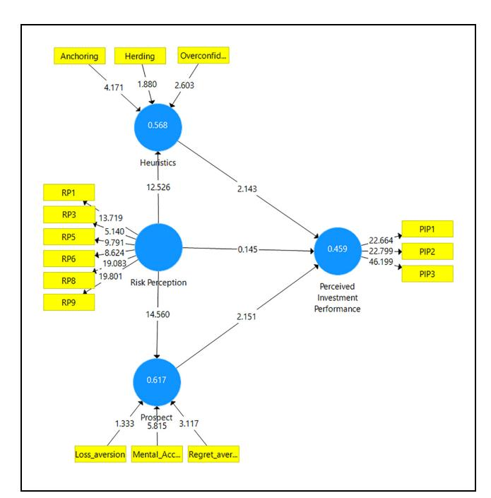
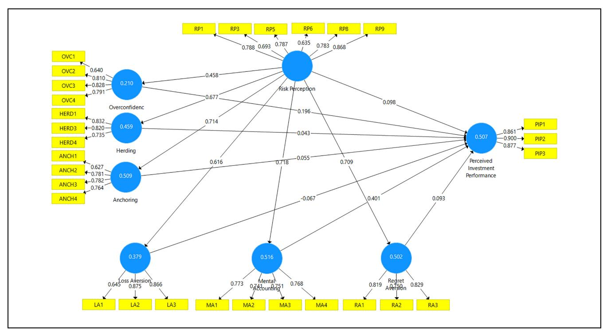

<!-- A3.R59 | source: papers_json/A3.R59/ -->

## Risk Perception-Perceived Investor Performance Nexus: Evaluating the Mediating Effects of Heuristics and Prospects With Gender as a Moderator

SAGE Open April-June 2024: I–18 © The Author(s) 2024 DOI: 10.1177/21582440241256444 journals.sagepub.com/home/sgo

Parul Kumar1, Md. Aminul Islam2, Rekha Pillai3, and Mosab I. Tabash4

## **Abstract **

نظرا لأن الوضع المالي لمعظم الأفراد تأثر بشدة أثناء جائحة COVID-19، تهدف هذه الدراسة إلى تحليل تصورات المخاطر المتباينة الناتجة عن الجوانب السلوكية الديناميكية المتأصلة في الأفراد. تركز الدراسة بشكل أساسي على أثر تصورات المخاطر الناتجة عن COVID-19 على التحيز النفسي، وما يترتب عليه من أثر على الأداء الاستثماري المدرك، مع اعتبار الفروق بين الجنسين متغيرا معدلا في هذه العلاقة. استُخدم مزيج من أسلوب المعاينة الاحتمالية وغير الاحتمالية لجمع البيانات من 1,133 مستجيبا عبر استبيان منظم. اعتُمدت طريقة النمذجة بالمعادلات الهيكلية بالمربعات الصغرى الجزئية (PLS-SEM) كأسلوب تقدير. تبين النتائج أن تصور المخاطر كان مؤثرا بشكل كبير في الاستدلالات الذهنية (heuristics) والتوقعات (prospects). غير أنه غير ذي دلالة في التأثير المباشر على الأداء الاستثماري المدرك. ومع ذلك، تبين أن التحيزات النفسية، ممثلة في الاستدلالات الذهنية والتوقعات، تتوسط العلاقة بين تصور المخاطر والأداء الاستثماري المدرك. تشير الآثار العملية إلى ضرورة الجمع الحكيم بين المخاطرة والعائد والمحفظة السلوكية لتحفيز الاستثمارات وتنميتها، وبالتالي تعزيز الزخم الاستثماري للوصول إلى مستويات ما قبل الجائحة. وفي الوقت نفسه، تكمن أهمية الموضوع للمجتمع في ضرورة إعادة النظر في محافظهم الاستثمارية للتكيف مع حالات عدم اليقين مثل COVID-19. يمكن للدراسات المستقبلية أن تنطلق نحو بحوث عبر الدول لاستكشاف العلاقات المتباينة بين تصور المخاطر والأداء الاستثماري السائدة في الأوضاع الاقتصادية المختلفة. كما يمكن للدراسات أن تستكشف التباين في النتائج بالنسبة لفئات مختلفة من المستثمرين، أي ذوي الخبرة، والمستثمرين الجدد، والمؤسسات، والمؤثرين، وغيرهم.

## Plain language summary

الغرض من هذه الدراسة هو تقييم أثر تصورات المخاطر لدى الأفراد، الناتجة عن التحيز النفسي، على أدائهم الاستثماري. جرى توزيع الاستبيان المنظم على المستجيبين المحتملين، وورد إجمالي 1,133 استجابة. استُخدمت نمذجة المعادلات الهيكلية (SEM) لتقييم أثر التحيز النفسي على العلاقة بين تصور المخاطر والأداء الاستثماري للفرد. تبين النتائج أنه مع الفهم الواضح لتصور المخاطر، يميل الأفراد إلى استخدام عدد أقل من الاختصارات الذهنية والتركيز أكثر على اتخاذ القرارات الرشيدة وتحقيق أداء استثماري أفضل. يمكن للممارسين ومديري المحافظ والمخططين الماليين تصميم مزيج من المخاطرة والعائد والمحفظة السلوكية

Md. Aminul Islam is also affiliated to College of Business administration, Prince Mohammad Bin Fahd University, Saudi Arabia.

## **Corresponding Author: **

Rekha Pillai, The British University, Dubai Email: rekha.pillai@buid.ac.ae

> ^&^lt;sup>1Delhi Skill and Entrepreneurship University, New Delhi, India

> ^&^lt;sup>2Universiti Malaysia Perlis, Arau, Kangar, Perlis, Malaysia

> ^&^lt;sup>3Ajman University, United Arab Emirates

> ^&^lt;sup>4Al Ain University, United Arab Emirates

<!-- page 2 -->

لإعادة المستثمرين إلى السوق في سيناريوهات الاستثمار بعد جائحة COVID-19. يمكن للباحثين البناء على نتائج هذه الدراسة من خلال تقييم الأثر الطولي للاستدلالات الذهنية والتوقعات التي تؤثر في القرار الاستثماري للمستثمرين الأسريين. أما فيما يخص تقييم المخاطر، فيمكن إجراء الدراسات عبر إدراج متغيرات إضافية مثل سمات الشخصية المختلفة، والتأثيرات الثقافية، وتأثير الأسرة، والتعرض لمشورة استثمارية أفضل، وغير ذلك، من أجل فهم أعمق للفروق في المخاطر المدركة لدى مختلف الأفراد.

## Keywords

financial literacy, regret aversion, loss aversion, herding bias, overconfidence bias, mental accounting, anchoring

## Background of the Study

أدى تفشي جائحة COVID-19 غير المسبوق إلى تداعيات هائلة في الأسواق المالية والبورصات العالمية، مع تغيرات واضحة في معنويات المستثمرين تجاه هذه الأسواق (Naseem et al., 2021). يؤكد البحث العلمي أن مثل هذه الاضطرابات الاجتماعية والاقتصادية والسياسية والبيئية تُعد صدمات خارجية، (Eckel et al., 2009; Espinosa-Me´ndez & Arias, 2021; Fisman et al., 2015) تزرع تداعياتها بذور الخوف والتشاؤم في معنويات المستثمرين. وهذا يمهد الطريق أيضا لتراجع الرغبة في الأصول عالية المخاطرة، مصحوبا ببيع بالتجزئة مكثف (A. Y. Wang & Young, 2020). ثانيا، أدى انتشار التوقعات المتفائلة والمتشائمة بشأن انتعاش السوق المحتمل من مصادر إخبارية لا حصر لها إلى إغراق المستثمرين الأفراد بأدلة غير حاسمة حول استراتيجيات الاستثمار المثلى (Ortmann et al., 2020). ونتيجة لذلك، يُفترض أن يتصرف المستثمرون بشكل غير رشيد بسبب عدم تماثل المعلومات وكفاءة الأسواق غير الكاملة، وكلاهما يؤكد أهمية التمويل السلوكي كأساس منطقي لقرارات الاستثمار المتنوعة (F. Wang et al., 2022). ويرجع ذلك إلى أن التمويل السلوكي يقر بالقدرات الاجتماعية والعاطفية والحكمية والمعرفية للمستثمرين، ويعتبرها محركات لقرارات الاستثمار، مع تسبب التباين في تصورات المخاطر بشكل خاص في الإضرار باتخاذ القرارات الرشيدة (Ahmed et al., 2022). (Mahmood et al., 2016; M. Wang et al., 2011)

يفترض البحث القائم أيضا أن التمويل السلوكي هو النظرية الملائمة التي تفسر العملية النفسية المنهجية التي تدمج المشاعر الإنسانية والأخطاء المعرفية في السلوك الاستثماري (Barberis & Thaler, 2005; Waweru et al., 2008)، وهو في هذه الورقة الأداء الاستثماري المدرك. إضافة إلى ذلك، يؤكد Bailey et al. (2011) أن التحيز النفسي يُعد أحد أهم العوامل المؤثرة في قرارات الاستثمار. وتمنع هذه التحيزات التي لا مفر منها الأفراد من اتخاذ قرارات رشيدة، مما يحد من فعالية اتخاذ القرار الاستثماري. وللتحقق من ذلك، يخلص Chhapra et al. (2018) إلى أن التحيز النفسي يمثل سببا بارزا للقرارات غير الرشيدة وضعف الأداء الاستثماري. وانطلاقا من نظرية التوقعات (Kahneman & Tversky, 1979)، يستند الأداء الاستثماري المدرك، وهو

نتيجة واضحة للسلوك الاستثماري، إلى منطق يفيد بأن الأفراد يفضلون الخيارات التي تعظم الثروة عندما تُتاح لهم فرصة الاختيار. غير أن هذه النظريات السلوكية تتعارض مع نماذج تسعير الأصول الرأسمالية الكلاسيكية التقليدية (Markowitz, 1952) التي تفترض أن الأسواق كفؤة وتضمن تماثل المعلومات. إضافة إلى ذلك، يحدد Malik et al. (2022) عدة عوامل سلوكية مثل الاستدلالات الذهنية (الثقة المفرطة، والتثبيت، وتحيز القدرة، والتقليد الجمعي وغيرها)، والتوقعات (تجنب الخسارة، والمحاسبة الذهنية، وتجنب الندم) والعوامل السوقية التي تفسر اتخاذ قرار المستثمر ومن ثم أداءه، والتي يؤدي تجاهلها اللاواعي إلى أداء استثماري دون المستوى الأمثل (Mahmood et al., 2016).

مع ذلك، ومع احتفال الهند باستقلالها الـ76 في عام 2022، تغيرت عقلية المستثمرين الهنود بشكل ملحوظ من الاستثمار في أدوات الدخل الثابت إلى الأسهم وصناديق الاستثمار المشترك. كما يُعرف عنهم تجنب المخاطرة، واتخاذ القرار الجماعي، والتأثر الكبير بأداء السهم السابق (Adil et al., 2022). ومع ذلك، ومع تراجع أسعار الفائدة منذ بداية عام 2010، يتضح التوجه نحو الأوراق المالية المرتبطة بالسوق. ورغم ذلك، قلبت جائحة COVID-19 السلوك الاستثماري رأسا على عقب، خاصة عندما هبط مؤشر SENSEX بنسبة 31% في عام 2020 (Mudgill, 2020) نتيجة موجة بيع ضخمة من المستثمرين الأجانب والأفراد. وكما أُشير سابقا، تفترض نظرية التمويل السلوكي أن اتخاذ الفرد لقراره الاستثماري يُحركه عنصران معرفي وعاطفي. وتُلتقط هذه العناصر من خلال نظرية الاستدلالات الذهنية والتوقعات، التي غالبا ما تدفع الأفراد إلى التداول بشكل غير رشيد وينتهي بهم الأمر بعوائد أقل (Seetharaman et al., 2017). ومع ذلك، فإن الندرة الحادة في دراسات التمويل السلوكي في السياق الاقتصادي الهندي، والأدلة المحدودة حول أثر تغير تصورات المخاطر لدى المستثمرين على التحيز النفسي، تبرز كفجوات بحثية حقيقية تستدعي مزيدا من البحث. كما ركز البحث السابق بشكل قوي على تحمل المخاطرة المالية بدلا من تصور العميل للمخاطر المتعلقة بالاستثمارات، الأمر الذي قد يعرض عمليات تقييم الاستثمار وبالتالي الأداء الاستثماري للخطر (M. Wang et al., 2011). وبصرف النظر عن تفاوت درجات تصور المخاطر، لكل مستثمر

<!-- page 3 -->

دوافعه الخاصة، وغرضه الاستثماري، ومستويات متفاوتة من التدفقات النقدية الداخلة والخارجة، فضلا عن القيود الشخصية المتأصلة التي تؤدي إلى قرارات استثمارية متباينة وبالتالي أداء استثماري متباين (Mahmood et al., 2016).

ومن اللافت أن هذا الفراغ هو الدافع الرئيسي لإجراء دراسة تجريبية أولية لاستكشاف الأثر الوسيط للاستدلالات الذهنية وعناصر التوقعات في العلاقة بين تصور المخاطر والأداء الاستثماري المدرك. ومن جوانب الابتكار الأخرى في هذه الدراسة أنها تراعي البعد الذاتي للأداء الاستثماري، أي الأداء الاستثماري المدرك، الذي يتعلق بالتقييم الذاتي للفرد لعوائده الاستثمارية من حيث الجودة والمعايير المحققة دون الرجوع إلى الحقائق الموضوعية لظروفه، وهو مفهوم استُكشف في عدد قليل جدا من الأبحاث (Akhtar et al., 2018; Nareswari et al., 2021).

لذلك، تركز هذه الورقة على تحقيق ثلاثة أهداف. أولا، تقييم العلاقة بين تصور المخاطر والأداء المدرك للمستثمر. ثانيا، تقييم الآثار الوسيطة للاستدلالات الذهنية والتوقعات على العلاقة بين تصور المخاطر والأداء المدرك للمستثمر، وثالثا، دراسة الفروق في الأداء الاستثماري المدرك بين الذكور والإناث. ولتحقيق هذه الأهداف واستنتاج العلاقة بين تصور المخاطر والأداء الاستثماري، تدرس هذه الورقة 1,133 مستجيبا، وتستخدم SmartPLS 4 لإجراء نمذجة المعادلات الهيكلية إلى جانب تقييم النمذجة التنبؤية لاختبار خمس فرضيات قابلة للاختبار. تشير النتائج إلى عدم وجود علاقة ذات دلالة بين تصور المخاطر والأداء الاستثماري، في حين تبقى الآثار الوسيطة لبنيتي الاستدلالات الذهنية والتوقعات ذات صلة في العلاقة بين تصور المخاطر والأداء الاستثماري.

تُنظم الأقسام المتبقية من الدراسة على النحو التالي. يوضح القسم التالي الإطار النظري الذي يقوم عليه تبني مختلف أنواع التحيز النفسي. ويُفصَّل الإطار التجريبي في القسم الذي يليه، مع عرض النتائج في القسم التالي. وبعد ذلك تُقدَّم المناقشة فيما يخص النتائج، تليها الآثار المترتبة وخاتمة البحث.

## Theoretical Framework and Hypotheses Formulation

طور Ajzen (1991) نظرية السلوك المخطط، التي وفرت إطارا لفهم تعقيدات السلوك الاجتماعي الإنساني. وتفترض النظرية أن الاتجاه، والمعيار الذاتي، والسيطرة المدركة تتنبأ إلى حد كبير بالنية السلوكية. واستنادا إلى ما سبق، استكشف البحث السابق الدور الديناميكي للتحيزات السلوكية في القرارات الاستثمارية (Kartini

& Nahda, 2021; Mittal, 2022; Zahera & Bansal, 2019). ومع ذلك، فإن تصور المخاطر لدى المديرين له أيضا علاقة وثيقة بالسلوك الاستثماري، وتُبقي هذه التحيزات السلوكية العديد من الخيارات الاستثمارية المحتملة غير مستكشفة، مما يؤثر أكثر في قرارات الاستثمار وبالتالي في الأداء الاستثماري. ويؤكد Roberts (2009) أهمية استكشاف السمات المعرفية والنفسية طويلة الأمد التي لها تأثير ملموس على سلوك استجابة المستثمرين. وفي وقت أحدث، يحذر Kathpal et al. (2021) من قلة البحث في استكشاف أثر العوامل المذكورة أعلاه على الأداء الاستثماري المدرك. ونظرا لأن العديد من المشاركين يظهرون مشاعر وأنماطا سلوكية، يصبح اختيار الاستثمار معقدا للغاية (Riaz et al., 2020; Zahera & Bansal, 2019).

والعمل الأساسي في ربط التحيزات معا وإثبات تأثيرها في سلوك الفرد هو عمل Tversky و Kahneman، رائدي التمويل السلوكي. ففي بحثهما حول الاستدلالات الذهنية (Tversky & Kahneman, 1973, 1974) والتوقعات (Kahneman & Tversky, 1979)، خلصا إلى أن جوانب متعددة تؤثر في قرار الفرد الاستثماري، مما يجعل من الصعب على المستثمر إجراء تقييم دقيق للمخاطرة والعائد. وفي الوقت نفسه، يُعد النوع الاجتماعي أيضا محددا حيويا للأداء الاستثماري المدرك، مع أدلة بحثية غير حاسمة بشأنه. ولتأكيد هذا الادعاء، يشير Rajasekar et al. (2023) إلى أن تصور المخاطر يرتبط بشكل خاص بالتوجه الجنسي، إذ يُظهر الذكور مقاومة عالية لتصور المخاطر مقارنة بالمديرات الإناث. إضافة إلى ذلك، وبينما يسلط جزء من الأدبيات الضوء على الثقة والمنطقية وتجنب المخاطرة لدى المستثمرات (Gonzalez-Igual et al., 2021)، يؤكد Plieger et al. (2021) على ارتفاع مستوى الاعتماد على الذات والسلوك المحفوف بالمخاطر لدى الرجال، مما يؤدي إلى تقييمات إيجابية لسوق الأسهم.

ورغم أن عدة دراسات (Dangol & Manandhar, 2020; Ishfaq et al., 2020; Kumari et al., 2022; Mahmood et al., 2016) تناولت مجال العلاقة بين تصور المخاطر وأداء المستثمر، فقد ظلت النتائج غير حاسمة سواء فيما يتعلق بعلاقة المتغيرات المستخدمة أو أنها ظلت غير متسقة مع مرور الوقت. ومما يزيد الأمر تعقيدا، دفعت حالات عدم اليقين المرتبطة بجائحة COVID-19 في صورة عدم استقرار الدخل الأفراد إلى محاولة فهم آفاق استدامة دخلهم واستثماراتهم وإنفاقهم، مما يستدعي مرة أخرى تحليلا معمقا لاختلاف نفسية المستثمرين المؤدية إلى قرارات الاستثمار.

## Risk Perception and Investment Performance

يُعد تصور المخاطر مجالا فريدا من مجالات اتخاذ القرار الفردي المتشابك مع مستنقع العملية الوجدانية، إذ يُسند إليه "الاعتماد على المشاعر والتجارب والحدس" (Ahmad & Shah, 2022) في أحكام

<!-- page 4 -->

المفاضلة بين التكلفة والمنفعة، بوصفها إحدى أهم عمليات التقييم فيه (Skagerlund et al., 2020). ويُعرَّف بأنه "توقع الفرد الذاتي لتكبد خسارة سعيا وراء نتيجة مرغوبة" (Warkentin et al., 2002). وفي المجال المالي، يُقاس من حيث الاتجاه نحو المخاطرة الذي قد يكون إما استيعابا للمخاطر أو تجنبا لها (Kahneman & Tversky, 1979). خلص Raut و Kumar (2018) إلى أن تصور المخاطر ينبع من سبع سمات سلوكية تظهر بين نوعين من المستثمرين، أي المستثمرين في بداية مسيرتهم المهنية والمستثمرين ذوي الخبرة. وأسفرت دراستهما عن تصورات متباينة (إيجابية وسلبية على حد سواء) فيما يخص التحيزات السلوكية السبعة. من ناحية أخرى، درس Parveen et al. (2023) الروابط المتبادلة بين التحيزات السلوكية ومعنويات المستثمرين وقرارات الاستثمار في سوق الأسهم خلال فترة انتشار جائحة كورونا. وأكد تحليلهم أن انتشار الجائحة غيّر تصور المستثمرين، وقراراتهم الاستثمارية، وحتى حجم التداول في سوق الأسهم الباكستاني. علاوة على ذلك، يُسند Slovic و Peters (2006) بعدا معرفيا ونفسيا لتصور المخاطر، حيث يُسمى الأول المخاطرة كتحليل، ويُسمى الثاني المخاطرة كمشاعر. وتتعلق المخاطرة كتحليل بدرجة استيعاب المخاطر وفهمها، في حين تشير المخاطرة كمشاعر إلى كيفية شعور الأفراد تجاه المخاطر.

تتأمل الدراسة الحالية في اعتماد "المخاطرة كمشاعر" بوصفها البعد الملائم للأخذ به، إذ إنها تتعلق بالقرارات الاستثمارية التي هي نتيجة ردود فعل لحظية وحدسية لتفادي المخاطر الوشيكة، وهي في حالتنا المخاوف المرتبطة بجائحة COVID-19. غير أن تصورات المخاطر تؤثر في سلوك الفرد ويمكن أن تحدث آثارا متباينة على الأداء الاستثماري المدرك بناء على درجة وتنوع تفسير (إيجابي أو سلبي) المعلومات المتاحة (Shehata et al., 2021). وتماشيا مع ما سبق، يتأمل T. A. N. Nguyen و Rozsa (2019) أن المستثمرين المتعلمين ماليا وذوي الخبرة يُظهرون دقة أكبر في تصور المخاطر مقارنة بالمستثمرين قليلي الخبرة. وهنا نجادل بأن الفرد الذي يوظف الحرص والمنطق والمهارات التحليلية لتفسير المخاطر الكامنة في معلومات الاستثمار المتاحة يمتنع عن قرارات الاستثمار الخطرة، مما يؤدي إلى تحسين الأداء الاستثماري المدرك (Kumar, Pillai et al., 2023; Trang & Tho, 2017). وعلى النقيض من ذلك، إذا نشأ تصور المخاطر من سلوكيات غير رشيدة وغير منطقية، فسيكون الأداء الاستثماري المدرك غير مرضٍ بسبب قرارات استثمارية خاطئة ودون المستوى. وهنا تبرز أهمية دراسة Robinson و Marino (2015) في تبرير دور تصورات المخاطر المتحيزة في قرارات إنشاء المشاريع. كما دُرس تصور المخاطر بوصفه وسيطا مهما بين التحيز السلوكي والأداء الاستثماري (Ishfaq et al., 2020; Wangzhou et al., 2021). وتستند علاقة تصور المخاطر بالأداء الاستثماري المدرك،

خاصة أثناء الجائحة، إلى نظرية التوقعات (Kahneman & Tversky, 1979) التي تفترض أن الأفراد الذين يواجهون حالات عدم اليقين يُظهرون تحيزا معرفيا وسلوك تجنب للمخاطرة، ويركزون أكثر على المكاسب المؤكدة رغم تبنيهم لسلوك مخاطرة أثناء خسارة وشيكة.

علاوة على ذلك، تكشف الورقة عن الآثار المعدلة للنوع الاجتماعي على الأداء الاستثماري المدرك. كان البحث السابق غير حاسم بشأن الادعاءات المذكورة، إذ يرى فريق معين من الفكر (Gonzalez-Igual et al., 2021; Hira & Loibl, 2008) أن الذكور واثقون من قدراتهم الاستثمارية وقدرتهم على تحمل المخاطر، وينتقلون إلى استثمارات مربحة استنادا إلى الدروس المستفادة، وبالتالي يحققون مستويات عالية من الأداء الاستثماري المدرك. بينما يرى فريق آخر من الفكر (Barber & Odean, 2001) أن النساء يؤدين بشكل أفضل في القرارات المتعلقة بالاستثمار بفضل تدقيقهن الدقيق للأسهم الفردية، مما يجعلهن يتوقعن أداء استثماريا مدركا أفضل. ومع ذلك، أشار Willows و West (2015) إلى وجود علاقات غير ذات دلالة بين النوع الاجتماعي والأداء الاستثماري، مما يبرر إجراء مزيد من البحث في هذا الشأن. مع ذلك، بحث البحث السابق باستفاضة تصور المخاطر كمتغير وسيط (Wangzhou et al., 2021) أو كمتغير معدل (Ishfaq et al., 2020; Shehata et al., 2021)، مع كون Trang و Tho (2017) من القلائل الذين ينظرون بدقة في الأثر المباشر لتصور المخاطر على الأداء الاستثماري، رغم عدم حسمهم في ذلك. وتتأثر قرارات الاستثمار بتصور المخاطر، كما تُظهر دراسات متعددة (Hoffmann et al., 2015; L. T. M. Nguyen et al., 2016; Weber et al., 2005). ووفقا لـ Hariharan et al. (2000)، يميل الأفراد إلى تخصيص أموالهم في أصول منخفضة المخاطر عندما يدركون مستوى أعلى من المخاطرة، مع تجنب الأصول عالية المخاطرة. ووفقا لأبحاث سابقة لـ Aren و Zengin (2016) و Keller و Siegrist (2006)، فإن الأفراد الذين يُظهرون تصورا منخفضا للمخاطر هم أكثر ميلا لاختيار الأسهم عالية المخاطرة بدلا من الودائع منخفضة المخاطرة عند اتخاذ قرارات الاستثمار. ومن المثير للدهشة أن المعلومات الصريحة المتعلقة بالفروق بين الجنسين في الأداء الاستثماري المدرك تظل غير مستكشفة. ولمعالجة هذا الفراغ، صيغت الفرضيات التالية:

H1: Perceived investment performance differ across genders.

H2: Risk perception has a significant positive affect on perceived investment performance.

## Risk Perception and Heuristics

تُعد تصورات المخاطر سوابق سلوكية مهمة لمنع المخاطر أو مواجهتها، مما يؤدي إلى تحيز سلوكي أو حالات وجدانية، يُطلق عليها بشكل أفضل استدلال التأثير (Slovic

<!-- page 5 -->

et al., 2002). علاوة على ذلك، يرى Ahmad و Shah (2022) أن الأساليب الاستدلالية تُمكّن من البحث عن المعلومات وتغيير مسار المواقف الإشكالية لتسهيل الحلول الممكنة.

تتفق العلاقة بين تصور المخاطر والاستدلال الذهني مع نظرية الأحداث الوجدانية (Weiss & Cropanzano, 1996) التي تفسر السلوك اللاحق للفرد (التحيز الاستدلالي) بوصفه نتيجة للمشاعر التي يمر بها (تصورات المخاطر). ونجادل هنا بأن تصورات المخاطر تشمل معتقدات الفرد وقيمه وأعرافه، ويمكن أن تؤدي هذه التصورات إلى تمثيلات خاطئة في صورة استدلالات ذهنية (Ritter, 1988). ويصمد هذا الطرح بقوة أثناء الجائحة عندما أصبح المستثمرون قلقين إزاء تقلبات حركة الأسهم، مما دفعهم إلى اللجوء إلى التحيزات الاستدلالية (Shah et al., 2019) لتوفير الوقت واستغلال الفرص. وللتأكيد مجددا، يُعد التحيز الاستدلالي اختصارا ذهنيا متراكما من الخبرة لحل المشكلات المعقدة وسط معلومات غير كافية وحالات من عدم اليقين (Ritter, 1988). ومن ثم، تناقش هذه الورقة ثلاثة أبعاد للاستدلال الذهني، وهي التثبيت (Tversky & Kahneman, 1974)، والتقليد الجمعي، والثقة المفرطة (Waweru et al., 2008).

التثبيت هو سلوك نفسي يعتمد فيه الفرد بشكل كبير على حكمه على معلومات سابقة أو أول معلومة متاحة. وفي مجال الاستثمار، يمكن أن يرتبط ذلك بقرارات استثمارية مستقبلية تُبنى على المعرفة السابقة والسعر الأولي المدفوع للأسهم المذكورة (Robin & Angelina, 2020). ويؤكد بحث سابق لـ Lavin et al. (2019) و Piotrowski و Bunnings (2024) الأثر المؤثر للتثبيت بوصفه التحيز الأبرز في تحديد السلوك الاستثماري. والتقليد الجمعي هو حالة يتبع فيها الأفراد أفعال الآخرين بشكل أعمى دون الانخراط في أي شكل من أشكال التحليل أو الحرص بشأن الإجراءات المتخذة (Kahan et al., 1996). أما الثقة المفرطة، فهي تحيز استدلالي يبالغ فيه المستثمر في تقدير قدراته التحليلية ومهاراته ومعرفته المالية بينما يطمئن نفسه بعوائد عالية (Hvide, 2002). ومن المثير للدهشة أن الأدبيات السابقة تشير إلى ارتفاع انتشار التقليد الجمعي والثقة المفرطة أثناء اضطرابات السوق، لا سيما أثناء الجائحة (Azam et al., 2022; Bouri et al., 2021).

بالإشارة إلى Kahneman و Tversky (1979) اللذين يقيسان تصور المخاطر من حيث استيعاب المخاطر أو تجنبها، نقترح بعدين مزدوجين مفادهما أن مستوعبي المخاطر ذوي التصور المعرفي للمخاطر يتمتعون بمستويات تحمل أعلى للمخاطرة وعوائد استثمارية أفضل (Nur Aini & Lutfi, 2019) ويُظهرون سمات استدلالية مثل الثقة المفرطة والتثبيت ولا يخضعون لسلوك التقليد الجمعي. ويرجع ذلك إلى أن هؤلاء الأفراد، بفضل خبرتهم الاستثمارية الواسعة وسلوكهم المتأصل في تحمل المخاطر، واثقون من قراراتهم التي يبنونها عادة على تجربتهم السابقة دون اتباع الحشد غير الرشيد. غير أن المستثمرين الذين يحملون

تصورات مخاطر نفسية، خاصة أثناء صدمات السوق مثل جائحة COVID-19، يُظهرون ثقة أقل مع إظهار كل من سلوك التثبيت والتقليد الجمعي. وتكون قدراتهم الذهنية مضطربة، وينتابهم القلق إزاء حالات عدم اليقين المرتبطة بالعوائد المستقبلية، مما يدفعهم لاتباع الحشد الحالي أو بناء قراراتهم على المحفظة الاستثمارية السابقة المتاحة. غير أنه كانت هناك ندرة في الدراسات حول العلاقة بين تصور المخاطر والاستدلال الذهني (Ahmad & Shah, 2022; Robin & Angelina, 2020; Skagerlund et al., 2020).

كما نجادل بأن العلاقة المباشرة الملحوظة بين تصور المخاطر والأداء الاستثماري المدرك لا تقدم ادعاء مقنعا في غياب وسيط، وهو الاستدلال الذهني. ويحث Piotrowski و Bunnings (2024) الأكاديميين على تكثيف أبحاثهم حول الاستدلالات الذهنية والتحيزات في سياق اتخاذ القرار المالي، إذ تقتصر الدراسات الحالية على ظروف محددة. ويؤكد البحث السابق أن التحيز الاستدلالي يختلف من دولة إلى أخرى (Pompian, 2012)، مما يعني أن العوامل الإقليمية والثقافية لها تأثير حيوي على النفسية البشرية، وهو ما يمثل بلا شك المبدأ الأساسي في نظرية التوقعات. وفي هذا الصدد، استكشف Wangzhou et al. (2021) أثر التحيز الاستدلالي للمستثمرين على قرارات الاستثمار في باكستان ووجدوا أثرا إيجابيا ذا دلالة للتحيزات التمثيلية على قرارات الاستثمار. وبالمثل، يجادل تحليل تجريبي آخر أجراه Ahmad و Shah (2022) و Kumar, Islam et al. (2023) بأن تصور المخاطر بشأن الاستثمار المستقبلي يمكن أن يتوسط العلاقة بين الثقة المفرطة الاستدلالية والأداء الاستثماري.

تكشف دراسات Salman et al. (2021) عن الحركة المشتركة بين تحمل المخاطرة، ومحور السيطرة الخارجي، وأثرهما على التحيزات الاستدلالية وقرارات الاستثمار. ووفقا لدراسة Robinson و Marino (2015)، توجد وساطة جزئية للعلاقة بين قرار تكوين المشروع والتحيز الاستدلالي للثقة المفرطة من قبل تصورات المخاطر. ووفقا لـ Lim et al. (2018)، يوجد أثر وسيط لتصور المخاطر على العلاقة بين المعرفة المالية ونية الاستثمار. ومع ذلك، يتضح أن مساعي البحث المبكرة في التمويل السلوكي لم تتناول الآثار الوسيطة للاستدلالات الذهنية في العلاقة بين تصور المخاطر والأداء الاستثماري المدرك. تدعي الدراسة الحالية أن مخاوف جائحة كورونا وتصورات المخاطر المتفاقمة الناتجة عن تجنب المخاطر الوشيكة واكتساب ميزة تنافسية فورية أدت إلى حمل معرفي زائد وتفسيرات خاطئة في صورة استدلالات التقليد الجمعي والتثبيت والثقة المفرطة (Azam et al., 2022)، مما يؤثر بدوره بشكل كبير وسلبي على قرارات الاستثمار بسبب القرارات المتضمنة تحيزا غير رشيد ومعرفيا (Du & Budescu, 2018) الناشئة عن الاختصارات الذهنية. وبناء على ذلك، صيغت الفرضيات التالية:

<!-- page 6 -->

H3: Risk perception positively influence heuristics.

H4: Heuristics mediates the relationship between risk perception and perceived investment performance.

## Risk Perception and Prospects

للتأكيد مجددا، يُعد تصور المخاطر حكما ذاتيا للفرد على المواقف الخطرة، ويعتمد بشكل أساسي على الظروف الاجتماعية والثقافية والإقليمية والنفسية المحيطة بالفرد. وهنا وضع Kahneman و Tversky (1979) نظرية التوقعات كبديل لتوضيح اتخاذ الفرد للقرار في ظروف مضطربة وخطرة. فعلى سبيل المثال، ادعيا أن الناس يعطون وزنا أكبر للنتائج المؤكدة مقارنة بالنتائج المحتملة (Hoffmann et al., 2015). وضمن مجال التمويل السلوكي، جرى النظر إلى تصور المخاطر من زوايا متعددة، من بينها الميل العام للبشر لتجنب المخاطرة في المواقف التي يُحتمل فيها حدوث مكاسب وخسائر، وهو أمر معروف على نطاق واسع. ويمثل سلوك التوقعات حالات عدم اليقين المرتبطة بقرارات الاستثمار ويُبرر العوامل الكامنة في القرارات المالية لتجنب الخسارة الوشيكة (Frederiks et al., 2015). وتناقش الورقة الحالية ثلاثة أبعاد لسلوك التوقعات، وهي تجنب الخسارة، والمحاسبة الذهنية، وتجنب الندم، لتفسير نشأتها من تصورات مخاطر متباينة تُشكل بدورها وسائط في اتخاذ القرار الاستثماري المدرك. وتُستخدم هذه العناصر بوصفها اختصارات ذهنية يوظفها المستثمرون لاتخاذ قرارات سريعة وسهلة في مواقف معقدة وصعبة.

يعني تجنب الخسارة أن الخسائر هي المحرك الرئيسي للقرار بدلا من الأرباح ذات الحجم نفسه (Kahneman & Tversky, 1979). ويشير إلى حالة سلوكية شاذة يُظهر فيها الأفراد درجة عالية من تجنب المخاطرة بسبب نية تجنب الخسائر الوشيكة (Isidore & Christie, 2019)، وكلها نشأت بوضوح من شكل ما من أشكال تصور المخاطر السلبي (Ahmed et al., 2022). ومن ناحية أخرى، يُعد تجنب الندم حالة يدرك فيها الأفراد أنهم اتخذوا خيارا سيئا في الماضي رغم إمكانية اتخاذ خيار بنتيجة أفضل. يشير Kahneman و Riepe (1998) إلى بعدين مزدوجين لتجنب الندم، حيث يشير الأول إلى ندم الفعل، حين يندم المستثمرون على اتخاذ قرار غير رشيد أدى إلى خسارة، بينما يتعلق البعد الثاني، وهو ندم الترك، بالندم الناشئ عن عدم استغلال الفرص. ويؤدي هذا بدوره إلى تجنب اتخاذ القرارات مستقبلا لتفادي الشعور بالندم إذا نشأت نتائج غير مواتية. ونظرا لهذا الميل، يتخذ الناس قرارات مالية محافظة جدا بسبب الندم على قرارات استثمارية خطرة وسلبية سابقة (R. H. Thaler & Johnson, 1990)، مما يدفعهم للاستثمار في خطط مساهمة إيجابية مضمونة.

وأخيرا، يدفع تحيز المحاسبة الذهنية المستثمرين إلى تقييم كل سهم من حيث قيمته المحددة في حساباتهم الذهنية التي ينتمون إليها حاليا. ويُفترض أن الأسهم الرابحة قد جرى تخزينها في حساب ذهني محدد، بينما تُخزَّن الأسهم الخاسرة في حساب ذهني آخر (Naseem et al., 2021). وهذا يعني أن المستثمرين المتأثرين بالمحاسبة الذهنية لا يملكون محفظة قوية ويميزون بشكل غير رشيد بين الدخل والعوائد الرأسمالية على الاستثمار. ويرجع ذلك إلى أنهم يفصلون استثماراتهم إلى حسابات ذاتية مختلفة استنادا إلى أهدافهم الشخصية، مما يثنيهم عن رؤية المراكز المرتبطة عبر الحسابات (Renu & Christie, 2018)، وبالتالي يؤدي إلى قرار استثماري دون المستوى الأمثل.

وبناء عليه، يمكن استنتاج أن المستثمرين المتجنبين للمخاطرة يميلون إلى تطوير درجات متفاوتة من تجنب الخسارة والمحاسبة الذهنية وتجنب الندم، ويمكن أن يؤدي الأثر التراكمي لذلك إلى قرارات استثمارية دون المستوى (Rehan et al., 2021). كما تدعي الدراسة الحالية أن التوقعات تُعد أحد الأسباب الحيوية التي تحفز وتعزز العلاقة بين تصور المخاطر والأداء الاستثماري المدرك. ويرجع ذلك إلى درجات متفاوتة من تجنب الخسارة والمحاسبة الذهنية وتجنب الندم الناشئة عن تصورات المخاطر الديناميكية، مما يؤدي إلى فروق كبيرة في القرارات الاستثمارية المدركة. يفترض Forlani و Mullins (2000) أن تصور المخاطر يتعلق بالعمليات المعرفية التي يفسر من خلالها الأفراد مستوى عدم اليقين واحتمال النتائج السلبية المرتبطة بإجراءات محددة. وبالتالي، يكون صناع القرار الذين يبالغون في تقدير قدراتهم أقل ميلا لتجنب المخاطرة (Gervais et al., 2011)، مما يؤدي إلى خيارات استثمارية غير مناسبة. ووفقا لـ Rahman et al. (2019)، توجد علاقة إيجابية بين ميل الفرد للثقة وتحمله للمخاطرة المالية، مما يشير إلى أن ذوي مستويات الثقة الأعلى يميلون إلى إظهار تحمل أكبر للمخاطرة المالية. وحتى الآن، ركز البحث السابق إما على العوامل المؤثرة في تصور المخاطر (Saivasan & Lokhande, 2022; Singh & Bhattacharjee, 2019) دون وجود أوراق تبحث في آثار التوقعات كأثر لاحق لتصور المخاطر أو الآثار الوسيطة للتوقعات في العلاقة بين تصور المخاطر واتخاذ القرار الاستثماري. وستعالج هذه الورقة الفجوة المذكورة، وقد صيغت الفرضيات على النحو التالي:

H5: Risk perception positively affects the prospects. H6: Prospects mediates the relationship between risk perception and perceived investment performance.

## Methodology

## Data Collection

تركز الدراسة الحالية على تقييم الأثر الوسيط للتحيزات النفسية، ممثلة في الاستدلالات الذهنية

<!-- page 7 -->

والتوقعات، على العلاقة بين تصور المخاطر والأداء الاستثماري المدرك. ولتقييم العلاقات المفترضة، اعتُمد منهج المسح. جرى اختيار العينة باستخدام مزيج من أسلوب المعاينة العشوائية وكرة الثلج. وجرى توزيع الاستبيان المنظم شخصيا وكذلك عبر منصات التواصل الاجتماعي والواتساب والبريد الإلكتروني في الفترة ما بين مارس 2022 ويونيو 2022، إذ كانت معظم بروتوكولات كورونا قد رُفعت بحلول ذلك الوقت مما أدى إلى فتح الكليات والمكاتب الحكومية والمكاتب الشركاتية وغيرها. كما وُزعت الاستبيانات على المستجيبين المحتملين عبر زيارة البنوك ومراكز التسوق. وبمجرد إكمال المستجيب للاستبيان، كنا نطلب منه مشاركة الاستبيان مع زملائه وأصدقائه وأقاربه لتوسيع نطاق الوصول. وبهذه الطريقة، تمكن الباحثون من تحقيق نطاق وصول أوسع لهذه الدراسة.

اقتصر نطاق المسح على الأفراد الذين استثمروا دخلهم في أي بديل استثماري، سواء كان أسهما أو سندات، وبالتالي استُبعد الأفراد غير العاملين أو غير المنخرطين في أي نوع من خيارات الاستثمار. سأل الاستبيان أولا عن رغبة الفرد في المشاركة في المسح، مع التأكيد على السرية وعدم الكشف عن الهوية، إضافة إلى بيان أن المشاركة طوعية ولا تتضمن إجابات صحيحة أو خاطئة. وهذا من شأنه أن يقلل من حدوث تحيز الرغبة الاجتماعية والتباين الناتج عن المنهج المشترك (Podsakoff et al., 2003). قُسم الاستبيان المنظم إلى أقسام مختلفة، وهي: القسم أ لبنود قياس المتغير المستقل (أي تصور المخاطر)؛ والقسم ب الذي يركز على بنود قياس الاستدلالات الذهنية والتوقعات (أي المتغيرات الوسيطة)؛ يليه القسم ج لبنود قياس الأداء الاستثماري المدرك (المتغير التابع). وجمع القسم الأخير الملف الديموغرافي للمستجيب، من عمر ونوع اجتماعي وأفق استثماري ونسبة الدخل المستثمر.

تألفت العينة النهائية من 1,133 استجابة صالحة. ولحساب الحد الأدنى المطلوب لحجم العينة لاختبار الفرضيات باستخدام PLS-SEM، استُخدم برنامج G*Power. استند حساب حجم العينة إلى قوة إحصائية قدرها 0.80 مع حجم أثر 0.15 وقيمة ألفا قدرها .05. وقدّر G*Power الحد الأدنى لحجم العينة بـ103، وبالتالي خلصت الدراسة إلى أن حجم العينة الحالي مقبول (Hair et al., 2019; Rasoolimanesh et al., 2017). ويصنف الجدول 1 ملف المستجيبين إلى 66% ذكور و34% إناث. وكان معظم المستجيبين في الفئة العمرية 25 إلى 35 عاما (70%)، تليها الفئة 36 إلى 45 عاما (16%). وبالتالي، تألفت معظم العينة من أفراد شباب ومتوسطي العمر يستثمرون بانتظام في مختلف السبل الاستثمارية. وكان لدى نحو 52% من المستجيبين تعليم الأبناء كهدفهم المالي الرئيسي لإجراء الاستثمارات، تليه الاحتياجات الصحية الطارئة (20%)، وزواج الأبناء (12%)، وتجميع الأموال (9%)،

والتخطيط للتقاعد (7%). وكان لدى نحو 50% من المستثمرين أفق استثماري يتراوح بين سنة و5 سنوات، بينما تجاوز أفق 30% منهم 7 سنوات.

## Measurement Scales

كانت أداة جمع البيانات في هذه الدراسة استبيانا منظما. وقُسمت إلى أربعة أقسام. تناول القسم الأول بنود قياس تصور المخاطر لدى المستثمر، وهو المتغير المستقل (أي تصور المخاطر؛ ستة بنود). وركز القسم الثاني على بنود قياس الاستدلالات الذهنية والتوقعات (أي المتغيرات الوسيطة)، بما يشمل الثقة المفرطة (أربعة بنود)، وتجنب الخسارة (ثلاثة بنود)، والتقليد الجمعي (ثلاثة بنود)، والمحاسبة الذهنية (أربعة بنود)، والتمثيلية (أربعة بنود)، والتثبيت (أربعة بنود)، وتجنب الندم (ثلاثة بنود). والتقط الجزء الثالث استجابات المستجيبين على بنود قياس الأداء الاستثماري المدرك (المتغير التابع؛ ثلاثة بنود) (راجع الملحق 1 للبنود). والمتغير التابع هو مقياس اتجاهي لقياس الأداء الاستثماري للمستثمر (Le Phuoc & Doan Thi Thu, 2011). وجمع القسم الأخير الملف الديموغرافي للمستجيب، من عمر ونوع اجتماعي وأفق استثماري ونسبة الدخل المستثمر. وقيست المتغيرات المستقلة والتابعة والوسيطة في الدراسة باستخدام مقياس ليكرت متعدد البنود ومتحقق من صحته من 1 إلى 5، مقتبس من الأدبيات القائمة، وموضح في الجدول 2 والملحق 1 (بنود المقياس حسب البنية).

## Statistical Procedures

الخطوة الأولى في تحليل البيانات هي تقييم النموذج للتحقق من غياب تحيز المنهج المشترك (CMB). وفي

<!-- page 8 -->

الدراسة الحالية، جرى تقييم ذلك باستخدام الارتباطات الثنائية بين البنى وعامل تضخم التباين (VIF). ولم توجد الارتباطات الثنائية مرتفعة بشكل مفرط (\0.85) (Lowry & Gaskin, 2014)، وكانت جميع قيم VIF أقل من 3.3 (Hew & Syed Abdul Kadir, 2016) كما هو موضح في الملحق 2. وبالتالي، يشير ذلك إلى غياب تحيز المنهج المشترك في النموذج.

استُخدمت تقنية نمذجة المعادلات الهيكلية بالمربعات الصغرى الجزئية (PLS-SEM) لاختبار النموذج النظري. ووفقا لـ Hair et al. (2019)، تُقدّر PLS-SEM بنى النموذج الجزئية من خلال الجمع بين تحليل المكونات الرئيسية وانحدارات المربعات الصغرى العادية. وتُطبق هذه التقنية لأن النموذج استند إلى مركبات؛ إذ تضمن بنى تكوينية من الدرجة الثانية (الاستدلال الذهني والتوقعات) وهي مناسبة لإجراء تحليل متعدد المجموعات (Rasoolimanesh et al., 2017). واستُخدم SmartPLS 3.3 لتقييم النموذج المفاهيمي. وكما تقترح أدبيات PLS-SEM، فإن الخطوة الأولى هي تقييم صدق وثبات نموذج القياس. وبعد ذلك، طُور نموذج هيكلي واختُبرت الفرضيات باستخدام تقنية إعادة التشكيل (bootstrapping). ونظرا لأن الدراسة الحالية تضمنت بنى من الدرجة الثانية، أي الاستدلال الذهني والتوقعات، قيّم نموذج القياس أولا ثبات وصدق البنى من الدرجة الأدنى فقط. وبعد ذلك، حُفظت درجات المتغير الكامن المركب وشُكل نموذج الدرجة الثانية باستخدام هذه الدرجات. ومن ثم، ستُستخدم درجات البنى ذات الدرجة الأدنى فقط بوصفها البنود لقياس البنية من الدرجة الثانية في هذه المرحلة، بينما ستُقاس بقية البنى الأخرى باستخدام مقاييسها القياسية متعددة البنود كما في المرحلة الأولى. وتُعرف هذه العملية باسم النهج المنفصل لتقييم النماذج ذات الرتبة الأعلى (HOC). ولإجراء تحليل متعدد المجموعات (MGA)، جرى تقييم ثبات القياس باستخدام إجراء MICOM (Henseler

et al., 2016). وتلا ذلك تطبيق تحليل Henseler متعدد المجموعات واختبار التبديل لتقدير نتائج التحليل متعدد المجموعات.

## Results

## Measurement Model

قُيِّم نموذج القياس لتقدير ثبات وصدق البنى لكلتا المجموعتين، أي الذكور والإناث. ودُرست تحميلات البنود لتقييم الثبات الفردي، وتبين أن جميع التحميلات باستثناء RP2 وRP4 وRP7 كانت أكبر من 0.708، وهو الحد الذي اقترحه Hair et al. (2019). ولتقييم ثبات البنية، أُبلغ عن الثبات المركب (CR) ومعامل rho لـ Dijkstra-Henseler (rA) وعُرضا في الجدول 3 والشكل 1. وتجاوز كل من CR وrA القيمة الحدية 0.70 في حالة جميع البنى في كلتا المجموعتين، مما يؤكد ثبات البنية. وقُدر متوسط التباين المستخرج (AVE) لتقييم الصدق التقاربي للبنية. وفي كلتا المجموعتين، كانت قيم AVE أكبر من 0.50 (Fornell & Larcker, 1981). وبالتالي، أُزيل RP2 وRP4 فقط بسبب انخفاض التحميلات إلى 0.61 و0.56 على التوالي.

قُيِّم الصدق التمييزي لنموذج القياس باستخدام نسبة HTMT. وكما اقترح Hair et al. (2019)، يجب أن تكون قيمة الارتباطات بين الصفات المتغايرة والصفة الأحادية أقل من .85 أو .90. وفي حالة كل من الذكور والإناث، كانت قيم HTMT لـ PIP وRP أقل من 0.90 (انظر الجدول 4). ونظرا لوجود ارتباط عال بين البنى الأخرى وتجاوز نسبة HTMT أيضا الحد المحافظ .85، فإن ذلك يؤكد وجود بنية من رتبة أعلى.

كما قُيّم صدق البنيتين من الدرجة الثانية، الاستدلال الذهني (التثبيت والتقليد الجمعي والثقة المفرطة) والتوقعات (تجنب الخسارة والمحاسبة الذهنية وتجنب الندم)، لاستكمال تقييم نموذج القياس. وكانت كل من الاستدلال الذهني والتوقعات بنى انعكاسية-تكوينية من الدرجة الثانية. ولتقييم ثبات وصدق البنية التكوينية، يجب أن تكون الأوزان الخارجية ذات دلالة وأن يكون عامل تضخم التباين (VIF) أقل من 5 (Hair et al., 2019). ويُظهر الجدول 5 أن أوزان البنى ذات الرتبة الأدنى كانت ذات دلالة وكذلك تحميلاتها. وكانت قيم VIF أقل من 5، مما يشير إلى عدم وجود مشكلات ارتباط خطي، وبالتالي لم يُستبعد أي مؤشر.

## Multi Group Analysis (MGA)

أُجري تحليل MGA لتقدير الأثر المعدل المحتمل للنوع الاجتماعي على الأداء الاستثماري المدرك. ومن الضروري إجراء إجراء MICOM قبل الشروع في MGA (Henseler et al., 2016). وأُجري تحليل MICOM هذا للتأكد من أن

<!-- page 9 -->

الفروق بين الذكور والإناث ناتجة بالفعل عن اختلافات بين المتغيرات الكامنة وليس عن مشكلات أخرى. وهي عملية من ثلاث خطوات: الخطوة 1 — تقييم ثبات التكوين، وفيها يُتأكد من أن نماذج كل من الذكور والإناث لها نفس التكوين؛ الخطوة 2 — تقييم ثبات التركيب، أي أن الارتباط الأصلي يساوي أو يتجاوز ارتباطات الشريحة المئينية 5%، وبالتالي يُثبت ثبات التركيب؛ والخطوتان 3أ و3ب هما تقييم تساوي قيم متوسط ​​المركب وتبايناته (Henseler et al., 2016). وفي الدراسة الحالية، تحقق ثبات القياس الكامل حيث تأكد تساوي قيم متوسط المركب وتبايناته. وتُعرض نتائج ثبات القياس في الجدول 6.

تشير قيم p في العمود الأخير من الجدول 6 إلى مستويات دلالة الفروق بين معاملات المسار للذكور والإناث. وبأخذ MGA بعين الاعتبار، أظهر الفرق في قيم p فرقا غير ذي دلالة لجميع المسارات الهيكلية. وهذا يعني عدم وجود فرق ذي دلالة بين الأداء الاستثماري المدرك للذكور والإناث. وبالتالي، لم تُدعم H1 بالنتائج. والأثر المباشر للاستدلال الذهني على الأداء الاستثماري المدرك أكبر في حالة الإناث مقارنة بالذكور (b = .218ns! .338*) (راجع الجدول 7). غير أنه غير ذي دلالة في حالة الذكور. ويختلف هذا السيناريو بالنسبة للأثر المباشر للتوقعات (b = .455*! .396*) وهو قوي وذو دلالة في حالة الذكور. ويكون الأثر المباشر لتصور المخاطر على كل من الاستدلال الذهني وكذلك

<!-- page 10 -->

*Figure 1. Measurement model.*

<!-- page 11 -->

التوقعات ذا دلالة لكل من الذكور والإناث، مع قوة إيجابية أكبر في حالة الذكور. ورغم ذلك، يصبح أثر تصور المخاطر على الأداء الاستثماري المدرك غير ذي دلالة في حالة كل من الذكور والإناث (\beta=.081^{ns},\ \beta=.024^{ns}). وعبر كلا الجنسين، للتصور أثر وسيط إيجابي ذو دلالة على العلاقة بين تصور المخاطر والأداء الاستثماري المدرك (\beta=.374^*\rightarrow.311^*). ونظرا لأن التحليل متعدد المجموعات لم يُظهر فرقا ذا دلالة بين الأداء الاستثماري المدرك للذكور والإناث، اعتُبرت نتائج العينة الكاملة لتحليل النموذج الهيكلي.

## Structural Model

جرى فحص النموذج الهيكلي المقترح باستخدام إجراء إعادة المعاينة بالتشكيل (bootstrapping) مع 10,000 عينة فرعية. وقُيّمت القوة التفسيرية للنموذج المدمج بواسطة R^2 (Hair et al., 2019)، أي التباين المفسَّر للأداء الاستثماري المدرك. وكانت قيمة R^2 للأداء الاستثماري المدرك 46%، وهو ما يشير إلى قوة تفسيرية عالية نسبيا (الشكل 2). ويُظهر الجدول 8 أيضا معاملات بيتا وفترات الثقة المصححة للتحيز لتقييم العلاقات الهيكلية المدمجة.

في العينة المجمعة، كان تصور المخاطر مؤثرا بدلالة في الاستدلال الذهني والتوقعات. غير أنه غير ذي دلالة في التأثير المباشر على الأداء الاستثماري المدرك (\beta = .016^{ns}). كما تُظهر النتائج أن الاستدلال الذهني والتوقعات يتوسطان بشكل إيجابي العلاقة بين تصور المخاطر والأداء الاستثماري المدرك. ونظرا لأن الأثر المباشر بينهما غير ذي دلالة، فهناك دليل على الوساطة الكاملة. وبالتالي، تدعم النتائج H3 وH4 وH5 وH6، وترفض H2. واختُبرت أيضا الملاءمة التنبؤية للنموذج باستخدام Q^2 لـ Stone–Geisser المحسوب باستخدام تقنية التعتيم (Hair et al., 2019). وجميع قيم Q^2 أكبر من 35%، مما يشير إلى ملاءمة تنبؤية عالية. واختُبر النموذج أيضا للقوة التنبؤية خارج العينة باستخدام PLS predict (الجدول 9). أُجري PLS predict بـ10 طيات و10 تكرارات، وخلص إلى أن فرق الأخطاء، بين RMSE لنموذج PLS ونموذج LM (المعيار المرجعي البسيط)، لجميع مؤشرات الأداء الاستثماري المدرك كان سالبا. وهذا يشير إلى قوة تنبؤية عالية خارج العينة في النموذج.

## **Discussion **

ركزت الدراسة الحالية على تحليل علاقة الاستدلال الذهني والتوقعات بتصور المخاطر لدى المستثمرين. كما بُذلت محاولة لتقييم أثر التفاعل بين الاستدلال الذهني والتوقعات وتصور المخاطر على الأداء الاستثماري المدرك الذاتي

<!-- page 12 -->

*Figure 2. Structural model.*

للمستثمر. علاوة على ذلك، تُسهم الدراسة في مجال العلوم السلوكية لثلاثة أسباب. فبالنسبة للباحثين المهتمين بمختلف أبعاد التأثيرات المعرفية، تقدم هذه الورقة أثر آليات غير تقليدية مثل الاستدلال الذهني والتوقعات كوسائط غير مستكشفة في العلاقة بين تصور المخاطر والأداء الاستثماري. وبالنسبة للمبتكرين في مجال العلوم السلوكية، ستحاول نتيجة هذه الورقة تحدي مدارس الفكر التقليدية التي تؤيد نظريات الاستثمار الكلاسيكية من خلال الدفاع عن أن نظرية التوقعات تُبرر بشكل أفضل التحيزات السلوكية وتصورات المخاطر التي تسبق اتخاذ القرار الاستثماري. وتقدم الدراسة إسهاما اجتماعيا من خلال

<!-- page 13 -->

استكشاف التحيزات السلوكية المتأصلة لدى صانعي القرار الاستثماري الآسيويين (الهنود) التي تجعلهم يترددون في كونهم مستثمرين رشيدين.

ركزت الفرضية الأولى على تقييم الفروق السلوكية بين الأداء الاستثماري المدرك للذكور والإناث. وناقضت النتائج الفرضية المصاغة، مما يشير إلى تكافؤ الأداء الاستثماري المدرك بين الجنسين. وتتعارض النتائج مع دراسة Gonzalez-Igual et al. (2021) و Plieger et al. (2021)، التي خلصت إلى أن تصورات المخاطر تختلف باختلاف النوع الاجتماعي وبالتالي الأداء الاستثماري. غير أن الدراسات التي أجراها Dangol و Manandhar (2020) و Ishfaq et al. (2020) تفترض أن الذكور والإناث يفكرون ويتصرفون بشكل متشابه من حيث الأداء الاستثماري. ويمكن ربط ذلك بتزايد عدد النساء المستقلات ذاتيا اللواتي يُمكَّنَّ بالموارد لتطوير تصور أفضل للمخاطر، مما يضيق فجوة الأداء الاستثماري بين الجنسين.

يتضمن تصور المخاطر نظرة المستثمر المحتمل تجاه أدوات استثمارية معينة، والمعرفة الأساسية التي يمتلكها عن المخاطرة. وعلاوة على ذلك، ركز مقياس تصور المخاطر على تقييم النظرة الأساسية للمستثمر تجاه جوانب مختلفة مثل المحافظ المتنوعة، والفرق بين الاستثمار والمقامرة؛ والعلاقات بين الثروة والاستثمار، وتصورات المخاطر المرتبطة بالعمر. وهذا يعني أنه إذا كان المستثمر واضحا بشأن ديناميكيات تصور المخاطر، فيمكن أن يؤثر ذلك بشكل مباشر على أدائه الاستثماري المدرك. وكما اقترح T. A. N. Nguyen و Rozsa (2019)، فإن المستثمرين المتعلمين ماليا يمتلكون تصورا للمخاطر قائما على المنطق، مما يؤدي إلى تحسين الأداء الاستثماري. وعلى النقيض من ذلك، إذا نشأ تصور المخاطر من سلوكيات غير رشيدة وغير منطقية، فسيكون الأداء الاستثماري المدرك غير مرضٍ بسبب قرارات استثمارية خاطئة ودون المستوى. غير أننا نجادل بأن تصور المخاطر بمفرده لا يلعب دورا ذا دلالة في التأثير على الأداء الاستثماري المدرك. وقد تأملت دراستنا في ذلك، حيث أظهرت غياب الأثر المباشر ذي الدلالة لتصور المخاطر على الأداء الاستثماري المدرك (رُفضت H2)، مما يتعارض مع نتائج Kumar, Pillai et al. (2023) و Trang و Tho (2017). وتُستكشف الفرضية الكاملة للعلاقة بين تصور المخاطر والأداء الاستثماري المدرك من خلال نظرية التوقعات، التي تسلط الضوء على أنه في ضوء سلوك تجنب المخاطرة والتحيز المعرفي، سيتخذ الأفراد قرارات متسرعة ويركزون فقط على المكاسب قصيرة الأجل (Kahneman & Tversky, 1979). وبالتالي، نفترض أن عوامل مثل الثقافة المالية ومستوى التحيز ودور الاستدلال الذهني والمهارات المالية، من بين عوامل أخرى، تلعب أيضا دورا مهيمنا في السياق الحالي على مستوى الأداء الاستثماري المدرك. ومن ثم، كان الأثر غير المباشر بين تصور المخاطر والأداء الاستثماري المدرك في دراستنا قويا وذا دلالة.

إضافة إلى ذلك، استكشفت H3 وH5 أثر تصور المخاطر على الاستدلال الذهني والتوقعات. ووفقا للنتائج، فإن الوضوح في تصورات المخاطر يعني تطبيقا سليما وحكيما للاستدلال الذهني والتوقعات. ومن ثم، لم تُرفض كلتا الفرضيتين. لذلك، يُوصى بأن يفهم المستثمرون الطبيعة الأساسية لآلية المخاطرة، وأن يبنوها على خلفيات علمية ومنطقية، مما سيساعد بدوره في تقليل التحيزات المؤدية إلى خيارات خاطئة. تدعي نظرية الاستدلال الذهني أيضا أنه بسبب طبيعة تجنب المخاطرة لدى الأفراد، يجدون حتما الخسائر مزعجة نسبيا أكثر من مكسب مماثل. وتتفق العلاقة بين تصور المخاطر والاستدلال الذهني مع نظرية الأحداث الوجدانية (Weiss & Cropanzano, 1996) التي تفسر السلوك اللاحق للفرد (التحيز الاستدلالي) بوصفه نتيجة للمشاعر التي يمر بها (تصورات المخاطر). ونجادل هنا بأن تصورات المخاطر تشمل معتقدات الفرد وقيمه وأعرافه، ويمكن أن تؤدي هذه التصورات إلى تمثيلات خاطئة في صورة استدلالات ذهنية (Ritter, 1988). ويصمد هذا الطرح بقوة أثناء الجائحة عندما أصبح المستثمرون قلقين إزاء تقلبات حركة الأسهم، مما دفعهم إلى اللجوء إلى التحيزات الاستدلالية (Shah et al., 2019) لتوفير الوقت واستغلال الفرص. وبعبارة أخرى، أدت المخاوف/الأحداث غير المتوقعة (COVID-19) وتصورات المخاطر المتفاقمة إلى حمل معرفي زائد وتفسيرات خاطئة في صورة استدلالات التقليد الجمعي والتثبيت والثقة المفرطة (Azam et al., 2022).

اختبرت المجموعة الأخيرة من الفرضيات، أي H4 وH6، الدور الوسيط للاستدلال الذهني والتوقعات في العلاقة بين RP وPIP. ركزت الدراسة الحالية على الثقة المفرطة، والتثبيت، والتقليد الجمعي، والتمثيلية، وتجنب الخسارة، والمحاسبة الذهنية، وتجنب الندم لتفسير نشأتها من تصورات مخاطر متباينة تُشكل بدورها وسائط في اتخاذ القرار الاستثماري المدرك. وفي دراستنا، لم نتمكن من رفض كلتا الفرضيتين، أي أن العلاقة بين تصور المخاطر والأداء الاستثماري المدرك تتوسطها بالكامل الاستدلالات الذهنية والتوقعات. ويتفق هذا مع دراسات Rehan et al. (2021) وSingh وBhattacharjee (2019) وSaivasan وLokhande (2022). وأفاد Ahmad وShah (2022) وSalman et al. (2021) بالاستنتاج نفسه، وهو أن الاستدلال الذهني يمكن أن يتوسط العلاقة بين تصور المخاطر بشأن الاستثمار المستقبلي والأداء الاستثماري. وبالتالي، فإن تصورات المخاطر المتفاقمة المؤدية إلى تطبيق اختصارات ذهنية لتحقيق مكاسب قصيرة الأجل تؤدي إلى مزيد من الخسائر، أو بعبارة أخرى، إلى اتخاذ قرار استثماري غير رشيد.

## Implications, Limitations, and Recommendations for Future Research

توجد آثار مختلفة للمستثمرين وصانعي السياسات والأكاديميين. ينبغي أن يركز المستثمرون

<!-- page 14 -->

على تقييم وفهم تصوراتهم للمخاطر، إذ يلعب ذلك دورا رئيسيا في الحد من استخدام التحيزات في اتخاذ القرار الاستثماري. فبمجرد أن يصبح المستثمر واعيا بتصوره الخاص للمخاطر، بدلا من استخدام الاختصارات الذهنية للأهداف قصيرة الأجل، سيفضل اتخاذ القرارات الرشيدة، مما سيزيد بدوره من أدائه الاستثماري. كذلك، مع تعزيز مبادرات صانعي السياسات نحو توعية المستثمرين فيما يتعلق بالعلاقة بين المخاطرة والعائد، وبرامج التوعية لزيادة الثقافة المالية، يمكن تحسين اتخاذ القرار الاستثماري أكثر. وينبغي أن يراعي صانعو السياسات الجانب السلوكي لاتخاذ القرار المالي وأن يضعوا استراتيجيات لتعريف المستثمرين بتفاصيل التخطيط المالي الأفضل، واتخاذ القرار الرشيد، والامتناع عن المكاسب قصيرة الأجل، والتركيز على خطط استثمارية طويلة الأجل مصممة حسب احتياجات كل فرد. يمكن للممارسين ومديري المحافظ والمخططين الماليين تصميم مزيج من المخاطرة والعائد والمحفظة السلوكية لإعادة المستثمرين إلى السوق في سيناريوهات الاستثمار بعد جائحة COVID-19. وتكمن أهمية الموضوع للمجتمع في ضرورة إعادة النظر في محفظتهم الاستثمارية بعد جائحة COVID-19، إذ من المرجح أن تستمر تداعياتها، ويمكن أن تظهر مثل هذه الحالات من عدم اليقين في حياة الفرد في أي وقت.

مع ذلك، ورغم أن الدراسة تبرز كمبادرة رائدة لدراسة العلاقة بين تصور المخاطر والأداء الاستثماري المدرك مع الاستدلال الذهني والتوقعات كوسائط، فإنها ليست خالية من القيود. تمتد الدراسة إلى السياق الاقتصادي الذي يشمل عقليات المخاطرة المستندة إلى الأطر الثقافية والسياسية والهيكلية. يمكن للدراسات المستقبلية أن تنطلق نحو بحوث عبر الدول لاستكشاف العلاقات المتباينة بين تصور المخاطر والأداء الاستثماري السائدة في الأوضاع الاقتصادية المختلفة. ثانيا، يؤدي التطبيق المحدود للمعدلات الديموغرافية، مثل النوع الاجتماعي، إلى تفسير النتائج من منظور عام. ولتوسيع هذا البحث أكثر، يمكن للأكاديميين استكشاف تفاعل مهارات الفرد المالية وعلاقة الثقافة المالية في الحد من الاختصارات الاستدلالية والتوقعاتية عند اتخاذ القرارات الاستثمارية. كذلك، يمكن إجراء دراسة قبلية وبعدية لاختبار فعالية مبادرات توعية المستثمرين وبرامج الثقافة المالية لدى الفئة الشابة من السكان لاستخلاص مزيد من الاستنتاجات.

## Conclusion

صُممت الدراسة الحالية بهدف فهم العلاقة بين تصور المخاطر والأداء الاستثماري من خلال منظور الاختصارات الذهنية للاستدلال الذهني والتوقعات. وبمساعدة 1,133 مستجيبا، واستخدام SmartPLS 4 لإجراء نمذجة المعادلات الهيكلية إلى جانب تقييم النمذجة التنبؤية، قيّمت الدراسة خمس

فرضيات قابلة للاختبار. وخلصت إلى أن تصور المخاطر لا يؤثر على الأداء الاستثماري المدرك بشكل مباشر. بل إن العلاقة بين تصور المخاطر والأداء الاستثماري المدرك تتوسطها الاستدلالات الذهنية والتوقعات. وتشكل الاستدلال الذهني بإدراج التقليد الجمعي والثقة المفرطة والتثبيت، بينما كانت التوقعات مزيجا من المحاسبة الذهنية وتجنب الخسارة وتجنب الندم. وتأثر كل من الاستدلال الذهني والتوقعات بشدة بتصور المخاطر لدى المستثمر. كذلك، كان تصور المخاطر مؤثرا بدلالة في الاستدلال الذهني والتوقعات. غير أنه غير ذي دلالة في التأثير المباشر على الأداء الاستثماري المدرك. ومع الفهم الواضح لتصور المخاطر، يميل الأفراد إلى استخدام عدد أقل من الاختصارات الذهنية والتركيز أكثر على اتخاذ القرارات الرشيدة وتحقيق أداء استثماري أفضل. ولتوسيع نتائج الدراسة أكثر، ينبغي أن تستكشف الدراسات المستقبلية إطلاق برامج التوعية والتعليم، التي يمكن أن تعزز تحمل المخاطر الموضوعي والعملي، وتقلل من التحيز المعرفي أو استخدام الاختصارات الذهنية. وينبغي أن يركز الباحثون على تقييم الأثر الطولي للاستدلال الذهني والتوقعات المؤثرة في القرار الاستثماري للمستثمرين الأسريين. أما فيما يخص تقييم المخاطر، فيمكن إجراء الدراسات عبر إدراج متغيرات إضافية مثل سمات الشخصية المختلفة، والتأثيرات الثقافية، وتأثير الأسرة، والتعرض لمشورة استثمارية أفضل، وغير ذلك، من أجل فهم أعمق للفروق في المخاطر المدركة لدى مختلف الأفراد. مالت الدراسات الحالية أكثر نحو العوامل/المحددات الفردية. غير أنه ينبغي بحث العوامل الخارجية مثل السيناريو السياسي، وظروف السوق، والأطر التنظيمية وغيرها بشكل أعمق لتقدير أثرها على قدرة المستثمر على اتخاذ القرار. ونظرا لأن الدراسة الحالية تركز على المستثمرين الأسريين عموما، يمكن للدراسات المستقبلية أن تستكشف التباين في النتائج بالنسبة لفئات مختلفة من المستثمرين، أي ذوي الخبرة، والمستثمرين الجدد، والمؤسسات، والمؤثرين، وغيرهم.

## Acknowledgments

يعرب المؤلفون عن امتنانهم لجميع المشاركين الذين خصصوا وقتهم الثمين للإجابة عن الاستبيان.

## Author Contributions

Dr. Parul Kumar: Conceptualization, Methodology, Formal Analysis; Prof Aminul Islam: Reviewing and editing; Dr. Rekha Pillai: Conceptualization, Writing – original draft; Dr Mosab Tabash: Reviewing and editing.

## Declaration of Conflicting Interests

أعلن المؤلف(ون) عدم وجود أي تضارب مصالح محتمل فيما يتعلق بالبحث أو تأليف هذا المقال أو نشره.

<!-- page 15 -->

## Funding

لم يتلق المؤلف(ون) أي دعم مالي للبحث أو تأليف هذا المقال أو نشره.

## ORCID iDs

Parul Kumar [https://orcid.org/0000-0003-1150-9294](https://orcid.org/0000-0003-1150-9294) Aminul Islam [https://orcid.org/0000-0001-6516-2463](https://orcid.org/0000-0001-6516-2463) Mosab I. Tabash [https://orcid.org/0000-0003-3688-7224](https://orcid.org/0000-0003-3688-7224)

## Data Availability Statement

مشاركة البيانات غير قابلة للتطبيق على هذا المقال لأنه لم تُولَّد أو تُحلَّل أي مجموعات بيانات أثناء الدراسة الحالية.

## Supplemental Material

Supplemental material for this article is available online.

## References

- Adil, M., Singh, Y., & Ansari, M. S. (2022). How financial literacy moderate the association between behaviour biases and investment decision? Journal of Accounting Research, 7(1), 17–30.[ https://doi.org/10.1108/ajar-09-2020-0086](https://doi.org/10.1108/ajar-09-2020-0086)
- Ahmad, M., & Shah, S. Z. A. (2022). Overconfidence heuristicdriven bias in investment decision-making and performance: Mediating effects of risk perception and moderating effects of financial literacy. Journal of Economic and Administrative Sciences, 38(1), 60–90.[ https://doi.org/10.1108/jeas-07-2020-](https://doi.org/10.1108/jeas-07-2020-0116) [0116](https://doi.org/10.1108/jeas-07-2020-0116)
- Ahmed, Z., Rasool, S., Saleem, Q., Khan, M. A., & Kanwal, S. (2022). Mediating role of risk perception between behavioral biases and investor's investment decisions. Sage Open, 12(2), 1–18.[ https://doi.org/10.1177/21582440221097394](https://doi.org/10.1177/21582440221097394)
- Ajzen, I. (1991). The theory of planned behavior. Organizational Behavior and Human Decision Processes, 50(2), 179–211.[ https://doi.org/10.1016/0749-5978(91)90020-t](https://doi.org/10.1016/0749-5978(91)90020-t)
- Akhtar, F., Thyagaraj, K. S., & Das, N. (2018). Perceived investment performance of individual investors is related to the big-five and the general factor of personality (GPF). Global Business Review, 19(2), 342–356.[ https://doi.org/10.](https://doi.org/10.1177/0972150917713527) [1177/0972150917713527](https://doi.org/10.1177/0972150917713527)
- Aren, S., & Zengin, A. N. (2016). Influence of financial literacy and risk perception on choice of Investment. Procedia - Social and Behavioral Sciences, 235(1), 656–663.[ https://doi.](https://doi.org/10.1016/j.sbspro.2016.11.047) [org/10.1016/j.sbspro.2016.11.047](https://doi.org/10.1016/j.sbspro.2016.11.047)
- Azam, M. Q., Hashmi, N. I., Hawaldar, I. T., Alam, M. S., & Baig, M. A. (2022). The COVID-19 pandemic and overconfidence bias: The case of cyclical and defensive sectors. Risks, 10(3), 56–70.[ https://doi.org/10.3390/risks10030056](https://doi.org/10.3390/risks10030056)
- Bailey, W., Kumar, A., & Ng, D. (2011). Behavioral biases of mutual fund investors. Journal of Financial Economics, 102(1), 1–27.[ https://doi.org/10.1016/j.jfineco.2011.05.002](https://doi.org/10.1016/j.jfineco.2011.05.002)
- Barber, B. M., & Odean, T. (2001). Boys will be boys: Gender, overconfidence, and common stock investment. Quarterly Journal of Economics, 116(1), 261–292.[ https://doi.org/10.](https://doi.org/10.1162/003355301556400) [1162/003355301556400](https://doi.org/10.1162/003355301556400)

Barberis, N., & Thaler, R. (2005). A survey of behavioral finance. In R. H. Thaler (Ed.), Advances in behavioral finance (Vol. 2, pp. 1–76). Princeton University Press.

- Bell, D. E. (1982). Regret in decision making under uncertainty. Operational Research, 30(5), 961–981.[ https://www.jstor.org/](https://www.jstor.org/stable/170353) [stable/170353](https://www.jstor.org/stable/170353)
- Benartzi, S., & Thaler, R. H. (1995). Myopic loss aversion and the equity premium puzzle. Quarterly Journal of Economics, 110(1), 73–92.[ https://doi.org/10.2307/2118511](https://doi.org/10.2307/2118511)
- Bouri, E., Demirer, R., Gupta, R., & Nel, J. (2021). COVID-19 pandemic and investor herding in international stock markets. Risks, 9(9), 168.[ https://doi.org/10.3390/risks9090168](https://doi.org/10.3390/risks9090168)
- Chhapra, I. U., Kashif, M., Rehan, R., Bai, A., Zulfikar, S., & Bhutto, A. (2018). An empirical investigation of investor's behavioral biases on financial decision making. Asian Journal of Empirical Research, 8(3), 99–109.[ https://doi.org/10.](https://doi.org/10.18488/journal.1007/2018.7.3/1007.3.99.109) [18488/journal.1007/2018.7.3/1007.3.99.109](https://doi.org/10.18488/journal.1007/2018.7.3/1007.3.99.109)
- Dangol, J., & Manandhar, R. (2020). Impact of heuristics on investment decisions: The moderating role of locus of control. Journal of Business and Social Sciences Research, 5(1), 1–14.[ https://doi.org/10.3126/jbssr.v5i1.30195](https://doi.org/10.3126/jbssr.v5i1.30195)
- Du, N., & Budescu, D. V. (2018). How (over) confident are financial analysts? Journal of Behavioral Finance, 19(3), 308–318.[ https://doi.org/10.1080/15427560.2018.1405004](https://doi.org/10.1080/15427560.2018.1405004)
- Eckel, C. C., El-Gamal, M. A., & Wilson, R. K. (2009). Risk loving after the storm: A Bayesian-network study of Hurricane Katrina evacuees. Journal of Economic Behavior & Organization, 69, 110–124.[ https://doi.org/10.1016/j.jebo.](https://doi.org/10.1016/j.jebo.2007.08.012) [2007.08.012](https://doi.org/10.1016/j.jebo.2007.08.012)
- Espinosa-Me´ndez, C., & Arias, J. (2021). COVID-19 effect on herding behaviour in European capital markets. Finance Research Letters, 38, 1–6.[ https://doi.org/10.1016/j.frl.2020.](https://doi.org/10.1016/j.frl.2020.101787) [101 787](https://doi.org/10.1016/j.frl.2020.101787)
- Fisman, R., Jakiela, P., & Kariv, S. (2015). How did distributional preferences change during the great recession? Journal of Public Economics, 128, 84–95.[ https://doi.org/10.1016/j.](https://doi.org/10.1016/j.jpubeco.2015.06.001) [jpubeco.2015.06.001](https://doi.org/10.1016/j.jpubeco.2015.06.001)
- Forlani, D., & Mullins, J. W. (2000). Perceived risks and choices in entrepreneurs' new venture decisions. Journal of Business Venturing, 15(4), 305–322.[ https://doi.org/10.1016/](https://doi.org/10.1016/s0883-9026(98)00017-2) [s0883-9026(98)00017-2](https://doi.org/10.1016/s0883-9026(98)00017-2)
- Fornell, C., & Larcker, D. F. (1981). Evaluating structural equation models with unobservable variables and measurement error. JMR, Journal of Marketing Research, 18(1), 39. [https://doi.org/10.2307/3151312](https://doi.org/10.2307/3151312)
- Frederiks, E. R., Stenner, K., & Hobman, E. V. (2015). Household energy use: Applying behavioural economics to understand consumer decision-making and behaviour. Renewable and Sustainable Energy Reviews, 41, 1385–1394.[ https://doi.](https://doi.org/10.1016/j.rser.2014.09.026) [org/10.1016/j.rser.2014.09.026](https://doi.org/10.1016/j.rser.2014.09.026)
- Gervais, S., Heaton, J. B., & Odean, T. (2011). Overconfidence, compensation contracts, and capital budgeting. Journal of Finance, 66(5), 1735–1777.[ https://doi.org/10.1111/j.1540-](https://doi.org/10.1111/j.1540-6261.2011.01686.x) [6261.2011.01686.x](https://doi.org/10.1111/j.1540-6261.2011.01686.x)
- Gonzalez-Igual, M., Corzo Santamaria, T., & Rua Vieites, A. (2021). Impact of education, age and gender on investor's sentiment: A survey of practitioners. Heliyon, 7(3).[ https://](https://doi.org/10.1016/j.heliyon.2021.e06495) [doi.org/10.1016/j.heliyon.2021.e06495](https://doi.org/10.1016/j.heliyon.2021.e06495)

<!-- page 16 -->

Hair, J. F., Risher, J. J., Sarstedt, M., & Ringle, C. M. (2019). When to use and how to report the results of PLS-SEM. European Business Review, 31(1), 2–24.[ https://doi.org/10.](https://doi.org/10.1108/ebr-11-2018-0203) [1108/ebr-11-2018-0203](https://doi.org/10.1108/ebr-11-2018-0203)

- Hariharan, G., Chapman, K. S., & Domian, D. L. (2000). Risk tolerance and asset allocation for investors nearing retirement. Financial Services Review, 9(2), 159–170.[ https://doi.](https://doi.org/10.1016/s1057-0810(00)00063-9) [org/10.1016/s1057-0810(00)00063-9](https://doi.org/10.1016/s1057-0810(00)00063-9)
- Henseler, J., Ringle, C. M., & Sarstedt, M. (2016). Testing measurement invariance of composites using partial least squares. International Marketing Review, 33(3), 405–431. [https://doi.org/10.1108/imr-09-2014-0304](https://doi.org/10.1108/imr-09-2014-0304)
- Hew, T.-S., & Syed Abdul Kadir, S. L. (2016). Behavioural intention in cloud-based VLE: An extension to channel expansion theory. Computers in Human Behavior, 64, 9–20. [https://doi.org/10.1016/j.chb.2016.05.075](https://doi.org/10.1016/j.chb.2016.05.075)
- Hira, T. K., & Loibl, C. (2008). Gender differences in investment behavior. In J. J. Xiao (Eds.), Handbook of consumer finance research. (pp. 253–270) Springer.
- Hoffmann, A. O. I., Post, T., & Pennings, J. M. E. (2015). How investor perceptions drive actual trading and risk-taking behavior. Journal of Behavioral Finance, 16(1), 94–103. [https://doi.org/10.1080/15427560.2015.1000332](https://doi.org/10.1080/15427560.2015.1000332)
- Hvide, H. K. (2002). Pragmatic beliefs and overconfidence. Journal of Economic Behavior & Organization, 48(1), 15–28. [https://doi.org/10.1016/s0167-2681(01)00221-9](https://doi.org/10.1016/s0167-2681(01)00221-9)
- Ishfaq, M., Nazir, M. S., Qamar, M. A. J., & Usman, M. (2020). Cognitive bias and the extraversion personality shaping the behavior of investors. Frontiers in Psychology, 11, 556506.[ https://doi.org/10.3389/fpsyg.2020.556506](https://doi.org/10.3389/fpsyg.2020.556506)
- Isidore, R. R., & Christie, P. (2019). The relationship between the income and behavioural biases. Journal of Economics Finance and Administrative Science, 24(47), 127–144.[ https://](https://doi.org/10.1108/jefas-10-2018-0111) [doi.org/10.1108/jefas-10-2018-0111](https://doi.org/10.1108/jefas-10-2018-0111)
- Kahan, M., Klausner, M., & Klausner, M. (1996). Path dependence in corporate contracting: Increasing returns, herd behavior and cognitive biases. Washington University Law Review, 74(2), 347–366.
- Kahneman, D., & Riepe, M. W. (1998). Aspects of investor psychology. Journal of Portfolio Management, 24(4), 52–65. [https://doi.org/10.3905/jpm.1998.409643](https://doi.org/10.3905/jpm.1998.409643)
- Kahneman, D., & Tversky, A. (1979). Prospect theory: An analysis of decision under risk. Econometrica, 47(2), 263–291.
- Kartini, K., & Nahda, K. (2021). Behavioral biases on investment decision: A case study in Indonesia. Journal of Asian Finance Economics and Business, 8(3), 1231–1240.[ https://](https://doi.org/10.13106/JAFEB.2021.VOL8.NO3.1231) [doi.org/10.13106/JAFEB.2021.VOL8.NO3.1231](https://doi.org/10.13106/JAFEB.2021.VOL8.NO3.1231)
- Kathpal, S., Akhtar, A., Zaheer, A., & Khan, M. N. (2021). Covid-19 and heuristic biases: Evidence from India. Journal of Financial Services Marketing, 26(4), 305–316.[ https://doi.](https://doi.org/10.1057/S41264-021-00116-X) [org/10.1057/S41264-021-00116-X](https://doi.org/10.1057/S41264-021-00116-X)
- Keller, C., & Siegrist, M. (2006). Investing in stocks: The influence of financial risk attitude and values-related money and stock market attitudes. Journal of Economic Psychology, 27(2), 285–303.[ https://doi.org/10.1016/j.joep.2005.07.002](https://doi.org/10.1016/j.joep.2005.07.002)
- Kumari, A., Goyal, R., & Kumar, S. (2022). Review on behavioral factors and individual investors psychology towards

- investment decision making. ECS Transactions, 107(1), 8009–8023.
- Kumar, P., Islam, M. A., Pillai, R., & Sharif, T. (2023). Analysing the behavioural, psychological, and demographic determinants of financial decision making of household investors. Heliyon, 9(2), 1–16.[ https://doi.org/10.1016/j.heliyon.2023.e13085](https://doi.org/10.1016/j.heliyon.2023.e13085)
- Kumar, P., Pillai, R., Kumar, N., & Tabash, M. I. (2023). The interplay of skills, digital financial literacy, capability, and autonomy in financial decision making and well-being. Borsa Istanbul Review, 23, 169–183.[ https://doi.org/10.1016/](https://doi.org/10.1016/j.bir.2022.09.012) [j.bir.2022.09.012](https://doi.org/10.1016/j.bir.2022.09.012)
- Lavin, J. F., Valle, M. A., & Magner, N. S. (2019). Heuristics in mutual fund consumers' willingness-to-invest: An experimental approach. Journal of Consumer Affairs, 53(4), 1970–2002.[ https://doi.org/10.1111/joca.12279](https://doi.org/10.1111/joca.12279)
- Le Phuoc, L., & Doan Thi Thu, H. (2011). Behavioral factors influencing individual investors' decisionmaking and performance: A survey at the Ho Chi Minh Stock Exchange. http://www.diva-portal.org/smash/get/diva2:423263/FULL TEXT02
- Lim, T. S., Mail, R., Abd Karim, M. R., Ahmad Baharul Ulum, Z. K., Jaidi, J., & Noordin, R. (2018). A serial mediation model of financial knowledge on the intention to invest: The central role of risk perception and attitude. Journal of Behavioral and Experimental Finance, 20(1), 74–79. [https://doi.org/10.1016/j.jbef.2018.08.001](https://doi.org/10.1016/j.jbef.2018.08.001)
- Loomes, G., & Sugden, R. (1982). Regret theory: An alternative theory of rational choice under uncertainty. Econometrics Journal, 92(368), 805.[ https://doi.org/10.2307/2232669](https://doi.org/10.2307/2232669)
- Lowry, P. B., & Gaskin, J. (2014). Partial least squares (PLS) structural equation modeling (SEM) for building and testing behavioral causal theory: When to choose it and how to use it. IEEE Transactions on Professional Communication, 57(2), 123–146.[ https://doi.org/10.1109/tpc.2014.2312452](https://doi.org/10.1109/tpc.2014.2312452)
- Mahmood, Z., Kouser, R., Abbas, S. S., & Saba, I. (2016). The effect of hueristics, prospect and herding factors on investment performance. Pakistan Journal of Social Sciences, 36(1), 475–484.
- Malik, K. U., Malik, M. S., Irfan, M., & Mehdi, H. (2022). The role of heuristic factors in investment performance: Exploring the market anomalies in a volatile environment. Apuntes del CENES, 41(73), 41.[ https://doi.org/10.19053/01203053.](https://doi.org/10.19053/01203053.v41.n73.2022.13025) [v41.n73.2022.13025](https://doi.org/10.19053/01203053.v41.n73.2022.13025)
- Markowitz, H. (1952). Portfolio selection. Journal of Finance, 7(1), 77–91.[ https://doi.org/10.1111/j.1540-6261.1952.tb01525.x](https://doi.org/10.1111/j.1540-6261.1952.tb01525.x)
- Mittal, S. K. (2022). Behavior biases and investment decision: Theoretical and research framework. Qualitative Research in Financial Markets, 14(2), 213–228.[ https://doi.org/10.1108/](https://doi.org/10.1108/qrfm-09-2017-0085) [qrfm-09-2017-0085](https://doi.org/10.1108/qrfm-09-2017-0085)
- Mudgill, A. (2020, December 31). Market crash: Phew!!! Sensex crashed over 1,000 points 14 times in 2020 - The Economic Times. The Economic Times Market.[ https://economictimes.](https://economictimes.indiatimes.com/markets/stocks/news/phew-sensex-crashed-over-1000-points-14-times-in-2020/articleshow/80040882.cms?utm_source=contentofinterest&utm_medium=text&utm_campaign=cppst) [indiatimes.com/markets/stocks/news/phew-sensex-crashed](https://economictimes.indiatimes.com/markets/stocks/news/phew-sensex-crashed-over-1000-points-14-times-in-2020/articleshow/80040882.cms?utm_source=contentofinterest&utm_medium=text&utm_campaign=cppst)[over-1000-points-14-times-in-2020/articleshow/80040882.cms?](https://economictimes.indiatimes.com/markets/stocks/news/phew-sensex-crashed-over-1000-points-14-times-in-2020/articleshow/80040882.cms?utm_source=contentofinterest&utm_medium=text&utm_campaign=cppst) [utm_source=contentofinterest&utm_medium=text&utm_cam](https://economictimes.indiatimes.com/markets/stocks/news/phew-sensex-crashed-over-1000-points-14-times-in-2020/articleshow/80040882.cms?utm_source=contentofinterest&utm_medium=text&utm_campaign=cppst) [paign=cppst](https://economictimes.indiatimes.com/markets/stocks/news/phew-sensex-crashed-over-1000-points-14-times-in-2020/articleshow/80040882.cms?utm_source=contentofinterest&utm_medium=text&utm_campaign=cppst)
- Nareswari, N., Rahmani, C. W., & Negoro, N. P. (2021). The impact of personality traits on perceived investment

<!-- page 17 -->

performance: The moderating role of social interaction. Journal of Applied Theory and Management, 14(1), 1–15.

- Naseem, S., Mohsin, M., Hui, W., Liyan, G., & Penglai, K. (2021). The investor psychology and stock market behavior during the initial era of COVID-19: A Study of China, Japan, and the United States. Frontiers in Psychology, 12, 626934.[ https://doi.org/10.3389/fpsyg.2021.626934](https://doi.org/10.3389/fpsyg.2021.626934)
- Nguyen, L. T. M., Gallery, G., & Newton, C. (2016). The influence of financial risk tolerance on investment decisionmaking in a financial advice context. Australasian Accounting Business and Finance Journal, 10(3), 3–22.[ https://doi.](https://doi.org/10.14453/aabfj.v10i3.2) [org/10.14453/aabfj.v10i3.2](https://doi.org/10.14453/aabfj.v10i3.2)
- Nguyen, T. A. N., & Rozsa, Z. (2019). Financial Literacy and financial advice seeking for retirement investment choice. Journal of Competitiveness, 11(1), 70–83.[ https://doi.org/10.](https://doi.org/10.7441/joc.2019.01.05) [7441/joc.2019.01.05](https://doi.org/10.7441/joc.2019.01.05)
- Nur Aini, N. S., & Lutfi, L. (2019). The influence of risk perception, risk tolerance, overconfidence, and loss aversion towards investment decision making. Journal of Economics Business and Accountancy Ventura, 21(3), 401–413.[ https://](https://doi.org/10.14414/jebav.v21i3.1663) [doi.org/10.14414/jebav.v21i3.1663](https://doi.org/10.14414/jebav.v21i3.1663)
- Ortmann, R., Pelster, M., & Wengerek, S. T. (2020). COVID-19 and investor behavior. Finance Research Letters, 37, 1–10.[ https://doi.org/10.1016/j.frl.2020.101717](https://doi.org/10.1016/j.frl.2020.101717)
- Parveen, S., Satti, Z. W., Subhan, Q. A., Riaz, N., Baber, S. F., & Bashir, T. (2023). Examining investors' sentiments, behavioral biases and investment decisions during COVID-19 in the emerging stock market: A case of Pakistan stock market. Journal of Economic and Administrative Sciences, 39, 549–570.[ https://doi.org/10.1108/jeas-08-2020-0153](https://doi.org/10.1108/jeas-08-2020-0153)
- Piotrowski, M., & Bunnings, C. (2024). How heuristics in jud- € gement influence the securities investment decision process. Journal of Financial Services Marketing, 29, 97–105.[ https://](https://doi.org/10.1057/s41264-022-00184-7) [doi.org/10.1057/s41264-022-00184-7](https://doi.org/10.1057/s41264-022-00184-7)
- Plieger, T., Grunhage, T., Duke, E € ´ ., & Reuter, M. (2021). Predicting stock market performance: The influence of gender and personality on financial decision making. Journal of Individual Differences, 42(2), 64–73.[ https://doi.org/10.1027/](https://doi.org/10.1027/1614-0001/a000330) [1614-0001/a000330](https://doi.org/10.1027/1614-0001/a000330)
- Podsakoff, P. M., MacKenzie, S. B., Lee, J. Y., & Podsakoff, N. P. (2003). Common method biases in behavioral research: A critical review of the literature and recommended remedies. Journal of Applied Psychology, 88(5), 879–903.[ https://](https://doi.org/10.1037/0021-9010.88.5.879) [doi.org/10.1037/0021-9010.88.5.879](https://doi.org/10.1037/0021-9010.88.5.879)
- Pompian, M. M. (2012). Behavioral finance and wealth management: how to build investment strategies that account for investor biases (2nd ed.). Wiley.
- Rahman, M., Albaity, M., & Isa, C. R. (2019). Behavioural propensities and financial risk tolerance: The moderating effect of ethnicity. International Journal of Emerging Markets, 15(4), 728–745.[ https://doi.org/10.1108/ijoem-01-2018-](https://doi.org/10.1108/ijoem-01-2018-0024) [0024](https://doi.org/10.1108/ijoem-01-2018-0024)
- Rajasekar, A., Pillai, A. R., Elangovan, R., & Parayitam, S. (2023). Risk capacity and investment priority as moderators in the relationship between big-five personality factors and investment behavior: A conditional moderated moderatedmediation model. Quality & Quantity, 57, 2091–2123. [https://doi.org/10.1007/s11135-022-01429-2](https://doi.org/10.1007/s11135-022-01429-2)

- Rasoolimanesh, S. M., Ringle, C. M., Jaafar, M., & Ramayah, T. (2017). Urban vs. rural destinations: Residents' perceptions, community participation and support for tourism development. Tourism Management, 60, 147–158.[ https://](https://doi.org/10.1016/j.tourman.2016.11.019) [doi.org/10.1016/j.tourman.2016.11.019](https://doi.org/10.1016/j.tourman.2016.11.019)
- Raut, R. K., & Kumar, R. (2018). Investment decision-making process between different groups of investors: A study of Indian stock market. Asia-Pacific Journal of Management Research and Innovation, 14(1–2), 39–49.[ https://doi.org/10.](https://doi.org/10.1177/2319510X18813770) [1177/2319510X18813770](https://doi.org/10.1177/2319510X18813770)
- Rehan, M., Alvi, J., Javed, L., & Saleem, B. (2021). Impact of behavioral factors in making investment decisions and performance: Evidence from Pakistan stock exchange. Market Forces, 16(1), 22.[ https://doi.org/10.51153/mf.v16i1.435](https://doi.org/10.51153/mf.v16i1.435)
- Renu, I. R., & Christie, P. (2018). Does age influence investor behavior in the secondary equity market? International Journal of Applied Science and Engineering Research, 13(11), 9651–9662.
- Riaz, S., Riaz Ahmed, P., Parkash, R., & Javed Ahmad, M. (2020). Determinants of stock market investors' behavior in COVID-19: A study on the Pakistan stock exchange. International Journal of Disaster Recovery and Business Continuity, 11(3), 977–990.
- Ritter, J. R. (1988). The buying and selling behavior of individual investors at the turn of the year. Journal of Finance, 43(3), 701–717.
- Roberts, B. W. (2009). Back to the future: Personality and assessment and personality development. Journal of Research in Personality, 43(2), 137–145.[ https://doi.org/10.](https://doi.org/10.1016/j.jrp.2008.12.015) [1016/j.jrp.2008.12.015](https://doi.org/10.1016/j.jrp.2008.12.015)
- Robin, R., & Angelina, V. (2020). Analysis of the impact of anchoring, herding bias, overconfidence and ethical consideration towards investment decision. JIMFE (Jurnal Ilmiah Manajemen Fakultas Ekonomi), 6(2).[ https://doi.org/10.](https://doi.org/10.34203/jimfe.v6i2.2558) [34203/jimfe.v6i2.2558](https://doi.org/10.34203/jimfe.v6i2.2558)
- Robinson, A. T., & Marino, L. D. (2015). Overconfidence and risk perceptions: Do they really matter for venture creation decisions? International Entrepreneurship and Management Journal, 11(1), 149–168.[ https://doi.org/10.1007/s11365-013-](https://doi.org/10.1007/s11365-013-0277-0) [0277-0](https://doi.org/10.1007/s11365-013-0277-0)
- Saivasan, R., & Lokhande, M. (2022). Influence of risk propensity, behavioural biases and demographic factors on equity investors' risk perception. Asian Journal of Economics and Banking, 6, 373–403.[ https://doi.org/10.1108/ajeb-06-2021-](https://doi.org/10.1108/ajeb-06-2021-0074) [0074](https://doi.org/10.1108/ajeb-06-2021-0074)
- Salman, M., Khan, B., Khan, S. Z., & Khan, R. U. (2021). The impact of heuristic availability bias on investmentdecision-making: Moderated mediation model. Business Strategy and Development, 4(3), 246–257.[ https://doi.org/10.](https://doi.org/10.1002/bsd2.148) [1002/bsd2.148](https://doi.org/10.1002/bsd2.148)
- Seetharaman, A., Niranjan, I., Patwa, N., & Kejriwal, A. (2017). A study of the factors affecting the choice of investment portfolio by individual investors in Singapore. Accounting and Finance Research, 6(3), 153.[ https://doi.org/](https://doi.org/10.5430/afr.v6n3p153) [10.5430/afr.v6n3p153](https://doi.org/10.5430/afr.v6n3p153)
- Shah, S. G. M., Tang, M., Sarfraz, M., & Fareed, Z. (2019). The aftermath of CEO succession via hierarchical jumps on firm performance and agency cost: Evidence from Chinese

<!-- page 18 -->

firms. Applied Economics Letters, 26(21), 1744–1748.[ https://](https://doi.org/10.1080/13504851.2019.1593932) [doi.org/10.1080/13504851.2019.1593932](https://doi.org/10.1080/13504851.2019.1593932)

- Shehata, S. M., Abdeljawad, A. M., Mazouz, L. A., Aldossary, L. Y. K., Alsaeed, M. Y., & Sayed, M. N. (2021). The moderating role of perceived risks in the relationship between financial knowledge and the intention to invest in the Saudi Arabian stock market. International Journal of Financial Studies, 9(1), 1–16.[ https://doi.org/10.3390/IJFS9 010009](https://doi.org/10.3390/IJFS9010009)
- Shiller, R. J. (2000). Irrational exuberance (1st ed.). Princeton University Press.
- Sindhu, R., Jandail, R. R. S. & Kumar, R. R. (2014). A novel approach for sentiment analysis and opinion mining. International Journal of Emerging Technology and Advanced Engineering, 4(4), 522–527.
- Singh, R., & Bhattacharjee, J. (2019). Measuring equity share related risk perception of investors in economically backward regions. Risks, 7(1), 12.[ https://doi.org/10.3390/risks](https://doi.org/10.3390/risks7010012) [7010012](https://doi.org/10.3390/risks7010012)
- Skagerlund, K., Forsblad, M., Slovic, P., & Va¨stfja¨ll, D. (2020). The affect heuristic and risk perception - Stability across elicitation methods and individual cognitive abilities. Frontiers in Psychology, 11, 970.[ https://doi.org/10.3389/fpsyg.2020.](https://doi.org/10.3389/fpsyg.2020.00970) [00970](https://doi.org/10.3389/fpsyg.2020.00970)
- Slovic, P., Finucane, M., Peters, E., & MacGregor, D. G. (2002). The affect heuristic. In: T. Gilovich, D. Griffin, D. Kahneman (Eds.), Heuristics and Biases: The Psychology of Intuitive Judgment. (pp. 397–420). Cambridge University.
- Slovic, P., & Peters, E. (2006). Risk perception and affect. Current Directions in Psychological Science, 15(6), 322–325.
- Thaler, R. (1985). Mental accounting and consumer choice. Marketing Science, 4(3), 199–214.
- Thaler, R. H., & Johnson, E. J. (1990). Gambling with the house money and trying to break even: The effects of prior outcomes on risky choice. Management Science, 36(6), 643–660.[ https://doi.org/10.1287/mnsc.36.6.643](https://doi.org/10.1287/mnsc.36.6.643)
- Trang, P. T. M., & Tho, N. H. (2017). Perceived risk, investment performance and intentions in emerging stock markets. International Journal of Economics and Financial Issues, 7(1), 269–278.
- Tversky, A., & Kahneman, D. (1973). Availability: A heuristic for judging frequency and probability. Cognitive Psychology, 5(2), 207–232.[ https://doi.org/10.1016/0010-0285(73)90033-9](https://doi.org/10.1016/0010-0285(73)90033-9)
- Tversky, A., & Kahneman, D. (1974). Judgment under uncertainty: Heuristics and biases. Science, 185(4157), 1124–1131.

- Wang, A. Y., & Young, M. (2020). Terrorist attacks and investor risk preference: Evidence from mutual fund flows. Journal of Financial Economics, 137(2), 491–514.[ https://doi.org/](https://doi.org/10.1016/j.jfineco.2020.02.008) [10.1016/j.jfineco.2020.02.008](https://doi.org/10.1016/j.jfineco.2020.02.008)
- Wang, F., Zhang, R., Ahmed, F., & Shah, S. M. M. (2022). Impact of investment behaviour on financial markets during COVID-19: A case of UK. Economic Research, 35, 2273–2291.[ https://doi.org/10.1080/1331677x.2021.1939089](https://doi.org/10.1080/1331677x.2021.1939089)
- Wang, M., Keller, C., & Siegrist, M. (2011). The less you know, the more you are afraid of—A survey on risk perceptions of investment products. Journal of Behavioral Finance, 12(1), 9–19.[ https://doi.org/10.1080/15427560.2011.548760](https://doi.org/10.1080/15427560.2011.548760)
- Wangzhou, K., Khan, M., Hussain, S., Ishfaq, M., & Farooqi, R. (2021). Effect of regret aversion and information cascade on investment decisions in the real estate sector: The mediating role of risk perception and the moderating effect of financial literacy. Frontiers in Psychology, 12(1), 736753–736815.[ https://doi.org/10.3389/fpsyg.2021.736753](https://doi.org/10.3389/fpsyg.2021.736753)
- Warkentin, M., Gefen, D., Pavlou, P. A., & Rose, G. M. (2002). Encouraging citizen adoption of e-government by building trust. Electronic Markets, 12(3), 157–162.
- Waweru, N. M., Munyoki, E., & Uliana, E. (2008). The effects of behavioural factors in investment decision-making: A survey of institutional investors operating at the Nairobi stock exchange. International Journal of Business and Emerging Markets, 1(1), 24.[ https://doi.org/10.1504/ijbem.2008.019243](https://doi.org/10.1504/ijbem.2008.019243)
- Weber, E. U., Siebenmorgen, N., & Weber, M. (2005). Communicating asset risk: How name recognition and the format of historic volatility information affect risk perception and investment decisions. Risk Analysis, 25(3), 597–609. [https://doi.org/10.1111/j.1539-6924.2005.00627.x](https://doi.org/10.1111/j.1539-6924.2005.00627.x)
- Weiss, H. M., & Cropanzano, R. (1996). Affective events theory: A theoretical discussion of the structure, causes and consequences of affective experiences at work. Research in Organizational Behavior, 18(1), 1–74.[ https://doi.org/1-](https://doi.org/1-55938-938-9) [55938-938-9](https://doi.org/1-55938-938-9)
- Willows, G., & West, D. (2015). Differential investment performance in South Africa based on gender and age. International Business & Economics Research Journal (IBER), 14(3), 537.[ https://doi.org/10.19030/iber.v14i3.9215](https://doi.org/10.19030/iber.v14i3.9215)
- Zahera, S. A., & Bansal, R. (2019). A study of prominence for disposition effect: A systematic review. Qualitative Research in Financial Markets, 11(1), 2–21.[ https://doi.org/10.1108/](https://doi.org/10.1108/qrfm-07-2018-0081) [qrfm-07-2018-0081](https://doi.org/10.1108/qrfm-07-2018-0081)
</content>
</invoke>
