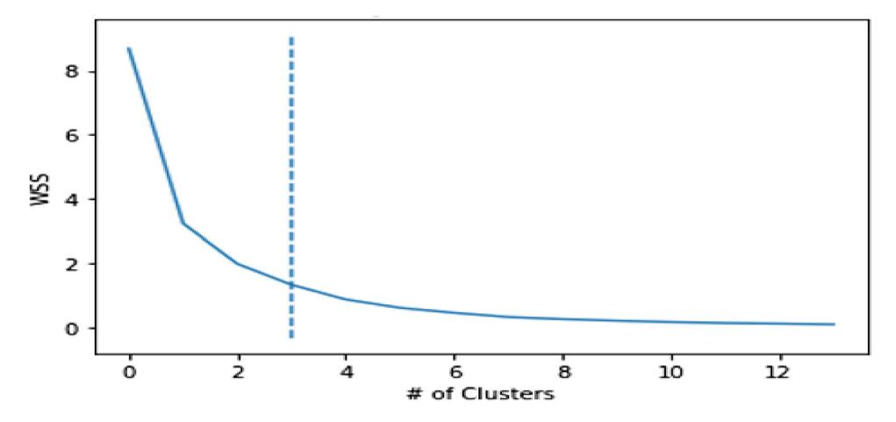

<!-- A3.R61 | source: papers_json/A3.R61/ -->

## Determining the predictive importance of the core dimensions of nation brands

Abdelmounaim Lahrech The Faculty of Business and Law, British University in Dubai, Dubai, United Arab Emirates Hazem Aldabbas

Research Outreach Department, American University in the Emirates, Dubai, United Arab Emirates, and Katariina Juusola

Department of Marketing, College of Business Administration, Ajman University, Ajman, United Arab Emirates

## الملخص (Abstract)

الغرض – استنادًا إلى نظرية الموارد ونظرية ميزة الموارد، تهدف هذه الدراسة، وهي دراسة مقارنة، إلى فحص الأبعاد الأساسية للعلامات التجارية للدول – الثقافة، والسياحة، والصادرات، والاستثمار الأجنبي المباشر، والهجرة، والحوكمة – من منظور قيمة العلامة التجارية القائم على الشركات في عينة من 48 دولة مقسمة إلى ثلاث مجموعات (علامات تجارية قوية ومتوسطة وضعيفة للدول) في الفترة من 2011 إلى 2019، من أجل تحديد أهم العوامل المتنبئة بقوة العلامة التجارية للدولة في كل مجموعة.

التصميم/المنهجية/النهج – تم تطبيق أسلوب التجميع (clustering) على مؤشر العلامة التجارية للدولة المعدّل من أجل تصنيف الدول المشمولة إلى مجموعات قوية ومتوسطة وضعيفة. بعد ذلك، تمكّن الباحثون من تحليل كل مجموعة في محاولة لاستكشاف الأهمية النسبية للمتغيرات المتنبئة وتحديد ما إذا كانت هذه الأهمية تختلف بين المجموعات.

النتائج – كشف هذا النهج عن نتائج جديدة ذات أهمية كبيرة لصانعي السياسات والأكاديميين. تشير النتائج إلى الموارد التي تسهم أكثر من غيرها في قيمة العلامة التجارية للدولة في كل مجموعة. يمكن أن توجّه هذه المعلومات صانعي السياسات نحو الاستفادة الفعّالة من هذه الموارد الاستراتيجية. أولًا، كان البعد الثقافي عاملًا متنبئًا أكثر أهمية بالنسبة للدول ذات العلامات التجارية المتوسطة والضعيفة مقارنة بالدول ذات العلامات القوية. ثانيًا، أظهرت السياحة أعلى أهمية تنبؤية في جميع المجموعات. بالنسبة للأكاديميين، تساعد هذه النتائج في تعزيز فهم أفضل لمحددات قوة العلامة التجارية للدولة، بما يتوافق مع نظرية الموارد ونظرية ميزة الموارد.

الأصالة/القيمة – تسهم نتائج هذه الدراسة في الأدبيات المتعلقة بإدارة العلامة التجارية للدولة، لا سيما التيار المرتبط بتحويل قيمة العلامة التجارية للدولة إلى عائد مالي (monetization).

Keywords Nation brand, Nation branding, Brand performance, Place branding, Culture, Tourism, Country image, Country reputation

Paper type Research paper

## 1. المقدمة (Introduction)

في العقود الأخيرة، سعت معظم الدول إلى تطوير أو تعديل علاماتها التجارية الوطنية. تُفهم "العلامة التجارية للدولة" عادةً على أنها مزيج من المجالات الاستراتيجية للكفاءة الوطنية – أي الأصول الثقافية والبشرية والسياسية والتجارية للدولة، وإمكاناتها الاستثمارية، وجاذبيتها السياحية [(Anholt, 2005](#page-9-0)). في المقابل، يشرح [Dinnie (2008)](#page-9-1) مفهوم العلامة التجارية للدولة من حيث مدى نجاح الدولة في مزج العناصر متعددة الأبعاد لعلامتها التجارية بطريقة متجذرة ثقافيًا تميّز الدولة عن غيرها وتجعلها ذات صلة بجمهورها المستهدف.

نظرًا لأن العلامات التجارية القوية للدول تمتلك القدرة على دفع تحقيق أهداف سياسية واجتماعية واقتصادية متنوعة، يجب إدارة العلامات التجارية للدول وتوظيفها بفعالية. ومع أن مصطلح "العلامة التجارية للدولة" بات مستخدمًا على نطاق واسع اليوم، لا يزال هناك نقاش مستمر حول تأطيره النظري وقياسه وتبعاته التسويقية (He et al.[, 2021)](#page-10-0).

The current issue and full text archive of this journal is available on Emerald Insight at: https://www.emerald.com/insight/1061-0421.htm

في الواقع، وبينما طوّرت دراسات عديدة نظريات تتعلق بالعلامات التجارية للدول [(Steenkamp, 2021](#page-11-0))، وطوّر آخرون مؤشرات لمقارنة أداء العلامة التجارية للدول ([Fetscherin, 2010;](#page-9-2) [Lahrech](#page-10-1) et al., 2020b)، لا يزال هناك فهم محدود لأي عناصر العلامة التجارية للدولة تُعد الأكثر أهمية من حيث القوة الإجمالية للعلامة. يوفر مفهوم قوة العلامة التجارية للدولة مقياسًا لفعالية علامة الدولة التجارية في تعزيز هويتها وصورتها العامة، ويُعد أداة قيّمة للحكومات والمنظمات لتقييم نقاط القوة والضعف في علامة الدولة التجارية [(Fetscherin, 2010](#page-9-2)).

من الضروري سد هذه الفجوة البحثية لمساعدة الدول على تحويل قيمة علامتها التجارية إلى عائد مالي (He et al.[, 2021)](#page-10-0)، وهو ما

Compliance with ethical standards: Conflict of interest: The authors have no conflicting interests to declare that are relevant to the content of this article.

Funding: This study was funded by Ajman University research grant 2021-IRG-CBA-3.

Ethical approval: Not applicable.

Informed consent: Not applicable.

Received 15 October 2022 Revised 19 March 2023 29 May 2023 Accepted 30 May 2023

<!-- page 2 -->

Volume 32 · Number 8 · 2023 · 1207–1219

يمكن تحقيقه عندما يكون مديرو العلامات التجارية على وعي بالموارد التي تسهم أكثر من غيرها في قيمة العلامة التجارية للدولة في مجموعة معينة من الدول. يتيح هذا الوعي لمديري العلامات التجارية الاستفادة الفعالة من الموارد الاستراتيجية. في مراجعتهما الشاملة لأبحاث العلامة التجارية للدولة على مدى العقود الأخيرة، يشير Rojas-M[endez and Khoshnevis (2023)](#page-11-1) إلى ضرورة إجراء دراسات تجريبية لفحص كل عنصر فرعي من عناصر العلامة التجارية للدولة لتحديد أي العناصر الفرعية له الأثر الأكبر على نتائج بناء العلامة التجارية للدولة. وبالمثل، ونظرًا لعدم وجود دراسات معروفة تتناول تراتبية الأبعاد أو الوزن النسبي لكل بعد، يدعو Hao et al. [(2021)](#page-10-2) إلى دراسات تفحص مستوى أهمية كل بعد من أبعاد العلامة التجارية للدولة. علاوة على ذلك، تندر الدراسات المقارنة عبر الدول التي تستخدم بيانات طولية، إذ تميل الدراسات في هذا المجال إلى التركيز على دول فردية وأدائها الخاص كعلامة تجارية (Hao et al.[, 2021)](#page-10-2).

تمثل هذه الفجوات في الأدبيات الأساس المنطقي لهذه الدراسة، التي تهدف إلى فحص الأبعاد الأساسية للعلامات التجارية للدول – الثقافة، والسياحة، والصادرات، والاستثمار الأجنبي المباشر (FDI)، والهجرة، والحوكمة – من أجل تحديد أهم محركات قوة العلامة التجارية للدولة. ولتحقيق ذلك، نميّز بين أداء العلامة التجارية لثلاث مجموعات من الدول (أي علامات تجارية قوية ومتوسطة وضعيفة) من بين عينة من 48 دولة في الفترة من 2011 إلى 2019، ونستكشف الأهمية النسبية لأبعاد العلامة التجارية للدولة ضمن تلك المجموعات. تسهم دراستنا في أدبيات أداء العلامة التجارية للدولة ([Fetscherin,](#page-9-2) [2010;](#page-9-2) [Lahrech](#page-10-1) et al., 2020b) وتحويل قيمة العلامة التجارية للدولة إلى عائد مالي (He et al.[, 2021](#page-10-0)). وبناءً على ذلك، تفيد نتائجنا كلًا من البحث والممارسة من خلال تزويد أصحاب المصلحة في العلامة التجارية للدولة والمسوّقين بمعرفة قيّمة حول العناصر التي ينبغي إعطاؤها الأولوية في مبادرات بناء العلامة التجارية للدولة.

## 2. نظرية الموارد، نظرية ميزة الموارد، وبناء العلامة التجارية للدولة (Resource-based theory, resource-advantage theory and nation branding)

## 2.1 الأساس النظري (Theoretical foundation)

تستند هذه الدراسة نظريًا إلى نظرية الموارد (RB) للشركة، التي نشأت في كتابات Penrose'[s (1959)](#page-11-2) الرائدة، والنظريات الإدارية اللاحقة، وتحديدًا نظرة الموارد (RBV) ([Barney, 1991](#page-9-3); [Wernerfelt, 1984)](#page-12-0) ونظرية ميزة الموارد لتنافس الشركات (RA theory) [(Hunt, 1995;](#page-10-3) [Hunt and Morgan,](#page-10-4) [1996)](#page-10-4)، والتي تُطبَّق على سياق بناء العلامة التجارية للدولة. وعلى الرغم من أن كل نظرية تركز على منظور مختلف، فإنها جميعًا تهدف إلى تفسير كيف يمكن للمنظمات تحقيق ميزة تنافسية في السوق، وقد ربطت دراسات سابقة بين هذه النظريات وكلٍّ من بناء العلامة التجارية بشكل عام [(Ahmad and Salleh, 2019](#page-9-4); [Gisip and Harun, 2013](#page-10-5); O'[Cass and Voola, 2011](#page-11-3)) وبناء العلامة التجارية للدولة على وجه الخصوص (Rojas-M[endez, 2013)](#page-11-4). وبينما تشترك نظريتا RB/RBV ونظرية RA في فهم دور الموارد الداخلية للمنظمة في المنافسة السوقية، فإنها تختلف أيضًا في عدة جوانب رئيسية. أولًا، تفسّر نظريتا RB وRBV كيف يمكن للشركات اكتساب ميزة تنافسية من خلال حيازة وإدارة موارد قيّمة ([Wernerfelt, 1984)](#page-12-0). ووفقًا لهاتين النظريتين، تمتلك الشركة نوعين من الموارد: ملموسة (مثل الآلات والمباني والمعدات) وغير ملموسة (مثل

المعرفة، والسمعة، وقيمة العلامة التجارية). كما تتوقع نظرية RBV أن حيازة موارد فريدة ونادرة ويصعب تقليدها ولا يمكن الاستعاضة عنها يمكن أن تشكّل أساسًا لتحقيق ميزة تنافسية مستدامة [(Barney and Arikan, 2001)](#page-9-5).

في المقابل، ونظرًا لأنها تنظر إلى المنافسة السوقية باعتبارها ديناميكية بطبيعتها ([Hunt and Morgan, 1996](#page-10-4))، تقترح نظرية RA أن الميزة التنافسية المستدامة تنتج عن الاكتساب والتوظيف الفعّالين للموارد الداخلية والخارجية على حد سواء (أي الموارد المالية والمادية والقانونية والبشرية والمعلوماتية والعلائقية) المرتبطة بوضع الشركة المحدد. وبالتالي، فإن الحجة المركزية لهذه النظرية هي أن الأداء المالي للشركة ونجاحها يعتمدان على قدرتها على توظيف مواردها للتنافس في أسواق مستهدفة معينة حيث تمثل تلك الموارد مصدرًا لمزايا نسبية مقارنة بالمنافسين [(Golicic](#page-10-6) et al., 2012; [Varadarajan, 2023](#page-11-5)). تؤكد نظرية RA على الطبيعة الديناميكية للمنافسة وكيف تؤدي التكاليف النسبية للموارد والقيم النسبية الناتجة عنها إلى مواقع تنافسية متعددة محتملة في السوق، مثل موقع الميزة التنافسية، أو موقع التكافؤ، أو موقع العيب التنافسي [(Hunt and Morgan, 1996)](#page-10-4). وبناءً على ذلك، تقترح نظرية RA وجوب توزيع الموارد الملموسة وغير الملموسة بشكل مناسب، مع تطوير الابتكارات الاستباقية والتفاعلية لتحقيق ميزة تنافسية على المنافسين، وهو ما يُتوقع أن يؤدي إلى تباين في أداء الشركات [(Hunt, 1999](#page-10-7); [Varadarajan, 2023](#page-11-5)).

باختصار، تقدّم نظريات RB وRBV وRA منظورات مختلفة حول كيفية حصول الشركات على ميزة تنافسية. يكمن الفرق الرئيسي بين النظريات الثلاث في أن نظريتي RB وRBV تركزان أكثر على الموارد الداخلية التي تتحكم فيها الشركة. في المقابل، تركز نظرية RA بشكل أكبر على العوامل البيئية الخارجية، مثل المؤسسات المجتمعية والمنافسين والمستهلكين والسياسات العامة، والتي تخرج عن سيطرة الشركة لكنها مع ذلك تشكّل المنافسة السوقية وقدرة الشركة على تجاوز أداء منافسيها [(Hunt and Morgan, 1996;](#page-10-4) [Hunt, 1997](#page-10-8)). ومن ثم، تنظر نظرية RA إلى كل شركة داخل الصناعة باعتبارها كيانًا فريدًا تشكّله بيئتها المؤسسية وتاريخها وشبكاتها وقدرتها على توظيف الموارد [(Hunt and Morgan, 1996](#page-10-4)).

تسلط الدراسات السابقة الضوء على عدة موارد أساسية استنادًا إلى أدبيات التسويق العالمي وبناء العلامة التجارية للدولة. تربط بعض الدراسات هذه الخصائص بصادرات الدولة من خلال تطبيق نظريتي RB [(Aghazadeh](#page-9-6) et al., 2022) وRA (Sun et al.[, 2016](#page-11-6)). علاوة على ذلك، يقترح Rojas-M[endez (2013)](#page-11-4) إطارًا نظريًا قائمًا على نظرية RA لاستكشاف أهمية المتغيرات المحددة في بناء العلامة التجارية للدولة، لا سيما أبعاد وجوانب تصورات الناس حول علامة الدولة التجارية. وبينما تركز نظريتا RB وRA على المنظمات، يؤكد Sun et al. [(2016)](#page-11-6) أنه يمكن النظر إلى الدولة على أنها شركة أو منظمة "عملاقة" ذات أصحاب مصلحة عديدين. كما تُثبت دراسات أخرى في مجال بناء العلامة التجارية للدولة هذا الترابط، إذ تشترك استراتيجيات بناء العلامة التجارية التي تستخدمها الدول في أوجه تشابه ملحوظة مع استراتيجيات بناء العلامة التجارية للشركات ([Papadopoulos and Heslop, 2002](#page-11-7)). وبالتالي، تنطبق نظريتا RB وRA أيضًا على الدول، حتى وإن كانت الدول أكثر تعقيدًا بكثير من المنظمات [(Rojas-M](#page-11-4)endez, [2013)](#page-11-4).

<!-- page 3 -->

Volume 32 · Number 8 · 2023 · 1207–1219

## 2.2 بناء العلامة التجارية للدولة (Nation branding)

يرتبط بناء العلامة التجارية للدولة بمجموعة واسعة من الأدبيات المتعلقة ببناء علامة المكان وبناء علامة الوجهة [(Braun](#page-9-7) et al.[, 2014](#page-9-7); [Florek and Kavaratzis, 2014)](#page-9-8) وبدراسات بلد المنشأ ([Chattalas](#page-9-9) et al., 2008; [Lim and O](#page-10-9)'Cass, 2001; [Nobre and Sousa, 2022;](#page-11-8) [Pecotich and Rosenthal, 2001](#page-11-9); [White,](#page-12-1) [2012)](#page-12-1)، كما ترتبط أيضًا بمجال الدبلوماسية العامة [(Hassan and Mahrous, 2019)](#page-10-10). ونظرًا لاختلاف مجالات الاهتمام لدى الباحثين فيما يتعلق بهذا الموضوع، من الضروري التمييز بين بناء العلامة التجارية للدولة وبناء علامة الوجهة، وكذلك بين صورة الدولة وسمعة الدولة. أولًا، يُعرّف [Fan](#page-9-10) [(2010)](#page-9-10) بناء العلامة التجارية للدولة بأنه "عملية يمكن من خلالها إنشاء صور الدولة ومراقبتها وتقييمها وإدارتها بشكل استباقي من أجل تحسين أو تعزيز سمعة الدولة لدى جمهور دولي مستهدف" (ص. 6). وبالتالي، فهو يشير إلى مدى إسهام أبعاد العلامة التجارية للدولة في قدرتها على تحقيق المستوى المرغوب من التنافسية [(Lee, 2009)](#page-10-11). علاوة على ذلك، يشير بناء العلامة التجارية للدولة إلى استخدام أساليب التسويق، وتحديدًا تقنيات بناء العلامة التجارية، المصممة لتعزيز صورة وطنية تنافسية بقوة في السوق العالمية للدول [(Schwak, 2016)](#page-11-10). والواقع أن بناء العلامة التجارية للدولة يهدف إلى تغيير أو تعزيز صورة الدولة وسمعتها لدى جماهير مختلفة؛ وتزويدها بمصدر للتمايز؛ وتحسين تنافسيتها الاقتصادية والاجتماعية والسياسية والتجارية والدولية (Rojas-M[endez and Khoshnevis, 2023](#page-11-1); [Melnyk and](#page-11-11) [Varibrusova, 2019](#page-11-11)). وعلى وجه الخصوص، طُبّق مفهوم بناء العلامة التجارية للدولة في حملات متنوعة تهدف إلى الترويج للوجهات السياحية من خلال بناء استراتيجي لعلامة الدولة. تشمل المبادرات ذات الصلة تصميم حملات استراتيجية متعددة لبناء العلامة التجارية، مثل حملات "Cool Britannia" [(Werther,](#page-12-2) [2011)](#page-12-2)، و"100% Pure New Zealand" ([Bell, 2008;](#page-9-11) [Morgan](#page-11-12) et al., [2002)](#page-11-12)، و"Incredible India" [(Edwards and Ramamurthy,](#page-9-12) [2017)](#page-9-12)، والتي سعت جميعها إلى تغيير التصورات حول العلامة التجارية للدولة المعنية كوجهة جذابة. وفي هذا الصدد، يُعرّف Blain et al. [(2005)](#page-9-13) علامة الوجهة بأنها "الأنشطة التسويقية (1) التي تدعم إنشاء اسم أو رمز أو شعار أو علامة كلامية أو أي عنصر رسومي آخر يحدد الوجهة ويميزها في آن واحد؛ (2) التي تنقل وعدًا بتجربة سفر لا تُنسى وترتبط بشكل فريد بالوجهة؛ (3) وتعمل على ترسيخ وتعزيز تذكّر الذكريات الممتعة لتجربة الوجهة، وذلك كله بهدف صريح هو خلق صورة تؤثر في قرارات المستهلكين لزيارة تلك الوجهة تحديدًا، بدلًا من وجهة بديلة" (ص. 331–332).

وفي حين أن صورة الدولة وسمعة الدولة مفهومان مترابطان، فإنهما يختلفان في جوانب رئيسية، وتتطلب جهود بناء العلامة التجارية معالجة كلا المفهومين. أولًا، تشير صورة الدولة، عند تعريفها بشكل واسع، إلى "التمثيلات الذهنية لشعب الدولة ومنتجاتها وثقافتها ورموزها الوطنية" (Verlegh and Steenkamp 1999, p. 525). ينظر [Roth and](#page-11-13) [Diamantopoulos (2009)](#page-11-13) إلى صورة الدولة على أنها مجموع المعتقدات المعرفية للمستهلكين حول الدولة، والقيمة العاطفية الوجدانية التي يربطها المستهلكون بالدولة، واهتمام المستهلكين السلوكي بها. وبهذا المعنى، تُعد صورة الدولة عنصرًا أساسيًا لسمعتها وجاذبيتها وهوية علامتها التجارية، إذ يمكن أن تترتب على الصورة الإيجابية آثار عديدة على النفوذ الاقتصادي والاجتماعي والسياسي للدولة (Lu et al.[, 2019)](#page-10-12). ومن المعروف أن الصورة الإيجابية للدولة ترتبط ارتباطًا قويًا

بالتقييمات الإيجابية للمنتجات المصنوعة في تلك الدولة من خلال صور المنتج-الدولة؛ إلا أن هذه التقييمات قد تكون متحيزة بفعل الصور النمطية الثقافية ([Verlegh and Steenkamp,](#page-12-3) [1999)](#page-12-3).

ثانيًا، تعتمد سمعة الدولة على نطاق أوسع من العناصر لتقييم العلامات التجارية للدول مقارنة بصورة الدولة. تُفهم سمعة الدولة على أنها "تصورات الدولة عبر الزمن استنادًا إلى التجارب المباشرة وغير المباشرة معها مقارنة بمنافسيها" [(Kiambi, 2017,](#page-10-13) p. 62). وبالتالي، يأخذ منظور سمعة الدولة بعين الاعتبار مصادر متنوعة للسمعة تتماشى مع أهداف الدولة الاستراتيجية وكيفية تنافسها مع منافسيها. ولهذا المنظور صلة بنظرية RA للشركة. عندما يكوّن الناس تصوراتهم حول سمعة الدولة، فإن ذلك يشكّل أساس قيمة العلامة التجارية القائمة على المستهلك لتلك الدولة (Florek et al.[, 2019)](#page-9-14). حظي مفهوم قيمة العلامة التجارية باهتمام كبير من شركات الاستشارات المتخصصة في بناء العلامة التجارية للدول، والتي طوّرت مجموعة من المؤشرات لتقييم أداء العلامة التجارية للدولة من منظور المستهلك.

يُعد مؤشر العلامة التجارية للدولة (CBI) [[1]](#page-9-15) ومؤشر العلامات التجارية للدول (NBI) [[2](#page-9-16)] من أبرز المؤشرات التي تصنّف أداء العلامة التجارية للدول سنويًا منذ عام 2005 (Hao et al.[, 2021](#page-10-2)). يقيّم مؤشر CBI أداء العلامة التجارية للدولة استنادًا إلى خمسة أبعاد (نظام القيم، والفوائد التجارية، وجودة الحياة، والتراث والثقافة، والسياحة) [(Belloso, 2010)](#page-9-17). في المقابل، يعتمد مؤشر NBI على ستة أبعاد (الصادرات، والحوكمة، والاستثمار والهجرة، والثقافة والتراث، والناس والسياحة) تُقيَّم من خلال استطلاعات المستهلكين (Hao et al.[, 2021)](#page-10-2). وفي حين أصبحت هذه المؤشرات أدوات شائعة، فإن منهجيتها الأساسية أثارت مخاوف بين الأكاديميين [(Fetscherin, 2010](#page-9-2)). فعلى سبيل المثال، قد يكون لدى المستجيبين في الاستطلاعات خبرة محدودة بالدول التي يُطلب منهم تقييمها، مما يعني أن تقييماتهم قد تكون متحيزة أو مبنية على صور نمطية غير دقيقة.

ومؤخرًا، واستجابة للانتقادات الموجهة إلى مؤشرات العلامة التجارية للدولة التي تُنتجها شركات الاستشارات، سعى الأكاديميون إلى تطوير مؤشرات تكميلية لتقييم أداء العلامة التجارية للدول بشكل أكثر موضوعية باستخدام البيانات الإحصائية [(Fetscherin, 2010](#page-9-2); Lahrech et al.[, 2020b](#page-10-1)). يُعرف هذا المنظور لأداء العلامة التجارية للدولة عادةً باسم "قيمة العلامة التجارية القائمة على الشركات" ([Atilgan](#page-9-18) et al., 2005; [Fetscherin, 2010](#page-9-2))، وينظر إلى أبعاد العلامة التجارية للدولة من منظور الشركة. علاوة على ذلك، يركز هذا المنظور على العناصر الاستراتيجية التي تشكّل أهم الموارد التي يمكن للدولة توظيفها للتنافس بفعالية في السوق العالمية، وبالتالي تعزيز أدائها المالي. وبذلك، يتماشى هذا المنظور مع نظريتي RB وRA.

طوّر [Fetscherin (2010)](#page-9-2) أول مؤشر لقيمة العلامة التجارية القائم على الشركات في مجال بناء العلامة التجارية للدولة، إذ قيّم أداء العلامة التجارية لـ32 دولة في عام 2007 من خلال التركيز على خمسة أبعاد للعلامة التجارية للدولة (الصادرات، والسياحة، والاستثمار الأجنبي المباشر، والهجرة، وبيئة الحكومة). قُيّمت هذه الأبعاد، باستثناء بيئة الحكومة، باستخدام بيانات إحصائية. ونتيجة لذلك، طوّر Fetscherin مؤشر قوة العلامة التجارية للدولة (CBSI) ([Fetscherin, 2010)](#page-9-2). لاحقًا، قيّم [Lahrech](#page-10-1) et al. (2020b) أداء العلامة التجارية لـ131 دولة خلال الفترة 2007–2015 باستخدام الأبعاد نفسها، مع إضافة مؤشر التنمية البشرية (HDI) كبعد سادس. وبذلك،

<!-- page 4 -->

Volume 32 · Number 8 · 2023 · 1207–1219

طوّروا مؤشر قوة العلامة التجارية للدولة المعدّل (MCBSI). ويتوافق ترتيب الدول وفق كلٍّ من مؤشري MCBSI وCBSI بشكل كبير مع ترتيب مؤشر NBI، مما يؤكد أن قيمة العلامة التجارية القائمة على المستهلك وتلك القائمة على الشركة تمثلان تقييمات متشابهة لقوة العلامة التجارية للدول.

## 2.3 تفعيل بناء العلامة التجارية للدولة لأغراض البحث: تحديد الأبعاد الأساسية للعلامات التجارية للدول (Operationalizing nation branding for research purposes: defining the core dimensions of nation brands)

في هذه الدراسة، نتناول أداء العلامة التجارية للدولة من منظور العلامة التجارية القائم على الشركة لمواءمة نهجنا مع نظريتي RB وRA. نُعرّفه بأنه قدرة الدولة على تحقيق عوائد إيجابية من أهم موارد علامتها التجارية (أي الموارد الملموسة وغير الملموسة)، والتي يمكن أن تؤثر على الأداء العام لعلامتها التجارية. وكنقطة انطلاق، راجعنا الدراسات القائمة حول بناء العلامة التجارية للدولة لتحديد الأبعاد الأكثر استخدامًا لتقييم قوة العلامة التجارية للدول. ونظرًا للطبيعة متعددة التخصصات لدراسات بناء العلامة التجارية للدولة السابقة، ونظرًا لأن الأكاديميين والممارسين طوّروا مؤشرات متنوعة للعلامة التجارية للدولة، لا توجد مجموعة متفق عليها بشكل عام من الأبعاد التي تشكّل العلامة التجارية للدولة. يعرض الجدول 1 أوجه التشابه والاختلاف من حيث الأبعاد المختلفة عبر أربعة مؤشرات مختلفة، وهي CBSI وMCBSI، اللذان يمثلان نهج قيمة العلامة التجارية القائم على الشركة، وNBI وCBI، اللذان يستندان إلى نهج قيمة العلامة التجارية القائم على المستهلك.

يميل الباحثون الذين يفحصون أداء العلامة التجارية للدولة من منظور قيمة العلامة التجارية القائم على الشركة إلى تقييم قوة العلامة استنادًا إلى العوامل ذات التأثير الأكثر مباشرة على الأداء الاقتصادي والمالي للدولة. أما أكثر الأبعاد شيوعًا التي يمكن قياسها باستخدام بيانات موضوعية فهي: الثقافة، والسياحة، والصادرات، والاستثمار الأجنبي المباشر، والهجرة، والحوكمة. وبناءً على ذلك، اختيرت هذه الأبعاد الستة للاستخدام في هذه الدراسة عند استكشاف دور كل بعد وأهميته النسبية فيما يتعلق بقوة العلامة التجارية للدولة. وسيتم تناول الأبعاد الستة بمزيد من التفصيل في الفقرات التالية.

أولًا، تُعد الثقافة جوهر العلامة التجارية، إذ تلعب دورًا محوريًا في تمييز العلامة التجارية من خلال خلق بيئة يشعر فيها الجمهور بانتماء قوي (Fan and Zhou, 2020). تُعد الثقافة والفنون أدوات فعّالة لتحديد جوهر العلامة التجارية للدولة وتحسين صورتها (Ahn and Wu, 2015). يشير Torelli (2021) إلى أن أفضل طريقة لتعزيز صورة العلامة التجارية للدولة في أذهان الناس هي الترويج لصورتها الثقافية. وبالتالي، يمكن اعتبار الثقافة جانبًا أساسيًا من جوانب قوة العلامة التجارية للدولة. تُظهر دراسة تجريبية حديثة أجراها Nobre and Sousa (2022) أن تصورات الناس حول التراث الثقافي لدولة ما تمثل عاملًا متنبئًا موثوقًا بسمعتها العامة. وبناءً على ذلك، يمكن توظيف التراث الثقافي وتفرّد الثقافة لبناء العلامة التجارية للدولة وتطويرها بشكل أكبر. تميل العلامات التجارية الثقافية إلى توليد اهتمام واسع وتعزيز مجموعة مستهلكين موالين ذوي ارتباط عاطفي قوي بفضل معانيها الفريدة والإيجابية (Steenkamp, 2021). في سياق نظرية RA، تمتلك الثقافة القدرة على تعزيز ميزة تنافسية قوية في السوق بسبب تعقيدها وصعوبة تقليدها وطبيعتها غير المتحركة نسبيًا، مما يجعل تكرارها أو الحصول عليها أمرًا صعبًا (Hunt and Madhavaram, 2012).

ثانيًا، تُعد السياحة أحد أهم القطاعات الاقتصادية العالمية وأسرعها نموًا (Sokhanvar, 2019). كما تُعد صناعة السياحة أحد أكثر جوانب العلامة التجارية للدولة ملموسية وقابلية للإدارة (Giannopoulos et al., 2011). يعكس عامل السياحة أساسًا دوافع الناس لزيارة دولة ما بسبب جمالها الطبيعي ومبانيها التاريخية وبيئتها وأجواء مدنها (Nobre and Sousa, 2022)، مما يخلق وعيًا ويجعل السياحة جانبًا حيويًا في إدارة صورة الدولة وبناء علامتها التجارية (Hakala et al., 2013). علاوة على ذلك، وُجد أن الثقافة الوطنية، كما تنعكس في خصائص شعب الدولة، تجذب السياح أيضًا (Micevski et al., 2021). تكشف دراسة تجريبية شملت 20 مدينة أوروبية أجراها Mikulić et al. (2016) أن قوة علامة الوجهة ترتبط ارتباطًا إيجابيًا وذا دلالة إحصائية بعدد السياح. وعلى الرغم من الاختلافات في تطورها

<!-- page 5 -->

Volume 32 · Number 8 · 2023 · 1207–1219

الاجتماعي والاقتصادي، تُعد السياحة مهمة لجميع الدول لأنها تمثل مصدرًا كبيرًا للعملة الأجنبية والدخل والعمالة المباشرة وغير المباشرة ([Sinclair, 1998](#page-11-18)). ونتيجة لذلك، تركز مبادرات بناء العلامة التجارية للدولة تقليديًا على الترويج للسياحة [(Teslik, 2007](#page-11-19)).

ثالثًا، تميل الدول المتقدمة اقتصاديًا إلى امتلاك صورة إيجابية للدولة، وقد ثبت أن ذلك يعزز صادراتها (Sun et al.[, 2016](#page-11-6)) لأن الشركات يمكنها استخدام صورة بلد المنشأ الإيجابية لصالحها عند تسويق المنتجات (مثل الساعات السويسرية) [(Fetscherin, 2010)](#page-9-2) أو الخدمات [(Javalgi](#page-10-17) et al., 2001). كما يشمل بناء العلامة التجارية للدولة الترويج للسلع والخدمات غير الملموسة لأغراض التصدير [(Nguyen and Özçaglar-Toulouse, 2021](#page-11-20)). وكما نوقش سابقًا، تستفيد الدول من صورتها عندما ينظر المستهلكون إلى المنتجات أو الخدمات القادمة من دولة معينة بشكل إيجابي استنادًا إلى نقاط قوتها الإنتاجية والتسويقية ([Roth and Romeo, 1992)](#page-11-21). وبالتالي، نجادل بأن إجمالي عدد الصادرات يرتبط ارتباطًا إيجابيًا بقوة العلامة التجارية للدولة. تُعد الصادرات مهمة أيضًا للدول الأقل تطورًا والاقتصادات الناشئة، إذ يمكن أن تؤدي هوية العلامة التجارية للدولة إلى تصورات وانطباعات إيجابية تجاه فئات منتجات معينة، كما يمكنها أن تسهم في تعزيز صادرات تلك المنتجات (Hao et al.[, 2021](#page-10-2)). ويمكن ملاحظة هذا النوع من الفائدة، على سبيل المثال، في صادرات القهوة الكولومبية أو الفودكا الروسية ([Fetscherin, 2010](#page-9-2)).

رابعًا، تُعد قدرة الدولة على جذب الاستثمار الأجنبي المباشر بعدًا آخر بالغ الأهمية لقوة العلامة التجارية للدولة. وعلى الرغم من الاهتمام الكبير والمتنامي ببناء العلامة التجارية للدولة فيما يتعلق بجذب الاستثمار الأجنبي المباشر (Bose et al.[, 2020](#page-9-21); [Lahrech](#page-10-18) et al., [2020a;](#page-10-18) [Lee and Lee, 2021;](#page-10-19) [Schoeneman and Fullerton, 2022)](#page-11-22)، لا يزال كلا المفهومين يرتبطان بفجوات بحثية كبيرة ([Papadopoulos](#page-11-23)et al., 2016). ومع ذلك، دفعت أهمية الاستثمار الأجنبي المباشر وقيمته على المستوى العالمي الدول وصانعي السياسات إلى تسويق اقتصاداتهم في محاولة لجذب مزيد من المستثمرين (Lahrech et al.[, 2020a](#page-10-18)). علاوة على ذلك، يرى [Fetscherin (2010)](#page-9-2) أن ارتفاع مستوى الاستثمار الأجنبي المباشر يدل على علامة تجارية وطنية قوية. وفي مكان آخر، أكدت دراسة تجريبية استخدمت نموذج انحدار بيانات مقطعية-زمنية أجراها [Lahrech](#page-10-18) et al. [(2020a](#page-10-18)) على أفضل عشر علامات تجارية للدول أداءً في الفترة 2008–2014 أن الدول ذات العلامات التجارية القوية تستفيد من زيادة كبيرة في الاستثمار الأجنبي المباشر. وبناءً على ذلك، نجادل بأن قدرة الدولة على جذب الاستثمار الأجنبي المباشر قد تعزز أداء علامتها التجارية بشكل كبير وإيجابي وتجذب مستثمرين جددًا. وتُعد العوامل الملموسة الأكثر فحصًا في الأبحاث السابقة حول محددات الاستثمار الأجنبي المباشر من الخصائص "الصلبة" للدولة [(Papadopoulos](#page-11-23)et al., 2016).

خامسًا، تُعد الهجرة بعدًا حاسمًا آخر للعلامة التجارية للدولة. يتمثل جانب أساسي من بناء العلامة التجارية للدولة في خلق تصورات إيجابية عن الدولة لدى الجماهير الداخلية والخارجية على حد سواء لمنحها ميزة تنافسية على منافسيها ([Yousaf](#page-12-4) et al., 2020). أصبحت المنافسة العالمية لجذب أفضل المهاجرين وأكثرهم كفاءة والحفاظ على مجمع المواهب المحلي أمرًا متزايد الأهمية نظرًا لأهمية هؤلاء الأشخاص فيما يتعلق بالنمو الاقتصادي وتنافسية الدول ([Silvanto and Ryan,](#page-11-24) [2014)](#page-11-24). فعلى سبيل المثال، طوّرت كندا صورة علامة تجارية لدولة صديقة للمهاجرين تحظى بالإشادة لسياساتها المتعددة الثقافات، التي تعزز المساواة والتسامح مع التنوع الثقافي [(Bhuyan](#page-9-22) et al., 2017). وتُعد حركة الكفاءات هنا أمرًا مهمًا. فعلى سبيل المثال، في عام 2010، كان هناك ما يقارب

28 مليون مهاجر عالي المهارة في دول منظمة التعاون الاقتصادي والتنمية (OECD)، وهو ما مثّل زيادة بنسبة تقارب 130% منذ عام 1990 [(Chand and Tung, 2019)](#page-9-23). علاوة على ذلك، تحتل عدة دول من دول منظمة التعاون الاقتصادي والتنمية مراتب عالية في مختلف مؤشرات العلامة التجارية للدولة، بما في ذلك CBSI ([Fetscherin, 2010)](#page-9-2) وMCBSI ([Lahrech](#page-10-1) et al., 2020b).

سادسًا، تُعد الحوكمة عاملًا مُمكِّنًا لعدد كبير من أبعاد العلامة التجارية للدولة، إذ تشجع الممارسات الحكومية والحوكمية الإيجابية والداعمة على الصادرات والسياحة والاستثمار والهجرة. علاوة على ذلك، يمكن للعلامة التجارية القوية للدولة أن تعزز صادراتها بشكل أكبر؛ وتجذب السياح والاستثمارات والهجرة؛ وتخلق صورة وتصورًا إيجابيين للدولة (He et al.[, 2021)](#page-10-0). وبما أن بناء العلامة التجارية للدولة يتضمن تعزيز أو تغيير تصورات الناس حول صورة الدولة وسمعتها، تلعب البيئة الحكومية دورًا مهمًا في ذلك. علاوة على ذلك، يمتلك الحكومة تأثيرًا رئيسيًا على القوة الناعمة للدولة، التي حُددت باعتبارها محفزًا أساسيًا لمحاولات بناء العلامة التجارية للدولة ([Papadopoulos](#page-11-23) et al., 2016)، بينما يُنظر أيضًا إلى الحكومة باعتبارها مُمكِّنًا خارجيًا مهمًا للموارد من منظور نظرية RA (Hunt and Morgan, 1997). وبالتالي، تُعزز الحوكمة الداعمة نمو علامة تجارية قوية ومفضلة على نطاق واسع للدولة ([Fetscherin,](#page-9-2) [2010)](#page-9-2). ويتوافق هذا الطرح مع نظريتي RB وRA، اللتين تقترحان أن الموارد الملموسة وغير الملموسة يمكن أن توفر ميزة تنافسية قيّمة، لا سيما عند توظيف هذه الموارد بفعالية. ولاستخدام نظامها الحكومي أو الحوكمي كمورد استراتيجي خارجي، تحتاج الدولة إلى بناء نظام فعّال لتهيئة الظروف التي تجذب السياح والاستثمارات والهجرة لتعزيز قوة علامتها التجارية. ويمكن تحقيق ذلك من خلال سياسات وممارسات مثل مكافحة الفساد، وتعزيز السلامة العامة، وضمان وجود قوانين ولوائح شفافة تحمي حقوق الشركات والمواطنين.

باختصار، من المرجح أن تسهم الأبعاد الستة المذكورة أعلاه للعلامة التجارية للدولة إسهامًا كبيرًا في تطوير تنافسية الدولة، ولهذا السبب تُشكّل نقطة الانطلاق لتطوير منهجية هذه الدراسة.

## 3. المنهجية (Methodology)

اشتملت منهجية هذه الدراسة على ثلاث خطوات. أولًا، لتقييم قوة العلامة التجارية للدولة، حُددت المتغيرات الأكثر ارتباطًا بالعلامات التجارية للدول (الثقافة، والسياحة، والصادرات، والاستثمار الأجنبي المباشر، والهجرة، والحوكمة) استنادًا إلى مراجعة الدراسات السابقة. بعد ذلك، جمعنا بيانات مقطعية-زمنية من 48 دولة تتوفر بياناتها للفترة 2011–2019. قُيست الحوكمة استنادًا إلى مؤشرات الحوكمة العالمية (GGI) التي يوفرها البنك الدولي، والتي تقيس الفساد، وفعالية الحكومة، والبيئة السياسية، والبيئة التنظيمية، وسيادة القانون، والصوت والمساءلة. قُيس متغير الثقافة باستخدام مؤشر [Yeganeh](#page-12-5)'s (2013) المركب للثقافة (CCI)، وهو مقياس تكاملي للثقافة الوطنية يجمع بين الأبعاد الثقافية المعروفة التي اقترحها [Hofstede (2001)](#page-10-20) و[Inglehart (1997,](#page-10-21) [2006)](#page-10-22). تهدف هذه الأبعاد إلى تفسير كيفية اختلاف الثقافات من حيث نظام قيمها ودينها، كما تشير إلى ما إذا كانت الثقافة أكثر تقليدية أو أكثر حداثة. وقد تم الحصول على بيانات الصادرات السنوية و

<!-- page 6 -->

Volume 32 · Number 8 · 2023 · 1207–1219

الاستثمارات (صافي الاستثمار الأجنبي المباشر) من البنك الدولي، في حين تم الحصول على بيانات الهجرة من إحصاءات الأمم المتحدة.

لمقارنة أداء العلامة التجارية للدول، استخدمنا مؤشر MCBSI ([Lahrech](#page-10-1) et al., 2020b) لإنشاء مؤشر طولي للعلامة التجارية للدولة. يستخدم مؤشر MCBSI الصادرات والسياحة والاستثمار الأجنبي المباشر والهجرة وبيئة الحكومة ومؤشر التنمية البشرية (HDI) لتقييم قوة العلامة التجارية للدولة. ومع ذلك، استبعدنا مؤشر HDI وأضفنا عنصر الثقافة إلى المعادلة لمواءمتها بشكل أفضل مع المتغيرات المستخدمة لقياس العلامات التجارية للدول المذكورة أعلاه. استخدمنا المعادلة التالية لقياس MCBSI:

$$
MCBSI_{it} = f(Export_{it}, Tourism_{it}, Net FDI_{it}, Migration_{it}, GGI_{it}, CCI_{it})
(1)
$$

حيث Exportit هو إجمالي صادرات الدولة i في السنة t، وTourismit هو إجمالي عدد السياح الذين زاروا الدولة i في السنة t، وFDIit هو صافي الاستثمار الأجنبي المباشر للدولة i في السنة t، وMigrationit هو عدد المهاجرين المقيمين في الدولة i في السنة t، وGGIit هو مؤشر الحوكمة العالمية للدولة i في السنة t، وCCIit هو المؤشر المركب للثقافة للدولة i في السنة t.

وباتباع إرشادات MCBSI وLahrech et al.'[s (2020b)](#page-10-1) لبناء مؤشرات مركبة لمقارنة قوة العلامة التجارية للدول، حصلنا على القيم النسبية بقسمة كل عامل على أقصى قيمة له عبر الدول، ثم خصصنا أوزانًا مختلفة للمتغيرات استنادًا إلى أسلوب التحليل العاملي. كما حسبنا الوزن، Wi، باستخدام أسلوب التحليل العاملي. وبناءً على ذلك، صيغت المعادلة (2) كما يلي:

$$
MCBSI_{it} = W_1 * \frac{Export_{it}}{Max_t(Export)} + W_2 * \frac{Tourism_{it}}{Max_t(Tourism)} + W_3
* \frac{Net \ FDI_{it}}{Max_t(Net \ FDI)} + W_4 * \frac{Migration_{it}}{Max_t(Migration)} + W_5
* \frac{GGI_{it}}{Max_t(GGI)} + W_6 * \frac{CCI_{it}}{Max_t(CCI)}
(2)
$$

بعد ذلك، استخدمنا أسلوب التجميع بطريقة k-medoid، بالاقتران مع مجموع مربعات المجموعة (WSS)، لتقسيم بيانات MCBSI إلى مجموعات. وقد أُجري ذلك لتمكيننا من تقييم مجموعات العلامة التجارية المختلفة للدول والأهمية النسبية لعوامل التنبؤ بالعلامة التجارية للدولة ضمن تلك المجموعات. تتوفر عدة أساليب للتجميع لتقسيم البيانات إلى مجموعات، وإن كان أسلوب k-means هو الأكثر أساسية وشهرة. يعمل أسلوب k-means من خلال تقليل مجموع مربعات الأخطاء (SSE) بين متوسط المجموعة وكل نقطة بيانات ضمنها. ويهدف هذا الأسلوب إلى تقسيم البيانات إلى k مجموعات، بحيث تنتمي كل نقطة بيانات أو ملاحظة إلى المجموعة الأقرب متوسطًا. يمكن أن يؤدي وجود قيم متطرفة (outliers) ضمن مجموعة بيانات إلى إنتاج أسلوب k-means لمجموعة غير تمثيلية [(Barnet and Lewis, 1994)](#page-9-24). ومع ذلك، يمثل أسلوب k-medoids الذي اقترحه [Kaufman and Rousseeuw (1990)](#page-10-23) طريقة بديلة تتمتع بمتانة أكبر في مواجهة القيم المتطرفة، إذ تُختار نقاط البيانات باعتبارها "medoids" بدلًا من الاعتماد على المتوسط. تُعرَّف "medoid" المجموعة بأنها نقطة البيانات ذات أقل متوسط مسافة إلى بقية نقاط البيانات ضمن المجموعة نفسها، مما يعني أنها تقع في مركز المجموعة. وبالتالي، تقيس k-medoid للمجموعة النقطة الوسطى للمجموعة ذات أقل متوسط مسافة إلى بقية

نقاط البيانات ضمن المجموعة نفسها، مما يتيح تحديد أي نقطة بيانات ضمن المجموعة نفسها. وبهذه الطريقة، حددنا ثلاث مجموعات من الدول: 16 دولة ذات علامة تجارية قوية، و13 دولة ذات علامة متوسطة، و19 دولة ذات علامة ضعيفة (انظر [الشكل 1](#page-6-0) و[الجدول 2](#page-6-1)).

وأخيرًا، طبّقنا نموذجًا خطيًا لأهمية المتغيرات المتنبئة باستخدام برنامج SPSS Modeler ضمن كل مجموعة لتحديد الأهمية النسبية لكل متغير متنبئ في تقدير قوة العلامة التجارية للدولة ([الجدول 3)](#page-6-2). وبدلًا من حساب الأهمية النسبية استنادًا إلى أوزان الانحدار، حسبنا مؤشرات الأهمية لأنها مُصممة خصيصًا لتعكس الأهمية النسبية للمتغيرات المتنبئة ضمن نموذج انحدار خطي، حتى في حال وجود تعدد خطية شديد ([Braun and Oswald,](#page-9-25) [2011)](#page-9-25).

## 4. النتائج والمناقشة (Results and discussion)

تحدد نتائجنا عوامل التنبؤ بقوة العلامة التجارية للدولة في ثلاث مجموعات من الدول: المجموعة A، التي تضم 16 دولة ذات قوة علامة تجارية عالية؛ والمجموعة B، التي تضم 13 دولة ذات قوة علامة تجارية متوسطة؛ والمجموعة C، التي تضم 19 دولة ذات قوة علامة تجارية ضعيفة. علاوة على ذلك، تشير النتائج إلى أن الأهمية النسبية لمتغيرات التنبؤ بأداء العلامة التجارية للدولة (أي الثقافة، والسياحة، والهجرة، والحوكمة، والاستثمار الأجنبي المباشر، والصادرات) تختلف باختلاف مجموعات الدول المُقيَّمة (انظر [الجدول 3](#page-6-2)). وفي ما يلي، سنناقش أولًا النتائج الخاصة بكل مجموعة، ثم نقارن أهم الاختلافات في عوامل التنبؤ بقوة العلامة التجارية للدولة بين المجموعات.

أولًا، تؤدي الدول في المجموعة A أداءً أفضل من حيث جذب السياحة والهجرة، إذ يحقق كل بعد نحو 27% من الأهمية. ويُعد الاستثمار الأجنبي المباشر (15.60%) البعد الثالث من حيث الأهمية، بينما تُعد الثقافة البعد الرابع من حيث الأهمية (14.88%). وتمثل الصادرات العنصر الخامس من حيث الأهمية (10.24%). وأخيرًا، لا يحقق بعد الحوكمة سوى 5.10% من الأهمية، مما يجعله أقل العناصر أهمية لقوة العلامة التجارية للدولة بين دول هذه المجموعة. ثانيًا، تُعد السياحة والثقافة أهم بعدين لقوة العلامة التجارية للدولة (نحو 38% و33% على التوالي) بالنسبة لدول المجموعة B. وهذا أمر متوقع، إذ تضم المجموعة B عدة دول معروفة بثقافتها وسياحتها، مثل إيطاليا وإسبانيا والبرتغال. أما ثالث أهم عامل متنبئ بقوة العلامة التجارية للدولة في المجموعة B فهو الاستثمار الأجنبي المباشر (نحو 14.43%)، وهو ما يقارب مستوى أهميته في المجموعة A. أما المتغيرات المتبقية فتشير إلى مستوى أقل من الأهمية، إذ سجلت الهجرة والصادرات والحوكمة 7.76% و4.75% و1.42% على التوالي. ثالثًا، بالنسبة لدول المجموعة C، تُعد السياحة أهم عامل متنبئ بقوة العلامة التجارية للدولة، إذ تمثل 46.56% من قوة العلامة التجارية، وهو ما يشير إلى أنها أكثر أهمية بمقدار الضعف تقريبًا من ثاني أهم عنصر، وهو الثقافة (20.39%). وهذه النتيجة منطقية، إذ إن أهمية السياحة بالنسبة للاقتصادات الإجمالية لدول المجموعة C أكبر مما هي عليه في المجموعتين A وB، اللتين تضمان اقتصادات أكثر تصنيعًا وتنوعًا، مثل الولايات المتحدة والمملكة المتحدة وألمانيا. وفي المجموعة C، يُعد بعد الصادرات ثالث أهم عامل متنبئ بقوة العلامة التجارية للدولة (15.29%). وهذه النتيجة منطقية أيضًا، إذ تعتمد اقتصادات معظم دول المجموعة C على تصدير الموارد الطبيعية و

<!-- page 7 -->

Volume 32 · Number 8 · 2023 · 1207–1219

*Figure 1 Clustering using the WSS method*

|  |  |  | Moderate nation brands |  | Weak nation brands (19 countries) |
| --- | --- | --- | --- | --- | --- |
| Factors | Strong nation brands (16 countries) | Factors | (13 countries) | Factors |  |
| Tourism | 27.10% | Tourism | 38.38% | Tourism | 46.56% |
| Migration | 27.07% | Culture | 33.26% | Culture | 20.39% |
| Net FDI | 15.60% | Net FDI | 14.43% | Exports | 15.29% |
| Culture | 14.88% | Migration | 7.76% | Governance | 6.46% |
| Exports | 10.24% | Exports | 4.75% | Migration | 6.04% |
| Governance | 5.10% | Governance | 1.42% | Net FDI | 5.26% |
|  | Source: Developed by the authors |  |  |  |  |

<!-- page 8 -->

Volume 32 · Number 8 · 2023 · 1207–1219

المنسوجات وسلع مماثلة. وتُعد أبعاد الحوكمة والهجرة والاستثمار الأجنبي المباشر أقل العوامل المتنبئة أهمية بالعلامة التجارية في المجموعة C، إذ حققت درجات 6.46% و6.04% و5.26% على التوالي.

عند مقارنة المجموعات الثلاث من حيث الاختلافات الرئيسية في متغيرات التنبؤ بقوة العلامة التجارية للدولة، يكشف تحليل المجموعات لدينا أن للبعد الثقافي أهمية نسبية أقل في المجموعة A مقارنة بالمجموعتين B وC. علاوة على ذلك، تميل دول المجموعة A إلى أداء أفضل في جذب الهجرة والاستثمار الأجنبي المباشر مقارنة بدول المجموعتين B وC. من المتوقع أن يتيح امتلاك سمعة كاقتصاد حديث ومتقدم لهذه الدول جذب المهاجرين والاستثمارات على حد سواء. ومن المتوقع كذلك أن تجذب العلامة التجارية القوية والإيجابية للدولة الأشخاص والاستثمارات. تكشف مقارنتنا بين المجموعتين B وC أن دول المجموعة B تؤدي أداءً أفضل في جذب الهجرة والاستثمار الأجنبي المباشر مقارنة بدول المجموعة C، بينما يُعد البعد الثقافي أيضًا أكثر أهمية لدول المجموعة B منه لدول المجموعة C. ولا تُعد النتائج المتعلقة بالهجرة مفاجئة، نظرًا لأن دول المجموعة C كثيرًا ما تكون دول منشأ للمهاجرين. فعلى سبيل المثال، من المعروف أن نحو 400,000 عالِم ومهندس من الدول النامية هاجروا إلى الدول المتقدمة لأغراض العمل [(International](#page-10-24) [Labour Organization, 2004)](#page-10-24). في المقابل، تُعد عدة دول من المجموعة A من بين أكبر الدول المستقبلة للمهاجرين عند قياس الهجرة بالأرقام المطلقة [(Migration Policy](#page-11-25) [Institute, 2022)](#page-11-25).

إضافة إلى ذلك، تجدر الإشارة إلى أنه كلما انتقلنا من المجموعة A إلى B ثم إلى C، يتسع الفرق في الأهمية النسبية بين أبعاد قوة العلامة التجارية للدولة. وبالتالي، هناك مزيد من عدم التوازن في الأهمية النسبية للأبعاد. تشير نتائجنا إلى أن دول المجموعة A أكثر توازنًا من حيث الأهمية النسبية لكل بعد مقارنة بدول المجموعتين B وC، اللتين تميلان إلى التركيز على بعد أو بعدين فقط. تشير بياناتنا إلى أن أكبر فرق يوجد بين بُعدي السياحة والثقافة في المجموعة C (إذ يبلغ الفرق بين هذين البعدين، وهما أهم متغيرين في هذه المجموعة، 26.17%). علاوة على ذلك، عند الجمع بينهما، تمثل الأهمية النسبية لهذين البعدين في المجموعة C نحو 67% من إجمالي أهمية المتغيرات الستة. وبالمثل، تُظهر دول المجموعة B اعتمادًا كبيرًا على أهم متغيرين فيما يتعلق بقوة علامتها التجارية، وهما السياحة والثقافة، اللذان يبلغ وزنهما المجمع نحو 72%.

تحمل هذه النتائج الأخيرة أهمية كبيرة لإدارة العلامة التجارية للدولة وسياساتها. من منظور نظرية RB/RBV، يُعد تطوير جميع أبعاد العلامة التجارية للدولة أمرًا ضروريًا، لأن العلامة التجارية القوية المبنية عبر جميع هذه الأبعاد يمكن أن توفر موردًا فريدًا يصعب تقليده يمكن استغلاله في السوق (راجع [Varadarajan,](#page-11-5) [2023)](#page-11-5). ويتطلب هذا البناء الشمولي للعلامة التجارية للدولة تنفيذ استراتيجية لتطوير كل بعد بدلًا من التركيز على بعد أو بعدين فقط. وبالتالي، تتطلب جهود بناء العلامة التجارية للدولة استراتيجية شمولية لتحقيق آثار طويلة الأمد بدلًا من استراتيجيات تركز على آثار قصيرة الأمد، مثل حملات الترويج السياحي، والتي قد لا تكون مصدرًا لميزة تنافسية على المدى الطويل. فعلى سبيل المثال، قد تصبح صناعة السياحة أكثر كلفة للحفاظ عليها على المدى الطويل مقارنة بالسلع المصنّعة والخدمات الأخرى القابلة للتصدير، إذ إن

فرص زيادة الإنتاجية أكثر محدودية في صناعة السياحة [(Smeral, 2003)](#page-11-26). ونتيجة لذلك، يجب على الدولة اتباع نهج أكثر توازنًا على المدى الطويل لتطوير قوة علامتها التجارية والحفاظ عليها. علاوة على ذلك، يتطلب تأمين موقع بين أقوى العلامات التجارية للدول عملية طويلة ومكلفة من حيث الموارد تشمل جميع جوانب التنمية الاجتماعية والاقتصادية، بما في ذلك القطاعات الاجتماعية والاقتصادية والحوكمية والثقافية، والتي يمكن للدول من خلالها تمييز نفسها والحفاظ على مكانتها بين الدول ذات العلامات التجارية القوية.

كما تشير نظرية RA إلى أنه نظرًا لعدم قدرة جميع الشركات على التفوق في مواردها في الوقت نفسه [(Hunt](#page-10-4) [and Morgan, 1996](#page-10-4))، ينبغي على الدول، لكي تتنافس بفعالية في بيئات سوقية ديناميكية، أن توظف بفعالية أهم الموارد التي تتمتع فيها بمزايا نسبية. ومن خلال هذه الاستراتيجية، يمكن للدول تحقيق الكفاءة والفعالية في محاولاتها لبناء علامتها التجارية. وعلى وجه الخصوص، يمكن لـ"العلامات التجارية المتخصصة للدول" [(Steenkamp, 2021](#page-11-0))، التي تمتلك جوانب معينة متطورة بشكل جيد وترتبط غالبًا بالتنمية الاقتصادية أو الثقافة أو الأنظمة السياسية، أن تستفيد من ميزة تنافسية في مجالات معينة حيث تنجح تلك الدول في توظيف مزاياها النسبية. وهنا، لنفترض أن هذه الدول تنوي البقاء علامات تجارية متخصصة متميزة. في هذه الحالة، يمكن للدول المتخصصة الاستمرار في تطبيق استراتيجية التوظيف نفسها إذا كانت مواردها بالفعل أكثر تفردًا من موارد منافسيها وإذا كان من المتوقع استدامة ميزتها التنافسية. ومع ذلك، تقترح نظرية RA أن على الشركات التركيز على الابتكار والسعي المستمر لتحسين كفاءاتها، إذ يعتمد النجاح السوقي طويل الأمد على قدرة الشركة على خلق موارد جديدة وتوظيفها. وتماشيًا مع هذا المنظور، نقترح أن الدول ذات العلامات التجارية المتوسطة والضعيفة ستستفيد أكثر على المدى القصير من توظيف أبعاد العلامة التجارية ذات الأوزان الأعلى (الثقافة والسياحة) للحصول على موارد مالية وموارد مهمة أخرى تتيح لها تطوير مجالات أخرى من علاماتها التجارية.

بالإضافة إلى السياحة، نجادل بأن الثقافة تُعد متغيرًا متنبئًا مهمًا للعلامة التجارية للدولة من منظور نظريتي RA وRB، لا سيما بالنسبة للعلامات التجارية المتوسطة والضعيفة، إذ يميل الناس إلى الاعتماد على الصور النمطية بشكل أكبر عند تكوين صور ذهنية عن دول غير مألوفة لديهم أو غير معروفة جيدًا ([Hakala](#page-10-16) et al., 2013). وتعمل هذه الصور النمطية كأدوات إدراكية اختصارية في عمليات إدراك المستهلكين، إذ تتشكل من خلال أحكام تتعلق بشعب الدولة ومنتجاتها وطبيعتها، وكذلك أوضاعها الاجتماعية والسياسية والاقتصادية ([Hakala](#page-10-16) et al., 2013). وفي حين قد لا تمثل الصور النمطية تصورات دقيقة، فإن الصور النمطية الإيجابية المرتبطة بالثقافة قد تساعد الدول على تعزيز سياحتها وصادراتها إذا كانت ثقافتها تُعتبر فريدة أو غريبة الطابع. علاوة على ذلك، وُجد أن الصور النمطية المتعلقة بالدولة من حيث الكفاءة والدفء، وكلاهما من خصائص الثقافة الوطنية وشعبها، تتطور وتؤثر في المشاعر المرتبطة بالدولة، وهو ما يؤثر بدوره في نوايا المستهلكين لزيارة دولة معينة [(Micevski](#page-11-16) et al.[, 2021](#page-11-16)). لذلك، تُعد الثقافة بُعدًا مهمًا وموردًا غير ملموس فيما يتعلق بقوة العلامة التجارية للدولة، كما يمكنها أن تسهم إيجابيًا في الأبعاد الأخرى للعلامة التجارية للدولة. ويتوافق دور الثقافة في قوة العلامة التجارية للدولة مع الأهمية النسبية المعطاة لهذا البعد في

<!-- page 9 -->

Volume 32 · Number 8 · 2023 · 1207–1219

مؤشرات العلامة التجارية للدولة القائمة على المستهلك، كما هو موضح في [الجدول 1](#page-3-0). وتُظهر النتائج الحالية أيضًا أهمية الثقافة بالنسبة للدول ذات العلامة التجارية القوية، إذ تكاد تكون عنصرًا بالأهمية نفسها التي يحظى بها الاستثمار الأجنبي المباشر. وبذلك، تؤكد نتائجنا أن الثقافة بُعد مهم، سواء قيست من منظور قيمة العلامة التجارية القائم على المستهلك أو القائم على الشركة.

من خلال توظيف أهم متغيراتها المتنبئة بالعلامة التجارية، يمكن للدول ذات العلامات التجارية المتوسطة والضعيفة أن تحقق أهدافها طويلة الأمد بأفضل شكل من حيث تطوير علامة تجارية أكثر توازنًا، وربما منافسة بعض العلامات التجارية القوية للدول. وفي حين أن تطوير العلامة التجارية للدولة عملية طويلة، أظهرت دراسات حديثة كيف تمكنت بعض الدول من تجاوز بعض نظيراتها في تعزيز علاماتها التجارية [(Juusola and Lahrech, 2022](#page-10-25)). فعلى سبيل المثال، أظهر [Juusola and Lahrech (2022)](#page-10-25) أن بعض "العلامات التجارية الصاعدة للدول" (أي الصين وفنلندا) عززت أداء علامتها التجارية بسرعة تجاوزت سرعة نظيراتها من الدول، مما وضعها في مصاف الدول ذات العلامات التجارية القوية. وتشير هذه النتائج إلى أن كلا البلدين تمكنا من توظيف مواردهما، كما تقترح نظريتا RB وRA، في محاولاتهما لبناء علامات تجارية أكثر توازنًا.

## 5. الخاتمة (Conclusion)

فحصت هذه الدراسة المقارنة الأبعاد الأساسية للعلامة التجارية للدولة (السياحة، والهجرة، والحوكمة، والاستثمار الأجنبي المباشر، والصادرات، والثقافة) باستخدام الأداء الفعلي للسوق عبر الأبعاد الستة في 48 دولة خلال الفترة 2011–2019، بعد تطبيق أسلوب تجميع لتحديد أهم عوامل التنبؤ بقوة العلامة التجارية للدولة ضمن كل مجموعة. كانت السياحة والهجرة تقريبًا متساويتين كأهم بُعدين في مجموعة الدول ذات قوة العلامة التجارية العالية، تليهما الاستثمار الأجنبي المباشر والثقافة. أما السياحة والثقافة فكانا أهم عاملين متنبئين بالنسبة للدول ذات العلامات التجارية المتوسطة والضعيفة. كشفت مجموعات الدول هذه أيضًا عن فجوة أكبر بين أهم متغيرين للعلامة التجارية للدولة، مما يجعلها أكثر اعتمادًا على عدد أقل من المتغيرات مقارنة بالدول ذات قوة العلامة التجارية العالية، التي أظهرت نهجًا أكثر توازنًا. ويُعد هذا التباين في الأهمية النسبية ضمن كل مجموعة نتيجة مهمة، إذ يُظهر أنه كلما انتقلنا من مجموعة الدول ذات قوة العلامة التجارية العالية إلى تلك ذات القوة المتوسطة ثم إلى تلك ذات القوة الضعيفة، يتسع التباين في الأهمية النسبية بين الأبعاد ويزداد الفرق. وهذا يعني أن بناء علامة تجارية قوية للدولة عملية طويلة ومكثفة من حيث الموارد، تستفيد بأفضل شكل من نهج شمولي واستراتيجية تركز على تحسين جميع الأبعاد ذات الصلة. ومع ذلك، لا يُعد هذا النهج الشمولي خطة محددة سلفًا لتحسين صورة الدولة؛ بل هو نتيجة للعوامل المؤسسية والحوكمية والاجتماعية والاقتصادية التي تشكّل أساس قوة العلامة التجارية للدولة وسمعتها. وبناءً على ذلك، نجادل بأنه ينبغي لصانعي السياسات في الدول ضمن مجموعتي العلامات التجارية المتوسطة والضعيفة أن يدركوا أنه على الرغم من أن التركيز على السياحة أو الترويج للثقافة قد يحسّن صورة بلدهم إلى حد ما، فإن الارتقاء بالعلامة التجارية للدولة لتضاهي العلامات التجارية الرائدة للدول يتطلب بناء أسس مؤسسية وحوكمية واجتماعية واقتصادية قوية.

## 5.1 التداعيات (Implications)

يتمثل التداعي الرئيسي لدراستنا في أنه ينبغي لأصحاب المصلحة في بناء العلامة التجارية للدولة أن يأخذوا بعين الاعتبار الأهداف الأوسع لتطوير علامتهم التجارية الوطنية وكيفية بناء قيمة العلامة التجارية بطريقة تسهم في أهداف التنمية الاجتماعية والاقتصادية الاستراتيجية طويلة الأمد للدولة المعنية. ويُعد هذا الأمر مهمًا فيما يتعلق بقدرة الدول على تحويل قيمة علامتها التجارية إلى عائد مالي (He et al.[, 2021)](#page-10-0). تسهم نتائجنا في أدبيات إدارة العلامة التجارية للدولة ([Fetscherin, 2010](#page-9-2); [Lahrech](#page-10-18) et al., 2020a; [Lahrech](#page-10-1) et al., 2020b)، لا سيما التيار المتعلق بتحويل قيمة العلامة التجارية للدولة إلى عائد مالي، والذي أُشير إليه مؤخرًا باعتباره جديرًا بمزيد من الاهتمام البحثي (He et al.[, 2021)](#page-10-0). كما تربط دراستنا بين بناء العلامة التجارية للدولة ونظريتي RB وRA، اللتين لم تحظيا سوى باهتمام تجريبي محدود سابقًا، رغم الروابط الواضحة بين هذه النظريات وبناء العلامة التجارية (Rojas-M[endez, 2013](#page-11-4)). ونجادل بأن النجاح في تحويل قيمة العلامة التجارية للدولة إلى عائد مالي يعتمد على العوامل الهيكلية للدولة وأولوياتها، وقدرتها على توظيف مواردها بفعالية، وقدرتها على تقييم العوامل التي تؤثر في أدائها مقارنة بمنافسيها. يمكن أن يساعد فهم أهم عوامل التنبؤ بقوة العلامة التجارية للدولة الدول في اتخاذ قراراتها المتعلقة بمبادرات بناء علامتها التجارية وضمان استرشادها بالبحث العلمي. علاوة على ذلك، ينبغي لمبادرات بناء العلامة التجارية للدولة أن تجمع بين استراتيجيات توظيف الموارد الاستراتيجية عبر آفاق زمنية مختلفة (قصيرة ومتوسطة وطويلة الأمد) لتحويل قيمة العلامة التجارية وإمكاناتها إلى عائد مالي، وهو ما يمكن أن يدعم تطوير علامة تجارية للدولة أكثر ديناميكية وتنوعًا وتنافسية وتوازنًا.

## 5.2 القيود والبحوث المستقبلية (Limitations and future research)

يتعلق أحد قيود هذه الدراسة بتغطية الدول المشمولة، نظرًا للحاجة إلى مزيد من البيانات الإحصائية المتاحة لعدد أكبر من الدول. يمكن للدراسات المستقبلية استخدام أساليب بديلة لتقييم مجموعة أوسع من الدول للتحقق من صحة نتائجنا. كما تلزم مزيد من الأبحاث التجريبية لاستكشاف إدارة قيمة العلامة التجارية لمختلف الدول من منظوري RB وRA. ويمكن لهذه الدراسات أن تنظر في اعتماد نُهج إدارة المحافظ فيما يتعلق بإدارة العلامة التجارية للدولة. كما يمكنها النظر في جوانب مثل تقلبات السوق والموسمية، ثم تقدير آثارها على بعض أبعاد العلامة التجارية للدولة. علاوة على ذلك، اقترحت أبحاث حديثة [(Medina](#page-11-27) et al., 2022) أنه من الضروري للدول تطوير استراتيجيات للتغلب على نقاط ضعفها الهيكلية (مثل موسمية السياحة، التي تؤثر في الدول التي تعتمد على السياحة) لتحسين الكفاءة العامة لإدارة علامة المكان لديها، وكذلك مواصلة تطوير جوانب أخرى مهمة من العلامة التجارية للدولة من أجل تحسين الأداء من حيث جذب المواهب والاستثمار، مما يجب أن يعزز التنمية الاقتصادية وبالتالي يسهّل تحويل قيمة العلامة التجارية إلى عائد مالي. ومن منظوري نظريتي RB وRA، تلزم أيضًا مزيد من الأبحاث لتعزيز فهم بناء العلامة التجارية للدولة، وكيفية توظيف الدول لعلاماتها التجارية في المنافسات متعددة الأسواق لجذب شرائح عملاء معينة، وكيفية سعي الدول لتأمين ميزتها التنافسية أو النسبية في تلك الشرائح. وبما أن النظريتين تقترحان وجود أكثر من طريقة ممكنة دائمًا لتحقيق نتيجة مرغوبة، مثل الأداء المتفوق

<!-- page 10 -->

Volume 32 · Number 8 · 2023 · 1207–1219

[(Varadarajan, 2023](#page-11-5))، يمكن للدراسات المستقبلية أن تقارن كيف تتبع العلامات التجارية للدول المتشابهة من حيث قوة علامتها التجارية استراتيجيات مختلفة في محاولاتها لتحقيق ميزة نسبية أو تنافسية والحفاظ عليها.

## Notes

- 1 Every year, the FutureBrand consulting firm creates the CBI, which evaluates the 29 brand qualities and seven brand strength criteria of 102 nations based on expert opinions, statistics and quantitative data [(Belloso, 2010](#page-9-17)).
- 2 The Anholt-Ipsos NBI, which was formerly known as the Anholt-GfK Roper NBI, is an annual global nation brand survey that currently assesses consumers' images of around 60 nations through interviews with 60,000 adults aged 18 and over in 20 core panel countries ([McGrath and](#page-10-26) [Bobev, 2022](#page-10-26)).

## References

- Aghazadeh, H., Beheshti Jazan Abadi, E. and Zandi, F. (2022), "Branding advantage of Agri-food companies in competitive export markets: a resource-based theory", British Food Journal, Vol. 124 No. 7, pp. 2039-2060, doi: [10.1108/BFJ-](http://dx.doi.org/10.1108/BFJ-08-2021-0952)[08-2021-0952.](http://dx.doi.org/10.1108/BFJ-08-2021-0952)
- Ahmad, A. and Salleh, S.M. (2019), "Brand related capabilities and the process of integrated marketing communications (IMC): a resource based view (RVB)", Journal of Contemporary Research in Social Sciences, Vol. 1 No. 6, pp. 136-150, doi: [10.33094/26410249.2019.](http://dx.doi.org/10.33094/26410249.2019.16.136.150) [16.136.150](http://dx.doi.org/10.33094/26410249.2019.16.136.150).
- Ahn, M.J. and Wu, H.C. (2015), "The art of nation branding", Public Organization Review, Vol. 15 No. 1, pp. 157-173, doi: [10.1007/s11115-013-0255-6.](http://dx.doi.org/10.1007/s11115-013-0255-6)
- Anholt, S. (2005), "Nation brand as context and reputation", Place Branding, Vol. 1 No. 3, pp. 224-228, doi: [10.1057/](http://dx.doi.org/10.1057/palgrave.pb.5990023) [palgrave.pb.5990023.](http://dx.doi.org/10.1057/palgrave.pb.5990023)
- Atilgan, E., Aksoy, S . and Akinci, S. (2005), "Determinants of the brand equity: a verification approach in the beverage industry in Turkey", Marketing Intelligence & Planning, Vol. 23 No. 3, pp. 237-248, doi: [10.1108/](http://dx.doi.org/10.1108/02634500510597283) [02634500510597283.](http://dx.doi.org/10.1108/02634500510597283)
- Barnet, V. and Lewis, T. (1994), Outliers in Statistical Data, John Wiley, Chichester.
- Barney, J.B. (1991), "Firm resources and sustained competitive advantage", Journal of Management, Vol. 17 No. 1, pp. 99-120, doi: [10.1177/014920639101700108](http://dx.doi.org/10.1177/014920639101700108).
- Barney, J.B. and Arikan, A.M. (2001), "The resource-based view: Origins and implications", in Hitt, M.A., Freeman, R. E. and Harrison, J.S. (Eds), The Blackwell Handbook of Strategic Management, Oxford, Blackwell, pp. 123-182.
- Bell, C. (2008), "100% PURE New Zealand: branding for back-packers", Journal of Vacation Marketing, Vol. 14 No. 4, pp. 345-355, doi: [10.1177/1356766708094755](http://dx.doi.org/10.1177/1356766708094755).
- Belloso, J.C. (2010), "Evaluation of existing rankings and assessment of the country brand", available at: [www.raco.](http://www.raco.cat/index.php/Paradigmes/article/viewFile/219579/300188 ) [cat/index.php/Paradigmes/article/viewFile/219579/300188](http://www.raco.cat/index.php/Paradigmes/article/viewFile/219579/300188 ) (accessed 26 February 2023).

- Bhuyan, R., Jeyapal, D., Ku, J., Sakamoto, I. and Chou, E. (2017), "Branding 'Canadian experience' in immigration policy: nation building in a neoliberal era", Journal of International Migration and Integration, Vol. 18 No. 1, pp. 47-62, doi: [10.1007/s12134-015-0467-4](http://dx.doi.org/10.1007/s12134-015-0467-4).
- Blain, C., Levy, S.E. and Ritchie, J.B. (2005), "Destination branding: insights and practices from destination management organizations", Journal of Travel Research, Vol. 43 No. 4, pp. 328-338, doi: [10.1177/004728750](http://dx.doi.org/10.1177/0047287505274646) [5274646](http://dx.doi.org/10.1177/0047287505274646).
- Bose, S., Roy, S.K., Alwi, S.F.S. and Nguyen, B. (2020), "Measuring customer based place brand equity (CBPBE) from a public diplomacy perspective: evidence from West Bengal", Journal of Business Research, Vol. 116, pp. 734-744, doi: [10.1016/j.jbusres.2018.01.059](http://dx.doi.org/10.1016/j.jbusres.2018.01.059).
- Braun, E., Eshuis, J. and Klijn, E.H. (2014), "The effectiveness of place brand communication", Cities, Vol. 41, pp. 64-70, doi: [10.1016/j.cities.2014.05.007.](http://dx.doi.org/10.1016/j.cities.2014.05.007)
- Braun, M.T. and Oswald, F.L. (2011), "Exploratory regression analysis: a tool for selecting models and determining predictor importance", Behavior Research Methods, Vol. 43 No. 2, pp. 331-339, doi: [10.3758/s13428-](http://dx.doi.org/10.3758/s13428-010-0046-8) [010-0046-8.](http://dx.doi.org/10.3758/s13428-010-0046-8)
- Chand, M. and Tung, R.L. (2019), "Skilled immigration to fill talent gaps: a comparison of the immigration policies of the United States, Canada, and Australia", Journal of International Business Policy, Vol. 2 No. 4, pp. 333-355, doi: [10.1057/s42214-019-00039-4.](http://dx.doi.org/10.1057/s42214-019-00039-4)
- Chattalas, M., Kramer, T. and Takada, H. (2008), "The impact of national stereotypes on the country of origin effect: a conceptual framework", International Marketing Review, Vol. 25 No. 1, pp. 54-74, doi: [10.1108/02651330](http://dx.doi.org/10.1108/02651330810851881) [810851881](http://dx.doi.org/10.1108/02651330810851881).
- Dinnie, K. (2008), Nation Branding: Concepts, Issues, Practice, Butterworth-Heinemann, Oxford.
- Edwards, L. and Ramamurthy, A. (2017), "(In)credible India? A critical analysis of India's nation branding", Communication, Culture & Critique, Vol. 10 No. 2, pp. 322-343, doi: [10.1111/cccr.12152.](http://dx.doi.org/10.1111/cccr.12152)
- Fan, K.K. and Zhou, Y. (2020), "The influence of traditional cultural resources (TCRs) on the communication of clothing brands", Sustainability, Vol. 12 No. 6, doi: [10.3390/](http://dx.doi.org/10.3390/su12062379) [su12062379.](http://dx.doi.org/10.3390/su12062379)
- Fan, Y. (2010), "Branding the nation: towards a better understanding", Place Branding and Public Diplomacy, Vol. 6 No. 2, pp. 97-103, doi: [10.1057/pb.2010.16.](http://dx.doi.org/10.1057/pb.2010.16)
- Fetscherin, M. (2010), "The determinants and measurement of a country brand: the country brand strength index", International Marketing Review, Vol. 27 No. 4, pp. 466-479, doi: [10.1108/02651331011058617.](http://dx.doi.org/10.1108/02651331011058617)
- Florek, M. and Kavaratzis, M. (2014), "From brand equity to place brand equity and from there to the place brand", Place Branding and Public Diplomacy, Vol. 10 No. 2, pp. 103-107, doi: [10.1057/pb.2014.9.](http://dx.doi.org/10.1057/pb.2014.9)
- Florek, M., Herezniak, M. and Augustyn, A. (2019), "You can't govern if you don't measure: experts' insights into place branding effectiveness assessment", Journal of Place Management and Development, Vol. 12 No. 4, pp. 545-565, doi: [10.1108/JPMD-10-2018-0074.](http://dx.doi.org/10.1108/JPMD-10-2018-0074)

<!-- page 11 -->

Volume 32 · Number 8 · 2023 · 1207–1219

- Giannopoulos, A.A., Piha, L.P. and Avlonitis, G.J. (2011), "Desti-nation branding': What for? From the notions of tourism and nation branding to an integrated framework", paper presented at the Berlin international economics congress 2011", available at: [www.culturaldiplomacy.org/](http://www.culturaldiplomacy.org/academy/content/pdf/participantpapers/2011/april/biec-roa-nua/desti-nation_branding-_antonios_giannopoulos.pdf ) [academy/content/pdf/participantpapers/2011/april/biec-roa-nua/](http://www.culturaldiplomacy.org/academy/content/pdf/participantpapers/2011/april/biec-roa-nua/desti-nation_branding-_antonios_giannopoulos.pdf ) [desti-nation_branding-_antonios_giannopoulos.pdf](http://www.culturaldiplomacy.org/academy/content/pdf/participantpapers/2011/april/biec-roa-nua/desti-nation_branding-_antonios_giannopoulos.pdf ) (accessed 10 October 2022).
- Gisip, I.A. and Harun, A. (2013), "Antecedents and outcomes of brand management from the perspective of resource based view (RBV) theory", Mediterranean Journal of Social Sciences, Vol. 4 No. 10, p. 432, doi: [10.5901/mjss.2013.v4n10p432](http://dx.doi.org/10.5901/mjss.2013.v4n10p432).
- Golicic, S.L., Fugate, B.S. and Davis, D.F. (2012), "Examining market information and brand equity through resource-advantage theory: a carrier perspective", Journal of Business Logistics, Vol. 33 No. 1, pp. 20-33, doi: [10.1111/](http://dx.doi.org/10.1111/j.0000-0000.2011.01035.x) [j.0000-0000.2011.01035.x.](http://dx.doi.org/10.1111/j.0000-0000.2011.01035.x)
- Hakala, U., Lemmetyinen, A. and Kantola, S.P. (2013), "Country image as a nation-branding tool", Marketing Intelligence & Planning, Vol. 31 No. 5, pp. 538-556, doi: [10.1108/MIP-04-2013-0060](http://dx.doi.org/10.1108/MIP-04-2013-0060).
- Hao, A.W., Paul, J., Trott, S., Guo, C. and Wu, H.H. (2021), "Two decades of research on nation branding: a review and future research agenda", International Marketing Review, Vol. 38 No. 1, pp. 46-69, doi: [10.1108/IMR-01-2019-0028](http://dx.doi.org/10.1108/IMR-01-2019-0028).
- Hassan, S. and Mahrous, A.A. (2019), "Nation branding: the strategic imperative for sustainable market competitiveness", Journal of Humanities and Applied Social Sciences, Vol. 1 No. 2, pp. 146-158, doi: [10.1108/JHASS-08-2019-0025](http://dx.doi.org/10.1108/JHASS-08-2019-0025).
- He, J., Wang, C.L. and Wu, Y. (2021), "Building the connection between nation and commercial brand: an integrative review and future research directions", International Marketing Review, Vol. 38 No. 1, pp. 19-35, doi: [10.1108/IMR-11-2019-0268](http://dx.doi.org/10.1108/IMR-11-2019-0268).
- Hofstede, G. (2001), Culture's Consequences: Comparing Values, Behaviors, Institutions, and Organizations across Nations, 2nd ed. Sage, Thousand Oaks, CA.
- Hunt, S.D. (1995), "The resource-advantage theory of competition: toward explaining productivity and economic growth", Journal of Management Inquiry, Vol. 4 No. 4, pp. 317-332, doi: [10.1177/105649269500400403](http://dx.doi.org/10.1177/105649269500400403).
- Hunt, S.D. (1997), "Resource-advantage theory: an evolutionary theory of competitive firm behavior?", Journal of Economic Issues, Vol. 31 No. 1, pp. 59-78, doi: [10.1080/](http://dx.doi.org/10.1080/00213624.1997.11505891) [00213624.1997.11505891.](http://dx.doi.org/10.1080/00213624.1997.11505891)
- Hunt, S.D. (1999), "The strategic imperative and sustainable competitive advantage: public policy implications of resource-advantage theory", Journal of the Academy of Marketing Science, Vol. 27 No. 2, pp. 144-159, doi: [10.1177/](http://dx.doi.org/10.1177/0092070399272003) [0092070399272003.](http://dx.doi.org/10.1177/0092070399272003)
- Hunt, S.D. and Madhavaram, S. (2012), "Managerial action and resource-advantage theory: conceptual frameworks emanating from a positive theory of competition", Journal of Business & Industrial Marketing, Vol. 27 No. 7, pp. 582-591, doi: [10.1108/08858621211257356.](http://dx.doi.org/10.1108/08858621211257356)
- Hunt, S.D. and Morgan, R. (1996), "The resource-advantage theory of competition: dynamics, path dependencies, and evolutionary dimensions", Journal of Marketing, Vol. 60 No. 4, pp. 107-114, doi: [10.1177/002224299606000410](http://dx.doi.org/10.1177/002224299606000410).

- Inglehart, R. (1997), Modernization and Post Modernization: Cultural, Economic and Political Change in 43 Societies, Princeton University Press, Princeton, NJ.
- Inglehart, R. (2006), "Mapping global values", Comparative Sociology, Vol. 5 Nos 2/3, pp. 115-136.
- International Labour Organization (2004), "86 Million migrant workers active in global economy, says new ILO report", available at: [www.ilo.org/global/about-the-ilo/](http://www.ilo.org/global/about-the-ilo/newsroom/news/WCMS_005197/lang&hx2013;en/index.htm ) [newsroom/news/WCMS_005197/lang](http://www.ilo.org/global/about-the-ilo/newsroom/news/WCMS_005197/lang&hx2013;en/index.htm )–en/index.htm (accessed 19 March 2023).
- Javalgi, R.G.R., Cutler, B.D. and Winans, W.A. (2001), "At your service! does country of origin research apply to services?", Journal of Services Marketing, Vol. 15 No. 7, pp. 565-582, doi: [10.1108/08876040110407491](http://dx.doi.org/10.1108/08876040110407491).
- Juusola, K. and Lahrech, A. (2022), "Modeling transitions in nation brand equity: an empirical assessment of the nation equity power grid", Australian Journal of Management, doi: [03128962221135496.](http://dx.doi.org/03128962221135496)
- Kaufman, L. and Rousseeuw, P.J. (1990), Finding Groups in Data: An Introduction to Cluster Analysis, Wiley, Hoboken, NJ.
- Kiambi, D. (2017), "The role of familiarity in shaping country reputation", in Fullerton, J. and Kendrick, A. (Eds), Shaping International Public Opinion: A Model for Nation Branding and Public Diplomacy, Peter Lang, New York, NY, pp. 57-75.
- Lahrech, A., Alabdulwahab, S.Z. and Bouayach, S. (2020a), "Nation branding and how it is related to foreign direct investment inflows", International Journal of Economics and Financial Issues, Vol. 10 No. 2, pp. 248-255, available at: [www.econjournals.com/index.php/ije](http://www.econjournals.com/index.php/ijefi/article/view/9345 )fi/article/view/9345 (accessed 10 October 2022).
- Lahrech, A., Juusola, K. and AlAnsaari, M. (2020b), "Toward more rigorous country brand assessments: the modified country brand strength index", International Marketing Review, Vol. 37 No. 2, pp. 319-344, doi: [10.1108/IMR-06-](http://dx.doi.org/10.1108/IMR-06-2019-0152) [2019-0152.](http://dx.doi.org/10.1108/IMR-06-2019-0152)
- Lee, K.M. (2009), "Nation branding and sustainable competitiveness of nations", Ph.D. thesis, University of Twente, available at: [www.nation-branding.info/wp-content/](http://www.nation-branding.info/wp-content/uploads/2009/02/kmlee-nation_branding_and_sustainable_competitiveness_of_nations.pdf ) [uploads/2009/02/kmlee-nation_branding_and_sustainable_](http://www.nation-branding.info/wp-content/uploads/2009/02/kmlee-nation_branding_and_sustainable_competitiveness_of_nations.pdf ) [competitiveness_of_nations.pdf](http://www.nation-branding.info/wp-content/uploads/2009/02/kmlee-nation_branding_and_sustainable_competitiveness_of_nations.pdf ) (accessed 5 March 2023).
- Lee, R. and Lee, Y.-I. (2021), "The role of nation brand in attracting foreign direct investments: a case study of Korea", International Marketing Review, Vol. 38 No. 1, pp. 124-140, doi: [10.1108/IMR-01-2019-0024.](http://dx.doi.org/10.1108/IMR-01-2019-0024)
- Lim, K. and O'Cass, A. (2001), "Consumer brand classifications: an assessment of culture-of-origin versus country-of-origin", Journal of Product & Brand Management, Vol. 10 No. 2, pp. 120-136, doi: [10.1108/106104201](http://dx.doi.org/10.1108/10610420110388672) [10388672](http://dx.doi.org/10.1108/10610420110388672).
- Lu, I.R., Kwan, E., Heslop, L.A., Thomas, D.R. and Cedzynski, M. (2019), "The ivory tower and the street: how researchers defined country image over four decades and what consumers think it means", Journal of Business Research, Vol. 105, pp. 80-97, doi: [10.1016/j.jbusres.2019.07.030.](http://dx.doi.org/10.1016/j.jbusres.2019.07.030)
- McGrath, J. and Bobev, M. (2022), "Nation brands index 2022: Germany finishes first again with Japan and Canada rounding out the top three nations", available at: [www.ipsos.](http://www.ipsos.com/en/nation-brands-index-2022 ) [com/en/nation-brands-index-2022](http://www.ipsos.com/en/nation-brands-index-2022 ) (accessed 24 May 2023).

<!-- page 12 -->

Volume 32 · Number 8 · 2023 · 1207–1219

- Medina, R.M.P., Martín, J.M.M., Martínez, J.M.G. and Azevedo, P.S. (2022), "Analysis of the role of innovation and efficiency in coastal destinations affected by tourism seasonality", Journal of Innovation & Knowledge, Vol. 7 No. 1, doi: [10.1016/j.jik.2022.100163.](http://dx.doi.org/10.1016/j.jik.2022.100163)
- Melnyk, T. and Varibrusova, A. (2019), "Variable indicators affecting the country's brand strategy effectiveness and competitiveness in the world", Management Science Letters, Vol. 9 No. 10, pp. 1685-1700, doi: [10.5267/j.msl.2019.](http://dx.doi.org/10.5267/j.msl.2019.5.019) [5.019](http://dx.doi.org/10.5267/j.msl.2019.5.019).
- Micevski, M., Diamantopoulos, A. and Erdbrügger, J. (2021), "From country stereotypes to country emotions to intentions to visit a country: implications for a country as a destination brand", Journal of Product & Brand Management, Vol. 30 No. 1, pp. 118-131, doi: [10.1108/JPBM-09-2019-2563.](http://dx.doi.org/10.1108/JPBM-09-2019-2563)
- Migration Policy Institute (2022), "Top statistics on global migration and migrants", available at: [www.migrationpolicy.](http://www.migrationpolicy.org/article/top-statistics-global-migration-migrants ) [org/article/top-statistics-global-migration-migrants](http://www.migrationpolicy.org/article/top-statistics-global-migration-migrants ) (accessed 19 March 2023).
- Mikulic, J., Milicˇevic, K. and Krešic, D. (2016), "The relationship between brand strength and tourism intensity: empirical evidence from the EU capital cities", International Journal of Culture, Tourism and Hospitality Research, Vol. 10 No. 1, pp. 14-23, doi: [10.1108/IJCTHR-06-2015-0054](http://dx.doi.org/10.1108/IJCTHR-06-2015-0054).
- Morgan, N., Pritchard, A. and Piggott, R. (2002), "New Zealand, 100% pure. The creation of a powerful niche destination brand", Journal of Brand Management, Vol. 9 No. 4, pp. 335-354, doi: [10.1057/palgrave.bm.2540082](http://dx.doi.org/10.1057/palgrave.bm.2540082).
- Nguyen, A. and Özçaglar-Toulouse, N. (2021), "Nation branding as a market-shaping strategy: a study on South Korean products in Vietnam", Journal of Business Research, Vol. 122, pp. 131-144, doi: [10.1016/j.jbusres.2020.08.029.](http://dx.doi.org/10.1016/j.jbusres.2020.08.029)
- Nobre, H. and Sousa, A. (2022), "Cultural heritage and nation branding–multi stakeholder perspectives from Portugal", Journal of Tourism and Cultural Change, Vol. 20 No. 5, pp. 699-717, doi: [10.1080/14766825.2021.2025383](http://dx.doi.org/10.1080/14766825.2021.2025383).
- O'Cass, A. and Voola, R. (2011), "Explications of political market orientation and political brand orientation using the resource-based view of the political party", Journal of Marketing Management, Vol. 27 Nos 5/6, pp. 627-645, doi: [10.1080/0267257X.2010.489831](http://dx.doi.org/10.1080/0267257X.2010.489831).
- Papadopoulos, N. and Heslop, L. (2002), "Country equity and country branding: problems and prospects", Journal of Brand Management, Vol. 9 No. 4, pp. 294-314, doi: [10.1057/](http://dx.doi.org/10.1057/palgrave.bm.2540079) [palgrave.bm.2540079](http://dx.doi.org/10.1057/palgrave.bm.2540079).
- Papadopoulos, N., Hamzaoui-Essoussi, L. and El Banna, A. (2016), "Nation branding for foreign direct investment: an integrative review and directions for research and strategy", Journal of Product & Brand Management, Vol. 25 No. 7, pp. 615-628, doi: [10.1108/JPBM-09-2016-1320.](http://dx.doi.org/10.1108/JPBM-09-2016-1320)
- Pecotich, A. and Rosenthal, M.J. (2001), "Country of origin, quality, brand and consumer ethnocentrism", Journal of Global Marketing, Vol. 15 No. 2, pp. 31-60, doi: [10.1300/](http://dx.doi.org/10.1300/J042v15n02_03) [J042v15n02_03](http://dx.doi.org/10.1300/J042v15n02_03).
- Penrose, E.T. (1959), The Theory of the Growth of the Firm, John Wiley, New York, NY.
- Rojas-Mendez, J. (2013), "The nation brand molecule", Journal of Product & Brand Management, Vol. 22 No. 7, pp. 462-472, doi: [10.1108/JPBM-09-2013-0385.](http://dx.doi.org/10.1108/JPBM-09-2013-0385)

- Rojas-Mendez, J.I. and Khoshnevis, M. (2023), "Conceptualizing nation branding: the systematic literature review", Journal of Product & Brand Management, Vol. 32 No. 1, pp. 107-123, doi: [10.1108/JPBM-04-2021-](http://dx.doi.org/10.1108/JPBM-04-2021-3444) [3444](http://dx.doi.org/10.1108/JPBM-04-2021-3444).
- Roth, K.P. and Diamantopoulos, A. (2009), "Advancing the country image construct", Journal of Business Research, Vol. 62 No. 7, pp. 726-740, doi: [10.1016/j.](http://dx.doi.org/10.1016/j.jbusres.2008.05.014) [jbusres.2008.05.014](http://dx.doi.org/10.1016/j.jbusres.2008.05.014).
- Roth, M.S. and Romeo, J.B. (1992), "Matching product category and country image perceptions: a framework for managing country-of-origin effects", Journal of International Business Studies, Vol. 23 No. 3, pp. 477-497, doi: [10.1057/](http://dx.doi.org/10.1057/palgrave.jibs.8490276) [palgrave.jibs.8490276.](http://dx.doi.org/10.1057/palgrave.jibs.8490276)
- Schoeneman, J. and Fullerton, J. (2022), "Exploring relationships between nation branding and foreign direct investment", Place Branding and Public Diplomacy, pp. 1-14, doi: [10.1057/s41254-022-00264-4](http://dx.doi.org/10.1057/s41254-022-00264-4).
- Schwak, J. (2016), "Branding South Korea in a competitive world order: discourses and dispositives in neoliberal governmentality", Asian Studies Review, Vol. 40 No. 3, pp. 426-443, doi: [10.1080/10357823.](http://dx.doi.org/10.1080/10357823.2016.1193474) [2016.1193474.](http://dx.doi.org/10.1080/10357823.2016.1193474)
- Silvanto, S. and Ryan, J. (2014), "Relocation branding: a strategic framework for attracting talent from abroad", Journal of Global Mobility, Vol. 2 No. 1, pp. 102-120, doi: [10.1108/JGM-07-2013-0046](http://dx.doi.org/10.1108/JGM-07-2013-0046).
- Sinclair, M.T. (1998), "Tourism and economic development: a survey", Journal of Development Studies, Vol. 34 No. 5, pp. 1-51, doi: [10.1080/00220389808422535.](http://dx.doi.org/10.1080/00220389808422535)
- Smeral, E. (2003), "A structural view of tourism growth", Tourism Economics, Vol. 9 No. 1, pp. 77-93, doi: [10.5367/](http://dx.doi.org/10.5367/000000003101298286) [000000003101298286.](http://dx.doi.org/10.5367/000000003101298286)
- Sokhanvar, A. (2019), "Does foreign direct investment accelerate tourism and economic growth within Europe?", Tourism Management Perspectives, Vol. 29, pp. 86-96, doi: [10.1016/j.tmp.2018.10.005](http://dx.doi.org/10.1016/j.tmp.2018.10.005).
- Steenkamp, J.B. (2021), "Building strong nation brands", International Marketing Review, Vol. 38 No. 1, pp. 6-18, doi: [10.1108/IMR-10-2019-0253](http://dx.doi.org/10.1108/IMR-10-2019-0253).
- Sun, Q., Paswan, A.K. and Tieslau, M. (2016), "Country resources, country image, and exports: country branding and international marketing implications", Journal of Global Marketing, Vol. 29 No. 4, pp. 233-246, doi: [10.1080/](http://dx.doi.org/10.1080/08911762.2016.1211782) [08911762.2016.1211782.](http://dx.doi.org/10.1080/08911762.2016.1211782)
- Teslik, L.H. (2007), "Nation branding explained", Council on Foreign Relations, Vol. 9, p. 11, available at: [www.iwp.edu/](http://www.iwp.edu/wpcontent/uploads/2019/05/20161003_NationBrandingExplainedCouncilonForeignRelations.pdf ) [wpcontent/uploads/2019/05/20161003_NationBranding](http://www.iwp.edu/wpcontent/uploads/2019/05/20161003_NationBrandingExplainedCouncilonForeignRelations.pdf ) [ExplainedCouncilonForeignRelations.pdf](http://www.iwp.edu/wpcontent/uploads/2019/05/20161003_NationBrandingExplainedCouncilonForeignRelations.pdf ) (accessed 10 October 2022).
- Torelli, C.J. (2021), "Dissemination and consensual perceptions of nation brands: a framework for future research", International Marketing Review, Vol. 38 No. 1, pp. 36-45, doi: [10.1108/IMR-11-2019-0266.](http://dx.doi.org/10.1108/IMR-11-2019-0266)
- Varadarajan, R. (2023), "Resource advantage theory, resource based theory, and theory of multimarket competition: does multimarket rivalry restrain firms from leveraging resource advantages?", Journal of Business Research, Vol. 160, doi: [10.1016/j.jbusres.2023.113713.](http://dx.doi.org/10.1016/j.jbusres.2023.113713)

<!-- page 13 -->

- Verlegh, P.W. and Steenkamp, J.B.E. (1999), "A review and meta-analysis of country-of-origin research", Journal of Economic Psychology, Vol. 20 No. 5, pp. 521-546, doi: [10.1016/S0167-4870(99)00023-9.](http://dx.doi.org/10.1016/S0167-4870(99)00023-9)
- Wernerfelt, B. (1984), "A resource-based view of the firm", Strategic Management Journal, Vol. 5 No. 2, pp. 171-180, doi: [10.1002/smj.4250050207.](http://dx.doi.org/10.1002/smj.4250050207)
- Werther, C. (2011), "Rebranding Britain: cool Britannia, the millennium dome and the 2012 Olympics", Moderna Språk, Vol. 105 No. 1, pp. 1-14, available at: [https://ojs.ub.gu.se/ojs/](https://ojs.ub.gu.se/ojs/index.php/modernasprak/article/viewFile/664/616?source=post_page ) [index.php/modernasprak/article/viewFile/664/616?source=](https://ojs.ub.gu.se/ojs/index.php/modernasprak/article/viewFile/664/616?source=post_page ) [post_page](https://ojs.ub.gu.se/ojs/index.php/modernasprak/article/viewFile/664/616?source=post_page ) (accessed 10 October 2022).
- White, C.L. (2012), "Brands and national image: an exploration of inverse country-of-origin effect", Place

- Volume 32 · Number 8 · 2023 · 1207–1219
- Branding and Public Diplomacy, Vol. 8 No. 2, pp. 110-118,
- doi: [10.1057/pb.2012.6.](http://dx.doi.org/10.1057/pb.2012.6) Yeganeh, H. (2013), "A compound index of cultural dimensions: implications and applications", International Journal of Organizational Analysis, Vol. 21 No. 1, pp. 53-65, doi: [10.1108/19348831311322533.](http://dx.doi.org/10.1108/19348831311322533)
- Yousaf, S., Tauni, M.Z. and Xiucheng, F. (2020), "Migration intentions: a sign of a weak nation brand? A multi-group analysis between China and Pakistan", Journal of Product & Brand Management, Vol. 30 No. 2, pp. 262-280, doi: [10.1108/JPBM-02-2019-2278](http://dx.doi.org/10.1108/JPBM-02-2019-2278).

## Corresponding author

Katariina Juusola can be contacted at: [o.juusola@ajman.ac.ae](mailto:o.juusola@ajman.ac.ae)
