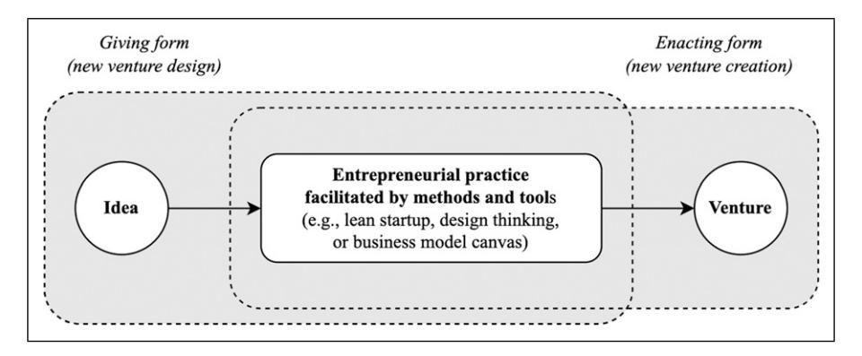
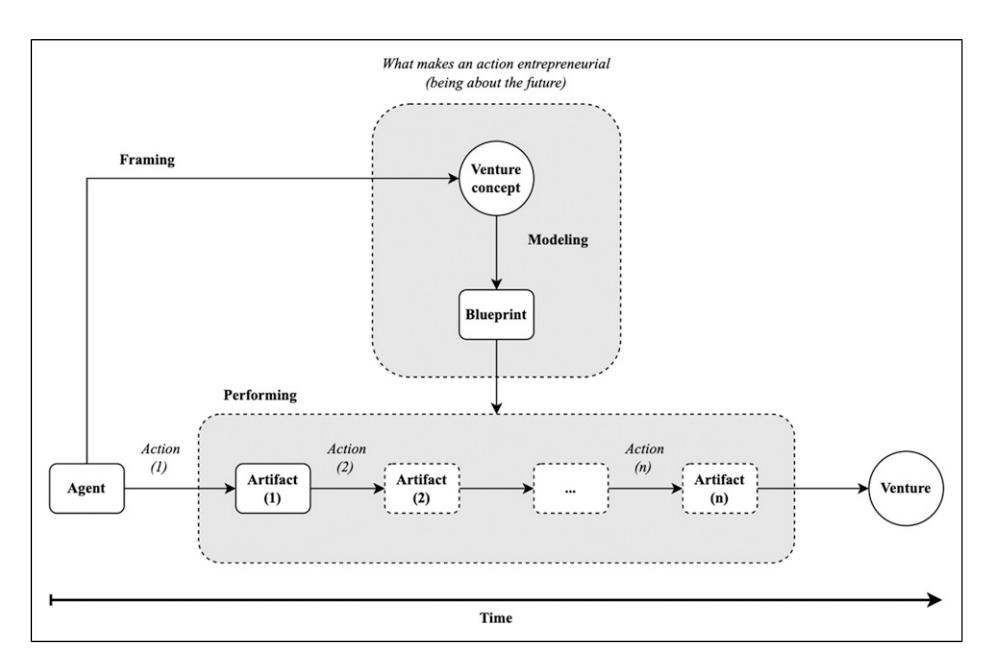
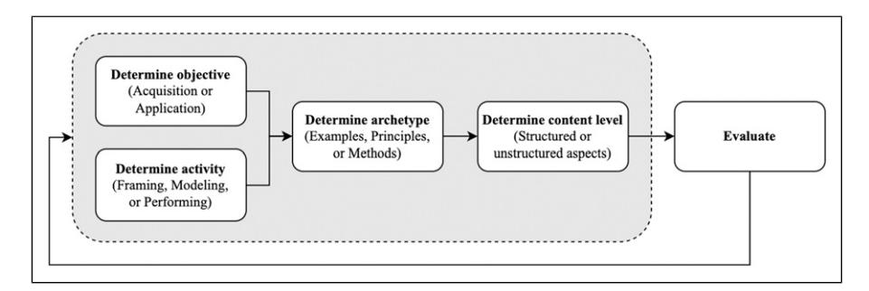

<!-- A3.R64 | source: papers_json/A3.R64/ -->

Special Issue: Connecting Entrepreneurship Research and Practice in Entrepreneurship Education

## Entrepreneurs as Architects: Design (ing) Focus in Entrepreneurship Education

Entrepreneurship Education and Pedagogy 2024, Vol. 0(0) 1–33 © The Author(s) 2024

Article reuse guidelines:

[sagepub.com/journals-permissions](https://us.sagepub.com/en-us/journals-permissions) DOI:[ 10.1177/25151274241226665](https://doi.org/10.1177/25151274241226665) [journals.sagepub.com/home/eex](https://journals.sagepub.com/home/eex)

Yashar Mansoori1 and Dimo Dimov2,3

## Abstract

يتطلب التصميم مهارات تختلف عن الصنع ويُعد جزءًا أساسيًا من إنشاء المشروع. وتشجيعًا لمراعاة التصميم في تعليم ريادة الأعمال، توضح هذه الورقة كيف يمكن دمج التصميم في تعليم ريادة الأعمال كقدرة مركبة متمايزة ينبغي تطويرها. وتحدد الورقة منظورًا للعمل الريادي بوصفه تصميمًا، بحيث تمنح أنشطة التأطير (framing)، والنمذجة (modeling)، والأداء (performing) الفعل الملموس معناه الريادي المتعلق بمشروع مستقبلي. ونناقش كيف يمكن تطوير القدرات الأساسية في بيئات تعليمية، باستخدام المبادئ، والطرق، والأمثلة كأنواع متمايزة من التوجيهات ينشرها معلمو ريادة الأعمال بتركيبات مختلفة ولأغراض مختلفة. ونطور تداعيات عملنا بتقديم مجموعة من مبادئ التصميم المصمَّمة خصيصًا لتعليم ريادة الأعمال.

## Keywords

entrepreneurship education, entrepreneurship as design, design principles, entrepreneurial instructions and learning, theory-practice gap

## Corresponding Author:

Yashar Mansoori, Technology Management and Economics, Chalmers University of Technology, Vera Sandbergs allee 8A, Goteborg 412 96, Sweden.

Email: [yashar.mansoori@chalmers.se](mailto:yashar.mansoori@chalmers.se)

> ^1^ Chalmers University of Technology, Goteborg, Sweden

> ^2^ University of Bath, UK

> ^3^ Reykjav´ık University, Iceland

<!-- page 2 -->

## Introduction

يركز أحد التيارات الرئيسية داخل تعليم ريادة الأعمال (EE) على إنشاء مشاريع جديدة ([Hagg & Gabrielsson, 2019](#page-28-0) ¨ ; [Lack](#page-29-0)e[us & Williams Middleton, 2015](#page-29-0) ´ ). ويتطلب تعقيد عملية إنشاء المشروع نهجًا احتماليًا يقوم على إعادة التقييم والتغذية الراجعة التكرارية ([Honig, 2004)](#page-29-1). وبتبديد فرضية وجود عملية معروفة قابلة للتقنين، دعا باحثو تعليم ريادة الأعمال إلى تطوير مهارات الاكتشاف، والاستدلال، والتنفيذ للتفوق في بيئات شديدة عدم اليقين ([Neck & Greene, 2011)](#page-30-0)، والتركيز على "التفكير الريادي" ([Fayolle, 2013)](#page-28-1). والمُغيَّب في هذا المنظور هو الإحساس بأن الرياديين، من خلال أفعالهم، يفرضون شكلًا أو هيئة على العالم (de signo باللاتينية؛ التصميم اليوم): كل فعل هو (1) انعكاس لما يفكرون فيه و(2) محرِّض للأحداث والكيانات التي تظهر في العالم.

المشاريع الجديدة بنى اجتماعية-اقتصادية للإنتاج والتبادل بنفس المعنى الذي تكون فيه المباني بنى فيزيائية للسكن والتفاعل. ويقدّم هذا تشبيهًا بين الرياديين والمعماريين كمصممين للمشاريع والمباني على التوالي، مما يمكّننا من التعلم من العمارة بوصفها إحدى أقدم تخصصات التصميم. ويشير ظهور التصميم كنشاط مهني إلى فصل بين تمثيل ما سيُصنع وفعل الصنع الفعلي ([Habraken, 1985](#page-28-2)). وتمامًا كما يمكننا فصل تصميم المباني عن بنائها مفاهيميًا، يمكننا أيضًا فصل تصميم المشاريع الجديدة عن بنائها.

وفي كلتا الحالتين، يُحفَّز التصميم بتخيل احتمالات مستقبلية ([Kier &](#page-29-2) [McMullen, 2018)](#page-29-2): يرى الريادي مبنى فارغًا حاليًا كمتجر مزدهر في المستقبل؛ ويرى المعماري قطعة أرض فارغة كمبنى نابض بالحياة في المستقبل. وفي كلتا الحالتين، ينطوي التصميم على ارتباط رمزي بين الحاضر والمستقبل. ويمكّننا هذا من رؤية حفر حفرة كجزء من بناء مبنى جديد، والمحادثات الفردية كجزء من إنشاء مشروع جديد. وتُصبح النتائج النهائية لهذه الأنشطة ممكنة بفضل فيزياء المواد، وهندسة المباني، وقوى السوق، ومنطق الأعمال والإدارة المتطور. لذلك، يعمل كل من الرياديين والمعماريين في مساحة تحددها التفاعلات بين الاحتمالات المتخيَّلة والقيود الخارجية. بيد أنه بينما تُهيَّأ النظرية والممارسة والتعليم في العمارة جيدًا لتطوير المعماري كمفكر ومصمم يركز على المستقبل، فإن الفصل بين نظرية وممارسة ريادة الأعمال [(Dimov et al., 2020](#page-27-0)) يخلق تحديات لتعليم ريادة الأعمال في تطوير الرياديين كمصممي مشاريع يركزون على المستقبل.[1](#page-25-0)

في هذه الورقة، نهدف إلى تطوير مبادئ تصميم يمكن نشرها في بيئات تعليم ريادة الأعمال لتمكين طلاب ريادة الأعمال (أي الرياديين المحتملين) من العمل كمصممي مشاريع جديدة. ونعتبر طبيعة التوجيهات (instructions) بوصفها أصغر توجيه أو نصيحة متماسكة تمكّن الريادي المحتمل من العمل "وفق تصميم"؛ أي صياغة نواياه وتوجيه أفعاله بشكل منهجي (انظر [Wright, 1981)](#page-32-0). وبما أن الرياديين غير مقيّدين فيما يمكنهم تخيله ومتابعته، فإن التوجيهات التي يمكن تقديمها ستكون إلى حد كبير عامة ومستقلة عن السياق بالضرورة. وستعتمد فعاليتها على تجذير الطرق والعمليات العامة في مبادئ على مستوى النظام وعلى تجسيدها من خلال أمثلة

<!-- page 3 -->

ذات صلة [(Eiriksdottir & Catrambone, 2011](#page-28-3)). ونقر بأن تعليم ريادة الأعمال عبر إرشاد غير منظم غالبًا ويتأرجح بين مستويات مختلفة من التحليل والفكر والفعل يعيق فعالية التدخلات التعليمية ([Mansoori & Lackeus, 2019](#page-30-1) ´ ). وبهذا المعنى، نهدف إلى فك تشابك السقالة الدقيقة غير المرئية (microscaffolding) (خلافًا للسقالة الكبرى macro-scaffolding في [Janson et al., 2020)](#page-29-3) لتعليم ريادة الأعمال بالتركيز على دور التوجيهات الريادية في مساعدة العمل الريادي عند واجهة البيئة الداخلية والخارجية (قارن، [Simon, 1996)](#page-31-0).

يقدم هذا العمل عدة إسهامات في تعليم ريادة الأعمال وأبحاث ريادة الأعمال على نطاق أوسع. أولًا، نطوّر إبستمولوجيا للممارسة الريادية تتجاوز المفاهيم الضيقة للعقلانية التقنية [(Schon, 1992](#page-31-1) ¨ ). ووسط عدم اليقين والانفتاح في رحلة ريادية، يُحدَّد ويُعاد تحديد ما تتعلق به الرحلة -أي ما يمنح معنى لما يفعله الرياديون- كجزء من تلك الرحلة [(McMullen & Dimov, 2013)](#page-30-2). ومن خلال الأنشطة المتشابكة والتكرارية للتأطير، والنمذجة، والأداء، فإن ما يفعله الرياديون الآن يتعلق بحالات نهائية مستقبلية متخيَّلة ومرغوبة تُمنح شكلًا (أي مخططًا) في هذه العملية. ثانيًا، يساعد عملنا في جعل المناقشات حول المستقبل -كسمة مميزة لريادة الأعمال ومحور اهتمام جديد في مجال ريادة الأعمال- أكثر ملموسية وقابلية للتناول. فمن خلال أنشطة التأطير، والنمذجة، والأداء، يُروَّض المستقبل ليصبح شيئًا ملموسًا يمكن متابعته وتفعيله في مصنوعات ملموسة. وأخيرًا، نقدم مجموعة من المفاهيم والمبادئ التي ستساعد معلمي ريادة الأعمال في تدريس ريادة الأعمال كنشاط تصميم منهجي، وتنظيم تدخلاتهم التعليمية وفقًا لذلك. ويساعد تعليم الرياديين كمصممين في تمييز المكانة المتفردة للجامعات كمكان لتعلم القدرات الريادية عن ورش العمل العملية الأكثر تطبيقية التي يمكن أن تُعقد في أماكن أخرى. بالإضافة إلى ذلك، يمكن لإطارنا تمكين الرياديين وباحثي ريادة الأعمال من ترجمة معرفتهم العملية والنظرية إلى توجيهات منهجية للعمل الريادي [(Baggen et al., 2021)](#page-26-0) من خلال الانتباه بشكل أدق للتسلسل الهرمي المفاهيمي للعمل الريادي كنشاط تصميم ذي معنى.

## Theoretical Background

## A Design-Oriented Approach to Entrepreneurship Education

ينشأ سؤال "هل يمكن تعليم ريادة الأعمال؟" من رغبة في تكرار إنجازات الرياديين الناجحين، أي إنشاء مشاريع مؤثرة كمتجهات جديدة للنشاط الاقتصادي. وفي هذا الصدد، يستند ظهور تعليم ريادة الأعمال إلى فرضية أن (بعض جوانب) ريادة الأعمال يمكن تعليمها [(Kuratko, 2005](#page-29-4)). وبالفعل، رأى [Drucker (1985)](#page-28-4) بشكل بارز أن ريادة الأعمال مسعى منضبط لخلق موارد جديدة منتِجة للثروة. ويشمل هذا المسعى كلًا من ما يُخلق ومن يخلقه. وكان هذا المنظور ذو الوجهين لريادة الأعمال -كإنشاء مشروع وكفعل ريادي- بارزًا في تعليم ريادة الأعمال، مع منظور الشركات الناشئة الذي يركز على إنشاء المشروع

<!-- page 4 -->

ومنظور المبادرة الذي يركز على تطوير العقلية والمهارات الريادية ([Hagg & Gabrielsson, 2019](#page-28-0) ¨ ).

وفي التركيز على إنشاء المشروع، كان هناك غموض مستمر حول طبيعة ما يُخلق، خاصة في نقص التمييز بين المشروع بمعنى الأعمال التشغيلية التي أُنشئت وفق تصميم ما، والمشروع بمعنى التصميم كتمثيل وسيط لما سيُخلق. وبالفعل، في تعريف [Neck and Corbett](#page-30-3) (2018) لتعليم ريادة الأعمال بأنه "تطوير العقلية، ومجموعة المهارات، والممارسة اللازمة لبدء مشاريع جديدة" (ص. 29)، لا يوجد تمييز بين تصميم ما سيُصنع وصنع ما صُمم. وفي معاملة ريادة الأعمال كطريقة للعمل في بيئات شديدة عدم اليقين، يؤكد [Neck and](#page-30-0) [Greene (2011)](#page-30-0) على مهارات الاكتشاف، والاستدلال، والتنفيذ، مما يعني ضمنًا أن هناك شيئًا يُكتشف ويُستدل عليه في العملية، ثم يُنفَّذ.

علاوة على ذلك، فإن التركيز على المعرفة الريادية العملية، مثل معرفة-ماذا ومعرفة-كيف ومعرفة-من [(Johannisson, 1991](#page-29-5))، يتجاهل أيضًا التمييز بين الصنع والتصميم. وقد يؤدي توجيه الطلاب لاستخدام أدوات مثل قماشة نموذج العمل، أو الشركة الناشئة الرشيقة، أو التفكير التصميمي، دون التأكيد على تضمينها في عملية تصميم أوسع، إلى دفع الطلاب لإنشاء تصاميم مشاريع جديدة دون وعي أو تأمل في كونهم قد قاموا بعملية تصميم. وبعبارة أخرى، باستخدام منهجية مثل الشركة الناشئة الرشيقة، يشارك الرياديون في آنٍ واحد في تصميم المشروع وإنشائه. ومع ذلك، دون وعي بالأول، هناك خطر أنه عند توسيع التعلم إلى سياقات أخرى، قد يرى المرء مهمته ببساطة كـ"القيام بالشركة الناشئة الرشيقة" أو "استخدام قماشة نموذج العمل". وتوضح هذه الفكرة في [الشكل 1](#page-4-0) أدناه. فمن خلال ما يفعله ويقوله الرياديون، يمنحون أفكارهم غير المتشكلة شكلًا، ثم يسعون لفرضه على العالم. لذا فإن أدوات الممارسة الريادية أشبه بالاستنسل ودلائل الفعل معًا.

في ضوء ما سبق، يصبح النهج القائم على التصميم لتعليم ريادة الأعمال -حيث يُميَّز بوضوح بين التصميم والخلق- ذا صلة. ويستند هذا النهج إلى عملية تتمحور حول المصنوعات وتدفع فكرة ريادة الأعمال بوساطة الأدوات كبديل عن نماذج تعليم ريادة الأعمال القائمة على التخطيط العقلاني ([Mwasalwiba, 2010](#page-30-4)) والقائمة على الخبرة ([Souitaris et al., 2007](#page-31-2)) [(Lahn & Erikson, 2016](#page-29-6)). والفكرة الأساسية للنهج التصميمي هي أنه بين رؤى المستقبل التي ينطلق منها الرياديون ورؤى المستقبل التي تتحقق، يخلق الرياديون مصنوعات كعلامات ملموسة لرحلاتهم [(Berglund & Glaser, 2022)](#page-26-1)، مقدمين تعبيرات ملموسة عن رؤاهم وخالقين ظروفًا لإمكانات وتطورات أخرى ([Berglund & Dimov, 2023)](#page-26-2).

وفي هذا الصدد، يمكن اعتبار تطوير المهارات، والقدرات، والخبرة الريادية مجموعة من الأنشطة بوساطة المصنوعات. وتعمل المصنوعات كسقالات في تعلم الطلاب وتأملهم وتتخذ أشكالًا مختلفة. ويمكن أن تكون "مصنوعات-ماذا" تُيسّر التفاعل مع المعلومات الوقائعية؛ و"مصنوعات-كيف" تدعم الانخراط مع العمليات والإجراءات؛ و"مصنوعات-لماذا" تساعد في التشخيص و

<!-- page 5 -->

*Figure 1. New venture design and new venture creation.*

توليد التفسيرات؛ و"مصنوعات-إلى-أين" تتيح الخلق المشترك عبر إسقاط سيناريوهات مستقبلية ([Engestrom et al., 1999](#page-28-5) ¨ ).

وإجمالًا، يهدف هذا النهج إلى تزويد الطلاب بمجموعة مختلفة من الأدوات والمنظورات لفهم الأنشطة الريادية والانخراط فيها. ويكمّل ويدمج النهج القائم على التخطيط والقائم على الخبرة في التعليم. فبينما يُعد التخطيط ضروريًا لأي نشاط منهجي متعمَّد، يقر النهج القائم على التصميم بأن ما يتعلق به التخطيط ذاتي المنشأ في العملية الريادية (أي ينبغي إعادة تحديده وليس مُعطى). وبالمثل، بينما تُعد الخبرة ضرورية للتعلم، هناك حاجة إلى بنى مفاهيمية وتأملية لما يختبره المرء ([Dimov & Pistrui, 2023](#page-27-1); [H](#page-28-6)a[gg & Kurczewska, 2021](#page-28-6) ¨ ). ويقر النهج القائم على التصميم بأن الرياديين يتشاركون سمة تعريفية، أي توجهًا نحو المستقبل، معبَّرًا عنه كرؤى وطموحات فردية له. وبهذا المعنى، فإن تعليم الريادي هو تمكينه من إعطاء شكل لطموحاته والانخراط بشكل منهجي في تحقيقها. ويستدعي هذا مراعاة التواصل التوجيهي بين معلمي ريادة الأعمال والمتعلمين.

## Instructions and Learning

التوجيهات طرق لإبلاغ شخص ما بكيفية أداء مهام غير مألوفة له، وتعمل كقطع من الإرشاد العملي تمكّن المرء من أداء هذه المهام بطرق أكثر كفاءة وبتردد أقل ([Eiriksdottir & Catrambone,](#page-28-3) [2011](#page-28-3)). وبشكل أعم، يمكن أن تُيسّر التوجيهات الفعل [(Spector, 2001](#page-31-3)) وتساعد الأفراد على أن يصبحوا ممارسين متأملين ([Schon, 1984](#page-31-4) ¨ )، مما يمكّن المتعلمين من التعامل مع الاحتمالات العملية والبراغماتية [(Amerine & Bilmes, 1988](#page-26-3)). وبهذا، تعمل كحوارات عملية بين المعلمين والمتعلمين.

وفي قلب هذا الحوار يكمن الفهم كإتقان لغة وقواعد معينة في ممارسة محددة والتعرف عليها كقابلة للتطبيق في موقف معين ([Wittgenstein, 1953)](#page-32-1). ونظرًا للحاجة إلى ترجمة رسالة

<!-- page 6 -->

التوجيه إلى خطوات فعل عملية، سيفشل التوجيه في تحقيق النتائج المرغوبة عندما تكون الخطوات والأنشطة التي يتبناها غير قابلة للتحقيق في حد ذاتها؛ أو عندما يتضمن كيانات غائبة عن الموقف الذي ينبغي أن يكون فيه التوجيه معقولًا [(Chapman, 1990)](#page-27-2).[2](#page-25-1) وتطوير التوجيهات مسألة تصميم متعمَّد، تراعي الافتراضات والمتطلبات الكامنة، وكذلك نتائجها المرغوبة ([Dijkstra, 1988](#page-27-3)). لذلك، يجب تصميم التوجيهات بمحتوى وعرض وبنية مناسبة (قارن، [Wright, 1981](#page-32-0)). وثمة ثلاثة اعتبارات ذات صلة في هذا الصدد.

أولًا، بناءً على المعلومات التي تنقلها، يمكن تصنيف التوجيهات إلى أنواع مختلفة، وهي الإجراءات، والمبادئ، أو الأمثلة ([Eiriksdottir &](#page-28-3) [Catrambone, 2011)](#page-28-3). والإجراءات توجيهات موجهة نحو المهام، تحدد كيفية إنجازها، من حيث الشروط اللازمة، والأفعال المرغوبة، والنتائج المتوقعة. والطريقة الأكثر شيوعًا لتنظيم هذه التوجيهات هي كخطوات متتالية [(Eiriksdottir & Catrambone, 2011;](#page-28-3) قارن، [Stanovich, 2009](#page-31-5)). وغالبًا ما تُوصف الخطوات كجزء من التوجيهات الإجرائية بتبرير محدود حول العلاقات بين الخطوات اللاحقة [(Van der Meij et al., 2003](#page-31-6)). فمثلًا، يحدد نموذج عملية "تطوير العميل" [(Blank & Dorf, 2012](#page-27-4)) العملية التي يمكن من خلالها تحقيق ملاءمة المنتج للسوق ويوجه الرياديين لاتباع خطوات معينة. ومن الملاحظ أنه في السياق المفتوح لريادة الأعمال، لا يمكن تقنين هذه العملية بتفصيل محدد (لأن العملاء والسياقات تتنوع). لذلك، يمكن وصف هذا النوع من التوجيهات بأنه طريقة (method)، بمعنى أعم للإجراء.

والمبادئ توجيهات موجهة نحو مجال المهمة أو النظام، تركز على المفاهيم والقواعد والانتظامات الأساسية التي تحكم المهمة ومجالها (أي كيفية عمل النظام). وغالبًا ما تكون هذه التوجيهات ضرورية لفهم الإجراءات ([Catrambone, 1995)](#page-27-5)، مما يجعل النوعين مترابطين. وتُفهم كمؤشرات من رتبة أعلى لتوجيه الفعل -غالبًا ما تُصاغ كاستدلالات عامة- وليس كإرشادات فعلية صلبة ومجذَّرة يجب اتباعها. لذلك، ليست دائمًا قابلة للتنفيذ من قبل المبتدئين (انظر [Dreyfus, 2004](#page-27-6)). فعلى سبيل المثال، يمكن استخدام مبدأ "الخسارة المقبولة" في التأثير (effectuation) [(Sarasvathy, 2001](#page-31-7)) لبناء العديد من القرارات الريادية [(Dew et al., 2009)](#page-27-7)، لكنه يتطلب مستوى معينًا من الخبرة.

والأمثلة تعرض حالات محددة لكيفية إنجاز نشاط ما، موضحةً كيف يمكن إكماله، دون تفسير مرافق لمنطقه. وكتجسيدات لعملية أعم، يمكن أن تساعد الأمثلة في التعامل مع الغموض في الوصف الإجرائي وتوفير معلومات قد يصعب التعبير عنها لفظيًا بطريقة أخرى ([Catrambone, 1995](#page-27-5)). وتساعد الأفراد على فهم مساحة المشكلة بشكل أفضل واستخلاص الاستنتاجات اللازمة لتطبيقها في سياقات أخرى [(Eiriksdottir & Catrambone,](#page-28-3) [2011)](#page-28-3). بيد أنها ليست قابلة للنقل المباشر إلى أنشطة وسياقات أخرى. فمثلًا، توفر Dropbox وAirbnb دراسات حالة في تدريب الشركة الناشئة الرشيقة والتفكير التصميمي للدعوة إلى اختبار الفكرة قبل الالتزام بالموارد. وتوضح تجسيدات محددة لفئة معينة من الأفكار يمكن أن تكون بمثابة لافتات إرشادية للفعل.

ثانيًا، يمكن للتوجيهات أن تخدم أهدافًا مختلفة -الأداء الأولي، والتعلم، والنقل- مما يستدعي مراعاة مفاضلات مختلفة للمتعلم

<!-- page 7 -->

([Eiriksdottir & Catrambone, 2011)](#page-28-3). ويركز الأداء الأولي على إتمام مهمة بسرعة وصحة، وإبلاغ الخطوات اللازمة بأبسط طريقة وأكثرها تحديدًا وسهولة. ويقلل هذا الحاجة إلى التأمل والاستنتاج من جانب المتعلم. وعندما ينتقل التركيز إلى التعلم أو اكتساب المهارة، يصبح الهدف تمكين المتعلم من إتمام المهمة مستقبلًا دون توجيه. أما مع النقل، فالهدف تمكين المتعلم من تطبيق مهارته على إتمام مهام مختلفة في مواقف مماثلة.[3](#page-26-4)

ثالثًا، يمكن فهم التوجيهات على طيف من المحدد إلى العام ([Catrambone, 1995)](#page-27-5). والتوجيهات المحددة أو الخوارزمية هي تلك التي تهدف إلى توفير معظم، إن لم يكن كل، الخطوات والأنشطة ذات الصلة التي ينبغي اتباعها لإتمام مهمة معينة. ويُعد إعداد "بيان دخل عكسي" في التخطيط المدفوع بالاكتشاف ([McGrath &](#page-30-5) [MacMillan, 1995)](#page-30-5) مثالًا على التوجيهات الريادية الخوارزمية. والتوجيهات المحددة أسهل فهمًا ويمكن اتباعها غالبًا كما هي مكتوبة ([Catrambone, 1995](#page-27-5)). وبينما توفر خصوصيتها ميزة للاستخدام الأولي، قد لا تؤدي إلى النتائج المرغوبة عندما تتغير ظروف المهمة. ويحدث هذا لأن المتعلمين المدرَّبين بتوجيهات محددة يعتمدون فقط على "سلسلة من التفاصيل منخفضة المستوى" التي، رغم فائدتها، لا يمكن ترجمتها إلى مواقف جديدة وحديثة ([Catrambone,](#page-27-8) [1990,](#page-27-8) ص. 52).

والتوجيهات العامة أو القائمة على الاستدلال هي تلك التي توفر مجموعة شاملة من الأنشطة (الإجرائية) عالية المستوى القابلة للتطبيق في مواقف أخرى ضمن مساحة المشكلة. ويُعد جمع الملاحظات من العملاء المحتملين في نهج الشركة الناشئة الرشيقة [(Felin et al.,](#page-28-7) [2020)](#page-28-7) مثالًا على التوجيهات الريادية القائمة على الاستدلال. والتوجيهات العامة، بحكم تصميمها، لا توفر جميع التفاصيل اللازمة وتُجبر المتعلمين على الاستنتاج من معلومات محدودة. ولها ميزة واضحة على التوجيهات المحددة في مساعدة المتعلمين على تطبيق الجوهر العام للتوجيهات على مواقف جديدة. وتوفر هذه التوجيهات مفاهيم عالية المستوى (ضمنية أو صريحة) تساعد المتعلمين على وضع أنفسهم في مساحات مشكلة جديدة وإيجاد حلول بفعالية أكبر ([Eiriksdottir, 2011](#page-28-8)). ويُضخِّم هذا المفاضلة بين الأداء الأولي والنقل اللاحق للتوجيهات المتعلَّمة، خاصة فيما يتعلق بالطرق الريادية ([Mansoori, 2017b)](#page-29-7) -إضافة حديثة إلى تعليم ريادة الأعمال- إذ تتنوع في عمومية أو خصوصية توجيهاتها ([Mansoori & Lackeus, 2019](#page-30-1) ´ ).

وباختصار، توفر أدبيات التوجيهات لغة مفاهيمية مفيدة للتصميم التعليمي، مما يمكّننا من التعامل مع التوجيهات بشكل أكثر منهجية، من خلال مراعاة (1) المعلومات التي ينبغي أن تنقلها، و(2) الأهداف للمتعلم، و(3) خصوصية اللغة الإجرائية. وقد ركز معظم هذه الأدبيات على ما يمكن وصفه بالمشكلات المنظمة (أي التي لها حلول مثلى يمكن تقنينها إجرائيًا). ومع انتقالنا إلى مجال ريادة الأعمال، نتعامل مع مشكلات سيئة البنية أو شرسة ([Rittel & Webber, 1973](#page-30-6)): سياقها ديناميكي، ولا يوجد تحديد واضح بين المشكلة والسياق، وبالتالي ليس لهذه المشكلات صياغة قبلية محددة وثابتة. لذلك، من الضروري النظر إلى العمل الريادي في سياقه الديناميكي. والتداعي الرئيسي لذلك هو أن التوجيه الإجرائي يمكن التعبير عنه كطريقة عامة بدلًا من خطوات فعل مقننة. بالإضافة إلى ذلك، يمكننا تجميع أهداف المتعلم الثلاثة التي نوقشت سابقًا

<!-- page 8 -->

(الأداء الأولي، والتعلم، والنقل) في فئتين رئيسيتين، هما الاكتساب والتطبيق.

## The Recursive Patterns of Entrepreneurial Action

للحديث عن الفعل المعماري يعني ضمنيًا الإشارة إلى مبنى لم يوجد بعد يتوجه إليه الفعل. وبالمثل، فإن الحديث عن الفعل الريادي يعني ضمنيًا الإشارة إلى مشروع لم يوجد بعد يتوجه إليه الفعل. وفي هذا الصدد، لا يحتاج المشروع الجديد (كفكرة مجردة) إلى أن يُنفَّذ، وبالتالي يمكن أن يكون موضوعًا مستقلًا للخطاب، تمامًا كما يمكننا التحدث عن سانتا كلوز أو "الشيء الكبير التالي". وفي المقابل، يتطلب الفعل -كحركة مقصودة- شيئًا مقصودًا، حالة نهائية، يمكن اعتبار تحققها منجزًا للنية وبالتالي مكمّلًا للفعل الريادي. وفي ضوء ذلك، يمكن وصف الفعل الريادي ومناقشته بطريقتين.

أولًا، الفعل الريادي حركة في سلسلة متصلة من الفضاء المادي تُحدَّد في أحد طرفيها (اليسار) بفكرة عن حالة نهائية (صورة أو مفهوم) وفي الطرف الآخر (اليمين) بوجود مشروع تشغيلي (كائن نهائي)، كما هو موضح في [الشكل 1](#page-4-0) سابقًا. ويمكن القول إن كل حركة منفصلة في هذا الفضاء نشأت من صورة نهاية وتوجهت نحو تحقيق الكائن النهائي -وهذا ما يجعل كل حركة من هذا القبيل جزءًا من نفس الفعل الريادي. وبالتالي، في الصورة الأصلية، يمكننا رؤية الكائن النهائي؛ وفي الكائن النهائي، يمكننا رؤية الصورة الأصلية؛ وفي أي نقطة بينهما يمكننا رؤية كل من الصورة الأصلية والكائن النهائي. وكل حركة على طول الطريق هي في الواقع ظهور للصورة الأصلية، تقترب تدريجيًا من الكائن النهائي كنقطة استقرار لتحقيق الصورة الأصلية في العالم.

ومساحة الفعل الريادي، تمامًا كمساحة التصميم (بمعناها الأوسع)، هي "فن صنع تلك المظاهر التي تساعدنا على عبور التيارات الغادرة التي تفصل الصورة عن الكائن؛ الحلم عن الواقع" ([Habraken, 1985,](#page-28-2) ص. 73). والتحرك نحو اليمين عملية تحقيق مادي، وتوجيه لما ينبغي فعله، بينما التحرك نحو اليسار يتعلق بالعودة إلى النوايا الأولية وتقييم التقدم في ضوئها ([Habraken, 1985)](#page-28-2). وعلى مدار المسار من الصورة إلى الكائن، يكون هناك شكل حاضر، أولًا كفكرة وأخيرًا كمصنوعة مستقرة (الكائن النهائي المتحقق)، مع سلسلة من مظاهر مصنوعات وسيطة بينهما، يتحرك من خلالها الشكل في الفضاء المادي من الصورة إلى الكائن، من شيء مجرد إلى شيء ملموس.

ثانيًا، يتألف الفعل الريادي من كل حركة منفصلة في الفضاء المذكور أعلاه، من إنتاج مظهر واحد إلى إنتاج المظهر التالي. وفي هذا الصدد، عندما يُقال إن الريادي يتصرف، يمكننا رؤية ذلك كحركة نحو اليمين (أي نحو مظهر أكثر تجسيدًا لفكرته)، تنتج المظهر التالي. فمثلًا، تحديد عميل معين هو مظهر أكثر تجسيدًا للفكرة المجردة "امتلاك عميل"، وإنتاج نموذج أولي لمنتج أو خدمة هو مظهر أكثر تجسيدًا للفكرة المجردة "منتج يؤدي X". وبهذا المعنى، يمكن لغرض ريادي مجمَّع مثل "خلق قيمة" أن يُنتج

<!-- page 9 -->

سلسلة من المظاهر المتزايدة التجسيد على طول مسارات مختلفة، من "تحديد مشكلة" إلى "المشكلة هي X" و"السوق هو Y" أو من "تحديد حل" إلى "الحل هو V" و"المنتج هو W". وتتقارب كل هذه المسارات في النهاية في المشروع التشغيلي.

ويخضع إنتاج كل شكل وسيط لقيود متعددة. وتأتي من اليسار قيود تمثل حدودًا لما يمكن فعله، بناءً على النوايا الأصلية والاختيارات السابقة. وتأتي من اليمين قيود تنشأ من حقيقة أن كل شيء يحتاج في النهاية إلى تجميعه في نظام عامل. أي أن المشروع النهائي يحتاج إلى تقديم منتج أو خدمة مرغوبة في السوق، وقابلة للتنفيذ تقنيًا وتشغيليًا، وقابلة للاستمرار ماليًا [(Dimov, 2016](#page-27-9)). ويأتي هذا بالإضافة إلى القيود التي يفرضها المرء -باختيار مسار بدلًا من آخر- في عملية محاولة إيجاد شكل وسيط قابل للتطبيق نفسها.

وبقدر ما يكون الفعل الريادي سلسلة من الحركات في مساحة الفكر والفعل، يمكن رؤية كل حركة كتابعة لنفس المنطق، أي الانطلاق من مظهر واحد لإنتاج التالي، عاكسةً الصورة الأصلية وهادفةً للاقتراب من الكائن النهائي. وهذا نموذج أولي للفعل يتكرر بشكل تكراري طوال العملية الريادية، مع كل تكرار يمثل تفاعلًا ذهابًا وإيابًا بين الريادي والبيئة يسفر عن مظهر وسيط تالٍ [(Dimov & Pistrui, 2020)](#page-27-10).

لذلك، هناك بنية حلقية للفعل الريادي، بحيث يصبح مخرج حركة واحدة مدخل أو نقطة بداية الحركة التالية. وتعكس هذه البنية الحلقية مبادئ التنظيم الذاتي والتحكم بالتغذية الراجعة كمظاهر أولية للفاعلية [(Bernstein, 1967;](#page-26-5) [Tomasello, 2022](#page-31-8)). وللحلقة ثلاثة أجزاء متمايزة -المدخل، والمعالجة، والمخرج- تتوسط الحركة من مظهر إلى آخر، مسجلةً كيف يتكرر الرياديون باستمرار لتقييم تقدمهم وشق طريقهم إلى الأمام. وبعبارة أخرى، رغم أننا نقول ببساطة "الريادي يتصرف"، فإن الفعلn في الواقع يستلزم تقييم نتائج الفعلn^1^ -في ضوء الصورة والطموح الأصليين ومراعاة متطلبات عمل الحالة النهائية المرغوبة- والاستدلال على ما يجب فعله بعد ذلك، قبل القيام بالحركة التي نصفها بالفعلn. وكمظهر للتعلم التأملي [(Lindh & Thorgren, 2016)](#page-29-8)، لا تختص هذه الآليات بريادة الأعمال وحدها، لكن تدريبها أكثر أهمية في مواقف عدم اليقين.

## Entrepreneurial Action as Design

يبدأ بناء المبنى بحفر حفرة في الأرض. وفي الواقع، عندما يحفر المرء الحفرة، فإنه يضع الأسس أيضًا وكذلك يبني مبنى. وهذه ليست ثلاثة أنشطة مختلفة، بل نشاط واحد يوصف بثلاث طرق مختلفة، على ثلاثة مستويات هرمية من التجريد. وما يجعل هذه الأوصاف البديلة ممكنة هو مخطط بناء وخطة تشييد يصفان (1) نتيجة نهائية معينة لعملية التشييد و(2) تسلسل مراحل وسيطة يتعين إكمالها، يُقسَّم كل منها بشكل أكبر إلى خطوات أكثر تحديدًا.

<!-- page 10 -->

وبهذا المعنى، فإن فعل حفر الحفرة هو الأول من كثير، مع كون آخر فعل في التسلسل المخطَّط يتضمن اللمسة الأخيرة للمبنى المشيَّد حديثًا. ويتمثل دور المعماري في إنتاج التمثيلات (أي التصميم) التي تجمع كل هذا النشاط المعقد معًا. ومخطط البناء نفسه نقطة نهاية لعملية إبداع وتجريب وتحقق تراعي موقع المبنى وسلامته الإنشائية وكذلك الدور الذي سيلعبه في المجتمع وتضمن قبول جميع أصحاب المصلحة. وفي المقابل، خطة التشييد ترجمة للمخطط إلى تسلسل زمني من الخطوات والأنشطة، يمكن تنسيق ومراقبة تنفيذها.

## Framing, Modeling, and Performing

تمامًا كما يمكن فصل المعماري (أو المصمم) عن مقاول البناء (الصانع)، يمكننا فصل الريادي-كمصمم عن الريادي-كصانع في عملية إنشاء مشروع جديد. والمبنى نظام من المواد (الخرسانة، الخشب، الزجاج، المعدن، إلخ) منظَّمة بطرق معينة لأداء وظيفة محددة. وبالمثل، المشروع نظام من الأنشطة (الإنتاج، التواصل، التبادل، إلخ) منظَّم بطرق معينة لخلق قيمة وأثر اقتصادي. وتمامًا كما يمكّننا نشاط المعماري من رؤية أنشطة مستقلة كجزء من بناء مبنى، فإن نشاط الريادي-كمصمم يمكّننا من رؤية أفعال مستقلة كجزء من إنشاء مشروع جديد. وبالفعل، كما أبرزنا سابقًا، فإن تسمية فعل معين بأنه ريادي تعني رؤيته كجزء من جهد إنشاء مشروع جديد، يمثل ضمنه خطوة منطقية (أي أداء أو التزام بمخطط معين).

وبهذه الطريقة، في العمل كمصممين، يمنح كل من الرياديين والمعماريين شكلًا لفعل معين، وهو وصف ما وراء (meta) يجعل الفعل جزءًا من كل أوسع وبالتالي يمنحه معنى. لذا ينبغي رؤية الفعل كتفعيل لمخطط معين، وينبغي ربط المخطط بحالة نهائية مرغوبة ينبغي تحقيقها، وينبغي أن تكون الحالة النهائية شيئًا "يراه" الريادي أو المعماري في ذهنه. ويستلزم هذا ثلاث روابط كما هو موضح في [الشكل 2.](#page-10-0) ونستند إلى [Dimov (2021)](#page-26-6) لتسمية ثلاثة أنشطة أساسية لريادة الأعمال كنشاط تصميم: التأطير، والنمذجة، والأداء. [4](#page-26-7)

التأطير[5](#page-26-8) يتعلق بصياغة ما يخص المسعى الريادي، أي مفهوم المشروع كوصف متماسك للحالة النهائية (مثل سلسلة من محلات القهوة عالية الجودة) [(Vogel, 2017)](#page-32-2). ويخلق التأطير البوابة أو الإحساس بالاتجاه للمسعى الريادي الذي سيُدفَع قُدُمًا. ومن خلال التأطير، يمنح الرياديون شكلًا للمستقبل الذي يطمحون في تحقيقه وبالتالي يمنحون معنى لما يفعلونه. وبالتالي يشير إلى ما يسعون إليه أو يتحركون نحوه.

النمذجة تتعلق بصياغة المعالم الحرجة لتحقيق مفهوم المشروع ككائن نهائي محدَّد. ويوفر هذا إحساسًا بكيفية ملاءمة العناصر المختلفة معًا في نظام متماسك، بعبارة أخرى في مخطط. وتحتاج سلسلة محلات القهوة إلى محلات فردية، وينبغي أن يمتلك كل محل فردي مقرًا، وبنية تحتية، وموظفين لصنع القهوة وتقديمها، وموردين لموادها، وعملاء لشراء القهوة يمتلكون أسبابًا مقنعة

<!-- page 11 -->

*Figure 2. Entrepreneurial action as framing, modeling, and performing.*

لزيارة المحل. وتوفر هذه العناصر العامة وصفًا نظاميًا للمشروع المستقبلي، وبالتالي مخططًا معينًا لتحقيقه، ليُصقل تدريجيًا ويصبح أكثر تجسيدًا. وبذلك تتعلق النمذجة بتطوير وصف للحالة النهائية كنظام من العناصر المترابطة ورسم المسارات وراء البوابة التي ستتقارب من خلالها العناصر المختلفة في كل موحَّد. ومن خلال النمذجة، يصوغ الريادي العناصر المختلفة وتسلسل تجميعها الذي يحتاج إلى الاجتماع في إنتاج مشروع عامل.

الأداء يتعلق بتفعيل النموذج بمعنى ترجمة المخطط إلى خطوات فعل منفصلة لكن مترابطة، تركز كل منها على إنتاج مصنوعة وسيطة جديدة (معلم). ويوجّه المخطط فعليًا ما ينبغي فعله كنتيجة لكل خطوة فعل. ولكل مهمة من هذا القبيل، هناك خلفية من الممارسة تحدث ضمنها، حيث يمتلك المرء إحساسًا عمليًا بما يحتاج إلى فعله مراعيًا أهدافًا معينة وفي سياق أعراف اجتماعية معينة [(Schatzki, 2002](#page-31-9)). وسيتطلب توجيه ريادي بسيط مثل "ابحث عن عميل" من المرء تنفيذ عدة مهام، تتطلب كل منها فهمًا عمليًا معينًا للكل.

ولتقدير هذه الطبيعة المزدوجة للأداء، نستحضر التمييز بين أفعال المهمة وأفعال الإنجاز، التي تعمل بقوى منطقية مختلفة ([Ryle, 2009](#page-30-7)). والبحث فعل مهمة يشير إلى نشاط ما كعملية مستمرة، بينما الإيجاد فعل إنجاز لا يشير إلى نشاط مستقل عن البحث بل يبلغ ببساطة عن نجاح ذلك النشاط. وباستخدام فعل إنجاز بدلًا من فعل مهمة، نحن

<!-- page 12 -->

نؤكد أن "حالة معينة من الأمور تتحقق فوق وبعيدًا عما يتألف من أداء، إن وُجد، نشاط المهمة التابع" ([Ryle, 2009](#page-30-7)، ص. 132).

وينبغي أن يكون واضحًا إذن أن التوجيه المتضمَّن في مخطط يُصاغ بمصطلحات الإنجاز، بينما يُوصف أداؤه المستمر بمصطلحات المهمة. وبهذه الطريقة، يحتوي المخطط على نقاط "النجاح" للأنشطة التي يتضمنها، بينما يتعلق أداؤه بالفهم العملي والقدرة على الوصول إلى تلك النقاط. بعبارة أخرى، لكي يجد المرء، يحتاج إلى البحث. وبقدر ما لا تكون المهمة مؤتمتة بالكامل -بخطوات فعل دقيقة ومحددة بالكامل- هناك دائمًا جانب تقديري للأداء بحيث يتولى الفهم العملي للمرء الأمر حيث ينتهي التوجيه الرسمي.

ونقترح أن الرياديين يصممون مشاريع جديدة من خلال عملية تكرارية تشمل أنشطة التأطير، والنمذجة، والأداء، التي تحدد المساحة القصدية لريادة الأعمال ([Dimov, 2021](#page-26-6)) وتمنح الفعل الريادي شكله المتمايز المتعلق بمستقبل غير مؤكد. وبالتالي يمكننا وصف الفعل الريادي كجزء من كل أوسع، وهو (1) حالة مستقبلية موجَّه نحوها (التأطير)؛ (2) مخطط لتلك الحالة المستقبلية، متصل بالحاضر (النمذجة)؛ و(3) تحقيق نتائج معينة يوجهها المخطط في اللحظة (الأداء).

وبهذه الطريقة، عندما يتحدث الريادي إلى شخص ما، يمكننا وصف هذا الفعل بأنه "إيجاد عميل" (توجيه المخطط)، و"التحقق من نموذج عمل" (جزء محوري من المخطط) و"إنشاء مشروع" (الحالة المستقبلية التي يرسمها المخطط). ويوفر التأطير، والنمذجة، والأداء تسلسلًا هرميًا مفاهيميًا للنشاط الريادي، بحيث يمكننا وصف أي فعل كأداء لنموذج، والنموذج كتنظيم لإطار، والإطار كصياغة لطموحات مستقبلية. وهذا يشبه فكرة الطرق الريادية بوصفها تتألف من ثلاثة مستويات هرمية من المنطق، والنموذج، والتكتيكات [(Mansoori & Lack](#page-30-1)e[us, 2019](#page-30-1) ´ ). ويبرز [الشكل 2](#page-10-0) أنه بينما نلاحظ فقط الأفعال ونتائجها، فإن رؤية هذه الأفعال كأداءات ريادية تتطلب وعيًا بالتسلسل الهرمي المفاهيمي الذي يجعل هذه الأفعال متعلقة بالمستقبل. بعبارة أخرى، الفعل بشكل ريادي أكثر من مجرد حركات ملاحظة.

## Navigating the Hierarchy of Entrepreneurial Activity

بينما الرياديون أحرار في تخيل عوالم مستقبلية، فهم مقيَّدون بما يجعله العالم ممكنًا عندما يتصرفون ([Ramoglou & McMullen, 2022](#page-30-8)). ويُقيَّد الرياديون (من اليسار) بالحدود التي تضعها طموحاتهم و(من اليمين) بالمتطلبات النظامية، والاعتبارات العملية، والقبول الاجتماعي لحل عامل (انظر [الشكل 1](#page-4-0)). وكنشاط تصميم، تقع ريادة الأعمال بين موقفين مختلفين من العالم، أحدهما يعتبر العالم غير محدَّد وقابلًا للتشكيل والآخر يعتبره محدَّدًا ومُعطى [(Berglund et al., 2020](#page-26-9)). واعتمادًا على موقفهم، وبالتالي بناءً على مقدار ما يعتبرونه مسلَّمًا به، ينخرط الرياديون في مساحة مشاريع بجوانب أكثر أو أقل تنظيمًا، مع تسبب نقص التنظيم في عدم يقين حول ما يجب فعله وكيفية المضي قدمًا. لذلك، يتطلب تعليم الرياديين

<!-- page 13 -->

حساسية توجيهية لسلسلة التنظيم وعدم التنظيم المتصلة. [6](#page-26-10) وتوجد عقلانيات متنوعة مضمَّنة في تصميم تعليم ريادة الأعمال [(Bhatia & Levina, 2020](#page-27-11)) تعكس طبيعة مساحة الفعل الريادي.

وبالبناء على أنشطة التأطير، والنمذجة، والأداء كتسلسل هرمي مفاهيمي لفهم الفعل الريادي، يمكننا فهم التنظيم وعدم التنظيم من حيث أين في هذا التسلسل الهرمي يركز المرء تفكيره. فبالتحرك نحو التأطير، هناك تنظيم أقل للعمل به؛ وبالتحرك نحو الأداء، هناك تنظيم أكثر. فمثلًا، عند مواجهة مهام منظمة، يعمل الرياديون ضمن أطر ومخططات محددة للفعل، حيث يمكن تحديد مدخلات ومخرجات سلوكهم بوضوح أكبر. وفي المقابل، عندما تكون المهام غير منظمة، يركز الرياديون على تأطيرهم أو مواصفاتهم. ويشير هذا إلى أن المهام الريادية المختلفة تتطلب أنواعًا مختلفة من التوجيهات. ففي الحالات التي نعرف فيها إلى حد كبير ما يجب فعله، يمكننا تقنين الطرق التي ينبغي اتباعها. وفي سياقات عدم اليقين المرتفع، يكون هذا التقنين أقل قابلية للتحقيق. فمثلًا، صياغة فكرة مشروع غير قابلة للتقنين لأنها يمكن أن تتعلق بأي شيء، بينما يمكن تقنين إنشاء خط أنابيب مبيعات في ضوء وضوح ما سيُباع وأين.

وفي عمليات إنشاء مشاريعهم، يهدف الرياديون إلى تحقيق حالات نهائية مستقبلية متخيَّلة ويحتاجون إلى توفير الوسائل للقيام بذلك. ومن خلال الانخراط في التأطير، والنمذجة، والأداء، يشكّلون مساحات المشاريع التي يعملون ضمنها وبالتالي يمنحون معنى لأفعالهم في تفاعلهم مع البيئة الخارجية. وبروح "انفتاح سلس للإدراك، والفعل، والتجربة: ضفيرة ذهبية يتشابك فيها كل عنصر بحميمية مع البقية" [(Clark, 2015](#page-27-12)، ص. 51)، تتشابك هذه الأنشطة بشكل وثيق. وبهذا المعنى، تشكّل النمذجة بنية تنظيمية مفاهيمية تتوسط التأطير والأداء، يمارس الرياديون ضمنها استدلالهم وقدراتهم التأملية وهم يفكرون فيما يفعلونه (انظر [الشكل 2)](#page-10-0).

في البداية، لا يوجد سوى الحالة النهائية المستقبلية المرغوبة، وبالتالي تكون مساحة المشروع مفتوحة إلى حد كبير، دون التزام بأي عنصر معين أو آلية عمل، فقط إحساس بما يرغب المرء أن يكون عليه المستقبل. وفي غياب مقدمات صلبة أو معطاة، لا يمكن نشر الاستدلال الاستنباطي ولا الاستقرائي. ويوضح [Schon (1987)](#page-31-10) ¨ بوضوح أنه "على النقيض من المحللين أو النقاد، يجمع المصممون الأشياء معًا ويأتون بأشياء جديدة إلى الوجود، متعاملين في العملية مع متغيرات وقيود عديدة، بعضها معروف في البداية، وبعضها يُكتشف من خلال التصميم" (ص. 42). وتُعد القدرة على تأطير مساحات المشاريع مهارة أساسية للرياديين (والمصممين) [(Schon, 1987](#page-31-10) ¨ ) وبشكل أعم فرضية أو مسلَّمة أساسية للاستقصاء [(Dewey, 1938](#page-27-13)). وقد لاحظ [Dewey (1938)](#page-27-13) أن "الانخراط في استقصاء أشبه بالدخول في عقد. فهو يلزم المستقصي بمراعاة شروط معينة. والاشتراط بيان لشروط يُتفق عليها في إدارة شأن ما" (ص. 24).

وفي بناء إطار، بالإضافة إلى النتيجة المرغوبة، يحتاج المرء إلى وضع مبادئ عمل معينة كطريقة معينة للنظر إلى مساحة المشكلة والعمل ضمنها ([Dorst, 2011](#page-27-14))، مما يتيح عمليات النمذجة (إنشاء المخطط)

<!-- page 14 -->

والأداء. وفي القسم التالي، نهدف إلى تجميع المنظورات المطوَّرة حتى الآن في مبادئ تصميم لتعليم ريادة الأعمال.

## Vectors of Entrepreneurship Education

لنتخيل للحظة شخصين جنبًا إلى جنب -أحدهما معماري مدرَّب والآخر مبتدئ تمامًا- يقومان بأشياء لا يمكن تمييزها جسديًا (مثل رسم اسكتشات على ورقة). وعند النظر إلى المبتدئ، من غير المرجح أن نعادل الاسكتشات بالقيام بأشياء شبيهة بالمعماري. بعبارة أخرى، مجرد تقليد ما يفعله المعماري تمامًا لن يجعل المرء معماريًا، ولن يجعل النشاط معماريًا. وما يمتلكه المعماري المدرَّب، بالإضافة إلى القدرة الجسدية على القيام بأشياء محددة، هو فهم أوسع وشامل وتضمين لنشاطه، يمزج الطموحات بمعرفة الخصائص الإنشائية للمباني، وخصائص المواد، وعمليات التشييد.

وبنفس المعنى، يمكننا تخيل ريادي مدرَّب ومبتدئ تمامًا يقومان أيضًا بأشياء متطابقة. وبالفعل، يمكن لريادي طموح ببساطة تقليد ما فعله رياديون ناجحون، مكررًا أفعالهم، ومستخدمًا نفس الأدوات. ومن الواضح -كما يوضح [الشكل 2](#page-10-0)- أن مجرد القيام بأشياء شبيهة بالريادي، مثل تقديم عرض تقديمي أو العمل بقماشة نموذج عمل، دون فهم شامل ضروري لما يفعله المرء، غير كافٍ. ومع ذلك، يمكن للمرء ظاهريًا القيام بهذه الأشياء وبالتالي إعلان نفسه "مؤسسًا"؛ لكن لا يمكن للمرء إعلان نفسه "معماريًا".

## Doing Something and Understanding What One is Doing

ولاستكشاف التداعيات التعليمية الأعمق لهذا، نفصل بين الفعل وفهم ما يفعله المرء. ولفهم ما يفعله المرء، يحتاج إلى مفهوم للنشاط (مثل البيع). ففي تدريب أو توجيه شخص للقيام بـX، هناك إحساس بالأداء الجسدي أو اللفظي، لكن هناك أيضًا إحساس بأن المرء يفهم أنه يقوم بـX (أي أن هذا يتعلق بمفهوم X). وهذا أبعد من مجرد قول "أنا أقوم بـX". فهو يتطلب إتقان مفهوم X. والمفاهيم مضمَّنة في شبكة من المفاهيم الأخرى، مما يمكّن من التمييز والاختيار الواعي لنشاط معين في سياقه. وبما أن المرء لا يمتلك مفهومًا واحدًا فقط بل مفاهيم عديدة ([Sellars, 1963](#page-31-11))، فإن معرفة أو فهم مفهوم X هو انتقاؤه من مجموعة كاملة من المفاهيم المترابطة.

والفكرة الأعم هنا هي فكرة الوعي التصنيفي. بعبارة أخرى، ينطوي وصف ما يراه المرء أو يفعله على التعلم وتشكيل المفاهيم: "ندرك أنه بدلًا من أن نمتلك مفهوم شيء ما لأننا لاحظنا ذلك النوع من الأشياء، فإن امتلاك القدرة على ملاحظة نوع من الأشياء هو بالفعل امتلاك مفهوم ذلك النوع من الأشياء، ولا يمكن تفسيره" ([Sellars, 1963](#page-31-11)، ص. 176). وتمكّننا المفاهيم أو الفئات من فهم العالم والتعامل مع المواقف الجديدة بمعاملتها كمألوفة. ونخلق ونستحضر المفاهيم من خلال صنع التشبيهات، وهذا

<!-- page 15 -->

يمثل جوهر تفكيرنا. لأنه "دون مفاهيم لا يمكن وجود فكر، ودون تشبيهات لا يمكن وجود مفاهيم" ([Hofstadter & Sander, 2013](#page-29-9)، ص. 3).

ومع وجود المفاهيم في المشهد، ينشأ تعقيد في شكل خطأ تصنيفي، بحيث قد يخلط المرء بين شيء ما ونوع الشيء الذي هو عليه. وفي توضيح لهذا الخطأ، قدّم [Ryle (2009)](#page-30-7) مثال الجامعة: تتألف من مباني وأقسام لكنها ليست هي نفسها مبنى أو قسمًا. إنها نوع منطقي مختلف. وبالمثل، يدرك [Bateson (1972)](#page-26-11) أن ريادة الأعمال ليست عنصر سلوك بل فئة سلوك (أي أنها من نوع منطقي مختلف). ويعكس هذا تمييزًا أعم بين الفئة وأعضائها ([Russell, 1908](#page-30-9)).

والتداعي هو أن ما هو صحيح بالنسبة لأعضاء أو عناصر السلوك ليس دائمًا صحيحًا بالنسبة لفئة أو تصنيف ذلك السلوك. ويستخدم [Bateson (1972)](#page-26-11) مثال الاستكشاف كفئة سلوك ومهمة الاقتراب من أو تجنب أشياء غريبة معينة كعنصر سلوك. وبما أن الغرض من الاستكشاف (كفئة سلوك) هو الحصول على معلومات عن الأشياء (لمعرفة أيها يُقترب منها أو يُتجنب)، فإن اكتشاف أن شيئًا معينًا خطير في الواقع يمثل نجاحًا للاستكشاف. لذلك، في التفاعل مع الشيء، يكون المرء يقترب من الشيء وينخرط في الاستكشاف في آن واحد. وهذان ليسا نشاطين مختلفين، بل نفس النشاط، موصوف بطريقتين مختلفتين وبالتالي يتطلب مستويات مختلفة من الفهم المفاهيمي. وبناءً عليه، يختلف تعليم شخص ما الاقتراب من شيء معين عن تعليمه الانخراط في الاستكشاف. ورغم أنهما قد ينطويان على نفس النشاط الجسدي، فإنهما يتطلبان فهمًا مختلفًا.

ويُشكِّل [Bateson (1972)](#page-26-11) هذا التمييز بمناقشة مستويات التعلم. ويتعلق التعلم الصفري بتطوير استجابة موثوقة لمحفز متكرر ما. ويتعلق هذا بامتلاك الاستجابة الصحيحة، بحيث يُقال إن المرء قادر على القيام بـX (مثل إغلاق صفقة) بمعنى جسدي أو لفظي. وبهذا المعنى، لا يخضع التعلم الصفري للتجربة والخطأ. بل يتعلق بإتقان الخطوات المطلوبة للقيام بـX.

ويتعلق التعلم I بالسياق الذي ينبغي فيه إتمام X وبالتالي بفهم متى وأين ينبغي أداء X. ويتضمن ضمنيًا اختيارًا من مجموعة من البدائل (مثل إغلاق صفقة مقابل بناء ميزات إضافية مقابل الإنفاق على أنشطة التسويق). وفي حالة "افعل X"، يتعلق هذا بتعلم تقييم السياق، الذي ضمنه يُميَّز المرء المهمة X عن البدائل الأخرى. ويتعلق هذا بالحساسية للإشارات السياقية، التي تصبح خاضعة لاستجابات تصحيحية. لذلك، في التعلم I، ينتقل الفرد من القيام بـX إلى التعرف على السياق الذي ينبغي فيه القيام بـX. باختصار، يتعلق التعلم I بسياق التعلم الصفري. ويتعلم الرياديون متى يكون مناسبًا المضي قدمًا في "إتمام صفقة".

ويتعلق التعلم II بدوره بسياق التعلم I (أي فهم متى وأين يوجد سياق X). ويتضمن هذا طرقًا مختلفة لتصنيف السياقات، بحيث يبحث المرء عن علامات تساعد على تمييز سياق X عن سياقات أخرى. فمثلًا، يمكن للمرء التمييز بين سياق مبيعات وسياق بحث، يسعى فيه المرء لفهم الاحتياجات.

وأخيرًا، يتعلق التعلم III بسياق التعلم II (أي سياق سياق سياق X). وبهذه الطريقة، سيتعرف المرء على سياق عميل (يمكن ضمنه تمييز المبيعات والبحث) عن سياق منتج (يمكن ضمنه

<!-- page 16 -->

تمييز الإنتاج ومراقبة الجودة). وتُبرز هذه المستويات أهمية مراعاة تفاعل السياق والتعلم، كجزء من التوجيهات وفي البيئات التعليمية.

لذلك، يمكن تمثيل ريادة الأعمال كمجموعة هرمية من القدرات التي ينبغي تعلمها: (1) القيام بأشياء معينة، (2) معرفة ما هي هذه الأشياء، و(3) معرفة متى وأين ينبغي القيام بهذه الأشياء من خلال معرفة السياقات والإشارات المختلفة التي تميزها. وفي عمل رائد مبكر، ميّز [Johannisson (1991)](#page-29-5) الكفاءات الريادية من حيث المواقف (معرفة-لماذا)، والمعرفة (معرفة-ماذا)، والمهارات (معرفة-كيف). بيد أن هذا لا يفصل بوضوح بين الفعل وفهم الفعل كمستويات مختلفة من التعلم. لذلك، نقترح رسم التمييز من حيث التأطير (لماذا)، والنمذجة (ماذا)، والأداء (كيف). وبهذا المعنى، يحتاج المرء ليس فقط إلى تعلم كيفية القيام بشيء ما، بل أيضًا ما هو ذلك الشيء، ولماذا يُفعل. وفي الواقع، يمثل التفاعل لماذا↔ماذا↔كيف عملية تصميم [(Dorst & Dijkhuis, 1995)](#page-27-15). ويمكن رؤية الاتجاه نحو اليمين (من لماذا إلى كيف) كاتجاه تحقيق مادي، يستفيد من التوجيه. ويمكن رؤية الاتجاه نحو اليسار (من كيف إلى لماذا) كاتجاه تجريد، ينطوي على العودة إلى النوايا.

وفي التعليم الريادي، خاصة مع تركيزه على التفكير (قارن، [Fayolle,](#page-28-1) [2013)](#page-28-1)، يتقن المرء عبارات معيارية من نوع "في الموقف X، افعل Y"، وهي ضرورية للتعامل مع طوارئ الحياة اليومية المليئة بعدم اليقين الجذري [(King & Kay, 2020](#page-29-10)). وفي تعلم كيف يفعل Y، يتعلم المرء أيضًا ما هو Y (أي شيء يُفعل في الموقف X)، ولماذا يُفعل (أي لأن الموقف يُتعرَّف عليه كـX). وبالتالي، يؤطر المرء الموقف كـX، ويصوغ الاستجابة لـX كمتطلبة لـY، ويؤدي Y. وبهذا في الاعتبار، يمكننا التفكير في المهارات العليا الرتبة (قارن، [Miri et al., 2007)](#page-30-10) لريادة الأعمال كتسلسل هرمي منهجي من الأنشطة، بحيث يحدد النشاط في مستوى معين سياق النشاط في المستوى الأدنى. وفي الأقسام التالية، سنناقش كيف يمكن تطوير التأطير، والنمذجة، والأداء كقدرات متمايزة من خلال التوجيهات الريادية.

## Developing Framing Capabilities

تبدأ عملية التأطير بخلق المعنى، إما بشكل نشط وواعٍ أو سلبي وغير واعٍ. وكيفية تأطير موقف معين تعتمد إلى حد كبير على خبرات الفرد السابقة في مواقف مماثلة أو متطابقة (أو مواقف تحمل تشابهات يمكن التعرف عليها مع الموقف المؤطَّر) وكذلك على السياق الاجتماعي للفرد [(Edmondson, 2003)](#page-28-9). وفي بعض السياقات، يتعلق التأطير بالنماذج الذهنية للفرد للتفسير الفعال لموقف ما [(Greca & Moreira, 2000)](#page-28-10).

وما يقود إلى التأطير هو ملاحظة سياق ومشكلة معينين لفهم التفاعلات والعمليات واستيعاب الآليات ضمنها. ويصبح هذا الأساس الذي "يقفز" منه المرء لتخيل معنى جديد نحو بناء واقعيات جديدة. وبهذا المعنى، يمثل التأطير تجاورًا بين الحاضر ومستقبل متخيَّل، بحيث يُشكِّل المرء إشكالية الحاضر ويقدم المستقبل المتخيَّل كحل له ([Liuberte & Dimov, 2021](#page-29-11) ˙ ). وهذه مرحلة مفتوحة

<!-- page 17 -->

حيث يساعد الانغماس والبقاء في مساحة مشروع لم تُحدَّد بعد. لذلك، يمكن للأمثلة، كنوع من التوجيه، أن تكون قنوات فعالة لتوجيه حركات التأطير. ويمكن أن توضح الأمثلة البنى اللازمة للتعامل مع مساحة المشروع المفتوحة، مُظهرةً ما هو ممكن وبالتالي مخففةً مما قد يعتبره الرياديون مسلَّمًا به ضمنيًا (مثل قصة نجاح IMVU في سرد Eric Ries لمنهجية الشركة الناشئة الرشيقة). وفي النهاية، يُقيَّد التأطير بحدود الخيال ويملك القدرة على تضييق أو توسيع مجالات الاحتمالات.

يتطلب التأطير تطوير قدرات الإدراك أو الملاحظة والخيال، وكذلك الفئات اللغوية التي يُوصف بها ما يراه المرء (أي رؤية الأشياء كذا). ويعني هذا في جوهره تدريب انتباه المرء. وكما يجادل [Wittgenstein (1953)](#page-32-1) في مناقشته لصورة البط-الأرنب -تُرى الآن كبطة، والآن كأرنب- فإن "الرؤية كـ" ليست مجرد جزء من الإدراك بل تنطوي على التفكير والخيال والتفسير. بيد أن الرؤية لا تغيّر الإدراك دائمًا إن غاب الفعل [(Tversky, 2019)](#page-31-12). لذلك، يتطلب تطوير إدراك أكثر نفاذًا من الرياديين التخلي عن عادات (لغوية) معينة وتطوير الوعي فوق المعرفي بجعل المدخل الإدراكي وحدات منفصلة من الخبرة [(Dimov & Pistrui, 2023](#page-27-1); [Haynie et al., 2010](#page-29-12)).

وكآلية عامة، يمكن للتعلم الإدراكي [(Gibson, 1969)](#page-28-11) أن يساعد على تكييف ما نراه ونهتم به كخصائص ذات صلة بالمهمة الريادية. وهي آلية مفيدة في تحسين الفطنة والانتقائية لاستخلاص الانتظامات في البيئة [(Kellman & Massey, 2013)](#page-29-13). وتعتمد هذه الآلية على ممرات المعرفة الحالية للفرد [(Gruber et al., 2013](#page-28-12)) ويمكن ربطها باليقظة الريادية ([Tang et al., 2012](#page-31-13)).

وعند ملاحظة شراء كوب قهوة في مقهى، يرى بعض الناس ببساطة معالجة وتمرير شيء من شخص لآخر. ويرى آخرون هامش الربح الإجمالي، والعملية التشغيلية، وجزءًا من سلسلة إمداد تمتد إلى مزارع القهوة، وعنصرًا من نموذج العمل أو ممارسة مهارات التعامل الشخصي. ويوضح هذا أن كيفية إدراك المرء للموقف تلعب دورًا مهمًا في التأطير اللاحق الفعال لمهمة ريادية. وتجعل الخصائص المحددة للخبرات الإدراكية المبادئ نوعًا آخر مناسبًا من التوجيه لأن اتساع وعدم انتظام الخبرات لا يمكن تقنينهما إلى توجيهات خوارزمية إذ لا يمكن تحديد ما ينبغي رؤيته أو كيفيته مسبقًا. وليس من العملي تطوير تدريب موحَّد لجاهزية الرياديين الإدراكية للمثيرات البيئية؛ بل يمكننا تحديد مبادئ تُستخدم كسقالة للتفكير ([Janson et al., 2020)](#page-29-3) في المهمة الريادية وفي مساحة المشروع. ومن أمثلة استخدام المبادئ كتوجيه "ابحث بشكل استباقي عن مجموعة اعتبار تتوافق مع معرفتك السابقة" ([Mansoori & Lackeus, 2019](#page-30-1) ´ ) كجزء من نهج ريادة الأعمال الوصفي [(Fiet, 2007)](#page-28-13).

## Developing Modeling Capabilities

تتألف النمذجة من سلسلة من الأنشطة الذهنية والمعرفية التي تساعد على تحديد العناصر الحرجة لمساحة مشروع واختيار النموذج الأنسب وفق مجموعة من القواعد ([Halloun, 1996](#page-28-14)). وكعملية، ترتبط مباشرة بالطريقة التي تُبنى بها المخططات الذهنية و

<!-- page 18 -->

المفاهيمية. ومثل التأطير، تبني النمذجة هيكلًا أو مجموعة من المسلَّمات للاستقصاء الريادي. والنمذجة منتشرة في كل مكان. تحدث طوال الوقت؛ فنحن ننمذج كل جانب من جوانب حياتنا وكل تفاعل نشارك فيه ([Hawkins,](#page-29-14) [2021)](#page-29-14). وحتى المبتدئون الذين قد لا يمتلكون المعرفة المجالية اللازمة لتفسير موقف معين [(Dreyfus, 2004)](#page-27-6) يمكنهم إنتاج نماذج عامة بصنع تشبيهات، ومحاكاة ذهنية، وتجريدات عامة ([Greca & Moreira, 2000](#page-28-10)).

وابتداءً من إطار جديد، ينتقل الرياديون إلى نمذجة التفاعلات التي يجب أن تحدث إذا كان المشروع سيظهر في نهاية المطاف كنظام عامل. وتخدم النمذجة جعل الإطار الجديد ملموسًا، شيئًا يمكن للمرء الانخراط معه، والتفاعل، والتجريب. ويتطلب هذا فهم الآليات التي يمكن أن تؤدي إلى نظام عامل، مثلًا فيما يتعلق بما يجعل عملًا ما قابلًا للاستمرار ماليًا أو عرض قيمة مقنعًا وقابلًا للتنفيذ تشغيليًا. ولهذا الغرض، تكون المبادئ أفضل في توجيه قدرات النمذجة لأن الآليات المعنية متجذرة في معرفة نظرية معينة. وتمامًا كما يحتاج المعماريون إلى مراعاة مبادئ من علوم المواد والهندسة، يحتاج الرياديون أيضًا إلى نشر مبادئ الأعمال والإدارة الأساسية.

علاوة على ذلك، تستلزم النمذجة تطوير القدرة على التحرك في مساحة من المفاهيم، وبناء الروابط، والقفز من مفهوم إلى آخر. ويحدث هذا بمعنى تقاربي عندما تُجمع مفاهيم مختلفة معًا وكذلك بمعنى تباعدي عندما يتفرع المرء من مفهوم واحد إلى مفاهيم أخرى. وفي الحالة الأولى، يُصقل المرء المساحة المفاهيمية ويضيقها. وفي الحالة الثانية، يستكشفها ويوسعها. ويمثل الاستنباط والاستقراء عمليات استدلال تقاربية أساسية، بينما يمثل الاستدلال بأفضل تفسير (abduction) عملية استدلال تباعدية أساسية. علاوة على ذلك، يساعد الاستدلال التشبيهي بأفضل تفسير ([Sergeeva et al., 2021](#page-31-14)) -بمطابقة مساحة مشروع معينة بمواقف مألوفة مشابهة، مُختبَرة مباشرة أو بالوكالة- على القيام بالخطوات الأولى في الاستدلال حول الخبرات الإدراكية [(Restrepo, 2021](#page-30-11)).

وكآليات تعلم، تُيسّر عمليات التعلم أحادي الحلقة، وثنائي الحلقة، وثلاثي الحلقة الاستدلال ضمن وعلى مستوى مقدمات معطاة أو على مستوى تشبيه يستنتج منه المرء مقدمات معينة [(Romme & Van Witteloostuijn, 1999](#page-30-12); [Yuthas et al., 2004)](#page-32-3). وفيما يتعلق بذلك، يمكن للطرق كنوع معين من التوجيه أن تحفز حلقات تعلم تجريبية وبالوكالة [(Mansoori, 2017a).](#page-29-15) ومن المفيد التفكير في النمذجة كقدرة ينبغي توجيهها ضمن إطار تحدد فيه المفاهيم والمبادئ المساحة التي يمكن أن تحدث ضمنها عمليات الاستنباط، أو الاستقراء، أو الاستدلال بأفضل تفسير. وبما أن النمذجة عملية، ينبغي أن تستخدم التوجيهات أيضًا مبادئ يمكن أن تُيسّر مراعاة الرياديين للاحتمالات. ومن أمثلة مزيج من المبادئ والطرق "راقب الناس، استخدم الرؤى المكتسبة لبناء نماذج أولية، واختبرها على مستخدمين حقيقيين" [(Mansoori & Lack](#page-30-1)e[us,](#page-30-1) ´ [2019](#page-30-1)) كتوجيه متعلق بالتفكير التصميمي [(Brown, 2008)](#page-27-16). ويوصل هذا التوجيه كلًا من المبادئ الضرورية والطريقة المحتوية على خطوات العملية.

## Developing Performing Capabilities

في الأداء، يسعى الرياديون إلى ترجمة مخططاتهم إلى أفعال ملموسة. ويحتاجون إلى تصور وخلق تفاعلات اجتماعية يفعِّلون ضمنها رؤاهم

<!-- page 19 -->

ويحققون فهمًا أعمق لمساحة المشروع، أو لتنفيذ حلول مُتحقَّق منها بالفعل. وفي الحالة الأولى، يحتاجون إلى القدرة على صياغة توقعات معينة وابتكار إجراءات لجمع البيانات، التي سيمكّن تحليلها من تقييم مدى صلة رؤيتهم وأداء نموذجهم. وفي النهاية، تعود النتيجة إلى النمذجة والتأطير، ويمكن أن تحدث حلقة لاحقة من التعلم والتكرار. وفي الحالة الثانية، يحتاجون إلى القدرة على التنظيم لتنفيذ مخططات معينة مثل بناء فريق، أو إطلاق منتج، أو جمع التمويل اللازم.

وللأداء، يحتاج المرء إلى الفعل، والقيام بحركة في مساحة الأشياء والانخراط مع العالم الخارجي [(Tversky, 2019](#page-31-12)). ويستدعي هذا استجابات من العالم، لتُقيَّم كمدخل للتأطير والنمذجة. ويتعلق توجيه الفعل بالمواءمة والتوجه للقيام بشيء ما، والتفاعل مع الآخرين، واستفزاز العالم للاستجابة. وبكلمات [Lewin (1935)](#page-29-16)، "إذا أردت حقًا فهم شيء ما، حاول تغييره". ومن خلال الانخراط مع العالم يمكن للرياديين تحسين قدراتهم على الفعل في مساحة مشروع. وفي الوقت نفسه، لا تحدث الأفعال في فراغ. فهي تولّد نتائج غير متوقعة يمكن أن تدفعنا لتحديث نماذجنا المعرفية بمعالجة أطر مرجعيتنا [(Hawkins, 2021)](#page-29-14)، لتنعكس في أفعال إضافية. وبروح ريادة الأعمال المنضبطة [(Drucker,](#page-28-4) [1985)](#page-28-4)، الفعل وسيلة لكل من مواءمة العالم مع مخطط المرء (التنفيذ) ومواءمة المخطط (والإطار) مع العالم (التجريب وإعادة التقييم).

لذلك، تُعد كل من المبادئ والطرق أنواعًا مناسبة من التوجيه لتوجيه تطوير قدرات الأداء. ويعود ذلك إلى طبيعة العمل المعرفي المتضمَّن في تخطيط الفعل، الذي يربط الأهداف باستراتيجيات الفعل. وتُيسّر هذه التوجيهات التداول من خلال وضع مبادئ تحدد طبيعة الفعل الذي ينبغي مراعاته (مثل مبدأ صياغة فرضيات قابلة للاختبار). ويمكن أن تساعد الطرق في تقنين الخطوات لتيسير تنفيذ نوع معين من الفعل. واستنادًا إلى مبادئ معينة، تمكّن طريقة تحدد الخطوات اللازمة لصياغة الفرضيات من تصميم واختبار فرضيات عديدة. ومن أمثلة المبدأ "في مواجهة عدم اليقين، ركز على الجوانب القابلة للتحكم في مساحة المشروع بدلًا من التنبؤ بحالات مستقبلية لا يمكن التنبؤ بها" كجزء من منطق التأثير (effectuation) ([Sarasvathy, 2001](#page-31-7)). ومن أمثلة الطريقة الخطوات الخمس لـ"إطار تطوير العميل" [(Blank & Dorf, 2012)](#page-27-4).

## Discussion and Implications for Entrepreneurship Education

في رحلاتهم، يمثّل الرياديون ما يهدفون إلى صنعه -عندما يقدمون عرضًا، ويخططون، ويطلبون التغذية الراجعة- ويصنعون ما يمثلونه -عندما يوظفون، وينتجون، ويبيعون. وفي عمل صغير أو متناهي الصغر، لا يُفصَل التمثيل أو الشكل عما يمكن للمرء صنعه، وهي عملية موصوفة جيدًا بمفهومي التلفيق (bricolage) [(Baker & Nelson,](#page-26-12) [2005)](#page-26-12) والتأثير (effectuation) [(Sarasvathy, 2001](#page-31-7)). بيد أنه مع طموحات أكبر تأتي مشاريع أكثر تعقيدًا يُفصَل فيها التصميم كإعطاء شكل عن الصنع. وبقدر ما تحتاج هذه المشاريع إلى دعم خارجي (مثل التمويل أو موافقة

<!-- page 20 -->

العملاء)، يستند هذا الدعم إلى تصميم أو تمثيل ما سيُصنع (مثل عرض تقديمي، أو خطة، أو نموذج أولي). بعبارة أخرى، يتطلب الصنع موارد والتزامات، وتتطلب الموارد والالتزامات تصميمًا كإعطاء شكل ملموس لما تتعلق به. ويتطلب التصميم بهذا المعنى مهارات تختلف عن الصنع. وبناءً على ذلك، كان محور تركيز هذه الورقة طبيعة التصميم في ريادة الأعمال وكيف يمكن دمجه في تعليم ريادة الأعمال.

وتعليم الرياديين كمصممين هو توجيههم بطرق معينة. وندمج رؤى من أدبيات التوجيهات مع منظور للفعل الريادي كتصميم، بحيث من خلال أنشطة التأطير، والنمذجة، والأداء يمكن القول إن ما يفعله المرء الآن يتعلق بمشروع مستقبلي. ونناقش كيف يمكن تطوير قدرات التأطير، والنمذجة، والأداء في البيئات التعليمية، باستخدام المبادئ، والطرق، والأمثلة كأنواع متمايزة من التوجيهات يمكن نشرها بتركيبات مختلفة ولأغراض مختلفة. ويمكن تلخيص عملنا في مجموعة من مبادئ التصميم لتعليم ريادة الأعمال الموضحة تاليًا.

## Design Principles for Entrepreneurship Education

طوال الورقة، استندنا إلى التشبيه بين الرياديين والمعماريين كمصممين لبنى أو أشكال ما سيُصنع في نهاية المطاف. وفي كتابته عن تعليم المعماريين، يحدد [Rittel (1971)](#page-30-13) أربع فئات من القدرات القابلة للتعلم: المهارات والبراعة، والقدرات التقييمية (المتعلقة بالانسجام والملاءمة)، والمعرفة الوقائعية، ومعرفة المشكلات وطرق التعامل معها. وترتكز قدرات المعماريين على تخصصات أساسية في الفيزياء والكيمياء مثل علم المواد والميكانيكا، وفهم القيمة والجماليات، وفهم أنظمة البناء وعمليات التشييد، والأنشطة التي تشكل ممارسة العمارة. وتصبح هذه عناصر أساسية لمنهج تعليم العمارة لأنها ما يُتوقع أن يكون شخص مؤهل كـ"معماري" قد اكتسبه. وبهذا المعنى، يبدأ تعليم العمارة بأسس أوسع، قبل أن يصبح معماريًا بشكل متمايز.

وتتحقق الممارسة في تعليم العمارة بأشكال مختلفة عديدة. وتشمل هذه الأشكال "ممارسة التصميم"، و"التعليم من خلال التصميم"، و"ممارسة العمارة المهنية"، و"ممارسة البحث المعماري عن طريق التصميم" (قارن، [Position](#page-30-14) [Paper of the European Association of Architectural Education, 2021](#page-30-14)). وبنفس المعنى، كجزء من منهج أوسع، يجب أن تضع الممارسة في تعليم ريادة الأعمال أسسًا في الأعمال، والإدارة، والاقتصاد، والمجتمع قبل أن تصبح ريادية بشكل متمايز. وتشمل الأشكال ذات الصلة لتعليم ريادة الأعمال، على سبيل المثال لا الحصر، ممارسة تطوير فكرة المشروع، والتعليم من خلال المحاكاة والخلق، وأَحْتَرِفة العمل الريادي، وبحث ريادة الأعمال عن طريق تصميم مشروع. وتدل على إعادة معايرة ضرورية من مجرد التعلم بالممارسة إلى التعليم بالخلق، مما يتطلب أنواعًا مختلفة من التوجيه. واعتمادًا على طبيعة وأهداف ما سيُدرَّس، يمكن نشر المبادئ، والطرق، والأمثلة بطرق إبداعية لتدريب وتعليم الرياديين. ويجب أن توفر

<!-- page 21 -->

محتوى مناسبًا، وبنية مناسبة، وعرضًا مناسبًا (قارن، [Wright, 1981)](#page-32-0)، مما يتطلب صياغة مبادئ تصميم معينة.

Design principles enable one to develop instructional strategies that follow a distinct context-action-mechanism-outcome (CAMO) format, whereby in a certain context (C), to achieve outcome (O), one needs to do action (A) in order to activate mechanism (M) ([Romme & Dimov, 2021)](#page-30-15). وفي إعدادنا، يتعلق السياق بأنواع المتعلمين المعنيين وبالتالي بأهدافهم (مثل الاكتساب أو التطبيق). وتتعلق النتيجة بما إذا كنا نرغب في تطوير قدرات التأطير، أو النمذجة، أو الأداء، كل منها مرتبط بخلق مصنوعات متمايزة، من مفاهيمية بحتة (مثل رؤية للمشروع) إلى مادية أو معاملاتية (مثل التزام عميل أو صنع منتج). وتتعلق الآليات بالأنواع المختلفة من التوجيهات المتاحة لنا (المبادئ، أو الطرق، أو الأمثلة). ويتعلق الفعل بالمزيج المحدد من التوجيهات التي تحدد تدخلنا التعليمي والمحتوى المحدد الذي سيُطوَّر لكل توجيه. وفي [الجدول 1](#page-21-0) أدناه، نقدم مجموعة من مبادئ التصميم، تركز على تقاطعات النتائج والآليات (أي كيف يمكن نشر المبادئ، والطرق، والأمثلة لتطوير قدرات التأطير، والنمذجة، والأداء). ولكل نتيجة، نحدد المصنوعات ذات الصلة التي ستُخلق واعتبارات لأهداف المتعلمين المختلفة. وضمن كل تقاطع، نراعي أهدافًا أوسع ومحتوى نموذجيًا.

ولكل مصنوعة يمكن أن يخلقها المتعلم -سواء كانت مرتبطة بجوانب التأطير، أو النمذجة، أو الأداء لتصميم مشروع جديد- يمكن أن تكون هناك طرق مرتبطة تلتقط خلقها بمعنى إجرائي ما. بيد أنه، كما أبرزنا سابقًا، بما أن مساحة المشروع التي تحدث ضمنها التوجيهات تتنوع من غير منظمة إلى منظمة، فإن الطرق أقل صلة في المساحات غير المنظمة وبالتالي تميل إلى الاختزال إلى إرشادات واستدلالات عامة. فمثلًا، لا توجد طريقة محددة للتواصل بشأن "رؤية مقنعة" بخلاف تحديد ما تنطوي عليه الرؤى الواضحة وما يجعلها مقنعة. وبعيدًا عن مراعاة هذه المعايير، يمكن للمرء ممارسة الحكم بشأن كيفية التواصل -وهذه مساحة مفتوحة للإبداع والخيال. وبما أن الطرق تتطلب لغة توجيهية يمكن التعبير بها عنها، تُتاح هذه اللغة باستخدام المبادئ التي تُنشئ مجموعة من المفاهيم ذات الصلة وعلاقاتها. وبالتالي، فمثلًا، لصياغة مفهوم مشروع أو رؤية، يحتاج المرء إلى إتقان لغة القيمة، والفهم النظامي للسوق، والأولويات المجتمعية الحالية. وتوفر المبادئ أيضًا أطرًا تفسيرية لفهم الأمثلة كتجسيدات محددة لشيء ما.

وأي توجيه يفترض مسبقًا فهمًا أو قدرات معينة لدى من سينفذه. وتبرز هذه المقدمات عندما نراعي الأهداف للمتعلم، أي ما إذا كنا نسعى لتيسير الاكتساب الأولي لمعرفة أو مهارات معينة، أو تطبيقها اللاحق في سياقات جديدة. وقد تكون التوجيهات المحددة والمفصَّلة أفضل للمبتدئين وفي السياقات التعليمية حيث لم يُدرَّب الأفراد بعد على ممارسة حكمهم بشكل موثوق ([Shotter & Tsoukas, 2014)](#page-31-15) إلى أقصى حد. وقد يكون من غير المُجدي تقديم توجيهات عامة جدًا للرياديين المبتدئين لأن هذا يمنح نطاقًا واسعًا من السلطة لمهاراتهم التقييمية غير المتطورة ([Catrambone, 1990)](#page-27-8).

<!-- page 22 -->

*Table 1. Design Principles for Entrepreneurship Education.*

Framing Modeling Performing

|  |  |  |  |
| --- | --- | --- | --- |
| Venturing space | –––– ––––– –––– Unstructured | –––– ––––– ––––– ––––– | Structured –– ––––– ––––– |
| Artifacts | Venture concepts as | Venture blueprints as | Venture milestones as tangible |
|  | mpact representations of future i | mic representations of syste | effect in the world (e.g., |
|  |  | configurations of the working | mitments, transactions, or m co |
|  |  | ventures | production) |
| Objectives | Acquisition | Acquisition | Acquisition |
|  | Learning to 'see' the future and | ms thinking Developing syste | Developing process understanding |
|  | municate it m co | abilities about business | of venture building and dealing |
|  |  |  | with uncertainty |
|  | Application | Application | Application |
|  | Producing venture visions and gain | Translating venture concepts into | Defining key milestones and action |
|  | wn aspirations support for o | mic configurations syste | m strategies for attaining the |
|  |  |  |  |

(continued)

<!-- page 23 -->

<!-- page 24 -->

والتوجيهات المحددة بهذا المعنى أكثر قابلية للتنفيذ الفوري. بيد أنه عندما تكون مصحوبة بمبادئ عليا المستوى، يمكن أن تمكّن المتعلمين من مطابقة أنماط المشكلات الجديدة بتلك التي رأوها وتعاملوا معها. وبالنسبة للمتعلمين ذوي المعرفة والمهارات الأوسع، وبالتالي القدرات التقييمية الأكثر تطورًا، يمكن أن تصبح التوجيهات أكثر عمومية، مما يتيح توسعًا أوسع لسياقات مختلفة. وبهذه الطريقة، يمكن رؤية التوجيهات كتوفير وصف ما وراء (meta) للمهمة المطروحة يحدد الجزء ضمن مساحة المشروع الذي يُترك فيه المتعلم لممارسة الحكم.

وككل ما هو مُصمَّم، يمكن تقييم التوجيهات من حيث الفعالية بناءً على ما إذا كان يمكن للمتعلمين تفعيلها وتحقيق أهدافهم التعليمية. ويوفر هذا التقييم أساسًا للتكرار في عملية تصميم التوجيه كما هو موضح في [الشكل 3](#page-23-0) أدناه. ويُبرز الشكل الروافع المختلفة التي يمتلكها مصممو التعليم للاستجابة لتغذية راجعة المتعلمين. يمكنهم (1) إعادة النظر في الأهداف، وإعادة موازنة اعتبارات الاكتساب والتطبيق؛ (2) يمكنهم إعادة النظر في النشاط، والانتقال إلى نقاط مختلفة في التسلسل الهرمي المفاهيمي للتأطير، أو النمذجة، أو الأداء؛ (3) يمكنهم إعادة النظر في النماذج الأصلية التوجيهية، وإعادة دمج الأمثلة، والمبادئ، والطرق؛ و(4) يمكنهم التفكير بشكل شامل فيما إذا كان المتعلم يختبر درجة كافية من التنظيم.

## Contributions

يقدم هذا العمل عدة إسهامات في تعليم ريادة الأعمال وأبحاث ريادة الأعمال على نطاق أوسع. أولًا، نطوّر إبستمولوجيا للممارسة الريادية تتجاوز المفاهيم الضيقة للعقلانية التقنية [(Schon, 1987](#page-31-10) ¨ ). ويرتكز تعليم الرياديين على تصور للممارسة الريادية (أي لما يفعله الرياديون). وقد أكد تطور مجال تعليم ريادة الأعمال بمرور الوقت الحاجة إلى الحساسية للطوارئ ([Honig, 2004](#page-29-1))، وبدد فكرة عملية محددة مسبقًا ومعروفة ([Neck & Greene, 2011)](#page-30-0)، وحوّل التركيز إلى الريادي كمفكر في بيئات ديناميكية وغير مؤكدة ([Fayolle, 2013](#page-28-1)). ومع ذلك، فإن تسمية عملية بأنها ريادية والإشارة إلى الأشخاص كرياديين

*Figure 3. Process model for the design of entrepreneurial instructions.*

<!-- page 25 -->

يتطلب انخراطًا منهجيًا مع ما تتعلق به الفاعلية المرتبطة (أي معنى ما يفعله الرياديون).

وبما أن هذا يركز على المستقبل، فهو متخيَّل. ومن خلال تأكيده على التصميم كتمثيل لما سيُصنع، يجعل إطارنا مصدر المعنى ذاتي المنشأ في العملية. وهو شكل يتخذ مظاهر متعددة طوال الرحلة كمصنوعات ينتجها النشاط المتشابك والتكراري للتأطير، والنمذجة، والأداء. وبهذه الطريقة، في القيام بأشياء تبدو تافهة، يمكن القول إن الرياديين يتابعون حالة نهائية مستقبلية متخيَّلة ومرغوبة ويُفعِّلون مخططها لمشروع عامل. وبهذا المعنى، ريادة الأعمال ليست مجرد فعل بل أيضًا أنشطة التأطير، والنمذجة، والأداء التي تمنح هذه الحركة معناها المتمايز كفعل ريادي. والقيام بريادة الأعمال لا يتعلق فقط بالأداء الجسدي أو اللفظي، بل أيضًا بفهم ما يفعله المرء وكيف يُفعل ولماذا.

ثانيًا، يساعد عملنا في جعل المستقبل -كسمة مميزة لريادة الأعمال- ملموسًا وقابلًا للتناول. وبينما وجد مجال ريادة الأعمال مجاله المتمايز في سؤال كيف تظهر السلع والخدمات المستقبلية إلى الوجود [(Venkataraman, 1997](#page-32-4))، تطورت هذه الآراء إلى فكرة غير مثمرة عن التقاء بين أفراد مغامرين وفرص مربحة تجاهلت المصنوعات الوسيطة التي تُميّز المسار بين رؤى المستقبل ومستقبلات الرؤى ([Berglund & Dimov, 2023](#page-26-2)). وبلفت الانتباه إلى المشاريع الجديدة كما لا تُخلق فقط بل تُصمَّم أيضًا ([Berglund et al., 2020](#page-26-9))، نفتح المساحة المفاهيمية للتصميم أمام تعليم ريادة الأعمال، وبالتالي ننتقل من تصور سلوكي لريادة الأعمال إلى تصور للفاعلية الموجَّهة نحو المستقبل. ولا يمكننا إلا مفاهيميًا أن نحوّل المستقبل -كشيء غير محدود ومتخيَّل بحت- إلى موضوع قصدي (أي شيء يمكننا إبداء تأكيدات بشأنه، والتعبير عن رغبات، وصياغة خطط). ومن خلال أنشطة التأطير، والنمذجة، والأداء، يُروَّض المستقبل ليصبح شيئًا ملموسًا يمكن متابعته وتفعيله في مصنوعات ملموسة.

وأخيرًا، نقدم مجموعة من المفاهيم والمبادئ التي ستمكّن معلمي ريادة الأعمال من تدريس ريادة الأعمال كنشاط تصميم منهجي، وتنظيم تدخلاتهم التعليمية وفقًا لذلك. ويساعد تعليم الرياديين كمصممين في تمييز المكانة المتفردة للجامعات كمكان للتعلم عن ورش العمل العملية الأكثر تطبيقية التي يمكن أن تُعقد في أماكن أخرى. وفي هذا الصدد، إلى حد كبير، يتعلق تعليم ريادة الأعمال بمعنى ريادة الأعمال وكيف يمكن لهذا المعنى أن يشرب الطموحات الإنسانية ليجعلها مساعي ريادية. بالإضافة إلى ذلك، يمكن لإطارنا تمكين الرياديين وباحثي ريادة الأعمال من ترجمة معرفتهم العملية والنظرية إلى توجيهات منهجية للعمل الريادي [(Baggen et al., 2021)](#page-26-0) من خلال الانتباه بشكل أدق للتسلسل الهرمي المفاهيمي الذي يمكن من خلاله وصف الفعل الريادي كذي معنى وبالتالي السعي لتوجيهات لتنظيم الفعل. وبهذه الطريقة، فمثلًا، يمكننا توجيه الرياديين الطموحين ليس للتوصل إلى أفكار بل لصياغة رؤى، حيث تستلزم الأخيرة طريقة شاملة لتأطير المستقبل التي تحتاج إلى نمذجتها في مخطط وتفعيلها بطرق معينة.

<!-- page 26 -->

## Conclusion

تعتمد أَحْتَرِفة ريادة الأعمال وتعليم ريادة الأعمال على شحذ القدرة على ممارسة الحكم [(Romme, 2016)](#page-30-16). وبما أن الحكم يُمارَس دائمًا من وجهة نظر المتكلم الأول للفاعل، فإن تفسيرات الغائب لريادة الأعمال تفقد منظور المتكلم الأول لمساحة فعل الريادي [(Dimov et al., 2020](#page-27-0))، وبالتالي تظل صامتة بشأن سؤال ما ينبغي على المرء فعله. ويتطلب هذا الجهد الإضافي من الفائدة المعرفية إلى الفائدة العملية إعادة صياغة النظريات والطرق (قارن، [Daalhuizen & Cash, 2021](#page-27-17)) لتيسير الاستدلال العملي [(Salter,](#page-31-16) [2013)](#page-31-16) وبالتالي إعداد الرياديين الطموحين للانخراط في "محادثات" مع العوالم التي يواجهونها [(Dimov & Pistrui, 2022)](#page-27-18). ومن خلال التركيز الصريح على تصميم ومطابقة التوجيهات الريادية، سنوائم كلًا من المعلمين مع الموقف الموجَّه نحو المستقبل للرياديين بطريقة يمكن أن تساعد في سد الفجوة بين ممارسات الرياديين ومحتوى تدريسنا [(Edelman et al., 2008)](#page-28-15) وتساعد في تطوير الممارسات الريادية من خلال الدور التثقيفي للتعليم.

## Declaration of Conflicting Interests

The author(s) declared no potential conflicts of interest with respect to the research, authorship, and/or publication of this article.

## Funding

The author(s) received no financial support for the research, authorship, and/or publication of this article.

## ORCID iDs

Yashar Mansoori [https://orcid.org/0000-0002-4222-4710](https://orcid.org/0000-0002-4222-4710) Dimo Dimov [https://orcid.org/0000-0003-0894-7736](https://orcid.org/0000-0003-0894-7736)

## Notes

- 1. Following [Habraken](#page-28-2)'s (1985) distinction between designing and making, we emphasize that these activities require distinct sets of skills. Thus, short training workshops or early school education that focus on practicalities of venture creation do not cover the symbolic activity of designing, which rests on more fundamental understanding of business, management, and economics as well as systems thinking. Focus on designing thus might be more suitable – but not exclusively – in higher education settings.
- 2. In the case of machines and instructions, the machine registers the situation and its features to project new possibilities and directions, especially in novel situations. The series of registrations lead to engagement with a set of new activities. This in effect contributes to reorientation of attention. It both delineates what steps to take and what to look for. This is not dissimilar to how humans interact with instructions, where the primary concern of instructions is to recommend a course of action. An instruction may recommend more abstract activities that engage the decision-making circuitry that can act as an organizing mold for other activities.

<!-- page 27 -->

3. Relatedly, we can draw a meta-level distinction of entrepreneurial instructions: 'probing instructions' cater to aspects that deal with gathering information and help shine a light on concrete aspects, whereas 'generative instructions' would serve as vehicles for opening branches and paths for subsequent action. A similar idea in relation to strategies for developing ventures is characterized as experimentation and transformation respectively ([Berglund et al., 2020)](#page-26-9).

- 4. We refer to them as activities when discussed as something being done and as capabilities when we discuss the underpinning abilities to carry them out. For example, playing chess is an activity. When one is able to do it, one has the capability of playing chess. In chess training, one is helped to develop the capability to play chess.
- 5. Not to be mixed with 'entrepreneurial framing' (cf., [Snihur et al., 2021)](#page-31-17).
- 6. For structured aspects of the entrepreneurial problem-space in an extreme case of analogy – educating entrepreneurs can be analogized to programming a computer. Computers falter when the boundaries of the problem-space become fluid, especially in cases when uncertainty and ambiguity abound. Such problem-spaces require explicit formulation of the context within which observations and decisions are to be made ([King & Kay, 2020](#page-29-10)). In many situations in the entrepreneurial problem-space, the activities of framing, modeling, and performing are more fluid and the fields of possibilities larger.

## References

- Amerine, R., & Bilmes, J. (1988). Following instructions. Human Studies, 11(2–3), 327–339. [https://doi.org/10.1007/bf00177308](https://doi.org/10.1007/bf00177308)
- Baggen, Y., Lans, T., & Gulikers, J. (2021). Making entrepreneurship education available to all: Design principles for educational programs stimulating an entrepreneurial mindset. Entrepreneurship Education and Pedagogy, 5(3), 347–374. [https://doi.org/10.1177/](https://doi.org/10.1177/2515127420988517) [2515127420988517](https://doi.org/10.1177/2515127420988517)
- Baker, T., & Nelson, R. E. (2005). Creating something from nothing: Resource construction through entrepreneurial bricolage. Administrative Science Quarterly, 50(3), 329–366. [https://doi.org/10.2189/asqu.2005.50.3.329](https://doi.org/10.2189/asqu.2005.50.3.329)
- Bateson, G. (1972). Steps to an ecology of mind. Northvale, NJ: Jason Aronson Inc.
- Berglund, H. (2021). Entrepreneurship as design and design science. Journal of Business Venturing Design, 1(1–2), 100012. [https://doi.org/10.1016/j.jbvd.2022.100012](https://doi.org/10.1016/j.jbvd.2022.100012)
- Berglund, H., Bousfiha, M., & Mansoori, Y. (2020). Opportunities as artifacts and entrepreneurship as design. Academy of Management Review, 45(4), 825–846. [https://doi.org/10.](https://doi.org/10.5465/amr.2018.0285) [5465/amr.2018.0285](https://doi.org/10.5465/amr.2018.0285)
- Berglund, H., & Dimov, D. (2023). Visions of futures and futures of visions: Entrepreneurs, artifacts, and worlds. Journal of Business Venturing Insights, 20, e00411. [https://doi.org/10.](https://doi.org/10.1016/j.jbvi.2023.e00411) [1016/j.jbvi.2023.e00411](https://doi.org/10.1016/j.jbvi.2023.e00411)
- Berglund, H., & Glaser, V. L. (2022). The artifacts of entrepreneurial practice. In Research handbook on entrepreneurship as practice. Edward Elgar Publishing.
- Bernstein, N. (1967). The coordination and regulation of movements. Pergamon.

<!-- page 28 -->

- Bhatia, A. K., & Levina, N. (2020). Diverse rationalities of entrepreneurship education: An epistemic stance perspective. The Academy of Management Learning and Education, 19(3), 323–344. [https://doi.org/10.5465/amle.2019.0201](https://doi.org/10.5465/amle.2019.0201)
- Blank, S., & Dorf, B. (2012). The startup owner's manual: The step-by-step guide for building a great company. K&S Ranch Press.
- Brown, T. (2008). Design thinking. Harvard Business Review, 86(6), 84–92.
- Catrambone, R. (1990). Specific versus general procedures in instructions. Human-Computer Interaction, 5(1), 49–93. [https://doi.org/10.1207/s15327051hci0501_2](https://doi.org/10.1207/s15327051hci0501_2)
- Catrambone, R. (1995). Following instructions: Effects of principles and examples. Journal of Experimental Psychology: Applied, 1(3), 227–244. [https://doi.org/10.1037/1076-](https://doi.org/10.1037/1076-898x.1.3.227) [898x.1.3.227](https://doi.org/10.1037/1076-898x.1.3.227)
- Chapman, D. (1990). Vision, instruction, and action. MIT Press.
- Clark, A. (2015). Surfing uncertainty: Prediction, action, and the embodied mind. Oxford University Press.
- Daalhuizen, J., & Cash, P. (2021). Method content theory: Towards a new understanding of methods in design. Design Studies, 75(3), 101018. [https://doi.org/10.1016/j.destud.2021.](https://doi.org/10.1016/j.destud.2021.101018) [101018](https://doi.org/10.1016/j.destud.2021.101018)
- Dew, N., Sarasathy, S., Read, S., & Wiltbank, R. (2009). Affordable loss: Behavioral economic aspects of the plunge decision. Strategic Entrepreneurship Journal, 3(2), 105–126. [https://](https://doi.org/10.1002/sej.66) [doi.org/10.1002/sej.66](https://doi.org/10.1002/sej.66)
- Dewey, J. (1938). Logic: The theory of inquiry. Henry Holt.
- Dijkstra, S. (1988). The development of the representation of conceptual knowledge in memory and the design of instruction. Instructional Science, 17(4), 339–350. [https://doi.org/10.](https://doi.org/10.1007/bf00056220) [1007/bf00056220](https://doi.org/10.1007/bf00056220)
- Dimov, D. (2016). Toward a design science of entrepreneurship. In A. C. Corbett, & J. A. Katz (Eds.), Models of start-up thinking and action: Theoretical, empirical, and pedagogical approaches (Vol. 18, pp. 1–31). Emerald Group Publishing Limited.
- Dimov, D., & Pistrui, J. (2020). Recursive and discursive model of and for entrepreneurial action. European Management Review, 17(1), 267–277. [https://doi.org/10.1111/emre.12360](https://doi.org/10.1111/emre.12360)
- Dimov, D., & Pistrui, J. (2022). Entrepreneurship education as a first-person transformation. Journal of Management Inquiry, 31(1), 49–53. [https://doi.org/10.1177/1056492620964592](https://doi.org/10.1177/1056492620964592)
- Dimov, D., & Pistrui, J. (2023). Kinetic thinking styles: A tool for developing entrepreneurial thinking. Journal of Business Venturing Design, 2(2), 100015. [https://doi.org/10.1016/j.](https://doi.org/10.1016/j.jbvd.2023.100015) [jbvd.2023.100015](https://doi.org/10.1016/j.jbvd.2023.100015)
- Dimov, D., Schaefer, R., & Pistrui, J. (2020). Look who is talking … and who is listening: Finding an integrative "we" voice in entrepreneurial scholarship. Entrepreneurship Theory and Practice, 45(5), 1176–1196, [https://doi.org/10.1177/1042258720914507](https://doi.org/10.1177/1042258720914507)
- Dorst, K. (2011). The core of design thinking and its application. Design Studies, 32(6), 521–532. [https://doi.org/10.1016/j.destud.2011.07.006](https://doi.org/10.1016/j.destud.2011.07.006)
- Dorst, K., & Dijkhuis, J. (1995). Comparing paradigms for describing design activity. Design Studies, 16(2), 261–274. [https://doi.org/10.1016/0142-694x(94)00012-3](https://doi.org/10.1016/0142-694x(94)00012-3)
- Dreyfus, S. E. (2004). The five-stage model of adult skill acquisition. Bulletin of Science, Technology & Society, 24(3), 177–181. [https://doi.org/10.1177/0270467604264992](https://doi.org/10.1177/0270467604264992)

<!-- page 29 -->

- Drucker, P. (1985). Innovation and entrepreneurship. Harper & Row.
- Edelman, L. F., Manolova, T. S., & Brush, C. G. (2008). Entrepreneurship education: Correspondence between practices of nascent entrepreneurs and textbook prescriptions for success. The Academy of Management Learning and Education, 7(1), 56–70. [https://doi.](https://doi.org/10.5465/amle.2008.31413862) [org/10.5465/amle.2008.31413862](https://doi.org/10.5465/amle.2008.31413862)
- Edmondson, A. C. (2003). Framing for learning: Lessons in successful technology implementation. California Management Review, 45(2), 34–54. [https://doi.org/10.2307/](https://doi.org/10.2307/41166164) [41166164](https://doi.org/10.2307/41166164)
- Eiriksdottir, E. (2011). The role of principles in instructions for procedural tasks: Timing of use, method of study, and procedural instruction specificity. PhD Thesis. Georgia Institute of Technology.
- Eiriksdottir, E., & Catrambone, R. (2011). Procedural instructions, principles, and examples: How to structure instructions for procedural tasks to enhance performance, learning, and transfer. Human Factors, 53(6), 749–770. [https://doi.org/10.1177/0018720811419154](https://doi.org/10.1177/0018720811419154)
- Engestrom, Y., Miettinen, R., & Punam ¨ aki, R.-L. (1999). ¨ Perspectives on activity theory. Cambridge University Press.
- Fayolle, A. (2013). Personal views on the future of entrepreneurship education. Entrepreneurship & Regional Development, 25(7–8), 692–701. [https://doi.org/10.1080/08985626.2013.821318](https://doi.org/10.1080/08985626.2013.821318)
- Felin, T., Gambardella, A., Stern, S., & Zenger, T. (2020). Lean startup and the business model: Experimentation revisited. Long Range Planning, 53(4), 101889. [https://doi.org/10.1016/j.](https://doi.org/10.1016/j.lrp.2019.06.002) [lrp.2019.06.002](https://doi.org/10.1016/j.lrp.2019.06.002)
- Fiet, J. O. (2007). A prescriptive analysis of search and discovery. Journal of Management Studies, 44(4), 592–611. [https://doi.org/10.1111/j.1467-6486.2006.00671.x](https://doi.org/10.1111/j.1467-6486.2006.00671.x)
- Gibson, E. J. (1969). Principles of perceptual learning and development. Appleton-Century-Crofts.
- Greca, I. M., & Moreira, M. A. (2000). Mental models, conceptual models, and modelling. International Journal of Science Education, 22(1), 1–11. [https://doi.org/10.1080/](https://doi.org/10.1080/095006900289976) [095006900289976](https://doi.org/10.1080/095006900289976)
- Gruber, M., MacMillan, I. C., & Thompson, J. D. (2013). Escaping the prior knowledge corridor: What shapes the number and variety of market opportunities identified before market entry of technology start-ups? Organization Science, 24(1), 280–300. [https://doi.org/10.1287/](https://doi.org/10.1287/orsc.1110.0721) [orsc.1110.0721](https://doi.org/10.1287/orsc.1110.0721)
- Habraken, N. J. (1985). The appearance of the form: Four essays on the position designing takes between people and things. Routledge.
- Hagg, G., & Gabrielsson, J. (2019). A systematic literature review of the evolution of pedagogy ¨ in entrepreneurial education research. International Journal of Entrepreneurial Behavior & Research, 26(5), 829–861. [https://doi.org/10.1108/ijebr-04-2018-0272](https://doi.org/10.1108/ijebr-04-2018-0272)
- Hagg, G., & Kurczewska, A. (2021). Toward a learning philosophy based on experience in ¨ entrepreneurship education. Entrepreneurship Education and Pedagogy, 4(1), 4–29. [https://](https://doi.org/10.1177/2515127419840607) [doi.org/10.1177/2515127419840607](https://doi.org/10.1177/2515127419840607)
- Halloun, I. (1996). Schematic modeling for meaningful learning of physics. Journal of Research in Science Teaching, 33(9), 1019–1041. [https://doi.org/10.1002/(SICI)1098-2736(199611)](https://doi.org/10.1002/(SICI)1098-2736(199611)33:9<1019::AID-TEA4k3.0.CO;2-I) [33:9<1019::AID-TEA4](https://doi.org/10.1002/(SICI)1098-2736(199611)33:9<1019::AID-TEA4k3.0.CO;2-I)[3.0.CO;2-I](https://doi.org/10.1002/(SICI)1098-2736(199611)33:9<1019::AID-TEA4k3.0.CO;2-I)

<!-- page 30 -->

- Hawkins, J. C. (2021). A thousand brains: A new theory of intelligence. Basic Books.
- Haynie, J. M., Shepherd, D., Mosakowski, E., & Earley, P. C. (2010). A situated metacognitive model of the entrepreneurial mindset. Journal of Business Venturing, 25(2), 217–229. [https://doi.org/10.1016/j.jbusvent.2008.10.001](https://doi.org/10.1016/j.jbusvent.2008.10.001)
- Hofstadter, D. R., & Sander, E. (2013). Surfaces and essences: Analogy as the fuel and fire of thinking. Basic Books.
- Honig, B. (2004). Entrepreneurship education: Toward a model of contingency-based business planning. The Academy of Management Learning and Education, 3(3), 258–273. [https://](https://doi.org/10.5465/amle.2004.14242112) [doi.org/10.5465/amle.2004.14242112](https://doi.org/10.5465/amle.2004.14242112)
- Janson, A., Sӧllner, M., & Leimeister, J. M. (2020). Ladders for learning: Is scaffolding the key to teaching problem-solving in technology-mediated learning contexts? The Academy of Management Learning and Education, 19(4), 439–468. [https://doi.org/10.5465/amle.2018.](https://doi.org/10.5465/amle.2018.0078) [0078](https://doi.org/10.5465/amle.2018.0078)
- Johannisson, B. (1991). University training for entrepreneurship: Swedish approaches. Entrepreneurship & Regional Development, 3(1), 67–82. [https://doi.org/10.1080/](https://doi.org/10.1080/08985629100000005) [08985629100000005](https://doi.org/10.1080/08985629100000005)
- Kellman, P. J., & Massey, C. M. (2013). Perceptual learning, cognition, and expertise. In B. H. Ross (Ed.), Psychology of Learning and Motivation (58, pp. 117–165). Elsevier. [https://doi.](https://doi.org/10.1016/B978-0-12-407237-4.00004-9) [org/10.1016/B978-0-12-407237-4.00004-9](https://doi.org/10.1016/B978-0-12-407237-4.00004-9)
- Kier, A. S., & McMullen, J. S. (2018). Entrepreneurial imaginativeness in new venture ideation. Academy of Management Journal, 61(6), 2265–2295. [https://doi.org/10.5465/amj.2017.](https://doi.org/10.5465/amj.2017.0395) [0395](https://doi.org/10.5465/amj.2017.0395)
- King, M., & Kay, J. (2020). Radical uncertainty: Decision-making for an unknowable future. Hachette.
- Kuratko, D. F. (2005). The emergence of entrepreneurship education: Development, trends, and challenges. Entrepreneurship Theory and Practice, 29(5), 577–597. [https://doi.org/10.1111/](https://doi.org/10.1111/j.1540-6520.2005.00099.x) [j.1540-6520.2005.00099.x](https://doi.org/10.1111/j.1540-6520.2005.00099.x)
- Lackeus, M., & Williams Middleton, K. (2015). Venture creation programs: Bridging entre- ´ preneurship education and technology transfer. Education + Training, 57(1), 48–73. [https://](https://doi.org/10.1108/et-02-2013-0013) [doi.org/10.1108/et-02-2013-0013](https://doi.org/10.1108/et-02-2013-0013)
- Lahn, L. C., & Erikson, T. (2016). Entrepreneurship education by design. Education + Training, 58(7/8), 684–699. [https://doi.org/10.1108/et-03-2016-0051](https://doi.org/10.1108/et-03-2016-0051)
- Lewin, K. (1935). A dynamic theory of personality: Selected papers. McGraw-Hill.
- Lindh, I., & Thorgren, S. (2016). Critical event recognition: An extended view of reflective learning. Management Learning, 47(5), 525–542. [https://doi.org/10.1177/1350507615618600](https://doi.org/10.1177/1350507615618600)
- Liuberte, I., & Dimov, D. (2021). ˙ "One tiny drop changes everything": Constructing opportunity with words. Journal of Business Venturing Insights, 15, e00242. [https://doi.org/10.1016/j.](https://doi.org/10.1016/j.jbvi.2021.e00242) [jbvi.2021.e00242](https://doi.org/10.1016/j.jbvi.2021.e00242)
- Mansoori, Y. (2017a). Enacting the lean startup methodology: The role of vicarious and experiential learning processes. International Journal of Entrepreneurial Behavior & Research, 23(5), 812–838. [https://doi.org/10.1108/ijebr-06-2016-0195](https://doi.org/10.1108/ijebr-06-2016-0195)
- Mansoori, Y. (2017b). Entrepreneurial methods as vehicles of entrepreneurial action. PhD Thesis. Chalmers University of Technology.

<!-- page 31 -->

Mansoori, Y., & Lackeus, M. (2019). Comparing effectuation to discovery-driven planning, ´ prescriptive entrepreneurship, business planning, lean startup, and design thinking. Small Business Economics, 54(3), 791–818. [https://doi.org/10.1007/s11187-019-00153-w](https://doi.org/10.1007/s11187-019-00153-w)

- McGrath, R. G., & MacMillan, I. C. (1995). Discovery driven planning: Turning conventional planning on its head. Harvard Business Review, 73(4), 44–54.
- McMullen, J. S., & Dimov, D. (2013). Time and the entrepreneurial journey: The problems and promise of studying entrepreneurship as a process. Journal of Management Studies, 50(8), 1481–1512. [https://doi.org/10.1111/joms.12049](https://doi.org/10.1111/joms.12049)
- Miri, B., David, B.-C., & Uri, Z. (2007). Purposely teaching for the promotion of higher-order thinking skills: A case of critical thinking. Research in Science Education, 37(4), 353–369. [https://doi.org/10.1007/s11165-006-9029-2](https://doi.org/10.1007/s11165-006-9029-2)
- Mwasalwiba, E. S. (2010). Entrepreneurship education: A review of its objectives, teaching methods, and impact indicators. Education + Training, 52(1), 20–47. [https://doi.org/10.](https://doi.org/10.1108/00400911011017663) [1108/00400911011017663](https://doi.org/10.1108/00400911011017663)
- Neck, H. M., & Corbett, A. C. (2018). The scholarship of teaching and learning entrepreneurship. Entrepreneurship Education and Pedagogy, 1(1), 8–41. [https://doi.org/10.1177/](https://doi.org/10.1177/2515127417737286) [2515127417737286](https://doi.org/10.1177/2515127417737286)
- Neck, H. M., & Greene, P. G. (2011). Entrepreneurship education: Known worlds and new frontiers. Journal of Small Business Management, 49(1), 55–70. [https://doi.org/10.1111/j.](https://doi.org/10.1111/j.1540-627x.2010.00314.x) [1540-627x.2010.00314.x](https://doi.org/10.1111/j.1540-627x.2010.00314.x)
- Position Paper of the European Association of Architectural Education (2021). Retrieved from. [https://www.eaae.be/event/principles-and-practices-of-architectural-education-3-2/](https://www.eaae.be/event/principles-and-practices-of-architectural-education-3-2/)
- Ramoglou, S., & McMullen, J. S. (2022) (In press). "What is an opportunity?" From theoretical mystification to everyday understanding. Academy of Management Review. [https://doi.org/](https://doi.org/10.5465/amr.2020.0335) [10.5465/amr.2020.0335](https://doi.org/10.5465/amr.2020.0335)
- Restrepo, J. A. F. (2021). Are there types of abduction? An inquiry into a comprehensive classification of types of abduction. In Abduction in cognition and action (pp. 3–30). Springer.
- Rittel, H. (1971). Some principles for the design of an educational system for design. Journal of Architectural Education, 26(1–2), 16–27. [https://doi.org/10.1080/10464883.1971.11102482](https://doi.org/10.1080/10464883.1971.11102482)
- Rittel, H. W. J., & Webber, M. M. (1973). Dilemmas in a general theory of planning. Policy Sciences, 4(2), 155–169. [https://doi.org/10.1007/bf01405730](https://doi.org/10.1007/bf01405730)
- Romme, A. G. L., & Van Witteloostuijn, A. (1999). Circular organizing and triple loop learning. Journal of Organizational Change Management, 12(5), 439–454. [https://doi.org/10.1108/](https://doi.org/10.1108/09534819910289110) [09534819910289110](https://doi.org/10.1108/09534819910289110)
- Romme, A. G. L., & Dimov, D. (2021). Mixing oil with water: Framing and theorizing in management research informed by design science. Designs, 5(1), 13–16. [https://doi.org/10.](https://doi.org/10.3390/designs5010013) [3390/designs5010013](https://doi.org/10.3390/designs5010013)
- Romme, G. (2016). The quest for professionalism: The case of management and entrepreneurship. Oxford University Press.
- Russell, B. (1908). Mathematical logic as based on the theory of types. American Journal of Mathematics, 30(3), 222–262. [https://doi.org/10.2307/2369948](https://doi.org/10.2307/2369948)
- Ryle, G. (2009). The concept of mind. Routledge.

<!-- page 32 -->

- Salter, D. W. (2013). One university's approach to defining and supporting professional doctorates. Studies in Higher Education, 38(8), 1175–1184. [https://doi.org/10.1080/03075079.](https://doi.org/10.1080/03075079.2013.833030) [2013.833030](https://doi.org/10.1080/03075079.2013.833030)
- Sarasvathy, S. D. (2001). Causation and effectuation: Toward a theoretical shift from economic inevitability to entrepreneurial contingency. Academy of Management Review, 26(2), 243–263. [https://doi.org/10.2307/259121](https://doi.org/10.2307/259121)
- Schatzki, T. R. (2002). The site of the social: A philosophical account of the consitution of social life and change. The Pennsylvania State University Press.
- Schon, D. A. (1984). ¨ The reflective practitioner: How professionals think in action. Ashgate Publishing Limited.
- Schon, D. A. (1987). ¨ Educating the reflective practitioner: Toward a new design for teaching and learning in the professions. Jossey-Bass.
- Schon, D. A. (1992). The theory of inquiry: Dewey ¨ 's legacy to education. Curriculum Inquiry, 22(2), 119–139. [https://doi.org/10.2307/1180029](https://doi.org/10.2307/1180029)
- Sellars, W. (1963). Science, perception and reality. London: Routledge & Kegan Paul.
- Sergeeva, A., Bhardwaj, A., & Dimov, D. (2021). In the heat of the game: Analogical abduction in a pragmatist account of entrepreneurial reasoning. Journal of Business Venturing, 36(6), 106158. [https://doi.org/10.1016/j.jbusvent.2021.106158](https://doi.org/10.1016/j.jbusvent.2021.106158)
- Shotter, J., & Tsoukas, H. (2014). In search of phronesis: Leadership and the art of judgment. The Academy of Management Learning and Education, 13(2), 224–243. [https://doi.org/10.](https://doi.org/10.5465/amle.2013.0201) [5465/amle.2013.0201](https://doi.org/10.5465/amle.2013.0201)
- Simon, H. A. (1996). The sciences of the artificial. MIT Press.
- Snihur, Y., Thomas, L. D. W., Garud, R., & Phillips, N. (2021). Entrepreneurial framing: A literature review and future research directions. Entrepreneurship Theory and Practice, 46(3), 578–606. [https://doi.org/10.1177/10422587211000336](https://doi.org/10.1177/10422587211000336)
- Souitaris, V., Zerbinati, S., & Al-Laham, A. (2007). Do entrepreneurship programmes raise entrepreneurial intention of science and engineering students? The effect of learning, inspiration, and resources. Journal of Business Venturing, 22(4), 566–591. [https://doi.org/10.](https://doi.org/10.1016/j.jbusvent.2006.05.002) [1016/j.jbusvent.2006.05.002](https://doi.org/10.1016/j.jbusvent.2006.05.002)
- Spector, J. M. (2001). Philosophical implications for the design of instruction. Instructional Science, 29(4/5), 381–402. [https://doi.org/10.1023/a:1011999926635](https://doi.org/10.1023/a:1011999926635)
- Stanovich, K. E. (2009). Distinguishing the reflective, algorithmic, and autonomous minds: Is it time for a tri-process theory? In In two minds: Dual processes and beyond (pp. 55–88). Oxford University Press.
- Tang, J., Kacmar, K. M. M., & Busenitz, L. (2012). Entrepreneurial alertness in the pursuit of new opportunities. Journal of Business Venturing, 27(1), 77–94. [https://doi.org/10.1016/j.](https://doi.org/10.1016/j.jbusvent.2010.07.001) [jbusvent.2010.07.001](https://doi.org/10.1016/j.jbusvent.2010.07.001)
- Tomasello, M. (2022). The evolution of agency: Behavioral organization from lizards to humans. MIT Press.
- Tversky, B. (2019). Mind in motion: How action shapes thought. Hachette.
- Van der Meij, H., Blijleven, P., & Jansen, L. (2003). What makes up a procedure? In M. J. Albers, & B. Mazur (Eds.), Content and complexity: Information design in technical communication (pp. 129–186). Lawrence Erlbaum.

<!-- page 33 -->

Venkataraman, S. (1997). The distinctive domain of entrepreneurship research: An editor's perspective. In J. Katz, & R. Brockhaus (Eds.), Advances in entrepreneurship, firm emergence, and growth (pp. 119–138). Greenwich, CT: JAI Press.

- Vogel, P. (2017). From venture idea to venture opportunity. Entrepreneurship Theory and Practice, 41(6), 943–971. [https://doi.org/10.1111/etap.12234](https://doi.org/10.1111/etap.12234)
- Wittgenstein, L. (1953). Philosophical investigations. Blackwell.
- Wright, P. (1981). The instructions clearly state, can't people read? Applied Ergonomics, 12(3), 131–141, [https://doi.org/10.1016/0003-6870(81)90002-8](https://doi.org/10.1016/0003-6870(81)90002-8)
- Yuthas, K., Dillard, J. F., & Rogers, R. K. (2004). Beyond agency and structure: Triple-loop learning. Journal of Business Ethics, 51(2), 229–243. [https://doi.org/10.1023/b:busi.](https://doi.org/10.1023/b:busi.0000033616.14852.82) [0000033616.14852.82](https://doi.org/10.1023/b:busi.0000033616.14852.82)
